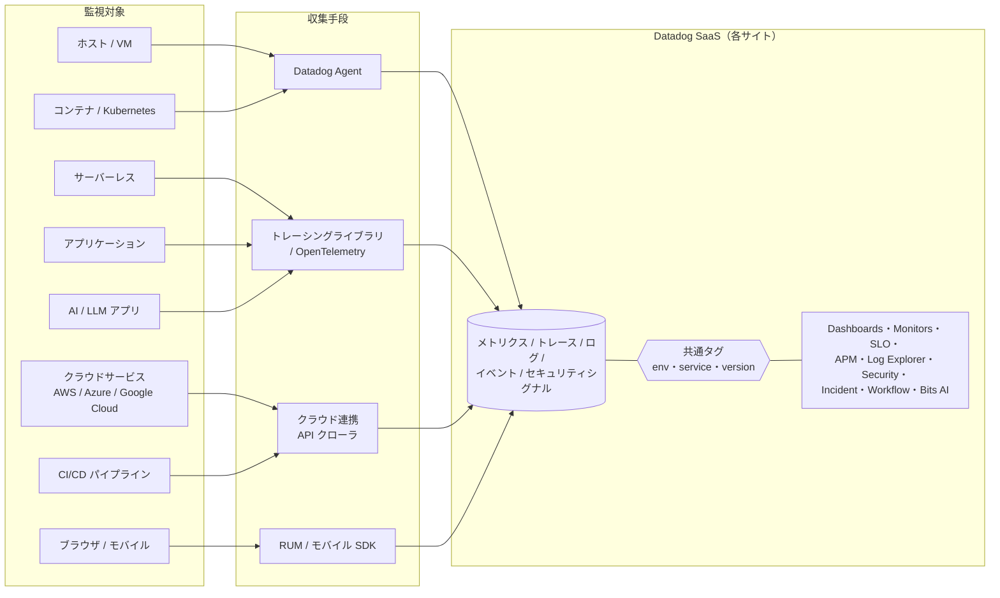
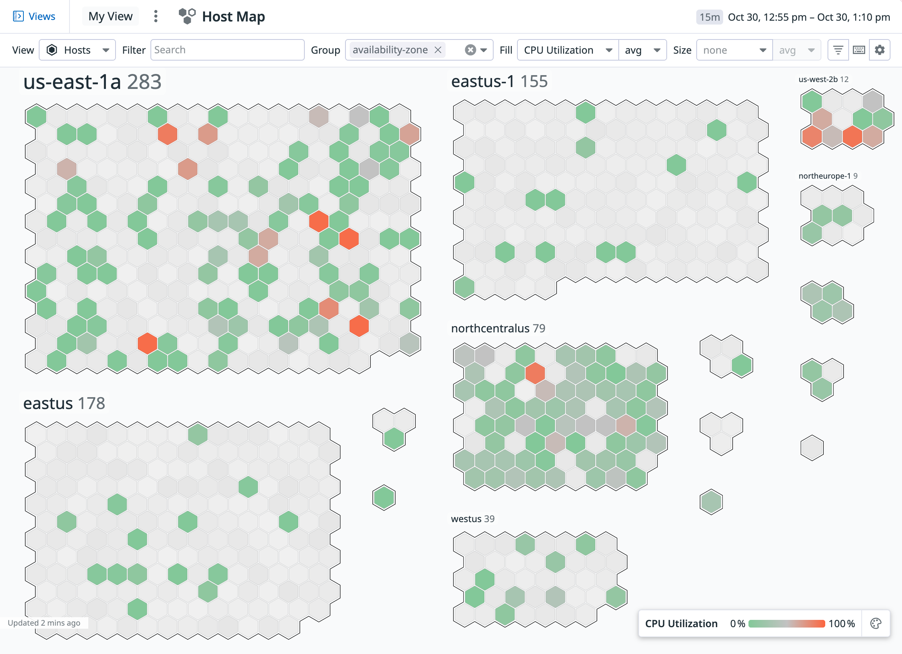
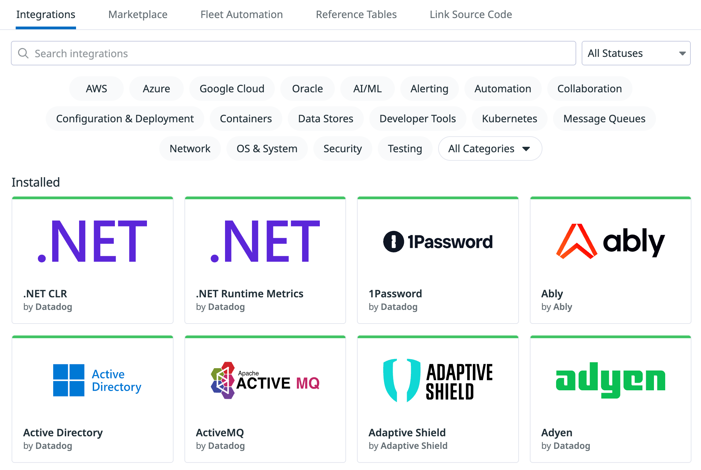

# Datadogとは

## 概要

Datadog（データドッグ）は、米国ニューヨークに本社を置く Datadog, Inc. が提供する **SaaS 型のオブザーバビリティ（可観測性）＋セキュリティ統合プラットフォーム**である。インフラのメトリクス、アプリケーションのトレース、ログ、ユーザー体験（RUM・Synthetic）、セキュリティシグナル、CI/CD、インシデント対応、AI/LLM アプリケーションの監視などを、**1つの Agent・1つの UI・共通のタグ体系**のもとで扱えることが最大の特徴である。[出典](https://docs.datadoghq.com/getting_started/application/)

本ファイルは Datadog を初めて学ぶ人が「Datadog とはどういう会社・製品で、何に使われ、市場でどう評価されているか」を把握するための入口である。次の問いに答える。

| 問い | 本ファイルの該当節 |
|---|---|
| Datadog はいつ、誰が作った会社か。上場しているか | [2. 会社概要](#2-会社概要datadog-inc) |
| 日本法人はあるか。日本にデータを置けるか | [3. 日本での展開](#3-日本での展開datadog-japan合同会社とap1サイト) |
| 「統合プラットフォーム」とは具体的に何が統合されているのか | [4. 製品思想](#4-製品思想統合オブザーバビリティセキュリティプラットフォーム) |
| オンプレミス版はあるか。どこにデータが置かれるか | [5. SaaS 提供形態](#5-saas-提供形態) |
| どんな製品領域があるか | [6. 製品領域の全体像](#6-製品領域の全体像) |
| 何に使われるのか | [7. 主要ユースケース](#7-主要ユースケース) |
| Gartner などの評価、競合は | [8. 市場での位置づけ](#8-市場での位置づけ) |

各製品の詳細仕様は `02_リファレンス/`、料金は [製品別料金表](../03_導入編/02-pricing-by-product.md)、競合比較は [製品選定と競合比較](../03_導入編/07-selection-and-competitive-comparison.md) を参照すること。

> **基準日:** 本ファイルの数値（財務・顧客数・評価レポート等）はすべて 2026-11-02 時点で公開されていた情報に基づく。Datadog は四半期ごとに決算を発表し、製品も継続的にリリースされるため、数値は時点付きで読むこと。

---

## 1. Datadog を一言で言うと

Datadog 自身は、2026 年時点の企業説明（プレスリリース末尾の "About Datadog"）で自社を「**AI 時代の、リーディングなオブザーバビリティおよびセキュリティプラットフォーム**（the leading observability and security platform for the AI era）」と位置づけ、「アプリケーション、インフラ、データ、モデル、セキュリティを一か所にまとめ、AI を用いて顧客に影響が出る前に問題を検知・解決する」と説明している。[出典](https://www.sec.gov/Archives/edgar/data/0001561550/000162828026053829/ex-991x20260630x8k.htm)（2026-08-06 公開）

この自己定義は時期によって変化しており、2025 年 5 月時点のプレスリリースでは「クラウドアプリケーションのためのオブザーバビリティおよびセキュリティプラットフォーム（the observability and security platform for cloud applications）」と表現されていた。[出典](https://www.datadoghq.com/about/latest-news/press-releases/datadog-acquires-eppo-to-expand-its-ai/)（2025-05-05 公開）

| 時期 | Datadog の自己定義（要旨） | 重点の変化 |
|---|---|---|
| 2019 年（日本法人設立時） | **クラウド時代**の開発者・IT 運用チーム・ビジネスユーザー向け**モニタリングおよび分析**プラットフォーム（the monitoring and analytics platform for developers, IT operations teams and business users in the cloud age）。補足：同リリース本文ではインフラメトリクス、アプリケーショントレース、ログ、合成監視、ネットワークパフォーマンス監視を統合した製品と説明 | クラウド監視（Monitoring） |
| 2025 年 5 月 | クラウドアプリケーションのための**オブザーバビリティおよびセキュリティ**プラットフォーム | 監視＋セキュリティの統合 |
| 2026 年 | **AI 時代**のリーディングなオブザーバビリティおよびセキュリティプラットフォーム | AI（AI による自律的な調査・修復、AI アプリケーションの監視）を前面に |

出典: [2019 年 日本法人設立リリース](https://www.datadoghq.com/ja/about/latest-news/press-releases/japanese-subsidiary/)、[2025 年 Eppo 買収リリース](https://www.datadoghq.com/about/latest-news/press-releases/datadog-acquires-eppo-to-expand-its-ai/)、[2026 年 Q2 決算リリース](https://www.sec.gov/Archives/edgar/data/0001561550/000162828026053829/ex-991x20260630x8k.htm)

> 「オブザーバビリティ」という概念そのもの（メトリクス・ログ・トレースの3本柱、監視との違い等）は [オブザーバビリティの基礎](02-observability-fundamentals.md) を参照。

---

## 2. 会社概要（Datadog, Inc.）

### 2.1 基本情報

Datadog, Inc. の基本情報は次のとおり。

| 項目 | 内容 | 出典 |
|---|---|---|
| 正式社名 | Datadog, Inc. | [Form 10-K FY2025](https://www.sec.gov/Archives/edgar/data/1561550/000162828026008819/ddog-20251231.htm) |
| 設立（法人登記） | 2010 年 6 月 4 日、米国デラウェア州で設立 | [Form 10-K FY2025](https://www.sec.gov/Archives/edgar/data/1561550/000162828026008819/ddog-20251231.htm) |
| 創業地 | 米国ニューヨーク市 | 【第三者情報】[Wikipedia](https://en.wikipedia.org/wiki/Datadog)（2026-11-02 参照） |
| 共同創業者 | **Olivier Pomel**（オリビエ・ポメル、現 CEO）、**Alexis Lê-Quôc**（アレクシス・レ＝コック、現 CTO） | [Leadership](https://www.datadoghq.com/about/leadership/) |
| 本社所在地 | 620 8th Avenue, 45th Floor, New York, NY 10018（ニューヨーク・タイムズ・ビル） | [Form 10-K FY2025](https://www.sec.gov/Archives/edgar/data/1561550/000162828026008819/ddog-20251231.htm) |
| 上場市場・ティッカー | 米 NASDAQ（Nasdaq Global Select Market）、ティッカー `DDOG` | [Form 10-K FY2025](https://www.sec.gov/Archives/edgar/data/1561550/000162828026008819/ddog-20251231.htm) |
| 新規株式公開（IPO） | 2019 年 9 月 19 日取引開始。公開価格 1 株 27 ドル、2,400 万株（調達額約 6.48 億ドル） | 【第三者情報】[Wikipedia](https://en.wikipedia.org/wiki/Datadog)、[InvestorPlace](https://investorplace.com/?p=1453008)（2019-09 公開） |
| S&P 500 採用 | 2025 年 7 月 9 日の取引開始前から S&P 500 構成銘柄（Juniper Networks と入替） | 【第三者情報】[Briefing.com](https://briefing.com/story-stocks/archive/2025/7/3/datadog-soars-as-observability-leader-lands-s-and-p-500-spot-replacing-juniper-networks-(ddog))（2025-07-03 公開） |
| 従業員数 | 約 8,100 人（2025-12-31 時点、35 か国）。フルタイム従業員の約 44% が米国外に所在し、そのうち 34%（全体の約 15%）がフランス所在 | [Form 10-K FY2025](https://www.sec.gov/Archives/edgar/data/1561550/000162828026008819/ddog-20251231.htm) |
| 顧客数 | 約 32,700 社（2025-12-31 時点、160 か国以上） | [Form 10-K FY2025](https://www.sec.gov/Archives/edgar/data/1561550/000162828026008819/ddog-20251231.htm) |
| 主な R&D 拠点 | ニューヨーク、パリ（フランス）ほか。2015 年にパリに R&D オフィスを開設 | 【第三者情報】[Wikipedia](https://en.wikipedia.org/wiki/Datadog)（2026-11-02 参照） |
| 研究開発投資 | 年間 10 億ドル超（Non-GAAP）を R&D に投資と公表 | [2026 Gartner MQ プレスリリース](https://www.datadoghq.com/ja/about/latest-news/press-releases/datadog-named-a-leader-in-the-2026-gartner-magic-quadrant-for-observability-platforms/)（2026-07-15 公開） |
| 年次カンファレンス | **DASH**（ニューヨークで毎年 6 月頃開催。2026 年は 6 月開催、100 超の新機能を発表） | [DASH 2026 recap](https://www.datadoghq.com/blog/dash-2026-recap/)（2026-07-07 公開） |

### 2.2 創業の経緯

Datadog の共同創業者 Olivier Pomel と Alexis Lê-Quôc は、ともにフランス出身のエンジニアで、ニューヨークの教育系 SaaS 企業 Wireless Generation で約 9 年間一緒に働いていた。Pomel は開発（Dev）側の技術責任者、Lê-Quôc は運用（Ops）側の責任者という立場であり、「開発チームと運用チームが同じデータを見て協働できない」という課題意識が Datadog 創業の動機になったとされる。【第三者情報】[Wikipedia](https://en.wikipedia.org/wiki/Datadog)（2026-11-02 参照）、[MBI Deep Dives](https://mbi-deepdives.com/ddog)（公開日不明）

社名の由来について、【第三者情報】によれば、前職で本番サーバーを "dogs"、本番データベースを "data dogs" と呼んでおり、皆が苦しめられていた Oracle データベース "Data Dog 17" をコードネームとして仮採用したところ定着し、末尾の "17" を外して "Datadog" になったと語られている。[MBI Deep Dives](https://mbi-deepdives.com/ddog)（公開日不明。創業者インタビューに基づくとされるが、Datadog 公式の一次資料は本調査では確認できず）

### 2.3 沿革（主要な出来事）

Datadog の主な出来事を年表にまとめる。製品の GA 時期の詳細は各リファレンスファイルを参照。

| 年 | 出来事 | 出典 |
|---|---|---|
| 2010 | ニューヨークで創業（6 月 4 日デラウェア州法人として設立） | [10-K](https://www.sec.gov/Archives/edgar/data/1561550/000162828026008819/ddog-20251231.htm) |
| 2012 | Series A（620 万ドル、Index Ventures 等） | 【第三者情報】[Wikipedia](https://en.wikipedia.org/wiki/Datadog) |
| 2014〜2016 | Series B〜D。2016 年に Series D（9,450 万ドル、ICONIQ Capital 主導） | 【第三者情報】[Wikipedia](https://en.wikipedia.org/wiki/Datadog) |
| 2015 | パリに R&D オフィス開設 | 【第三者情報】[Wikipedia](https://en.wikipedia.org/wiki/Datadog) |
| 2016 | APM（Application Performance Monitoring）をベータ公開 | 【第三者情報】[Wikipedia](https://en.wikipedia.org/wiki/Datadog) |
| 2017 | Logmatic を買収し、ログ管理（Log Management）の基盤とする | 【第三者情報】[Wikipedia](https://en.wikipedia.org/wiki/Datadog) |
| 2018-02 | Go 言語で書き直した Agent v6 をリリース | 【第三者情報】[Wikipedia](https://en.wikipedia.org/wiki/Datadog) |
| 2018-05 | 日本オフィス開設（カントリーマネージャー：中川誠一氏） | [公式プレスリリース](https://www.datadoghq.com/ja/about/latest-news/press-releases/datadog-japan-office-2018-05/)（2018-05-30） |
| 2019-09 | NASDAQ に上場（`DDOG`） | 【第三者情報】[Wikipedia](https://en.wikipedia.org/wiki/Datadog) |
| 2019-11 | 日本法人 Datadog Japan 合同会社（Datadog Japan GK）設立 | [公式プレスリリース](https://www.datadoghq.com/ja/about/latest-news/press-releases/japanese-subsidiary/)（2019-11-12） |
| 2021-04 | Gartner Magic Quadrant for APM で初めて Leader に位置づけ | [公式プレスリリース](https://www.datadoghq.com/about/latest-news/press-releases/datadog-named-a-leader-in-the-2021-gartner-magic-quadrant-for-application-performance-monitoring/) |
| 2021 | Sqreen（アプリケーションセキュリティ）、Timber（Vector 開発元。Observability Pipelines の基盤）を買収 | 【第三者情報】[Wikipedia](https://en.wikipedia.org/wiki/Datadog)、[VentureBeat](https://venturebeat.com/ai/datadog-bolsters-app-security-and-observability-data-management-with-sqreen-and-timber-acquisitions)（2021 公開） |
| 2023-04 | 東京にデータセンター（AP1 サイト）を開設。アジア初のデータセンター | [公式プレスリリース](https://www.datadoghq.com/about/latest-news/press-releases/datadog-launches-new-data-center-in-japan/)（2023-04-19） |
| 2024-02 | 正井拓己氏が Datadog Japan 合同会社 社長兼日本担当ゼネラルマネージャーに就任 | [公式プレスリリース](https://www.datadoghq.com/ja/about/latest-news/press-releases/datadog-country-manager-2024-02/)（2024-02-08） |
| 2025-04 / 05 | Metaplane（データオブザーバビリティ）、Eppo（フィーチャーフラグ・実験基盤）を買収 | [Metaplane 買収ブログ](https://www.datadoghq.com/blog/datadog-acquires-metaplane/)、[Eppo 買収リリース](https://www.datadoghq.com/about/latest-news/press-releases/datadog-acquires-eppo-to-expand-its-ai/)（2025-05-05） |
| 2025-07 | S&P 500 採用 | 【第三者情報】[Briefing.com](https://briefing.com/story-stocks/archive/2025/7/3/datadog-soars-as-observability-leader-lands-s-and-p-500-spot-replacing-juniper-networks-(ddog)) |
| 2026-06 | DASH 2026 で 100 超の新機能を発表（Bits AI の自律化、AI Guard、Bring Your Own Cloud 等）。Adaptive ML を買収 | [Q2 2026 決算リリース](https://www.sec.gov/Archives/edgar/data/0001561550/000162828026053829/ex-991x20260630x8k.htm)（2026-08-06） |
| 2026-07 | 2026 Gartner MQ for Observability Platforms で 6 年連続 Leader、Ability to Execute で最高位 | [公式プレスリリース](https://www.datadoghq.com/ja/about/latest-news/press-releases/datadog-named-a-leader-in-the-2026-gartner-magic-quadrant-for-observability-platforms/)（2026-07-15） |
| 2026-10 | Forrester Wave: AIOps Platforms, Q4 2026 で Leader。Bits AI の有償顧客が 1 万社を超えたと公表 | [公式プレスリリース](https://www.datadoghq.com/about/latest-news/press-releases/datadog-named-a-leader-in-the-forrester-wave-aiops-platforms-q4-2026/)（2026-10-29） |

### 2.4 経営陣（2026-11-02 時点）

Datadog の公式 Leadership ページに掲載されている主な経営陣は次のとおり。[出典](https://www.datadoghq.com/about/leadership/)

| 役職 | 氏名 |
|---|---|
| CEO & Co-founder（最高経営責任者・共同創業者） | Olivier Pomel |
| CTO & Co-founder（最高技術責任者・共同創業者） | Alexis Lê-Quôc |
| Chief Financial Officer（CFO） | David Obstler |
| Chief Operating Officer（COO） | Adam Blitzer |
| Chief Product Officer（CPO） | Yanbing Li |
| Chief Revenue Officer（CRO） | Sean Walters |
| Chief Marketing Officer（CMO） | Sara Varni |
| Chief Information Security Officer（CISO） | Emilio Escobar |
| Chief People Officer | David Galloreese |
| General Counsel | Kerry Acocella |

### 2.5 業績・規模の推移（公表値）

Datadog の業績は四半期ごとに公表される。主要な公表値は次のとおり（金額は USD）。

| 指標 | 値 | 時点・出典 |
|---|---|---|
| 通期売上高（FY2025） | 34.27 億ドル（前年比 +28%） | 2025 年 12 月期。[10-K](https://www.sec.gov/Archives/edgar/data/1561550/000162828026008819/ddog-20251231.htm) |
| 四半期売上高（Q2 2026） | 11.215 億ドル（前年同期 8.268 億ドルから +36%） | 2026-06-30 締め。[Q2 2026 決算リリース](https://www.sec.gov/Archives/edgar/data/0001561550/000162828026053829/ex-991x20260630x8k.htm)（2026-08-06） |
| FY2026 通期売上ガイダンス | 44.5〜44.7 億ドル | 2026-08-06 時点。同上 |
| 顧客数（全体） | 約 32,700 社 | 2025-12-31 時点。[10-K](https://www.sec.gov/Archives/edgar/data/1561550/000162828026008819/ddog-20251231.htm)。Q2 2026 決算リリースには全体顧客数の記載なし |
| ARR 10 万ドル以上の顧客数 | 約 4,720 社（前年同期約 3,850 社から +23%） | 2026-06-30 時点。[Q2 2026 決算リリース](https://www.sec.gov/Archives/edgar/data/0001561550/000162828026053829/ex-991x20260630x8k.htm) |
| ARR 100 万ドル以上の顧客数 | 約 603 社（前年 462 社から +31%） | 2025-12-31 時点。【第三者情報】[iTiger](https://www.itiger.com/news/1148796144)（2026-02 公開、FY2025 決算報道） |
| 標準インテグレーション数 | 1,000 超 | [10-K](https://www.sec.gov/Archives/edgar/data/1561550/000162828026008819/ddog-20251231.htm) |

> **注意:** 2026 年第 3 四半期（Q3 2026）の決算は本ファイルの基準日（2026-11-02）時点では未発表と見られる（公開情報では確認できず）。最新値は [Datadog Investor Relations](https://investors.datadoghq.com/) を確認すること。

### 2.6 主な買収

Datadog は製品領域の拡大に買収を活用してきた。主な買収と、それが現在のどの製品につながったかを示す。日付は資料によって前後するため月単位は目安である。

| 時期 | 買収先 | 領域 | 現在の製品との関係 | 出典 |
|---|---|---|---|---|
| 2017-09 | Logmatic.io | ログ管理 | Log Management の基盤 | 【第三者情報】[Wikipedia](https://en.wikipedia.org/wiki/Datadog) |
| 2019-02 | Madumbo | AI によるテスト | Synthetic Monitoring（ブラウザテスト） | 【第三者情報】[Wikipedia](https://en.wikipedia.org/wiki/Datadog) |
| 2020-08 | Undefined Labs | テスト・CI 可視化 | CI Visibility / Test Optimization | 【第三者情報】[Wikipedia](https://en.wikipedia.org/wiki/Datadog) |
| 2021 | Sqreen | アプリケーションセキュリティ（RASP・In-App WAF） | App and API Protection（旧称：Application Security Management / ASM） | 【第三者情報】[VentureBeat](https://venturebeat.com/ai/datadog-bolsters-app-security-and-observability-data-management-with-sqreen-and-timber-acquisitions) |
| 2021 | Timber Technologies | オブザーバビリティデータパイプライン（OSS「Vector」） | Observability Pipelines | 【第三者情報】[VentureBeat](https://venturebeat.com/ai/datadog-bolsters-app-security-and-observability-data-management-with-sqreen-and-timber-acquisitions) |
| 2021-11 | Ozcode | 本番環境デバッグ | Dynamic Instrumentation / Live Debugger | 【第三者情報】[Wikipedia](https://en.wikipedia.org/wiki/Datadog) |
| 2022-05 | Hdiv Security | アプリケーションセキュリティテスト（IAST） | Code Security | 【第三者情報】[Wikipedia](https://en.wikipedia.org/wiki/Datadog) |
| 2022 | CoScreen | 共同作業（画面共有） | 公開情報では製品の現状を確認できず | 【第三者情報】[Wikipedia](https://en.wikipedia.org/wiki/Datadog) |
| 2022-11 | Cloudcraft | クラウド構成図 | Cloudcraft（インフラ図の可視化機能） | 【第三者情報】[Wikipedia](https://en.wikipedia.org/wiki/Datadog) |
| 2023-04 | Codiga | 静的コード解析 | Code Security（SAST）等 | 【第三者情報】[Wikipedia](https://en.wikipedia.org/wiki/Datadog) |
| 2025-01 | Quickwit | ログ検索エンジン（OSS） | 公開情報では製品の現状を確認できず | 【第三者情報】[Wikipedia](https://en.wikipedia.org/wiki/Datadog) |
| 2025-04 | Metaplane | データオブザーバビリティ | Data Observability（"Metaplane by Datadog" として既存顧客の提供継続） | [公式ブログ](https://www.datadoghq.com/blog/datadog-acquires-metaplane/)（2025-04-23） |
| 2025-05 | Eppo | フィーチャーフラグ・A/B 実験 | Product Analytics 系（"Eppo by Datadog" として提供継続） | [公式リリース](https://www.datadoghq.com/about/latest-news/press-releases/datadog-acquires-eppo-to-expand-its-ai/)（2025-05-05） |
| 2026 | Adaptive ML | 強化学習の運用（RLOps） | 公開情報では製品統合の詳細を確認できず | [Q2 2026 決算リリース](https://www.sec.gov/Archives/edgar/data/0001561550/000162828026053829/ex-991x20260630x8k.htm) |

> Wikipedia 由来の項目は 2026-11-02 参照。買収先と現製品の対応関係は【第三者情報】を含むため、正確な製品仕様は各リファレンスファイルで確認すること。

---

## 3. 日本での展開（Datadog Japan合同会社とAP1サイト）

### 3.1 日本法人の概要

Datadog の日本法人は **Datadog Japan 合同会社**（英文：Datadog Japan GK）である。

| 項目 | 内容 | 出典 |
|---|---|---|
| 法人名 | Datadog Japan 合同会社（Datadog Japan GK） | [公式プレスリリース](https://www.datadoghq.com/ja/about/latest-news/press-releases/japanese-subsidiary/) |
| 日本オフィス開設 | 2018 年 5 月（発表日 2018-05-30） | [公式プレスリリース](https://www.datadoghq.com/ja/about/latest-news/press-releases/datadog-japan-office-2018-05/) |
| 法人設立の発表 | 2019 年 11 月 12 日 | [公式プレスリリース](https://www.datadoghq.com/ja/about/latest-news/press-releases/japanese-subsidiary/) |
| 所在地 | 東京都（番地までの詳細住所は公開情報では確認できず） | 【第三者情報】求人情報 [ビズリーチ](https://www.bizreach.jp/job/view/8527195/)（公開日不明） |
| 代表者（現職として確認できた最新） | 正井 拓己 氏（社長兼日本担当ゼネラルマネージャー、2024-02-01 就任）。日本 IBM、Pivotal、日本マイクロソフト、ワークデイ日本法人社長などを歴任 | [公式プレスリリース](https://www.datadoghq.com/ja/about/latest-news/press-releases/datadog-country-manager-2024-02/)（2024-02-08） |
| 歴代の日本責任者 | 中川 誠一 氏（2018 年、カントリーマネージャー）→ 国本 明善 氏（2020 年 2 月、カントリーマネージャー）→ 正井 拓己 氏（2024 年 2 月、社長） | [2018](https://www.datadoghq.com/ja/about/latest-news/press-releases/datadog-japan-office-2018-05/)、[2020](https://www.datadoghq.com/ja/about/latest-news/press-releases/datadog-country-manager-2020-02/)、[2024](https://www.datadoghq.com/ja/about/latest-news/press-releases/datadog-country-manager-2024-02/) |
| 日本の顧客数 | 公開情報では確認できず | — |

> 2024-02 以降に日本法人代表の交代があったかは、本調査（2026-11-02）では公開情報で確認できなかった。最新の体制は Datadog の日本語プレスリリース一覧で確認すること。

### 3.2 公式発表で名前が挙がった日本の顧客

Datadog の公式プレスリリースに登場した日本の顧客企業（発表時点）は次のとおり。導入事例の詳細は [導入事例](../04_応用編/13-case-studies.md) を参照。

| 発表 | 名前が挙がった日本企業 |
|---|---|
| 2018-05 日本オフィス開設 | サイバーエージェント、アイレット、メルカリ、ニコン、楽天、ソニー |
| 2019-11 日本法人設立（初の年次サミット登壇企業） | CyberAgent、サイボウズ（Cybozu）、プレイド（PLAID）、Sansan、MonotaRO |
| 2024-02 日本法人社長就任 | NTT ドコモ、KDDI、ソフトバンク、ソニー・インタラクティブエンタテインメント、ジェーシービー、大日本印刷、サイバーエージェント |

出典: [2018](https://www.datadoghq.com/ja/about/latest-news/press-releases/datadog-japan-office-2018-05/)、[2019](https://www.datadoghq.com/ja/about/latest-news/press-releases/japanese-subsidiary/)、[2024](https://www.datadoghq.com/ja/about/latest-news/press-releases/datadog-country-manager-2024-02/)

### 3.3 日本のデータセンター（AP1）

Datadog は 2023 年 4 月 19 日、東京に**アジア初のデータセンター**を開設したと発表した。これが現在の **AP1 サイト**（`https://ap1.datadoghq.com`）である。日本国内にデータを保存・処理でき、日本のデータ所在地（データレジデンシー）要件への対応を支援する目的で、発表時点で「既存のすべての Datadog 製品」が利用可能とされた。[出典](https://www.datadoghq.com/about/latest-news/press-releases/datadog-launches-new-data-center-in-japan/)（2023-04-19 公開）

> **サイト差異:** AP1 は他サイトと完全に独立しており、US1 等の既存組織のデータを AP1 に移したり共有したりすることはできない（サイトをまたいだデータ共有は不可）。また、セキュリティ要件等によりサイトごとに提供機能が異なる場合がある。個別機能の AP1 対応状況は各リファレンスファイルと公式ドキュメントのサイトセレクタで確認すること。[出典](https://docs.datadoghq.com/getting_started/site/)

---

## 4. 製品思想：統合オブザーバビリティ＋セキュリティプラットフォーム

### 4.1 「統合（Unified）」の意味

Datadog の製品思想の中核は、**異なる種類のテレメトリ（メトリクス、トレース、ログ、ユーザー体験、セキュリティシグナル等）を、別々のツールではなく1つのプラットフォームに集約し、相互に関連づけて扱う**ことにある。Datadog の公式ドキュメントは、Datadog を「インフラのメトリクス、ログ、アプリケーショントレース、ユーザー体験データ、合成テスト、インテグレーションを一か所に集め、チームが性能を調査しアラートを受け取れるようにする」クラウド監視・オブザーバビリティプラットフォームとして説明している。[出典](https://docs.datadoghq.com/getting_started/application/)

統合の具体的な中身は、次の 6 要素に整理できる。

| 統合の要素 | 内容 | 詳細ファイル |
|---|---|---|
| ① 単一の Agent | ホストに導入する **Datadog Agent** 1 つで、メトリクス・ログ・トレース・プロセス・ネットワーク・セキュリティ（Workload Protection 等）の各データを収集できる | [Datadog Agent](../02_リファレンス/platform/agent.md) |
| ② 共通のタグ体系 | すべてのデータに `env`、`service`、`version` などの**タグ**を付与し、製品をまたいで同じキーで絞り込み・相関できる（Unified Service Tagging） | [Tagging](../02_リファレンス/platform/tagging.md)、[必須概念](05-core-concepts.md) |
| ③ 単一の UI と横断ナビゲーション | ダッシュボード上のメトリクスのスパイクから、関連するトレース、ログ、ホスト、デプロイ、セキュリティシグナルへ同一画面内で遷移できる | [画面構成とナビゲーション](06-ui-navigation.md) |
| ④ 共通の基盤機能 | Monitors（アラート）、Dashboards、Notebooks、SLO、Incident Management、Workflow Automation などを全データ種別で共通に使える | [Monitors](../02_リファレンス/platform/monitors.md)、[Dashboards](../02_リファレンス/platform/dashboards.md) |
| ⑤ オブザーバビリティとセキュリティの同一基盤化 | 監視のために集めた同じデータ（ログ、トレース、Agent のカーネルイベント等）をセキュリティ検知にも使う。開発・運用・セキュリティチームが同じデータと UI を共有する | [Datadog Security 概要](../02_リファレンス/security/security-platform-overview.md) |
| ⑥ AI による横断分析 | Watchdog（異常検知）や Bits AI（調査・修復を担う AI エージェント群）が、プラットフォーム上の全データを横断して分析する | [Watchdog](../02_リファレンス/platform/watchdog.md)、[Bits AI と AI 機能](../02_リファレンス/ai/bits-ai.md) |

### 4.2 統合プラットフォームのデータフロー（概念図）

上図は概念図であり、実際の収集経路・プロトコルの詳細は [Datadogのアーキテクチャ概観](03-architecture-overview.md) を参照。

### 4.3 統合の価値（Datadog の主張と実務上の見方）

Datadog の統合プラットフォームが価値を生む典型的な場面は次のとおり。

| 場面 | 統合されていない場合 | Datadog の統合プラットフォームの場合 |
|---|---|---|
| 障害調査 | メトリクスツール、APM、ログ基盤を行き来し、時刻・ホスト名で手作業突合 | 1 つのグラフからトレース・ログ・ホストへ遷移。共通タグで自動的に紐づく |
| 開発と運用の協働 | 開発者と運用者が別のツール・別のデータを見る | 同一のダッシュボード・ノートブックを共有（創業時の課題意識） |
| セキュリティ | SIEM 用に別途ログを転送・保管 | 監視用に取り込んだログをそのまま Cloud SIEM の検知に利用 |
| ツール運用 | ツールごとに Agent、認証、権限、保守が必要 | Agent・権限・API キー・監査ログを一元管理 |

一方で、実務では次の点もよく指摘される。

- 製品が細分化されており、**製品ごとに課金単位が異なる**ため、利用範囲を広げるほど費用の把握が難しくなる。【経験則】詳細は [料金体系の全体像](../03_導入編/01-pricing-overview.md)、[コスト最適化](../04_応用編/01-cost-optimization.md) を参照。
- 統合の効果は**タグ設計に強く依存**する。タグが統一されていないと製品間の相関が機能しない。【経験則】詳細は [タグ戦略の実践](../04_応用編/02-tagging-strategy.md) を参照。

---

## 5. SaaS 提供形態

### 5.1 基本的な提供形態

Datadog の提供形態の要点は次のとおり。

| 項目 | 内容 | 出典 |
|---|---|---|
| 提供形態 | Datadog 社が運用する **SaaS**（マルチテナントのクラウドサービス）。利用者はバックエンドを構築・運用しない | [Datadog Sites](https://docs.datadoghq.com/getting_started/site/) |
| 利用者側で導入するもの | Datadog Agent（ホスト・コンテナ・Kubernetes 等）、トレーシングライブラリ、RUM SDK、クラウドインテグレーション設定など | [Getting Started](https://docs.datadoghq.com/getting_started/application/) |
| 監視対象の範囲 | パブリッククラウド、プライベートクラウド、オンプレミス、マルチクラウド、ハイブリッド環境（クラウド非依存） | [10-K](https://www.sec.gov/Archives/edgar/data/1561550/000162828026008819/ddog-20251231.htm) |
| 従来型のオンプレミス版（パッケージソフト） | 公開情報では提供を確認できず。Datadog のバックエンドは Datadog 社の各サイトで稼働する | [Datadog Sites](https://docs.datadoghq.com/getting_started/site/) |
| 顧客環境内での実行 | DASH 2026 で **Bring Your Own Cloud** を発表。顧客のクラウド環境内で Datadog を稼働させ、顧客のクラウドオブジェクトストレージ上でデータを処理・インデックスする方式とされる。提供状況（GA / Preview）・対象製品は公開情報では確認できず | [Q2 2026 決算リリース](https://www.sec.gov/Archives/edgar/data/0001561550/000162828026053829/ex-991x20260630x8k.htm)、【第三者情報】[BUSINESS NETWORK](https://businessnetwork.jp/?p=35089)（2026-06 公開） |
| データの前処理（顧客環境側） | Observability Pipelines Worker を顧客環境に置き、ログ等を送信前に加工・削減・ルーティングできる | [Observability Pipelines](../02_リファレンス/logs/observability-pipelines.md) |
| アップデート | SaaS 側は継続的にリリースされ、名前付きバージョンはない。Agent・ライブラリは利用者がバージョンを管理する | [執筆規約](../_CONVENTIONS.md) |
| 利用言語（Web UI・サイト） | 公式サイトは英語・日本語・韓国語に対応。公式ドキュメントにも日本語版がある | [Leadership ページ（言語切替）](https://www.datadoghq.com/about/leadership/)、[docs.datadoghq.com/ja/](https://docs.datadoghq.com/ja/) |

### 5.2 Datadog サイト（データの保存場所）

Datadog の SaaS は「**サイト**（Site）」と呼ばれる独立したインスタンス群で提供される。組織（Organization）は作成時に 1 つのサイトに所属し、データはそのサイトに保存される。2026-11-02 時点で公式ドキュメントに掲載されているサイトは次のとおり。[出典](https://docs.datadoghq.com/getting_started/site/)

| サイト | サイト URL | サイトパラメータ | 所在地 |
|---|---|---|---|
| US1 | `https://app.datadoghq.com` | `datadoghq.com` | 米国 |
| US3 | `https://us3.datadoghq.com` | `us3.datadoghq.com` | 米国 |
| US5 | `https://us5.datadoghq.com` | `us5.datadoghq.com` | 米国 |
| EU1 | `https://app.datadoghq.eu` | `datadoghq.eu` | EU（ドイツ） |
| AP1 | `https://ap1.datadoghq.com` | `ap1.datadoghq.com` | 日本 |
| AP2 | `https://ap2.datadoghq.com` | `ap2.datadoghq.com` | オーストラリア |
| UK1 | `https://uk1.datadoghq.com` | `uk1.datadoghq.com` | 英国 |
| US1-FED | `https://app.ddog-gov.com` | `ddog-gov.com` | 米国（FedRAMP High 認定） |
| US2-FED | `https://us2.ddog-gov.com` | `us2.ddog-gov.com` | 米国（IL5 認可取得手続き中） |

> **サイト差異:** 各サイトは完全に独立しており、サイト間でデータを共有することはできない。サイトによって、セキュリティ要件に応じて提供機能が異なる場合がある。本ナレッジの基準サイトは AP1（日本）。サイトの選び方・エンドポイントの詳細は [Datadog Sites](../02_リファレンス/platform/datadog-sites.md) を参照。[出典](https://docs.datadoghq.com/getting_started/site/)

> **注記:** 本ナレッジの執筆規約（[_CONVENTIONS.md](../_CONVENTIONS.md)）のサイト一覧には UK1・US2-FED が含まれていないが、2026-11-02 時点の公式ドキュメントには上表のとおり掲載されている。

### 5.3 利用開始の方法と契約形態（概要）

Datadog の利用開始と契約の概要は次のとおり。料金の具体的な数値の正本は [製品別料金表](../03_導入編/02-pricing-by-product.md)。

| 項目 | 内容 | 出典 |
|---|---|---|
| 無料トライアル | **14 日間**、クレジットカード不要 | [Free Trial](https://www.datadoghq.com/free-datadog-trial/) |
| 無料プラン（Free tier） | Infrastructure の Free tier で、最大 5 台の Basic ホスト、メトリクス保持 1 日を無償で利用可能 | [Pricing](https://www.datadoghq.com/pricing/)（2026-11-02 取得） |
| 課金の基本 | 製品ごとの従量・単位課金（例：Infrastructure・APM はホスト単位/月、Logs は取り込み GB 単位および保存イベント数単位/月） | [Pricing](https://www.datadoghq.com/pricing/)（2026-11-02 取得） |
| 契約期間 | 主に月契約または年契約。四半期・半年・複数年契約もある。年契約（Billed annually）はオンデマンドより単価が低い | [10-K](https://www.sec.gov/Archives/edgar/data/1561550/000162828026008819/ddog-20251231.htm)、[Pricing](https://www.datadoghq.com/pricing/) |
| 拡張 | 顧客はホストやデータ量を追加することでセルフサービスで利用を拡大できる | [10-K](https://www.sec.gov/Archives/edgar/data/1561550/000162828026008819/ddog-20251231.htm) |
| 割引 | 複数年・ボリューム割引あり（条件は非公開） | [Pricing](https://www.datadoghq.com/pricing/) |
| 購入経路 | Datadog との直接契約のほか、AWS Marketplace 等のクラウドマーケットプレイス経由（AWS Marketplace 経由の 14 日間トライアルもある） | [AWS Marketplace トライアル](https://docs.datadoghq.com/integrations/guide/aws-marketplace-datadog-trial/) |

> 契約形態・購入経路・パートナー経由購入の詳細は [購入経路と契約](../03_導入編/06-procurement-and-contracts.md)、エディションの違いは [エディション・プラン](../03_導入編/04-editions-and-plans.md) を参照。

---

## 6. 製品領域の全体像

Datadog の製品は多数あり、公式サイトの料金ページでは **AI、Infrastructure、Applications、Data Observability、Logs、Security、Digital Experience、Software Delivery、Service Management** のカテゴリに分類されている。[出典](https://www.datadoghq.com/pricing/)（2026-11-02 取得）

以下は入門者向けの要約である。全製品の一覧・関係図は [製品ポートフォリオ全体像](04-product-map.md) を参照。

| 領域 | 代表的な製品（現名称。旧称併記） | 何を見る・守るか | 詳細 |
|---|---|---|---|
| Infrastructure（インフラ） | Infrastructure Monitoring、Container/Kubernetes Monitoring、Serverless、Cloud Network Monitoring（旧称：Network Performance Monitoring / NPM）、Network Device Monitoring、Database Monitoring、Cloud Cost Management | サーバー、コンテナ、クラウド、ネットワーク、DB、クラウド費用 | [Infrastructure Monitoring](../02_リファレンス/infrastructure/infrastructure-monitoring.md) |
| Applications（APM） | APM、Universal Service Monitoring、Continuous Profiler、Dynamic Instrumentation / Live Debugger、Error Tracking、Data Streams Monitoring | アプリケーションの性能・エラー・依存関係 | [APM の概念](../02_リファレンス/apm/apm-concepts-and-ingestion.md) |
| Logs | Log Management、Flex Logs、Observability Pipelines、Sensitive Data Scanner | ログの収集・検索・保管・前処理 | [ログ収集](../02_リファレンス/logs/log-collection.md) |
| Digital Experience | RUM（Real User Monitoring）、Session Replay、Product Analytics、Synthetic Monitoring | エンドユーザーの体験、Web/モバイル | [RUM（ブラウザ）](../02_リファレンス/dem/rum-browser.md) |
| Security | Cloud SIEM、Cloud Security（旧称：Cloud Security Management / CSM）、Workload Protection（旧称：Cloud Workload Security / CWS）、App and API Protection（旧称：Application Security Management / ASM）、Code Security | クラウド設定の不備、脅威検知、アプリの攻撃防御、脆弱性 | [Datadog Security 概要](../02_リファレンス/security/security-platform-overview.md) |
| Software Delivery | CI Visibility、Test Optimization（旧称：Test Visibility）、DORA Metrics、Quality Gates | CI/CD パイプライン、テスト、デリバリー指標 | [CI Visibility](../02_リファレンス/software-delivery/ci-visibility.md) |
| Service Management | Incident Management、On-Call、Work Management（旧称：Case Management）、Workflow Automation、App Builder、Event Management | 障害対応、当番、自動化 | [Incident Management](../02_リファレンス/service-management/incident-management.md) |
| AI | Bits AI（Bits Investigation（旧称：Bits AI SRE）、Bits Code、Bits Chat、Bits Security Analyst、Bits Data Analysis、Bits Detection、Bits Remediation 等の AI エージェント群）、Agent Observability（旧称：LLM Observability） | AI による調査・修復、AI エージェント/LLM アプリの監視 | [Bits AI](../02_リファレンス/ai/bits-ai.md)、[Agent Observability](../02_リファレンス/ai/llm-observability.md) |
| Data | Data Jobs Monitoring、Data Observability | データパイプライン、データ品質 | [Data Observability](../02_リファレンス/data/data-observability.md) |
| Platform（共通基盤） | Agent、Integrations（1,000 超）、Tagging、Metrics、Monitors、Dashboards、Notebooks、SLO、Watchdog、Software Catalog（旧称：Service Catalog）、Audit Trail、Fleet Automation | すべての製品の土台 | [Integrations](../02_リファレンス/platform/integrations.md) |

### 6.1 直近の製品動向（DASH 2026）

Datadog は 2026 年 6 月の年次カンファレンス DASH 2026 で多数の新機能を発表した。Q2 2026 決算リリースでは「100 を超える機能」、公式ブログ（DASH 2026 recap）では「170 を超える新製品・新機能」をリリースしたと表現されている（集計範囲の違いと見られるが、差の理由は公開情報では確認できず）。主な発表は次のとおり。各機能の提供状況（GA / Preview）は個別に確認が必要である。

| 領域 | 発表内容 | 提供状況 | 出典 |
|---|---|---|---|
| AI | Bits Code、Bits Chat、Bits Agent Builder が一般提供（GA） | GA | [Q2 2026 決算リリース](https://www.sec.gov/Archives/edgar/data/0001561550/000162828026053829/ex-991x20260630x8k.htm) |
| AI | Bits Detection（劣化の自律監視）、Bits Remediation（修復）、Bits Database Optimization、Bits Evals、Agent Observability の Patterns、Datadog Agent Console（コーディングエージェント利用の可視化） | 公開情報（recap 記事）では明記なし | [DASH 2026 recap](https://www.datadoghq.com/blog/dash-2026-recap/)（2026-07-07） |
| Security | AI Guard（AI エージェントをプロンプトインジェクション・ポイズニングから防御）、Bits Threat Hunting | 公開情報（recap 記事）では明記なし | 同上 |
| Observability | Network Configuration Management、Journey Monitoring、Cloud Cost Management の Cost Optimization Automation | 公開情報（recap 記事）では明記なし | 同上 |
| 提供形態 | Bring Your Own Cloud（顧客環境内に Datadog をデプロイ） | 公開情報では確認できず | [Q2 2026 決算リリース](https://www.sec.gov/Archives/edgar/data/0001561550/000162828026053829/ex-991x20260630x8k.htm) |

また 2026-10-29 には、Bits AI を支える SRE 向けモデル **Scout 1.0** の提供開始と、Bits AI の有償顧客が 1 万社を超えたことが発表されている。[出典](https://www.datadoghq.com/about/latest-news/press-releases/datadog-named-a-leader-in-the-forrester-wave-aiops-platforms-q4-2026/)

---

## 7. 主要ユースケース

Datadog の主要なユースケースを、目的・使う製品・関連ファイルで整理する。

| # | ユースケース | 典型的な目的 | 主に使う製品 | 詳細ファイル |
|---|---|---|---|---|
| 1 | クラウド・インフラ監視 | サーバー/VM/コンテナ/クラウドサービスの稼働・リソース監視、容量計画 | Infrastructure Monitoring、各クラウド Integration、Host Map | [Infrastructure Monitoring](../02_リファレンス/infrastructure/infrastructure-monitoring.md)、[AWS Integration](../02_リファレンス/platform/aws-integration.md) |
| 2 | Kubernetes・コンテナ監視 | クラスタ・Pod・ワークロードの健全性、リソース最適化 | Container Monitoring、Kubernetes Explorer、Cluster Agent | [コンテナ・Kubernetes 監視](../02_リファレンス/infrastructure/container-and-kubernetes-monitoring.md)、[Kubernetes 監視の実践](../04_応用編/07-kubernetes-monitoring-practices.md) |
| 3 | アプリケーション性能監視（APM）・分散トレーシング | マイクロサービスのレイテンシ・エラー・ボトルネック特定 | APM、Continuous Profiler、Error Tracking | [APM インスツルメンテーション](../02_リファレンス/apm/apm-instrumentation.md)、[APM 運用の実践](../04_応用編/05-apm-practices.md) |
| 4 | ログ管理・分析 | ログの集中管理、検索、障害調査、長期保管・監査 | Log Management、Flex Logs、Archives、Observability Pipelines | [Indexes・保持・アーカイブ](../02_リファレンス/logs/log-indexes-retention-archives.md)、[ログ管理の実践](../04_応用編/06-log-management-practices.md) |
| 5 | ユーザー体験監視（DEM） | 実ユーザーの表示速度・エラー、外形監視、UX 改善 | RUM、Session Replay、Synthetic Monitoring、Product Analytics | [Synthetic Monitoring](../02_リファレンス/dem/synthetic-monitoring.md)、[Session Replay と Product Analytics](../02_リファレンス/dem/session-replay-and-product-analytics.md) |
| 6 | アラート・オンコール・インシデント対応 | 異常の検知・通知、当番体制、障害対応の記録 | Monitors、On-Call、Incident Management、Workflow Automation | [Monitors](../02_リファレンス/platform/monitors.md)、[アラート設計とノイズ削減](../04_応用編/03-alert-design-and-noise-reduction.md) |
| 7 | SLO による信頼性管理 | サービスレベルの定義と エラーバジェット管理 | SLO、Monitors | [SLO](../02_リファレンス/platform/slo.md)、[SLO 運用の実践](../04_応用編/08-slo-practices.md) |
| 8 | クラウドセキュリティ・脅威検知 | 設定不備（CSPM）、脆弱性、脅威検知（SIEM）、ランタイム防御 | Cloud Security、Cloud SIEM、Workload Protection、App and API Protection | [Cloud SIEM](../02_リファレンス/security/cloud-siem.md)、[セキュリティ運用の実践](../04_応用編/11-security-operations-practices.md) |
| 9 | DevSecOps・ソフトウェアデリバリー改善 | CI の遅延・不安定テストの検出、DORA 指標、コード脆弱性 | CI Visibility、Test Optimization、Code Security、DORA Metrics | [DORA Metrics・Quality Gates](../02_リファレンス/software-delivery/software-delivery-insights.md) |
| 10 | クラウドコスト管理（FinOps） | クラウド費用と利用状況の可視化、最適化 | Cloud Cost Management | [Cloud Cost Management](../02_リファレンス/infrastructure/cloud-cost-management.md) |
| 11 | データベース・データパイプライン監視 | クエリ性能、データジョブ、データ品質 | Database Monitoring、Data Jobs Monitoring、Data Observability | [Database Monitoring](../02_リファレンス/infrastructure/database-monitoring.md) |
| 12 | AI / LLM アプリケーションの監視・保護 | LLM の応答品質・コスト・トレース、AI エージェントの防御 | Agent Observability（旧称：LLM Observability）、AI Guard | [Agent Observability](../02_リファレンス/ai/llm-observability.md) |
| 13 | AI による運用自動化（AIOps） | アラートの自律調査・根本原因特定・修復 | Bits AI（Bits Investigation（旧称：Bits AI SRE）等）、Watchdog、Event Management | [Bits AI](../02_リファレンス/ai/bits-ai.md)、[Event Management](../02_リファレンス/platform/event-management.md) |
| 14 | 既存監視ツールの統合・移行 | 複数ツールの集約、OSS/他社製品からの移行 | Integrations、OpenTelemetry サポート | [他製品からの移行](../03_導入編/14-migration-from-other-tools.md)、[OpenTelemetry サポート](../02_リファレンス/platform/opentelemetry.md) |

出典: 製品分類は [10-K](https://www.sec.gov/Archives/edgar/data/1561550/000162828026008819/ddog-20251231.htm) および [Pricing](https://www.datadoghq.com/pricing/)（2026-11-02 取得）。ユースケースの整理は本ナレッジによる。

> 導入の進め方（どのユースケースから始めるか、段階的導入）は [導入方法論](../03_導入編/08-implementation-methodology.md) を参照。

---

## 8. 市場での位置づけ

### 8.1 Gartner Magic Quadrant（オブザーバビリティ領域）

Gartner の Magic Quadrant（MQ）は、ベンダーを「実行能力（Ability to Execute）」と「ビジョンの完全性（Completeness of Vision）」の 2 軸で評価し、Leaders / Challengers / Visionaries / Niche Players の 4 象限に位置づける調査レポートである。Datadog のオブザーバビリティ領域での評価推移は次のとおり。

| 年 | レポート名 | Datadog の位置 | 補足 | 出典 |
|---|---|---|---|---|
| 初掲載年（年は公開情報では確認できず） | Magic Quadrant for Application Performance Monitoring | Visionary | 初めて掲載された年は Visionary だったと Datadog が説明 | [2021 公式ブログ](https://www.datadoghq.com/blog/datadog-apm-gartner-magic-quadrant-2021/) |
| 2021（2021-04-09 発行） | Magic Quadrant for Application Performance Monitoring | **Leader**（初） | 17 ベンダーを評価 | [公式プレスリリース](https://www.datadoghq.com/about/latest-news/press-releases/datadog-named-a-leader-in-the-2021-gartner-magic-quadrant-for-application-performance-monitoring/) |
| 2022（2022-06-07 発行） | Magic Quadrant for Application Performance Monitoring and Observability | **Leader**（2 年連続） | レポート名が APM から「APM and Observability」に変更。Datadog は Ability to Execute で最高位と発表。著者：Padraig Byrne、Gregg Siegfried、Mrudula Bangera | [公式プレスリリース](https://datadoghq.com/about/latest-news/press-releases/datadog-named-a-leader-in-the-2022-gartner-magic-quadrant-for-application-performance-monitoring-and-observability)（2022-06-10）、[公式ブログ](https://datadoghq.com/blog/datadog-apm-observability-gartner-magic-quadrant-2022) |
| 2023（2023-07 発行） | Magic Quadrant for Application Performance Monitoring and Observability | **Leader**（3 年連続） | 著者：Gregg Siegfried、Mrudula Bangera、Padraig Byrne、Matt Crossley。同年の発表では最高位等の言及なし | [公式プレスリリース](https://www.datadoghq.com/about/latest-news/press-releases/datadog-named-a-leader-in-the-2023-gartner-magic-quadranttm-for-application-performance-monitoring-and-observability/)（2023-07-10） |
| 2024 | Magic Quadrant for **Observability Platforms** | **Leader**（4 年連続） | レポート名が Observability Platforms に変更 | [公式ブログ](https://www.datadoghq.com/blog/datadog-observability-platforms-gartner-magic-quadrant-2024/) |
| 2025（2025-07 発行） | Magic Quadrant for Observability Platforms | **Leader**（5 年連続） | 【第三者情報】同年は 20 ベンダーが評価され、Ability to Execute の最高位は Dynatrace と同社が発表 | [公式リリース](https://www.datadoghq.com/about/latest-news/press-releases/datadog-named-a-leader-in-the-2025-gartner-magic-quadrant-for-observability-platforms/)、[Dynatrace 発表](https://www.businesswire.com/news/home/20250710820419/en/Dynatrace-Positioned-Highest-in-Execution-in-the-2025-Gartner-Magic-Quadrant-for-Observability-Platforms)（2025-07-10） |
| 2026（2026-07-13 発行） | Magic Quadrant for Observability Platforms | **Leader**（6 年連続） | 評価対象の全ベンダー中、**Ability to Execute で最高位**。著者：Padraig Byrne、Martin Caren、D.B. Cummings、Neil Young | [公式プレスリリース（日本語）](https://www.datadoghq.com/ja/about/latest-news/press-releases/datadog-named-a-leader-in-the-2026-gartner-magic-quadrant-for-observability-platforms/)（2026-07-15） |

**2025 年 Observability Platforms MQ の Leaders（各社発表ベース）** 【第三者情報】: Datadog、Dynatrace、Splunk（Cisco）、New Relic、Elastic、Grafana Labs、IBM（Instana）。[Splunk](https://investor.cisco.com/news/news-details/2025/Splunk-Named-a-Leader-in-the-Gartner-Magic-Quadrant-for-Observability-Platforms-for-the-Third-Consecutive-Year/default.aspx)、[New Relic](https://newrelic.com/es/resources/gartner-magic-quadrant-observability)、[Grafana Labs](https://grafana.com/blog/2025/07/10/grafana-labs-named-a-leader-again-in-the-2025-gartner-magic-quadrant-for-observability-platforms/)、[IBM](https://www.ibm.com/forms/mkt-53820)（いずれも 2025-07 公開）。2026 年版の Leaders 全体の顔ぶれは本調査では確認できず。

> Gartner は、調査レポートに掲載されたベンダー・製品・サービスを推奨するものではなく、最高評価のベンダーのみを選ぶよう助言するものでもない旨を明記している。MQ の位置は製品選定の一つの参考情報として扱うこと。

### 8.2 その他のアナリスト評価

| 評価 | 年・時期 | Datadog の位置 | 出典 |
|---|---|---|---|
| Gartner Magic Quadrant for Digital Experience Monitoring | 2024（初版） | Leader（Ability to Execute で最高位） | [公式ブログ](https://datadoghq.com/blog/datadog-digital-experience-monitoring-gartner-magic-quadrant-2024) |
| Gartner Magic Quadrant for Digital Experience Monitoring | 2025（2025-10-27 発行） | Leader（2 年連続、Ability to Execute で最高位） | [公式プレスリリース（日本語）](https://www.datadoghq.com/ja/about/latest-news/press-releases/datadog-named-a-leader-in-the-2025-gartner-magic-quadrant-for-digital-experience-monitoring/)（2025-10-29） |
| The Forrester Wave: AIOps Platforms | Q2 2025 | Leader | [公式ブログ](https://datadoghq.com/blog/datadog-aiops-platforms-forrester-wave-2025)（2025-04-15） |
| The Forrester Wave: AIOps Platforms | Q4 2026 | Leader（Innovation、Roadmap、ModelOps and AI Governance (sovereignty) を含む 11 の評価基準で最高スコア。ロードマップを「野心的かつ透明性が高く、先進的な AI 機能の継続提供にコミットしている」と評価） | [公式プレスリリース](https://www.datadoghq.com/about/latest-news/press-releases/datadog-named-a-leader-in-the-forrester-wave-aiops-platforms-q4-2026/)（2026-10-29） |
| Gartner Peer Insights Customers' Choice（Observability Platforms マーケット） | 2025 | 選出 | [2026 MQ プレスリリース](https://www.datadoghq.com/ja/about/latest-news/press-releases/datadog-named-a-leader-in-the-2026-gartner-magic-quadrant-for-observability-platforms/) |

> 2026 年版の Gartner DEM MQ は、本調査（2026-11-02）では Datadog の発表を確認できなかった。

### 8.3 主な競合

Datadog と比較されることの多い製品・ベンダーは次のとおり。詳細な比較軸と選定の考え方は [製品選定と競合比較](../03_導入編/07-selection-and-competitive-comparison.md) を参照。

| 分類 | 主な競合 |
|---|---|
| 商用オブザーバビリティプラットフォーム | Dynatrace、New Relic、Splunk Observability（Cisco）、IBM Instana、Elastic Observability、Grafana Cloud（Grafana Labs） |
| クラウドベンダーのネイティブ監視 | Amazon CloudWatch / AWS X-Ray、Azure Monitor、Google Cloud Observability（10-K でも AWS・Microsoft Azure・Google Cloud は競合として言及） |
| OSS ベースの自前構築 | Prometheus、Grafana、OpenTelemetry Collector、Jaeger、Loki、OpenSearch 等の組み合わせ |
| セキュリティ領域 | SIEM・CNAPP 専業ベンダー（Splunk Enterprise Security、Microsoft Sentinel、Wiz 等）【第三者情報】 |

出典: 2025 年 MQ Leaders は 8.1 節の各社発表、クラウドベンダーは [10-K](https://www.sec.gov/Archives/edgar/data/1561550/000162828026008819/ddog-20251231.htm)。OSS・セキュリティ領域の列挙は一般的な比較対象として本ナレッジが整理したもの【経験則】。

### 8.4 一般的に語られる強みと留意点

以下は導入・選定の現場で一般的に語られる評価であり、公式情報ではない。

| 観点 | 強みとして語られる点 | 留意点として語られる点 |
|---|---|---|
| 統合性 | 1 つの Agent・UI・タグ体系でメトリクス・トレース・ログ・セキュリティを相関できる 【経験則】 | 全機能を活用するにはタグ設計・インスツルメンテーションの標準化が必要 【経験則】 |
| 導入の速さ | SaaS のためバックエンド構築が不要。1,000 超のインテグレーションで短期間に可視化できる（インテグレーション数は公式） 【経験則】 | Agent の大規模展開・設定管理の設計は必要（[Agent 展開設計](../03_導入編/10-agent-rollout-design.md)） |
| 機能の広さ・更新速度 | 製品ラインが広く、新機能のリリースが速い（DASH 2026 だけで 100 超） | 製品・課金単位が多く、全体像の把握や見積りが難しい 【経験則】 |
| コスト | 使った分だけの従量課金で小さく始められる | カスタムメトリクス、ログのインデックス、APM のホスト数等で費用が想定以上に増えやすい 【経験則】（[よくある失敗](../04_応用編/12-common-pitfalls.md)、[コスト最適化](../04_応用編/01-cost-optimization.md)） |
| データ所在地 | 日本（AP1）を含む複数サイトから選べる | サイト間でデータは共有できず、サイトにより機能差がある（公式） |

---

## 9. 画面イメージ

Datadog の Web UI の代表的な画面を 2 つ示す。画面構成とナビゲーションの全体は [画面構成とナビゲーション](06-ui-navigation.md) を参照。

### 9.1 Host Map（ホストマップ）

- **キャプション:** Infrastructure の Host Map 画面（ホストを `availability-zone` でグループ化し、CPU 使用率で塗り分けた例）
- **画面の説明:** 画面上部に「Views」「Host Map」の見出しと時間範囲（例：15 分）がある。その下のツールバーで、表示対象（View：Hosts / Containers 等）、Filter（タグによる絞り込み）、Group（グループ化に使うタグ。例では `availability-zone`）、Fill（塗り分けに使うメトリクス。例では CPU Utilization の avg）、Size（六角形の大きさに使うメトリクス）を指定する。本体には各グループ名とホスト数（例：`us-east-1a 283`、`eastus 178`、`northcentralus 79` 等。AWS と Azure のゾーンが混在）が表示され、1 つの六角形が 1 ホストを表す。右下の凡例は CPU 使用率 0%（緑）〜100%（赤）のカラースケールを示す。マルチクラウドのホストを 1 画面で俯瞰できることが Datadog の統合性を示す例である。
- **出典:** [Getting Started with Datadog（docs.datadoghq.com/getting_started/application/）](https://docs.datadoghq.com/getting_started/application/)、画像 URL `https://docs.dd-static.net/images/getting_started/application/host_map_2025.49ceb88f4df79f0a69bbc4576c1d3adb.png`（2026-11-02 取得）

### 9.2 Integrations（インテグレーション）画面

- **キャプション:** Integrations 画面（インテグレーションの検索・一覧）
- **画面の説明:** 画面上部のタブは「Integrations」「Marketplace」「Fleet Automation」「Reference Tables」「Link Source Code」。検索ボックス（Search integrations）とステータスのドロップダウン（All Statuses）の下に、カテゴリのフィルタボタン（AWS、Azure、Google Cloud、Oracle、AI/ML、Alerting、Automation、Collaboration、Configuration & Deployment、Containers、Data Stores、Developer Tools、Kubernetes、Message Queues、Network、OS & System、Security、Testing、All Categories）が並ぶ。「Installed」欄にはインストール済みのインテグレーションがタイル表示され、各タイルに名称と提供元（例：「.NET CLR by Datadog」「Ably by Ably」）が示される。提供元が Datadog 以外のものはパートナー提供のインテグレーションである。
- **出典:** [Getting Started with Datadog（docs.datadoghq.com/getting_started/application/）](https://docs.datadoghq.com/getting_started/application/)、画像 URL `https://docs.dd-static.net/images/getting_started/application/integrations-2025.bd0b07a067cba35409ac302506d7af16.png`（2026-11-02 取得）

> 画像の著作権は Datadog, Inc. に帰属する。本リポジトリ内の参照目的に限って利用する。

---

## 10. 課金への影響

Datadog は製品ごとに課金単位が異なる従量課金型 SaaS である。本ファイルは入門編のため課金単位の代表例のみを示し、料金の数値の正本は [製品別料金表](../03_導入編/02-pricing-by-product.md) とする。

| 製品（代表例） | 課金単位（公式料金ページの表記） | 取得日・契約形態 |
|---|---|---|
| Infrastructure Monitoring | ホスト単位 / 月（Free tier：最大 5 Basic ホスト、メトリクス保持 1 日） | 2026-11-02 時点。年契約（Billed annually）とオンデマンドで単価が異なる |
| APM | ホスト単位 / 月 | 同上 |
| Log Management | 取り込み・スキャン GB 単位 / 月、インデックス済みログイベント 100 万件単位 / 月 等 | 同上 |

出典: [Pricing](https://www.datadoghq.com/pricing/)（2026-11-02 取得）。課金計算の仕組み（ホストの数え方、上位 99 パーセンタイル課金など）は [課金計算の仕組み](../03_導入編/03-billing-mechanics.md)、全体像は [料金体系の全体像](../03_導入編/01-pricing-overview.md) を参照。

---

## 11. よくある質問（FAQ）

**Q1. Datadog はどこの国の会社か。**
A. 米国の会社である。Datadog, Inc. は 2010 年に米国デラウェア州で設立され、本社はニューヨーク市（620 8th Avenue）にある。共同創業者の Olivier Pomel と Alexis Lê-Quôc はフランス出身で、パリにも大規模な R&D 拠点がある。2025 年末時点でフルタイム従業員の約 44% が米国外に所在し、そのうち 34%（全体の約 15%）がフランス所在である。[出典](https://www.sec.gov/Archives/edgar/data/1561550/000162828026008819/ddog-20251231.htm)

**Q2. Datadog は上場しているか。**
A. 上場している。2019 年 9 月に米 NASDAQ に上場し、ティッカーは `DDOG`。2025 年 7 月に S&P 500 の構成銘柄に採用された。【第三者情報】[Wikipedia](https://en.wikipedia.org/wiki/Datadog)

**Q3. 日本法人はあるか。日本語のサポートはあるか。**
A. 日本法人 Datadog Japan 合同会社がある（2019 年 11 月設立発表、日本オフィスは 2018 年 5 月開設）。公式サイト・公式ドキュメントには日本語版がある。サポート体制の詳細は [サポートと教育](../03_導入編/15-support-and-training.md) を参照。

**Q4. データを日本国内に保存できるか。**
A. できる。2023 年 4 月に開設された東京のデータセンター（AP1 サイト、`ap1.datadoghq.com`）を選べば、データは日本国内に保存される。ただし既存の他サイトの組織から AP1 へデータを移すことはできず、サイトごとに機能差がある場合がある。[出典](https://docs.datadoghq.com/getting_started/site/)

**Q5. オンプレミスに Datadog のサーバーを構築できるか。**
A. 従来型のオンプレミス版（パッケージソフト）は公開情報では確認できない。Datadog は SaaS として提供され、利用者は Agent 等の収集コンポーネントのみを自環境に導入する。なお DASH 2026 で顧客クラウド環境内で稼働させる Bring Your Own Cloud が発表されているが、提供状況・対象範囲は公開情報では確認できず。

**Q6. 無料で試せるか。**
A. 14 日間の無料トライアル（クレジットカード不要）がある。また Infrastructure の Free tier（最大 5 Basic ホスト、メトリクス保持 1 日）がある。[出典](https://www.datadoghq.com/pricing/)

**Q7. Datadog はオブザーバビリティ製品か、セキュリティ製品か。**
A. 両方である。Datadog は自社を「オブザーバビリティおよびセキュリティプラットフォーム」と定義しており、監視用に収集した同じデータを Cloud SIEM、Cloud Security、Workload Protection、App and API Protection、Code Security などのセキュリティ製品でも使う。詳細は [Datadog Security 概要](../02_リファレンス/security/security-platform-overview.md)。

**Q8. Gartner の評価はどうか。**
A. 2026 Gartner Magic Quadrant for Observability Platforms で 6 年連続 Leader に位置づけられ、評価対象全ベンダー中で Ability to Execute が最高位だった（2026-07-15 発表）。Digital Experience Monitoring の MQ でも 2024・2025 年に Leader。[出典](https://www.datadoghq.com/ja/about/latest-news/press-releases/datadog-named-a-leader-in-the-2026-gartner-magic-quadrant-for-observability-platforms/)

**Q9. OpenTelemetry には対応しているか。**
A. 対応している。Datadog は OpenTelemetry へのコントリビューションも公表している。対応範囲・構成パターンは [OpenTelemetry サポート](../02_リファレンス/platform/opentelemetry.md) と [OpenTelemetry 活用戦略](../04_応用編/10-opentelemetry-strategy.md) を参照。

---

## 12. 次に読むファイル

| 目的 | 次に読むファイル |
|---|---|
| オブザーバビリティの基本概念を理解したい | [オブザーバビリティの基礎](02-observability-fundamentals.md) |
| データがどう流れるかを理解したい | [Datadogのアーキテクチャ概観](03-architecture-overview.md) |
| 全製品の関係を把握したい | [製品ポートフォリオ全体像](04-product-map.md) |
| タグ・ホスト・カスタムメトリクス等の必須用語を知りたい | [必須概念](05-core-concepts.md) |
| 画面の歩き方を知りたい | [画面構成とナビゲーション](06-ui-navigation.md) |
| 実際に触ってみたい | [はじめてのDatadog](07-getting-started.md) |
| 料金を知りたい | [料金体系の全体像](../03_導入編/01-pricing-overview.md)、[製品別料金表](../03_導入編/02-pricing-by-product.md) |
| 他製品と比較したい | [製品選定と競合比較](../03_導入編/07-selection-and-competitive-comparison.md) |

---

## 参照元

### Datadog 公式（一次情報）

- Form 10-K（FY2025、SEC 提出）: https://www.sec.gov/Archives/edgar/data/1561550/000162828026008819/ddog-20251231.htm
- Q2 2026 決算リリース（Form 8-K Exhibit 99.1、2026-08-06）: https://www.sec.gov/Archives/edgar/data/0001561550/000162828026053829/ex-991x20260630x8k.htm
- Datadog Investor Relations: https://investors.datadoghq.com/
- Leadership: https://www.datadoghq.com/about/leadership/
- 日本オフィス開設（2018-05-30）: https://www.datadoghq.com/ja/about/latest-news/press-releases/datadog-japan-office-2018-05/
- 日本法人設立（2019-11-12）: https://www.datadoghq.com/ja/about/latest-news/press-releases/japanese-subsidiary/
- 日本カントリーマネージャー就任（2020-02）: https://www.datadoghq.com/ja/about/latest-news/press-releases/datadog-country-manager-2020-02/
- 日本法人社長就任（2024-02-08）: https://www.datadoghq.com/ja/about/latest-news/press-releases/datadog-country-manager-2024-02/
- 日本データセンター開設（2023-04-19）: https://www.datadoghq.com/about/latest-news/press-releases/datadog-launches-new-data-center-in-japan/
- Eppo 買収（2025-05-05）: https://www.datadoghq.com/about/latest-news/press-releases/datadog-acquires-eppo-to-expand-its-ai/
- Metaplane 買収（2025-04-23）: https://www.datadoghq.com/blog/datadog-acquires-metaplane/
- DASH 2026 recap（2026-07-07）: https://www.datadoghq.com/blog/dash-2026-recap/
- 2021 Gartner MQ for APM（プレスリリース）: https://www.datadoghq.com/about/latest-news/press-releases/datadog-named-a-leader-in-the-2021-gartner-magic-quadrant-for-application-performance-monitoring/
- 2021 Gartner MQ for APM（ブログ）: https://www.datadoghq.com/blog/datadog-apm-gartner-magic-quadrant-2021/
- 2022 Gartner MQ for APM and Observability（プレスリリース、2022-06-10）: https://datadoghq.com/about/latest-news/press-releases/datadog-named-a-leader-in-the-2022-gartner-magic-quadrant-for-application-performance-monitoring-and-observability
- 2022 Gartner MQ for APM and Observability（ブログ）: https://datadoghq.com/blog/datadog-apm-observability-gartner-magic-quadrant-2022
- 2023 Gartner MQ for APM and Observability（プレスリリース、2023-07-10）: https://www.datadoghq.com/about/latest-news/press-releases/datadog-named-a-leader-in-the-2023-gartner-magic-quadranttm-for-application-performance-monitoring-and-observability/
- Bits AI（公式ドキュメント）: https://docs.datadoghq.com/bits_ai/
- Agent Observability（公式ドキュメント）: https://docs.datadoghq.com/llm_observability/
- 2024 Gartner MQ for Observability Platforms（ブログ）: https://www.datadoghq.com/blog/datadog-observability-platforms-gartner-magic-quadrant-2024/
- 2025 Gartner MQ for Observability Platforms（プレスリリース）: https://www.datadoghq.com/about/latest-news/press-releases/datadog-named-a-leader-in-the-2025-gartner-magic-quadrant-for-observability-platforms/
- 2026 Gartner MQ for Observability Platforms（日本語プレスリリース、2026-07-15）: https://www.datadoghq.com/ja/about/latest-news/press-releases/datadog-named-a-leader-in-the-2026-gartner-magic-quadrant-for-observability-platforms/
- 2026 Gartner MQ for Observability Platforms（ブログ、2026-07-15）: https://www.datadoghq.com/blog/datadog-observability-platforms-gartner-magic-quadrant-2026/
- 2024 Gartner MQ for DEM（ブログ）: https://datadoghq.com/blog/datadog-digital-experience-monitoring-gartner-magic-quadrant-2024
- 2025 Gartner MQ for DEM（日本語プレスリリース、2025-10-29）: https://www.datadoghq.com/ja/about/latest-news/press-releases/datadog-named-a-leader-in-the-2025-gartner-magic-quadrant-for-digital-experience-monitoring/
- Forrester Wave AIOps Platforms Q2 2025（ブログ）: https://datadoghq.com/blog/datadog-aiops-platforms-forrester-wave-2025
- Forrester Wave AIOps Platforms Q4 2026（プレスリリース、2026-10-29）: https://www.datadoghq.com/about/latest-news/press-releases/datadog-named-a-leader-in-the-forrester-wave-aiops-platforms-q4-2026/
- Getting Started with Datadog: https://docs.datadoghq.com/getting_started/application/
- Datadog Sites: https://docs.datadoghq.com/getting_started/site/
- AWS Marketplace トライアル: https://docs.datadoghq.com/integrations/guide/aws-marketplace-datadog-trial/
- Pricing（2026-11-02 取得）: https://www.datadoghq.com/pricing/
- Free Trial: https://www.datadoghq.com/free-datadog-trial/

### 第三者情報（公開日・参照日を併記）

- Wikipedia "Datadog"（2026-11-02 参照）: https://en.wikipedia.org/wiki/Datadog
- MBI Deep Dives "Datadog: Leading the Cloud Infrastructure Dogfight"（公開日不明）: https://mbi-deepdives.com/ddog
- InvestorPlace "Datadog IPO: 14 Things to Know"（2019-09 公開）: https://investorplace.com/?p=1453008
- Briefing.com（S&P 500 採用、2025-07-03 公開）: https://briefing.com/story-stocks/archive/2025/7/3/datadog-soars-as-observability-leader-lands-s-and-p-500-spot-replacing-juniper-networks-(ddog)
- iTiger（FY2025 決算報道、2026-02 公開）: https://www.itiger.com/news/1148796144
- VentureBeat（Sqreen・Timber 買収、2021 公開）: https://venturebeat.com/ai/datadog-bolsters-app-security-and-observability-data-management-with-sqreen-and-timber-acquisitions
- BUSINESS NETWORK（DASH 2026 報道、2026-06 公開）: https://businessnetwork.jp/?p=35089
- ビズリーチ求人（Datadog Japan 合同会社、公開日不明）: https://www.bizreach.jp/job/view/8527195/
- Dynatrace（2025 Gartner MQ 発表、2025-07-10）: https://www.businesswire.com/news/home/20250710820419/en/Dynatrace-Positioned-Highest-in-Execution-in-the-2025-Gartner-Magic-Quadrant-for-Observability-Platforms
- Splunk / Cisco（2025 Gartner MQ 発表、2025-07）: https://investor.cisco.com/news/news-details/2025/Splunk-Named-a-Leader-in-the-Gartner-Magic-Quadrant-for-Observability-Platforms-for-the-Third-Consecutive-Year/default.aspx
- New Relic（2025 Gartner MQ 発表、2025-07）: https://newrelic.com/es/resources/gartner-magic-quadrant-observability
- Grafana Labs（2025 Gartner MQ 発表、2025-07-10）: https://grafana.com/blog/2025/07/10/grafana-labs-named-a-leader-again-in-the-2025-gartner-magic-quadrant-for-observability-platforms/
- IBM（2025 Gartner MQ 発表、2025-07）: https://www.ibm.com/forms/mkt-53820
