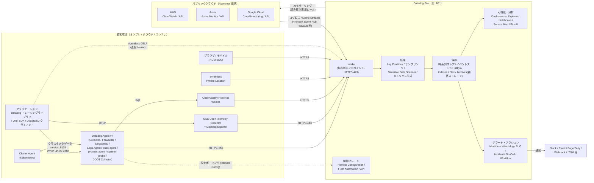
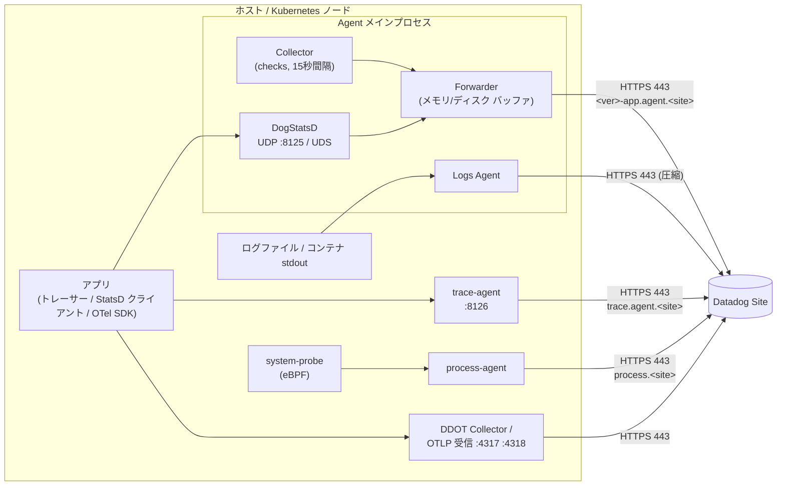
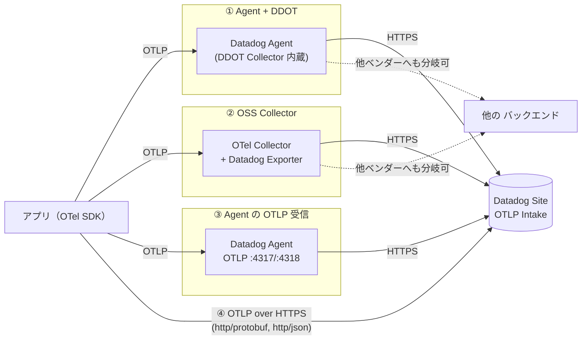
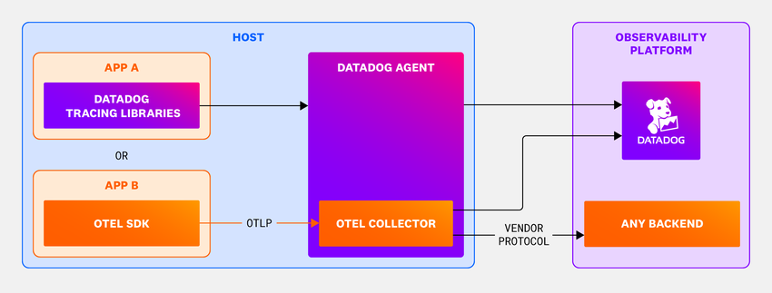
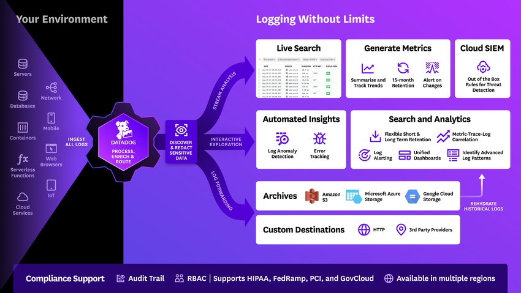
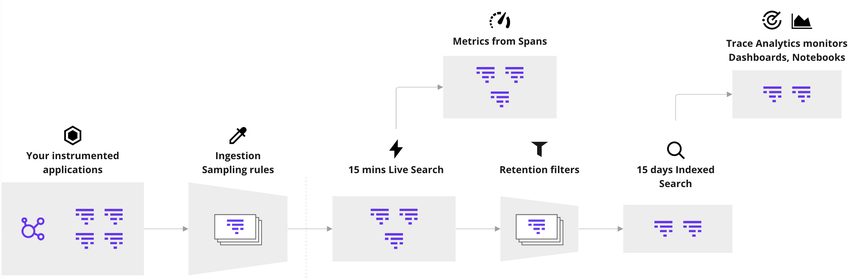
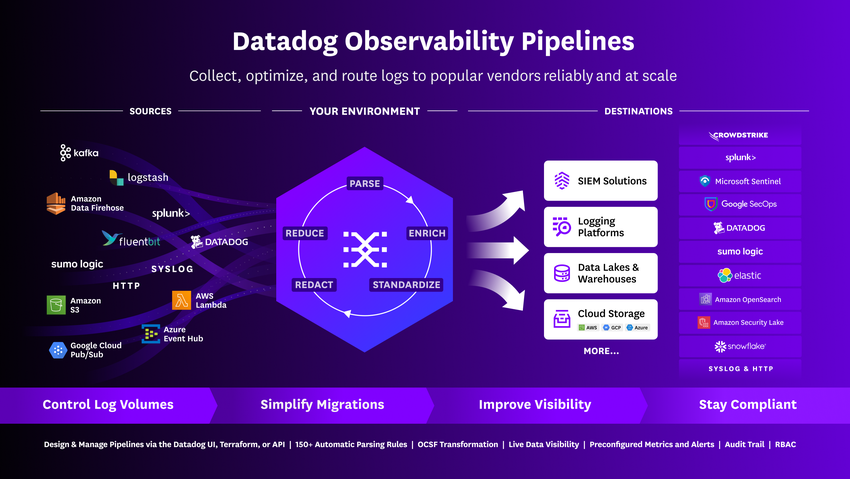
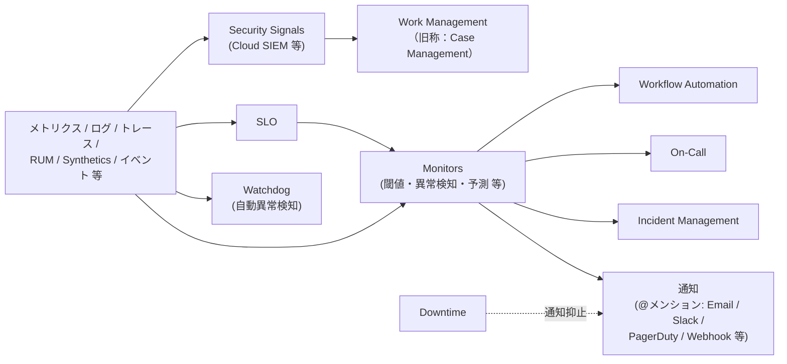
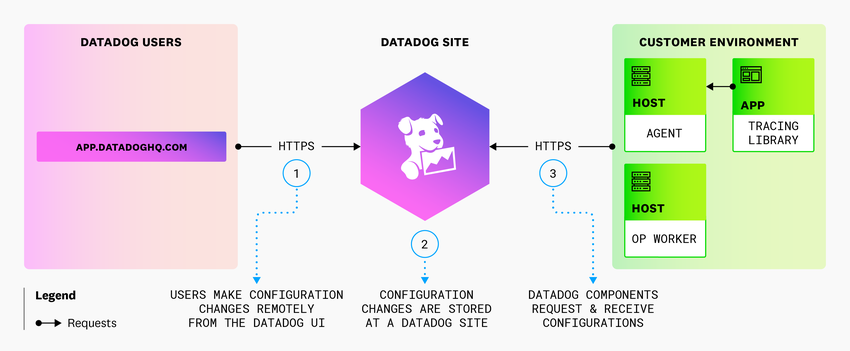
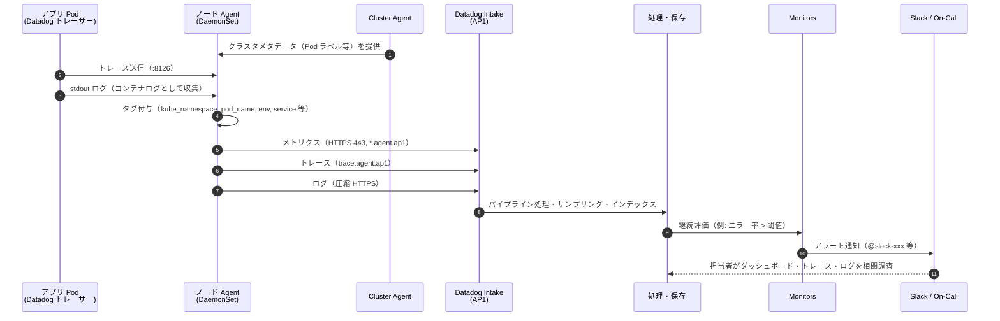

# Datadogのアーキテクチャ概観

## 概要

Datadog は **SaaS 型のオブザーバビリティ／セキュリティプラットフォーム**であり、アーキテクチャは大きく次の 3 層で捉えると理解しやすい。

1. **顧客環境側の収集層**：Datadog Agent（エージェント）、APM トレーシングライブラリ／各種 SDK、OpenTelemetry SDK/Collector、Observability Pipelines Worker、Synthetics Private Location など、顧客のホスト・コンテナ・アプリ上で動くコンポーネント。
2. **クラウド連携（Agentless）層**：AWS／Azure／Google Cloud 等のクラウド API を Datadog 側から呼び出してメトリクス・リソース情報を取得する経路、およびクラウドのログ転送機能から Datadog へ送る経路。Agent を置かずに収集できる。
3. **Datadog SaaS バックエンド（Datadog Site）**：顧客が選んだ **Datadog Site（サイト／リージョン）** 上にある Intake（取り込み口）、処理（パイプライン、サンプリング、インデックス）、保存（時系列ストア、イベントストア）、可視化（Dashboards、Explorer 群）、アラート（Monitors、Watchdog）、自動化（Workflow Automation、Incident Management 等）。

Datadog のデータフローは **収集 → 送信（Intake）→ 処理 → 保存 → 可視化 → アラート／アクション** という一方向の流れで、**Agent・SDK・Private Location などの収集コンポーネントからの通信は常に顧客環境側から Datadog へ向けて開始される**（Datadog から Agent へセッションを張ることはない）。ただし例外として、マネージドロケーションからの Synthetic テストや Webhook 通知は Datadog 側から顧客の公開エンドポイントへ開始される接続であり、クラウド API 連携や SaaS インテグレーション（クローラー型）も Datadog 側から各サービスの API を呼び出す（§6・§11 参照）[出典](https://docs.datadoghq.com/synthetics/)。設定の配布（Remote Configuration）も、Agent 側が Datadog をポーリングして取りに行くプル型である。[出典](https://docs.datadoghq.com/agent/configuration/network/) [出典](https://docs.datadoghq.com/remote_configuration/)

本ファイルは「全体像」を示す入門編であり、各要素の詳細仕様はリファレンス編の該当ファイルへリンクする。Datadog の製品概要は [Datadogとは](./01-what-is-datadog.md)、製品群の全体像は [製品ポートフォリオ全体像](./04-product-map.md)、タグ・サービスなどの必須概念は [必須概念](./05-core-concepts.md) を参照。

---

## 1. 全体アーキテクチャ図

Datadog の全体アーキテクチャを、顧客環境・クラウド連携・Datadog Site の 3 つの領域に分けて示す。

図の読み方：

- 実線の矢印は**データの流れの方向**。顧客環境から Datadog へのデータ送信はすべて顧客側から開始する HTTPS（主にポート 443）である。[出典](https://docs.datadoghq.com/agent/configuration/network/)
- 「Datadog Site → クラウド」の矢印は、**Datadog がクラウドプロバイダの API を呼び出す**（顧客が付与した読み取り専用の IAM ロール／サービスプリンシパル／サービスアカウント権限を使う）ことを表す。これは顧客環境への着信通信ではなく、クラウドプロバイダの公開 API に対する呼び出しである。[出典](https://docs.datadoghq.com/integrations/amazon_web_services/)
- 点線の「Remote Configuration」は、Agent が Datadog に設定変更を取りに行く（プル型）ことを表す。[出典](https://docs.datadoghq.com/remote_configuration/)

---

## 2. 構成要素の一覧

Datadog アーキテクチャを構成する主要コンポーネントを、配置場所ごとに整理する。

| 層 | コンポーネント | 配置場所 | 役割 | 詳細ファイル |
|---|---|---|---|---|
| 収集 | Datadog Agent（v7） | ホスト／VM／コンテナ（DaemonSet 等） | メトリクス・ログ・トレース・プロセス等を収集し Datadog に送信。オープンソース | [Datadog Agent](../02_リファレンス/platform/agent.md) |
| 収集 | Cluster Agent | Kubernetes クラスタ | API サーバーとノード Agent の間のプロキシ、クラスタチェック、HPA 用のカスタム／外部メトリクス提供 | [コンテナ/Kubernetes向けAgent](../02_リファレンス/platform/kubernetes-and-containers-agent.md) |
| 収集 | トレーシングライブラリ（Datadog SDK） | アプリケーションプロセス内 | APM トレース、プロファイル、AAP（App and API Protection）等のデータ生成 | [APM インスツルメンテーション](../02_リファレンス/apm/apm-instrumentation.md) |
| 収集 | DogStatsD | Agent に内蔵（単体パッケージもあり） | アプリからカスタムメトリクスを UDP / UNIX ソケットで受信・集約 | [Custom Metrics と DogStatsD](../02_リファレンス/platform/custom-metrics-and-dogstatsd.md) |
| 収集 | DDOT Collector（Datadog Distribution of OpenTelemetry Collector） | Agent に組み込み | OTel Collector の機能を Agent 内で提供 | [OpenTelemetry サポート](../02_リファレンス/platform/opentelemetry.md) |
| 収集 | OSS OpenTelemetry Collector + Datadog Exporter | 顧客環境 | 顧客自身が運用する OTel Collector から Datadog へ送信 | [OpenTelemetry サポート](../02_リファレンス/platform/opentelemetry.md) |
| 収集 | RUM Browser / Mobile SDK | エンドユーザーのブラウザ／端末 | ユーザー体験データ（RUM）、Session Replay の送信 | [RUM（ブラウザ）](../02_リファレンス/dem/rum-browser.md)、[RUM（モバイル）](../02_リファレンス/dem/rum-mobile.md) |
| 収集 | Synthetics Private Location（Worker） | 顧客ネットワーク内 | 社内向けエンドポイントに対する Synthetic テストの実行 | [Synthetic Monitoring](../02_リファレンス/dem/synthetic-monitoring.md) |
| 収集・前処理 | Observability Pipelines Worker | 顧客インフラ内 | ログの集約・加工（削減、マスキング、エンリッチ）・ルーティング | [Observability Pipelines](../02_リファレンス/logs/observability-pipelines.md) |
| 収集（Agentless） | クラウド連携（AWS / Azure / Google Cloud 等） | Datadog 側からクラウド API を呼ぶ | クラウドのメトリクス、リソース情報、ログの取り込み | [AWS](../02_リファレンス/platform/aws-integration.md)、[Azure](../02_リファレンス/platform/azure-integration.md)、[Google Cloud](../02_リファレンス/platform/gcp-integration.md) |
| 収集（Agentless） | Agentless Scanning | 顧客クラウドアカウント内の専用 VM | ディスクスナップショットから SBOM を生成し脆弱性を検出 | [Cloud Security](../02_リファレンス/security/cloud-security.md) |
| 送信先 | Intake（インテーク） | Datadog Site | 製品・データ種別ごとの受付エンドポイント | [ネットワーク・接続要件](../03_導入編/11-network-and-connectivity.md) |
| バックエンド | 処理・保存・可視化・アラート | Datadog Site | パイプライン処理、インデックス、ストレージ、UI、モニター評価 | 本ファイル §8〜§11 |
| 制御 | Remote Configuration / Fleet Automation | Datadog Site ↔ Agent（プル型） | Agent・トレーサー等への設定配布、Agent の一元管理 | [Fleet Automation と Remote Configuration](../02_リファレンス/platform/fleet-automation.md) |
| 制御 | API / Terraform | Datadog Site | 設定・データの読み書き、IaC | [API とキー管理](../02_リファレンス/platform/api-and-keys.md)、[Terraform と IaC](../02_リファレンス/platform/terraform-and-iac.md) |

[出典](https://docs.datadoghq.com/agent/) [出典](https://docs.datadoghq.com/containers/cluster_agent/) [出典](https://docs.datadoghq.com/opentelemetry/) [出典](https://docs.datadoghq.com/observability_pipelines/) [出典](https://docs.datadoghq.com/security/cloud_security_management/setup/agentless_scanning/)

---

## 3. Datadog Site（サイト）

### 3.1 Datadog Site とは

Datadog Site（サイト）は、Datadog SaaS バックエンドが稼働する**独立したリージョン単位のインスタンス**である。組織（Organization）は作成時にいずれかのサイトに所属し、テレメトリはそのサイトに送信・保存される。Agent や SDK は `site` パラメータ（`datadog.yaml` の `site`、環境変数 `DD_SITE`）で送信先サイトを指定する。`site` の既定値は `datadoghq.com`（US1）である。[出典](https://docs.datadoghq.com/getting_started/site/) [出典](https://docs.datadoghq.com/agent/)

### 3.2 サイト一覧（2026-11-02 時点の公式ドキュメント）

| サイト | UI の URL | サイトパラメータ（`DD_SITE`） | ロケーション | 備考 |
|---|---|---|---|---|
| US1 | `https://app.datadoghq.com` | `datadoghq.com` | 米国 | 既定サイト |
| US3 | `https://us3.datadoghq.com` | `us3.datadoghq.com` | 米国 | |
| US5 | `https://us5.datadoghq.com` | `us5.datadoghq.com` | 米国 | |
| EU1 | `https://app.datadoghq.eu` | `datadoghq.eu` | EU（ドイツ） | |
| US1-FED | `https://app.ddog-gov.com` | `ddog-gov.com` | 米国 | FedRAMP High 認証サイト |
| US2-FED | `https://us2.ddog-gov.com` | `us2.ddog-gov.com` | 米国 | IL5 認可取得プロセス中（In Process） |
| AP1 | `https://ap1.datadoghq.com` | `ap1.datadoghq.com` | 日本 | 本ナレッジの基準サイト |
| AP2 | `https://ap2.datadoghq.com` | `ap2.datadoghq.com` | オーストラリア | |
| UK1 | `https://uk1.datadoghq.com` | `uk1.datadoghq.com` | 英国 | |

[出典](https://docs.datadoghq.com/getting_started/site/)

> **サイト差異:** 公式ドキュメントは「サイトのセキュリティ要件によって、サイトごとにサポートされる機能が異なる場合がある」と明記している。本ナレッジ執筆規約（_CONVENTIONS.md）のサイト一覧は US1/US3/US5/EU1/AP1/AP2/US1-FED の 7 サイトだが、2026-11-02 時点の公式サイト一覧には **UK1（英国）** と **US2-FED** も掲載されている。個別の機能差は各リファレンスファイルおよび [Datadog Sites（サイト）](../02_リファレンス/platform/datadog-sites.md) を参照。[出典](https://docs.datadoghq.com/getting_started/site/)

> **サイト差異（例）:** Remote Configuration は多くの場合組織で既定有効だが、**US1-FED と US2-FED では既定で無効**。APM の Processing Pipelines は `app.ddog-gov.com` と `us2.ddog-gov.com` で非サポート。TCP によるログ送信は、商用サイトでは「サポート対象外（not supported）」、US1-FED / US2-FED では利用不可。[出典](https://docs.datadoghq.com/remote_configuration/) [出典](https://docs.datadoghq.com/tracing/trace_pipeline/) [出典](https://docs.datadoghq.com/agent/logs/log_transport/)

### 3.3 サイト選択がアーキテクチャに与える影響

| 観点 | 影響 |
|---|---|
| データ保存場所（データレジデンシー） | テレメトリは所属サイトに送信・保存される。日本国内保存を要件とする場合は AP1 を選ぶ |
| エンドポイント | Intake・API・UI のホスト名がサイトごとに異なる（例：AP1 は `*.ap1.datadoghq.com`、API は `api.ap1.datadoghq.com`） |
| ネットワーク許可リスト | IP レンジはサイト別に `https://ip-ranges.<サイト>`（AP1 は `https://ip-ranges.ap1.datadoghq.com`）で JSON 公開され、時間とともに変動する |
| 機能 | サイトにより提供されない機能・プレビューがある |
| サイト間移行 | 組織のサイトを後から変更する手順は公開情報では確認できず（新サイトに別組織を作る運用が一般的とされるが【経験則】） |

各サイトがどのクラウドプロバイダ・リージョン上で稼働しているかは、公式ドキュメントのサイト一覧には記載がない（公開情報では確認できず）。[出典](https://docs.datadoghq.com/getting_started/site/) [出典](https://docs.datadoghq.com/agent/configuration/network/)

---

## 4. 収集層（1）：Datadog Agent 経路

### 4.1 Datadog Agent の内部構成

Datadog Agent は、ホスト上で動作してメトリクス・イベント・ログ等を収集し Datadog に送るソフトウェアで、ソースコードは GitHub で公開されている。現行のメジャーバージョンは **Agent v7**（Agent v7 はカスタムチェック等の実行環境として Python 3 のみをサポート）。Agent v6/v7 の基本アーキテクチャは「メインプロセス」と「必要に応じて起動する子プロセス」で構成される。[出典](https://docs.datadoghq.com/agent/) [出典](https://docs.datadoghq.com/agent/architecture/) [出典](https://docs.datadoghq.com/agent/guide/python-3/)

| コンポーネント | プロセス／サービス | 役割 | 既定 |
|---|---|---|---|
| Collector（コレクター） | メインプロセス（`datadog-agent`） | チェック（インテグレーション、カスタムチェック）を実行し、標準メトリクスを **15 秒ごと**に収集 | 有効 |
| Forwarder（フォワーダー） | メインプロセス | 収集したメトリクスを HTTPS で Datadog へ送信。ネットワーク断に備えメモリ（設定により ディスク）にバッファリング | 有効 |
| DogStatsD | メインプロセス | StatsD 互換サーバー（Go 実装）。UDP（既定ポート `8125`）または UNIX ソケットでカスタムメトリクスを受け取り集約 | 有効（既定ではローカルからの受信のみ） |
| Logs Agent | メインプロセス | ファイル／コンテナ／ジャーナル等からログを収集し送信 | **無効**（`logs_enabled: true` で有効化） |
| APM Agent（trace-agent） | 子プロセス（Windows サービス名 `datadog-trace-agent`） | トレーシングライブラリからトレースを受け取り（既定ポート `8126`）、サンプリング・送信 | 有効 |
| Process Agent | 子プロセス（Windows サービス名 `datadog-process-agent`） | ライブプロセス・ライブコンテナ情報の収集 | コンテナがある環境でのみ収集。それ以外は無効 |
| system-probe | 子プロセス | eBPF 等を用いたカーネルレベルの観測（Cloud Network Monitoring、Universal Service Monitoring、Workload Protection 等で使用） | 該当機能を有効化した場合のみ |
| security-agent | 子プロセス | Workload Protection 等のセキュリティ機能 | 該当機能を有効化した場合のみ |
| DDOT Collector | Agent 組み込み | OpenTelemetry Collector 機能（§5 参照） | 有効化した場合のみ |

[出典](https://docs.datadoghq.com/agent/architecture/) [出典](https://docs.datadoghq.com/agent/configuration/network/) [出典](https://docs.datadoghq.com/opentelemetry/setup/ddot_collector/)

- system-probe／security-agent の詳細（有効化条件、カーネル要件）は [Datadog Agent](../02_リファレンス/platform/agent.md)、[Cloud Network Monitoring](../02_リファレンス/infrastructure/cloud-network-monitoring.md)、[Workload Protection](../02_リファレンス/security/workload-protection.md) を参照。
- Agent の既定収集項目は、Agent 自身のヘルスメトリクス（`datadog.agent.running` 等）、コアチェック（CPU、Disk、IO、Memory、Network、NTP、Uptime、File Handle（Mac 以外）、Load（Windows 以外）、Docker（Docker 環境）、Winproc（Windows））、サービスチェック（`datadog.agent.up`、`datadog.agent.check_status`）。Agent は「75〜100 のシステムレベルメトリクスを 15〜20 秒ごとに収集」できる。[出典](https://docs.datadoghq.com/getting_started/agent/)
- Agent に設定したホストタグ（`datadog.yaml` の `tags`）は、そのホストから送られるすべてのメトリクス・イベント・ログ・トレース・サービスチェックに付与される。これがメトリクス・ログ・トレースを横断的に相関させる基盤になる（タグの詳細は [Tagging](../02_リファレンス/platform/tagging.md)）。[出典](https://docs.datadoghq.com/getting_started/agent/)

### 4.2 Agent が使うポート

Agent はローカルホスト上でいくつかのポートを待ち受け、外向きには主に 443/TCP を使う。

| 方向 | ポート | 用途 | 備考 |
|---|---|---|---|
| 外向き | 443/TCP | メトリクス、APM、コンテナ、ライブプロセス、CNM、USM、ログ（HTTPS）等ほぼすべて | 「ほとんどの Agent データは 443 を使う」 |
| 外向き | 123/UDP | NTP | |
| 外向き | 10516/TCP | ログの TCP 送信（US。EU は 443） | ただし TCP ログ送信は US1 を含む全商用サイト（および FED サイト）でサポート対象外。値は Log Transport ページによる（Network Traffic ページには記載なし） |
| 外向き | 8042/TCP | Remote Configuration の接続性テスト（生の TLS 接続） | 顧客データは含まず、ブロックしても機能に影響しない |
| 外向き | 8443/TCP | Custom Agent Autoscaling | US1・EU1 の表にのみ記載 |
| 内向き（ローカル） | 5000/TCP | `go_expvar` サーバー（Agent ランタイムメトリクス） | `expvar_port` |
| 内向き（ローカル） | 5001/TCP | IPC API（CLI・GUI からの通信） | `cmd_port` |
| 内向き（ローカル） | 5002/TCP | Agent GUI | Windows/macOS は既定有効、Linux は既定無効。localhost のみ |
| 内向き（ローカル） | 5012/TCP | APM の `go_expvar` サーバー | |
| 内向き（ローカル） | 6062/TCP | Process Agent デバッグ | |
| 内向き（ローカル） | 6162/TCP | Process Agent ランタイム | |
| 内向き | 8125/UDP | DogStatsD | `dogstatsd_non_local_traffic` を有効にしない限り localhost のみ |
| 内向き | 8126/TCP | APM レシーバー（トレース、プロファイラー） | `receiver_port` |
| 内向き | 4317/TCP、4318/TCP | OTLP 受信（gRPC / HTTP） | OTLP 取り込みを有効化した場合（Agent 7.32 以降） |

[出典](https://docs.datadoghq.com/agent/configuration/network/) [出典](https://docs.datadoghq.com/agent/logs/log_transport/) [出典](https://docs.datadoghq.com/remote_configuration/) [出典](https://docs.datadoghq.com/opentelemetry/setup/otlp_ingest_in_the_agent/)

ポート番号は `datadog.yaml` の `expvar_port`、`cmd_port`、`GUI_port`、`dogstatsd_port`、`receiver_port` で変更でき、DogStatsD・APM のポートを変えた場合はクライアント側 SDK の設定も合わせる必要がある。詳細は [ネットワーク・接続要件](../03_導入編/11-network-and-connectivity.md) と [Agent 設定リファレンス](../02_リファレンス/platform/agent-configuration.md) を参照。[出典](https://docs.datadoghq.com/agent/configuration/network/)

### 4.3 Kubernetes における Agent 構成

Kubernetes では、各ノードに**ノード Agent**（一般に DaemonSet で配置）を、クラスタに **Cluster Agent** を配置する構成が標準である。

- Cluster Agent は API サーバーとノード Agent の間のプロキシとして動作し、API サーバーの負荷を下げる。API サーバーにしかないクラスタレベルのメタデータをノード Agent に渡し、ノード Agent はそれでローカル収集データを補強（エンリッチ）する。
- ノード Agent は自ノードに隔離され、RBAC 権限を kubelet からのメトリクス・メタデータ読み取りに絞れる。
- Cluster Agent はクラスタチェック（Kubernetes Service 等の負荷分散されたサービスに対するチェック）を担い、HPA（Horizontal Pod Autoscaling）向けのカスタムメトリクス・外部メトリクスを提供する。
- コンテナイメージは `registry.datadoghq.com`、`gcr.io/datadoghq`、`public.ecr.aws/datadog`、`datadoghq.azurecr.io`、`docker.io/datadog` 等から取得でき、Docker Hub はプル回数制限の対象になる点に注意。

[出典](https://docs.datadoghq.com/containers/cluster_agent/)

詳細は [コンテナ/Kubernetes向けAgent](../02_リファレンス/platform/kubernetes-and-containers-agent.md) と [Kubernetes 監視の実践](../04_応用編/07-kubernetes-monitoring-practices.md) を参照。

### 4.4 Agent のリソースオーバーヘッド（公式計測値）

Datadog Agent の負荷は有効化する機能に比例して増える。公式ドキュメントの計測値（Amazon EC2 `c5.xlarge`：4 vCPU / 8 GB RAM）は次のとおり。

| 計測条件 | CPU | メモリ | ネットワーク | ディスク |
|---|---|---|---|---|
| Agent 7.34.0 ベースライン | 平均約 0.08% | 約 130 MB（RSS） | 約 140 B/s 受信、800 B/s 送信 | Linux 830〜880 MB、Windows 870 MB |
| ログ収集（Agent 6.15.0、110 KB/s、HTTP 圧縮レベル 6） | 約 1.5% | 約 95 MB | 約 14 KB/s | — |
| ログ収集（同、圧縮レベル 1） | 約 1% | 約 95 MB | 約 20 KB/s | — |
| ログ収集（同、非圧縮） | 約 0.7% | 約 90 MB | 約 200 KB/s | — |

インテグレーションの追加、JMX チェック、trace-agent・process-agent の有効化でリソース消費は増える。計測時の Agent バージョンが古い点に注意（2026-11-02 時点の最新 Agent での値は公開情報では確認できず）。[出典](https://docs.datadoghq.com/agent/)

---

## 5. 収集層（2）：OpenTelemetry 経路

### 5.1 OpenTelemetry データを Datadog に送る 4 つの方法

Datadog は OpenTelemetry（OTel）をネイティブにサポートしており、OTel で計装したアプリのデータを送る経路は公式に 4 通りある。

| # | 経路 | 必要なもの | 向いているケース | 特徴 |
|---|---|---|---|---|
| 1 | **Datadog Agent + DDOT Collector**（推奨） | DDOT Collector を組み込んだ Datadog Agent | OTel によるベンダー中立性と Datadog 固有機能の両方が欲しい | Fleet Automation、Live Container Monitoring、Kubernetes Explorer、Live Processes、Cloud Network Monitoring、Universal Service Monitoring、1,000 超のインテグレーションを併用できる |
| 2 | **OSS OpenTelemetry Collector + Datadog Exporter** | 顧客が自前で運用する OTel Collector | Collector を自分で管理し、テールベースサンプリングや変換処理を柔軟に組みたい | Agent 不要だが、Agent 固有機能は使えない |
| 3 | **Datadog Agent の OTLP 取り込み** | Datadog Agent（Agent 7.32.0 以降でトレース・メトリクス、7.48.0 以降でログ） | 既存 Agent に OTLP を受けさせたい | 既定ポート gRPC `4317`、HTTP `4318`。ログ取り込みは既定無効 |
| 4 | **直接 OTLP 取り込み（Agentless）** | なし（アプリから Datadog の OTLP Intake へ直接送信） | サーバーレス、マネージドプラットフォーム、リソース制約が厳しい環境 | Agent/Collector 経由が推奨で、直接送信は Agent・Collector を置けない場合の選択肢 |

[出典](https://docs.datadoghq.com/opentelemetry/) [出典](https://docs.datadoghq.com/opentelemetry/setup/otlp_ingest_in_the_agent/) [出典](https://docs.datadoghq.com/opentelemetry/setup/otlp_ingest/)

### 5.2 DDOT Collector の位置付け

DDOT Collector（Datadog Distribution of OpenTelemetry Collector）は、Datadog Agent に組み込まれたオープンソースの OTel Collector ディストリビューションである。

- 同梱コンポーネント：Receiver（OTLP、Prometheus、hostmetrics、filelog、kubeletstats、k8sobjects、Jaeger、Zipkin、Fluent Forward、receivercreator 等）、Processor（attributes、batch、filter、k8sattributes、memory limiter、tail sampling、transform 等）、Exporter（Datadog、OTLP、OTLP HTTP、debug、load balancing 等）、Connector（Datadog、routing、spanmetrics）、Extension（Datadog、health check、pprof、zpages 等）。
- Datadog 独自コンポーネント：Infrastructure Attribute Processor（OTLP テレメトリに Kubernetes タグを自動付与）、Converter、DD Flare Extension。
- Fleet Automation による DDOT Collector のリモート管理に対応。**DDOT Collector 向け Remote Configuration は【Preview】**。
- 提供状況：**Kubernetes 向けは GA**、**Linux のベアメタル／VM 向けは【Preview】**（2026-11-02 時点の公式ドキュメント・製品プレビューページ）。
- DDOT Collector は FedRAMP / FIPS 準拠ではないため、それらが必要な場合は FIPS 対応の Datadog Agent を使う。

[出典](https://docs.datadoghq.com/opentelemetry/setup/ddot_collector/) [出典](https://www.datadoghq.com/product-preview/ddot-for-linux-based-hosts-or-vms)

**キャプション:** DDOT Collector（Datadog Agent に組み込まれた OTel Collector）の構成図。

**画面（図）の説明:** 左の「HOST」枠内に「APP A（Datadog Tracing Libraries）」と「APP B（OTel SDK）」が並び、APP A は Datadog Agent へ直接、APP B は OTLP で Datadog Agent 内の「OTEL COLLECTOR」へ送る。Datadog Agent からは右の「OBSERVABILITY PLATFORM」枠の Datadog へ矢印が伸び、さらに OTEL COLLECTOR からは「VENDOR PROTOCOL」で「ANY BACKEND（任意のバックエンド）」へも送れることが示されている。つまり、Datadog のトレーサーと OTel SDK のどちらで計装したアプリも同一 Agent で受け、Datadog と他ベンダーの両方へ送信できる構成である。

**出典:** https://docs.datadoghq.com/opentelemetry/ （画像取得日：2026-11-02）

### 5.3 直接 OTLP 取り込み（Agentless OTLP）の制約

直接 OTLP 取り込みは、Agent／Collector を置かずにアプリから Datadog の Intake に OTLP を送る経路である。

| シグナル | エンドポイントパス | 最大ペイロードサイズ |
|---|---|---|
| Metrics | `/v1/metrics` | 512 KiB（圧縮後） |
| Logs | `/v1/logs` | 5.1 MiB（非圧縮） |
| Traces | `/v1/traces` | 15 MiB（非圧縮） |

- 上限を超えると HTTP 413 が返る。エクスポートのバッチサイズを下げるか、フラッシュ頻度を上げて対処する。
- トレースの OTLP Intake は `http/protobuf` と `http/json` をサポートし、**gRPC は非サポート**。認証は `dd-api-key` ヘッダー。トレースメトリクスは既定では計算されず、`compute_stats=true` ヘッダーで有効化する。
- サイト別のホスト名はドキュメント上プレースホルダ表記で、サイトに合わせたエンドポイントを使うよう案内されている（具体的なホスト名一覧はこのページでは確認できず。[OpenTelemetry サポート](../02_リファレンス/platform/opentelemetry.md) を参照）。

[出典](https://docs.datadoghq.com/opentelemetry/setup/otlp_ingest/) [出典](https://docs.datadoghq.com/opentelemetry/setup/otlp_ingest/traces/)

OTel 経路の選び方・機能差（Datadog SDK と OTel SDK の機能互換）は [OpenTelemetry サポート](../02_リファレンス/platform/opentelemetry.md) と [OpenTelemetry 活用戦略](../04_応用編/10-opentelemetry-strategy.md) を参照。

---

## 6. 収集層（3）：Agentless 経路（クラウド連携・API・その他）

Datadog は Agent を置かずにデータを取り込む経路も多数持つ。Agentless 経路は「Datadog がクラウド API を呼びに行く（プル）」型と「クラウド／アプリが Datadog Intake へ送る（プッシュ）」型に分かれる。

### 6.1 クラウドプロバイダ連携

| クラウド | 認証方式 | メトリクス取得 | ログ取得 | リソース情報 |
|---|---|---|---|---|
| AWS | IAM ロール委任（Datadog AWS Integration IAM Role）。AWS 中国リージョンや商用サイトからの GovCloud アカウントはアクセスキー | CloudWatch API のポーリング（新しいメトリクスは**平均 10 分ごと**に取得）。オプションで **CloudWatch Metric Streams + Amazon Data Firehose**（レイテンシ **2〜3 分**） | Amazon Data Firehose（大量の CloudWatch Logs に推奨）、Datadog Forwarder（Lambda 関数。S3 ログ等に推奨） | 定期的な読み取り専用 API 呼び出し。CloudTrail 連携を入れると変更イベントで更新が早まる |
| Azure | App Registration（サービスプリンシパル）の資格情報を Datadog に登録 | Azure Monitor 経由（ポーリング間隔は公開情報では確認できず） | ARM テンプレートによる自動ログ転送設定、または Event Hub の手動設定 | 公開情報（本ファイルで参照した範囲）では詳細確認できず |
| Google Cloud | サービスアカウントの借用（Datadog のプリンシパルに Service Account Token Creator ロールを付与）、プロジェクト自動検出 | Cloud Monitoring 経由。セットアップ後**約 15 分**でメトリクスが表示される（ポーリング間隔は公開情報では確認できず） | Google Cloud Log Forwarding（別ページ参照） | 定期収集（間隔は非公開）。変更イベントは Pub/Sub トピック経由で転送可能 |

[出典](https://docs.datadoghq.com/integrations/amazon_web_services/) [出典](https://docs.datadoghq.com/integrations/azure/) [出典](https://docs.datadoghq.com/integrations/google_cloud_platform/)

- クラウド連携のメトリクスは、クラウド側の提供遅延（例：S3 の日次ストレージメトリクスは 1 日 1 回、請求メトリクスは数時間遅れ）にも影響される。Datadog は過去データをバックフィルしないため、連携を有効にした以降のメトリクスのみが収集される。[出典](https://docs.datadoghq.com/integrations/amazon_web_services/)
- クラウド連携だけでは OS 内部（プロセス、ディスク内訳等）やアプリのトレースは取れない。Google Cloud 連携の公式ドキュメントも「最も粒度が細かく低レイテンシなメトリクス」には Agent の導入を案内している。[出典](https://docs.datadoghq.com/integrations/google_cloud_platform/)
- 各クラウド連携の詳細は [AWS Integration](../02_リファレンス/platform/aws-integration.md)、[Azure Integration](../02_リファレンス/platform/azure-integration.md)、[Google Cloud Integration](../02_リファレンス/platform/gcp-integration.md) を参照。

### 6.2 Agent 経路と Agentless（クラウド連携）経路の比較

| 観点 | Agent 経路 | クラウド連携（Agentless）経路 |
|---|---|---|
| 導入作業 | 各ホスト／クラスタへのインストールが必要 | IAM ロール等の権限付与のみ |
| メトリクス粒度・遅延 | 15 秒間隔程度で収集 | AWS ポーリングは平均 10 分（Metric Streams で 2〜3 分）、GCP は表示まで約 15 分 |
| 取れるデータ | OS 内部メトリクス、プロセス、ログファイル、トレース、ネットワークフロー等 | クラウドサービスのメトリクス、リソース構成、クラウドのログ |
| 主な用途 | VM・コンテナ・アプリの詳細監視 | マネージドサービス（RDS、ELB、Lambda 等）の監視、リソース棚卸し、CSPM |
| 典型構成 | 両者を**併用**し、タグでホスト情報とクラウドメタデータを結合 | 同左 |

[出典](https://docs.datadoghq.com/getting_started/agent/) [出典](https://docs.datadoghq.com/integrations/amazon_web_services/) [出典](https://docs.datadoghq.com/integrations/google_cloud_platform/)

### 6.3 その他の Agentless 経路

| 経路 | 概要 | 詳細 |
|---|---|---|
| HTTP API への直接送信 | メトリクス・ログ・イベント等を HTTP API で送信。API キー（`DD-API-KEY` ヘッダー）で認証 | [API とキー管理](../02_リファレンス/platform/api-and-keys.md) |
| ログの HTTP 送信 | Logs HTTP API（AP1 は `http-intake.logs.ap1.datadoghq.com`）にカスタムフォワーダーやログシッパー（Fluentd、Fluent Bit、Logstash、Rsyslog 等）から送信 | [ログ収集](../02_リファレンス/logs/log-collection.md) |
| サーバーレス | AWS Lambda 拡張・Datadog Forwarder、各種サーバーレス向けの計装 | [Serverless Monitoring](../02_リファレンス/infrastructure/serverless.md) |
| RUM / Browser Logs SDK | エンドユーザーのブラウザ・モバイル端末から直接 Datadog へ送信 | [RUM（ブラウザ）](../02_リファレンス/dem/rum-browser.md) |
| Synthetic Monitoring | Datadog 管理のマネージドロケーションからテストを実行。社内向けは Private Location（顧客側 Worker）を使う | [Synthetic Monitoring](../02_リファレンス/dem/synthetic-monitoring.md) |
| Agentless Scanning | 顧客クラウドアカウント内に Datadog がスキャナ VM を展開し、ボリュームのスナップショット（サーバーレスは関数コード）から SBOM を生成。Datadog へ送るのは SBOM とホストメタデータのみで、生データ・ディスク内容・コンテナイメージは顧客環境から出ない。AWS・Azure・GCP 対応、**12 時間間隔**で自動スキャン | [Cloud Security](../02_リファレンス/security/cloud-security.md) |
| SaaS 連携（クローラー型） | 多数の SaaS インテグレーションが Datadog 側から外部サービス API を呼ぶ | [Integrations](../02_リファレンス/platform/integrations.md) |

[出典](https://docs.datadoghq.com/api/latest/) [出典](https://docs.datadoghq.com/logs/log_collection/) [出典](https://docs.datadoghq.com/api/latest/logs/) [出典](https://docs.datadoghq.com/security/cloud_security_management/setup/agentless_scanning/)

---

## 7. 送信層：Intake（取り込みエンドポイント）

### 7.1 Intake の基本原則

- **通信方向:** 「トラフィックは常に Agent から Datadog へ開始され、Datadog から Agent へセッションが開始されることはない」。そのため Agent の通信のために顧客環境側のファイアウォールで受信ポートを開ける必要はない（OTLP や DogStatsD をホスト外から受ける場合の内部通信を除く）。なお、マネージドロケーションからの Synthetic テストや Webhook 通知は Datadog 側から顧客の公開エンドポイントへ開始される接続のため、これらを使う場合は対象エンドポイント側で Datadog からの着信を許可する必要がある（§6.3・§11）。
- **プロトコル:** ほぼすべて HTTPS（443/TCP）。
- **エンドポイントは製品・データ種別ごとに分かれる。** プロキシや許可リストを設計する際は、使う製品のホスト名をすべて許可する必要がある。
- **IP レンジ:** `https://ip-ranges.<サイト>` で製品別 JSON（`/apm.json`、`/logs.json` 等）が公開され、時間とともに変わるため全レンジの許可が推奨される。

[出典](https://docs.datadoghq.com/agent/configuration/network/)

### 7.2 AP1 の主な Intake ホスト名

AP1（`ap1.datadoghq.com`）における Agent・各製品の主な送信先は次のとおり（他サイトは `ap1.datadoghq.com` の部分がサイトパラメータに置き換わる）。

| データ種別 | ホスト名（AP1） |
|---|---|
| メトリクス、サービスチェック、イベント、メタデータ | `<VERSION>-app.agent.ap1.datadoghq.com`（例：Agent v7.31.0 は `7-31-0-app.agent.ap1.datadoghq.com`。許可リストは `*.agent.ap1.datadoghq.com`） |
| API キー検証等 | `api.ap1.datadoghq.com`（Agent v7.18.0 / 6.18.0 以降。それ以前は `app.ap1.datadoghq.com`） |
| Agent flare | `<VERSION>-flare.agent.ap1.datadoghq.com` |
| ログ（HTTP） | `http-intake.logs.ap1.datadoghq.com`（Logs HTTP API。Agent の送信先は [ログ収集](../02_リファレンス/logs/log-collection.md) を参照） |
| APM | `trace.agent.ap1.datadoghq.com`、`instrumentation-telemetry-intake.ap1.datadoghq.com` |
| Profiling | `intake.profile.ap1.datadoghq.com` |
| Live Containers / Live Processes / CNM / USM | `process.ap1.datadoghq.com` |
| Orchestrator（Kubernetes リソース） | `orchestrator.ap1.datadoghq.com`、`contlcycle-intake.ap1.datadoghq.com` |
| Container Images | `contimage-intake.ap1.datadoghq.com` |
| Database Monitoring | `dbm-metrics-intake.ap1.datadoghq.com`、`dbquery-intake.ap1.datadoghq.com` |
| Network Device Monitoring | `ndm-intake.ap1.datadoghq.com`、`snmp-traps-intake.ap1.datadoghq.com`、`ndmflow-intake.ap1.datadoghq.com` |
| Network Path | `netpath-intake.ap1.datadoghq.com` |
| Cloud Security の脆弱性（SBOM） | `sbom-intake.ap1.datadoghq.com` |
| LLM Observability | `llmobs-intake.ap1.datadoghq.com` |
| Synthetics Private Location | `intake.synthetics.ap1.datadoghq.com`、`intake-v2.synthetics.ap1.datadoghq.com` 等（Worker バージョンにより異なる） |
| Remote Configuration | `config.ap1.datadoghq.com` |
| Agent パッケージ取得（サイト非依存） | `install.datadoghq.com`、`yum.datadoghq.com`、`apt.datadoghq.com`、`keys.datadoghq.com`、`windows-agent.datadoghq.com` |

[出典](https://docs.datadoghq.com/agent/configuration/network/) [出典](https://docs.datadoghq.com/api/latest/logs/)

- Agent v7.67.0 以降は、サイトの FQDN に末尾ドットを付けて名前解決する（例：`trace.agent.datadoghq.com.`）。Agent v7.72.0 以降では `convert_dd_site_fqdn.enabled: false`（`DD_CONVERT_DD_SITE_FQDN_ENABLED=false`）で無効化できる。プロキシの許可ルールで問題になる場合がある。[出典](https://docs.datadoghq.com/agent/configuration/network/)
- 全エンドポイント・プロキシ構成・PrivateLink 等の詳細は [ネットワーク・接続要件](../03_導入編/11-network-and-connectivity.md) を参照。

### 7.3 送信失敗時のバッファリング

Datadog Agent はネットワーク断に備えて送信データをバッファリングする。

| 項目 | 内容 |
|---|---|
| メモリバッファ | メトリクスはメモリに保持され、`forwarder_retry_queue_payloads_max_size` の上限に達すると**古いものから破棄**される |
| ディスクバッファ | Agent v7.27.0 以降、`forwarder_storage_max_size_in_bytes` に正の値（バイト）を設定すると有効化（既定値は公開情報では確認できず） |
| ディスク保存先 | `forwarder_storage_path`：Unix は `/opt/datadog-agent/run/transactions_to_retry`、Windows は `C:\ProgramData\Datadog\run\transactions_to_retry` |
| ディスク使用率上限 | `forwarder_storage_max_disk_ratio`：ディスク全体の使用率が 80% 未満の間のみディスクに書き込む |

[出典](https://docs.datadoghq.com/agent/configuration/network/) [出典](https://docs.datadoghq.com/agent/architecture/)

### 7.4 ログ送信のトランスポート

- Agent v6.19+/v7.19+ では**圧縮 HTTPS が既定**。起動時に HTTPS 接続テストを行い、成功すれば HTTPS、失敗すれば TCP にフォールバックする（テストは起動時のみ）。
- `logs_config.force_use_http: true` で HTTPS を強制できる。SOCKS5 プロキシ使用時は TCP が強制される。
- 圧縮レベル `compression_level` は 0〜9、既定 6。
- HTTPS のバッチ上限：バッチサイズ最大 1MB、単一ログ最大 900kB、1 バッチ最大 1,000 件、バッチ待機時間は既定 5 秒（`batch_wait`、1〜10 秒）。
- TCP によるログ送信は公式に「サポート対象外」で、AP1 を含む商用サイトでは非推奨。

[出典](https://docs.datadoghq.com/agent/logs/log_transport/) [出典](https://docs.datadoghq.com/logs/log_collection/)

---

## 8. 処理層：取り込み後のパイプライン

Datadog の大きな設計上の特徴は、**取り込み（Ingest）と、検索用インデックス・保持（Index / Retain）を分離**していることである。全データをいったん取り込み、処理・メトリクス化・セキュリティ検知に使ったうえで、何をインデックスして長く検索可能にするかを顧客が選ぶ。

### 8.1 データ種別ごとの処理フロー

| データ種別 | 取り込み後の主な処理 | 取り込みと保持の分離 | 詳細 |
|---|---|---|---|
| メトリクス | タグ付きの時系列として集約。Metrics without Limits™ でタグ構成を絞り込み、インデックス対象のカスタムメトリクス量を制御 | 取り込み量とインデックス量を分離（Metrics without Limits） | [Metrics](../02_リファレンス/platform/metrics.md)、[Custom Metrics と DogStatsD](../02_リファレンス/platform/custom-metrics-and-dogstatsd.md) |
| ログ | Log Pipelines／Processors でパース・エンリッチ。Sensitive Data Scanner でマスキング。ログからメトリクス生成。Cloud SIEM はインデックスせずに検知可能 | Logging without Limits™：全量取り込み後、Exclusion Filter と Indexes で保持対象を選ぶ。アーカイブは顧客のストレージ（S3 等）へ | [Log Pipelines と処理](../02_リファレンス/logs/log-pipelines-and-processing.md)、[Indexes・保持・アーカイブ](../02_リファレンス/logs/log-indexes-retention-archives.md) |
| トレース（APM） | トレーサー／Agent 側でヘッドベースサンプリング（Agent 既定は合計 **10 トレース/秒**目標、エラーサンプラー最大 10 トレース/秒/Agent）。取り込み後 Processing Pipelines、スパンからのメトリクス生成 | 取り込んだスパンは **15 分間 Live Search** 可能。Retention Filter（Intelligent Retention Filter とカスタム）に合致したスパンが **15 日間**インデックス | [APM の概念とインジェスト制御](../02_リファレンス/apm/apm-concepts-and-ingestion.md) |
| RUM | セッション・ビュー・アクション・エラー等のイベント処理 | Retention Filter 等で保持対象を選択（詳細は RUM ファイル） | [RUM（ブラウザ）](../02_リファレンス/dem/rum-browser.md) |
| セキュリティシグナル | 検知ルールでログ・イベントを評価しシグナル生成 | — | [Cloud SIEM](../02_リファレンス/security/cloud-siem.md) |

[出典](https://docs.datadoghq.com/logs/) [出典](https://docs.datadoghq.com/metrics/) [出典](https://docs.datadoghq.com/tracing/trace_pipeline/) [出典](https://docs.datadoghq.com/tracing/trace_pipeline/ingestion_mechanisms/)

**キャプション:** Log Management の「Logging without Limits」全体図。

**画面（図）の説明:** 左の「Your Environment」にサーバー、データベース、コンテナ、サーバーレス関数、クラウドサービス、ネットワーク、モバイル、Web ブラウザ、IoT が並び、「INGEST ALL LOGS」で中央の「DATADOG PROCESS, ENRICH & ROUTE」へ集約される。その後「DISCOVER & REDACT SENSITIVE DATA」（機微データの検出・マスキング）を経て、3 方向に分岐する。①「STREAM ANALYSIS」→ Live Search、Generate Metrics（15 か月保持のメトリクス生成、変化へのアラート）、Cloud SIEM（脅威検知ルール）、②「INTERACTIVE EXPLORATION」→ Automated Insights（ログ異常検知、Error Tracking）と Search and Analytics（短期・長期保持、メトリクス・トレース・ログの相関、ログアラート、ダッシュボード、パターン分析）、③「LOG FORWARDING」→ Archives（Amazon S3、Azure Storage、Google Cloud Storage。過去ログの Rehydrate が可能）と Custom Destinations（HTTP、サードパーティ）。下部帯には Audit Trail、RBAC、HIPAA・FedRAMP・PCI・GovCloud 対応、複数リージョン提供が示されている。

**出典:** https://docs.datadoghq.com/logs/ （画像取得日：2026-11-02）

**キャプション:** APM のトレースパイプライン（取り込みから保持まで）。

**画面（図）の説明:** 左から「Your instrumented applications（計装済みアプリ）」→「Ingestion Sampling rules（取り込みサンプリングルール）」→「15 mins Live Search（15 分間のライブ検索）」→「Retention filters（保持フィルター）」→「15 days Indexed Search（15 日間のインデックス検索）」と流れる。Live Search の段階から上方へ「Metrics from Spans（スパンからのメトリクス生成）」、インデックス検索の段階から「Trace Analytics monitors, Dashboards, Notebooks」へ分岐する。サンプリングで取り込み量を、保持フィルターでインデックス量を、それぞれ別に制御する二段構えであることを示す。

**出典:** https://docs.datadoghq.com/tracing/trace_pipeline/ （画像取得日：2026-11-02）

### 8.2 取り込み前処理：Observability Pipelines

Observability Pipelines は、ログを Datadog に送る**前に**顧客環境内で処理するための製品である。

- Observability Pipelines Worker は顧客インフラ内で動作し、ログを集約・処理・ルーティングする。
- Processor でログの機微データのマスキング、エンリッチ、ノイズ除去（フィルタリング・削減）を行う。
- 送信先は Datadog に限らず、Splunk、Microsoft Sentinel 等の SIEM、Amazon S3 等のクラウドストレージに複数同時にルーティングできる。
- パイプラインの構築・Worker の管理は Datadog UI（コントロールプレーン）から行い、Worker は Remote Configuration の利用対象製品にも含まれている。

[出典](https://docs.datadoghq.com/observability_pipelines/) [出典](https://docs.datadoghq.com/remote_configuration/)

**キャプション:** Datadog Observability Pipelines のアーキテクチャ図（Collect, optimize, and route logs）。

**画面（図）の説明:** 左「SOURCES」に Kafka、Logstash、Amazon Data Firehose、Splunk、Fluent Bit、Datadog（Agent）、Sumo Logic、Syslog、HTTP、Amazon S3、AWS Lambda、Azure Event Hub、Google Cloud Pub/Sub が並ぶ。中央「YOUR ENVIRONMENT」の六角形で PARSE、ENRICH、STANDARDIZE、REDACT、REDUCE の処理が循環的に示される。右「DESTINATIONS」には SIEM Solutions、Logging Platforms、Data Lakes & Warehouses、Cloud Storage の分類と、CrowdStrike、Splunk、Microsoft Sentinel、Google SecOps、Datadog、Sumo Logic、Elastic、Amazon OpenSearch、Amazon Security Lake、Snowflake、Syslog & HTTP が並ぶ。下部帯は「Control Log Volumes / Simplify Migrations / Improve Visibility / Stay Compliant」と、「Datadog UI・Terraform・API でパイプラインを設計・管理」「150 以上の自動パースルール」「OCSF 変換」等の特徴。

**出典:** https://docs.datadoghq.com/observability_pipelines/ （画像取得日：2026-11-02）

詳細は [Observability Pipelines](../02_リファレンス/logs/observability-pipelines.md) を参照。

---

## 9. 保存層：データストアと保持期間

### 9.1 内部データストア

Datadog 内部のストレージ実装は公式ドキュメントでは詳述されていないが、公式エンジニアリングブログで一部が公開されている。

- **Husky:** ログ・トレース等のイベントデータ向けに Datadog が開発した第 3 世代のイベントストア。計算とストレージを分離した、分散・スキーマレス・ベクトル化された列指向ストアで、ストリーミング取り込みと分析・検索のハイブリッドクエリに最適化されている。取り込みはイベント ID をシャードへ決定的にマッピングし、Kafka を経由して書き込みワーカーが処理する（exactly-once 取り込みの工夫）。2025 年のクエリアーキテクチャ解説では、Datadog は 1 日に 100 兆件超のイベントと数十億のクエリを処理していると述べている。[出典](https://www.datadoghq.com/blog/engineering/introducing-husky/)（2022 公開）[出典](https://www.datadoghq.com/blog/engineering/husky-deep-dive/)（2023 公開）[出典](https://www.datadoghq.com/blog/engineering/husky-query-architecture/)（2025 公開）
- メトリクスの時系列ストアの現行実装の詳細は公開情報では確認できず。
- 上記はブログ時点の内部実装であり、利用者が設定・選択できるものではない。2022〜2023 年公開の記事は 2 年以上前の情報で、現行実装と異なる可能性がある。

### 9.2 既定のデータ保持期間（主要なもの）

保持期間は製品・プランにより異なる。公式「Data Retention Periods」の主要項目は次のとおり。

| データ | 保持期間 |
|---|---|
| メトリクス（タグと値） | 15 か月 |
| ログ | 顧客のプランにより決定（Indexes ごとに設定。詳細は [Indexes・保持・アーカイブ](../02_リファレンス/logs/log-indexes-retention-archives.md)） |
| APM インデックス済みスパン | 15 日または 30 日（プランにより決定） |
| APM サービス／リソース統計 | 30 日 |
| APM エラー | 15 日 |
| App and API Protection スパン | 90 日 |
| RUM セッション・ビュー・アクション・エラー | 30 日 |
| RUM リソース・ロングタスク・Vitals | 15 日 |
| Session Replay | 30 日（延長オプション有効時 15 か月） |
| Continuous Profiler のプロファイル（フレームグラフ等） | 8 日（プロファイルメトリクスは 30 日） |
| Event Management のイベント | 15 か月 |
| ライブプロセス・ライブコンテナ | 36 時間 |
| Synthetics テスト結果 | 15 か月 |
| Database Monitoring クエリサンプル／クエリメトリクス | 15 日／15 か月 |
| Cloud Network Monitoring のネットワークトラフィック | 14 日 |
| Workload Protection イベント | 90 日 |
| Audit Trail ログ | 有効時 90 日（無効時 7 日） |
| SLO 結果 | 15 か月 |
| CI Pipeline Visibility | 15 か月 |

[出典](https://docs.datadoghq.com/data_security/data_retention_periods/)

ログのアーカイブ（S3、Azure Storage、Google Cloud Storage）は**顧客自身のストレージ**に保存され、必要時に Rehydration（再取り込み）で検索可能にする。[出典](https://docs.datadoghq.com/logs/)

---

## 10. 可視化層

Datadog の可視化層は、保存されたデータを **タグを共通キーとして横断的に**参照する UI 群で構成される。

| 種類 | 代表的な画面 | 詳細 |
|---|---|---|
| ダッシュボード | Dashboards（Timeboard / Screenboard 系のレイアウト）、Host Map 等 | [Dashboards](../02_リファレンス/platform/dashboards.md) |
| Explorer | Metrics Explorer、Log Explorer、Trace Explorer、RUM Explorer、Infrastructure List 等 | 各製品リファレンス |
| 分析ノート | Notebooks、DDSQL、Reference Tables | [Notebooks・DDSQL・Reference Tables](../02_リファレンス/platform/notebooks-and-data-tools.md) |
| サービス視点 | Software Catalog（旧称：Service Catalog）、Service Map、APM サービスページ | [Software Catalog](../02_リファレンス/platform/software-catalog.md)、[APM 画面と分析機能](../02_リファレンス/apm/apm-ui-and-analysis.md) |
| AI | Bits AI | [Bits AI と AI 機能](../02_リファレンス/ai/bits-ai.md) |

- メトリクス・トレース・ログの相関は、ホストタグおよび統合サービスタグ付け（`env`、`service`、`version`）といった**共通タグ**によって実現される。[出典](https://docs.datadoghq.com/getting_started/agent/)（タグの詳細は [Tagging](../02_リファレンス/platform/tagging.md)、[タグ戦略の実践](../04_応用編/02-tagging-strategy.md)）
- 画面構成とナビゲーションは [画面構成とナビゲーション](./06-ui-navigation.md) を参照。

---

## 11. アラート・アクション層

保存・処理されたデータは、Monitors（モニター）等で継続的に評価され、通知・インシデント対応・自動化につながる。

| 要素 | 役割 | 詳細 |
|---|---|---|
| Monitors | メトリクス、インテグレーションの可用性、ネットワークエンドポイント等、プラットフォーム全体のデータを評価してアラートを出す | [Monitors](../02_リファレンス/platform/monitors.md) |
| 通知・Downtime | 通知先のルーティング、テンプレート変数、メンテナンス時の抑止 | [通知と Downtime](../02_リファレンス/platform/notifications-and-downtimes.md)、[通知・コラボレーション連携](../02_リファレンス/platform/collaboration-integrations.md) |
| Watchdog | 機械学習による自動異常検知 | [Watchdog](../02_リファレンス/platform/watchdog.md) |
| SLO | サービスレベル目標と Error Budget の追跡 | [SLO](../02_リファレンス/platform/slo.md) |
| Event Management | イベントの集約・相関 | [Event Management](../02_リファレンス/platform/event-management.md) |
| Incident Management / On-Call / Work Management（旧称：Case Management） | インシデント対応、当番呼び出し、ケース（Work Item）管理 | [Incident Management](../02_リファレンス/service-management/incident-management.md)、[On-Call](../02_リファレンス/service-management/on-call.md)、[Case Management](../02_リファレンス/service-management/case-management.md) |
| Workflow Automation / App Builder | 自動修復・ランブック自動化、内部ツール作成 | [Workflow Automation](../02_リファレンス/service-management/workflow-automation.md)、[App Builder](../02_リファレンス/service-management/app-builder.md) |

[出典](https://docs.datadoghq.com/monitors/)

アラート設計の実践は [アラート設計とノイズ削減](../04_応用編/03-alert-design-and-noise-reduction.md) を参照。

---

## 12. 制御プレーン：Remote Configuration・Fleet Automation・API

データの流れ（データプレーン）とは別に、Datadog には顧客環境のコンポーネントを管理する**制御プレーン**がある。

### 12.1 Remote Configuration

- Remote Configuration は、Datadog UI で行った設定変更を Agent・トレーシングライブラリ・Observability Pipelines Worker 等に配布する仕組み。
- **プル型**：コンポーネントが設定済みの Datadog Site を安全にポーリングし、適用可能な設定変更を取得する。「Datadog コンポーネントから要求されない限り、Datadog が設定変更を送ることはない」。トレーシングライブラリは Datadog を直接ポーリングせず、Agent を経由して受け取る。
- 通信は顧客環境から Datadog への HTTPS（443）で、Datadog API キーで認証・認可される（Private Action Runner は JWT）。UI で行った変更は署名され、受け取るコンポーネント側で検証される。
- API キー単位の Remote Configuration の有効化／無効化は `api_keys_write` 権限を持つユーザーのみ可能。
- 利用製品：Fleet Automation（フレア送信、Agent アップグレード）、App and API Protection（1 クリック有効化、WAF パターン更新、Protect）、APM（実行時設定、Agent サンプリングレート）、Dynamic Instrumentation、Workload Protection（Agent ルール）、Observability Pipelines（Worker）、Autoscaling、Private Action Runner、Feature Flags など。
- 既定：多くの場合組織で既定有効。**US1-FED・US2-FED では既定無効**。

[出典](https://docs.datadoghq.com/remote_configuration/)

**キャプション:** Remote Configuration の動作を示す図。

**画面（図）の説明:** 左「DATADOG USERS」（`APP.DATADOGHQ.COM` の UI）から中央「DATADOG SITE」へ HTTPS の矢印（①ユーザーが Datadog UI からリモートで設定変更を行う）。中央の Datadog Site で②設定変更が保存される。右「CUSTOMER ENVIRONMENT」には、Tracing Library を持つ APP、AGENT が稼働する HOST、OP WORKER（Observability Pipelines Worker）が稼働する HOST があり、これらから Datadog Site へ向かう HTTPS の矢印（③Datadog コンポーネントが設定を要求し受け取る）が描かれている。APP から AGENT への矢印は、トレーサーが Agent 経由で設定を受け取ることを示す。矢印の向き（Requests）がすべて顧客環境→Datadog であり、プル型であることがわかる。

**出典:** https://docs.datadoghq.com/remote_configuration/ （画像取得日：2026-11-02）

### 12.2 Fleet Automation

Fleet Automation は、Datadog Agent を大規模にインストール・アップグレード・設定・トラブルシュートするための Datadog アプリ内の主要ワークフローである。全 Agent のバージョン、有効な製品、設定ファイル、変更履歴の一覧表示、古い Agent のリモートアップグレード、ホストの Support タブからのフレア生成とサポートケースへの添付、特定 API キーを使っている Agent の監査とキーの安全なローテーションができる。[出典](https://docs.datadoghq.com/agent/)

詳細は [Fleet Automation と Remote Configuration](../02_リファレンス/platform/fleet-automation.md) を参照。

### 12.3 API・キー・IaC

- Datadog API は API キー（ヘッダー `DD-API-KEY`）で認証し、一部のエンドポイントは追加でアプリケーションキー（ヘッダー `DD-APPLICATION-KEY`）が必要。API キーはデータ送信（Agent 等）の基本資格情報で、アプリケーションキーは主に設定・データ読み取り系 API で使う。[出典](https://docs.datadoghq.com/api/latest/)
- API のホスト名はサイトごとに異なる（AP1 は `api.ap1.datadoghq.com`）。[出典](https://docs.datadoghq.com/agent/configuration/network/)
- 詳細は [API とキー管理](../02_リファレンス/platform/api-and-keys.md)、[Terraform と IaC](../02_リファレンス/platform/terraform-and-iac.md)、[Monitoring as Code](../04_応用編/09-monitoring-as-code.md) を参照。

---

## 13. データフローの具体例

### 13.1 Kubernetes 上の Web アプリで障害を検知するまで

Kubernetes 上で動く Web アプリ（Datadog トレーサーで計装、ログは stdout）を例に、データが収集から通知まで流れる順序を示す。

### 13.2 AWS マネージドサービス（RDS 等）を Agent なしで監視する場合

1. 顧客が AWS アカウントに Datadog 用の IAM ロール（読み取り専用）を作成し、Datadog の AWS インテグレーションに登録する。
2. Datadog が CloudWatch API を平均 10 分間隔でポーリングしてメトリクスを取得する（低遅延が必要なら CloudWatch Metric Streams + Data Firehose で 2〜3 分）。
3. ログは Amazon Data Firehose または Datadog Forwarder（Lambda）で Datadog のログ Intake へ送る。
4. 取り込まれたデータに AWS のタグ・リソースメタデータが付与され、Monitors で評価される。

[出典](https://docs.datadoghq.com/integrations/amazon_web_services/)

---

## 14. 制限値・クォータ・デフォルト値（アーキテクチャ関連の要点）

入門編であるが、アーキテクチャ設計時に頻出する値をまとめる。詳細・最新値は各リファレンスを正とする。

| 項目 | 値 | 出典 |
|---|---|---|
| Agent の標準メトリクス収集間隔 | 15 秒 | [Agent Architecture](https://docs.datadoghq.com/agent/architecture/) |
| Agent `site` 既定値 | `datadoghq.com`（US1） | [Agent](https://docs.datadoghq.com/agent/) |
| DogStatsD 既定ポート | 8125/UDP（既定 localhost のみ） | [Network](https://docs.datadoghq.com/agent/configuration/network/) |
| APM レシーバー既定ポート | 8126/TCP | 同上 |
| OTLP 受信既定ポート | gRPC 4317 / HTTP 4318 | [OTLP in Agent](https://docs.datadoghq.com/opentelemetry/setup/otlp_ingest_in_the_agent/) |
| OTLP 取り込み最小 Agent バージョン | トレース・メトリクス 7.32.0、ログ 7.48.0 | 同上 |
| Agent の OTLP ログ取り込み | 既定無効（予期しないログ課金を防ぐため） | 同上 |
| 主要な外向き通信 | 443/TCP（HTTPS） | [Network](https://docs.datadoghq.com/agent/configuration/network/) |
| ディスクバッファ対応 | Agent v7.27.0 以降、`forwarder_storage_max_size_in_bytes` で有効化 | 同上 |
| ディスクバッファの書き込み条件 | ディスク使用率 80% 未満 | 同上 |
| ログ送信既定 | 圧縮 HTTPS（v6.19+/v7.19+）、圧縮レベル 6 | [Log Transport](https://docs.datadoghq.com/agent/logs/log_transport/) |
| ログ HTTPS バッチ上限 | 1MB / 単一ログ 900kB / 1,000 件 / 待機 5 秒 | 同上 |
| APM ヘッドベースサンプリング目標 | Agent あたり合計 10 トレース/秒（`target_traces_per_second`） | [Ingestion Mechanisms](https://docs.datadoghq.com/tracing/trace_pipeline/ingestion_mechanisms/) |
| APM エラーサンプラー | 最大 10 トレース/秒/Agent（`errors_per_second`） | 同上 |
| APM レアサンプラー | 最大 5 トレース/秒/Agent。Agent 7.41.0 以降は既定無効 | 同上 |
| 直接 OTLP Intake ペイロード上限 | Metrics 512 KiB（圧縮）/ Logs 5.1 MiB / Traces 15 MiB（非圧縮） | [OTLP Intake](https://docs.datadoghq.com/opentelemetry/setup/otlp_ingest/) |
| AWS CloudWatch ポーリング | 平均 10 分 | [AWS](https://docs.datadoghq.com/integrations/amazon_web_services/) |
| AWS Metric Streams のレイテンシ | 2〜3 分 | 同上 |
| Agentless Scanning の間隔 | 12 時間 | [Agentless Scanning](https://docs.datadoghq.com/security/cloud_security_management/setup/agentless_scanning/) |
| メトリクス保持 | 15 か月 | [Retention](https://docs.datadoghq.com/data_security/data_retention_periods/) |
| APM Live Search / インデックス済みスパン | 15 分 / 15 日（プランにより 30 日） | [Trace Pipeline](https://docs.datadoghq.com/tracing/trace_pipeline/)、[Retention](https://docs.datadoghq.com/data_security/data_retention_periods/) |
| Remote Configuration の既定 | 多くの組織で既定有効（US1-FED・US2-FED は既定無効） | [Remote Configuration](https://docs.datadoghq.com/remote_configuration/) |
| Remote Configuration のポーリング間隔 | 公開情報では確認できず | 同上 |
| Intake 全体のレート制限 | 公開情報では確認できず（API のレート制限は [API とキー管理](../02_リファレンス/platform/api-and-keys.md) 参照） | — |

---

## 15. 課金への影響

Datadog の課金は「アーキテクチャ上のどの段階で何を数えるか」で決まるため、構成を設計する時点で課金単位を意識する必要がある。料金の数値は記載せず、正本の [製品別料金表](../03_導入編/02-pricing-by-product.md) を参照すること。

| アーキテクチャ上の段階 | 課金に関わる主な単位（概念） | 設計上のポイント |
|---|---|---|
| 収集（Agent 導入先） | Infrastructure のホスト数、APM のホスト数、コンテナ数 等 | Agent を入れたホストが課金対象になる製品がある。クラウド連携で検出されたホストも課金対象となりうる |
| 収集（カスタムメトリクス） | カスタムメトリクス数（メトリクス名×タグ値の組み合わせ） | タグのカーディナリティが課金に直結。Metrics without Limits で制御 |
| 取り込み（Ingest） | ログ取り込み量（GB）、スパン取り込み量（GB）等 | Observability Pipelines やサンプリングで取り込み前に削減できる |
| インデックス・保持 | インデックス済みログ件数（保持期間別）、インデックス済みスパン件数 等 | 取り込みとインデックスが分離されているため、別々に最適化できる |
| OTel 経路 | OTel 経由でもデータ種別ごとに同じ課金単位が適用されるのが原則 | Agent の OTLP ログ取り込みは「予期しないログ課金を防ぐため」既定無効 |
| アーカイブ | アーカイブ先ストレージ費用は顧客のクラウド側で発生。Rehydration（再取り込み）の課金扱いは [製品別料金表](../03_導入編/02-pricing-by-product.md) を参照 | 長期保持はアーカイブ設計で最適化 |

[出典](https://docs.datadoghq.com/opentelemetry/setup/otlp_ingest_in_the_agent/) [出典](https://docs.datadoghq.com/logs/) [出典](https://docs.datadoghq.com/metrics/)

課金の仕組みは [料金体系の全体像](../03_導入編/01-pricing-overview.md)、[課金計算の仕組み](../03_導入編/03-billing-mechanics.md)、最適化は [コスト最適化](../04_応用編/01-cost-optimization.md) を参照。

---

## 16. アーキテクチャ設計時のチェックポイント

Datadog 導入時にアーキテクチャ観点で最初に決めるべき事項を挙げる（詳細は導入編）。

| # | 論点 | 主な選択肢 | 参照 |
|---|---|---|---|
| 1 | サイト選択 | データレジデンシー要件、機能提供状況（AP1 / US1 / EU1 等） | [Datadog Sites](../02_リファレンス/platform/datadog-sites.md) |
| 2 | 収集方式 | Agent / クラウド連携 / OTel / Agentless の組み合わせ | [要件定義とアーキテクチャ設計](../03_導入編/09-requirements-and-architecture-design.md) |
| 3 | 計装方式 | Datadog SDK（Single Step Instrumentation 等）か OTel SDK か | [APM インスツルメンテーション](../02_リファレンス/apm/apm-instrumentation.md)、[OpenTelemetry 活用戦略](../04_応用編/10-opentelemetry-strategy.md) |
| 4 | ネットワーク | プロキシ、許可リスト（製品別ホスト名・IP レンジ）、PrivateLink | [ネットワーク・接続要件](../03_導入編/11-network-and-connectivity.md) |
| 5 | 取り込み前処理 | Observability Pipelines の要否（マスキング、削減、他製品並行送信） | [Observability Pipelines](../02_リファレンス/logs/observability-pipelines.md) |
| 6 | タグ設計 | `env` / `service` / `version`、チーム・コスト配賦タグ | [タグ戦略の実践](../04_応用編/02-tagging-strategy.md) |
| 7 | Agent 展開・更新 | 配布方式、Fleet Automation、Remote Configuration の可否 | [Agent 展開設計](../03_導入編/10-agent-rollout-design.md) |
| 8 | 組織構成 | 単一 org かマルチ org か | [大規模・マルチorg運用](../04_応用編/15-large-scale-and-multi-org.md) |
| 9 | セキュリティ・コンプライアンス | 機微データのマスキング、Audit Trail、RBAC | [セキュリティとコンプライアンス](../03_導入編/12-security-and-compliance.md) |

---

## 17. よくある質問（アーキテクチャ）

**Q. Datadog はオンプレミス版（セルフホスト）を提供しているか？**
A. Datadog のバックエンドは SaaS（Datadog Site）で提供される。顧客環境で動くのは Agent・SDK・Observability Pipelines Worker・Private Location 等の収集／前処理コンポーネントである。バックエンド自体のセルフホスト版は公開情報では確認できず。[出典](https://docs.datadoghq.com/getting_started/site/)

**Q. ファイアウォールで受信ポートを開ける必要はあるか？**
A. Agent から Datadog への送信は顧客側から開始される外向き HTTPS のため、Agent のために Datadog からの着信用ポートを開ける必要はない。ただし、マネージドロケーションからの Synthetic テストや Webhook 通知は Datadog 側から顧客の公開エンドポイントへ開始されるため、それらの対象エンドポイントでは Datadog からの着信を許可する必要がある。また DogStatsD（8125）や APM（8126）、OTLP（4317/4318）をホスト外のアプリから Agent に送る場合は、顧客環境内部でそのポートの通信を許可する。[出典](https://docs.datadoghq.com/agent/configuration/network/)

**Q. Agent が Datadog に到達できない間のデータはどうなるか？**
A. メトリクスはメモリ上の再送キューに保持され、上限を超えると破棄される。Agent v7.27.0 以降はディスクバッファを有効化できる。ログ・トレースの到達不能時の詳細挙動は本ファイルで参照した公開情報では確認できず、[Datadog Agent](../02_リファレンス/platform/agent.md) を参照。[出典](https://docs.datadoghq.com/agent/configuration/network/)

**Q. OpenTelemetry だけで Datadog を使えるか？**
A. 使える。OSS Collector + Datadog Exporter や直接 OTLP 取り込みで Agent なしでも送信可能。ただし Live Processes、Cloud Network Monitoring、USM、Fleet Automation 等の Datadog 固有機能を使うには Agent（DDOT Collector 含む）が必要で、公式は DDOT Collector を推奨経路としている。[出典](https://docs.datadoghq.com/opentelemetry/)

**Q. クラウド連携だけで監視を始められるか？**
A. クラウドのマネージドサービスのメトリクス・リソース・ログは Agent なしで取得できるが、メトリクスの遅延は AWS で平均 10 分程度あり、OS 内部やアプリのトレースは取得できない。一般には Agent と併用する。[出典](https://docs.datadoghq.com/integrations/amazon_web_services/)

---

## 関連ファイル

- [Datadogとは](./01-what-is-datadog.md)
- [オブザーバビリティの基礎](./02-observability-fundamentals.md)
- [製品ポートフォリオ全体像](./04-product-map.md)
- [必須概念](./05-core-concepts.md)
- [画面構成とナビゲーション](./06-ui-navigation.md)
- [はじめてのDatadog](./07-getting-started.md)
- [Datadog Agent](../02_リファレンス/platform/agent.md) / [Agent 設定リファレンス](../02_リファレンス/platform/agent-configuration.md)
- [OpenTelemetry サポート](../02_リファレンス/platform/opentelemetry.md)
- [Datadog Sites（サイト）](../02_リファレンス/platform/datadog-sites.md)
- [ネットワーク・接続要件](../03_導入編/11-network-and-connectivity.md)
- [要件定義とアーキテクチャ設計](../03_導入編/09-requirements-and-architecture-design.md)

## 参照元

- Datadog Sites（Getting Started with Datadog Sites）: https://docs.datadoghq.com/getting_started/site/
- Datadog Agent: https://docs.datadoghq.com/agent/
- Agent Architecture: https://docs.datadoghq.com/agent/architecture/
- Python 3 Custom Check Migration: https://docs.datadoghq.com/agent/guide/python-3/
- Network Traffic（Agent ネットワーク要件）: https://docs.datadoghq.com/agent/configuration/network/
- Agent Log Transport: https://docs.datadoghq.com/agent/logs/log_transport/
- Getting Started with the Agent: https://docs.datadoghq.com/getting_started/agent/
- Cluster Agent: https://docs.datadoghq.com/containers/cluster_agent/
- OpenTelemetry in Datadog: https://docs.datadoghq.com/opentelemetry/
- DDOT Collector: https://docs.datadoghq.com/opentelemetry/setup/ddot_collector/
- DDOT for Linux-based hosts or VMs（Product Preview）: https://www.datadoghq.com/product-preview/ddot-for-linux-based-hosts-or-vms
- OTLP Ingestion by the Datadog Agent: https://docs.datadoghq.com/opentelemetry/setup/otlp_ingest_in_the_agent/
- Direct OTLP Ingest: https://docs.datadoghq.com/opentelemetry/setup/otlp_ingest/
- Direct OTLP Ingest（Traces）: https://docs.datadoghq.com/opentelemetry/setup/otlp_ingest/traces/
- AWS Integration: https://docs.datadoghq.com/integrations/amazon_web_services/
- Azure Integration: https://docs.datadoghq.com/integrations/azure/
- Google Cloud Integration: https://docs.datadoghq.com/integrations/google_cloud_platform/
- Agentless Scanning: https://docs.datadoghq.com/security/cloud_security_management/setup/agentless_scanning/
- Log Management: https://docs.datadoghq.com/logs/
- Log Collection: https://docs.datadoghq.com/logs/log_collection/
- Logs API: https://docs.datadoghq.com/api/latest/logs/
- Metrics: https://docs.datadoghq.com/metrics/
- APM Trace Pipeline: https://docs.datadoghq.com/tracing/trace_pipeline/
- APM Ingestion Mechanisms: https://docs.datadoghq.com/tracing/trace_pipeline/ingestion_mechanisms/
- Observability Pipelines: https://docs.datadoghq.com/observability_pipelines/
- Remote Configuration: https://docs.datadoghq.com/remote_configuration/
- Data Retention Periods: https://docs.datadoghq.com/data_security/data_retention_periods/
- Monitors: https://docs.datadoghq.com/monitors/
- API Reference: https://docs.datadoghq.com/api/latest/
- Introducing Husky（Datadog Engineering Blog、2022 公開）: https://www.datadoghq.com/blog/engineering/introducing-husky/
- Husky deep dive（Datadog Engineering Blog、2023 公開）: https://www.datadoghq.com/blog/engineering/husky-deep-dive/
- Husky query architecture（Datadog Engineering Blog、2025 公開）: https://www.datadoghq.com/blog/engineering/husky-query-architecture/
