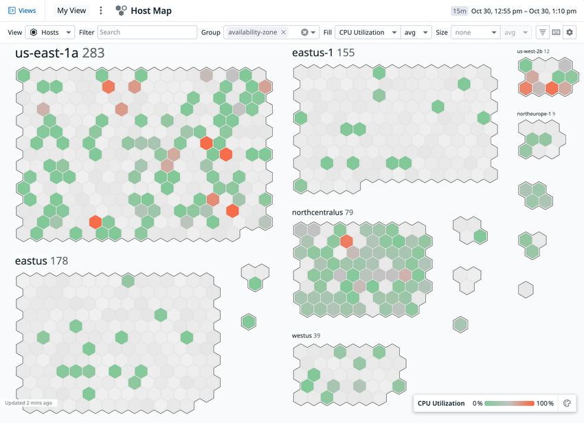
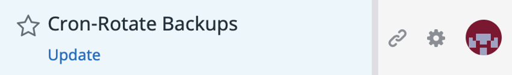
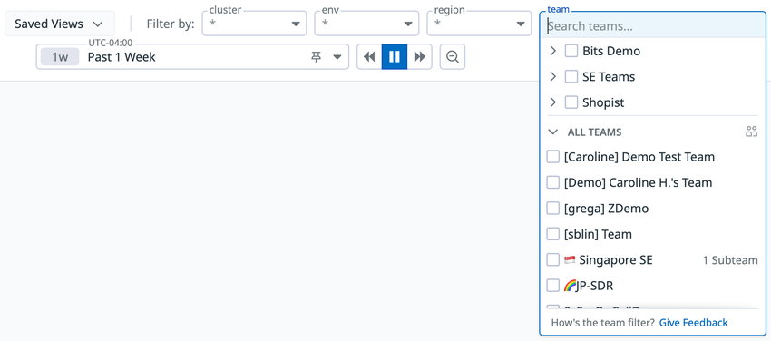
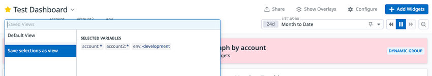
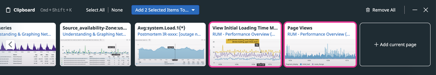
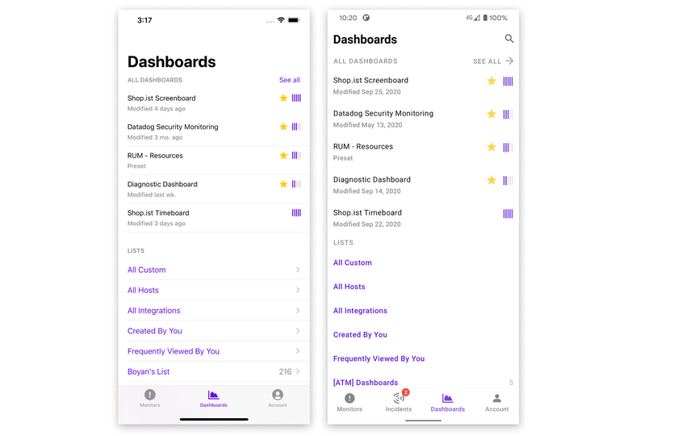

# 画面構成とナビゲーション

## 概要

Datadog の Web UI は、**左サイドバーのナビゲーションメニュー**から各製品画面（Infrastructure、APM、Logs、Digital Experience、Security など）に移動し、各画面の右上にある**時間セレクタ（Time Selector / Time Frame）**で表示期間を、上部の**検索バー・ファセット・テンプレート変数**で表示対象を絞り込む、という共通の操作モデルで作られている。どの画面からでも **`Cmd/Ctrl + K`（Quick Nav / クイック検索）**でページやダッシュボード・モニターにジャンプでき、よく使う表示条件は **Saved Views（保存ビュー）**として保存・共有できる。

本ファイルは入門者向けに、次の問いに答える。

| 問い | 該当節 |
|---|---|
| Datadog にはどの URL でログインするか（サイト別） | [ログイン URL とサイト](#ログイン-url-とサイト) |
| 左メニューはどう構成されているか | [ナビゲーションメニューの構成](#ナビゲーションメニューの構成) |
| 主要画面はどこにあり何ができるか | [主要画面ガイド](#主要画面ガイド) |
| ページやダッシュボードを素早く探すには | [クイック検索（Quick Nav）](#クイック検索quick-nav) |
| 表示期間の指定方法・構文は | [時間セレクタ](#時間セレクタtime-selector) |
| 表示条件を保存・共有するには | [Saved Views](#saved-views保存ビュー) |
| ダッシュボードを動的に絞り込むには | [テンプレート変数](#テンプレート変数template-variables) |
| グラフを集めて共有するには | [Datadog Clipboard](#datadog-clipboard) |
| ダークモード・タイムゾーンなど個人設定は | [個人設定](#個人設定personal-settings) |
| スマートフォンで何ができるか | [モバイルアプリ](#モバイルアプリdatadog-mobile-app) |

各製品の機能詳細はリファレンス編（例：[Dashboards](../02_リファレンス/platform/dashboards.md)、[ログ検索と分析](../02_リファレンス/logs/log-search-and-analytics.md)、[APM 画面と分析機能](../02_リファレンス/apm/apm-ui-and-analysis.md)）を参照すること。Datadog 全体像は [Datadogとは](01-what-is-datadog.md)、製品の分類は [製品ポートフォリオ全体像](04-product-map.md)、タグ・ファセット等の用語は [必須概念](05-core-concepts.md)、最初の操作手順は [はじめてのDatadog](07-getting-started.md) を参照。

> **注意（UI の変化）:** Datadog は SaaS として UI を継続的に更新しており、メニュー名・配置・アイコンは予告なく変わる。本ファイルは 2026-11-02 時点で公開されている公式ドキュメント・公式ブログに基づく。スクリーンショットは公式ドキュメント掲載画像であり、撮影時期により現在の画面と細部が異なる場合がある。また、表示されるメニュー項目は契約製品やロール（権限）によって異なる。

---

## ログイン URL とサイト

Datadog の Web UI の URL は、組織（Organization）が作成された **Datadog サイト**ごとに異なる。別サイトの URL にアクセスしてもログインできない（アカウントはサイトごとに独立）。サイトの詳細は [Datadog Sites（サイト）](../02_リファレンス/platform/datadog-sites.md) を参照。[出典](https://docs.datadoghq.com/getting_started/site/)

| サイト | Web UI の URL | サイトパラメータ（`DD_SITE` 等） |
|---|---|---|
| US1 | `https://app.datadoghq.com` | `datadoghq.com` |
| US3 | `https://us3.datadoghq.com` | `us3.datadoghq.com` |
| US5 | `https://us5.datadoghq.com` | `us5.datadoghq.com` |
| EU1 | `https://app.datadoghq.eu` | `datadoghq.eu` |
| AP1（日本） | `https://ap1.datadoghq.com` | `ap1.datadoghq.com` |
| AP2 | `https://ap2.datadoghq.com` | `ap2.datadoghq.com` |
| US1-FED | `https://app.ddog-gov.com` | `ddog-gov.com` |
| US2-FED | `https://us2.ddog-gov.com` | `us2.ddog-gov.com` |
| UK1 | `https://uk1.datadoghq.com` | `uk1.datadoghq.com` |

> **サイト差異:** 公式サイト一覧（2026-11-02 取得）には、本ナレッジ規約に列挙された 7 サイトに加え **US2-FED** と **UK1** が掲載されている。本ナレッジの基準サイトは AP1。ダッシュボード URL などの共有リンクは、組織のサイトのドメイン（例：AP1 なら `ap1.datadoghq.com`）になる。公式ドキュメントの URL 例は US1（`app.datadoghq.com`）で書かれていることが多いので、AP1 利用者は読み替えが必要。

---

## ナビゲーションメニューの構成

### サイドバーの全体構造

Datadog Web UI のナビゲーションメニューは画面左端の**サイドバー**である。公式ドキュメントによれば、Datadog サイトにはブラウザの幅に応じて**最大 3 種類のナビゲーション表示形式**があり、ブラウザ幅を変えると切り替わる（各形式のレイアウト詳細は公式ドキュメントに記載なし）。[出典](https://docs.datadoghq.com/getting_started/application/)

サイドバーは 2024 年 4 月のナビゲーション再設計で、利用頻度と製品間の関係に基づいて上から下へ次のように並べられた。[出典](https://www.datadoghq.com/blog/datadog-navigation-redesign/)（2024-04-16 公開）

| 位置 | 内容 | 説明 |
|---|---|---|
| 最上部 | 検索バー、最近アクセスしたページ | 最近開いたモニター、ダッシュボード、ノートブックなどへのリンク |
| 上部 | Watchdog、Service Management への直接リンク | [Watchdog](../02_リファレンス/platform/watchdog.md)、インシデント管理などのサービス管理系 |
| 中段 | 製品領域ごとのグループ | Infrastructure、APM、Digital Experience、Software Delivery、Security |
| 下段 | コア機能 | Metrics（メトリクス）、Logs（ログ） |
| 下部 | リソース類 | Integrations、Bits AI、CoScreen |
| 最下部 | 管理・サポート | 組織設定などの管理機能、Help / Support |

- 中段の各アイコンに**マウスオーバーするとサブメニュー**が開く。サブメニューは**左列に各機能の主要ページ**、**右列に設定・セットアップ系の項目**が並ぶ構成である。[出典](https://www.datadoghq.com/blog/datadog-navigation-redesign/)
- 例として Security サブメニューには Cloud SIEM、Code Security、Cloud Security、App & API Protection、Workload Protection、Sensitive Data Scanner が並ぶ（ブログ掲載時点）。各製品は [Datadog Security 概要](../02_リファレンス/security/security-platform-overview.md) を参照。
- 再設計ではライト／ダーク両モードでのコントラスト向上、お気に入り（Favorites）のタイトル表示幅拡大も行われた。
- CoScreen は再設計ブログ（2024-04）時点のメニュー項目であり、2026-11 時点で同じ位置に表示されているかは公開情報では確認できず。

> **注意:** 再設計ブログは 2024-04 公開であり、その後もメニュー項目は追加・改称されている（例：製品名の改称は [製品ポートフォリオ全体像](04-product-map.md) を参照）。サイドバーのピン留め・折りたたみ等の操作の詳細は公開情報では確認できず。

### 製品領域グループと主な配下画面

サイドバー中段・下段の製品グループと、配下にある代表的な画面の対応を示す。画面名は公式ドキュメントの表記に基づく。表示は契約製品と権限によって異なる。

| サイドバーのグループ | 代表的な配下画面 | 詳細ファイル |
|---|---|---|
| Infrastructure | Hosts（ホスト一覧）、Host Map、Containers、Kubernetes、Processes、Serverless、Network（Cloud Network Monitoring / NDM）、Cloud Cost | [Infrastructure Monitoring](../02_リファレンス/infrastructure/infrastructure-monitoring.md)、[コンテナ・Kubernetes 監視](../02_リファレンス/infrastructure/container-and-kubernetes-monitoring.md) |
| APM | Software Catalog / Services、Traces（Trace Explorer）、Service Map、Profiles、Error Tracking、Data Streams | [APM 画面と分析機能](../02_リファレンス/apm/apm-ui-and-analysis.md) |
| Digital Experience | RUM（Real User Monitoring）、Session Replay、Product Analytics、Synthetic Monitoring & Testing | [RUM（ブラウザ）](../02_リファレンス/dem/rum-browser.md)、[Synthetic Monitoring](../02_リファレンス/dem/synthetic-monitoring.md) |
| Software Delivery | CI Visibility、Test Optimization、Code Coverage / DORA Metrics 等 | [CI Visibility](../02_リファレンス/software-delivery/ci-visibility.md) |
| Security | Cloud SIEM、Cloud Security、App & API Protection、Workload Protection、Code Security、Sensitive Data Scanner | [Datadog Security 概要](../02_リファレンス/security/security-platform-overview.md) |
| Service Management | Incidents、On-Call、Work Management（旧称：Case Management）、Workflow Automation、App Builder | [Incident Management](../02_リファレンス/service-management/incident-management.md) |
| Metrics | Metrics Explorer、Metrics Summary 等 | [Metrics](../02_リファレンス/platform/metrics.md) |
| Logs | Log Explorer、Live Tail、Pipelines、Indexes 等 | [ログ検索と分析](../02_リファレンス/logs/log-search-and-analytics.md) |
| Dashboards | Dashboard List、各ダッシュボード、Notebooks | [Dashboards](../02_リファレンス/platform/dashboards.md)、[Notebooks・DDSQL・Reference Tables](../02_リファレンス/platform/notebooks-and-data-tools.md) |
| Monitors | Monitors List（Manage Monitors）、New Monitor、SLOs、Downtimes | [Monitors](../02_リファレンス/platform/monitors.md)、[SLO](../02_リファレンス/platform/slo.md) |
| Integrations | Integrations 一覧、Agent インストール手順 | [Integrations](../02_リファレンス/platform/integrations.md) |
| Bits AI | Bits AI（チャット・調査エージェント） | [Bits AI と AI 機能](../02_リファレンス/ai/bits-ai.md) |
| 管理（アカウントメニュー） | Personal Settings、Organization Settings（ユーザー、ロール、API/アプリケーションキー、Public Sharing 等）、Plan & Usage | [組織・ユーザー・権限管理](../02_リファレンス/platform/account-and-access-management.md)、[API とキー管理](../02_リファレンス/platform/api-and-keys.md)、[Usage・Cost Attribution](../02_リファレンス/platform/usage-and-cost-attribution.md) |

> 上表のグループ分けのうち、Infrastructure / APM / Digital Experience / Software Delivery / Security / Metrics / Logs / Integrations / Bits AI / Service Management は再設計ブログに明記されている。Dashboards・Monitors のサイドバー上の位置、および各グループ配下の画面名の完全な一覧は、公開情報で網羅的には確認できず（画面名自体は各製品の公式ドキュメントに基づく）。

### アカウントメニュー（組織の切り替え）

- サイドバー下部の**アカウントメニュー**（自分のアバター）から Personal Settings を開ける。複数の組織に所属している場合、**アカウントメニューまたは Personal Settings > Organizations タブ**から組織を切り替えられる。[出典](https://docs.datadoghq.com/account_management/)
- アバターにマウスオーバーすると外観（ダークモード等）を切り替えられる（後述の[個人設定](#個人設定personal-settings)）。
- 複数組織（マルチ org）の運用設計は [大規模・マルチorg運用](../04_応用編/15-large-scale-and-multi-org.md) を参照。

---

## 主要画面ガイド

### 画面に共通するレイアウト

Datadog の多くの「Explorer（エクスプローラ）」系画面（Log Explorer、Trace Explorer、RUM Explorer、Manage Monitors など）は、おおむね次の共通レイアウトを持つ。表は下記の各画面の公式記述をまとめて一般化したもので、すべての画面で各領域の位置が公式に明記されているわけではない（位置の一般化は【推定】）。

| 領域 | 位置 | 役割 |
|---|---|---|
| 検索バー（Search bar） | 画面上部 | `key:value` 形式やフリーテキストでクエリを入力。オートコンプリートあり |
| 時間セレクタ（Time range selector） | 画面右上 | 表示期間を指定（例：Past 15 minutes） |
| Saved Views（Views パネル） | 画面左上 | 保存した表示条件を呼び出す |
| ファセットパネル（Facet panel） | 画面左側 | 属性のチェックボックスで絞り込み。検索バーと双方向に同期 |
| 結果リスト／可視化 | 画面中央 | リスト、時系列、Top List、テーブル等 |
| サイドパネル（詳細パネル） | 項目クリックで右側に展開 | 個々のログ・トレース・イベントの詳細と関連データ |

- Log Explorer の時間範囲は**画面右上の時間範囲セレクタ**で選ぶ。[出典](https://docs.datadoghq.com/logs/explorer/search/)
- Log Explorer の Saved Views は**画面左上**からアクセスする。[出典](https://docs.datadoghq.com/logs/explorer/saved_views/)
- Manage Monitors 画面は**左にファセットパネル、上に検索バー**があり、チェックボックスの選択と検索バーの内容は相互に同期する。結果はリアルタイムに更新され、検索ボタンはない。[出典](https://docs.datadoghq.com/monitors/manage/search/)
- Trace Explorer では、**画面右上の時間セレクタ**で Live Search と Indexed Data Search を切り替える。ファセットはサイドバー（facets sidebar）に並ぶ。スパンを選ぶとストリームが一時停止し、**トレースサイドパネル**に詳細が表示される。ファセットサイドバーとサイドパネルが左右どちら側にあるかは、本文には明記されていない。[出典](https://docs.datadoghq.com/tracing/trace_explorer/)
- RUM Explorer では、検索バーに入力して RUM イベントを絞り込む（ファセットや最近のクエリのオートコンプリートあり）。List 表示で行をクリックすると**イベントサイドパネル**が開く。ファセットパネルと時間セレクタの位置は公式ドキュメントの本文に記載がない。[出典](https://docs.datadoghq.com/real_user_monitoring/explorer/)、[出典](https://docs.datadoghq.com/real_user_monitoring/explorer/events/)

### 主要画面の一覧

公式「Getting Started with Datadog」で紹介されている主要画面と、その役割・ナビゲーションパスを示す。[出典](https://docs.datadoghq.com/getting_started/application/)

| 画面 | ナビゲーション | できること |
|---|---|---|
| Infrastructure List（Hosts） | Infrastructure > Hosts | ホスト・コンテナ・プロセスとそのメタデータを一覧。タグやメトリクスで絞り込み・可視化し、個々のホストを調査 |
| Host Map / Container Map | Infrastructure > Host Map | ホスト・コンテナを六角形で並べ、CPU 使用率などのメトリクスで色分けして俯瞰 |
| Log Explorer | Logs | アプリ・インフラのログ検索・分析。インデックスせずに見られる Live Tail、サービス・ホスト・エラー種別での検索、保持期間の制御 |
| APM（Traces / Service Map 等） | APM | エンドツーエンドのリクエストトレース、処理段階ごとの所要時間の内訳、Service Map、ログ・メトリクス・ユーザーセッションとの相関 |
| RUM Explorer / Session Replay | Digital Experience | Web・モバイルのユーザー行動のリアルタイム監視、セッション記録、Core Web Vitals / Mobile Vitals、エラー追跡、Rage Click 等のフラストレーションシグナル、フィーチャーフラグ監視 |
| Synthetic Monitoring | Digital Experience > Synthetic Monitoring & Testing | API・ブラウザ・モバイル・Network Path テストを世界各地から実行し、停止や性能劣化を検知 |
| Integrations | Integrations | 1,000 のインテグレーション（クラウド、インシデント対応、データ層、セキュリティ、AI 等）の導入・設定 |
| Dashboard List / Dashboards | Dashboards > Dashboard List | メトリクス・ログ・APM・RUM を組み合わせたグラフ。標準（out-of-the-box）ダッシュボード、ドラッグ＆ドロップのウィジェット、イベント・コメント注釈 |
| Monitors List | Monitors | メトリクス閾値、インテグレーションの可用性、ネットワークエンドポイント等に基づくアラート。複数条件ロジック、`@` メンションによる Slack・メール・PagerDuty 通知、ダウンタイム設定 |

#### スクリーンショット：Host Map



**キャプション:** Infrastructure > Host Map の画面（availability-zone でグループ化）。

**画面の説明:** 画面上部左に **Views**（Saved Views）と **My View**、タイトル「Host Map」。右上に時間表示（`15m` と期間の日時範囲）。2 段目のツールバーに **View**（Hosts / Containers の切り替え）、**Filter**（タグによる絞り込みの検索欄）、**Group**（グループ化するタグ。ここでは `availability-zone`）、**Fill**（色付けに使うメトリクス。ここでは CPU Utilization の `avg`）、**Size**（六角形の大きさに使うメトリクス。ここでは none）が並ぶ。本体には `us-east-1a`、`eastus` などのアベイラビリティゾーンごとにホスト数（例：283）と六角形（1 つが 1 ホスト）が描かれ、CPU 使用率 0%（緑）〜100%（オレンジ）の凡例が右下にある。左下に「Updated 2 mins ago」と更新時刻が表示される。

**出典:** https://docs.datadoghq.com/getting_started/application/ （画像取得日：2026-11-02）

### ダッシュボード一覧（Dashboard List）

Dashboard List はダッシュボードを検索・閲覧・作成する画面である。[出典](https://docs.datadoghq.com/dashboards/list/)

| 領域 | 内容 |
|---|---|
| 上部 | 検索バー |
| 中央 | **All Dashboards** テーブル。列は Star（お気に入り）、Name、Author、Teams、Modified、Popularity、アイコン（Timeboard / Screenboard の種別）。Name / Modified / Popularity でソート可 |
| 左サイドバー | すべてのリスト。Team または検索語で絞り込み可。**Hide Controls** で折りたたみ |
| 右上 | **+ New List**、**Edit Teams**、**Add to**（リストへの追加） |

**プリセットリスト（Preset lists）:**

| リスト | 内容 |
|---|---|
| All Custom | 組織内の誰かが作成したカスタムダッシュボード |
| All Hosts | ホスト追加時に自動作成されるダッシュボード |
| All Integrations | インテグレーション導入時に自動作成されるダッシュボード |
| All Shared | 認証付きまたは公開リンクで共有されているダッシュボード |
| Created By You | 自分が作成したカスタムダッシュボード |
| Recently Deleted | 過去 30 日以内に削除されたダッシュボード |
| Security and Compliance | 標準の Security 系ダッシュボード |

- **お気に入り（Star）:** Star 列は現在のユーザーが星を付けたダッシュボード。星付きのリストは「Favorite Lists」に表示される（星付きリストがなければ非表示）。検索フィルタ `favorites:true` で星付きのみ表示。
- **Popularity:** 組織で最も人気のダッシュボードを 5 本バーとし、他は相対表示。トラフィックに基づき日次更新。新規ダッシュボードは最大 24 時間 0 本と表示されうる。公開 URL 経由のアクセスは集計対象外。
- **検索（【Preview】）:** フリーテキスト（複数語は AND、引用符でフレーズ、`elastic*` のワイルドカード）、`key:value` フィルタ（`author`、`title`、`description`、`team`、`favorites`、`type`、`is_shared`、`popularity`、`widgets.count`、`widgets.title`、`widgets.type`、`widgets.metrics`、`template_variables.*`）、ブール演算子 `AND` / `OR` / `NOT`（大文字小文字を区別。`-` と `!` も NOT）、範囲演算子 `<` `>` `<=` `>=`（`popularity` と `widgets.count`）。
- **削除と復元:** 削除したダッシュボードは Recently Deleted に 30 日間残り、その後完全削除される。Recently Deleted で選択して **Restore to** から復元する。
- **標準（Preset）ダッシュボードの探し方:** Dashboard List で `Redis` や `RUM` などの製品名を検索し、**Preset** の表示があるものを開く。[出典](https://docs.datadoghq.com/getting_started/dashboards/)

> **補足:** モバイルアプリのダッシュボード一覧（後述のスクリーンショット）には「Frequently Viewed By You」リストが表示されるが、Web の Dashboard List 公式ドキュメントのプリセットリスト表には記載がない。Web UI で同名リストが現在表示されるかは公開情報では確認できず。

### ダッシュボード画面の主なメニュー

ダッシュボード画面右上には **Share**、**Configure**（設定アクション）、**Add Widgets** などのボタンがある（[テンプレート変数のスクリーンショット](#スクリーンショットsaved-views-の作成)参照）。[出典](https://docs.datadoghq.com/dashboards/configure/)

| メニュー | 主な項目 |
|---|---|
| Configure（右上の設定アイコン） | Display UTC time（UTC と既定タイムゾーンの切替）、Increase density（高密度モード）、TV Mode、Keyboard shortcuts（ショートカット一覧）、Pause Auto-Refresh、Default timeframe、Include Flex Logs、Clone dashboard、ダッシュボード JSON の Copy / Import / Export、Version history（過去版のプレビュー・復元・複製）、View audit events（組織内の利用者の確認。個人ユーザーには自分の操作履歴が表示される）、Delete dashboard（星を外してから削除する。プリセットリスト Recently Deleted から 30 日以内なら復元できる） |
| Share（右上） | 共有ダッシュボード（公開・招待制・埋め込み）、コピー・エクスポート、スケジュールレポート等 |
| ウィジェットの Export / Share メニュー | Copy、Share snapshot、インシデント宣言・追加、Case 作成、Notebook へ保存、Link to widget、PNG / SVG / CSV ダウンロード |

- **Pause Auto-Refresh:** 相対時間のダッシュボードで自動更新を既定で一時停止する。設定はすべての閲覧者に適用される。
- **Default timeframe:** すべてのユーザーに適用される既定の期間を設定する。
- **Increase density:** グループウィジェットを横並びにして画面に多くのウィジェットを収める。大画面ではグループウィジェットを使うダッシュボードで既定で有効。
- **Include Flex Logs:** Flex Logs 設定済みウィジェットを Flex Logs と Standard Indexed ログで切り替える。ユーザーごと・ダッシュボードごとに保持される設定。
- **JSON Import は既存内容をすべて上書き**する点に注意。

ダッシュボードの作成・ウィジェットの詳細は [Dashboards](../02_リファレンス/platform/dashboards.md)、設計の実践は [ダッシュボード設計の実践](../04_応用編/04-dashboard-design-practices.md) を参照。

---

## クイック検索（Quick Nav）

### 基本操作

Datadog のクイック検索（Quick Nav Menu）は、**`Cmd + K`（macOS）/ `Ctrl + K`（Windows・Linux）**で Datadog 内のどこからでも開ける検索メニューである。ページや、ダッシュボード・モニターなどのエンティティを検索してジャンプできる。[出典](https://docs.datadoghq.com/getting_started/application/)

Quick Nav Menu は 2021 年 2 月に発表された機能で、発表時の構成は次のとおり。[出典](https://www.datadoghq.com/blog/datadog-quick-nav-menu/)（2021-02-19 公開）

| 領域 | 内容 |
|---|---|
| 最上部 | 検索バー。入力に応じてリストがリアルタイムに絞り込まれる |
| ショートカット | Widget Clipboard（現 Datadog Clipboard）を開く、新規ダッシュボードを作成する |
| RECENT | 最近訪れたビュー（個別のダッシュボードやモニターを含む） |
| 機能リンク | Datadog の主要機能へのリンク |

- サービス名や技術名（例：特定サービス名、`Redis` など）で検索すると、関連するリソースを見つけられる（ブログの記述）。
- 検索対象の完全な範囲、矢印キーでの選択など詳細なキー操作は公開情報では確認できず。
- サイドバー最上部にも検索バーと最近アクセスしたページがある（[ナビゲーションメニューの構成](#サイドバーの全体構造)）。

> **注意:** 上記の画面構成は 2021-02 公開のブログに基づく。2 年以上前の情報のため、現行の Quick Nav の表示内容（セクション名や項目）とは異なる可能性がある。`Cmd/Ctrl + K` で開く点は現行の公式ドキュメント（Getting Started）でも確認できる。

### 主なキーボードショートカット

公開ドキュメントで確認できる主なキーボードショートカットをまとめる。

| 操作 | macOS | Windows / Linux | 出典 |
|---|---|---|---|
| クイック検索（Quick Nav）を開く | `Cmd + K` | `Ctrl + K` | [Getting Started](https://docs.datadoghq.com/getting_started/application/) |
| Datadog Clipboard を開く／閉じる | `Cmd + Shift + K` | `Ctrl + Shift + K` | [Clipboard](https://docs.datadoghq.com/dashboards/guide/datadog_clipboard/) |
| ダークモードの切替 | `Ctrl + Opt + D` | `Ctrl + Alt + D` | [Account Management](https://docs.datadoghq.com/account_management/) |
| ウィジェット（グラフ）のコピー | `Cmd + C`（ウィジェットにホバー） | `Ctrl + C` | [Widget Configuration](https://docs.datadoghq.com/dashboards/widgets/configuration/) |
| ウィジェットの貼り付け | `Cmd + V` | `Ctrl + V` | 同上 |
| 複数ウィジェットの選択（Screenboard 編集時） | `Shift + クリック` | `Shift + クリック` | 同上 |
| 時間範囲の一部を増減 | 該当部分を選択して `↑` / `↓` | 同左 | [Custom Time Frames](https://docs.datadoghq.com/dashboards/guide/custom_time_frames/) |

- ダッシュボードの **Configure > Keyboard shortcuts** で、ダッシュボードで使えるショートカット一覧を表示できる。一覧の具体的内容は公式ドキュメントに記載がなく、公開情報では確認できず。[出典](https://docs.datadoghq.com/dashboards/configure/)
- ウィジェットのコピー＆ペーストはダッシュボード、ノートブック、APM の Service ページ・Resource ページで使える。ダッシュボードに貼ると**カーソル位置**に、ノートブックに貼ると**末尾の新しいセル**として追加される。[出典](https://docs.datadoghq.com/dashboards/widgets/configuration/)

---

## 時間セレクタ（Time Selector）

### 時間セレクタの役割と位置

Datadog の時間セレクタ（Time Selector / Time Frame Selector）は、画面に表示するデータの期間を指定する UI である。ダッシュボード、Log Explorer をはじめ、多くの画面の**右上**に配置されている。[出典](https://docs.datadoghq.com/logs/explorer/search/)

ダッシュボードの時間セレクタ周辺には、次の要素が並ぶ（下記スクリーンショット [テンプレート変数のチームフィルタ](#スクリーンショットチームフィルタteam-filter) と [Saved Views の作成](#スクリーンショットsaved-views-の作成) の画面から読み取れる構成）。

| 要素 | 説明 |
|---|---|
| タイムゾーン表示 | 時間セレクタ上部に `UTC-04:00` のように表示中のタイムゾーンを表示 |
| 期間の略記 | `1w`、`24d`、`15m` のように期間長を表示 |
| 期間名 | `Past 1 Week`、`Month to Date` など |
| ピンアイコン、ドロップダウン | 期間の候補選択（ピンアイコンの機能詳細は公開情報では確認できず） |
| 戻る／一時停止（再生）／進む ボタン | 期間単位で前後に移動、ライブ更新の一時停止・再開 |
| ズームアウト（虫眼鏡）ボタン | 表示期間を広げる |

- ウィジェットを全画面表示した場合も、期間変更、選択期間単位での前後移動、現在時刻での一時停止とライブ表示の切替、期間のリセットが可能。[出典](https://docs.datadoghq.com/dashboards/widgets/configuration/)

### 3 種類のタイムフレーム

Datadog のカスタムタイムフレームは、開始・終了の動き方で 3 種類に分かれる。[出典](https://docs.datadoghq.com/dashboards/guide/custom_time_frames/)

| 種類 | 開始 | 終了 | 例 |
|---|---|---|---|
| Sliding（スライディング） | 時間とともに進む | 時間とともに進む（現在） | `5h`（直近 5 時間） |
| Growing（伸長） | 固定 | 現在（進む） | `since Jun 1` |
| Fixed（固定） | 固定 | 固定 | `Jan 1 - Jan 2` |

### 入力できる構文

時間セレクタには、プリセットの選択に加えて自由入力でカスタムタイムフレームを指定できる。[出典](https://docs.datadoghq.com/dashboards/guide/custom_time_frames/)

**固定日付（Fixed dates）:**

| 書式 | 例 |
|---|---|
| `{MMM/MMMM} D` | `Jan 1` / `January 1` |
| `M/D` | `1/1` |
| `M-D` | `1-1` |
| `M/D/{YY/YYYY}` | `1/1/19` / `1/1/2019` |
| `M-D-{YY/YYYY}` | `1-1-19` / `1-1-2019` |
| `{MMM/MMMM} D, h:mm a` | `Jan 1, 1:00 pm` |
| `{MMM/MMMM} D, YYYY, h:mm a` | `Jan 1, 2019, 1:00 pm` |
| `h:mm a` | `1:00 pm` |
| Unix 秒 | `1577883600` |
| Unix ミリ秒 | `1577883600000` |

固定日付は範囲としても指定できる（例：`1577883600 - 1578009540`、`Jan 1 - Jan 2`、`6:00 am - 1:00 pm`）。日付の書式は米国式（月/日）である点に注意。

**相対日付（Relative dates）:** `N{単位}` で直近 N 単位のスライディング期間（例：`3 mo` は直近 3 か月）。

| 単位 | 受け付ける表記 |
|---|---|
| 分 | `m`、`min`、`mins`、`minute`、`minutes` |
| 時間 | `h`、`hr`、`hrs`、`hour`、`hours` |
| 日 | `d`、`day`、`days` |
| 週 | `w`、`week`、`weeks` |
| 月 | `mo`、`mos`、`mon`、`mons`、`month`、`months` |

> 公式の単位一覧に「年（year）」の相対表記は含まれていない。年単位は暦に揃えた表記（`year to date`、`last year` など）で指定する。

**伸長期間（Growing time frames）:**

| 書式 | 例 |
|---|---|
| `{date} to now` | `Jan 1 to now` |
| `{date} - now` | `Jan 1 - now` |
| `since {date}` | `since Jun 1`、`since 5h`、`since 1549116000` |
| `from {date}` | `from Jun 1`、`from 5h` |

`{date}` には相対表記（`5h`、`2d`、`3w`）、固定日付（`Jun 1`、`Feb 2 2pm`、`1/15/2024`）、Unix タイムスタンプ（秒・ミリ秒）を使える。

**暦に揃えた期間（Calendar-aligned dates）:** 暦の境界に揃い、時間の経過とともに更新される。

| 書式 | 意味 |
|---|---|
| `today` | 当日 0 時〜現在 |
| `yesterday` | 前日の丸 1 日 |
| `week to date` | 今週月曜 0 時〜現在 |
| `month to date` | 当月 1 日〜現在 |
| `year to date` | 1 月 1 日〜現在 |
| `this {unit}` | 当該単位の開始〜現在（例：`this month`） |
| `last {unit}` | 直前の単位の丸ごと（例：`last year`） |
| `previous {unit}` | `last {unit}` と同じ |
| `N {units} ago` | N 期間前の暦単位丸ごと（例：`3 months ago`） |

**キーボード操作:** 時間範囲の文字列の一部（月・日・年・時・分）を選択して `↑` / `↓` キーを押すと、その単位で増減できる。

### URL パラメータ

ダッシュボードの表示期間は URL パラメータで指定・共有できる。[出典](https://docs.datadoghq.com/dashboards/guide/custom_time_frames/)

```
https://app.datadoghq.com/dash/host/<DASHBOARD_ID>?from_ts=<QUERY_START>&to_ts=<QUERY_END>&live=true
```

| パラメータ | 意味 |
|---|---|
| `from_ts` | クエリ開始時刻（Unix ミリ秒） |
| `to_ts` | クエリ終了時刻（Unix ミリ秒） |
| `live` | `true` で保存・共有時に相対時間指定を維持、`false` で無効 |

> **サイト差異:** 上記 URL 例は US1（`app.datadoghq.com`）のもの。AP1 では `ap1.datadoghq.com` に読み替える。

テンプレート変数の値も URL に `&tpl_var_<NAME>=<VALUE>` として反映される（[テンプレート変数](#ウィジェットでの使い方と-value-構文)）。

### タイムゾーン

- クエリは UTC で実行されるが、選択した期間は**ブラウザのタイムゾーン**に従って解釈される。[出典](https://docs.datadoghq.com/dashboards/guide/custom_time_frames/)
- ダッシュボードの **Configure > Display UTC time** で、表示を既定のタイムゾーンと UTC で切り替えられる。[出典](https://docs.datadoghq.com/dashboards/configure/)
- ユーザーごとの既定タイムゾーンと時刻形式は Personal Settings > Preferences で設定する（[個人設定](#個人設定personal-settings)）。

### グローバル時間とウィジェット個別の時間

- ダッシュボードの**グローバル時間セレクタ**は、表示設定で **Global Time** を選んでいるすべてのウィジェットに 1 つの期間を適用する。新規ウィジェットの既定は Global Time。グローバル時間セレクタを使うには、少なくとも 1 つの時間ベースのウィジェットが Global Time を使っている必要がある。[出典](https://docs.datadoghq.com/dashboards/widgets/configuration/)
- グローバル時間には、時間とともに進む期間（Past 1 Hour、Past 1 Day など）、カレンダーから選ぶ固定期間、カスタム入力が使える。
- Global Time に連動しないウィジェットは、**グローバル期間の終了時刻を基準**に自身のローカル期間を適用する（例：ローカル期間が「Past 1 Minute」なら、グローバル期間終了時点の直近 1 分を表示）。

### 自動更新間隔

ダッシュボードの自動更新間隔は、選択した期間の長さで変わる。[出典](https://docs.datadoghq.com/dashboards/)

| 対象 | 更新間隔 |
|---|---|
| 非公開ダッシュボード、期間 1〜10 分 | 10 秒ごと |
| 非公開ダッシュボード、期間 1 時間 | 20 秒ごと |
| 公開共有ダッシュボード | 30 秒ごと（Dashboards 概要ページの記載）／約 60 秒ごと・変更不可（Shared Dashboards ページの記載） |

> **注意:** 公開共有ダッシュボードの更新間隔は、公式ドキュメント内でページにより記載が異なる（Dashboards 概要：30 秒、Shared Dashboards：約 60 秒）。2026-11-02 時点でどちらが正しいかは公開情報では確定できず。より詳細な Shared Dashboards ページの記載（約 60 秒）を優先して扱うのが無難【推定】。その他の期間に対応する更新間隔の完全な一覧は [Dashboards](../02_リファレンス/platform/dashboards.md) を参照。

---

## Saved Views（保存ビュー）

### Saved Views とは

Saved Views（保存ビュー）は、Explorer 系画面の表示条件（検索クエリ、時間範囲、可視化方法、ファセット選択など）を名前を付けて保存し、ワンクリックで再現できる機能である。Log Explorer、Manage Monitors、ダッシュボード（テンプレート変数の組み合わせ）、Host Map など多くの画面で使える。ここでは仕様が公開されている Log Explorer と Monitors、ダッシュボードの Saved Views を説明する。

| 画面 | Saved Views が保存するもの | 出典 |
|---|---|---|
| Log Explorer | 検索クエリと時間範囲、既定の可視化（log stream / log patterns / log analytics とその設定）、ファセット一覧に表示するファセットの選択 | [Logs Saved Views](https://docs.datadoghq.com/logs/explorer/saved_views/) |
| Manage Monitors | 検索クエリ（例：自チームのモニター、60 日以上ミュートされているモニター） | [Monitors Search](https://docs.datadoghq.com/monitors/manage/search/) |
| ダッシュボード | テンプレート変数の選択値の組み合わせ | [Template Variables](https://docs.datadoghq.com/dashboards/template_variables/) |
| Host Map | 画面左上の Views / My View（スクリーンショット参照）。保存内容の詳細は公開情報では確認できず | [Getting Started](https://docs.datadoghq.com/getting_started/application/) |
| モバイルアプリ（Dashboards / Monitors / Traces / Logs） | Web で作成した Saved Views を利用可能（モバイルでの作成・編集は不可） | [Mobile](https://docs.datadoghq.com/mobile/) |

- Trace Explorer、RUM Explorer など他の Explorer にも Saved Views があるが、各画面での保存内容の詳細は該当リファレンス（[APM 画面と分析機能](../02_リファレンス/apm/apm-ui-and-analysis.md)、[RUM（ブラウザ）](../02_リファレンス/dem/rum-browser.md)）を参照。

### Log Explorer の Saved Views

Log Explorer の Saved Views は画面左上の **Views** パネルから使う。[出典](https://docs.datadoghq.com/logs/explorer/saved_views/)

**時間範囲の扱い:** Saved Views は「Past 1 Hour」「Past 1 Week」のような**ライブ（相対）期間**を追跡する前提で設計されており、固定期間を指定して保存すると**ライブ期間に変換**される。

**ビューの種類:**

| 種類 | 可視範囲 | 編集 | 表示 |
|---|---|---|---|
| Default View（既定ビュー） | 自分だけ | 自分 | Views パネルの既定ビュー項目 |
| Integration saved views | 組織全体 | 読み取り専用（更新・改名・削除不可） | インテグレーションのロゴ |
| Custom saved views | 組織全体 | Read Only ユーザー以外の全員 | 作成者のアバター |

**Default View（既定ビュー）:**

- 現在の Log Explorer の表示状態がそのまま自分の既定ビューになる。自分にしか見えず、変更しても組織には影響しない。
- UI で操作したり、別の構成を埋め込んだ Log Explorer リンクを開いたりすると一時的に上書きされる。
- Views パネルの既定ビュー項目から、**再読み込み**（クリック）、**現在のパラメータで更新**、**Datadog の既定値へのリセット**ができる。

**保存したビューへの操作:**

| 操作 | 説明 |
|---|---|
| Load / Reload | ビューを読み込む |
| Update | 現在の表示構成でビューを更新 |
| Rename / Delete | 改名・削除（Integration ビューと Read Only ユーザーは不可） |
| Share | 短縮リンクで共有 |
| Star（お気に入り） | 星を付けるとリストの先頭に表示され、ナビゲーションメニューからもアクセス可能 |

新規作成は、現在の Explorer の内容から **Save** ボタンで保存する。

#### スクリーンショット：Log Explorer の Custom saved view



**キャプション:** Log Explorer の Views パネルに表示されるカスタム Saved View の 1 項目。

**画面の説明:** 左に星アイコン（お気に入り登録）とビュー名「Cron-Rotate Backups」、その下に **Update** リンク（現在の表示条件でビューを更新）。右側にリンクアイコン（短縮リンクで共有）、歯車アイコン（改名・削除などの設定）、作成者のアバターが並ぶ。

**出典:** https://docs.datadoghq.com/logs/explorer/saved_views/ （画像取得日：2026-11-02）

### Manage Monitors の Saved Views

- Manage Monitors の Saved Views は**組織内の全員に表示**される。[出典](https://docs.datadoghq.com/monitors/manage/search/)
- Default View の仕様は Log Explorer と同様（自分だけに見える、UI 操作やリンクで一時的に上書き、Views パネルから再読み込み・更新・リセット）。
- モニター検索のファセットは Status、Muted、Type、Creator、Service、Tag、Env、Scope、Metric/Check、Notification、Muted left、Muted elapsed。異なるフィールド間は `AND`、同一フィールド内は原則 `OR`（複数 scope や service タグなど例外は `AND`）で結合される。

モニター画面の詳細は [Monitors](../02_リファレンス/platform/monitors.md) を参照。

### Log Explorer の検索補助（参考）

Log Explorer の検索バーは Saved Views と連動した補助機能を持つ。[出典](https://docs.datadoghq.com/logs/explorer/search/)

| 機能 | 仕様 |
|---|---|
| ファセットのオートコンプリート | 入力からファセットと値を提案（ファセットパネルと同じ順序） |
| 値の提案 | ファセットの後に `:` を入力すると、**直近 15 分**のログ件数の多い順に値を表示 |
| 最近の検索 | 直近 **100 件**の検索を保持し、入力時に提案 |
| Saved Views の提案 | クエリに一致する Saved Views を Saved Views パネルと同じ順で提案 |
| `key:value` 検索 | 事前のファセット定義なしで実行可能 |

検索構文の詳細は [ログ検索と分析](../02_リファレンス/logs/log-search-and-analytics.md) を参照。

---

## テンプレート変数（Template Variables）

### テンプレート変数とは

Datadog ダッシュボードのテンプレート変数（Template Variables）は、ダッシュボード上部のドロップダウンで値を選ぶと、ウィジェットを動的に**フィルタ（絞り込み）またはグループ化**できる機能である。各変数はタグまたは属性に紐づき、選択の組み合わせを Saved Views として保存できる。1 つのダッシュボードで「特定のデータセンターだけ」「全データセンター」のように複数のシナリオを切り替えられる。[出典](https://docs.datadoghq.com/dashboards/template_variables/)、[出典](https://docs.datadoghq.com/getting_started/dashboards/)

### 変数の定義項目

| 項目 | 説明 | 既定値 |
|---|---|---|
| Tag or Attribute | タグが `<KEY>:<VALUE>` 形式ならキーを指定。ファセットやメジャー（属性）も指定可 | — |
| Name | ウィジェットのクエリで使う一意の名前 | 選択したタグ／属性名 |
| Default value | ダッシュボード読み込み時の値 | `*` |
| Available values | ドロップダウンに出す値の候補 | `(all)`（常に全値に一致する `*` を含む） |
| フィルタ／グループ化 | 変数をフィルタとして使うかグループ化に使うかを切替 | フィルタ |
| 表示名 | ヘッダーとクエリに表示される名前 | — |

### 値の候補の取得範囲

- ドロップダウンの値は、ダッシュボード上のウィジェットが使うデータソースから取得される。
- **Metrics と Cloud Cost は直近 48 時間**の値、その他のデータソースは**ダッシュボードの表示期間**の値が候補になる。
- 値が出てこない場合は、最近データが報告されていない可能性がある。データ保持ポリシーの影響も受ける。

### 追加・編集の手順

**追加:**

1. ダッシュボード上部の **Add Variable**（既に変数がある場合は **+**）をクリック。
2. 推奨変数を選ぶか、タグを検索する。
3. 変数を適用するウィジェットを選ぶ（Select All / Deselect All あり）。
4. **Save** をクリック。

**編集:** ヘッダーの変数にマウスオーバーして **Edit** をクリックし、サイドパネルで設定変更（適用ウィジェットの追加・解除、フィルタ／グループ化の切替、表示名、既定値、ドロップダウン値のプレビューと検索クエリによる候補の絞り込み）。

**ヘッダーの表示:** ヘッダーには変数の一部だけが表示され、**+ N** で残りを表示する。**Expand template variables** でスクロール中もすべての変数を表示できる。

### ウィジェットでの使い方と `.value` 構文

| 構文 | 使用場所 | 意味・例 |
|---|---|---|
| `$<NAME>` | ウィジェットの **from** 欄（フィルタ） | 例：`$environment` で選択中の環境に絞り込み |
| `$<NAME>`（**by** の後） | グループ化 | 選択値でグループ化 |
| `$<NAME>.value` | クエリ内に値を埋め込む | 例：`env:staging-$service.value` |
| `$<NAME>` | Text ウィジェット | タグと値を表示（例：`environment:dev`） |
| `$<NAME>.key` | Text ウィジェット | タグのキーを表示 |
| `$<NAME>.value` | Text ウィジェット | 値のみ表示 |
| `<TAG_KEY>:$<NAME>.value` | ダッシュボードのイベント検索（オーバーレイ） | 複数はカンマ区切り（例：`role:$role.value,env:$env.value`）。イベント発生時刻がピンクの帯で表示 |
| `$<NAME>` | ウィジェットのイベントオーバーレイ検索欄 | 選択値に該当するイベントを重ねる |

- 値を変更すると URL に `&tpl_var_<NAME>=<VALUE>` が付き、そのまま URL で共有できる。
- Text ウィジェットでは、変数の直後にワイルドカードを付ける構文は使えない。
- イベントオーバーレイで使う変数は**イベントタグではなくメトリクスタグ**である必要がある。
- カスタムリンクでもテンプレート変数を補間でき、選択値に応じてリンク先を変えられる。[出典](https://docs.datadoghq.com/getting_started/dashboards/)

**Logs / APM / RUM のウィジェットで使う場合:**

- ファセットに基づく変数は `@` で始める（例：`@http.status_code`）。
- 値のワイルドカードは中間（例：`eng*@example.com`）や複数箇所（例：`*prod*`）にも使える。
- **Add to all** で、すべての Log / APM / RUM ウィジェットに変数を一括適用できる。

### 関連テンプレート変数（Associated template variables）

ドロップダウンの上部に、**他の選択中の変数から算出された関連値**が表示される。設定は不要。例えば `env` を選ぶと、その環境に存在する `service` の値が上位に提案される、といった使い方になる。[出典](https://docs.datadoghq.com/dashboards/template_variables/)

### チームフィルタ（Team filter）

- タグキーが `team` の変数は**チームフィルタ**として表示される（ダッシュボードとノートブック）。
- Datadog Teams と、対応するチームがない `team` タグ値が一覧される。
- チームを選択するとそのサブチームも選択される。`Shift + クリック`で片方だけを選択できる。
- 検索はチームハンドルと表示名が対象。
- 別のタグキー（例：`attributes.team`）で階層選択を使いたい場合は、変数を `team` で定義し、クエリで `attributes.team:$team.value` のように使う。選択は各チームハンドルの `OR` に展開される。

#### スクリーンショット：チームフィルタ（Team filter）



**キャプション:** ダッシュボードヘッダーのテンプレート変数。`cluster`、`env`、`region` は通常の値セレクタ、`team` 変数はチームフィルタとして展開されている。

**画面の説明:** 左上に **Saved Views** ドロップダウン、その右に「Filter by:」と各変数（`cluster`、`env`、`region`。いずれも値 `*`）。`team` 変数を開くと「Search teams...」検索欄、チーム階層（展開矢印付き）、**ALL TEAMS** の一覧（サブチーム数の表示付き）がチェックボックスで並ぶ。下段左には時間セレクタ（上部に `UTC-04:00`、`1w`「Past 1 Week」、ピンアイコンとドロップダウン）と、戻る・一時停止・進むボタン、ズームアウトボタンが並ぶ。

**出典:** https://docs.datadoghq.com/dashboards/template_variables/ （画像取得日：2026-11-02）

### ダッシュボードの Saved Views

ダッシュボードの Saved Views は、テンプレート変数の選択値の組み合わせを保存する。[出典](https://docs.datadoghq.com/dashboards/template_variables/)

| 操作 | 手順 |
|---|---|
| 作成 | 変数の値を設定 → **Saved Views** ドロップダウン → **Save selections as view** → 名前と任意の説明を入力 → **Save**。値の変更は自動保存されない |
| 削除 | ドロップダウンでビューにマウスオーバー → **Delete View** |
| 値の変更 | ビューを選択 → 変数を変更 → ドロップダウンを再度開き **Save Changes** |
| タイトル・説明の変更 | ビューにマウスオーバー → **Edit** → 更新して **Save** |
| Default View の変更 | 変数の既定値を変更する（**Edit** → **Done**） |

#### スクリーンショット：Saved Views の作成



**キャプション:** ダッシュボードの Saved Views ドロップダウンから「Save selections as view」を選んだ状態。

**画面の説明:** 左上にダッシュボード名（星アイコン付きの「Test Dashboard」）。Saved Views ドロップダウンの左列に **Default View** と **Save selections as view**、右列に **SELECTED VARIABLES** として現在の変数値（`account:*`、`account2:*`、`env:-development`）が表示される。画面右上には **Share**、**Show Overlays**、**Configure**、**+ Add Widgets** ボタン、その下に時間セレクタ（`UTC-05:00`、`24d`「Month to Date」）と戻る・一時停止・進む・ズームアウトの各ボタンが並ぶ。

**出典:** https://docs.datadoghq.com/dashboards/template_variables/ （画像取得日：2026-11-02）

### 共有ダッシュボードでのテンプレート変数・時間

ダッシュボードを社外等に共有する場合（Shared Dashboards）、時間セレクタとテンプレート変数には制約がある。[出典](https://docs.datadoghq.com/dashboards/sharing/shared_dashboards/)

| 項目 | 仕様 |
|---|---|
| 既定の期間 | **Default Timeframe** で閲覧者の初期期間を設定 |
| 期間の変更 | 「Allow viewers to change the timeframe」が OFF なら既定期間のみ。ON でも固定の選択肢からのみ選択可。**カスタム期間と期間のスクラブ（ドラッグでの変更）は不可** |
| テンプレート変数 | 閲覧者が操作できる変数を選択。既定値と候補値が同じ（`*` を含む）変数は変更不可。既定では共有者の現在の選択値を継承 |
| 表示データの権限 | **共有者（作成者）の権限**でデータが表示される |

共有の種類（招待制・公開・埋め込み）、有効期限など詳細は [Dashboards](../02_リファレンス/platform/dashboards.md) を参照。

---

## Datadog Clipboard

### Datadog Clipboard とは

Datadog Clipboard（旧称：Widget Clipboard）は、Datadog の各ページをまたいでグラフ（ウィジェット）やページのリンクを集め、まとめてダッシュボード・ノートブック・インシデントへエクスポートできる**ユーザー個人のクリップボード**である。調査中に複数画面のグラフを集めるのに使う。[出典](https://docs.datadoghq.com/dashboards/guide/datadog_clipboard/)

> 「Widget Clipboard」は 2021-02 の Quick Nav ブログでの呼称。公式ドキュメントの現行名称は「Datadog Clipboard」。

| 項目 | 仕様 |
|---|---|
| 開く／閉じる | `Cmd/Ctrl + Shift + K`、グラフコピー時のポップアップの **Open Clipboard**、最小化表示のクリック |
| 最小化 | Minimize アイコン。最小化状態は Datadog の全ページで表示され続ける |
| 追加できるもの | 各ページからコピーしたグラフ（ウィジェット）、保存したリンク（**Add current page** で現在ページの URL） |
| グラフの追加 | `Cmd/Ctrl + C` またはエクスポートメニューの **Copy**。Clipboard を開いている間はコピーしたグラフが自動追加 |
| 自動追加されないもの | クエリのテキスト、イベントの JSON、その他テキスト系の内容 |
| 項目の操作 | マウスオーバーで開く・複製・削除。タイトルクリックで元のページ（例：元のダッシュボード）を開く |
| エクスポート | 単体：マウスオーバーして `Cmd/Ctrl + C` → ダッシュボード／ノートブックで `Cmd/Ctrl + V`。複数：`Shift + クリック`で選択して `Cmd/Ctrl + C`、またはエクスポートメニューで新規／既存のダッシュボード・ノートブック・インシデントへ |
| 上限 | **最大 20 シグナル**。超えると最も古い（左端の）シグナルから自動削除 |
| 削除 | 個別、または **Remove All** |
| 保持期間 | 公開情報では確認できず |
| 制約 | ノートブックへは対応するグラフ種別のみエクスポート可 |

#### スクリーンショット：Datadog Clipboard



**キャプション:** 画面下部に開いた Datadog Clipboard。

**画面の説明:** 左上に「Clipboard」と `Cmd+Shift+K` の表示、**Select All** / **None**、選択項目をエクスポートする **Add 2 Selected Items To...** ボタン（ドロップダウン）。右上に **Remove All**、最小化、閉じるボタン。本体には収集したグラフがカード形式で横に並び、各カードにグラフ名（例：「Avg:system.Load.1{*}」「Page Views」）と元のページ名（例：「RUM - Performance Overview」）が表示される。選択中のカードはピンクの枠で強調される。右端に **+ Add current page**（現在のページを追加）カードがある。

**出典:** https://docs.datadoghq.com/dashboards/guide/datadog_clipboard/ （画像取得日：2026-11-02）

---

## グラフの共有とスクリーンショット出力

Datadog の画面やグラフを他者と共有・資料化する方法をまとめる。[出典](https://docs.datadoghq.com/dashboards/widgets/configuration/)、[出典](https://docs.datadoghq.com/dashboards/sharing/)

| 方法 | 操作 | 用途・注意 |
|---|---|---|
| Share snapshot | ウィジェットのエクスポートアイコン > Share snapshot | スナップショットを作成して送信 |
| Download as PNG / SVG | エクスポートメニュー > Share externally | グラフを画像として保存（資料・報告書用） |
| Download as CSV | エクスポートメニュー、または全画面表示から | 1 ウィジェットずつ。対応：Bar Chart、List、Pie Chart、Scatter Plot、Table、Timeseries、Top List、Treemap。既定で有効（表示されない場合はサポートにより組織単位で無効化されている可能性） |
| Link to widget | エクスポートメニュー | ウィジェットへのリンクをコピー |
| Widget Share URL（リンクプレビュー） | `Cmd/Ctrl + C` でコピーし Slack / Microsoft Teams 等に貼付 | プレビュー画像とリンクが表示。公開・非公開は Organization Settings の Widget Share URLs 設定（Public / Private / 無効）で管理者が制御 |
| Shared Dashboards | ダッシュボードの Share | 招待制（メール・ドメイン）、公開リンク、埋め込み（Basic / Secure） |
| Shared Graphs | グラフの埋め込みコード生成 | 外部サイトへの埋め込み |
| Scheduled Reports | ダッシュボードの Share | 定期的なメールレポート |
| URL 共有 | ブラウザの URL をコピー | 時間範囲（`from_ts` / `to_ts` / `live`）とテンプレート変数（`tpl_var_*`）が URL に含まれる |

- 公開共有の一覧と取り消しは **Organization Settings > Public Sharing**（Shared Dashboards タブ／Shared Graphs タブ）で管理する。[出典](https://docs.datadoghq.com/dashboards/sharing/)
- 公開共有は誰でも閲覧できるため、組織のセキュリティポリシーに沿って管理者が設定を制御すること（[セキュリティとコンプライアンス](../03_導入編/12-security-and-compliance.md)）。

---

## 個人設定（Personal Settings）

Personal Settings は、組織内での自分の表示、組織の切替・脱退、通知設定などを管理する画面で、サイドバー下部のアカウントメニューから開く。[出典](https://docs.datadoghq.com/account_management/)

| タブ | 設定項目 | 仕様・注意 |
|---|---|---|
| Profile | 名前、メールアドレス、役職 | プロフィール画像は Gravatar（メールアドレスに紐づけ）。Google ログインのユーザーはメールアドレスを Datadog 側で編集不可 |
| Preferences | タイムゾーン、時刻形式 | 新規アカウントの既定は **12 時間表記**。グラフと一部の表データは常に 24 時間表記 |
| Preferences | 外観（Appearance） | ダークモード。サイドバーのアバターにマウスオーバーするか、`Ctrl + Opt + D`（Mac）／`Ctrl + Alt + D`（Windows/Linux）。**System** を選ぶと OS のテーマに追従 |
| Preferences | 視覚アクセシビリティ | 色覚特性、低視力、明るい色への過敏さに対応する 5 種類の設定。**ブラウザに保存**されるため、ブラウザ変更やキャッシュ削除でリセットされる |
| Preferences | メール購読 | Daily Digest / Weekly Digest、Unsubscribe From All。無効化されたユーザーには送られない |
| Organizations | 所属組織の一覧・切替 | 参加には管理者からの招待が必要（件名「You've been invited to join <Organization Name>」のメールの **Join Account**）。脱退すると再招待されるまで再参加不可 |
| Organizations | モバイルアプリへのログイン | **Log in to Mobile App** で QR コードを表示（[モバイルアプリ](#ログイン方法)） |
| Security | Application Keys | キーのコピー、改名、作成日と所有者の確認、失効。詳細は [API とキー管理](../02_リファレンス/platform/api-and-keys.md) |
| Security | メール認証 | Google ユーザーは初回ログイン時、パスワードユーザーは初回パスワード設定時に認証済み。SAML ユーザーは手動で認証。認証済みユーザーは全 Web セッションからのログアウト、現在の階層外の組織への切替が可能 |

> **サイト差異:** メールのダイジェスト（Daily / Weekly Digest）は **US3、US5、AP1、AP2、UK1 および政府向けサイトでは提供されない**。[出典](https://docs.datadoghq.com/account_management/)

- **UI の表示言語:** Datadog Web UI の表示言語を日本語に切り替える設定の有無は、公開情報では確認できず（公式ドキュメント自体は日本語版 `docs.datadoghq.com/ja/` がある）。

---

## モバイルアプリ（Datadog Mobile App）

### 概要と対応プラットフォーム

Datadog Mobile App は、iOS（Apple App Store）と Android（Google Play Store）で提供される公式アプリで、オンコール対応、インシデント、ダッシュボード、モニター、ログ、トレースなどを**閲覧・一部操作**できる。ダッシュボード・モニター・ノートブック・Saved Views の**作成・編集は Web アプリが必要**。[出典](https://docs.datadoghq.com/mobile/)

| 項目 | 内容 |
|---|---|
| 対応 OS | iOS、Android（対応 OS の最低バージョンは公開情報では確認できず） |
| 料金 | アプリ自体の料金に関する記載は公開情報では確認できず |
| タブレット対応 | 公開情報では確認できず |

### ログイン方法

| 方法 | 手順 |
|---|---|
| サイト（リージョン）選択 | ログイン前に画面右上でデータセンター（例：US1）を選択 |
| 標準ログイン／Google 認証／SAML | 公式ドキュメントでは US・EU リージョンで利用可能と記載 |
| SAML（メール） | 会社のメールアドレスを入力 → 届いたメールのリンクをモバイルの既定ブラウザで開く → 組織の SAML 認証情報でサインイン |
| QR コード | Web の **Personal Settings > Organizations** で **Log in to Mobile App** をクリックして QR コードを表示 → スマートフォンのカメラで読み取りリンクを開く |
| SAML ID の手入力 | 「Using Single Sign-On (SAML)?」→「Use another method to login」→ SAML ID を入力 |
| IdP-initiated SAML | IdP 側で IdP 起点 SAML を強制している場合に必要 |
| サブドメイン | subdomain をタップしてカスタムサブドメインを入力 |

> **サイト差異:** 公式モバイルドキュメントはログイン方法について「US と EU リージョン」と記載しつつ、ログイン前に画面右上でデータセンターを選ぶ手順を案内している。AP1 など各サイトが選択肢に含まれるかの一覧は公式ドキュメント上で確認できず、実機で確認すること。

### セッションと通知

| 項目 | 仕様 |
|---|---|
| セッション有効期間 | 認証後 **90 日** |
| 期限切れ前通知 | 有効な場合、トークン失効の **10 日前**に通知 |
| デバイスの再認可 | 公式ドキュメントでは「約 1 か月に 1 回」デバイスの認可が必要との記載もある（上記 90 日との関係は公開情報では確認できず） |
| 自動サインアウト時 | 通知は継続するが再ログインが必要 |
| 手動ログアウト時 | 通知が停止 |
| 複数組織 | サインイン中のすべての組織の通知（Critical のプッシュ通知を含む）を受信 |
| 通知が届かない場合 | 端末設定で Datadog アプリの通知を有効化。**Critical Alerts** を ON にするとおやすみモード（Do Not Disturb）を貫通 |
| 無効化されたユーザー | トークンが無効になりログアウトされる |
| 組織の切替 | Settings > Organization（再認証が必要な場合あり） |
| ログアウト | Settings > Log Out |

### 主な機能

| 機能 | できること | 制約 |
|---|---|---|
| On-Call（iOS / Android） | シフト、スケジュール、ページ、エスカレーションポリシーの表示。ユーザー・チーム・緊急度・状態・日付で絞り込み。エスカレーション、インシデント宣言、個人・チームへのページ、シフトのオーバーライド。Bits Investigation の結果表示 | 通知設定は On-Call のデバイス設定ガイドに従う |
| Incidents | アクセス可能なインシデントの表示・検索・絞り込み。宣言（タイトル、重大度、コマンダーを「+」から入力）と編集。Slack・Zoom 等と連携 | — |
| Notification Center | 受信したプッシュ通知の一覧（種類で絞り込み） | — |
| Dashboards | 表示・検索。テンプレート変数と Saved Views で絞り込み。期間は**画面右下**で設定 | 作成・編集は Web のみ |
| Monitors | フィールド・タグベースのクエリ、Saved Views、最近の検索で表示・検索。詳細表示、種類・アラート時刻での絞り込み、アラートのミュート。Synthetic テストの表示・実行 | 設定・編集は Web のみ |
| Notebooks | 表示・検索。タグ（お気に入り、チーム、種類）で絞り込み | 作成・編集は Web のみ |
| Traces | Saved Views またはクエリで検索。サービス・スパンの展開、情報・エラー・関連ログの表示 | — |
| Logs | ログと Flex Logs の検索（Flex Logs はログ一覧右上で有効化）、Saved Views、パターンでのグループ化、属性でのクラスタリング | — |
| Services | サービスの表示・検索・絞り込み。サービスごとのデプロイ、リソース、SLO、モニター | — |
| Bits AI | **Bits Chat**：システムや進行中のインシデントについて音声・テキストで質問。**Bits Investigation**：有効時、On-Call ページに初期調査結果と結論を表示 | 詳細は [Bits AI と AI 機能](../02_リファレンス/ai/bits-ai.md) |

**モバイルアプリの制限事項:** [出典](https://docs.datadoghq.com/mobile/)

- Topology Map、List Widget（全データソース）、Legacy Treemap、SLO Summary の各ウィジェットはデータを表示しない。
- Watchdog Insights（トレース・ログ）は **iOS のみ**。
- ダッシュボード、モニター、ノートブック、Saved Views の作成・編集は Web アプリが必要。
- UTC で設定されたダッシュボードリンクは UTC で開く。
- モバイルでの機密テレメトリの表示制限には Datadog サポートへの連絡が必要。
- トラブルシューティングは Datadog サポート、または Datadog 公開 Slack の `#mobile-app` チャンネル。

#### スクリーンショット：モバイルアプリのダッシュボード一覧



**キャプション:** Datadog モバイルアプリの Dashboards 画面（左：iOS、右：Android）。

**画面の説明:** 上部に「Dashboards」の見出しと **ALL DASHBOARDS**（See all）の一覧。各ダッシュボードに名前、更新日（例：「Modified 4 days ago」）または「Preset」、星（お気に入り）、人気度のバーが表示される。その下に **LISTS** として All Custom、All Hosts、All Integrations、Created By You、Frequently Viewed By You、ユーザー作成リストが並ぶ。画面下部のタブバーは iOS が Monitors / Dashboards / Account、Android が Monitors / Incidents / Dashboards / Account。なお、この画像は画面内の更新日表示（2020 年）から見て旧バージョンの UI であり、現行アプリでは On-Call、Notification Center、Bits AI などが追加されタブ構成も異なる可能性が高い【推定】。

**出典:** https://docs.datadoghq.com/getting_started/dashboards/ （画像取得日：2026-11-02）

### ホーム画面・ロック画面ウィジェット

Datadog モバイルアプリは、iOS と Android の**ホーム画面ウィジェット**、iOS のみの**ロック画面ウィジェット**を提供する。[出典](https://docs.datadoghq.com/mobile/widgets/)

| ウィジェット | 表示内容 | タップ時の動作 | 主な設定項目 |
|---|---|---|---|
| Incidents | 進行中のインシデント | アプリでインシデントを開く | 組織、重大度（SEV-1、SEV-2 等）、影響顧客の有無、追加フィルタ、並び順 |
| SLOs | 選択した SLO の指定期間の状況 | 指定ダッシュボード（未指定ならアプリ）を開く | SLO、期間（7 日、30 日、90 日、前週、前月、week to date、month to date。期間指定は一部 SLO のみ）、タップ時に開くダッシュボード |
| Monitors | Saved View ごとにまとめたモニター | Monitor Search をその条件で開く | 表示する Saved Views とその順序（Saved View がなければ全モニター） |
| Dashboards | 選択したダッシュボード（または特定ウィジェット） | アプリでダッシュボードを開く | ダッシュボード、特定ウィジェット、クエリ期間（iOS） |
| On-Call shifts | 自分の On-Call シフト | アプリを開く | 組織、期間 |
| On-Call pages | On-Call のページ | アプリを開く | 組織、チーム、並び順、追加フィルタ |

| 項目 | 仕様 |
|---|---|
| サイズ | iOS：追加時に small / medium / large を選択。Android：追加後にリサイズ |
| 設定画面の開き方 | iOS：ウィジェットを長押し。Android：タイトルをタップ |
| 更新間隔 | ホーム画面ウィジェットは **30 分ごと**。左上の期間表示をタップで手動更新 |
| ロック画面ウィジェット | **iOS のみ**。On-Call、Monitors、SLOs、Incidents、Dashboards。ロック画面に空きスペースが必要 |
| 複数組織 | Incidents：ウィジェットごとに組織を選択（Android は再サインインが必要な場合あり）。SLOs / Dashboards：iOS はサインイン中の全組織が表示、Android は設定画面で組織選択。Monitors：1 つのウィジェットで複数組織のモニターを表示可 |

### ショートカット・Apple Watch・Handoff

[出典](https://docs.datadoghq.com/mobile/shortcut_configurations/)

| 機能 | 対応 | 内容 |
|---|---|---|
| Apple Watch 通知 | iOS | iPhone とペアリングし Bluetooth 圏内にいることが必要。Watch アプリの Notifications で Notifications Indicator を ON。iPhone がロック／スリープ中は Watch にのみ通知される（Apple の仕様） |
| Siri ショートカット | iOS のみ | ショートカットアプリでダッシュボード・モニターのショートカットを作成（事前にアプリで一度開く必要あり）。ホーム画面への追加、音声での起動（例：「Open AWS Overview」）、Siri Suggestions |
| クイックアクション | iOS | アプリアイコン長押しで「Frequently Viewed By Me」上位 5 ダッシュボード（閲覧数と新しさで順位付け） |
| iPhone 検索 | iOS | iPhone の検索からダッシュボードを直接開く、または「Search in App」 |
| アプリショートカット | Android | アプリアイコン長押しで最もよく開く上位 5 ダッシュボード。ドラッグでホーム画面に専用アイコンを作成 |
| Handoff | iOS のみ | 使用中に Mac の Dock 左端に Datadog アイコンが表示され、クリックで同じダッシュボード・モニターを Mac で開く。同一 iCloud Apple ID、Bluetooth、Wi-Fi、Handoff の有効化が必要 |

オンコール通知の設計は [On-Call](../02_リファレンス/service-management/on-call.md) を参照。

---

## 制限値・クォータ・デフォルト値

本ファイルで扱う UI 機能の主な制限値・既定値を一覧にする（入門編のため、リファレンス規約に準じて掲載）。

| 対象 | 項目 | 値 | 出典 |
|---|---|---|---|
| テンプレート変数 | Default value の既定 | `*` | [Template Variables](https://docs.datadoghq.com/dashboards/template_variables/) |
| テンプレート変数 | Available values の既定 | `(all)` | 同上 |
| テンプレート変数 | 値候補の取得範囲（Metrics / Cloud Cost） | 直近 48 時間 | 同上 |
| テンプレート変数 | 値候補の取得範囲（その他） | ダッシュボードの表示期間 | 同上 |
| テンプレート変数 | 1 ダッシュボードあたりの変数数上限 | 公開情報では確認できず | — |
| Saved Views | 1 組織あたりの作成数上限 | 公開情報では確認できず | — |
| Saved Views（Logs） | 保存時の固定期間 | ライブ期間に変換 | [Logs Saved Views](https://docs.datadoghq.com/logs/explorer/saved_views/) |
| Log Explorer 検索 | 最近の検索の保持件数 | 100 件 | [Logs Search](https://docs.datadoghq.com/logs/explorer/search/) |
| Log Explorer 検索 | 値の提案の集計期間 | 直近 15 分 | 同上 |
| Datadog Clipboard | 最大シグナル数 | 20（超過時は最古から自動削除） | [Clipboard](https://docs.datadoghq.com/dashboards/guide/datadog_clipboard/) |
| Datadog Clipboard | 保持期間 | 公開情報では確認できず | — |
| Dashboard List | 削除後の復元可能期間 | 30 日 | [Dashboard List](https://docs.datadoghq.com/dashboards/list/) |
| Dashboard List | Popularity の更新 | 日次（新規は最大 24 時間 0 本表示） | 同上 |
| ダッシュボード自動更新 | 期間 1〜10 分 / 1 時間 | 10 秒 / 20 秒 | [Dashboards](https://docs.datadoghq.com/dashboards/) |
| 共有ダッシュボード | 自動更新 | 約 60 秒（変更不可）※概要ページでは 30 秒と記載 | [Shared Dashboards](https://docs.datadoghq.com/dashboards/sharing/shared_dashboards/) |
| 共有ダッシュボード | 公開共有の既定有効期限 | 1 年（期限後 Paused） | 同上 |
| 共有ダッシュボード | 設定変更の反映 | 最大 5 分 | 同上 |
| 共有ダッシュボード | 招待リンクの有効時間 / 同一ブラウザでのアクセス継続 | 1 時間 / 30 日 | 同上 |
| CSV エクスポート | 単位 | 1 ウィジェットずつ（全ウィジェット一括不可） | [Widget Configuration](https://docs.datadoghq.com/dashboards/widgets/configuration/) |
| 時刻表示 | 新規アカウントの時刻形式 | 12 時間表記（グラフ等は常に 24 時間） | [Account Management](https://docs.datadoghq.com/account_management/) |
| 時間セレクタ | クエリ実行のタイムゾーン | UTC（期間はブラウザのタイムゾーンで解釈） | [Custom Time Frames](https://docs.datadoghq.com/dashboards/guide/custom_time_frames/) |
| 時間セレクタ | URL の `from_ts` / `to_ts` | Unix ミリ秒 | 同上 |
| モバイルアプリ | セッション有効期間 | 90 日 | [Mobile](https://docs.datadoghq.com/mobile/) |
| モバイルアプリ | 期限切れ前通知 | 10 日前 | 同上 |
| モバイルウィジェット | ホーム画面ウィジェットの更新 | 30 分ごと | [Mobile Widgets](https://docs.datadoghq.com/mobile/widgets/) |
| モバイルショートカット | クイックアクション表示数 | 上位 5 ダッシュボード | [Shortcut Configurations](https://docs.datadoghq.com/mobile/shortcut_configurations/) |

---

## 課金への影響

- Web UI、クイック検索、時間セレクタ、Saved Views、テンプレート変数、Datadog Clipboard、モバイルアプリといった**画面操作機能そのものに対する個別課金は、公開料金ページ上で確認できない**（公開情報では確認できず）。Datadog の課金は製品ごとのホスト数、取り込み量、インデックス量などに基づく。
- ただし UI 操作が間接的にコストに関わる場面はある。例として、Log Explorer で Flex Logs を対象に検索する場合などは製品側の課金体系に依存する。詳細は [製品別料金表](../03_導入編/02-pricing-by-product.md) と [課金計算の仕組み](../03_導入編/03-billing-mechanics.md) を参照。
- ユーザー数（UI にログインする人数）に応じた課金があるかどうかも製品・契約による。料金体系の全体像は [料金体系の全体像](../03_導入編/01-pricing-overview.md) を参照。

---

## 参照元

- Getting Started with Datadog（主要画面・クイック検索）: https://docs.datadoghq.com/getting_started/application/ （2026-11-02 取得）
- A Closer Look at Our Navigation Redesign（Datadog 公式ブログ）: https://www.datadoghq.com/blog/datadog-navigation-redesign/ （2024-04-16 公開）
- Introducing the Datadog Quick Nav Menu（Datadog 公式ブログ）: https://www.datadoghq.com/blog/datadog-quick-nav-menu/ （2021-02-19 公開）
- Custom Time Frames: https://docs.datadoghq.com/dashboards/guide/custom_time_frames/
- Template Variables: https://docs.datadoghq.com/dashboards/template_variables/
- Dashboards（概要・更新間隔）: https://docs.datadoghq.com/dashboards/
- Dashboard Configure: https://docs.datadoghq.com/dashboards/configure/
- Widget Configuration: https://docs.datadoghq.com/dashboards/widgets/configuration/
- Dashboard List: https://docs.datadoghq.com/dashboards/list/
- Getting Started with Dashboards: https://docs.datadoghq.com/getting_started/dashboards/
- Sharing（共有の概要）: https://docs.datadoghq.com/dashboards/sharing/
- Shared Dashboards: https://docs.datadoghq.com/dashboards/sharing/shared_dashboards/
- Datadog Clipboard: https://docs.datadoghq.com/dashboards/guide/datadog_clipboard/
- Log Explorer Saved Views: https://docs.datadoghq.com/logs/explorer/saved_views/
- Log Explorer Search: https://docs.datadoghq.com/logs/explorer/search/
- Manage Monitors Search: https://docs.datadoghq.com/monitors/manage/search/
- Trace Explorer: https://docs.datadoghq.com/tracing/trace_explorer/ （2026-11-04 取得）
- RUM Explorer: https://docs.datadoghq.com/real_user_monitoring/explorer/ 、Event Side Panel: https://docs.datadoghq.com/real_user_monitoring/explorer/events/ （2026-11-04 取得）
- Account Management（Personal Settings）: https://docs.datadoghq.com/account_management/
- Getting Started with Datadog Sites: https://docs.datadoghq.com/getting_started/site/
- Datadog Mobile App: https://docs.datadoghq.com/mobile/
- Mobile Widgets: https://docs.datadoghq.com/mobile/widgets/
- Mobile Shortcut Configurations: https://docs.datadoghq.com/mobile/shortcut_configurations/
- 料金ページ: https://www.datadoghq.com/pricing/

画像はいずれも Datadog 公式ドキュメント（配信元 `docs.dd-static.net`）から 2026-11-02 に取得した。著作権は Datadog, Inc. に帰属し、本ナレッジでは社内参照目的に限り使用する。
