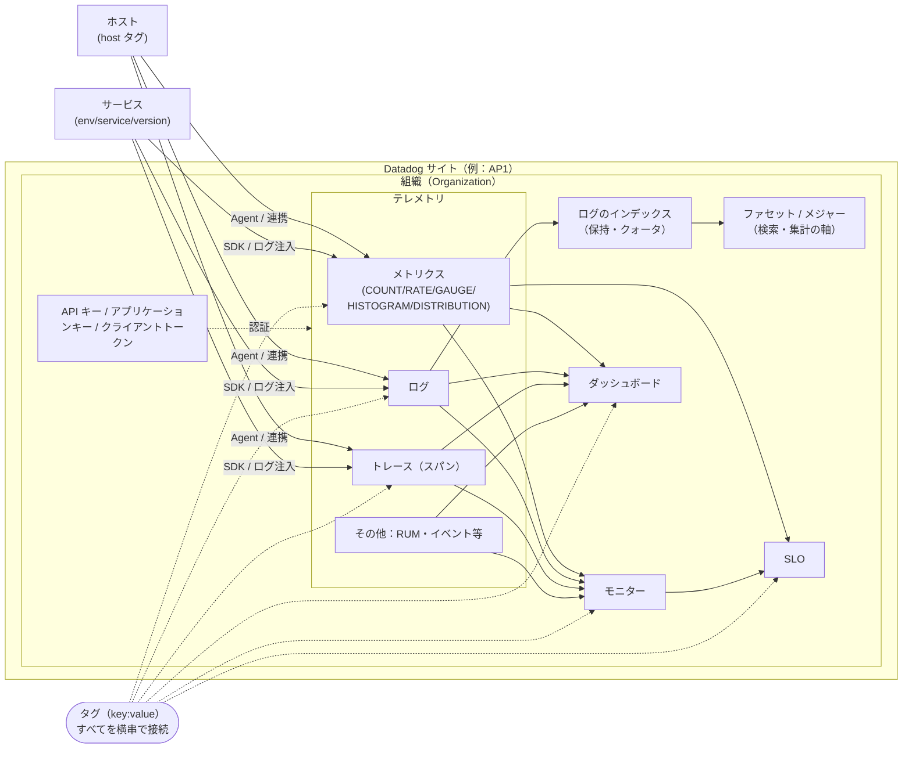
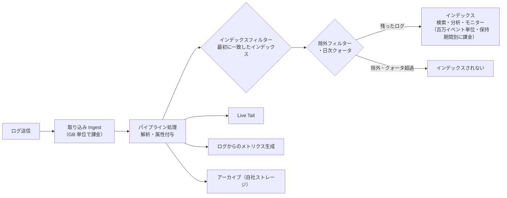

# 必須概念

## 概要

Datadog の各製品（Infrastructure、APM、Log Management、RUM、Security など）は、共通の概念の上に作られている。たとえば「タグ」はメトリクス・ログ・トレースのすべてに付き、「モニター」はほぼすべてのデータ種別を監視対象にでき、「組織」と「APIキー」はあらゆるデータ送信の前提になる。本ファイルは、Datadog を語るうえで必須となるこれらの共通概念を、**定義・相互関係・主要なデフォルト値と制限値**に絞って説明する入門ファイルである。各概念の網羅的な仕様は `02_リファレンス/` の該当ファイルにリンクする。

本ファイルは次の問いに答える。

| 問い | 該当節 |
|---|---|
| Datadog の概念どうしはどう関係しているのか | [1. 概念の全体像](#1-概念の全体像) |
| 「組織（org）」とは何か。サイトとどう関係するか。親子組織とは | [2. 組織（Organization）](#2-組織organization) |
| API キーとアプリケーションキーとクライアントトークンの違いは | [3. API キー・アプリケーションキー・クライアントトークン](#3-api-キーアプリケーションキークライアントトークン) |
| タグとは何か。書式や予約タグは | [4. タグ（Tag）](#4-タグtag) |
| `env` / `service` / `version` をなぜ揃えるのか。どう設定するか | [5. Unified Service Tagging](#5-unified-service-taggingenvserviceversion) |
| Datadog における「ホスト」とは。ホスト名はどう決まるか | [6. ホスト（Host）](#6-ホストhost) |
| 「サービス」とは何か。リソースとの違いは | [7. サービス（Service）](#7-サービスservice) |
| メトリクスの種類（COUNT/RATE/GAUGE/HISTOGRAM/DISTRIBUTION）の違いは | [8. メトリクスとメトリクス種別](#8-メトリクスとメトリクス種別) |
| ファセットとは何か。アトリビュートやタグとの違いは | [9. ファセット（Facet）とアトリビュート](#9-ファセットfacetとアトリビュート) |
| ログの「インデックス」とは何か。取り込みと何が違うのか | [10. インデックス（Log Indexes）](#10-インデックスlog-indexes) |
| モニターの種類・状態・アラートの単位は | [11. モニター（Monitor）](#11-モニターmonitor) |
| ダッシュボードのレイアウト種別、更新間隔は | [12. ダッシュボード（Dashboard）](#12-ダッシュボードdashboard) |
| SLO の種類・期間・エラーバジェットは | [13. SLO（Service Level Objective）](#13-slo-service-level-objective) |
| 各概念の主なデフォルト値・制限値は | [15. 制限値・クォータ・デフォルト値（早見表）](#15-制限値クォータデフォルト値早見表) |
| どの概念が課金に効くのか | [16. 課金への影響](#16-課金への影響) |

関連ファイル：オブザーバビリティそのものの考え方（シグナル、SLI/SLO の理論）は [オブザーバビリティの基礎](./observability-fundamentals.md)、データの流れ（Agent・Intake・サイト）は [Datadogのアーキテクチャ概観](./architecture-overview.md)、製品一覧は [製品ポートフォリオ全体像](./product-map.md)、画面の歩き方は [画面構成とナビゲーション](./ui-navigation.md) を参照。

> **基準日:** 本ファイルの記述は 2026-11-02 時点の公式ドキュメントに基づく。Datadog は継続的にリリースされる SaaS であり、数値や画面は変わり得る。

---

## 1. 概念の全体像

Datadog の概念は、大きく「**入れ物と認証**（組織・サイト・キー）」「**データの発生源**（ホスト・サービス）」「**データ**（メトリクス・ログ・トレースなど）」「**データに付く文脈**（タグ・アトリビュート）」「**データの保管と検索**（インデックス・ファセット）」「**データの活用**（モニター・ダッシュボード・SLO）」に整理できる。タグはこれらすべてを横串でつなぐ共通キーである。

| 層 | 概念 | 一言でいうと | 詳細リファレンス |
|---|---|---|---|
| 入れ物と認証 | 組織（Organization） | データ・ユーザー・設定の境界となるテナント | [組織・ユーザー・権限管理](../02_リファレンス/platform/account-and-access-management.md) |
| 入れ物と認証 | サイト（Site） | 組織が存在するリージョン（AP1 など）。サイト間でデータは共有されない | [Datadog Sites](../02_リファレンス/platform/datadog-sites.md) |
| 入れ物と認証 | API キー / アプリケーションキー | データ送信用の組織キーと、API 操作用のユーザー（サービスアカウント）キー | [API とキー管理](../02_リファレンス/platform/api-and-keys.md) |
| 発生源 | ホスト | 物理または仮想の OS インスタンス。`host` タグで識別 | [Infrastructure Monitoring](../02_リファレンス/infrastructure/infrastructure-monitoring.md) |
| 発生源 | サービス | エンドポイント・クエリ・ジョブのまとまり。`service` タグで識別 | [APM の概念とインジェスト制御](../02_リファレンス/apm/apm-concepts-and-ingestion.md) |
| 文脈 | タグ | `key:value` 形式のラベル。絞り込み・集約・相関の軸 | [Tagging](../02_リファレンス/platform/tagging.md) |
| 文脈 | Unified Service Tagging | `env`・`service`・`version` の3予約タグを全テレメトリで揃える仕組み | [Tagging](../02_リファレンス/platform/tagging.md) |
| データ | メトリクス種別 | 送信時の型（COUNT/RATE/GAUGE/HISTOGRAM/DISTRIBUTION/SET） | [Metrics](../02_リファレンス/platform/metrics.md) |
| 保管と検索 | インデックス | ログを保持・検索可能にする単位（保持期間・日次クォータ） | [Indexes・保持・アーカイブ](../02_リファレンス/logs/log-indexes-retention-archives.md) |
| 保管と検索 | ファセット | ログ等のタグ/属性を検索・集計の軸にしたもの | [ログ検索と分析](../02_リファレンス/logs/log-search-and-analytics.md) |
| 活用 | モニター | 条件を満たしたら通知するアラート定義 | [Monitors](../02_リファレンス/platform/monitors.md) |
| 活用 | ダッシュボード | ウィジェットを並べた可視化画面 | [Dashboards](../02_リファレンス/platform/dashboards.md) |
| 活用 | SLO | SLI の目標値と期間。エラーバジェットを管理 | [SLO](../02_リファレンス/platform/slo.md) |

---

## 2. 組織（Organization）

### 2.1 組織の定義

Datadog の組織（Organization、略して org）は、**データ・ユーザー・設定（ロール、キー、連携設定など）の境界となる単位**である。公式ドキュメントは「組織」そのものの定義文を独立して置いていないが、マルチ組織機能の説明では各組織を「独自のデータ・ユーザー・設定を持つ独立した環境」として扱い、子組織どうしは互いのデータにアクセスできないとしている。[出典](https://docs.datadoghq.com/account_management/multi_organization/)

| 項目 | 内容 |
|---|---|
| 境界になるもの | メトリクス・ログ・トレースなどのデータ、ユーザー、ロール、API キー、連携設定、ダッシュボード・モニター等の設定 |
| API キーとの関係 | API キーは組織に一意（unique to your organization）。Agent はこのキーで送信先の組織を特定する [出典](https://docs.datadoghq.com/account_management/api-app-keys/) |
| ユーザーとの関係 | 1人のユーザーが複数組織（親と複数の子）に所属できる。組織の切り替えはユーザーアカウント設定メニューから行う [出典](https://docs.datadoghq.com/account_management/multi_organization/) |
| サイトとの関係 | 組織はちょうど1つのサイト上に存在し、データはそのサイトに留まる（次節） |

### 2.2 組織とサイト（リージョン）

Datadog のサイトは「完全に独立」しており、サイト間でデータを共有できない。そのため組織は1つのサイトに作られ、データはそのサイトに保存される。[出典](https://docs.datadoghq.com/getting_started/site/)

| サイト | サイト URL | サイトパラメータ（`DD_SITE` 等） | 所在 |
|---|---|---|---|
| US1 | `https://app.datadoghq.com` | `datadoghq.com` | 米国 |
| US3 | `https://us3.datadoghq.com` | `us3.datadoghq.com` | 米国 |
| US5 | `https://us5.datadoghq.com` | `us5.datadoghq.com` | 米国 |
| EU1 | `https://app.datadoghq.eu` | `datadoghq.eu` | EU（ドイツ） |
| US1-FED | `https://app.ddog-gov.com` | `ddog-gov.com` | 米国 |
| US2-FED | `https://us2.ddog-gov.com` | `us2.ddog-gov.com` | 米国 |
| AP1 | `https://ap1.datadoghq.com` | `ap1.datadoghq.com` | 日本 |
| AP2 | `https://ap2.datadoghq.com` | `ap2.datadoghq.com` | オーストラリア |
| UK1 | `https://uk1.datadoghq.com` | `uk1.datadoghq.com` | 英国 |

出典: [Getting Started with Datadog Sites](https://docs.datadoghq.com/getting_started/site/)（2026-11-02 取得）。執筆規約のサイト一覧（§2）に含まれない US2-FED と UK1 も、公式ページには掲載されている。

> **サイト差異:** Agent・SDK・API クライアントには送信先サイトを正しく設定する必要がある（AP1 なら `ap1.datadoghq.com`）。サイトを誤ると、正しい API キーでも別サイトの組織には届かない。機能提供・エンドポイントのサイト差異は [Datadog Sites](../02_リファレンス/platform/datadog-sites.md) を参照。

### 2.3 親組織と子組織（マルチ組織アカウント）

マルチ組織アカウント（Multi-organization account）は、1つの親組織（parent org）が複数の子組織（child org）を管理する仕組みである。公式ドキュメントは、互いのデータを見せてはならない顧客を抱えるマネージドサービスプロバイダー（MSP）での利用を典型例として挙げている。[出典](https://docs.datadoghq.com/account_management/multi_organization/)

| 項目 | 内容 |
|---|---|
| 有効化 | 既定では無効。Datadog サポートへの連絡で有効化 |
| 子組織の作成 | New Organization ページで名前（32 文字以内）を入力して作成。招待されたユーザーには Datadog Admin ロールが付与される |
| プランと請求 | 子組織は親のプランを継承し、親の請求アカウントに追加される。請求の変更は営業担当へ連絡 |
| データの分離 | 子組織どうしは互いのデータにアクセスできない。組織横断でメトリクスをクエリするには別機能（cross-organization visibility）が必要 |
| SAML | 子組織には継承されない。子組織ごとに個別設定が必要 |
| アカウント設定 | IP 許可リスト等のアカウント設定は親から子へ継承されない |
| 使用量の確認 | 親組織の Plan & Usage > Usage & Cost で、親と全子組織の合計・組織別の使用量を確認し CSV でダウンロードできる |
| Usage Attribution | 親組織で最大3つのタグキーに使用量を按分できる（Enterprise プランの機能）。子組織で設定した按分は親に集約されない |
| カスタムサブドメイン | 既定では無効。サポートへの連絡で有効化。サブドメイン URL を開くとその組織へコンテキストが切り替わる |
| 子組織数の上限 | 公開情報では確認できず |

出典: [Managing Multiple-Organization Accounts](https://docs.datadoghq.com/account_management/multi_organization/)。大規模・マルチ組織の設計論は [大規模・マルチorg運用](../04_応用編/large-scale-and-multi-org.md) を参照。

### 2.4 ユーザー・ロール・Teams（概要）

組織内のアクセス制御は、ユーザーにロール（Role）を割り当てる RBAC で行う。既定の管理ロールは次の3つである。[出典](https://docs.datadoghq.com/account_management/rbac/)

| 既定ロール | 主な権限 |
|---|---|
| Datadog Admin Role | 請求情報へのアクセス、API キーの失効、ユーザー管理、読み取り専用ダッシュボードの設定、標準ユーザーの管理者への昇格 |
| Datadog Standard Role | ダッシュボード・モニター・イベント・ノートブック等の閲覧と変更、他ユーザーの組織への招待 |
| Datadog Read Only Role | 編集不可。顧客や事業部外への読み取り専用共有に有用 |

- **カスタムロール**：独自の権限セットを持つロールを UI・Roles API・SAML で管理できる。作成・編集には User Access Manage 権限が必要。どのプラン/エディションで使えるかは RBAC のページでは明記されていない（[エディション・プラン](../03_導入編/editions-and-plans.md) を参照）。[出典](https://docs.datadoghq.com/account_management/rbac/)
- **Datadog Teams**：ユーザーのグループで、ダッシュボード・サービス・モニター・インシデント・SLO・Synthetic テストなどのリソースをチームに紐付けられる。チームは **team handle** で識別され、検索バーやファセットでは `team:<team-handle>` または `teams:<team-handle>` として現れる。handle に使える文字は `a-z`、`0-9`、`._-:/` で、末尾にアンダースコアは使えない。対応する Team が存在する handle は「defined team」となり Team フィルター等の機能が使える。チームの作成・削除・handle 変更には Teams Manage 権限が必要。[出典](https://docs.datadoghq.com/account_management/teams/)

ロール・権限・SAML・サービスアカウントの詳細は [組織・ユーザー・権限管理](../02_リファレンス/platform/account-and-access-management.md) を参照。

---

## 3. API キー・アプリケーションキー・クライアントトークン

### 3.1 3種類のキーの違い

Datadog には用途の異なる3種類の認証情報がある。最も重要な区別は「**API キー＝組織のデータ送信用**」「**アプリケーションキー＝API キーと組み合わせてプログラムから API を操作する、ユーザー（またはサービスアカウント）に紐づくキー**」である。[出典](https://docs.datadoghq.com/account_management/api-app-keys/)

| 項目 | API キー | アプリケーションキー | クライアントトークン |
|---|---|---|---|
| 主な用途 | Agent などからのメトリクス・イベント等の送信 | API キーと組み合わせた、データ読み取り・リソース管理・管理操作などの API 利用 | ブラウザ・モバイル・React Native・Flutter・Roku・RUM クライアントからのデータ送信 |
| 紐づく対象 | 組織（組織に一意） | 作成したユーザー（既定でそのユーザーの権限を持つ） | 組織（組織に一意） |
| クライアント側（ブラウザ等）での利用 | 不可（露出するため） | 公式ページに明記なし（ユーザー権限を持つ秘密情報のため露出させない）【推定】 | 可（このための仕組み） |
| 上限 | 組織あたり既定 50 個（増枠はサポートへ連絡）。Managed API キーは上限に数えない | 公開情報では確認できず | 公開情報では確認できず |
| 作成ユーザーが無効化された場合 | 引き続き有効 | 失効する | 引き続き有効 |
| 失効・削除後の復元 | Revoked 状態で 7 日間保持され UI からのみ復元可。7 日後に完全削除 | 失効は恒久的（復元期間なし） | 削除は恒久的（復元期間なし） |
| スコープ（権限の絞り込み） | なし | あり（最小権限の原則） | なし |
| 管理画面 | Organization Settings | Organization Settings > Application Keys | Organization Settings > Client Tokens |

出典: [API and Application Keys](https://docs.datadoghq.com/account_management/api-app-keys/)、[Glossary](https://docs.datadoghq.com/glossary/)

> **補足:** 公式用語集は「API キーはユーザーやアプリケーションを認証しない。プログラムから API にアクセスするにはアプリケーションキーを使う」と説明している。[出典](https://docs.datadoghq.com/glossary/)公式ページでブラウザ・モバイル・TV アプリでの使用禁止が明示されているのは API キーであり、アプリケーションキーについては明記がない。ただしアプリケーションキーは作成ユーザーの権限で API を操作できる秘密情報であるため、クライアント側に置かないのが妥当である【推定】。

### 3.2 API キーの要点

- **Managed API キー**：Datadog の連携やサービスが作成したキーで「Managed」と表示される。上限に数えられず、閲覧・失効はできるが値の表示や名前変更はできない。[出典](https://docs.datadoghq.com/account_management/api-app-keys/)
- **名前**：組織内で一意である必要がある。[出典](https://docs.datadoghq.com/account_management/api-app-keys/)
- **使い分け**：公式ドキュメントは、デプロイ方式ごとに複数の API キーを使い、ローテーションや特定経路だけの失効を容易にすることを推奨している。[出典](https://docs.datadoghq.com/account_management/api-app-keys/)

### 3.3 アプリケーションキーの要点

| 項目 | 内容 |
|---|---|
| 所有者 | 作成したユーザー。ユーザー間で移譲できない。共有したい場合はサービスアカウントを使う |
| スコープ | 未指定ならキー作成者の全権限を持つ。スコープは大文字小文字を区別し、UI または API で設定 |
| スコープ設定に必要な権限 | 自分のキー：`user_app_keys`／他ユーザーのキー：`org_app_keys_write`／サービスアカウントのキー：`service_account_write` |
| 権限不足時 | 403 Forbidden。キー所有者が持たない権限は、スコープを付けても行使できない |
| ロール変更の影響 | ユーザーのロールを変えても、そのユーザーのキーのスコープは変わらない |
| Actions API アクセス | App Builder、Actions Connections、Workflow Automation の API に必要。既定で無効 |
| One-Time Read（OTR）モード | シークレットを作成時にのみ表示し、以後 UI/API で取得できなくする。2025-08-20 以降に作成された新規親組織（とその子組織）では恒久的に有効。既存組織では有効化後 3 か月間は切り替え可能で、連続 3 か月経過で恒久化。切り替えには `org_app_keys_write` と `org_management` の両方が必要 |

出典: [API and Application Keys](https://docs.datadoghq.com/account_management/api-app-keys/)

> **サイト差異:** アプリケーションキーのシークレットを作成後に再取得できない挙動は、AP2・`app.ddog-gov.com`（US1-FED）・`us2.ddog-gov.com`（US2-FED）では常に適用される。US1（app）・US3・US5・EU1（eu）・AP1 では OTR を有効にした場合に適用される。[出典](https://docs.datadoghq.com/account_management/api-app-keys/)

### 3.4 キー運用の共通事項

| 項目 | 内容 |
|---|---|
| 有効期限 | 組み込みの有効期限はない |
| 保管 | ソースコードや環境ファイルではなく、シークレットマネージャー（AWS Secrets Manager、HashiCorp Vault、Azure Key Vault 等）に保管する。AWS Secrets Manager は Datadog キーのマネージドローテーションに対応 |
| 反映の遅延 | 結果整合性モデル。作成・失効の反映に数秒かかることがあり、直後のリクエストが 401/403 になる場合がある。短い指数バックオフでリトライする |
| 検証エンドポイント | API キー：`/api/v1/validate`／アプリケーションキーとの組：`/api/v2/validate_keys` |
| 漏えい時の対応 | ① 該当キーを失効（影響範囲が大きい・不明なら ②〜⑤ を先に検討）② 公開ファイルとコミット履歴から削除 ③ 新しいキーを作成 ④ 影響サービスを更新 ⑤ 不正アクセス（新規ユーザー・リソース・ロール変更）を監査 |
| 最終使用日時 | Last used タイムスタンプは全顧客が参照可能。Audit Trail を使うとより過去まで遡れる |

出典: [API and Application Keys](https://docs.datadoghq.com/account_management/api-app-keys/)。キーの形式・API 認証ヘッダー・レート制限などは [API とキー管理](../02_リファレンス/platform/api-and-keys.md) を参照。

---

## 4. タグ（Tag）

### 4.1 タグの定義と役割

Datadog のタグは、テレメトリ（メトリクス・ログ・トレース等）やリソース（ホスト・モニター・ダッシュボード等）に付けるラベルで、`<key>:<value>` または `<value>` の形式をとる。Datadog は、意味が明確で「キーでのグループ化」など豊富なクエリができる `<key>:<value>` 形式を推奨している。[出典](https://docs.datadoghq.com/getting_started/tagging/)

- **キー**は識別子（例：`env`、`instance`、`name`）、**値**はそのキーの具体的な値。値はリソースごとに一意である必要はなく、多数のリソースで共有される。
- キーは**最初のコロンより前**の部分。例：`env:staging:east` のキーは `env`、値は `staging:east`。
- タグにより、Events、Dashboards、Infrastructure、Monitors、Metrics、Integrations、APM、RUM & Session Replay、Synthetic Monitoring、Notebooks、Logs、SLOs、Developer API、Billing、CI Visibility などのほぼ全製品で、データの絞り込み（filter）とグループ化（group by）ができる。[出典](https://docs.datadoghq.com/getting_started/tagging/)

### 4.2 タグの書式ルール

| ルール | 内容 |
|---|---|
| 先頭文字 | 英字で始める（`<value>` 形式でも同じ）。数字始まりは一部（Agent レベルの `env` タグ等）で動作するが製品横断で一貫して動作する保証はなく、英字始まりを推奨 |
| 使用可能文字 | 先頭以降：Unicode 文字、数字、アンダースコア `_`、マイナス `-`、コロン `:`、ピリオド `.`、スラッシュ `/`。`@` は HTTP で取り込むログに限り使用可 |
| 不正な文字 | 上記以外（カンマ、絵文字、バックスラッシュ、スペース等）はアンダースコアに変換 |
| アンダースコアの正規化 | 先頭・末尾のアンダースコアは除去、連続するアンダースコアは1つにまとめる |
| 最大長 | **200 文字**（キー・コロン・値の合計） |
| 大文字小文字 | スパンタグとメトリクスタグは小文字に正規化される（キーのキャメルケースは避ける）。スパン属性・ログ属性は大文字小文字を区別し、正規化されない |
| `DD_TAGS` での空白 | 空白はタグの区切りとして扱われ、アンダースコアに変換されない。値に空白を含めたい場合は YAML 設定ファイルや連携のアノテーションを使う |

出典: [Getting Started with Tags](https://docs.datadoghq.com/getting_started/tagging/)、[Assigning Tags](https://docs.datadoghq.com/getting_started/tagging/assigning_tags/)

### 4.3 予約タグキー

次のタグキーは Datadog が特別な意味を持たせている予約キーである。[出典](https://docs.datadoghq.com/getting_started/tagging/)

| 予約キー | 用途 |
|---|---|
| `host` | メトリクス・トレース・プロセス・ログの相関 |
| `device` | デバイスやディスク単位でメトリクス・トレース・プロセス・ログを分離 |
| `source` | スパンのフィルタリング、Log Management での自動パイプライン作成 |
| `service` | アプリケーション固有データをメトリクス・トレース・ログ横断でスコープ |
| `env` | 同上（環境） |
| `version` | 同上（バージョン） |
| `team` | リソースへのオーナーシップ（担当チーム）の割り当て |

### 4.4 タグの付け方

| 方法 | 内容 |
|---|---|
| 設定ファイル | ホストタグは `datadog.yaml` の `tags` に記載し、転送されるすべてのメトリクス・トレース・ログに付く。連携（インテグレーション）のタグは `conf.d` 配下の各 YAML に記載 |
| 環境変数 | コンテナ化した Agent では `DD_TAGS` でホストタグを設定（空白区切り） |
| UI | Host Map / Infrastructure List のホストオーバーレイ（Add Tags）、モニター（Edit Tags）、AWS 連携タイル、SLO 作成画面など。**UI でのホストタグ変更は反映に最大 5 分かかる** |
| API | チェック実行・イベント・メトリクス・トレースの送信時、モニター・SLO の作成/編集時、ホストタグの追加/更新時など |
| DogStatsD | メトリクス・イベント・サービスチェックの送信時に付与 |
| 連携による継承 | AWS や Chef などの連携でリソースに付けたタグは、Datadog に送られるホスト・メトリクスに継承される。Web 連携の `CamelCase` タグはアンダースコア区切りに変換（例：`TestTag` → `test_tag`） |
| Autodiscovery（コンテナ） | Autodiscovery の設定テンプレートでタグを設定。Unified Service Tagging に対応するため Datadog はコンテナ環境で Autodiscovery を推奨 |

出典: [Assigning Tags](https://docs.datadoghq.com/getting_started/tagging/assigning_tags/)

**継承と優先順位:** メトリクス・ログ・トレース・連携データは、紐づくホスト名に基づいてホストレベルのタグを継承する。Agent はタグの優先順位を強制せず、すべてのソースからタグを集め、キーごとに一意な値をすべて保持して送信する。そのため、同じキーに複数の値が付くことがある（ダッシュボード等では目的の値で明示的に絞り込むことが推奨される）。[出典](https://docs.datadoghq.com/getting_started/tagging/)

**Kubernetes のタグカーディナリティ:** `DD_CHECKS_TAG_CARDINALITY` と `DD_DOGSTATSD_TAG_CARDINALITY` は `low`（既定。`kube_namespace` などクラスターレベル）、`orchestrator`（`pod_name` などポッドレベル）、`high`（`container_id` などコンテナレベル）を取る。コンテナレベルのタグを DogStatsD に付けると、ホスト単位ではなくコンテナ単位のメトリクスになり、カスタムメトリクス数と課金が増え得る。[出典](https://docs.datadoghq.com/getting_started/tagging/assigning_tags/)

### 4.5 タグの使い方（検索構文の基本）

| 画面・機能 | 書き方の例 |
|---|---|
| 全般 | 複数タグの**包含は AND**、複数タグの**除外は OR** で評価される |
| ダッシュボード / メトリクスクエリ | `from` でタグ絞り込み（`NOT`/`!`、`AND`/`,`、`OR`、`IN`、`NOT IN` が使える）、`avg by` でタグ値ごとに1本の線 |
| モニター管理画面 | `tag:"service:coffee-house"`、否定は先頭に `-`。ワイルドカードは引用符ではなくコロンをエスケープ（`tag:service\:*`） |
| ログ・APM・RUM の検索バー | `service:coffee-house` のように記述 |
| クラウド連携の取り込みフィルター（AWS/Azure/GCP） | カンマ区切りの `key:value`。包含は OR、`!` で除外し除外が優先。`?` と `*` のワイルドカードに対応 |

出典: [Using Tags](https://docs.datadoghq.com/getting_started/tagging/using_tags/)

> **注意:** モニターに付けるタグ（モニター自体の整理用）と、モニターが監視するメトリクスのタグは別物である。[出典](https://docs.datadoghq.com/getting_started/tagging/using_tags/)

### 4.6 カーディナリティとタグ設計の注意

公式用語集では、カーディナリティ（cardinality）を「メトリクスについて、あるタグキーに紐づくタグ値の数」と定義している。[出典](https://docs.datadoghq.com/glossary/) タグ値の組み合わせが増えるほどメトリクスの時系列（カスタムメトリクス数）が増え、課金にも影響する（[8.5](#85-カスタムメトリクスの数え方)）。

公式ドキュメントの推奨事項は次のとおり。[出典](https://docs.datadoghq.com/getting_started/tagging/)

- エポックタイムスタンプ、ユーザー ID、リクエスト ID など**上限のない値**をタグにしない（メトリクスが際限なく増える）。
- Unified Service Tagging（`env`・`service`・`version`）を使う。
- コンテナ・VM・クラウドインフラは、ホスト単位ではなく `service` 単位で集約して見る。
- 異なるソースからの重複キーを避けるため、区別しやすいキー名（例：`infra_service`）を使う。

タグの網羅的仕様は [Tagging](../02_リファレンス/platform/tagging.md)、命名規約・必須タグの決め方は [タグ戦略の実践](../04_応用編/tagging-strategy.md) を参照。

---

## 5. Unified Service Tagging（env/service/version）

### 5.1 Unified Service Tagging の定義

Unified Service Tagging（統合サービスタグ付け）は、予約タグ **`env`・`service`・`version`** をトレース・メトリクス・ログ・RUM などすべてのテレメトリに一貫して付けることで、テレメトリどうしを結び付ける仕組みである。これにより、バージョン別にトレースやコンテナメトリクスを絞り込む、トレース・メトリクス・ログ間を行き来する、環境・バージョン単位でサービスを見る、といったことができる。[出典](https://docs.datadoghq.com/getting_started/tagging/unified_service_tagging/)

| タグ | 意味 | 典型値 |
|---|---|---|
| `env` | 環境 | `prod`、`staging`、`dev` |
| `service` | サービス名（[7章](#7-サービスservice)） | `web-store`、`checkout-api` |
| `version` | デプロイされたコードのバージョン。**デプロイごとに変える**（コードのバージョンが違えば値も変える） | `1.4.2`、イメージタグ、Git SHA |

シグナル相関の考え方（ログとトレースの相関など）は [オブザーバビリティの基礎 §3](./observability-fundamentals.md) を参照。本節は設定の要点に絞る。

### 5.2 設定方法（環境別）

| 環境 | 設定する値 | 補足 |
|---|---|---|
| 共通の環境変数 | `DD_ENV`、`DD_SERVICE`、`DD_VERSION` | APM の SDK がトレースに付与 |
| Docker / ECS のラベル | `com.datadoghq.tags.env`、`com.datadoghq.tags.service`、`com.datadoghq.tags.version` | ECS はタスク定義の `dockerLabels`。Fargate ではアプリケーションコンテナに付ける（Agent コンテナではない） |
| Kubernetes のラベル | `tags.datadoghq.com/env`、`tags.datadoghq.com/service`、`tags.datadoghq.com/version` | 親ワークロード（Deployment 等）とポッドテンプレートの両方に付ける。コンテナ個別は `tags.datadoghq.com/<CONTAINER_NAME>.env` 等 |
| Kubernetes の環境変数 | `DD_ENV` 等を downward API でラベルから設定 | Cluster Agent の Admission Controller で自動注入も可能 |
| Kubernetes のグローバル `env` | Datadog Operator の `spec.global.tags` または Helm の `datadog.tags` に `env:<ENV>` | ホストレベルのタグかつ APM の既定 `env` になる。ポッドに別の `env` ラベルがあると両方の値が付く |
| 非コンテナ環境 | 環境変数をプロセス単位で設定（実行コマンドのインライン、systemd/initd のユニット等） | 1ホスト1サービスなら `datadog.yaml` に `env` と `tags: - service:<SERVICE>`。複数サービスなら `service` はプロセスチェックで個別設定し、グローバルな `service` タグとの二重付与を避ける。システムメトリクスへの `version` 付与は非推奨 |
| ログ | SDK のログ自動注入を有効化すると `env`・`service`・`version` が注入される | Autodiscovery のログ設定がない場合、ログの `service` はコンテナのショートイメージ名が既定になる |
| RUM | ブラウザ SDK の初期化で `service`・`env`・`version` を指定 | — |
| Synthetic | APM Integration for Browser Tests 設定で APM ヘッダーを送る URL を指定（`*` 可） | — |
| カスタムメトリクス（DogStatsD） | DogStatsD クライアントが `DD_*` のタグを自動付与 | .NET と PHP のクライアントは非対応。タグは追記型 |
| サーバーレス（AWS Lambda） | サーバーレスの設定ドキュメントに従う | [Serverless Monitoring](../02_リファレンス/infrastructure/serverless.md) |

出典: [Unified Service Tagging](https://docs.datadoghq.com/getting_started/tagging/unified_service_tagging/)

コンテナ環境では Autodiscovery の有効化が前提で、Docker では Agent が Docker ソケットにアクセスできる必要がある。SDK を持たないソフトウェア（Redis、PostgreSQL、NGINX 等）は、ラベルのみの「部分設定」でタグ付けできる。[出典](https://docs.datadoghq.com/getting_started/tagging/unified_service_tagging/)

### 5.3 要件と自動バージョンタグ

| 項目 | 内容 |
|---|---|
| Agent 最低バージョン | 6.19.x / 7.19.x 以上 |
| SDK 最低バージョン | .NET 1.17.0+、C++ 0.1.0+、Go 1.24.0+、Java 0.50.0+、Node 0.20.3+、PHP 0.47.0+、Python 0.38.0+、Ruby 0.34.0+ |
| 自動バージョンタグ（APM のみ） | Agent 7.52.0 以上。手動設定値が最優先（上書きされない）→ `{image_tag}_{Git コミット SHA 先頭7桁}` → `{image_tag}` または SHA 先頭7桁のどちらか利用可能な方 |
| ECS Fargate の制約 | Fluent Bit / FireLens 経由の場合、Unified Service Tagging はメトリクスとトレースのみ対応しログは非対応 |

出典: [Unified Service Tagging](https://docs.datadoghq.com/getting_started/tagging/unified_service_tagging/)

### 5.4 OpenTelemetry との対応

OpenTelemetry（OTel）で計装する場合、Datadog 固有の `DD_SERVICE`・`DD_ENV`・`DD_VERSION` はそのままでは使えず、OTel のリソース属性を使う。[出典](https://docs.datadoghq.com/getting_started/tagging/unified_service_tagging/)

| OTel リソース属性 | Datadog タグ | 備考 |
|---|---|---|
| `deployment.environment.name` | `env` | Agent 7.58.0+、Datadog Exporter v0.110.0+、または Datadog OTLP intake が必要 |
| `deployment.environment`（非推奨） | `env` | — |
| `service.name` | `service` | `OTEL_SERVICE_NAME` は `OTEL_RESOURCE_ATTRIBUTES` 内の `service.name` を上書き |
| `service.version` | `version` | — |

設定手段は `OTEL_RESOURCE_ATTRIBUTES` 環境変数、SDK の `Resource`、Collector の transform processor のいずれか。詳細は [OpenTelemetry サポート](../02_リファレンス/platform/opentelemetry.md) を参照。

---

## 6. ホスト（Host）

### 6.1 ホストの定義

Datadog における「ホスト」は、公式用語集では「コンピューターまたは仮想マシン」[出典](https://docs.datadoghq.com/glossary/)、課金ドキュメントでは「物理または仮想の OS インスタンス（a physical or virtual operating system instance）」と定義されている。[出典](https://docs.datadoghq.com/account_management/billing/pricing/) ホストは `host` 予約タグで識別され、ホストに紐づくメトリクス・ログ・トレース・プロセスは `host` を軸に相関される。

| 観点 | 内容 |
|---|---|
| 識別子 | 正規ホスト名（canonical hostname）。Agent は自動的にホスト名を `host` タグとして付与 |
| ホストタグ | ホストに付けたタグはそのホストのメトリクス・ログ・トレースに継承される（[4.4](#44-タグの付け方)） |
| 主な画面 | Infrastructure List、Host Map（[画面構成とナビゲーション](./ui-navigation.md)） |
| 課金上の意味 | Infrastructure Monitoring・APM などの多くの製品がホスト数を課金単位とする（[16章](#16-課金への影響)） |

### 6.2 ホスト名の決まり方

Agent は複数のホスト名候補（`agent-hostname`、`hostname`、`ec2-hostname`、`instance-id`、`socket-hostname`、`socket-fqdn` など。Agent の `status` サブコマンドで確認可能）を集め、次の規則で最初に該当したものを正規ホスト名とする。[出典](https://docs.datadoghq.com/agent/faq/how-datadog-agent-determines-the-hostname/)

| 順位 | 候補 | 条件 |
|---|---|---|
| 1 | `agent-hostname` | Agent 設定ファイルで指定したホスト名。ただし `ip-` または `domu` で始まるものは除く |
| 2 | `hostname` | DNS ホスト名（Linux では `hostname -f`）。ただし `ip-192-0-0-1` のような EC2 既定名は除く |
| 3 | `instance-id` | ホストから EC2 メタデータエンドポイントに到達できる場合 |
| 4 | `hostname` | 最終手段として DNS ホスト名（EC2 既定名でも採用） |

- `localhost.localdomain` のようなありふれた（一意でない）名前はその規則を満たさず次の規則へ進む。
- 正規名以外の候補はホストエイリアスとして送られる。エイリアスは Infrastructure List の詳細パネルにのみ表示され、検索・フィルターには使えない。
- 設定ファイルの `hostname`（または環境変数 `DD_HOSTNAME`）は自動検出より優先される。アップグレード時のホスト名変化を避ける手段としても挙げられている。
- `hostname_fqdn`：Linux/macOS の Agent v6.3 以降で v5 と同じ FQDN 方式にする設定（既定は無効）。Windows は既定で非修飾ホスト名を報告し、v6.5 以降で `hostname_fqdn: true` により FQDN を報告する。

出典: [How does Datadog determine the Agent hostname?](https://docs.datadoghq.com/agent/faq/how-datadog-agent-determines-the-hostname/)

`datadog.yaml` の `hostname` は RFC-1123 に準拠（英字・数字・ハイフンのみ）する必要がある。ホスト名を変更すると、旧ホスト名は UI 上に **2 時間**表示され続けるが新しいメトリクスは表示されない（API では旧ホスト名のデータを引き続きクエリ可能）。[出典](https://docs.datadoghq.com/getting_started/tagging/assigning_tags/)

Agent の構成・ホスト名関連の設定キーは [Datadog Agent](../02_リファレンス/platform/agent.md)・[Agent 設定リファレンス](../02_リファレンス/platform/agent-configuration.md)、クラウド連携経由のホストの扱いは各クラウド連携ファイルを参照。

---

## 7. サービス（Service）

### 7.1 サービスとリソースの定義

Datadog APM では、**サービス**を「アプリケーションの一部を構成する、エンドポイント・クエリ・ジョブのまとまり」と定義する（例：API サービス配下の URL エンドポイント群、crond サービス配下の定期ジョブ群）。**リソース**は、アプリケーションの特定のドメインで、典型的には計装された Web エンドポイント・データベースクエリ・バックグラウンドジョブを指す（例：`GET /productpage`）。[出典](https://docs.datadoghq.com/tracing/glossary/)

| 概念 | 定義 | 例 |
|---|---|---|
| サービス（Service） | エンドポイント・クエリ・ジョブのまとまり。`service` タグで識別 | `web-store`、`postgres`、`checkout-api` |
| リソース（Resource） | サービス内の特定の処理（エンドポイント、クエリ、ジョブ） | `GET /productpage`、`SELECT ... FROM orders` |
| トレース（Trace） | リクエスト処理にかかった時間と状態の記録。1つ以上のスパンで構成 | — |
| スパン（Span） | 分散システムにおける一定時間の論理的な作業単位 | `web.request` |

出典: [APM Terms and Concepts](https://docs.datadoghq.com/tracing/glossary/)、[Glossary](https://docs.datadoghq.com/glossary/)

### 7.2 サービスはどこで管理されるか

APM を計装すると、サービスは **Software Catalog**（旧称：Service Catalog。現行の公式ドキュメントでは単に「Catalog」とも表記）に自動的に登録され、Service Map 上で依存関係を可視化できる。[出典](https://docs.datadoghq.com/tracing/glossary/) Catalog には、テレメトリからの自動検出のほか、エンティティ定義（Entity Definition）による宣言、Backstage や ServiceNow などからのインポートでもエンティティが登録される。サービスの種類（`span.type` 由来）は Cache、Custom、DB、Serverless function、Web などである。[出典](https://docs.datadoghq.com/internal_developer_portal/software_catalog/)

| 観点 | 内容 |
|---|---|
| サービス名の由来 | APM：SDK の `DD_SERVICE` または OTel の `service.name`。ログ：`service` 予約属性（Autodiscovery ログ設定がない場合はコンテナのショートイメージ名）。インフラ：ホストタグ・ラベル |
| メタデータ（オーナー、オンコール、リポジトリ等） | Catalog のエンティティ定義で管理。保持期間は「アカウント存続期間」[出典](https://docs.datadoghq.com/developers/guide/data-collection-resolution-retention/) |
| サービス統計の保持 | APM のサービス/リソース統計は 30 日 [出典](https://docs.datadoghq.com/developers/guide/data-collection-resolution-retention/) |

Software Catalog の詳細は [Software Catalog](../02_リファレンス/platform/software-catalog.md)、APM の概念全体は [APM の概念とインジェスト制御](../02_リファレンス/apm/apm-concepts-and-ingestion.md) を参照。

> **入門者の注意:** 「サービス」は APM 由来の概念だが、Unified Service Tagging によりメトリクスやログにも `service` タグとして付く。同じサービスがテレメトリごとに別名（例：`checkout` と `checkout-service`）になっていると相関が切れるため、名前を揃えることが重要である。

---

## 8. メトリクスとメトリクス種別

### 8.1 メトリクスの構造

Datadog のメトリクスは「環境に関するあらゆるものを時系列で追跡できる数値」であり、値とタイムスタンプを持つデータポイントの並び（時系列、timeseries）として保存される。メトリクスは連携（1,000 以上のインテグレーション）、Agent の標準メトリクス（CPU・ディスク等）、カスタムメトリクス（Agent・DogStatsD・HTTP API）、ログ等からの生成メトリクスとして作られる。[出典](https://docs.datadoghq.com/metrics/)

- 小数点以下の秒を含むタイムスタンプは最も近い秒に丸められる。
- 同じタイムスタンプのデータポイントが複数ある場合は、最新のものが上書きする。
- メトリクス（タグと値）の保持期間は **15 か月**。[出典](https://docs.datadoghq.com/developers/guide/data-collection-resolution-retention/)

**図: メトリクスクエリの構成（anatomy）** — クエリ `avg:system.io.r_s{app:shopist} by {host}.rollup(avg, 3600)` を色分けして分解した図。左から「4. Space Aggregation（aggregator）」として `avg:`、「1. Metric Name」として `system.io.r_s`、「2. Filter/Scope」として `{app:shopist}`、「4. Space Aggregation（Grouping by tag）」として `by {host}`、「3. Time Aggregation（aggregator, interval）」として `.rollup(avg, 3600)` が示されている。
出典: https://docs.datadoghq.com/metrics/ （画像取得日: 2026-11-02）

| クエリ要素 | 意味 | 既定・選択肢 |
|---|---|---|
| メトリクス名 | 対象のメトリクス（例：`system.cpu.user`） | — |
| フィルター（スコープ） | タグで対象を絞る（例：`{env:prod}`） | — |
| 時間集約（Time aggregation / rollup） | 時間バケット内のデータポイントをまとめる方法。常に適用される | 既定 `avg`。`sum`、`min`、`max`、`count` |
| 空間集約（Space aggregation） | ホストやタグをまたいで時系列をまとめる方法と、グループ化の軸 | `sum`、`min`、`max`、`avg` ＋ `by {tag}` |
| 関数（任意） | メトリクス間や定数との演算など | [メトリクスクエリと関数](../02_リファレンス/platform/metrics-query-and-functions.md) |

出典: [Metrics](https://docs.datadoghq.com/metrics/)、[Glossary](https://docs.datadoghq.com/glossary/)

### 8.2 送信タイプ（Submission type）と画面上のタイプ（In-app type）

メトリクスには**送信時のタイプ**（submission type）と、**Datadog 内で保存・表示されるタイプ**（in-app type）がある。[出典](https://docs.datadoghq.com/metrics/types/)

- 送信タイプ：COUNT、RATE、GAUGE、SET、HISTOGRAM、DISTRIBUTION。TIMER は独立したタイプではなく、DogStatsD の timer は HISTOGRAM と同等（所要時間データを表す）。
- In-app タイプ：COUNT、RATE、GAUGE、DISTRIBUTION、HISTOGRAM（Explicit、Exponential）。タイプなしで送られたメトリクスは「Not Assigned」と表示される。
- Metrics Summary のサイドパネルでタイプを変更できるが、既存のダッシュボードやモニターが変わり、過去データの意味が誤解を招くものになり得る。

Agent（Agent チェックと DogStatsD）は、**フラッシュ間隔**（公式の例では 10 秒）内に集めた値をタイプに応じて1つの値・1つのタイムスタンプにまとめて送る。一方、API で送った値は（DISTRIBUTION を除き）集約されず送ったまま保存される。[出典](https://docs.datadoghq.com/metrics/types/)

| タイプ | 意味 | 例：10 秒間に `[1,1,1,2,2,2,3,3]` を受けた場合 |
|---|---|---|
| COUNT | 区間内の発生回数の合計（単調増加ではない） | 15 |
| RATE | 区間内の1秒あたりの発生回数 | 1.5 |
| GAUGE | 区間内で最後に報告された値 | （例：`[71,71,71,71,71,71,71.5]` なら 71.5） |
| HISTOGRAM | Agent 側で区間内の値の統計量を計算して送る | `.avg`=1.88、`.count`=0.8（RATE）、`.median`=2、`.95percentile`=3、`.max`=3 |
| DISTRIBUTION | 生の値をすべて Datadog に送り、サーバー側で集計 | 既定集計：`avg`、`count`、`max`、`min`、`sum` |
| SET | 区間内のユニークな値の数（DogStatsD のみ） | — |

出典: [Metric Types](https://docs.datadoghq.com/metrics/types/)

### 8.3 送信経路ごとのタイプ対応

| 送信元 | メソッド | 送信タイプ | In-app タイプ |
|---|---|---|---|
| Agent チェック | `count` / `monotonic_count` | COUNT | COUNT |
| Agent チェック | `gauge` | GAUGE | GAUGE |
| Agent チェック | `histogram` | HISTOGRAM | GAUGE, RATE |
| Agent チェック | `rate` | RATE | GAUGE |
| API | `type="count"` | COUNT | COUNT |
| API | `type="gauge"` | GAUGE | GAUGE |
| API | `type="rate"` | RATE | RATE |
| API | distribution points | DISTRIBUTION | GAUGE, COUNT |
| DogStatsD | `gauge` | GAUGE | GAUGE |
| DogStatsD | `count` / `increment` / `decrement` | COUNT | **RATE** |
| DogStatsD | `set` | SET | GAUGE |
| DogStatsD | `histogram` | HISTOGRAM | GAUGE, RATE |
| DogStatsD | `distribution` | DISTRIBUTION | GAUGE, COUNT（集計） |

出典: [Metric Types](https://docs.datadoghq.com/metrics/types/)

- DogStatsD の COUNT は Agent 間で比較できるよう毎秒値に正規化され RATE として表示される（そのため小数になり得る）。
- DogStatsD から RATE を直接送ることはできない（COUNT か HISTOGRAM を使う）。
- 公式ページの要約表は DogStatsD の distribution の In-app タイプを DISTRIBUTION と記載している一方、定義節では集計値が GAUGE または COUNT として表示されると説明している（メトリクス自体は DISTRIBUTION タイプのまま）。

### 8.4 HISTOGRAM と DISTRIBUTION の違い

| 観点 | HISTOGRAM | DISTRIBUTION |
|---|---|---|
| 集計する場所 | Agent 側（ホストごと） | Datadog サーバー側（全ホスト横断） |
| 既定の集計値 | `max`、`median`、`avg`、`count`、`95percentile` | `avg`、`count`、`max`、`min`、`sum` |
| 集計の変更方法 | `datadog.yaml` の `histogram_aggregates`（既定 max/median/avg/count。`sum`、`min` も可）と `histogram_percentiles`（既定 95 のみ） | Metrics Summary のサイドパネルでメトリクスごとに p50/p75/p90/p95/p99 を追加 |
| タグの絞り込み | — | Metrics without Limits™ によるタグ設定に対応（許可リスト方式では除外タグ不可、`!` 始まりは拒否） |
| カスタムメトリクス数（1タグ組み合わせあたり） | 既定 5 | 既定 5、パーセンタイル追加でさらに 5（計 10） |

出典: [Metric Types](https://docs.datadoghq.com/metrics/types/)、[Custom Metrics Billing](https://docs.datadoghq.com/account_management/billing/custom_metrics/)

> **実務上の含意:** HISTOGRAM の `95percentile` はホスト単位で計算されたパーセンタイルなので、複数ホストを平均しても全体の p95 にはならない。全体の正確なパーセンタイルが必要なら DISTRIBUTION を使う。【経験則】（DISTRIBUTION がサーバー側で全値を集計する点は公式の記述に基づく）

### 8.5 カスタムメトリクスの数え方

カスタムメトリクスは「**メトリクス名とタグ値（`host` タグを含む）の一意な組み合わせ**」で識別される。つまり Datadog の「カスタムメトリクス1個」は、メトリクス名1つではなく**時系列1本**に相当する。[出典](https://docs.datadoghq.com/metrics/custom_metrics/)

| 項目 | 内容 |
|---|---|
| カスタムメトリクスになるもの | DogStatsD やカスタム Agent チェックで送るメトリクス、Marketplace 連携のメトリクス、Datadog の 1,000 以上の連携に含まれない連携のメトリクス、一部の標準連携（例：JMX 系は既定で 350 まで、OpenMetrics/Prometheus/WMI 等は既定上限なし）が出すメトリクス |
| 命名ルール | 英字で始める。ASCII 英数字・アンダースコア・ピリオドのみ（他はアンダースコアに変換、Unicode 非対応）。最大 200 文字（UI 上は 100 文字未満推奨）。大文字小文字を区別 |
| 月間課金使用量 | 各時間の一意なカスタムメトリクス数を合計し、月の時間数で割った**月平均**。送信頻度やクエリ回数は影響しない |
| COUNT / GAUGE | タグ値の組み合わせ1つにつき1個 |
| HISTOGRAM | 組み合わせ1つにつき既定5個 |
| DISTRIBUTION | 組み合わせ1つにつき既定5個（パーセンタイル追加で計10個） |
| ホストあたりの割り当て（allotment） | Pro：ホストあたり取り込み 100・インデックス 100、Enterprise：ホストあたり 200・200。全ホストでプールされる |
| Ingested と Indexed | Metrics without Limits™ で設定したメトリクスは、送信された全タグの組み合わせ（取り込み）と、許可リストで残したタグの組み合わせ（インデックス＝クエリ可能）が別々に数えられる。未設定のメトリクスはインデックスのみで課金 |

出典: [Custom Metrics](https://docs.datadoghq.com/metrics/custom_metrics/)、[Custom Metrics Billing](https://docs.datadoghq.com/account_management/billing/custom_metrics/)

例：`request.latency` に `endpoint` と `status` のタグがあり、実際に出現する組み合わせが 4 通りなら、GAUGE で 4 個、HISTOGRAM で 20 個のカスタムメトリクスになる。[出典](https://docs.datadoghq.com/account_management/billing/custom_metrics/)

DogStatsD や送信方法の詳細は [Custom Metrics と DogStatsD](../02_リファレンス/platform/custom-metrics-and-dogstatsd.md)、メトリクス全般は [Metrics](../02_リファレンス/platform/metrics.md)、超過料金は [製品別料金表](../03_導入編/pricing-by-product.md) を参照。

---

## 9. ファセット（Facet）とアトリビュート

### 9.1 ファセットの定義

ファセット（Facet）は、インデックスされたログ（およびスパン・RUM イベント等の Explorer 系データ）のタグやアトリビュートを、**検索の絞り込み・集計・グループ化の軸として定義したもの**である。公式用語集は「インデックスされたログのユーザー定義のタグまたはアトリビュート」と定義している。[出典](https://docs.datadoghq.com/glossary/) ファセットはログの検索・パターン・分析（Log Analytics）・ログモニター・ダッシュボードウィジェット・ノートブックで使われる。[出典](https://docs.datadoghq.com/logs/explorer/facets/)

ファセットには2種類ある。

| 種類 | 用途 | 型 | 例 |
|---|---|---|---|
| 定性ファセット（qualitative facet / dimension） | 相対的な傾向把握、一意な値のカウント、頻繁な絞り込み | string または integer（integer は範囲指定が可能。例：`http.status_code:[200 TO 299]`） | `service`、`status`、`@http.status_code` |
| 定量ファセット＝メジャー（Measure） | 値の集計（平均・合計・パーセンタイル等）、範囲での絞り込み、値での並べ替え | long integer または double | `@duration`、`@network.bytes_written` |

出典: [Log Facets](https://docs.datadoghq.com/logs/explorer/facets/)

**図: 定性ファセット（Country Name）** — Log Explorer 左側のファセットパネルで、「Country Name」ファセットを展開した状態。上部に値を絞り込む「Filter values」検索欄があり、その下に値ごとのチェックボックスとログ件数（United States 858、Czechia 180、Germany 162、France 78）が並ぶ。チェックの付け外しで検索条件に反映される。
出典: https://docs.datadoghq.com/logs/explorer/facets/ （画像取得日: 2026-11-02）

**図: メジャー（Response Time）** — 定量ファセット「Response Time」を展開した状態。「Min」（0ns）と「Max」（10.1min）の数値入力欄と、範囲を指定するスライダーが表示される。メジャーには単位（この例では時間）が設定されており、表示時に自動で換算される。
出典: https://docs.datadoghq.com/logs/explorer/facets/ （画像取得日: 2026-11-02）

### 9.2 ファセットの要点

| 項目 | 内容 |
|---|---|
| ファセットが**不要**な操作 | ログ処理（パイプライン）、Live Tail 検索、Log Explorer の検索、メトリクス生成、アーカイブ転送、リハイドレート、パイプライン/インデックスのフィルター、除外フィルターとサンプリング |
| ファセットが**必要**な操作（主なもの） | ファセットパネルでの絞り込み、分析（グループ化・集計）、ログモニター・ウィジェットでのグループ化や集計 |
| 単位（メジャーのみ） | BYTES（bit〜exbibyte）、TIME（nanosecond〜week）。クエリ・表示時に換算される |
| 既定のファセット | `Host`、`Service` などの共通ファセット、予約アトリビュートと多くの標準アトリビュートのファセットは既定で利用可能。`index` ファセットは複数インデックスがある場合などに表示 |
| 作成 | ログのサイドパネルから（名前と型が自動入力。文字列フィールドはファセットのみ、数値フィールドはファセットかメジャー）、またはファセット一覧の「add facet」から。タグのファセットはタグキー、アトリビュートのファセットは `@` 付きのパスで指定 |
| 作成後の反映 | 新規ファセットは作成以降の新しいログに対して値が入る（既存ログへの遡及は公式ページに記載なし） |
| 推奨上限 | 最大 1,000 ファセット程度を推奨（ベストプラクティスであり、ハード上限としては記載されていない） |
| 削除の影響 | インデックス・モニター・ダッシュボード・制限クエリ・他チームの設定を壊す可能性がある |
| エイリアス | 非標準のファセットを標準ファセットへ寄せる（Alias to…）。エイリアス元は組織として非推奨扱いになる |

出典: [Log Facets](https://docs.datadoghq.com/logs/explorer/facets/)

### 9.3 タグとアトリビュートの違い（ログ）

ログには **タグ**（ホスト・連携・設定から付く `key:value`）と **アトリビュート**（ログ本体の JSON から解析された構造化フィールド）の2種類のメタデータがある。公式用語集はアトリビュートを「ログに関する情報の一片」と定義している。[出典](https://docs.datadoghq.com/glossary/) 検索ではアトリビュートを `@` 付きで指定する（例：`@http.status_code:500`）のに対し、タグは `@` なしで指定する（例：`env:prod`）。【経験則】（検索構文の詳細は [ログ検索と分析](../02_リファレンス/logs/log-search-and-analytics.md) を参照）

予約アトリビュートは次のとおり。[出典](https://docs.datadoghq.com/logs/log_configuration/attributes_naming_convention/)

| 予約アトリビュート | 意味 |
|---|---|
| `host` | 送信元ホスト。Agent が設定し、対応するホストタグがログに付く |
| `source` | 連携名。連携と一致すると対応するパーサーとファセットが導入される |
| `status` | ログレベル（重大度）。パターン判定と UI 表示に使用 |
| `service` | ログを生成したアプリケーション/サービス。ログから APM への遷移に使用 |
| `trace_id` | トレース ID。ログとトレースの相関に使用 |
| `message` | ログ本文。Live Tail で強調表示され、全文検索用にインデックスされる |

**標準アトリビュート（Standard attributes）**は、組織内の命名規約の基盤で、パス（例：`network.client.ip`）・型（string/integer/double/boolean）・説明・リマップ対象リストで定義される。管理者が追加・編集・削除できる。[出典](https://docs.datadoghq.com/logs/log_configuration/attributes_naming_convention/) パイプラインでの解析・リマップは [Log Pipelines と処理](../02_リファレンス/logs/log-pipelines-and-processing.md) を参照。

---

## 10. インデックス（Log Indexes）

### 10.1 インデックスの定義と「取り込み」との違い

Log Management のインデックス（Index）は、ログを**保持期間・日次クォータ・使用量監視・課金の単位でグループ分けし、検索・分析可能な状態で保持する入れ物**である。公式ドキュメントはインデックスを「ログの価値ごとにデータを区分して Log Management の予算を管理する仕組み」と位置づけている。インデックスされたログは、ファセット検索・パターン・分析・モニタリングに使える。[出典](https://docs.datadoghq.com/logs/log_configuration/indexes/)

Datadog のログには「**取り込み（Ingest）**」と「**インデックス（Index）**」の2段階があり、課金も別々である（Logging without Limits™ の考え方）。

除外されたログやクォータ超過後のログも、Live Tail・メトリクス生成・アーカイブには流れる。[出典](https://docs.datadoghq.com/logs/log_configuration/indexes/) 課金単位は「取り込みログ：GB 単位」「インデックス済みログイベント：百万イベント単位、保持期間ポリシー別の単価」である。[出典](https://docs.datadoghq.com/account_management/billing/pricing/)

**図: Logs Configuration の Indexes タブ（複数インデックス）** — 上部タブに Pipelines、Standard Attributes、Indexes（選択中）、Archives、Generate Metrics が並ぶ。「3 indexes defined」と表示され、Pipelines の下に INDEXES（3 active）と FILTERS の一覧がある。1 番目 `notice-logs`（フィルター `status:notice`）、2 番目 `errorlogs`（`status:error`）、3 番目 `main`（`*`）の順に並び、ログは上から順に評価されて最初に一致したインデックスに入る。右上に「New Index」ボタン、各行の右端にドラッグ用ハンドルがある。
出典: https://docs.datadoghq.com/logs/log_configuration/indexes/ （画像取得日: 2026-11-02）

### 10.2 インデックスの主な設定

| 設定 | 内容 | 既定・制限 |
|---|---|---|
| インデックス数 | 新規アカウントは既定で1つのインデックス（すべてのログをまとめたもの）。保持期間やクォータを分けたい場合は複数作成を推奨 | アカウントあたり既定最大 **100**（増枠はサポートへ） |
| インデックス名 | 英字で始まり、英小文字・数字・`-` のみ | 削除したインデックスと同じ名前では再作成不可 |
| インデックスフィルター | どのログをどのインデックスに入れるかのクエリ。**最初に一致したインデックスにだけ入る**（ドラッグで順序変更） | フィルターなし（`*`）のインデックスが残りを受ける |
| 除外フィルター（Exclusion filter） | インデックスに入れないログをクエリとサンプリング率で指定 | 既定で除外フィルターなし。作成時のクエリ既定 `*`、サンプリング既定「100% 除外」、既定で有効。最初に一致した有効な除外フィルターのみ適用 |
| 保持期間（Retention） | ログを保存・検索可能な期間 | アカウント（契約）で許可された値から選択。契約外の保持期間は Customer Success へ連絡し、管理者が組織設定で有効化 |
| 日次クォータ（Daily quota） | インデックスあたり1日に保存するログ数の上限（除外フィルター適用後に計数、百万ログ単位で設定） | 既定のリセット時刻は **14:00 UTC**（変更可）。警告しきい値はクォータの 50% 以上で設定。到達時にイベント生成 |
| 削除 | `Logs delete data` 権限が必要 | 削除後は新規ログを受け付けず、既存ログもクエリ不可 |

出典: [Log Indexes](https://docs.datadoghq.com/logs/log_configuration/indexes/)

サンプリングで個々のログを間引く場合、トレース ID があればそれが使われるため、サンプルされたログはサンプルされたトレースと相関しやすい。[出典](https://docs.datadoghq.com/logs/log_configuration/indexes/)

> **他製品の「インデックス」:** APM にも同様の2段階（取り込みと保持）があり、取り込み制御（Ingestion controls）で送られたトレースはライブ検索で 15 分間使え、保持フィルター（Retention filters）で選んだスパンが 15 日間インデックスされる。[出典](https://docs.datadoghq.com/tracing/glossary/) インデックス済みスパンの保持期間はプランにより 15 日または 30 日。[出典](https://docs.datadoghq.com/developers/guide/data-collection-resolution-retention/) 詳細は [APM の概念とインジェスト制御](../02_リファレンス/apm/apm-concepts-and-ingestion.md) を参照。

Flex Logs・アーカイブ・リハイドレートを含む保持設計の全体は [Indexes・保持・アーカイブ](../02_リファレンス/logs/log-indexes-retention-archives.md)、運用知見は [ログ管理の実践](../04_応用編/log-management-practices.md) を参照。

---

## 11. モニター（Monitor）

### 11.1 モニターの定義

Datadog のモニター（Monitor）は、メトリクス・連携の稼働状況・ネットワークエンドポイントなどを監視し、設定した条件に達したときにアラートを生成して通知する定義である。[出典](https://docs.datadoghq.com/monitors/)、[出典](https://docs.datadoghq.com/glossary/) モニターの作成は次の4ステップで行う。[出典](https://docs.datadoghq.com/monitors/configuration/)

1. **検索クエリの定義**：イベント数の集計やメトリクスの測定を行うクエリを書き、必要に応じて1つ以上の軸でグループ化する。
2. **アラート条件の設定**：アラート/警告のしきい値、評価ウィンドウ、評価頻度、詳細オプション。
3. **通知と自動化の設定**：通知タイトルとメッセージ、宛先（メール、Slack、PagerDuty 等）、任意でワークフロー自動化やケース作成。
4. **権限と監査通知の設定**：誰が編集・ミュートできるか、変更時に通知するか。

### 11.2 モニターの種類

公式ドキュメントのモニタータイプ一覧（2026-11-02 時点）は次のとおり。[出典](https://docs.datadoghq.com/monitors/types/)

| モニタータイプ | 監視内容 |
|---|---|
| Host | 1台以上のホストが Datadog に報告しているか |
| Metric | メトリクス値をしきい値と比較 |
| Analysis | 複数データソースのクエリ、変換の連鎖、複雑な SQL |
| Anomaly | 過去のパターンに基づく異常な挙動 |
| APM | APM メトリクスまたはトレースクエリ |
| Audit Trail | 監査ログが一定時間内にしきい値を超えたか |
| Change Alert | 値の絶対/相対変化がしきい値を超えたか |
| CI | CI パイプライン・テストのデータ |
| Cloud Cost | クラウドコストの変化 |
| Composite | 複数モニターを組み合わせた論理式 |
| Data Observability | データウェアハウスの鮮度・行数・カラムメトリクス・カスタム SQL |
| Database Monitoring | クエリ実行と実行計画のデータ |
| Error Tracking | アプリケーションの Issue |
| Event | Datadog が収集したイベント |
| Forecast | メトリクスがしきい値を超えると予測されるとき |
| Integration | 特定連携のメトリクス値またはヘルスステータス |
| Live Process | ホスト上でプロセスが動作しているか |
| Logs | ログが一定時間内にしきい値を超えたか |
| Network | TCP/HTTP エンドポイントの状態 |
| Network Path | Network Path のトラフィック |
| Cloud Network Monitoring | ネットワークトラフィック |
| NetFlow | NetFlow 対応機器のフローレコード |
| Outlier | グループ内で他と異なる挙動のメンバー |
| Process Check | `process.up` サービスチェックの状態 |
| Real User Monitoring | RUM のデータ |
| Service Check | カスタムチェックの状態 |
| SLO Alerts | SLO のエラーバジェットとバーンレート |
| Synthetic Monitoring | Synthetic テストのモニター |
| Watchdog | Watchdog が検知した異常 |

### 11.3 Simple Alert と Multi Alert

| 方式 | 動作 | 既定となる条件 |
|---|---|---|
| Simple Alert | すべての報告元を集約し、集約値が条件を満たしたら**1件**通知 | グループ化しないクエリ |
| Multi Alert | 条件を満たした**グループごと**に通知（例：ホストごと、サービスごと） | いずれかの軸でグループ化したクエリ（例：`avg by {host}`） |

Multi Alert では、通知のグループ化軸から一部の軸を外すことができ、外さなかった軸は UI 上で Sub Groups になる。すべて外すと Simple Alert として通知される。[出典](https://docs.datadoghq.com/monitors/configuration/)、[出典](https://docs.datadoghq.com/monitors/notify/)

### 11.4 評価ウィンドウ・集約・しきい値

| 項目 | 内容 |
|---|---|
| ローリングウィンドウ | 5 分、15 分、1 時間、または 1 分〜48 時間のカスタム。メトリクスモニターは最大 1 か月、ログモニターは最大 2 日 |
| 累積ウィンドウ | Current hour、Current day、Current month（Current month はメトリクスモニターのみ、毎月初 UTC でリセット） |
| 集約方法 | `average`（平均値を判定）、`max`（1点でも超えたら発報）、`min`（全点が超えたら発報）、`sum`（合計値を判定）。「下回ったら発報」の場合は max と min の動きが逆 |
| 評価頻度 | ウィンドウ 24 時間未満：1 分ごと、24〜48 時間未満：10 分ごと、48 時間以上：30 分ごと。日次・週次・月次のスケジュール評価も可 |
| しきい値 | Alert しきい値（必須）、Warning しきい値（任意）、Alert recovery / Warning recovery しきい値（任意）。チェック系は連続非 OK 回数・連続 OK 回数で指定 |
| No Data 時の扱い | Evaluate as zero／Show last known status／Show NO DATA／Show NO DATA and notify／Show OK |
| 評価遅延（Evaluation delay） | 0 以上の整数秒、最大 86,400 秒（24 時間）。クラウドメトリクスは 15 分、除算式は 60 秒の遅延を推奨 |
| 新規グループ遅延（New group delay） | 既定 60 秒。過去 24 時間に見えなかったグループが対象。Multi Alert のみ |
| グループ保持（Group retention） | 既定 24 時間（データ欠損で通知する Host モニター・サービスチェックは 48 時間）。対応モニターでは 1〜72 時間でカスタム可 |

出典: [Configure Monitors](https://docs.datadoghq.com/monitors/configuration/)

### 11.5 モニターの状態・優先度・通知

**状態:** モニターのグループ状態として、ステータスページでは `ALERT`、`WARN`、`NO DATA`、`OK` が表示され、ミュート状態の絞り込みもできる。[出典](https://docs.datadoghq.com/monitors/status/graphs/) モニター API の全体状態（overall state）の列挙値は Alert、Ignored、No Data、OK、Skipped、Unknown、Warn の7種である。【第三者情報】Datadog 公式 API クライアントの型定義に基づく（[@datadog/datadog-api-client の MonitorOverallStates 定義](https://app.unpkg.com/@datadog/datadog-api-client@1.49.0/files/dist/packages/datadog-api-client-v1/models/MonitorOverallStates.d.ts)。公式 GitHub 由来の SDK だが、API リファレンス本文では確認できなかったため第三者ラベルを付す）

| 項目 | 内容 |
|---|---|
| 優先度（Priority） | 任意で P1〜P5（P1 が最高、P5 が最低）。メッセージ内の `{{override_priority 'Pi'}}` で状態別に上書き可能 |
| 通知先（@-ハンドル） | メール `@<メールアドレス>`、連携 `@slack-`、`@pagerduty-`、`@webhook-`、`@teams-`、`@jira-`、`@servicenow-`、チームハンドル |
| 条件付きメッセージ | `{{#is_alert}}...{{/is_alert}}`、`is_warning`、`is_renotify` などのテンプレート変数 |
| 再通知（Renotification） | 問題継続中のリマインド。間隔、対象状態（alert・no data・warn）、回数上限を設定 |
| ダウンタイム（Downtime） | メンテナンス中などにアラートをミュートしアラート疲れを減らす |

出典: [Notifications](https://docs.datadoghq.com/monitors/notify/)、[Monitors](https://docs.datadoghq.com/monitors/)

モニターの全設定項目と API は [Monitors](../02_リファレンス/platform/monitors.md)、通知とダウンタイムは [通知と Downtime](../02_リファレンス/platform/notifications-and-downtimes.md)、設計論は [アラート設計とノイズ削減](../04_応用編/alert-design-and-noise-reduction.md) を参照。

---

## 12. ダッシュボード（Dashboard）

### 12.1 ダッシュボードの定義とレイアウト種別

Datadog のダッシュボード（Dashboard）は、主要なパフォーマンス指標を視覚的に追跡・分析・表示するためのツールである。[出典](https://docs.datadoghq.com/glossary/) メトリクス・ログ・トレースなど複数のソースのリアルタイムデータを、カスタマイズ可能なウィジェットで1画面に表示する。[出典](https://docs.datadoghq.com/getting_started/application/)

| レイアウト種別 | 特徴 | 主な用途 |
|---|---|---|
| Dashboards（グリッドレイアウト） | グリッドベース、最大幅 12 グリッド | ステータスボード、ストーリーテリング、デバッグ |
| Timeboards | 自動レイアウト。ダッシュボード全体が1つの時点（固定またはリアルタイム）を表示 | トラブルシューティング、相関分析 |
| Screenboards（フリーフォームレイアウト） | オブジェクトを自由配置 | ステータスボード、ストーリーテリング |

出典: [Dashboards](https://docs.datadoghq.com/dashboards/)

### 12.2 構成要素

| 要素 | 内容 |
|---|---|
| ウィジェット | 時系列（Timeseries）、Query Value、Top List、Table、Distribution、Pie Chart、List、SLO、Architecture、画像、ログなど |
| テンプレート変数 | ダッシュボード内のウィジェットを動的に絞り込む（例：`$env`、`$service`）。タグで切り替える |
| ダッシュボードリスト | ダッシュボードの検索・閲覧・作成と、リストによる整理 |
| 共有 | グラフやダッシュボードを Datadog 外へ共有可能。公開共有ダッシュボードはタイムフレームに関わらず 30 秒ごとに更新 |

出典: [Dashboards](https://docs.datadoghq.com/dashboards/)、[Using Tags](https://docs.datadoghq.com/getting_started/tagging/using_tags/)

### 12.3 タイムフレームと更新間隔（非公開ダッシュボード）

| タイムフレーム | 更新間隔 |
|---|---|
| 1〜10 分 | 10 秒 |
| 30 分〜1 時間 | 20 秒 |
| 3〜4 時間 | 1 分 |
| 1 日 | 3 分 |
| 2 日 | 10 分 |
| 1 週間〜1 年 | 1 時間 |

出典: [Dashboards](https://docs.datadoghq.com/dashboards/)

ダッシュボードの全ウィジェット・権限・API は [Dashboards](../02_リファレンス/platform/dashboards.md)、設計論は [ダッシュボード設計の実践](../04_応用編/dashboard-design-practices.md) を参照。ノートブックとの使い分けは [Notebooks・DDSQL・Reference Tables](../02_リファレンス/platform/notebooks-and-data-tools.md) を参照。

---

## 13. SLO（Service Level Objective）

### 13.1 SLO の用語

Datadog の SLO（Service Level Objective）は、SLI（Service Level Indicator）に対する、一定期間の目標割合である。[出典](https://docs.datadoghq.com/service_management/service_level_objectives/)

| 用語 | Datadog での定義 |
|---|---|
| SLI | サービスのパフォーマンスや信頼性の定量的指標。Datadog ではメトリクス、または1つ以上のモニターの集約 |
| SLO | 一定期間における SLI の目標割合 |
| エラーバジェット（Error budget） | 100% − 目標値。許容される「信頼性の低さ」で、プロダクト開発に使う余地 |
| 残りエラーバジェット（表示値） | 100 ×（現在のステータス − 目標値）÷（100 − 目標値） |

SLI/SLO の理論・バーンレートの考え方は [オブザーバビリティの基礎 §5](./observability-fundamentals.md) を参照。

### 13.2 SLO の種類と設定値

| SLO タイプ | 計算の基準 | SLI の定義 | 目標値の小数精度 |
|---|---|---|---|
| Metric-based | 件数ベース | 良いイベント数の合計 ÷ 全イベント数の合計 | 全期間で小数第3位まで |
| Monitor-based | 時間ベース | モニターの稼働時間（アップタイム）。Datadog のモニターが必要で、条件変更はモニター側で行う | 7・30 日は小数第2位まで、90 日は小数第3位まで |
| Time Slice | 時間ベース | メトリクスのフィルターとしきい値による独自のアップタイム定義。モニター不要 | 公開情報（SLO 概要ページ）では確認できず |

| 項目 | 内容 |
|---|---|
| 期間（Time window） | ローリング 7 日、30 日、90 日。既定では最短の期間が選択される |
| 目標値 | 100% 未満でなければならない（100% はエラーバジェット 0% となり、SLO アラート評価でゼロ除算エラーになる） |
| グループ化 | Monitor-based は Multi Alert モニター、Metric-based は `sum by` 句でグループ化。グループごとのステータスとエラーバジェットが表示される。Monitor-based では最大 20 のグループ値を選択可能 [出典](https://docs.datadoghq.com/getting_started/tagging/using_tags/) |
| バーンレート表示 | 直近 2 時間のローリング窓で、6 超が Critical（赤）、1〜6 が Elevated（黄） |
| SLO アラート | エラーバジェットアラートとバーンレートアラート（SLO Alerts モニター） |
| ステータス補正（Status corrections） | メンテナンス等の期間を計算から除外。カテゴリは Scheduled Maintenance、Outside Business Hours、Deployment、Other。1回限り / 繰り返し（RRULE） |
| 権限 | 閲覧は全ユーザー。作成・編集・削除に `slos_write`、補正の管理に `slos_corrections` |
| 削除からの復元 | 削除した SLO は 30 日間保持され復元可能。削除した補正は復元不可 |
| SLO 結果の保持 | 15 か月 [出典](https://docs.datadoghq.com/developers/guide/data-collection-resolution-retention/) |

出典: [Service Level Objectives](https://docs.datadoghq.com/service_management/service_level_objectives/)

**図: SLO 一覧のサマリービュー（タグでグループ化）** — SLOs 画面上部に検索欄と「Group by」欄があり、この例では `journey` タグでグループ化している。グループ（add_item、checkout、payment_flow、login、product_searching、signup）ごとに、BREACHED（違反）、WARNING、OK、NO DATA の SLO 件数がカード表示され、左端の色帯（赤・黄・緑）で状態が分かる。右上に「New SLO」ボタン、表示切り替え（Primary / Weekly / Monthly）がある。公式ドキュメントでは任意のタグ（例：チーム）でグループ化できる例として示されている。
出典: https://docs.datadoghq.com/service_management/service_level_objectives/ （画像取得日: 2026-11-02）

SLO の全仕様は [SLO](../02_リファレンス/platform/slo.md)、運用の実践は [SLO 運用の実践](../04_応用編/slo-practices.md) を参照。

---

## 14. 概念間の関係（タグが横串になる仕組み）

Datadog の概念は、タグ（特に `host`・`env`・`service`・`version`・`team`）を介して互いに結び付く。

| つながり | 何で結び付くか | 何ができるか |
|---|---|---|
| ホスト ↔ メトリクス・ログ・トレース | `host` タグ（ホストタグの継承） | ホスト画面から、そのホストのログ・トレース・プロセスへ移動 |
| サービス ↔ トレース・ログ・メトリクス・RUM | `env`・`service`・`version`（Unified Service Tagging） | サービス単位・バージョン単位での比較、デプロイ前後の比較、テレメトリ間の行き来 |
| ログ ↔ トレース | `trace_id` 予約アトリビュート | ログから該当トレース、トレースから関連ログへ |
| ログ ↔ インデックス ↔ ファセット | インデックスフィルター、ファセット定義 | 保持期間別の保存と、ファセットによる集計・モニター |
| モニター ↔ ダッシュボード ↔ SLO | クエリのタグ、モニター（Monitor-based SLO） | ダッシュボードにモニター状態や SLO を表示、モニターから SLO を作成 |
| リソース ↔ チーム | `team` タグ / Datadog Teams | チーム単位でのダッシュボード・モニター・SLO の絞り込みとオーナーシップ |
| 組織 ↔ すべて | API キー（送信先の組織）、サイト | データの境界。異なる組織・サイト間ではデータは見えない |
| 使用量 ↔ タグ | Usage Attribution（最大3つのタグキー） | チーム・プロジェクト単位でのコスト按分（[Usage・Usage Attribution](../02_リファレンス/platform/usage-and-cost-attribution.md)） |

---

## 15. 制限値・クォータ・デフォルト値（早見表）

本節は本ファイルで扱った概念の主要な数値をまとめたもの。各値の出典は該当節を参照。網羅的な値は各リファレンスファイルを正とする。

| 概念 | 項目 | 値 |
|---|---|---|
| 組織 | 子組織名の長さ | 32 文字以内 |
| 組織 | 子組織数の上限 | 公開情報では確認できず |
| 組織 | Usage Attribution のタグキー数 | 最大 3（Enterprise プランの機能） |
| API キー | 組織あたりの上限 | 既定 50（Managed キーは数えない。増枠はサポート） |
| API キー | 失効後の復元可能期間 | 7 日（UI からのみ） |
| アプリケーションキー | 上限数 | 公開情報では確認できず |
| アプリケーションキー | 失効後の復元 | 不可 |
| キー共通 | 有効期限 | なし（組み込みの期限なし） |
| タグ | 最大長 | 200 文字（キー・コロン・値の合計） |
| タグ | UI でのホストタグ変更の反映 | 最大 5 分 |
| ホスト | ホスト名変更後に旧ホスト名が UI に残る時間 | 2 時間 |
| Unified Service Tagging | Agent 最低バージョン | 6.19.x / 7.19.x |
| Unified Service Tagging | 自動バージョンタグの Agent 要件 | 7.52.0 以上 |
| メトリクス | 保持期間 | 15 か月 |
| メトリクス | 名前の最大長 | 200 文字（100 文字未満推奨） |
| メトリクス | Agent のフラッシュ間隔（公式の型説明の例） | 10 秒 |
| メトリクス | HISTOGRAM 既定集計 | `max`、`median`、`avg`、`count` ＋ `95percentile` |
| メトリクス | DISTRIBUTION 既定集計 | `avg`、`count`、`max`、`min`、`sum`（p50/p75/p90/p95/p99 は追加可） |
| カスタムメトリクス | ホストあたり割り当て | Pro 100 / Enterprise 200（取り込み・インデックスそれぞれ。全ホストでプール） |
| ファセット | 推奨上限 | 1,000 程度（ベストプラクティス） |
| ログのインデックス | アカウントあたりの最大数 | 既定 100（増枠はサポート） |
| ログのインデックス | 日次クォータの既定リセット時刻 | 14:00 UTC |
| ログのインデックス | 警告しきい値の下限 | クォータの 50% |
| ログのインデックス | 保持期間 | 契約で許可された値から選択（プランにより決まる） |
| APM | 取り込みトレースのライブ検索期間 | 15 分 |
| APM | インデックス済みスパンの保持 | 15 日または 30 日（プランによる） |
| APM | サービス/リソース統計の保持 | 30 日 |
| モニター | カスタムローリングウィンドウ | 1 分〜48 時間（メトリクスは最大 1 か月、ログは最大 2 日） |
| モニター | 評価遅延の上限 | 86,400 秒（24 時間） |
| モニター | 新規グループ遅延の既定 | 60 秒 |
| モニター | グループ保持の既定 | 24 時間（一部 48 時間。カスタム 1〜72 時間） |
| モニター | 優先度 | P1〜P5 |
| ダッシュボード | グリッドレイアウトの最大幅 | 12 グリッド |
| ダッシュボード | 公開共有ダッシュボードの更新間隔 | 30 秒 |
| SLO | 期間 | ローリング 7 / 30 / 90 日 |
| SLO | 目標値 | 100% 未満 |
| SLO | 削除後の復元可能期間 | 30 日 |
| SLO | SLO 結果の保持 | 15 か月 |
| SLO | 1 回限りのステータス補正（SLO 名指定、過去 90 日） | 100 件 |
| ダッシュボード・モニター・ノートブック | 定義の保持 | アカウント存続期間 |

---

## 16. 課金への影響

本ファイルで扱った概念のうち、課金単位に直結するものは次のとおり。単価は記載しない（料金の正本は [製品別料金表](../03_導入編/pricing-by-product.md)）。

| 概念 | 課金への影響 | 出典 |
|---|---|---|
| ホスト | Infrastructure Monitoring は「物理または仮想の OS インスタンス」をホストとして課金。ハイウォーターマーク方式（HWMP）では1時間ごとの一意なホスト数を記録し、月末に上位 1% の時間を除いた最大値で課金。月額最低コミット＋超過分を時間単価で払うハイブリッド方式（MHP）もある | [Billing pricing](https://docs.datadoghq.com/account_management/billing/pricing/) |
| APM ホスト | トレースを送るアプリケーションが動くホスト1台が APM ホスト1台。HWMP/MHP の規則が同様に適用 | [Billing pricing](https://docs.datadoghq.com/account_management/billing/pricing/) |
| タグ（カーディナリティ） | カスタムメトリクスは「メトリクス名＋タグ値の組み合わせ」で数えるため、タグ値が増えると課金対象の時系列が増える。コンテナレベルのタグを DogStatsD に付けると増加しやすい | [Custom Metrics Billing](https://docs.datadoghq.com/account_management/billing/custom_metrics/) |
| メトリクス種別 | HISTOGRAM・DISTRIBUTION は1組み合わせあたり既定5個、DISTRIBUTION のパーセンタイル追加でさらに5個 | [Custom Metrics Billing](https://docs.datadoghq.com/account_management/billing/custom_metrics/) |
| カスタムメトリクスの課金方式 | 公式の課金ドキュメントには、カーディナリティ課金（時間ごとの一意なカスタムメトリクス数の月平均）に加えて、メトリクス名とデータポイント量で課金する Metric Name pricing の記載がある（適用条件は [課金計算の仕組み](../03_導入編/billing-mechanics.md) を参照） | [Billing pricing](https://docs.datadoghq.com/account_management/billing/pricing/) |
| ログの取り込みとインデックス | 取り込みは GB 単位、インデックス済みログイベントは百万イベント単位で保持期間ポリシー別の単価。除外フィルターや日次クォータでインデックス量を抑えられる | [Billing pricing](https://docs.datadoghq.com/account_management/billing/pricing/)、[Log Indexes](https://docs.datadoghq.com/logs/log_configuration/indexes/) |
| 組織 | 子組織は親のプランを継承し、親の請求アカウントに合算される | [Multi-org](https://docs.datadoghq.com/account_management/multi_organization/) |
| タグ（Usage Attribution） | 最大3つのタグキーで使用量を按分して表示（課金額自体は変わらない） | [Multi-org](https://docs.datadoghq.com/account_management/multi_organization/) |
| モニター・ダッシュボード・SLO | 作成数に応じた課金は公開情報では確認できず（多くは対象データ製品の課金に含まれる。製品別の扱いは料金表を参照） | — |

課金の全体像は [料金体系の全体像](../03_導入編/pricing-overview.md)、計算方法は [課金計算の仕組み](../03_導入編/billing-mechanics.md)、削減策は [コスト最適化](../04_応用編/cost-optimization.md) を参照。

---

## 17. 入門者が誤解しやすいポイント

| 誤解 | 実際 | 出典 |
|---|---|---|
| API キーがあれば API で何でも操作できる | API キーはデータ送信用の組織キー。読み取りや設定変更の API にはアプリケーションキーも必要 | [Keys](https://docs.datadoghq.com/account_management/api-app-keys/) |
| アプリケーションキーは退職者が作ったものでも使い続けられる | 作成ユーザーを無効化するとそのユーザーのアプリケーションキーは失効する。自動化にはサービスアカウントのキーを使う | [Keys](https://docs.datadoghq.com/account_management/api-app-keys/) |
| 別サイト（例：US1 と AP1）の組織どうしでデータを見られる | サイトは完全に独立しており、データは共有できない | [Sites](https://docs.datadoghq.com/getting_started/site/) |
| カスタムメトリクス1個＝メトリクス名1つ | メトリクス名×タグ値の組み合わせ（時系列）1本が1個 | [Custom Metrics](https://docs.datadoghq.com/metrics/custom_metrics/) |
| DogStatsD で送った COUNT は COUNT のまま表示される | DogStatsD の COUNT は毎秒値に正規化され RATE として表示される | [Metric Types](https://docs.datadoghq.com/metrics/types/) |
| タグは大文字小文字を区別する | メトリクスタグ・スパンタグは小文字に正規化される（ログ属性・スパン属性は区別する） | [Tagging](https://docs.datadoghq.com/getting_started/tagging/) |
| 同じキーのタグは後から設定した値で上書きされる | Agent は優先順位を強制せず、全ソースの値をすべて付ける（同じキーに複数値が付き得る） | [Tagging](https://docs.datadoghq.com/getting_started/tagging/) |
| ログは送ればすべて検索・保持される | 取り込み後、インデックスに入ったログだけが保持期間中検索・分析できる。除外・クォータ超過分は Live Tail・メトリクス生成・アーカイブのみ | [Log Indexes](https://docs.datadoghq.com/logs/log_configuration/indexes/) |
| ログは複数インデックスに同時に入る | 最初にフィルターが一致した1つのインデックスにのみ入る | [Log Indexes](https://docs.datadoghq.com/logs/log_configuration/indexes/) |
| ファセットを作らないとログ検索できない | 検索・Live Tail・パイプライン・メトリクス生成などにファセットは不要。ファセットパネルでの絞り込みや集計・グループ化に必要 | [Facets](https://docs.datadoghq.com/logs/explorer/facets/) |
| SLO の目標は 100% にできる | 100% 未満でなければならない | [SLO](https://docs.datadoghq.com/service_management/service_level_objectives/) |
| モニターのタグを付ければ監視対象が絞られる | モニター自体のタグ（整理用）と、クエリで絞るメトリクスのタグは別物 | [Using Tags](https://docs.datadoghq.com/getting_started/tagging/using_tags/) |

---

## 18. 次に読むファイル

| 目的 | ファイル |
|---|---|
| 画面の歩き方を知りたい | [画面構成とナビゲーション](./ui-navigation.md) |
| 実際にセットアップしてみたい | [はじめてのDatadog](./getting-started.md) |
| タグの仕様を網羅的に知りたい | [Tagging](../02_リファレンス/platform/tagging.md) |
| メトリクス・クエリを深く知りたい | [Metrics](../02_リファレンス/platform/metrics.md)、[メトリクスクエリと関数](../02_リファレンス/platform/metrics-query-and-functions.md) |
| モニター・SLO・ダッシュボードを設計したい | [Monitors](../02_リファレンス/platform/monitors.md)、[SLO](../02_リファレンス/platform/slo.md)、[Dashboards](../02_リファレンス/platform/dashboards.md) |
| 組織・権限・キーを設計したい | [組織・ユーザー・権限管理](../02_リファレンス/platform/account-and-access-management.md)、[API とキー管理](../02_リファレンス/platform/api-and-keys.md) |
| タグの命名規約を決めたい | [タグ戦略の実践](../04_応用編/tagging-strategy.md) |
| 用語を引きたい | [用語集](../glossary.md) |

---

## 参照元

すべて 2026-11-02 取得。

- Getting Started with Tags: https://docs.datadoghq.com/getting_started/tagging/
- Assigning Tags: https://docs.datadoghq.com/getting_started/tagging/assigning_tags/
- Using Tags: https://docs.datadoghq.com/getting_started/tagging/using_tags/
- Unified Service Tagging: https://docs.datadoghq.com/getting_started/tagging/unified_service_tagging/
- Getting Started with Datadog Sites: https://docs.datadoghq.com/getting_started/site/
- Getting Started in Datadog（Application）: https://docs.datadoghq.com/getting_started/application/
- Glossary: https://docs.datadoghq.com/glossary/
- API and Application Keys: https://docs.datadoghq.com/account_management/api-app-keys/
- Managing Multiple-Organization Accounts: https://docs.datadoghq.com/account_management/multi_organization/
- Role Based Access Control: https://docs.datadoghq.com/account_management/rbac/
- Teams: https://docs.datadoghq.com/account_management/teams/
- How does Datadog determine the Agent hostname?: https://docs.datadoghq.com/agent/faq/how-datadog-agent-determines-the-hostname/
- APM Terms and Concepts: https://docs.datadoghq.com/tracing/glossary/
- Software Catalog: https://docs.datadoghq.com/internal_developer_portal/software_catalog/
- Metrics: https://docs.datadoghq.com/metrics/
- Metric Types: https://docs.datadoghq.com/metrics/types/
- Custom Metrics: https://docs.datadoghq.com/metrics/custom_metrics/
- Custom Metrics Billing: https://docs.datadoghq.com/account_management/billing/custom_metrics/
- Billing（Pricing）: https://docs.datadoghq.com/account_management/billing/pricing/
- Log Facets: https://docs.datadoghq.com/logs/explorer/facets/
- Attributes and Aliasing（Naming Convention）: https://docs.datadoghq.com/logs/log_configuration/attributes_naming_convention/
- Log Indexes: https://docs.datadoghq.com/logs/log_configuration/indexes/
- Monitors: https://docs.datadoghq.com/monitors/
- Monitor Types: https://docs.datadoghq.com/monitors/types/
- Configure Monitors: https://docs.datadoghq.com/monitors/configuration/
- Notifications: https://docs.datadoghq.com/monitors/notify/
- Monitor Status Graphs: https://docs.datadoghq.com/monitors/status/graphs/
- Dashboards: https://docs.datadoghq.com/dashboards/
- Service Level Objectives: https://docs.datadoghq.com/service_management/service_level_objectives/
- Data Collection, Resolution, and Retention: https://docs.datadoghq.com/developers/guide/data-collection-resolution-retention/
- 【第三者情報】@datadog/datadog-api-client（v1.49.0）MonitorOverallStates 型定義: https://app.unpkg.com/@datadog/datadog-api-client@1.49.0/files/dist/packages/datadog-api-client-v1/models/MonitorOverallStates.d.ts
