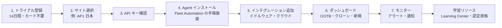
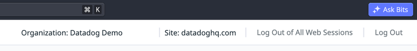
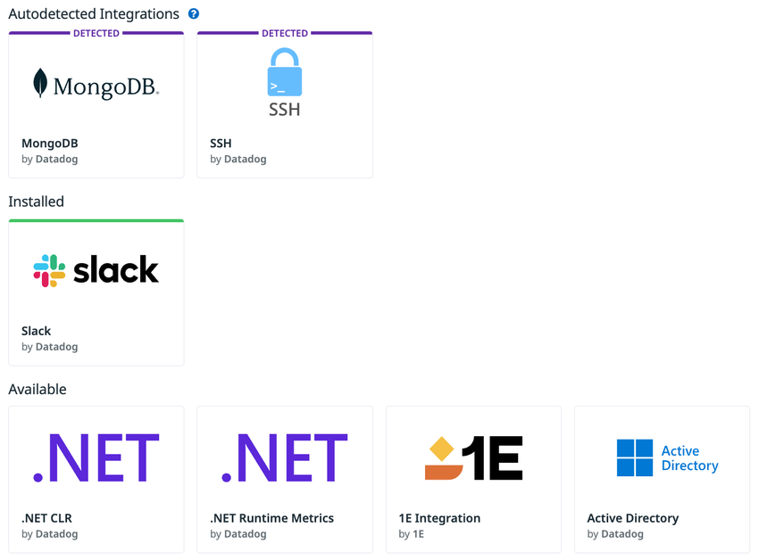
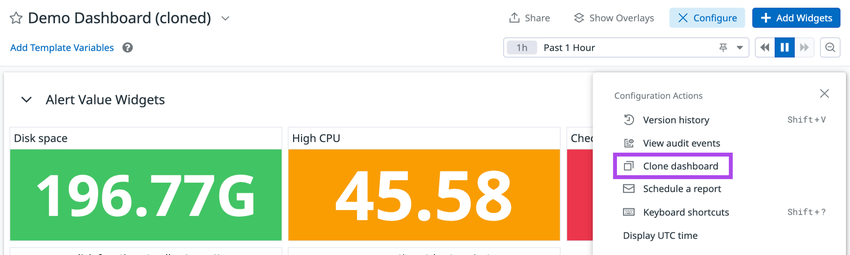
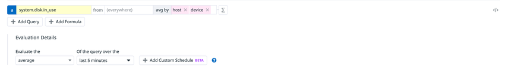
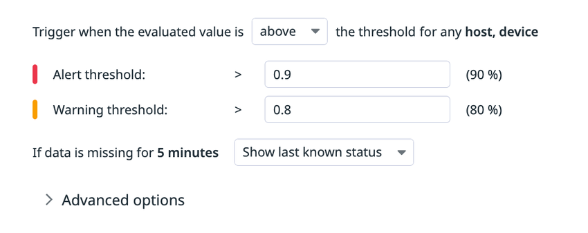

# はじめてのDatadog

## 概要

本ファイルは、Datadog（データドッグ）を初めて触る人が**最初の1〜2日で「データが届き、見えて、アラートが飛ぶ」状態を作る**ための入門ガイドである。Datadog 公式の Getting Started ドキュメント群（docs.datadoghq.com/getting_started/）と料金ページ・トライアルページの内容を、2026-11-02 時点の情報で日本語に整理した。

本ファイルが答える問いは次のとおり。

| 問い | 該当節 |
|---|---|
| 無料で試せるか。期間は。クレジットカードは要るか。トライアル後どうなるか | [2. トライアル登録](#2-トライアル登録) |
| 登録時の「Region」は何を選べばよいか。後から変えられるか | [3. サイト（リージョン）選択](#3-サイトリージョン選択) |
| API キーとアプリケーションキーの違いは | [4. API キーとアプリケーションキー](#4-api-キーとアプリケーションキー) |
| Agent はどうインストールし、どう動作確認するか | [5. Agent のインストール](#5-agent-のインストール) |
| インテグレーションはどう追加するか（ミドルウェア・クラウド） | [6. インテグレーションの追加](#6-インテグレーションの追加) |
| 最初のダッシュボードはどう作るか | [7. 最初のダッシュボード](#7-最初のダッシュボード) |
| 最初のモニター（アラート）はどう作るか | [8. 最初のモニター](#8-最初のモニター) |
| チームメンバーをどう招待するか | [9. ユーザー招待](#9-ユーザー招待チームでの利用開始) |
| 何で学べばよいか。認定資格はあるか | [11. 学習リソース](#11-学習リソース) |

各トピックの詳細仕様は 02_リファレンス の各ファイルにリンクする。本ファイルは「最初の一周」を回すための手順に絞り、仕様の網羅は行わない。

> **基準日:** 本ファイルの記述は 2026-11-02 時点の公開情報に基づく。Datadog の UI・オンボーディング画面は継続的に変更されるため、画面上の文言・ボタン位置は変わる可能性がある。
>
> **基準サイト:** 本ナレッジの基準サイトは AP1（日本、`ap1.datadoghq.com`）。公式ドキュメントのアプリ内リンクは US1（`app.datadoghq.com`）で書かれていることが多いため、AP1 の組織では URL のホスト部分を `ap1.datadoghq.com` に読み替える。

---

## 1. 全体の流れ

### 1.1 はじめての Datadog の 7 ステップ

Datadog の利用開始は、公式 Getting Started ドキュメントの前提条件（「アカウント作成 → Agent インストール → インテグレーション追加」）と、公式トライアルページが示すオンボーディング手順に沿うと、次の流れになる。[出典](https://docs.datadoghq.com/getting_started/dashboards/)、[出典](https://www.datadoghq.com/ja/free-datadog-trial/)



| ステップ | 作業 | 主な画面・コマンド | 詳細リファレンス |
|---|---|---|---|
| 1 | トライアル登録 | datadoghq.com の Free Trial フォーム | [購入経路と契約](../03_導入編/procurement-and-contracts.md) |
| 2 | サイト選択 | 登録フォームの **Region** | [Datadog Sites](../02_リファレンス/platform/datadog-sites.md) |
| 3 | API キー確認 | **Organization Settings > API Keys** | [API とキー管理](../02_リファレンス/platform/api-and-keys.md) |
| 4 | Agent インストール | Fleet Automation の Install Agent 画面、`install_script_agent7.sh`、MSI | [Datadog Agent](../02_リファレンス/platform/agent.md) |
| 5 | インテグレーション追加 | **Integrations** 画面、`conf.d/<INTEGRATION>.d/conf.yaml` | [Integrations](../02_リファレンス/platform/integrations.md) |
| 6 | ダッシュボード作成 | **Dashboards > Dashboard List** | [Dashboards](../02_リファレンス/platform/dashboards.md) |
| 7 | モニター作成 | **Monitors > New Monitor** | [Monitors](../02_リファレンス/platform/monitors.md) |

### 1.2 公式トライアルページが示すオンボーディング手順

Datadog の日本語トライアルページは、登録後のオンボーディングを次の 5 ステップで説明している（2026-11-02 取得）。[出典](https://www.datadoghq.com/ja/free-datadog-trial/)

| # | 内容（トライアルページの記載の要旨） | 所要時間の記載 |
|---|---|---|
| 1 | トライアル登録フォームに入力する（クレジットカード不要） | 約 30 秒 |
| 2 | 技術スタックに関する基本的な質問に答える | 約 1 分 |
| 3 | Datadog Agent をインストールし、システムレベルのメトリクスを送信する | 記載なし |
| 4 | API 経由で追加のメトリクスを取得するための認証情報を提供し、AWS・Azure・Google Cloud などのクラウド環境を可視化する | 記載なし |
| 5 | すぐに使えるダッシュボードで、環境全体のパフォーマンスをリアルタイムに確認する | 記載なし |

### 1.3 事前準備チェックリスト

Datadog の評価を始める前に、次の項目を確認しておくと作業が止まらない。公式の管理者向けガイドは、本番展開の前に**低リスクのテスト環境（サンドボックス）**で設定を試すことを推奨している。[出典](https://docs.datadoghq.com/administrators_guide/getting_started/)

| 項目 | 確認内容 | 根拠 |
|---|---|---|
| 業務メールアドレス | トライアル登録には Business email が必須 | [Free Trial](https://www.datadoghq.com/free-datadog-trial/) |
| データ保存先（サイト） | どのサイト（リージョン）にデータを置くか。**登録後にサイト間でデータを移行できない** | [Free Trial](https://www.datadoghq.com/free-datadog-trial/)、[Datadog Sites](https://docs.datadoghq.com/getting_started/site/) |
| 検証用ホスト | Agent を入れてよいホスト（Linux / Windows / macOS / コンテナ）。管理者権限（root / Administrator）が必要 | [Windows Agent](https://docs.datadoghq.com/agent/supported_platforms/windows/) |
| アウトバウンド通信 | Agent のデータ送信は主に **TCP 443（HTTPS）**。インストール時は `install.datadoghq.com` 等への到達性も必要。プロキシ環境ではプロキシ設定が必要 | [Network Traffic](https://docs.datadoghq.com/agent/configuration/network/) |
| クラウドの権限 | AWS インテグレーションを CloudFormation で設定する場合、IAM ロール・ポリシーや CloudFormation スタックを作成できる IAM 権限 | [AWS Getting Started](https://docs.datadoghq.com/getting_started/integrations/aws/) |
| 通知先 | アラートの送り先（メール、Slack、PagerDuty 等） | [Getting Started with Monitors](https://docs.datadoghq.com/getting_started/monitors/) |

ネットワーク要件の詳細は [ネットワーク・接続要件](../03_導入編/network-and-connectivity.md) を参照。

---

## 2. トライアル登録

### 2.1 無料トライアルの条件

Datadog の無料トライアルの条件は次のとおり（2026-11-02 取得）。

| 項目 | 内容 | 出典 |
|---|---|---|
| 期間 | **14 日間**（"Try Datadog for 14 days"、"14 days of unlimited monitoring"） | [Free Trial](https://www.datadoghq.com/free-datadog-trial/) |
| クレジットカード | **不要**（"No credit card required"） | [Free Trial](https://www.datadoghq.com/free-datadog-trial/) |
| 対象範囲 | Datadog プラットフォーム全体（"the entire Datadog platform"） | [Free Trial](https://www.datadoghq.com/free-datadog-trial/) |
| トライアル中の課金 | 無料トライアル期間中は課金されない。**トライアル終了後の利用分は課金対象** | [Plan and Usage](https://docs.datadoghq.com/account_management/plan_and_usage/) |
| トライアル終了後 | 有料プランにアップグレードするか、**Free tier** に移行するかを選ぶ | [Pricing](https://www.datadoghq.com/pricing/) |
| 日本語サポート | 日本語トライアルページに、日本語ドキュメントと日本語対応のメールサポートがある旨の記載あり | [無料トライアル（日本語）](https://www.datadoghq.com/ja/free-datadog-trial/) |

トライアルページは、トライアルで試せる機能の例として次を挙げている。[出典](https://www.datadoghq.com/free-datadog-trial/)

- 1,000 以上のテクノロジーからのメトリクス・イベントの集約
- 相関したメトリクス・トレース・ログ間の行き来（ピボット）
- ログデータの検索・分析
- 分散システムにまたがるリクエストのトレース
- 擬似的なユーザーリクエストによるアプリケーション・API エンドポイントの監視（Synthetic Monitoring）
- 異常検知（anomaly detection）、外れ値検知（outlier detection）、予測（forecast）アラート

### 2.2 登録フォームの入力項目

英語版トライアルページの登録フォームは 2 段階で、入力項目は次のとおり（2026-11-02 取得）。[出典](https://www.datadoghq.com/free-datadog-trial/)

| 段階 | 項目 | 必須 | 補足 |
|---|---|---|---|
| Step 1 | Business email（業務メールアドレス） | 必須 | |
| Step 2 | **Region**（データの保存場所） | 必須 | ページ上で「リージョン間でデータを移行できない」旨の注意がある。選び方は [3. サイト選択](#3-サイトリージョン選択) |
| Step 2 | Password | 必須 | |
| Step 2 | First name / Last name | 必須 | |
| Step 2 | Job title（役職） | 必須 | |
| Step 2 | Company（会社名） | 必須 | |
| Step 2 | Phone number（電話番号） | 任意 | |

> **注記:** 日本語版トライアルページは最初の画面でメールアドレスのみを入力する形式で、Region の選択肢一覧は同ページ上では確認できなかった（2026-11-02 取得）。フォームの構成は時期・言語版により変わる可能性がある。登録時に Region 選択が表示されたら、必ず意図したサイトを選ぶこと。

登録時には Datadog のサブスクリプション契約（Master Subscription Agreement）とプライバシーポリシーへの同意が前提となる。[出典](https://www.datadoghq.com/ja/free-datadog-trial/)

### 2.3 その他の開始経路

Datadog の利用開始経路はトライアルフォーム以外にもある。

| 経路 | 内容 | 出典 |
|---|---|---|
| AWS Marketplace | AWS Marketplace の Datadog 出品から **14 日間**の全機能無料トライアルを開始できる。手順は「出品ページ → **View purchase options** → 内容確認（必要なら発注書番号を追加）→ **Subscribe**」。US2-FED（`us2.ddog-gov.com`）ではこの連携が利用できない場合がある | [AWS Marketplace Trial](https://docs.datadoghq.com/integrations/guide/aws-marketplace-datadog-trial/) |
| Azure（Azure Native ISV Service） | Azure ポータルから Datadog リソースを作成して組織を作る経路がある（詳細は Microsoft のドキュメント） | 【第三者情報】[Microsoft Learn: Get started with Datadog](https://learn.microsoft.com/en-us/azure/partner-solutions/datadog/create)（参照日 2026-11-02） |
| Free tier | Infrastructure の Free tier（最大 5 Basic ホスト、メトリクス保持 1 日、無償） | [Pricing](https://www.datadoghq.com/pricing/) |
| 営業経由のトライアル | Datadog の営業担当が開始するトライアル（Sales-led trial）もある。これは Trial Management タブには表示されない | [Plan and Usage](https://docs.datadoghq.com/account_management/plan_and_usage/) |

購入経路・契約形態の詳細は [購入経路と契約](../03_導入編/procurement-and-contracts.md) を参照。

### 2.4 トライアル終了後と Free tier

Datadog の無料トライアルが終了すると、有料プランへのアップグレードか Free tier への移行を選ぶ。Free tier の内容は次のとおり（2026-11-02 取得）。[出典](https://www.datadoghq.com/pricing/)

| 項目 | Free tier | Pro（有料） | Enterprise（有料） |
|---|---|---|---|
| ホスト数 | 最大 **5 Basic ホスト** | 契約ホスト数 | 契約ホスト数 |
| メトリクス保持期間 | **1 日** | 15 か月（フル解像度） | 15 か月（カスタマイズ可） |
| コンテナ監視 | Basic ホストはコンテナ監視に非対応 | ホストあたり 5 コンテナが無料枠 | ホストあたり 10 コンテナが無料枠 |
| インテグレーション | 限定的（Limited） | 1,000 以上 | 1,000 以上 |
| 料金（ホスト/月） | 無償 | 年契約 $15 / オンデマンド $18 | 年契約 $23 / オンデマンド $27 |

> 料金は公式料金ページ掲載の定価（2026-11-02 時点、年契約＝Billed annually / オンデマンド＝On-demand）。インテグレーション欄は料金ページの Infrastructure 機能比較表「1,000+ Integrations」行の表記（Basic は「Limited」）。数値の正本は [製品別料金表](../03_導入編/pricing-by-product.md)。エディションの違いは [エディション・プラン](../03_導入編/editions-and-plans.md) を参照。

> **サイト差異:** 上表の料金は **US/EU1 の価格**。料金ページは「Datadog Site」セレクターでサイトごとに価格が切り替わり、基準サイトの **AP1（日本）は US/EU1 より高い**（掲載値どうしの比率で約 1.25 倍。例：Infrastructure Pro は AP1 で年契約 $18.75・オンデマンド $22.50、Enterprise は年契約 $28.75・オンデマンド $33.75）。見積りには比率ではなく [製品別料金表 §1.2・§2](../03_導入編/pricing-by-product.md#12-サイトリージョン別の価格) の AP1 列を使う。[出典](https://www.datadoghq.com/pricing/?product=infrastructure)

トライアル終了時にアップグレード手続きを行う画面（支払方法の登録等）の具体的な手順は、公開ドキュメントでは確認できず。不明点は Datadog の担当者、または公式ドキュメントが案内する `success@datadoghq.com` に問い合わせる。[出典](https://docs.datadoghq.com/account_management/plan_and_usage/)

### 2.5 組織内での製品トライアル（Trial Management）

Datadog の組織（Organization）作成後も、個別製品の無料トライアルを開始できる場合がある。管理者は **Plan & Usage** の **Trial Management** タブで製品トライアルを管理する。[出典](https://docs.datadoghq.com/account_management/plan_and_usage/)

| 項目 | 内容 |
|---|---|
| 表示条件 | 組織が製品トライアルにアクセスできる場合のみタブが表示される。利用可能なトライアルがない場合、管理者にも表示されない |
| できること | 利用可能なトライアルの開始、実施中・過去のトライアルと各トライアルの**終了日**の確認、各製品とドキュメントへのリンク |
| 対象 | ユーザー自身が開始したセルフサービストライアルのみ。営業担当が開始したトライアルは含まれない |
| 使用量の表示 | トライアル製品の使用量は **Usage & Cost** タブに表示され、課金されない。トライアルがなかった場合の推定コストが表示され、トライアル使用量にはインジケーターアイコンが付く |
| 課金 | トライアル期間中は無料。**トライアル終了後の利用分は課金される** |

> **注意（【経験則】）:** トライアルで有効化した製品（APM、Log Management など）をトライアル終了後も使い続けると課金対象になる。評価が終わった製品は、データ送信を止める（Agent 設定の無効化、インスツルメンテーションの削除など）か、Trial Management で終了日を把握して契約判断を行う。

---

## 3. サイト（リージョン）選択

### 3.1 Datadog サイトとは

Datadog の SaaS は「**サイト**（Site）」と呼ばれる独立したインスタンス群で提供される。組織は作成時に 1 つのサイトに属し、データはそのサイトに保存される。**各サイトは独立しており、サイト間でデータを共有できない**。トライアル登録フォームの Region がこのサイトに相当する。[出典](https://docs.datadoghq.com/getting_started/site/)、[出典](https://www.datadoghq.com/free-datadog-trial/)

2026-11-02 時点の公式ドキュメント掲載のサイトは次のとおり。[出典](https://docs.datadoghq.com/getting_started/site/)

| サイト | サイト URL | サイトパラメータ（`DD_SITE` 等に設定する値） | 所在地 |
|---|---|---|---|
| US1 | `https://app.datadoghq.com` | `datadoghq.com` | 米国 |
| US3 | `https://us3.datadoghq.com` | `us3.datadoghq.com` | 米国 |
| US5 | `https://us5.datadoghq.com` | `us5.datadoghq.com` | 米国 |
| EU1 | `https://app.datadoghq.eu` | `datadoghq.eu` | EU（ドイツ） |
| AP1 | `https://ap1.datadoghq.com` | `ap1.datadoghq.com` | 日本 |
| AP2 | `https://ap2.datadoghq.com` | `ap2.datadoghq.com` | オーストラリア |
| UK1 | `https://uk1.datadoghq.com` | `uk1.datadoghq.com` | 英国 |
| US1-FED | `https://app.ddog-gov.com` | `ddog-gov.com` | 米国（FedRAMP High 認定。米国政府機関・パートナー向け） |
| US2-FED | `https://us2.ddog-gov.com` | `us2.ddog-gov.com` | 米国（IL5 認可取得手続き中。米国政府機関・パートナー向け） |

> **サイト差異:** サイトによって、セキュリティ要件に応じて提供機能やドキュメントの内容が異なる場合がある。公式ドキュメントの各ページ右側にあるサイトセレクターで自分のサイトを選ぶと、サイト固有の情報（エンドポイント等）が表示される。US1-FED / US2-FED（Datadog for Government）の利用開始は `fed-sales@datadoghq.com` への連絡が案内されている。[出典](https://docs.datadoghq.com/getting_started/site/)
>
> **注記:** 本ナレッジ執筆規約のサイト一覧には UK1・US2-FED が含まれていないが、2026-11-02 時点の公式ドキュメントには上表のとおり掲載されている。

### 3.2 サイトの選び方

Datadog のサイトは組織作成後に変更できず、データ移行もできないため、トライアル登録の時点で決める必要がある。

| 判断基準 | 考え方 | 確度 |
|---|---|---|
| データ所在地の要件 | 社内規程・顧客契約・法令でデータの国内保存が求められる場合は、日本の **AP1** を選ぶ | 公式（AP1 の所在地は日本）[出典](https://docs.datadoghq.com/getting_started/site/) |
| 本番で使う予定のサイト | 評価用のトライアル組織を本番組織として使い続ける可能性がある場合、最初から本番予定のサイトで作る。サイトを変える場合は別組織の新規作成になる | 【経験則】 |
| 機能提供状況 | 使いたい機能が対象サイトで提供されているかを、ドキュメントのサイトセレクターで確認する（特に新機能・Preview 機能、政府向けサイト） | 公式 [出典](https://docs.datadoghq.com/getting_started/site/) |
| 監視対象との距離 | 公開情報ではサイト選択とレイテンシの関係について定量的な指針は確認できず | 公開情報では確認できず |
| 価格 | サイトにより価格が異なる。AP1（日本）は US/EU1 より高い（掲載値どうしの比率で約 1.25 倍。例：Infrastructure Pro 年契約は US/EU1 $15、AP1 $18.75）。正確な値は [製品別料金表 §1.2](../03_導入編/pricing-by-product.md#12-サイトリージョン別の価格) の AP1 列を参照 | 公式 [出典](https://www.datadoghq.com/pricing/?product=infrastructure) |

複数サイトへ同時にデータを送る必要がある場合は Dual Shipping の構成が公式ガイドで案内されている。[出典](https://docs.datadoghq.com/getting_started/site/) サイト選定の詳細・エンドポイント一覧は [Datadog Sites](../02_リファレンス/platform/datadog-sites.md) を参照。

### 3.3 自分の組織のサイトを確認する

Datadog の組織がどのサイトに属するかは、次の方法で確認できる。[出典](https://docs.datadoghq.com/getting_started/site/)

| 方法 | 手順 |
|---|---|
| ブラウザの URL | ログイン後の URL のホスト部分を [3.1 の表](#31-datadog-サイトとは) のサイト URL と照合する（例：`ap1.datadoghq.com` なら AP1） |
| My Preferences | カスタムドメイン（例：`demo.datadoghq.com`）を使っている場合など URL で判別できないときは、左下のプロフィールアバター → **My Preferences** を開くと、ページ上部にサイトが表示される |



- **キャプション:** My Preferences ページ上部のサイト表示
- **画面の説明:** 画面上部のヘッダーバーの右側に「Ask Bits」ボタンと検索ショートカット（⌘K）がある。その下の帯に左から「Organization: Datadog Demo」（組織名）、「Site: datadoghq.com」（所属サイトのサイトパラメータ。この例は US1）、「Log Out of All Web Sessions」、「Log Out」が並ぶ。AP1 の組織であれば Site 欄は `ap1.datadoghq.com` と表示される。
- **出典:** [Getting Started with Datadog Sites](https://docs.datadoghq.com/getting_started/site/)、画像 URL `https://docs.dd-static.net/images/getting_started/site/site-in-preferences.b76f275f6c237de6db1cf8d5fc70200e.png`（2026-11-02 取得）

### 3.4 AP1 の主な送信先ドメイン

AP1 を選んだ場合、Agent の主な送信先は次のとおり（Agent v7）。ファイアウォールで許可リストを作る場合の参考にする。全量は公式ページと [ネットワーク・接続要件](../03_導入編/network-and-connectivity.md) を参照。[出典](https://docs.datadoghq.com/agent/configuration/network/?site=ap1)

| 用途 | 送信先（AP1） | ポート |
|---|---|---|
| メトリクス・イベント・Agent メタデータ | `<VERSION>-app.agent.ap1.datadoghq.com`（許可リストには `*.agent.ap1.datadoghq.com`） | TCP 443 |
| API（Agent v7.18.0 以降） | `api.ap1.datadoghq.com` | TCP 443 |
| APM（トレース） | `trace.agent.ap1.datadoghq.com` | TCP 443 |
| Live Process / Live Containers / Cloud Network Monitoring / USM | `process.ap1.datadoghq.com` | TCP 443 |
| Remote Configuration | `config.ap1.datadoghq.com` | TCP 443 |
| Agent flare | `<VERSION>-flare.agent.ap1.datadoghq.com` | TCP 443 |
| NTP | （NTP サーバー） | UDP 123 |
| インストール用（サイト共通） | `install.datadoghq.com`、`yum.datadoghq.com`、`apt.datadoghq.com`、`keys.datadoghq.com`、`windows-agent.datadoghq.com` | TCP 443 |

> **サイト差異:** 上表は AP1 の値。他サイトでは `ap1.datadoghq.com` の部分が各サイトのサイトパラメータに置き換わる（例：US1 は `datadoghq.com`）。ログ送信先は公式ページのログ収集ドキュメント側に記載されている。Agent 7.67.0 以降は送信先を末尾ドット付きの FQDN（例：`trace.agent.ap1.datadoghq.com.`）で解決し、7.72.0 以降は `convert_dd_site_fqdn.enabled: false` で無効化できる。[出典](https://docs.datadoghq.com/agent/configuration/network/?site=ap1)

---

## 4. API キーとアプリケーションキー

Datadog の利用開始時に最初に扱う認証情報は **API キー**と**アプリケーションキー（Application Key）**の 2 種類である。Agent のインストールに必要なのは API キーのみ。[出典](https://docs.datadoghq.com/account_management/api-app-keys/)、[出典](https://docs.datadoghq.com/getting_started/integrations/)

| 項目 | API キー | アプリケーションキー |
|---|---|---|
| 用途 | Agent 等がメトリクス・イベント等を Datadog へ**送信**する際に使う。組織に固有 | API キーと組み合わせて、Datadog の API にプログラムからアクセス（ダッシュボード・モニターの作成・取得等）する際に使う |
| 作成場所 | **Organization Settings > API Keys** | **Organization Settings > Application Keys**（作成には権限が必要） |
| Agent インストール時 | **必要**（インストールコマンドの `DD_API_KEY`、または `datadog.yaml` の `api_key`） | 不要 |
| 権限 | — | デフォルトで作成者ユーザーと同じ権限。スコープで権限を絞り込める（スコープ名は大文字小文字を区別） |
| 上限 | 組織あたり**デフォルト 50 個**。Datadog のインテグレーション等が作成する Managed key は上限に数えない。サポートへの依頼で引き上げ可 | 公開情報では確認できず（本ファイルの範囲外。詳細は [API とキー管理](../02_リファレンス/platform/api-and-keys.md)） |
| 名前 | 組織内で一意である必要がある | — |

> **注意（【経験則】）:** API キーはデータ送信の認証情報であり、漏えいすると第三者が組織にデータを送り込めて課金に影響し得る。インストールコマンドをチケットや Wiki に貼る際はキーを伏せる。キーのローテーション・Secrets 管理は [API とキー管理](../02_リファレンス/platform/api-and-keys.md) を参照。

---

## 5. Agent のインストール

### 5.1 Datadog Agent とは

Datadog Agent は、ホスト上で動作してメトリクスやイベントを Datadog に送信するソフトウェアである。Windows・Linux・macOS のホスト、コンテナ（Docker、Kubernetes）、オンプレミスのデータセンターで動作し、Chef・Puppet・Ansible でも導入できる。Agent はオープンソースである。[出典](https://docs.datadoghq.com/getting_started/agent/)

Agent の内部構造・コンポーネントは [Datadog Agent](../02_リファレンス/platform/agent.md)、設定項目の網羅は [Agent 設定リファレンス](../02_リファレンス/platform/agent-configuration.md) を参照。

### 5.2 対応プラットフォーム（Agent v7、抜粋）

Datadog Agent v7 の主な対応プラットフォームは次のとおり（2026-11-02 時点、抜粋）。全量は公式の Supported Platforms を参照。[出典](https://docs.datadoghq.com/agent/supported_platforms/)

**Linux**

| ディストリビューション | x86_64 | arm64 |
|---|---|---|
| Amazon Linux 2 | 全バージョン | 7.16.0 以降 |
| Amazon Linux 2022 / 2023 | 7.40.0 以降 | 7.40.0 以降 |
| Ubuntu | 14.04 以降（全バージョン） | 16.04 以降（7.16.0 以降） |
| Debian | 8 以降（全バージョン） | 9 以降（7.16.0 以降） |
| RHEL / CentOS / Oracle Linux | 7 以降（全バージョン） | 8 以降（7.16.0 以降） |
| RHEL / CentOS / Oracle Linux 6 | 7.51.1 まで | — |
| AlmaLinux / Rocky Linux 8 以降 | 7.33.0 以降 | 7.33.0 以降 |
| SUSE Enterprise Linux 12 以降 / openSUSE 15 以降 | 全バージョン | — |
| Fedora | 26 以降（全バージョン） | 27 以降（7.16.0 以降） |

**Windows**

| バージョン | Agent v7 の対応 |
|---|---|
| Windows Server 2016 / 2019 / 2022 / 2025 | 全バージョン |
| Windows 10 / 11 | 全バージョン |
| Windows Server 2012 / 2012 R2、Windows 8.1 | Agent 7.46.0 まで |
| Windows Server 2008 R2 | Agent 7.45.1 まで |

**macOS・コンテナ**

| プラットフォーム | 対応 |
|---|---|
| macOS 12 以降 | x86_64 は 7.39.0 以降、Apple シリコン（ARM64）は 7.70.0 以降 |
| Docker | 1.14 以降（x86_64、arm64） |
| Kubernetes | 1.3 以降（x86_64、arm64） |
| UNIX / AIX | Agent v7 の対象外（別の Agent） |

### 5.3 インストール方法の選び方

Datadog 公式ドキュメントは、Agent のインストールに **Fleet Automation のアプリ内手順画面（Install Agent）**を使うことを推奨している。Fleet Automation の画面でプラットフォームと有効化する機能を選ぶと、API キーとサイトが埋め込まれたインストールコマンドが生成される。[出典](https://docs.datadoghq.com/getting_started/agent/)、[出典](https://docs.datadoghq.com/agent/supported_platforms/linux/)

| 環境 | 推奨手順 | アプリ内の手順画面（US1 の例。AP1 はホストを `ap1.datadoghq.com` に読み替え） | 詳細 |
|---|---|---|---|
| Linux ホスト | アプリ内手順で生成されたワンライナーを実行 | `https://app.datadoghq.com/fleet/install-agent/latest?platform=linux` | [Datadog Agent](../02_リファレンス/platform/agent.md) |
| Windows ホスト | アプリ内手順で生成されたコマンドを実行、または MSI を手動実行 | `https://app.datadoghq.com/fleet/install-agent/latest?platform=windows` | 同上 |
| macOS | アプリ内手順に従う | 公開情報では手順画面 URL を確認できず | 同上 |
| Docker / Kubernetes | 環境変数（`DD_API_KEY`、`DD_SITE`）で設定し、Autodiscovery でインテグレーションを自動検出 | — | [コンテナ/Kubernetes向けAgent](../02_リファレンス/platform/kubernetes-and-containers-agent.md) |
| 構成管理ツール | Chef / Puppet / Ansible | — | [Agent 展開設計](../03_導入編/agent-rollout-design.md) |
| AWS / Azure / Google Cloud のみ（Agent なし） | クラウドインテグレーションで API 経由のメトリクスを取得（[6.4](#64-クラウドインテグレーションaws-の例)） | — | [AWS Integration](../02_リファレンス/platform/aws-integration.md) |

Fleet Automation で Agent を一覧・リモート管理する機能の詳細は [Fleet Automation と Remote Configuration](../02_リファレンス/platform/fleet-automation.md) を参照。

### 5.4 Linux へのインストール

Datadog Agent の Linux へのインストールは、アプリ内手順画面で生成されたコマンドを実行するのが基本である。生成されるコマンドは次の形式で、`install.datadoghq.com` から取得したインストールスクリプト `install_script_agent7.sh` を環境変数付きで実行する。[出典](https://docs.datadoghq.com/tracing/trace_collection/single-step-apm/linux/)

```shell
# APM の Single Step Instrumentation も同時に有効にする例（公式ドキュメント掲載の形式）
DD_API_KEY=<YOUR_DD_API_KEY> \
DD_SITE="<YOUR_DATADOG_SITE>" \
DD_APM_INSTRUMENTATION_ENABLED=host \
bash -c "$(curl -L https://install.datadoghq.com/scripts/install_script_agent7.sh)"
```

| 環境変数 | 意味 | 設定例（AP1） |
|---|---|---|
| `DD_API_KEY` | 組織の API キー | （Organization Settings > API Keys の値） |
| `DD_SITE` | 送信先サイトのサイトパラメータ | `ap1.datadoghq.com` |
| `DD_APM_INSTRUMENTATION_ENABLED` | `host` を指定すると APM の Single Step Instrumentation を有効化。APM を使わない場合はアプリ内手順画面で APM をオフにして生成したコマンドを使う | `host` |

> **注記:** アプリ内手順画面の「Customize your Agent coverage」節で、APM（Core Observability 配下）などの機能のオン・オフを選ぶと、それに応じたコマンドが生成される。[出典](https://docs.datadoghq.com/tracing/trace_collection/single-step-apm/linux/) 画面で選べる全オプションの一覧は公開ドキュメントでは確認できず。

Linux の Agent 操作コマンド（systemd 環境）は次のとおり。upstart 環境（CentOS/RHEL 6、SUSE 11 等）では `systemctl <action>` を `<action>` に読み替える。[出典](https://docs.datadoghq.com/agent/supported_platforms/linux/)

| 操作 | コマンド |
|---|---|
| 起動 | `sudo systemctl start datadog-agent` |
| 停止 | `sudo systemctl stop datadog-agent` |
| 再起動 | `sudo systemctl restart datadog-agent` |
| サービス状態 | `sudo systemctl status datadog-agent` |
| Agent のステータス（チェックの実行結果等） | `sudo datadog-agent status` |
| サポート用 flare の送信 | `sudo datadog-agent flare` |
| 特定チェックの実行 | `sudo -u dd-agent -- datadog-agent check <CHECK_NAME>` |
| ヘルプ | `sudo datadog-agent --help` |

Linux のアンインストールは `sudo apt-get remove datadog-agent -y`（Debian/Ubuntu）、`sudo yum remove datadog-agent`（RHEL 系・Amazon Linux）、`sudo zypper remove datadog-agent`（SUSE）。これらは設定ファイル・`dd-agent` ユーザー・ログを残すため、完全に削除する場合は `/opt/datadog-agent/`、`/etc/datadog-agent/`、`/var/log/datadog/` の削除と `dd-agent` ユーザーの削除を追加で行う。Single Step APM Instrumentation を有効にした場合は別途の削除手順がある。[出典](https://docs.datadoghq.com/agent/supported_platforms/linux/)

### 5.5 Windows へのインストール

Datadog Agent の Windows へのインストールは、アプリ内手順画面（Fleet Automation）で生成されたコマンドの実行が推奨である。手動の場合は MSI インストーラーを使う。Agent は `ddagentuser` アカウントで動作する。[出典](https://docs.datadoghq.com/agent/supported_platforms/windows/)

| 方法 | 手順 |
|---|---|
| アプリ内手順（推奨） | Fleet Automation の Windows 用手順画面を開き、表示されたインストールコマンドをコピーして実行 |
| MSI（GUI） | `https://windows-agent.datadoghq.com/datadog-agent-7-latest.amd64.msi` をダウンロード → 管理者として実行 → ライセンス同意 → API キー入力 → 完了時に Datadog Agent Manager を起動（任意） |
| MSI（コマンドライン） | `msiexec` に `APIKEY`・`SITE` プロパティを渡す（下例）。`/qn` で GUI 非表示、`REBOOT=ReallySuppress` で強制再起動を抑止。他に `TAGS`、`HOSTNAME`、`DDAGENTUSER_NAME`、`DDAGENTUSER_PASSWORD`（ドメインサーバーでは必須）などがある。有効な `datadog.yaml` が既に存在する場合はそちらがコマンドライン指定より優先される |

```powershell
# 公式ドキュメントのプロパティ説明に基づく例（AP1 の場合）
msiexec /i datadog-agent-7-latest.amd64.msi APIKEY=<YOUR_API_KEY> SITE=ap1.datadoghq.com /qn
```

| 項目 | 値 |
|---|---|
| Windows サービス名 | `DatadogAgent` |
| プロセス | `agent.exe`（タスクマネージャー上は Datadog Metrics Agent） |
| メイン設定ファイル | `C:\ProgramData\Datadog\datadog.yaml`（`ProgramData` は隠しフォルダー） |
| インテグレーション設定 | `C:\ProgramData\Datadog\conf.d\<INTEGRATION>.d\conf.yaml` |
| GUI（Datadog Agent Manager） | タスクトレイアイコンを右クリック → **Configure**、または管理者権限で `agent.exe launch-gui` |
| ステータス確認（PowerShell、管理者） | `& "$env:ProgramFiles\Datadog\Datadog Agent\bin\agent.exe" status` |

出典: [Windows Agent](https://docs.datadoghq.com/agent/supported_platforms/windows/)

### 5.6 設定ファイル `datadog.yaml` の最小構成

Datadog Agent のメイン設定ファイル `datadog.yaml` で必須のパラメータは **API キー（`api_key`）とサイト（`site`）**である。インストールコマンドで指定した値はここに書き込まれる。[出典](https://docs.datadoghq.com/getting_started/agent/)

| OS | `datadog.yaml` の場所 | インテグレーション設定の場所 |
|---|---|---|
| Linux | `/etc/datadog-agent/datadog.yaml`（全項目の例は `/etc/datadog-agent/datadog.yaml.example`） | `/etc/datadog-agent/conf.d/<INTEGRATION>.d/conf.yaml` |
| Windows | `C:\ProgramData\Datadog\datadog.yaml` | `C:\ProgramData\Datadog\conf.d\<INTEGRATION>.d\conf.yaml` |
| コンテナ | 環境変数（`DD_API_KEY`、`DD_SITE` など）で指定 | Autodiscovery（アノテーション等） |

```yaml
# /etc/datadog-agent/datadog.yaml の最小例（AP1）
api_key: <YOUR_DD_API_KEY>
site: ap1.datadoghq.com

# 任意：ホストタグ（変更後は Agent の再起動が必要）
tags:
  - env:dev
  - team:infra
```

`datadog.yaml` を変更した後は Agent を再起動する。`datadog.yaml` には他にプロキシ（`proxy`）、ログレベルなどのグローバル設定を書く。[出典](https://docs.datadoghq.com/agent/supported_platforms/linux/)、[出典](https://docs.datadoghq.com/getting_started/agent/)

### 5.7 デフォルトで収集されるもの・されないもの

Datadog Agent はインストール直後から次のチェック（デフォルトチェック）を実行し、システムメトリクスを送信する。[出典](https://docs.datadoghq.com/getting_started/agent/)

| チェック | メトリクス区分 | 対象プラットフォーム |
|---|---|---|
| CPU | System | すべて |
| Disk | Disk | すべて |
| IO | System | すべて |
| Memory | System | すべて |
| Network | Network | すべて |
| NTP | NTP | すべて |
| Uptime | System | すべて |
| File Handle | System | Mac 以外 |
| Load | System | Windows 以外 |
| Docker | Docker | Docker |
| Winproc | System | Windows |

一方、Getting Started with the Agent ドキュメントは、次の機能を「追加の設定で有効化・利用する任意機能」として挙げている。このうち**ログ収集はデフォルトで無効**（`logs_enabled: false`）と明記されている。[出典](https://docs.datadoghq.com/getting_started/agent/)

| 機能 | Getting Started ドキュメント上の扱い | 詳細 |
|---|---|---|
| ログ収集 | **デフォルト無効**（`logs_enabled: false`）。収集対象の設定も必要 | [ログ収集](../02_リファレンス/logs/log-collection.md) |
| トレース（APM）・プロセス収集 | 任意機能として記載。APM はインストールコマンドで Single Step Instrumentation を有効化する方法がある（[5.4](#54-linux-へのインストール)） | [APM インスツルメンテーション](../02_リファレンス/apm/apm-instrumentation.md) |
| OTLP によるトレース取り込み | 任意機能として記載（OTLP 受信の設定が必要） | [OpenTelemetry サポート](../02_リファレンス/platform/opentelemetry.md) |
| ログのフィルタリング・マスキング | 任意機能として記載 | [ログ収集](../02_リファレンス/logs/log-collection.md) |
| DogStatsD によるカスタムメトリクス | 任意機能として記載（アプリケーション側からの送信が必要） | [Custom Metrics と DogStatsD](../02_リファレンス/platform/custom-metrics-and-dogstatsd.md) |

> **注記:** ログ以外の各機能（トレース受信、プロセス収集、DogStatsD 等）の設定キーごとの既定値は、Agent のバージョン・プラットフォーム・インストール方法によって異なる場合がある。正確な既定値は [Agent 設定リファレンス](../02_リファレンス/platform/agent-configuration.md) を正とする。

### 5.8 動作確認

Datadog Agent のインストール後は、次の順で動作を確認する。データが表示されるまで数分かかることがある。[出典](https://docs.datadoghq.com/getting_started/agent/)、[出典](https://docs.datadoghq.com/getting_started/monitors/)

| # | 確認方法 | 期待される結果 |
|---|---|---|
| 1 | ホスト上で `sudo datadog-agent status`（Windows は `agent.exe status`） | Agent が稼働し、チェックがエラーなく実行されている |
| 2 | Datadog の **Infrastructure > Hosts**（Infrastructure List） | 対象ホストが一覧に表示される |
| 3 | **Metrics > Summary** で `datadog.agent.running` または `datadog.agent.started` を検索 | メトリクスが存在する |
| 4 | **Infrastructure > Host Map** | ホストが六角形で表示される |

Agent 自身が送るメトリクスとサービスチェックは次のとおり。これらはモニターで Agent の死活監視に使える。[出典](https://docs.datadoghq.com/getting_started/agent/)

| 名前 | 種別 | 意味 |
|---|---|---|
| `datadog.agent.running` | メトリクス | Agent が稼働して報告している間は値 `1` |
| `datadog.agent.started` | メトリクス | Agent 起動時に値 `1` のカウントを送信 |
| `datadog.agent.python.version` | メトリクス | 値 `1`。Python バージョンのタグ付き |
| `datadog.agent.up` | サービスチェック | Agent が Datadog に接続できれば OK |
| `datadog.agent.check_status` | サービスチェック | Agent のチェックがメトリクスを送れない場合 CRITICAL、それ以外は OK |

### 5.9 リソース消費の目安

Datadog の Getting Started ドキュメントが示す Agent のリソース消費の目安は次のとおり。[出典](https://docs.datadoghq.com/getting_started/agent/)

| 項目 | 目安 |
|---|---|
| CPU | 平均約 0.08% |
| ディスク | 約 880 MB〜1.3 GB |
| メモリ・ネットワーク | Getting Started ドキュメントには記載なし。[Datadog Agent](../02_リファレンス/platform/agent.md) を参照 |

### 5.10 データが届かないときの確認ポイント

| 症状 | 確認ポイント | 根拠 |
|---|---|---|
| ホストが Infrastructure List に出ない | `datadog.yaml` の `site` が組織のサイトと一致しているか（例：AP1 の組織なのに `datadoghq.com` になっていないか） | [Datadog Sites](https://docs.datadoghq.com/getting_started/site/)。サイト不一致は【経験則】で多いミス |
| 同上 | `api_key` が正しいか、無効化されていないか | [API Keys](https://docs.datadoghq.com/account_management/api-app-keys/) |
| 同上 | TCP 443 のアウトバウンド通信、プロキシ設定 | [Network Traffic](https://docs.datadoghq.com/agent/configuration/network/) |
| 特定チェックが失敗 | `datadog-agent status` の Checks 節のエラー、Agent のログ | [Getting Started with the Agent](https://docs.datadoghq.com/getting_started/agent/) |
| 解決しない | `datadog-agent flare` で設定・ログ（秘匿情報はマスクされる）をサポートへ送付。Fleet Automation から遠隔で flare を生成することもできる | [Administrators Guide](https://docs.datadoghq.com/administrators_guide/getting_started/) |

---

## 6. インテグレーションの追加

### 6.1 インテグレーションの 3 種類

Datadog のインテグレーション（Integrations）は、外部のテクノロジーからデータを取り込む仕組みで、1,000 以上が提供されている [出典](https://www.datadoghq.com/pricing/?product=infrastructure)、[出典](https://www.datadoghq.com/free-datadog-trial/)。方式により次の 3 種類に分かれる。[出典](https://docs.datadoghq.com/getting_started/integrations/)、[出典](https://docs.datadoghq.com/getting_started/application/)

| 種類 | 仕組み | 例 | 設定場所 |
|---|---|---|---|
| Agent ベース | Agent に同梱された Python のチェック（`check`）がメトリクス等を収集 | MySQL、Redis、NGINX などのミドルウェア | ホスト上の `conf.d/<INTEGRATION>.d/conf.yaml` |
| 認証（クローラー）ベース | Datadog に認証情報を登録し、Datadog 側が API 経由でデータを取得 | AWS、Azure、Slack、PagerDuty | Datadog の Integrations 画面 |
| ライブラリ | アプリケーションに組み込むライブラリ（言語別）で Datadog API を利用 | Node.js、Python など | アプリケーションのコード・設定 |

公式にサポートされる Agent ベースのインテグレーションは Agent パッケージに同梱されており（GitHub の `integrations-core`）、コミュニティ製は `integrations-extras` で公開されている。既存のインテグレーションがない社内システムには カスタムチェック を作成できる。[出典](https://docs.datadoghq.com/getting_started/integrations/) インテグレーションの全体仕様は [Integrations](../02_リファレンス/platform/integrations.md) を参照。

### 6.2 Agent ベースのインテグレーションを有効化する手順

Datadog の Agent ベースのインテグレーションは、次の手順で有効化する。[出典](https://docs.datadoghq.com/getting_started/integrations/)

| # | 作業 | 補足 |
|---|---|---|
| 1 | Agent の `conf.d` フォルダー内の `<INTEGRATION_NAME>.d` フォルダーを開く | Linux は `/etc/datadog-agent/conf.d/` |
| 2 | `conf.yaml.example` を `conf.yaml` にリネーム（コピー） | |
| 3 | 環境に合わせて必須パラメータ（接続先ホスト、ポート、認証情報等）を設定 | 監視対象側でモニタリング用ユーザーの作成が必要なインテグレーションもある（各インテグレーションの README 参照） |
| 4 | Agent を再起動 | `sudo systemctl restart datadog-agent` |
| 5 | `datadog-agent status` を実行し、Checks 節に新しいチェックが表示されることを確認 | |
| 6 | Datadog の Integrations 画面で該当タイルを確認し、プリセットのダッシュボードでデータを見る | |

例として Redis のインテグレーション（チェック名 `redisdb`）を有効化する場合の設定ファイルは次のような形になる（パラメータの正確な一覧は各インテグレーションの `conf.yaml.example` を正とする）。

```yaml
# /etc/datadog-agent/conf.d/redisdb.d/conf.yaml（例）
init_config:

instances:
  - host: localhost
    port: 6379
    tags:
      - env:dev
```

| 設定のポイント | 内容 | 出典 |
|---|---|---|
| 収集間隔 | デフォルト **15 秒**。インスタンスごとに `min_collection_interval` で変更可 | [Integrations Getting Started](https://docs.datadoghq.com/getting_started/integrations/) |
| 複数インスタンス | `instances` 配下にエントリを追加すると、1 つのインテグレーションで複数の監視対象を扱える。エントリごとに `service` タグを付けられる | 同上 |
| タグ | `datadog.yaml` のタグは全インテグレーションのデータに付く。チェック単位で `ignore_autodiscovery_tags: true`（自動検出タグを無効化）、`check_tag_cardinality`（`low` / `orchestrator` / `high`）で上書き可 | 同上 |
| 収集されるメトリクスの一覧 | 各インテグレーションの README の「Data Collected」節、または `metadata.csv` | 同上 |
| 多数ホストへの配布 | Fleet Automation で UI・API から設定を一括配布できる（Remote Configuration と、Linux / Windows VM 上の **Agent 7.76 以降**が必要） | 同上、[Fleet Automation と Remote Configuration](../02_リファレンス/platform/fleet-automation.md) |

### 6.3 自動検出されたインテグレーション（Autodetected Integrations）

Datadog は、Agent でプロセス収集が有効な場合、ホスト上で動作しているテクノロジーを検出して対応するインテグレーションを提案する。各インテグレーションは **Detected / Installed / Available / Missing Data** のいずれかの状態で表示される。[出典](https://docs.datadoghq.com/getting_started/integrations/)



- **キャプション:** Integrations 画面のインテグレーション状態別の表示
- **画面の説明:** 上段の「Autodetected Integrations」セクションには、紫色の「DETECTED」ラベル付きで MongoDB と SSH のタイル（いずれも by Datadog）が並ぶ。これはホスト上で稼働が検出されたが未設定のテクノロジーである。中段の「Installed」セクションには緑色の上枠付きで Slack のタイルがあり、設定済みのインテグレーションを示す。下段の「Available」セクションには .NET CLR、.NET Runtime Metrics、1E Integration（by 1E。パートナー提供）、Active Directory のタイルが並び、利用可能な未設定のインテグレーションを示す。タイルをクリックすると設定手順が開く。
- **出典:** [Introduction to Integrations](https://docs.datadoghq.com/getting_started/integrations/)、画像 URL `https://docs.dd-static.net/images/getting_started/integrations/ad_integrations_1.49b95c9ec5e558552a4e97e4f567604f.png`（2026-11-02 取得）

### 6.4 クラウドインテグレーション（AWS の例）

Datadog のクラウドインテグレーションは認証ベースで、Agent をインストールしなくてもクラウドサービスのメトリクスを取得できる。AWS の場合、CloudFormation を使った自動設定（クイックセットアップ）が用意されている。[出典](https://docs.datadoghq.com/getting_started/integrations/aws/)

| # | 作業 |
|---|---|
| 1 | Datadog の AWS インテグレーションページ（Integrations > Amazon Web Services）で **Add AWS Account** をクリック |
| 2 | 「Automatically using CloudFormation」で、連携する AWS リージョンを選択し、Datadog の API キーを指定 |
| 3 | 任意で、Datadog Forwarder Lambda によるログ送信を有効化 |
| 4 | 任意で、Cloud Security Misconfigurations（CSPM）による設定ミス・リスクのスキャンを有効化 |
| 5 | **Launch CloudFormation Template** をクリック → パラメータが入力済みの AWS コンソールが開く |
| 6 | 必要なチェックボックスを確認して **Create stack**。Datadog スタックと 3 つのネストスタックが作成される（数分かかる） |
| 7 | スタック作成後、Datadog の AWS タイルに戻り **Ready!** をクリック |
| 8 | 最大 10 分ほど待ち、AWS Overview ダッシュボードでメトリクスを確認 |

AWS インテグレーションのデータ反映までの目安は次のとおり。[出典](https://docs.datadoghq.com/getting_started/integrations/aws/)

| データ | 反映までの目安 |
|---|---|
| メトリクス（API ポーリング） | 約 10 分 |
| メトリクス（CloudWatch Metric Streams） | 2〜3 分 |
| タグ | 15 分〜数時間 |
| リソース | 次回のリソースクロールのサイクル |
| ログ | 別途設定が必要 |
| 過去データ | **バックフィルされない**（連携前のメトリクスは取り込まれない） |

複数アカウントをまとめて設定する場合は API、AWS CLI、Terraform（Datadog プロバイダの `integration_aws_account` リソース）を使える。[出典](https://docs.datadoghq.com/getting_started/integrations/aws/) 詳細は [AWS Integration](../02_リファレンス/platform/aws-integration.md)、Azure は [Azure Integration](../02_リファレンス/platform/azure-integration.md)、Google Cloud は [Google Cloud Integration](../02_リファレンス/platform/gcp-integration.md) を参照。

> **課金の注意:** クラウドインテグレーションで検出されたホスト（例：EC2 インスタンス）も Infrastructure Monitoring の課金対象ホストとして数えられ得る。対象の絞り込み方法と課金の数え方は [AWS Integration](../02_リファレンス/platform/aws-integration.md) と [課金計算の仕組み](../03_導入編/billing-mechanics.md) を参照。

### 6.5 通知先インテグレーション（Slack 等）

Datadog のモニター通知を Slack・PagerDuty・Microsoft Teams などへ送るには、それぞれのインテグレーションを先に設定する。Slack インテグレーションを使うと、ダッシュボード・モニター・インシデントをチャンネルに共有できる。[出典](https://docs.datadoghq.com/getting_started/dashboards/) 設定手順は [通知・コラボレーション連携](../02_リファレンス/platform/collaboration-integrations.md) を参照。

---

## 7. 最初のダッシュボード

### 7.1 ダッシュボード作りの 3 つの入口

Datadog の公式 Getting Started は、最初のダッシュボードを次の 3 つの方法で作ることを紹介している。前提条件は「アカウント作成」「ホストへの Agent インストール」「そのホスト上のサービスのインテグレーション追加」である。[出典](https://docs.datadoghq.com/getting_started/dashboards/)、[出典](https://docs.datadoghq.com/dashboards/)

| 方法 | 手順 | 向いている場面 |
|---|---|---|
| ① すぐに使えるダッシュボード（OOTB） | **Dashboards > Dashboard List** で利用中のインテグレーション名（例：Redis）を検索し、**Preset** と表示されたダッシュボードを開く | インテグレーション追加直後にまず全体を見る |
| ② 既存ダッシュボードのクローン | ダッシュボード右上の **Configure** → **Clone dashboard**。クローンは元から切り離された独立コピーになる | OOTB を土台に自チーム用へカスタマイズする |
| ③ 新規作成 | Dashboard List の **+ New Dashboard**（またはナビゲーションメニューの **New Dashboard**）→ 名前を入力 → レイアウト種別を選択 | 目的に合わせて一から作る |

### 7.2 OOTB ダッシュボードをクローンする

Datadog の OOTB（Out-of-the-box）ダッシュボードは直接編集せず、クローンしてから編集するのが公式 Getting Started の手順である。[出典](https://docs.datadoghq.com/getting_started/dashboards/)



- **キャプション:** ダッシュボードの Configure メニュー（Configuration Actions）
- **画面の説明:** 画面左上にダッシュボード名「Demo Dashboard (cloned)」と「Add Template Variables」リンクがある。右上には「Share」「Show Overlays」「Configure」「+ Add Widgets」ボタンと、時間範囲セレクター（1h / Past 1 Hour）がある。「Configure」をクリックすると右側に「Configuration Actions」メニューが開き、「Version history」（Shift+V）、「View audit events」、「Clone dashboard」（紫枠で強調）、「Schedule a report」、「Keyboard shortcuts」（Shift+?）、「Display UTC time」が並ぶ。背景のダッシュボード本体には「Alert Value Widgets」グループがあり、「Disk space 196.77G」（緑）、「High CPU 45.58」（オレンジ）などの値ウィジェットが表示されている。
- **出典:** [Getting Started with Dashboards](https://docs.datadoghq.com/getting_started/dashboards/)、画像 URL `https://docs.dd-static.net/images/getting_started/dashboards/configure_clone_dashboard.54aba6d6dc377c3c61bb3e2af65357b1.png`（2026-11-02 取得）

クローン後の編集の流れは次のとおり。[出典](https://docs.datadoghq.com/getting_started/dashboards/)

| # | 作業 |
|---|---|
| 1 | クローンを開き **Edit widgets** をクリック |
| 2 | 不要なウィジェットを各ウィジェットの Settings メニューの **Delete** で削除 |
| 3 | グループやウィジェットをドラッグして配置を変える |
| 4 | 他のダッシュボードのウィジェットはホバーして `Cmd+C`（Windows は `Ctrl+C`）でコピーし、`Cmd+V`（`Ctrl+V`）で貼り付けられる |
| 5 | Log Explorer などの画面からは共有メニューの **Export to Dashboard** でグラフをダッシュボードに追加できる |

### 7.3 新規ダッシュボードのレイアウト種別

Datadog でダッシュボードを新規作成する際は、次のレイアウト種別を選ぶ。[出典](https://docs.datadoghq.com/dashboards/)

| 種別 | 特徴 | 向く用途 |
|---|---|---|
| Dashboards | グリッドベース（最大幅 12 グリッド）。画像・グラフ・ログを配置可 | ステータスボード、リアルタイム／固定時点のビュー |
| Timeboards | 自動レイアウト。ダッシュボード全体が同じ時点（固定またはリアルタイム）を表示 | トラブルシューティング、相関分析 |
| Screenboards | 自由配置。画像・グラフ・ログを配置可 | ステータスボード、ストーリー性のあるビュー |

### 7.4 最初に置くと良いウィジェットの例

Datadog のダッシュボードに最初に置くウィジェットの例を、Agent のデフォルトチェックで取得できるメトリクスで示す。メトリクス名とクエリ構文の詳細は [Metrics](../02_リファレンス/platform/metrics.md)、[メトリクスクエリと関数](../02_リファレンス/platform/metrics-query-and-functions.md) を参照。

| 目的 | ウィジェット | クエリ例 |
|---|---|---|
| ホストごとの CPU 使用率の推移 | Timeseries | `avg:system.cpu.user{*} by {host}` |
| ディスク使用率の高いデバイス | Top List | `avg:system.disk.in_use{*} by {host,device}` |
| ホストの全体像 | Host Map | （CPU 使用率で塗り分け） |
| 現在値の強調 | Query Value | `avg:system.load.1{*}` |
| 稼働中の Agent 数 | Query Value | `sum:datadog.agent.running{*}` |

公式 Getting Started は、ウィジェットの改善として次を挙げている。[出典](https://docs.datadoghq.com/getting_started/dashboards/)

- **テンプレート変数（Template Variables）**を追加し、1 つのダッシュボードを環境やデータセンター別に切り替えて使う
- Y 軸範囲・色・凡例を調整し、マーカーやイベントのオーバーレイを追加する
- Free Text ウィジェット（見出し）、Group ウィジェット（折りたたみ）、タブで整理する
- Notes and Links ウィジェットやカスタムリンクで関連画面へのリンクを置く

### 7.5 共有と自動化

| 操作 | 方法 | 出典 |
|---|---|---|
| 社外・大画面への共有 | エクスポートメニューの **Configure Public URL** で公開 URL を発行（Datadog アカウントがない人も閲覧可） | [Getting Started with Dashboards](https://docs.datadoghq.com/getting_started/dashboards/) |
| JSON での保存・移植 | Settings メニューからダッシュボードの JSON をコピー・エクスポート | 同上 |
| プログラムでの作成 | Dashboards API | 同上、[Terraform と IaC](../02_リファレンス/platform/terraform-and-iac.md) |
| モバイル閲覧 | Datadog Mobile App（iOS / Android）でアクセス可能なダッシュボードを閲覧・検索し、テンプレート変数で絞り込む | 同上 |

> **注意（【経験則】）:** 公開 URL は認証なしで閲覧できるため、機密情報を含むダッシュボードでは発行しない。組織の設定で公開共有を制限する方法は [Dashboards](../02_リファレンス/platform/dashboards.md) を参照。

ダッシュボード設計の考え方（チーム向け・経営向け・トラブルシューティング向け）は [ダッシュボード設計の実践](../04_応用編/dashboard-design-practices.md) を参照。

---

## 8. 最初のモニター

### 8.1 新規組織の Automatic Monitors

Datadog の新規組織では、Agent をインストールすると **Automatic Monitors** が有効になり、Datadog がスタックを識別してベースラインのモニターを自動作成する場合がある。対象は次のとおり。自動作成されたモニターは **Monitors** 一覧で編集・クローン・無効化できる。[出典](https://docs.datadoghq.com/getting_started/monitors/)

| 対象 | 自動作成されるモニターの内容 |
|---|---|
| ホスト | CPU、メモリ |
| Kubernetes | Pod の再起動、ノードの健全性 |
| APM | エラー率、レイテンシ |

> **注記:** Automatic Monitors が既存組織や全サイトで有効かどうか、閾値の既定値は公開情報では確認できず。まず Monitors 一覧で自動作成済みのモニターを確認してから、重複しないように独自のモニターを作る。

インテグレーションごとに Datadog が推奨するモニターのテンプレート（Monitor Templates / Recommended Monitors）からモニターを追加することもできる。[出典](https://docs.datadoghq.com/administrators_guide/getting_started/)

### 8.2 メトリクスモニターを作る（ディスク容量の例）

Datadog 公式 Getting Started の例に沿って、ディスク使用率のメトリクスモニターを作る。前提として Agent がインストールされ、Infrastructure List にホストが表示されていること。[出典](https://docs.datadoghq.com/getting_started/monitors/)

| # | 設定 | 値（例） |
|---|---|---|
| 1 | **Monitors > New Monitor** → **Metric** を選択 | — |
| 2 | 検知方法（detection method） | **Threshold Alert**（自動選択。静的閾値なら変更不要） |
| 3 | メトリクスの定義 | `system.disk.in_use`、集計 `avg`、グループ化 `host` と `device`（multi alert になる） |
| 4 | アラート条件 | 評価値が閾値を **above**（上回る）。**Alert threshold `> 0.9`**、**Warning threshold `> 0.8`** |
| 5 | 通知タイトル | `Disk space is low on {{device.name}} / {{host.name}}`（モニターごとに一意である必要がある） |
| 6 | 通知本文 | 対処手順（例：不要パッケージの削除、APT キャッシュのクリア等） |
| 7 | 通知先 | ドロップダウンからメンバーや連携済みアカウント（メール、Slack、PagerDuty 等）を選ぶ。Datadog Team には本文に `@team` ハンドルを記載 |
| 8 | 自動化（任意） | **Add Workflow**（Workflow Automation）、**Add Work Item**（Work Management） |
| 9 | 権限 | **Edit Access** で編集できる人を作成者・チーム・ユーザー・ロール等に制限。任意で変更時の通知（**Notify**） |

`system.disk.in_use` はディスク使用量の割合（0〜1）で、`0.7` はデバイスが 70% 使用済みであることを示す。[出典](https://docs.datadoghq.com/getting_started/monitors/)



- **キャプション:** メトリクスモニターの「Define the metric」部分
- **画面の説明:** クエリ行「a」に、メトリクス名 `system.disk.in_use`、「from」欄（(everywhere)＝全ホスト対象）、「avg by」欄に `host` と `device` のチップが並ぶ。その下に「+ Add Query」「+ Add Formula」ボタンがある。下段の「Evaluation Details」では「Evaluate the」に `average`、「Of the query over the」に `last 5 minutes` が選ばれており、直近 5 分間の平均値で評価することを示す。右側に「+ Add Custom Schedule（BETA）」ボタンがある。
- **出典:** [Getting Started with Monitors](https://docs.datadoghq.com/getting_started/monitors/)、画像 URL `https://docs.dd-static.net/images/getting_started/monitors/monitor_query.cc7d61c048d474419ea8f7b03a3c3207.png`（2026-11-02 取得）



- **キャプション:** メトリクスモニターの「Set alert conditions」部分
- **画面の説明:** 「Trigger when the evaluated value is [above] the threshold for any **host, device**」という文で、host・device の組み合わせごとに評価することを示す。その下に赤いバーの「Alert threshold: > 0.9 (90 %)」、オレンジのバーの「Warning threshold: > 0.8 (80 %)」の入力欄がある。さらに「If data is missing for **5 minutes** [Show last known status]」の設定（データ欠損時は最後の状態を表示）と、折りたたまれた「Advanced options」がある。
- **出典:** [Getting Started with Monitors](https://docs.datadoghq.com/getting_started/monitors/)、画像 URL `https://docs.dd-static.net/images/getting_started/monitors/monitor_alerting_conditions.1c36435b2c49a2e472fe281eb5bc18cd.png`（2026-11-02 取得）

### 8.3 通知メッセージの書き方

Datadog のモニター通知では、テンプレート変数と条件変数を使ってメッセージを組み立てる。multi alert モニターでは、グループ化したタグ（例：`host`、`device`）の値を `{{host.name}}`、`{{device.name}}` で差し込める。アラート閾値と警告閾値で内容を変えたい場合は条件付きの通知変数を使う。[出典](https://docs.datadoghq.com/getting_started/monitors/)

```text
Disk space is low on {{device.name}} / {{host.name}}

{{#is_alert}}ディスク使用率が 90% を超えました。至急対応してください。{{/is_alert}}
{{#is_warning}}ディスク使用率が 80% を超えました。{{/is_warning}}

対処手順:
1. 不要なパッケージを削除する
2. APT キャッシュをクリアする
@slack-<チャンネル名> @team-<チーム名>
```

> 条件変数（`{{#is_alert}}` 等）、`@` 通知ハンドルの一覧、Downtime（メンテナンス時の通知抑止）は [通知と Downtime](../02_リファレンス/platform/notifications-and-downtimes.md) を参照。上記の `@slack-…` は Slack インテグレーション設定後に使えるハンドルの書式例である。

### 8.4 その他の入門向けポイント

| 項目 | 内容 | 出典 |
|---|---|---|
| 通知先の種類 | メトリクス閾値、インテグレーションの可用性、ネットワークエンドポイントなどを監視し、Slack・メール・PagerDuty 等へ通知できる。Downtime でメンテナンス中の通知を抑止できる | [Getting Started with the Application](https://docs.datadoghq.com/getting_started/application/) |
| モバイルアプリ | Datadog Mobile App（App Store / Google Play）で Monitor Saved Views の表示、モニターの閲覧・ミュートができる | [Getting Started with Monitors](https://docs.datadoghq.com/getting_started/monitors/) |
| モニターの種類全般 | Metric 以外に Log、APM、Composite、Anomaly など多数 | [Monitors](../02_リファレンス/platform/monitors.md) |
| アラート設計 | ノイズを減らす閾値・評価期間・グループ化の考え方 | [アラート設計とノイズ削減](../04_応用編/alert-design-and-noise-reduction.md) |

---

## 9. ユーザー招待（チームでの利用開始）

Datadog の組織にチームメンバーを招待する手順は次のとおり。[出典](https://docs.datadoghq.com/account_management/users/)

| # | 作業 |
|---|---|
| 1 | **Organization Settings > Users** タブを開き、右上の **Invite Users** をクリック |
| 2 | 招待するユーザーのメールアドレスを入力 |
| 3 | 1 つ以上のロールを割り当てる |
| 4 | **Send Invites** をクリック |

| 仕様 | 内容 |
|---|---|
| 招待リンクの有効期限 | 送信から **48 時間** |
| 招待中の状態表示 | ユーザーがログインするまで **Invite Pending** |
| 割り当てられるロール | Invite User 権限のみのユーザーは自分が持つロールのみ割り当て可能。Invite User と Access Management の両権限があれば任意のロールを割り当て可能 |
| 招待の取り消し・再送 | 一覧の **Delete Invite**、ユーザーのサイドパネルの **Resend Invite** |

ロール（Datadog Admin / Standard / Read Only 等）と権限設計、SSO（SAML）の設定は [組織・ユーザー・権限管理](../02_リファレンス/platform/account-and-access-management.md) を参照。

---

## 10. 最初に決めておくべきタグのルール

Datadog のタグ（Tag）は、メトリクス・トレース・ログを横断的に絞り込み・関連付けるための `key:value` 形式のラベルである。データ送信を始める早い段階で最低限のルールを決めておくと、後からの付け直しが少なくなる。[出典](https://docs.datadoghq.com/getting_started/tagging/)

| 項目 | 内容 |
|---|---|
| 予約済みタグキー | `host`、`device`、`source`、`service`、`env`、`version`、`team` |
| 統合サービスタグ付け（Unified Service Tagging） | `env`、`service`、`version` の 3 つを全テレメトリに付けることを推奨 |
| 形式 | `<key>:<value>` を推奨。先頭は英字。最大 **200 文字**（キー・コロン・値の合計） |
| 大文字小文字 | タグは小文字に正規化される（キャメルケースは避ける） |
| 避けるべき値 | ユーザー ID、リクエスト ID、エポックタイムスタンプなど値の種類が無制限に増えるもの（メトリクス数・コスト増の原因） |
| ホストタグの付け方 | `datadog.yaml` の `tags`（例：`team:infra`）。変更後は Agent を再起動 |

タグの仕様は [Tagging](../02_リファレンス/platform/tagging.md)、組織としてのタグ設計は [タグ戦略の実践](../04_応用編/tagging-strategy.md) を参照。

---

## 11. 学習リソース

### 11.1 学習リソースの全体像

Datadog の公式 Getting Started は、初めての利用者に次の順で学ぶことを勧めている。[出典](https://docs.datadoghq.com/getting_started/)

| # | リソース | 内容 |
|---|---|---|
| 1 | Foundation enablement ウェビナー | Datadog へのデータ送信方法と、最初に見るべき画面を解説する公式ウェビナー |
| 2 | Quick Start コース（Learning Center） | Datadog の画面操作を最短で学ぶコース |
| 3 | Getting Started コース群（Learning Center） | オブザーバビリティの実践と主要概念 |
| 4 | 製品別 Getting Started ガイド（ドキュメント） | Agent、Logs など目的に合う製品のガイド |

| リソース | URL | 費用 | 主な用途 |
|---|---|---|---|
| 公式ドキュメント（英語） | https://docs.datadoghq.com/ | 無料 | 仕様・手順の一次情報 |
| 公式ドキュメント（日本語） | https://docs.datadoghq.com/ja/ | 無料 | 日本語訳（一部未翻訳ページあり） |
| Getting Started（ドキュメント） | https://docs.datadoghq.com/getting_started/ | 無料 | 製品別の入門ガイド |
| 管理者向けガイド | https://docs.datadoghq.com/administrators_guide/ | 無料 | 導入計画・展開・運用 |
| Learning Center | https://learn.datadoghq.com/ | 無料（コース受講） | ハンズオン形式の学習 |
| 認定資格（Certification） | https://www.datadoghq.com/certification/overview/ | 有料（1 回 US$100） | スキルの証明 |
| アプリ内ヘルプ | Datadog UI の `?` アイコン | — | 画面の項目説明、リリースノート |

### 11.2 公式ドキュメントの使い方

Datadog の公式ドキュメントを読む際のポイントは次のとおり。

| ポイント | 内容 | 出典 |
|---|---|---|
| サイトセレクター | 各ページ右側のサイトセレクターで自分のサイト（例：AP1）を選ぶと、エンドポイント等がサイトに合わせて表示される | [Datadog Sites](https://docs.datadoghq.com/getting_started/site/) |
| 日本語版 | `docs.datadoghq.com/ja/` に日本語版がある。翻訳が英語版より古い場合や未翻訳のページがあるため、最新仕様は英語版で確認する（【経験則】） | — |
| アプリ内リンク | ドキュメント中の `app.datadoghq.com` へのリンクは US1 の URL。AP1 の組織では `ap1.datadoghq.com` に読み替える | [Datadog Sites](https://docs.datadoghq.com/getting_started/site/) |
| AI 向け索引 | ドキュメント全体の索引が `https://docs.datadoghq.com/llms.txt` で提供されている | [Learning Center ドキュメント](https://docs.datadoghq.com/getting_started/learning_center/) |
| Preview 機能 | ベータ段階の機能は Product Preview Program で試せる | [Getting Started](https://docs.datadoghq.com/getting_started/) |

### 11.3 Datadog Learning Center

Datadog Learning Center（`learn.datadoghq.com`）は、Datadog の機能・ベストプラクティス・導入戦略をハンズオン形式のコースとチュートリアルで学べる公式学習サイトである。[出典](https://docs.datadoghq.com/getting_started/learning_center/)

| 項目 | 内容 | 出典 |
|---|---|---|
| 費用 | コースは**無料**（"free, interactive courses"） | [Learning Paths ブログ](https://www.datadoghq.com/blog/datadog-learning-paths/)（2025-05-05 公開）、[Administrators Guide](https://docs.datadoghq.com/administrators_guide/getting_started/) |
| ハンズオンラボ | コースにはインタラクティブなラボが含まれる。Core Skills のラボでは実際のクラウド計算資源と Datadog のトライアルアカウントを使って、タグ・メトリクス・モニター・ダッシュボードを学ぶ | [Learning Paths ブログ](https://www.datadoghq.com/blog/datadog-learning-paths/)、[Getting Started with the Application](https://docs.datadoghq.com/getting_started/application/) |
| ラボ基盤 | ブラウザ上で動作し、ローカルへのインストールは不要 | 【第三者情報】[Instruqt 顧客事例](https://instruqt.com/customer-stories/datadog-2)（参照日 2026-11-02、公開日不明） |
| コース一覧 | `https://learn.datadoghq.com/collections` | [Learning Center ドキュメント](https://docs.datadoghq.com/getting_started/learning_center/) |
| 日本語コース | 公開情報では確認できず | — |

Learning Center の Learning Path（学習パス）は次の分類で提供されている（2025-05-05 公開のブログ時点）。[出典](https://www.datadoghq.com/blog/datadog-learning-paths/)

| 分類 | 内容 |
|---|---|
| Universal（共通） | **Core Skills Learning Path**（画面操作、タグ、メトリクス、モニター、ダッシュボード）、**Configuration Learning Path**。初学者はまずここから |
| Persona-Based（職種別） | Backend、Frontend、SRE、Application Security、Cloud Security、Cloud Security（Cloud SIEM 重視）の 6 職種（例：Application Security Engineer Learning Path） |
| Product-Based（製品別） | 例：Log Querying & Analytics Learning Path。上級コースはハンズオンラボを含み、修了で Credly バッジを取得できる |
| Certification Preparation（認定試験対策） | Datadog Fundamentals、Log Management Fundamentals、APM and Distributed Tracing Fundamentals の 3 つ |

> 上記ブログは 2025-05 時点の情報であり、その後パスやコースが追加・改編されている可能性がある。最新は Learning Center のサイトで確認すること。

管理者向けガイドは、役割別に次の Learning Center コースを推奨している（2026-11-02 取得）。[出典](https://docs.datadoghq.com/administrators_guide/getting_started/)

| 役割 | 推奨コース |
|---|---|
| はじめに（全員） | Datadog Foundation、Tagging Best Practices、Managing the Catalog（Software Catalog） |
| 管理者 | The Agent on a Host、Monitoring a Kubernetes Cluster、Datadog API: Automation and Infrastructure as Code |
| UI 利用者 | Introduction to Dashboards、Discovering Graph Widgets、Using Dashboards and SLOs |
| SRE | Datadog 101: Site Reliability Engineer、APM Monitors and Alerting、Using Datadog RUM to track core web vitals |
| 開発者 | Setup APM for Java applications、Datadog 101: Developer、Tracking errors with RUM for javascript web applications |

### 11.4 認定資格（Datadog Certification）

Datadog は公式の認定資格プログラムを提供している。2026-11-02 時点の公式ページの内容は次のとおり。[出典](https://www.datadoghq.com/certification/overview/)

**試験一覧**

| 試験 | 提供言語 |
|---|---|
| Datadog Fundamentals | 英語、**日本語**、韓国語、ブラジルポルトガル語、フランス語、スペイン語 |
| Log Management Fundamentals | 英語 |
| APM and Distributed Tracing Fundamentals | 英語、**日本語**、韓国語、ブラジルポルトガル語、スペイン語、フランス語 |
| Datadog Cloud SIEM for AWS Fundamentals | 公式ページに記載なし |
| Datadog Database Monitoring Fundamentals | 公式ページに記載なし |

**試験の仕様**

| 項目 | 内容 |
|---|---|
| 受験料 | 1 回 **US$100**（再受験ごとに再度支払い） |
| 形式 | 多肢選択式、試験時間 **120 分** |
| 受験方法 | オンライン監督（Web カメラによる遠隔監視）またはテストセンターでの監督付き受験 |
| 問題数 | 公式ページでは確認できず（練習試験は 25 問）。【第三者情報】Datadog Fundamentals は 90 問（うち採点対象 75 問）とする試験対策サイトの記載あり [open-exam-prep.com](https://open-exam-prep.com/practice/datadog-fundamentals)（2026-03 時点の記載、Datadog 公式では未確認） |
| 合格基準 | 非公開（正答率に基づく） |
| 有効期間 | 認定日から **3 年間**。更新は再受験 |
| 再受験ポリシー | 初回受験から 180 日間で最大 3 回まで。3 回不合格の場合は 180 日間の待機。次の受験予約まで 24〜48 時間空ける必要がある。無断欠席（No Call No Show）も 1 回としてカウント |
| 前提条件 | 正式な前提条件はない。実システムで Datadog を数か月以上使った経験が推奨されている |
| デジタルバッジ | 合格後、Credly の認証済みバッジがメールで届く |

> **補足（パイロット試験）:** Learning Center では新試験・改訂試験の**パイロット試験**が期間限定で実施されることがある。2026 年には Database Monitoring Fundamentals（2026-03-19〜04-19、受験料 US$50）、Log Management Fundamentals（2026-05-04〜06-21、100 問）のパイロットが案内されていた。パイロットは遠隔監督のみ・英語のみで、正式版リリースまで再受験不可とされる。[出典](https://learn.datadoghq.com/pages/DBM-fundamentals-certification-pilot-exam)、[出典](https://learn.datadoghq.com/pages/datadog-log-management-fundamentals-pilot-exam)（いずれも 2026-11-02 時点の検索結果に基づく。ページ本文は直接取得できず）

教育体系の組織的な設計（社内トレーニング計画、サポートプラン）は [サポートと教育](../03_導入編/support-and-training.md) を参照。

### 11.5 サポートへの問い合わせ

Datadog の管理者向けガイドは、自力で解決できない問題やインストールの相談、機能要望は Datadog Support に問い合わせること、その際は Agent の flare（マスク済みのログ・設定）を送ることを勧めている。[出典](https://docs.datadoghq.com/administrators_guide/getting_started/) サポートプランの違いは [サポートと教育](../03_導入編/support-and-training.md) を参照。

---

## 12. 制限値・クォータ・デフォルト値

本ファイルの手順で出てくる主な制限値・デフォルト値をまとめる（2026-11-02 時点）。各製品の網羅的な制限値は該当リファレンスを正とする。

| 項目 | 値 | 出典 |
|---|---|---|
| 無料トライアル期間 | 14 日間 | [Free Trial](https://www.datadoghq.com/free-datadog-trial/) |
| AWS Marketplace 経由のトライアル期間 | 14 日間 | [AWS Marketplace Trial](https://docs.datadoghq.com/integrations/guide/aws-marketplace-datadog-trial/) |
| Free tier のホスト数 | 最大 5 Basic ホスト | [Pricing](https://www.datadoghq.com/pricing/) |
| Free tier のメトリクス保持 | 1 日 | 同上 |
| 有料プランのメトリクス保持 | 15 か月 | 同上 |
| 有料プランのホストあたり無料コンテナ数 | Pro 5 / Enterprise 10 | 同上 |
| サイト間のデータ移行 | 不可 | [Datadog Sites](https://docs.datadoghq.com/getting_started/site/)、[Free Trial](https://www.datadoghq.com/free-datadog-trial/) |
| API キー数 | 組織あたりデフォルト 50 個（Managed key は除く。サポートで引き上げ可） | [API and Application Keys](https://docs.datadoghq.com/account_management/api-app-keys/) |
| ユーザー招待リンクの有効期限 | 48 時間 | [Users](https://docs.datadoghq.com/account_management/users/) |
| インテグレーションのデフォルト収集間隔 | 15 秒（`min_collection_interval` で変更可） | [Integrations Getting Started](https://docs.datadoghq.com/getting_started/integrations/) |
| Fleet Automation でのインテグレーション設定配布の要件 | Remote Configuration、Linux / Windows VM 上の Agent 7.76 以降 | 同上 |
| Agent のログ収集 | デフォルト無効（`logs_enabled: false`） | [Getting Started with the Agent](https://docs.datadoghq.com/getting_started/agent/) |
| Agent の CPU 使用率（目安） | 平均約 0.08% | 同上 |
| Agent のディスク使用量（目安） | 約 880 MB〜1.3 GB | 同上 |
| Agent の主な送信ポート | TCP 443（NTP は UDP 123） | [Network Traffic](https://docs.datadoghq.com/agent/configuration/network/) |
| タグの最大長 | 200 文字 | [Getting Started with Tags](https://docs.datadoghq.com/getting_started/tagging/) |
| ダッシュボード（Dashboards レイアウト）の最大幅 | 12 グリッド | [Dashboards](https://docs.datadoghq.com/dashboards/) |
| AWS メトリクスの反映（API ポーリング） | 約 10 分（Metric Streams は 2〜3 分）。過去分のバックフィルなし | [AWS Getting Started](https://docs.datadoghq.com/getting_started/integrations/aws/) |
| 認定試験の受験料・時間・有効期間 | US$100・120 分・3 年 | [Certification](https://www.datadoghq.com/certification/overview/) |
| トライアル終了後のアップグレード手続きの詳細 | 公開情報では確認できず | — |

---

## 13. 課金への影響

Datadog のトライアル・初期設定で課金に関わるポイントは次のとおり。料金の数値の正本は [製品別料金表](../03_導入編/pricing-by-product.md)。

| 項目 | 内容 | 出典 |
|---|---|---|
| トライアル期間中 | 課金されない | [Plan and Usage](https://docs.datadoghq.com/account_management/plan_and_usage/) |
| トライアル終了後 | 有料プランへのアップグレードまたは Free tier への移行を選ぶ。製品トライアル終了後の利用分は課金対象 | [Pricing](https://www.datadoghq.com/pricing/)、[Plan and Usage](https://docs.datadoghq.com/account_management/plan_and_usage/) |
| Infrastructure Monitoring | ホスト単位 / 月。Pro：年契約 $15・オンデマンド $18、Enterprise：年契約 $23・オンデマンド $27（2026-11-02 時点の定価） | [Pricing](https://www.datadoghq.com/pricing/) |
| APM | APM ホスト単位 / 月（Infrastructure Monitoring と併用）。APM：年契約 $31・オンデマンド $36 など（2026-11-02 時点の定価） | 同上 |
| Log Management | 取り込み（Ingest）：$0.10 / GB / 月。Standard Indexing（15 日保持）：100 万イベントあたり年契約 $1.70・オンデマンド $2.55（2026-11-02 時点の定価） | 同上 |
| インストール時の選択 | インストールコマンドで APM（`DD_APM_INSTRUMENTATION_ENABLED`）やログ収集を有効にすると、それぞれの製品の課金対象データが発生し得る | 【経験則】 |
| クラウドインテグレーション | AWS 等で検出されたホストも Infrastructure のホストとして数えられ得る | [AWS Integration](../02_リファレンス/platform/aws-integration.md) |
| タグ | 値の種類が無制限に増えるタグはカスタムメトリクス数を増やし、コストを押し上げる | [Getting Started with Tags](https://docs.datadoghq.com/getting_started/tagging/) |
| 使用量の確認 | **Plan & Usage** の **Usage & Cost** タブ | [Plan and Usage](https://docs.datadoghq.com/account_management/plan_and_usage/) |

> **サイト差異:** 上表の料金は **US/EU1 の価格**。基準サイトの AP1（日本）では高くなる（掲載値どうしの比率で約 1.25 倍）。AP1 の定価は、Infrastructure Pro：年契約 $18.75・オンデマンド $22.50、Enterprise：年契約 $28.75・オンデマンド $33.75、APM：年契約 $38.75・オンデマンド $45、Logs Ingest：$0.125 / GB / 月、Standard Indexing（15 日保持）：100 万イベントあたり年契約 $2.125・オンデマンド $3.1875。詳細は [製品別料金表 §1.2・§2・§5・§7](../03_導入編/pricing-by-product.md#12-サイトリージョン別の価格) を参照。[出典](https://www.datadoghq.com/pricing/)

課金計算の仕組み（ホスト数の数え方、上位 99 パーセンタイル課金など）は [課金計算の仕組み](../03_導入編/billing-mechanics.md)、全体像は [料金体系の全体像](../03_導入編/pricing-overview.md)、使用量の可視化は [Usage・Usage Attribution・Cost Visibility](../02_リファレンス/platform/usage-and-cost-attribution.md) を参照。

---

## 14. はじめての人がつまずきやすい点

以下は一般に語られる実務上の知見であり、Datadog 公式の記載ではない（【経験則】）。

| つまずき | 内容 | 対策 |
|---|---|---|
| サイトの選び間違い | 登録時の Region を深く考えずに選び、後から日本国内保存が必要と分かる | 登録前にデータ所在地の要件を確認する（[3.2](#32-サイトの選び方)） |
| `DD_SITE` の指定漏れ・誤り | AP1 の組織なのに US1 向けの設定で Agent を入れ、データが届かない | アプリ内手順画面で生成されたコマンドをそのまま使う。手動設定時は `site: ap1.datadoghq.com` を確認 |
| ドキュメントのリンク先が US1 | ドキュメント内の `app.datadoghq.com` リンクを開くと別サイトのログイン画面になる | URL のホストを自分のサイトに読み替える |
| トライアル中に全部入りで有効化 | APM・ログ・RUM などを一気に有効化し、トライアル後に想定外の課金が発生 | 評価対象を絞り、[コスト見積り手法](../03_導入編/cost-estimation.md) で事前に試算 |
| タグを後回しにする | `env`・`service` 等のタグがバラバラで、ダッシュボードやモニターが絞り込めない | 最初に [10. タグのルール](#10-最初に決めておくべきタグのルール) を決める |
| アラートの作りすぎ | 閾値を厳しくしすぎて通知が多発し、無視されるようになる | Automatic Monitors と推奨モニターから始め、[アラート設計とノイズ削減](../04_応用編/alert-design-and-noise-reduction.md) を参照 |
| 本番にいきなり展開 | 検証なしで全ホストに展開し、設定変更が大変になる | 公式ガイドの推奨どおりテスト環境で検証してから展開（[Agent 展開設計](../03_導入編/agent-rollout-design.md)） |

その他の失敗パターンは [よくある失敗とアンチパターン](../04_応用編/common-pitfalls.md) を参照。

---

## 15. よくある質問（FAQ）

**Q1. Datadog は無料で試せるか。**
A. 試せる。14 日間の無料トライアルがあり、クレジットカードは不要で、プラットフォーム全体を試せる。トライアル終了後は有料プランにアップグレードするか、Free tier（最大 5 Basic ホスト、メトリクス保持 1 日）に移行できる。[出典](https://www.datadoghq.com/free-datadog-trial/)、[出典](https://www.datadoghq.com/pricing/)

**Q2. トライアル終了後に自動で課金されるか。**
A. トライアル期間中は課金されないが、トライアル終了後の利用分は課金対象になると公式ドキュメントに記載されている。トライアル開始時にクレジットカードは不要であり、終了後の具体的な契約手続きの流れは公開情報では確認できず。[出典](https://docs.datadoghq.com/account_management/plan_and_usage/)

**Q3. 登録時の Region（サイト）は後から変更できるか。**
A. できない。サイト間でデータを移行・共有することはできないため、別サイトを使う場合は新しい組織を作ることになる。日本国内にデータを置く必要があれば AP1 を選ぶ。[出典](https://docs.datadoghq.com/getting_started/site/)

**Q4. Agent のインストールに必要なものは何か。**
A. Datadog の API キーとサイト（`DD_SITE`）、ホストの管理者権限、TCP 443 のアウトバウンド通信である。インストールコマンドはアプリ内の手順画面（Fleet Automation）で API キー・サイト入りで生成できる。[出典](https://docs.datadoghq.com/getting_started/agent/)、[出典](https://docs.datadoghq.com/agent/configuration/network/)

**Q5. Agent を入れるとすぐにログも送られるか。**
A. 送られない。ログ収集はデフォルトで無効（`logs_enabled: false`）であり、有効化と収集対象の設定が必要。[出典](https://docs.datadoghq.com/getting_started/agent/) 詳細は [ログ収集](../02_リファレンス/logs/log-collection.md)。

**Q6. Agent なしで AWS を監視できるか。**
A. できる。AWS インテグレーション（CloudFormation でのクイックセットアップ）で CloudWatch のメトリクス等を API 経由で取得できる。ただし過去データはバックフィルされず、OS 内部の詳細なメトリクスは Agent が必要。[出典](https://docs.datadoghq.com/getting_started/integrations/aws/)

**Q7. 最初のダッシュボードは自分で作る必要があるか。**
A. 必ずしも必要ない。インテグレーションを追加すると Preset（すぐに使える）ダッシュボードが Dashboard List に現れる。必要に応じてクローンしてカスタマイズする。[出典](https://docs.datadoghq.com/getting_started/dashboards/)

**Q8. 最初のモニターは自分で作る必要があるか。**
A. 新規組織では、Agent インストール後に Automatic Monitors がホストの CPU・メモリ等のベースラインモニターを自動作成する場合がある。まず Monitors 一覧を確認し、不足分を追加する。[出典](https://docs.datadoghq.com/getting_started/monitors/)

**Q9. Learning Center は有料か。日本語はあるか。**
A. コースは無料。日本語コースの有無は公開情報では確認できず。認定試験は 1 回 US$100 で、Datadog Fundamentals と APM and Distributed Tracing Fundamentals は日本語で受験できる。[出典](https://www.datadoghq.com/blog/datadog-learning-paths/)、[出典](https://www.datadoghq.com/certification/overview/)

**Q10. 認定資格の有効期限は。**
A. 認定日から 3 年間。更新は再受験による。[出典](https://www.datadoghq.com/certification/overview/)

---

## 16. 次に読むファイル

| 目的 | ファイル |
|---|---|
| Datadog の全体像を知る | [Datadogとは](what-is-datadog.md)、[製品ポートフォリオ全体像](product-map.md) |
| データの流れを理解する | [Datadogのアーキテクチャ概観](architecture-overview.md) |
| 用語を押さえる | [必須概念](core-concepts.md)、[オブザーバビリティの基礎](observability-fundamentals.md) |
| 画面の歩き方 | [画面構成とナビゲーション](ui-navigation.md) |
| Agent を深く知る | [Datadog Agent](../02_リファレンス/platform/agent.md)、[Agent 設定リファレンス](../02_リファレンス/platform/agent-configuration.md) |
| APM・ログを始める | [APM インスツルメンテーション](../02_リファレンス/apm/apm-instrumentation.md)、[ログ収集](../02_リファレンス/logs/log-collection.md) |
| 本格導入を計画する | [導入方法論](../03_導入編/implementation-methodology.md)、[Agent 展開設計](../03_導入編/agent-rollout-design.md) |
| 費用を見積もる | [料金体系の全体像](../03_導入編/pricing-overview.md)、[コスト見積り手法](../03_導入編/cost-estimation.md) |

---

## 参照元

### Datadog 公式（一次情報、2026-11-02 取得）

- Free Trial（英語）: https://www.datadoghq.com/free-datadog-trial/
- 無料トライアル（日本語）: https://www.datadoghq.com/ja/free-datadog-trial/
- Pricing: https://www.datadoghq.com/pricing/
- Getting Started: https://docs.datadoghq.com/getting_started/
- Getting Started with the Application: https://docs.datadoghq.com/getting_started/application/
- Getting Started with Datadog Sites: https://docs.datadoghq.com/getting_started/site/
- Getting Started with the Agent: https://docs.datadoghq.com/getting_started/agent/
- Introduction to Integrations: https://docs.datadoghq.com/getting_started/integrations/
- Getting Started with AWS: https://docs.datadoghq.com/getting_started/integrations/aws/
- Getting Started with Dashboards: https://docs.datadoghq.com/getting_started/dashboards/
- Getting Started with Monitors: https://docs.datadoghq.com/getting_started/monitors/
- Getting Started with Tags: https://docs.datadoghq.com/getting_started/tagging/
- Learning Center: https://docs.datadoghq.com/getting_started/learning_center/
- Administrators Guide - Getting Started: https://docs.datadoghq.com/administrators_guide/getting_started/
- Plan and Usage: https://docs.datadoghq.com/account_management/plan_and_usage/
- API and Application Keys: https://docs.datadoghq.com/account_management/api-app-keys/
- User Management: https://docs.datadoghq.com/account_management/users/
- Supported Platforms: https://docs.datadoghq.com/agent/supported_platforms/
- Linux Agent: https://docs.datadoghq.com/agent/supported_platforms/linux/
- Windows Agent: https://docs.datadoghq.com/agent/supported_platforms/windows/
- Network Traffic（AP1）: https://docs.datadoghq.com/agent/configuration/network/?site=ap1
- Fleet Automation: https://docs.datadoghq.com/agent/fleet_automation/
- Single Step APM Instrumentation on Linux: https://docs.datadoghq.com/tracing/trace_collection/single-step-apm/linux/
- Dashboards: https://docs.datadoghq.com/dashboards/
- AWS Marketplace Datadog Trial: https://docs.datadoghq.com/integrations/guide/aws-marketplace-datadog-trial/
- Datadog Certification Overview: https://www.datadoghq.com/certification/overview/
- Get Started with Datadog Learning Paths（公式ブログ、2025-05-05 公開）: https://www.datadoghq.com/blog/datadog-learning-paths/
- Learning Center パイロット試験（DBM）: https://learn.datadoghq.com/pages/DBM-fundamentals-certification-pilot-exam
- Learning Center パイロット試験（Log Management）: https://learn.datadoghq.com/pages/datadog-log-management-fundamentals-pilot-exam

### 第三者情報（参照日 2026-11-02）

- Microsoft Learn「Get started with Datadog - An Azure Native ISV Service」: https://learn.microsoft.com/en-us/azure/partner-solutions/datadog/create
- Instruqt 顧客事例（Datadog）: https://instruqt.com/customer-stories/datadog-2（公開日不明）
- open-exam-prep.com「Datadog Fundamentals practice」: https://open-exam-prep.com/practice/datadog-fundamentals（2026-03 時点の記載）

> 画像の著作権は Datadog, Inc. に帰属する。本リポジトリ内の参照目的に限って利用する。
