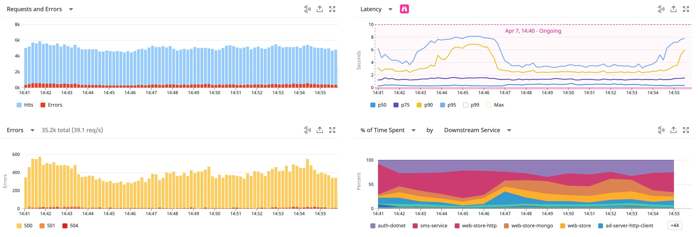
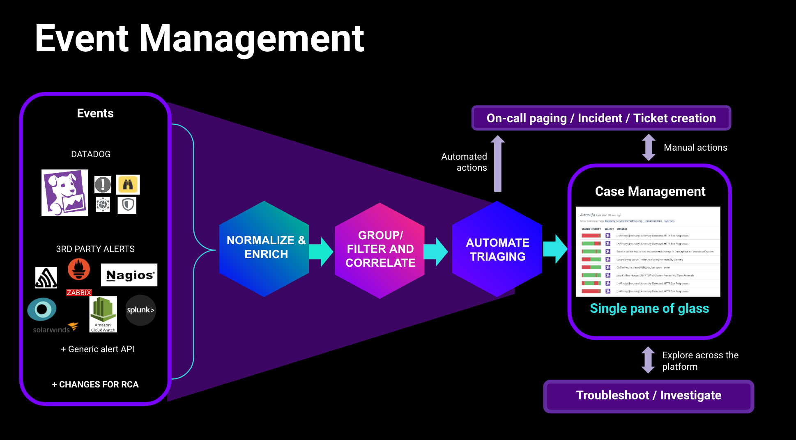
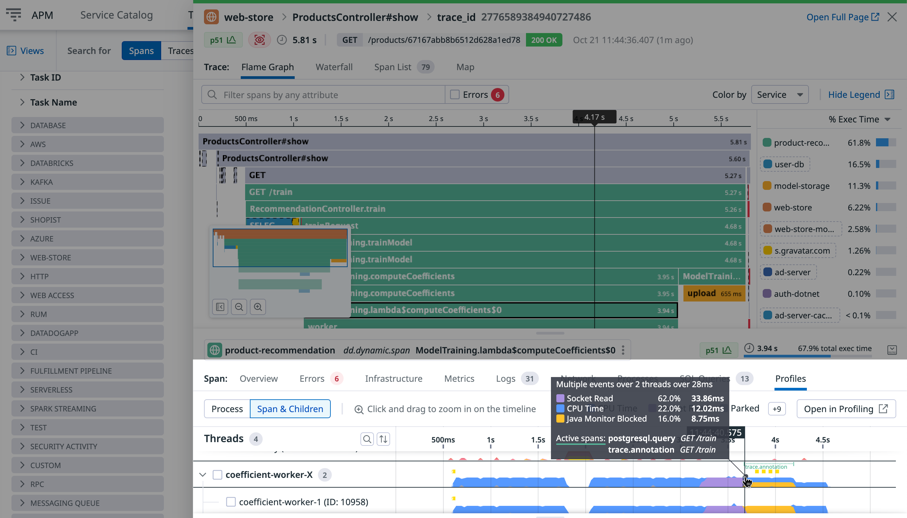
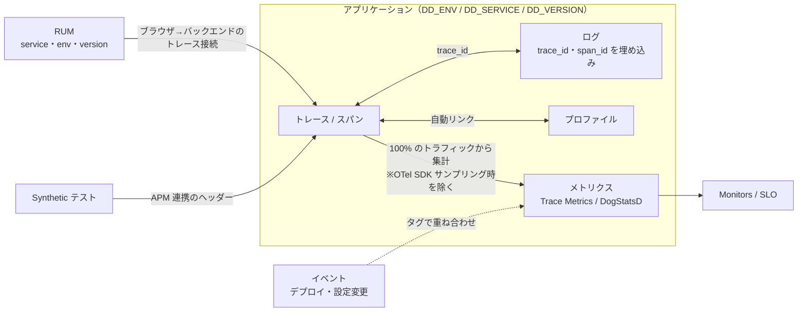
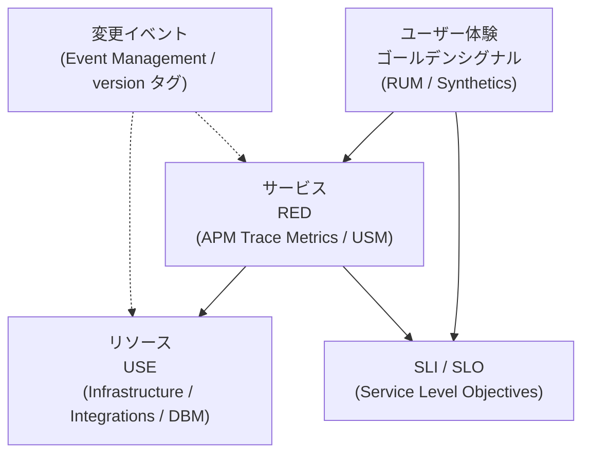
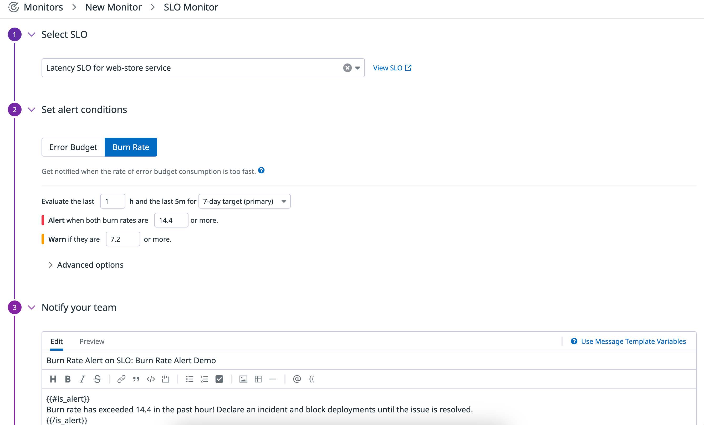
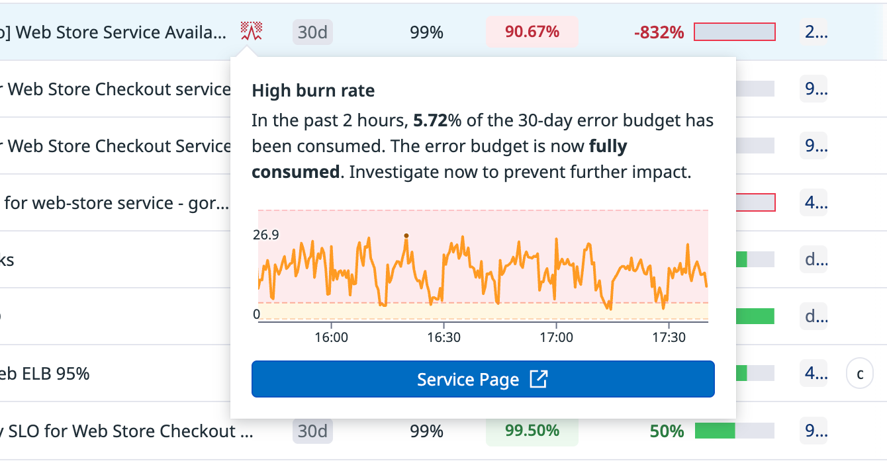
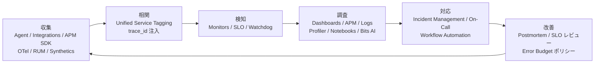

# オブザーバビリティの基礎

## 概要

本ファイルは、Datadog を理解する前提となる「オブザーバビリティ（Observability、可観測性）」の基本概念を整理する入門ファイルである。以下の問いに答える。

| 問い | 本ファイルの該当節 |
|---|---|
| 監視（Monitoring）とオブザーバビリティは何が違うのか | [1. 監視とオブザーバビリティ](#1-監視とオブザーバビリティ) |
| メトリクス・ログ・トレース・イベント・プロファイルはそれぞれ何で、どう使い分けるのか | [2. テレメトリシグナル](#2-テレメトリシグナル5つのデータ種別) |
| シグナル同士をどう相関させるのか（Datadog の Unified Service Tagging など） | [3. シグナルの相関](#3-シグナルの相関とコンテキストの共有) |
| 何を測ればよいのか（ゴールデンシグナル / RED / USE / Monitoring 101） | [4. 何を測るか：監視の方法論](#4-何を測るか監視の方法論) |
| SLI・SLO・エラーバジェット・バーンレートとは何か、Datadog ではどう実装するのか | [5. SLI・SLO・エラーバジェット](#5-slisloエラーバジェット) |
| 各概念は Datadog のどの機能に対応するのか | [6. Datadog での対応機能マップ](#6-datadog-での対応機能マップ) |

本ファイルは「概念の地図」であり、個々の製品仕様（設定項目・制限値・料金）の詳細は各リファレンスに委ねる。Datadog 製品群の全体像は [製品ポートフォリオ全体像](./product-map.md)、Datadog 固有の用語（ホスト、タグ、サービス等）は [必須概念](./core-concepts.md)、データ収集の仕組みは [Datadogのアーキテクチャ概観](./architecture-overview.md) を参照すること。

- 基準日：2026-11-02（`last_verified`）
- 公式情報以外（Google SRE 書籍、Brendan Gregg 氏、Grafana Labs 等の外部の方法論）は業界標準の一次文献として引用し、出典と公開日を併記する。Datadog 製品の仕様ではないため、Datadog 製品の挙動として読まないこと。

---

## 1. 監視とオブザーバビリティ

### 1.1 用語の定義

オブザーバビリティと監視は、以下のように定義されている。

| 用語 | 定義 | 出典 |
|---|---|---|
| Observability（オブザーバビリティ、可観測性） | 「システムの外部出力の知識から、そのシステムの内部状態をどの程度推測できるかの尺度」（"a measure of how well internal states of a system can be inferred from knowledge of its external outputs"）。制御理論に由来する概念で、同 Whitepaper は参考文献として R. E. Kalman の "On the General Theory of Control Systems"（Proc. 1st Int. Cong. of IFAC, Moscow 1960）を挙げている。 | [CNCF TAG Observability Whitepaper](https://github.com/cncf/tag-observability/blob/main/whitepaper.md)（v1.0 は 2023-10 公開。リポジトリは 2025-12-18 にアーカイブ済み）【第三者情報】 |
| Monitoring（監視） | 「システムに関するリアルタイムの定量データを収集・処理・集計・表示すること」（"Collecting, processing, aggregating, and displaying real-time quantitative data about a system"） | [Google SRE Book, Chapter 6](https://sre.google/sre-book/monitoring-distributed-systems/)（2016 年刊行）【第三者情報】 |
| White-box monitoring（ホワイトボックス監視） | システム内部が公開するメトリクスに基づく監視（"Monitoring based on metrics exposed by the internals of the system"） | 同上 |
| Black-box monitoring（ブラックボックス監視） | ユーザーから見える外部挙動をテストする監視（"Testing externally visible behavior as a user would see it"） | 同上 |

Google SRE Book は、監視が答えるべき問いを「何が壊れているか（what's broken、症状 = symptom）」と「なぜ壊れているか（why、原因 = cause）」の 2 つに分け、「ある人にとっての症状は別の人にとっての原因である（one person's symptom is another person's cause）」と述べている [出典](https://sre.google/sre-book/monitoring-distributed-systems/)。

### 1.2 監視とオブザーバビリティの違い（比較表）

監視とオブザーバビリティは対立概念ではなく、オブザーバビリティは監視を包含・拡張する考え方として説明されることが多い。以下は一般に語られる対比であり、厳密な公式定義ではない【経験則】。

| 観点 | 監視（Monitoring） | オブザーバビリティ（Observability） |
|---|---|---|
| 主な問い | 既知の障害が起きていないか（"known unknowns"） | 事前に想定していない事象を含め、なぜ起きたのかを調べられるか（"unknown unknowns"） |
| 前提 | 事前に定義したメトリクス・閾値・ヘルスチェック | 十分なコンテキストを持つテレメトリを収集し、後から任意の切り口で問い合わせる |
| 典型的な成果物 | アラート、ステータス画面、閾値 | 相関可能なメトリクス・ログ・トレース・プロファイル、探索的な分析 |
| データ | メトリクス中心、低カーディナリティ | メトリクス・ログ・トレース・イベント・プロファイルを横断、高カーディナリティ（ユーザー ID、リクエスト ID、バージョン等）の属性 |
| 役割の比喩 | 早期警報システム | 調査官（原因究明） |
| 対象システム | モノリス、静的なサーバー群でも成立 | マイクロサービス、コンテナ、サーバーレスなど動的・分散したシステムで特に重要 |
| Datadog での対応例 | [Monitors](../02_リファレンス/platform/monitors.md)、[Synthetic Monitoring](../02_リファレンス/dem/synthetic-monitoring.md)、[Dashboards](../02_リファレンス/platform/dashboards.md) | [APM](../02_リファレンス/apm/apm-ui-and-analysis.md)、[ログ検索と分析](../02_リファレンス/logs/log-search-and-analytics.md)、[Continuous Profiler](../02_リファレンス/apm/continuous-profiler.md)、[Notebooks](../02_リファレンス/platform/notebooks-and-data-tools.md)、[Watchdog](../02_リファレンス/platform/watchdog.md) |

実務上は、「監視で異常を検知し（Detect）、オブザーバビリティで原因を調べる（Investigate）」という 2 段階で両者を組み合わせる【経験則】。Datadog はこの両方を 1 つのプラットフォームで提供しており、Monitor のアラート通知からダッシュボード、トレース、ログ、プロファイルへ同じタグで遷移できる設計になっている（[3. シグナルの相関](#3-シグナルの相関とコンテキストの共有) を参照）。

### 1.3 オブザーバビリティを成立させる要件

オブザーバビリティを成立させるには、次の要件が必要とされる【経験則】。

| 要件 | 内容 | Datadog での実現手段 |
|---|---|---|
| 網羅的な計装（Instrumentation） | アプリ・インフラ・ネットワーク・フロントエンドからテレメトリを出す | [Datadog Agent](../02_リファレンス/platform/agent.md)、[APM インスツルメンテーション](../02_リファレンス/apm/apm-instrumentation.md)、[Integrations](../02_リファレンス/platform/integrations.md)、[OpenTelemetry サポート](../02_リファレンス/platform/opentelemetry.md) |
| 一貫したメタデータ | すべてのシグナルに共通のタグ（`env`、`service`、`version` 等）を付ける | [Unified Service Tagging](#31-unified-service-tagging統合サービスタグ付け)、[Tagging](../02_リファレンス/platform/tagging.md) |
| シグナル間の相関 | トレース ID をログに埋め込む、スパンとプロファイルを紐付ける等 | ログとトレースの接続、トレースとプロファイルの自動リンク |
| 任意の切り口での問い合わせ | 事後に属性で絞り込み・集計できる | Log Explorer、Trace Explorer、メトリクスクエリ（[メトリクスクエリと関数](../02_リファレンス/platform/metrics-query-and-functions.md)） |
| 十分な保持期間 | 季節性やリリース前後の比較ができる | メトリクスは 15 か月保持（[7. 早見表](#7-主要なデフォルト値保持期間早見表)） |
| コスト管理 | 全量収集とコストのバランス | ログの Indexes / Flex Logs、APM の Ingestion Control（[コスト最適化](../04_応用編/cost-optimization.md)） |

Datadog の「Monitoring 101」は「すべてを計装し、合理的に収集できる有用なデータはすべて集める（instrument everything, and collect all the useful data you reasonably can）」と推奨し、データの条件として「十分に細かい粒度」「分かりやすい命名」「複数スコープのタグ付け（region、role、service 等）」「長期保持（フル粒度で少なくとも 15 か月）」を挙げている [出典](https://www.datadoghq.com/blog/monitoring-101-collecting-data/)（2015-06-30 公開。公開から 2 年以上経過しているため、製品仕様の記述は現行と異なる可能性があるが、方法論としては現在も参照される）。

---

## 2. テレメトリシグナル（5つのデータ種別）

### 2.1 シグナル一覧

テレメトリ（Telemetry）とは、システムが外部に出力する観測データの総称である。CNCF の Observability Whitepaper はメトリクス・ログ・トレースを「主要シグナル（primary signals）」とし、プロファイルとダンプ（クラッシュダンプ）を新しいシグナルとして挙げている [出典](https://github.com/cncf/tag-observability/blob/main/whitepaper.md)【第三者情報】。本ファイルでは、これに Datadog が独立した製品（Event Management）として扱う「イベント」を加えた 5 種として整理する【経験則】。

| シグナル | 何を表すか | データの形 | 得意なこと | 苦手なこと | Datadog の主な機能 |
|---|---|---|---|---|---|
| Metrics（メトリクス） | ある時点・期間の数値の測定値 | 時系列（メトリクス名 + タグ + タイムスタンプ + 値） | 傾向把握、アラート、長期保持、低コストでの集計 | 個別リクエストの詳細、高カーディナリティ属性 | [Metrics](../02_リファレンス/platform/metrics.md)、[Infrastructure Monitoring](../02_リファレンス/infrastructure/infrastructure-monitoring.md)、[Custom Metrics と DogStatsD](../02_リファレンス/platform/custom-metrics-and-dogstatsd.md) |
| Logs（ログ） | 個々の出来事のテキスト／構造化レコード | タイムスタンプ付きのメッセージ + 属性（JSON 等） | 詳細な文脈、エラーメッセージ、監査、セキュリティ分析 | 大量時のコスト、集計の重さ | [ログ収集](../02_リファレンス/logs/log-collection.md)、[Log Pipelines と処理](../02_リファレンス/logs/log-pipelines-and-processing.md)、[ログ検索と分析](../02_リファレンス/logs/log-search-and-analytics.md) |
| Traces（トレース） | 1 リクエストが分散システムを通過する経路と各処理の時間 | スパン（Span）の木構造。各スパンはサービス・リソース・開始時刻・所要時間・属性を持つ | ボトルネック特定、サービス間依存の可視化、レイテンシ分析 | 計装が必要、全量保持はコスト高（サンプリングが前提） | [APM の概念とインジェスト制御](../02_リファレンス/apm/apm-concepts-and-ingestion.md)、[APM 画面と分析機能](../02_リファレンス/apm/apm-ui-and-analysis.md) |
| Events（イベント） | 頻度の低い離散的な出来事（デプロイ、設定変更、アラート、スケーリング等） | タイトル・本文・タグ・ソース・優先度を持つレコード | 「何が変わったか」の文脈提供、変更と障害の相関 | 連続値の傾向分析 | [Event Management](../02_リファレンス/platform/event-management.md) |
| Profiles（プロファイル） | コード（関数・行）単位の CPU・メモリ・ロック・I/O 等の資源消費 | スタックトレースのサンプル集合（フレームグラフで表示） | 「どのコード行が遅い／重いか」の特定、コスト削減 | 言語ランタイムごとの対応差、リクエスト単位の流れ | [Continuous Profiler](../02_リファレンス/apm/continuous-profiler.md) |

なお、Datadog ではエンドユーザー体験のデータとして RUM（Real User Monitoring）のセッション・ビュー・アクション・エラーイベント、合成監視として Synthetic Monitoring のテスト結果も扱う。両者はどちらもユーザー視点のデータだが性質が異なる。Synthetic Monitoring は外部からユーザーの操作を模して挙動をテストするブラックボックス（外形）監視であり、RUM は実ユーザーのブラウザ・モバイルアプリ内に組み込んだ SDK が収集する実ユーザーの体験データである（[1.1](#11-用語の定義) の定義に基づく整理）【経験則】。詳細は [RUM（ブラウザ）](../02_リファレンス/dem/rum-browser.md)、[Synthetic Monitoring](../02_リファレンス/dem/synthetic-monitoring.md) を参照。

OpenTelemetry（OTel）の定義では、Traces・Metrics・Logs・Baggage が現在サポートされるシグナルで、Events（ログの特定の種類）と Profiles（コードレベルの資源使用の記録）は「開発中またはプロポーザル段階（under development or at the proposal stage）」とされている（2026-11-02 時点）[出典](https://opentelemetry.io/docs/concepts/signals/)【第三者情報】。Datadog の OTel 対応状況は [OpenTelemetry サポート](../02_リファレンス/platform/opentelemetry.md) を参照。

### 2.2 Metrics（メトリクス）

Datadog の Metrics は、メトリクス名・タグ・タイムスタンプ・値からなる時系列データである。Datadog では、メトリクス名とタグ値（`host` タグを含む）の一意な組み合わせが 1 つの時系列（課金上は 1 カスタムメトリクス）として数えられる [出典](https://docs.datadoghq.com/metrics/custom_metrics/)。

Datadog のメトリクスの送信タイプ（Submission type）と、Datadog 内での型（In-app type）は以下のとおり [出典](https://docs.datadoghq.com/metrics/types/)。

| 送信タイプ | 意味 | DogStatsD 経由で送った場合の In-app type |
|---|---|---|
| `COUNT` | 1 インターバル内の発生回数の合計 | `RATE` |
| `RATE` | 1 インターバル内の 1 秒あたり発生回数 | DogStatsD では送信不可 |
| `GAUGE` | インターバル内で最後に送信された値 | `GAUGE` |
| `SET` | 一意な値の数（定義は StatsD のドキュメントを参照） | `GAUGE` |
| `HISTOGRAM` | Agent 側で集計した、インターバル内の値の統計分布（avg、count、max、median、95percentile 等） | `GAUGE`、`RATE` |
| `DISTRIBUTION` | インフラ全体の生値をサーバー側でグローバルに集計した分布（パーセンタイルを正確に算出可能） | `DISTRIBUTION` |

- In-app type は `COUNT`、`RATE`、`GAUGE`、`DISTRIBUTION`、`HISTOGRAM`（Explicit、Exponential）[出典](https://docs.datadoghq.com/metrics/types/)。
- `DISTRIBUTION` は In-app type も `DISTRIBUTION` のままで、クエリ時に avg・count・max・min・sum とパーセンタイル（p50・p75・p90・p95・p99）の集計を選べる[出典](https://docs.datadoghq.com/metrics/types/)。
- ドキュメントの例は DogStatsD の flush interval を 10 秒として説明している。デフォルト値そのものは metrics types ページでは明記されておらず、DogStatsD のページを参照する [出典](https://docs.datadoghq.com/metrics/types/)。詳細は [Custom Metrics と DogStatsD](../02_リファレンス/platform/custom-metrics-and-dogstatsd.md)。
- レイテンシのようにパーセンタイル（p95、p99）が重要な値は、複数ホストにまたがって正確に集計できる `DISTRIBUTION` が向いている。SLO の計算にも percentile 対応の `DISTRIBUTION` メトリクスが使える（[5.4](#54-datadog-の-slo-の種類)）。

メトリクスの発生源は大きく 3 種類に分かれる。

| 発生源 | 例 | 課金上の扱い |
|---|---|---|
| Agent / Integration が収集する標準メトリクス | `system.cpu.user`、`system.mem.usable`、AWS CloudWatch 由来の `aws.*` | 標準 Integration のメトリクスは原則としてカスタムメトリクスに数えない。ただし一部の Integration（Java-JMX、OpenMetrics、Prometheus 等）はカスタムメトリクスを発生させうる [出典](https://docs.datadoghq.com/metrics/custom_metrics/) |
| アプリが送るカスタムメトリクス | DogStatsD、カスタム Agent Check、API、OTel | カスタムメトリクスとして課金対象 |
| 他のシグナルから生成したメトリクス | ログからのメトリクス生成（Generate Log-based metrics）、スパンからのメトリクス生成、RUM イベントからのメトリクス生成 | Datadog ドキュメントでは「カスタムメトリクスの送信方法」の節に列挙されている [出典](https://docs.datadoghq.com/metrics/custom_metrics/)。詳細は [Custom Metrics と DogStatsD](../02_リファレンス/platform/custom-metrics-and-dogstatsd.md) |

### 2.3 Logs（ログ）

Datadog の Log Management は、ログを「取り込み（Ingest）」と「インデックス（Index、検索可能な状態で保持）」に分けて扱い、取り込んだログの一部だけを Index に保存し、残りはアーカイブやメトリクス生成に回すことができる。この分離はオブザーバビリティの「全量を収集し、必要なものだけ高コストな形で保持する」という考え方を体現している。設定と制限値は [Indexes・保持・アーカイブ](../02_リファレンス/logs/log-indexes-retention-archives.md)、処理は [Log Pipelines と処理](../02_リファレンス/logs/log-pipelines-and-processing.md) を参照。

ログをオブザーバビリティに活かすための要点【経験則】：

| 要点 | 理由 |
|---|---|
| 構造化ログ（JSON）で出力する | 属性で検索・集計・Facet 化しやすい。Datadog のログとトレースの相関は、ログが JSON で送られるか、言語レベルのログプロセッサで解析されて Datadog の属性になっていることが前提 [出典](https://docs.datadoghq.com/tracing/other_telemetry/connect_logs_and_traces/) |
| トレース ID・スパン ID を埋め込む | ログからトレース、トレースからログへ遷移できる（[3.2](#32-ログとトレースの相関)） |
| `service`・`env`・`version` を付ける | 他シグナルとのフィルタ条件を揃える（[3.1](#31-unified-service-tagging統合サービスタグ付け)） |
| 大量の定常ログはメトリクス化する | 傾向把握はメトリクスの方が安価で長期保持できる |

### 2.4 Traces（トレース）

分散トレース（Distributed Tracing）では、1 つのリクエストの処理全体を Trace（トレース）、その中の個々の処理単位を Span（スパン）と呼ぶ。Datadog APM の基本用語（Service、Resource、Span、Trace、Ingestion と Retention の違い等）は [APM の概念とインジェスト制御](../02_リファレンス/apm/apm-concepts-and-ingestion.md) で詳述する。

Datadog APM はスパンから Trace Metrics（トレースメトリクス）を自動生成する。Trace Metrics はトレースのインジェストのサンプリング設定にかかわらず、アプリケーショントラフィックの 100% から計算される。ただし OpenTelemetry SDK レベルでサンプリングしている場合は、サンプル後のデータから計算される（100% にはならない）[出典](https://docs.datadoghq.com/tracing/metrics/metrics_namespace/)。このため、Trace Metrics はゴールデンシグナルや RED（[4 章](#4-何を測るか監視の方法論)）を測る主要なデータ源になる。

| Trace Metric（`trace.<SPAN_NAME>` 配下） | 型 | 内容 | RED / ゴールデンシグナルとの対応 |
|---|---|---|---|
| `trace.<SPAN_NAME>.hits` | COUNT | リクエスト数 | Rate / Traffic |
| `trace.<SPAN_NAME>.hits.by_http_status` | COUNT | HTTP ステータス別リクエスト数（HTTP メタデータを持つサービス） | Rate / Traffic |
| `trace.<SPAN_NAME>.errors` | COUNT | エラー数 | Errors |
| `trace.<SPAN_NAME>.errors.by_http_status` | COUNT | HTTP ステータス別エラー数 | Errors |
| `trace.<SPAN_NAME>`（レイテンシ分布） | DISTRIBUTION | レイテンシ分布。パーセンタイル集計に対応 | Duration / Latency |
| `trace.<SPAN_NAME>.apdex` | GAUGE | Apdex スコア（HTTP / Web サービス） | ユーザー満足度の指標 |
| `trace.<SPAN_NAME>.duration`（レガシー） | GAUGE | 所要時間。パーセンタイル集計に非対応 | 非推奨（分布メトリクスを推奨） |
| `trace.<SPAN_NAME>.duration.by_http_status`（レガシー） | GAUGE | HTTP ステータス別の所要時間。パーセンタイル集計に非対応 | 非推奨（分布メトリクスを推奨） |

- 主なタグ：`env`、`service`、`version`、`resource`、`http.status_code`、`http.status_class`、`rpc.grpc.status_code`（Agent 7.65.0 以上）、Datadog Agent のタグ（ホストタグ、追加のプライマリタグを含む）。付与されるタグはメトリクスにより異なる[出典](https://docs.datadoghq.com/tracing/metrics/metrics_namespace/)。
- Datadog ドキュメントは、レイテンシの測定にはすべてレイテンシ分布メトリクスを使うことを推奨している。レガシーの duration メトリクスはパーセンタイル集計に対応しない [出典](https://docs.datadoghq.com/tracing/metrics/metrics_namespace/)。
- Trace Metrics がカスタムメトリクスとして課金されるかは、上記ページでは明記されていない（公開情報では確認できず。課金は [製品別料金表](../03_導入編/pricing-by-product.md) と [課金計算の仕組み](../03_導入編/billing-mechanics.md) を参照）。



**図 1：APM Service Page の標準グラフ（RED メトリクスの可視化）**

- 画面の説明：APM の Service Page（サービス詳細画面）上部に表示される 4 つの標準グラフ。左上「Requests and Errors」はリクエスト数（Hits、青）とエラー数（Errors、赤）の積み上げ棒グラフ。右上「Latency」は p50・p75・p90・p95・p99・Max のレイテンシ推移（秒）で、Watchdog が検出した異常期間（例：「Apr 7, 14:40 - Ongoing」）がピンクの帯で重ねて表示されている。左下「Errors」は HTTP ステータス（500、501、504）別のエラー数と合計（例：35.2k total）。右下「% of Time Spent by Downstream Service」は、リクエスト処理時間のうち各ダウンストリームサービス（auth-dotnet、sms-service、web-store-mongo 等）が占める割合の積み上げ面グラフ。各グラフ名の横のドロップダウンで、バージョン別表示、エラー率（%）、前日・前週比較、レイテンシ分布、エラー／非エラーのレイテンシ比較、Apdex などに切り替えられる。
- 補足：Requests・Errors・Latency の 3 グラフはまさに RED メソッドの 3 指標に対応する。「Avg Time per Request」系のグラフはサンプリングされたトレースデータに基づき、他の上部グラフ（Trace Metrics ベース）とはデータ源が異なる。Watchdog は Requests・Latency・Error のグラフに異常検知を行いオーバーレイ表示する。
- 出典：[Service Page（Datadog Docs）](https://docs.datadoghq.com/tracing/services/service_page/)（取得日：2026-11-02）

### 2.5 Events（イベント）

Datadog の Monitoring 101 は、イベントを「システムの振る舞いの変化に文脈を与える、離散的で頻度の低い出来事」とし、例としてコードのリリース、ビルドの失敗、サードパーティのアラート、スケーリング操作を挙げている [出典](https://www.datadoghq.com/blog/monitoring-101-collecting-data/)（2015-06-30 公開）。

Datadog の Event Management は、あらゆるソースからイベントを取り込み（ingest）、エンリッチ・正規化・相関（correlate）して、実行可能な洞察を生み出す機能である [出典](https://docs.datadoghq.com/events/)。

| イベントのソース | 例 |
|---|---|
| Datadog 製品 | Monitor、Watchdog、Error Tracking が自動的にイベントを生成 |
| Agent と Integration | Kubernetes、Docker、Jenkins、Chef、Puppet、Amazon ECS、Autoscaling、Sentry、Nagios など。100 を超える Integration がイベント収集に対応 |
| カスタム・サードパーティ | サードパーティのアラート、変更要求（Change Request）、デプロイ、設定変更 |

- Events Explorer は「包括的な監査ツールとして設計されていない」ため、監査・コンプライアンス・セキュリティ追跡には [Audit Trail](../02_リファレンス/platform/audit-trail.md) を使う [出典](https://docs.datadoghq.com/events/explorer/)。
- 2025-03-01 以降、Monitor イベントの `aggregation_key` に Monitor Group が含まれるようになり、Monitor ID と Monitor Group の組で一意になった。これを使うクエリは `@monitor.id` への移行が推奨されている [出典](https://docs.datadoghq.com/events/)。
- イベントの保持期間は 15 か月 [出典](https://docs.datadoghq.com/data_security/data_retention_periods/)。



**図 2：Event Management の概念図**

- 画面の説明：左側に「Events」の入力源として、DATADOG（Monitor、Watchdog などの Datadog 製品アイコン）、3RD PARTY ALERTS（Prometheus、Nagios、Zabbix、SolarWinds、Amazon CloudWatch、Splunk 等）、「+ Generic alert API」「+ CHANGES FOR RCA（根本原因分析のための変更イベント）」が並ぶ。中央は左から順に「NORMALIZE & ENRICH（正規化・エンリッチ）」「GROUP / FILTER AND CORRELATE（グループ化・フィルタ・相関）」「AUTOMATE TRIAGING（トリアージの自動化）」の 3 段の処理。右側の「Case Management（Single pane of glass）」に集約され、上方向に「On-call paging / Incident / Ticket creation」（自動・手動アクション）、下方向に「Troubleshoot / Investigate（プラットフォーム横断の調査）」へつながる。
- 補足：本図は画面ではなく概念図。イベントの相関がアラート疲れ（alert fatigue）とチケット数を減らすことが Event Management の目的として示されている。
- 出典：[Event Management（Datadog Docs）](https://docs.datadoghq.com/events/)（取得日：2026-11-02）

### 2.6 Profiles（プロファイル）

Datadog の Continuous Profiler は、本番環境で常時プロファイリングを行い、CPU・メモリ・I/O のボトルネックをメソッド名・クラス名・行番号単位で特定する機能である。目的はエンドユーザーのレイテンシとインフラコストの削減とされ、JDK Flight Recorder などの技術でホストの CPU・メモリへの影響を最小限にするとしている（数値のオーバーヘッドは同ページに記載なし）[出典](https://docs.datadoghq.com/profiler/)。

対応言語は Java、Python、Go、Ruby、Node.js、.NET、PHP、Rust/C/C++、および Full Host（ホストレベルの eBPF）である。代表的なプロファイルタイプを以下に示す（完全な一覧とトレーサーの最低バージョンは [Continuous Profiler](../02_リファレンス/apm/continuous-profiler.md) を参照）[出典](https://docs.datadoghq.com/profiler/profile_types/)。

| プロファイルタイプ | 何が分かるか | 対応言語の例 |
|---|---|---|
| CPU（CPU Time） | 関数ごとの CPU 消費 | Java、Python、Go、Ruby、Node.js、.NET、PHP、Rust/C/C++、Full Host（eBPF） |
| Wall Time | 待機を含む実時間（I/O 待ち・スリープ等） | Java、Python、Ruby、Node.js、.NET、PHP |
| Allocations / Allocated Memory | メモリ割り当ての回数と量 | Java、Python、Go、Ruby、.NET、PHP、Rust/C/C++、Node.js【Preview】 |
| Live Heap / Heap Live Size | 生存しているヒープ（メモリリーク調査） | Java、Python、Go、Node.js、.NET、Ruby【Preview】 |
| Lock / Mutex / Block | ロック待ち・競合 | Java、Python、Go、.NET |
| Thrown Exceptions | 例外の発生箇所 | Java、.NET、PHP |
| File I/O / Socket I/O | I/O 待ち | Java、PHP【Preview】 |

- プロファイルの保持：フレームグラフ・コールグラフ・スレッドタイムラインは既定で 8 日、プロファイルメトリクスは既定で 30 日（Profiler ページでは「1 か月」と表記）、Notebook にエクスポートしたフレームグラフ、または UI で一度でも開いた個別プロファイルは 1 年 [出典](https://docs.datadoghq.com/profiler/)、[出典](https://docs.datadoghq.com/data_security/data_retention_periods/)。
- APM の分散トレースと Continuous Profiler を両方有効にしたプロセスは自動的にリンクされ、スパンの「Profiles」タブから、そのスパン実行中のコード行を確認できる [出典](https://docs.datadoghq.com/profiler/)。



**図 3：APM トレースのスパン詳細に表示される Profiles タブ**

- 画面の説明：上半分は APM のトレース詳細（サービス `web-store`、リソース `ProductsController#show`、所要時間 5.81 s、`GET /products/...`、`200 OK`）のフレームグラフ（Flame Graph）。タブとして Flame Graph / Waterfall / Span List / Map があり、右側に「% Exec Time」でサービスごとの実行時間割合（product-recommendation 61.8% 等）が表示される。下半分は選択したスパン（`product-recommendation` の `ModelTraining.lambda$computeCoefficients$0`、3.94 s）の詳細で、Overview / Errors / Infrastructure / Metrics / Logs / Network / Processes / SQL Queries / Profiles のタブが並び、Profiles タブが選択されている。Profiles タブでは「Process」と「Span & Children」の切り替え、スレッドごとのタイムライン（Threads 4）、ツールチップに Socket Read 62.0%・CPU Time 22.0%・Java Monitor Blocked 16.0% といった内訳が表示され、右上の「Open in Profiling」から Profiler 画面へ遷移できる。
- 補足：トレース（どのサービス・処理が遅いか）からプロファイル（どのコードで何に時間を使ったか）へ掘り下げる、シグナル相関の典型例。
- 出典：[Continuous Profiler（Datadog Docs）](https://docs.datadoghq.com/profiler/)（取得日：2026-11-02）

### 2.7 シグナルの使い分け

障害対応の典型的な流れでは、シグナルを次の順に使う【経験則】。

| 問い | 最初に見るシグナル | Datadog の画面・機能 |
|---|---|---|
| 何かおかしいか？（検知） | メトリクス、Synthetic のテスト結果、SLO | Monitors、SLO、Watchdog |
| 何が変わったか？ | イベント（デプロイ、設定変更） | Event Management、APM のデプロイ追跡（`version` タグ） |
| どこが遅い／壊れているか？ | トレース | APM Service Page、Service Map、Trace Explorer |
| なぜ壊れたか？（詳細） | ログ | Log Explorer（トレースからの遷移） |
| どのコードが原因か？ | プロファイル | Continuous Profiler（スパンの Profiles タブ） |
| ユーザーにどう影響したか？ | RUM | RUM Explorer、Session Replay |

---

## 3. シグナルの相関とコンテキストの共有

オブザーバビリティの価値は、個々のシグナルではなく「シグナル間を同じ文脈で行き来できること」にある。Datadog ではタグと ID の埋め込みによって相関を実現する。



### 3.1 Unified Service Tagging（統合サービスタグ付け）

Datadog の Unified Service Tagging は、予約タグ `env`・`service`・`version` をすべてのテレメトリに一貫して付けることで、シグナル間を相関させる仕組みである [出典](https://docs.datadoghq.com/getting_started/tagging/unified_service_tagging/)。

| 項目 | 内容 |
|---|---|
| 予約タグ | `env`、`service`、`version` |
| 環境変数 | `DD_ENV`、`DD_SERVICE`、`DD_VERSION`（APM で必要。インフラメトリクスのみの場合は不要） |
| 対象テレメトリ | トレース（SDK で設定、`version` はトレースメトリクスにも付与）、メトリクス（コンテナ・Kubernetes メトリクス、DogStatsD/StatsD のカスタムメトリクス、システムメトリクス）、ログ（SDK のログ注入または Agent 収集設定）、RUM（ブラウザ SDK 初期化時の `service`・`env`・`version`）、Synthetics（APM Integration for Browser Tests 設定の URL に送るヘッダー） |
| Agent 最低バージョン | Unified Service Tagging：6.19.x / 7.19.x 以上。APM の自動 `version` タグ付け：7.52.0 以上。OTel の `deployment.environment.name` 対応：7.58.0 以上 |
| 注意点 | `version` はデプロイごとに変える。Autodiscovery のログ設定がない場合、ログの `service` はコンテナのショートイメージ名になる。Datadog 固有の `DD_SERVICE` 等は OpenTelemetry ではそのままでは使えず、OTel のリソース属性を使う。StatsD のカスタムタグは追記型のため、値が衝突すると両方のタグが付く |

タグ設計全般は [Tagging](../02_リファレンス/platform/tagging.md) と [タグ戦略の実践](../04_応用編/tagging-strategy.md) を参照。

### 3.2 ログとトレースの相関

Datadog は、ログにトレース ID・スパン ID・`env`・`service`・`version` を属性として注入することで、APM と Log Management の相関を実現する [出典](https://docs.datadoghq.com/tracing/other_telemetry/connect_logs_and_traces/)。

- 前提：ログが JSON で送られるか、言語レベルのログプロセッサで解析され Datadog の属性になること。
- 注意：トレースとログはそれぞれ独立にサンプリングされるため、ログに含まれるトレース ID が、取り込まれていない（または保持されていない）トレースを指すことがある。これは設定ミスではない [出典](https://docs.datadoghq.com/tracing/other_telemetry/connect_logs_and_traces/)。
- 言語別の設定（注入用の設定キーやフィールド名）は [APM インスツルメンテーション](../02_リファレンス/apm/apm-instrumentation.md) を参照。

### 3.3 その他の相関

| 相関 | 仕組み | 詳細 |
|---|---|---|
| トレース ↔ プロファイル | APM と Profiler を両方有効にしたプロセスで自動リンク | [Continuous Profiler](../02_リファレンス/apm/continuous-profiler.md) |
| トレース ↔ インフラ | スパンのホスト・コンテナ・Pod 情報 | [APM 画面と分析機能](../02_リファレンス/apm/apm-ui-and-analysis.md) |
| RUM ↔ トレース | ブラウザ／モバイル SDK がバックエンドへのリクエストにトレースヘッダーを付与 | [RUM（ブラウザ）](../02_リファレンス/dem/rum-browser.md) |
| メトリクス ↔ イベント | ダッシュボードのイベントオーバーレイ、共通タグ | [Dashboards](../02_リファレンス/platform/dashboards.md) |
| サービス ↔ 所有者・Runbook | Software Catalog（旧称：Service Catalog）のサービス定義 | [Software Catalog](../02_リファレンス/platform/software-catalog.md) |

---

## 4. 何を測るか：監視の方法論

「何をメトリクスとして収集し、何にアラートを設定するか」を決めるための代表的な方法論が 4 つある。いずれも Datadog 固有の仕様ではなく、業界で広く使われる考え方である。

### 4.1 方法論の比較

| 方法論 | 提唱者・出典 | 対象 | 指標 |
|---|---|---|---|
| Four Golden Signals（4 つのゴールデンシグナル） | Google SRE Book（2016） | ユーザー向けシステム全般 | Latency、Traffic、Errors、Saturation |
| RED Method | Tom Wilkie 氏（Grafana Labs ブログ 2018-08-03 公開の講演解説） | リクエスト駆動のサービス（マイクロサービス） | Rate、Errors、Duration |
| USE Method | Brendan Gregg 氏（ACM Queue 2012、CACM 2013） | リソース（CPU、メモリ、ディスク、ネットワーク等） | Utilization、Saturation、Errors |
| Monitoring 101（Work / Resource metrics） | Datadog（2015-06-30 公開ブログ） | システム全体（サービスと依存リソース） | Work：Throughput、Success、Error、Performance / Resource：Utilization、Saturation、Errors、Availability / Events |

いずれの文献も公開から 2 年以上経過しているが、概念的な方法論として現在も標準的に参照されている。Datadog 製品の具体的な仕様に関する記述ではない点に注意する。

### 4.2 Four Golden Signals（4 つのゴールデンシグナル）

Google SRE Book は、ユーザー向けシステムで測るべき 4 指標を次のように定義している [出典](https://sre.google/sre-book/monitoring-distributed-systems/)【第三者情報】。

| シグナル | 定義（原文） | Datadog での主な測り方（例） |
|---|---|---|
| Latency（レイテンシ） | "The time it takes to service a request." | Trace Metrics のレイテンシ分布 `trace.<SPAN_NAME>`（p95/p99）、RUM の Core Web Vitals、Synthetic API テストの応答時間 |
| Traffic（トラフィック） | "A measure of how much demand is being placed on your system" | `trace.<SPAN_NAME>.hits`、ロードバランサー等の Integration のリクエスト数メトリクス |
| Errors（エラー） | "The rate of requests that fail, either explicitly (e.g., HTTP 500s)…" | `trace.<SPAN_NAME>.errors`、`errors.by_http_status`、ログのエラー件数 |
| Saturation（飽和度） | システムがどれだけ「いっぱい」か。最も制約の大きいリソースに着目する | `system.cpu.*`、`system.mem.*`、`system.load.*`、コンテナ・Kubernetes のリソースメトリクス、キュー長 |

SRE Book は、成功したリクエストと失敗したリクエストのレイテンシを区別することが重要だと述べている。失敗（例：DB 接続喪失による即時の HTTP 500）は高速に返ることがあり、平均に混ぜると誤解を生む一方、「遅いエラーは速いエラーよりさらに悪い（a slow error is even worse than a fast error!）」ため、エラーを除外せずエラーのレイテンシも追跡すべきとしている [出典](https://sre.google/sre-book/monitoring-distributed-systems/)。Datadog の APM Service Page の Latency グラフでは、エラー／非エラーのリクエストのレイテンシを比較表示できる [出典](https://docs.datadoghq.com/tracing/services/service_page/)。

### 4.3 RED Method

RED Method は、Tom Wilkie 氏が提唱したサービス指向の方法論である。Grafana Labs のブログは、同氏が「USE Method はハードウェアやネットワーク、ディスクには当てはまるがサービスには当てはまりにくい」としてサービス向けに RED を考案したこと、ゴールデンシグナルとほぼ同じだが Saturation を含まない点を紹介している [出典](https://grafana.com/blog/the-red-method-how-to-instrument-your-services/)（2018-08-03 公開）【第三者情報】。

| 指標 | 定義（原文） | Datadog APM での対応 |
|---|---|---|
| Rate | "the number of requests per second" | `trace.<SPAN_NAME>.hits`（Service Page の Requests グラフ） |
| Errors | "the number of those requests that are failing" | `trace.<SPAN_NAME>.errors`（Service Page の Errors グラフ、エラー率 %） |
| Duration | "the amount of time those requests take" | `trace.<SPAN_NAME>` のレイテンシ分布（Service Page の Latency グラフ、p50〜p99） |

Datadog APM は、サービスを計装するだけで RED の 3 指標を Trace Metrics として自動生成し、Service Page の標準グラフ（図 1）に表示する。したがって Datadog 上では「APM を入れれば RED は自動的に揃う」と理解してよい。Universal Service Monitoring（USM）を使うと、コードを計装せずに、サービスのゴールデンシグナルメトリクス（requests、errors、duration）を得られる [出典](https://docs.datadoghq.com/universal_service_monitoring/)（詳細は [Universal Service Monitoring](../02_リファレンス/apm/universal-service-monitoring.md)）。

### 4.4 USE Method

USE Method は、Brendan Gregg 氏が提唱したリソース分析の方法論で、「すべてのリソースについて、使用率・飽和度・エラーを確認せよ（For every resource, check utilization, saturation, and errors.）」と要約される [出典](https://www.brendangregg.com/usemethod.html)（最終更新 2017-08-24）【第三者情報】。

| 指標 | 定義（原文） |
|---|---|
| Resource | "all physical server functional components (CPUs, disks, busses, ...)" |
| Utilization（使用率） | "the average time that the resource was busy servicing work" |
| Saturation（飽和度） | "the degree to which the resource has extra work which it can't service, often queued" |
| Errors（エラー） | "the count of error events" |

Datadog Agent が収集する標準のシステムメトリクスと USE の対応例を以下に示す（メトリクスの正確な一覧と OS ごとの差異は [Infrastructure Monitoring](../02_リファレンス/infrastructure/infrastructure-monitoring.md) と [Metrics](../02_リファレンス/platform/metrics.md) を参照）。

| リソース | Utilization の例 | Saturation の例 | Errors の例 |
|---|---|---|---|
| CPU | `system.cpu.user`、`system.cpu.system`、`system.cpu.idle` | `system.load.1` / `system.load.norm.1`、`system.cpu.iowait` | 公開情報では標準メトリクスとしての CPU エラーは確認できず |
| メモリ | `system.mem.used`、`system.mem.usable` | `system.swap.used` | 公開情報では確認できず（OS ログ等で確認） |
| ディスク | `system.disk.in_use`、`system.io.util` | `system.io.avg_q_sz` | ログ・イベントで確認 |
| ネットワーク | `system.net.bytes_rcvd`、`system.net.bytes_sent` | `system.net.packets_in.drop` 等 | `system.net.packets_in.error`、`system.net.packets_out.error` |
| コンテナ / Kubernetes | Pod・コンテナの CPU・メモリ使用量 | CPU スロットリング、Pending Pod | OOMKilled、再起動回数 |

上表のメトリクス名は対応関係を示す例であり、Agent のバージョンや OS によって提供状況が異なる。コンテナ・Kubernetes の具体的なメトリクス名は [コンテナ・Kubernetes 監視](../02_リファレンス/infrastructure/container-and-kubernetes-monitoring.md) を参照。

### 4.5 Datadog の Monitoring 101：Work metrics と Resource metrics

Datadog は「Monitoring 101」シリーズで、収集すべきデータを Work metrics（ワークメトリクス）、Resource metrics（リソースメトリクス）、Events（イベント）の 3 種に分類している [出典](https://www.datadoghq.com/blog/monitoring-101-collecting-data/)（2015-06-30 公開）。

| 分類 | サブタイプ | 定義 | 例（Web サーバー） |
|---|---|---|---|
| Work metrics：システムが有用な出力を出しているか | Throughput | 単位時間あたりの処理量（"the amount of work the system is doing per unit time"） | requests/sec |
| | Success | 成功した処理の割合 | 2xx の割合 |
| | Error | 誤った結果の数（多くは率） | 5xx の割合 |
| | Performance | 処理の効率（"quantify how efficiently a component is doing its work"）。最も一般的なのはレイテンシ | 応答時間 p99 |
| Resource metrics：他のシステムが依存するコンポーネント（CPU、メモリ、ディスク、DB 等） | Utilization | リソースがビジーな時間の割合 | CPU 使用率 |
| | Saturation | まだ処理できず待っている仕事の量（キュー） | 待ち行列長 |
| | Errors | 出力に表れないかもしれない内部エラー | ディスクの I/O エラー |
| | Availability | チェックに応答した時間の割合 | ヘルスチェック成功率 |
| Events | — | 振る舞いの変化に文脈を与える離散的な出来事 | デプロイ、スケーリング |

Monitoring 101 は、データ種別ごとのアラートの扱いも示している [出典](https://www.datadoghq.com/blog/monitoring-101-collecting-data/)。

| データ | 推奨されるアラートの扱い |
|---|---|
| Work metrics（Throughput、Success、Errors、Performance） | Page（即時の呼び出し） |
| 重要な Work に関わるイベント | Page |
| Resource の Utilization | Notification（通知。即時対応は不要） |
| Resource の Saturation、Errors、Availability | Record（後の分析のために記録） |

この考え方は「症状（ユーザー影響）でアラートし、原因は調査に使う」という SRE の原則（[1.1](#11-用語の定義)）と一致する。実践的なアラート設計は [アラート設計とノイズ削減](../04_応用編/alert-design-and-noise-reduction.md) を参照。

### 4.6 方法論の組み合わせ方

各方法論は排他的ではなく、レイヤーごとに組み合わせて使う【経験則】。

| レイヤー | 推奨する方法論 | Datadog での主なデータ源 | 主な用途 |
|---|---|---|---|
| エンドユーザー体験 | ゴールデンシグナル（Latency、Errors） | RUM、Synthetic Monitoring | SLO、ユーザー影響の検知 |
| サービス（API、マイクロサービス） | RED | APM Trace Metrics、USM | SLO、アラート（Page） |
| リソース（ホスト、コンテナ、DB） | USE | Infrastructure Monitoring、Integration、Database Monitoring | キャパシティ計画、原因調査 |
| 変更 | Events | Event Management、デプロイ追跡 | 原因の切り分け |



---

## 5. SLI・SLO・エラーバジェット

### 5.1 用語の定義

Datadog の Service Level Objectives（SLO）ドキュメントは、以下のように用語を定義している [出典](https://docs.datadoghq.com/service_management/service_level_objectives/)。

| 用語 | Datadog の定義 |
|---|---|
| SLI（Service Level Indicator、サービスレベル指標） | サービスのパフォーマンスや信頼性の定量的な測定値（"A quantitative measurement of a service's performance or reliability"）。Datadog では、メトリクス、または 1 つ以上の Monitor の集計 |
| SLO（Service Level Objective、サービスレベル目標） | 特定の期間における SLI の目標パーセンテージ（"A target percentage for an SLI over a specific period of time"） |
| SLA（Service Level Agreement、サービスレベル合意） | 顧客とサービス提供者の間の、信頼性に関する明示的または暗黙的な合意 |
| Error Budget（エラーバジェット） | SLO の目標値から導かれる許容される非信頼性の量（100% − 目標値） |

関係性を整理すると次のとおり。

| 層 | 例 | 誰のためのものか |
|---|---|---|
| SLI | 「成功した HTTP リクエスト数 ÷ 全 HTTP リクエスト数」 | 計測する指標 |
| SLO | 「過去 30 日間で SLI が 99.9% 以上」 | 社内のエンジニアリング目標 |
| SLA | 「月間稼働率 99.5% を下回った場合に利用料の一部を返金」 | 顧客との契約 |
| Error Budget | 「30 日で 0.1%（約 43.2 分相当）まで失敗してよい」 | リリース速度と信頼性のトレードオフ判断 |

SLA は通常 SLO より緩く設定し、SLO を内部の早期警戒ラインとして使う【経験則】。

### 5.2 エラーバジェットの計算

エラーバジェットは「100% − SLO 目標値」で求める。時間ベースの SLI（Monitor-based SLO、Time Slice SLO）では、これを許容ダウンタイム（分）に換算できる。7 日 = 10,080 分、30 日 = 43,200 分、90 日 = 129,600 分として計算した値を示す。

| SLO 目標 | エラーバジェット | 7 日あたり | 30 日あたり | 90 日あたり |
|---|---|---|---|---|
| 99% | 1% | 100.8 分（約 1.7 時間） | 432 分（7.2 時間） | 1,296 分（21.6 時間） |
| 99.5% | 0.5% | 50.4 分 | 216 分（3.6 時間） | 648 分（10.8 時間） |
| 99.9% | 0.1% | 10.08 分 | 43.2 分 | 129.6 分（約 2.2 時間） |
| 99.95% | 0.05% | 5.04 分 | 21.6 分 | 64.8 分 |
| 99.99% | 0.01% | 約 1.0 分 | 4.32 分 | 12.96 分 |

カウントベースの SLI（Metric-based SLO）では、エラーバジェットは「許容される失敗イベントの割合」になる。例えば SLO 99.9% で 30 日間に 1,000 万リクエストがあれば、許容される失敗は 1 万リクエストである。

Datadog は、残りのエラーバジェット（Error budget remaining）を次の式で計算する [出典](https://docs.datadoghq.com/service_management/service_level_objectives/)。

```
Error budget remaining = 100 × (current status − target) / (100 − target)
```

例：目標 99%、現在のステータス 99.5% の場合、100 × (99.5 − 99) / (100 − 99) = 50%（バジェットの半分が残っている）。現在のステータスが目標を下回るとマイナスになる（例えば目標 99% に対して 90.67% なら −833%。図 5 の SLO 一覧画面では −832% と表示されている。表示値は内部の丸め前の値に基づくと考えられる【推定】）。

SLO の目標値は 100% 未満でなければならない。100% を目標にするとエラーバジェットが 0% になり、アラート評価でゼロ除算エラーになる [出典](https://docs.datadoghq.com/service_management/service_level_objectives/)。

### 5.3 良い SLI の選び方

SLI はユーザーが体験する症状（Work metrics、ゴールデンシグナル）から選ぶ。リソースメトリクス（CPU 使用率等）は SLI に向かない【経験則】。

| サービスの種類 | SLI の例 | Datadog での測り方 | 推奨 SLO タイプ |
|---|---|---|---|
| リクエスト駆動の API | 可用性：5xx 以外のリクエスト ÷ 全リクエスト | `trace.<SPAN_NAME>.hits` と `trace.<SPAN_NAME>.errors`、またはロードバランサーのメトリクス | Metric-based |
| リクエスト駆動の API | レイテンシ：応答時間が閾値（例：500 ms）以下のリクエストの割合 | percentile 対応の DISTRIBUTION メトリクス（Threshold Query） | Metric-based |
| リクエスト駆動の API | レイテンシ：1 分ごとの p95 が 1 秒未満だった時間の割合 | Trace Metrics のレイテンシ分布 | Time Slice |
| Web フロントエンド | ページ読み込みの成功率、Core Web Vitals | RUM | Metric-based（RUM から生成したメトリクス） |
| 外形監視 | 外部からの疎通成功時間の割合 | Synthetic テスト | Monitor-based |
| バッチ / データパイプライン | 期限内に完了したジョブの割合、データの鮮度 | カスタムメトリクス、[Data Jobs Monitoring](../02_リファレンス/data/data-jobs-monitoring.md) | Metric-based |

Datadog の Metric-based SLO の例では、HTTP ステータスで分類した場合、良いイベントを `sum:httpservice.hits{code:2xx} + sum:httpservice.hits{code:4xx}`、悪いイベントを `sum:httpservice.hits{code:5xx}` とし、3xx はリダイレクトであるため SLI に含めない（良くも悪くも数えない）としている [出典](https://docs.datadoghq.com/service_management/service_level_objectives/metric/)。4xx はクライアント側の誤りとして「良い」に数える設計である。

### 5.4 Datadog の SLO の種類

Datadog の SLO には 3 種類がある [出典](https://docs.datadoghq.com/service_management/service_level_objectives/)。

| 項目 | Metric-based SLO | Monitor-based SLO | Time Slice SLO |
|---|---|---|---|
| UI での作成方法 | 「+ New SLO」→「By Count」 | Monitor を選択 | 時系列メトリクスの条件で定義 |
| SLI の種類 | カウントベース：良いイベントの合計 ÷ 全イベントの合計 | 時間ベース：Monitor のアップタイム | 時間ベース：独自のアップタイム定義（メトリクス時系列の条件） |
| 入力 | 良いイベントと悪いイベントの 2 クエリ（「全イベント」クエリは旧定義で、新規作成は API のみ） | 既存の Datadog Monitor（最大 20 個） | メトリクスクエリ + 比較演算子 + 閾値 |
| 対応データ | `COUNT`、`RATE`、percentile 対応の `DISTRIBUTION` メトリクス（APM スパン、RUM イベント、ログから生成したカスタムメトリクスを含む） | Metric 系 Monitor（Metric、Integration、APM Metric、Anomaly、Forecast、Outlier）、Synthetic、Service Check | メトリクス |
| Monitor の要否 | 不要 | 必要（調整は Monitor 側で行う） | 不要 |
| 粒度 | 公開情報では確認できず | 1 分（Monitor が毎分評価するため） | 1 分または 5 分のスライス |
| 目標値の小数精度 | 最大 3 桁（UI は分母の大きさに応じ最大 4 桁表示） | 7 日・30 日目標は最大 2 桁、90 日目標は最大 3 桁 | 公開情報では確認できず |
| グループ | `sum by` 等でグループ別に分解 | 単一のマルチアラート Monitor のみグループ選択可（最大 20 グループ）。複数 Monitor 時はグループ選択不可 | クエリの group by ごとに計算。全グループが Up のときのみ全体が Up |
| 向いている用途 | リクエスト成功率など、良い／悪いイベントを数えられる場合 | 既存の Monitor・Synthetic テストを流用する場合 | 「p95 レイテンシ < 1 秒の時間の割合」のような時間ベースの目標 |

出典：[Metric-based SLO](https://docs.datadoghq.com/service_management/service_level_objectives/metric/)、[Monitor-based SLO](https://docs.datadoghq.com/service_management/service_level_objectives/monitor/)、[Time Slice SLO](https://docs.datadoghq.com/service_management/service_level_objectives/time_slice/)

Time Slice SLO のアップタイム計算の例：時系列を等間隔のスライスに分割し、各スライスで条件を評価する。条件を満たせばアップタイム、満たさなければダウンタイムとする。720 分中 5 分がダウンタイムなら 715 / 720 = 99.305% となる。2 グループがそれぞれ重ならない 5 分ずつダウンした場合、全体のアップタイムは 98.611%（710 / 720）になる [出典](https://docs.datadoghq.com/service_management/service_level_objectives/time_slice/)。

Time Slice SLO のその他の仕様 [出典](https://docs.datadoghq.com/service_management/service_level_objectives/time_slice/)：

- 欠損データ（Missing data）は常にアップタイムとして扱われ、タイムライン上はグレーで表示される。
- 補正期間（Status Corrections）はアップタイムとして扱われるため、エラーバジェットは固定の時間量になる。
- Time Slice SLO はローリング期間（rolling periods）に対応せず、Monitor クエリのローリング期間は引き継がれない。
- Monitor-based SLO から Time Slice SLO へのエクスポートは、単一メトリクスの Monitor-based SLO のみ可能。

Monitor-based SLO の欠損データの扱い（Metric 系 Monitor）[出典](https://docs.datadoghq.com/service_management/service_level_objectives/monitor/)：

| Monitor の欠損データ設定 | SLO での扱い |
|---|---|
| Evaluate as zero | 閾値次第 |
| Show last known status | 直前の SLO 状態を維持 |
| Show NO DATA | アップタイム |
| Show NO DATA and notify | ダウンタイム |
| Show OK | アップタイム |

- Monitor の WARN 状態は OK（良い状態）として扱われる。
- Monitor をミュートしても SLO の計算には影響しない。期間を除外したい場合は SLO の Status Corrections を使う。
- 一時停止した Synthetic テストの欠損期間は計算から除外され、薄いグレーで表示される。
- グループが 5,000 以下なら全グループを表示する。5,000 を超える場合は全グループで計算されるが、UI にはグループが表示されない。
- 複数 Monitor の全体ステータスは、各 Monitor のステータスの平均より低くなりうる（例：90%・90%・80% の 3 Monitor で全体 70%）。

### 5.5 SLO の期間（Time Window）

Datadog の SLO の目標期間は、過去 7 日・30 日・90 日のローリングウィンドウで設定する。既定では最も短い期間が選択される [出典](https://docs.datadoghq.com/service_management/service_level_objectives/)。

| 項目 | 内容 |
|---|---|
| ローリングウィンドウ | 過去 7 日、30 日、90 日 |
| 警告閾値（Warning） | 任意。目標値より低い警告値を設定でき、接近すると黄色表示。目標超過で緑、違反で赤 [出典](https://docs.datadoghq.com/service_management/service_level_objectives/metric/) |
| SLO Calendar View | 過去 12 か月の履歴を Daily / Weekly / Monthly で表示。Metric-based と Time Slice SLO が対象 |
| SLO 結果の保持期間 | 15 か月 [出典](https://docs.datadoghq.com/data_security/data_retention_periods/) |

暦月（カレンダー月）単位での SLA 報告が必要な場合の扱いは [Service Level Objectives（SLO）](../02_リファレンス/platform/slo.md) と [SLO 運用の実践](../04_応用編/slo-practices.md) を参照。

### 5.6 バーンレート（Burn Rate）

バーンレートは、「SLO に対してサービスがどれだけ速くエラーバジェットを消費しているか」を表す（Google SRE Workbook の定義："Burn rate is how fast, relative to the SLO, the service consumes the error budget."）[出典](https://sre.google/workbook/alerting-on-slos/)（2018 年刊行）【第三者情報】。

Datadog の定義では、バーンレートは単位のない値で、バーンレート 1 を維持すると目標期間の終わりにちょうどエラーバジェットを使い切る [出典](https://docs.datadoghq.com/service_management/service_level_objectives/burn_rate/)。

| 式 | 内容 |
|---|---|
| バジェットを使い切るまでの時間 | SLO の目標期間 ÷ バーンレート |
| エラーバジェット | 100% − SLO 目標 |
| エラー率 | 1 − (良い振る舞い ÷ 全振る舞い) |
| 最大バーンレート | 1 ÷ (1 − SLO 目標)（例：99.9% なら 1,000、99% なら 100、96% なら 25） |
| 期間 W のうち L 時間で消費するバジェット割合 | バーンレート × L ÷ W（例：30 日 = 720 時間の SLO で、バーンレート 14.4 が 1 時間続くと 14.4 × 1 / 720 = 2%） |

**Datadog の Burn Rate Alert の仕様** [出典](https://docs.datadoghq.com/service_management/service_level_objectives/burn_rate/)：

| 項目 | 仕様 |
|---|---|
| 発報条件 | Long window（長期ウィンドウ）と Short window（短期ウィンドウ）の両方でバーンレートが閾値以上 |
| Long window | 時間単位で指定。1〜48 時間（最大 48 時間）。小さな一時的問題を除外する役割 |
| Short window | 分単位で指定。UI では自動的に Long window の 1/12 に設定。API / Terraform では別の値を指定できるが Long window 未満であること。問題終了後にアラートを早く回復させる役割 |
| 閾値の制約 | 0 < バーンレート ≤ 1 ÷ (1 − SLO 目標)。最大値を超える閾値は発報しえないため作成がブロックされる |
| 対応 SLO | Metric-based、Monitor-based（Metric 系 Monitor のみで構成されたもの）、Time Slice |
| グループ単位のアラート | Metric-based と Time Slice は個別グループまたは SLO 全体でアラート可能。Monitor-based は SLO 全体のみ |
| API クエリ例 | `burn_rate("slo_id").over("time_window").long_window("1h").short_window("5m") > 14.4` |
| Terraform | provider v2.7.0 以前、または v2.13.0 以降が必要（その間のバージョンは非対応） |

**Datadog の推奨値**（目標 99.9% を前提。目標 96%〔最大バーンレート 25〕程度まで妥当で、それより低い目標ではより低い閾値が必要になる場合がある）[出典](https://docs.datadoghq.com/service_management/service_level_objectives/burn_rate/)：

| 目標期間 | バーンレート | Long window | Short window | 理論上のバジェット消費 |
|---|---|---|---|---|
| 7 日 | 16.8 | 1 時間 | 5 分 | 10% |
| 7 日 | 5.6 | 6 時間 | 30 分 | 20% |
| 7 日 | 2.8 | 24 時間 | 120 分 | 40% |
| 30 日 | 14.4 | 1 時間 | 5 分 | 2% |
| 30 日 | 6 | 6 時間 | 30 分 | 5% |
| 30 日 | 3 | 24 時間 | 120 分 | 10% |
| 90 日 | 21.6 | 1 時間 | 5 分 | 1% |
| 90 日 | 10.8 | 6 時間 | 30 分 | 3% |
| 90 日 | 4.5 | 24 時間 | 120 分 | 5% |

参考：Google SRE Workbook の推奨（99.9% SLO、Multiwindow, Multi-Burn-Rate Alerts）は、Page：1 時間 / 5 分 / 14.4（2%）、Page：6 時間 / 30 分 / 6（5%）、Ticket：3 日 / 6 時間 / 1（10%）である [出典](https://sre.google/workbook/alerting-on-slos/)【第三者情報】。Datadog の 30 日の推奨値の上 2 行は Workbook と一致する。ただし Workbook の Ticket 行（Long window 3 日）は Datadog の Long window 上限（48 時間）を超えるため、Datadog ではそのままでは設定できない。Datadog は代わりに 24 時間 / 120 分 / 3（10%）を推奨している。



**図 4：SLO Monitor（Burn Rate アラート）の作成画面**

- 画面の説明：パンくずは「Monitors > New Monitor > SLO Monitor」。ステップ 1「Select SLO」で対象 SLO（例：Latency SLO for web-store service）を選び、「View SLO」で SLO 詳細へ遷移できる。ステップ 2「Set alert conditions」で「Error Budget」と「Burn Rate」のタブを切り替える（画像では Burn Rate を選択。説明文「Get notified when the rate of error budget consumption is too fast.」）。「Evaluate the last [1] h and the last 5m for [7-day target (primary)]」で Long window（時間）と対象の目標期間を指定し、Short window（5m）は自動計算される。「Alert when both burn rates are [14.4] or more.」「Warn if they are [7.2] or more.」で Alert / Warn の閾値を指定。「Advanced options」が折りたたまれている。ステップ 3「Notify your team」で通知メッセージ（`{{#is_alert}}` などのテンプレート変数）を編集する。
- 補足：画像の例は 7 日目標にバーンレート 14.4 を設定しているが、Datadog の推奨表では 7 日目標・1 時間ウィンドウの推奨値は 16.8 である。画像は UI の説明用の例として読むこと。
- 出典：[Burn Rate Alerts（Datadog Docs）](https://docs.datadoghq.com/service_management/service_level_objectives/burn_rate/)（取得日：2026-11-02）

**SLO 一覧のバーンレートインジケーター**：Datadog の SLO 一覧には、直近 2 時間のローリングウィンドウで計算したバーンレートのインジケーターが表示される。バーンレート 6 超で赤（critical）、1〜6 で黄（elevated）となる [出典](https://docs.datadoghq.com/service_management/service_level_objectives/)。



**図 5：SLO 一覧画面の High burn rate インジケーター**

- 画面の説明：SLO 一覧の各行に、SLO 名、期間（30d）、目標（99%）、現在のステータス（例：90.67%、赤背景）、残りエラーバジェット（例：−832%、赤字）とバーが並ぶ。SLO 名の右にある赤いアイコンにカーソルを合わせると「High burn rate」のポップアップが開き、「In the past 2 hours, 5.72% of the 30-day error budget has been consumed. The error budget is now fully consumed. Investigate now to prevent further impact.」のように直近 2 時間の消費量が文章で示される。ポップアップ内には直近のバーンレートの推移グラフ（赤＝高い、黄＝中程度の帯）と「Service Page」ボタン（APM の Service Page へ遷移）がある。下の行には目標を満たしている SLO（例：99.50%、緑、残りバジェット 50%）も見える。
- 出典：[Service Level Objectives（Datadog Docs）](https://docs.datadoghq.com/service_management/service_level_objectives/)（取得日：2026-11-02）

### 5.7 Error Budget Alert（エラーバジェットアラート）

Datadog の Error Budget Alert は、SLO のエラーバジェットが設定した割合以上消費されたときに通知する閾値型のアラートである [出典](https://docs.datadoghq.com/service_management/service_level_objectives/error_budget/)。

| 項目 | 仕様 |
|---|---|
| 閾値 | 目標期間内のエラーバジェット消費率（%）が閾値を超えたら Alert。任意で Warning 閾値（例：Alert 75%、Warning 50%） |
| 対象期間 | SLO に設定した 7 日・30 日・90 日の目標 |
| 対応 SLO | Metric-based、Monitor-based（Metric 系 Monitor のみで構成）、Time Slice |
| グループ単位 | Metric-based と Monitor-based は SLO 全体のみ。グループを持つ Time Slice SLO はグループ単位または全体（simple / multi alert） |
| API クエリ例 | `error_budget("slo_id").over("time_window") > 75` |
| Terraform | `datadog_monitor` で `type = "slo alert"`。provider v2.7.0 以前または v2.13.0 以降 |

Burn Rate Alert と Error Budget Alert の使い分け【経験則】：

| アラート | 検知するもの | 典型的な用途 |
|---|---|---|
| Burn Rate Alert | 「このペースだとバジェットを早く使い切る」急激な悪化 | 障害の即時検知（Page） |
| Error Budget Alert | 「バジェットの累積消費が一定量に達した」 | リリース凍結・信頼性改善の判断（Ticket、定例レビュー） |

### 5.8 Status Corrections（ステータス補正）

Datadog の SLO は、計画メンテナンスなどの期間を計算から除外する Status Corrections（ステータス補正）に対応する。SLO ごとの上限は以下のとおり（過去 90 日、SLO 名で指定した補正のみが対象。タグベースの補正は上限の対象外）[出典](https://docs.datadoghq.com/service_management/service_level_objectives/)。

| 補正の種類 | SLO あたりの上限 |
|---|---|
| 1 回限り（One-time） | 100 |
| 毎日の繰り返し | 2 |
| 毎週の繰り返し | 3 |
| 毎月の繰り返し | 5 |
| 毎年の繰り返し | 20 |

繰り返し補正は iCalendar RFC 5545 の RRULE（`FREQ`、`INTERVAL`、`COUNT`、`UNTIL`、`BYDAY`）で指定する。SLO の変更は Event Monitor で `[SLO Modified]` をタグ `audit,slo_id:<SLO ID>` で追跡できる [出典](https://docs.datadoghq.com/service_management/service_level_objectives/)。

SLO の作成手順・権限・ウィジェット・API の詳細は [Service Level Objectives（SLO）](../02_リファレンス/platform/slo.md)、SLO の運用（目標値の決め方、エラーバジェットポリシー、組織への定着）は [SLO 運用の実践](../04_応用編/slo-practices.md) を参照。

---

## 6. Datadog での対応機能マップ

本ファイルで扱った概念と、Datadog の機能・参照先の対応を一覧にする。各製品の位置付けは [製品ポートフォリオ全体像](./product-map.md) を参照。

| 概念 | Datadog の機能 | 何ができるか | 詳細ファイル |
|---|---|---|---|
| メトリクス（インフラ） | Infrastructure Monitoring、Integrations | ホスト・クラウド・ミドルウェアの標準メトリクス収集 | [Infrastructure Monitoring](../02_リファレンス/infrastructure/infrastructure-monitoring.md)、[Integrations](../02_リファレンス/platform/integrations.md) |
| メトリクス（アプリ独自） | Custom Metrics、DogStatsD | ビジネス指標・アプリ指標の送信 | [Custom Metrics と DogStatsD](../02_リファレンス/platform/custom-metrics-and-dogstatsd.md) |
| ログ | Log Management、Observability Pipelines | 収集・加工・インデックス・アーカイブ・メトリクス化 | [ログ収集](../02_リファレンス/logs/log-collection.md)、[Observability Pipelines](../02_リファレンス/logs/observability-pipelines.md) |
| トレース | APM、Universal Service Monitoring | 分散トレース、Trace Metrics（RED）、サービスマップ | [APM の概念とインジェスト制御](../02_リファレンス/apm/apm-concepts-and-ingestion.md)、[Universal Service Monitoring](../02_リファレンス/apm/universal-service-monitoring.md) |
| イベント | Event Management | イベントの取り込み・正規化・相関 | [Event Management](../02_リファレンス/platform/event-management.md) |
| プロファイル | Continuous Profiler | コード行レベルの資源消費分析 | [Continuous Profiler](../02_リファレンス/apm/continuous-profiler.md) |
| エラー集約 | Error Tracking | エラーを Issue 単位にグルーピング | [Error Tracking](../02_リファレンス/apm/error-tracking.md) |
| ユーザー体験（実ユーザーの SDK 計装データ） | RUM、Session Replay | 実ユーザーのページ表示・操作・エラー | [RUM（ブラウザ）](../02_リファレンス/dem/rum-browser.md)、[RUM（モバイル）](../02_リファレンス/dem/rum-mobile.md) |
| ブラックボックス（外形）監視 | Synthetic Monitoring | API・ブラウザ・モバイルの外形監視 | [Synthetic Monitoring](../02_リファレンス/dem/synthetic-monitoring.md) |
| 相関のためのメタデータ | Unified Service Tagging、Tagging | `env`・`service`・`version` 等で全シグナルを結ぶ | [Tagging](../02_リファレンス/platform/tagging.md) |
| オープン標準 | OpenTelemetry サポート | OTel SDK・Collector からのデータ受信 | [OpenTelemetry サポート](../02_リファレンス/platform/opentelemetry.md) |
| 検知（アラート） | Monitors、Watchdog | 閾値・異常検知・予測・外れ値・複合条件 | [Monitors](../02_リファレンス/platform/monitors.md)、[Watchdog](../02_リファレンス/platform/watchdog.md) |
| SLI / SLO / エラーバジェット | Service Level Objectives | 3 種類の SLO、Burn Rate / Error Budget Alert | [Service Level Objectives（SLO）](../02_リファレンス/platform/slo.md) |
| 可視化 | Dashboards、Notebooks | ゴールデンシグナル・USE のダッシュボード、調査記録 | [Dashboards](../02_リファレンス/platform/dashboards.md)、[Notebooks・DDSQL・Reference Tables](../02_リファレンス/platform/notebooks-and-data-tools.md) |
| サービスの所有者・メタデータ | Software Catalog（旧称：Service Catalog） | サービスごとの担当チーム・Runbook・SLO の集約 | [Software Catalog](../02_リファレンス/platform/software-catalog.md) |
| 対応（Response） | Incident Management、On-Call、Workflow Automation | 障害宣言・呼び出し・自動対応 | [Incident Management](../02_リファレンス/service-management/incident-management.md)、[On-Call](../02_リファレンス/service-management/on-call.md) |
| AI による調査支援 | Bits AI | 自然言語での調査・要約 | [Bits AI と AI 機能](../02_リファレンス/ai/bits-ai.md) |

オブザーバビリティのライフサイクル（収集 → 相関 → 検知 → 調査 → 対応 → 改善）と Datadog 機能の関係を図示する。



---

## 7. 主要なデフォルト値・保持期間（早見表）

入門者が最初に押さえるべきシグナル別の保持期間を示す。値は Datadog の Data Retention Periods ページ等に基づく（2026-11-02 時点）。サイト・契約により異なる場合があり、詳細は各リファレンスを参照する。

| データ | 既定の保持期間 | 出典 |
|---|---|---|
| メトリクス（タグと値） | 15 か月 | [Data Retention Periods](https://docs.datadoghq.com/data_security/data_retention_periods/) |
| イベント（Event Management） | 15 か月 | 同上 |
| ログ | 契約プランにより決定（固定の既定値なし） | 同上。詳細は [Indexes・保持・アーカイブ](../02_リファレンス/logs/log-indexes-retention-archives.md) |
| APM Indexed Spans | 契約プランにより 15 日または 30 日 | 同上 |
| APM のサービス／リソース統計 | 30 日 | 同上 |
| Continuous Profiler（フレームグラフ・コールグラフ・スレッドタイムライン） | 8 日 | 同上、[Continuous Profiler](https://docs.datadoghq.com/profiler/) |
| Continuous Profiler（Notebook にエクスポートしたフレームグラフ、UI で一度でも開いた個別プロファイル） | 1 年 | [Data Retention Periods](https://docs.datadoghq.com/data_security/data_retention_periods/) |
| Continuous Profiler（プロファイルメトリクス） | 30 日（Profiler ページでは「1 か月」と表記） | [Data Retention Periods](https://docs.datadoghq.com/data_security/data_retention_periods/)、[Continuous Profiler](https://docs.datadoghq.com/profiler/) |
| RUM（Session、View、Action、Error イベント） | 30 日 | [Data Retention Periods](https://docs.datadoghq.com/data_security/data_retention_periods/) |
| Session Replay | 30 日（UI の延長オプション有効時は 15 か月） | 同上 |
| Synthetic テスト結果 | 15 か月 | 同上 |
| SLO 結果 | 15 か月 | 同上 |
| Error Tracking | エラーサンプル 30 日、Issue は最終アクティビティから 1 年 | 同上 |
| Audit Trail | 有効時 90 日、無効時 7 日 | 同上 |

SLO・バーンレート関連の主な既定値・上限（[5 章](#5-slisloエラーバジェット)の再掲）：

| 項目 | 値 |
|---|---|
| SLO の目標期間 | 7 日 / 30 日 / 90 日のローリング（既定は最短） |
| SLO 目標値 | 100% 未満 |
| Monitor-based SLO に含められる Monitor 数 | 最大 20 |
| Monitor-based SLO のグループ選択 | 最大 20 グループ（単一のマルチアラート Monitor のみ） |
| Monitor-based SLO の UI 上のグループ表示 | 5,000 グループまで |
| Time Slice のスライス幅 | 1 分または 5 分 |
| Burn Rate Alert の Long window | 1〜48 時間 |
| Burn Rate Alert の Short window | UI では Long window の 1/12（自動） |
| SLO 一覧のバーンレートインジケーター | 直近 2 時間。6 超で赤、1〜6 で黄 |
| Status Corrections（SLO あたり） | 1 回限り 100、毎日 2、毎週 3、毎月 5、毎年 20 |

> **サイト差異:** 本ファイルで扱う概念（シグナル、SLO の種類、バーンレートの仕様）について、サイト（US1、US3、US5、EU1、AP1、AP2、US1-FED）による差異は公開情報では確認できず。製品ごとの提供可否は [Datadog Sites（サイト）](../02_リファレンス/platform/datadog-sites.md) を参照。

---

## 8. 課金への影響

Datadog の課金は「シグナル（データ種別）× 製品」ごとに単位が異なる。オブザーバビリティを設計する際は、どのシグナルをどれだけ収集・保持するかがそのままコストに反映される。主な課金単位は以下のとおり（2026-11-02 時点の公式料金ページの表記。金額は記載しない）[出典](https://www.datadoghq.com/pricing/list/)。

| シグナル | 製品 | 課金単位（公式表記） |
|---|---|---|
| メトリクス（インフラ） | Infrastructure Monitoring | Per infra host, per month |
| メトリクス（独自） | Custom Metrics | Per 100 custom metrics, per month |
| トレース | APM | Per APM host, per month |
| プロファイル | Continuous Profiler | Per profiled host, per month |
| ログ（取り込み） | Log Management | Per ingested logs (1GB), per month |
| ログ（インデックス） | Log Management | Per 1M indexed logs (3-day retention), per month（保持期間により異なる） |
| イベント | Event Management | Per event evaluated by a correlation pattern, per month |
| エラー | Error Tracking | 段階制（例：For the first 50k errors, per month / Per 1k errors） |
| ユーザー体験 | RUM | Per 1,000 sessions, per month（Measure は全トラフィック、Investigate はフィルタ後のセッション） |
| 外形監視 | Synthetic API Tests | per 10K API test runs, per month |

- 金額・契約形態（年契約 / 月契約 / オンデマンド）・含まれる量（例：APM ホストに含まれる Indexed Spans）は、料金の正本である [製品別料金表](../03_導入編/pricing-by-product.md) を参照。課金計算の仕組み（ホストの数え方、カスタムメトリクスのカウント方法）は [課金計算の仕組み](../03_導入編/billing-mechanics.md)、全体像は [料金体系の全体像](../03_導入編/pricing-overview.md) を参照。
- SLO 機能（Service Level Objectives）そのものの課金単位は、上記料金ページでは確認できなかった（公開情報では確認できず）。ただし SLO の SLI に使うメトリクス（例：ログやスパンから生成したメトリクス）は、それぞれの製品の課金対象になりうる。
- タグの付け方はカスタムメトリクスの時系列数（= 課金量）に直結する。`user_id` やリクエスト ID のような高カーディナリティ属性はメトリクスのタグではなく、ログやスパンの属性として持たせるのが一般的【経験則】。詳細は [コスト最適化](../04_応用編/cost-optimization.md) を参照。

---

## 9. 入門者が誤解しやすいポイント

| 誤解 | 実際 |
|---|---|
| 「メトリクス・ログ・トレースを集めればオブザーバビリティが実現する」 | 3 種を別々に集めるだけでは不十分で、共通タグ（`env`、`service`、`version`）や ID の埋め込みで相関させて初めて「なぜ」を調べられる【経験則】 |
| 「APM のサンプリングで捨てたトレースはメトリクスにも反映されない」 | Datadog の Trace Metrics はインジェストのサンプリング設定にかかわらずトラフィックの 100% から計算される。ただし OpenTelemetry SDK レベルでサンプリングしている場合は、サンプル後のデータから計算される [出典](https://docs.datadoghq.com/tracing/metrics/metrics_namespace/) |
| 「ログのトレース ID から必ずトレースが見つかる」 | トレースとログは独立にサンプリングされるため、対応するトレースが保持されていないことがあり、設定ミスではない [出典](https://docs.datadoghq.com/tracing/other_telemetry/connect_logs_and_traces/) |
| 「CPU 使用率を SLI にすればよい」 | SLI はユーザーが体験する症状（成功率・レイテンシ）から選ぶ。CPU 使用率は原因調査用のリソースメトリクス【経験則】 |
| 「SLO は 100% を目指すべき」 | Datadog では 100% の目標は設定できない（エラーバジェット 0% となり計算できない）[出典](https://docs.datadoghq.com/service_management/service_level_objectives/) |
| 「Monitor をミュートすれば SLO から除外される」 | ミュートは Monitor-based SLO の計算に影響しない。除外には Status Corrections を使う [出典](https://docs.datadoghq.com/service_management/service_level_objectives/monitor/) |
| 「平均レイテンシを見ればよい」 | 平均は外れ値やエラーの高速応答に影響される。パーセンタイル（p95、p99）と、成功／失敗別のレイテンシを見る [出典](https://sre.google/sre-book/monitoring-distributed-systems/) |
| 「イベントの Explorer で監査ができる」 | Events Explorer は包括的な監査ツールではない。監査は Audit Trail を使う [出典](https://docs.datadoghq.com/events/explorer/) |
| 「OpenTelemetry ならプロファイルも標準で送れる」 | OTel の Profiles シグナルは 2026-11-02 時点で開発中またはプロポーザル段階 [出典](https://opentelemetry.io/docs/concepts/signals/) |

より実践的な失敗パターンは [よくある失敗とアンチパターン](../04_応用編/common-pitfalls.md) を参照。

---

## 10. 次に読むファイル

| 目的 | ファイル |
|---|---|
| Datadog の全体像を知る | [Datadogとは](./what-is-datadog.md)、[製品ポートフォリオ全体像](./product-map.md) |
| データがどう流れるか知る | [Datadogのアーキテクチャ概観](./architecture-overview.md) |
| ホスト・タグ・サービス等の Datadog 用語を知る | [必須概念](./core-concepts.md) |
| 実際に触ってみる | [画面構成とナビゲーション](./ui-navigation.md)、[はじめてのDatadog](./getting-started.md) |
| SLO を設計・運用する | [Service Level Objectives（SLO）](../02_リファレンス/platform/slo.md)、[SLO 運用の実践](../04_応用編/slo-practices.md) |
| アラートを設計する | [Monitors](../02_リファレンス/platform/monitors.md)、[アラート設計とノイズ削減](../04_応用編/alert-design-and-noise-reduction.md) |
| ダッシュボードを設計する | [ダッシュボード設計の実践](../04_応用編/dashboard-design-practices.md) |
| OpenTelemetry と組み合わせる | [OpenTelemetry 活用戦略](../04_応用編/opentelemetry-strategy.md) |

---

## 参照元

Datadog 公式ドキュメント（取得日：2026-11-02）

- https://docs.datadoghq.com/service_management/service_level_objectives/
- https://docs.datadoghq.com/service_management/service_level_objectives/metric/
- https://docs.datadoghq.com/service_management/service_level_objectives/monitor/
- https://docs.datadoghq.com/service_management/service_level_objectives/time_slice/
- https://docs.datadoghq.com/service_management/service_level_objectives/burn_rate/
- https://docs.datadoghq.com/service_management/service_level_objectives/error_budget/
- https://docs.datadoghq.com/metrics/types/
- https://docs.datadoghq.com/metrics/custom_metrics/
- https://docs.datadoghq.com/tracing/metrics/metrics_namespace/
- https://docs.datadoghq.com/tracing/services/service_page/
- https://docs.datadoghq.com/universal_service_monitoring/
- https://docs.datadoghq.com/tracing/other_telemetry/connect_logs_and_traces/
- https://docs.datadoghq.com/getting_started/tagging/unified_service_tagging/
- https://docs.datadoghq.com/profiler/
- https://docs.datadoghq.com/profiler/profile_types/
- https://docs.datadoghq.com/events/
- https://docs.datadoghq.com/events/explorer/
- https://docs.datadoghq.com/data_security/data_retention_periods/

Datadog 公式サイト・ブログ

- https://www.datadoghq.com/pricing/list/ （取得日：2026-11-02）
- https://www.datadoghq.com/blog/monitoring-101-collecting-data/ （2015-06-30 公開）

業界の一次文献・第三者情報

- Google SRE Book, Chapter 6 "Monitoring Distributed Systems": https://sre.google/sre-book/monitoring-distributed-systems/ （2016 年刊行）
- Google SRE Workbook, Chapter 5 "Alerting on SLOs": https://sre.google/workbook/alerting-on-slos/ （2018 年刊行）
- Brendan Gregg, "The USE Method": https://www.brendangregg.com/usemethod.html （最終更新 2017-08-24）
- Grafana Labs, "The RED Method: How to instrument your services": https://grafana.com/blog/the-red-method-how-to-instrument-your-services/ （2018-08-03 公開）
- CNCF TAG Observability, Observability Whitepaper: https://github.com/cncf/tag-observability/blob/main/whitepaper.md （v1.0 は 2023-10 公開、2025-12-18 アーカイブ）
- OpenTelemetry, Signals: https://opentelemetry.io/docs/concepts/signals/ （取得日：2026-11-02）

画像（いずれも Datadog, Inc. に著作権が帰属。社内参照目的に限る）

- `assets/images/observability-fundamentals/apm-service-out-of-the-box-graphs.jpg` … https://docs.datadoghq.com/tracing/services/service_page/
- `assets/images/observability-fundamentals/event-management-overview.png` … https://docs.datadoghq.com/events/
- `assets/images/observability-fundamentals/profiler-profiles-tab.png` … https://docs.datadoghq.com/profiler/
- `assets/images/observability-fundamentals/slo-burn-rate-indicator.png` … https://docs.datadoghq.com/service_management/service_level_objectives/
- `assets/images/observability-fundamentals/slo-burn-rate-alert.png` … https://docs.datadoghq.com/service_management/service_level_objectives/burn_rate/
