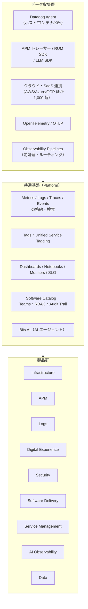

# 製品ポートフォリオ全体像

## 概要

Datadog の製品ポートフォリオは、**共通基盤（Platform）** の上に **Infrastructure・APM・Logs・Digital Experience（DEM）・Security・Software Delivery・Service Management・AI・Data** の製品群が載る構造になっている。どの製品も同じ Datadog Agent / SDK / クラウド連携でデータを集め、同じタグ体系（`env`・`service`・`version` など）で相互に関連付けられる。[出典](https://docs.datadoghq.com/)

本ファイルは、2026-11-02 時点で Datadog 公式ドキュメント（docs.datadoghq.com）と公式料金ページ（datadoghq.com/pricing、/pricing/list）に掲載されている製品を網羅的に一覧化した「地図」である。次の問いに答える。

| 問い | 本ファイルの該当節 |
|---|---|
| Datadog にはどんな製品があり、どう分類されるか | [1. ポートフォリオの構造](#1-ポートフォリオの構造) / [2. カテゴリ早見表](#2-カテゴリ早見表) |
| 個々の製品は何をするものか（1 行で） | [3〜12 節（カテゴリ別製品一覧）](#3-platform共通基盤) |
| 製品の課金単位は何か（ホスト、GB、セッション…） | 各カテゴリ表の「課金単位」列 / [15. 課金への影響](#15-課金への影響) |
| 旧名称（NPM、CSM、ASM、Service Catalog、LLM Observability など）は今どの製品か | [13. 改称履歴](#13-改称履歴旧称現名称の対応表) |
| どの製品が別の製品を前提とするか | [14. 製品間の前提関係](#14-製品間の前提関係とデータの共有) |
| 詳しく知るにはどのファイルを読めばよいか | 各表の「詳細」列 / [17. 次に読むファイル](#17-次に読むファイル) |

本ファイルは製品の「位置づけ」を扱う。仕様・設定・制限値は `02_リファレンス/` の各ファイル、**料金の数値は [製品別料金表](../03_導入編/pricing-by-product.md)（料金の正本）** を参照すること。本ファイルでは料金の数値を記載せず、課金単位のみを示す。

> **基準日:** 本ファイルの製品名・分類・提供状況は 2026-11-02 時点の公式ドキュメントのナビゲーション、公式製品メニュー、公式料金ページに基づく。Datadog は製品名・パッケージを頻繁に変更するため、時点付きで読むこと。

---

## 1. ポートフォリオの構造

### 1.1 全体構造（概念図）

Datadog の製品は、データ収集層・共通基盤・製品群の 3 層で理解すると整理しやすい。以下は Datadog 公式ドキュメントの構成をもとに本ナレッジが作成した概念図である（公式図ではない）。

### 1.2 公式の分類体系は 3 種類ある

Datadog の「製品カテゴリ」は、公式の場所によって分類が少しずつ異なる。本ナレッジは下表の「本ナレッジの区分」を採用し、ディレクトリ `02_リファレンス/<領域>/` と対応させている。

| 公式の場所 | 分類（2026-11-02 時点） | 出典 |
|---|---|---|
| 公式サイトの製品メニュー（docs.datadoghq.com 上部の Product メニュー） | **Observability**（Infrastructure / Applications / Data / Logs）、**Security**（Code Security / Cloud Security / SIEM）、**Digital Experience**、**Software Delivery**、**Service Management**（Incident Response / Actions / Context Graph）、**AI**（AI for Datadog / Datadog for AI）、**Platform Capabilities**（Built-in Features / Extensibility） | [docs.datadoghq.com](https://docs.datadoghq.com/) |
| 公式ドキュメントの左ナビゲーション | Essentials、In The App、Incident Response、Actions & Remediations、Infrastructure、Cloud Cost、Application Performance、Data Observability、Digital Experience、Software Delivery、Developer Integrations、Security、AI Observability、Log Management、Administration | [docs.datadoghq.com](https://docs.datadoghq.com/) |
| 公式料金ページ | AI、Infrastructure、Applications、Data Observability、Logs、Security、Digital Experience、Software Delivery、Service Management | [Pricing](https://www.datadoghq.com/pricing/)（2026-11-02 取得） |
| **本ナレッジの区分** | **Platform、Infrastructure、APM、Logs、DEM、Security、Software Delivery、Service Management、AI、Data** | 本ナレッジ規約 |

分類の揺れに関する注意点:

- **GPU Monitoring** は料金ページでは AI、製品メニューでは Infrastructure と AI（Datadog for AI）の両方に掲載されている。本ナレッジでは Infrastructure に置き、AI 節でも再掲する。
- **Error Tracking** は製品メニューで Logs と Digital Experience の両方に、料金ページでは Logs と Digital Experience の両方に掲載されている。本ナレッジでは APM 区分（[Error Tracking](../02_リファレンス/apm/error-tracking.md)）に置く。
- **Database Monitoring・Data Streams Monitoring** は製品メニューでは Data に分類されるが、本ナレッジのリファレンスではそれぞれ Infrastructure（Database Monitoring）と APM（Data Streams Monitoring）に置いている。本ファイルの Data 節では両方を再掲する。
- **Sensitive Data Scanner** は製品メニューで Logs と Cloud Security の両方に、料金ページでは Logs に掲載されている。本ナレッジでは Security に置く。
- **Audit Trail** は料金ページでは Logs に分類されるが、本ナレッジでは Platform に置く。
- **SLO・Software Catalog（IDP）** は製品メニューでは Service Management と Platform Capabilities の両方に掲載されている。本ナレッジでは Platform に置く。

### 1.3 「製品」「機能」「SKU」の違い

Datadog の名称には、(1) 製品（Product）、(2) 製品内の機能（Feature）、(3) 料金上の品目（SKU）が混在している。本ファイルの表は (1) を行の単位とし、(2) は説明欄、(3) は課金単位欄で扱う。

| 用語 | 例 | 説明 |
|---|---|---|
| 製品（Product） | APM、Cloud SIEM、Agent Observability | 公式製品ページ・ドキュメントの章を持つ単位 |
| 機能（Feature） | Flex Logs（Log Management の保存層）、Test Impact Analysis（Test Optimization の機能）、Misconfigurations（Cloud Security の機能） | 製品の中の機能。単独で契約できるものとできないものがある |
| SKU / プラン | Infrastructure Pro / Enterprise、APM Pro / Enterprise、DevSecOps Pro / Enterprise、RUM Measure / Investigate、Incident Response（バンドル） | 料金表上の品目。1 つの製品に複数の SKU がある、または複数製品を束ねたバンドルがある |

SKU とエディションの詳細は [エディション・プラン](../03_導入編/editions-and-plans.md) を参照。

---

## 2. カテゴリ早見表

| 区分 | 何を見る・守る・動かすか | 主な製品（現名称） | 本ナレッジのリファレンス |
|---|---|---|---|
| Platform（共通基盤） | すべての製品の土台（収集、格納、可視化、アラート、権限、API） | Agent、Integrations、Metrics、Monitors、Dashboards、Notebooks、SLO、Watchdog、Software Catalog / IDP、Audit Trail、Fleet Automation | `02_リファレンス/platform/` |
| Infrastructure | サーバー、コンテナ、サーバーレス、ネットワーク、クラウド費用、ストレージ、GPU | Infrastructure Monitoring、Container Monitoring、Serverless、Cloud Network Monitoring、Network Device Monitoring、Cloud Cost Management | `02_リファレンス/infrastructure/` |
| APM（Applications） | アプリケーションの性能・依存関係・エラー・コード | APM、Universal Service Monitoring、Continuous Profiler、Dynamic Instrumentation / Live Debugger、Error Tracking、Data Streams Monitoring | `02_リファレンス/apm/` |
| Logs | ログの収集・前処理・検索・保管 | Log Management（Standard Indexing / Flex Logs）、Observability Pipelines、BYOC Logs | `02_リファレンス/logs/` |
| DEM（Digital Experience） | エンドユーザー体験、Web / モバイル、プロダクト分析、実験 | RUM、Session Replay、Product Analytics、Experiments、Synthetic Monitoring、Journey Monitoring | `02_リファレンス/dem/` |
| Security | クラウド設定・脅威・アプリ攻撃・コード脆弱性・機密データ・AI | Cloud SIEM、Cloud Security、Workload Protection、App and API Protection、Code Security、AI Guard、Sensitive Data Scanner | `02_リファレンス/security/` |
| Software Delivery | CI/CD、テスト、コード品質、デリバリー指標、フィーチャーフラグ | CI Visibility、Test Optimization、Code Coverage、PR Gates、DORA Metrics、Feature Flags | `02_リファレンス/software-delivery/` |
| Service Management | 障害対応、当番、作業管理、自動化、社内アプリ | Incident Management、On-Call、Status Pages、Work Management、Event Management、Workflow Automation、App Builder | `02_リファレンス/service-management/` |
| AI | AI による調査・修復（AI for Datadog）と AI アプリの監視・防御（Datadog for AI） | Bits AI（Bits Investigation ほか）、Agent Observability、AI Guard、MCP Server | `02_リファレンス/ai/` |
| Data | データベース、ストリーミング、データパイプライン、データ品質 | Database Monitoring、Data Streams Monitoring、Data Observability（Jobs Monitoring / Quality Monitoring） | `02_リファレンス/data/` |

### 2.1 表の凡例（3〜12 節共通）

- **製品（現名称）**: 2026-11-02 時点の公式名称。旧称があれば括弧で併記する。
- **課金単位**: 公式料金ページ（[/pricing/list/](https://www.datadoghq.com/pricing/list/)）に記載の単位（2026-11-02 取得）。「—」は単独の課金品目がない（上位製品に含まれる、または無償の共通機能）ことを示す。料金ページに記載がないが製品として存在するものは「公開情報では確認できず」とする。**金額は [製品別料金表](../03_導入編/pricing-by-product.md) を参照**。
- **状態**: 無表記は一般提供（GA）、`【Preview】` はプレビュー、`【Limited Availability】` は限定提供（公式表記に従う）。公式ページで状態が明示されていないものは無表記とし、必要に応じて注記する。

---

## 3. Platform（共通基盤）

Platform（共通基盤）は、すべての製品が共有する収集・格納・可視化・アラート・ガバナンスの機能群である。多くは単独の課金品目を持たず、インフラ・APM 等の契約に含まれて使える（Custom Metrics、Audit Trail など一部は個別課金）。

### 3.1 データ収集・連携

| 製品（現名称） | 1 行説明 | 課金単位 | 状態 | 詳細 |
|---|---|---|---|---|
| Datadog Agent | ホスト・コンテナ上で動作し、メトリクス・ログ・トレース・プロセス・セキュリティイベント等を収集して送信するソフトウェア（v7 系が現行） | —（Agent 自体は無償。Agent が載るホスト等が各製品で課金対象） | | [Datadog Agent](../02_リファレンス/platform/agent.md)、[Agent 設定](../02_リファレンス/platform/agent-configuration.md)、[コンテナ/K8s 向け Agent](../02_リファレンス/platform/kubernetes-and-containers-agent.md) |
| Fleet Automation / Remote Configuration | Agent 群の一覧・設定確認・アップグレード・設定配布を UI から一元管理する機能 | — | | [Fleet Automation](../02_リファレンス/platform/fleet-automation.md) |
| Integrations（インテグレーション） | AWS / Azure / Google Cloud、ミドルウェア、SaaS など 1,000 を超える連携 | —（連携先から収集したデータの種類に応じ各製品で課金） | | [Integrations](../02_リファレンス/platform/integrations.md)、[AWS](../02_リファレンス/platform/aws-integration.md)、[Azure](../02_リファレンス/platform/azure-integration.md)、[Google Cloud](../02_リファレンス/platform/gcp-integration.md) |
| Marketplace | パートナーが提供する有償・無償のインテグレーションやアプリの流通基盤 | 出品者ごとに異なる | | [Integrations](../02_リファレンス/platform/integrations.md) |
| OpenTelemetry サポート | OTel Collector / Datadog Exporter / Agent の OTLP 受信 / DDOT Collector などで OTel データを取り込む | — | | [OpenTelemetry サポート](../02_リファレンス/platform/opentelemetry.md) |
| Managed Platform OTLP（OTLP APM Ingest） | Agent を介さず OTLP でスパンを Datadog に直接送るためのマネージド受信 | 取り込みスパンの GB / 月 | | [OpenTelemetry サポート](../02_リファレンス/platform/opentelemetry.md) |
| Client SDKs | APM トレーサー、RUM SDK、LLM SDK など言語・プラットフォーム別の SDK | —（各製品で課金） | | [APM インスツルメンテーション](../02_リファレンス/apm/apm-instrumentation.md) |
| Source Code Integration / IDE Plugins | Git リポジトリと Datadog のテレメトリを結び付け、IDE からも Datadog の情報を参照する | — | | [Software Catalog](../02_リファレンス/platform/software-catalog.md) |

### 3.2 データ・可視化・分析

| 製品（現名称） | 1 行説明 | 課金単位 | 状態 | 詳細 |
|---|---|---|---|---|
| Metrics（メトリクス） | 時系列データの格納・検索・集計の基盤。Metrics Explorer、Metrics Summary 等 | —（標準メトリクスはホスト課金に含まれる） | | [Metrics](../02_リファレンス/platform/metrics.md)、[クエリと関数](../02_リファレンス/platform/metrics-query-and-functions.md) |
| Custom Metrics / DogStatsD | ユーザー定義メトリクスと、その送信用 StatsD 互換プロトコル。Metrics without Limits™ でタグ構成を制御 | 100 カスタムメトリクス / 月、100 取り込みカスタムメトリクス / 月（契約上の割当量を超えた分） | | [Custom Metrics と DogStatsD](../02_リファレンス/platform/custom-metrics-and-dogstatsd.md) |
| Dashboards（ダッシュボード） | ウィジェットでメトリクス・ログ・トレース等を可視化する画面。Screenboard / Timeboard 型を統合した現行形式 | — | | [Dashboards](../02_リファレンス/platform/dashboards.md) |
| Notebooks | テキストとグラフを混在させた調査・ポストモーテム用ドキュメント | — | | [Notebooks・DDSQL・Reference Tables](../02_リファレンス/platform/notebooks-and-data-tools.md) |
| DDSQL Editor | SQL 風の構文で Datadog のデータ（インフラリソース、メトリクス等）を問い合わせるエディタ | — | | [Notebooks・DDSQL・Reference Tables](../02_リファレンス/platform/notebooks-and-data-tools.md) |
| Reference Tables | CSV やクラウドストレージから取り込んだ参照表で、ログ等をエンリッチする | — | | [Notebooks・DDSQL・Reference Tables](../02_リファレンス/platform/notebooks-and-data-tools.md) |
| Sheets | スプレッドシート形式で Datadog のデータを加工・分析する機能 | — | | [Notebooks・DDSQL・Reference Tables](../02_リファレンス/platform/notebooks-and-data-tools.md) |
| Custom Events / Events | 外部システムやモニターが発生させるイベントの格納・検索 | 100K カスタムイベント / 月（契約上の割当量を超えた分） | | [Event Management](../02_リファレンス/platform/event-management.md) |
| Change Tracking | デプロイ・設定変更・フィーチャーフラグ変更などの変更イベントを、サービスやダッシュボード上に重ねて表示する | — | | [APM 画面と分析機能](../02_リファレンス/apm/apm-ui-and-analysis.md) |
| Cloudcraft | クラウド環境の構成図（アーキテクチャ図）を自動生成する。Datadog 内機能と単独版（Cloudcraft Standalone）がある | 公開情報では確認できず（Datadog 内機能の個別課金は料金一覧に記載なし） | | [Infrastructure Monitoring](../02_リファレンス/infrastructure/infrastructure-monitoring.md) |
| Datadog Mobile App | iOS / Android からダッシュボード閲覧、アラート受信、On-Call 応答を行うアプリ | — | | [画面構成とナビゲーション](ui-navigation.md) |

### 3.3 アラート・信頼性・相関

| 製品（現名称） | 1 行説明 | 課金単位 | 状態 | 詳細 |
|---|---|---|---|---|
| Monitors（モニター） / Alerts | メトリクス・ログ・APM・RUM 等のデータを条件評価し、通知する | — | | [Monitors](../02_リファレンス/platform/monitors.md)、[通知と Downtime](../02_リファレンス/platform/notifications-and-downtimes.md) |
| Service Level Objectives（SLO） | メトリクス・モニター・タイムスライスに基づく SLO とエラーバジェット、バーンレートアラート | — | | [SLO](../02_リファレンス/platform/slo.md) |
| Watchdog | 機械学習でメトリクス・APM・ログ等の異常を自動検出し、根本原因候補を示す | —（Infrastructure Enterprise 等、プランにより利用範囲が異なる） | | [Watchdog](../02_リファレンス/platform/watchdog.md) |
| Collaboration Integrations | Slack、Microsoft Teams、PagerDuty、Jira、ServiceNow などへの通知・連携 | — | | [通知・コラボレーション連携](../02_リファレンス/platform/collaboration-integrations.md) |

### 3.4 カタログ・組織・ガバナンス

| 製品（現名称） | 1 行説明 | 課金単位 | 状態 | 詳細 |
|---|---|---|---|---|
| Internal Developer Portal（IDP） | Catalog、Self-Service Actions、Scorecards、Engineering Reports で構成されるフルマネージドのプラットフォームエンジニアリング基盤 | 公開情報では確認できず（料金一覧に個別品目なし） | | [Software Catalog](../02_リファレンス/platform/software-catalog.md) |
| Software Catalog（旧称：Service Catalog） | サービス・API・データストア・キューなどのソフトウェア資産と、所有者・依存関係・運用情報を一元管理するカタログ（IDP の中核） | — | | [Software Catalog](../02_リファレンス/platform/software-catalog.md) |
| Resource Catalog | クラウドリソースの一覧・属性・所有者・設定不備を横断的に確認するカタログ | — | | [Infrastructure Monitoring](../02_リファレンス/infrastructure/infrastructure-monitoring.md) |
| Teams | チーム単位で所有者を定義し、ダッシュボード・モニター・サービス等を紐付ける | — | | [組織・ユーザー・権限管理](../02_リファレンス/platform/account-and-access-management.md) |
| Access Control（RBAC） | ロール・権限・制限クエリ・SSO（SAML）・SCIM などのアクセス管理 | — | | [組織・ユーザー・権限管理](../02_リファレンス/platform/account-and-access-management.md) |
| Governance Console | コスト配賦（Cost Attribution）、アクセス制御、タグの衛生状態を 1 画面にまとめ、ポリシーチェックとガードレールを提供するコンソール。料金ページでは Infrastructure Enterprise の付加機能として記載 | —（Infrastructure Enterprise に含まれる） | | [Usage・Cost Visibility](../02_リファレンス/platform/usage-and-cost-attribution.md) |
| Audit Trail | ユーザー操作・API 呼び出し・設定変更などの監査ログを記録・検索・保管する | 支出に対する % / 月 | | [Audit Trail](../02_リファレンス/platform/audit-trail.md) |
| Usage・Usage Attribution・Cost Visibility | 使用量の確認、タグ別の使用量・コスト配賦、推定コストの可視化 | — | | [Usage・Usage Attribution・Cost Visibility](../02_リファレンス/platform/usage-and-cost-attribution.md) |
| API / API キー・アプリケーションキー | REST API と認証キーの管理 | — | | [API とキー管理](../02_リファレンス/platform/api-and-keys.md) |
| Terraform Provider / IaC | Terraform 等でモニター・ダッシュボード等をコード管理する | — | | [Terraform と IaC](../02_リファレンス/platform/terraform-and-iac.md) |
| Datadog Disaster Recovery（DDR） | クラウドプロバイダーのリージョン障害や Datadog サービス障害時に、別サイトの DDR 用 org へ切り替えてオブザーバビリティを継続する | 対象範囲に応じた個別見積り（Custom pricing） | | [Datadog Sites](../02_リファレンス/platform/datadog-sites.md) |

> **補足:** Datadog Sites（US1 / US3 / US5 / EU1 / AP1 / AP2 / US1-FED）はデータの保存場所と利用可能な機能に影響する。詳細は [Datadog Sites](../02_リファレンス/platform/datadog-sites.md) を参照。

出典: [docs.datadoghq.com（製品メニュー・左ナビ）](https://docs.datadoghq.com/)、[Pricing list](https://www.datadoghq.com/pricing/list/)、[Internal Developer Portal](https://docs.datadoghq.com/internal_developer_portal/)、[Governance Console 製品ページ](https://www.datadoghq.com/product/governance-console/)、[Disaster Recovery](https://docs.datadoghq.com/disaster_recovery/)（いずれも 2026-11-02 取得）

---

## 4. Infrastructure（インフラ）

Infrastructure 区分の製品は、ホスト・コンテナ・サーバーレス・ネットワーク・クラウド費用・ストレージ・GPU など、アプリケーションの下にある基盤を監視する。料金ページでは Infrastructure の基本プランとして **Infrastructure Basic / Pro / Enterprise** と、クラウドセキュリティを同梱した **DevSecOps Pro / Enterprise** が用意されている。

| 製品（現名称） | 1 行説明 | 課金単位 | 状態 | 詳細 |
|---|---|---|---|---|
| Infrastructure Monitoring（Basic / Pro / Enterprise） | ホストのメトリクス、Host Map、Live Processes（Enterprise）、インテグレーションによるインフラ監視の基本製品 | インフラホスト / 月 | | [Infrastructure Monitoring](../02_リファレンス/infrastructure/infrastructure-monitoring.md) |
| Infrastructure DevSecOps（Pro / Enterprise） | Infrastructure Pro / Enterprise に Cloud Security の機能（Pro: 設定不備・コンプライアンス、Enterprise: さらにファイル整合性監視・Workload Protection）を同梱したバンドル | インフラホスト / 月 | | [エディション・プラン](../03_導入編/editions-and-plans.md)、[Cloud Security](../02_リファレンス/security/cloud-security.md) |
| Container Monitoring | Docker / Kubernetes / ECS 等のコンテナと Orchestrator Explorer（K8s リソース）の監視 | コンテナ / 月、またはコンテナ時間（契約上の割当量を超えた分） | | [コンテナ・Kubernetes 監視](../02_リファレンス/infrastructure/container-and-kubernetes-monitoring.md) |
| Kubernetes Autoscaling | Kubernetes ワークロードの CPU・メモリのライトサイジングと自動スケーリング | オートスケール対象 vCPU / 月 | | [コンテナ・Kubernetes 監視](../02_リファレンス/infrastructure/container-and-kubernetes-monitoring.md) |
| Serverless Monitoring | AWS Lambda / Step Functions / Fargate、Azure Functions / App Service / Container Apps、Google Cloud Run、GKE Autopilot の監視・トレース | アクティブ関数 / 月、アクティブアプリケーションインスタンス / 月、トレース対象 100 万 invocation / 月 など（SKU 別） | | [Serverless Monitoring](../02_リファレンス/infrastructure/serverless.md) |
| Cloud Network Monitoring（CNM、旧称：Network Performance Monitoring / NPM） | eBPF ベースでサービス・コンテナ・AZ 間の通信量・遅延・再送等を可視化し、依存関係を把握する | ネットワークホスト / 月 | | [Cloud Network Monitoring](../02_リファレンス/infrastructure/cloud-network-monitoring.md) |
| DNS Monitoring | DNS サーバーへの問い合わせ・応答・エラーの可視化（CNM の機能） | —（CNM に含まれる） | | [Cloud Network Monitoring](../02_リファレンス/infrastructure/cloud-network-monitoring.md) |
| Network Device Monitoring（NDM） | SNMP 等でルーター・スイッチ・ファイアウォール等のネットワーク機器を監視する | ネットワークデバイス / 月 | | [Network Device Monitoring](../02_リファレンス/infrastructure/network-device-monitoring.md) |
| Wireless Access Point Monitoring | 無線 LAN アクセスポイントの監視 | デバイス / 月 | | [Network Device Monitoring](../02_リファレンス/infrastructure/network-device-monitoring.md) |
| NetFlow Monitoring | NetFlow / sFlow / IPFIX 等のフロー情報から上位通信元（Top Talkers）や帯域使用量を分析する | 100 万集約 NetFlow レコード / 月（保持 15 / 30 / 60 / 90 日で品目が分かれる） | | [Network Device Monitoring](../02_リファレンス/infrastructure/network-device-monitoring.md) |
| Network Path | 送信元から宛先までの経路（ホップ）を可視化し、ネットワーク上の問題箇所を特定する | 1,000 テスト / 月 | | [Network Device Monitoring](../02_リファレンス/infrastructure/network-device-monitoring.md) |
| Network Configuration Management | ネットワーク機器の設定管理（DASH 2026 で発表） | 公開情報では確認できず | 公開情報では提供状況を確認できず | [Network Device Monitoring](../02_リファレンス/infrastructure/network-device-monitoring.md) |
| Database Monitoring（DBM） | クエリ単位の性能、実行計画、待機イベント、ホストの DB メトリクスを可視化する | データベースホスト / 月 | | [Database Monitoring](../02_リファレンス/infrastructure/database-monitoring.md) |
| Cloud Cost Management（CCM：Pro / Enterprise） | AWS / Azure / Google Cloud / SaaS のコストを取り込み、タグ・チーム・サービス別に配賦・最適化する | クラウド / SaaS 支出 1,000 ドルあたり / 月 | | [Cloud Cost Management](../02_リファレンス/infrastructure/cloud-cost-management.md) |
| Storage Management | Amazon S3 等のオブジェクトストレージのオブジェクト数・使用状況・コストを分析する | 監視対象オブジェクト 100 万 / 月 | | [Cloud Cost Management](../02_リファレンス/infrastructure/cloud-cost-management.md) |
| GPU Monitoring | クラウド・オンプレミス・ネオクラウドの GPU フリートの健全性・性能・コストをワークロードやチームと関連付けて可視化する | アクティブ GPU デバイス / 月 | | [Infrastructure Monitoring](../02_リファレンス/infrastructure/infrastructure-monitoring.md) |
| Edge Device Monitoring | エッジデバイスの監視 | インフラホスト / 月 | | [Infrastructure Monitoring](../02_リファレンス/infrastructure/infrastructure-monitoring.md) |
| End User Device Monitoring | 従業員のデスクトップ PC・ノート PC の性能・接続性・アプリの問題を可視化する | 公開情報では確認できず | 【Preview】 | [Infrastructure Monitoring](../02_リファレンス/infrastructure/infrastructure-monitoring.md) |

> **料金ページ上の位置づけ:** Database Monitoring は製品メニューでは Data 区分、Universal Service Monitoring は Applications 区分に置かれている。本ナレッジでは Database Monitoring のリファレンスを `infrastructure/` に置く。

出典: [docs.datadoghq.com](https://docs.datadoghq.com/)、[Network Monitoring](https://docs.datadoghq.com/network_monitoring/)、[Cloud Network Monitoring](https://docs.datadoghq.com/network_monitoring/cloud_network_monitoring/)、[End User Device Monitoring](https://docs.datadoghq.com/infrastructure/end_user_device_monitoring/)、[GPU Monitoring 製品ページ](https://www.datadoghq.com/product/gpu-monitoring/)、[Pricing](https://www.datadoghq.com/pricing/)、[Pricing list](https://www.datadoghq.com/pricing/list/)、[DASH 2026 recap](https://www.datadoghq.com/blog/dash-2026-recap/)（2026-07-07 公開）（取得日はいずれも 2026-11-02）

---

## 5. APM（Applications）

APM（Application Performance Monitoring）区分の製品は、アプリケーションのリクエスト処理・依存関係・コード・エラーを可視化する。料金ページでは **APM / APM Pro（+ Data Streams Monitoring）/ APM Enterprise（+ Data Streams Monitoring + Continuous Profiler）** の 3 段階のプランがある。

| 製品（現名称） | 1 行説明 | 課金単位 | 状態 | 詳細 |
|---|---|---|---|---|
| APM（APM / APM Pro / APM Enterprise） | 分散トレーシング、サービスマップ、サービスページ、トレースメトリクスによるアプリケーション性能監視 | APM ホスト / 月（加えて取り込みスパン GB、インデックス化スパン 100 万件の割当超過分） | | [APM の概念とインジェスト制御](../02_リファレンス/apm/apm-concepts-and-ingestion.md)、[インスツルメンテーション](../02_リファレンス/apm/apm-instrumentation.md)、[画面と分析](../02_リファレンス/apm/apm-ui-and-analysis.md) |
| Universal Service Monitoring（USM） | コード変更なしに eBPF で HTTP / gRPC 等の通信からサービスの RED メトリクス（リクエスト・エラー・レイテンシ）を取得する | インフラホスト / 月 | | [Universal Service Monitoring](../02_リファレンス/apm/universal-service-monitoring.md) |
| Continuous Profiler | 本番環境で常時 CPU・メモリ・ロック等のプロファイルを取得し、コード行レベルのボトルネックを特定する | プロファイル対象ホスト / 月、プロファイル対象コンテナ、Fargate タスク | | [Continuous Profiler](../02_リファレンス/apm/continuous-profiler.md) |
| Dynamic Instrumentation / Live Debugger | 再デプロイなしに本番コードへログ・メトリクス・スパン・スナップショットを動的に追加する | 公開情報では確認できず（料金一覧に個別品目なし） | | [Dynamic Instrumentation と Live Debugger](../02_リファレンス/apm/dynamic-instrumentation.md) |
| Error Tracking | バックエンド・ブラウザ・モバイル・ログのエラーを Issue 単位に集約・追跡する。APM・RUM に含まれ、単独でも契約可能 | エラー件数（最初の 5 万件 / 月、以降 1,000 件単位の段階制） | | [Error Tracking](../02_リファレンス/apm/error-tracking.md) |
| Data Streams Monitoring（DSM） | Kafka・RabbitMQ・SQS 等のキューを経由するストリーミングパイプラインのレイテンシ・滞留をエンドツーエンドで可視化する | クライアントホスト / 月（APM Pro / Enterprise に含まれる） | | [Data Streams Monitoring](../02_リファレンス/apm/data-streams-monitoring.md) |
| Service Map / Service Page / Trace Explorer | サービス間依存の地図、サービスごとの性能ページ、スパン検索（いずれも APM の画面） | —（APM に含まれる） | | [APM 画面と分析機能](../02_リファレンス/apm/apm-ui-and-analysis.md) |
| Deployment Tracking | `version` タグでデプロイ前後の性能を比較する（APM の機能） | —（APM に含まれる） | | [APM 画面と分析機能](../02_リファレンス/apm/apm-ui-and-analysis.md) |

出典: [docs.datadoghq.com](https://docs.datadoghq.com/)、[APM](https://docs.datadoghq.com/tracing/)、[Pricing](https://www.datadoghq.com/pricing/)、[Pricing list](https://www.datadoghq.com/pricing/list/)（2026-11-02 取得）

---

## 6. Logs（ログ）

Logs 区分の製品は、ログの収集・前処理・インデックス化・長期保管・検索を担う。Log Management は **取り込み（Ingest）** と **インデックス化（Standard Indexing）** を分けて課金し、長期保管用に **Flex Logs** を持つのが特徴である。

| 製品（現名称） | 1 行説明 | 課金単位 | 状態 | 詳細 |
|---|---|---|---|---|
| Log Management（Ingest） | ログの取り込み・パイプライン処理・アーカイブ（Logging without Limits™：取り込みと索引付けを分離） | 取り込み GB / 月 | | [ログ収集](../02_リファレンス/logs/log-collection.md)、[Log Pipelines と処理](../02_リファレンス/logs/log-pipelines-and-processing.md) |
| Log Management（Standard Indexing） | リアルタイム検索・アラート・ダッシュボード用にログをインデックス化して保持する | インデックス化ログ 100 万件 / 月（保持 3 / 7 / 15 / 30 日で品目が分かれる） | | [Indexes・保持・アーカイブ](../02_リファレンス/logs/log-indexes-retention-archives.md)、[ログ検索と分析](../02_リファレンス/logs/log-search-and-analytics.md) |
| Flex Logs（Flex Storage / Flex Compute） | 保管（Storage）と検索用計算資源（Compute）を分離した長期保持層（最長 15 か月） | Flex Storage: 保存イベント 100 万件 / 月、Flex Compute: サイズ別（要問い合わせ） | | [Indexes・保持・アーカイブ](../02_リファレンス/logs/log-indexes-retention-archives.md) |
| Flex Logs Starter | 長期保持用の Flex Logs の簡易版（料金一覧では保持 6 / 12 / 15 か月の品目。料金ページ本文では「3〜15 か月」と表記） | 保存イベント 100 万件 / 月 | | [Indexes・保持・アーカイブ](../02_リファレンス/logs/log-indexes-retention-archives.md) |
| Log Archives / Archive Search / Rehydration | 顧客のクラウドストレージ（S3 等）へのアーカイブと、アーカイブからの検索・再取り込み | Archive Search: 公開情報（料金一覧）では個別単位を確認できず | | [Indexes・保持・アーカイブ](../02_リファレンス/logs/log-indexes-retention-archives.md) |
| Log Forwarding to Custom Destinations | 取り込んだログを外部の宛先（HTTP、Splunk、Elasticsearch 等）へ転送する | 送信 GB / 宛先 / 月 | | [Log Pipelines と処理](../02_リファレンス/logs/log-pipelines-and-processing.md) |
| Observability Pipelines（OP / OP Plus） | 顧客環境で動く Observability Pipelines Worker でログを収集・変換・削減・ルーティングする（OSS「Vector」が基盤） | OP: 取り込み GB / 月、OP Plus: vCPU / 月 | | [Observability Pipelines](../02_リファレンス/logs/observability-pipelines.md) |
| BYOC Log Management（BYOC Logs） | ログを顧客自身のインフラ（低コストのオブジェクトストレージ等）に保持したまま、Datadog の UI で検索・分析する | 公開情報では確認できず | 公開情報では提供状況を確認できず | [Indexes・保持・アーカイブ](../02_リファレンス/logs/log-indexes-retention-archives.md) |

> Sensitive Data Scanner、Audit Trail、Error Tracking も料金ページでは Logs 区分に掲載されているが、本ナレッジではそれぞれ Security、Platform、APM 区分に置く。

出典: [docs.datadoghq.com](https://docs.datadoghq.com/)、[BYOC Logs 製品ページ](https://www.datadoghq.com/product/byoc-logs/)、[Pricing](https://www.datadoghq.com/pricing/)、[Pricing list](https://www.datadoghq.com/pricing/list/)（2026-11-02 取得）

---

## 7. DEM（Digital Experience）

Digital Experience Monitoring（DEM）区分の製品は、Web・モバイルのエンドユーザー体験、ユーザー行動、プロダクトの実験、外形監視を扱う。

| 製品（現名称） | 1 行説明 | 課金単位 | 状態 | 詳細 |
|---|---|---|---|---|
| Real User Monitoring（RUM：Browser / Mobile） | 実ユーザーのページ表示・操作・エラー・Core Web Vitals、モバイルのクラッシュ・ANR 等を収集する。料金上は **RUM - Measure**（全トラフィック）と **RUM - Investigate**（フィルタ後セッション）の 2 品目 | 1,000 セッション / 月 | | [RUM（ブラウザ）](../02_リファレンス/dem/rum-browser.md)、[RUM（モバイル）](../02_リファレンス/dem/rum-mobile.md) |
| Session Replay | ユーザーのセッションを動画のように再生する（RUM のアドオン） | 1,000 セッション / 月 | | [Session Replay と Product Analytics](../02_リファレンス/dem/session-replay-and-product-analytics.md) |
| Product Analytics | ユーザー行動、ファネル、リテンション、パスなどのプロダクト分析 | 1,000 セッション / 月（全トラフィック） | | [Session Replay と Product Analytics](../02_リファレンス/dem/session-replay-and-product-analytics.md) |
| Experiments | フィーチャー変更の A/B テスト・統計的検定（2025 年に買収した Eppo が基盤） | 開始した実験 / 月 | | [Session Replay と Product Analytics](../02_リファレンス/dem/session-replay-and-product-analytics.md) |
| RUM の付加品目（RUM Managed Archive / Export Pipelines / RUM Profiling） | RUM データの長期保管（1 / 3 / 6 か月）、Product Analytics 生データのクラウドストレージ出力、ブラウザでのプロファイリング | 1,000 セッション / 月 | | [RUM（ブラウザ）](../02_リファレンス/dem/rum-browser.md) |
| Synthetic Monitoring（Synthetic Testing and Monitoring） | 世界各地のロケーションやプライベートロケーションから API テスト（HTTP / SSL / DNS / WebSocket / TCP / UDP / ICMP / gRPC）、マルチステップ API テスト、ブラウザテストを定期実行する外形監視 | API テスト: 1 万回実行 / 月、ブラウザテスト: 1,000 回実行 / 月 | | [Synthetic Monitoring](../02_リファレンス/dem/synthetic-monitoring.md) |
| Mobile App Testing | 実機の iOS / Android 端末上でモバイルアプリのテストを実行する | 100 回実行 / 月 | | [Synthetic Monitoring](../02_リファレンス/dem/synthetic-monitoring.md) |
| Continuous Testing | Synthetic テストを CI/CD パイプラインから並列実行する | 追加の並列実行枠（parallelization）/ 月 | | [Synthetic Monitoring](../02_リファレンス/dem/synthetic-monitoring.md) |
| Bits Testing / Goal-Based tests | ユーザージャーニーからテストを自動生成する Bits Testing と、エージェント的（非決定的）にゴール到達可否を検証するテスト | 公開情報では確認できず | 公開情報では提供状況を確認できず | [Synthetic Monitoring](../02_リファレンス/dem/synthetic-monitoring.md) |
| Journey Monitoring | RUM の操作や Synthetic のテストスイートをユーザージャーニーとして定義し、ジャーニー単位で監視する（DASH 2026 で発表） | 公開情報では確認できず（サポート対象製品の試用または契約が前提） | | [Synthetic Monitoring](../02_リファレンス/dem/synthetic-monitoring.md) |

> Network Path テストは Synthetic Monitoring の画面からも作成できるが、料金上は Infrastructure 区分の Network Path（1,000 テスト / 月）として扱われる。Feature Flags は製品メニュー・料金ページともに Software Delivery 区分に置かれている（[9 節](#9-software-delivery)）。

出典: [docs.datadoghq.com](https://docs.datadoghq.com/)、[Synthetic Testing and Monitoring](https://docs.datadoghq.com/synthetics/)、[Journey Monitoring guide](https://docs.datadoghq.com/journey_monitoring/guide/)、[Pricing](https://www.datadoghq.com/pricing/)、[Pricing list](https://www.datadoghq.com/pricing/list/)（2026-11-02 取得）、[Eppo 買収リリース](https://www.datadoghq.com/about/latest-news/press-releases/datadog-acquires-eppo-to-expand-its-ai/)（2025-05-05 公開）

---

## 8. Security（セキュリティ）

Security 区分の製品（総称：Datadog Security）は、コードから本番環境・クラウド設定・AI まで、開発〜運用のライフサイクル全体のセキュリティを扱う。製品メニューでは **Code Security / Cloud Security / SIEM** の 3 つに分類されている。全体像は [Datadog Security 概要](../02_リファレンス/security/security-platform-overview.md) を参照。

| 製品（現名称） | 1 行説明 | 課金単位 | 状態 | 詳細 |
|---|---|---|---|---|
| Cloud SIEM | ログ等を検出ルールで分析し、クラウド・オンプレミスの脅威をリアルタイムに検出・調査・対応する（Log Management が基盤） | 分析イベント 100 万件 / 月 | | [Cloud SIEM](../02_リファレンス/security/cloud-siem.md) |
| Bits Security Analyst | Cloud SIEM のシグナルを AI エージェントがトリアージ・調査する | AI Credits（[11 節](#11-ai) 参照） | | [Bits AI と AI 機能](../02_リファレンス/ai/bits-ai.md) |
| Cloud Security（旧称：Cloud Security Management / CSM） | クラウド設定不備（Misconfigurations / CSPM）、ID リスク（Identity Risks / CIEM）、脆弱性（Vulnerabilities）、コンプライアンス、Workload Protection を含むクラウドセキュリティ製品群 | CSM ホスト / 月、コンテナ / 月またはコンテナ時間（料金一覧上は旧称「CSM Pro / CSM Enterprise」の品目名が残る）。DevSecOps バンドルでも提供 | | [Cloud Security](../02_リファレンス/security/cloud-security.md) |
| Workload Protection（旧称：Cloud Workload Security / CWS） | eBPF でファイル・ネットワーク・プロセスの挙動を監視し、ホスト・コンテナ・サーバーレスのランタイム脅威を検出する。ファイル整合性監視（FIM）を含む | Workload Protection ホスト / 月、コンテナ、Fargate タスク | | [Workload Protection](../02_リファレンス/security/workload-protection.md) |
| App and API Protection（AAP、旧称：Application Security Management / ASM） | APM トレーサーと Agent を使い、アプリケーション層の攻撃検出・ブロック、API の検出（Discovery）・ポスチャ管理を行う | AAP ホスト / 月、Fargate タスク、サーバーレスは トレース対象 100 万 invocation / 月 | | [App and API Protection](../02_リファレンス/security/app-and-api-protection.md) |
| Code Security | 自社コードと OSS 依存関係の脆弱性を、リポジトリ（静的）と実行中のサービス（ランタイム）の両面で検出する製品群 | 下表参照 | | [Code Security](../02_リファレンス/security/code-security.md) |
| AI Guard | AI エージェントの入出力を検査し、プロンプトインジェクション・ジェイルブレイク・データ流出をリアルタイムに検出・ブロックする | 入力トークン 100 万 / 月 | | [App and API Protection](../02_リファレンス/security/app-and-api-protection.md)、[LLM Observability](../02_リファレンス/ai/llm-observability.md) |
| Sensitive Data Scanner | テレメトリ（ログ・スパン・RUM 等）やクラウドストレージ内の機密データを検出・分類し、必要に応じてマスクする | スキャン GB / 月 | | [Sensitive Data Scanner](../02_リファレンス/security/sensitive-data-scanner.md) |

### 8.1 Code Security の構成品目

| 構成品目 | 略称 | 1 行説明 | 課金単位 |
|---|---|---|---|
| Static Code Analysis | SAST | リポジトリのソースコードを静的解析し、脆弱性・品質問題を検出する | コミッター / 月 |
| Software Composition Analysis（Static） | SCA | リポジトリの依存ライブラリの既知脆弱性・ライセンスを検出する | コミッター / 月 |
| Software Composition Analysis（Runtime） | Runtime SCA | 実行中のサービスが読み込んでいるライブラリの脆弱性を検出する | ホスト / 月 |
| Runtime Code Analysis | IAST | 実行中のアプリケーション内でコードの脆弱性を検出する（Interactive Application Security Testing） | ホスト / 月 |
| Infrastructure-as-Code Security | IaC Security | Terraform 等の IaC ファイルの設定不備を検出する | コミッター / 月 |
| Secret Scanning | — | リポジトリ内の秘密情報（API キー等）を検出する | コミッター / 月 |
| Code Security Bundle / Flex Bundle（Secrets）/ Advanced Bundle | — | 上記を組み合わせたバンドル | コミッター / 月 |

> 公式ドキュメントの Security 概要では、Secret Scanning に `【Preview】` 表記がある一方、料金一覧には Secret Scanning が品目として掲載されている。提供状況は契約時に確認すること。

### 8.2 画面イメージ（Security）

- **キャプション:** Cloud Security（旧称：Cloud Security Management）の Overview 画面。
- **画面の説明:** 画面上部に「Overview / Inbox / Signals / Findings / Compliance / Inventory」のタブがあり、その下で Account・Service・Env・Team による絞り込みができる。中央の「Security Inbox」には優先度付けされたセキュリティ課題が SEVERITY（CRITICAL / HIGH）、ISSUE（例：「Publicly accessible application with a critical vulnerability running on a privileged Kubernetes node」）、Risks（Publicly Accessible、Privileged Access、Vulnerability、Sensitive Data などのラベル）、IMPACT、STATUS、ASSIGNMENT、LAST DETECTED の列で並ぶ。下部の「All Findings」には MISCONFIGURATIONS（設定不備）、VULNERABILITIES（脆弱性）、IDENTITY RISKS（ID リスク）の 3 カードがあり、それぞれ重大度別件数と Explorer へのリンクが表示される。上部の Coverage 行には対象クラウドアカウント数・ホスト数・コンテナ数が表示される。
- **出典:** [Datadog Security](https://docs.datadoghq.com/security/)（2026-11-02 取得）

- **キャプション:** Cloud SIEM のホーム（Overview）画面。
- **画面の説明:** 上部に「Overview / Content Packs / Signals / Detections / Investigate」のタブがある。「Security Coverage」欄には有効化済みの Content Packs とインテグレーションの数（例：20 件、9 カテゴリ中 9 カテゴリをカバー）、状態別の件数（Active / Warning / Broken / Custom log sources）が表示される。「Logs Analyzed by Cloud SIEM」欄には、Cloud SIEM が分析したログ量がソース別（windows、cloudtrail、github など）の積み上げ棒グラフで表示される。下部には「Important Signals and Cases」が続く。
- **出典:** [Datadog Security](https://docs.datadoghq.com/security/)（2026-11-02 取得）

出典: [Datadog Security](https://docs.datadoghq.com/security/)、[docs.datadoghq.com](https://docs.datadoghq.com/)、[Pricing list](https://www.datadoghq.com/pricing/list/)（2026-11-02 取得）

---

## 9. Software Delivery

Software Delivery 区分の製品は、CI/CD パイプライン、テスト、コード品質、デリバリー指標、フィーチャーフラグを扱う。CI 系製品の課金単位は「アクティブ Git コミッター（月 3 回以上コミットしたコミッター）」である。

| 製品（現名称） | 1 行説明 | 課金単位 | 状態 | 詳細 |
|---|---|---|---|---|
| CI Visibility（料金上の品目名：Pipeline Visibility / CI Pipeline Visibility） | GitHub Actions、GitLab、Jenkins 等の CI パイプライン・ジョブの実行時間・失敗・ボトルネックを可視化する | アクティブ Git コミッター / 月 | | [CI Visibility](../02_リファレンス/software-delivery/ci-visibility.md) |
| CD Visibility | デプロイメント（CD）の実行状況を可視化する | 公開情報では確認できず（料金一覧に個別品目なし） | | [CI Visibility](../02_リファレンス/software-delivery/ci-visibility.md) |
| Test Optimization（旧称：Test Visibility） | テスト結果の可視化、Flaky Test（不安定なテスト）の検出・管理、Test Impact Analysis（コードカバレッジと Git 情報に基づくテストスキップ） | アクティブ Git コミッター / 月 | | [Test Optimization](../02_リファレンス/software-delivery/test-optimization.md) |
| CI/CD Optimization | CI Visibility と Test Optimization の画面を統合した UI | —（各製品の課金に従う） | | [CI Visibility](../02_リファレンス/software-delivery/ci-visibility.md) |
| Code Coverage | テストカバレッジの追跡と PR 上の品質ゲート | アクティブ Git コミッター / 月 | | [DORA Metrics・Quality Gates・Code Coverage](../02_リファレンス/software-delivery/software-delivery-insights.md) |
| PR Gates（旧称：Quality Gates） | SAST・SCA・コードカバレッジ・IaC・Secret・新規 Flaky Test 等のルールで、基準を満たさない PR のマージをブロックする | 公開情報では確認できず（料金一覧に個別品目なし） | | [DORA Metrics・Quality Gates・Code Coverage](../02_リファレンス/software-delivery/software-delivery-insights.md) |
| Deployment Gates | デプロイ前後に条件（モニター状態など）を評価してデプロイ可否を判定する | 公開情報では確認できず | | [DORA Metrics・Quality Gates・Code Coverage](../02_リファレンス/software-delivery/software-delivery-insights.md) |
| DORA Metrics（Delivery Performance） | デプロイ頻度・変更のリードタイム・変更失敗率・復旧時間の 4 指標を計測する。UI 上は Software Delivery > Delivery Performance 配下。製品メニュー上の名称は「DORA Metrics + AI Impact」 | 公開情報では確認できず（料金一覧に個別品目なし） | | [DORA Metrics・Quality Gates・Code Coverage](../02_リファレンス/software-delivery/software-delivery-insights.md) |
| Feature Flags | テレメトリと連動したフィーチャーフラグの段階的ロールアウト | 月間フラグ構成リクエスト（MFCR）100 万件 / 月（一定量までは無償） | | [DORA Metrics・Quality Gates・Code Coverage](../02_リファレンス/software-delivery/software-delivery-insights.md) |

> Continuous Testing（[7 節](#7-demdigital-experience)）と Software Composition Analysis（[8.1 節](#81-code-security-の構成品目)）、Internal Developer Portal（[3.4 節](#34-カタログ組織ガバナンス)）も製品メニューでは Software Delivery 区分に掲載されている。

出典: [docs.datadoghq.com](https://docs.datadoghq.com/)、[Test Optimization](https://docs.datadoghq.com/tests/)、[PR Gates](https://docs.datadoghq.com/quality_gates/)、[DORA Metrics](https://docs.datadoghq.com/dora_metrics/)、[Pricing](https://www.datadoghq.com/pricing/)、[Pricing list](https://www.datadoghq.com/pricing/list/)（2026-11-02 取得）

---

## 10. Service Management

Service Management 区分の製品は、障害対応（Incident Response）、作業管理、イベント相関、自動化（Actions）を扱う。製品メニューでは **Incident Response / Actions / Context Graph** の 3 つに分かれている。

### 10.1 Incident Response

| 製品（現名称） | 1 行説明 | 課金単位 | 状態 | 詳細 |
|---|---|---|---|---|
| Incident Management | インシデントの宣言・役割・タイムライン・コミュニケーション・ポストモーテムを管理する | シート / 月（単独品目、または Incident Response バンドル） | | [Incident Management](../02_リファレンス/service-management/incident-management.md) |
| On-Call | オンコールのスケジュール・エスカレーション・ページング | シート / 月（単独品目、または Incident Response バンドル） | | [On-Call](../02_リファレンス/service-management/on-call.md) |
| Incident Response（バンドル） | On-Call と Incident Management を組み合わせた料金上のバンドル | シート / 月 | | [Incident Management](../02_リファレンス/service-management/incident-management.md) |
| Status Pages | 社内・社外向けにシステムの稼働状況をリアルタイムに公開するページ（料金ページでは Incident Management の機能として記載） | —（Incident Management に含まれる） | | [Incident Management](../02_リファレンス/service-management/incident-management.md) |
| Work Management（旧称：Case Management） | 問題・課題を「ワークアイテム」としてトリアージ・追跡・解決する。Jira、ServiceNow、PagerDuty、Slack、Microsoft Teams と連携。API エンドポイントと権限名には「case」の語が残る | 公開情報では確認できず（料金一覧に個別品目なし） | | [Case Management](../02_リファレンス/service-management/case-management.md) |

### 10.2 Actions（自動化・社内アプリ）

| 製品（現名称） | 1 行説明 | 課金単位 | 状態 | 詳細 |
|---|---|---|---|---|
| Event Management | Datadog 内外のアラート・イベントを集約し、相関・重複排除してノイズを減らす | 相関パターンで評価されたイベント / 月（Datadog 生成のイベントは無償） | | [Event Management](../02_リファレンス/platform/event-management.md) |
| Workflow Automation | モニターやセキュリティシグナル等をトリガーに、クラウド・SaaS・Datadog の操作を自動実行するワークフロー | ワークフロー実行 100 回 / 月 | | [Workflow Automation](../02_リファレンス/service-management/workflow-automation.md) |
| App Builder | ドラッグ＆ドロップのローコードで社内向け運用アプリを作成し、ダッシュボード等に埋め込む | 公開済みアプリ / 月 | | [App Builder](../02_リファレンス/service-management/app-builder.md) |
| Datadog Apps | React + TypeScript / JavaScript とバックエンド関数・CLI でアプリをコードとして開発・デプロイする（App Builder のコードファースト版） | 公開情報では確認できず | 【Preview】 | [App Builder](../02_リファレンス/service-management/app-builder.md) |
| Action Catalog / Connections | クラウド・SaaS・Datadog の操作（アクション）のカタログと、その接続資格情報の管理 | —（Workflow Automation / App Builder に含まれる） | | [Workflow Automation](../02_リファレンス/service-management/workflow-automation.md) |
| Private Action Runner（Private Actions） | Docker ベースのランナーで、プライベートネットワーク内のサービスに対してアクションを実行する | — | | [Workflow Automation](../02_リファレンス/service-management/workflow-automation.md) |
| Datastores | App Builder・Workflow Automation から使う構造化データストア | — | | [App Builder](../02_リファレンス/service-management/app-builder.md) |
| Forms | 入力を収集し、回答の分析や自動化のトリガーに使うフォーム | 公開情報では確認できず | | [App Builder](../02_リファレンス/service-management/app-builder.md) |
| Bits Agent Builder（Agents） | Action Catalog にアクセスできるカスタム AI エージェントを構築する | AI Credits | | [Bits AI と AI 機能](../02_リファレンス/ai/bits-ai.md) |

> **Context Graph:** 製品メニューでは Internal Developer Portal と Software Catalog が Service Management の「Context Graph」にも掲載されている（[3.4 節](#34-カタログ組織ガバナンス)）。SLO も Incident Response 配下に掲載されている（[3.3 節](#33-アラート信頼性相関)）。

出典: [Incident Response](https://docs.datadoghq.com/incident_response/)、[Work Management](https://docs.datadoghq.com/service_management/case_management/)、[Actions](https://docs.datadoghq.com/actions/)、[App Builder](https://docs.datadoghq.com/actions/app_builder/)、[Datadog Apps](https://docs.datadoghq.com/actions/datadog_apps/)、[Pricing](https://www.datadoghq.com/pricing/)、[Pricing list](https://www.datadoghq.com/pricing/list/)（2026-11-02 取得）

---

## 11. AI

AI 区分の製品は、製品メニュー上で 2 つに分かれている。

- **AI for Datadog**: Datadog の運用・調査を AI エージェント（総称：**Bits AI**）が支援・自動化する製品群。
- **Datadog for AI**: 顧客の AI / LLM アプリケーションやエージェントを監視・防御する製品群。

### 11.1 AI for Datadog（Bits AI）

Bits AI の各エージェントは、料金ページでは **AI Credits**（AI 製品向けの月次クレジットバンドル、またはクレジット単位のオンデマンド）で課金される。どのエージェントがどれだけクレジットを消費するかの詳細は [Bits AI と AI 機能](../02_リファレンス/ai/bits-ai.md) と [製品別料金表](../03_導入編/pricing-by-product.md) を参照。

| 製品（現名称） | 1 行説明 | 課金単位 | 状態 | 詳細 |
|---|---|---|---|---|
| Bits Investigation（旧称：Bits AI SRE ※） | アラートを起点に仮説を立ててテレメトリを収集し、根本原因を自律的に調査する AI エージェント | AI Credits | | [Bits AI と AI 機能](../02_リファレンス/ai/bits-ai.md) |
| Bits Chat | 自然言語でオブザーバビリティデータを探索・質問するチャット | AI Credits | | [Bits AI と AI 機能](../02_リファレンス/ai/bits-ai.md) |
| Bits Code | エラーや性能問題に対するコード修正を自動化する AI エージェント | AI Credits | | [Bits AI と AI 機能](../02_リファレンス/ai/bits-ai.md) |
| Bits Security Analyst | Cloud SIEM のセキュリティシグナルをトリアージする AI エージェント | AI Credits | | [Bits AI と AI 機能](../02_リファレンス/ai/bits-ai.md) |
| Bits Agent Builder | 独自の AI エージェントを構築する | AI Credits | | [Bits AI と AI 機能](../02_リファレンス/ai/bits-ai.md) |
| Bits Data Analysis | ビジネスデータを自然言語で探索・分析する | AI Credits | | [Bits AI と AI 機能](../02_リファレンス/ai/bits-ai.md) |
| Bits Detection | 影響の大きいサービス劣化を自律的に監視する（DASH 2026 で発表） | AI Credits | | [Bits AI と AI 機能](../02_リファレンス/ai/bits-ai.md) |
| Bits Remediation | 根本原因に対する是正アクションを実行する（DASH 2026 で発表） | AI Credits | | [Bits AI と AI 機能](../02_リファレンス/ai/bits-ai.md) |

※ Bits Investigation の公式ドキュメントには改称の明記はないが、関連ブログ URL のスラッグが `bits-ai-sre` であること、旧製品ページ（`/product/ai/bits-ai-sre/`）の表題が「Bits Investigation」になっていることから、旧称は Bits AI SRE と判断した【推定】。第三者の比較記事も同様に記載している【第三者情報】（[Dash0](https://www.dash0.com/comparisons/datadog-bits-ai-alternatives)、公開日は公開情報では確認できず、2026-11-02 参照）。Bits AI SRE は 2025-12-02 に一般提供が発表されている（[Help Net Security](https://www.helpnetsecurity.com/2025/12/03/datadog-bits-ai-sre-agent/)、2025-12-03 公開）【第三者情報】。

> 公式 Bits AI 概要ページには、各エージェントの提供状況（GA / Preview）は明記されていない。Q2 2026 決算リリースでは Bits Code、Bits Chat、Bits Agent Builder の一般提供（GA）が発表されている（[what-is-datadog.md の 6.1 節](what-is-datadog.md#61-直近の製品動向dash-2026) 参照）。
>
> **サイト差異:** Bits Investigation は `app.ddog-gov.com` および `us2.ddog-gov.com`（政府向けサイト）ではサポートされない。[出典](https://docs.datadoghq.com/bits_ai/bits_investigation/)

### 11.2 Datadog for AI

| 製品（現名称） | 1 行説明 | 課金単位 | 状態 | 詳細 |
|---|---|---|---|---|
| Agent Observability（旧称：LLM Observability） | チャットボットや AI エージェントなど LLM を使うアプリケーションのトレース、評価（Evaluations）、コスト・トークン、品質・安全性を監視・評価する | LLM スパン（10K 単位）/ 月（Free / Pro の 2 段階、保持 15 / 30 / 60 / 90 日で品目が分かれる） | | [LLM Observability](../02_リファレンス/ai/llm-observability.md) |
| AI Guard | AI エージェントのランタイムガードレール（プロンプトインジェクション等の防御） | 入力トークン 100 万 / 月 | | [App and API Protection](../02_リファレンス/security/app-and-api-protection.md) |
| GPU Monitoring | GPU フリートの健全性・性能・コストの監視（[4 節](#4-infrastructureインフラ) と同一製品） | アクティブ GPU デバイス / 月 | | [Infrastructure Monitoring](../02_リファレンス/infrastructure/infrastructure-monitoring.md) |
| MCP Server / Pup CLI | AI エージェント（コーディングエージェント等）が Datadog のログ・メトリクス・トレースを安全に取得するための MCP サーバーと CLI | 公開情報では確認できず | | [Bits AI と AI 機能](../02_リファレンス/ai/bits-ai.md) |
| Agent Directory | 各種 AI エージェントを Datadog MCP Server に接続するための手順集 | — | | [Bits AI と AI 機能](../02_リファレンス/ai/bits-ai.md) |
| Agent Console | コーディングエージェントの利用状況を可視化する（DASH 2026 で発表） | 公開情報では確認できず | 公開情報では提供状況を確認できず | [Bits AI と AI 機能](../02_リファレンス/ai/bits-ai.md) |

出典: [Bits AI](https://docs.datadoghq.com/bits_ai/)、[Bits Investigation](https://docs.datadoghq.com/bits_ai/bits_investigation/)、[Agent Observability](https://docs.datadoghq.com/llm_observability/)、[MCP Server 製品ページ](https://www.datadoghq.com/product/ai/mcp-server/)、[Agent Directory 製品ページ](https://www.datadoghq.com/product/ai/agent-directory/)、[Pricing](https://www.datadoghq.com/pricing/)、[Pricing list](https://www.datadoghq.com/pricing/list/)（2026-11-02 取得）、[DASH 2026 recap](https://www.datadoghq.com/blog/dash-2026-recap/)（2026-07-07 公開）

---

## 12. Data

Data 区分の製品は、データベース・ストリーミング・データパイプライン・データ品質を扱う。製品メニューでは **Database Monitoring / Data Observability / Data Streams Monitoring** が Data 区分に掲載されている。料金ページの「Data Observability」区分には **Jobs Monitoring** と **Quality Monitoring** の 2 製品がある。

| 製品（現名称） | 1 行説明 | 課金単位 | 状態 | 詳細 |
|---|---|---|---|---|
| Data Observability: Jobs Monitoring（旧称：Data Jobs Monitoring ※） | Spark・Databricks 等のジョブや Airflow 等のオーケストレーターのジョブを観測・トラブルシュート・最適化する | クラスター: ホスト / 時間、Databricks Serverless: DBU、オーケストレーター: ジョブ / 時間 | | [Data Jobs Monitoring](../02_リファレンス/data/data-jobs-monitoring.md) |
| Data Observability: Quality Monitoring | テーブルの鮮度・件数・スキーマ変更・値の異常などのデータ品質問題を、BI や AI モデルに影響する前に検知する（2025 年に買収した Metaplane が基盤） | 監視対象テーブル / 月 | | [Data Observability](../02_リファレンス/data/data-observability.md) |
| Data Catalog | 接続したインテグレーション全体のデータ資産の一元的なインベントリ | 公開情報では確認できず（料金一覧に個別品目なし） | | [Data Observability](../02_リファレンス/data/data-observability.md) |
| Lineage | データスタック全体の上流ソースと下流の利用者（依存関係）を可視化する | 公開情報では確認できず（料金一覧に個別品目なし） | | [Data Observability](../02_リファレンス/data/data-observability.md) |
| Database Monitoring | クエリ性能・実行計画の可視化（[4 節](#4-infrastructureインフラ) と同一製品） | データベースホスト / 月 | | [Database Monitoring](../02_リファレンス/infrastructure/database-monitoring.md) |
| Data Streams Monitoring | ストリーミングパイプラインの可視化（[5 節](#5-apmapplications) と同一製品） | クライアントホスト / 月 | | [Data Streams Monitoring](../02_リファレンス/apm/data-streams-monitoring.md) |

※ 公式ドキュメントの Data Observability 概要には改称の明記はなく「Jobs Monitoring」とのみ記載されている。本ナレッジのリファレンスファイル名は旧名称「Data Jobs Monitoring」に合わせている。旧称との対応は、料金一覧の品目名「Data Observability: Jobs Monitoring」と製品の説明内容の一致からの判断である【推定】。

出典: [Data Observability](https://docs.datadoghq.com/data_observability/)、[docs.datadoghq.com](https://docs.datadoghq.com/)、[Pricing](https://www.datadoghq.com/pricing/)、[Pricing list](https://www.datadoghq.com/pricing/list/)（2026-11-02 取得）、[Metaplane 買収ブログ](https://www.datadoghq.com/blog/datadog-acquires-metaplane/)（2025-04-23 公開）

---

## 13. 改称履歴（旧称→現名称の対応表）

Datadog は製品の対象範囲の拡大に合わせて製品名を変更することが多い。古いブログ記事・技術ブログ・社内資料・Terraform リソース名・API パスには旧称が残るため、下表で対応を確認すること。

| 旧称 | 現名称（2026-11-02 時点） | 改称時期 | 根拠・確度 | 旧称が残っている場所の例 |
|---|---|---|---|---|
| Network Performance Monitoring（NPM） | Cloud Network Monitoring（CNM） | 公開情報では確認できず | Datadog 公式ブログの編集注記「originally called Network Performance Monitoring」（[出典](https://www.datadoghq.com/blog/cloud-network-monitoring-datadog/)） | 2019 年の発表リリース、ブログ URL（`network-performance-monitoring`） |
| Cloud Security Management（CSM） | Cloud Security | 2025 年頃【第三者情報】 | Datadog 公式ブログの編集注記「Cloud Security Management (CSM) has been renamed Cloud Security」（[出典](https://www.datadoghq.com/blog/security-context-with-datadog-cloud-security/)）。時期は料金変更トラッカーの 2025 Q2 記録による（[PricingSaaS](https://pricingsaas.com/companies/datadog.cloud-security-management/diffs/2025Q2)） | 料金一覧の品目名（`CSM Pro`、`CSM Enterprise`）、ドキュメント URL（`/security/cloud_security_management/`） |
| Cloud Workload Security（CWS）/ CSM Threats | Workload Protection | 公開情報では確認できず | 現行の公式製品ページ・ドキュメントは Workload Protection を使用。旧称との対応は第三者情報【第三者情報】 | ドキュメント URL（`/security/cloud_workload_security/`）、製品ページ URL（`/cloud-workload-security/`） |
| CSPM（Cloud Security Posture Management） | Cloud Security の Misconfigurations | 公開情報では確認できず | 公式 Security 概要「Cloud Security includes Workload Protection, Misconfigurations, Identity Risks, and Vulnerabilities」（[出典](https://docs.datadoghq.com/security/)）。製品メニューには CSPM の名称も残る | 製品メニュー、旧ブログ |
| CIEM（Cloud Infrastructure Entitlement Management） | Cloud Security の Identity Risks | 公開情報では確認できず | 同上 | 製品メニュー |
| Application Security Management（ASM。ドキュメントでは Application Security Monitoring と表記される箇所もある） | App and API Protection（AAP） | 2025 年（4〜7 月の間）【第三者情報】 | Datadog 公式ブログの編集注記「Application Security Management (ASM) has been renamed App and API Protection (AAP)」（[出典](https://www.datadoghq.com/blog/datadog-application-security-management/)）。時期は [PricingSaaS](https://pricingsaas.com/companies/datadog.application-security-management/diffs/2025Q2) の記録による | ドキュメント URL（`/security/application_security/`）、`DD_APPSEC_ENABLED` などの設定キー |
| Security Monitoring | Cloud SIEM | 公開情報では確認できず | 公式ドキュメントの画像パス（`images/security/security_monitoring/`）に旧称が残ることからの判断【推定】 | 画像パス、API 名（`security_monitoring`） |
| Service Catalog | Software Catalog（Internal Developer Portal の Catalog） | 公開情報では確認できず | Datadog 公式ブログ「evolving Service Catalog into Software Catalog」（[出典](https://www.datadoghq.com/blog/software-catalog/)） | 画面のタブ名（古いスクリーンショット）、`service.datadog.yaml` |
| Test Visibility（CI Test Visibility） | Test Optimization | 公開情報では確認できず | 現行ドキュメント・製品ページの表題が Test Optimization。旧称との対応は 2024 年の料金変更記録などによる【第三者情報】（[PricingSaaS](https://pricingsaas.com/companies/datadog/diffs/2024Q1)） | 製品ページ URL（`/product/test-visibility-intelligent-test-runner`） |
| Intelligent Test Runner | Test Impact Analysis（Test Optimization の機能） | 公開情報では確認できず | 現行ドキュメントは Test Impact Analysis を使用。旧称との対応は製品ページ URL からの判断【推定】 | 製品ページ URL |
| CI Visibility | CI Visibility（料金上の品目名は Pipeline Visibility / CI Pipeline Visibility） | 2024 年頃【第三者情報】 | 料金上の名称変更の記録（[PricingSaaS](https://pricingsaas.com/companies/datadog/diffs/2024Q1)） | ドキュメントでは CI Visibility のまま |
| Quality Gates | PR Gates | 2026 年 | `datadog-ci` の gate プラグイン README「Datadog Quality Gates is being replaced by the new PR Gates in 2026」（[出典](https://cdn.jsdelivr.net/npm/@datadog/datadog-ci-plugin-gate@5.21.2/README.md)）。旧 URL（`/quality_gates/`）のページ表題が PR Gates | CLI コマンド `datadog-ci gate evaluate`、ドキュメント URL |
| Case Management | Work Management | 公開情報では確認できず | 公式ドキュメントの注記「Work Management was previously known as Case Management」（[出典](https://docs.datadoghq.com/service_management/case_management/)） | API エンドポイント・権限名（`case`）、製品ページ URL（`/product/case-management/`） |
| （Incident Management と On-Call の総称） | Incident Response | 公開情報では確認できず | 公式ドキュメントの章名・料金上のバンドル名が Incident Response（[出典](https://docs.datadoghq.com/incident_response/)） | — |
| LLM Observability | Agent Observability | 2026-06【第三者情報】 | 公式ドキュメントの表題が Agent Observability（[出典](https://docs.datadoghq.com/llm_observability/)）。時期は料金ページ変更の記録による（[PricingSaaS](https://pricingsaas.com/companies/datadog.llm-observability/diffs/2026Q2)） | ドキュメント URL（`/llm_observability/`）、SDK 名（`ddtrace.llmobs`）、`DD_LLMOBS_*` 環境変数 |
| Bits AI SRE | Bits Investigation | 公開情報では確認できず（2026 年と推定） | [11.1 節](#111-ai-for-datadogbits-ai) の注記参照【推定】【第三者情報】 | ブログ URL（`bits-ai-sre`）、製品ページ URL |
| Bits AI Dev Agent | Bits Code | 公開情報では確認できず | 公式 Bits AI ページのブログリンクのスラッグ（`bits-ai-dev-agent`）からの判断【推定】 | ブログ URL |
| Bits Assistant | Bits Chat | 公開情報では確認できず | 公式 Bits AI ページのブログリンクのスラッグ（`introducing-bits-assistant`）からの判断【推定】 | ブログ URL |
| Data Jobs Monitoring | Data Observability: Jobs Monitoring | 公開情報では確認できず | [12 節](#12-data) の注記参照【推定】 | 本ナレッジのファイル名、旧ブログ |
| Metaplane（買収した製品） | Data Observability（Quality Monitoring 等）。既存顧客には "Metaplane by Datadog" として提供継続 | 2025-04 買収 | [公式ブログ](https://www.datadoghq.com/blog/datadog-acquires-metaplane/)（2025-04-23 公開） | — |
| Eppo（買収した製品） | Experiments / Feature Flags 系。"Eppo by Datadog" として提供継続 | 2025-05 買収 | [公式リリース](https://www.datadoghq.com/about/latest-news/press-releases/datadog-acquires-eppo-to-expand-its-ai/)（2025-05-05 公開） | — |
| Synthetic Monitoring | Synthetic Testing and Monitoring（ドキュメント表題）。製品名としては Synthetic Monitoring も併用 | 公開情報では確認できず | 公式ドキュメント表題（[出典](https://docs.datadoghq.com/synthetics/)） | 画像キャプション「Synthetic Monitoring & Continuous Testing」 |

> **注意:** 改称時期のうち【第三者情報】のものは、料金ページの変更を追跡する第三者サービス（PricingSaaS）の記録に基づく。Datadog の公式発表で改称日を明記したものは公開情報では確認できなかった。
>
> **旧称で質問された場合:** 例えば「ASM の料金」は App and API Protection、「NPM の設定」は Cloud Network Monitoring、「LLM Observability の評価機能」は Agent Observability、「Case Management の API」は Work Management のファイルを参照すること。本ナレッジの一部ファイル名（`case-management.md`、`llm-observability.md`、`data-jobs-monitoring.md`）は旧称のままである。

買収の経緯と現製品の対応は [Datadogとは の 2.6 節](what-is-datadog.md#26-主な買収) も参照。

---

## 14. 製品間の前提関係とデータの共有

Datadog の製品の多くは、他の製品が収集したデータや計装を前提として動く。導入計画では下表の前提関係を考慮する。詳細は各リファレンスを参照。

| 製品 | 前提となる製品・計装 | 補足 |
|---|---|---|
| Cloud SIEM | Log Management（ログの取り込み） | 公式に「powered by Log Management」と説明されている。[出典](https://docs.datadoghq.com/security/) |
| App and API Protection | APM トレーサー（ライブラリ）＋ Datadog Agent | 公式に「uses APM, the Agent, and in-app rules」と説明されている。[出典](https://docs.datadoghq.com/security/) |
| Runtime SCA / IAST（Code Security） | APM トレーサー | 実行中サービスのライブラリやコード経路を検査するため。詳細は [Code Security](../02_リファレンス/security/code-security.md) |
| Continuous Profiler | APM トレーサー（同じライブラリでプロファイリングを有効化） | APM Enterprise に同梱、または単独品目。詳細は [Continuous Profiler](../02_リファレンス/apm/continuous-profiler.md) |
| Data Streams Monitoring | APM トレーサー | APM Pro / Enterprise に同梱、または単独品目。詳細は [Data Streams Monitoring](../02_リファレンス/apm/data-streams-monitoring.md) |
| Error Tracking | APM / RUM / Logs のいずれか | APM と RUM には含まれる。[出典](https://www.datadoghq.com/pricing/) |
| Session Replay | RUM（Browser / Mobile SDK） | RUM のアドオン品目。[出典](https://www.datadoghq.com/pricing/list/) |
| Universal Service Monitoring / Cloud Network Monitoring / Workload Protection | Datadog Agent（eBPF を使う system-probe） | 詳細は [Agent 設定リファレンス](../02_リファレンス/platform/agent-configuration.md) |
| Database Monitoring | Datadog Agent（DB インテグレーション） | 詳細は [Database Monitoring](../02_リファレンス/infrastructure/database-monitoring.md) |
| Journey Monitoring | RUM または Synthetic Monitoring 等のサポート対象製品の試用・契約 | [出典](https://docs.datadoghq.com/journey_monitoring/guide/) |
| Bits Investigation / Bits Security Analyst | 調査対象のテレメトリ（モニター、APM、ログ、Cloud SIEM のシグナル等） | 詳細は [Bits AI と AI 機能](../02_リファレンス/ai/bits-ai.md) |
| Status Pages | Incident Management | 料金ページで Incident Management の機能として記載 |
| DevSecOps Pro / Enterprise | Infrastructure Pro / Enterprise の機能を包含 | 料金ページで「Infrastructure Pro plus …」と説明 |

### 14.1 データの共有（相関）の基本

すべての製品のデータは、**Unified Service Tagging（`env`・`service`・`version` タグ）** とホスト名・コンテナ ID・トレース ID などのキーで相互に関連付けられる。たとえば APM のトレースからそのリクエストのログ・ホストメトリクス・プロファイル・RUM セッション・セキュリティシグナルへ移動できる。タグ設計は [Tagging](../02_リファレンス/platform/tagging.md) と [タグ戦略の実践](../04_応用編/tagging-strategy.md) を参照。

### 14.2 画面イメージ（APM のデータフロー）

- **キャプション:** Datadog APM におけるトレースデータの流れ（Ingestion controls and retention filters）。
- **画面の説明:** 左端の「Your instrumented applications（計装済みアプリケーション）」から出たスパンは、「Ingestion Sampling rules（取り込みサンプリングルール）」を通って「15 mins Live Search（直近 15 分のライブ検索）」に入り、そこから「Metrics from Spans（スパンから生成するメトリクス）」が作られる。さらに「Retention filters（保持フィルター）」で選別されたスパンが「15 days Indexed Search（15 日間のインデックス検索）」に保存され、「Trace Analytics monitors / Dashboards / Notebooks」で使われる。一方、アプリケーションから直接「Trace Metrics（トレースメトリクス）」が生成され、「Service Pages / Resource Pages」と「Metric monitors / SLOs」に使われる。サンプリングに関係なくトレースメトリクスは全リクエストから算出される、という構造を示している。
- **出典:** [APM](https://docs.datadoghq.com/tracing/)（2026-11-02 取得）

- **キャプション:** APM の Trace Explorer（スパン検索）画面。
- **画面の説明:** 上部に APM 配下のタブ（Service Catalog、Traces、Profiles など）があり、右上で時間範囲（例：Past 15 Minutes、LIVE 表示）を選ぶ。検索バーに `env:dev` などのクエリを入力し、「Spans / Traces」の切り替え、検索対象（All Ingested Spans（Live Search））、「Service Entry Spans」などのスコープを指定する。「Visualize as」で List / Timeseries / Top List / Table / Tree Map / Pie Chart / Flow Map を選べる。左側のファセット（Duration、Status、Env など）で絞り込み、右側に DATE、SERVICE、RESOURCE、DURATION、METHOD、STATUS CODE の列でスパンが一覧表示される。上部には Watchdog Insights の欄がある。**この画像の上部タブには旧称「Service Catalog」が表示されている**（現名称は Software Catalog）。公式ドキュメント掲載の画像が改称前に撮影されたものと考えられる【推定】。
- **出典:** [APM](https://docs.datadoghq.com/tracing/)（2026-11-02 取得）

---

## 15. 課金への影響

製品ポートフォリオ全体での課金の考え方を、課金単位の種類でまとめる。金額は [製品別料金表](../03_導入編/pricing-by-product.md)、計算方法（ハイウォーターマーク、割当量、超過課金など）は [課金計算の仕組み](../03_導入編/billing-mechanics.md) を参照。

| 課金単位の種類 | 該当する主な製品 |
|---|---|
| ホスト / 月 | Infrastructure（Basic / Pro / Enterprise / DevSecOps）、APM（APM / Pro / Enterprise）、Universal Service Monitoring、Continuous Profiler、Database Monitoring、Cloud Network Monitoring（ネットワークホスト）、Cloud Security（CSM ホスト）、Workload Protection、App and API Protection、Runtime SCA、IAST、Data Streams Monitoring（クライアントホスト）、Edge Device Monitoring |
| デバイス / 月 | Network Device Monitoring、Wireless Access Point Monitoring、GPU Monitoring（アクティブ GPU デバイス） |
| コンテナ / タスク / インスタンス / 関数 | Container Monitoring、Fargate（Profiler・Workload Protection・AAP）、Serverless（アクティブ関数・アプリケーションインスタンス） |
| データ量（GB） | Log Management（取り込み）、Log Forwarding（送信 GB）、Observability Pipelines、Sensitive Data Scanner（スキャン GB）、APM 取り込みスパン、Managed Platform OTLP |
| 件数（イベント・スパン・レコード） | Log Management（インデックス化ログ 100 万件、保持日数別）、Flex Logs（保存イベント 100 万件）、APM インデックス化スパン、Cloud SIEM（分析イベント 100 万件）、NetFlow（100 万レコード）、Error Tracking（エラー件数）、Event Management（相関評価イベント）、Custom Events、Agent Observability（LLM スパン 10K） |
| メトリクス数 | Custom Metrics（100 メトリクス単位）、取り込みカスタムメトリクス |
| セッション | RUM（Measure / Investigate）、Session Replay、Product Analytics、RUM Managed Archive、Export Pipelines、RUM Profiling（いずれも 1,000 セッション単位） |
| テスト実行回数 | Synthetic API テスト（1 万回）、ブラウザテスト（1,000 回）、Mobile App Testing（100 回）、Network Path（1,000 テスト） |
| コミッター / 月 | CI Visibility（Pipeline Visibility）、Test Optimization、Code Coverage、SAST、Static SCA、IaC Security、Secret Scanning、Code Security バンドル |
| シート / 月 | On-Call、Incident Management、Incident Response バンドル |
| 実行回数・アプリ数 | Workflow Automation（100 実行）、App Builder（公開済みアプリ）、Experiments（開始した実験） |
| 支出額連動 | Cloud Cost Management（クラウド / SaaS 支出 1,000 ドルあたり）、Audit Trail（支出に対する %） |
| その他 | Kubernetes Autoscaling（vCPU）、Storage Management（監視オブジェクト 100 万）、Feature Flags（MFCR 100 万件）、AI Guard（入力トークン 100 万）、AI Credits（Bits AI 系）、Observability Pipelines Plus（vCPU）、Data Observability（ホスト時間・DBU・ジョブ時間・監視テーブル）、Datadog Disaster Recovery（個別見積り） |

出典: [Pricing list](https://www.datadoghq.com/pricing/list/)、[Pricing](https://www.datadoghq.com/pricing/)（2026-11-02 取得）

> 料金一覧の一部品目（Container Monitoring、Custom Metrics、Custom Events、APM 取り込み / インデックス化スパン、Continuous Profiler のコンテナ品目、CSM / Workload Protection のコンテナ品目など）には「既存顧客は契約上の割当量（allotment）を確認すること」という注記がある。ホスト課金製品の多くはホストあたりの割当量を含み、それを超えた分が課金される。詳細は [課金計算の仕組み](../03_導入編/billing-mechanics.md)。

---

## 16. サイト差異と提供状況の注意

> **サイト差異:** 製品・機能によっては特定の Datadog サイトで提供されない。2026-11-02 時点で公式ドキュメントに明記を確認できた例は以下のとおり。全体の対応状況は [Datadog Sites](../02_リファレンス/platform/datadog-sites.md) を参照。
>
> | 製品・機能 | 非対応のサイト | 出典 |
> |---|---|---|
> | Bits Investigation | `app.ddog-gov.com`、`us2.ddog-gov.com` | [Bits Investigation](https://docs.datadoghq.com/bits_ai/bits_investigation/) |
> | PR Gates | `app.ddog-gov.com`、`us2.ddog-gov.com` | [PR Gates](https://docs.datadoghq.com/quality_gates/) |
>
> 公式ドキュメントでは政府向けサイトとして `app.ddog-gov.com`（US1-FED）に加え `us2.ddog-gov.com` も記載されている。`us2.ddog-gov.com` のサイト略称と提供範囲は本ファイルの調査範囲では確認できなかったため、[Datadog Sites](../02_リファレンス/platform/datadog-sites.md) を参照すること。

提供状況（GA / Preview / Limited Availability）に関する注意:

- 本ファイルで `【Preview】` と表記したのは、公式ページに Preview と明記されていたもの（End User Device Monitoring、Datadog Apps）のみである。
- DASH 2026（2026-06）で発表された機能（Bits Detection、Bits Remediation、Network Configuration Management、Journey Monitoring、Agent Console など）は、発表記事に提供状況が明記されていないものが多い。利用前に各公式ドキュメントで状況を確認すること。
- Preview 機能は申請（Request Access）が必要な場合があり、仕様・料金が GA 時に変わる可能性がある。

---

## 17. 次に読むファイル

| 目的 | 読むファイル |
|---|---|
| Datadog の会社・製品思想を知りたい | [Datadogとは](what-is-datadog.md) |
| メトリクス・ログ・トレースの基本概念を知りたい | [オブザーバビリティの基礎](observability-fundamentals.md)、[必須概念](core-concepts.md) |
| データがどう集まり、どこに保存されるか知りたい | [Datadogのアーキテクチャ概観](architecture-overview.md) |
| 画面のどこに各製品があるか知りたい | [画面構成とナビゲーション](ui-navigation.md) |
| 最初に何を設定すればよいか知りたい | [はじめてのDatadog](getting-started.md) |
| 料金を知りたい | [料金体系の全体像](../03_導入編/pricing-overview.md)、[製品別料金表](../03_導入編/pricing-by-product.md)、[エディション・プラン](../03_導入編/editions-and-plans.md) |
| どの製品を選ぶべきか、競合とどう違うか | [製品選定と競合比較](../03_導入編/selection-and-competitive-comparison.md) |
| 用語の意味を確認したい | [用語集](../glossary.md) |

---

## 18. よくある質問（FAQ）

**Q1. Datadog の製品はいくつあるか。**
A. 公式に「製品数」は定義されていない。本ファイルでは 2026-11-02 時点で多数の製品・機能・料金品目を一覧化しているが、何を「製品」と数えるか（機能・SKU を含めるか）で数は変わる。公式料金ページは AI、Infrastructure、Applications、Data Observability、Logs、Security、Digital Experience、Software Delivery、Service Management の 9 区分で製品を掲載している。[出典](https://www.datadoghq.com/pricing/)

**Q2. 「Datadog の APM」と「Universal Service Monitoring」の違いは。**
A. APM はトレーサー（ライブラリ）による分散トレーシングで、スパン単位の詳細とコードレベルの情報を得る。Universal Service Monitoring はコード変更なしに Agent の eBPF でサービスの通信を観測し、RED メトリクス（リクエスト数・エラー・レイテンシ）を得る。詳細は [Universal Service Monitoring](../02_リファレンス/apm/universal-service-monitoring.md)。

**Q3. Cloud Security と Workload Protection は別製品か。**
A. 公式ドキュメントでは「Cloud Security includes Workload Protection, Misconfigurations, Identity Risks, and Vulnerabilities」とされ、Workload Protection は Cloud Security の構成要素である。一方、料金上は Workload Protection 単独の品目もある。[出典](https://docs.datadoghq.com/security/)、[Pricing list](https://www.datadoghq.com/pricing/list/)

**Q4. LLM Observability はなくなったのか。**
A. 製品名が Agent Observability に変わった。公式ドキュメントの URL（`/llm_observability/`）や SDK・環境変数には旧称が残る。[出典](https://docs.datadoghq.com/llm_observability/)

**Q5. Case Management と Work Management は別物か。**
A. 同じ製品である。公式ドキュメントに「Work Management was previously known as Case Management」と記載されており、API エンドポイントと権限名は「case」のままである。[出典](https://docs.datadoghq.com/service_management/case_management/)

**Q6. Bits AI は追加料金がかかるか。**
A. 料金ページでは Datadog の AI 製品向けに AI Credits（月次バンドルまたはクレジット単位のオンデマンド）が設定されている。どの機能がクレジットを消費するかは [Bits AI と AI 機能](../02_リファレンス/ai/bits-ai.md) と [製品別料金表](../03_導入編/pricing-by-product.md) を参照。

**Q7. App Builder と Datadog Apps の違いは。**
A. App Builder はドラッグ＆ドロップのローコード開発、Datadog Apps（`【Preview】`）は React と TypeScript / JavaScript でローカル開発しソース管理・CI/CD を使うコードファーストの開発である。両者は同じ権限モデルを共有し、ダッシュボードや IDP に埋め込める。[出典](https://docs.datadoghq.com/actions/datadog_apps/)

**Q8. 古い記事に出てくる製品名が見つからない。**
A. [13. 改称履歴](#13-改称履歴旧称現名称の対応表) を参照する。表にない場合は、公式ドキュメントのナビゲーションで現名称を確認する。

---

## 参照元

### Datadog 公式（一次情報、2026-11-02 取得）

- Datadog Docs トップ（製品メニュー・左ナビゲーション）: https://docs.datadoghq.com/
- Pricing（料金ページ）: https://www.datadoghq.com/pricing/
- Pricing list（料金一覧）: https://www.datadoghq.com/pricing/list/
- Datadog Security: https://docs.datadoghq.com/security/
- Network Monitoring: https://docs.datadoghq.com/network_monitoring/
- Cloud Network Monitoring: https://docs.datadoghq.com/network_monitoring/cloud_network_monitoring/
- APM: https://docs.datadoghq.com/tracing/
- Agent Observability: https://docs.datadoghq.com/llm_observability/
- Bits AI: https://docs.datadoghq.com/bits_ai/
- Bits Investigation: https://docs.datadoghq.com/bits_ai/bits_investigation/
- Work Management: https://docs.datadoghq.com/service_management/case_management/
- Incident Response: https://docs.datadoghq.com/incident_response/
- Actions: https://docs.datadoghq.com/actions/
- App Builder: https://docs.datadoghq.com/actions/app_builder/
- Datadog Apps: https://docs.datadoghq.com/actions/datadog_apps/
- PR Gates: https://docs.datadoghq.com/quality_gates/
- DORA Metrics: https://docs.datadoghq.com/dora_metrics/
- Test Optimization: https://docs.datadoghq.com/tests/
- Internal Developer Portal: https://docs.datadoghq.com/internal_developer_portal/
- Data Observability: https://docs.datadoghq.com/data_observability/
- Synthetic Testing and Monitoring: https://docs.datadoghq.com/synthetics/
- Journey Monitoring guide: https://docs.datadoghq.com/journey_monitoring/guide/
- Disaster Recovery: https://docs.datadoghq.com/disaster_recovery/
- End User Device Monitoring: https://docs.datadoghq.com/infrastructure/end_user_device_monitoring/
- BYOC Logs 製品ページ: https://www.datadoghq.com/product/byoc-logs/
- GPU Monitoring 製品ページ: https://www.datadoghq.com/product/gpu-monitoring/
- Governance Console 製品ページ: https://www.datadoghq.com/product/governance-console/
- MCP Server 製品ページ: https://www.datadoghq.com/product/ai/mcp-server/
- Agent Directory 製品ページ: https://www.datadoghq.com/product/ai/agent-directory/
- Bits Investigation 製品ページ: https://www.datadoghq.com/product/ai/bits-investigation/
- datadog-ci gate プラグイン README（Quality Gates → PR Gates）: https://cdn.jsdelivr.net/npm/@datadog/datadog-ci-plugin-gate@5.21.2/README.md

### Datadog 公式ブログ・プレスリリース（公開日併記）

- DASH 2026 recap: https://www.datadoghq.com/blog/dash-2026-recap/（2026-07-07 公開）
- Cloud Network Monitoring 紹介（NPM 改称の編集注記）: https://www.datadoghq.com/blog/cloud-network-monitoring-datadog/（公開日は公開情報では確認できず。2026-11-02 参照）
- Cloud Security 関連記事（CSM 改称の編集注記）: https://www.datadoghq.com/blog/security-context-with-datadog-cloud-security/（2026-11-02 参照）
- Application Security Management 紹介（ASM → AAP 改称の編集注記）: https://www.datadoghq.com/blog/datadog-application-security-management/（2022 年公開、注記は改称後に追記。2026-11-02 参照）
- Software Catalog 紹介: https://www.datadoghq.com/blog/software-catalog/（2026-11-02 参照）
- Metaplane 買収: https://www.datadoghq.com/blog/datadog-acquires-metaplane/（2025-04-23 公開）
- Eppo 買収: https://www.datadoghq.com/about/latest-news/press-releases/datadog-acquires-eppo-to-expand-its-ai/（2025-05-05 公開）

### 第三者情報（公開日・参照日を併記）

- PricingSaaS「LLM Observability renamed Agent Observability」: https://pricingsaas.com/companies/datadog.llm-observability/diffs/2026Q2（2026 Q2 の記録、2026-11-02 参照）
- PricingSaaS「Application Security Management」変更記録: https://pricingsaas.com/companies/datadog.application-security-management/diffs/2025Q2（2025 Q2 の記録、2026-11-02 参照）
- PricingSaaS「Cloud Security Management」変更記録: https://pricingsaas.com/companies/datadog.cloud-security-management/diffs/2025Q2（2025 Q2 の記録、2026-11-02 参照）
- PricingSaaS Datadog 2024 Q1 変更記録（Test Visibility、CI Pipeline Visibility）: https://pricingsaas.com/companies/datadog/diffs/2024Q1（2024 Q1 の記録。2 年以上前の情報のため現行仕様と異なる可能性がある。2026-11-02 参照）
- Dash0「Datadog Bits AI alternatives」: https://www.dash0.com/comparisons/datadog-bits-ai-alternatives（公開日は公開情報では確認できず、2026-11-02 参照。競合ベンダーの記事）
- Help Net Security「Datadog introduces Bits AI SRE」: https://www.helpnetsecurity.com/2025/12/03/datadog-bits-ai-sre-agent/（2025-12-03 公開）
