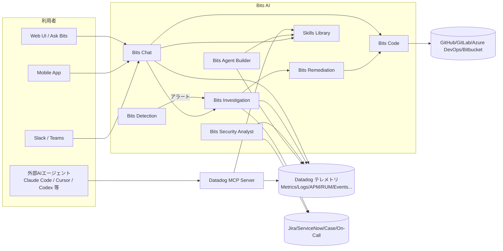
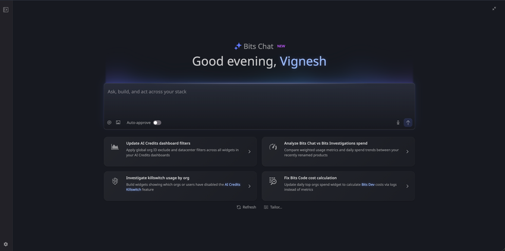
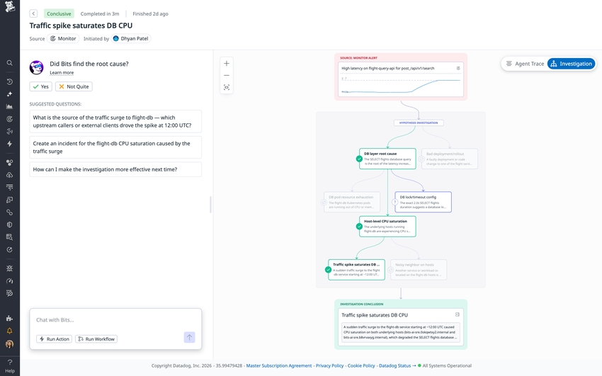
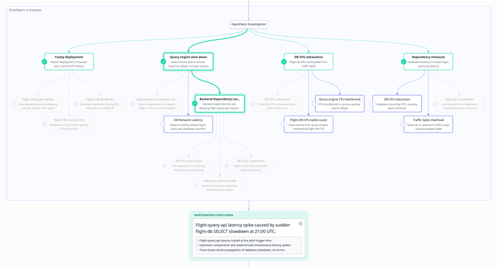
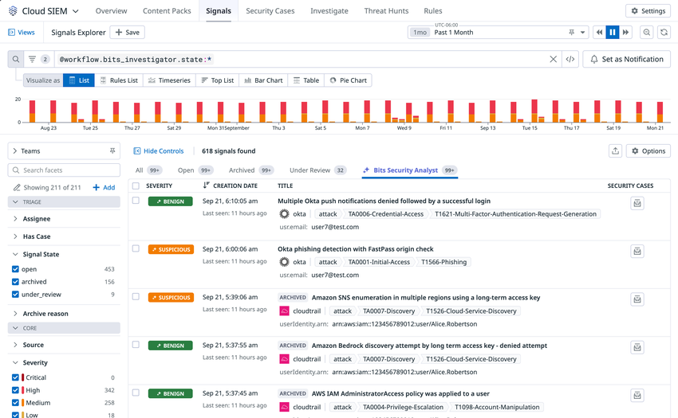

# Bits AI と AI 機能

## 概要

Bits AI は、Datadog が提供する生成 AI 機能群の総称であり、公式ドキュメントでは「開発・セキュリティ・運用のワークフローを自動化するエージェント型のチームメイト（agentic teammate）」と位置付けられている。Bits AI はユーザーとリアルタイムに対話する使い方（チャット）と、タスクを丸ごと委任する使い方（自律エージェント）の両方を提供する。[出典](https://docs.datadoghq.com/bits_ai/)

2026-11-02 時点で、Bits AI の公式ドキュメントは以下の製品（エージェント）で構成される。

| 製品名（現名称） | 旧称・関連名 | 役割 | 提供状況（2026-11-02 時点） |
|---|---|---|---|
| Bits Chat | Bits AI（アシスタント）/ Bits Assistant【推定】 | 自然言語で Datadog 全体を検索・分析・操作する対話インターフェース（Web / モバイル / Slack） | GA |
| Bits Investigation | Bits AI SRE | アラート・インシデントを自律調査し根本原因を特定する SRE エージェント | GA（一部連携は Preview） |
| Bits Code | Bits AI Dev Agent【推定】 | 観測データを使ってコード修正を生成し PR/MR を作成するコーディングエージェント | GA |
| Bits Security Analyst | Bits AI Security Analyst | Cloud SIEM シグナルを自律調査し Benign / Suspicious の判定を推奨するエージェント | 公式ドキュメントに GA/Preview の明示なし |
| Bits Detection | — | 重要エンドポイントを特定し、監視（マネージドモニター）を自律作成・調整 | 【Preview】（要申請） |
| Bits Remediation | — | 調査で特定した根本原因に対する是正（コード修正、トリアージ、インフラ操作、検証） | 一部機能が【Preview】 |
| Bits Data Analysis | — | ビジネスデータ（データウェアハウス）に自然言語で質問し SQL を生成・実行 | 【Preview】（要申請） |
| Bits Agent Builder | — | カスタム AI エージェントを作成し、ワークフロー・チャットから実行 | GA（Work/Case Management 連携は Preview） |
| Skills Library | — | Bits AI と外部エージェント（MCP 経由）が共有する再利用可能な「スキル」 | 公式ドキュメントに Preview 表記なし |
| Datadog MCP Server | — | 外部 AI エージェント（Claude Code、Cursor、Codex 等）に Datadog のデータとツールを提供する MCP サーバー | GA（2026-03-09 発表）。一部 toolset・クライアントは Preview |
| Natural Language Queries（NLQ） | — | Log Explorer、Metrics Explorer、DDSQL Editor 等で自然言語からクエリを生成 | 製品により異なる（本書「自然言語クエリ」節） |

このほか DASH 2026（2026-06-09 発表）で Bits Release（デプロイ後の PR 検証）、Bits Testing（テスト自動生成）、Agent Evals などが発表されている。これらは本書の範囲外とし、存在のみ記載する。[出典](https://www.datadoghq.com/about/latest-news/press-releases/datadog-launches-100-plus-capabilities-to-help-customers-drive-autonomy-and-manage-growing-ai-and-security-complexity/)（2026-06-09 公開）

> **サイト差異:** Bits AI の全製品（Bits Chat、Bits Investigation、Bits Code、Bits Security Analyst、Bits Detection、Bits Remediation、Bits Data Analysis、Skills Library、AI Credit Limits）と Datadog MCP Server は、`US1-FED`（app.ddog-gov.com）および `US2-FED`（us2.ddog-gov.com）では**サポートされない**。US1 / US3 / US5 / EU1 / AP1 / AP2 / UK1 では利用可能（Preview 製品は Preview として提供）。AI Credits も FedRAMP 顧客には提供されない。[出典](https://docs.datadoghq.com/bits_ai/) [出典](https://docs.datadoghq.com/account_management/billing/ai_credits/)

LLM アプリケーション自体を監視する製品（LLM Observability / Agent Observability）は本書の対象外であり、[LLM Observability](./llm-observability.md) を参照。

### 名称変更の経緯

Bits AI は 2023 年の DASH で AI アシスタント「Bits AI」として発表され、その後エージェント群へ拡張された。主な改称・変遷は以下のとおり。

| 時期 | 出来事 | 出典 |
|---|---|---|
| 2023-08（DASH 2023） | 対話型 AI アシスタント「Bits AI」発表 | [出典](https://www.datadoghq.com/about/latest-news/press-releases/datadog-announces-bits-an-ai-assistant-to-help-engineers-quickly-resolve-application-issues/) |
| 2025-06（DASH 2025） | Bits AI SRE、Bits AI Dev Agent（Preview）、Bits AI Security Analyst の 3 エージェント発表 | [出典](https://www.datadoghq.com/blog/bits-ai-sre-deeper-reasoning/) |
| 2025-12-02 | Bits AI SRE が GA（HIPAA 対象ワークロード対応、RBAC、AI パートナーとのエンタープライズ契約を明記） | [出典](https://www.datadoghq.com/about/latest-news/press-releases/datadog-launches-bits-ai-sre-agent-to-resolve-incidents-faster/) |
| 2026-03-05 | 公式ブログで「Bits Investigation」名称を使用（同記事内で旧名 Bits AI SRE も併用）。調査速度約 2 倍（約 3〜4 分） | [出典](https://www.datadoghq.com/blog/bits-ai-sre-deeper-reasoning/) |
| 2026-03-09 | Datadog MCP Server が GA | [出典](https://investors.datadoghq.com/news-releases/news-release-details/datadog-launches-mcp-server-provide-ai-agents-secure-real-time) |
| 2026-06-09（DASH 2026） | Bits Chat、Bits Detection、Bits Data Analysis、Bits Release、Bits Testing、Agent Builder 等を発表 | [出典](https://www.datadoghq.com/blog/dash-2026-new-feature-roundup-ai/) |
| 2026-06 頃 | 課金が製品別（例：調査件数単位）から共通の AI Credits に移行 `【第三者情報】` | [出典](https://www.nobs.tech/blog/datadog-bits-ai-pricing-ai-credits-governance)（2026-06-11 公開） |
| 2026-08-06 | Q2 2026 決算発表で Bits Code、Bits Chat、Bits Agent Builder の GA に言及 | [出典](https://investors.datadoghq.com/news-releases/news-release-details/datadog-announces-second-quarter-2026-financial-results) |

- Bits Investigation（旧称：Bits AI SRE）：公式ブログ（2026-03-05）が両名称を併用しており、第三者（Dash0）も「Bits AI SRE is now Bits Investigation」と記載。改称の正式日付は公開情報では確認できず。
- Bits Code（旧称：Bits AI Dev Agent）`【推定】`：公式ドキュメント上で旧称の明記はないが、ドキュメント画像パス（`bits_ai/dev_agent/...`）、権限名 `bits_dev_write`、関連ブログ URL（`bits-ai-dev-agent`）から同一製品の改称と推定される。
- Bits Chat（旧称：Bits AI アシスタント）`【推定】`：ドキュメント画像ファイル名 `bits_assistant_full_page`、MCP Server の `assistant` toolset（`send_message_to_assistant`）から、従来の Bits AI アシスタントの後継と推定される。
- Bits Security Analyst（旧称：Bits AI Security Analyst）：公式ブログ「Automate Cloud SIEM investigations with Bits AI Security Analyst」で旧称が使われている。

## 全体アーキテクチャ

Bits AI の各エージェントは、ユーザーのロール（RBAC）の範囲で Datadog のテレメトリ（メトリクス、ログ、トレース、イベント等）と外部連携（ソースコード、Slack、Confluence 等）にアクセスし、結果を Datadog UI・Slack・チケットに返す。外部 AI エージェントは Datadog MCP Server 経由で同等のデータとツールを利用する。

典型的な流れは「Bits Detection が監視を作成 → アラート発生 → Bits Investigation が根本原因を調査 → Bits Remediation / Bits Code が是正（PR 作成）」である。[出典](https://docs.datadoghq.com/bits_ai/bits_detection/) [出典](https://docs.datadoghq.com/bits_ai/bits_remediation/)

## Bits Chat（旧 Bits AI アシスタント）

### Bits Chat の機能

Bits Chat は、自然言語で Datadog 全体を検索し、操作するための対話インターフェースである。Bits Chat は Datadog の公開ドキュメント、テレメトリ、オーナーシップ情報をコンテキストとして持つ。[出典](https://docs.datadoghq.com/bits_ai/bits_chat/) [出典](https://docs.datadoghq.com/bits_ai/bits_chat/usage/)

| 機能 | 内容 | 質問例（公式例の要旨） |
|---|---|---|
| インシデント調査・原因説明 | 進行中の障害について原因を説明 | 「サービス X のエラー率が上がっているのはなぜか」 |
| テレメトリ探索 | メトリクス、ログ、トレース等を横断検索 | — |
| ダッシュボード要約 | 既存ダッシュボードの主要所見を要約 | 「Kubernetes 概要ダッシュボードの主な所見を要約」 |
| ダッシュボード作成 | 指標を指定してダッシュボードを生成 | 「レイテンシ・エラー・リクエスト数のダッシュボードを作成」 |
| DDSQL クエリ作成・実行 | DDSQL を生成して実行 | 「直近 1 時間のエラー件数上位サービスの DDSQL を書いて」 |
| コスト変動調査 | Cloud Cost Management データを分析（Cloud Cost Skill） | 「EC2 コストが 2 か月間で変わった理由」 |
| インシデント宣言・調査起動・コード変更依頼 | Slack から Bits Investigation / Bits Code を起動 | `@Datadog Investigate this alert` |

- Bits Chat の画面には **Auto-approve** トグル、`@` メンション、画像添付、音声入力のアイコンがある（スクリーンショットから確認。各機能の詳細仕様は公開情報では確認できず）。
- Bits Chat は Skills Library のスキルを利用できる（Settings > Skills で有効化、スラッシュコマンドで明示呼び出し可）。[出典](https://docs.datadoghq.com/bits_ai/skills_library/)

*キャプション: Bits Chat のフルページ画面（提案タスク付き）*
画面説明: 画面上部に「Bits Chat」ロゴと挨拶文、中央に「Ask, build, and act across your stack」というプレースホルダーの入力欄がある。入力欄の下部には `@`（メンション）、画像添付アイコン、**Auto-approve** トグル、マイク（音声入力）アイコン、送信ボタンが並ぶ。入力欄の下には、ユーザーの文脈に応じた提案タスクカード（例：ダッシュボードのフィルター更新、利用状況の比較分析など）が 4 枚表示され、**Refresh** と **Tailor...** ボタンで提案を更新・調整できる。左下に設定（歯車）アイコンがある。
出典: https://docs.datadoghq.com/bits_ai/bits_chat/ （取得日 2026-11-02）

### Bits Chat の利用経路

| 利用経路 | 開き方・設定 |
|---|---|
| Web（直接リンク） | `https://app.datadoghq.com/ask`（サイトに応じたドメイン） |
| Web（ナビゲーション） | 右上の **Ask Bits**、各製品画面の AI トリガーボタン（**Ask Bits** やキラキラ星アイコン）、左ナビ **Bits AI > Bits Chat** |
| キーボードショートカット | `Cmd` / `Ctrl` + `I` |
| モバイルアプリ | Datadog Mobile App のホーム画面で **Bits Chat** をタップ。音声またはテキストで質問 |
| Slack | Bits Chat Settings（`/ask/settings`）でワークスペースを選択 → **Connect Slack account**（任意で **Grant permissions** により Slack 会話の読み取りを許可）。チャンネルで `@Datadog` をメンションするとスレッドで回答 |

[出典](https://docs.datadoghq.com/bits_ai/bits_chat/usage/)

- Slack でコード変更を依頼すると、Bits Chat は専用の「コードチャンネル」を作成し、Bits Code がチームとともに作業する。
- 連携の詳細（Slack アプリ自体の導入）は [通知・コラボレーション連携](../platform/collaboration-integrations.md) を参照。

### Bits Chat の権限・共有・履歴

| 項目 | 仕様 |
|---|---|
| 必要権限 | **Bits Chat Access**。Datadog Admin / Standard / Read Only の各ロールにデフォルトで付与。カスタムロールには手動追加 |
| データスコープ | Bits Chat はユーザー自身のロールで動作し、そのユーザーがアクセス・編集できるリソースのみ参照・変更できる（例：編集権限のないダッシュボードは編集不可） |
| 履歴 | 会話は保存され、**History** から名前変更・共有・削除が可能 |
| 共有 | チャットはデフォルトで非公開。共有リンクは自動で期限切れになる。リンクを持つ人は誰でも閲覧可（新規メッセージを含む）だが返信は不可。共有チャットには共有者の権限で取得したデータが表示される |
| 削除 | チャット削除は恒久的（復元不可） |
| レポート | **Bits AI > Chat > Reports** で会話数上位ユーザー、会話量推移、会話の意図分布（問題調査、テレメトリ探索、概念学習、オブザーバビリティ設定など）を表示 |

[出典](https://docs.datadoghq.com/bits_ai/bits_chat/)

> 注意: 共有チャットは共有者の権限で取得したデータを表示するため、閲覧者が本来アクセスできないデータが見える可能性がある。共有リンクの扱いには注意が必要である（公式記述からの帰結）。

## Bits Investigation（旧 Bits AI SRE）

### Bits Investigation の機能

Bits Investigation は、本番環境の問題をエンドツーエンドで調査する自律 AI エージェントである。Bits Investigation は仮説を立て、関連テレメトリを収集し、データに基づく推論で根本原因を特定する。Bits Investigation は「観察 → 推論 → 行動」のループで動作し、仮説ごとにテレメトリを照会して支持・棄却し、最も可能性の高い原因に到達するまで軌道修正する。[出典](https://docs.datadoghq.com/bits_ai/bits_investigation/) [出典](https://docs.datadoghq.com/bits_ai/bits_investigation/investigate_issues/)

*キャプション: モニターアラートに対する Bits Investigation の調査結果画面*
画面説明: 画面上部に調査結果の状態（**Conclusive**）、所要時間（例：Completed in 3m）、調査タイトル（例：「Traffic spike saturates DB CPU」）、ソース（Monitor）と起動者が表示される。左ペインには「Did Bits find the root cause?」のフィードバック（**Yes** / **Not Quite**）、提案質問（SUGGESTED QUESTIONS：流入元の特定、インシデント作成、調査改善方法など）、下部にチャット入力欄と **Run Action** / **Run Workflow** ボタンがある。右ペインは仮説ツリーで、上から SOURCE: MONITOR ALERT（アラートのグラフ）→ HYPOTHESIS INVESTIGATION（複数の仮説ノード。検証済みは緑チェック、棄却はグレー）→ INVESTIGATION CONCLUSION（結論文）の順に並ぶ。右上で **Agent Trace** と **Investigation** 表示を切り替える。
出典: https://docs.datadoghq.com/bits_ai/bits_investigation/ （取得日 2026-11-02）

### Bits Investigation の起動方法

| 起動元 | 手動 / 自動 | 操作 |
|---|---|---|
| モニターアラート（一覧） | 手動 | **Bits Investigation > Monitors > Supported** で **Investigate Recent Alerts** → アラート選択 |
| モニターステータスページ | 手動 | 右上の **Investigate with Bits Investigation** |
| モニターイベントのサイドパネル | 手動 | **Investigate with Bits Investigation** |
| Slack（モニター通知への返信） | 手動 | `@Datadog Investigate this alert` |
| モニター（Auto-Investigate） | 自動 | Supported monitors 一覧で単体/一括で **Auto-Investigate** をオン、またはモニター編集画面の「Configure notifications & automations」 |
| Synthetic テスト | 手動 | テスト詳細 > Timeline > Alert Triggered イベント > **Investigate with Bits** |
| RUM | 手動 | Optimization ページ・Operations Monitoring の推奨カード、Vital チャートの **Anomaly · Investigate**、RUM モニター |
| Error Tracking【Preview】 | 手動 | Issue パネルの Review タブで **Investigate this issue** |
| 汎用プロンプト | 手動 | **New Investigation** で問題を記述（症状、テレメトリリンク、service/env タグ、時間窓。時間窓のデフォルトは過去 4 時間） |
| Slack（メンション） | 手動 | `@Datadog Investigate high CPU...`。スレッド内ではスレッド全体が調査コンテキストになる |
| インシデント | — | MCP Server の `trigger_incident_investigation` ツールで起動可能（`investigator` toolset、Preview） |
| API / Actions | 手動（プログラム） | Action Catalog の **Trigger Investigation** / **Get Investigation** / **List Investigations**、および API |

[出典](https://docs.datadoghq.com/bits_ai/bits_investigation/investigate_issues/) [出典](https://docs.datadoghq.com/bits_ai/bits_investigation/configure/) [出典](https://docs.datadoghq.com/mcp_server/tools/)

- 「App is slow. What's wrong?」のような曖昧なプロンプトは非推奨と公式に明記されている。

### Bits Investigation の対応モニタータイプ

| 対応 | モニタータイプ |
|---|---|
| 対応 | Metric、Anomaly、Forecast、Integration、Outlier、Logs |
| 対応 | APM（`APM Metrics` のみ） |
| 対応 | Composite、SLO |
| 対応 | Synthetics（API テスト、Browser テスト） |
| 対応 | RUM |
| **非対応** | APM の `Trace Analytics` モニター |

[出典](https://docs.datadoghq.com/bits_ai/bits_investigation/investigate_issues/)

モニタータイプ自体の仕様は [Monitors](../platform/monitors.md) を参照。

### Bits Investigation が参照するデータソース

| 区分 | データソース |
|---|---|
| Datadog 製品 | Metrics、APM トレース、Logs、Dashboards、Events、Change Tracking、ソースコード（GitHub のみ）、Watchdog、RUM、Error Tracking、Network Path、Database Monitoring、Continuous Profiler |
| サードパーティ連携【Preview】 | Grafana、Dynatrace、Sentry、Splunk、ServiceNow、Confluence |

[出典](https://docs.datadoghq.com/bits_ai/bits_investigation/investigate_issues/)

### Bits Investigation の出力

| 出力 | 内容 |
|---|---|
| 根本原因の結論 | 証拠付きの結論、またはデータが不十分な場合は **inconclusive（結論なし）** |
| Investigation Steps ビュー | 実行中の各ステップと推論をリアルタイム表示 |
| Hypothesis Tree ビュー | 完了後に仮説をツリー形式で構造化表示 |
| Agent Trace ビュー | 呼び出したツール、照会データ、中間分析を時系列で表示（2026-03 ブログで発表） |
| Error Tracking 起点 | Issue パネルに根本原因と影響の要約。Source Code Integration 設定時はソースコード分析も |
| Synthetic 起点 | 失敗が実際のリグレッションか設定ミスかを判定 |
| Reports タブ | モニター・ユーザー・サービス・チーム別の調査件数、結論までの平均時間 |

[出典](https://docs.datadoghq.com/bits_ai/bits_investigation/investigate_issues/) [出典](https://www.datadoghq.com/blog/bits-ai-sre-deeper-reasoning/)（2026-03-05 公開）

*キャプション: Bits Investigation が構築・検証した仮説のフローチャート（Hypothesis Tree）*
画面説明: 上部の「Hypothesis Investigation」ノードから、第 1 階層の仮説（例：Faulty deployment、Query engine slow down、DB CPU exhaustion、Dependency timeouts）が分岐する。支持された仮説は緑のチェック、棄却された仮説はグレーアウト、未確定の仮説は「?」アイコンで表示される。支持された仮説はさらに下位の仮説（例：Backend Dependency Latency、DB Network Latency）へ掘り下げられる。最下部の「INVESTIGATION CONCLUSION」に結論（例：「flight-db の SELECT 遅延によりレイテンシが急増」）と根拠の箇条書きが表示される。左上に所要時間（例：Finished in 2 minutes）が表示される。
出典: https://docs.datadoghq.com/bits_ai/bits_investigation/investigate_issues/ （取得日 2026-11-02）

### Bits Investigation の連携と設定

| 連携 | 用途・要件 |
|---|---|
| GitHub | ソースコード分析。GitHub インテグレーションと APM テレメトリの Git タグ付けが必要。ソースコードアクセスにより Bits Code による修正も可能 |
| Grafana / Dynatrace / Splunk / Sentry / ServiceNow | 外部オブザーバビリティデータの参照【Preview】 |
| Slack | Datadog Slack アプリ、`@slack-{channel}` ハンドル、Settings でのワークスペース接続が必要。1 つの Slack ワークスペースは 1 つの Datadog org にのみ接続可能 |
| Microsoft Teams【Preview】 | `@teams-{handle}` で通知 |
| Work Management（Case） | `@case-{project_name}` ハンドルで調査結果を作業項目に書き込み、Jira / ServiceNow に同期 |
| On-Call | `@oncall-{team}` ハンドル。調査結果はモバイルアプリの On-Call ページにも表示 |
| Confluence（Cloud） | ナレッジベース。アカウントクロールは任意（クロールするとチャットでも利用可）。モニターメッセージ内のリンクから調査計画時にページを読み込む |

設定画面の場所:

- 連携: **Bits Investigation > Settings > Integrations**
- レート制限: **Bits Investigation > Settings > Rate Limits**
- bits.md: **Bits Investigation > Settings > Bits.md**

[出典](https://docs.datadoghq.com/bits_ai/bits_investigation/configure/)

### Bits Investigation の権限

| 権限 | 用途 | デフォルト付与ロール |
|---|---|---|
| `bits_investigations_read` | 調査結果の閲覧 | Datadog Read Only Role（以上） |
| `bits_investigations_write`（Bits Investigations Write） | 調査の実行と設定 | Datadog Standard Role（以上） |

- Managed Roles にはデフォルトで含まれる。カスタム/変更済みロールには User Access Manage 権限を持つ管理者が追加する。
- 無効化方法: 上記 2 権限を全ロールから外す、または **Plan & Usage > AI Credits** の org レベルトグルで AI Credits 製品全体を無効化する。

[出典](https://docs.datadoghq.com/bits_ai/bits_investigation/configure/)

ロール・権限の全般は [組織・ユーザー・権限管理](../platform/account-and-access-management.md) を参照。

### Bits Investigation のナレッジソース

Bits Investigation の精度を高める入力として、公式に以下の 3 種類のナレッジソースが定義されている。[出典](https://docs.datadoghq.com/bits_ai/bits_investigation/knowledge_sources/)

| ナレッジソース | 内容 | 設定場所 |
|---|---|---|
| Runbook（モニターメッセージ） | モニターメッセージにトラブルシュート手順と最初に確認すべきテレメトリ（ダッシュボード、ログ、トレース、Notebook）のリンクを記載。素の URL でよい | 各モニターのメッセージ |
| Runbook（Notebook） | Markdown と Datadog クエリでトラブルシュート方法を記述した Notebook をモニターからリンク | モニターメッセージ |
| Runbook（Confluence） | モニターメッセージに Confluence ページをリンク。Bits はページを読み、テレメトリリンクを抽出し、手順を可能な範囲で実行し、修復ガイダンスを推奨事項に含める | モニターメッセージ + Confluence 連携 |
| `bits.md` | org 全体の構造化コンテキスト（スコープルール、タグ・命名規約、クイックチェック、既知のノイズ・誤検知） | **Bits Investigation > Settings > Bits.md** |
| フィードバックとメモリー | 調査終了時に結論の正否を回答。誤りの場合は真の根本原因、関連サービス・メトリクス、証拠のテレメトリリンクを提供。肯定的フィードバック、および詳細付きの否定的フィードバックは「メモリー」となり、以後の調査で動的に選択・再利用される | 調査画面のフィードバック。メモリーの閲覧・削除は Monitor Management ページの **Memories** 列 |

`bits.md` の典型的な記載内容（公式例の要旨）:

- スコープルール: ユーザーが指定した env、service、team、region、namespace をハードフィルターとして扱う
- タグ・命名規約: データソース間での環境名・サービス名の正規化
- クイックチェック: Pod の問題に対する Kubernetes イベントクエリなど
- 既知のノイズ: 夜間バッチによるスパイク、カナリアのエラー率など、想定内の挙動を障害扱いしない

### Bits Investigation の制約

| 制約 | 内容 |
|---|---|
| 自動調査の有効化手段 | Datadog API や Terraform による自動調査（Auto-Investigate）の有効化は**非対応**（UI で設定） |
| 自動調査のトリガー | **Alert 状態への遷移時のみ**。Warn、No Data、再通知、テスト通知では起動しない |
| Trace Analytics モニター | 非対応 |
| Error Tracking 連携・サードパーティ連携 | Preview |
| ソースコード分析 | GitHub の Source Code Integration が必要 |
| 推奨事項 | 精度向上のため、モニターに `service` タグを付与するか、クエリを service でグループ化する |

[出典](https://docs.datadoghq.com/bits_ai/bits_investigation/investigate_issues/)

### Bits Investigation の Audit Trail

Bits Investigation は以下のイベントを Audit Trail に記録する: 調査の開始・完了、手動調査でのツール呼び出し、モニター単位の自動調査トグル変更、モニター単位レート制限の変更。[出典](https://docs.datadoghq.com/bits_ai/bits_investigation/configure/) 詳細は [Audit Trail](../platform/audit-trail.md) を参照。

## Bits Code（旧 Bits AI Dev Agent）

### Bits Code の機能

Bits Code は、Datadog の観測データを使ってコードの問題を診断・修正する生成 AI コーディングアシスタントである。Bits Code は Pull Request（PR）/ Merge Request（MR）を作成し、CI ログと開発者のフィードバックに基づいて反復改善する。[出典](https://docs.datadoghq.com/bits_ai/bits_code/)

| 機能 | 内容 |
|---|---|
| セッション起動 | 自由記述プロンプト、対応 Datadog 製品（**Fix with Bits** ボタン等）、Automations（スケジュール/シグナル起点）、Slack の Bits Chat 依頼（コードチャンネル作成） |
| セッション共有 | セッションはデフォルトで org 全体に共有。分析・アクション・コード変更を記録。「My Sessions」は個人ビューであり、プライバシー境界ではない。Unwatch（自分のみ）、Archive（全員）が可能 |
| PR/MR 作成 | リポジトリのテンプレートに沿ったタイトル・説明を生成 |
| コメント応答 | GitHub、GitLab、Azure DevOps 上の `@Datadog` コメントに応答 |
| CI Auto-fix | CI ログと PR/MR の状態を監視し、失敗やマージブロッカーを修正（提供されている場合） |
| カスタムスキル | `.claude/skills/`、`.codex/skills/`、`.gemini/skills/` のスキルを使用 |
| 自動マージ | **行わない**（PR/MR を自動マージしない） |

### Bits Code のソースコードプロバイダー対応

| プロバイダー | 対応 | 備考 |
|---|---|---|
| GitHub | GitHub.com、GitHub Enterprise Cloud（データレジデンシー含む）、GitHub Enterprise Server | GitHub App に Repository contents（Read & write）、Pull requests（Read & write）、Push イベント購読が必要。CI ログ活用時は Checks（Read）、Commit statuses（Read only）と Check run / Check suite / Issue comment / Status イベントを追加 |
| GitLab | GitLab.com、GitLab Self-Managed | サービスアカウントにプロジェクトの Developer ロール、PAT に `api`、`write_repository`、`read_user` スコープ |
| Azure DevOps | Azure DevOps Cloud（dev.azure.com、*.visualstudio.com） | Entra サービスプリンシパルを Project Contributor に（または Contribute、Contribute to pull requests、Create branch、Read 権限）。コミット作者メール検証がある場合 `no-reply@dtdg.co` を許可 |
| Bitbucket | Bitbucket.org（Premium プラン） | Bitbucket Cloud Source Code インテグレーションを導入 |
| 非対応 | Azure DevOps Server（オンプレミス）、Bitbucket Data Center / Server | — |

[出典](https://docs.datadoghq.com/bits_ai/bits_code/) [出典](https://docs.datadoghq.com/bits_ai/bits_code/setup/)

### Bits Code の作業起点となる Datadog 製品

| Datadog 製品 | 起点となる対象 | 関連リファレンス |
|---|---|---|
| APM | Recommendations | [APM 画面と分析機能](../apm/apm-ui-and-analysis.md) |
| Bits Investigation | 調査結果の根本原因 | 本書 |
| Bits Chat | チャット・Slack からの依頼 | 本書 |
| Cloud Cost | Recommendations | [Cloud Cost Management](../infrastructure/cloud-cost-management.md) |
| Cloud Security | IaC 設定ミスの検出結果 | [Cloud Security](../security/cloud-security.md) |
| Error Tracking | エラー Issue | [Error Tracking](../apm/error-tracking.md) |
| Code Security | SAST、IaC、SCA の脆弱性（個別・一括） | [Code Security](../security/code-security.md) |
| Test Optimization | Flaky テスト | [Test Optimization](../software-delivery/test-optimization.md) |
| Continuous Profiler | Automated Analysis | [Continuous Profiler](../apm/continuous-profiler.md) |
| Containers | Kubernetes Remediations | [コンテナ・Kubernetes 監視](../infrastructure/container-and-kubernetes-monitoring.md) |
| Sensitive Data Scanner | 機密データ漏えいの原因となるログ出力 | [Sensitive Data Scanner](../security/sensitive-data-scanner.md) |

[出典](https://docs.datadoghq.com/bits_ai/bits_code/)

### Bits Code の設定項目

| 設定 | 場所 | 内容 |
|---|---|---|
| 必須権限 | Organization Settings > Roles | **Bits Code Write**（`bits_dev_write`）。Datadog Standard Role 等のマネージドロールに含まれる |
| Slack コードチャンネル用権限 | 同上 | Integrations Manage（`manage_integrations`）、User Access Manage（`user_access_manage`）、Org Management（`org_management`）のいずれか |
| Slack コードチャンネル | Bits Code > Settings > Slack | **Enable Slack Code Channels**。Slack スコープ `channels:history`、`groups:history`、`chat:write`、`channels:manage`、`app_mentions:read`（任意で `chat:write.customize`）。リポジトリ単位で無効化可 |
| サービスとリポジトリの対応 | Settings > Repositories > Service Repository Mapping | テレメトリの `service`・`version` タグで照合。APM の Git タグ付けまたは手動マッピング |
| 環境 | Settings > Repositories > Environments | 事前インストール言語バージョン、環境変数（セットアップ・実行時）、シークレット（セットアップ時のみ）、セットアップ用シェルスクリプト。リポジトリ値は org 値を上書き |
| Auto-Push | Bits Code > Settings > General | ブランチ作成・プッシュ・PR 作成を自動化（マージはしない）。無効時は Datadog または Slack コードチャンネルでレビュー後にプッシュ |
| カスタム指示（リポジトリ） | リポジトリ内ファイル | `AGENTS.md`、`CLAUDE.md`、`agent.md`、`.cursorrules`、`.windsurfrules`、`copilot-instructions.md` を読み込む |
| グローバル指示 | Settings > General > Global Agent Instructions | 全セッションに適用 |
| インターネットアクセス | Settings > General > Internet Access | No Internet Access / Default Allowlist / Custom + Default Allowlist / Custom Allowlist |

[出典](https://docs.datadoghq.com/bits_ai/bits_code/setup/)

### Bits Code のサンドボックスとセキュリティ上の注意

- エージェント実行中のインターネットアクセスは**デフォルトで無効**。Default Allowlist は Clojure/JVM、Go、Java、JavaScript/TypeScript、.NET、PHP、Python、Ruby、Rust、Ubuntu のパッケージレジストリ・ドキュメントと Datadog ドキュメントを含み、内容は変更されうる（安定した挙動にはカスタム許可リストを推奨）。
- セットアップコマンドはネットワーク有効で実行され、インターネットポリシーはセットアップ完了後に適用される。セットアップコマンドはリポジトリのコードを実行するため、信頼できるリポジトリのみで有効化する。
- テレメトリ起点のワークフロー（エラー、トレース）には信頼できない実行時入力が含まれ、出力に影響しうる（プロンプトインジェクションの経路）。Auto-Push をコードのみのワークフローに限定する、テレメトリ関与時はレビュー必須とする、等の選択肢がある。Datadog はプッシュ前に生成コードをスキャンするが完全ではないと明記されている。
- Bits Code のコミットは `no-reply@dtdg.co` で作成される。
- GitHub の多ブランチリポジトリで PR 作成が失敗する場合の回避策として `workflows:write` 権限追加が案内されているが、Bits AI がワークフローを作成可能になるセキュリティ上の影響がある。

[出典](https://docs.datadoghq.com/bits_ai/bits_code/setup/)

Docker のサポート範囲（サンドボックス内）:

| 区分 | 内容 |
|---|---|
| 対応 | `docker build`、Compose、フォアグラウンド/バックグラウンドコンテナ、`docker exec`、ヘルスチェック、`up --wait`、`depends_on`（ヘルス条件）、bridge・名前付きネットワーク、サービス名 DNS、バインドマウント、名前付きボリューム |
| 制限 | ポート公開は IPv4 TCP のみ（UDP・IPv6・ポート範囲不可。ホストアドレスは省略か `127.0.0.1` / `0.0.0.0`）。ポート公開コンテナは単一ネットワークのみ。BuildKit 固有機能と `docker buildx` 非対応。コンテナ単位の CPU/メモリ制限非対応。サンドボックスの復元・置換時に実行中コンテナは失われる |

## Bits Security Analyst（旧 Bits AI Security Analyst）

### Bits Security Analyst の機能

Bits Security Analyst は、Cloud SIEM のシグナルを自律的に調査する AI エージェントである。Bits Security Analyst はシグナルとログを照会し、データを推論して各シグナルに対する判定（**Benign** / **Suspicious**）を推奨する。[出典](https://docs.datadoghq.com/bits_ai/bits_security_analyst/)

| 機能 | 内容 |
|---|---|
| 自律調査 | 有効化された検知ルールに紐づくシグナルを自動調査 |
| Signals Explorer タブ | **Bits Security Analyst** タブに AI 調査済みシグナルのみ表示。Severity 列は判定まで「Investigating」 |
| 調査サイドパネル | 総合結論と主要証拠、推奨次アクション（修復、特定属性でのルール抑制）、調査ステップ（クエリ、埋め込み結果、全クエリへのリンク、各ステップの分析） |
| サイドパネルからの操作 | 調査結果を事前入力した作業項目（Case）作成、SOAR ブループリントによるワークフロー実行、インシデント宣言、ルール抑制追加、シグナルのアーカイブ、フィードバック |
| 通知 | Slack / Jira に送られた Cloud SIEM シグナル通知に、Bits AI が結論と調査リンクを返信 |

*キャプション: Cloud SIEM の Signals Explorer（Bits Security Analyst タブ）*
画面説明: 上部に Cloud SIEM のタブ（Overview、Content Packs、Signals、Security Cases、Investigate、Threat Hunts、Rules）と Settings ボタンがある。検索バーには `@workflow.bits_investigator.state:*` のクエリが入り、右に **Set as Notification** ボタンがある。中央にシグナル件数の時系列棒グラフ、左にファセット（Teams、Assignee、Signal State、Severity 等）がある。一覧上部のタブは All / Open / Archived / Under Review / **Bits Security Analyst**。一覧の SEVERITY 列に Bits の判定（緑の **BENIGN**、橙の **SUSPICIOUS**）が表示され、TITLE 列にシグナル名（例：Okta の MFA プッシュ拒否後のログイン成功、CloudTrail の SNS 列挙）と MITRE ATT&CK のタクティク/テクニックタグが表示される。
出典: https://docs.datadoghq.com/bits_ai/bits_security_analyst/ （取得日 2026-11-02）

### Bits Security Analyst の対応シグナルソース

1Password、Amazon GuardDuty、Atlassian Event Logs、Auth0、AWS CloudTrail、Azure、Claude Compliance Logs、Cloudflare、Confluence Audit Records、CrowdStrike、Email phishing、GCP、GitHub、GitLab、Google Workspace、Jira Audit Records、JumpCloud、Kubernetes、Microsoft 365、Microsoft Defender for EDR、Microsoft Entra ID、Okta、Salesforce、SentinelOne、Slack、Snowflake、Windows、Zendesk（計 28 ソース、2026-11-02 時点）。[出典](https://docs.datadoghq.com/bits_ai/bits_security_analyst/)

- Amazon GuardDuty は、異常/侵害された IAM 認証情報、EC2 等の認証情報流出、Bedrock 活動、EKS/ECS 攻撃シーケンス、Kubernetes 活動、S3 の異常動作・データ露出、CloudTrail/S3 の防御回避、IAM+S3 攻撃シーケンス等の検出タイプが対象。
- 対応ソースの OOTB ルールでも、SIEM 外テレメトリを必要とするため対象外となるルールがまれにある。**Show currently ineligible rules** で確認できる。

### Bits Security Analyst の設定

| 項目 | 内容 |
|---|---|
| 前提 | Cloud SIEM の非レガシー版を使用していること（不明時はサポートに確認） |
| 必要権限 | **Bits Security Analyst Config Write** |
| 有効化 | **Security > Settings > Bits Security Analyst > Analyst Configuration** で **Enable Bits Security Analyst** をオン |
| 調査対象の絞り込み | **Rule Settings**（最低重大度、ルール単位の有効/無効）、**Query Filter**（シグナルクエリで対象を限定） |
| デフォルト挙動 | 有効化後、カスタムルールを含むルールを分析し、**medium より上の重大度**の対象ルールの調査を開始。対象外のカスタムルールはサポートに相談 |
| 外部データ認証情報 | **Edit credentials** から Actions Catalog の Connection を選択/追加（例：SentinelOne は Viewer ロールの API トークン、CrowdStrike は API クライアント。NGSIEM スコープのみ Read/Write、他は Read Only） |
| ナレッジソース | **Knowledge Sources** で General Org Context（`Bits.md`、全調査に適用）と Situational Context（タイトル・説明・有効/無効・任意の有効期限を持つエントリ） |
| 完了通知 | セキュリティ通知ルールのフィルターに `@workflow.bits_investigator.state:*` を追加 |
| 無効化 | Analyst Configuration の **Disable Bits Security Analyst** でトグルをオフ。**無効化するとすべての設定が恒久的にリセットされる** |

[出典](https://docs.datadoghq.com/bits_ai/bits_security_analyst/)

Cloud SIEM 自体の仕様は [Cloud SIEM](../security/cloud-siem.md)、運用の実践は [セキュリティ運用の実践](../../04_応用編/security-operations-practices.md) を参照。

## Bits Detection【Preview】

Bits Detection は、監視すべきエンドポイントを特定し、本番の挙動からモニターを作成・調整し、サービスの変化に合わせてカバレッジを維持する Bits AI 機能である。Bits Detection は Bits AI ワークフローの第 1 段階（検知）に位置し、その後 Bits Investigation（根本原因分析）と是正に続く。Bits Detection は【Preview】で、利用には Datadog 担当者への申請が必要。[出典](https://docs.datadoghq.com/bits_ai/bits_detection/)

| 段階 | 内容 |
|---|---|
| 1. 重要リソースの特定 | テレメトリ、依存関係、オーナーシップメタデータ、最近の変更、ユーザー影響シグナルから、ユーザー・ビジネスにとって重要なエンドポイント・依存・フローを優先度付け |
| 2. 意味のある劣化の検知 | 重要リソースに対しマネージドモニターを作成・調整（静的閾値ではなく本番の挙動に合わせた設定） |
| 3. 変化への適応 | 重要度・カバレッジ・アラート挙動を継続的に再評価 |

| 項目 | 仕様 |
|---|---|
| 初期カバレッジ | 有効化後、環境内で**最も重要な 100 サービス**の監視を初期化 |
| 対応リソース | **APM 計装済みの HTTP / gRPC サービス**（アプリケーションのエッジを優先）。他のリソースタイプは Support に依頼 |
| サービス追加 | **Bits AI > Bits Detection** のカバレッジページで **Enable New Detection Coverage**、または **APM > Services** のサービス画面から |
| 既存モニター | チームの既存モニターはそのまま残り、並行して動作 |
| マネージドモニターの識別 | Monitor List で **Bits Managed** フィルター。キラキラアイコン付き |
| 通知 | タグクエリでアラートをルーティングする通知ルール（手動 / 動的ルーティング） |
| フィードバック | アラートを有用 / ノイズとして評価、重要エンドポイントの追加・削除 |
| 準備完了通知 | 新しいヘルスポスチャーの準備ができるとメールで通知 |

## Bits Remediation

Bits Remediation は、Bits AI が調査で特定した根本原因に対して行動するための機能群である。[出典](https://docs.datadoghq.com/bits_ai/bits_remediation/)

| 機能 | 内容 | 提供状況 |
|---|---|---|
| 自動コード修正 | Bits Investigation が Bits Code と連携し、コード起因の根本原因に修正を生成。デフォルトで自動生成（Settings で無効化し Next Steps から手動生成も可）。Bits Code の設定が前提 | GA（Bits Code に依存） |
| チャットからのトリアージ | Slack / Microsoft Teams メッセージ送信、Datadog・PagerDuty でのインシデント作成、Datadog On-Call でのページング、Work Management 作業項目作成、Jira チケット作成。調査コンテキストで事前入力 | 記載なし |
| インフラ修復（手動） | Bits が `kubectl patch` 等のコマンドを提案し、ユーザーがコピーして実行 | 記載なし |
| インフラ修復（ワンクリック） | **Run** で Bits が提案アクションを実行（例：Deployment のスケール、Pod 再起動、リソースのパッチ） | 【Preview】 |
| Kubernetes アクション | Action Catalog の Kubernetes アクション。Private Action Runner（クラスターへのネットワーク到達性）と、アクション実行・Kubernetes 接続解決が可能なロールが必要 | 【Preview】 |
| 解決の検証 | **Verify Resolution** で修復適用と元の問題の解消を確認 | 記載なし |
| Bits Guardrails | 管理者が対象アクション・スコープ（env / service / リソースタグ）・強制レベルを定義 | 【Preview】 |

Bits Guardrails の強制レベル:

| レベル | 挙動 |
|---|---|
| Ask | 実行前にユーザー承認が必要。承認者（チーム / ロール / 個人）を管理者が指定 |
| Deny | Bits はアクションを推奨できるが実行はできない |

- Guardrails の管理には `Guardrails Read` / `Guardrails Write` 権限（Organization Settings > Roles）が必要。
- Private Action Runner と Action Catalog の詳細は [Workflow Automation](../service-management/workflow-automation.md) を参照。

## Bits Data Analysis【Preview】

Bits Data Analysis は、ビジネスデータを自然言語で探索するエージェント型 AI ツールである。Bits Data Analysis は質問に対して関連テーブルを特定し、SQL を作成し、接続済みデータウェアハウスで実行して結果を表で返す。Bits Data Analysis の結果はダッシュボード、Notebook、DDSQL クエリで Datadog の観測データと組み合わせられる。[出典](https://docs.datadoghq.com/bits_ai/bits_data_analysis/)

| 項目 | 仕様 |
|---|---|
| 提供状況 | 【Preview】（**Request Access** で参加申請）。US1、US3、US5、EU1、AP1、AP2、UK1 で Preview |
| データソース | 接続済みデータウェアハウス（具体的な対応製品名は公開情報では確認できず）。Data Observability 経由で BI ツール・DWH の利用状況とメタデータからクエリコンテキストを自動生成可能 |
| 権限 | 接続済み DWH でユーザーがクエリ権限を持つデータのみにアクセス |
| Query contexts | データドメイン（例：Product、Sales）ごとのテーブル・フィルター・エッジケースの指示 |
| Evaluations | コンテキストに対する評価を定義し、期待結果からのずれを検出 |
| Skills | 保存済みの再利用可能ワークフロー（Private / チーム共有 / 全社共有） |
| 注意 | 重要な意思決定に使う前に、基になるクエリとデータソースを検証するよう公式に記載 |

Data Observability 自体は [Data Observability](../data/data-observability.md) を参照。

## Bits Agent Builder と Skills Library

### Bits Agent Builder

Bits Agent Builder は、自然言語で目的を記述してカスタム AI エージェントを作成し、ワークフローから自動実行、またはチャットからオンデマンド実行する機能である。Bits Agent Builder のエージェントは Action Catalog の 2,000 以上の既製アクションを利用でき、ワークフローで複数エージェントを連鎖・条件分岐させることもできる。UI 上の入口は **Actions > Agents**。[出典](https://www.datadoghq.com/blog/bits-agent-builder/)（2026-06-04 公開）

| 項目 | 仕様 |
|---|---|
| 必要権限 | **Bits Agent Builder Write** と **Bits Agent Builder Run**（Standard Role にデフォルト付与） |
| Case / Work Management 連携 | 作業項目へのエージェント割り当て（手動、または自動化ルールの **Assign Agent** アクション）。エージェントは割り当てたユーザーの権限で動作。【Preview】 |
| MCP からの操作 | MCP Server の `agent-builder` 系ツール（`create_datadog_bits_agent`、`run_datadog_bits_agent` 等） |
| 課金 | AI Credits（約 1 クレジット / 実行、本書「課金への影響」参照） |

[出典](https://docs.datadoghq.com/account_management/billing/ai_credits/) [出典](https://docs.datadoghq.com/incident_response/case_management/ai/custom_agents/) [出典](https://docs.datadoghq.com/mcp_server/tools/)

ワークフローとの組み合わせは [Workflow Automation](../service-management/workflow-automation.md)、[Case Management](../service-management/case-management.md) を参照。

### Skills Library

Skills Library は、AI エージェントにタスク固有のコンテキスト（インシデント対応手順、サービスオーナーシップ規約、調査要約の要件など）を与える再利用可能な「スキル」を管理する機能である。[出典](https://docs.datadoghq.com/bits_ai/skills_library/)

| 項目 | 仕様 |
|---|---|
| 利用者 | Bits Chat、Bits Agent Builder、Datadog app for Slack、および MCP Server 経由の外部エージェント（Claude Code、Codex、Cursor 等） |
| 外部エージェントからの利用 | `list_datadog_skills()` で検索、`load_datadog_skill()` で読み込み |
| 作成方法 | Skills Library で新規作成または既存の `SKILL.md` をインポート。Bits Chat に作成を依頼、会話をスキル化。Slack で `@Datadog` にスレッドのスキル化を依頼 |
| 公開範囲 | **Private**（非公開）または **Public**（Datadog org 内共有） |
| 有効化 | Bits Chat: Settings > Skills。Agent Builder: エージェントごとに選択。Slack: `@Datadog` + スラッシュコマンド |
| 呼び出し | 関連時に自動使用、またはスラッシュコマンドで明示呼び出し |

## Datadog MCP Server

### Datadog MCP Server の概要

Datadog MCP Server は、Model Context Protocol（MCP）に準拠し、外部 AI エージェント（Claude Code、Cursor、OpenAI Codex など）に Datadog のテレメトリと操作ツールを提供するリモート MCP サーバーである。Datadog MCP Server は 2026-03-09 に GA が発表された。公式ドキュメントは「大幅な開発中（under significant development）」と記載している。[出典](https://docs.datadoghq.com/mcp_server/) [出典](https://investors.datadoghq.com/news-releases/news-release-details/datadog-launches-mcp-server-provide-ai-agents-secure-real-time)（2026-03-09 公開）

- トランスポートは Streamable HTTP（リモート）。ローカル実行型の記載は公式セットアップページにない。
- HIPAA 適格（HIPAA-eligible）。接続する AI ツール側がコンプライアンス要件を満たすかは利用者の責任。
- GovCloud 非対応。

### Datadog MCP Server のエンドポイント

| サイト | エンドポイント |
|---|---|
| US1 | `https://mcp.datadoghq.com/v1/mcp` |
| US3 | `https://mcp.us3.datadoghq.com/v1/mcp` |
| US5 | `https://mcp.us5.datadoghq.com/v1/mcp` |
| EU1 | `https://mcp.datadoghq.eu/v1/mcp` |
| AP1 | `https://mcp.ap1.datadoghq.com/v1/mcp` |
| AP2 | `https://mcp.ap2.datadoghq.com/v1/mcp` |
| UK1 | `https://mcp.uk1.datadoghq.com/v1/mcp` |
| US1-FED / US2-FED | 非対応 |

[出典](https://docs.datadoghq.com/mcp_server/setup/)

> **サイト差異:** AP1（日本）の組織は `https://mcp.ap1.datadoghq.com/v1/mcp` を使う。ChatGPT アプリ（Preview）と Codex Desktop 用 Codex Plugin（Preview）は US1 のみ。サイトの全般は [Datadog Sites](../platform/datadog-sites.md) を参照。

### Datadog MCP Server の対応クライアントと設定例

| クライアント | 設定方法（要旨） |
|---|---|
| Claude Code（推奨手順） | `/plugin install datadog@claude-plugins-official` → `/ddsetup`（初回）→ `/ddtoolsets`（toolset 選択）→ 設定変更後 `/reload-plugins`。手動の場合 `claude mcp add --transport http datadog-mcp <ENDPOINT>` または `~/.claude.json` の `mcpServers` に `"type": "http"` |
| Claude（Web / Cowork） | Claude Connectors Directory から Datadog コネクタを追加して OAuth。またはエンドポイント URL でカスタムコネクタ |
| ChatGPT | ChatGPT アプリディレクトリの Datadog アプリ（【Preview】、US1 のみ） |
| Codex CLI | `~/.codex/config.toml` に `[mcp_servers.datadog]`。toolset は `X-Datadog-MCP-Toolsets` ヘッダーで指定。`codex mcp login datadog` |
| Copilot CLI | `datadog@awesome-copilot` プラグイン、`copilot mcp add --transport http`、または `~/.copilot/mcp-config.json` |
| VS Code | Copilot プラグイン、または Datadog 拡張の MCP Configuration Assistant |
| Cursor | Cursor Marketplace の Datadog プラグイン → `/ddsetup` |
| Grok Build | Marketplace のプラグイン → MCP Servers タブで認証 |
| Devin | MCP Marketplace で Datadog を有効化（API キー・アプリケーションキーを入力）、または toolset 指定のためカスタムサーバー |
| Goose | Streamable HTTP サーバーとして追加、またはワンクリック deeplink |
| Kiro | `~/.kiro/settings/mcp.json` に URL を追加 |
| OpenCode | `opencode.json` に `@datadog/opencode-plugin`（【Preview】）→ `ddsetup`。手動は `"type": "remote"` |
| Warp | Settings > MCP Servers で追加し OAuth |
| JetBrains IDE | Junie、AI Assistant、GitHub Copilot の MCP 設定 |
| その他 | クライアントの MCP 設定に HTTP エントリとしてエンドポイントを追加 |
| 動作確認 | `npx @modelcontextprotocol/inspector` で Streamable HTTP を選び接続、ツール一覧を取得 |

[出典](https://docs.datadoghq.com/mcp_server/setup/)

### Datadog MCP Server の認証

| 方式 | 内容 |
|---|---|
| OAuth 2.0（推奨） | 多くのクライアントがセットアップ時に処理。長期資格情報を直接管理しない。カスタムサブドメインは `?subdomain=<SUBDOMAIN>` を付与。取り消しは **Personal Settings > Authorized Apps** でクライアントを削除（発行済みトークンは有効期限まで有効。PAT/SAT/API・アプリケーションキーには影響しない） |
| Personal / Service Access Token（ヘッダー認証で推奨） | `Authorization: Bearer <token>`。ユーザーは PAT、サービスアカウントは SAT |
| API キー + アプリケーションキー | `DD_API_KEY` と `DD_APPLICATION_KEY` ヘッダー。最小権限のサービスアカウントのスコープ付きキーを推奨 |
| クライアント登録 | Organization Settings の **MCP OAuth Redirect URLs** でリダイレクト URL を許可リスト登録 |

[出典](https://docs.datadoghq.com/mcp_server/setup/) キー管理の全般は [API とキー管理](../platform/api-and-keys.md) を参照。

### Datadog MCP Server の権限と org 設定

| 項目 | 内容 |
|---|---|
| `mcp_read` | 読み取りツールの利用 |
| `mcp_write` | 作成・変更ツールの利用 |
| 基盤リソース権限 | 上記に加え、対象リソースの通常権限が必要（例：モニター読み取りには Monitors Read、作成には `monitors_write`）。呼び出しごとに検証 |
| デフォルト付与 | Datadog Standard Role に `mcp_read` / `mcp_write` の両方が含まれる。カスタムロールは手動追加 |
| **MCP Access**（org 設定） | org 全体で MCP をオン/オフ |
| **MCP Write Access**（org 設定） | オフにすると全ユーザーに書き込みツールが非表示 |
| ネットワーク制限 | IP 許可リストで接続元を制限可能 |
| データスコープ | ユーザー自身の資格情報で動作し、RBAC、Data Access Control、ログ制限クエリが適用される |
| Datadog ホストモデルを使うツールの無効化 | Datadog がホストするモデルを使う生成 AI ツールは、サポートへの依頼で org 全体で無効化可能 |

書き込みツールが表示されない場合の確認順序: MCP Write Access → `mcp_write` とリソース権限 → 正しい toolset の有効化（例：`create_datadog_monitor` には `alerting`）→ `omit_tools` に含まれていないか → クライアントの再接続。[出典](https://docs.datadoghq.com/mcp_server/setup/) [出典](https://docs.datadoghq.com/mcp_server/)

### Datadog MCP Server の toolset

Datadog MCP Server の toolset は、公開するツールを絞ってコンテキストウィンドウを節約する仕組みである。エンドポイントに `?toolsets=<名前,名前>` を付与して指定する。[出典](https://docs.datadoghq.com/mcp_server/setup/)

- パラメータ未指定時は `core` のみ読み込まれる。
- `toolsets=all` は GA の toolset をすべて有効化する（ツール検索に対応したクライアント向け）。**Preview toolset は `all` に含まれず**、名前で明示指定が必要。
- `omit_tools=<ツール名>` で特定ツールを除外できる（toolset 解決後に除外。未知の名前は警告）。
- 多くのツールは `max_tokens` パラメータを受け付け、長い応答は切り詰めて続きの取得方法をエージェントに示す。

| toolset | 区分 | 主な内容 |
|---|---|---|
| `core` | GA（デフォルト） | Logs、Metrics、Traces、Dashboards、Monitors、Incidents、Hosts、Services、Events、Notebooks |
| `alerting` | GA | モニターの検証・作成（ドラフト）、モニターグループ・SLO 検索、テンプレート、カバレッジ分析 |
| `assistant` | GA | Bits Chat とのやり取り（メッセージ送信、履歴、会話一覧） |
| `audit-trail` | GA | Audit Trail イベント検索 |
| `cases` | GA（一部 Preview ツールは名前指定時のみ） | Work Management の Case、プロジェクト、Jira 連携、添付 |
| `code-exec` | GA | エージェントが書いた JavaScript を Datadog 管理サンドボックスで実行（Datadog API アクセス付き） |
| `cost` | GA | Cloud Cost Management（削減推奨含む） |
| `dashboards` | GA | ダッシュボードの取得・作成・更新・削除、ウィジェットスキーマ・検証 |
| `data-observability` | GA | データカタログ、リネージ、データ品質、DWH・Spark 推奨 |
| `dbm` | GA | Database Monitoring |
| `ddsql` | GA | DDSQL によるクエリ |
| `derived-metrics` | GA | 派生メトリクスの作成・更新・削除 |
| `documentation` | GA | Datadog ドキュメントの検索・読み取り（引用可能な URL 付き） |
| `error-tracking` | GA | Error Tracking |
| `feature-flags` | GA | フィーチャーフラグと環境の管理 |
| `governance` | GA | Governance Console（インサイト、コントロール、検出、緩和、制限、タグルール） |
| `kubernetes` | GA | クラスター横断の Kubernetes リソース・マニフェストの検索・記述 |
| `llmobs` | GA | Agent Observability のスパン・実験の検索・分析 |
| `logs-configuration` | GA | ログパイプライン、インデックス、アーカイブの管理 |
| `networks` | GA | Cloud Network Monitoring、Network Device Monitoring |
| `notebooks` | GA | `core` 以外の拡張 Notebook ツール |
| `observability-pipelines` | GA | Observability Pipelines の確認・構築・検証・作成 |
| `onboarding` | GA | ガイド付き Datadog セットアップ |
| `product-analytics` | GA | Product Analytics クエリ |
| `profiling` | GA | Continuous Profiler データ |
| `reference-tables` | GA | Reference Tables の一覧・読み取り・行追加・クラウドストレージからの作成 |
| `rum` | GA | RUM アプリ、パフォーマンス、保持フィルター、カスタムメトリクス |
| `security` | GA | コードセキュリティスキャン、セキュリティシグナル、検出結果 |
| `sheets` | GA | スプレッドシートの CRUD |
| `software-delivery` | GA | CI Visibility、Test Optimization |
| `synthetics` | GA | Synthetic テスト |
| `widgets` | GA | ダッシュボード/Notebook ウィジェットの可視化・検証・変換 |
| `workflows` | GA | Workflow Automation の一覧・確認・実行・設定 |
| `apm` | 【Preview】（Product Preview フォームで申請） | トレース分析、スパン検索、Watchdog インサイト、サンプリングルール等 |
| `investigator` | 【Preview】 | Bits Investigation の起動と誘導 |
| `live-debugger` | 【Preview】 | 再デプロイなしで実行時状態を取得する Logpoint |
| `remote-actions` | 【Preview】（Product Preview フォームで申請） | Agent 経由のホスト上読み取り専用診断 |

Preview toolset は `apm`、`investigator`、`live-debugger`、`remote-actions` の 4 つと、`cases` の一部ツールである（2026-11-04 時点）。[出典](https://docs.datadoghq.com/mcp_server/setup/)

ツールリファレンスページには上記のほか `agent-builder`、`cloud-resources`、`experiments`、`forms`、`processes`（Live Processes の検索）等の toolset も掲載されている。ツールリファレンスでは `cases`、`experiments`、`processes`、`product-analytics` が**デフォルト無効**と明記されており、`toolsets` パラメータで明示指定する（`cases` の Preview ツールは `all` では有効にならず、`cases` の名前指定が必要）。[出典](https://docs.datadoghq.com/mcp_server/tools/)

`core` toolset の主なツール（抜粋）:

| ツール | R/W | 内容 |
|---|---|---|
| `search_datadog_logs` / `analyze_datadog_logs` | R | ログ検索 / SQL によるログ分析 |
| `get_datadog_metric` / `search_datadog_metrics` / `get_datadog_metric_context` | R | メトリクスのクエリ / 一覧 / メタデータ・タグ |
| `search_datadog_spans` / `aggregate_spans` / `get_datadog_trace` | R | APM スパン検索 / 集計 / トレース取得 |
| `search_datadog_monitors` | R | モニターと状態の検索 |
| `search_datadog_incidents` / `get_datadog_incident` | R | インシデント検索 / 詳細 |
| `search_datadog_hosts` | R | ホスト検索 |
| `search_datadog_entities` | R | Software Catalog エンティティと依存関係 |
| `search_datadog_events` | R | アラート、デプロイ、変更イベント |
| `search_datadog_rum_events` / `aggregate_rum_events` | R | RUM イベント検索 / 集計 |
| `search_datadog_dashboards` | R | ダッシュボード一覧 |
| `create_datadog_notebook` / `edit_datadog_notebook` / `delete_datadog_notebook` | W | Notebook の作成 / 編集 / ソフト削除 |

### Datadog MCP Server の監視と監査

| 項目 | 内容 |
|---|---|
| メトリクス | `datadog.mcp.session.starts`（セッション開始）、`datadog.mcp.tool.usage`（distribution、ツール呼び出し）。タグ `user_id`、`user_email`、`client`、`tool_name` |
| Audit Trail | イベント名 `MCP Server` で検索 |
| 利用データの保存期間 | 120 日 |

[出典](https://docs.datadoghq.com/mcp_server/)

## 自然言語クエリ（Natural Language Queries / NLQ）

自然言語クエリ（NLQ）は、各 Explorer の検索欄で平易な言葉から構造化クエリを生成する機能である。NLQ は Bits Chat とは別に、製品画面に組み込まれている。

| 対象 | 起動方法 | 生成されるもの | 無効化 | 出典 |
|---|---|---|---|---|
| Log Explorer | 検索欄の **Ask** | ログクエリ（サービス、属性、タグ、時間範囲を認識）。「Top 20 services by errors」等から可視化も生成 | **Organization Settings > Preferences** で Natural Language Queries をオフ（`org_management` 権限が必要） | [出典](https://docs.datadoghq.com/logs/explorer/search/) |
| Metrics Explorer（ダッシュボード、Notebook ウィジェット、Quick Graphs エディタでも利用可） | 検索欄の **Ask** | メトリクスクエリと可視化。追加の自然言語指示やクエリエディタで修正可 | 同上（`org_management`） | [出典](https://docs.datadoghq.com/metrics/explorer/) [出典](https://www.datadoghq.com/blog/metrics-natural-language-queries/)（2026-05-19 公開） |
| DDSQL Editor | 検索ボックスに質問を入力 | DDSQL クエリ（採用・破棄を選択、フィードバック可） | 公開情報では確認できず | [出典](https://docs.datadoghq.com/ddsql_editor/) |
| Bits Data Analysis【Preview】 | Bits AI から | DWH 向け SQL | — | 本書「Bits Data Analysis」 |

- Metrics の NLQ は、メトリクスメタデータ、タグ、環境内のインデックス済みコンテキスト（カスタムメトリクスを含む）を使ってクエリを構築する。[出典](https://www.datadoghq.com/blog/metrics-natural-language-queries/)
- Logs / Metrics の NLQ は `US1-FED` / `US2-FED` では利用できない。
- DDSQL Editor の利用には `ddsql_editor_read` 権限（Read Only ロールにデフォルト付与）が必要。
- NLQ 単体が AI Credits を消費するかは公開情報では確認できず（AI Credits の対象製品一覧に NLQ は含まれていない）。

クエリ言語自体は [ログ検索と分析](../logs/log-search-and-analytics.md)、[メトリクスクエリと関数](../platform/metrics-query-and-functions.md)、[Notebooks・DDSQL・Reference Tables](../platform/notebooks-and-data-tools.md) を参照。

## データの取り扱い

### Bits AI のデータアクセス範囲

| 原則 | 内容 | 出典 |
|---|---|---|
| ユーザー権限で動作 | Bits Chat、MCP Server はユーザー自身のロールで動作し、アクセス可能なデータ・操作のみ実行。RBAC、Data Access Control、ログ制限クエリが適用される | [出典](https://docs.datadoghq.com/bits_ai/bits_chat/) [出典](https://docs.datadoghq.com/mcp_server/) |
| エージェント割り当て時 | Case / Work Management でエージェントを割り当てた場合、割り当てたユーザーの権限で動作 | [出典](https://docs.datadoghq.com/incident_response/case_management/ai/custom_agents/) |
| DWH | Bits Data Analysis は DWH 側でユーザーが権限を持つデータのみクエリ | [出典](https://docs.datadoghq.com/bits_ai/bits_data_analysis/) |
| 外部資格情報 | Bits Security Analyst の外部ログソース資格情報は Actions Catalog の Connection に保存・制限される | [出典](https://docs.datadoghq.com/bits_ai/bits_security_analyst/) |
| 共有チャット | 共有リンクの閲覧者には共有者の権限で取得したデータが表示される | [出典](https://docs.datadoghq.com/bits_ai/bits_chat/) |

### Bits AI のデータ保持期間

| データ | 保持期間 | 出典 |
|---|---|---|
| Bits Chat のメッセージ | 15 か月 | [出典](https://docs.datadoghq.com/data_security/data_retention_periods/) |
| Bits Code のソースコード | 7 日 | 同上 |
| Bits Investigation の調査 | アカウント存続期間中保持 | 同上 |
| MCP Server の利用データ | 120 日 | [出典](https://docs.datadoghq.com/mcp_server/) |
| Bits Investigation のメモリー | 明示的な保持期間は公開情報では確認できず（Monitor Management で閲覧・削除可） | [出典](https://docs.datadoghq.com/bits_ai/bits_investigation/knowledge_sources/) |

### LLM プロバイダーと学習利用

| 項目 | 内容 | 確度 |
|---|---|---|
| AI パートナーとの契約 | Bits AI SRE GA 時のプレスリリースで「信頼できる AI パートナーとのエンタープライズ契約」「HIPAA 対象ワークロード対応」「RBAC」を明記 | 公式（2025-12-02） [出典](https://www.datadoghq.com/about/latest-news/press-releases/datadog-launches-bits-ai-sre-agent-to-resolve-incidents-faster/) |
| 使用モデル | Slack Marketplace の Datadog アプリ掲載情報に「Bits AI uses Open AI's GPT-3.5 Turbo, GPT-4 and GPT-4o LLM models」と記載。現行の Bits Chat / Bits Investigation 等のモデル構成は公開情報では確認できず。Bits Agent Builder ではサポートモデル一覧を取得するツール（`list_datadog_bits_agent_models`）がある | Slack 掲載情報（Datadog 提供だが更新日不明。現行と食い違う可能性あり） [出典](https://slack.com/marketplace/AR28NTK5M-datadog) |
| データの混在 | 同掲載情報に「LLM とのやり取りで顧客 org 間のデータを混在させない」「All LLM data resides in Datadog's systems」と記載 | 同上 |
| 顧客データによるモデル学習 | 公開情報では確認できず（Trust Center の資料・DPA・担当者への確認を推奨） | — |
| 無効化（オプトアウト） | AI Credits 製品は org トグルで一括無効化可。アカウントチーム経由で AI 機能をオプトアウトした顧客には AI Credits が提供されない。MCP Server の Datadog ホストモデル利用ツールはサポート経由で無効化。NLQ は Organization Settings > Preferences で無効化 | 公式 [出典](https://docs.datadoghq.com/account_management/billing/ai_credits/) [出典](https://docs.datadoghq.com/mcp_server/) |
| プロンプトインジェクション | Bits Code はテレメトリ由来の信頼できない入力が出力に影響しうると明記し、Auto-Push の制限を推奨 | 公式 [出典](https://docs.datadoghq.com/bits_ai/bits_code/setup/) |

コンプライアンス全般（データ所在地、契約、監査）は [セキュリティとコンプライアンス](../../03_導入編/security-and-compliance.md) を参照。

## 制限値・クォータ・デフォルト値

| 項目 | 値 / デフォルト | 出典 |
|---|---|---|
| 非対応サイト | US1-FED（app.ddog-gov.com）、US2-FED（us2.ddog-gov.com）。全 Bits AI 製品・MCP Server・AI Credits | [出典](https://docs.datadoghq.com/bits_ai/) |
| AI Credits のリセット | 毎月 1 日（暦月）。未使用のコミット分は繰り越し不可 | [出典](https://docs.datadoghq.com/account_management/billing/ai_credits/) |
| AI Credits 製品のデフォルト有効化 | すべて Datadog Standard Role でデフォルト有効（AI Credits ドキュメントの記載）。ただし Bits Chat Access は Admin / Standard / **Read Only** の 3 ロールにデフォルト付与されるため、Read Only ユーザーも Bits Chat でクレジットを消費できる | 同上、[出典](https://docs.datadoghq.com/bits_ai/bits_chat/) |
| AI Credit 上限（org） | デフォルトなし（未設定） | [出典](https://docs.datadoghq.com/account_management/billing/ai_credit_limits/) |
| AI Credit 上限（ユーザー） | デフォルト per-user 上限・個別オーバーライドを設定可（初期値は公開情報では確認できず） | 同上 |
| Bits Investigation 自動調査レート制限（モニター単位） | デフォルト **24 時間ローリングで 1 回** | [出典](https://docs.datadoghq.com/bits_ai/bits_investigation/configure/) |
| Bits Investigation 自動調査レート制限（org） | デフォルト **制限なし** | 同上 |
| Bits Investigation 手動調査 | 自動調査のレート制限到達後も手動調査は可能 | 同上 |
| Bits Investigation 汎用プロンプトの時間窓 | デフォルト過去 4 時間 | [出典](https://docs.datadoghq.com/bits_ai/bits_investigation/investigate_issues/) |
| Bits Investigation 所要時間 | 約 3〜4 分（複雑さによる。ベンダー公表値） | [出典](https://www.datadoghq.com/blog/bits-ai-sre-deeper-reasoning/) |
| Slack ワークスペースと org | 1 ワークスペースは 1 org にのみ接続可 | [出典](https://docs.datadoghq.com/bits_ai/bits_investigation/configure/) |
| Bits Code のマルチリポジトリ | 非対応（マルチリポジトリ調査不可） | [出典](https://docs.datadoghq.com/bits_ai/bits_code/) |
| Bits Code のインターネットアクセス | デフォルト無効（No Internet Access） | [出典](https://docs.datadoghq.com/bits_ai/bits_code/setup/) |
| Bits Code の自動マージ | 行わない | 同上 |
| Bits Security Analyst のデフォルト対象 | 有効化後、medium より上の重大度の対象ルール | [出典](https://docs.datadoghq.com/bits_ai/bits_security_analyst/) |
| Bits Detection の初期カバレッジ | 最も重要な 100 サービス。APM 計装済み HTTP / gRPC サービス | [出典](https://docs.datadoghq.com/bits_ai/bits_detection/) |
| MCP Server バースト制限 | 50 リクエスト / 10 秒（ツール呼び出し単位）。変更の可能性あり | [出典](https://docs.datadoghq.com/mcp_server/) |
| MCP Server 月間制限 | 100,000 ツール呼び出し / 月。引き上げはサポートに依頼 | 同上 |
| MCP Server デフォルト toolset | `core` のみ | [出典](https://docs.datadoghq.com/mcp_server/setup/) |
| MCP Server `toolsets=all` | GA toolset のみ（Preview は含まない） | 同上 |
| MCP Server 利用データ保存 | 120 日 | [出典](https://docs.datadoghq.com/mcp_server/) |
| Bits Chat メッセージ保持 | 15 か月 | [出典](https://docs.datadoghq.com/data_security/data_retention_periods/) |
| Bits Code ソースコード保持 | 7 日 | 同上 |
| Bits Chat 共有リンク有効期限 | 自動で期限切れ（期間は公開情報では確認できず） | [出典](https://docs.datadoghq.com/bits_ai/bits_chat/) |
| Bits Chat のメッセージ数・会話数上限 | 公開情報では確認できず（AI Credit 上限で間接的に制御） | — |
| bits.md のサイズ上限、メモリー数上限 | 公開情報では確認できず | — |
| Bits Data Analysis のクエリ・行数上限 | 公開情報では確認できず | — |

## 課金への影響

### AI Credits

AI Credits は Datadog の AI 製品の利用を計量・課金する単位であり、「1 AI Credit は Datadog AI 製品が実行する知的作業の 1 単位」と定義されている。AI Credits を消費する製品は **Bits Chat、Bits Investigation、Bits Code、Bits Agent Builder** である（AI Credits ドキュメント記載、2026-11-02 時点）。[出典](https://docs.datadoghq.com/account_management/billing/ai_credits/)

公式料金（2026-11-02 時点、USD、定価）:

| 契約形態 | 単位 | 価格 |
|---|---|---|
| 年契約（Annual Commit、月次請求） | 500 クレジット / 月 | $500 |
| 月契約（Monthly Commit） | 500 クレジット / 月 | $600 |
| オンデマンド | 1 クレジット | $1.30（500 クレジット換算 $650） |

[出典](https://www.datadoghq.com/pricing/?product=ai-credits) [出典](https://www.datadoghq.com/pricing/list/)

> **サイト差異:** 上表は US / EU1 の価格である。AP1（日本）では年契約 $625 / 500 クレジット、月契約 $750 / 500 クレジット、オンデマンド $1.625 / クレジット（500 クレジット換算 $812.50）。FedRAMP サイト（US1-FED / US2-FED）では AI Credits は提供されない。値は [製品別料金表](../../03_導入編/pricing-by-product.md) §14 に合わせている。[出典](https://www.datadoghq.com/pricing/?product=ai-credits)

- 3 形態は組み合わせ可能。月次コミットを超えた利用は自動的にオンデマンド料金で課金される（手動チャージ不要）。
- 料金数値の正本は [製品別料金表](../../03_導入編/pricing-by-product.md)。値に差異がある場合はそちらを優先する。

製品別の平均クレジット消費目安（公式料金ページ、参考値。実際の消費はタスクの複雑さ・処理コンテキスト量で変動）:

| 機能 | 目安 | 備考 |
|---|---|---|
| Bits Chat | 約 0.5 クレジット / メッセージ | — |
| Bits Investigation（自律調査） | 約 4 クレジット / 調査 | 過去のスナップショット・第三者記事では約 6.5 クレジットとの記載もある `【第三者情報】`（[出典](https://www.nobs.tech/blog/datadog-bits-ai-pricing-ai-credits-governance)、2026-06-11 公開）。現行値は公式料金ページを確認 |
| Bits Code | 約 5 クレジット / コード修正 | — |
| Bits Agent Builder | 約 1 クレジット / 実行（手動・自律） | — |
| Bits Database Optimization | 約 0.3 クレジット / 自律最適化 | — |
| Bits Testing | 自律テスト生成ジョブはプロモーションで 11/30 まで無料と記載 | 年の明記なし |

[出典](https://www.datadoghq.com/pricing/?product=ai-credits)

### 利用量の帰属と管理

| 項目 | 内容 |
|---|---|
| 利用状況の確認 | **Plan & Usage > AI Credits** で当月消費を製品別に表示 |
| 推定使用量メトリクス | `datadog.estimated_usage.<product>.ai_credits`（例：`datadog.estimated_usage.bits_chat.ai_credits`） |
| 上限設定 | **Bits AI > AI Credits Management**（`billing_edit` 権限）。org 上限、デフォルト per-user 上限、per-user オーバーライド |
| 上限の適用規則 | org 上限とユーザー上限の両方がある場合は厳しい方。デフォルト per-user 上限とオーバーライドがある場合は高い方（その上で org 上限が適用）。上限引き上げで即ブロック解除、引き下げで超過ユーザーは即ブロック |
| 上限到達時 | 対象ユーザーは Bits Chat、Bits Investigation、Bits Code、Bits Agent Builder を使用不可。リセット日をバナー表示 |
| 帰属（Bits Chat / Bits Code） | 操作したユーザーのメールに計上 |
| 帰属（Bits Investigation） | 手動起動は起動ユーザー、自動起動（モニター等）は **Autonomous Agents** に計上 |
| 帰属（Bits Agent Builder） | ワークフローのエージェント実行はワークフロー作成者。サービスアカウント作成のワークフローは **Autonomous Agents** |
| 製品単位の無効化 | Organization Settings > Roles で権限を外す（Bits Chat Access / Bits Investigations Write / Bits Code Write / Bits Agent Builder Write・Run） |
| org 全体の無効化 | Plan & Usage > AI Credits の org トグル。無効時も画面と過去結果は閲覧可、新規リクエストはブロック |

[出典](https://docs.datadoghq.com/account_management/billing/ai_credits/) [出典](https://docs.datadoghq.com/account_management/billing/ai_credit_limits/)

上限設定の計算例（公式例）:

| org 上限 | per-user 上限 | ユーザー数 | 理論最大利用 | 最大課金対象 |
|---|---|---|---|---|
| 2,000 | 50 | 20 | 1,000 | 1,000 |
| 2,000 | 200 | 20 | 4,000 | 2,000（org 上限） |
| 未設定 | 200 | 20 | 4,000 | 4,000 |

> 【経験則】AI Credits 製品は Standard Role にデフォルトで有効であり、Bits Chat Access は Read Only Role にもデフォルトで付与される（AI Credits ドキュメントは Standard Role と記載）ため、全社展開前に org 上限・per-user 上限を設定し、Auto-Investigate を有効化するモニターを絞る（モニター単位のレート制限を確認する）ことがコスト管理上重要である。第三者記事でも Standard Role へのデフォルト付与は従量製品として寛容すぎると指摘されている `【第三者情報】`（[出典](https://www.nobs.tech/blog/datadog-bits-ai-pricing-ai-credits-governance)、2026-06-11 公開）。

### AI Credits 以外の課金

| 製品 | 課金の扱い |
|---|---|
| Bits Security Analyst | AI Credits の対象外。Cloud SIEM の契約に、**分析 1 TB あたり月 100 回の Bits Security Analyst 調査の無料枠（最低 月 50 回）**が含まれる（公式 Cloud SIEM 料金ページ、2026-11-04 時点）。[出典](https://www.datadoghq.com/pricing/?product=cloud-siem) なお Cloud SIEM 本体の課金単位は料金比較表では「Per 1M analyzed events」（年 $5 / 月 $6 / オンデマンド $7.50）であり、無料枠の基準（TB analyzed）と単位が異なる。[出典](https://www.datadoghq.com/pricing/list/) 無料枠を超えた調査の価格は公式料金ページに記載がない（2026-11-04 時点）。補足として、2026-07 に無料枠の算定基準が「10 億イベント当たり」から「1 TB 分析当たり」に変わったとする第三者の記録がある `【第三者情報】`（[出典](https://pricingsaas.com/companies/datadog.cloud-siem/diffs/2026W31)、2026-07-27 記録）。Cloud SIEM の料金は [製品別料金表](../../03_導入編/pricing-by-product.md) を正とする |
| Datadog MCP Server | MCP Server 利用自体の料金は公式ドキュメント・料金ページで確認できず。`assistant` toolset で Bits Chat にメッセージを送る場合などは AI Credits が消費されると推定される `【推定】`。参照されるテレメトリの取り込み・保持は各製品の通常課金 |
| Bits Detection / Bits Remediation / Bits Data Analysis | Preview。課金は公式ドキュメントに記載なし（公開情報では確認できず） |
| 自然言語クエリ（NLQ） | 課金の記載なし（公開情報では確認できず） |
| Bits Investigation の無料トライアル | 新規ユーザー向けに 14 日間の無料トライアルあり（2026-03-05 時点のブログ記載） [出典](https://www.datadoghq.com/blog/bits-ai-sre-deeper-reasoning/) |
| 旧課金（参考） | AI Credits 移行前は Bits AI SRE が調査件数単位（例：$500 / 20 調査のコミット、オンデマンド約 $36 / 件）だったとされる `【第三者情報】`（[出典](https://www.nobs.tech/blog/datadog-bits-ai-pricing-ai-credits-governance)、2026-06-11 公開）。現行は AI Credits |

料金体系全般は [料金体系の全体像](../../03_導入編/pricing-overview.md)、課金の計算方法は [課金計算の仕組み](../../03_導入編/billing-mechanics.md)、利用量の可視化は [Usage・Usage Attribution・Cost Visibility](../platform/usage-and-cost-attribution.md) を参照。

## 運用上の注意点（要約）

| 観点 | 推奨事項 | 根拠 |
|---|---|---|
| 精度向上 | モニターに `service` タグ、モニターメッセージに Runbook・テレメトリリンク、`bits.md` で命名規約・既知ノイズを定義、調査結果へのフィードバック | 公式 [出典](https://docs.datadoghq.com/bits_ai/bits_investigation/knowledge_sources/) |
| 自動調査の範囲 | Auto-Investigate は Alert 遷移時のみ起動。API/Terraform では有効化できないため、Monitoring as Code 運用では UI 設定の管理手順を別途用意 | 公式 [出典](https://docs.datadoghq.com/bits_ai/bits_investigation/investigate_issues/) |
| コード変更の安全性 | Auto-Push はコード起点ワークフローに限定、テレメトリ起点はレビュー必須を検討。Bits Code はマージしない | 公式 [出典](https://docs.datadoghq.com/bits_ai/bits_code/setup/) |
| インフラ操作の統制 | Bits Guardrails で本番環境の Kubernetes アクションを Ask / Deny に設定 | 公式 [出典](https://docs.datadoghq.com/bits_ai/bits_remediation/) |
| MCP の最小権限 | 書き込み不要なら MCP Write Access をオフ、サービスアカウントは最小権限のスコープ付きキー、`toolsets` / `omit_tools` で公開ツールを限定 | 公式 [出典](https://docs.datadoghq.com/mcp_server/setup/) |
| 監査 | Bits Investigation と MCP Server の操作は Audit Trail に記録。MCP は `datadog.mcp.tool.usage` で利用者・クライアント別に可視化 | 公式 [出典](https://docs.datadoghq.com/mcp_server/) |

アラート設計との組み合わせは [アラート設計とノイズ削減](../../04_応用編/alert-design-and-noise-reduction.md)、Monitoring as Code は [Monitoring as Code](../../04_応用編/monitoring-as-code.md)、インシデント対応は [Incident Management](../service-management/incident-management.md)・[On-Call](../service-management/on-call.md)、Watchdog（異常検知）は [Watchdog](../platform/watchdog.md) を参照。

## 参照元

公式ドキュメント（取得日 2026-11-02）

- https://docs.datadoghq.com/bits_ai/
- https://docs.datadoghq.com/bits_ai/bits_chat/
- https://docs.datadoghq.com/bits_ai/bits_chat/usage/
- https://docs.datadoghq.com/bits_ai/bits_investigation/
- https://docs.datadoghq.com/bits_ai/bits_investigation/investigate_issues/
- https://docs.datadoghq.com/bits_ai/bits_investigation/configure/
- https://docs.datadoghq.com/bits_ai/bits_investigation/knowledge_sources/
- https://docs.datadoghq.com/bits_ai/bits_code/
- https://docs.datadoghq.com/bits_ai/bits_code/setup/
- https://docs.datadoghq.com/bits_ai/bits_security_analyst/
- https://docs.datadoghq.com/bits_ai/bits_detection/
- https://docs.datadoghq.com/bits_ai/bits_remediation/
- https://docs.datadoghq.com/bits_ai/bits_data_analysis/
- https://docs.datadoghq.com/bits_ai/skills_library/
- https://docs.datadoghq.com/account_management/billing/ai_credits/
- https://docs.datadoghq.com/account_management/billing/ai_credit_limits/
- https://docs.datadoghq.com/mcp_server/
- https://docs.datadoghq.com/mcp_server/setup/
- https://docs.datadoghq.com/mcp_server/tools/
- https://docs.datadoghq.com/logs/explorer/search/
- https://docs.datadoghq.com/metrics/explorer/
- https://docs.datadoghq.com/ddsql_editor/
- https://docs.datadoghq.com/data_security/data_retention_periods/
- https://docs.datadoghq.com/incident_response/case_management/ai/custom_agents/

公式サイト・ブログ・プレスリリース

- https://www.datadoghq.com/pricing/?product=ai-credits （取得日 2026-11-02）
- https://www.datadoghq.com/pricing/list/ （取得日 2026-11-02）
- https://www.datadoghq.com/pricing/?product=cloud-siem （取得日 2026-11-04）
- https://www.datadoghq.com/blog/bits-ai-sre-deeper-reasoning/ （2026-03-05 公開）
- https://www.datadoghq.com/blog/metrics-natural-language-queries/ （2026-05-19 公開）
- https://www.datadoghq.com/blog/bits-agent-builder/ （2026-06-04 公開）
- https://www.datadoghq.com/blog/dash-2026-new-feature-roundup-ai/ （2026-06-09 公開）
- https://www.datadoghq.com/about/latest-news/press-releases/datadog-announces-bits-an-ai-assistant-to-help-engineers-quickly-resolve-application-issues/ （2023-08 公開）
- https://www.datadoghq.com/about/latest-news/press-releases/datadog-launches-bits-ai-sre-agent-to-resolve-incidents-faster/ （2025-12-02 公開）
- https://investors.datadoghq.com/news-releases/news-release-details/datadog-launches-mcp-server-provide-ai-agents-secure-real-time （2026-03-09 公開）
- https://www.datadoghq.com/about/latest-news/press-releases/datadog-launches-100-plus-capabilities-to-help-customers-drive-autonomy-and-manage-growing-ai-and-security-complexity/ （2026-06-09 公開）
- https://investors.datadoghq.com/news-releases/news-release-details/datadog-announces-second-quarter-2026-financial-results （2026-08-06 公開）
- https://slack.com/marketplace/AR28NTK5M-datadog （Datadog Slack アプリ掲載情報。更新日不明）

第三者情報

- https://www.nobs.tech/blog/datadog-bits-ai-pricing-ai-credits-governance （2026-06-11 公開）
- https://pricingsaas.com/companies/datadog.cloud-siem/diffs/2026W31 （2026-07-27 記録）
- https://www.dash0.com/comparisons/datadog-bits-ai-alternatives （競合ベンダーによる比較記事。公開日未確認）

画像（取得日 2026-11-02、著作権は Datadog, Inc. に帰属。社内参照目的に限る）

- `assets/images/bits-ai/bits-chat-full-page.png` … https://docs.datadoghq.com/bits_ai/bits_chat/
- `assets/images/bits-ai/bits-investigation-overview.png` … https://docs.datadoghq.com/bits_ai/bits_investigation/
- `assets/images/bits-ai/bits-investigation-hypotheses.png` … https://docs.datadoghq.com/bits_ai/bits_investigation/investigate_issues/
- `assets/images/bits-ai/bits-security-analyst-signals-explorer.png` … https://docs.datadoghq.com/bits_ai/bits_security_analyst/
