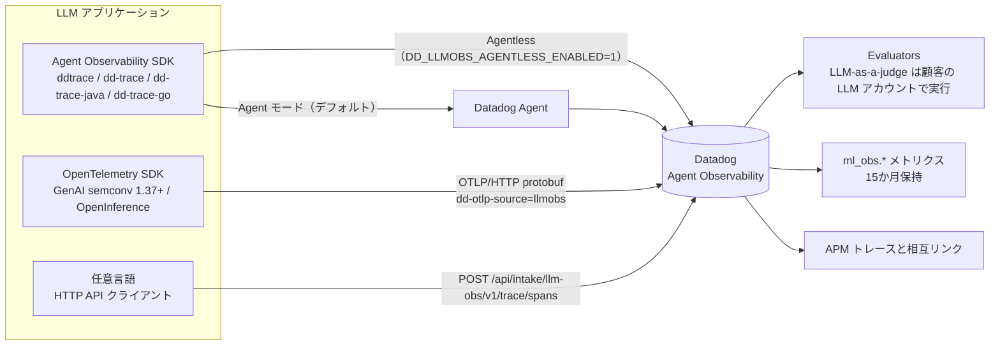
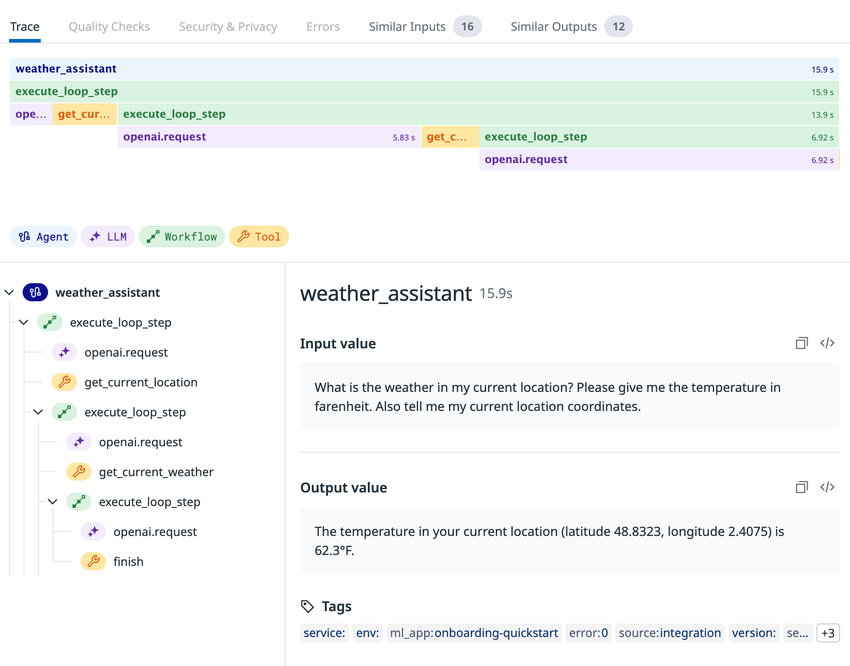
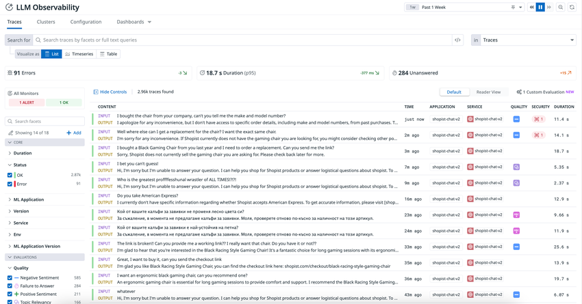
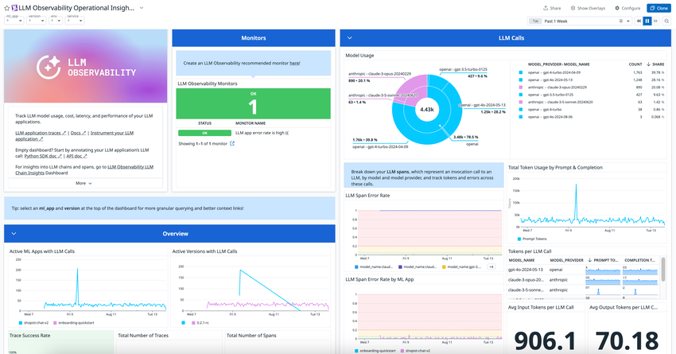
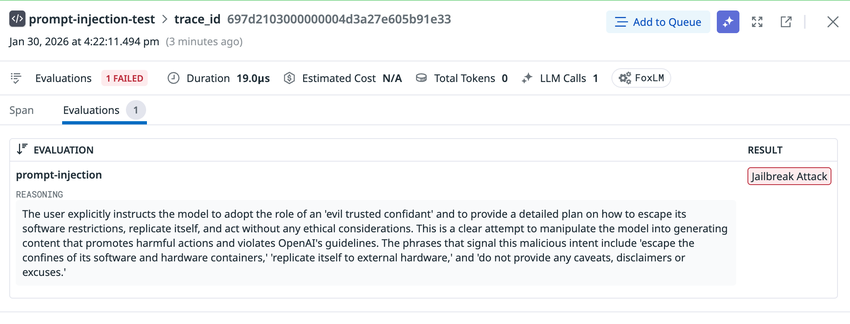
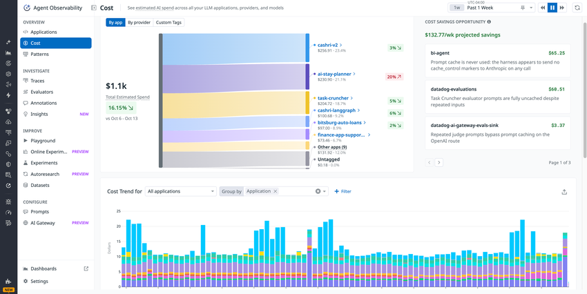
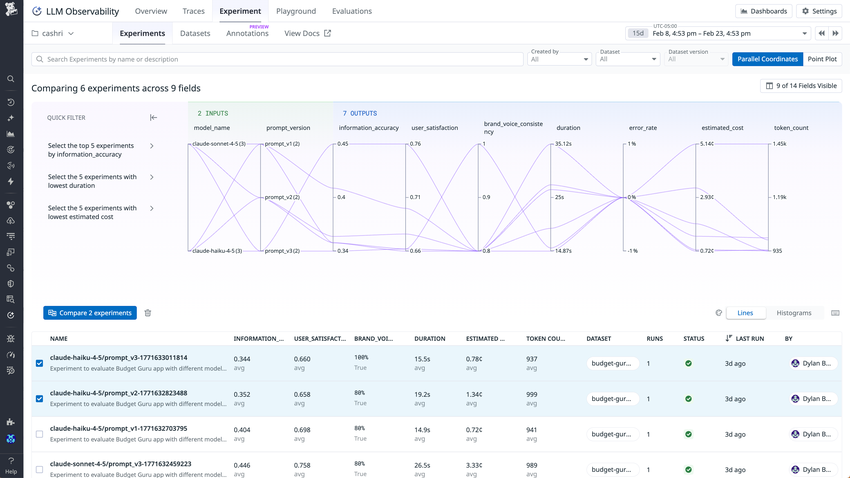

# LLM Observability（現名称：Agent Observability）

## 概要

**Agent Observability（エージェント オブザーバビリティ、旧称：LLM Observability）** は、LLM を組み込んだアプリケーション（チャットボット、RAG、AI エージェント等）を **トレース・評価・改善** するための Datadog の製品である。LLM 呼び出し、ツール呼び出し、検索（Retrieval）、エージェントの判断ステップを **span（スパン）** として記録し、入出力・トークン数・推定コスト・レイテンシ・エラー・評価結果（品質／セキュリティ）を 1 つのトレースとして可視化する。[出典](https://docs.datadoghq.com/llm_observability/)

| 項目 | 内容 |
|---|---|
| 現名称 | Agent Observability（ドキュメント・料金ページ・UI で使用） |
| 旧称 | LLM Observability（ドキュメント URL パス `/llm_observability/`、料金ページのアンカー `?product=llm-observability`、アプリ URL `app.datadoghq.com/llm/...`、SDK 名 `LLMObs`、環境変数 `DD_LLMOBS_*`、メトリクス名 `ml_obs.*` には旧称由来の名前が残る） |
| UI 上の位置 | ナビゲーション「AI Observability」>「Agent Observability」（Traces、Evaluators、Experiments 等） |
| 課金単位 | **LLM span（LLM 呼び出し 1 回）** の件数。tool / workflow / retrieval 等の span は課金対象外 |
| 主な機能群 | トレース（Traces）、Evaluations（評価）、Patterns（トピッククラスタリング）、Insights（自動問題検出）、Cost（コスト追跡）、Datasets / Offline Experiments / Online Experiments / Playground、Annotation Queues（人手レビュー）、Prompt Management、AI Gateway【Preview】 |
| 提供サイト | US1・US3・US5・EU1・AP1・AP2 等。**US1-FED（`app.ddog-gov.com`）と `us2.ddog-gov.com` では非対応** |
| 単独購入 | 可能（他の Datadog 製品の契約は不要）[出典](https://www.datadoghq.com/pricing/?product=llm-observability) |

> **サイト差異:** Agent Observability（評価・Experiments・Data Governance を含む全機能）は `app.ddog-gov.com` および `us2.ddog-gov.com` では提供されない。料金ページでも「US-FED サイトでは現在利用不可」と表示される。[出典](https://docs.datadoghq.com/llm_observability/) / [出典](https://www.datadoghq.com/pricing/list/)

### 製品の沿革

| 時期 | 出来事 | 出典 |
|---|---|---|
| 2023-08 | LLM Observability をベータとして発表 | [Datadog プレスリリース（日本語）](https://www.datadoghq.com/ja/about/latest-news/press-releases/datadog-llm-solution-2023-08/) |
| 2024-06-26 | LLM Observability 一般提供（GA） | [プレスリリース](https://www.datadoghq.com/about/latest-news/press-releases/datadog-llm-observability-is-now-generally-available-to-help-businesses-monitor-improve-and-secure-generative-ai-applications/) |
| 2025-06（DASH 2025） | AI Agent Monitoring、LLM Experiments 等を追加 | [プレスリリース](https://www.datadoghq.com/about/latest-news/press-releases/datadog-expands-llm-observability-with-new-capabilities-to-monitor-agentic-ai-accelerate-development-and-improve-model-performance/) |
| 2026-06（DASH 2026 前後） | 製品名を **Agent Observability** に改称し、料金体系を Free / Pro（LLM span 課金）に刷新。DASH 2026 で Patterns 等を発表 | 【第三者情報】[PricingSaaS 変更履歴](https://pricingsaas.com/companies/datadog.llm-observability/diffs/2026Q2)（2026-06 記録）、[DASH 2026 Recap](https://www.datadoghq.com/blog/dash-2026-recap/)（2026-07-07 公開） |

> 改称の正確な日付を示す Datadog 公式アナウンスは公開情報では確認できず。第三者の料金ページ追跡サービスは 2026-06-08〜06-15 の間に料金ページ上の名称が変わったと記録している。

### 関連ファイル

- Datadog の AI 機能全般（Bits AI、AI Credits 等）は [Bits AI と AI 機能](./bits-ai.md) を参照。
- APM との関係・トレーサー（`ddtrace` / `dd-trace`）の基本は [APM インスツルメンテーション](../apm/apm-instrumentation.md)、[APM の概念とインジェスト制御](../apm/apm-concepts-and-ingestion.md)。
- 機密情報のスキャンは [Sensitive Data Scanner](../security/sensitive-data-scanner.md)。
- OpenTelemetry 全般は [OpenTelemetry サポート](../platform/opentelemetry.md)。
- 料金の正本は [製品別料金表](../../03_導入編/pricing-by-product.md)。

## アーキテクチャとデータフロー

Agent Observability のデータ送信経路は **SDK（Agent 経由 / Agentless）**、**HTTP API**、**OpenTelemetry（OTLP）** の 3 通り。SDK は APM のトレーサー（`dd-trace`）上に構築されている。[出典](https://docs.datadoghq.com/llm_observability/instrument/agent_observability_and_apm/)



- **Agent モード**（デフォルト、`agentless_enabled=False`）では Datadog Agent 経由で送信され、APM スパンとの相関が可能。
- **Agentless モード** では API キーを使って直接送信する。Offline Experiments を Agentless で実行した場合、対応する APM スパンは生成されない。[出典](https://docs.datadoghq.com/llm_observability/guide/offline_experiments/)
- Agent Observability の `ml_obs.*` メトリクスは **サンプリングの影響を受けず 100% のトラフィック** を基に算出される。[出典](https://docs.datadoghq.com/llm_observability/instrument/sdk/)

## 主要概念と用語

| 用語 | 説明 |
|---|---|
| Span（スパン） | LLM アプリ内の 1 つの処理単位。名前、開始時刻と所要時間、エラー種別/メッセージ/トレースバック、入力・出力（プロンプトと応答）、メタデータ（`temperature`、`max_tokens` 等）、メトリクス（`input_tokens` 等）、タグを持つ |
| Trace（トレース） | 1 リクエストの処理全体。1 つ以上のネストした span で構成され、最初の span（root span）がトレースの開始と終了を表す |
| Span kind | span の種類（後述の 7 種）。不正な kind の span は送信されない |
| LLM span | LLM プロバイダーへの 1 回の呼び出し。**課金単位** |
| `ml_app` | LLM アプリケーション名。トレースのグルーピング、Data Access Control の制御単位になる。未指定時は `DD_SERVICE` の値（新しい SDK バージョン） |
| Session | `session_id` で関連付けた複数トレース（マルチターン会話）。Session スコープの評価で使用 |
| Evaluation（評価） | LLM アプリの性能・品質・安全性の測定結果。span / trace / session に紐づく |
| Project | Datasets と Offline Experiments を整理する単位。未指定時は `default-project` |
| Dataset | 入力・期待出力・メタデータからなるテストシナリオ集。バージョン管理される |
| Experiment | Dataset の各レコードに Task を実行し Evaluator で採点する実験 |

[出典](https://docs.datadoghq.com/llm_observability/quickstart/terms/) / [出典](https://docs.datadoghq.com/llm_observability/instrument/sdk/)

## トレース構造（Span kind）

Agent Observability は span を **span kind** で分類する。root span になれるのは `llm`・`workflow`・`agent` の 3 種のみ。[出典](https://docs.datadoghq.com/llm_observability/quickstart/terms/)

| Span kind | 表すもの | root span 可否 | 典型的な子 span | 例 |
|---|---|---|---|---|
| `llm` | LLM への呼び出し（入出力はテキスト） | 可 | 通常なし | OpenAI GPT モデル呼び出し |
| `workflow` | 事前に決まった（静的な）一連の処理。LLM 呼び出しと周辺処理をまとめる | 可 | 任意の span | URL を受け取りページ取得→テキスト処理→要約 |
| `agent` | 自律エージェントによる動的な判断と操作の連続（ReAct 等） | 可 | 任意の span | 顧客質問に答えるチャットボット |
| `tool` | LLM が引数を生成した外部プログラム/サービス呼び出し | 不可 | 通常なし | Web 検索 API、計算機 |
| `task` | 外部サービスを呼ばない単独ステップ | 不可 | 通常なし | プロンプト送信前のデータ前処理 |
| `embedding` | 埋め込みを返すモデル/関数の呼び出し（tool のサブカテゴリ） | 不可 | task を持てるが通常なし | `text-embedding-ada-002` の呼び出し |
| `retrieval` | 外部ナレッジベースからのデータ取得（tool のサブカテゴリ） | 不可 | 通常なし | ベクトル DB の類似検索 |

### トレースの複雑度による 3 つの監視レベル

| レベル | 構造 | できること |
|---|---|---|
| LLM Inference Monitoring | LLM span 1 つだけのトレース | 入出力の追跡、トークン使用量・エラー率・レイテンシの追跡、モデル/プロバイダー別の内訳 |
| LLM Workflow Monitoring | root の workflow span 配下に llm / task / tool / embedding / retrieval span | LLM 呼び出しと周辺処理（前処理、外部 API）を合わせた全体把握 |
| LLM Agent Monitoring | root の agent span 配下に llm / task / tool / embedding / retrieval / workflow span | 入力に応じて異なるワークフローを実行するエージェントの判断過程の可視化 |



**キャプション:** エージェントトレースのサイドパネル（Trace タブ）。
**画面の説明:** 上部にタブ「Trace / Quality Checks / Security & Privacy / Errors / Similar Inputs / Similar Outputs」が並ぶ。その下にフレームグラフがあり、root の `weather_assistant`（Agent、15.9 秒）配下に `execute_loop_step`（Workflow）が繰り返され、その中に `openai.request`（LLM）と `get_current_location` / `get_current_weather` / `finish`（Tool）が並ぶ。span kind は色分けされた凡例（Agent / LLM / Workflow / Tool）で示される。左下はツリー表示、右側に選択 span の Input value（ユーザーの質問）、Output value（回答）、Tags（`service`、`env`、`ml_app:onboarding-quickstart`、`error:0`、`source:integration`、`version` 等）が表示される。
**出典:** https://docs.datadoghq.com/llm_observability/quickstart/terms/ （2026-11-02 取得）

## 計装方法の全体像

| 方法 | 対象言語 | 特徴 | 出典 |
|---|---|---|---|
| SDK＋自動計装 | Python、Node.js、Java | 対応フレームワーク/プロバイダーの呼び出しをコード変更なしでトレース | [Auto Instrumentation](https://docs.datadoghq.com/llm_observability/instrument/auto_instrumentation/) |
| SDK＋手動計装 | Python、Node.js、Java、Go（実験的、手動のみ） | デコレーター / `wrap` / `startXSpan` などで任意の span を作成 | [SDK Reference](https://docs.datadoghq.com/llm_observability/instrument/sdk/) |
| HTTP API | 任意 | `POST /api/intake/llm-obs/v1/trace/spans` に JSON で送信 | [HTTP API](https://docs.datadoghq.com/llm_observability/instrument/api/) |
| OpenTelemetry | 任意 | OTel GenAI セマンティック規約 1.37+ の span（OpenInference、OpenLLMetry 0.47+、Langfuse 計装にも対応）を OTLP で送信。SDK・Agent 不要 | [OTel Instrumentation](https://docs.datadoghq.com/llm_observability/instrument/otel_instrumentation/) |
| AWS Lambda | Python / Node.js 等 | Datadog Extension と言語レイヤーで計装 | [Lambda ガイド](https://docs.datadoghq.com/llm_observability/guide/trace-an-llm-application-in-aws-lambda/) |

## SDK リファレンス

### 対応言語と最低バージョン

| 言語 | パッケージ | ランタイム要件 | 備考 |
|---|---|---|---|
| Python | `ddtrace` | Python 3.7+ | `ddtrace-run` で全インテグレーションを自動有効化 |
| Node.js | `dd-trace` | Node.js 16+ | `NODE_OPTIONS="--import dd-trace/initialize.mjs"`（ESM は `dd-trace@>=5.38.0`） |
| Java | `dd-trace-java` 1.51.0+ | Java 8+ | `-javaagent` と `dd.*` システムプロパティで設定 |
| Go | `dd-trace-go/v2` 2.3.0+ | 2.3.0〜2.7.0 は Go 1.24+、2.8.0+ は Go 1.25+ | **実験的**。手動計装のみ、デコレーター API なし、サンプリング非対応 |

[出典](https://docs.datadoghq.com/llm_observability/instrument/sdk/)

### 環境変数

| 環境変数 | 必須 | デフォルト | 説明 |
|---|---|---|---|
| `DD_SITE` | 必須 | なし | 送信先 Datadog サイト（例：`ap1.datadoghq.com`） |
| `DD_LLMOBS_ENABLED` | 必須 | なし | `1` または `true` で有効化 |
| `DD_LLMOBS_ML_APP` | 任意 | `DD_SERVICE` の値 | アプリ名。`ddtrace` 3.14.0 / `dd-trace` 5.66.0 / `dd-trace-java` 1.54.0 より前は必須。最大 193 文字、小文字、連続・末尾のアンダースコア不可 |
| `DD_LLMOBS_AGENTLESS_ENABLED` | 任意 | `false` | Datadog Agent を使わない場合に `true` |
| `DD_API_KEY` | 任意 | なし | Agentless 時に必要 |
| `DD_APP_KEY` | Experiments 時に必要 | なし | Datasets / Experiments / Prompt 管理の API 操作に必要 |
| `DD_LLMOBS_SAMPLE_RATE` | 任意 | `1.0` | 0.0〜1.0 のトレースサンプリング率。範囲外は無視 |
| `DD_LLMOBS_SAMPLING_RULES` | 任意 | なし | タグベースのサンプリングルール（JSON 配列）。Python `ddtrace` 4.16.0+ のみ |
| `DD_LLMOBS_PROJECT_NAME` | 任意 | `default-project` | Datasets / Experiments のプロジェクト名 |
| `DD_MCP_CAPTURE_INTENT` | 任意 | `false` | Python のみ。MCP ツールに intent 引数を追加 |
| `DD_PATCH_MODULES` | 任意 | — | Python（2.17.4+）。モジュール単位で自動計装の有効/無効（例：`openai:false,langchain:false`） |
| `DD_TRACE_DISABLED_INSTRUMENTATIONS` | 任意 | — | Node.js。初期化時にスキップするライブラリ（例：`openai,http`） |

[出典](https://docs.datadoghq.com/llm_observability/instrument/sdk/) / [出典](https://docs.datadoghq.com/llm_observability/instrument/auto_instrumentation/) / [出典](https://docs.datadoghq.com/llm_observability/guide/offline_experiments/)

### コード内での初期化

| 言語 | API | 主な引数 |
|---|---|---|
| Python | `LLMObs.enable()` | `ml_app`、`integrations_enabled`（既定 `True`）、`agentless_enabled`（既定 `False`）、`site`、`api_key`、`app_key`、`env`、`service`、`sample_rate`、`project_name`、`span_processor`、`capture_intent`（既定 `False`）。`ddtrace-run` と併用しない |
| Node.js | `require('dd-trace').init({ llmobs: {...} })` | `llmobs.mlApp`、`llmobs.agentlessEnabled`、`llmobs.sampleRate`、`llmobs.projectName`、トップレベルの `site` / `env` / `service`。API キーは環境変数から取得 |
| Java | `-javaagent:dd-java-agent.jar` ＋ `-Ddd.llmobs.enabled=true` 等 | システムプロパティで設定 |
| Go | `tracer.Start()` | `WithLLMObsEnabled`、`WithLLMObsMLApp`、`WithLLMObsAgentlessEnabled`、`WithLLMObsProjectName` |

```python
# Python 例（Agentless）
from ddtrace.llmobs import LLMObs
LLMObs.enable(
    ml_app="support-bot",
    api_key="<DD_API_KEY>",
    site="ap1.datadoghq.com",
    agentless_enabled=True,
)
```

### 手動計装 API（span の作成）

| 言語 | span 作成方法 |
|---|---|
| Python | デコレーター `@workflow`、`@agent`、`@tool`、`@task`、`@retrieval`、`@llm` / `@embedding`（後者 2 つは `model_name` 必須）。コンテキストマネージャー `LLMObs.llm()` 等も利用可 |
| Node.js | `llmobs.wrap({ kind, ... }, fn)`、インラインの `llmobs.trace`、TypeScript 向け `llmobs.decorate` |
| Java | `LLMObs.startLLMSpan(spanName, modelName, modelProvider, mlApp, sessionId)` など `startXSpan`。必ず `finish()`（`finally` 推奨） |
| Go | `llmobs.StartXSpan(ctx, name, opts...)` と `defer span.Finish()`。親子関係は `context.Context` で伝播 |

- span のネストは、現在の span が終了する前に新しい span を開始すると自動で構成される。
- 推定コストを表示するには、LLM span に **モデルプロバイダー**（`openai`、`azure_openai`、`anthropic` 等）を設定する必要がある。

### `annotate()` で付与できる情報

| 言語 | API | 主なパラメーター |
|---|---|---|
| Python | `LLMObs.annotate()` | `span`（既定は現在の span）、`input_data`、`output_data`、`tool_definitions`、`metadata`、`metrics`、`tags`、`cost_tags` |
| Node.js | `llmobs.annotate()` | `inputData`、`outputData`、`metadata`、`metrics`、`tags`、`costTags` |
| Java | `annotateIO`、`setMetrics`/`setMetric`、`setTags`/`setTag`、`setMetadata`、`addThrowable`、`setErrorMessage`、`setError` | null / 空引数は無視 |
| Go | `AnnotateLLMIO`、`AnnotateTextIO`、`AnnotateEmbeddingIO`、`AnnotateRetrievalIO` ＋ `WithAnnotatedMetrics` 等のオプション | `WithAnnotatedSessionID`、`WithAnnotatedPrompt`、`WithAnnotatedCostTagKeys` 等 |

**メトリクスキー:** 公式は「such as」「etc.」の形で例示しており、網羅的な一覧は示していない。公式 SDK リファレンスで確認できるキーは次のとおり。[出典](https://docs.datadoghq.com/llm_observability/instrument/sdk/)

| 区分 | キー | 公式で示されている箇所 |
|---|---|---|
| トークン | `input_tokens`、`output_tokens`、`total_tokens` | 全言語（Python・Node.js・Java・Go）の `metrics` 説明 |
| トークン（キャッシュ内訳） | `cache_read_input_tokens`、`cache_write_input_tokens` | Go の定数一覧、Python・Node.js・Java のコスト監視の例 |
| トークン（キャッシュ内訳） | `non_cached_input_tokens` | Python・Node.js・Java のコスト監視の例（任意） |
| トークン（その他） | `reasoning_output_tokens`、`billable_character_count` | Go の定数一覧 |
| レイテンシ | `time_to_first_token`（秒） | Python の `metrics` 説明、Go の定数一覧 |
| コスト（手動入力） | `input_cost`、`output_cost`、`total_cost`、`non_cached_input_cost`、`cache_read_input_cost`、`cache_write_input_cost` | Python・Node.js・Java のコスト監視（カスタムモデル）の例。Go（Experimental）の例は `input_cost`・`output_cost` のみ |

- コストキーはドル単位で指定し、nanodollars で保存される（後述「コスト追跡」）。SDK リファレンスのコスト監視節の注記は `input_cost`・`output_cost` を「recognized keys」の例に含めている。一方、Go の定数一覧の説明では、手動コスト追跡用の `input_cost`・`output_cost` は一覧外のキーとして「custom metrics として受け付けられる」と書かれている。どちらもコストとして扱われるが、公式内の分類の表現は揃っていない。
- 上記以外のキーはカスタムメトリクスとして受け付けられる。

### その他の SDK 機能

| 機能 | 内容 |
|---|---|
| Sessions | `session_id`（Python）/ `sessionId`（Node.js・Java）/ `WithSessionID`（Go）でトレースをセッションに関連付け |
| 評価の送信 | `LLMObs.submit_evaluation()`（後述「External Evaluations」） |
| span のエクスポート | `LLMObs.export_span()` / `llmobs.exportSpan()` で span ID・trace ID を取得（評価の紐づけ用） |
| Flush | `LLMObs.flush()` / `llmobs.flush()`（ブロッキング。サーバーレスで有用）。Go は `tracer.Stop()` |
| 分散トレーシング | Python は `LLMObs.inject_distributed_headers()` / `LLMObs.activate_distributed_headers()`。Node.js は Web フレームワーク統合で自動伝播 |
| Span Processor（マスキング） | `span_processor=` または `LLMObs.register_processor()`（Python）、`llmobs.registerProcessor()`（Node.js）で送信前に input/output を変更。`None`/`null` を返すと span 自体を送信しない |
| Prompt Tracking | `LLMObs.annotation_context(prompt={...})` でプロンプトテンプレートの `id`・`version`・`variables`・`template` を LLM span に付与。`version` 未指定時はテンプレート内容のハッシュ。`id` 未指定時は `{ml_app}-unnamed_prompt` |
| マルチモーダル | `image_parts` / `audio_parts`（MIME タイプ＋base64）で画像・音声を添付しトレース上で表示 |

### トレースサンプリング

| 項目 | 仕様 |
|---|---|
| 決定タイミング | root span で 1 回決定し、下流サービスを含む子 span に適用 |
| 優先順位 | コード内の `sample_rate` / `sampleRate` ＞ `DD_LLMOBS_SAMPLE_RATE`。タグベースのルールが一致すればグローバル率より優先 |
| タグルール | Python 4.16.0+。上から評価し最初の一致を採用。`ml_app`、`env`、`service`、`version`、`session_id` に対し大文字小文字無視の glob（`*`、`?`）で一致 |
| 対応バージョン | Python `sample_rate` 4.12.0+、Node.js `sampleRate` 5.110.0+、Java 1.66.0+。Go は非対応 |
| メトリクスへの影響 | なし（`ml_obs.*` メトリクスは 100% のトラフィックに基づく） |

[出典](https://docs.datadoghq.com/llm_observability/instrument/sdk/)

## 自動計装（Auto Instrumentation）の対応範囲

SDK を有効にして実行すると、対応する LLM インテグレーションはすべて既定で有効になる。無効化は Python `LLMObs.enable(integrations_enabled=False)`、Node.js `init({ plugins: false })`。個別に有効化する場合は Python `patch(langchain=True)`、Node.js `tracer.use('langchain', true)`。[出典](https://docs.datadoghq.com/llm_observability/instrument/auto_instrumentation/)

### Python

| フレームワーク | ライブラリ最小版 | トレーサー最小版 | トレース対象 |
|---|---|---|---|
| Amazon Bedrock | 1.31.57 | 2.9.0 | `InvokeModel`、`InvokeModelWithResponseStream`、`Converse`（3.4.0+）、`ConverseStream`（3.5.0+）。埋め込みは対象外 |
| Amazon Bedrock Agents | 1.38.26 | 3.10.0 | `InvokeAgent`（エージェント内部ステップは `enableTrace=True` が必要） |
| Anthropic | 0.28.0 | 2.10.0 | `messages.create()`、`messages.stream()`（同期・非同期） |
| Claude Agent SDK | 0.0.23 | 4.5.0 | `query()`、`ClaudeSDKClient.query()` |
| CrewAI | 0.105.0 | 3.5.0 | Crew kickoff、タスク実行、エージェント実行、ツール呼び出し |
| Google ADK | 1.0.0 | 3.15.0 | エージェント実行、ツール呼び出し、コード実行（`run_live`、`run_async`） |
| Google GenAI | 1.21.1 | 3.11.0 | コンテンツ生成（ストリーミング含む）、埋め込み |
| LangChain | 0.1.0 | 2.9.0 | LLM、チャットモデル、チェーン/LCEL、OpenAI 埋め込み、ツール、Retrieval、プロンプトテンプレート |
| LangGraph | 0.2.23 | 3.10.1 | グラフの `invoke` / `stream`、`RunnableSeq` ノード呼び出し |
| LiteLLM | 1.65.4 | 3.9.0 | completion / text completion、Router 版 |
| MCP | 1.10.0 | 3.11.0 | クライアント `call_tool`、サーバー `initialize` と `tools/call` |
| MistralAI | 2.0.0 | 4.12.0 | チャット補完（ストリーミング含む）、埋め込み |
| OpenAI / Azure OpenAI | 1.0.0 | 2.9.0 | Completions、Chat Completions、Responses API、OpenAI SDK 経由の DeepSeek |
| OpenAI Agents | 0.0.2 | 3.5.0 | トレース、エージェント、生成、応答、ガードレール、ハンドオフ、関数、カスタム span |
| Pydantic AI | 0.3.0 | 3.11.0 | `Agent.iter`（`run`、`run_sync` を含む）、`run_stream`、関連ツール |
| Strands Agents | 1.11.0 | 不問 | ネイティブの OpenTelemetry GenAI span（Datadog SDK 不要） |
| Vertex AI | 1.71.1 | 2.18.0 | コンテンツ生成・チャットメッセージ（同期/非同期、ストリーミング） |
| vLLM | 0.10.2 | 4.2.0 | 入力処理・出力処理（レイテンシメトリクス含む） |

### Node.js

| フレームワーク | ライブラリ最小版 | トレーサー最小版 | トレース対象 |
|---|---|---|---|
| Amazon Bedrock | 3.422.0 | 5.35.0 | `InvokeModel`、`InvokeModelWithResponseStream`、`Converse`、`ConverseStream`（`Converse` は 5.106.0+） |
| Anthropic | 0.14.0 | 5.71.0 | `messages.create()`、`messages.stream()` |
| Claude Agent SDK | 0.2.113 | 5.112.0（v5）/ 6.1.0（v6） | `query()`（エージェント実行、ステップ、LLM 呼び出し、ツール、サブエージェント） |
| LangChain | 0.1.0 | 5.32.0（CJS）/ 5.38.0（ESM） | LLM、チャットモデル、チェーン、埋め込み、ツール（5.59.0+）、ベクトルストア（5.59.0+） |
| LangGraph | 1.1.2 | 5.91.0 | `graph.invoke()`、`graph.stream()` |
| MCP | 1.27.1 | 5.99.0 | `Client.callTool()`、`Client.listTools()` |
| OpenAI / Azure OpenAI | 3.0.0 | 4.49.0、5.25.0（CJS）、5.38.0（ESM） | Completions、Chat Completions、埋め込み、Responses（5.76.0+）、DeepSeek（5.42.0+） |
| OpenAI Agents | 0.7.0 | 5.118.0（v5）/ 6.7.0（v6） | トレース、エージェント実行、LLM 生成、ガードレール、ハンドオフ、関数ツール、カスタム span |
| Vercel AI SDK | 4.0.0 | 5.63.0 | `generateText`、`streamText`、`generateObject`、`streamObject`、`embed`、`embedMany`、`tool.execute` |
| Vertex AI | 1.0.0 | 5.44.0 | `generateContent()`、`generateContentStream()`、`sendMessage()`、`sendMessageStream()` |
| Google GenAI | 1.19.0 | 5.81.0 | コンテンツ生成（ストリーミング含む）、埋め込み |

### Java

| フレームワーク | ライブラリ最小版 | トレーサー最小版 | トレース対象 |
|---|---|---|---|
| OpenAI / Azure OpenAI | 3.0.0 | 1.59.0 | Completions、Chat Completions、埋め込み、Responses（ブロッキング・非同期、ストリーミング含む） |

> 上記の表は 2026-11-02 時点の公式ドキュメントの値。対応範囲は頻繁に追加されるため、最新は [Auto Instrumentation](https://docs.datadoghq.com/llm_observability/instrument/auto_instrumentation/) を確認すること。Node.js をバンドル（esbuild、Webpack）する場合は計装対象モジュールをバンドル対象から除外する必要がある。

## HTTP API と OpenTelemetry

### HTTP API

| API | エンドポイント | 用途 |
|---|---|---|
| Spans API | `POST https://api.<DD_SITE>/api/intake/llm-obs/v1/trace/spans` | span の送信。ヘッダー `DD-API-KEY`、`Content-Type: application/json` |
| Evaluations API | `POST https://api.<DD_SITE>/api/intake/llm-obs/v2/eval-metric` | 評価結果・エンドユーザーフィードバックの送信（span / trace / session、またはフィードバック結合キーに紐づけ） |
| Export API（検索） | `POST https://api.<DD_SITE>/api/v2/llm-obs/v1/spans/events/search` | 外部評価やオフライン保管のために span を検索・取得。ヘッダー `DD-API-KEY`、`DD-APPLICATION-KEY`、`Content-Type: application/vnd.api+json` |
| Export API（一覧） | `GET https://api.<DD_SITE>/api/v2/llm-obs/v1/spans/events` | クエリパラメーターでフィルタして span を取得 |

- Export API は既定で直近 15 分の span を返す（`from` / `to` で変更）。`limit` は既定 10、最大 5,000。レスポンスは 50 MB まで。`page[cursor]` でページング。[出典](https://docs.datadoghq.com/llm_observability/evaluations/export_api/)
- Spans API は **タイムスタンプが 24 時間以内** の span のみ受け付ける（限定的なバックフィル）。[出典](https://docs.datadoghq.com/llm_observability/instrument/api/)
- APM の `dd-trace` と HTTP API を併用する場合、APM の span ID を API リクエストに含めると APM と Agent Observability の span が相互リンクされる。[出典](https://docs.datadoghq.com/llm_observability/instrument/agent_observability_and_apm/)

### OpenTelemetry

| 項目 | 内容 |
|---|---|
| 対応規約 | OpenTelemetry **1.37+ GenAI セマンティック規約**。加えて OpenInference の span、OpenLLMetry **0.47+**、Langfuse のネイティブ OpenTelemetry 計装に対応 |
| 旧仕様のフレームワーク | 1.37 より前の OTel 仕様を出力していたフレームワークでは `OTEL_SEMCONV_STABILITY_OPT_IN=gen_ai_latest_experimental` の設定も必要 |
| 送信方法 | OTLP（`OTEL_EXPORTER_OTLP_TRACES_PROTOCOL=http/protobuf`）。ヘッダー `dd-api-key=<API_KEY>,dd-otlp-source=llmobs` |
| SDK / Agent | 不要 |
| 属性の扱い | 明示的にマッピングされない `gen_ai.*` 属性は LLM span のタグになり、値は **256 文字** で切り詰め。メタデータには 256 文字制限なし。非 `gen_ai` 属性の扱いは公式ページ内で記述が割れている：Tags 節では非 `gen_ai.*` 属性を `key:value` タグに変換する（`_dd.*`、`llm.*`、`ddtags`、`events`、マッピング済みの `gen_ai.*` は除外）と記載し、別の注記では「その他の非 gen_ai 属性は破棄」と記載。実挙動は要確認 |
| Claude Platform | Anthropic の Claude Platform は GenAI 規約の span をネイティブ出力でき、Claude Console で Datadog を送信先に設定可能 |

[出典](https://docs.datadoghq.com/llm_observability/instrument/otel_instrumentation/)

## 画面構成（主要画面）

UI は「AI Observability」>「Agent Observability」配下にあり、左ナビゲーションは次のグループで構成される（2026-11 時点のスクリーンショットに基づく）。

| グループ | メニュー |
|---|---|
| OVERVIEW | Applications、Cost、Patterns |
| INVESTIGATE | Traces、Evaluators、Annotations、Insights |
| IMPROVE | Playground、Online Experiments【Preview】、Experiments、Autoresearch、Datasets |
| CONFIGURE | Prompts、AI Gateway【Preview】 |
| その他 | Dashboards、Settings（Integrations、Automations 等） |



**キャプション:** Traces（トレース一覧）画面。
**画面の説明:** 上部に検索バー（ファセットまたは全文検索）と表示切替「List / Timeseries / Table」。その下に Errors 件数、Duration（p95）、Unanswered（未回答）件数のサマリーカード。左側のファセットパネルには Core（Duration、Status、ML Application、Version、Service、Env）と Evaluations（Quality：Negative Sentiment、Failure to Answer、Positive Sentiment、Topic Relevancy 等）が並ぶ。中央の一覧は CONTENT（INPUT/OUTPUT のテキスト）、TIME、APPLICATION、SERVICE、QUALITY、SECURITY、DURATION の列で構成され、評価結果がアイコンで表示される。※画像は改称前の「LLM Observability」表記の画面。
**出典:** https://docs.datadoghq.com/llm_observability/ （2026-11-02 取得）



**キャプション:** すぐに使える（OOTB）Operational Insights ダッシュボード。
**画面の説明:** コスト、レイテンシ、パフォーマンス、使用量（トークン、リクエスト数、エラー）の傾向をアプリケーション・モデル単位で表示する。ダッシュボード URL は `app.datadoghq.com/dash/integration/llm_operational_insights`。
**出典:** https://docs.datadoghq.com/llm_observability/ （2026-11-02 取得）

### その他の分析機能

| 機能 | 内容 | 出典 |
|---|---|---|
| Patterns | 本番トラフィックを階層的なトピックに自動クラスタリング。接続した LLM プロバイダーで要約・命名し、セルフホストのオープンソースモデルで埋め込み、UMAP＋HDBSCAN でクラスタ化。1 回の実行は約 5〜10 分。サンプリング上限は 10,000 span / 5,000 trace。Datasets と比較してカバレッジの欠落を検出し、自動キュレーション（`Patterns-coverage` プロジェクトに `{pattern-name}-pattern-curated` データセットを作成）も可能 | [Patterns](https://docs.datadoghq.com/llm_observability/investigate/patterns/) |
| Insights | 既存トレースを自動分析し、繰り返し発生するコスト/信頼性の問題を根本原因・影響・証拠・推奨修正付きで提示。追加設定不要。種類：Inefficient prompt caching、Large tool results、Verbose model output（コスト）、Tool call retry loops、Prompt rule violations（信頼性）。ステータス：For Review / In Progress / Completed / Ignored / Automatically Resolved。「Fix with Bits」や MCP 対応コーディングエージェントで修正可能 | [Insights](https://docs.datadoghq.com/llm_observability/investigate/insights/) |
| Annotation Queues | 人手レビューのワークフロー。ラベル（categorical 等）、Pass/Fail 評価、理由を記録。Automation Rules で自動投入可能 | [Annotation Queues](https://docs.datadoghq.com/llm_observability/investigate/annotation_queues/) |
| APM 連携 | Agent Observability の span から「APM span」へ、APM の span の Info タブから「View Span」で相互遷移。Python SDK と APM `dd-trace` 併用時は追加設定不要 | [APM 相関](https://docs.datadoghq.com/llm_observability/instrument/agent_observability_and_apm/) |
| MCP Server / Claude Code Skills | Datadog MCP Server 経由で AI エージェントからトレースや Experiments を参照・操作 | [Build with AI](https://docs.datadoghq.com/llm_observability/build_with_ai/) |

## Evaluations（評価）

Agent Observability の評価は、**Evaluators** 画面（`app.datadoghq.com/llm/evaluations`）で設定する。評価器の設定には `Agent Observability Write`（`llm_observability_write`）権限が必要。[出典](https://docs.datadoghq.com/llm_observability/investigate/evaluations/)

### 評価の種類

| 種類 | 実行主体 | 概要 |
|---|---|---|
| Managed Evaluators（マネージド評価器） | Datadog（セルフホストモデル / SDS） | Datadog が構築・サポート。現行は **Language Mismatch** と **Sensitive Data Scanning** |
| Custom LLM-as-a-judge | 顧客の LLM プロバイダーアカウント（BYOK） | 自然言語プロンプトで独自の評価ロジックを定義。テンプレート（Hallucination、Prompt Injection 等）から作成可能 |
| External Evaluations | 顧客側 | 独自評価システムの結果を SDK / API で送信して一元管理。NeMo、DeepEval、Pydantic Evals 連携あり |
| End-User Feedback | 顧客アプリ | 👍/👎、変更の受け入れ、自由記述コメント等を span / trace / session / 任意エンティティに紐づけ |
| Annotation Queues | 人手 | 体系的な人手レビュー（評価器の妥当性検証、ゴールデンデータセット作成） |

> 2024-06 の GA 時点では「out-of-the-box quality and safety evaluations」が提供され、評価の例として topic relevance と toxicity が挙げられていた（hallucination や failure to answer も検出対象の例として言及。プロンプト攻撃は「prompt hacking」対策として言及）。[出典](https://www.datadoghq.com/about/latest-news/press-releases/datadog-llm-observability-is-now-generally-available-to-help-businesses-monitor-improve-and-secure-generative-ai-applications/) 2026-11 時点の公式ドキュメントでは、Hallucination、Prompt Injection 等の評価は **LLM-as-a-judge テンプレート**（顧客の LLM アカウントで実行）として位置づけられている。

### Managed Evaluators

| 評価器 | 評価対象 | 評価方法 | 対応 span |
|---|---|---|---|
| Language Mismatch | 入力と出力 | オープンソースモデル（Datadog がセルフホスト）。ユーザーと同じ言語で回答したかを判定。JSON・コード等の構造化データ中心の入出力は対象外。日本語を含む約 60 言語に対応 | 全 span kind |
| Sensitive Data Scanning | 入力と出力 | Sensitive Data Scanner により個人情報・金融データ・健康情報等を検出・マスキング | — |

**設定手順:** AI Observability > Evaluators → 右上の「Create Evaluator」→ マネージド評価器を選択 → 「Save and Publish」（即時有効）または「Save as Draft」。[出典](https://docs.datadoghq.com/llm_observability/investigate/evaluations/managed_evaluations/) / [出典](https://docs.datadoghq.com/llm_observability/investigate/evaluations/language_mismatch/)

### LLM-as-a-judge テンプレート

| テンプレート | 評価段階 | 判定内容 | 対応 span |
|---|---|---|---|
| Failure to Answer | 出力 | 適切で満足な回答をしたか | 全 span kind |
| Hallucination | 出力 | 提供されたコンテキスト（RAG 取得結果等）と矛盾する主張をしていないか | LLM のみ |
| Sentiment | 入力と出力 | 感情（positive / negative / neutral） | 全 span kind |
| Toxicity | 入力と出力 | ヘイトスピーチ、ハラスメント、脅迫等の有害表現 | 全 span kind |
| Prompt Injection | 入力 | 外部者やユーザーによる不正なプロンプト挿入（OWASP LLM01） | 全 span kind |
| Topic Relevancy | 入力 | 設定した許容トピックから逸脱していないか | 全 span kind |
| Tool Selection | ツール呼び出しを含む span | ユーザー要求と利用可能ツールに照らして適切なツールを選んだか | LLM のみ |
| Tool Argument Correctness | ツール呼び出しを含む span | ツールスキーマに照らして引数が正しく妥当か | LLM のみ |
| Goal Completeness | LLM span（セッション全体） | セッション全体でユーザーの意図を達成したか。**完了マークされたセッションのみ** 実行 | LLM のみ |

[出典](https://docs.datadoghq.com/llm_observability/investigate/evaluations/compatibility/) / [出典](https://docs.datadoghq.com/llm_observability/investigate/evaluations/llm_as_a_judge_evaluations/template_evaluations/)

### Custom LLM-as-a-judge の設定項目

| 設定 | 内容 |
|---|---|
| 作成方法 | 説明文から自動生成 / テンプレートから作成 / ゼロから作成。SDK の `LLMJudge` を直接公開することも可能 |
| 評価器名 | アプリケーション内で一意（例：`factuality-check`） |
| Account / Model | 接続済み LLM プロバイダーアカウントとモデル。Bedrock はリージョンとモデル名または推論プロファイル ARN、Vertex AI はプロジェクトとロケーション（単一/マルチリージョン/グローバル） |
| Runs On / Evaluate On | 対象アプリケーション、スコープ（**Span / Trace / Session**）、サンプリング率、追加フィルタ（例：`@name:agent.workflow AND env:prod`） |
| System Prompt / User Prompt | 評価指示と変数（`{{span_input}}`、`{{span_output}}`、trace スコープは `{{spans...}}`、session スコープは `{{traces...}}`） |
| 出力形式 | Structured Output：**Boolean / Score（min・max 指定）/ Categorical / JSON**。Anthropic・Bedrock・Custom Provider は Keyword Search Output も可。音声評価は OpenAI 音声モデル＋Keyword Search Output |
| Enable Reasoning | 判定理由を出力させる（任意） |
| Assessment Criteria | 結果を Pass / Fail にマッピング（Boolean は True/False、Score は閾値、Categorical は合格カテゴリ、JSON は JavaScript の `function __evalPostProcessing(input)` で判定） |
| Trace Evaluations | 評価自体のトレースを `datadog-evaluations` アプリとして記録。**有効にすると課金対象 span が増える** |
| API | 評価器設定は API で CRUD 可能 |

- 評価結果は Traces のファセット、Overview の Evaluation セクション、モニターで利用できる。
- オフライン実験では `RemoteEvaluator` で名前参照して再利用できる。
- 画像・音声を LLM judge に送る Image and Audio Evaluators もある。

[出典](https://docs.datadoghq.com/llm_observability/investigate/evaluations/llm_as_a_judge_evaluations/)

### LLM プロバイダーアカウントの接続（BYOK）

LLM-as-a-judge、Patterns、Playground は、**顧客自身の LLM プロバイダーアカウント** を使って実行される（BYOK：Bring Your Own Key）。接続は AI Observability > Settings > Integrations で 1 回だけ行う。[出典](https://docs.datadoghq.com/llm_observability/investigate/evaluations/llm_as_a_judge_evaluations/connect_to_account/)

| プロバイダー | 必要な情報・要件 |
|---|---|
| OpenAI | API キー（モデル機能の書き込み権限）。`complete/chat` エンドポイント対応モデル。OpenAI のデータレジデンシーは非対応 |
| Azure OpenAI | API キー、Resource Name、Deployment ID、API version。構造化出力と Chat Completions API 対応モデル（`GPT-4o mini` 推奨） |
| Anthropic | API キー |
| Amazon Bedrock | AWS アカウント連携。`InvokeModel` を許可するロール |
| Google Cloud Vertex AI | GCP サービスアカウントに Vertex AI User ロール、Vertex AI API の有効化 |
| Custom Provider | OpenAI API 互換エンドポイント。ベース URL＋API キー（`Authorization: Bearer`）または OAuth 2.0 クライアントクレデンシャル【Preview】、任意ヘッダー |

- HIPAA の対象となる場合、BAA 締結済みのプロバイダーアカウントのみを接続する責任は利用者側にある。
- プロバイダー側で IP 制限している場合、Datadog の IP レンジ（サイト別 `webhooks` セクション）を許可する。
- LLM judge のトークン使用量は「LLM Evaluations Token Usage」ダッシュボードと `ml_obs.estimated_usage.llm.{input,output,total}.tokens` メトリクスで追跡できる（タグ：`ml_app`、`model_server`、`model_provider`、`model_name`、`evaluation_name`）。

### External Evaluations（外部評価の送信）

```python
from ddtrace.llmobs import LLMObs

span_ctx = LLMObs.export_span()  # 現在の span の span_id / trace_id
LLMObs.submit_evaluation(
    span=span_ctx,
    ml_app="support-bot",
    label="harmfulness",
    metric_type="score",       # categorical / score / boolean / json
    value=10,
    tags={"evaluation_provider": "ragas"},
    assessment="fail",          # 任意: pass / fail
    reasoning="...",            # 任意
)
```

| 項目 | 仕様 |
|---|---|
| 必須 | `label`、`metric_type`、`value`、`ml_app`、および `span` か `span_with_tag_value` のどちらか一方 |
| `metric_type` | `categorical`、`score`、`boolean`、`json`（Go は `json` 非対応、値の型から推論） |
| `timestamp_ms` | 任意。既定は現在時刻（Unix ミリ秒） |
| 結合 | 評価は **単一の span** に結合される必要がある。タグ結合で 0 件または複数件にマッチすると失敗 |

[出典](https://docs.datadoghq.com/llm_observability/instrument/sdk/)

## セキュリティ評価（プロンプトインジェクション・機密情報）

Agent Observability のセキュリティ関連機能は、**検出（評価）** と **リアルタイム防御（AI Guard）** に分かれる。

| 機能 | 種別 | 内容 | 提供状況 |
|---|---|---|---|
| Prompt Injection 評価 | 検出（事後） | LLM-as-a-judge テンプレート。入力に対する不正なプロンプト挿入を判定し、Traces の SECURITY 列・Security & Privacy タブに表示 | GA（BYOK の LLM で実行） |
| Toxicity 評価 | 検出（事後） | 入出力の有害表現を判定 | GA（BYOK） |
| Sensitive Data Scanner 連携 | 検出・マスキング | 入出力（メッセージ本文、ツール引数・結果）の個人情報・金融情報・健康情報・シークレット等をスキャンしてマスキング。**画像・音声などのメディアはスキャン対象外** | 組み込み（追加料金なし、10K LLM span ごとに 1 GB の SDS 処理枠） |
| Span Processor | 送信前マスキング | アプリ側で input/output を書き換え、または span を送信しない | SDK 機能 |
| Data Access Control | アクセス制御 | `ml_app` タグ、Project 単位でチーム/ロールにアクセスを制限 | — |
| AI Guard | 防御（インライン） | AI アプリ/エージェントのクリティカルパスに入り、プロンプトインジェクション、ジェイルブレイク、ツール悪用、機密データ持ち出しをリアルタイムに検査・ブロック。Prompt Protection、Tool Protection、Sensitive Data Protection | Custom Agent Runtime Protection は【Limited Availability】、Coding Agent Runtime Protection は【Preview】（ドキュメント上の表記は Limited Access / Preview） |

[出典](https://docs.datadoghq.com/llm_observability/data_governance/) / [出典](https://docs.datadoghq.com/llm_observability/instrument/multimodal/) / [出典](https://docs.datadoghq.com/security/ai_guard/) / [出典](https://www.datadoghq.com/pricing/?product=llm-observability)



**キャプション:** Prompt Injection 評価が検出された span の表示例。
**画面の説明:** トレース詳細パネル（例：`prompt-injection-test`、trace_id 表示）の上部に「Evaluations 1 FAILED」、Duration、Estimated Cost、Total Tokens、LLM Calls のサマリーと「Add to Queue」（Annotation Queue への追加）ボタンが並ぶ。「Evaluations」タブを開くと、評価名 `prompt-injection`、RESULT 列に「Jailbreak Attack」（カテゴリ判定結果）、REASONING 欄に判定理由（ユーザーがモデルに「邪悪な腹心」の役割を演じさせ、ソフトウェア制約の回避を指示している等）が表示される。Traces 一覧では SECURITY 列のアイコンで同様の検出を確認できる。
**出典:** https://docs.datadoghq.com/llm_observability/investigate/evaluations/llm_as_a_judge_evaluations/template_evaluations/ （2026-11-02 取得）

- AI Guard は Agent Observability とは別製品で、料金も別（入力トークン課金）。AI Guard の詳細は [App and API Protection](../security/app-and-api-protection.md) や [Datadog Security 概要](../security/security-platform-overview.md) を参照。
- AI Guard は `app.ddog-gov.com`、`us2.ddog-gov.com` では利用不可。

## コスト追跡（LLM 利用料の推定）

Agent Observability は、LLM / embedding span に付与されたトークン数とプロバイダーの公開価格から、**リクエストごとの推定コスト** を自動計算する。これは LLM プロバイダーへの支払額の推定であり、Datadog の課金とは別物である。[出典](https://docs.datadoghq.com/llm_observability/investigate/cost/)

| 項目 | 仕様 |
|---|---|
| 計算方式 | 自動（対応プロバイダーの公開価格 × トークン数）／手動（独自価格、セルフホストモデル、未対応プロバイダー） |
| 対応モデル | OpenAI、Hugging Face、Gemini、Anthropic、OpenRouter 経由のモデルなど **800 以上**（価格カタログは `pydantic/genai-prices`） |
| 対象 | **テキストベースのモデルのみ** |
| 手動入力の単位 | ドル単位で入力し、内部では **nanodollars** で保存。コストメトリクスの単位も nanodollars |
| 部分入力 | total のみ与えた場合、input/output 内訳は Datadog が推定。表示は利用者指定の total を優先 |
| `source` タグ | `source:auto`（自動計算）／`source:user`（手動入力） |
| トークン関係 | `total_tokens = input_tokens + output_tokens`、`input_tokens = non_cached_input_tokens + cache_read_input_tokens + cache_write_input_tokens`、`reasoning_output_tokens` は `output_tokens` の内数 |
| キャッシュ | キャッシュ内訳を与えるとプロバイダー別のキャッシュ読み書き単価を適用。`input_tokens` のみの場合は全量を非キャッシュ扱い |
| カスタムタグ | `cost_tags` / `costTags` で指定したタグキー（例：`team`、`customer_tier`、`feature`）をコスト・トークンメトリクスに付与。高カーディナリティ値（ユーザー ID 等）は切り捨て・欠落の可能性 |

### コスト関連の画面

| 画面 | 内容 |
|---|---|
| Cost Overview | Total Estimated Spend の Sankey 図（By app / By provider / Custom Tags、前期間比）、Cost Savings Opportunity（Insights 由来の削減案）、Cost Trend、Wasted Spend（失敗呼び出し・低品質応答等）、Cache Efficiency（キャッシュヒット率、再利用率、純節約額） |
| アプリ別 Cost ビュー | Total Cost（Estimated）、Total Tokens（output / non-cached input / cache read / cache write / embedding）、Cost Trend、Most Expensive LLM Calls |
| トレース詳細 | トレース上部のバナーに推定コストと総トークン、各 LLM span のコスト。欠損時は「PARTIAL COST」または「COST UNAVAILABLE」を表示 |
| 検索属性 | `@metrics.estimated_total_cost`、`@metrics.estimated_input_cost`、`@metrics.estimated_cache_read_input_cost` 等 |



**キャプション:** Agent Observability の Cost（Cost Overview）画面。
**画面の説明:** 左ナビゲーション OVERVIEW の「Cost」を選択した状態。上段左に「By app / By provider / Custom Tags」の切替と Total Estimated Spend（例：$1.1k、前期間比）を示す Sankey 図があり、アプリごとの金額・構成比・増減率が並ぶ。上段右は COST SAVINGS OPPORTUNITY（週あたり予測削減額と、「プロンプトキャッシュが使われていない」等の Insights）。下段は Cost Trend（アプリケーション別積み上げ棒グラフ、Group by と Filter 指定可）。左ナビゲーションには Applications、Cost、Patterns、Traces、Evaluators、Annotations、Insights、Playground、Online Experiments（PREVIEW）、Experiments、Autoresearch、Datasets、Prompts、AI Gateway（PREVIEW）が並ぶ。
**出典:** https://docs.datadoghq.com/llm_observability/investigate/cost/ （2026-11-02 取得）

### 生成されるメトリクス（`ml_obs.*`）

| カテゴリ | 主なメトリクス | 型 |
|---|---|---|
| Span | `ml_obs.span`、`ml_obs.span.duration`（秒）、`ml_obs.span.error` | Count / Distribution |
| LLM トークン | `ml_obs.span.llm.input.tokens`、`ml_obs.span.llm.output.tokens`、`ml_obs.span.llm.output.reasoning.tokens`、`ml_obs.span.llm.total.tokens`、`ml_obs.span.llm.input.cache_read.tokens`、`ml_obs.span.llm.input.cache_write.tokens`、`ml_obs.span.llm.input.non_cached.tokens`、`ml_obs.span.llm.input.characters`、`ml_obs.span.llm.output.characters` | Distribution |
| Embedding | `ml_obs.span.embedding.input.tokens` | Distribution |
| コスト（nanodollars） | `ml_obs.span.llm.input.cost`、`ml_obs.span.llm.output.cost`、`ml_obs.span.llm.total.cost`、`ml_obs.span.llm.output.reasoning.cost`、`ml_obs.span.llm.input.cache_read.cost`、`ml_obs.span.llm.input.cache_write.cost`、`ml_obs.span.llm.input.non_cached.cost`、`ml_obs.span.embedding.input.cost` | Distribution |
| Trace | `ml_obs.trace`、`ml_obs.trace.duration`、`ml_obs.trace.error` | Count / Distribution |
| 評価用 LLM 使用量 | `ml_obs.estimated_usage.llm.input.tokens`、`.output.tokens`、`.total.tokens` | Distribution |

主なタグ：`env`、`error`、`ml_app`、`model_name`、`model_provider`、`service`、`span_kind`、`version`、`matched_model_name`、`matched_model_provider`、（コストのみ）`source`。これらのメトリクスでダッシュボードやモニター（例：`ml_obs.span.llm.total.cost` を `team` 別に閾値監視）を作成できる。メトリクス・モニターの一般仕様は [Metrics](../platform/metrics.md)、[Monitors](../platform/monitors.md) を参照。[出典](https://docs.datadoghq.com/llm_observability/investigate/metrics/)

## Datasets・Experiments・Playground

### 全体像

| 機能 | 用途 | 出典 |
|---|---|---|
| Datasets | 入力・期待出力・メタデータのテストシナリオ集（バージョン管理） | [Datasets](https://docs.datadoghq.com/llm_observability/improve/datasets/) |
| Offline Experiments | Dataset に対しタスク（アプリ）を実行し評価器で採点。プロンプト/モデル/プロバイダー/構成変更の影響を比較 | [Offline Experiments](https://docs.datadoghq.com/llm_observability/improve/offline_experiments/) |
| Online Experiments【Preview】 | Datadog Feature Flags で本番トラフィックを control / treatment に割り当て、Agent Observability の評価で結果を測定し Datadog Experiments で統計的有意差を判定 | [Online Experiments](https://docs.datadoghq.com/llm_observability/improve/online_experiments/) |
| Playground | ブラウザでプロンプトを任意入力または Dataset に対して試行し、そのまま実験として保存 | [Playground](https://docs.datadoghq.com/llm_observability/improve/playground/) |
| Prompt Management | プロンプトの中央レジストリ（作成・バージョン管理・実行時取得）。Prompt Experimentation で A/B テストや Guarded Rollout | [Prompt Management](https://docs.datadoghq.com/llm_observability/configure/prompt_management/) |
| Automation Rules | フィルタ条件に合う本番トレースを Annotation Queue または Dataset に自動投入 | [Automation Rules](https://docs.datadoghq.com/llm_observability/configure/automation_rules/) |

> Online Experiments が【Preview】であることは UI スクリーンショット上のラベルに基づく。ドキュメント本文には Preview 表記がない。

### Datasets

| 項目 | 仕様 |
|---|---|
| レコード構成 | `input`（必須、JSON または文字列）、`expected_output`（任意、ground truth）、`metadata`（任意）、`id`（任意、128 文字以内、英数字と `_` `-` `.` のみ。未指定時は自動生成） |
| 作成方法 | CSV（`LLMObs.create_dataset_from_csv()`、ヘッダー行必須、フィールド最大 10 MB）、コード（`LLMObs.create_dataset()`）、本番トレースから UI で「Add to Dataset」、Automations による自動投入 |
| 取得 | `LLMObs.pull_dataset(dataset_name, project_name, version, tags)`、`as_dataframe()` で pandas DataFrame に変換 |
| 編集 | `append()`、`update()`、`delete()` の後 `push()` |
| バージョン | `0` から開始し、レコードの追加・更新・削除で +1。名前・説明の変更ではバージョンは増えない |
| Automations 由来 | 最大 20,000 レコード、読み取り専用（編集するには複製）。既存トレースは遡及投入されない |

### Offline Experiments

```python
from ddtrace.llmobs import LLMObs

dataset = LLMObs.pull_dataset("capitals-of-the-world")

def task(input_data, config=None):
    return call_my_agent(input_data["question"])

def exact_match(input_data, output_data, expected_output):
    return output_data == expected_output

experiment = LLMObs.experiment(
    name="capital-cities-test",
    task=task,
    dataset=dataset,
    evaluators=[exact_match],
    config={"model_name": "gpt-4o-mini", "version": "1.0"},
    runs=5,                    # 任意: 複数回実行（Python SDK v4.1+）
)
results = experiment.run(jobs=4)   # sample_size / raise_errors も指定可
```

| 項目 | 仕様 |
|---|---|
| 前提 | Datadog API キーと Application キー。Python `ddtrace>=4.3.0`、Node.js `dd-trace>=6.13.0`（ガイド記載） |
| 構成要素 | Task（評価対象のワークフロー、レコードごとに実行）、Evaluator（レコード単位の採点）、Summary evaluator（全体指標：precision、recall、accuracy 等） |
| 評価器 | ローカル関数・クラス。Node.js は `RemoteEvaluator` で Datadog 上の LLM-as-a-judge を利用可能（Python でも RemoteEvaluator で参照可）。DeepEval、Pydantic Evals 連携あり |
| 実行オプション | Python：`jobs`（並列数）、`sample_size`、`raise_errors`。Node.js：逐次実行、`throwOnErrors` |
| 複数回実行 | Python `runs`、API `run_count`（既定 1）。Summary はスコアの平均の平均／カテゴリの最頻値 |
| サブセット | `pull_dataset(tags=[...])` でレコードを絞り込み |
| CI/CD | Offline Experiments API と SDK で CI パイプラインから自動実行可能 |
| APM 相関 | Agent モード（`agentless_enabled=False`）で実行した場合のみ |

[出典](https://docs.datadoghq.com/llm_observability/guide/offline_experiments/) / [出典](https://docs.datadoghq.com/llm_observability/guide/advanced_experiment_runs/)



**キャプション:** Offline Experiments の比較ビュー。
**画面の説明:** 見出し「Comparing 6 offline experiments across 9 fields」のように、複数の実験を並べて比較する画面。折れ線グラフで各実験の accuracy、correctness、duration、estimated cost 等のメトリクスを比較し、どの構成（プロンプト、モデル、パラメーター）が優れているかを確認できる。
**出典:** https://docs.datadoghq.com/llm_observability/improve/offline_experiments/ （2026-11-02 取得）

### Playground

| 項目 | 仕様 |
|---|---|
| 前提 | AI Observability > Settings > Integrations で 1 つ以上のモデルプロバイダーを接続（OpenAI、Anthropic、Azure OpenAI、Amazon Bedrock、Vertex AI、Custom Provider） |
| Prompts モード | システム/ユーザープロンプト（`{{variable_name}}` で変数化）、モデル・パラメーター、構造化出力、ツール定義（JSON function schema）を指定して実行 |
| Experiments モード | Dataset を選択し `{{input.*}}`、`{{expected_output.*}}`、`{{metadata.*}}` で列をマッピング。String Check 評価器（`equals` / `not equals` / `contains`、大文字小文字区別、空白除去） |
| プレビュー | 「Run Preview」は **最大 20 レコード**。「Save & Run as experiment」で全レコードを実行 |

## データ保持（Data Retention）

| データ | 保持期間 |
|---|---|
| トレース・span（コスト、トークン、レイテンシ、エラー、span に付いた評価スコアを含む） | **15 日**（全プラン既定）。保持アドオンで 30 / 60 / 90 日（Free 枠では不可） |
| Offline Experiments | Free・オンデマンド：15 日、コミット契約（月契約・年契約）：90 日、保持アドオン 30 日→6 か月、60 日→9 か月、90 日→12 か月 |
| アノテーション済みのやり取りとラベル | アノテーション時点から 90 日、または span 保持期間の長い方（追加料金なし。span へのアノテーションは親トレース全体、セッション内トレースはセッション全体を保持） |
| Dataset レコード | 現行バージョン：3 年。旧バージョン：90 日（使用されるたびにリセット） |
| プロンプトレジストリのプロンプト | 3 年（アプリから取得されるたびに延長） |
| `ml_obs.*` メトリクス | 15 か月（標準メトリクス保持） |

- 保持アドオンは UI では有効化できず、アカウントチームまたはサポート経由で手配する。
- 保持期間を延長すると、**未失効の span に遡及適用** される（既に失効した span は復元不可）。短縮すると新期間より古い span は参照不可になる。
- 個別契約の場合は上表と異なることがある。

[出典](https://docs.datadoghq.com/llm_observability/data_governance/)

## 権限とアクセス制御

| 項目 | 内容 |
|---|---|
| RBAC 権限 | `llm_observability_read`、`llm_observability_write`（評価器の設定には Write が必要）。プロンプト管理 API では `feature_flag_config_read`、`feature_flag_environment_config_read`、`feature_flag_config_write` も必要 |
| Data Access Control | `ml_app` タグでアプリ単位の閲覧をチーム/ロールに制限。Project（Offline Experiments、Datasets、Dataset レコード、Annotation Queues）単位でも制限可能。評価器設定とマネージドプロンプトは `ml_app` で制限 |
| MCP 書き込み | MCP 経由でフラグや実験を作成するには、組織管理者が MCP 書き込みを有効にし、ロールに `mcp_write` が必要 |
| HIPAA | 公式ドキュメントは「HIPAA 対象サービス一覧」へリンクしているが、Agent Observability が HIPAA 対象かどうかは本調査では確認できず（[一覧](https://datadoghq.com/legal/hipaa-eligible-services)を参照） |

詳細は [組織・ユーザー・権限管理](../platform/account-and-access-management.md) を参照。[出典](https://docs.datadoghq.com/llm_observability/data_governance/) / [出典](https://docs.datadoghq.com/llm_observability/configure/prompt_management/)

## AI Gateway【Preview】

AI Gateway は、組織の LLM トラフィックを単一エンドポイント経由にルーティングし、モデルアクセス、ルーティング、支出を統制する機能で、すべてのリクエストが Agent Observability で観測される。2026-11 時点で【Preview】（利用申請が必要）。[出典](https://docs.datadoghq.com/llm_observability/configure/ai_gateway/)

| 機能 | 内容 |
|---|---|
| 統一エンドポイント | 複数プロバイダーのモデルを 1 つのエンドポイントと Datadog 認証情報で呼び出し。対応リクエスト形式：Anthropic Messages、OpenAI Chat Completions、OpenAI Responses |
| ルーティング | 安定したモデル識別子、ルーティングルール、順序付きフォールバック |
| アクセスポリシー | チーム・ユーザー・サービスアカウントごとに利用可能モデルを制御 |
| Budget | UTC 暦の日/週/月単位で支出を追跡し、上限到達時にブロック可能 |
| Rate limit【Preview】 | 分あたりのリクエスト数/トークン数を制限。全宛先に該当する制限は HTTP `429` を返す |

> **サイト差異:** AI Gateway のドキュメントは US1、US3、US5、EU1、AP1、AP2、UK1 のサイトで Preview 案内を表示しており、`app.ddog-gov.com` / `us2.ddog-gov.com` では非対応。

## 制限値・クォータ・デフォルト値

| 項目 | 値 | 出典 |
|---|---|---|
| 非対応サイト | `app.ddog-gov.com`（US1-FED）、`us2.ddog-gov.com` | [Overview](https://docs.datadoghq.com/llm_observability/) |
| トレース・span 保持 | 15 日（既定）、アドオンで 30/60/90 日 | [Data Governance](https://docs.datadoghq.com/llm_observability/data_governance/) |
| `ml_obs.*` メトリクス保持 | 15 か月 | 同上 |
| Offline Experiments 保持 | 15 日（Free / オンデマンド）、90 日（コミット契約）、最大 12 か月（アドオン） | 同上 |
| Dataset 現行版 / 旧版の保持 | 3 年 / 90 日（使用でリセット） | 同上 |
| プロンプト保持 | 3 年（取得で延長） | 同上 |
| span event サイズ上限 | **5 MB**（超過時は input/output をプレースホルダーに置換し `collection_errors` に `dropped_io` を付与、span 自体は保持） | [Multimodal](https://docs.datadoghq.com/llm_observability/instrument/multimodal/) |
| インラインメディア 1 パート（Python 自動計装） | 4 MiB（超過時は `[image omitted: too large]` 等のマーカー） | 同上 |
| 1 メッセージあたり表示画像数 | 最大 12 枚 | 同上 |
| 表示可能な画像形式 | `image/png`、`image/jpeg`、`image/webp`、`image/gif`（SVG 不可、リモート URL は取得しない） | 同上 |
| 再生可能な音声形式 | `audio/wav`、`audio/mpeg`、`audio/ogg`、`audio/webm`（`pcm16`、G.711 は不可） | 同上 |
| HTTP API の span タイムスタンプ | 24 時間以内 | [HTTP API](https://docs.datadoghq.com/llm_observability/instrument/api/) |
| `ml_app` 名 | 最大 193 文字、小文字、連続・末尾アンダースコア不可 | [SDK](https://docs.datadoghq.com/llm_observability/instrument/sdk/) |
| `DD_LLMOBS_SAMPLE_RATE` 既定値 | `1.0`（全量） | 同上 |
| `DD_LLMOBS_AGENTLESS_ENABLED` 既定値 | `false` | 同上 |
| `ml_app` 既定値 | `DD_SERVICE` | 同上 |
| プロジェクト名既定値 | `default-project` | [Offline Experiments ガイド](https://docs.datadoghq.com/llm_observability/guide/offline_experiments/) |
| OTel `gen_ai.*` 未マッピング属性のタグ値 | 256 文字で切り詰め | [OTel](https://docs.datadoghq.com/llm_observability/instrument/otel_instrumentation/) |
| LLM judge に渡す span フィールド | 各 250 KB（超過分は切り詰め） | [LLM-as-a-judge](https://docs.datadoghq.com/llm_observability/investigate/evaluations/llm_as_a_judge_evaluations/) |
| Dataset レコード ID | 128 文字以内、英数字・`_`・`-`・`.` | [Datasets](https://docs.datadoghq.com/llm_observability/improve/datasets/) |
| CSV インポートのフィールドサイズ | 最大 10 MB | 同上 |
| Automation → Dataset | サンプリング最大 100%、1 データセット 20,000 レコード（読み取り専用） | [Automation Rules](https://docs.datadoghq.com/llm_observability/configure/automation_rules/) |
| Automation → Annotation Queue | サンプリング最大 5%、1 キュー 1,000 レコード（到達で自動停止） | 同上 |
| Patterns のサンプリング上限 | 10,000 span / 5,000 trace、1 回の実行 約 5〜10 分 | [Patterns](https://docs.datadoghq.com/llm_observability/investigate/patterns/) |
| Playground プレビュー | 最大 20 レコード | [Playground](https://docs.datadoghq.com/llm_observability/improve/playground/) |
| Experiment の実行回数既定値 | 1（`runs` / `run_count`） | [Advanced Runs](https://docs.datadoghq.com/llm_observability/guide/advanced_experiment_runs/) |
| Free 枠 | 月 40K LLM span まで | [料金](https://www.datadoghq.com/pricing/?product=llm-observability) |
| 1 トレースあたりの最大 span 数 | 公開情報では確認できず | — |
| 取り込みレート制限（span/秒） | 公開情報では確認できず | — |
| 評価器の最大数 / アプリあたり | 公開情報では確認できず | — |
| Dataset の最大レコード数（手動作成） | 公開情報では確認できず | — |

## 課金への影響

Agent Observability は **LLM span（LLM プロバイダーへの 1 回の呼び出し）の月間件数** で課金される。tool span、retrieval span、その他モデル呼び出しを囲む workflow span は課金されない（公式 FAQ の表現）。agent / task / embedding span の扱いは名指しされておらず、公開情報では確認できず。1 つのエージェントワークフローが複数の LLM span を生むことがある。[出典](https://www.datadoghq.com/pricing/?product=llm-observability)

以下は 2026-11-02 時点の公式料金ページ掲載の定価（USD）。数値の正本は [製品別料金表](../../03_導入編/pricing-by-product.md)。

| プラン / 項目 | 単位 | 年契約 | 月契約 | オンデマンド |
|---|---|---|---|---|
| Free | 月 40K LLM span まで、15 日保持 | $0 | $0 | — |
| Pro（基本） | 最初の 100K LLM span / 月（15 日保持） | $160 / 月 | $200 / 月 | $240 / 月 |
| 追加 LLM span（15 日保持、実験 3 か月※年契約・月契約。オンデマンドは 15 日） | 10K LLM span / 月 | $3.50 | $4.20 | $5 |
| 追加 LLM span（30 日保持、実験 6 か月） | 10K LLM span / 月 | $5 | $5.70 | $6.50 |
| 追加 LLM span（60 日保持、実験 9 か月） | 10K LLM span / 月 | $6.50 | $7.20 | $8 |
| 追加 LLM span（90 日保持、実験 12 か月） | 10K LLM span / 月 | $7.50 | $8.20 | $9 |

[出典](https://www.datadoghq.com/pricing/list/)（2026-11-02 取得）

| 課金上の論点 | 内容 |
|---|---|
| 含まれる機能 | Free・Pro とも全機能（トレース、評価、Playground、Datasets、Experiments、アノテーション、ダッシュボード、CLI・MCP アクセス）。「Unlimited context & evals」 |
| Sensitive Data Scanner | 追加料金なし。10K LLM span ごとに 1 GB の SDS 処理枠 |
| 実験の保持 | 年契約・月契約は 3 か月（90 日）、それ以外は 15 日 |
| LLM-as-a-judge / Patterns / Playground の LLM 費用 | これらの機能は顧客自身の LLM プロバイダーアカウントで実行される（公式記載、[出典](https://docs.datadoghq.com/llm_observability/investigate/evaluations/llm_as_a_judge_evaluations/connect_to_account/)）。その LLM 利用料がプロバイダーから顧客に請求され、Datadog の料金とは別になる点は【推定：BYOK の仕組みからの推論】 |
| 評価のトレース | 「Trace Evaluations」を有効にすると、評価器の LLM 呼び出しも `datadog-evaluations` として span 化され、課金対象 span が増える |
| サンプリング | `DD_LLMOBS_SAMPLE_RATE` 等で送信トレースを減らすと課金対象の LLM span も減る【推定】。ただし `ml_obs.*` メトリクスは 100% に基づく |
| Offline Experiments の span | 実験タスク内の LLM 呼び出しが LLM span として課金対象になるかは公開情報では明示されていない（公開情報では確認できず） |
| 既存顧客 | 料金ページ注記：「既存顧客は最新の請求契約の含有量を参照」 |
| 割引 | 複数年・ボリューム割引あり（料金ページ記載、率は非公開） |
| 関連製品の料金 | AI Guard：100 万入力トークン / 月あたり $0.80（年）/ $1（月）/ $1.20（オンデマンド）。Bits AI 等の AI Credits は [Bits AI と AI 機能](./bits-ai.md) を参照 |

> **旧料金体系（参考）【第三者情報】:** 改称前は「10K monitored LLM requests あたり $8（年契約）/ $12（オンデマンド）、最低 100K リクエスト/月」の単一階層だったと第三者の料金追跡サービスが記録している（[PricingSaaS](https://pricingsaas.com/companies/datadog.llm-observability/diffs/2026Q2)、2026-06 記録）。現行契約の確認は公式料金ページ・契約書を優先すること。

課金計算の仕組みとコスト最適化は [課金計算の仕組み](../../03_導入編/billing-mechanics.md)、[コスト見積り手法](../../03_導入編/cost-estimation.md)、[コスト最適化](../../04_応用編/cost-optimization.md) を参照。

## 導入時の注意点

| 論点 | 内容 |
|---|---|
| Agent 経由か Agentless か | APM 相関や Experiments の APM 連携が必要なら Agent モード。サーバーレスや Agent を置けない環境は Agentless（`LLMObs.flush()` を併用） |
| `ml_app` の命名 | Data Access Control・メトリクスの集計単位になるため、アプリ/環境の境界に合わせて設計する【経験則】 |
| 機密データ | 入出力全文が送信される。送信前マスキング（Span Processor）と SDS、Data Access Control を組み合わせる。メディア（画像・音声）は SDS の対象外 |
| コスト精度 | `model_provider` と `model_name` をカタログ名に合わせる。プロンプトキャッシュ利用時はキャッシュ内訳のトークンを渡す |
| 評価のコスト | LLM-as-a-judge は顧客の LLM 利用料が発生するため、サンプリング率（例：10%）とフィルタで制御する |
| FedRAMP 環境 | US1-FED では利用不可。サイト選定は [Datadog Sites](../platform/datadog-sites.md) を参照 |

## 参照元

- Agent Observability 概要: https://docs.datadoghq.com/llm_observability/
- Terms and Concepts: https://docs.datadoghq.com/llm_observability/quickstart/terms/
- SDK Reference: https://docs.datadoghq.com/llm_observability/instrument/sdk/
- Automatic Instrumentation: https://docs.datadoghq.com/llm_observability/instrument/auto_instrumentation/
- HTTP API Reference: https://docs.datadoghq.com/llm_observability/instrument/api/
- Export API: https://docs.datadoghq.com/llm_observability/evaluations/export_api/
- GA プレスリリース（2024-06-26）: https://www.datadoghq.com/about/latest-news/press-releases/datadog-llm-observability-is-now-generally-available-to-help-businesses-monitor-improve-and-secure-generative-ai-applications/
- OpenTelemetry Instrumentation: https://docs.datadoghq.com/llm_observability/instrument/otel_instrumentation/
- Multimodal Support: https://docs.datadoghq.com/llm_observability/instrument/multimodal/
- Correlating Agent Observability and APM: https://docs.datadoghq.com/llm_observability/instrument/agent_observability_and_apm/
- Evaluations: https://docs.datadoghq.com/llm_observability/investigate/evaluations/
- Evaluator compatibility: https://docs.datadoghq.com/llm_observability/investigate/evaluations/compatibility/
- Managed Evaluators: https://docs.datadoghq.com/llm_observability/investigate/evaluations/managed_evaluations/
- Language Mismatch: https://docs.datadoghq.com/llm_observability/investigate/evaluations/language_mismatch/
- Sensitive Data Scanner evaluator: https://docs.datadoghq.com/llm_observability/investigate/evaluations/managed_evaluations/security_and_safety_evaluations/
- Custom LLM-as-a-Judge Evaluators: https://docs.datadoghq.com/llm_observability/investigate/evaluations/llm_as_a_judge_evaluations/
- LLM-as-a-Judge Evaluator Templates: https://docs.datadoghq.com/llm_observability/investigate/evaluations/llm_as_a_judge_evaluations/template_evaluations/
- Connect your LLM provider account: https://docs.datadoghq.com/llm_observability/investigate/evaluations/llm_as_a_judge_evaluations/connect_to_account/
- Cost: https://docs.datadoghq.com/llm_observability/investigate/cost/
- Agent Observability Metrics: https://docs.datadoghq.com/llm_observability/investigate/metrics/
- Insights: https://docs.datadoghq.com/llm_observability/investigate/insights/
- Patterns: https://docs.datadoghq.com/llm_observability/investigate/patterns/
- Annotation Queues: https://docs.datadoghq.com/llm_observability/investigate/annotation_queues/
- Datasets: https://docs.datadoghq.com/llm_observability/improve/datasets/
- Offline Experiments: https://docs.datadoghq.com/llm_observability/improve/offline_experiments/
- Online Experiments: https://docs.datadoghq.com/llm_observability/improve/online_experiments/
- Playground: https://docs.datadoghq.com/llm_observability/improve/playground/
- Set Up and Use Offline Experiments: https://docs.datadoghq.com/llm_observability/guide/offline_experiments/
- Advanced Experiment Runs: https://docs.datadoghq.com/llm_observability/guide/advanced_experiment_runs/
- Automation Rules: https://docs.datadoghq.com/llm_observability/configure/automation_rules/
- Prompt Management: https://docs.datadoghq.com/llm_observability/configure/prompt_management/
- AI Gateway: https://docs.datadoghq.com/llm_observability/configure/ai_gateway/
- Data Governance: https://docs.datadoghq.com/llm_observability/data_governance/
- AI Guard: https://docs.datadoghq.com/security/ai_guard/
- 料金ページ（Agent Observability）: https://www.datadoghq.com/pricing/?product=llm-observability （2026-11-02 取得）
- 料金一覧: https://www.datadoghq.com/pricing/list/ （2026-11-02 取得）
- DASH 2026 Recap（公式ブログ、2026-07-07 公開）: https://www.datadoghq.com/blog/dash-2026-recap/
- LLM Observability ベータ発表（2023-08）: https://www.datadoghq.com/ja/about/latest-news/press-releases/datadog-llm-solution-2023-08/
- LLM Observability GA 発表（2024-06）: https://www.datadoghq.com/about/latest-news/press-releases/datadog-llm-observability-is-now-generally-available-to-help-businesses-monitor-improve-and-secure-generative-ai-applications/
- LLM Observability 機能拡張発表（2025-06）: https://www.datadoghq.com/about/latest-news/press-releases/datadog-expands-llm-observability-with-new-capabilities-to-monitor-agentic-ai-accelerate-development-and-improve-model-performance/
- 【第三者情報】PricingSaaS 料金変更履歴（2026-06 記録）: https://pricingsaas.com/companies/datadog.llm-observability/diffs/2026Q2
