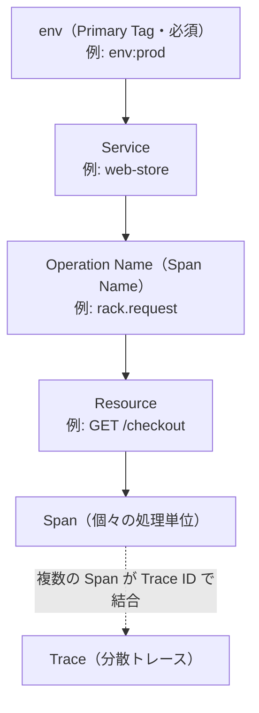
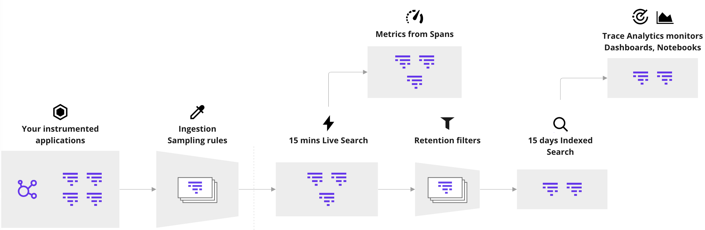
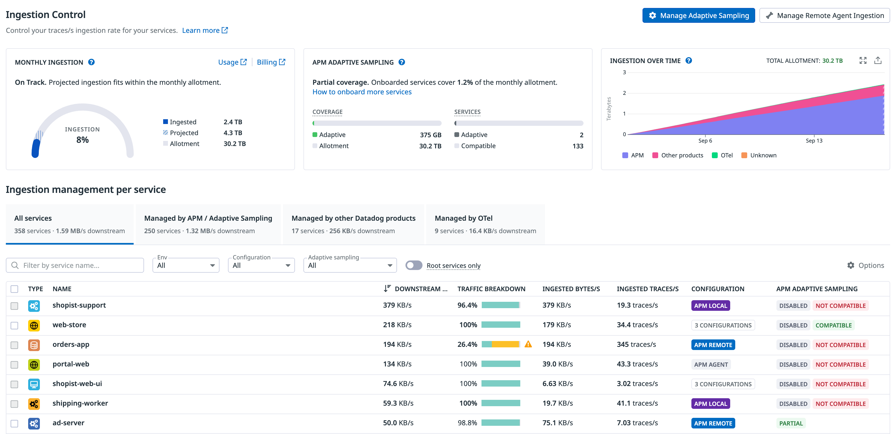
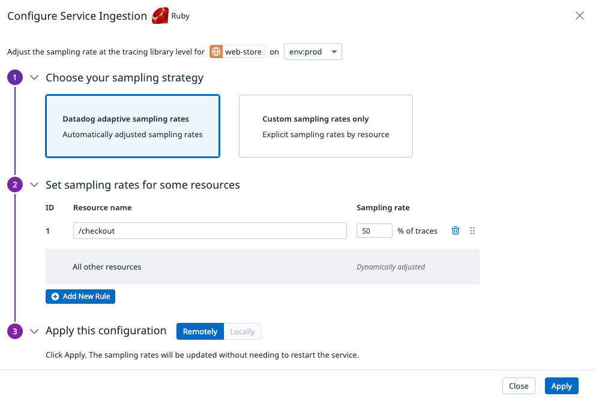
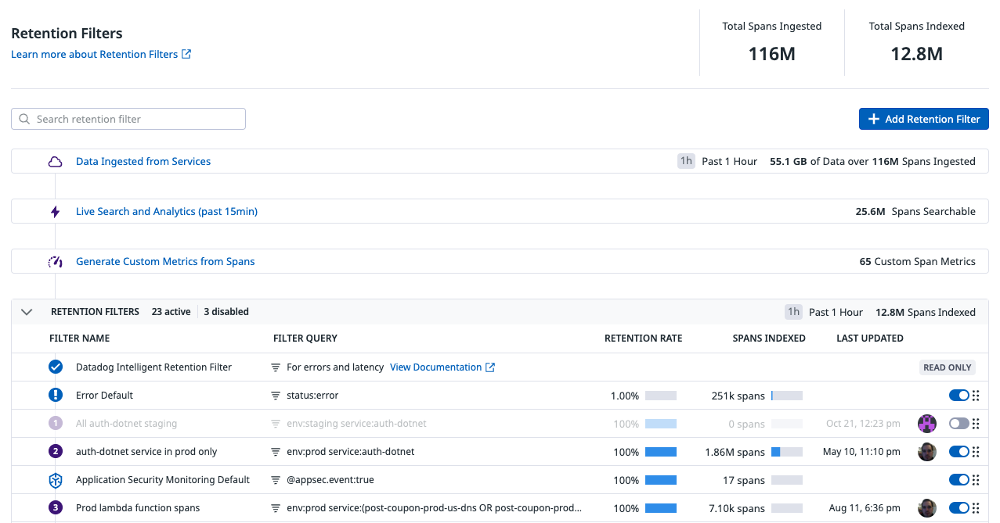
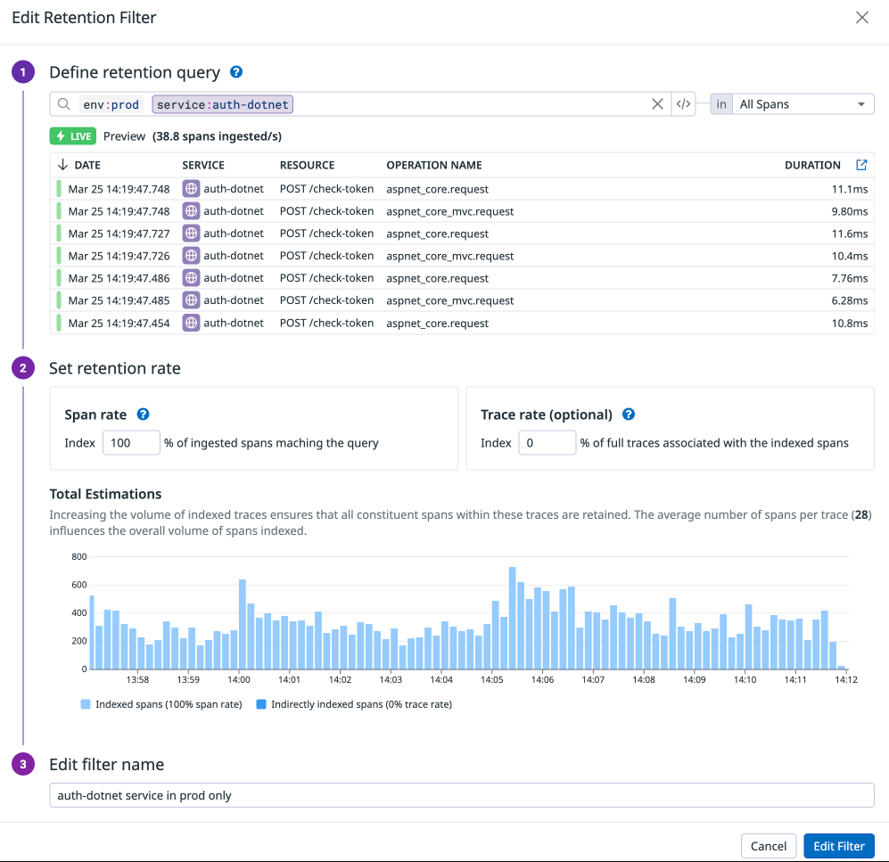

# APM の概念とインジェスト制御

## 概要

Datadog APM（Application Performance Monitoring、アプリケーションパフォーマンス監視）は、インスツルメント済みアプリケーションから送られる分散トレースを収集・保存・分析する製品である。本ファイルは次の2点に答える。

1. **APM の基本概念**：Trace（トレース）、Span（スパン）、Service（サービス）、Resource（リソース）、Operation Name（オペレーション名＝Span Name）、Service Entry Span、Primary Operation、Primary Tag の定義と関係。
2. **トレースデータのライフサイクルと制御**：
   - **Ingestion（インジェスト）**：アプリ／Agent から Datadog へ「どのトレースを送るか」を決めるサンプリング（Head-based sampling、Error / Rare sampler、Single Span Sampling、Adaptive Sampling 等）と、それを管理する **Ingestion Control** 画面。
   - **Retention（保持・インデックス）**：Datadog に取り込まれたスパンのうち「どれを 15 日（または 7 / 30 日）検索可能に残すか」を決める **Retention Filters** と、無料で自動的に代表サンプルを残す **Intelligent Retention Filter**。
   - **Metrics（メトリクス）**：サンプリング前の 100% トラフィックから計算される **Trace Metrics**（`trace.*`）と、取り込み済みスパンから任意に生成する **Span-based Metrics**。

APM のトレースパイプラインは「アプリ → Ingestion Sampling Rules → 15 分 Live Search → Retention Filters → 15 日 Indexed Search → Trace Analytics Monitor / Dashboard / Notebook」という段階で構成され、各段階で課金単位（Ingested Spans = GB、Indexed Spans = 100 万件）が異なる。[出典](https://docs.datadoghq.com/tracing/trace_pipeline/)

本ファイルで扱わない事項は以下の関連ファイルを参照する。

| 内容 | 参照先 |
|---|---|
| トレーサー（SDK）の導入方法、Single Step Instrumentation、言語別設定、コンテキスト伝播 | [APM インスツルメンテーション](./apm-instrumentation.md) |
| Software Catalog・Service Page・Trace Explorer・Service Map 等の画面操作 | [APM 画面と分析機能](./apm-ui-and-analysis.md) |
| Agent 全般の設定ファイル・環境変数 | [Agent 設定リファレンス](../platform/agent-configuration.md) |
| Remote Configuration の有効化 | [Fleet Automation と Remote Configuration](../platform/fleet-automation.md) |
| Unified Service Tagging（`env` / `service` / `version`） | [Tagging（タグ）](../platform/tagging.md) |
| OpenTelemetry 連携全般 | [OpenTelemetry サポート](../platform/opentelemetry.md) |
| APM 料金の正本 | [製品別料金表](../../03_導入編/02-pricing-by-product.md) |
| サンプリング設計・コスト最適化の実践知見 | [APM 運用の実践](../../04_応用編/05-apm-practices.md)、[コスト最適化](../../04_応用編/01-cost-optimization.md) |

---

## 1. APM の基本概念

### 1.1 用語定義

Datadog APM の用語は以下のとおり公式用語集で定義されている。[出典](https://docs.datadoghq.com/tracing/glossary/) [出典](https://docs.datadoghq.com/glossary/)

| 用語（英語正式名称） | 日本語 | 定義（公式記述の要約） |
|---|---|---|
| Trace | トレース | アプリケーションが1つのリクエストの処理に費やした時間とそのリクエストのステータスを追跡するもの。1つ以上の Span で構成される。Trace ID が HTTP ヘッダー等で受け渡されることで、複数サービスにまたがる分散トレースになる。 |
| Span | スパン | 分散システム内の一定期間における論理的な作業単位。複数の Span が1つの Trace を構成する。 |
| Trace root span | ルートスパン | Trace の最初の Span。Trace の開始を示し、トレース対象リクエストのエントリーポイントとなるメソッドに当たる。 |
| Service entry span | サービスエントリースパン | あるサービスへのリクエストの入口となる Span。フレームグラフ上では色分けされた直近の親として表示される。【推定】Agent 設定やトレーサーの文脈で使われる「top-level span」とほぼ同義と考えられるが、公式用語集に「top-level span」の項目はない。 |
| Service | サービス | エンドポイント、クエリ、ジョブ等をまとめる単位。例：URL エンドポイント群をまとめる API サービス、DB クエリをまとめるデータベースサービス、定期ジョブをまとめる crond サービス。Software Catalog と Service Map に表示され、サービスごとに Service Page（スループット、レイテンシー、エラー率）を持つ。 |
| Resource | リソース | アプリケーションの特定のドメイン。通常はインスツルメントされた Web エンドポイント、データベースクエリ、バックグラウンドジョブ。HTTP メソッドとルートを組み合わせた名前（例：`GET /productpage`）になることが多い。リソースごとに Resource Page を持つ。 |
| Operation Name（Span Name） | オペレーション名 | Span の種類を示す静的な名前（例：`web.request`、`db.query`、`flask.request`、`postgres.query`）。Trace Metrics の名前空間 `trace.<SPAN_NAME>.*` に使われる。 |
| Primary Operation | プライマリオペレーション | サービスのエントリーポイントとなるオペレーション。サービスの統計（エラー、スループット、レイテンシー）はこのオペレーション名に一致する Span から計算される。 |
| Trace context propagation | トレースコンテキスト伝播 | Trace ID や親 Span ID などの識別子をサービス間（通常は HTTP ヘッダー）で受け渡し、Span を1つの分散トレースとしてつなぐ仕組み。 |
| Baggage | バゲージ | サービス境界を越えて伝播されるキー・バリュー。トレース識別子以外のビジネス情報・文脈情報を運べる。 |
| Instrumentation | インスツルメンテーション | トレース・メトリクス・ログを取得して送るためのコード追加。Single Step Instrumentation、Datadog SDK による手動導入、カスタムインスツルメンテーションがある。 |
| Ingested span | 取り込み済みスパン | 環境全体から Datadog に収集されたすべての Span。 |
| Indexed span | インデックス済みスパン | Retention Filter により保持され、Datadog に 15 日間保存される Span。Search Spans でタグにより検索・監視できる。 |
| Retention filter | リテンションフィルター | どのトレース（Span）を 15 日間保持するかを決めるルール。既定で Intelligent Retention Filter が適用され、カスタムフィルターも作成できる。 |
| Ingestion controls | インジェスト制御 | Datadog に送るトレースの量（最大 100%）を制御する仕組み。送られたトレースは 15 分間の Live Search と分析に使える。 |
| Trace metrics | トレースメトリクス | トレースから自動収集され、15 か月保持されるメトリクス。ヒット数、エラー、レイテンシーを追跡する。統計とメトリクスは常に全トレースから計算され、インジェスト制御の影響を受けない。 |
| APM monitors | APM モニター | APM 固有の操作（ヒット、エラー、レイテンシー）を備えたメトリクスモニター。 |

> **補足:** 「Ingestion controls によりトレースが 15 分間の Live Search に使える」「Retention Filters によりスパンが 15 日保持される」という2つの保持期間は、それぞれ別の段階を指す。混同しないこと（詳細は「6. 保持期間」）。[出典](https://docs.datadoghq.com/tracing/glossary/)

### 1.2 概念の階層関係

Datadog APM の概念は以下の階層で整理できる。



- Service は `env`（必須の Primary Tag）ごとに集計される。
- 1つの Service は複数の Operation Name を持ち得るが、サービス統計は Primary Operation の Span から計算される。
- 1つの Operation Name 配下に複数の Resource が並ぶ（例：`/user/home` と `/user/new` はいずれも `web.request` に属する）。[出典](https://docs.datadoghq.com/tracing/guide/configuring-primary-operation/)

### 1.3 Operation Name と Resource の使い分け

Datadog APM の Operation Name（Span Name）は静的な値、Resource は可変の値という役割分担になっている。

| 項目 | Operation Name（Span Name） | Resource |
|---|---|---|
| 性質 | 静的（種類を表す） | 動的（具体的なエンドポイント・クエリ） |
| 例 | `web.request`、`db.query`、`redis.command` | `GET /checkout`、`SELECT * FROM users WHERE id = ?` |
| メトリクス名への影響 | `trace.<SPAN_NAME>.*` の名前になる | `resource_name` タグとして付与される |
| 手動インスツルメンテーション時の推奨 | 静的な名前を付け、同一サービスの Resource が同じ Primary Operation 配下にまとまるようにする | 動的な値（例：`/user/profile`）は Resource 側に入れる |

[出典](https://docs.datadoghq.com/tracing/guide/configuring-primary-operation/)

> **補足:** OpenTracing を使う場合、OpenTracing の operation name は Datadog の Resource に、`component` タグは Datadog の Span Name にマッピングされる。[出典](https://docs.datadoghq.com/tracing/guide/configuring-primary-operation/)

### 1.4 Primary Operation（プライマリオペレーション）

Datadog APM の Primary Operation は、サービスが UI にどう表示されるかを決めるオペレーションである。[出典](https://docs.datadoghq.com/tracing/guide/configuring-primary-operation/)

| 項目 | 内容 |
|---|---|
| 自動選択 | バックエンドがリクエストのスループットに基づき、サービスのエントリーポイントとなるオペレーションを自動選択する。複数候補がある場合は最もスループットの高いものが選ばれる。 |
| 手動設定 | **管理者ユーザーのみ**。APM Settings 画面の **Primary Operation Name** タブ → 対象サービスの編集アイコン → **Set Manually** → オペレーションを選択 → **Save**。 |
| 統計への影響 | エラー、スループット、レイテンシーは Primary Operation 名に一致する Span のみから計算される。他の Span Name はドロップダウンで閲覧できるがサービス統計には寄与しない。 |

### 1.5 Primary Tag（プライマリタグ）

Datadog APM の Primary Tag は、APM の集計統計（リクエスト数／秒、レイテンシー、エラー率、Apdex）と表示トレースを、環境・アベイラビリティゾーン・データセンター等の次元でスコープするためのタグである。[出典](https://docs.datadoghq.com/tracing/guide/setting_primary_tags_to_scope/)

| 項目 | 内容 |
|---|---|
| `env` | 必須のデフォルト Primary Tag。未設定のデータは `env:none` に入る。SDK では `DD_ENV` またはコード内のグローバルタグ、Agent ではトップレベル設定またはホストタグで設定する。 |
| `env` の注意 | Tracer と Agent で異なる `env` を設定しないこと（Trace Metrics のタグが重複する原因になる）。 |
| 追加 Primary Tag | Trace Metrics を追加の次元で集計するために設定する。設定すると Software Catalog の Performance タブに2つ目のドロップダウンが現れる。 |
| 設定権限 | 組織の管理者のみ。APM Settings 画面で設定する。 |
| 反映時間 | UI 反映まで最大 2 時間。 |
| 値の上限 | 追加 Primary Tag 1 つあたり一意な値は 100 まで（高カーディナリティのタグは避ける）。 |
| 使えるタグ | ホストタグまたはコンテナタグであること。SDK の Span レベルタグ（`resource`、`name`、`service` 等）は Primary Tag にできず、ホストレベルタグとして付与すべきでもない。 |
| 変更時の影響 | 旧タグで集計された過去の APM データは参照できなくなる。旧タグでスコープしたモニターは No Data になる。 |
| コンテナベースの Primary Tag | Linux の Docker / Kubernetes Pod メタデータから導出。**Agent 7.65.0 以降で既定有効**。APM Settings でタグを選択する。無効化は `DD_APM_FEATURES` に `disable_cid_stats` を追加して Agent を再起動。 |
| 表示 | APM 各画面上部に Primary Tag セレクターが表示される。タグに関係なく全データを含めるには `<TAG_NAME>:*` を選ぶ。 |

> **注意:** `env` や region / partition の値をサービス名に埋め込むと、後述の「一意な `env`×`service` 組み合わせ」上限に抵触しやすい。公式は Primary Tag を使うことを推奨している。[出典](https://docs.datadoghq.com/tracing/troubleshooting/)

---

## 2. トレースパイプライン（データのライフサイクル）

Datadog APM のトレースパイプラインは、インスツルメント済みアプリケーションから取り込み、処理し、メトリクス化し、保持する一連の流れである。インジェストと保持はいずれもカスタマイズできる。[出典](https://docs.datadoghq.com/tracing/trace_pipeline/)



*図: APM トレースパイプライン（Trace Pipeline）の概念図*

画面説明: 左から「Your instrumented applications（インスツルメント済みアプリ）」→「Ingestion Sampling rules（インジェストのサンプリングルール。台形で量が絞られることを表現）」→ 点線（Datadog への送信境界）→「15 mins Live Search（取り込まれた全スパンを 15 分間検索）」→「Retention filters（台形で絞り込み）」→「15 days Indexed Search（15 日間のインデックス検索）」と並ぶ。15 mins Live Search の段から上に「Metrics from Spans（Span-based Metrics）」が分岐し、15 days Indexed Search の段から上に「Trace Analytics monitors / Dashboards, Notebooks」が分岐する。つまり Span-based Metrics は Retention Filter の手前（取り込み済み全スパン）から生成され、Trace Analytics Monitor・ダッシュボードはインデックス済みスパンを使う。

出典: https://docs.datadoghq.com/tracing/trace_pipeline/ （画像取得日 2026-11-02）

### 2.1 段階ごとの整理

| 段階 | 何が決まるか | 主な設定場所 | 使えるデータ | 課金単位 |
|---|---|---|---|---|
| ① Trace Metrics 計算 | サンプリング前の全トラフィックから `trace.*` メトリクスを計算 | Agent（自動） | `trace.*` メトリクス（15 か月保持） | APM ホスト料金に含まれる（Trace Metrics がカスタムメトリクスとして課金される旨の記載は公開情報では確認できず） |
| ② Ingestion（サンプリング） | どのトレース／スパンを Datadog に送るか | SDK（`DD_TRACE_SAMPLING_RULES` 等）、Agent（`datadog.yaml`）、Ingestion Control 画面（Remote Configuration） | Live Search（直近 15 分の全取り込みスパン） | Ingested Spans（GB） |
| ③ Processing Pipelines | 取り込み後のスパンの変換・正規化・属性抽出 | APM の Processing Pipelines 画面 | — | 公開情報では確認できず |
| ④ Span-based Metrics | 取り込み済みスパン／トレースから任意のメトリクスを生成 | Generate Metrics 画面 | カスタムメトリクス（15 か月保持） | カスタムメトリクス |
| ⑤ Retention（インデックス） | どのスパンを検索可能に残すか | Retention Filters 画面 | Indexed Search（15 日。Intelligent Retention は 30 日） | Indexed Spans（100 万件） |
| ⑥ 分析・監視 | Trace Analytics Monitor、Dashboard、Notebook、Trace Queries | 各画面 | インデックス済みスパン | — |

[出典](https://docs.datadoghq.com/tracing/trace_pipeline/) [出典](https://docs.datadoghq.com/tracing/trace_pipeline/generate_metrics/) [出典](https://docs.datadoghq.com/tracing/trace_explorer/)

> **サイト差異:** Processing Pipelines は `app.ddog-gov.com` および `us2.ddog-gov.com`（US1-FED 等の GovCloud 系サイト）では非対応。[出典](https://docs.datadoghq.com/tracing/trace_pipeline/)

### 2.2 Ingestion と Retention の違い（重要）

Datadog APM では「Ingestion（送るか）」と「Retention（残すか）」は独立した2段階であり、混同が誤設定・誤見積りの主因になる。

| 観点 | Ingestion Controls | Retention Filters |
|---|---|---|
| 制御対象 | アプリ／Agent が Datadog に**送る**トレース | Datadog が**インデックスする**スパン |
| 判定単位 | 主にトレース単位（Head-based はルートで決定） | スパン単位（オプションでトレース単位の Trace rate） |
| 判定場所 | SDK・Agent（ローカル）または Remote Configuration | Datadog バックエンド |
| 効く課金 | Ingested Spans（GB） | Indexed Spans（件数） |
| 失ったデータ | 送られなかったトレースは Live Search にも出ない（Trace Metrics には含まれる） | インデックスされなかったスパンは 15 分経過後に検索不能 |
| 公式の注意 | Retention Filters は Agent が取り込む量を制御しない | — |

[出典](https://docs.datadoghq.com/tracing/trace_pipeline/trace_retention/) [出典](https://docs.datadoghq.com/tracing/trace_pipeline/ingestion_controls/)

---

## 3. Ingestion（インジェスト）メカニズム

Datadog APM のインジェストは、複数のメカニズム（サンプラー）の組み合わせで決まる。取り込まれた各スパンには、それを残したメカニズムを示す `ingestion_reason` が付与される。[出典](https://docs.datadoghq.com/tracing/trace_pipeline/ingestion_mechanisms/)

### 3.1 `ingestion_reason` 一覧

| `ingestion_reason` | メカニズム | デフォルト | レート／上限 | 設定 | 最低バージョン |
|---|---|---|---|---|---|
| `auto` | Agent による Head-based sampling | 有効 | Agent あたり目標 10 traces/秒（サービスのトラフィックに応じて配分） | `target_traces_per_second`（`datadog.yaml`）、`DD_APM_TARGET_TPS` | Remote Configuration は Agent 7.42.0 以降 |
| `rule` | SDK のユーザー定義ルール（Head-based） | 未設定 | サービス／リソース単位のサンプルレート。レート制限はサービスインスタンスあたり 100 traces/秒 | `DD_TRACE_SAMPLING_RULES`、`DD_TRACE_SAMPLE_RATE`、`DD_TRACE_RATE_LIMIT`、または Ingestion Control 画面 | SDK により異なる（3.4 参照） |
| `error` | Agent の Error sampler | 有効 | Agent あたり最大 10 traces/秒 | `errors_per_second`（`datadog.yaml`）、`DD_APM_ERROR_TPS`（`0` で無効） | Agent 7.33 以降 |
| `rare` | Agent の Rare sampler | Agent 7.41.0 以降は**無効**（7.33〜7.40.x は有効） | Agent あたり最大 5 traces/秒 | 7.41 以降：`apm_config.enable_rare_sampler` / `DD_APM_ENABLE_RARE_SAMPLER`。7.33〜7.40.x：`apm_config.disable_rare_sampler` / `DD_APM_DISABLE_RARE_SAMPLER` | Agent 6/7.33 以降（Remote Configuration は 7.42.0 以降） |
| `manual` | コードでの強制 Keep / Drop | — | トレース単位 | `DDTags.MANUAL_KEEP` / `MANUAL_DROP` 等（言語別） | SDK 依存 |
| `single_span` | Single Span Sampling | 未設定 | ルールごとの `sample_rate` と任意の `max_per_second` | `DD_SPAN_SAMPLING_RULES` | Agent 7.40.0 以降 |
| `rum` | RUM からバックエンドへのトレース | ブラウザ起点トレースの 100% | 0〜100 | RUM SDK 初期化時の `traceSampleRate` / `tracingSamplingRate` | Browser SDK 4.30.0 等 |
| `synthetics` / `synthetics-browser` | Synthetic テストのトレース | 100% | — | 設定項目なし | — |
| `lambda`、`xray` | Serverless のトレース（Datadog SDK または AWS X-Ray 連携） | — | — | — | — |
| `appsec` | App and API Protection（旧称：Application Security Management / ASM）が脅威と判定したトレース | — | — | — | — |
| `data_jobs` | Data Jobs Monitoring（Spark、Databricks）のトレース | — | — | — | — |
| `otel` | OpenTelemetry SDK からのトレース | — | — | SDK・Collector・Agent で設定 | OpenTelemetry サンプリングガイド参照 |

[出典](https://docs.datadoghq.com/tracing/trace_pipeline/ingestion_mechanisms/)

- 使用量メトリクス `datadog.estimated_usage.apm.ingested_bytes` / `datadog.estimated_usage.apm.ingested_spans` は `ingestion_reason` タグ付きで、どのメカニズムが量を生んでいるかを分析できる。[出典](https://docs.datadoghq.com/tracing/trace_pipeline/ingestion_mechanisms/)

### 3.2 Head-based sampling（ヘッドベースサンプリング）の原則

Datadog APM の Head-based sampling は、トレースを残すか捨てるかを**ルートスパンで決定し、その決定を下流サービスへ伝播する**方式である。このためトレース全体がまとめて残るか捨てられ、トレースが不完全にならない。[出典](https://docs.datadoghq.com/tracing/trace_pipeline/ingestion_mechanisms/)

- サンプリングは Agent（デフォルト）または SDK で設定でき、**SDK の設定が Agent の設定より優先**される。
- 下流サービスはルートサービスの決定に従うため、非ルートサービスの量を減らしたい場合は**上流のルートサービス**のサンプリングを設定する必要がある（Ingestion Control 画面の「sampling decision makers」で確認）。[出典](https://docs.datadoghq.com/tracing/trace_pipeline/ingestion_controls/)

### 3.3 Agent による自動サンプリング（`ingestion_reason: auto`）

Datadog Agent のデフォルトサンプリングは、Agent が SDK にサンプルレートを返し、Agent 全体で約 10 traces/秒になるよう調整する仕組みである。[出典](https://docs.datadoghq.com/tracing/trace_pipeline/ingestion_mechanisms/)

| 項目 | 内容 |
|---|---|
| 目標値 | Agent あたり約 10 traces/秒（`target_traces_per_second`、既定 `10`） |
| 配分 | トラフィック量に応じてサービスに配分（例：多いサービスに 7 traces/秒、少ないサービスに 3 traces/秒） |
| 変動 | 目標は固定値ではなく、トラフィックのスパイク等で変動する |
| 対象 | Datadog SDK のみ。OpenTelemetry SDK には適用されない |
| 適用条件 | サービスに SDK 側のサンプリングルールが存在しない場合に適用 |
| Remote Configuration | Agent 7.42.0 以降。Ingestion Control 画面で設定し、Agent 再起動なしで即時反映。**ローカル設定（環境変数・`datadog.yaml`）より優先** |
| 無効化 | Agent 7.35.0 以降はサンプリングを無効化できない。`max_traces_per_second` を `0` にするとサンプリング無効ではなく「トレースを一切送らない」動作になる |

[出典](https://docs.datadoghq.com/tracing/trace_pipeline/ingestion_mechanisms/) [出典](https://github.com/DataDog/datadog-agent/blob/main/pkg/config/example/datadog-agent_linux.yaml.example)

### 3.4 SDK のユーザー定義ルール（`ingestion_reason: rule`）

Datadog SDK（トレーサー）のサンプリングルールは、サービス名・リソース名単位でルートのサンプルレートを指定する Head-based の仕組みである。[出典](https://docs.datadoghq.com/tracing/trace_pipeline/ingestion_mechanisms/)

| 項目 | 内容 |
|---|---|
| サンプルレート | サービス名／リソース名（およびタグ）単位で 0〜1 を指定 |
| レート制限 | 既定でサービスインスタンスあたり **100 traces/秒**（`DD_TRACE_RATE_LIMIT`）。Agent のデフォルト機構を使う場合はレートリミッターは無視される |
| 超過時 | Head-based のため、上限を超えた分はルートで捨てられる（トレースが不完全にならない） |
| タグ | この方式でサンプリングされたトレースのすべてのスパンに `rule` が付く |
| `DD_TRACE_SAMPLE_RATE` | `DD_TRACE_SAMPLING_RULES` が使える言語では非推奨。移行例：`0.1` → `[{"sample_rate":0.1}]` |
| 大文字小文字 | サービス名は大文字小文字を区別する |
| 優先順位 | Remote Configuration がローカル設定より優先 |

設定例（`my-service` の `GET /checkout` を 100%、それ以外を 20%）:

```bash
DD_TRACE_SAMPLING_RULES='[{"service": "my-service", "resource": "GET /checkout", "sample_rate": 1},{"service": "my-service", "sample_rate": 0.2}]'
```

ルールは記述順に評価されるため、具体的なルールを先、汎用的なルールを後に置く。【経験則】（公式例も具体ルール→汎用ルールの順で記載）

**言語別の対応バージョン**

| SDK | Remote Configuration（サービス／リソース単位）の最低バージョン | ローカル設定 |
|---|---|---|
| Java | 1.34.0 | `DD_TRACE_SAMPLING_RULES`（リソース単位は 1.26.0 以降）。`DD_TRACE_SAMPLE_RATE` は非推奨 |
| Python | 2.9.0 | `DD_TRACE_SAMPLING_RULES`（リソース単位は 2.8.0 以降）。`DD_TRACE_SAMPLE_RATE` は非推奨 |
| Ruby | 2.0.0 | `DD_TRACE_SAMPLE_RATE`（全体）、`DD_TRACE_SAMPLING_RULES`（サービス単位） |
| Go | 1.64.0 | `DD_TRACE_SAMPLING_RULES`（リソース単位は 1.60.0 以降）。`DD_TRACE_SAMPLE_RATE` は非推奨 |
| Node.js | 5.16.0 | `DD_TRACE_SAMPLE_RATE`（全体）。サービス単位は `tracer.init({ ingestion: { sampler: ... } })` |
| PHP | 1.4.0 | `DD_TRACE_SAMPLE_RATE`、`DD_TRACE_SAMPLING_RULES` |
| C++ | 0.2.2 | `DD_TRACE_SAMPLE_RATE`、`DD_TRACE_SAMPLING_RULES`、`DD_TRACE_RATE_LIMIT` |
| Rust | 非対応 | `DD_TRACE_SAMPLING_RULES` のみ |
| .NET | 2.35.0 以降で Catalog UI からサービス単位の `DD_TRACE_SAMPLE_RATE` を設定可（Agent の Remote Configuration が必要）。Ingestion Control の Remote Configuration 要件としては 2.53.2（3.8 参照） | `DD_TRACE_SAMPLE_RATE`、`DD_TRACE_SAMPLING_RULES` |

[出典](https://docs.datadoghq.com/tracing/trace_pipeline/ingestion_mechanisms/)

> **注意:** .NET の最低バージョンは、Ingestion Mechanisms ページ（2.35.0：Catalog UI からのサービス単位レート）と Ingestion Controls ページ（2.53.2：Remote Configuration 要件）で記載が異なる。リソース単位のリモートルールを使う場合は 2.53.2 以降を前提にするのが安全である。【推定】

### 3.5 Error sampler と Rare sampler（Agent）

Datadog Agent の Error sampler と Rare sampler は、Head-based sampling で残らなかったトレースの中から、エラーや珍しい組み合わせのスパンを拾うための補完機構である。[出典](https://docs.datadoghq.com/tracing/trace_pipeline/ingestion_mechanisms/)

**共通の性質**

- ホスト単位（その Agent が受け取ったローカルのトレース断片）で動作するため、**分散トレースが完全な形で届かない場合がある**。
- **SDK のサンプリングルールが設定されたサービスでは無視**される。

| 項目 | Error sampler（`error`） | Rare sampler（`rare`） |
|---|---|---|
| 対象 | エラースパンを含むトレース断片 | `env`、`service`、`name`、`resource`、`error.type`、`http.status` の組み合わせのうち珍しいもの |
| 上限 | Agent あたり最大 10 traces/秒 | Agent あたり最大 5 traces/秒 |
| デフォルト | 有効 | Agent 7.41.0 以降は無効、7.33〜7.40.x は有効 |
| 設定 | `errors_per_second` / `DD_APM_ERROR_TPS`（既定 `10`、`0` で無効） | 7.41.0 以降：`apm_config.enable_rare_sampler` / `DD_APM_ENABLE_RARE_SAMPLER`（既定 `false`）。7.33〜7.40.x：`apm_config.disable_rare_sampler` / `DD_APM_DISABLE_RARE_SAMPLER`（既定 `false`） |
| Remote Configuration | Agent 7.42.0 以降 | Agent 7.42.0 以降 |
| SDK 側で Drop されたスパンの扱い | 既定では対象外。Agent 6/7.41.0 以降は `DD_APM_FEATURES=error_rare_sample_tracer_drop` で対象に含められる。6/7.33〜6/7.40.x は変更不可 | 有効時、SDK ルールまたは `manual.drop` で捨てられたスパンは対象外（`error_rare_sample_tracer_drop` 設定時を除く） |

[出典](https://docs.datadoghq.com/tracing/trace_pipeline/ingestion_mechanisms/)

> **補足:** Agent 設定ファイルの説明では、Error sampler の TPS は `service`、`name`、`resource`、`http.status`、`error.type` のすべての組み合わせを拾うように配分される。[出典](https://github.com/DataDog/datadog-agent/blob/main/pkg/config/example/datadog-agent_linux.yaml.example)

### 3.6 Force Keep / Force Drop（`ingestion_reason: manual`）

Datadog SDK の Force Keep / Drop は、コード内で特定トレースを必ず残す／捨てる指定である。[出典](https://docs.datadoghq.com/tracing/trace_pipeline/ingestion_mechanisms/)

| 種別 | 動作 | 注意 |
|---|---|---|
| Manual Keep | そのスパンと子スパンをすべて取り込む | ルートでないスパンに設定するとトレースが不完全に見える場合がある。**コンテキスト伝播の前に設定**しないとサービス間で保持されない場合がある。Agent やサーバー側のルールで捨てられる可能性は残る |
| Manual Drop | 子スパンを取り込まない | Error / Rare sampler も無視される |

- Java の例：`DDTags.MANUAL_KEEP` / `DDTags.MANUAL_DROP`。他言語（Python、Ruby、Go、Node.js、.NET、PHP、C++）にも同等の手段がある。
- Rust は Datadog タグに非対応。ルートスパンに OpenTelemetry の `sampling.priority` 属性を設定する。

### 3.7 Single Span Sampling（`ingestion_reason: single_span`）

Datadog の Single Span Sampling は、Head-based sampling で捨てられたトレースから**個別のスパンだけ**を拾って取り込む仕組みである。すでに残されたスパンを捨てることはできない。[出典](https://docs.datadoghq.com/tracing/trace_pipeline/ingestion_mechanisms/)

| 項目 | 内容 |
|---|---|
| 要件 | Agent 7.40.0 以降 |
| 設定 | `DD_SPAN_SAMPLING_RULES`（JSON 配列） |
| ルールのキー | `service`、`name`、`resource`、`tags`、`sample_rate`、`max_per_second` |
| 用途例 | 特定スパンのメトリクス化（Span-based Metrics）や検索のために、トレース全体を残さず当該スパンだけ取り込む |

設定例（`my-service` の `http.request` スパンを 100%、最大 50 スパン/秒）:

```bash
DD_SPAN_SAMPLING_RULES='[{"service": "my-service", "name": "http.request", "sample_rate":1.0, "max_per_second": 50}]'
```

| SDK | 最低バージョン |
|---|---|
| Java | 1.7.0 |
| Python | 1.4.0 |
| Ruby | 1.5.0 |
| Go | 1.41.0（service/name）、1.60.0（resource/tags） |
| PHP | 0.77.0 |
| C++ | 0.1.0 |
| .NET | 2.18.0 |
| Node.js、Rust | 公開情報では確認できず |

> **旧機能:** レガシーの App Analytics（Analyzed Spans）によるスパン取り込みは非推奨。代わりに Single Span Sampling または Head-based sampling を使う。既存の App Analytics フィルターは 2020-10-20 に Retention Filters へ移行された。[出典](https://docs.datadoghq.com/tracing/trace_pipeline/ingestion_mechanisms/) [出典](https://docs.datadoghq.com/account_management/billing/apm_tracing_profiler/)

### 3.8 RUM・Synthetics・その他製品由来のトレース

Datadog APM には、APM 以外の製品が起点となって取り込まれるトレースもある。これらは Agent レベルのインジェスト設定では制御できない（Ingestion Control 画面の円グラフで灰色の「Other Ingestion Reasons」）。[出典](https://docs.datadoghq.com/tracing/trace_pipeline/ingestion_controls/)

**RUM（`ingestion_reason: rum`）**：フロントエンドのリクエストとバックエンドのトレースを関連付ける。ブラウザ起点トレースのうち送る割合を指定し、既定は 100%。

| RUM SDK | パラメーター | 最低バージョン |
|---|---|---|
| Browser | `traceSampleRate` | 4.30.0 |
| iOS | `tracingSamplingRate` | 1.11.0（Ingestion Control への表示は 1.13.0 以降） |
| Android | `traceSampleRate` | 1.13.0（Ingestion Control への表示は 1.15.0 以降） |
| Flutter | `tracingSamplingRate` | 1.0.0 |
| React Native | `tracingSamplingRate` | 1.0.0（Ingestion Control への表示は 1.2.0 以降） |

**Synthetics（`synthetics` / `synthetics-browser`）**：HTTP テストおよびブラウザテストの実行は、既定で 100% がバックエンドトレースを生成する。

| 製品 | `ingestion_reason` | 内容 |
|---|---|---|
| Serverless | `lambda`、`xray` | Datadog SDK または AWS X-Ray 連携でトレースされたサーバーレスアプリ |
| App and API Protection | `appsec` | SDK が脅威と判定したトレース |
| Data Jobs Monitoring | `data_jobs` | Java Tracer の Spark 連携または Databricks 連携のトレース |

[出典](https://docs.datadoghq.com/tracing/trace_pipeline/ingestion_mechanisms/)

詳細は [RUM（ブラウザ）](../dem/rum-browser.md)、[Synthetic Monitoring](../dem/synthetic-monitoring.md)、[Serverless Monitoring](../infrastructure/serverless.md)、[App and API Protection](../security/app-and-api-protection.md)、[Data Jobs Monitoring](../data/data-jobs-monitoring.md) を参照。

### 3.9 サンプリングルールの優先順位

Datadog APM のサンプリング設定が複数存在する場合、以下の順（上ほど優先）で適用される。[出典](https://docs.datadoghq.com/tracing/trace_pipeline/ingestion_controls/)

| 優先順位 | 設定 | 設定場所 |
|---|---|---|
| 1 | Remote のリソース単位サンプリングルール | Ingestion Control 画面 |
| 2 | Adaptive Sampling のルール | Ingestion Control 画面 |
| 3 | ローカルのサンプリングルール（`DD_TRACE_SAMPLING_RULES`） | SDK |
| 4 | Remote のグローバルサンプリングレート | Ingestion Control 画面 |
| 5 | ローカルのグローバルサンプリングレート（`DD_TRACE_SAMPLE_RATE`） | SDK |
| 6 | Agent 制御のレート（`DD_APM_TARGET_TPS`） | Agent |

要約すると「Tracer の設定は Agent の設定に優先」「サンプリングルールはグローバルレートに優先」「Remote 設定はローカル設定に優先」である。

### 3.10 OpenTelemetry のサンプリング

OpenTelemetry（OTel）でトレースを送る場合、Datadog Agent の自動サンプリング（`auto`）は適用されず、サンプリングは OTel SDK・Collector・Agent の OTLP 取り込みのいずれかで行う。[出典](https://docs.datadoghq.com/opentelemetry/guide/ingestion_sampling_with_opentelemetry/) [出典](https://docs.datadoghq.com/tracing/trace_pipeline/ingestion_mechanisms/)

| 方式 | 内容 | 注意 |
|---|---|---|
| Head-based（OTel SDK） | `TraceIdRatioBased` / `ParentBased` サンプラー | サンプリング済みのデータだけが届くため、APM メトリクスもサンプル済みの部分集合を反映する（設定レートで割り戻す計算式で近似可能） |
| Tail-based（Collector） | Tail Sampling processor / Probabilistic Sampling processor でエラー・高レイテンシー等のルールを適用 | 1トレースの全スパンが同一 Collector インスタンスに届く必要がある。分散構成ではトレース認識ルーティング付きのゲートウェイ構成が必要 |
| Probabilistic（Datadog Agent の OTLP 取り込み） | Agent 7.70.0 以降。`DD_APM_PROBABILISTIC_SAMPLER_ENABLED`、`DD_APM_PROBABILISTIC_SAMPLER_SAMPLING_PERCENTAGE`、または `apm_config.probabilistic_sampler` | 旧変数 `DD_OTLP_CONFIG_TRACES_PROBABILISTIC_SAMPLER_SAMPLING_PERCENTAGE` は非推奨。7.70.0 より前ではサンプラー有効時に OTLP トレースがすべて落ちる場合がある |

- Agent と Collector の両方にスパンを送る混在構成では、両者で同じハッシュシードを使い、APM feature `probabilistic_sampler_full_trace_id` を有効にして判定を一致させる。この場合、全 SDK が 128 bit の Trace ID を生成・伝播する必要がある。
- Probabilistic sampler は SDK が付けたサンプリング優先度を無視するため、Head-based sampling と両立しない。Error / Rare sampler は、Probabilistic sampler が捨てたスパンを拾う場合がある。
- Trace Metrics を 100% のトラフィックから計算するには、Collector では `span_metrics` connector（または Datadog Connector）をサンプリングプロセッサー（`tail_sampling` 等）より**前**に置く。Agent の OTLP 取り込みでは Agent が Trace Metrics を計算する。[出典](https://docs.datadoghq.com/tracing/metrics/metrics_namespace/)

詳細は [OpenTelemetry サポート](../platform/opentelemetry.md) と [OpenTelemetry 活用戦略](../../04_応用編/10-opentelemetry-strategy.md) を参照。

---

## 4. Agent レベルのインジェスト設定（`apm_config`）

Datadog Agent の APM 関連設定は `datadog.yaml` の `apm_config` セクション、または `DD_APM_*` 環境変数で行う。以下はインジェスト量・Agent 負荷に関わる主要パラメーターである（Linux 版のサンプル設定ファイルに基づく）。[出典](https://github.com/DataDog/datadog-agent/blob/main/pkg/config/example/datadog-agent_linux.yaml.example)

### 4.1 主要パラメーター

| `datadog.yaml` キー（`apm_config.` 配下） | 環境変数 | 既定値 | 説明 |
|---|---|---|---|
| `enabled` | `DD_APM_ENABLED` | `true` | Trace Agent の有効化 |
| `receiver_port` | `DD_APM_RECEIVER_PORT`（`DD_RECEIVER_PORT`） | `8126` | トレース受信ポート。`0` で HTTP レシーバー無効 |
| `receiver_socket` | `DD_APM_RECEIVER_SOCKET` | `/var/run/datadog/apm.socket` | Unix Domain Socket の受信パス。空文字列（`""`）で UDS 受信を無効化。Windows では使えない |
| `apm_non_local_traffic` | `DD_APM_NON_LOCAL_TRAFFIC` | `false` | 他ホスト／他コンテナからのトレースを受け付ける場合に `true` |
| `target_traces_per_second` | `DD_APM_TARGET_TPS` | `10` | Head-based sampling の目標 traces/秒。Agent 7.35.0 以降サンプリングは無効化できない |
| `max_traces_per_second` | `DD_APM_MAX_TPS`（`DD_MAX_TPS`） | `10` | **非推奨**。`target_traces_per_second` を使う |
| `errors_per_second` | `DD_APM_ERROR_TPS` | `10` | Error sampler の目標。`0` で無効 |
| `enable_rare_sampler` | `DD_APM_ENABLE_RARE_SAMPLER` | `false` | Rare sampler の有効化（Agent 7.41.0 以降） |
| `max_events_per_second` | `DD_APM_MAX_EPS`（`DD_MAX_EPS`） | `200` | **非推奨**。レガシー App Analytics の APM イベント用。トレース量やスパン量を制限しない |
| `max_memory` | `DD_APM_MAX_MEMORY` | `500000000.0`（バイト、約 500 MB） | Trace Agent の目標メモリ。超過すると受信リクエストをレート制限する。`max_memory` の 150% を超えるとプロセスが強制終了される。`0` で無効 |
| `max_cpu_percent` | `DD_APM_MAX_CPU_PERCENT` | `50` | 目標 CPU 使用率（50 = 0.5 コア、200 = 2 コア）。超過すると受信をレート制限。`0` で無効 |
| `connection_limit` | `DD_APM_CONNECTION_LIMIT`（`DD_CONNECTION_LIMIT`） | `2000` | APM の接続数上限 |
| `ignore_resources` | `DD_APM_IGNORE_RESOURCES` | なし | ルートスパンのリソース名に一致する正規表現でトレースを破棄（4.3 参照） |
| `filter_tags.require` / `filter_tags.reject` | `DD_APM_FILTER_TAGS_REQUIRE` / `DD_APM_FILTER_TAGS_REJECT` | なし | ルートスパンのタグでトレースを保持／破棄（4.3 参照） |
| `filter_tags_regex.require` / `.reject` | `DD_APM_FILTER_TAGS_REGEX_REQUIRE` / `DD_APM_FILTER_TAGS_REGEX_REJECT` | なし | 正規表現版（Agent 7.49 以降） |
| `replace_tags` | `DD_APM_REPLACE_TAGS`（JSON list） | なし（`[]`） | タグ値の正規表現置換（機微情報のマスキング等） |
| `obfuscation.*` | 各種 | 項目ごと | SQL、Redis、Memcached、MongoDB、Elasticsearch、HTTP、クレジットカード番号等の難読化 |
| `compute_stats_by_span_kind` | `DD_APM_COMPUTE_STATS_BY_SPAN_KIND` | `true` | Span kind に基づく統計計算 |
| `peer_tags_aggregation` | `DD_APM_PEER_TAGS_AGGREGATION` | `true` | peer タグによる集計 |
| `probabilistic_sampler.enabled` / `.sampling_percentage` / `.hash_seed` | `DD_APM_PROBABILISTIC_SAMPLER_ENABLED` / `DD_APM_PROBABILISTIC_SAMPLER_SAMPLING_PERCENTAGE` | `false` / `0` / `0` | Probabilistic sampler（3.10 参照） |
| `features` | `DD_APM_FEATURES` | なし | 機能フラグ（例：`error_rare_sample_tracer_drop`、`disable_cid_stats`） |
| `trace_buffer` | `DD_APM_TRACE_BUFFER` | `0` | **使用しないこと**（デバッグ／一時対処用。負荷時に性能劣化・メモリ増加） |

[出典](https://github.com/DataDog/datadog-agent/blob/main/pkg/config/example/datadog-agent_linux.yaml.example) [出典](https://docs.datadoghq.com/tracing/trace_pipeline/ingestion_mechanisms/) [出典](https://docs.datadoghq.com/tracing/guide/ignoring_apm_resources/)

Agent 全般の設定は [Agent 設定リファレンス](../platform/agent-configuration.md) を参照。

### 4.2 Remote Agent Ingestion（Agent 設定のリモート変更）

Datadog の Ingestion Control 画面からは、Agent レベルのインジェスト設定をリモートで変更できる（画面上のボタン名は「Manage Remote Agent Ingestion」、公式ドキュメントでは「Configure Datadog Agent Ingestion」と記載）。[出典](https://docs.datadoghq.com/tracing/trace_pipeline/ingestion_controls/)

| 設定 | 既定の目標 | ローカルの環境変数 | 備考 |
|---|---|---|---|
| Head-based Sampling | Agent あたり 10 traces/秒 | `DD_APM_TARGET_TPS` | サービスにサンプリングルールがない場合に適用 |
| Error Spans Sampling | Agent あたり最大 10 traces/秒 | `DD_APM_ERROR_TPS` | Head-based で拾えなかったエラーを拾う |
| Rare Spans Sampling | Agent あたり最大 5 traces/秒 | `DD_APM_ENABLE_RARE_SAMPLER` | 既定で無効 |

- リモートの Agent パラメーター変更は **Agent 7.42.0 以降**が必要。
- 変更は Agent 再起動なしで即時に反映される。
- リモート設定はローカル設定（環境変数、`datadog.yaml`）より優先される。

### 4.3 不要なリソースの除外（ヘルスチェック等）

Datadog APM でヘルスチェック等の不要なリクエストを除外する方法は3通りあり、**Trace Metrics への影響が異なる**。[出典](https://docs.datadoghq.com/tracing/guide/ignoring_apm_resources/)

| 方式 | 使いどころ | Trace Metrics への影響 |
|---|---|---|
| サンプリング（`DD_TRACE_SAMPLING_RULES` で `sample_rate: 0.0`） | メトリクスにはカウントしつつ、トレースの取り込みだけ減らしたい | メトリクスには残る |
| Agent でのフィルタリング（`filter_tags`、`ignore_resources`） | その Agent に送る全サービスから除外したい | **メトリクスからも除外** |
| Tracer 側の設定（言語別のフィルター） | サービス単位、またはアプリの文脈に応じて除外したい | **メトリクスからも除外** |

**サンプリングによる除外**

- `resource`（例：`GET healthcheck`）または `tags`（例：`http.url`）に一致させて `sample_rate: 0.0` を指定する。
- サンプリング判定はトレースの最初のスパンで行われるため、対象タグがルートスパンにない場合はルールが効かない。

**Agent の `filter_tags`**

| 項目 | 内容 |
|---|---|
| 要件 | Agent 6.27.0 / 7.27.0 以降。正規表現版は Agent 7.49 以降 |
| 単位 | **ルートスパン**が一致したトレース全体を破棄。個別スパンは破棄できない |
| 一致方法 | 完全一致（正規表現版を除く）。複数タグは OR |
| `require` | 一致するトレースのみ残す |
| `reject` | 一致するトレースを破棄（例：`reject: ["http.url:http://localhost:5050/healthcheck"]`） |
| 書式 | 環境変数はスペース区切りの `key:value`、YAML はリスト |
| 制約 | 取り込み後にバックエンドが生成するタグ（例：`http.path_group`）は使えない。元のタグ名を使う |

**Agent の `ignore_resources`**

- `apm_config.ignore_resources`（`datadog.yaml`）または `DD_APM_IGNORE_RESOURCES`（カンマ区切り）。
- 値は Go の `regexp` 構文の正規表現で、グローバルなルートスパンのリソース名と照合される（例：`Api::HealthchecksController#index$`）。

**Tracer 側のフィルター**

| 言語 | 仕組み |
|---|---|
| Ruby | `Datadog::Tracing.before_flush` 内の `Datadog::Tracing::Pipeline::SpanFilter` |
| Python | `TraceFilter` のサブクラスを `tracer.configure(trace_processors=...)` に渡す |
| Node.js | `http` プラグインの `blocklist`（インスツルメント対象モジュールの import 前に設定） |
| Java | `TraceInterceptor` をグローバルトレーサーに登録 |

> **注意:** 分散トレースの一部だけを破棄するとサンプリングが不正確になる場合がある。[出典](https://docs.datadoghq.com/tracing/guide/ignoring_apm_resources/)

**コンテナ環境での設定箇所**

| デプロイ方式 | 設定箇所 |
|---|---|
| Datadog Operator | `datadog-agent.yaml` の `spec.override.nodeAgent.containers.trace-agent.env` → `kubectl apply` |
| Helm | `datadog-values.yaml` の `agents.containers.traceAgent.env` → `helm upgrade` |
| DaemonSet | 専用の `trace-agent` コンテナに環境変数を追加 |
| Docker Compose | `$` を `$$` にエスケープ |
| docker run / ECS | Agent コンテナの環境変数に追加 |

---

## 5. Ingestion Control 画面

Datadog の Ingestion Control 画面（URL パス `apm/traces/ingestion-control`。公式ドキュメントでの分類は APM > The Trace Pipeline > Ingestion Controls）は、サービス単位のインジェスト設定と量を確認・変更する画面である。APM メトリクスは全トレースから計算されるため、この画面での設定変更の影響を受けない。[出典](https://docs.datadoghq.com/tracing/trace_pipeline/ingestion_controls/)



*図: Ingestion Control 画面（`app.datadoghq.com/apm/traces/ingestion-control`）*

画面説明: 画面右上に「Manage Adaptive Sampling」（Adaptive Sampling のターゲット設定）と「Manage Remote Agent Ingestion」（Agent レベル設定のリモート変更）のボタンがある。上段に3つのパネルが並ぶ。左の **MONTHLY INGESTION** は当月の取り込み量のゲージ（例：Ingested 2.4 TB、Projected 4.3 TB、Allotment 30.2 TB）と「On Track」等のステータス、Usage / Billing へのリンク。中央の **APM ADAPTIVE SAMPLING** は Adaptive Sampling が月間割当のどれだけをカバーしているか（COVERAGE）と、Adaptive に登録済み／Compatible なサービス数（SERVICES）。右の **INGESTION OVER TIME** は取り込み量の推移を APM / Other products / OTel / Unknown の起点別に積み上げ表示し、TOTAL ALLOTMENT を示す。下段「Ingestion management per service」には「All services」「Managed by APM / Adaptive Sampling」「Managed by other Datadog products」「Managed by OTel」のタブ、サービス名検索・Env・Configuration・Adaptive sampling のフィルター、「Root services only」トグルがあり、サービス一覧表に TYPE、NAME、DOWNSTREAM BYTES/S、TRAFFIC BREAKDOWN（警告アイコン付きの場合あり）、INGESTED BYTES/S、INGESTED TRACES/S、CONFIGURATION（APM LOCAL / APM REMOTE / APM AGENT / N CONFIGURATIONS）、APM ADAPTIVE SAMPLING（DISABLED / COMPATIBLE / NOT COMPATIBLE / PARTIAL）の列が並ぶ。

出典: https://docs.datadoghq.com/tracing/trace_pipeline/ingestion_controls/ （画像取得日 2026-11-02）

### 5.1 画面でできること

- サービス単位のインジェスト設定を確認する。
- 高スループットのサービスやエンドポイントのサンプリングを下げる、低トラフィックのサービスのサンプリングを上げる。
- どのインジェストメカニズムが最も多くのトレースを残しているかを確認する。
- Agent のリソース上限（CPU / RAM）に起因する問題を発見する。

### 5.2 ヘッダーセクション

| セクション | 内容 |
|---|---|
| Monthly Ingestion | 当月の取り込み済み量、月末予測量、月間割当（allotment）、予算内に収まるかのステータス |
| APM Adaptive Sampling | Adaptive Sampling のターゲットが月間割当に占める割合、登録済みサービス数とサービス上限 |
| Ingestion Over Time | 起点（APM、他の Datadog 製品、OTel）別の取り込み量推移と、割当の参照線 |

予測が割当を超える場合は、サービスのインジェストレートまたは Adaptive Sampling のターゲットを調整する。

### 5.3 サービス一覧の列

| 列 | 定義 |
|---|---|
| Type | サービス種別（web、database、cache、browser 等） |
| Name | 過去 1 時間にデータがあるルート／非ルートサービス |
| Ingested Traces/s | そのサービスから始まるトレースの平均 traces/秒（過去 1 時間） |
| Ingested Bytes/s | そのサービスについて取り込まれた平均バイト/秒（過去 1 時間） |
| Downstream Bytes/s | そのサービスがサンプリング判定を行ったバイト/秒（下流スパンを含む）。`sampling_service` ディメンションを使用 |
| Traffic Breakdown | サンプル済み／未サンプルの内訳。レートリミッターで 25% 以上が捨てられている場合は警告アイコン |
| Configuration | 起点の製品とサンプリング方式（5.4 参照）。複数ソースの場合は `N Configurations` バッジ |
| Adaptive Sampling | `Full`、`Partial`（ホバーでカバー率表示）、`Compatible`、`Not Compatible`、`Disabled` |
| Infrastructure | サービスを実行するホスト・コンテナ・関数。既定で非表示（Options メニューで表示） |

- フィルター：サービス名、環境、設定、Adaptive Sampling ステータス、「Root services only」トグル。
- タブ：All services、Managed by APM、Managed by other Datadog products、Managed by OTel。
- **取り込み量の最大の要因を探すには Downstream Bytes/s で並べ替える**（公式の推奨）。
- データソースは `datadog.estimated_usage.apm.ingested_spans` と `datadog.estimated_usage.apm.ingested_bytes`（`service`、`env`、`ingestion_reason` タグ付き）。

[出典](https://docs.datadoghq.com/tracing/trace_pipeline/ingestion_controls/)

### 5.4 Configuration 列の種別

| 表示 | 意味 |
|---|---|
| APM Agent / Automatic | Agent のデフォルト Head-based sampling |
| APM Local / Local Configured | SDK で設定したサンプリングルール（`DD_TRACE_SAMPLING_RULES` 等） |
| APM Remote / Remote Configured | Datadog UI で設定したサンプリングルール（ユーザー定義または Adaptive） |
| その他の起点 | OTel、RUM、Synthetics、AppSec、CI Visibility、AWS X-Ray |

### 5.5 Traffic Breakdown の分類

| 分類（色） | 意味 | 対処 |
|---|---|---|
| Complete traces ingested（青） | Datadog に送られた完全なトレース | — |
| Complete traces not retained（灰） | Agent の自動サンプリングまたはサンプリングルールで捨てられた | 必要ならサンプリングレートを上げる |
| Dropped by SDK rate limiter（橙） | サンプリングルールで割合を設定した場合のレートリミッターによる破棄（既定上限 100 traces/秒） | `DD_TRACE_RATE_LIMIT` の見直し |
| Dropped by Agent CPU/RAM limit（赤） | Agent の CPU / メモリ上限による破棄。不完全なトレースを生む可能性 | Agent のリソースを増やす（`max_cpu_percent`、`max_memory` やコンテナのリソース制限） |

[出典](https://docs.datadoghq.com/tracing/trace_pipeline/ingestion_controls/)

### 5.6 サービスのインジェスト管理（Service Ingestion Summary）

Ingestion Control 画面でサービスをクリックすると Service Ingestion Summary が開く。[出典](https://docs.datadoghq.com/tracing/trace_pipeline/ingestion_controls/)

| 区画 | 内容 |
|---|---|
| Sampling rates by resource | リソースごとの Ingested bytes、Downstream bytes、Configuration（`Automatic`、`Local Configured`、`Remote Configured`、Adaptive の場合 `ADAPTIVE REMOTE`）。サンプリング判定をしないリソースは「Resources not making sampling decisions」にまとめられる |
| Ingestion reasons and sampling decision makers | インジェストメカニズム別のバイト数・スパン数の推移（過去 1 時間）と、上流のサンプリング判定サービスのトップリスト。非ルートサービスの量を減らすには上流ルートサービスを設定する |
| Agent and SDK versions | 稼働中のバージョンと最新リリースの比較 |
| Manage Ingestion Rate | Adaptive Sampling（第6節）またはリソース単位のサンプリング（下記） |

**リソース単位のサンプリングルールの設定手順**

1. Service Ingestion Summary で **Manage Ingestion Rate** をクリック。
2. **Custom sampling rates only** を選択し、**Add new rule** でリソース名とサンプリングレートを指定（glob ワイルドカード `*` 可）。
3. 適用方法を選ぶ。
   - **Remotely**：Remote Configuration で再デプロイ不要で適用。Configuration 列に `Configured Remote` と表示。変更は Live Search Explorer で確認できる。
   - **Locally**：設定値（環境変数等）が生成されるので手動で適用。サービス名は大文字小文字を区別。再デプロイ後に Traffic Breakdown で確認。Configuration 列に `Configured Local` と表示。

### 5.7 Remote Configuration の要件

Datadog の Ingestion Control 画面からリモートでサンプリングを設定するには以下が必要である。[出典](https://docs.datadoghq.com/tracing/trace_pipeline/ingestion_controls/)

| 要件 | 内容 |
|---|---|
| Agent | 7.41.1 以降（Agent レベルのリモート設定は 7.42.0 以降） |
| Remote Configuration | Agent で有効化されていること（[Fleet Automation と Remote Configuration](../platform/fleet-automation.md) 参照） |
| 権限 | `APM Remote Configuration Write`（なければ管理者に依頼） |

| 言語 | 最低 SDK バージョン |
|---|---|
| Java | v1.34.0 |
| Go | v1.64.0 |
| Python | v2.9.0 |
| Ruby | v2.0.0 |
| Node.js | v5.16.0 |
| PHP | v1.4.0 |
| .NET | v2.53.2 |
| C++ | v0.2.2 |

> **注意:** 1〜4 時間程度の短い期間で見ると、100% に設定していても実効サンプリングレートが 100% 未満に見えることがある。長めの期間で確認する。[出典](https://docs.datadoghq.com/tracing/trace_pipeline/ingestion_controls/)

---

## 6. Adaptive Sampling（アダプティブサンプリング）

Datadog APM の Adaptive Sampling は、指定した**月間の取り込み量（GB）の目標**に収まるよう、Datadog がサービス単位（`env`×`service`×`resource` の組み合わせ単位）のサンプリングレートを自動調整する機能である。Remote Configuration と既存のサンプリングルールの仕組みを使って動作する。[出典](https://docs.datadoghq.com/tracing/trace_pipeline/adaptive_sampling/)

- 可視性の保証：各 `service`・`resource`・`env` の組み合わせについて、**5 分ごとに少なくとも 1 トレース**を取り込むことを目指す。
- 提供状況：DASH 2024 の新機能まとめで【Preview】として発表された。現在の公式ドキュメントには Preview 表記がないが、GA の時期は公開情報では確認できず。[出典](https://www.datadoghq.com/blog/dash-2024-new-feature-roundup-applications/)



*図: Configure Service Ingestion モーダル（Adaptive Sampling 選択時）*

画面説明: モーダル上部に「Adjust the sampling rate at the tracing library level for `web-store` on `env:prod`」と対象サービス・環境が表示され、言語（例：Ruby）のアイコンが付く。①「Choose your sampling strategy」で「Datadog adaptive sampling rates（Automatically adjusted sampling rates）」と「Custom sampling rates only（Explicit sampling rates by resource）」の2択。②「Set sampling rates for some resources」で ID・Resource name（例：`/checkout`）・Sampling rate（例：50 % of traces）の明示ルールを追加でき、「All other resources」は「Dynamically adjusted」（自動調整）と表示される。「Add New Rule」ボタンで行を追加。③「Apply this configuration」で「Remotely」／「Locally」を選択し、Remotely の場合「サービスを再起動せずにサンプリングレートが更新される」旨が表示される。右下に Close と Apply ボタン。

出典: https://docs.datadoghq.com/tracing/trace_pipeline/adaptive_sampling/ （画像取得日 2026-11-02）

### 6.1 要件

| 項目 | 内容 |
|---|---|
| Agent | **7.53.0 以降**、Remote Configuration 有効 |
| 権限 | `APM Remote Configuration Write`（サービス登録・変更には後述の権限も参照） |

| 言語 | 最低バージョン |
|---|---|
| Java | v1.34.0 |
| Go | v1.68.0 |
| Python | v3.14.2 |
| Ruby | v2.0.0 |
| Node.js | v5.16.0 |
| .NET | v2.54.0 |
| C++ / Proxies | v0.2.2 |
| PHP | v1.4.0 |
| Rust | v0.4.0（`datadog-opentelemetry`） |

> **注意:** Adaptive Sampling の SDK 最低バージョン（例：Go v1.68.0、Python v3.14.2、.NET v2.54.0）は、通常のリモートサンプリングルールの要件（Go v1.64.0、Python v2.9.0、.NET v2.53.2）より新しい。

> **サイト差異:** Adaptive Sampling は `app.ddog-gov.com` および `us2.ddog-gov.com`（US1-FED 等の GovCloud 系サイト）では非対応。AP1 を含む商用サイトでの対応可否の個別記載はなく、制限の記載は GovCloud 系のみ。[出典](https://docs.datadoghq.com/tracing/trace_pipeline/adaptive_sampling/)

### 6.2 月間ターゲット（Monthly target budget）

| 方式 | 内容 | 長所 | 短所 |
|---|---|---|---|
| Option 1: APM ホスト数ベース（推奨） | 割当（allotment）に対する割合（%）を指定。割当 = `150GB × APM ホスト数 + 50GB × トレース対象サーバーレス呼び出し数（該当時）+ 10GB × Fargate タスク数（該当時）`。ターゲット = 割合 × 割当 × 登録済みサービスが占める取り込み量の比率。30 分ごとに再計算 | ホスト数に追従して自動拡縮し、一度設定すれば済む | ホスト数で変動するため固定上限には不向き |
| Option 2: データ量ベース | 固定の GB/月を指定。最初のサービスには 0 より大きい値が必要 | 固定予算内に収められる | サービスを追加登録するたびにターゲットを手動で増やす必要がある |

- ターゲットの対象は Adaptive Sampling に**登録済みのサービスのみ**。未登録サービス、ローカルのサンプリングルール、Agent / SDK でローカル設定したサンプリングは含まない。
- 設定手順：Ingestion Control → **Manage Adaptive Sampling Target** → 方式を選択 → **Apply**。

[出典](https://docs.datadoghq.com/tracing/trace_pipeline/adaptive_sampling/)

> **注意:** 上記割当式の「Fargate タスクあたり 10GB」は Adaptive Sampling ページの記載であり、課金ドキュメントおよび料金ページ（Fargate タスクあたり Ingested Spans 30 GB）と値が異なる。またサーバーレスの「50GB × トレース対象呼び出し数」は、Adaptive Sampling ページには単位の記載がないが、料金ページでは「トレース対象呼び出し 100 万回あたり 50 GB」と記載されている（[出典](https://www.datadoghq.com/pricing/?product=serverless)）。契約上の割当は課金ドキュメントおよび契約書を正とする（第9節参照）。

### 6.3 サービスの登録（Onboarding）手順

1. Ingestion Control でサービスをクリック。
2. **Manage Ingestion Rate** をクリック。
3. サンプリング戦略として **Datadog adaptive sampling rates** を選択。
4. （任意）リソース単位の明示レートを指定（例：チェックアウトのエンドポイントは 100%、ヘルスチェックは 0.1%）。
5. **Apply** をクリック。

- リモート適用が無効になっている場合は Remote Configuration の要件を満たしているか確認する。
- 変更は約 5〜6 分で反映される。リモート設定したリソースは Configuration 列に「Configured Remote」と表示される。
- 登録後、サンプリングレートは **10 分ごと**に再計算される。
- Service Ingestion Summary の Configuration 列は `AUTOMATIC`、`CONFIGURED LOCAL`、`CONFIGURED REMOTE`、`ADAPTIVE REMOTE`（Datadog が設定した Adaptive ルール）で区別される。

[出典](https://docs.datadoghq.com/tracing/trace_pipeline/adaptive_sampling/)

### 6.4 権限

| 項目 | 内容 |
|---|---|
| 既定 | Adaptive Sampling の変更・サービス登録ができるのは `Datadog Admin` ロールのみ |
| カスタムロール | `APM Remote Configuration Write` と `APM Service Ingest Write` が必要 |
| サービス単位のアクセス制限 | サービスの Ingestion Control パネルの Permissions 区画で **Restrict access**（ロール・チーム・ユーザー単位）。`remote_config_write` 権限が必要 |

[出典](https://docs.datadoghq.com/tracing/trace_pipeline/adaptive_sampling/)

権限管理全般は [組織・ユーザー・権限管理](../platform/account-and-access-management.md) を参照。

### 6.5 優先順位と上限

- Adaptive Sampling のルールは、Remote のリソース単位ルールより下、ローカルルールとグローバルレートより上の優先順位（3.9 参照）。[出典](https://docs.datadoghq.com/tracing/trace_pipeline/ingestion_controls/)
- 上限：Adaptive Sampling は一意な `service/env` ペア **800** まで。Remote のサンプリング設定はルール数に関係なく `service/env` ペア **1,000** まで。両方を使うペアはそれぞれの上限に 1 つずつ数えられる。[出典](https://docs.datadoghq.com/tracing/trace_pipeline/adaptive_sampling/)

---

## 7. Retention Filters（リテンションフィルター）

Datadog APM の Retention Filters は、取り込まれたスパンのうち**どれをインデックスして検索・分析可能に保持するか**を決めるタグベースのルールである。インデックス済みスパンの既定保持期間は 15 日。Retention Filters は Agent が取り込む量は制御しない（それは Ingestion Controls の役割）。[出典](https://docs.datadoghq.com/tracing/trace_pipeline/trace_retention/)



*図: Retention Filters 画面（APM > Retention Filters）*

画面説明: 右上に「Total Spans Ingested」（例：116M）と「Total Spans Indexed」（例：12.8M）。その下に「Add Retention Filter」ボタン。縦のフローで「Data Ingested from Services（過去 1 時間の取り込み GB とスパン数）」→「Live Search and Analytics (past 15min)（検索可能スパン数）」→「Generate Custom Metrics from Spans（Span-based Metrics 数）」→「RETENTION FILTERS（有効／無効の数、過去 1 時間のインデックス済みスパン数）」が並ぶ。フィルター一覧は FILTER NAME、FILTER QUERY、RETENTION RATE、SPANS INDEXED、LAST UPDATED と有効化トグルの列を持つ。先頭は「Datadog Intelligent Retention Filter」（クエリ「For errors and latency」、READ ONLY）、続いて「Error Default」（`status:error`、例では 1.00%）、カスタムフィルター（例：`env:prod service:auth-dotnet` を 100%）、「Application Security Monitoring Default」（`@appsec.event:true`、100%）等が番号付きで並ぶ。無効化されたフィルターはグレー表示。

出典: https://docs.datadoghq.com/tracing/trace_pipeline/trace_retention/ （画像取得日 2026-11-02）

### 7.1 フィルターの種類

| 種類 | 内容 | 課金 |
|---|---|---|
| Intelligent Retention Filter | 常に有効。環境・サービス・オペレーション・リソースにわたり、さまざまなレイテンシー分布のスパンを保持（7.4 参照） | Indexed Spans の使用量に**計上されない** |
| Default Retention Filters | サービス、エンドポイント、エラー、高レイテンシーの可視性維持のため自動作成 | 計上される |
| Custom Retention Filters | 任意に作成。作成数の上限は記載なし（公式は「any number」） | 計上される |

### 7.2 既定（Default）フィルター

| フィルター | 有効化条件 | 内容 |
|---|---|---|
| Error Default | 既定で有効 | `status:error` のスパンをインデックス。クエリと保持率を変更可能、無効化も可能 |
| App and API Protection Default | App and API Protection 利用時 | 攻撃試行等セキュリティ影響のあるトレースの全スパンを保持（画面上の名称は「Application Security Monitoring Default」、クエリ `@appsec.event:true`） |
| Synthetics Default | Synthetic Monitoring 利用時 | Synthetic の API / ブラウザテストのトレースを保持 |
| Dynamic Instrumentation Default | Dynamic Instrumentation 利用時 | 動的に作成したスパンを長期保持 |

[出典](https://docs.datadoghq.com/tracing/trace_pipeline/trace_retention/)

### 7.3 カスタムフィルターの設定

**作成手順**

1. **APM > Retention Filters** を開く。
2. **Add Retention Filter** をクリック。
3. 保持クエリを定義（任意のスパンタグ・属性を使用可能）。
4. Span rate を設定。
5. （任意）Trace rate を設定。
6. フィルター名を付ける。
7. **Add Filter** をクリック。

クエリ例：`@transaction_amount:>100`、`resource_name:"GET /checkout" @duration:>2s env:prod`、`service:delivery-api @version:v2.0`。

| 設定項目 | 内容 |
|---|---|
| Span rate | クエリに一致するスパンのうちインデックスする割合（0〜100%）。保持するスパンは一様に選ばれる |
| Trace rate（任意） | Span rate で選ばれたスパンに紐づく**トレース全体**をインデックスする割合。Trace Queries で検索可能になる。インデックス量が大幅に増える可能性がある旨、公式が警告している |
| 評価順 | Span rate が先に評価され、Trace rate は Span rate で選ばれたトレースにのみ適用される（例：Span rate 50%・Trace rate 10% → 一致トレースの約 50% のスパンがインデックスされ、そのうち 10% はトレース全体がインデックスされる） |
| 推定表示 | 作成・編集時にインデックス量の変化見込みが表示される |
| 権限 | 作成・削除・変更・有効化・無効化には `apm_retention_filter_write` 権限が必要 |



*図: Edit Retention Filter モーダル*

画面説明: ①「Define retention query」に検索クエリ（例：`env:prod service:auth-dotnet`）を入力し、右側で「in All Spans」等の対象スパン範囲を選ぶ。その下に「LIVE Preview（38.8 spans ingested/s）」として一致するスパン（DATE、SERVICE、RESOURCE、OPERATION NAME、DURATION）のライブプレビューが表示される。②「Set retention rate」に「Span rate：Index [100] % of ingested spans matching the query」と「Trace rate (optional)：Index [0] % of full traces associated with the indexed spans」の2入力欄。その下の「Total Estimations」に、トレースあたりの平均スパン数（例：28）がインデックス量に影響する旨の説明と、Indexed spans（Span rate 分）と Indirectly indexed spans（Trace rate 分）の推定棒グラフ。③「Edit filter name」にフィルター名。右下に Cancel と Edit Filter ボタン。

出典: https://docs.datadoghq.com/tracing/trace_pipeline/trace_retention/ （画像取得日 2026-11-02）

**フィルターの型の比較**

| 項目 | Standard（スパン単位） | Trace-level（トレース単位） |
|---|---|---|
| 設定 | スパンクエリ + Span rate | スパンクエリ + Span rate + Trace rate |
| インデックス対象 | 一致したスパンのみ | 一致スパンを含むトレースの全スパン |
| 検索できる場所 | Span Explorer | Span Explorer と Trace Queries |

- Trace-level フィルターにより間接的にインデックスされたスパンは、Trace Analytics Monitor の評価対象にならない。

### 7.4 フィルターの評価順序

Datadog APM の Retention Filters は**一覧の順に直列で評価**される。上位のフィルターで保持または破棄が決まったスパンは、下位のフィルターでは評価されない。このため下位フィルターの「Spans Indexed」には、上位ですでに保持されたスパンが表示されない場合がある。[出典](https://docs.datadoghq.com/tracing/trace_pipeline/trace_retention/)

### 7.5 Retention Filters 画面の列

| 列 | 内容 |
|---|---|
| Filter Name | フィルター名 |
| Filter Query | 保持クエリ |
| Retention Rate | 保持率 |
| Spans Indexed | インデックス済みスパン数（`datadog.estimated_usage.apm.indexed_spans` メトリクスを使用） |
| Last Updated | 最終更新 |
| Enabled | 有効化トグル |

画面からは標準の使用量ダッシュボードへのリンクもある。

### 7.6 `retained_by` 属性

インデックス済みスパンには、どの仕組みで保持されたかを示す `retained_by` 属性が付く。Trace Explorer のファセットで絞り込める。[出典](https://docs.datadoghq.com/tracing/trace_pipeline/trace_retention/)

| 値 | 意味 |
|---|---|
| `retention_filter` | Trace rate なしのカスタムフィルター（既定フィルターを含む）。Trace Queries の対象外 |
| `trace_retention_filter` | Trace rate を設定したフィルター |
| `diversity_sampling` | Intelligent Retention Filter の Diversity sampling |
| `flat_sampled` | Intelligent Retention Filter の 1% flat sampling。さらに `@retention_reason:rum` / `@retention_reason:trace` で区別 |

---

## 8. Intelligent Retention（Intelligent Retention Filter）

Datadog APM の Intelligent Retention Filter は、ユーザーの設定なしに常時有効で、代表的なトレースを自動的にインデックスするフィルターである。このフィルターでインデックスされたスパンは **Indexed Spans の使用量に計上されず、課金に影響しない**。[出典](https://docs.datadoghq.com/tracing/trace_pipeline/trace_retention/)

| 構成要素 | 保持期間 | 保持内容 |
|---|---|---|
| Diversity sampling | 30 日 | Service Entry Span を走査し、①`env`×`service`×オペレーション×`resource` の組み合わせごとに**最大 15 分に 1 回**少なくとも 1 トレース、②p75・p90・p95 の高レイテンシースパン、③代表的なエラー（400 系、500 系等）を保持。エラーと高レイテンシーに偏ったサンプルのため、一様な代表サンプルではない |
| 1% flat sampling | 30 日 | ①トレースを伴う取り込み済み RUM セッションの 1%（`session_id` ベース）に関連するトレース、②取り込み済みスパンの一様な 1%（`trace_id` ベース。健全性監視・傾向分析用）。低トラフィックのサービスは短い時間範囲ではこのサンプルに現れない場合がある |

[出典](https://docs.datadoghq.com/tracing/trace_pipeline/trace_retention/)

**Intelligent Retention の利用範囲と制約**

| 用途 | 利用可否 |
|---|---|
| Trace Explorer での検索 | 可（30 日） |
| Trace Explorer の集計ビュー（timeseries、toplist、table）、Dashboard、Notebook | 可 |
| Trace Queries | 可（Diversity sampling と 1% flat sampling はいずれも**完全なトレース**をインデックスするため） |
| APM Trace Analytics Monitor | **不可**（評価対象から除外。モニターはカスタム Retention Filter のスパンのみ使用） |

[出典](https://docs.datadoghq.com/tracing/trace_explorer/) [出典](https://docs.datadoghq.com/tracing/trace_explorer/trace_queries/) [出典](https://docs.datadoghq.com/tracing/troubleshooting/)

> **よくある疑問:** カスタム Retention Filter を設定していない状態で、Trace Explorer に表示されるスパン数が Monitors 画面より多いのは想定どおりの動作である（Intelligent Retention と既定フィルターのスパンが Trace Explorer には出るが、モニターはカスタムフィルターのスパンしか使わないため）。[出典](https://docs.datadoghq.com/tracing/troubleshooting/)

---

## 9. 検索のデータ範囲（Live Search と Indexed Search）

Datadog の Trace Explorer は、時間範囲によって Live Search と Indexed Search を切り替える。[出典](https://docs.datadoghq.com/tracing/trace_explorer/)

| 項目 | Live Search | Indexed Search |
|---|---|---|
| データ範囲 | 取り込まれた全スパン（サンプリングなし） | インデックス済みスパンのみ |
| 時間範囲 | 直近 15 分（ローリング） | 15 分より長い期間を選択すると切り替わる |
| 保持 | なし（ローリングウィンドウ） | カスタムフィルター 15 日（契約により 7 / 30 日）、Intelligent Retention 30 日 |
| インデックスされていないスパンのみにあるタグでの検索 | 可能 | 結果なし |
| Dashboard / Monitor へのエクスポート | 不可 | 可 |
| クエリ対象 | Service Entry Span、ルートスパン、全スパンから選択 | 同左 |

- Live Search では高スループット時に表示上は一部のスパンのみが流れるが、クエリでは全スパンを検索できる。
- インデックス済みスパンについては、トレース内の他スパンがインデックスされていなくても完全なトレースコンテキストを表示できる（Trace View）。ただし Trace Explorer で検索できるのはフィルターで直接インデックスされたスパンのみ。[出典](https://docs.datadoghq.com/tracing/trace_pipeline/trace_retention/)

Trace Queries（複数スパンの関係で絞り込む検索）は、Intelligent Retention（flat / diversity）と Trace rate を設定した Trace-level Retention Filter のデータを使い、演算子 `&&`、`||`、`->`（間接的な上流）、`=>`（直接の親）、`NOT` と、`span_count(a)`、`total_span_count`、`trace_duration` によるトレースレベル条件を持つ。少なくとも 2 つのスパンクエリが必要で、Trace list には選択期間内で最大 50 件のサンプルトレースが表示される。[出典](https://docs.datadoghq.com/tracing/trace_explorer/trace_queries/)

画面操作の詳細は [APM 画面と分析機能](./apm-ui-and-analysis.md) を参照。

---

## 10. Trace Metrics（トレースメトリクス）

Datadog APM の Trace Metrics は、トレースから自動生成されるメトリクスで、**インジェストのサンプリング前に、アプリケーションのトラフィック 100% から計算**される。保持期間は 15 か月。ダッシュボードやモニターで通常のメトリクスと同様に使える。[出典](https://docs.datadoghq.com/tracing/metrics/metrics_namespace/) [出典](https://docs.datadoghq.com/glossary/)

### 10.1 メトリクス一覧

名前空間は `trace.<SPAN_NAME>.<METRIC_SUFFIX>`（`<SPAN_NAME>` は Operation Name。例：`redis.command`、`rails.request`、`mysql.query`）。

| メトリクス | 型 | 対象 | 説明 |
|---|---|---|---|
| `trace.<SPAN_NAME>.hits` | COUNT | 全 APM サービス | 指定名のスパン数 |
| `trace.<SPAN_NAME>.hits.by_http_status` | COUNT | HTTP メタデータを持つ HTTP / Web サービス | HTTP ステータスコード別のヒット数 |
| `trace.<SPAN_NAME>` | DISTRIBUTION | 全 APM サービス | レイテンシー分布。**すべてのレイテンシー測定で推奨**（パーセンタイル計算が可能） |
| `trace.<SPAN_NAME>.errors` | COUNT | 全 APM サービス | エラー数 |
| `trace.<SPAN_NAME>.errors.by_http_status` | COUNT | 全 APM サービス | HTTP ステータス別のエラー数 |
| `trace.<SPAN_NAME>.apdex` | GAUGE | HTTP / Web サービス | Web サービスごとの Apdex スコア |
| `trace.<SPAN_NAME>.duration`（レガシー） | GAUGE | 全 APM サービス | 子スパンを含むスパンの合計時間。パーセンタイル集計不可 |
| `trace.<SPAN_NAME>.duration.by_http_status`（レガシー） | GAUGE | HTTP メタデータを持つ HTTP / Web サービス | HTTP ステータス別の時間 |

[出典](https://docs.datadoghq.com/tracing/metrics/metrics_namespace/)

### 10.2 タグ

| 区分 | タグ |
|---|---|
| 共通 | `env`、`service`、`resource`、追加 Primary Tag |
| ホスト／Primary Tag | Host Agent のホストタグ（レイテンシー分布と apdex には記載なし）と追加 Primary Tag |
| メトリクスごとの差異 | `version` はレガシーの duration 系（`.duration`、`.duration.by_http_status`）以外に付く。`http.status_code` は apdex 以外に付く。`http.status_class` は `by_http_status` 系のみに付く。`rpc.grpc.status_code`（Agent 7.65.0 以降）は hits / errors / レイテンシー分布のみに付く（`by_http_status` 系には付かない）。`resource_name` は hits / errors / レイテンシー分布（および apdex、hits.by_http_status）に付く。`synthetics` はレイテンシー分布と apdex に付く |
| 付かないもの | 上記以外のスパンタグは Trace Metrics のタグとして使えない（任意タグで集計したい場合は Span-based Metrics を使う） |

[出典](https://docs.datadoghq.com/tracing/metrics/metrics_namespace/)

### 10.3 計算対象と精度の注意

| 状況 | Trace Metrics への影響 |
|---|---|
| Datadog SDK + Agent の Head-based sampling | 影響なし（100% から計算） |
| Retention Filters | 影響なし |
| Agent の `filter_tags` / `ignore_resources`、Tracer 側フィルター | 除外したリクエストはメトリクスからも除外される |
| アプリ側サンプリング（例：Ruby SDK でのアプリケーション側サンプリング） | メトリクスが不正確になり得る。公式は一般に非推奨としている |
| OpenTelemetry SDK でのサンプリング | サンプル済みデータのみから計算される。Collector では `span_metrics` connector（または Datadog Connector）をサンプリングより前に置く |
| AWS X-Ray のサンプリング | Datadog に届く前にサンプリングされるため全トラフィックを反映しない場合がある |

- Trace Metrics は Service Entry Span と、統合ライブラリ（言語）によっては特定のオペレーションに対して生成される（例：Django ではリクエスト、ミドルウェア、ビューのスパン）。
- サービス統計（エラー、スループット、レイテンシー）は Primary Operation のスパンから計算される（1.4 参照）。

[出典](https://docs.datadoghq.com/tracing/metrics/metrics_namespace/) [出典](https://docs.datadoghq.com/tracing/guide/ignoring_apm_resources/)

### 10.4 Span-based Metrics（スパンからのメトリクス生成）

Datadog APM の Span-based Metrics は、取り込み済みスパン（または完全なトレース）から任意のカスタムメトリクスを生成する機能である。Retention Filter でインデックスされるかどうかに関係なく生成されるが、サンプリングやフィルタリングで捨てられたスパンからは生成できない。[出典](https://docs.datadoghq.com/tracing/trace_pipeline/generate_metrics/)

| 項目 | 内容 |
|---|---|
| 対象データ | 取り込み済み（ingested）スパン。100% ではない点が Trace Metrics と異なる |
| 課金 | **カスタムメトリクス**として課金（[Custom Metrics と DogStatsD](../platform/custom-metrics-and-dogstatsd.md) 参照） |
| 保持 | 15 か月 |
| メトリクスタイプ | Spans または Traces（いずれも APM 検索構文） |
| 集計値 | `*`（件数）または数値属性（例：`@cassandra_row_count`）→ count、min、max、sum、パーセンタイル |
| Group by | 任意のスパン属性・タグをメトリクスタグにできる（既定ではタグなし） |
| 命名制約 | `trace.` で始まる名前は不可 |
| 編集可能範囲 | クエリと集計グループのみ。タイプや名前を変える場合は新規作成して旧メトリクスを削除 |
| 遅延 | Traces タイプはトレース完了後に出力されるため、長いトレースは遅延する（モニター設計時に考慮） |
| IaC | Terraform の `spans_metric` リソース |
| 注意 | タイムスタンプ、ユーザー ID、リクエスト ID、セッション ID 等の高カーディナリティ属性で Group by すると課金が増える |

> **設計上のポイント:** Single Span Sampling（3.7）と組み合わせると、トレース全体を取り込まずに特定スパンのみを取り込んで Span-based Metrics を生成できる。【経験則】

---

## 11. 使用量メトリクスとダッシュボード

Datadog APM の使用量は以下の推定使用量メトリクスで監視できる。[出典](https://docs.datadoghq.com/tracing/trace_pipeline/metrics/)

| メトリクス | 課金対象 | 説明 | タグ |
|---|---|---|---|
| `datadog.estimated_usage.apm.ingested_bytes` | ○ | 取り込みスパン量（バイト）。Ingestion Control 画面で使用 | `env`、`service`、`sampling_service`、`ingestion_reason` |
| `datadog.estimated_usage.apm.ingested_spans` | — | 取り込みスパン数 | `service`、`env`、`ingestion_reason`（Ingestion Controls ページの記載） |
| `datadog.estimated_usage.apm.ingested_traces` | — | Head-based sampling でサンプリングされたリクエスト数／秒 | `env`、`service` |
| `datadog.estimated_usage.apm.indexed_spans` | ○ | タグベースの Retention Filter でインデックスされたスパン数 | `env`、`service` |

- **インジェストは件数ではなく容量（バイト）で計量**される。
- `sampling_service` タグは、スパンを発したサービスではなく**Head-based のサンプリング判定をしたサービス**にバイトを帰属させる（例：サービス A がトレースを開始して判定し B、C を呼ぶ場合、A・B・C のバイトはすべて `sampling_service:A`）。取り込み量への寄与が大きいサービスの特定に使う。
- 標準ダッシュボード：**APM Traces Estimated Usage**（全体使用量、APM 有効インフラ〔ホスト、Fargate、AWS Lambda〕、`service`・`env`・`ingestion_reason` 別の取り込み量、`service`・`env` 別のインデックス量）と **APM Ingestion Reasons**。

[出典](https://docs.datadoghq.com/tracing/trace_pipeline/metrics/)

組織全体の使用量管理は [Usage・Usage Attribution・Cost Visibility](../platform/usage-and-cost-attribution.md) を参照。

---

## 12. 保持期間

Datadog APM の各データの保持期間は以下のとおり。

| データ | 保持期間 | 出典 |
|---|---|---|
| 取り込み済みスパン（Live Search） | 直近 15 分（ローリング） | [Trace Explorer](https://docs.datadoghq.com/tracing/trace_explorer/) |
| カスタム Retention Filter でインデックスされたスパン | 15 日（既定）。料金ページ上は 7 日／30 日のオプションもあり。それ以上は営業に問い合わせ | [Trace Retention](https://docs.datadoghq.com/tracing/trace_pipeline/trace_retention/)、[料金](https://www.datadoghq.com/pricing/?product=apm--continuous-profiler) |
| Intelligent Retention Filter のスパン（Diversity / 1% flat） | 30 日 | [Trace Retention](https://docs.datadoghq.com/tracing/trace_pipeline/trace_retention/) |
| Trace Metrics（`trace.*`） | 15 か月 | [Glossary](https://docs.datadoghq.com/glossary/) |
| Span-based Metrics | 15 か月 | [Generate Metrics](https://docs.datadoghq.com/tracing/trace_pipeline/generate_metrics/) |
| APM のエラー | 15 日 | [Data Retention Periods](https://docs.datadoghq.com/data_security/data_retention_periods/) |
| Services / resources statistics | 30 日 | [Data Retention Periods](https://docs.datadoghq.com/data_security/data_retention_periods/) |
| 閲覧したトレース（Viewed traces） | アカウント存続期間中 | [Data Retention Periods](https://docs.datadoghq.com/data_security/data_retention_periods/) |

> **注意:** Data Retention Periods ページではインデックス済みスパンを「プランにより 15 日または 30 日」と記載している。料金ページでは 7 日・15 日・30 日の3段階が掲載されている。実際の保持期間は契約内容に依存する。

> **注意:** 「Services / resources statistics: 30 日」は APM 画面上のサービス／リソース統計の保持として Data Retention Periods ページに記載されたものであり、`trace.*` メトリクス（15 か月）とは別の記載である。両者の関係の詳細は公開情報では確認できず。

> **補足:** 閲覧したトレースはアカウント存続期間中保持されるため、インシデント調査等で重要なトレースは保持期間内に開いておくと後から参照できる。【経験則】

データ保持全般は [Datadog Sites（サイト）](../platform/datadog-sites.md)、[セキュリティとコンプライアンス](../../03_導入編/12-security-and-compliance.md) も参照。

---

## 制限値・クォータ・デフォルト値

### サンプリング・インジェスト

| 項目 | 値 | 出典 |
|---|---|---|
| Agent の Head-based sampling 目標（`target_traces_per_second`） | 既定 10 traces/秒（Agent あたり） | [Ingestion Mechanisms](https://docs.datadoghq.com/tracing/trace_pipeline/ingestion_mechanisms/) |
| Error sampler（`errors_per_second`） | 既定 10 traces/秒（Agent あたり）、`0` で無効 | 同上 |
| Rare sampler | 最大 5 traces/秒（Agent あたり）、Agent 7.41.0 以降は既定無効 | 同上 |
| SDK のレートリミッター（`DD_TRACE_RATE_LIMIT`） | 既定 100 traces/秒（サービスインスタンスあたり） | 同上 |
| RUM 起点トレースの送信率 | 既定 100% | 同上 |
| Synthetic テスト起点トレース | 既定 100% | 同上 |
| Trace Agent の目標メモリ（`max_memory`） | 既定 500,000,000 バイト。150% 超過でプロセス強制終了 | [Agent サンプル設定](https://github.com/DataDog/datadog-agent/blob/main/pkg/config/example/datadog-agent_linux.yaml.example) |
| Trace Agent の目標 CPU（`max_cpu_percent`） | 既定 50（0.5 コア） | 同上 |
| APM 接続数上限（`connection_limit`） | 既定 2,000 | 同上 |
| トレース受信ポート（`receiver_port`） | 既定 8126 | 同上 |
| Adaptive Sampling の対象 | `service/env` ペア最大 800 | [Adaptive Sampling](https://docs.datadoghq.com/tracing/trace_pipeline/adaptive_sampling/) |
| Remote サンプリング設定の対象 | `service/env` ペア最大 1,000（ルール数に関係なく） | 同上 |
| Adaptive Sampling の可視性保証 | 各 `service`×`resource`×`env` について 5 分ごとに少なくとも 1 トレース（目標） | 同上 |
| Adaptive Sampling のレート再計算間隔 | 10 分 | 同上 |
| Adaptive Sampling の Option 1 ターゲット再計算間隔 | 30 分 | 同上 |
| Adaptive Sampling 変更の反映時間 | 約 5〜6 分 | 同上 |
| Agent レベルのリモート設定の反映 | 即時（Agent 再起動不要） | [Ingestion Controls](https://docs.datadoghq.com/tracing/trace_pipeline/ingestion_controls/) |
| Traffic Breakdown の警告閾値 | レートリミッターで 25% 以上破棄 | 同上 |

### Retention・インデックス

| 項目 | 値 | 出典 |
|---|---|---|
| インデックス済みスパンの保持 | 既定 15 日（7 / 30 日オプションあり） | [Trace Retention](https://docs.datadoghq.com/tracing/trace_pipeline/trace_retention/) |
| Intelligent Retention の保持 | 30 日 | 同上 |
| Diversity sampling の頻度 | 組み合わせごとに最大 15 分に 1 回 | 同上 |
| 1% flat sampling | 取り込みスパンの 1%、トレースを伴う RUM セッションの 1% | 同上 |
| カスタム Retention Filter の作成数 | 上限の記載なし（公式は「any number」） | 同上 |
| Span rate / Trace rate | 0〜100% | 同上 |
| Trace Queries の最低スパンクエリ数 | 2 | [Trace Queries](https://docs.datadoghq.com/tracing/trace_explorer/trace_queries/) |
| Trace Queries の Trace list 表示 | 最大 50 件のサンプルトレース | 同上 |
| Live Search の範囲 | 直近 15 分 | [Trace Explorer](https://docs.datadoghq.com/tracing/trace_explorer/) |

### データ量・名前の上限（40 分間隔あたり）

Datadog APM には、以下のデータ量ガイドラインがある。超える量が必要な場合はサポートに連絡する。[出典](https://docs.datadoghq.com/tracing/troubleshooting/)

| 項目 | 上限 |
|---|---|
| 一意な `env`×`service` の組み合わせ | 5,000 |
| 追加 Primary Tag 1 つあたりの一意な値 | 100 |
| `env`×`service` あたりの一意な Operation Name | 100 |
| `env`×`service`×Operation Name あたりの一意な Resource | 1,000 |
| `env`×`service` あたりの一意な `version` | 30 |

| フィールド | 切り詰め上限（文字数） |
|---|---|
| service | 100 |
| operation | 100 |
| type | 100 |
| resource | 5,000 |
| タグキー | 200 |
| タグ値 | 25,000 |

| 項目 | 値 |
|---|---|
| 1 スパンあたりのスパンタグ数 | 1,024 以下 |
| スパンのタイムスタンプ | 過去 18 時間〜未来 2 時間まで受け付け |
| 1 トレースあたりのスパン数・トレース最大サイズ・スパン最大サイズ | 公開情報では確認できず |

### その他

| 項目 | 値 | 出典 |
|---|---|---|
| 追加 Primary Tag の反映時間 | 最大 2 時間 | [Primary Tags](https://docs.datadoghq.com/tracing/guide/setting_primary_tags_to_scope/) |
| Trace Metrics の保持 | 15 か月 | [Glossary](https://docs.datadoghq.com/glossary/) |
| Span-based Metrics の保持 | 15 か月 | [Generate Metrics](https://docs.datadoghq.com/tracing/trace_pipeline/generate_metrics/) |
| Span-based Metrics の作成数上限 | 公開情報では確認できず | — |
| Retention Filter 数の上限（API 含む） | 公開情報では確認できず | — |

---

## 課金への影響

Datadog APM の課金は、**APM ホスト**（または Fargate タスク、サーバーレス呼び出し）単位の基本料金と、割当を超えた **Ingested Spans（GB）** および **Indexed Spans（100 万件）** の従量料金で構成される。料金の数値の正本は [製品別料金表](../../03_導入編/02-pricing-by-product.md)、計算方法は [課金計算の仕組み](../../03_導入編/03-billing-mechanics.md) を参照。

### 課金単位と割当（2026-11-02 時点）

| 課金項目 | 単位 | 含まれる割当 | 割当超過時の定価（年契約） |
|---|---|---|---|
| APM / APM Pro / APM Enterprise | APM ホスト／月 | — | APM $31、APM Pro $35、APM Enterprise $40（年契約。月契約・オンデマンドは APM $36、APM Pro $42、APM Enterprise $48） |
| APM Ingestion（Ingested Spans） | GB | APM ホストあたり月 150 GB（全 APM ホストでプール） | $0.10 / GB（年契約・月契約・オンデマンドとも） |
| APM Indexed Spans（15 日保持） | 100 万スパン | APM ホストあたり月 100 万スパン（全 APM ホストでプール） | $1.70（年契約）、$2.04（月契約）、$2.55（オンデマンド） |
| APM Indexed Spans（7 日保持） | 100 万スパン | 同上 | $1.27（年契約）、$1.52（月契約）、$1.91（オンデマンド） |
| APM Indexed Spans（30 日保持） | 100 万スパン | 同上 | $2.50（年契約）、$3.00（月契約）、$3.75（オンデマンド） |

[出典](https://www.datadoghq.com/pricing/list/) [出典](https://www.datadoghq.com/pricing/?product=apm--continuous-profiler)（取得日 2026-11-02）

- APM の $31 / ホスト（年契約）は Infrastructure Monitoring と併用する場合の価格。Infrastructure Monitoring なしの単体 APM は $36 / ホスト / 月と料金ページに記載されている。[出典](https://www.datadoghq.com/pricing/?product=apm--continuous-profiler)
- 割当は時間あたりでも表現され、Ingested Spans はホストあたり 0.205 GB / 時、Indexed Spans はホストあたり 1,370 件 / 時（FAQ の例では 1,369）。オンデマンドのインジェスト・インデックスは月合算ではなく時間単位で計量される。[出典](https://www.datadoghq.com/pricing/?product=apm--continuous-profiler)
- 既存顧客は、最新の契約書に記載された割当を確認すること（料金ページ脚注）。[出典](https://www.datadoghq.com/pricing/list/)

### 各制御と課金の関係

| 制御 | 影響する課金 | 備考 |
|---|---|---|
| Ingestion Controls（サンプリング、Adaptive Sampling、`filter_tags` 等） | Ingested Spans（GB）。`sampling_service` で判定サービス別に把握可能 | APM ホスト数の課金は変わらない |
| Retention Filters（カスタム・既定） | Indexed Spans | Trace rate を設定するとトレース全体がインデックスされ、Indexed Spans が大幅に増え得る |
| Intelligent Retention Filter | **課金なし** | Indexed Spans の割当・使用量に計上されない |
| Trace Metrics | 公開情報では個別課金の記載なし | — |
| Span-based Metrics | カスタムメトリクス | 高カーディナリティの Group by に注意 |

### APM ホスト・Fargate・サーバーレスの数え方（課金ドキュメントより）

| 項目 | 内容 |
|---|---|
| APM ホスト | APM を導入しトレースを送信するホスト。毎時計測し、月の上位 1% の時間を除外した値（9 番目に高い時間値、2 月は 8 番目）で課金（High watermark プラン） |
| Kubernetes | Pod ではなくノード単位。pause コンテナは除外。コンテナごとに Agent を置く構成では各コンテナがホストとして数えられる |
| Fargate | 5 分間隔で計測し、タスクの平均稼働数で課金。課金ドキュメントでは同時実行タスクあたり $6 / 月、Indexed Spans 195,000 件・Ingested Spans 30 GB を含むと記載 |
| AWS Lambda（Serverless Functions APM） | 料金ページでは、トレース対象呼び出し 100 万回あたり Ingested Spans 50 GB（超過 $0.10/GB）・Indexed Spans 30 万件を含むと記載（正本 [製品別料金表](../../03_導入編/02-pricing-by-product.md) はこの値を正とする）。課金ドキュメントの計算例は 100 万呼び出しあたり Indexed Spans 150,000 件としており、料金ページと食い違う |

[出典](https://docs.datadoghq.com/account_management/billing/apm_tracing_profiler/) [出典](https://www.datadoghq.com/pricing/?product=serverless)（Fargate の「30GB of Ingested Spans and Indexed Spans allotment to 195k」、Lambda の「50GB Ingested Spans per 1M traced invocations」「300 thousand Indexed Spans per 1M traced invocations」。取得日 2026-11-04）

> **注意:** 課金ドキュメントには Fargate について「20 タスクで 130 万件の Indexed Spans が含まれる」とする計算例もあり、タスクあたり約 65,000 件に相当して 195,000 件の記載と一致しない。また Adaptive Sampling ページの割当式は Fargate タスクあたり 10 GB としており、課金ドキュメントの 30 GB と異なる。料金一覧ページ（/pricing/list/）では Serverless Application APM（$6 / トレース対象アプリケーションインスタンス、年契約）と Serverless Functions APM（$10 / 100 万トレース対象呼び出し、年契約）が掲載されている。Fargate / サーバーレスの割当は契約時に Datadog へ確認すること。

詳細な見積り手法は [コスト見積り手法](../../03_導入編/05-cost-estimation.md)、削減策は [コスト最適化](../../04_応用編/01-cost-optimization.md) を参照。

---

## 設計上の要点（まとめ）

Datadog APM のインジェスト・保持設計で押さえるべき点を、本ファイルの公式情報から整理する。実践的なノウハウは [APM 運用の実践](../../04_応用編/05-apm-practices.md) と [よくある失敗とアンチパターン](../../04_応用編/12-common-pitfalls.md) を参照。

| 論点 | 要点 |
|---|---|
| メトリクスとサンプリングの独立性 | Datadog SDK + Agent 構成では Trace Metrics は 100% から計算されるため、サンプリングを下げても RED メトリクス（Rate / Errors / Duration）やモニターの精度は落ちない。ただし OTel SDK 側サンプリング、アプリ側サンプリング、Agent / Tracer でのフィルタリングは例外 |
| 判定はルートで行われる | 下流サービスの量は上流ルートサービスのサンプリング設定で決まる。`sampling_service` と Downstream Bytes/s で真の発生源を特定する |
| ヘルスチェックの除外 | メトリクスに残したいならサンプリング（`sample_rate: 0`）、メトリクスからも消したいなら `filter_tags` / `ignore_resources` |
| 予算管理 | 月間割当（150 GB × APM ホスト数）を Ingestion Control の Monthly Ingestion で監視し、Adaptive Sampling で目標量に合わせる |
| インデックスの最適化 | まず無料の Intelligent Retention（30 日）で足りるかを確認し、Trace Analytics Monitor に使うスパンや長期調査が必要なスパンだけをカスタム Retention Filter でインデックスする。Trace rate はコスト増に直結する |
| フィルター順序 | Retention Filters は上から評価されるため、具体的なフィルターの順序と Spans Indexed の見え方に注意 |
| 命名とカーディナリティ | `env` や region をサービス名に含めない（`env`×`service` 5,000 組の上限）。Primary Tag は値 100 個まで |

---

## 参照元

公式ドキュメント（いずれも 2026-11-02 取得）

- APM Terms and Concepts: https://docs.datadoghq.com/tracing/glossary/
- Datadog Glossary: https://docs.datadoghq.com/glossary/
- Trace Pipeline: https://docs.datadoghq.com/tracing/trace_pipeline/
- Ingestion Mechanisms: https://docs.datadoghq.com/tracing/trace_pipeline/ingestion_mechanisms/
- Ingestion Controls: https://docs.datadoghq.com/tracing/trace_pipeline/ingestion_controls/
- Adaptive Sampling: https://docs.datadoghq.com/tracing/trace_pipeline/adaptive_sampling/
- Trace Retention: https://docs.datadoghq.com/tracing/trace_pipeline/trace_retention/
- Usage Metrics: https://docs.datadoghq.com/tracing/trace_pipeline/metrics/
- Generate Metrics from Spans: https://docs.datadoghq.com/tracing/trace_pipeline/generate_metrics/
- Trace Metrics: https://docs.datadoghq.com/tracing/metrics/metrics_namespace/
- Trace Explorer: https://docs.datadoghq.com/tracing/trace_explorer/
- Trace Queries: https://docs.datadoghq.com/tracing/trace_explorer/trace_queries/
- Configuring Primary Operations in Services: https://docs.datadoghq.com/tracing/guide/configuring-primary-operation/
- Setting Primary Tags to Scope: https://docs.datadoghq.com/tracing/guide/setting_primary_tags_to_scope/
- Ignoring Unwanted Resources in APM: https://docs.datadoghq.com/tracing/guide/ignoring_apm_resources/
- APM Troubleshooting（Data volume guidelines）: https://docs.datadoghq.com/tracing/troubleshooting/
- Ingestion Sampling with OpenTelemetry: https://docs.datadoghq.com/opentelemetry/guide/ingestion_sampling_with_opentelemetry/
- Data Retention Periods: https://docs.datadoghq.com/data_security/data_retention_periods/
- APM Billing: https://docs.datadoghq.com/account_management/billing/apm_tracing_profiler/

公式 GitHub

- Datadog Agent サンプル設定（Linux）: https://github.com/DataDog/datadog-agent/blob/main/pkg/config/example/datadog-agent_linux.yaml.example （2026-11-02 取得）

公式サイト・ブログ

- Pricing List: https://www.datadoghq.com/pricing/list/ （2026-11-02 取得）
- Pricing（APM & Continuous Profiler）: https://www.datadoghq.com/pricing/?product=apm--continuous-profiler （2026-11-02 取得）
- Pricing（Serverless）: https://www.datadoghq.com/pricing/?product=serverless （2026-11-04 取得）
- DASH 2024 new feature roundup（Applications）: https://www.datadoghq.com/blog/dash-2024-new-feature-roundup-applications/ （2024-06 公開）

画像（いずれも Datadog, Inc. 公式ドキュメントより 2026-11-02 取得、社内参照目的に限る）

- `assets/images/apm-concepts-and-ingestion/trace-pipeline.png` — https://docs.datadoghq.com/tracing/trace_pipeline/
- `assets/images/apm-concepts-and-ingestion/ingestion-control-page.png` — https://docs.datadoghq.com/tracing/trace_pipeline/ingestion_controls/
- `assets/images/apm-concepts-and-ingestion/adaptive-sampling-setting-modal.png` — https://docs.datadoghq.com/tracing/trace_pipeline/adaptive_sampling/
- `assets/images/apm-concepts-and-ingestion/retention-filters-page.png` — https://docs.datadoghq.com/tracing/trace_pipeline/trace_retention/
- `assets/images/apm-concepts-and-ingestion/retention-filter-create.png` — https://docs.datadoghq.com/tracing/trace_pipeline/trace_retention/
