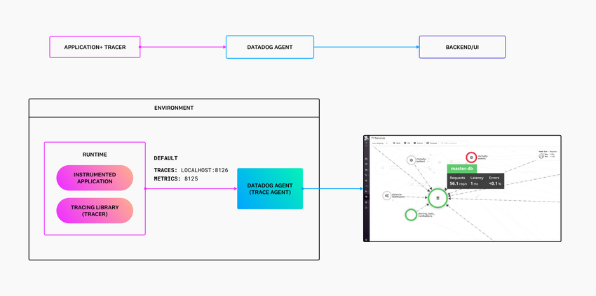
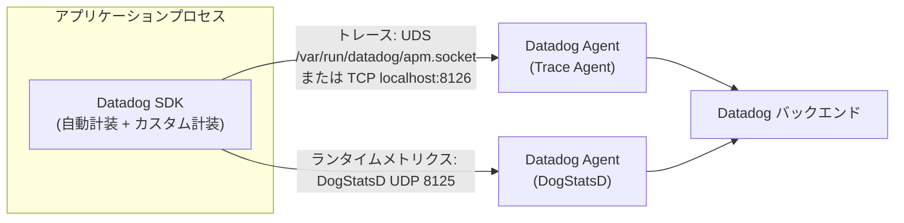
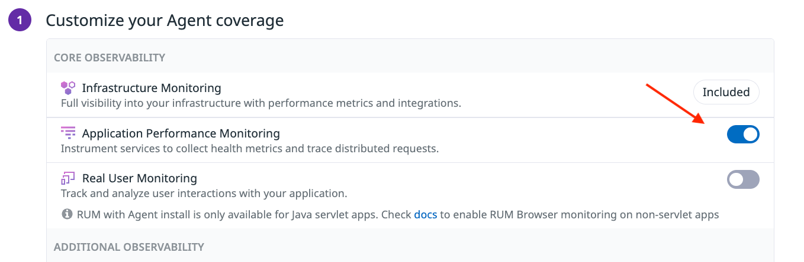
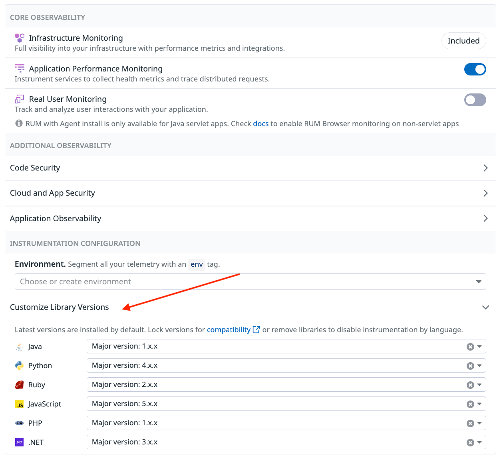
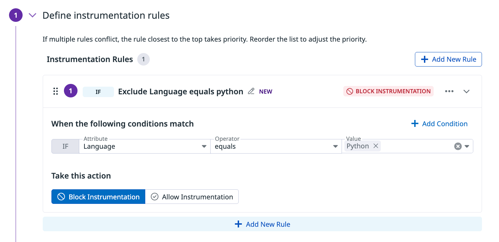
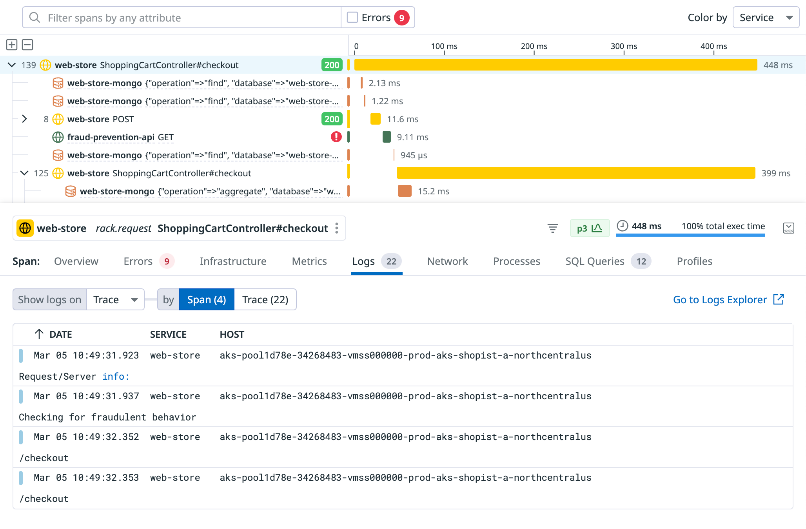

# APM インスツルメンテーション

## 概要

APM インスツルメンテーション（計装）は、アプリケーションに Datadog SDK を組み込み、リクエスト処理やDB呼び出しなどの処理単位をスパン（span）として記録し、Datadog Agent 経由で Datadog に送信できるようにする作業である。Datadog の公式ドキュメントは、アプリケーションに組み込むライブラリを現在 **Datadog SDK** と呼ぶ（従来の呼称：トレーサー（tracer）／トレーシングライブラリ。GitHub リポジトリ名は引き続き `dd-trace-*`）[出典](https://docs.datadoghq.com/tracing/trace_collection/)。

APM の計装方法は、公式ドキュメント上で次の5つに整理されている。複数の方法は組み合わせて使える（例：SSI で SDK を入れ、重要な業務処理だけコードでカスタムスパンを追加する）[出典](https://docs.datadoghq.com/tracing/trace_collection/)。

1. **Single Step Instrumentation（SSI、推奨）**：Agent のインストール時に1コマンドで SDK を自動インストール・自動ロードする。コード変更は不要。
2. **手動管理の Datadog SDK（Manually managed SDKs）**：SDK をアプリケーションのコード、ビルド、起動コマンドに自分で組み込み、環境変数とコードで細かく制御する。
3. **Dynamic Instrumentation**：Datadog UI でルールを定義し、再デプロイなしで実行時にカスタムスパンを追加する（詳細は [Dynamic Instrumentation と Live Debugger](./dynamic-instrumentation.md)）。
4. **コードによるカスタム計装（Code-based custom instrumentation）**：Datadog API または OpenTelemetry API をコードから呼び、業務処理のスパンやタグを追加する。
5. **OpenTelemetry**：ベンダー中立の OTel SDK で計装し、Datadog に送る（データ経路の詳細は [OpenTelemetry サポート](../platform/opentelemetry.md)）。

なお **自動計装（auto-instrumentation）** は独立した計装方法ではなく、SDK がロードされると対応フレームワーク・ライブラリのスパンが自動生成されるという、上記すべての土台となる既定動作である [出典](https://docs.datadoghq.com/tracing/trace_collection/)。

本ファイルが扱う範囲と、扱わない範囲（リンク先）は次のとおり。

| 扱う | 扱わない（リンク先） |
|---|---|
| SSI（Linux / Docker / Kubernetes / Windows）の対応環境・手順・設定 | APM の概念（スパン、サービス、リソース）、サンプリング、取り込み制御 → [APM の概念とインジェスト制御](./apm-concepts-and-ingestion.md) |
| 言語別 SDK の対応バージョン・導入方法 | APM 画面の使い方 → [APM 画面と分析機能](./apm-ui-and-analysis.md) |
| 自動計装／カスタム計装 | Profiler の詳細 → [Continuous Profiler](./continuous-profiler.md) |
| ログとトレースの相関 | ログ収集の Agent 側設定 → [ログ収集](../logs/log-collection.md) |
| SDK の主な設定キーとデフォルト値、コンテキスト伝播 | OTLP 受信、DDOT Collector など OTel のデータ経路 → [OpenTelemetry サポート](../platform/opentelemetry.md) |
| OTel API を Datadog SDK で使う計装 | Lambda 等のサーバーレス計装 → [Serverless Monitoring](../infrastructure/serverless.md) |
| | Agent 本体の設定 → [Agent 設定リファレンス](../platform/agent-configuration.md)、Kubernetes の Agent 導入 → [コンテナ/Kubernetes向けAgent](../platform/kubernetes-and-containers-agent.md) |
| | eBPF によるコード変更不要のサービス可視化 → [Universal Service Monitoring](./universal-service-monitoring.md) |

## 計装方法の比較

### SDK のセットアップ方法の比較

Datadog SDK のセットアップ方法は、SSI と手動管理の2つに分かれる [出典](https://docs.datadoghq.com/tracing/trace_collection/)。

| 観点 | Single Step Instrumentation（推奨） | 手動管理の Datadog SDK |
|---|---|---|
| 仕組み | 実行時に SDK を自動インストール・自動ロード | コードまたはビルド・起動設定で SDK を組み込む |
| コード変更 | 不要 | 必要（依存追加、起動オプション追加など） |
| 導入の複雑さ | 低 | 中 |
| 設定の制御 | 既定値＋任意の上書き | 環境変数とコードで完全に制御 |
| 向いている場面 | 多数のサービスへ速く一貫して展開する | SDK を細かく制御したい、SSI 非対応環境 |
| 対応言語 | Java、Python、Node.js、.NET、Ruby、PHP（Go、C++、Rust は非対応） | 全言語 |

### スパンのカスタマイズ方法の比較

自動計装で取れない処理のスパンを追加する方法は、Dynamic Instrumentation とコードによるカスタム計装の2つである [出典](https://docs.datadoghq.com/tracing/trace_collection/)。

| 観点 | Dynamic Instrumentation | コードによるカスタム計装 |
|---|---|---|
| 仕組み | UI で定義したルールを実行時に適用 | コードでトレーシング API を明示的に呼ぶ |
| コード変更 | 不要 | 必要 |
| デプロイ | 不要 | スパン追加・変更のたびに必要 |
| 向いている場面 | 再デプロイなしで一時的・調査的にスパンを足す | 複雑なロジック、恒久的に定義したいスパン |

### 言語ごとの計装手段の対応表

| 言語 | SSI | 自動計装（ライブラリ統合） | Datadog API による手動計装 | OTel API（Datadog SDK 経由） | SDK の配布形態 |
|---|---|---|---|---|---|
| Java | 対応 | あり | あり | あり | `dd-java-agent.jar`（`-javaagent`） |
| Python | 対応 | あり | あり | あり | `ddtrace`（pip） |
| Node.js | 対応 | あり | あり | あり | `dd-trace`（npm） |
| .NET | 対応（Linux、Windows は IIS／ホスト全体【Preview】） | あり | あり | あり | MSI、deb/rpm/tar.gz、NuGet `Datadog.Trace.Bundle` |
| Ruby | 対応 | あり | あり | あり | `datadog` gem |
| PHP | 対応 | あり | あり | あり | `datadog-setup.php` による拡張モジュール |
| Go | 非対応 | Orchestrion（コンパイル時計装）または contrib パッケージ | あり | あり | `github.com/DataDog/dd-trace-go/v2` |
| C++ | 非対応 | なし（プロキシ向けモジュールを除く） | あり | 公開情報では確認できず | `dd-trace-cpp`（CMake） |
| Rust | 非対応 | なし | なし（OTel API で計装） | あり（Preview） | `datadog-opentelemetry` クレート |

出典：[計装方法](https://docs.datadoghq.com/tracing/trace_collection/)、[SSI 互換性](https://docs.datadoghq.com/tracing/trace_collection/single-step-apm/compatibility/)、[カスタム計装](https://docs.datadoghq.com/tracing/trace_collection/custom_instrumentation/)、[Go](https://docs.datadoghq.com/tracing/trace_collection/automatic_instrumentation/dd_libraries/go/)、[C++](https://docs.datadoghq.com/tracing/trace_collection/automatic_instrumentation/dd_libraries/cpp/)、[Rust](https://docs.datadoghq.com/tracing/trace_collection/automatic_instrumentation/dd_libraries/rust/)。公式のセットアップページ一覧には上記のほか Android、iOS があるが、これらはモバイル RUM 側のトレースであり本ファイルでは扱わない（[RUM（モバイル）](../dem/rum-mobile.md)）[出典](https://docs.datadoghq.com/tracing/trace_collection/dd_libraries/)。

## トレースのデータフロー

APM のトレースは、アプリケーション内の Datadog SDK が生成し、ローカルの Datadog Agent（Trace Agent）に送られ、Agent から Datadog のバックエンドに転送される [出典](https://docs.datadoghq.com/tracing/trace_collection/)。



- **キャプション**：APM パイプライン（The APM pipeline）の概念図
- **画面の説明**：上段は「APPLICATION + TRACER → DATADOG AGENT → BACKEND/UI」の3段の流れを示す。下段の「ENVIRONMENT」枠内では、「RUNTIME」の中に「INSTRUMENTED APPLICATION」と「TRACING LIBRARY (TRACER)」があり、既定の送信先として「TRACES: LOCALHOST:8126」「METRICS: 8125」と書かれ、「DATADOG AGENT (TRACE AGENT)」へ矢印が伸び、さらに右側の Datadog UI（サービスマップ画面）へ送られる様子を描いている。
- **出典**：https://docs.datadoghq.com/tracing/trace_collection/ （2026-11-02 取得）



Datadog Agent 側のトレース受信設定は次のとおり [出典](https://docs.datadoghq.com/tracing/trace_collection/dd_libraries/)。

| 項目 | 内容 |
|---|---|
| APM の有効化 | `datadog.yaml` の `apm_config.enabled: true`（既定で有効） |
| 受信アドレス（TCP） | `http://localhost:8126` |
| 受信アドレス（UDS） | SDK はまず `/var/run/datadog/apm.socket` を試し、存在しなければ `http://localhost:8126` にフォールバックする |
| コンテナからの受信 | `apm_config.apm_non_local_traffic: true`（環境変数 `DD_APM_NON_LOCAL_TRAFFIC=true`） |
| SDK 側の送信先上書き | `DD_TRACE_AGENT_URL`（ソケット、ホスト、ポートをまとめて指定） |

## Single Step Instrumentation（SSI）

### SSI の仕組み

Single Step Instrumentation（SSI、Single Step APM Instrumentation とも表記）は、APM Instrumentation を有効にして Datadog Agent をインストール（または更新）すると、Agent が対応プロセスに Datadog SDK をロードする仕組みである。コード変更なしで分散トレーシングが有効になり、公式は「オンボーディング時間を数日から数分に短縮する」と説明している [出典](https://docs.datadoghq.com/tracing/trace_collection/single-step-apm/)。

SSI の内部動作の要点は次のとおり [出典](https://docs.datadoghq.com/tracing/trace_collection/single-step-apm/troubleshooting/)。

- Linux ホストでは、インジェクター（`launcher.preload.so`）を `/etc/ld.so.preload` に登録し、新しく起動するプロセスにプリロードする。パッケージは `/opt/datadog-packages/datadog-apm-inject` などに配置される。
- Docker では、Docker の既定ランタイムが Datadog のランタイム `dd-shim` に置き換わり、コンテナ作成時に注入される [出典](https://docs.datadoghq.com/tracing/trace_collection/single-step-apm/docker/)。
- Kubernetes では、Datadog Cluster Agent の Admission Controller が Pod 作成時に変更（mutation）を加え、init コンテナまたは CSI ドライバーで SDK を配置する [出典](https://docs.datadoghq.com/tracing/trace_collection/single-step-apm/kubernetes/)。
- インジェクターはプロセスの言語ランタイム（Java、Python、Node.js、Ruby、.NET、PHP）を検出し、対応しない SDK／ランタイムの組み合わせでは計装せずにアプリケーションをそのまま起動する（フォールバック）[出典](https://docs.datadoghq.com/tracing/trace_collection/single-step-apm/compatibility/)。

SSI の前提条件として、公式は次を挙げる [出典](https://docs.datadoghq.com/tracing/trace_collection/single-step-apm/)。

- 既存のカスタム計装コードを削除し、アプリケーションを再起動しておく（カスタム計装が検出されると SSI は自らを無効化する）。
- 互換性ガイドで言語、OS、アーキテクチャの対応を確認する。

### SSI の対応環境

| 環境 | 提供状況 | OS / ノード範囲 | アーキテクチャ | 主な要件 |
|---|---|---|---|---|
| Linux ホスト | GA | 下表の Linux ディストリビューション | x86_64、arm64 | APM Instrumentation を有効にした Datadog Agent |
| Docker | GA | 下表の Linux ディストリビューション | x86_64、arm64 | APM Instrumentation を有効にした Datadog Agent、対応ディストリビューション上の Docker |
| Kubernetes | GA | Linux ノードプールのみ | x86_64、arm64 | Datadog Admission Controller の有効化 |
| EKS Fargate | 【Preview】 | 公開情報では確認できず | 公開情報では確認できず | 公開情報では確認できず |
| Windows IIS | GA | IIS 上の .NET アプリケーションのみ | 公開情報では確認できず | Agent 7.67.1 以降、.NET SDK 3.19.0 以降 |
| Windows ホスト全体（Java＋IIS .NET） | 【Preview】（要申込） | Windows | 公開情報では確認できず | Agent インストールページで生成したコマンド |
| ECS Fargate | **非対応** | — | — | — |

出典：[SSI 互換性](https://docs.datadoghq.com/tracing/trace_collection/single-step-apm/compatibility/)、[SSI Windows](https://docs.datadoghq.com/tracing/trace_collection/single-step-apm/windows/)

SSI が対応する Linux ディストリビューション（Linux ホスト、Docker、Kubernetes 共通。いずれも x86_64 と arm64）[出典](https://docs.datadoghq.com/tracing/trace_collection/single-step-apm/compatibility/)。

| OS | バージョン |
|---|---|
| Amazon Linux | 2022、2023 |
| CentOS | 7、8 |
| Debian | 10、11、12 |
| Red Hat Enterprise Linux | 7、8、9 |
| Ubuntu | 20、22、24（LTS） |
| Fedora | 40 |
| AlmaLinux | 8 |
| Oracle Linux | 8 |
| Rocky Linux | 8 |

### SSI の言語別要件

| 言語 | SSI が使う最小 SDK バージョン | ランタイム要件 | 制限・既知の問題 |
|---|---|---|---|
| Java | 1.44.0 | Java SDK の互換性に準拠。Java 24 以降では `--enable-native-access=ALL-UNNAMED` を付与 | 拒否リスト（denylist）にあるアプリ・ライブラリは計装しない。JVM 引数や環境変数が長すぎると初期化に失敗することがある。`-javaagent` を既に使っているアプリはスキップ |
| Python | 2.20.1 | Python 3.7 以降。CentOS Stream 8+ / RHEL 8+ では既定で利用可 | プリフォーク型 WSGI サーバー（uWSGI preforking、gunicorn `--preload`、preload 付き mod_wsgi daemon）で SIGSEGV によるクラッシュが起こりうる |
| Ruby | 2.6.0 | glibc 2.17 以降、Bundler 2.4 以上 4.0 未満、RubyGems 3.4 以上 4.0 未満 | Alpine など musl ベースのディストリビューションに非対応。アンインストール前に `Gemfile` と `Gemfile.lock` をバックアップし、後で戻すか `bundle install` を実行する |
| Node.js | 4.0 | CentOS Stream 9+ / RHEL 9+ では既定で利用可 | ESM モジュールは計装されない |
| .NET | 3.7.0 | .NET Core、.NET Framework | 1プロセスに CLR プロファイラーは1つだけ。競合する `CORECLR_*` 変数や `LD_PRELOAD` は削除が必要 |
| PHP | 1.6.0 | PHP SDK の互換性に準拠 | JIT 有効時、または Xdebug、ionCube Loader、New Relic、Blackfire、pcov と併用時は無効化される（`DD_INJECT_FORCE=true` で強制有効化） |

出典：[SSI 互換性](https://docs.datadoghq.com/tracing/trace_collection/single-step-apm/compatibility/)、[SSI トラブルシューティング](https://docs.datadoghq.com/tracing/trace_collection/single-step-apm/troubleshooting/)

その他の SSI の制限 [出典](https://docs.datadoghq.com/tracing/trace_collection/single-step-apm/compatibility/)。

- Linux ホストでは強化（hardened）SELinux 環境に非対応。
- `t2.micro` のような極小インスタンスではタイムアウトすることがある（`t2.small` 以上を推奨）。インジェクターの解析処理には1秒の上限がある [出典](https://docs.datadoghq.com/tracing/trace_collection/single-step-apm/troubleshooting/)。
- Rootless Docker では `/etc/datadog-agent/inject/docker_config.yaml` のソケットパスを変更する（既定は `/run/user/$UID/docker.sock`）。GPU ワークロード等の独自 `runc` シムを使う場合は、同ファイルの `runtimes` に独自ランタイムと Datadog ランタイムの両方を記載する。
- Kubernetes の Windows Pod は SSI の対象外で、名前空間の包含・除外やアノテーションで除外する。
- SSI は計装対象アプリの起動時間をわずかに増やす。許容できない場合は Datadog サポートへの問い合わせが案内されている [出典](https://docs.datadoghq.com/tracing/trace_collection/single-step-apm/linux/)。
- IDE やデータベースなど一部のプロセスは既定の拒否リストにより注入されない。静的リンクされたランチャーは注入をすり抜けることがある [出典](https://docs.datadoghq.com/tracing/trace_collection/single-step-apm/troubleshooting/)。

### SSI：Linux ホストへの導入

Linux ホストでは、Agent インストールスクリプトに `DD_APM_INSTRUMENTATION_ENABLED=host` を付けて実行する。Agent と SSI パッケージが同時にインストール（または更新）される [出典](https://docs.datadoghq.com/tracing/trace_collection/single-step-apm/linux/)。

```shell
DD_API_KEY=<YOUR_DD_API_KEY> \
DD_SITE="<YOUR_DATADOG_SITE>" \
DD_APM_INSTRUMENTATION_ENABLED=host \
bash -c "$(curl -L https://install.datadoghq.com/scripts/install_script_agent7.sh)"
```

- 実行後、計装したいアプリケーションを再起動する（プリロードは新規プロセスにのみ効くため、シェルも開き直す）。
- Datadog UI の「Install the Datadog Agent on Linux」ページで Core Observability の APM をオンにすると、API キーとサイトを埋め込んだコマンドが生成される。



- **キャプション**：Agent インストールページの「Customize your Agent coverage」で APM を有効化する画面
- **画面の説明**：「CORE OBSERVABILITY」欄に「Infrastructure Monitoring」（Included と表示）、「Application Performance Monitoring」（トグルがオン、赤矢印で強調）、「Real User Monitoring」（トグルがオフ、「RUM with Agent install is only available for Java servlet apps」の注記）が並ぶ。その下に「ADDITIONAL OBSERVABILITY」欄が続く。
- **出典**：https://docs.datadoghq.com/tracing/trace_collection/single-step-apm/linux/ （2026-11-02 取得）

導入後の確認方法 [出典](https://docs.datadoghq.com/tracing/trace_collection/single-step-apm/linux/)。

```shell
sudo datadog-agent status
cat /etc/ld.so.preload && ls /opt/datadog-packages/ | grep apm
```

`/etc/ld.so.preload` に APM インジェクターのライブラリが、`/opt/datadog-packages/` に `datadog-apm-*` パッケージが表示されれば導入済みである。トラフィック発生後、APM の Services 画面にサービスが現れることを確認する。

### SSI：Docker への導入

Docker では、(1) Docker ホスト上に計装コンポーネントを入れ、(2) Agent コンテナを起動し、(3) アプリケーションコンテナを作り直す、の3段階で導入する [出典](https://docs.datadoghq.com/tracing/trace_collection/single-step-apm/docker/)。

```shell
# 1. Docker ホスト上で計装コンポーネントのみをインストール（ホスト Agent は入れない）
DD_APM_INSTRUMENTATION_ENABLED=docker \
DD_NO_AGENT_INSTALL=true \
bash -c "$(curl -L https://install.datadoghq.com/scripts/install_script_agent7.sh)"

# 2. Agent コンテナを起動
docker run -d --name dd-agent \
  -e DD_API_KEY=<YOUR_DD_API_KEY> \
  -e DD_SITE="<YOUR_DATADOG_SITE>" \
  -e DD_DOGSTATSD_NON_LOCAL_TRAFFIC=true \
  -e DD_APM_ENABLED=true \
  -e DD_APM_NON_LOCAL_TRAFFIC=true \
  -e DD_APM_RECEIVER_SOCKET=/var/run/datadog/apm.socket \
  -e DD_DOGSTATSD_SOCKET=/var/run/datadog/dsd.socket \
  -v /var/run/datadog:/var/run/datadog \
  -v /var/run/docker.sock:/var/run/docker.sock:ro \
  -v /proc/:/host/proc/:ro \
  -v /sys/fs/cgroup/:/host/sys/fs/cgroup:ro \
  -v /var/lib/docker/containers:/var/lib/docker/containers:ro \
  registry.datadoghq.com/agent:7
```

| 注意点 | 内容 |
|---|---|
| コンテナの作り直し | 計装はコンテナ **作成時** にのみ適用される。`docker stop` / `docker start` では既存コンテナは計装されないため、削除して `docker run` し直す |
| Agent は1ノード1つ | 既に `dd-agent` がある場合は定義（Compose 等）を更新して再作成する |
| 確認 | `docker system info --format '{{.DefaultRuntime}}'` が `dd-shim` であること（`runc` 等なら未導入）。`docker inspect <CONTAINER> --format '{{.HostConfig.Runtime}}'` でアプリコンテナが Datadog ランタイムを使うことを確認 |
| 個別サービスの除外 | `docker run -e DD_INSTRUMENT_SERVICE_WITH_APM=false ...` |
| 全体の削除 | `dd-container-install --uninstall` の後 `systemctl restart docker`（または環境に応じた再起動） |

### SSI：Kubernetes への導入

Kubernetes では、Datadog Operator または Helm チャートで APM Instrumentation を有効にする。前提は Kubernetes 1.20 以降、Helm と kubectl [出典](https://docs.datadoghq.com/tracing/trace_collection/single-step-apm/kubernetes/)。

```yaml
# Datadog Operator（DatadogAgent, datadoghq.com/v2alpha1）
spec:
  global:
    site: <DATADOG_SITE>
    clusterName: <CLUSTER_NAME>
    credentials:
      apiSecret:
        secretName: datadog-secret
        keyName: api-key
  features:
    apm:
      instrumentation:
        enabled: true
```

```yaml
# Helm（datadog/datadog チャートの values.yaml）
datadog:
  site: <DATADOG_SITE>
  clusterName: <CLUSTER_NAME>
  apiKeyExistingSecret: datadog-secret
  apm:
    instrumentation:
      enabled: true
```

- Agent はアプリケーションとは別の名前空間（例：`datadog`）で動かす。Agent の名前空間内のアプリは計装されない。
- ターゲティングルールを指定しない場合、全名前空間の対応ワークロードが最新 SDK で計装される。
- Admission Controller は稼働中の Pod を変更できないため、Agent 導入後にアプリの Pod を再作成する。

#### ターゲティングルール（targets、Agent 7.64 以降）

`apm.instrumentation.targets` は上から順に評価され、最初に一致したブロックが適用される [出典](https://docs.datadoghq.com/tracing/trace_collection/single-step-apm/kubernetes/)。

| キー | 内容 |
|---|---|
| `name` | メタデータ（動作には影響しない） |
| `namespaceSelector` | `matchNames`、`matchLabels`、`matchExpressions`（すべて満たす必要あり） |
| `podSelector` | `matchLabels`、`matchExpressions`（すべて満たす必要あり） |
| `ddTraceVersions` | 言語ごとの SDK バージョン（`java`、`python`、`js`、`dotnet`、`ruby`、`php`）。`"default"` または固定バージョン |
| `ddTraceConfigs` | `name` と `value` または `valueFrom` のリスト。`DD_*` の SDK 設定を注入 |

```yaml
# Helm の例（イメージ）
datadog:
  apm:
    instrumentation:
      enabled: true
      targets:
        - name: "billing-python"
          namespaceSelector:
            matchNames: ["billing"]
          podSelector:
            matchLabels:
              language: python
          ddTraceVersions:
            python: "default"
          ddTraceConfigs:
            - name: "DD_PROFILING_ENABLED"
              value: "auto"
```

旧方式（Agent 7.63 以前）として、`enabledNamespaces` と `disabledNamespaces`（どちらか一方のみ指定可）、クラスタ単位の `libVersions`、Pod アノテーション `admission.datadoghq.com/<言語>-lib.version` がある。`libVersions` を指定すると列挙した言語だけが計装される。`latest` タグはメジャーバージョンの破壊的変更を取り込みうるため注意が必要 [出典](https://docs.datadoghq.com/tracing/trace_collection/single-step-apm/kubernetes/)。

#### DatadogInstrumentation CRD（Agent／Cluster Agent 7.85 以降）

ワークロード単位で計装を制御する `DatadogInstrumentation`（DDI、`datadoghq.com/v1alpha1`）カスタムリソースが使える。要件は Datadog Operator 1.31.0 以降または Helm チャート 3.255.0 以降（DDI CRD をインストール）[出典](https://docs.datadoghq.com/tracing/trace_collection/single-step-apm/kubernetes/)。

| 項目 | 内容 |
|---|---|
| 作成場所 | 対象ワークロードと同じ名前空間 |
| `spec.targetRef` | `apiVersion`、`kind`、`name` |
| 対応 kind | Deployment、StatefulSet、DaemonSet、Job、CronJob、Argo Rollout |
| 個数 | 1ワークロードにつき DDI は1つ（既存があれば `config.apm` を追記） |
| `spec.config.apm.enabled` | `false` でそのワークロードの計装を無効化 |
| `spec.config.apm.ddTraceVersions` | `java`、`js`、`python`、`dotnet`、`ruby`、`php`、`c`。列挙した SDK のみ注入。省略時は Agent の既定セット |
| `spec.config.apm.ddTraceConfigs` | `name` は `DD_` で始まる必要あり。`value` または `valueFrom` |

計装設定の優先順位（高い順）[出典](https://docs.datadoghq.com/tracing/trace_collection/single-step-apm/kubernetes/)。

1. Pod アノテーション（例：`admission.datadoghq.com/java-lib.version`）
2. DDI の APM 設定
3. Remote Configuration のポリシー（有効時）
4. Agent の `targets` または `enabledNamespaces`
5. クラスタ全体の計装設定

なお `disabledNamespaces` は常に優先される [出典](https://docs.datadoghq.com/tracing/trace_collection/single-step-apm/troubleshooting/)。

#### 注入モード（injectionMode）

| モード | 動作 | 要件 |
|---|---|---|
| `auto`（既定） | Cluster Agent がモードを選択（選択ロジックはバージョンで変わりうる） | Agent 7.76.0 以降 |
| `init_container` | init コンテナがインジェクターと SDK のファイルをアプリコンテナへコピー | Helm または Operator |
| `csi` | Datadog CSI ドライバーでファイルをマウント。Pod 起動が速い | Agent 7.76.0 以降、CSI ドライバー 1.2.0 以降、Helm チャート 3.178.1 以降または Operator 1.25.0 以降 |

- クラスタ全体：Helm は `datadog.apm.instrumentation.injectionMode`、Operator は `features.apm.instrumentation.injectionMode`（Operator 1.25.0 未満は Pod アノテーションで指定）。
- Pod 単位：アノテーション `admission.datadoghq.com/apm-inject.injection-mode`。
- CSI を使う場合は CSI ドライバーをインストール・有効化する（Helm は `datadog.csi.enabled: true`）。`auto` では CSI が導入済みかつ安全に使える場合のみ CSI が選ばれる。GKE Autopilot には追加要件がある。

出典：[SSI Kubernetes](https://docs.datadoghq.com/tracing/trace_collection/single-step-apm/kubernetes/)

#### イメージレジストリ

| 項目 | 内容 |
|---|---|
| 既定レジストリ | `gcr.io/datadoghq`（Cluster Agent の `DD_ADMISSION_CONTROLLER_AUTO_INSTRUMENTATION_CONTAINER_REGISTRY` で変更） |
| 代替 | `docker.io/datadog`、`public.ecr.aws/datadog`、プライベートレジストリ |
| イメージ名 | `apm-inject`、`dd-lib-java-init`、`dd-lib-js-init`、`dd-lib-python-init`、`dd-lib-dotnet-init`、`dd-lib-ruby-init`、`dd-lib-php-init` |
| プライベートミラー | 使う言語のイメージだけを `crane` 等でミラーし、ワークロードが使うバージョンのタグを付ける（例：Java のメジャー `1` なら `dd-lib-java-init:1`）。`apm-inject` は既定タグ `0` |

出典：[SSI Kubernetes](https://docs.datadoghq.com/tracing/trace_collection/single-step-apm/kubernetes/)

#### Kubernetes での無効化と削除

| 範囲 | 方法 |
|---|---|
| ワークロード単位（DDI） | `spec.config.apm.enabled: false` を適用し、ワークロードを再起動（既存 Pod は置き換わるまで計装されたまま） |
| ワークロード単位（targets） | targets から外す、または `matchExpressions` の `NotIn` で除外 |
| Pod 単位 | Pod テンプレートにラベル `admission.datadoghq.com/enabled: "false"`（他の mutating webhook も無効になる点に注意） |
| クラスタ全体 | DDI の APM 無効化・削除 → SDK 選択アノテーションと Remote Configuration の計装ポリシーを削除 → `features.apm.instrumentation.enabled: false`（Operator）または `datadog.apm.instrumentation.enabled: false`（Helm）→ Pod を置き換え |

EKS で Calico などの CNI を使うと、コントロールプレーンから Admission Controller への呼び出しが「Address is not allowed」で失敗することがある。この場合は `clusterAgent.useHostNetwork: true` を設定する [出典](https://docs.datadoghq.com/tracing/trace_collection/single-step-apm/kubernetes/)。

#### Local SDK Injection（SSI を使わない Pod 単位の注入）

Local SDK Injection（旧称：Library Injection / ライブラリインジェクション）は、SSI のようにクラスタ全体を設定せず、Pod のラベルとアノテーションで個別に SDK を注入する手動の方法である [出典](https://docs.datadoghq.com/tracing/guide/local_sdk_injection/)。

| 項目 | 内容 |
|---|---|
| 要件 | Kubernetes 1.14 以降。Cluster Agent 7.40 以降（Java、Python、Node.js）、7.44 以降（.NET、Ruby）。Admission Controller 有効（Helm チャート 2.35.0 以降、Operator 1.0.0 以降は既定で有効） |
| Pod の変更を許可 | ラベル `admission.datadoghq.com/enabled: "true"`、または `mutateUnlabelled: true` で全 Pod を対象化 |
| SDK の指定 | アノテーション `admission.datadoghq.com/java-lib.version`、`js-lib.version`、`python-lib.version`、`dotnet-lib.version`、`ruby-lib.version` にイメージタグを指定 |
| UST | ラベル `tags.datadoghq.com/env`、`tags.datadoghq.com/service`、`tags.datadoghq.com/version` を付けると `DD_ENV`、`DD_SERVICE`、`DD_VERSION` が設定される |
| 成功の確認 | `kubectl describe pod` で init コンテナ `datadog-init-apm-inject` と `datadog-lib-<LANGUAGE>-init` が追加されていること |
| 対象外 | Agent 7.73.0 以降、`kube-system` と Cluster Agent の名前空間には注入しない |
| 既存 SDK との関係 | コンテナに手動で SDK が入っている場合、注入したバージョンが優先される |

### SSI：Windows への導入

Windows の SSI には、IIS 上の .NET のみを対象とする方式（GA）と、ホスト全体を対象とする方式（【Preview】、要申込）がある [出典](https://docs.datadoghq.com/tracing/trace_collection/single-step-apm/windows/)。

| 方式 | 対象 | 主な指定 |
|---|---|---|
| IIS のみ（GA） | IIS 上の .NET アプリ | `DD_APM_INSTRUMENTATION_ENABLED=iis`、`DD_APM_INSTRUMENTATION_LIBRARIES=dotnet:3`（省略時は最新） |
| ホスト全体（【Preview】） | ホスト上のすべての Java アプリと IIS 上の .NET アプリ。IIS 外の .NET アプリは allow ルールが必要 | Agent インストールページで生成したコマンド |

MSI による IIS 方式の例（PowerShell、管理者）。

```powershell
Start-Process -Wait msiexec -ArgumentList '/qn /norestart /i "https://windows-agent.datadoghq.com/datadog-agent-7-latest.amd64.msi" /log C:\Windows\SystemTemp\install-datadog.log APIKEY="<YOUR_DD_API_KEY>" SITE="<YOUR_DATADOG_SITE>" DD_APM_INSTRUMENTATION_ENABLED="iis" DD_APM_INSTRUMENTATION_LIBRARIES="dotnet:3"'
```

- PowerShell インストーラー（`datadog-installer-x86_64.exe` を `C:\Windows\SystemTemp` にダウンロードして実行）でも導入できる。
- Chocolatey は SSI 設定を保持せず、SSI を有効化できない。
- IIS サーバー全体ではなく、計装したい IIS アプリケーションだけを再起動する。
- 確認：`%ProgramFiles%\Datadog\Datadog Agent\bin\agent.exe status` の APM Agent 節。
- 削除（.NET SSI）：`&"C:\Program Files\Datadog\Datadog Agent\bin\datadog-installer.exe" remove datadog-apm-library-dotnet`。Java SSI の削除手順は公開情報では確認できず。

### SSI：既存 Agent へのリモート展開

既に Agent が入っているホストには、Datadog UI からリモートで SSI を展開できる（Linux、Windows）[出典](https://docs.datadoghq.com/tracing/trace_collection/single-step-apm/linux/)。Remote Configuration と Fleet Automation の仕組みは [Fleet Automation と Remote Configuration](../platform/fleet-automation.md) を参照。

1. **APM > Instrument a Service** で **Deploy on existing hosts** を選ぶ。
2. Environments、Hostname、APM enabled で絞り込み、**Eligible for deployment** タブから対象 Agent を選ぶ（対象外は Excluded に表示）。
3. SDK の自動インストール有無を選び、必要に応じて **Customize library versions** でバージョンを固定する。
4. ロールアウト戦略（段階ごとの Agent の割合）を設定する。**連続3台の Agent が失敗、または失敗率が10%に達すると展開は自動停止**する。
5. Summary または YAML で確認し、**Apply Instrumentation** をクリックする。

### SSI：SDK バージョンの固定と更新

SSI は既定で各言語の最新メジャーの SDK をインストールし、マイナー更新は自動で適用される [出典](https://docs.datadoghq.com/tracing/trace_collection/single-step-apm/docker/)。

| 項目 | 内容 |
|---|---|
| 固定方法（Linux / Docker / Windows） | インストールコマンドに `DD_APM_INSTRUMENTATION_LIBRARIES` を付け、`言語:メジャー` をカンマ区切りで指定（例：`java:1,python:4`） |
| 言語識別子 | `java`、`js`（Node.js）、`python`、`dotnet`、`ruby`、`php` |
| 固定方法（Kubernetes） | `targets[].ddTraceVersions`、DDI、または Pod アノテーション |
| UI での指定 | Agent インストールページの **Customize Library Versions** でドロップダウンから選択。ライブラリを外すとその言語の計装を無効化できる |
| 更新（Linux） | Agent インストールコマンドを再実行（Agent も更新される）し、アプリを再起動 |



- **キャプション**：Agent インストールページの「Customize Library Versions」
- **画面の説明**：上部に「CORE OBSERVABILITY」（Infrastructure Monitoring、Application Performance Monitoring、Real User Monitoring）と「ADDITIONAL OBSERVABILITY」（Code Security、Cloud and App Security、Application Observability）が並び、「INSTRUMENTATION CONFIGURATION」の下に `env` タグを選ぶ「Environment」欄と、赤矢印で示された「Customize Library Versions」がある。展開すると「Latest versions are installed by default. Lock versions for compatibility or remove libraries to disable instrumentation by language.」の説明と、Java（Major version: 1.x.x）、Python（4.x.x）、Ruby（2.x.x）、JavaScript（5.x.x）、PHP（1.x.x）、.NET（3.x.x）のドロップダウンが並ぶ（表示されるバージョンはスクリーンショット取得時点の例）。
- **出典**：https://docs.datadoghq.com/tracing/trace_collection/single-step-apm/linux/ （2026-11-02 取得）

### SSI：Instrumentation Rules（計装ルール、Agent 7.73 以降）

Instrumentation Rules は、SSI がどのプロセスを計装するかを許可（Allow）／拒否（Block）ルールで制御する機能で、Linux ホストと Windows のホスト全体方式で使える（Windows の IIS のみ方式では使えない）[出典](https://docs.datadoghq.com/tracing/trace_collection/single-step-apm/linux/)、[出典](https://docs.datadoghq.com/tracing/trace_collection/single-step-apm/windows/)。

| 項目 | 内容 |
|---|---|
| 画面 | **APM > Service Setup > Manage Instrumentation Rules** → **Add or Edit Rules** → **Add New Rule** |
| 評価順 | 上から順に評価し、最初に一致したルールを適用（ドラッグで並べ替え） |
| 既定動作 | どのルールにも一致しないプロセスの扱い（allow / block）を設定 |
| 条件 | 属性（Attribute）、演算子（`equals`、`not equals`、`prefix`、`contains`）、値（Value） |
| 属性 | Operating System、Executable、Executable Full Path、Arguments、Working Directory、Language、Entry Point File、IIS Application Pool（Windows） |
| 反映 | Remote Configuration 有効時は約50秒以内に SSI 有効ホストへ反映。無効時はファイルをエクスポートして手動適用 |
| Bits AI | 自然言語の説明からルールを生成できる |
| 典型パターン | ①既定 allow ＋ノイズの多いプロセス（分析用 cron、Java バッチ等）を block、②既定 block ＋特定の作業ディレクトリや IIS アプリプールだけ allow（段階展開） |

IIS の .NET アプリはすべて `w3wp.exe` で動くため、特定アプリを狙うには IIS Application Pool 属性が最も確実である [出典](https://docs.datadoghq.com/tracing/trace_collection/single-step-apm/windows/)。



- **キャプション**：Instrumentation Rules の「Define instrumentation rules」画面
- **画面の説明**：「If multiple rules conflict, the rule closest to the top takes priority. Reorder the list to adjust the priority.」と説明があり、「Instrumentation Rules 1」の一覧に「IF Exclude Language equals python」ルール（右側に赤い「BLOCK INSTRUMENTATION」ラベル）が表示されている。展開部の「When the following conditions match」に Attribute＝Language、Operator＝equals、Value＝Python の条件行、「Take this action」に「Block Instrumentation」「Allow Instrumentation」の切替ボタン、下部に「Add New Rule」ボタンがある。
- **出典**：https://docs.datadoghq.com/tracing/trace_collection/single-step-apm/linux/ （2026-11-02 取得）

> **サイト差異:** Instrumentation Rules は `app.ddog-gov.com`（US1-FED）では利用できない [出典](https://docs.datadoghq.com/tracing/trace_collection/single-step-apm/linux/)。

### SSI：SDK 依存機能の有効化

SSI で入れた SDK の上で動く機能は、環境変数で有効化する。Linux ホストでは `application_monitoring.yaml` でホスト上の全サービスにまとめて設定でき、Kubernetes では `ddTraceConfigs` で注入できる [出典](https://docs.datadoghq.com/tracing/trace_collection/single-step-apm/linux/)。

| 機能 | 環境変数 | 値 |
|---|---|---|
| Runtime Metrics | `DD_RUNTIME_METRICS_ENABLED` | `true` / `false` |
| Log Injection（ログとトレースの相関） | `DD_LOGS_INJECTION` | `true` / `false` |
| Continuous Profiler | `DD_PROFILING_ENABLED` | `true` / `false` / `auto`（対象プロセスのみプロファイル。SSI で推奨） |
| Data Streams Monitoring | `DD_DATA_STREAMS_ENABLED` | `true` / `false` |
| App and API Protection（旧称：ASM） | `DD_APPSEC_ENABLED` | `true` / `false` |
| Runtime Code Analysis（IAST） | `DD_IAST_ENABLED` | `true` / `false` |
| Dynamic Instrumentation | `DD_DYNAMIC_INSTRUMENTATION_ENABLED` | `true` / `false` |
| Data Jobs Monitoring | `DD_DATA_JOBS_ENABLED` | `true` / `false` |
| Software Composition Analysis | `DD_APPSEC_SCA_ENABLED` | `true` / `false` |

各機能の詳細は [Continuous Profiler](./continuous-profiler.md)、[Data Streams Monitoring](./data-streams-monitoring.md)、[App and API Protection](../security/app-and-api-protection.md)、[Code Security](../security/code-security.md)、[Dynamic Instrumentation と Live Debugger](./dynamic-instrumentation.md)、[Data Jobs Monitoring](../data/data-jobs-monitoring.md) を参照。

### SSI と Unified Service Tagging

Unified Service Tagging（UST、統合サービスタグ付け）は `env`、`service`、`version` の3タグをトレース・メトリクス・ログで揃える仕組みで、SSI 導入後に設定することが推奨されている（タグ全般は [Tagging（タグ）](../platform/tagging.md)）[出典](https://docs.datadoghq.com/tracing/trace_collection/single-step-apm/)。

| 環境 | UST の設定方法 |
|---|---|
| Linux ホスト | 非コンテナ環境向け UST 手順（環境変数 `DD_ENV`、`DD_SERVICE`、`DD_VERSION` 等） |
| Docker | Docker 向け UST 手順（コンテナの環境変数・ラベル） |
| Kubernetes（推奨） | `kubernetesResourcesLabelsAsTags` で `pods`、`deployments.apps`、`replicasets.apps` のラベル（例：`app.kubernetes.io/name`）を `service` に対応付け、`env` はグローバル `tags`（例：`env:production`）で付与。要件：Agent 7.69 以降、Operator 1.16.0 以降、Helm チャート 3.120.0 以降。Remote Configuration とは併用不可 |
| Kubernetes（明示） | `ddTraceConfigs` で `DD_SERVICE` を `valueFrom.fieldRef.fieldPath: metadata.labels['app.kubernetes.io/name']` から設定。`DD_VERSION` はイメージタグから自動抽出可能 |
| Windows | Windows サービス向け UST 手順 |

出典：[SSI Kubernetes](https://docs.datadoghq.com/tracing/trace_collection/single-step-apm/kubernetes/)

### SSI の無効化と削除（まとめ）

| 環境 | サービス単位の除外 | 全体の削除 |
|---|---|---|
| Linux ホスト | Instrumentation Rules の Block ルール、または `DD_INSTRUMENT_SERVICE_WITH_APM=false` | `dd-host-install --uninstall` の後、ホスト上のサービスを再起動 |
| Docker | `DD_INSTRUMENT_SERVICE_WITH_APM=false` | `dd-container-install --uninstall` の後、Docker を再起動 |
| Kubernetes | DDI `enabled: false`、targets 除外、ラベル `admission.datadoghq.com/enabled: "false"` | 前述「Kubernetes での無効化と削除」 |
| Windows | Instrumentation Rules（ホスト全体方式） | `datadog-installer.exe remove datadog-apm-library-dotnet` |

`DD_TRACE_ENABLED=false` では SSI の注入は止まらない（インジェクターは SDK が環境変数を読む前に動くため）。SSI を外すには上表の手順に従う [出典](https://docs.datadoghq.com/tracing/trace_collection/single-step-apm/troubleshooting/)。

### SSI のトラブルシューティング

| 確認対象 | 方法 |
|---|---|
| Fleet Automation（プロセス単位） | ファセット `single_step_instrumentation`、`single_step_instrumentation_status` でホストを絞り、Agent パネルの Services タブの SDK Installations 節を確認 |
| Fleet Automation（Kubernetes） | クラスタの Single Step Instrumentation タブで、対象 Pod、注入状態、注入された SDK の言語・バージョン、トレース生成の有無を確認 |
| コンテナ内 | `/etc/ld.so.preload` と `LD_PRELOAD` が `launcher.preload.so` を参照し、`/opt/datadog-packages/datadog-apm-inject` に `stable` とバージョンディレクトリがあること |
| インジェクターのデバッグログ | プロセスに `DD_APM_INSTRUMENTATION_DEBUG=true`（Kubernetes ではアノテーション `admission.datadoghq.com/apm-inject.debug: "true"`）。出力先はホストならプロセスの stderr、Docker は `docker logs`、Kubernetes はアプリ Pod の `kubectl logs`。ファイル出力は `DD_APM_INSTRUMENTATION_OUTPUT_PATHS` |
| 成功ログ | `injection completed successfully`（`result='0'`）と `DD_INJECTION_ENABLED=tracer` |
| SDK のデバッグログ | `DD_TRACE_DEBUG=true` |
| Cluster Agent のテレメトリ | `kubectl exec -it <cluster agent pod> agent telemetry` の `admission_webhooks_library_injection_attempts`、メトリクス `datadog.cluster_agent.admission_webhooks.library_injection_errors` |

主なスキップ理由：`DD_INSTRUMENT_SERVICE_WITH_APM=false`（「disabled flag set」）、対応ランタイムでない、Workload selection（ルール）で拒否、既定の拒否リスト、Admission Controller が Pod 作成後に導入された、など。Java の複数サービスが1つのアプリサーバー上で同じサービス名になる場合は `DD_TRACE_SPLIT_BY_TAGS=servlet.context` で分割できる [出典](https://docs.datadoghq.com/tracing/trace_collection/single-step-apm/troubleshooting/)。

## 言語別 Datadog SDK

### サポートレベルの定義

Datadog SDK の互換性ページで使われるサポートレベルは次のとおり（Java の例。他言語もおおむね同じ体系）[出典](https://docs.datadoghq.com/tracing/trace_collection/compatibility/java/)。

| レベル | 意味 |
|---|---|
| Unsupported | 実装なし。特別な要望は Datadog サポートへ |
| Preview | 初期実装。修正・新機能はベストエフォート |
| GA | 完全実装・完全サポート |
| Maintenance | 既存機能のみ。バグ修正とセキュリティ修正のみ |
| EOL | サポートなし |

### 全言語共通の最小要件

各言語の互換性ページには、SDK とは別に次の最小要件が共通で記載されている [出典](https://docs.datadoghq.com/tracing/trace_collection/compatibility/java/)。

| コンポーネント | 最小（かつ推奨）バージョン | 理由 |
|---|---|---|
| Datadog Trace Agent | 7.76.1 | トレースメタデータ内の認証パラメータ（Redis 6.0 以降の `HELLO`、`MIGRATE`、`ACL SETUSER` のインライン認証など）を自動で難読化するため |
| Datadog Lambda Extension（サーバーレス） | v28.0.0 | 同上 |

### SDK 一覧（サマリー）

| 言語 | SDK / リポジトリ | 現行メジャー | 主な対応ランタイム | 導入の要点 |
|---|---|---|---|---|
| Java | `dd-trace-java`（`dd-java-agent.jar`） | v1（v0 は Java 7 用で EOL） | Java 8 以上（JVM：Oracle JDK、OpenJDK、GraalVM） | `-javaagent` を JVM オプションに追加 |
| Python | `dd-trace-py`（`ddtrace`） | v4（GA）、v3 は Maintenance | CPython 3.9 以上（v4） | `pip install ddtrace` → `ddtrace-run` |
| Node.js | `dd-trace-js`（`dd-trace`） | 6.x（主系統）、5.x | Node.js 18 以上（最新 SDK） | `node --require dd-trace/init` |
| Go | `dd-trace-go` | v2（v1 は 2025-12-31 で EOL） | 最新2リリースの Go を完全サポート | Orchestrion またはコードで `tracer.Start()` |
| .NET | `dd-trace-dotnet` | 3.x | .NET Framework 4.6.1 以上、.NET Core 3.1、.NET 5〜10 | MSI / Linux パッケージ / NuGet ＋ CLR プロファイラー環境変数 |
| Ruby | `dd-trace-rb`（`datadog` gem） | v2.x（`ddtrace` gem v1.x は Maintenance） | MRI 2.5〜4.0 | `Gemfile` に `datadog` を追加 |
| PHP | `dd-trace-php` | 1.x | PHP 7.0〜8.5 | `datadog-setup.php` を実行 |
| C++ | `dd-trace-cpp` | 公開情報では確認できず | C++17 コンパイラ | CMake で組み込み、コードで計装 |
| Rust | `datadog-opentelemetry` | 公開情報では確認できず | MSRV は公式互換性ページ参照 | OTel API で手動計装（自動計装なし） |

各行の出典は以下の言語別節を参照。

### Java

#### 対応ランタイム（Java SDK v1）

| Java バージョン | OS / アーキテクチャ | サポートレベル |
|---|---|---|
| 18〜27 | Windows（x86、x86-64）、Linux（x86、x86-64、arm64）、Mac（x86、x86-64、arm64） | GA |
| 8〜17 | Windows（x86、x86-64）、Linux（x86、x86-64）、Mac（x86、x86-64） | GA |
| 上記より新しいバージョン | 同上 | Preview |
| （バージョン範囲の記載なし） | Linux（arm64）、Mac（arm64） | Preview（公式表にこの行があるが対象 Java バージョンは明記されていない） |

- JVM は Oracle JDK、OpenJDK、GraalVM。早期アクセス（EA）版 Java は公式サポート外。
- Java SDK v0 は Java 7 のみで EOL。

出典：[Java 互換性](https://docs.datadoghq.com/tracing/trace_collection/compatibility/java/)

#### 導入手順

```shell
# 最新版をダウンロード
curl -Lo dd-java-agent.jar 'https://dtdg.co/latest-java-tracer'
# Dockerfile の場合
# ADD 'https://dtdg.co/latest-java-tracer' dd-java-agent.jar

# 起動
java -javaagent:/path/to/dd-java-agent.jar \
  -Ddd.service=my-app -Ddd.env=staging -Ddd.version=1.0 \
  -Ddd.logs.injection=true -Ddd.profiling.enabled=true \
  -jar path/to/your/app.jar
```

| 項目 | 内容 |
|---|---|
| 特定メジャーの最新 | `https://dtdg.co/java-tracer-vX`（X はメジャー番号。マイナー番号は付けない） |
| 特定バージョン | Maven Central `com.datadoghq:dd-java-agent` |
| 引数の位置 | `-javaagent` は `-jar` より前の JVM オプションとして指定 |
| クラスパス | `dd-java-agent` をクラスパスに追加してはいけない |
| Java 24 以降 | `--enable-native-access=ALL-UNNAMED` で JNI 警告を抑止 |
| 設定の書き方 | 環境変数（`DD_SERVICE`）またはシステムプロパティ（`dd.service`）。小文字化し `_` を `.` に置換した名前が対応 |
| Remote Configuration | 既定で有効。`DD_REMOTE_CONFIG_ENABLED=false` で無効化。1.18.3 以降は `DD_LOGS_INJECTION`、`DD_TRACE_SAMPLE_RATE` を UI から設定可能 |

アプリケーションサーバー別の指定場所 [出典](https://docs.datadoghq.com/tracing/trace_collection/automatic_instrumentation/dd_libraries/java/)。

| サーバー | 指定場所 |
|---|---|
| Spring Boot（実行可能 jar のサービス起動） | `my_app.conf` に `JAVA_OPTS=-javaagent:/path/to/dd-java-agent.jar` |
| Tomcat | Linux：`setenv.sh` 等の `CATALINA_OPTS`。Windows：Tomcat 管理ユーティリティの Java Options |
| JBoss | standalone：`standalone.conf`（`.bat`）の `JAVA_OPTS`。domain：`domain.xml` の `server-groups.server-group.jvm.jvm-options` に `<option>` |
| Jetty | `jetty.sh` の `JAVA_OPTIONS`、または `start.ini` の `--exec` 配下 |
| WebSphere | 管理コンソールの Process Definition > Java Virtual Machine の Generic JVM arguments |
| WebLogic | 公開情報（当該ページ）では確認できず |

#### 主な対応フレームワーク（抜粋）

| 分類 | 主なもの（最小バージョン） |
|---|---|
| Web | Servlet 2.3+/3.0+（Tomcat 5.5+、Jetty 7.0〜12.x、Undertow 2.0+）、Spring Boot 1.5〜3.x、Spring MVC 4.0+、Spring WebFlux 5.0+、Vert.x 3.4〜5.x、Netty 3.8+、Akka-Http 10.0+、Apache Pekko 1.0+、Micronaut 2.x+、Play 2.3〜2.8、Mulesoft 4.5.0+、JAX-RS |
| HTTP クライアント | Apache HttpClient 4.0+、OkHttp 2.2+、HttpURLConnection、Google HTTP Client 1.19.0+、AWS Java SDK 1.11+/2.2+ |
| メッセージング | Kafka 0.11+（Clients、Streams）、JMS / Jakarta JMS、RabbitMQ 2.7+、Google Pub/Sub 1.116.0+ |
| RPC | gRPC 1.5+、Jersey Client 1.9〜2.29 |
| データストア | JDBC（MySQL、PostgreSQL、Oracle、MSSQL 等）、Cassandra 3.0+、MongoDB 3.0+、Elasticsearch、OpenSearch、Jedis 1.4+、Lettuce 4.0+、Redisson |
| その他 | Hibernate 3.5+、graphql-java 14.0+、Project Reactor 3.1+、RxJava 2.x、Kotlin Coroutines 1.3+ |

既定で無効の統合（明示的に有効化が必要）：Grizzly クライアント／Grizzly-HTTP、Hazelcast（クライアント側）、Ignite、JAX-WS、JDBC Datasource、Mulesoft、Netty Promise、Ning、Spark Java、TIBCO BusinessWorks、URL Connection、WebSocket メッセージ、ZIO など。有効化は `-Ddd.integration.<名前>.enabled=true`（WebSocket メッセージは `-Ddd.trace.websocket.messages.enabled=true`）。全統合を既定無効にするには `DD_INTEGRATIONS_ENABLED=false` [出典](https://docs.datadoghq.com/tracing/trace_collection/compatibility/java/)。

> 上表の Mulesoft は対応フレームワーク一覧（4.5.0+）に載る一方で、既定無効の統合一覧にも含まれる。利用時は `dd.integration.<名前>.enabled` での有効化が必要かを公式互換性ページで確認すること。

#### Java の制限・注意

- APM／トレーシングを行う Java エージェントを複数同時にロードする構成は非対応 [出典](https://docs.datadoghq.com/tracing/trace_collection/compatibility/java/)。
- Java RMI は分散トレーシング非対応。Camel はルートをまたぐ分散トレースを伝播しない。
- Kafka 0.11 未満が混在する環境では `DD_KAFKA_CLIENT_PROPAGATION_ENABLED=false`。
- GraalVM Native Image：GraalVM JDK 21 または 25 が必要。`native-image` に `-J-javaagent:/path/to/dd-java-agent.jar` を渡してビルドし、実行時設定は環境変数で行う（システムプロパティ不可）。Unix ドメインソケット非対応。
- Bitbucket 上での実行は非対応。

### Python

#### 対応バージョン（ddtrace）

| ddtrace | サポートレベル | Python | 最小 Datadog Agent |
|---|---|---|---|
| `>=4.0,<5` | GA | 3.9 以上 | 7.63.0 |
| `>=3.0,<4` | Maintenance（2026-05-31 まで） | 3.8 以上 | 7.28 |
| `>=2.0,<3` | EOL | 3.7〜3.13 | 7.28 |
| `<2` | EOL | 2.7、3.5〜3.11 | 公開情報では確認できず |

- CPython のみ対応。v4 は Linux（x86-64、AArch64）、macOS（Intel、Apple Silicon）、Windows（64-bit、32-bit）。
- サポート期間の規則：GA は `x.0.0` リリースから12か月、その後 Maintenance が6か月、`x.0.0` から18か月で EOL。
- 本ファイルの基準日（2026-11-02）時点で、v3 の Maintenance 期限（2026-05-31）は既に経過している。v3 の現在の扱いは公式互換性ページで確認すること。

出典：[Python 互換性](https://docs.datadoghq.com/tracing/trace_collection/compatibility/python/)

#### 導入手順

```shell
pip install ddtrace          # pip 18.0.0 以上が必要
ddtrace-run python app.py    # エントリポイントを ddtrace-run で包む
ddtrace-run --info           # 設定の確認（コード内での実行時変更は反映されない）
```

- `ddtrace-run` を使えない場合は、アプリケーションの最初で `import ddtrace.auto` する [出典](https://docs.datadoghq.com/tracing/other_telemetry/connect_logs_and_traces/python/)。
- v4.0.0 は Python 3.8 を削除し、非推奨 API を削除、Django などの既定動作を変更した。v3.0.0 は Python 3.7 を削除し、一部設定名を変更した。移行ガイドを参照 [出典](https://docs.datadoghq.com/tracing/trace_collection/automatic_instrumentation/dd_libraries/python/)。
- 統合ごとの有効化は `DD_TRACE_<INTEGRATION>_ENABLED`、または `DD_PATCH_MODULES=<integration>:<bool>,...` で上書きする。`httplib`、`kombu` などは既定で無効 [出典](https://docs.datadoghq.com/tracing/trace_collection/library_config/python/)。

#### 主な対応ライブラリ（抜粋）

| 分類 | 既定で自動計装 | 既定では無効（要有効化） |
|---|---|---|
| Web | Django 1.8+、DRF 3.4+、Flask 0.10+、FastAPI 0.51+、Sanic 19.6.0+、Starlette 0.13.0+、aiohttp client 2.0+ | asgi、aiohttp server、Bottle、CherryPy、Falcon、Gunicorn、Pyramid、Tornado |
| データストア | asyncpg、Cassandra、Elasticsearch、PyMongo、mysqlclient、mysql-connector、PyMySQL、psycopg 2.4+、Redis 2.6+、SQLite3、OpenSearch | Flask Cache、snowflake-connector-python、SQLAlchemy |
| ライブラリ | Botocore、Celery 4.4.0+、gevent 20.12+、gRPC 1.8.0+、Jinja2、Requests、graphql-core、asyncio | aiobotocore、httplib、Logbook、Loguru、Kombu、structlog、urllib3、pytest |

出典：[Python 互換性](https://docs.datadoghq.com/tracing/trace_collection/compatibility/python/)

### Node.js

#### 対応バージョン（dd-trace）

| 項目 | 内容 |
|---|---|
| 最新 SDK の Node.js 要件 | Node.js 18 以上。Node.js 16 は `dd-trace@latest-node16`（4.x） |
| 主系統 | 6.x（新機能、修正、セキュリティパッチ） |
| メンテナンス | 次のメジャーがリリースされると前メジャーは1年間 Maintenance |
| Node.js EOL 時の扱い | Node.js の LTS が終了すると次の dd-trace メジャーで非対応化。最後に対応した系統は最低1年間 Maintenance で継続 |
| 奇数版（非 LTS） | 専用リリースなし |

dd-trace 6.x の OS 要件：Linux glibc（arm、arm64、x64。Debian 10、RHEL 8、Ubuntu 20.04 以上）、Linux musl（Alpine 3.19 以上）、macOS 11.0 以上（arm64、x64）、Windows 10 / Server 2016 以上（ia32、x64）[出典](https://docs.datadoghq.com/tracing/trace_collection/compatibility/nodejs/)。

> 上記の「Node.js 18 以上」は SDK セットアップページの記載。dd-trace 6.x 系で必要な最小 Node.js の具体値は互換性ページ本文では確認できなかった [出典](https://docs.datadoghq.com/tracing/trace_collection/automatic_instrumentation/dd_libraries/nodejs/)。

#### 導入手順

```shell
npm install dd-trace

# 環境変数のみで設定する場合
node --require dd-trace/init app.js

# コードで設定する場合（dd-trace.js に require('dd-trace').init({...}) を記述）
node --require ./dd-trace.js app.js

# 起動コマンドを変えられない場合（子プロセスにも効く）
NODE_OPTIONS="--require dd-trace/init" node app.js
```

| 項目 | 内容 |
|---|---|
| 初期化の順序 | 他のすべてのモジュールより先にロードする（ライブラリをパッチするため） |
| ESM | Node.js 20.6 以上：`--import dd-trace/register.js`（または `node --import dd-trace/initialize.mjs app.js`）。20.6 未満：`--loader dd-trace/loader-hook.mjs` |
| TypeScript / Babel / Webpack | SDK の初期化を外部ファイルに置き、そのファイル全体をインポートする |
| esbuild | `dd-trace/esbuild` プラグイン（dd-trace 3 以上） |
| Webpack | 実験的な `dd-trace/webpack` プラグイン（dd-trace 5.94.0 以上） |
| Next.js | `@datadog/*` ネイティブモジュールを `next.config.js` の `config.externals` に追加 |
| バンドル時の非対応 | Dynamic Instrumentation |
| SSI / サーバーレス | SDK はプリインストール。カスタム計装は `dd-trace-api` パッケージをインポートしてもよい |
| 完全無効化 | `DD_TRACE_ENABLED=false`（既定 `true`。インポート時に一部計装が動くため） |

出典：[Node.js セットアップ](https://docs.datadoghq.com/tracing/trace_collection/automatic_instrumentation/dd_libraries/nodejs/)

#### 主な対応ライブラリと制限

- Web：express 4+、fastify 1+、koa 2+、hapi、hono 4+、next 10.2+、restify 3+ など。データストア：pg 4+、mysql、mysql2、mongodb-core、mongoose、ioredis、redis、prisma 6.1.0+（部分対応）など。メッセージング：kafkajs 1.4+、amqplib、@google-cloud/pubsub、@azure/service-bus など。ロガー：bunyan、pino、winston [出典](https://docs.datadoghq.com/tracing/trace_collection/compatibility/nodejs/)。
- 非対応・制限：Fibers（Meteor 含む）は非対応。http2 はクライアントのみ（サーバー非対応）。Next.js の Middleware はトレースされない。Prisma は DBM 非対応。knex はコンテキスト伝播のみ。Azure Functions 統合は既定無効（`DD_TRACE_AZURE_FUNCTIONS_ENABLED=true`）。axios は `http` 経由で間接的に計装される。
- Next.js、Nest.js のような複雑なフレームワークは `NODE_OPTIONS` などで `--require dd-trace/init` を最初にロードする。

### Go

#### 対応バージョン（dd-trace-go）

| メジャー | Preview | GA | Maintenance | EOL |
|---|---|---|---|---|
| v2 | 2024-11-27 | 2025-06-04 | 未定 | 未定 |
| v1 | 2018-06-06 | 2018-06-06 | 2025-06-04 | 2025-12-31 |
| v0 | 2016-12-12 | 2016-12-12 | 2018-06-06 | 2019-06-06 |

- Go ランタイムは最新2リリースを完全サポート、3番目に新しいリリースは Maintenance。
- v2 のインポートパス：`github.com/DataDog/dd-trace-go/v2/...`、contrib は `github.com/DataDog/dd-trace-go/contrib/<DIR>/<NAME>/v2`。v1 は `gopkg.in/DataDog/dd-trace-go.v1/...`。全ユーザーに v2 が推奨される。
- 本ファイルの基準日時点で v1 は EOL（2025-12-31）を過ぎている。

出典：[Go 互換性](https://docs.datadoghq.com/tracing/trace_collection/compatibility/go/)

#### 導入方法1：Orchestrion（コンパイル時計装）

Orchestrion は Go アプリケーションをコンパイル時に自動計装するツールである。Go modules が必須で、vendoring にも対応する [出典](https://docs.datadoghq.com/tracing/trace_collection/automatic_instrumentation/dd_libraries/go/)。

```shell
go install github.com/DataDog/orchestrion@latest
orchestrion pin          # プロジェクトに登録（go.mod、go.sum、orchestrion.tool.go をコミット）

# ビルド方法（いずれか）
orchestrion go build .
go build -toolexec="orchestrion toolexec" .
# または GOFLAGS に -toolexec="orchestrion toolexec" を設定して通常の go コマンドを使う
```

- `DD_ENV`、`DD_SERVICE`、`DD_VERSION` は実行環境の環境変数で設定する。`DD_PROFILING_ENABLED=true` で Profiler を有効化。
- 特定のコードを Orchestrion の対象外にするには `//orchestrion:ignore` ディレクティブを使う。

#### 導入方法2：コードによる SDK 初期化と contrib パッケージ

```go
import "github.com/DataDog/dd-trace-go/v2/ddtrace/tracer"

func main() {
    tracer.Start(
        tracer.WithEnv("prod"),
        tracer.WithService("test-go"),
        tracer.WithServiceVersion("abc123"),
    )
    defer tracer.Stop() // 終了前にバッファを Agent へフラッシュ
    // ...
}
```

トレースしたいライブラリごとに contrib パッケージ（例：net/http、Gin、gRPC、database/sql、Gorm v2、Redis クライアント、Kafka（confluent、sarama）、AWS SDK v1/v2）でラップする。Go は SSI に対応しない [出典](https://docs.datadoghq.com/tracing/trace_collection/library_config/go/)、[出典](https://docs.datadoghq.com/tracing/trace_collection/compatibility/go/)。

### .NET

#### 対応ランタイム（.NET Core / .NET 5 以降）

| バージョン | Microsoft のサポート終了 | Datadog サポート | 最小パッケージ |
|---|---|---|---|
| .NET 10 | 2028-11-14 | GA | 3.31.0 |
| .NET 9 | 2026-11-10 | GA | 3.6.0 |
| .NET 8 | 2026-11-10 | GA | 2.42.0 |
| .NET 7 | 2024-05-14 | GA（Microsoft はサポート終了） | 2.20.0 |
| .NET 6 | 2024-11-12 | GA | 2.0.0 |
| .NET 5 | 2022-05-10 | GA | 2.0.0 |
| .NET Core 3.1 | 2022-12-13 | GA | latest |
| .NET Core 3.0、2.2、2.1、2.0 | 終了済み | EOL | 非推奨 |

出典：[.NET Core 互換性](https://docs.datadoghq.com/tracing/trace_collection/compatibility/dotnet-core/)

#### 対応ランタイム（.NET Framework）

| バージョン | サポート | パッケージ |
|---|---|---|
| 4.8.1、4.8、4.7.2、4.7.1、4.7、4.6.2 | GA | latest |
| 4.6.1 | GA（Microsoft は 2022-04-26 にサポート終了） | latest |
| 4.6、4.5.2、4.5.1、4.5 | EOL | 2.0.0 未満（例：1.31.2） |

出典：[.NET Framework 互換性](https://docs.datadoghq.com/tracing/trace_collection/compatibility/dotnet-framework/)

#### OS

| OS | 内容 |
|---|---|
| Windows | Server 2012 以降、Client 8.1 以降が GA（Nano Server はコンテナのみ）。64-bit Windows 上の 32-bit アプリも計装可。Windows on ARM64 は非対応。2012 より前と x86 版 Server は EOL（3.0.0 未満のパッケージ） |
| Linux（ベストエフォート） | glibc：x64 2.17 以上、arm64 2.23 以上。musl：Alpine x64 1.2.2、arm64 1.2.4。Debian 10+、Ubuntu 18.04+、RHEL 7+、Fedora 29+、openSUSE 15+、Alpine 3.14+（x64）/ 3.18+（arm64）が GA。CentOS 7 / CentOS Stream 8 は Maintenance（v4.0.0 で EOL 予定） |
| macOS | CI Test Optimization 用途のみ |

出典：[.NET Core 互換性](https://docs.datadoghq.com/tracing/trace_collection/compatibility/dotnet-core/)

#### 導入手順と必須環境変数

.NET の自動計装は CLR Profiling API を使い、**1プロセスに APM プロファイラーは1つしか登録できない**ため、他社 APM との同時利用はできない [出典](https://docs.datadoghq.com/tracing/trace_collection/automatic_instrumentation/dd_libraries/dotnet-core/)。

| インストール方法 | 内容 |
|---|---|
| Windows（マシン全体） | x64 MSI を管理者で実行（64-bit と 32-bit アプリを計装可）。サイレント：`msiexec /qn /i datadog-apm.msi` |
| Linux（マシン全体） | `.deb`（Debian/Ubuntu）、`.rpm`（CentOS/Fedora）、musl 用 `.tar.gz`（Alpine）、標準 `.tar.gz` を `/opt/datadog` に展開。その後 `createLogPath.sh` でログディレクトリ `/var/log/datadog/dotnet` を作成 |
| アプリ単位（NuGet） | `Datadog.Trace.Bundle` を追加（IIS アプリは計装されない） |
| Chiseled / distroless コンテナ | tarball を `ADD` し、空ディレクトリを `COPY --chown=$APP_UID` してログパスを作る |
| トリミングされたアプリ | `Datadog.Trace.Trimming` NuGet パッケージが必要（Preview） |

| 環境 | 必須環境変数 |
|---|---|
| Linux（.NET Core / 5+） | `CORECLR_ENABLE_PROFILING=1`、`CORECLR_PROFILER={846F5F1C-F9AE-4B07-969E-05C26BC060D8}`、`CORECLR_PROFILER_PATH=/opt/datadog/Datadog.Trace.ClrProfiler.Native.so`（Alpine は `linux-musl-x64/` 配下）、`DD_DOTNET_TRACER_HOME=/opt/datadog` |
| Windows（IIS 以外のサービス・単体アプリ） | `CORECLR_ENABLE_PROFILING=1`（その他は MSI が設定） |
| IIS | MSI が自動設定。アプリプールの .NET CLR バージョンは「マネージド コードなし」。`net stop /y was` と `net start w3svc` で IIS を完全再起動（IIS マネージャーや `iisreset.exe` は使わない） |

- これらの環境変数をグローバルに設定すると、ホスト上のすべての .NET プロセスが計装されるため避ける。サービス単位（systemd の `EnvironmentFile`、Windows サービスのレジストリ `Environment` 値）で設定する。
- v3.0.0 以降、カスタム計装（`Datadog.Trace` NuGet）を使うには自動計装も必要。MSI と NuGet のバージョンを揃え、メジャーを混在させない。
- 既知の問題：.NET 6.0.0〜6.0.10 はランタイムメトリクスでクラッシュ（6.0.11 以上へ）、.NET 8.0.0〜8.0.5 は JIT バグ（8.0.6 以上へ）。

出典：[.NET Core セットアップ](https://docs.datadoghq.com/tracing/trace_collection/automatic_instrumentation/dd_libraries/dotnet-core/)、[.NET Core 互換性](https://docs.datadoghq.com/tracing/trace_collection/compatibility/dotnet-core/)

主な対応統合：ADO.NET（SQL Server、MySQL、PostgreSQL、Oracle、SQLite）、MongoDB、Couchbase、Elasticsearch、Cosmos DB、DynamoDB、StackExchange.Redis、ServiceStack.Redis、Kafka、RabbitMQ、IBM MQ、Azure Service Bus、Azure Event Hubs、SQS、SNS、Kinesis、ASP.NET Core、HttpClient、WebClient/WebRequest、gRPC、GraphQL .NET、HotChocolate、Azure Functions [出典](https://docs.datadoghq.com/tracing/trace_collection/compatibility/dotnet-core/)。

### Ruby

| 項目 | 内容 |
|---|---|
| gem | `datadog` gem v2.x（Latest）。旧 `ddtrace` gem v1.x は Maintenance、v0.x は EOL |
| Ruby（MRI） | 4.0、3.4、3.3、3.2、3.1、3.0、2.7、2.6、2.5（v2.x）。2.4〜2.1 は 2.0.0 未満の gem で EOL |
| JRuby | v2.x では非対応（EOL） |
| OS | Linux x86_64 / aarch64（Latest）、macOS は開発環境のみ、Windows は未実装 |
| Web サーバー | Puma、Unicorn、Passenger |
| OpenTelemetry | OpenTelemetry 1.1.0 以上と連携（gem 1.9.0 以上） |
| 主な統合 | Rails、Rack、Sinatra、Grape、Sidekiq、Active Job、Resque、Kafka、Karafka、Active Record、Sequel、Redis、MongoDB、Dalli、Net/HTTP、Faraday、Excon、httpx、AWS、GraphQL など約70 |

出典：[Ruby 互換性](https://docs.datadoghq.com/tracing/trace_collection/compatibility/ruby/)

導入の基本形は、`Gemfile` に `gem 'datadog', require: 'datadog/auto_instrument'` を追加し、`Datadog.configure` で `env`、`service`、`version` やトレースの有効化を設定する方法である（Rails は initializer に記述）。詳細手順は公式の Ruby セットアップページを参照。

### PHP

| PHP | サポート | SDK パッケージ |
|---|---|---|
| 8.5.x | GA | 1.14.0 以上 |
| 8.4.x | GA | 1.5.0 以上 |
| 8.3.x | GA | 0.93.0 以上 |
| 8.2.x | GA | 0.82.0 以上 |
| 8.1.x | GA | 0.66.0 以上 |
| 8.0.x | GA | 0.52.0 以上 |
| 7.0〜7.4 | GA | すべて |
| 5.4〜5.6 | EOL | 1.0.0 未満（0.99 が最終） |

- SAPI：apache2handler、cli、fpm-fcgi、cgi-fcgi、FrankenPHP（NTS / ZTS とも）。
- OS：Linux GNU / MUSL の amd64 と arm64（arm64 は 0.78.0 超）、Windows amd64（0.98.0 超、PHP 7.2 以上。Windows は APM のみ）。
- フレームワーク計装：CakePHP、CodeIgniter 2.x、Drupal、Laminas、Laravel、Lumen、Magento 2、RoadRunner、Slim、Symfony 2.x〜7.x、WordPress 4.x〜6.x、Yii 2.0 など。CLI のトレースは既定で有効（`DD_TRACE_CLI_ENABLED=false` で無効）。
- 制限：SDK をインストールした環境で `pcntl_unshare(CLONE_NEWUSER)` を呼ぶとアプリケーションがクラッシュする（SDK の送信スレッドと競合するため）。fork したプロセスのトレースは `DD_TRACE_FORKED_PROCESS` で無効化できる。

出典：[PHP 互換性](https://docs.datadoghq.com/tracing/trace_collection/compatibility/php/)

```shell
curl -LO https://github.com/DataDog/dd-trace-php/releases/latest/download/datadog-setup.php
php datadog-setup.php --php-bin=all                                      # APM のみ
php datadog-setup.php --php-bin=all --enable-appsec --enable-profiling   # AppSec と Profiler も
```

| 項目 | 内容 |
|---|---|
| Alpine | 事前に `apk add libgcc` |
| 反映 | PHP-FPM または Apache を再起動 |
| Apache ZTS | CLI が NTS で Apache が ZTS の場合、ZTS 用 `.ini` の extension 行に `-zts` サフィックスを付ける |
| SELinux | httpd による一時ファイルの書き込み・実行が許可されないと機能が制限される |
| 更新 | 最新版で同じ手順を再実行。`opcache.file_cache` 使用時はキャッシュフォルダを削除 |
| 削除 | php-fpm / Apache を停止 → `98-ddtrace.ini` と `99-ddtrace-custom.ini` を削除 → 再起動 |

出典：[PHP セットアップ](https://docs.datadoghq.com/tracing/trace_collection/automatic_instrumentation/dd_libraries/php/)

### C++

| 項目 | 内容 |
|---|---|
| ライブラリ | `dd-trace-cpp`（オープンソース） |
| 言語要件 | C++17 コンパイラ |
| プラットフォーム | Linux（x86_64、arm64）、Windows（x86_64）、macOS（arm64） |
| 自動計装 | なし。主な用途はプロキシ（NGINX、Envoy 等）のトレース |
| 組み込み | CPM.cmake（`CPMAddPackage("gh:DataDog/dd-trace-cpp#<version>")`）、CMake FetchContent、または手動ビルドして `cmake --install`。リンクターゲットは `dd_trace::static`（動的リンクは共有ライブラリ用ターゲット、または `-ldd-trace-cpp`） |
| ランタイムメトリクス | 非対応 |

出典：[C++ 互換性](https://docs.datadoghq.com/tracing/trace_collection/compatibility/cpp/)、[C++ セットアップ](https://docs.datadoghq.com/tracing/trace_collection/automatic_instrumentation/dd_libraries/cpp/)、[ランタイムメトリクス](https://docs.datadoghq.com/tracing/metrics/runtime_metrics/)

```cpp
#include <datadog/tracer.h>
#include <datadog/tracer_config.h>
#include <iostream>

namespace dd = datadog::tracing;

int main() {
  dd::TracerConfig config;
  config.service = "my-service";
  const auto validated = dd::finalize_config(config);
  if (!validated) {
    std::cerr << validated.error() << '\n';
    return 1;
  }
  dd::Tracer tracer{*validated};
  auto span = tracer.create_span();
  span.set_name("my.operation");
  span.set_tag("key", "value");
  auto child = span.create_child();
  // ...
}
```

### プロキシ・ゲートウェイ

アプリケーション本体のほか、次のプロキシ・ゲートウェイのトレースが公式に案内されている：Apache HTTP Server（httpd）、Envoy、Istio、Kong、NGINX、API Gateway（apigateway）、Azure API Management。各モジュール名やバージョン要件は個別ページを参照 [出典](https://docs.datadoghq.com/tracing/trace_collection/proxy_setup/)。

### Rust

Rust 向けには `datadog-opentelemetry` クレートが提供され、OpenTelemetry API／SDK の上に構築されている。**Rust SDK は自動計装を提供せず**、すべて OTel API で手動計装する（スパン作成、属性・イベント付与、コンテキストの手動伝播）。Rust SDK は Preview であり、トレースコンテキスト伝播は `datadog` と `tracecontext` のみ（baggage 非対応）[出典](https://docs.datadoghq.com/tracing/trace_collection/automatic_instrumentation/dd_libraries/rust/)、[出典](https://docs.datadoghq.com/tracing/trace_collection/trace_context_propagation/)。

## カスタム計装（手動計装）

### カスタム計装の手段

コードによるカスタム計装には3つの API がある。公式は **OpenTelemetry API を推奨**している [出典](https://docs.datadoghq.com/tracing/trace_collection/custom_instrumentation/)。

| 手段 | 位置づけ | 対応言語 |
|---|---|---|
| OpenTelemetry API（推奨） | ベンダー中立の API で書き、Datadog SDK が実装として処理・送信する | Java、Python、Ruby、Go、Node.js、PHP、.NET、iOS、Android、Rust、Elixir |
| Datadog API | Datadog 独自 API。スパンの作成・変更・削除、タグ付与 | Java、Python、Ruby、Go、Node.js、PHP、C++、.NET、Android |
| OpenTracing（レガシー） | アーカイブ済みで非サポート。他の手段が使えない場合のみ | Java、Python、Node.js、Ruby、.NET、PHP、Android |

カスタム計装の典型用途は、自動計装でカバーされない社内コードのトレース、不要スパンの除去、業務コンテキスト（顧客 ID など）のスパンタグ付与である。

### Datadog API による計装例

Python（`ddtrace`）[出典](https://docs.datadoghq.com/tracing/trace_collection/custom_instrumentation/python/dd-api/)。

```python
from ddtrace import tracer

@tracer.wrap(service="my-sandwich-making-svc", resource="resource_name")
def get_ingredients():
    span = tracer.current_span()   # アクティブなスパンを取得
    ...

with tracer.trace("sandwich.make") as span:
    ingredients = get_ingredients()
    span.set_tag("num_ingredients", len(ingredients))
# with ブロック内で送出された例外は自動的にエラーとして記録される
```

Java（`dd-trace-api` の `@Trace` アノテーション）[出典](https://docs.datadoghq.com/tracing/trace_collection/custom_instrumentation/java/dd-api/)。

```java
import datadog.trace.api.Trace;

public class SessionManager {
    @Trace(operationName = "database.persist", resourceName = "SessionManager.saveSession")
    public static void saveSession() { /* ... */ }
}
```

| Java の設定・API | 内容 |
|---|---|
| `@Trace` の引数 | `operationName`（既定はメソッド名）、`resourceName`（既定は `operationName`）、`noParent`（`true` で新しいトレースを開始。1.22.0 以降） |
| `dd.trace.methods` | コード変更なしでメソッドをトレース。例：`-Ddd.trace.methods=store.db.SessionManager[saveSession,loadSession]`（operationName は `trace.annotation`） |
| `dd.trace.annotations` | `@Trace` と同等に扱う他のアノテーションを指定 |
| アクティブスパンへのタグ | `GlobalTracer.get().activeSpan().setTag("customer.id", id)` |
| ルートスパン | `datadog.trace.api.interceptor.MutableSpan` にキャストして `getLocalRootSpan()` |
| エラー | `span.setTag(Tags.ERROR, true)` と `DDTags.ERROR_MSG`、`DDTags.ERROR_TYPE` 等 |

その他の言語の基本 API（詳細と最新シグネチャは各言語のカスタム計装ページを参照）。

| 言語 | 代表的な API |
|---|---|
| Node.js | `tracer.trace('name', { resource }, () => {...})`、`tracer.wrap()`、`tracer.scope().active()` |
| Go | `tracer.StartSpanFromContext(ctx, "name")` と `span.Finish()`、`span.SetTag()` |
| .NET | NuGet `Datadog.Trace` の `Tracer.Instance.StartActive("name")`、`[Trace]` 属性（`Datadog.Trace.Annotations`、自動計装が必要） |
| Ruby | `Datadog::Tracing.trace('name')`（ブロックでスパンを受け取る）、`Datadog::Tracing.active_span` |
| PHP | `\DDTrace\trace_method()`、`\DDTrace\trace_function()`、`\DDTrace\start_span()` |
| C++ | `tracer.create_span()`、`span.create_child()`、`span.set_tag()` |

### OpenTelemetry API による計装（Datadog SDK 経由）

OTel API で書いたスパン・メトリクス・ログを、Datadog SDK が処理して送信できる。有効化には言語ごとに次の環境変数を設定する [出典](https://docs.datadoghq.com/opentelemetry/instrument/api_support/)。

| シグナル | 有効化 | 備考 |
|---|---|---|
| Traces API | Java、Python、.NET、PHP は `DD_TRACE_OTEL_ENABLED=true`（Java は 1.24.0 以降で対応）。Node.js、Go、Ruby は SDK の OTel 用 TracerProvider を登録 | スパンイベントの最小 SDK：Java 1.40.0、Python 2.9.0、Node.js 5.17.0 / 4.41.0、Go 1.67.0、Ruby 2.3.0、.NET 2.53.0、PHP 1.3.0 |
| Metrics API | `DD_METRICS_OTEL_ENABLED=true`（全言語） | 最小 SDK：.NET 3.30.0、Node.js 5.81.0、Python 3.18.0、Ruby 2.23.0（OTel メトリクス SDK はアルファ）、Go 2.6.0、PHP 1.16.0、Java 1.61.0、Rust 0.3.0（Preview） |
| Logs API | `DD_LOGS_OTEL_ENABLED=true`（全言語） | 最小 SDK：.NET 3.31.0、Node.js 5.73.0、Python 3.18.0、Go 2.5.0、Java 1.62.0、Ruby 2.34.0、PHP 1.20.0、Rust 0.2.1（Preview） |

.NET の例（`System.Diagnostics.Activity` が OTel のスパンに相当）[出典](https://docs.datadoghq.com/tracing/trace_collection/custom_instrumentation/dotnet/dd-api/)。

```csharp
using (Activity? activity = Telemetry.ActivitySource.StartActivity("<RESOURCE NAME>"))
{
    activity?.SetTag("operation.name", "custom-operation");
    activity?.SetTag("customer.id", customerId.ToString());
}
```

OTel SDK＋OTLP で直接送る構成、Datadog SDK と OTel SDK の機能差、セマンティック規約のマッピング、OTel 環境変数（`OTEL_SERVICE_NAME` 等）のサポートは [OpenTelemetry サポート](../platform/opentelemetry.md) を、OTel 採用方針の考え方は [OpenTelemetry 活用戦略](../../04_応用編/opentelemetry-strategy.md) を参照。

## ログとトレースの相関

### 相関の仕組み

ログとトレースの相関（Connect Logs and Traces）は、Datadog SDK がアプリケーションログにトレース ID、スパン ID、`env`、`service`、`version` を属性として注入し、Datadog 上でトレースからログ、ログからトレースへ移動できるようにする機能である [出典](https://docs.datadoghq.com/tracing/other_telemetry/connect_logs_and_traces/)。

| 要件 | 内容 |
|---|---|
| 注入される属性 | `dd.trace_id`、`dd.span_id`、`dd.service`、`dd.env`、`dd.version` |
| ログ形式 | JSON で送る、または正しい言語用ログ処理パイプラインでパースされること |
| 独自パース時 | `dd.trace_id` と `dd.span_id` を **文字列として** パースし、Trace ID Remapper で予約属性に割り当てる |
| UST | SDK に `DD_ENV`、`DD_SERVICE`、`DD_VERSION` を設定 |
| サンプリングの注意 | トレースとログは独立にサンプリングされるため、ログに含まれるトレース ID のトレースが保存されていないことがある（設定ミスではない） |

ログの収集・パイプライン設定は [ログ収集](../logs/log-collection.md)、[Log Pipelines と処理](../logs/log-pipelines-and-processing.md) を参照。



- **キャプション**：トレース詳細画面でスパンに紐づくログを表示した例（Logs in Traces）
- **画面の説明**：上部はフレームグラフ／ウォーターフォール形式のスパン一覧（`web-store ShoppingCartController#checkout` 448 ms、`web-store-mongo` のクエリ、`fraud-prevention-api GET`（エラー）など）。下部のスパン詳細では `web-store rack.request ShoppingCartController#checkout` が選択され、タブに Overview、Errors、Infrastructure、Metrics、**Logs（22）**、Network、Processes、SQL Queries、Profiles が並ぶ。Logs タブでは「Show logs on Trace by Span (4) / Trace (22)」の切替と「Go to Logs Explorer」リンクがあり、DATE、SERVICE、HOST 列のログ（「Checking for fraudulent behavior」「/checkout」など）が一覧表示されている。
- **出典**：https://docs.datadoghq.com/tracing/other_telemetry/connect_logs_and_traces/ （2026-11-02 取得）

### 言語別の自動注入

| 言語 | 自動注入の既定と条件 | 対応ロギングライブラリ | 手動注入の手段 |
|---|---|---|---|
| Java | 0.74.0 以降、JSON 形式のログには自動注入。それ以前は `DD_LOGS_INJECTION=true`（`dd.logs.injection`） | Log4j 2、Log4j、SLF4J、Logback（MDC / ThreadContext のキー `dd.trace_id`、`dd.span_id`） | OTel API（`Span.current().getSpanContext()`）推奨、または `CorrelationIdentifier.getTraceId()` / `getSpanId()` |
| Python | 現行 `ddtrace` のドキュメントでは `DD_LOGS_INJECTION` の既定は `True`。`ddtrace<3.11` は `DD_LOGS_INJECTION=true` が必要 | 標準 `logging`、structlog、loguru | `tracer.get_log_correlation_context()` |
| Node.js | 現行ドキュメントの既定は `true`。古い SDK では `DD_LOGS_INJECTION=true` または `init({ logInjection: true })`。JSON ログのみ自動 | bunyan、pino、winston（SDK をロガーより先に初期化） | `tracer.inject(span.context(), formats.LOG, record)` |
| Go | 自動注入の環境変数はなし | logrus（`dd-trace-go/contrib/sirupsen/logrus/v2` の `DDContextLogHook`） | `log.Printf("msg %v", span)` のようにスパンを出力 |
| .NET | 3.24.0 以降は既定で有効。それ以前は `DD_LOGS_INJECTION=true` | Serilog 1.4+、NLog、log4net、Microsoft.Extensions.Logging（1.28.6+） | `CorrelationIdentifier` API、`BeginScope()`（Serilog は `dd_trace_id` などアンダースコア名） |
| Ruby | Rails（`ActiveSupport::TaggedLogging`）、semantic_logger、lograge では自動設定（lograge 使用時は TaggedLogging を無効化） | Rails 標準ロガー、lograge、semantic_logger | `Datadog::Tracing.log_correlation` |
| PHP | 1.12.0 以降は自動注入。それ以前は `DD_LOGS_INJECTION=true`（INI：`datadog.logs_injection`） | PSR-3（Monolog、Laminas Log） | プレースホルダー `%dd.trace_id%`、`%dd.span_id%` 等、または `\DDTrace\current_context()` |

出典：[Java](https://docs.datadoghq.com/tracing/other_telemetry/connect_logs_and_traces/java/)、[Python](https://docs.datadoghq.com/tracing/other_telemetry/connect_logs_and_traces/python/)、[ddtrace 設定](https://ddtrace.readthedocs.io/en/stable/configuration.html)、[Node.js](https://docs.datadoghq.com/tracing/other_telemetry/connect_logs_and_traces/nodejs/)、[Node.js 設定](https://docs.datadoghq.com/tracing/trace_collection/library_config/nodejs/)、[Go](https://docs.datadoghq.com/tracing/other_telemetry/connect_logs_and_traces/go/)、[.NET](https://docs.datadoghq.com/tracing/other_telemetry/connect_logs_and_traces/dotnet/)、[Ruby](https://docs.datadoghq.com/tracing/other_telemetry/connect_logs_and_traces/ruby/)、[PHP](https://docs.datadoghq.com/tracing/other_telemetry/connect_logs_and_traces/php/)

Python の標準 `logging` でテキスト形式に埋め込む例 [出典](https://docs.datadoghq.com/tracing/other_telemetry/connect_logs_and_traces/python/)。

```python
import logging
import ddtrace.auto  # または ddtrace-run で起動

FORMAT = ('%(asctime)s %(levelname)s [%(name)s] [%(filename)s:%(lineno)d] '
          '[dd.service=%(dd.service)s dd.env=%(dd.env)s dd.version=%(dd.version)s '
          'dd.trace_id=%(dd.trace_id)s dd.span_id=%(dd.span_id)s] - %(message)s')
logging.basicConfig(format=FORMAT)
```

トレース ID の形式に関する注意：

- Datadog SDK は既定で 128 ビットのトレース ID を生成する（`DD_TRACE_128_BIT_TRACEID_GENERATION_ENABLED` の既定 `true`。Java、Python、Node.js、Go で確認）[出典](https://docs.datadoghq.com/tracing/trace_collection/library_config/python/)。
- Python ではログに 128 ビット ID を出す `DD_TRACE_128_BIT_TRACEID_LOGGING_ENABLED` の既定が `false` [出典](https://docs.datadoghq.com/tracing/trace_collection/library_config/python/)。
- .NET の手動注入で扱うトレース ID／スパン ID は 64 ビットの10進数で、アクティブなトレースがない場合は `0` [出典](https://docs.datadoghq.com/tracing/other_telemetry/connect_logs_and_traces/dotnet/)。
- PHP の JSON ログで `extra.dd.trace_id` に入る場合は、ログの前処理設定（Trace Id Attributes）に追加する [出典](https://docs.datadoghq.com/tracing/other_telemetry/connect_logs_and_traces/php/)。

## ライブラリ設定（Datadog SDK の設定項目）

### 設定の方法と確認

Datadog SDK は環境変数と言語固有の設定（Java のシステムプロパティ、Go の `tracer.Start` オプション、Node.js の `init()` オプション、PHP の INI など）で設定する。利用できる項目は言語ごとに異なる。稼働中サービスの実際の設定値は、**APM の Service Page → Service Config → SDK Configuration タブ** で確認できる [出典](https://docs.datadoghq.com/tracing/trace_collection/library_config/)。

### 主要な共通設定キーとデフォルト値

| 環境変数 | 用途 | 既定値（確認できた言語） |
|---|---|---|
| `DD_SERVICE` | サービス名 | 未設定時は自動検出（Node.js は `package.json` の `name`、Go はプロセス名）。エイリアス `OTEL_SERVICE_NAME`（Java） |
| `DD_ENV` | `env` タグ | なし |
| `DD_VERSION` | `version` タグ | なし |
| `DD_TAGS` | 追加タグ（`key:value` のカンマ区切り） | なし |
| `DD_AGENT_HOST` | Agent ホスト | Node.js `127.0.0.1`、Go `localhost`（`DD_TRACE_AGENT_URL` 指定時は無視） |
| `DD_TRACE_AGENT_PORT` | Agent の APM 受信ポート | `8126` |
| `DD_TRACE_AGENT_URL` | Agent の URL（`http://` または `unix://`） | `http://<DD_AGENT_HOST>:<DD_TRACE_AGENT_PORT>`。ホスト・ポートより優先 |
| `DD_DOGSTATSD_PORT` | ランタイムメトリクス送信先ポート | Agent 既定 `8125` |
| `DD_TRACE_ENABLED` | フレームワーク・ライブラリの計装の有効／無効 | `true` |
| `DD_TRACE_SAMPLE_RATE` | トレースのルートでのサンプリング率（0.0〜1.0） | 未設定（Agent 側のレート制御に従う）。Go のドキュメント上は `1` と記載 |
| `DD_TRACE_SAMPLING_RULES` | サービス／名前／リソース／タグ別のサンプリングルール（JSON） | なし。先頭から評価し最初に一致したルールを適用 |
| `DD_TRACE_RATE_LIMIT` | 1秒あたりの最大サンプリングトレース数 | `100`（サンプリング率またはルール指定時のみ適用） |
| `DD_SPAN_SAMPLING_RULES` | 単一スパンのサンプリングルール | なし |
| `DD_LOGS_INJECTION` | ログへのトレース ID 注入 | 前節「言語別の自動注入」参照 |
| `DD_RUNTIME_METRICS_ENABLED` | ランタイムメトリクス | Java と .NET 6 以降（3.40.0 以上）は既定で有効、他は `false` |
| `DD_PROFILING_ENABLED` | Continuous Profiler | `false`（SSI では `auto` を推奨） |
| `DD_TRACE_PROPAGATION_STYLE` | コンテキスト伝播形式 | `datadog,tracecontext,baggage`（.NET 2.48.0 以降は `datadog,tracecontext`） |
| `DD_TRACE_128_BIT_TRACEID_GENERATION_ENABLED` | 128 ビットのトレース ID 生成 | `true` |
| `DD_TRACE_PARTIAL_FLUSH_ENABLED` | 長いトレースの部分送信 | `true`（Java は Agent 7.26.0 以降が必要） |
| `DD_TRACE_PARTIAL_FLUSH_MIN_SPANS` | 部分送信するスパン数の閾値 | Java `1000`、Python `300` |
| `DD_TRACE_HEADER_TAGS` | HTTP ヘッダーをスパンタグにする（Java は `DD_TRACE_REQUEST_HEADER_TAGS` / `DD_TRACE_RESPONSE_HEADER_TAGS` もある） | なし |
| `DD_TRACE_CLIENT_IP_ENABLED` | クライアント IP を `http.client_ip` に記録 | `false`（Java） |
| `DD_TRACE_HTTP_SERVER_ERROR_STATUSES` | サーバー側でエラー扱いする HTTP ステータス | `500-599`（Java） |
| `DD_TRACE_HTTP_CLIENT_ERROR_STATUSES` | クライアント側でエラー扱いする HTTP ステータス | `400-499`（Java） |
| `DD_TRACE_HTTP_CLIENT_TAG_QUERY_STRING` | HTTP クライアントスパンにクエリ文字列を付ける | `true`（Python） |
| `DD_SERVICE_MAPPING` | 統合が付けるサービス名の付け替え（例：`postgres:postgresql`） | なし |
| `DD_TRACE_PEER_SERVICE_DEFAULTS_ENABLED` | `peer.service` の既定付与 | `false`（Java） |
| `DD_TRACE_REMOVE_INTEGRATION_SERVICE_NAMES_ENABLED` | 統合スパンのサービス名を `DD_SERVICE` に統一（命名スキーマ v0） | `false`（Java） |
| `DD_TRACE_REPORT_HOSTNAME` | SDK 側でホスト名を報告 | `false`（無効時は Agent のホスト名） |
| `DD_TRACE_FLUSH_INTERVAL` | 送信間隔 | Java `1.0` 秒、Node.js `2000` ミリ秒 |
| `DD_TRACE_STARTUP_LOGS` | 起動時の設定・診断ログ | `true`（Java、Go） |
| `DD_TRACE_DEBUG` | 詳細デバッグログ | `false` |
| `DD_TRACE_OTEL_ENABLED` | OTel API 互換（トレース） | `false` |
| `DD_REMOTE_CONFIG_ENABLED` | Remote Configuration | `true`（Java） |
| `DD_TRACE_<INTEGRATION>_ENABLED` | 統合ごとの有効／無効 | 多くは `true`。一部は `false`（Java の DBCP2、HIKARI、Grizzly 等、Python の httplib、kombu 等） |
| `DD_TRACE_DISABLED_PLUGINS` | 無効化するプラグイン（Node.js） | なし |

出典：[Java 設定](https://docs.datadoghq.com/tracing/trace_collection/library_config/java/)、[Python 設定](https://docs.datadoghq.com/tracing/trace_collection/library_config/python/)、[Node.js 設定](https://docs.datadoghq.com/tracing/trace_collection/library_config/nodejs/)、[Go 設定](https://docs.datadoghq.com/tracing/trace_collection/library_config/go/)、[ddtrace 設定](https://ddtrace.readthedocs.io/en/stable/configuration.html)、[ランタイムメトリクス](https://docs.datadoghq.com/tracing/metrics/runtime_metrics/)、[コンテキスト伝播](https://docs.datadoghq.com/tracing/trace_collection/trace_context_propagation/)

サンプリング（`DD_TRACE_SAMPLE_RATE`、ルール、Ingestion Controls）の考え方と、取り込み量・課金への影響は [APM の概念とインジェスト制御](./apm-concepts-and-ingestion.md) を正とする。

### トレースコンテキストの伝播

分散トレースでは、サービス間の HTTP ヘッダー等でトレースコンテキストを伝播する [出典](https://docs.datadoghq.com/tracing/trace_collection/trace_context_propagation/)。

| 形式（設定値） | 内容 |
|---|---|
| `datadog` | Datadog 形式（既定。抽出時は優先） |
| `tracecontext` | W3C Trace Context（`traceparent`、`tracestate`） |
| `baggage` | W3C 互換の Baggage ヘッダー（既定で有効。Rust は非対応） |
| `b3multi` | B3 マルチヘッダー |
| B3 シングルヘッダー | 値は言語により異なる（Java：`b3single` 等、Python・Ruby：`b3`） |
| `xray` | AWS X-Ray（Java のみ） |
| `none` | 抽出・注入しない |

| 環境変数 | 内容 | 既定 |
|---|---|---|
| `DD_TRACE_PROPAGATION_STYLE` | 抽出と注入の両方 | `datadog,tracecontext,baggage` |
| `DD_TRACE_PROPAGATION_STYLE_EXTRACT` / `_INJECT` | 抽出のみ／注入のみ（最優先） | — |
| `OTEL_PROPAGATORS` | 最も優先度が低い。Datadog の伝播変数が1つでもあれば無視 | — |
| `DD_TRACE_PROPAGATION_BEHAVIOR_EXTRACT` | `continue`（受信トレースを継続）、`restart`（新規トレースを開始し受信コンテキストをスパンリンクに）、`ignore`（受信ヘッダーを無視） | `continue` |
| `DD_TRACE_PROPAGATION_EXTRACT_FIRST` | `true` で最初に有効なコンテキストで抽出を止める（.NET の節に記載） | `false` |

Datadog 形式のヘッダー：`x-datadog-trace-id`（128 ビット ID の下位64ビット、10進数）、`x-datadog-parent-id`（64 ビットのスパン ID、10進数）、`x-datadog-sampling-priority`、`x-datadog-origin`（`rum`、`synthetics` など）、`x-datadog-tags`（上位64ビットを16進数で格納するなど）。複数形式を抽出する場合、最初に有効なコンテキストでトレースを継続し、他の有効なコンテキストはスパンリンクとして付与する。Baggage の既定でスパンタグ化されるキーは `user.id`、`session.id`、`account.id`（`baggage.<key>` タグになる）[出典](https://docs.datadoghq.com/tracing/trace_collection/trace_context_propagation/)。

### ランタイムメトリクス

ランタイムメトリクスは、SDK が GC、メモリ、スレッド数などの言語ランタイム指標を DogStatsD（既定 UDP 8125）経由で Agent に送る機能である [出典](https://docs.datadoghq.com/tracing/metrics/runtime_metrics/)。

| 言語 | 既定で有効 | 最小 SDK | メトリクス接頭辞 | 備考 |
|---|---|---|---|---|
| Java | はい | 0.29.0 | `jvm.` | Java 8 以上。AWS Lambda では JMX 収集不可 |
| Python | いいえ | 0.30.0 | `runtime.python.` | Preview。`ddtrace-run` 未使用時は `RuntimeMetrics.enable()` |
| Ruby | いいえ | 0.44.0 | `runtime.ruby.` | `dogstatsd-ruby` gem が必要 |
| Go | いいえ | 1.18.0 | `runtime.go.` | `tracer.WithRuntimeMetrics()` |
| Node.js | いいえ | 3.0.0 | `runtime.node.` | `runtimeMetrics: true` |
| .NET | .NET 6 以降は 3.40.0 から既定で有効 | 1.23.0 | `runtime.dotnet.` | .NET Framework 4.6.1+ / .NET Core 3.1+。環境変数でのみ設定。.NET Framework の IIS ではアプリプールのアカウントを Performance Monitoring Users グループに追加 |
| PHP、C++ | 非対応 | — | — | — |

- `DD_RUNTIME_METRICS_RUNTIME_ID_ENABLED` で `runtime_id` タグを付与（Java は既定 `true`、Node.js、Ruby、Python は `false`、.NET と Go は常に付与）。
- コンテナ環境では Agent 側で `dogstatsd_non_local_traffic: true`（`DD_DOGSTATSD_NON_LOCAL_TRAFFIC=true`）が必要。

## サイト差異

> **サイト差異:** SSI の Instrumentation Rules は `app.ddog-gov.com`（US1-FED）で利用できない [出典](https://docs.datadoghq.com/tracing/trace_collection/single-step-apm/linux/)。

> **サイト差異:** ランタイムメトリクスの公式ドキュメントは、US3、US5、EU1、政府系サイトなどでは Agent に `DD_SITE` を正しく設定するよう注記している [出典](https://docs.datadoghq.com/tracing/metrics/runtime_metrics/)。SDK 自体は Agent に送るだけなのでサイトを意識しないが、Agentless 構成や Agent 側の送信先はサイトごとに異なる（[Datadog Sites（サイト）](../platform/datadog-sites.md)）。

上記以外に、SDK・SSI の機能提供についてサイト別（AP1 を含む）の差異は公開情報では確認できず。

## 制限値・クォータ・デフォルト値

| 項目 | 値 | 出典 |
|---|---|---|
| Agent の APM 受信ポート（TCP） | `8126` | [Datadog SDK](https://docs.datadoghq.com/tracing/trace_collection/dd_libraries/) |
| Agent の APM 受信ソケット（UDS） | `/var/run/datadog/apm.socket` | 同上 |
| DogStatsD ポート（ランタイムメトリクス） | UDP `8125` | [ランタイムメトリクス](https://docs.datadoghq.com/tracing/metrics/runtime_metrics/) |
| 推奨 Trace Agent バージョン（全言語） | 7.76.1 以上 | [Java 互換性](https://docs.datadoghq.com/tracing/trace_collection/compatibility/java/) |
| SSI：Windows IIS の最小 Agent | 7.67.1（.NET SDK 3.19.0 以上） | [SSI 互換性](https://docs.datadoghq.com/tracing/trace_collection/single-step-apm/compatibility/) |
| SSI：Instrumentation Rules の最小 Agent | 7.73 | [SSI Linux](https://docs.datadoghq.com/tracing/trace_collection/single-step-apm/linux/) |
| SSI：Instrumentation Rules の反映時間 | Remote Configuration 有効時 約50秒以内 | 同上 |
| SSI：リモート展開の自動停止条件 | 連続3台失敗、または失敗率10% | 同上 |
| SSI：Kubernetes の targets の最小 Agent | 7.64 | [SSI Kubernetes](https://docs.datadoghq.com/tracing/trace_collection/single-step-apm/kubernetes/) |
| SSI：DatadogInstrumentation CRD の最小 Agent | 7.85（Operator 1.31.0 / Helm 3.255.0） | 同上 |
| SSI：CSI 注入モードの要件 | Agent 7.76.0、CSI ドライバー 1.2.0、Helm 3.178.1 / Operator 1.25.0 | 同上 |
| SSI：Kubernetes の最小バージョン | 1.20 | 同上 |
| SSI：DDI の個数 | 1ワークロードにつき1つ | 同上 |
| SSI：インジェクターの解析時間上限 | 1秒（極小インスタンスで超過しうる） | [SSI トラブルシューティング](https://docs.datadoghq.com/tracing/trace_collection/single-step-apm/troubleshooting/) |
| SSI：対応しない環境 | ECS Fargate、強化 SELinux、Kubernetes の Windows Pod、musl 上の Ruby | [SSI 互換性](https://docs.datadoghq.com/tracing/trace_collection/single-step-apm/compatibility/) |
| Local SDK Injection：Kubernetes 最小 | 1.14（Cluster Agent 7.40 / .NET・Ruby は 7.44） | [Local SDK Injection](https://docs.datadoghq.com/tracing/guide/local_sdk_injection/) |
| `DD_TRACE_RATE_LIMIT` 既定 | 100 トレース／秒 | [Java 設定](https://docs.datadoghq.com/tracing/trace_collection/library_config/java/) |
| `DD_TRACE_PARTIAL_FLUSH_MIN_SPANS` 既定 | Java 1000、Python 300 | [Java 設定](https://docs.datadoghq.com/tracing/trace_collection/library_config/java/)、[Python 設定](https://docs.datadoghq.com/tracing/trace_collection/library_config/python/) |
| `DD_TRACE_AGENT_TIMEOUT` 既定 | 10 秒（Java） | [Java 設定](https://docs.datadoghq.com/tracing/trace_collection/library_config/java/) |
| トレース ID | 既定で 128 ビット生成 | 同上 |
| .NET の CLR プロファイラー | 1プロセス1つ | [.NET Core セットアップ](https://docs.datadoghq.com/tracing/trace_collection/automatic_instrumentation/dd_libraries/dotnet-core/) |
| Java の APM 用エージェント | 複数ロードは非対応 | [Java 互換性](https://docs.datadoghq.com/tracing/trace_collection/compatibility/java/) |
| Baggage の最大項目数・最大バイト数 | 公開情報では確認できず | — |
| 1トレースあたりの最大スパン数・最大サイズ | 本ファイルの調査範囲の公開情報では確認できず（取り込み側の制限は [APM の概念とインジェスト制御](./apm-concepts-and-ingestion.md) を参照） | — |
| SDK のパフォーマンスオーバーヘッド（CPU・メモリの定量値） | 公開情報では確認できず（SSI は「起動時間がわずかに増える」とのみ記載） | [SSI Linux](https://docs.datadoghq.com/tracing/trace_collection/single-step-apm/linux/) |

## 課金への影響

計装方法（SSI、手動 SDK、OTel API）の違いそのものによる課金差は、公式の課金ページでは説明されていない [出典](https://docs.datadoghq.com/account_management/billing/apm_tracing_profiler/)。課金はトレースを送信したホスト・タスク数と、スパンの取り込み量・インデックス量で決まる。

| 課金単位 | 内容（2026-11-02 時点の公式料金ページ。年契約 / 月契約・オンデマンド） |
|---|---|
| APM ホスト | トレースを送信する APM 導入ホスト1台あたり月額 $31 / $36 |
| APM Pro（APM＋Data Streams Monitoring） | ホストあたり月額 $35 / $42 |
| APM Enterprise（APM＋Data Streams Monitoring＋Continuous Profiler） | ホストあたり月額 $40 / $48 |
| 取り込みスパン（Ingested Spans） | 超過分 $0.10 / GB（ホストあたり150 GB を含む） |
| インデックス化スパン（Indexed Spans、15日保持） | 超過分 100万スパンあたり $1.70（年契約）（ホストあたり100万スパンを含む） |

- ホストは1時間ごとに計測され、月末に上位の値を除いて課金される（99パーセンタイル方式／ハイウォーターマーク方式）。Kubernetes では Pod ではなく基盤ノード単位。1コンテナに1 Agent を置く構成では各コンテナがホストとして数えられる [出典](https://docs.datadoghq.com/account_management/billing/apm_tracing_profiler/)。
- 計装で有効化する付随機能（`DD_PROFILING_ENABLED`、`DD_APPSEC_ENABLED`、`DD_DATA_STREAMS_ENABLED`、`DD_IAST_ENABLED` など）は、それぞれの製品の課金対象になりうる。特に SSI で `DD_PROFILING_ENABLED=auto` を全体に適用すると Profiler の課金対象ホスト／コンテナが増える可能性がある【推定】。
- ランタイムメトリクスがカスタムメトリクスとして課金されるかは、ランタイムメトリクスのページでは明記されていない（公開情報では確認できず）。
- 計装範囲が広がるほど取り込みスパン量が増えるため、取り込み制御（サンプリング）で調整する（[APM の概念とインジェスト制御](./apm-concepts-and-ingestion.md)）。

料金の正本は [製品別料金表](../../03_導入編/pricing-by-product.md)、計算方法は [課金計算の仕組み](../../03_導入編/billing-mechanics.md)、削減策は [コスト最適化](../../04_応用編/cost-optimization.md) を参照。

## 関連ファイル

- [APM の概念とインジェスト制御](./apm-concepts-and-ingestion.md)：スパン・サービス・リソースの概念、サンプリング、保持フィルター
- [APM 画面と分析機能](./apm-ui-and-analysis.md)：Service Page、Trace Explorer など
- [Universal Service Monitoring](./universal-service-monitoring.md)：コード変更不要の eBPF ベースの可視化
- [Continuous Profiler](./continuous-profiler.md)、[Dynamic Instrumentation と Live Debugger](./dynamic-instrumentation.md)、[Error Tracking](./error-tracking.md)、[Data Streams Monitoring](./data-streams-monitoring.md)
- [OpenTelemetry サポート](../platform/opentelemetry.md)：OTLP 受信、DDOT Collector、セマンティック規約
- [Datadog Agent](../platform/agent.md)、[Agent 設定リファレンス](../platform/agent-configuration.md)、[コンテナ/Kubernetes向けAgent](../platform/kubernetes-and-containers-agent.md)、[Fleet Automation と Remote Configuration](../platform/fleet-automation.md)
- [Tagging（タグ）](../platform/tagging.md)：Unified Service Tagging
- [Software Catalog（旧 Service Catalog）](../platform/software-catalog.md)
- [ログ収集](../logs/log-collection.md)、[Log Pipelines と処理](../logs/log-pipelines-and-processing.md)
- [Serverless Monitoring](../infrastructure/serverless.md)
- [Agent 展開設計](../../03_導入編/agent-rollout-design.md)、[APM 運用の実践](../../04_応用編/apm-practices.md)、[OpenTelemetry 活用戦略](../../04_応用編/opentelemetry-strategy.md)、[よくある失敗とアンチパターン](../../04_応用編/common-pitfalls.md)

## 参照元

- https://docs.datadoghq.com/tracing/trace_collection/
- https://docs.datadoghq.com/tracing/trace_collection/single-step-apm/
- https://docs.datadoghq.com/tracing/trace_collection/single-step-apm/compatibility/
- https://docs.datadoghq.com/tracing/trace_collection/single-step-apm/linux/
- https://docs.datadoghq.com/tracing/trace_collection/single-step-apm/docker/
- https://docs.datadoghq.com/tracing/trace_collection/single-step-apm/kubernetes/
- https://docs.datadoghq.com/tracing/trace_collection/single-step-apm/windows/
- https://docs.datadoghq.com/tracing/trace_collection/single-step-apm/troubleshooting/
- https://docs.datadoghq.com/tracing/guide/local_sdk_injection/
- https://docs.datadoghq.com/tracing/trace_collection/dd_libraries/
- https://docs.datadoghq.com/tracing/trace_collection/compatibility/java/
- https://docs.datadoghq.com/tracing/trace_collection/automatic_instrumentation/dd_libraries/java/
- https://docs.datadoghq.com/tracing/trace_collection/compatibility/python/
- https://docs.datadoghq.com/tracing/trace_collection/automatic_instrumentation/dd_libraries/python/
- https://docs.datadoghq.com/tracing/trace_collection/compatibility/nodejs/
- https://docs.datadoghq.com/tracing/trace_collection/automatic_instrumentation/dd_libraries/nodejs/
- https://docs.datadoghq.com/tracing/trace_collection/compatibility/go/
- https://docs.datadoghq.com/tracing/trace_collection/automatic_instrumentation/dd_libraries/go/
- https://docs.datadoghq.com/tracing/trace_collection/compatibility/dotnet-core/
- https://docs.datadoghq.com/tracing/trace_collection/compatibility/dotnet-framework/
- https://docs.datadoghq.com/tracing/trace_collection/automatic_instrumentation/dd_libraries/dotnet-core/
- https://docs.datadoghq.com/tracing/trace_collection/compatibility/ruby/
- https://docs.datadoghq.com/tracing/trace_collection/compatibility/php/
- https://docs.datadoghq.com/tracing/trace_collection/automatic_instrumentation/dd_libraries/php/
- https://docs.datadoghq.com/tracing/trace_collection/compatibility/cpp/
- https://docs.datadoghq.com/tracing/trace_collection/automatic_instrumentation/dd_libraries/cpp/
- https://docs.datadoghq.com/tracing/trace_collection/automatic_instrumentation/dd_libraries/rust/
- https://docs.datadoghq.com/tracing/trace_collection/proxy_setup/
- https://docs.datadoghq.com/tracing/trace_collection/library_config/
- https://docs.datadoghq.com/tracing/trace_collection/library_config/java/
- https://docs.datadoghq.com/tracing/trace_collection/library_config/python/
- https://docs.datadoghq.com/tracing/trace_collection/library_config/nodejs/
- https://docs.datadoghq.com/tracing/trace_collection/library_config/go/
- https://docs.datadoghq.com/tracing/trace_collection/custom_instrumentation/
- https://docs.datadoghq.com/tracing/trace_collection/custom_instrumentation/python/dd-api/
- https://docs.datadoghq.com/tracing/trace_collection/custom_instrumentation/java/dd-api/
- https://docs.datadoghq.com/tracing/trace_collection/custom_instrumentation/dotnet/dd-api/
- https://docs.datadoghq.com/tracing/trace_collection/trace_context_propagation/
- https://docs.datadoghq.com/tracing/other_telemetry/connect_logs_and_traces/
- https://docs.datadoghq.com/tracing/other_telemetry/connect_logs_and_traces/java/
- https://docs.datadoghq.com/tracing/other_telemetry/connect_logs_and_traces/python/
- https://docs.datadoghq.com/tracing/other_telemetry/connect_logs_and_traces/nodejs/
- https://docs.datadoghq.com/tracing/other_telemetry/connect_logs_and_traces/go/
- https://docs.datadoghq.com/tracing/other_telemetry/connect_logs_and_traces/dotnet/
- https://docs.datadoghq.com/tracing/other_telemetry/connect_logs_and_traces/ruby/
- https://docs.datadoghq.com/tracing/other_telemetry/connect_logs_and_traces/php/
- https://docs.datadoghq.com/tracing/metrics/runtime_metrics/
- https://docs.datadoghq.com/opentelemetry/instrument/api_support/
- https://docs.datadoghq.com/account_management/billing/apm_tracing_profiler/
- https://ddtrace.readthedocs.io/en/stable/configuration.html
- https://www.datadoghq.com/pricing/list/
