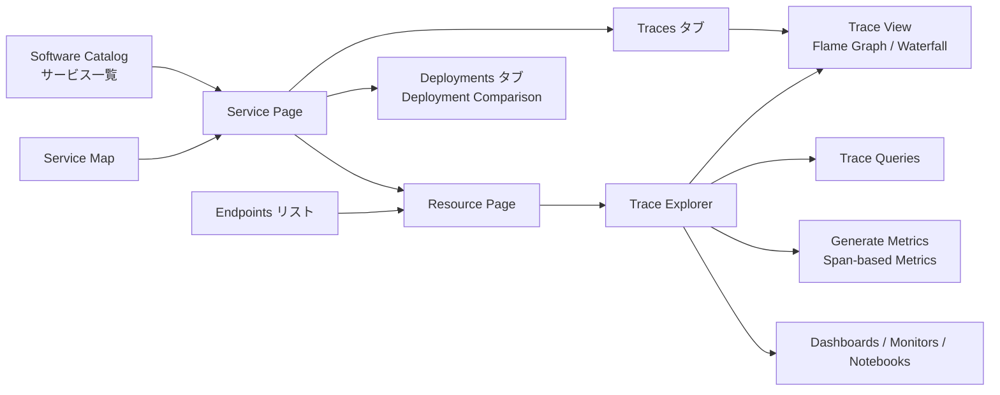
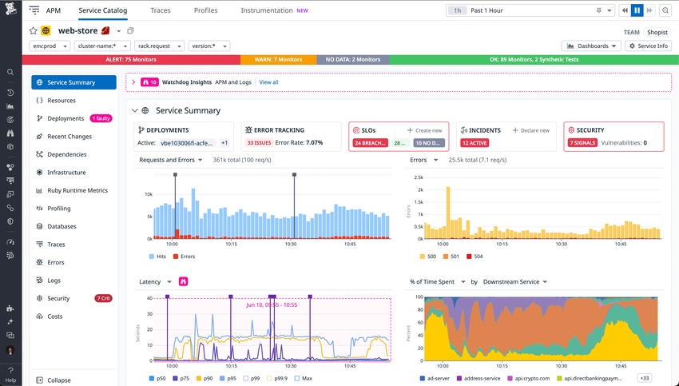
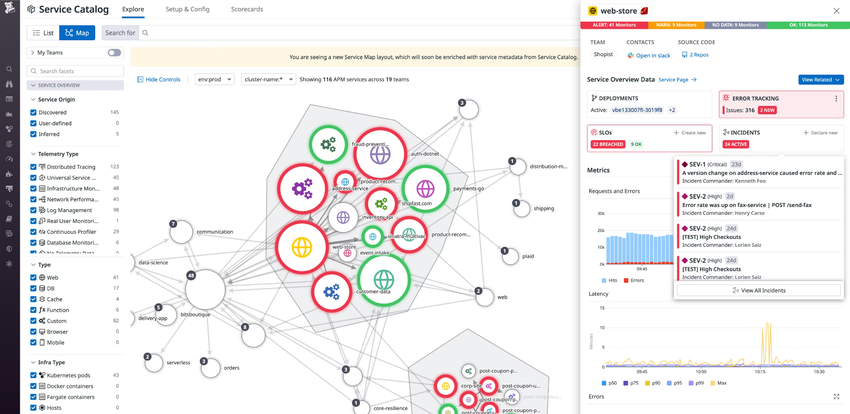
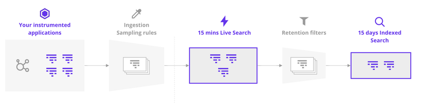
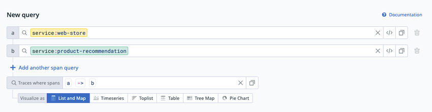
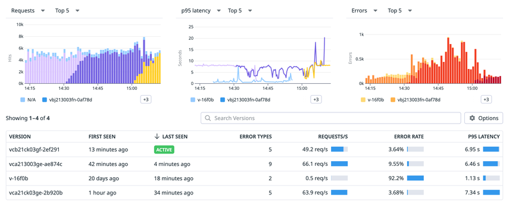
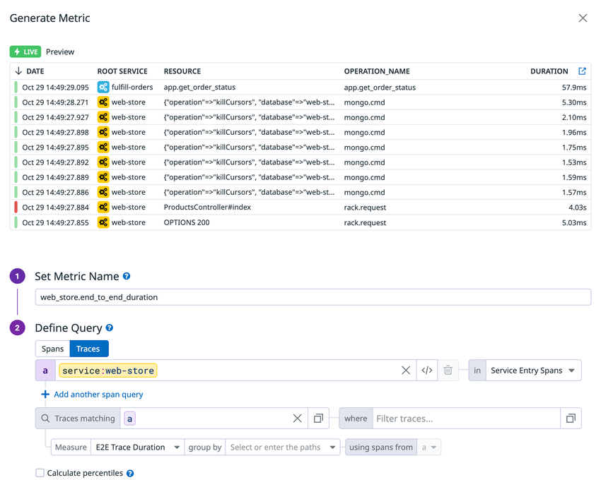

# APM 画面と分析機能

## 概要

Datadog APM（Application Performance Monitoring）の分析画面は、インスツルメント済みアプリケーションから届いたトレースと、トレースから自動生成される Trace Metrics（`trace.*`）を、サービス・リソース・トレース・バージョン・エンドポイントの単位で調べるための UI 群である。本ファイルは、次の画面と機能の仕様に答える。

| 画面・機能 | 主な用途 | 主なデータソース | 本ファイルの節 |
|---|---|---|---|
| Service Page（サービスページ） | 1 サービスの健全性、RED（Requests / Errors / Duration）、リソース、依存関係、関連テレメトリを1画面で確認 | Trace Metrics（100% トラフィック）＋一部サンプル済みトレース | [2](#2-service-pageサービスページ) |
| Resource Page（リソースページ） | 1 エンドポイント／クエリ単位の詳細 | Trace Metrics＋サンプル済みスパン | [3](#3-resource-pageリソースページ) |
| Service Map（サービスマップ） | サービス間の依存関係をリアルタイムで俯瞰 | APM・RUM のトレース | [4](#4-service-mapサービスマップ) |
| Trace Explorer（トレースエクスプローラー） | スパンの検索・集計・可視化、エクスポート | 直近 15 分は取り込み済み全スパン、それ以前はインデックス済みスパン | [5](#5-trace-explorerトレースエクスプローラー) |
| Trace View（トレースビュー） | 1 トレースの Flame Graph / Waterfall 等による詳細分析 | 取り込み済み・インデックス済みトレース | [6](#6-trace-viewトレースビューとスパンの詳細パネル) |
| Trace Queries（トレースクエリ） | 複数スパンの関係（親子・上流下流）でトレースを絞り込む | Intelligent Retention と Trace-level Retention Filter のトレース | [7](#7-trace-queriesトレースクエリ) |
| Deployment Tracking（デプロイ追跡） | `version` タグ単位の比較、問題デプロイの検知 | Trace Metrics・トレース・プロファイル | [8](#8-deployment-trackingデプロイ追跡) |
| Endpoint 観測（Endpoints リスト） | HTTP エンドポイント単位の性能・所有者・監視網羅の管理 | APM（HTTP サービス）＋ API 定義 | [9](#9-endpoint-観測endpoints-リスト) |
| Span-based Metrics | 取り込み済みスパン／トレースから任意のカスタムメトリクスを生成 | 取り込み済みスパン | [10](#10-span-based-metricsスパンベースメトリクス) |

本ファイルは「画面で何ができ、どの設定値・制限があるか」に絞る。関連する話題は次のファイルを参照する。

| 話題 | 参照先 |
|---|---|
| Trace / Span / Service / Resource / Primary Tag 等の概念、サンプリング、Retention Filters、Trace Metrics の一覧、保持期間、APM 課金単位 | [APM の概念とインジェスト制御](./apm-concepts-and-ingestion.md) |
| Tracing Library の導入、Unified Service Tagging（`env` / `service` / `version`）の設定 | [APM インスツルメンテーション](./apm-instrumentation.md) |
| Software Catalog のエンティティモデル、定義ファイル、Scorecards、Endpoints の API 定義連携 | [Software Catalog（旧 Service Catalog）](../platform/software-catalog.md) |
| Error Tracking の Issue 管理 | [Error Tracking](./error-tracking.md) |
| Profiling タブの詳細 | [Continuous Profiler](./continuous-profiler.md) |
| eBPF ベースのサービス検出 | [Universal Service Monitoring](./universal-service-monitoring.md) |
| APM モニター（APM Metric / Trace Analytics モニター） | [Monitors（モニター）](../platform/monitors.md) |
| Watchdog の異常検知全般 | [Watchdog](../platform/watchdog.md) |
| 運用上のベストプラクティス | [APM 運用の実践](../../04_応用編/05-apm-practices.md) |

> **名称について:** Software Catalog の旧称は **Service Catalog**（2025-02 に改称）。2026-11 時点の公式ドキュメントの見出しは「Catalog」（パンくずは `Internal Developer Portal > Catalog`）であり、Endpoints リストの旧称は **API Catalog** である。本ファイルの一部スクリーンショットには旧称「Service Catalog」の UI が写っている。詳細は [Software Catalog](../platform/software-catalog.md) の「名称の変遷」を参照。

---

## 1. 画面の位置づけとデータの関係

### 1.1 APM 画面とデータソースの対応

Datadog APM の画面は、同じトレースデータでも**どの段階のデータ**を使うかが画面ごとに異なる。この違いを理解しないと「Service Page の数値と Trace Explorer の件数が合わない」といった誤解が生じる。データの段階（Ingestion → Retention）の詳細は [APM の概念とインジェスト制御](./apm-concepts-and-ingestion.md) を参照。

| データ | 生成元 | 使う画面 | 正確さ |
|---|---|---|---|
| Trace Metrics（`trace.<SPAN_NAME>.hits` / `.errors` / `trace.<SPAN_NAME>` 等） | Agent がサンプリング前の 100% トラフィックから計算 | Service Page・Resource Page の Requests / Errors / Latency グラフ、Deployments 表、Endpoints リスト | 全量ベース（例外：アプリ側 SDK サンプリング、OpenTelemetry SDK サンプリング、X-Ray サンプリング） |
| 取り込み済みスパン（Ingested） | サンプリング後に Datadog に届いたスパン | Trace Explorer の Live Search（直近 15 分）、Span-based Metrics | サンプリング率に依存 |
| インデックス済みスパン（Indexed） | Retention Filter で保持されたスパン | Trace Explorer（15 分超の期間）、ダッシュボード・ノートブック・Trace Analytics モニター | Retention Filter の設定に依存 |
| Intelligent Retention のトレース | Diversity sampling と 1% flat sampling | Trace Queries、Trace Explorer（インデックス検索） | 代表サンプル |
| サンプル済みトレースの集計 | 取り込み済みトレース | Service Page の「Avg Time per Request」、Resource Page の依存マップ・Span summary | サンプル（依存マップはサンプリング率で補正） |
| ルートスパンを含む完全なトレース | APM・RUM が収集したトレース | Service Map のサービス間依存関係 | トレースベース（スパン欠落時はその期間のマップが利用できない場合がある） |

[出典](https://docs.datadoghq.com/tracing/metrics/metrics_namespace/) [出典](https://docs.datadoghq.com/tracing/services/service_page/) [出典](https://docs.datadoghq.com/tracing/services/resource_page/) [出典](https://docs.datadoghq.com/tracing/trace_pipeline/trace_retention/) [出典](https://docs.datadoghq.com/tracing/services/services_map/)

### 1.2 画面間の主な遷移

- Service Page の各グラフは右上の矢印から既存ダッシュボードへエクスポートできる。[出典](https://docs.datadoghq.com/tracing/services/service_page/)
- Trace Explorer の検索条件はページ URL に保存されるため、URL をコピーすれば同じビューを共有できる。[出典](https://docs.datadoghq.com/tracing/trace_explorer/query_syntax/)
- APM の各画面は `env` と追加 Primary Tag（例：`cluster_name`）でスコープを切り替える。Primary Tag の設定は [APM の概念とインジェスト制御](./apm-concepts-and-ingestion.md) を参照。

---

## 2. Service Page（サービスページ）

Datadog APM の Service Page は、Software Catalog（または Service Map 等）でサービスを選択すると開く、1 サービス専用の画面である。サービスとは、同じ仕事をするプロセスの集合（Web フレームワーク、データベース等）を指す。Service Page はサービスの健全性、モニター状態、Watchdog Insights、サマリーカード、既定（out-of-the-box）グラフ、リソース一覧、追加タブで構成される。[出典](https://docs.datadoghq.com/tracing/services/service_page/)

*図1：APM の Service Page（例：`web-store` サービス）*

画面説明：上部にサービス名と、`env:prod`・`cluster-name:*`・オペレーション名（`rack.request`）・`version:*` のスコープ選択がある。その下にモニター状態の帯（ALERT / WARN / NO DATA / OK の件数と Synthetic テスト数）、Watchdog Insights のカルーセルが並ぶ。左ナビゲーションには Service Summary、Resources、Deployments、Recent Changes、Dependencies、Infrastructure、Runtime Metrics（図では Ruby Runtime Metrics）、Profiling、Databases、Traces、Errors、Logs、Security、Costs がある。Service Summary にはサマリーカード（DEPLOYMENTS、ERROR TRACKING、SLOs、INCIDENTS、SECURITY）と、Requests and Errors、Errors、Latency（p50〜Max）、% of Time Spent by Downstream Service のグラフが表示される。右上には TEAM 表示、Dashboards、Service Info ボタンがある。なお本画像は旧称「Service Catalog」時代の UI であり、現行 UI ではタブ名や配置が異なる場合がある。
出典：https://docs.datadoghq.com/tracing/services/service_page/ （取得日 2026-11-02）

### 2.1 Service Health（サービスヘルス）

Datadog の Service Health は、モニター、インシデント、Watchdog Insights を1つの状態にまとめた指標であり、Software Catalog、Service Page、依存関係マップ（Watchdog が複数の依存関係にまたがる場合）、サービスピル（サービス名の表示部品）に表示される。[出典](https://docs.datadoghq.com/tracing/services/service_page/)

| 状態 | 条件 |
|---|---|
| **Critical** | PagerDuty または Opsgenie 連携を持つミュートされていないモニターが `ALERT` 状態で、過去 2 日以内にトリガーされた／アクティブなインシデントがある／進行中の問題デプロイ（Faulty Deployment）または APM のレイテンシー・エラー率アラートがある |
| **Warning** | ページング連携を持つミュートされていない警告モニターが `WARN` 状態で、過去 2 日以内にトリガーされた／安定（stable）状態のインシデントがある／進行中のログ異常アラートがある |
| **Ok** | アクティブな Critical / Warning のアラートがない |

### 2.2 Service Monitor パネル

Service Page の Service Monitor パネルは、サービスに紐づくアクティブな Monitors と Synthetic テストを表示する。Datadog はサービスタイプに応じたモニターを提案（Suggested Monitors）し、有効化や APM モニターの新規作成ができる。[出典](https://docs.datadoghq.com/tracing/services/service_page/)

| 紐付け対象 | 紐付く条件 |
|---|---|
| Monitor | メタデータまたはモニタークエリに `service:<SERVICE_NAME>` を含む、またはクエリがサービスでグループ化されている |
| Synthetic テスト | `service:<SERVICE_NAME>` タグが付いている |

### 2.3 Watchdog Insights とサマリーカード

- **Watchdog Insights**：サービスタグを含む APM、Continuous Profiler、Log Management、Infrastructure のデータから検出した異常（anomalies）と外れ値（outliers）をカルーセルで表示する。インサイトをクリックすると時間範囲、関連ログ・トレース、推奨される次の手順が表示される。[出典](https://docs.datadoghq.com/tracing/services/service_page/)
- **サマリーカード**：サービスの健全性、問題の可能性があるデプロイ、Error Tracking の新規 Issue を強調表示する。

| カード | 内容 | クリック時の動作 |
|---|---|---|
| Deployments | 最新デプロイの状態 | 最新デプロイの詳細または全デプロイの一覧 |
| Error Tracking | Issue 数とエラー率 | Error Tracking の Issue |
| SLOs | SLO の状態 | SLO の新規作成も可能（Create new） |
| Incidents | 進行中のインシデント | インシデントの宣言も可能（Declare new） |
| Security | アプリケーションへの脅威に対するサービスの状態（セキュリティシグナル） | セキュリティ情報 |

[出典](https://docs.datadoghq.com/tracing/services/service_page/)

### 2.4 既定グラフ（Out-of-the-box graphs）

Service Page の既定グラフは、各グラフのドロップダウンで表示を切り替えられる。Requests・Errors・Latency は Trace Metrics から描画される。[出典](https://docs.datadoghq.com/tracing/services/service_page/)

| グラフ | 既定の内容 | ドロップダウンの選択肢 |
|---|---|---|
| Requests and Errors | リクエスト総数とエラー総数の推移 | Requests by Version、Requests per Second by Version、Requests and Errors Per Second |
| Errors | エラー数 | Errors by Version、Errors per Second by Version、Errors per Second、% Error Rate by Version、% Error Rate |
| Latency | レイテンシーのパーセンタイル推移 | Latency by Version、Historical Latency（前日・前週と比較）、Latency Distribution、Latency by Error、Apdex |
| Avg Time per Request | 下流サービス別の 1 リクエストあたり平均実行時間 | Total Time Spent、% of Time Spent |

- **Avg Time per Request** は他の上段グラフと異なり、**サンプル済みトレースデータ**から作られる。下流呼び出しを持たないサービス（Postgres、Redis 等）には下流サービス別グラフがない。
- **Watchdog** は Requests・Latency・Error グラフで異常検知を行い、検出した異常をグラフに重ねて表示する。
- Latency グラフのスパイクにカーソルを合わせると **Investigate With Bits AI** ボタンが表示され、自動調査を起動できる（Bits AI の詳細は [Bits AI と AI 機能](../ai/bits-ai.md)）。
- 各グラフ右上の矢印で既存ダッシュボードにエクスポートできる。
- Apdex の閾値（Apdex T）の設定には `apm_apdex_manage_write`（APM Apdex Manage Write、既定は Admin ロール）権限が必要。[出典](https://docs.datadoghq.com/account_management/rbac/permissions/)

### 2.5 Resources（リソース一覧）

Service Page の Resources セクションは、Requests・Latency・Error をリソース（通常はエンドポイントやクエリ）単位に分解して表示する。HTTP サービスではエンドポイントとして表示される。リクエスト数、レイテンシー、エラー、時間で並べ替えられる。リソースをクリックするとサイドパネル（グラフ、リソース依存マップ、Span summary 表）が開き、キーボードでリソースを切り替えられる。「Open Full Page」で Resource Page（[3 節](#3-resource-pageリソースページ)）を開く。[出典](https://docs.datadoghq.com/tracing/services/service_page/)

| 選択可能な列 |
|---|
| Requests、Requests per second、Total time、Avg Latency、p75 Latency、p90 Latency、p95 Latency、p99 Latency、Max Latency、Errors、Error Rate |

### 2.6 Dependencies（依存関係）

Service Page の Dependencies セクションは、APM メトリクスに基づく上流・下流の依存関係マップである。[出典](https://docs.datadoghq.com/tracing/services/service_page/)

- 依存関係はオペレーション名でグループ化される（例：複数サービスへの gRPC 呼び出し）。
- 左側の表に依存先ごとのリクエスト数とエラー率の推移が表示される。
- **Inferred services（推論サービス）**：データベース、キュー、サードパーティサービス等、インスツルメントされていない依存先は紫色のノードで表示される（[4.4 節](#44-inferred-services推論サービスとの関係)）。
- **Service overrides**（サービス名の上書き）は、ノードではなくノード間のエッジ上に表示される。
- 依存先をクリックすると、その依存先にスコープしたメトリクスと、クライアント呼び出しのリソース（例：DB クエリ）一覧を表示するサイドパネルが開く。

### 2.7 追加タブ一覧

Service Page には、利用製品と設定に応じて以下のタブが表示される。[出典](https://docs.datadoghq.com/tracing/services/service_page/)

| タブ | 表示条件 | 内容 |
|---|---|---|
| Deployments | サービスに `version` タグがある | 選択期間内にアクティブなバージョンの一覧（[8 節](#8-deployment-trackingデプロイ追跡)） |
| Error Tracking | — | Issue の多いリソースの概要グラフと共通 Issue 一覧。Issue をクリックするとスタックトレース、関連コードバージョン、初回以降の総発生数を表示（詳細は [Error Tracking](./error-tracking.md)） |
| Security | 公式に表示条件の記載なし（App and API Protection・Code Security のデータを表示） | 既知のライブラリ脆弱性とセキュリティシグナル。上段に脆弱性数と重大度、攻撃タイムライン、攻撃種別、攻撃者情報（クライアント IP または認証ユーザー）、下段に一覧（詳細は [App and API Protection](../security/app-and-api-protection.md)） |
| Databases | 公式に表示条件の記載なし | Queries（サンプル済みスパンの所要時間と全クエリ一覧。クエリを選ぶと診断、エラー詳細、トレース）と Databases（アクティブ接続数・平均クエリ時間のチャート、ホスト一覧から Database Monitoring へ遷移）。詳細は [Database Monitoring](../infrastructure/database-monitoring.md) |
| Infrastructure | Kubernetes 上のサービス | Live Pods 表（メモリ上限接近、プロビジョニング量と必要量の比較）、Kubernetes Metrics（CPU、Memory、Network、Disk のサマリー）。Kubernetes 以外は Unified Service Tagging でインフラと関連付け |
| Runtime Metrics | Tracing Library でランタイムメトリクスが有効 | サービスの言語に応じたランタイムメトリクス |
| Profiling | Continuous Profiler 設定済み | レイテンシー・スループットの変化をコード性能の変化と相関（公式例：`/GET train` のロック競合） |
| Memory Leaks | Continuous Profiler 設定済みかつコンテナ環境 | メモリリークの可能性を調べるガイド付きワークフロー |
| Traces | — | サービス・環境・オペレーション名で絞り込まれたトレース。ステータス、リソース、エラー種別等のファセットで絞り込み、スパンをクリックすると Flame Graph を表示 |
| Log Patterns | 公式に表示条件の記載なし | サービスのログパターン。ステータス等のファセットで絞り込み、パターンをクリックすると詳細と該当イベント |
| Costs | 公式に表示条件の記載なし（Cloud Cost Management と連携） | サービスのインフラコスト（詳細は [Cloud Cost Management](../infrastructure/cloud-cost-management.md)） |
| Frontend Activity【Preview】 | Journey Monitoring または Operations Monitoring の Preview アクセス | 下記 2.8 |

> **補足:** 図1 のスクリーンショットには「Recent Changes」「Logs」「Errors」タブも写っているが、公式ドキュメントのタブ説明には記載がない。現行 UI でのタブ構成の完全な一覧は公開情報では確認できず。

### 2.8 Frontend Activity【Preview】

Service Page の Frontend Activity タブは、バックエンドサービスの性能を RUM の Journey、Operation、View と結び付ける Preview 機能である。[出典](https://docs.datadoghq.com/tracing/services/service_page/)

| 項目 | 内容 |
|---|---|
| 前提条件 | フロントエンドに RUM を設定済み、RUM と APM を接続済み、RUM の Journey と Operations を有効化済み |
| Users / Accounts 指標 | RUM SDK で `usr.id` と `account.id` 属性の設定が必要（他の指標は不要） |
| セレクター | Journey → Operation → View のカスケード選択 |
| サマリーカード | Users、Accounts、Requests、Avg Conversion、p95 Latency、Error Rate（それぞれ前期間比の変化付き） |
| ヘッダー | インデックス済みスパン数と、全スパンに占めるインデックス割合 |
| Product Analytics 併用時 | 影響を受けたユーザー・アカウントの詳細を表示 |

RUM の詳細は [RUM（ブラウザ）](../dem/rum-browser.md) を参照。

---

## 3. Resource Page（リソースページ）

Datadog APM の Resource Page は、サービスの特定アクション（通常はエンドポイントまたはクエリ）であるリソースごとに自動生成されるダッシュボードである。主要な健全性メトリクス、サービスのモニター状態、サービスのリソース一覧を表示する。[出典](https://docs.datadoghq.com/tracing/services/resource_page/)

### 3.1 既定グラフ

Resource Page の既定グラフは Service Page と同じ構成である（[2.4 節](#24-既定グラフout-of-the-box-graphs)）。Requests and Errors、Errors、Latency（Latency by Version、Historical Latency、Latency Distribution、Latency by Error、Apdex）、Avg Time per Request（サンプル済みトレース由来、Total Time Spent / % of Time Spent）があり、Watchdog の異常検知オーバーレイとダッシュボードへのエクスポートにも対応する。[出典](https://docs.datadoghq.com/tracing/services/resource_page/)

### 3.2 Resource Page のセクション

| セクション | 内容 | 条件・注意 |
|---|---|---|
| Latency distribution | リソースのリクエスト時間の分布。右上のパーセンタイル選択でズーム、サイドバーにカーソルを合わせるとパーセンタイルの目盛りを表示 | — |
| Dependency map | 選択リソースを通るリクエストに限定した上流・下流のフローグラフ。ノードをクリックするとそのリクエストフローで呼ばれたリソースを表示。ノードの「set as start / end」で、その依存先も通るリクエストに絞り込み | **サンプル済みスパン**に基づき、リクエスト率はサンプリング率でアップスケール。Service Entry Span のリソースでのみ利用可 |
| Frontend impact | RUM View 別の影響。列：RUM View Name、App Name、Sessions、Error Rate Per Sessions、P95 Latency、Requests。「Isolate this View」で View ごとのリクエスト・エラー推移、「View Traces」でサンプルトレース、行メニューでサンプル RUM セッション | RUM が必要、かつ Web サービスのリソースのみ。**直近 1 時間のインデックス済みトレース**を使う（非サンプルデータではない） |
| Span summary | マッチする全トレースにわたるスパンの内訳 | Service Entry Span を持つリソースのみ |
| Traces | 環境・サービス・オペレーション・リソース名で絞り込まれた Trace search モーダル | — |
| Definition | HTTP エンドポイント（URL パスを公開するサービス）のリソースでは、サイドパネルに API 定義セクションを表示 | Endpoints リスト（[9 節](#9-endpoint-観測endpoints-リスト)）と連動 |

[出典](https://docs.datadoghq.com/tracing/services/resource_page/)

> **注意:** 公式ドキュメントは Frontend impact の「Error Rate Per Sessions」を「その View を含むセッション数」と説明しており、列名と説明が一致しない。正確な定義は公開情報では確認できず。

### 3.3 Span summary の指標

| 指標 | 定義 |
|---|---|
| Avg Spans/trace | そのスパンが 1 回以上現れるトレースにおける平均出現回数 |
| % of Traces | そのスパンを含むトレースの割合 |
| Avg Duration | そのスパンを含むトレースにおけるスパンの平均所要時間 |
| Avg % Exec Time | スパンがアクティブだった実行時間の平均割合。「アクティブ」とは子スパンを待っていない状態を指す |

[出典](https://docs.datadoghq.com/tracing/services/resource_page/)

---

## 4. Service Map（サービスマップ）

Datadog APM の Service Map は、アプリケーションを構成サービスに分解し、観測された依存関係をリアルタイムに描画する画面である。ボトルネックの特定やデータの流れの把握に使う。APM と RUM が収集したデータを可視化し、表示のための追加設定は不要である。[出典](https://docs.datadoghq.com/tracing/services/services_map/)

*図2：Software Catalog の Map 表示（Service Map）とサービスのサイドパネル*

画面説明：左側にファセットパネル（My Teams、Service Origin（Discovered / User-defined / Inferred）、Telemetry Type（Distributed Tracing、Universal Service Monitoring、Infrastructure Monitoring、Log Management、Continuous Profiler 等）、Type（Web、DB、Cache、Function、Custom、Browser、Mobile）、Infra Type（Kubernetes pods、Docker containers、Fargate containers、Hosts））、上部に List / Map の切り替え、`env:prod` と `cluster-name:*` のスコープ選択がある。中央にサービスのノードとエッジがチーム単位のグループ（六角形の領域）で描画され、ノードの縁の赤・緑で状態が示される。右側に選択サービス（`web-store`）のサイドパネルがあり、モニター状態、TEAM・CONTACTS・SOURCE CODE、Deployments・Error Tracking・SLOs・Incidents のカード、Requests and Errors と Latency のグラフが表示される。画像は旧称「Service Catalog」時代の UI である。
出典：https://docs.datadoghq.com/tracing/services/services_map/ （取得日 2026-11-02）

### 4.1 スコープとフィルター

| 項目 | 内容 |
|---|---|
| スコープ | `env` と、任意で Second Primary Tag（追加 Primary Tag）をドロップダウンで選択。スコープを変えると別のマップが描かれる |
| 環境をまたぐ依存 | あるスコープのサービスは他環境のサービスを呼び出せない／呼び出されない前提で描かれるが、他環境の依存（例：`prod` のみのサービスから `staging` への接続）は表示され得る |
| 時間範囲 | 特定の時間範囲にスコープ可能。選択期間内にデータがあるノードのみ表示 |
| ファセットフィルター | サービスタイプ（Web サーバー、DB、Cache 等）、最終デプロイ時刻、モニター状態、インシデント状態（進行中・解決済み）、サービス名のあいまい一致 |
| グルーピング | チーム（Team）またはアプリケーション単位でグループ化し、所有関係とアプリケーション依存を表示 |

[出典](https://docs.datadoghq.com/tracing/services/services_map/)

### 4.2 ノードとエッジの見方

| 要素 | 意味 |
|---|---|
| ノード | APM と Software Catalog に登録されたサービス。インスツルメント後まもなく表示され、**30 日間トレースがないサービスは表示されなくなる** |
| ノードの縁の色 | Service Health（[2.1 節](#21-service-healthサービスヘルス)）に基づき赤または黄色 |
| エッジ | サービス間の集計された呼び出し。個々のトレースの Flame Graph で確認可能 |
| ホバー | サービスを強調表示し、リクエストの流れをアニメーションで方向表示 |
| クリック（Inspect） | そのサービスを分離表示し、上流の呼び出し元と下流の呼び出し先を表示。左側ほど顧客に近く、右側ほど根本原因になりやすい |
| 折りたたみノード | フィルター対象の 2 サービスが、フィルター外のサービス経由でのみ接続している場合に表示 |
| モニター | `service` タグ付きのモニターの状態がマップ上に表示される |

[出典](https://docs.datadoghq.com/tracing/services/services_map/)

### 4.3 データ要件と注意点

- Service Map はルートスパンを含む完全なトレースから作られる。APM の接続エラー等でスパンが欠落すると、その期間のマップが利用できない場合がある。[出典](https://docs.datadoghq.com/tracing/services/services_map/)
- `service` タグは APM サービスを Dashboards、Logs、Host Map、カスタムビジネスメトリクスと結び付ける。タグ付けは [Tagging（タグ）](../platform/tagging.md) を参照。
- ノード数・エッジ数の上限、既定の時間範囲は公開情報では確認できず。

### 4.4 Inferred Services（推論サービス）との関係

Datadog APM の Inferred Services は、インスツルメント済みサービスの外向きリクエストを解析して検出する、インスツルメントされていない依存先（データベース、キュー、サードパーティ API）である。Service Map、Service Page の依存関係、Trace View で表示され、Software Catalog ではエンティティタイプで絞り込める。[出典](https://docs.datadoghq.com/tracing/services/inferred_services/)

| 項目 | 内容 |
|---|---|
| Agent 7.60.0 以降 | 設定不要（`apm_config.compute_stats_by_span_kind` と `apm_config.peer_tags_aggregation` が既定で有効） |
| Agent 7.55.1〜7.59.1 | 上記 2 項目を `true` に設定 |
| Agent 7.50.3〜7.54.1 | 上記 2 項目に加え `peer_tags` リストを定義 |
| OpenTelemetry Collector | 新規は `span_metrics` connector を推奨。Datadog Connector の場合は contrib v0.95.0 以降 |
| 主な peer タグ | `peer.db.name`、`peer.db.system`、`peer.hostname`、`peer.messaging.destination`、`peer.messaging.system`、`peer.kafka.bootstrap.servers`、`peer.aws.sqs.queue`、`peer.rpc.service`、`peer.service` 等 |
| 命名の優先順位（DB） | `peer.db.name` → クラウド／エンジン固有タグ → `peer.hostname` → `peer.db.system` |
| 命名の優先順位（キュー） | `peer.messaging.destination` → ブローカー固有タグ → `peer.messaging.system` |
| 命名の優先順位（その他） | `peer.service` → `peer.rpc.service` → `peer.hostname` |
| IP アドレスの扱い | IP アドレスに見える値は `blocked-ip-address` に置換される |
| 表示 | 紫色のノード（Service Page 依存関係）、破線の枠と紫の背景（Trace View の Map）、破線の枠（Flame Graph） |

- グローバルのサービス名に統一する設定（公式ページ上の表記は `DD_TRACE_REMOVE_INTEGRATION_SERVICE_NAMES_ENABLED`、Query Syntax ページでは `DD_TRACE_REMOVE_INTEGRATION_SERVICE_NAME_ENABLED` と表記揺れがある）を有効にすると、インテグレーションが既定と異なるサービス名を設定しなくなり、サービス間・推論サービスの可視化が改善される。ただし旧サービス名を参照するメトリクス、Span-based Metrics、Retention Filter、モニター、ダッシュボード、ノートブックの更新が必要になる。正確な環境変数名は利用する Tracing Library のドキュメントで確認すること。[出典](https://docs.datadoghq.com/tracing/services/inferred_services/) [出典](https://docs.datadoghq.com/tracing/trace_explorer/query_syntax/)

> **サイト差異:** Inferred Services は AP1、AP2、US3、US5、EU1、US1、UK1（`uk1.datadoghq.com`）で既定で有効。`app.ddog-gov.com`（US1-FED）と `us2.ddog-gov.com` では既定で利用できず、フォームからアクセスを申請する必要がある。[出典](https://docs.datadoghq.com/tracing/services/inferred_services/)

### 4.5 Request Flow Map（Trace Explorer の可視化）

Request Flow Map は Trace Explorer の可視化の1つで、Service Map と Live Search を組み合わせ、任意のタグの組み合わせで絞り込んだトレースのサービス間リクエスト経路を表示する。Service Map がサービス全体の依存を示すのに対し、Request Flow Map は**クエリ条件に一致するリクエストだけ**の流れを示す。[出典](https://docs.datadoghq.com/tracing/trace_explorer/visualize/)

| 操作 | 内容 |
|---|---|
| エッジにホバー | リクエスト、エラー、レイテンシーのメトリクス。スループットが最も高い経路が強調表示される |
| Export | PNG で保存 |
| サービスをクリック | 健全性、性能、インフラ、ランタイムメトリクス |
| レイアウト | Cluster / Flow を切り替え。サービス数に応じて自動選択 |
| RUM | RUM とトレースを接続していれば RUM アプリケーションも表示 |

用途例：高トラフィックのサービスの特定、エンドポイントごとの DB 呼び出し数の把握、カスタムスパンタグとして設定したシャドウデプロイやフィーチャーフラグのレイテンシー比較。[出典](https://docs.datadoghq.com/tracing/trace_explorer/visualize/)

---

## 5. Trace Explorer（トレースエクスプローラー）

Datadog APM の Trace Explorer は、スパンを検索・フィルター・集計・可視化する画面である。直近 15 分は取り込み済みの全スパン（Live Search）、それより長い期間は Retention Filter でインデックスされたスパン（Indexed Search）を対象にする。[出典](https://docs.datadoghq.com/tracing/trace_explorer/)

*図3：Trace Explorer が扱うデータの流れ*

画面説明：左から「Your instrumented applications（インスツルメント済みアプリケーション）」→「Ingestion Sampling rules（取り込みサンプリングルール）」→「15 mins Live Search（15 分の Live Search）」→「Retention filters（リテンションフィルター）」→「15 days Indexed Search（15 日の Indexed Search）」の順に矢印でつながる概念図。Live Search は取り込み後・リテンション前の全スパン、Indexed Search はリテンションフィルター通過後のスパンを対象にすることを示す。
出典：https://docs.datadoghq.com/tracing/trace_explorer/ （取得日 2026-11-02）

### 5.1 Live Search と Indexed Search

| 項目 | Live Search | Indexed Search |
|---|---|---|
| 対象 | 取り込み済みの全スパン（サンプリング表示なし） | Retention Filter でインデックスされたスパン |
| 時間範囲 | 直近 15 分（ローリング） | 15 分より長い期間を時間選択で指定すると切り替わる |
| 画面上の表示 | 「Live Search - All ingested data」 | 「Search - Only Indexed Data」 |
| 保持 | ローリングウィンドウ | カスタム Retention Filter：15 日、Intelligent Retention Filter：30 日 |
| インデックスされないスパンにしかないタグでの検索 | 可能 | 結果なし |
| Timeseries の Group by | 1 次元まで | 3 次元まで |
| Dashboards / Monitors / Notebooks へのエクスポート | 不可 | 可（Timeseries） |
| List view | スパン／秒をヘッダー表示。高スループット時は一部スパンのみ流れる。Pause / Play ボタンあり。スパン選択でストリームが停止しサイドパネルが開く | 通常の一覧 |

[出典](https://docs.datadoghq.com/tracing/trace_explorer/) [出典](https://docs.datadoghq.com/tracing/trace_explorer/visualize/) [出典](https://docs.datadoghq.com/tracing/trace_pipeline/trace_retention/)

> **注意:** Trace Explorer ページの Indexed Spans 節は「インデックス後 15 日保持」と記載する一方、Intelligent Retention Filter については 30 日と記載している。Trace Retention ページでは「カスタム・既定の Retention Filter は 15 日、Intelligent Retention（Diversity sampling と 1% flat sampling）は 30 日」と整理されており、本ファイルはこれに従う。Data Retention Periods ページは「インデックス済みスパンはプランにより 15 日または 30 日」としている。料金ページでは 7 日・15 日・30 日の保持オプションが掲載されている（[APM の概念とインジェスト制御](./apm-concepts-and-ingestion.md) の「保持期間」節を参照）。

### 5.2 検索対象スパンの選択

Trace Explorer のトレース表の上にあるセレクターで、一覧の対象を次のいずれかに限定できる。この選択は一覧にのみ作用し、Flame Graph には常に全スパンが表示される。[出典](https://docs.datadoghq.com/tracing/trace_explorer/)

| 選択肢 | 対象 |
|---|---|
| Service entry spans | サービスの入口スパン |
| Root spans | トレースのルートスパン |
| All spans | すべてのスパン |

### 5.3 クエリ構文

Trace Explorer の検索は、時間範囲と、`key:value` フィルターと全文検索を組み合わせたクエリで構成される（例：`service:web-store env:prod`）。[出典](https://docs.datadoghq.com/tracing/trace_explorer/search/) [出典](https://docs.datadoghq.com/tracing/trace_explorer/query_syntax/)

| 要素 | 構文 | 例 |
|---|---|---|
| AND（既定） | `AND` または空白 | `service:api env:prod` |
| OR | `OR` | `service:api OR service:web` |
| 除外 | `-` | `-kube_deployment:canary` |
| グループ化 | `( )` | `(service:api AND -kube_deployment:canary)` |
| 属性検索 | `@<属性キー>:<値>`。ネストした JSON キーはドット表記 | `@git.commit.sha:12345` |
| タグ検索 | `<key>:<value>`（`@` なし） | `hostname:web-server`、`container_name:api-frontend` |
| 非標準タグ | `tags:"<タグ>"` | `tags:"auto-discovery.cluster-autoscaler.k8s.io/daffy"` |
| ワイルドカード | `*`（複数文字） | `service:web*`、`@url:data*` |
| 数値比較 | `<`、`>`、`<=`、`>=` | `@http.response_time:>100` |
| 範囲（両端含む） | `[min TO max]` | `@http.status_code:[400 TO 499]` |
| エスケープ | `?`、`>`、`<`、`:`、`=`、`"`、`~`、`/`、`\` はバックスラッシュでエスケープ | `@url:*user\=JaneDoe*` |
| 属性名中の空白 | バックスラッシュでエスケープ（属性名に空白を使うことは非推奨） | `@user.first\ name:myvalue` |
| 推論エンティティの検索 | peer 属性を使う | `@peer.db.name:users @peer.db.system:postgres` |

- **予約属性**（`@` 不要）：Query Syntax ページでは `env`、`operation_name`、`resource_name`、`service`、`status`、`span_id`、`timestamp`、`trace_id`、`type`、`link` が挙げられ、Span Tags and Attributes ページでは `env`、`service`、`operation_name`、`resource_name`、`status`、`ingestion_reason`、`trace_id` が「すべてのスパンに存在する予約属性」として挙げられている。[出典](https://docs.datadoghq.com/tracing/trace_explorer/query_syntax/) [出典](https://docs.datadoghq.com/tracing/trace_explorer/span_tags_attributes/)
- 検索バーは既存値に基づくオートコンプリートを提供する。
- クエリ長、ワイルドカード数等の上限は公開情報では確認できず。

### 5.4 スパン属性・スパンタグ・ファセット・メジャー

| 用語 | 定義 | 検索時の書き方 | サイドパネルの表示場所 |
|---|---|---|---|
| Span attribute（スパン属性） | 自動／手動インスツルメンテーション、またはバックエンドのリマッピングで付与されるスパンの内容 | `@` を付ける（例：`@peer.db.system:postgres`） | Overview / Span Info |
| Span tag（スパンタグ） | ホストやコンテナ等のインフラ文脈 | `@` なし | Infrastructure |
| Facet（ファセット） | タグ・属性をデータ型（文字列、整数等）に対応付け、ファセット一覧に表示して値の分布とフィルターを提供 | — | ファセットパネル |
| Measure（メジャー） | 数値の量的ファセット。long integer または double。時間（秒）またはサイズ（バイト）の単位を持てる（単位はフィールドではなくメジャーに属する） | 数値比較・集計に使用 | ファセットパネル |

[出典](https://docs.datadoghq.com/tracing/trace_explorer/span_tags_attributes/) [出典](https://docs.datadoghq.com/tracing/trace_explorer/query_syntax/)

- **ファセットは任意**であり、ファセットがなくてもスパンの検索、Span-based Metrics の生成、Retention Filter の適用は可能である。
- ファセットの作成方法：①トレースのサイドパネルで属性をクリック（数値はファセットまたはメジャー、文字列はファセットのみ）、②ファセット一覧の「+ Add」でフィールド名を入力（インフラタグはタグキー、属性は `@` 付きパス。該当スパンが届く前に定義可能）。
- ファセットの非表示は個人単位で、保存ビューを更新しない限りチームメイトに影響しない。ファセットのグループ化は一覧の整理のみで、検索・分析には影響しない。
- インデックスされていない属性も、サイドパネルで属性をクリックするか、クエリバーに属性名を入力すれば検索できる。[出典](https://docs.datadoghq.com/tracing/trace_explorer/)
- ファセット数の上限は公開情報では確認できず。

### 5.5 可視化の種類

Trace Explorer は以下の可視化を提供する。[出典](https://docs.datadoghq.com/tracing/trace_explorer/visualize/) [出典](https://docs.datadoghq.com/tracing/trace_explorer/query_syntax/)

| 可視化 | 内容 | 主な設定・制約 |
|---|---|---|
| List view | クエリと時間範囲に一致するスパンの一覧 | 列はファセットパネル、サイドパネル、Options ボタンから追加。既定ソートはタイムスタンプ降順（最新が先頭）。メジャーやタグ値でソートするにはその列を「by」列に設定。列構成は保存ビューに保存。エラーの Latency Breakdown は不完全なトレースでは欠落し得る |
| Group into Issues | エラースパンで絞り込んだときに、個々のエラーではなく Error Tracking の Issue 単位で表示 | Issue パネルの「See all errors」でスパンを表示。`Errors` グルーピングに切り替えると Issue のないエラーも表示 |
| Timeseries | メジャー（またはタグ値のユニーク数）の時間推移 | Group by は最大 3 タグ（Live の 15 分ビューでは 1 次元のみ）。設定：計測対象（例：`Duration`）、集計関数（メジャーは関数選択、定性属性はユニーク数）、Group by 次元、上位／下位 N、ロールアップ期間（例：`10min`）。表示：バー（件数推奨）、線（統計集計推奨）、エリア、カラーセット |
| Top List | スパン数、タグ値のユニーク数、またはメジャーを 1 つのタグ次元で分割 | 例：過去 1 日でチェックアウトエラーが多い顧客の上位 10 |
| Table | 最大 3 次元の組み合わせで上位値を表示 | 次元は順に（第 1 次元の上位値の中で第 2 次元…）ランク付け。小計は全値の合計と一致しないことがある。null・空値はサブグループとして表示されない。1 メジャー・1 次元の表は Top List と同等 |
| Request Flow Map | クエリに一致するリクエストのサービス間経路（[4.5 節](#45-request-flow-maptrace-explorer-の可視化)） | Cluster / Flow レイアウト、PNG エクスポート |

- グラフの一部をクリックすると、その範囲へのズームまたは該当トレースの一覧表示ができる。[出典](https://docs.datadoghq.com/tracing/trace_explorer/query_syntax/)

### 5.6 Trace Groups（トレースグループ）

Trace Explorer の Trace Groups は、スパンを最大 **4 次元**でグループ化し、グループごとの REQUESTS、ERRORS（率と件数）、P95 Latency と Latency Breakdown（サービス間の時間配分）を表示する機能である。[出典](https://docs.datadoghq.com/tracing/trace_explorer/query_syntax/)

| 設定 | 選択肢 | 既定 |
|---|---|---|
| 次元値の取得元（from） | Span（クエリしたスパン）／Parent of span（`parent(a)`）／Root span（`root`） | Span |
| Show metrics from | クエリしたスパン／`parent(a)`／`root` | クエリしたスパン |

グループをクリックすると、元になったスパンイベントを表示する。

### 5.7 保存・共有・エクスポート

| 機能 | 内容 |
|---|---|
| URL 共有 | 検索パラメーターがページ URL に保存される |
| Saved search（保存検索） | クエリ、列、時間範囲を保存。検索バーのオートコンプリートで名前またはクエリから呼び出し。削除は Trace search ドロップダウン下のごみ箱アイコン |
| エクスポート先 | Dashboards、Monitors、Notebooks（Timeseries、インデックス済みスパンのみ。Live のスパンは不可） |
| メトリクス生成 | クエリから Span-based Metrics を生成（[10 節](#10-span-based-metricsスパンベースメトリクス)） |
| エクスポート時の対象範囲 | Dashboards と Notebooks は全インデックス済みスパンを使う。**Monitors はカスタム Retention Filter でインデックスされたスパンのみ**を使い、Intelligent Retention Filter でインデックスされたスパンは Trace Analytics モニターの評価対象外 |

[出典](https://docs.datadoghq.com/tracing/trace_explorer/query_syntax/) [出典](https://docs.datadoghq.com/tracing/trace_explorer/)

### 5.8 分析支援機能

| 機能 | 内容 | 状態 |
|---|---|---|
| Outliers（外れ値タグ） | Watchdog と Tag Analysis が検出した外れ値タグを、検索候補、Group by 推奨、ファセットパネル上部の「OUTLIERS」節に表示。関連する外れ値があると RED のエラー／レイテンシーグラフ横の「Analyze」ボタンが強調表示される | 公開情報では提供段階の明記なし |
| Investigate With Bits AI | **Duration** でソートすると表示され、レイテンシーの自動調査を起動 | 公開情報では提供段階の明記なし |
| Trace Patterns | 構造と属性が類似したスパンを繰り返しパターンにまとめ、数千のトレースの振る舞いをまとめて分析（例：今週新たに現れたエラーの形の特定） | 【Preview】（申込フォームあり） |

[出典](https://docs.datadoghq.com/tracing/trace_explorer/) [出典](https://docs.datadoghq.com/tracing/livesearch/)

---

## 6. Trace View（トレースビュー）とスパンの詳細パネル

Datadog APM の Trace View は、1 本のトレースを可視化し、各スパンの詳細を表示するサイドパネル（またはフルページ）である。ヘッダーにルートスパンのサービス名・リソース名、トレース ID、エンドツーエンドの所要時間、開始時刻を表示し、「Open Full Page」でパーマリンクを得られる。[出典](https://docs.datadoghq.com/tracing/trace_explorer/trace_view/)

### 6.1 可視化の種類

| 可視化 | 内容 | 主な操作・設定 |
|---|---|---|
| Flame Graph（既定） | 色分けしたスパンをタイムライン上に表示し、実行経路と時間の使われ方を示す | スクロールでズーム、ドラッグでパン、ミニマップ。グループ化：Service（既定）／Base service／Host／Container。表示：% Exec Time または Spans。Filter Spans の **Errors** チェックでエラースパンを強調 |
| Span List | リソースを（既定ではサービスで）グループ化し、スパン数で並べる | 種別・テキストで絞り込み。列：RESOURCE、SPANS、AVG DURATION、EXEC TIME、% EXEC TIME |
| Waterfall | 各行が 1 スパン。相対所要時間（バー長）、絶対時間（ms）、サービス・リソース名、HTTP ステータスコード | Color by：service（既定）／host／container。シェブロンで子孫を展開・折りたたみ、Expand all / Collapse all |
| Map | トレース内の全サービスと依存関係 | 同一サービスへの再呼び出しは循環を避けるため重複ノードで表示。ノードに全実行時間に占める割合。エントリスパンにエラーがあるノードは赤枠、エグジットスパンにエラーがあるエッジは赤。「View Entry Span」で Waterfall に移動 |

[出典](https://docs.datadoghq.com/tracing/trace_explorer/trace_view/)

- **Focus on a Span**：Flame Graph（スパン選択→ミニマップ横のフォーカスアイコン）と Waterfall（スパン右のフォーカスアイコン）で、選んだスパンをビューのルートにできる。表示上の変更のみで、検索結果やトレース自体は変わらない。
- **Span Search**（Waterfall と Flame Graph）：一致スパンを強調し、矢印で移動できる。対応構文は自由テキスト（`web`）、key-value（`service:web-ui`）、グループ（`language:(go OR python)`）、Boolean（`service:event-query OR terminator`）、範囲（`duration:>200ms`、`<`・`>`・`<=`・`>=`）。**ワイルドカードは非対応**。Error チェックで状態がエラーのスパンに限定。

### 6.2 大きなトレース（Trace Preview）

Trace View は、トレースが **100 MB を超える**場合にサイドパネルで完全に描画できないため、Trace Preview として重要なスパンのみを返す。[出典](https://docs.datadoghq.com/tracing/trace_explorer/trace_view/)

| 項目 | 内容 |
|---|---|
| 返されるスパン | Service Entry Span、エラースパン、長時間実行スパン、他のスパン／トレースにリンクされたスパン |
| 利用できるビュー | Waterfall と Map のみ |
| 省略スパン | Waterfall 上に番号付きのピルで表示。クリックでそのグループを展開 |

### 6.3 スパンの詳細パネル（下部パネル）

スパンヘッダーにはサービス名、オペレーション名、リソース名、レイテンシーが表示され、名前のピルから他画面へのピボットや Trace Explorer 検索の絞り込みができる。DB・キュー・サードパーティへのクライアント呼び出しでは推論エンティティを表示する。エラーのトレースでは **Investigate With Bits AI** でスパンツリーを辿りログと相関する自動調査を起動できる。[出典](https://docs.datadoghq.com/tracing/trace_explorer/trace_view/)

| タブ | 内容 | 要件・制約 |
|---|---|---|
| Span Info | スパンのメタデータとカスタムタグ。タグをクリックして Trace Explorer のクエリ更新や値のコピー。条件付きでエラーメッセージ・スタックトレース、SQL クエリ、RUM コンテキスト、Spark メトリクス、CI テストの git 警告、Base service / service override / inferred service を表示 | — |
| Infrastructure | ホストまたはコンテナの情報とタグ、CPU・メモリ・I/O グラフ（トレース時刻を重ねて表示） | — |
| Logs | トレース時刻のサービスログ。ホバーで Flame Graph 上にタイムスタンプ線、クリックで Log Explorer | ログとトレースの相関設定（[APM インスツルメンテーション](./apm-instrumentation.md)） |
| Processes | 基盤ホスト／Pod のプロセス（CPU、RSS メモリ） | プロセス収集が必要。サーバーレス・ブラウザのトレースは非対応 |
| Network | ネットワーク依存（通信量、TCP 再送、TCP RTT） | Cloud Network Monitoring が必要。サーバーレスは非対応 |
| Security | トレースのサービスを狙った攻撃試行（攻撃パターン、検知ルール）。「View in AAP」で調査 | App and API Protection |
| Profiles | 選択スパンの間にメソッドごとに費やされたコードレベルの時間 | Continuous Profiler |
| Span Links | 親子関係はないが因果関係のあるスパン | リンク先スパンが取り込み・インデックスされている場合のみ表示 |

[出典](https://docs.datadoghq.com/tracing/trace_explorer/trace_view/)

---

## 7. Trace Queries（トレースクエリ）

Datadog APM の Trace Queries は、複数のスパンの属性と、トレース構造内でのスパン同士の関係に基づいて**トレース全体**を検索する機能である。2 つ以上のスパンクエリを定義し、その関係を演算子で指定して、結果を Trace Query エクスプローラーで検索・フィルター・グループ化・可視化する。「2 つのサービス間に依存関係を含むトレースはどれか」「エラーを出すバックエンドサービスの影響を受ける API エンドポイントはどれか」といった問いに答える。[出典](https://docs.datadoghq.com/tracing/trace_explorer/trace_queries/)

公式ブログでは、非同期・イベント駆動（Kafka、RabbitMQ 等）を含むエンドツーエンドのレイテンシー測定、スパン数による N+1 クエリの発見、顧客ティアや影響エンドポイント別のグルーピングによる業務影響の把握が用途として紹介されている。[出典](https://www.datadoghq.com/blog/trace-queries/)（2024-02-12 公開）

*図4：Trace Query エディター*

画面説明：「New query」の下にスパンクエリ `a`（`service:web-store`）と `b`（`service:product-recommendation`）が並び、各行にクリア、コード表示、複製、削除のボタンがある。「+ Add another span query」でスパンクエリを追加できる。その下の「Traces where spans」欄に `a -> b`（a が b の上流）という関係式が入っている。最下段の「Visualize as」で List and Map、Timeseries、Toplist、Table、Tree Map、Pie Chart を選べる。
出典：https://docs.datadoghq.com/tracing/trace_explorer/trace_queries/ （取得日 2026-11-02）

> **補足:** 公式ドキュメント本文が記載する分析ビューは Timeseries、Top List、Table であるが、図4 の UI には Tree Map と Pie Chart も表示されている。Tree Map / Pie Chart の仕様は公開情報では確認できず。

### 7.1 クエリの構造

| 要素 | 内容 |
|---|---|
| スパンクエリ | `a`、`b`、`c`… とラベル付けされ、各々 Trace Explorer のスパンクエリ構文（[5.3 節](#53-クエリ構文)）を使う。「Add another span query」で追加 |
| Traces matching | スパンクエリを演算子で組み合わせる（例：`service:checkoutservice => service:shippingservice`） |
| Where | トレースレベルのフィルターを適用 |

### 7.2 演算子

| 演算子 | 意味 | 例 |
|---|---|---|
| `&&` | AND：両方のスパンがトレース内にある | `service:web-store && service:payments-go` |
| `\|\|` | OR：いずれかのスパンがトレース内にある | `service:web-store \|\| service:mobile-store` |
| `->` | 間接関係：左のスパンが右のスパンの上流にある | `service:checkoutservice -> service:quoteservice` |
| `=>` | 直接関係：左のスパンが右のスパンの直接の親 | `service:checkoutservice => service:shippingservice` |
| `NOT` | 除外：一致するスパンを含まない | `service:web-store && NOT(service:payments-go)` |

[出典](https://docs.datadoghq.com/tracing/trace_explorer/trace_queries/)

### 7.3 トレースレベルのフィルター（Where）

| フィルター | 意味 | 例 |
|---|---|---|
| `span_count(a)` | クエリ `a` に一致するスパンの出現数 | `span_count(a):>10` |
| `total_span_count` | トレース内のスパン総数 | `total_span_count:>1000` |
| `trace_duration` | トレースのエンドツーエンド所要時間 | `trace_duration:>5s` |

例：MongoDB の同一クエリを 10 回超呼ぶトレース（N+1 の疑い）は、クエリ `a` に `service:web-store-mongo @db.statement:"SELECT * FROM stores"`、Traces matching に `a`、Where に `span_count(a):>10` を指定する。[出典](https://docs.datadoghq.com/tracing/trace_explorer/trace_queries/)

### 7.4 結果の可視化

| ビュー | 内容 | 注意 |
|---|---|---|
| Flow Map | 一致トレースのリクエスト経路とサービス依存。ノードのホバーでリクエスト率・エラー率、エッジのホバーで 2 サービス間の率。ノードクリックでそのサービスへの依存を持つトレースに絞り込み | 取り込みトラフィックの**サンプル**に基づく |
| Trace list | 選択期間内の**最大 50 件**のサンプルトレース。ルートスパンの属性を表示。Latency Breakdown にホバーで時間の内訳 | 表示される duration はエンドツーエンドの所要時間ではない |
| Analytics（Timeseries / Top List / Table） | 結果を時間・次元で集計 | 集計に使う属性をどのスパンクエリ（`a`、`b` …）から取るかを指定する必要がある（例：`merchant.tier` が `web-store` のスパンにあれば `a` を指定） |

[出典](https://docs.datadoghq.com/tracing/trace_explorer/trace_queries/)

### 7.5 対象データ

Trace Queries は、**完全なトレース**がインデックスされているデータのみを対象とする。[出典](https://docs.datadoghq.com/tracing/trace_explorer/trace_queries/) [出典](https://docs.datadoghq.com/tracing/trace_pipeline/trace_retention/)

| データソース | 内容 |
|---|---|
| Intelligent Retention Filter（既定で有効） | Flat sampling（取り込みトレースを持つ RUM セッションの 1% に相関するトレース＋スパンの一様 1%）と Diversity sampling（環境・サービス・オペレーション・リソースにわたる多様なトレース） |
| Trace-level Retention Filter | Trace rate を設定したカスタム Retention Filter。一致したトレースの全スパンがインデックスされる |

- Trace rate なしで（スパン単位で）保持されたスパンは Trace Queries の対象外となる。
- Trace rate を設定すると Indexed Spans の使用量が大幅に増え得る（[課金への影響](#課金への影響)）。
- 1 クエリの最大スパン数、時間範囲の上限、スパンクエリ数の上限、プラン別の提供条件は公開情報では確認できず。

---

## 8. Deployment Tracking（デプロイ追跡）

Datadog APM の Deployment Tracking は、`version` タグを使ってコードのバージョンごとにサービスの性能を比較し、問題のあるデプロイを検知する機能である。`version` は Unified Service Tagging の予約タグで、インフラメトリクス（ホスト、コンテナ、プロセス、NPM チェック）、Trace Metrics、トレース、プロファイル、ログに付与される。設定方法は [APM インスツルメンテーション](./apm-instrumentation.md) と [Tagging（タグ）](../platform/tagging.md) を参照。[出典](https://docs.datadoghq.com/tracing/services/deployment_tracking/)

### 8.1 バージョン情報が表示される場所

| 場所 | 内容 |
|---|---|
| Service Page の Requests / Errors ウィジェット | Requests（総数、秒間）と Errors（総数、秒間、% エラー率）をバージョン別に表示。Dashboards・Monitors にエクスポート可能 |
| Service Page のバージョン節（Deployments） | 主要グラフの下に表示。**選択期間内に 2 つ以上のバージョン**が報告された場合のみ表示。アクティブなバージョンが先頭 |
| Resource Page | Service Page と同じバージョン別の表示 |
| Trace Explorer | `version` で Live Search・インデックス済みトレースを絞り込み、分析で Group by。エクスポート可能 |
| Continuous Profiler | バージョンでプロファイルを検索。Deployment Comparison の「View Profiles」から比較対象バージョンのプロファイルを開く |

[出典](https://docs.datadoghq.com/tracing/services/deployment_tracking/)

*図5：Service Page の Deployments（バージョン一覧）*

画面説明：上段に Requests（Hits）、p95 latency、Errors の 3 グラフがあり、各グラフのドロップダウンで「Top 5」のバージョンを色分け表示する。下段の表には「Showing 1–4 of 4」と件数、Search Versions 欄、Options（列選択）ボタンがあり、列は VERSION、FIRST SEEN、LAST SEEN（現行バージョンは緑の ACTIVE ラベル）、ERROR TYPES、REQUESTS/S、ERROR RATE、P95 LATENCY である。
出典：https://docs.datadoghq.com/tracing/services/deployment_tracking/ （取得日 2026-11-02）

### 8.2 バージョン一覧の列

| 区分 | 列 |
|---|---|
| 既定の列 | Version 名、First seen / Last seen、Error Types（前バージョンにはなかったエラー種別の数）、Requests per second、Error rate（%） |
| 追加可能な列 | New endpoints、Time active、Total requests、Total errors、Latency（p50 / p75 / p90 / p95 / p99 / max） |
| 列選択の保存 | 選んだ列は保存される |

- Error Types は新たに見えたエラー種別を示すもので、**そのバージョンが原因であるとは限らない**。[出典](https://docs.datadoghq.com/tracing/services/deployment_tracking/)

### 8.3 Deployment Comparison（デプロイ比較）

バージョン一覧の任意の行をクリックすると Deployment Comparison ページが開く。既定では、選択したバージョンと**直前のバージョン**を比較する。**過去 30 日以内**の任意の 2 バージョンを比較できる。[出典](https://docs.datadoghq.com/tracing/services/deployment_tracking/)

| 比較セクション | 内容 | 要件 |
|---|---|---|
| Comparison graphs | Requests と Errors のグラフで比較対象 2 バージョンを強調し、他はグレー表示 | — |
| Profile comparison | APM リソースごとに CPU Time、Allocated Memory 等を比較し、Profile Comparison ページへピボット | Continuous Profiler |
| Error comparison | 比較元バージョンにのみ現れるエラー種別、現れなくなったエラー種別、両方で発生中のエラー種別の一覧。Live / 履歴トレースへピボット | — |
| Endpoint comparison | エンドポイントごとのリクエスト、レイテンシー、エラーを比較。Value または % Change でソート | — |

- Error comparison は観測されたエラー種別のみに基づくため、発生頻度の低いエラーは単にまだ観測されていないだけでも「現れなくなった」と表示され得る。[出典](https://docs.datadoghq.com/tracing/services/deployment_tracking/)

### 8.4 Automatic Faulty Deployment Detection（問題デプロイの自動検知）

Datadog Watchdog の Automatic Faulty Deployment Detection は、デプロイ後に新しいコードバージョンの性能を以前のバージョンと比較し、新しいエラー種別やエラー率の増加を「数分以内」に検知する機能である。`version` タグの付与により有効になり、各デプロイは繰り返し分析される。[出典](https://docs.datadoghq.com/watchdog/faulty_deployment_detection/) [出典](https://docs.datadoghq.com/tracing/services/deployment_tracking/)

| 表示場所 | 内容 |
|---|---|
| Service Page | 現在アクティブなバージョンが問題と判定されると上部にピンクのバナー。Deployments 表で過去の問題バージョンにマーク |
| Resource Page | 影響を受けたエンドポイントに問題デプロイの詳細 |
| 詳細パネル | バナーの「View Details」または Deployments 表のバージョンから開く。エラー率増加のグラフ、新規エラーの種別、影響エンドポイント、HTTP ステータスコード（公式例：`db.utils.OperationalError` が `/inventory` で HTTP 500） |
| Event Explorer | 検知した問題デプロイがイベントとして記録される |

| 通知設定 | 内容 |
|---|---|
| 手動でモニターを作成 | New Monitors で **Events** モニターを選び、検索クエリに `tags:deployment_analysis` を含める |
| Suggested Monitors | Service Page の Suggested Monitors ボタン→Enable（サービスにまだモニターがない場合のみ表示） |
| 推奨回復時間 | 同じ問題デプロイでの再アラートを避けるため 60 分を推奨 |

エラーがあっても問題デプロイと判定されない主な理由：エラーが新しくない（以前のバージョンや直近のデプロイでも発生）、少数かつ一過性、ベースラインを作るだけの直近デプロイがない、エラー率が以前より有意に高くない、そのサービスのデプロイ時に通常見られるエラーパターンである。[出典](https://docs.datadoghq.com/watchdog/faulty_deployment_detection/)

分析の時間窓、必要なトラフィック量は公開情報では確認できず。Events モニターの作成は [Monitors（モニター）](../platform/monitors.md)、Event Management は [Event Management](../platform/event-management.md) を参照。

### 8.5 デプロイ戦略ごとの使い方

| 戦略 | Deployment Tracking での確認方法 |
|---|---|
| Rolling（ローリング） | インスタンスを順に更新しダウンタイムをなくす。エラー増加を監視 |
| Blue/Green | クラスター間でリクエストとエラーを比較し、エラー率の上昇、SLO 未達、待機側への想定外トラフィックを発見 |
| Canary | 一部のホスト／顧客にデプロイし、エラー率、トレース、振る舞いを比較。カナリア撤去後もトレースは調査に使える |
| Shadow | 本番トラフィックをリリース候補にも流し（ユーザーには本番結果のみ返す）、エラー率・トレース・振る舞いを比較してリリース判断 |

[出典](https://docs.datadoghq.com/tracing/services/deployment_tracking/)

> **補足:** バージョンの値の上限は、`env`×`service` あたり 40 分間隔で一意な `version` 30 個というデータ量ガイドラインがあり、超える場合はサポートへの相談が案内されている（[APM の概念とインジェスト制御](./apm-concepts-and-ingestion.md) の制限値節も参照）。[出典](https://docs.datadoghq.com/tracing/troubleshooting/) コミットごとに異なる `version` を付けるような高頻度デプロイでは、この上限に注意する。【経験則】

---

## 9. Endpoint 観測（Endpoints リスト）

Software Catalog の Endpoints リスト（旧称：API Catalog。公式ドキュメント上の名称は Endpoint Observability）は、組織内の API エンドポイントの性能・信頼性・所有者情報を1か所に集約する画面である。Datadog APM で HTTP サービスを監視していれば、**エンドポイントは自動的に一覧に入る**（公式ページが明記する検出元は APM のみ）。[出典](https://docs.datadoghq.com/internal_developer_portal/catalog/endpoints/)

Endpoints リストのエンティティモデル（`kind: API`、`spec.implementedBy`）、OpenAPI 定義とトラフィックの統合条件、Play Request の詳細は [Software Catalog](../platform/software-catalog.md) の「Endpoint Observability」節を参照。

### 9.1 用途

| 用途 | 内容 |
|---|---|
| API の発見 | Public / Private（内部）/ Partner（サードパーティ）API をエンドポイント単位で棚卸し |
| データの相関 | エンドポイントからトレース、ログ、メトリクスへ移動 |
| 性能問題の発見 | Last Seen、Requests、Latency、Errors を追跡 |
| アラート | 性能指標に期待値・閾値を定義してアラート |
| 所有者の割り当て | チーム、オンコール、連絡チャネル |
| 網羅性の確認 | API モニター、Synthetic テスト、セキュリティシグナルの有無 |

[出典](https://docs.datadoghq.com/internal_developer_portal/catalog/endpoints/)

### 9.2 一覧画面と詳細画面

| 項目 | 内容 |
|---|---|
| 対象 | **HTTP エンドポイントのみ** |
| 行の情報 | HTTP メソッド（例：`GET`）、URL パス（例：`/payment/{shop_id}/purchase`）、関連サービス名 |
| 公式に名前が挙がっている列 | P95（レイテンシー）、TEAM（所有チーム）、MONITORS |
| ソート | 列ヘッダーをクリック（例：P95 で 95 パーセンタイルの高い順） |
| 所有者 | TEAM は Software Catalog の API 定義から継承（API の所有者が紐づく全エンドポイントを所有） |
| 検索 | サービス、パス、任意の Primary Tag |
| ファセット | Service、Team |
| スコープ | 環境、追加 Primary Tag（例：`cluster_name`）、時間範囲。性能データは選択に従う |
| 詳細画面 | エンドポイントをクリック。メタデータ、性能メトリクス、エラー、依存関係、他製品の相関テレメトリを表示 |
| API グループ | 自動検出したエンドポイントを API グループに割り当て、使用状況の追跡、所有者定義、監視ポリシー設定を一元化 |
| OpenAPI / Swagger | ファイルをアップロードすると Endpoints リストの全機能が使える |
| メタデータ追加 | UI、API、GitHub / GitLab 連携、Terraform |

[出典](https://docs.datadoghq.com/internal_developer_portal/catalog/endpoints/explore_endpoints/) [出典](https://docs.datadoghq.com/internal_developer_portal/catalog/endpoints/)

> **補足:** 公式の Explore ページは一覧の全列、全ファセット、既定ソート順を列挙していない。これらの完全な一覧は公開情報では確認できず。

### 9.3 エンドポイントの監視

| 操作 | 手順 |
|---|---|
| モニターの作成 | エンドポイントの **MONITORS** セルにホバー →「+ Create Monitor」→ APM Monitor ページを設定 →「Create」 |
| Synthetic API テストの作成 | **MONITORS** セルにホバー →「+ Create Synthetic API Test」→ New API Test ページを設定 →「Create Test」 |
| 既存モニター | MONITORS 列に表示 |

[出典](https://docs.datadoghq.com/internal_developer_portal/catalog/endpoints/monitor_endpoints/)

Synthetic API テストの詳細は [Synthetic Monitoring](../dem/synthetic-monitoring.md)、API セキュリティは [App and API Protection](../security/app-and-api-protection.md) を参照。

### 9.4 権限

| 権限（表示名） | 識別子 | 既定ロール | 内容 |
|---|---|---|---|
| API Catalog Read | `apm_api_catalog_read` | Read Only | API カタログと定義の閲覧 |
| API Catalog Write | `apm_api_catalog_write` | Standard | API カタログ定義の追加・変更・削除 |

[出典](https://docs.datadoghq.com/account_management/rbac/permissions/)

> **サイト差異:** Endpoint Observability は `app.ddog-gov.com`（US1-FED）と `us2.ddog-gov.com` ではサポートされていない。[出典](https://docs.datadoghq.com/internal_developer_portal/catalog/endpoints/)

---

## 10. Span-based Metrics（スパンベースメトリクス）

Datadog APM の Span-based Metrics は、APM が取り込んだスパン（またはトレース全体）から生成するカスタムメトリクスである。Retention Filter でインデックスされるかどうかに関係なく生成でき、15 か月保持される。[出典](https://docs.datadoghq.com/tracing/trace_pipeline/generate_metrics/)

Trace Metrics（自動生成、`trace.*`）との違いと保持期間の一覧は [APM の概念とインジェスト制御](./apm-concepts-and-ingestion.md) の「Trace Metrics」節を参照。

| 比較項目 | Trace Metrics（`trace.*`） | Span-based Metrics |
|---|---|---|
| 生成 | 自動 | ユーザーが定義 |
| 元データ | サンプリング前の 100% トラフィック | 取り込み済み（ingested）スパン／トレース。サンプリング・フィルターで落ちたスパンからは生成できない |
| タグ | `env`、`service`、`version`、`resource` 等の固定セット＋Primary Tag | 任意のスパン属性・タグ（既定ではタグなし） |
| 課金 | 個別課金の記載なし | カスタムメトリクスとして課金 |
| 保持 | 15 か月 | 15 か月 |

[出典](https://docs.datadoghq.com/tracing/trace_pipeline/generate_metrics/) [出典](https://docs.datadoghq.com/tracing/metrics/metrics_namespace/) [出典](https://www.datadoghq.com/pricing/?product=apm)（Trace Metrics＝RED メトリクスの 15 か月保持）

### 10.1 用途

- スパン単位のレイテンシー、エラー率、タグ単位の性能の把握
- 低遅延・高解像度のデータによる異常検知（Anomaly）・予測（Forecast）モニター
- スパンやトレースを保持せずにトレンド把握・アラート
- トレースレベルのメトリクス（トレース全体の所要時間、トレースあたりのオペレーション数）、N+1 クエリやファンアウトのパターン検出

[出典](https://docs.datadoghq.com/tracing/trace_pipeline/generate_metrics/)

### 10.2 作成手順（UI）

*図6：Span-based Metrics の作成画面（Generate Metric）*

画面説明：上部に「LIVE Preview」として、条件に一致するスパンの一覧（DATE、ROOT SERVICE、RESOURCE、OPERATION_NAME、DURATION）がリアルタイムに表示される。その下に ① Set Metric Name（例：`web_store.end_to_end_duration`）、② Define Query があり、Spans / Traces の切り替え（図では Traces を選択）、スパンクエリ `a`（`service:web-store`、対象は「in Service Entry Spans」）、「+ Add another span query」、「Traces matching a」と「where Filter traces...」欄、Measure（図では E2E Trace Duration）、group by（パスの選択・入力）、using spans from（`a`）、「Calculate percentiles」チェックボックスが並ぶ。
出典：https://docs.datadoghq.com/tracing/trace_pipeline/generate_metrics/ （取得日 2026-11-02）

| 手順 | 内容 |
|---|---|
| 1 | **APM > Generate Metrics** で **New Metric** をクリック |
| 2 | メトリクス名を命名規則に従って設定。**`trace.*` で始まる名前は不可** |
| 3 | タイプを **Spans** または **Traces** から選択（いずれも APM Search and Analytics のクエリ構文） |
| 4 | 計測対象のスパン／トレースを絞り込むクエリを定義 |
| 5 | 集計する値を選択：`*`（一致するスパン／トレースの件数）、または数値属性（例：`@cassandra_row_count`）を count / min / max / sum / パーセンタイルで集計 |
| 6 | Group by 次元を設定（任意のスパン属性・タグをメトリクスタグにできる） |
| 7 | 可視化とライブプレビューで結果を確認 |
| 8 | **Create Metric** をクリック |

[出典](https://docs.datadoghq.com/tracing/trace_pipeline/generate_metrics/)

| 仕様 | 内容 |
|---|---|
| 作成後に変更できる項目 | ストリームのフィルタークエリと集計グループのみ |
| 名前・タイプの変更 | 不可。新しいメトリクスを作成し、古いものを削除する |
| Traces タイプの出力タイミング | トレース完了後に出力される（例：45 分かかるトレースのメトリクスは完了まで出力されない）。モニターの評価遅延に注意 |
| カーディナリティ | タイムスタンプ、ユーザー ID、リクエスト ID、セッション ID 等の無制限・高カーディナリティ属性での Group by は避ける |

[出典](https://docs.datadoghq.com/tracing/trace_pipeline/generate_metrics/)

### 10.3 API と Terraform

Span-based Metrics は API v2 で管理できる。[出典](https://docs.datadoghq.com/api/latest/spans-metrics/)

| メソッド | パス | 操作 |
|---|---|---|
| GET | `/api/v2/apm/config/metrics` | 全 Span-based Metrics の取得 |
| POST | `/api/v2/apm/config/metrics` | 作成 |
| GET | `/api/v2/apm/config/metrics/{metric_id}` | 1 件取得 |
| PATCH | `/api/v2/apm/config/metrics/{metric_id}` | 更新 |
| DELETE | `/api/v2/apm/config/metrics/{metric_id}` | 削除 |

作成リクエスト（`POST`）の主なフィールド：[出典](https://docs.datadoghq.com/api/latest/spans-metrics/create-a-span-based-metric)

| フィールド | 型 | 必須 | 内容 |
|---|---|---|---|
| `data.id` | string | 必須 | メトリクス名 |
| `data.type` | enum | 必須 | `spans_metrics` |
| `data.attributes.compute.aggregation_type` | enum | 必須 | `count` または `distribution` |
| `data.attributes.compute.include_percentiles` | boolean | 任意 | `distribution` の場合のみ。パーセンタイルを含めるか |
| `data.attributes.compute.path` | string | 任意 | 集計対象の値のパス（`distribution` のみ） |
| `data.attributes.filter.query` | string | 任意 | スパン検索構文による絞り込み |
| `data.attributes.group_by[].path` | string | 必須（要素ごと） | Group by する値のパス |
| `data.attributes.group_by[].tag_name` | string | 任意 | 作成されるタグ名。既定は `path` の値 |

| 項目 | 内容 |
|---|---|
| 必要な権限 | `apm_generate_metrics`（APM Generate Metrics、既定は Standard ロール） |
| 応答コード | 200、400、403、409、429 |
| Terraform | `datadog_spans_metric` リソース（公式ページは Terraform の `spans_metric` リソースへリンク） |
| API 基点ホスト（例） | `api.ap1.datadoghq.com`（AP1）、`api.datadoghq.com`（US1）、`api.datadoghq.eu`（EU1）、`api.ddog-gov.com`（US1-FED） |

[出典](https://docs.datadoghq.com/api/latest/spans-metrics/) [出典](https://docs.datadoghq.com/account_management/rbac/permissions/)

`filter.query` と `include_percentiles` の既定値、409・429 の発生条件、API のレート制限値は公開情報では確認できず。API キーの扱いは [API とキー管理](../platform/api-and-keys.md)、Terraform は [Terraform と IaC](../platform/terraform-and-iac.md) を参照。

---

## 11. APM 画面に関わる権限

Datadog APM の画面操作に関わる主な RBAC 権限は次のとおり（全一覧と Retention・Ingestion 系権限は [APM の概念とインジェスト制御](./apm-concepts-and-ingestion.md) と [組織・ユーザー・権限管理](../platform/account-and-access-management.md) を参照）。[出典](https://docs.datadoghq.com/account_management/rbac/permissions/)

| 表示名 | 識別子 | 既定ロール | 本ファイルとの関係 |
|---|---|---|---|
| APM Read | `apm_read` | Read Only | APM と Trace Analytics の閲覧・クエリ |
| APM Generate Metrics | `apm_generate_metrics` | Standard | Span-based Metrics の作成 |
| APM Apdex Manage Write | `apm_apdex_manage_write` | Admin | 任意サービスの Apdex T の設定 |
| APM Tag Management Write | `apm_tag_management_write` | Admin | 第 2 Primary Tag の選択の変更（画面スコープに影響） |
| APM Primary Operation Write | `apm_primary_operation_write` | Standard | オペレーション名（Primary Operation）の選択の変更 |
| APM Service Remapping Write | `apm_service_renaming_write` | Admin | サービスリマッピングルールの変更 |
| Service Catalog Read | `apm_service_catalog_read` | Read Only | Software Catalog と定義の閲覧 |
| Service Catalog Write | `apm_service_catalog_write` | Standard | Software Catalog 定義の変更 |
| API Catalog Read / Write | `apm_api_catalog_read` / `apm_api_catalog_write` | Read Only / Standard | Endpoints リスト（API 定義）の閲覧・変更 |

---

## 制限値・クォータ・デフォルト値

Datadog APM の分析画面に関わる制限値・デフォルト値は次のとおり。データ量ガイドライン（`env`×`service` の組み合わせ数、Operation / Resource 数、名前長、タグ数）と保持期間の全体は [APM の概念とインジェスト制御](./apm-concepts-and-ingestion.md) の該当節を正とする。

### 時間範囲・保持

| 項目 | 値 | 出典 |
|---|---|---|
| Trace Explorer の Live Search の範囲 | 直近 15 分（ローリング） | [Trace Explorer](https://docs.datadoghq.com/tracing/trace_explorer/) |
| カスタム／既定 Retention Filter のインデックス済みスパン保持 | 15 日（料金ページに 7 日・30 日の選択肢あり。Data Retention Periods ページはプランにより 15 日または 30 日と記載） | [Trace Retention](https://docs.datadoghq.com/tracing/trace_pipeline/trace_retention/) |
| Intelligent Retention のスパン保持 | 30 日 | 同上 |
| Services / resources statistics の保持 | 30 日 | [Data Retention Periods](https://docs.datadoghq.com/data_security/data_retention_periods/) |
| 閲覧したトレース（Viewed traces） | アカウント存続期間中 | 同上 |
| APM のエラー | 15 日 | 同上 |
| Span-based Metrics の保持 | 15 か月 | [Generate Metrics](https://docs.datadoghq.com/tracing/trace_pipeline/generate_metrics/) |
| Trace Metrics（RED メトリクス）の保持 | 15 か月 | [APM Pricing](https://www.datadoghq.com/pricing/?product=apm) |
| Service Map からサービスが消えるまで | トレースのない状態が 30 日 | [Service Map](https://docs.datadoghq.com/tracing/services/services_map/) |
| Service Health のモニタートリガー判定期間 | 過去 2 日 | [Service Page](https://docs.datadoghq.com/tracing/services/service_page/) |
| Deployment Comparison の比較可能範囲 | 過去 30 日以内のバージョン | [Deployment Tracking](https://docs.datadoghq.com/tracing/services/deployment_tracking/) |
| Resource Page の Frontend impact のデータ範囲 | 直近 1 時間のインデックス済みトレース | [Resource Page](https://docs.datadoghq.com/tracing/services/resource_page/) |
| Service Map の既定の時間範囲 | 公開情報では確認できず | — |

### 件数・次元・サイズ

| 項目 | 値 | 出典 |
|---|---|---|
| Timeseries の Group by（インデックス検索） | 最大 3 タグ | [Visualize](https://docs.datadoghq.com/tracing/trace_explorer/visualize/) |
| Timeseries の Group by（Live の 15 分ビュー） | 1 次元 | 同上 |
| Table の次元 | 最大 3 次元 | 同上 |
| Top List の次元 | 1 次元 | 同上 |
| Trace Groups の次元 | 最大 4 次元 | [Query Syntax](https://docs.datadoghq.com/tracing/trace_explorer/query_syntax/) |
| Trace Queries のスパンクエリ数 | 2 以上（上限は公開情報では確認できず） | [Trace Queries](https://docs.datadoghq.com/tracing/trace_explorer/trace_queries/) |
| Trace Queries の Trace list | 最大 50 件のサンプルトレース | 同上 |
| Trace View で完全表示できるトレースサイズ | 100 MB 以下（超えると Trace Preview） | [Trace View](https://docs.datadoghq.com/tracing/trace_explorer/trace_view/) |
| Trace View の Span Search のワイルドカード | 非対応 | 同上 |
| Deployments 節の表示条件 | 選択期間内に 2 つ以上のバージョン | [Deployment Tracking](https://docs.datadoghq.com/tracing/services/deployment_tracking/) |
| `env`×`service` あたりの一意な `version`（40 分間隔） | 30 | [Troubleshooting](https://docs.datadoghq.com/tracing/troubleshooting/) |
| Endpoints リストの対象 | HTTP エンドポイントのみ | [Explore Endpoints](https://docs.datadoghq.com/internal_developer_portal/catalog/endpoints/explore_endpoints/) |
| Span-based Metrics の名前 | `trace.*` で始まる名前は不可 | [Generate Metrics](https://docs.datadoghq.com/tracing/trace_pipeline/generate_metrics/) |
| Span-based Metrics の作成数上限 | 公開情報では確認できず | — |
| ファセット数・保存検索数の上限 | 公開情報では確認できず | — |
| Service Map のノード数・エッジ数の上限 | 公開情報では確認できず | — |
| Trace Explorer のクエリ長・ワイルドカードの上限 | 公開情報では確認できず | — |

### デフォルト値

| 項目 | 既定値 | 出典 |
|---|---|---|
| Trace Explorer List view のソート | タイムスタンプ降順 | [Visualize](https://docs.datadoghq.com/tracing/trace_explorer/visualize/) |
| クエリの演算子 | 空白は AND | [Query Syntax](https://docs.datadoghq.com/tracing/trace_explorer/query_syntax/) |
| Trace Groups の次元の取得元 | Span（クエリしたスパン） | 同上 |
| Trace View の可視化 | Flame Graph | [Trace View](https://docs.datadoghq.com/tracing/trace_explorer/trace_view/) |
| Flame Graph のグループ化 | Service | 同上 |
| Waterfall の Color by | service | 同上 |
| Span List のグループ化 | サービス | 同上 |
| Deployment Comparison の比較対象 | 選択バージョンと直前のバージョン | [Deployment Tracking](https://docs.datadoghq.com/tracing/services/deployment_tracking/) |
| Span-based Metrics のタグ | なし（Group by で指定） | [Generate Metrics](https://docs.datadoghq.com/tracing/trace_pipeline/generate_metrics/) |
| Span-based Metrics API の `group_by[].tag_name` | `path` の値 | [API](https://docs.datadoghq.com/api/latest/spans-metrics/create-a-span-based-metric) |
| Request Flow Map のレイアウト | サービス数に応じて Cluster / Flow を自動選択 | [Visualize](https://docs.datadoghq.com/tracing/trace_explorer/visualize/) |
| Inferred Services の有効化（Agent 7.60.0 以降） | 既定で有効 | [Inferred Services](https://docs.datadoghq.com/tracing/services/inferred_services/) |
| Faulty Deployment モニターの推奨回復時間 | 60 分 | [Faulty Deployment Detection](https://docs.datadoghq.com/watchdog/faulty_deployment_detection/) |

---

## サイト差異のまとめ

| 機能 | サイト差異 | 出典 |
|---|---|---|
| Inferred Services | AP1・AP2・US3・US5・EU1・US1・UK1（`uk1.datadoghq.com`）で既定有効。US1-FED（`app.ddog-gov.com`）と `us2.ddog-gov.com` は申請が必要 | [Inferred Services](https://docs.datadoghq.com/tracing/services/inferred_services/) |
| Service Page の依存関係での推論サービス・service override 表示、Trace Explorer の peer 属性による検索の注記、Trace View の推論サービスの破線表示 | 公式ページでは上記の商用サイト向けの注記（callout）として記載 | [Service Page](https://docs.datadoghq.com/tracing/services/service_page/) [Query Syntax](https://docs.datadoghq.com/tracing/trace_explorer/query_syntax/) [Trace View](https://docs.datadoghq.com/tracing/trace_explorer/trace_view/) |
| Endpoint Observability（Endpoints リスト） | US1-FED と `us2.ddog-gov.com` では非対応 | [Endpoints](https://docs.datadoghq.com/internal_developer_portal/catalog/endpoints/) |
| Span-based Metrics API | サイトごとに API ホストが異なる（例：AP1 は `api.ap1.datadoghq.com`） | [API](https://docs.datadoghq.com/api/latest/spans-metrics/) |
| その他の画面（Trace Explorer、Trace Queries、Service Map、Deployment Tracking） | 公開情報ではサイト差異の記載を確認できず | — |

> **サイト差異:** UI の URL はサイトごとに異なる（例：AP1 は `https://ap1.datadoghq.com/`）。公式ドキュメントのリンク例（`app.datadoghq.com/...`）は US1 のものであり、AP1 では `ap1.datadoghq.com` に読み替える。サイト一覧は [Datadog Sites（サイト）](../platform/datadog-sites.md) を参照。

---

## 課金への影響

Datadog APM の分析画面そのものに追加料金はないが、画面で扱うデータ量と生成するメトリクスが課金に影響する。料金の数値の正本は [製品別料金表](../../03_導入編/02-pricing-by-product.md)、計算方法は [課金計算の仕組み](../../03_導入編/03-billing-mechanics.md) を参照。[出典](https://www.datadoghq.com/pricing/list/)（取得日 2026-11-02）

| 機能・操作 | 影響する課金項目 | 説明 |
|---|---|---|
| Service Page / Resource Page / Service Map / Endpoints リストの閲覧 | APM ホスト（または Fargate タスク、サーバーレス）単位の基本料金に含まれる | Trace Metrics ベースの表示（Service Map はトレースベース）に個別課金の記載はない |
| Trace Explorer の Live Search | Ingested Spans（GB） | 取り込み量に依存（APM ホストあたりの割当を超えた分が従量） |
| Trace Explorer の Indexed Search、ダッシュボード・モニターへのエクスポート | Indexed Spans（100 万スパン単位、保持期間 7 / 15 / 30 日で単価が異なる） | カスタム Retention Filter でインデックスしたスパン数 |
| Trace Queries | Intelligent Retention 分は**課金なし**。Trace-level Retention Filter（Trace rate）分は Indexed Spans | Trace rate はトレースの全スパンをインデックスするため使用量が大きく増え得る |
| Span-based Metrics | **カスタムメトリクス** | Group by のタグの組み合わせ数（カーディナリティ）に比例。高カーディナリティ属性は避ける |
| Deployment Tracking / Faulty Deployment Detection | 公開情報では個別課金の記載を確認できず | `version` タグの付与のみで利用 |
| Profiling / Security / Databases / Costs タブ等 | 各製品（Continuous Profiler、App and API Protection、Database Monitoring、Cloud Cost Management）の料金 | 各製品のリファレンスを参照 |

- APM の課金単位と割当（APM ホストあたり Ingested Spans 150 GB / 月、Indexed Spans 100 万件 / 月）の詳細は [APM の概念とインジェスト制御](./apm-concepts-and-ingestion.md) の「課金への影響」節を参照。
- カスタムメトリクスの課金の数え方は [Custom Metrics と DogStatsD](../platform/custom-metrics-and-dogstatsd.md) を参照。
- 削減策は [コスト最適化](../../04_応用編/01-cost-optimization.md) を参照。

---

## 設計・運用上の要点

| 観点 | 要点 |
|---|---|
| データの正しさ | RED（Requests / Errors / Duration）の判断は Service Page・Resource Page（Trace Metrics、100% トラフィック）で行い、個別事例の調査は Trace Explorer（サンプル／インデックス）で行う。両者の件数は一致しない前提で使う |
| モニター | Trace Explorer からエクスポートした Trace Analytics モニターは、カスタム Retention Filter のスパンのみを評価する。Intelligent Retention のスパンは対象外のため、アラート用途には Trace Metrics か Span-based Metrics を使う【経験則】 |
| バージョン付与 | Deployment Tracking と Faulty Deployment Detection は `version` タグが前提。Unified Service Tagging（`env` / `service` / `version`）を全サービスで統一する |
| 推論サービス | DB・キュー・外部 API の可視化は Inferred Services（Agent 7.60.0 以降は既定有効）を使い、サービス名の上書き（service override）は整理しておく |
| Trace Queries | 必要なトレースが Intelligent Retention で十分に拾えない場合のみ Trace-level Retention Filter を設定する（Indexed Spans の増加に注意） |
| Span-based Metrics | 必要なタグだけで Group by し、ユーザー ID 等の高カーディナリティ属性を避ける。名前とタイプは後から変更できないため、命名規則を先に決める |
| Endpoints | OpenAPI 定義を登録してトラフィックのないエンドポイントも含め棚卸しし、所有チームとモニター・Synthetic テストの網羅を確認する |

運用での実践例は [APM 運用の実践](../../04_応用編/05-apm-practices.md)、よくある失敗は [よくある失敗とアンチパターン](../../04_応用編/12-common-pitfalls.md) を参照。

---

## 参照元

### Datadog 公式ドキュメント（取得日 2026-11-02）

- Service Observability：https://docs.datadoghq.com/tracing/services/
- Service Page：https://docs.datadoghq.com/tracing/services/service_page/
- Resource Page：https://docs.datadoghq.com/tracing/services/resource_page/
- Service Map：https://docs.datadoghq.com/tracing/services/services_map/
- Inferred Services：https://docs.datadoghq.com/tracing/services/inferred_services/
- Deployment Tracking：https://docs.datadoghq.com/tracing/services/deployment_tracking/
- Automatic Faulty Deployment Detection：https://docs.datadoghq.com/watchdog/faulty_deployment_detection/
- Trace Explorer：https://docs.datadoghq.com/tracing/trace_explorer/
- Live Search（Trace Patterns の Preview 表記）：https://docs.datadoghq.com/tracing/livesearch/
- Trace Explorer Search：https://docs.datadoghq.com/tracing/trace_explorer/search/
- Query Syntax：https://docs.datadoghq.com/tracing/trace_explorer/query_syntax/
- Span Tags and Attributes：https://docs.datadoghq.com/tracing/trace_explorer/span_tags_attributes/
- Span Visualizations：https://docs.datadoghq.com/tracing/trace_explorer/visualize/
- Trace View：https://docs.datadoghq.com/tracing/trace_explorer/trace_view/
- Trace Queries：https://docs.datadoghq.com/tracing/trace_explorer/trace_queries/
- Trace Retention：https://docs.datadoghq.com/tracing/trace_pipeline/trace_retention/
- Generate Metrics（Span-based Metrics）：https://docs.datadoghq.com/tracing/trace_pipeline/generate_metrics/
- Trace Metrics：https://docs.datadoghq.com/tracing/metrics/metrics_namespace/
- APM Troubleshooting（データ量ガイドライン）：https://docs.datadoghq.com/tracing/troubleshooting/
- Spans Metrics API：https://docs.datadoghq.com/api/latest/spans-metrics/
- Create a span-based metric API：https://docs.datadoghq.com/api/latest/spans-metrics/create-a-span-based-metric
- Software Catalog：https://docs.datadoghq.com/internal_developer_portal/software_catalog/
- Endpoint Observability：https://docs.datadoghq.com/internal_developer_portal/catalog/endpoints/
- Exploring Endpoints：https://docs.datadoghq.com/internal_developer_portal/catalog/endpoints/explore_endpoints/
- Monitoring Endpoints：https://docs.datadoghq.com/internal_developer_portal/catalog/endpoints/monitor_endpoints/
- Data Retention Periods：https://docs.datadoghq.com/data_security/data_retention_periods/
- RBAC Permissions：https://docs.datadoghq.com/account_management/rbac/permissions/

### Datadog 公式サイト・ブログ

- Pricing List（取得日 2026-11-02）：https://www.datadoghq.com/pricing/list/
- APM Pricing（RED メトリクスの 15 か月保持。取得日 2026-11-04）：https://www.datadoghq.com/pricing/?product=apm
- Trace Queries 紹介ブログ（2024-02-12 公開）：https://www.datadoghq.com/blog/trace-queries/

### 画像の出典（取得日 2026-11-02、著作権は Datadog, Inc. に帰属。社内参照目的に限る）

- 図1 Service Page：https://docs.datadoghq.com/tracing/services/service_page/
- 図2 Service Map：https://docs.datadoghq.com/tracing/services/services_map/
- 図3 Trace Explorer：https://docs.datadoghq.com/tracing/trace_explorer/
- 図4 Trace Query エディター：https://docs.datadoghq.com/tracing/trace_explorer/trace_queries/
- 図5 Deployments：https://docs.datadoghq.com/tracing/services/deployment_tracking/
- 図6 Generate Metric：https://docs.datadoghq.com/tracing/trace_pipeline/generate_metrics/
