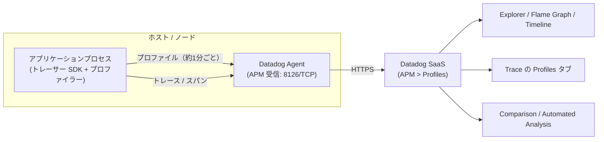
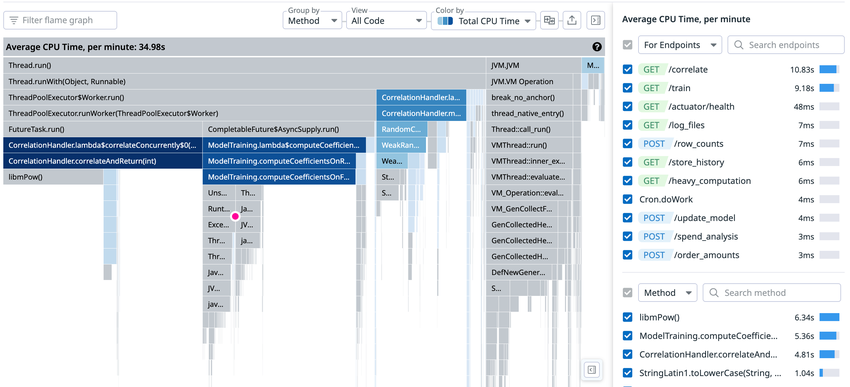
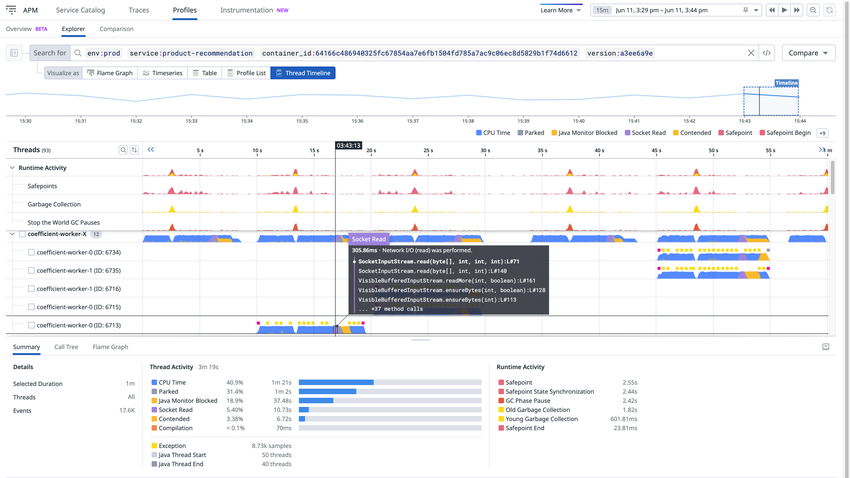
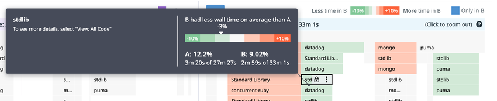
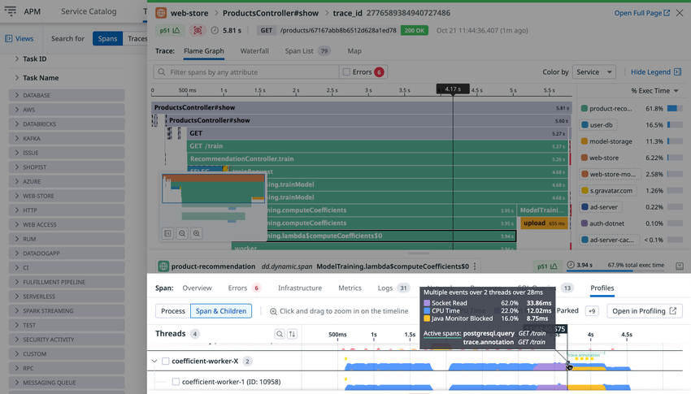
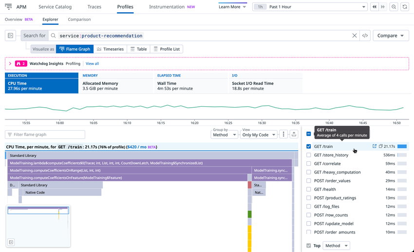

# Continuous Profiler（継続的プロファイラー）

## 概要

Datadog Continuous Profiler（継続的プロファイラー）は、本番環境で常時動作し、CPU・メモリ・I/O・ロック待ちなどのボトルネックを **メソッド名・クラス名・行番号** の粒度で特定する APM 系製品である。目的は、エンドユーザーのレイテンシ削減とインフラコスト削減である。[出典](https://docs.datadoghq.com/profiler/)

本ファイルが答える問い：

| 問い | 該当節 |
|---|---|
| Continuous Profiler はどう動き、トレースと何が違うか | [仕組みとデータフロー](#仕組みとデータフロー) |
| どの言語で、どのプロファイル種別が取れるか。最低バージョンは | [対応言語と要件](#対応言語と要件)、[言語別プロファイル種別](#言語別プロファイル種別) |
| 有効化の方法と主要な設定キー・デフォルト値 | [有効化と言語別の主要設定](#有効化と言語別の主要設定) |
| 本番での負荷（オーバーヘッド）はどの程度で、どう抑えるか | [オーバーヘッド](#オーバーヘッド) |
| 画面の構成（Explorer、Flame Graph、Timeline、Call Graph） | [画面と可視化](#画面と可視化) |
| デプロイ前後・環境間の比較 | [Profile Comparison（プロファイル比較）](#profile-comparisonプロファイル比較) |
| スパンから該当コードへ辿る機能（Code Hotspots） | [Trace to Profiling 連携（Code Hotspots）と Endpoint Profiling](#trace-to-profiling-連携code-hotspotsと-endpoint-profiling) |
| 自動検出される性能問題 | [Automated Analysis（自動分析）](#automated-analysis自動分析) |
| データの保持期間、制限値 | [制限値・クォータ・デフォルト値](#制限値クォータデフォルト値) |
| 課金単位と価格 | [課金への影響](#課金への影響) |

- Continuous Profiler は 2020-08-11 に一般提供（GA）が発表された（発表時の価格は現行と異なるため参照しないこと）。[出典](https://www.datadoghq.com/about/latest-news/press-releases/continuous-profiler/)
- 関連ファイル：APM 全体の概念は [APM の概念とインジェスト制御](./apm-concepts-and-ingestion.md)、トレーサー（SDK）導入は [APM インスツルメンテーション](./apm-instrumentation.md)、APM 画面（Service Page の Profiling タブ等）は [APM 画面と分析機能](./apm-ui-and-analysis.md) を参照。

> **名称について:** 公式ドキュメントの該当ページ（ページタイトル「Investigate Slow Traces or Endpoints」）は、スパンからプロファイルへ辿る機能を前提条件の本文中で「Trace to Profiling integration」（トレースとプロファイルの連携）と呼び、エンドポイント単位の機能を「Endpoint profiling」（H3 見出し・本文）と表記している。本書ではこれらを「Trace to Profiling 連携」「Endpoint Profiling」と表記する。スパンからコードレベルのプロファイルへ辿る機能は、以前は「Code Hotspots」と呼ばれ、トレーサーのコードや GitHub の PR・Issue、製品ページ等で現在もこの名称が見られる。改称時期は公開情報では確認できず。[出典](https://docs.datadoghq.com/profiler/connect_traces_and_profiles/) [出典](https://github.com/DataDog/dd-trace-rb/pull/3510)

---

## 仕組みとデータフロー

Datadog Continuous Profiler は、アプリケーションプロセス内で動くプロファイラーライブラリ（多くは APM トレーサー SDK に同梱）がスタックトレースを継続的にサンプリングし、一定期間ごとに集約したプロファイルを Datadog Agent 経由で Datadog SaaS に送る方式である。

| 項目 | 内容 | 出典 |
|---|---|---|
| 収集方式 | 全スタックトレースの代表サンプルを継続的に収集し、60 秒間で集約して Agent 経由で送信。1 分間隔で継続的に行う | [料金ページ FAQ](https://www.datadoghq.com/pricing/?product=apm--continuous-profiler) |
| アップロード頻度 | 1 分に 1 回 | [Profile Visualizations](https://docs.datadoghq.com/profiler/profile_visualizations/) |
| 1 プロファイルの対象時間 | 言語により 15〜60 秒 | [Profile Visualizations](https://docs.datadoghq.com/profiler/profile_visualizations/) |
| 有効化方法 | プロファイリングライブラリの import、またはトレーサー実行時の環境変数フラグ（`DD_PROFILING_ENABLED` 等） | [料金ページ FAQ](https://www.datadoghq.com/pricing/?product=apm--continuous-profiler) |
| Agent の要件 | Datadog Agent v6 以上が必須、v7 以上を推奨。APM が無効なら `DD_APM_ENABLED=true` にし、ポート `8126/TCP` を使う | [Enabling Java](https://docs.datadoghq.com/profiler/enabling/java/) |
| 利用技術の例 | JDK Flight Recorder（JFR）など | [Continuous Profiler](https://docs.datadoghq.com/profiler/) |
| リクエストへの影響 | プロファイラーはサービスのリクエストを中断・干渉しないため、追加のリクエストレイテンシは発生しないと公式は説明 | [料金ページ FAQ](https://www.datadoghq.com/pricing/?product=apm--continuous-profiler) |

### トレーシングとプロファイリングの違い

| 観点 | APM トレーシング | Continuous Profiler |
|---|---|---|
| 測るもの | 分散システム内のサービスをまたぐリクエストのレイテンシ | サービス内のコードレベルで何が起きたか（メソッド別の CPU・メモリ・待ち時間等） |
| 粒度 | スパン（関数呼び出しや外部呼び出し単位） | メソッド・行番号・スレッド |
| 計装 | 計装されたコード（自動・手動）のみ | 計装不要でプロセス全体をサンプリング |

[出典](https://www.datadoghq.com/pricing/?product=apm--continuous-profiler) [出典](https://docs.datadoghq.com/getting_started/profiler/)

- APM 分散トレーシングと Profiler の両方を有効化したプロセスは、自動的に相互リンクされる（スパンの Profiles タブからプロファイルへ移動可能）。[出典](https://docs.datadoghq.com/profiler/)
- プロファイルの `service`・`env`・`version` は Unified Service Tagging（`DD_SERVICE`、`DD_ENV`、`DD_VERSION`）で付与する。タグ設計は [Tagging](../platform/tagging.md) を参照。

---

## 対応言語と要件

Continuous Profiler の対応言語は Java、Python、Go、Ruby、Node.js、.NET、PHP、Rust、C、C++ である（Java は GraalVM Native Image 版を含む）。[出典](https://docs.datadoghq.com/profiler/)

料金ページ FAQ では「Java、.NET、Go、Python、Ruby、Node.js、PHP をサポートし、C、C++、Rust はベータ」と記載されている。ドキュメント上は C/C++/Rust 用ネイティブプロファイラー `ddprof` は【Preview】である。[出典](https://www.datadoghq.com/pricing/?product=apm--continuous-profiler) [出典](https://docs.datadoghq.com/profiler/enabling/ddprof/)

### 言語別要件サマリー

| 言語 | ランタイム要件 | OS / アーキテクチャ | トレーサー / ライブラリ | サーバーレス | 出典 |
|---|---|---|---|---|---|
| Java（JVM） | Linux：OpenJDK 系 8u352+／11.0.17+／17.0.5+／21+、Oracle JDK 8u351+／11.0.17+／17.0.5+／21+、OpenJ9 8u372+／11.0.18+／17.0.6+、Azul Platform Prime 23.05.0.0+。Windows：OpenJDK 8u282+／11.0.17+／17.0.5+／21.0.3+、Oracle JDK 11.0.17+／17.0.5+／21.0.3+（Oracle 8u40+ は CPU のみ）、Azul Zulu 8u212+／11.0.17+／17.0.5+／21.0.3+、GraalVM 17.0.11+／21.0.3+ | Linux（Datadog Profiler エンジン）、Windows・macOS（JFR） | `dd-java-agent.jar`。JVM 言語（Java、Scala、Groovy、Kotlin、Clojure）全般。保守中の LTS JDK と最新 GA JDK のみサポート | 非対応 | [Enabling Java](https://docs.datadoghq.com/profiler/enabling/java/) |
| Java（GraalVM Native Image）【Preview】 | GraalVM 17+ | Linux、Windows、macOS | JFR ベースのみ。CPU・Allocations のみ（Wallclock・Live heap なし） | — | [Enabling Java](https://docs.datadoghq.com/profiler/enabling/java/) |
| Python | `ddtrace` の互換要件に従う（4.x 系は CPython 3.9+）。一部機能はより新しい Python が必要 | Linux（x86-64、AArch64）など。バイナリ配布がない環境（例：Alpine）はコンパイラが必要 | `ddtrace`（pip 18 以上） | AWS Lambda 等一部で【Preview】 | [Enabling Python](https://docs.datadoghq.com/profiler/enabling/python/)、[Python 互換性](https://docs.datadoghq.com/tracing/trace_collection/compatibility/python/) |
| Go | 最新 2 メジャーリリースの Go | — | `github.com/DataDog/dd-trace-go/v2/profiler`。Trace to Profiling・Endpoint Profiling は dd-trace-go 1.51.0+ | 非対応 | [Enabling Go](https://docs.datadoghq.com/profiler/enabling/go/) |
| Ruby | Ruby 2.5+（3.2.3+ 推奨）。JRuby・TruffleRuby 非対応 | Linux glibc／musl（x86-64、aarch64） | `datadog` gem（例：`~> 2.30`）。2.30 未満は `pkg-config`／`pkgconf` が必要 | 非対応。SSI では Ruby Profiler を設定できない | [Enabling Ruby](https://docs.datadoghq.com/profiler/enabling/ruby/) |
| Node.js | Node.js 18+ | Linux、macOS（CPU プロファイル・Trace to Profiling は Windows 非対応） | `dd-trace`（アップロード済みソースマップは 5.93.0+、【Preview】） | AWS Lambda、Google Cloud Run で【Preview】 | [Enabling Node.js](https://docs.datadoghq.com/profiler/enabling/nodejs/)、[Profile Types](https://docs.datadoghq.com/profiler/profile_types/) |
| .NET | 64 ビット：.NET Framework 4.6.1+、.NET Core 2.1／3.1、.NET 5〜10 | .NET Framework：Windows 10、Windows Server 2012+。.NET Core／.NET 5+：Linux（glibc 2.17+、musl）、Windows 10、Windows Server 2012+。コンテナは 1 コア超が必要 | `dd-trace-dotnet` 2.8.0+ に同梱 | Azure App Service Web Apps（Windows／Linux）のみ。Function Apps・AWS Lambda 非対応。Google Cloud Run は【Preview】 | [Enabling .NET](https://docs.datadoghq.com/profiler/enabling/dotnet/) |
| PHP | PHP 7.1+（64 ビット Linux）。ZTS は `dd-trace-php` 0.99+、デバッグビルド非対応 | glibc 2.17+（CentOS 7、Debian 8、Ubuntu 14.04 等）、Alpine 3.13+（`apk add libgcc` が必要） | `datadog-setup.php --enable-profiling` | 非対応 | [Enabling PHP](https://docs.datadoghq.com/profiler/enabling/php/) |
| C / C++ / Rust（`ddprof`）【Preview】 | シンボル情報が必要（strip 済みバイナリは関数名が出ない） | Linux（glibc／musl）、amd64／arm64。`perf_event_paranoid` が 2 以下 | `ddprof` 単体実行ファイル、またはライブラリ（v0.8.0+） | 非対応 | [Enabling ddprof](https://docs.datadoghq.com/profiler/enabling/ddprof/) |
| Full-Host（eBPF）【Preview】 | — | Linux カーネル 5.4+（amd64）／5.5+（arm64） | OpenTelemetry ベースの eBPF プロファイラー（単体実行ファイル／コンテナ） | 非対応 | [Enabling Full-Host](https://docs.datadoghq.com/profiler/enabling/full_host/) |

> **注意（.NET ARM64）:** .NET の有効化ページでは、NuGet パッケージの表に `linux-arm64` のパスが載る一方、制限事項に「Continuous Profiler は ARM64 をサポートしない」と記載されており、ドキュメント内で記述が食い違っている。ARM64 で使う場合は事前検証または Datadog サポートへの確認が必要。[出典](https://docs.datadoghq.com/profiler/enabling/dotnet/)

> **注意（Python のバージョン表記）:** Profile Types ページは Python のプロファイル種別要件を「Python 2.7+」「Python 3.5+」と記載しているが、現行 `ddtrace` 4.x 系の対象は CPython 3.9+ である。実際に使える最低バージョンは `ddtrace` の互換表で決まる。[出典](https://docs.datadoghq.com/profiler/profile_types/) [出典](https://docs.datadoghq.com/tracing/trace_collection/compatibility/python/)

---

## 言語別プロファイル種別

Continuous Profiler で収集できるプロファイル種別は言語ごとに異なる。料金ページは代表例として CPU、Memory、Lock、Wall Time、Disk IO、Socket IO、Goroutines、Exceptions を挙げている。[出典](https://www.datadoghq.com/pricing/?product=apm--continuous-profiler) 以下は公式 Profile Types ページを整理したものである。[出典](https://docs.datadoghq.com/profiler/profile_types/)

### 主要プロファイル種別の意味（共通）

| 種別 | 意味 | 典型的な用途 |
|---|---|---|
| CPU（CPU Time） | 各メソッド／関数が CPU 上で実行された時間 | CPU 消費の大きいコードの特定、コスト削減 |
| Wall Time | CPU 時間、I/O 待ち、その他を含む経過時間 | レイテンシの原因調査 |
| Allocations | ヒープ割り当て回数（解放済みを含む） | GC 負荷の原因調査 |
| Allocated Memory | ヒープ割り当てバイト数（解放済みを含む） | 割り当て量の削減 |
| Live Heap／Heap Live Size／Heap Live Objects | GC されずに残っているオブジェクト数・メモリ量 | メモリリーク調査 |
| Lock／Mutex／Block | ロック待ち時間、ロック取得回数など | 競合（コンテンション）の調査 |
| Thrown Exceptions | 送出された例外の数と種類 | 例外の多発による性能劣化の調査 |
| File I/O／Socket I/O | ファイル・ソケットの読み書きに費やした時間 | I/O ボトルネックの調査 |

### Java

| 種別 | 説明 | 要件・注記 |
|---|---|---|
| CPU | メソッドごとの CPU 時間（JVM 上のアプリケーションコード。JVM 内部やネイティブ呼び出しは含まない） | なし |
| Allocations | メソッドごとのヒープ割り当て回数 | Java 11 |
| Allocated Memory | メソッドごとのヒープ割り当てバイト数 | Java 11 |
| Live Heap | GC されていないオブジェクトとメモリ（リーク調査） | トレーサー v1.61.0+、Java 11+ |
| Wall Time | 経過時間（CPU、I/O 待ち等を含む） | なし（Windows 不可） |
| Class Load | メソッドごとのクラスロード数 | なし |
| Thrown Exceptions | 例外の数と種類 | なし |
| File I/O | ファイル読み書き時間 | なし |
| Lock | ロック待ち時間 | なし |
| Socket I/O | ソケット読み書き時間 | なし |

[出典](https://docs.datadoghq.com/profiler/profile_types/)

- Linux の Java では Datadog Profiler エンジン（v1.7.0 以降デフォルト）で CPU、Wallclock、Allocations、Live heap、Exception、I/O を取得する。Windows（JFR）では CPU、Allocations、I/O、Exception のみで、Wallclock と Live heap は取得できない。[出典](https://docs.datadoghq.com/profiler/enabling/java/)

### Python

| 種別 | 説明 | 要件・注記 |
|---|---|---|
| Wall Time | 経過時間 | Python 2.7+（公式表記） |
| Lock Wait Time | ロック待ち時間 | 同上 |
| Locked Time | ロック保持時間 | 同上 |
| Lock Acquires | ロック取得回数 | 同上 |
| Lock Releases | ロック解放回数 | 同上 |
| CPU | CPU 時間（Python コードとネイティブコード） | Python 2.7+、POSIX のみ |
| Heap Live Size | GC されていないヒープメモリ | Python 3.5+（公式表記） |
| Allocated Memory | ヒープ割り当てバイト数 | 同上 |
| Allocations | ヒープ割り当て回数 | 同上 |

[出典](https://docs.datadoghq.com/profiler/profile_types/)

### Go

| 種別 | 説明 | 要件・注記 |
|---|---|---|
| CPU Time | 関数ごとの CPU 時間。オフ CPU の待ち（ネットワーク、チャネル、mutex、sleep）は含まない | Mutex／Block を参照 |
| Allocations（`alloc_objects`） | プロファイル期間（既定 60 秒）中のヒープ割り当てオブジェクト数。スタック割り当ては対象外 | 1.33.0 で差分（delta）化 |
| Allocated Memory（`alloc_space`） | 同期間中のヒープ割り当てバイト数 | 1.33.0 で差分化 |
| Heap Live Objects（`inuse_objects`） | GC 後も使用中のヒープオブジェクト数 | なし |
| Heap Live Size（`inuse_space`） | GC 後も使用中のヒープバイト数。既定 `GOGC=100` では通常プロセス RSS の約半分 | なし |
| Mutex | mutex 待ち時間。短いスピンロック競合は CPU プロファイルにのみ現れる | 1.33.0 で差分化 |
| Block | mutex・チャネル待ち時間。ブロック解除後にのみ記録されるため「止まっているように見える」アプリの診断には使えない。本番で目立つオーバーヘッドを生む場合がある | 1.33.0 で差分化 |
| Goroutines | 同じ関数を実行中の goroutine 数のスナップショット。継続的増加はリークの兆候 | goroutine が 10,000 を超えると Stop-the-world 停止が発生 |

[出典](https://docs.datadoghq.com/profiler/profile_types/)

- Go の差分プロファイル：1.33.0 より前は Allocations、Allocated Memory、Mutex、Block がプロセス起動時からの累積値だった。1.33.0 から差分プロファイルがデフォルト、1.35.0 で無効化オプション `WithDeltaProfiles` が追加、1.37.0 以降は差分有効時に累積プロファイルをアップロードしない。[出典](https://docs.datadoghq.com/profiler/profile_types/)
- Go のデフォルト有効種別は CPU と Heap の 2 つ。Block、Mutex、Goroutine はオーバーヘッドを抑えるため既定で無効で、`profiler.WithProfileTypes(...)` で有効化する。[出典](https://docs.datadoghq.com/profiler/enabling/go/)

### Ruby

| 種別 | 説明 | 要件・注記 |
|---|---|---|
| CPU | CPU 時間（Ruby とネイティブコード） | なし |
| Wall Time | 経過時間 | なし |
| Allocations | プロファイル期間（既定 60 秒）中のオブジェクト割り当て数 | v2.3.0+、手動有効化 |
| Heap Live Objects【Preview】 | GC されていないヒープオブジェクト数 | v2.18.0+、Ruby 3.1+、手動有効化 |
| Heap Live Size【Preview】 | GC されていないヒープメモリ | v2.18.0+、Ruby 3.1+、手動有効化、Ruby 4 非対応 |
| GVL profiling（Timeline） | 他スレッド（バックグラウンドスレッド含む）にブロックされた時間。レイテンシスパイク調査向け | v2.11.0+、Ruby 3.2+ |

[出典](https://docs.datadoghq.com/profiler/profile_types/)

### Node.js

| 種別 | 説明 | 要件・注記 |
|---|---|---|
| CPU | CPU 時間（JavaScript とネイティブコード） | Linux・macOS のみ（Windows 不可） |
| Wall Time | 経過時間 | なし |
| Heap Live Objects | GC されていないヒープオブジェクト数 | なし |
| Heap Live Size | GC されていないヒープメモリ | スタックトレースは 64 フレームで切り詰め |
| Allocated Memory【Preview】 | ヒープ割り当てバイト数 | Node.js 26+、`DD_PROFILING_ALLOCATION_ENABLED=true` |
| Allocations【Preview】 | ヒープ割り当て回数 | Node.js 26+、`DD_PROFILING_ALLOCATION_ENABLED=true` |

[出典](https://docs.datadoghq.com/profiler/profile_types/)

### .NET

| 種別 | 説明 | 要件・注記 |
|---|---|---|
| Wall Time | マネージドメソッドの経過時間 | なし |
| CPU | メソッドごとの CPU 時間 | v2.15+ |
| Thrown Exceptions | 捕捉・未捕捉の例外（型とメッセージ） | v2.31+ |
| Allocations | 型ごとの割り当て数とサイズ（.NET Framework ではサイズ不可） | v3.28+。.NET Framework（Agent 7.51+、v3.2+）または .NET 6+。.NET 10+ 推奨 |
| Lock | スレッドのロック待ち回数と時間 | v2.49+。.NET Framework（Agent 7.51+）または .NET 5+ |
| Live Heap | 割り当てオブジェクトのうちメモリに残るもの（クラス名付き） | v3.28+、.NET 7+、.NET 10+ 推奨 |
| Outgoing HTTP requests（Timeline）【Preview】 | 送信 HTTP リクエストの開始・終了、DNS／TLS／ソケット／リクエスト・レスポンスの各フェーズ時間、想定外のリダイレクト | v3.19+、.NET 7+ |
| Thread lifetime（Timeline） | スレッドの開始・終了（ThreadPool 枯渇や短命スレッドの発見） | v3.19+。.NET Framework（Agent 7.51+、v3.2+）または .NET 5+ |
| Garbage Collector CPU consumption | GC スレッドの CPU 時間 | v3.19+。同上 |

[出典](https://docs.datadoghq.com/profiler/profile_types/)

- .NET 10 より前では、ランタイムのサンプリングアルゴリズムの都合で Allocations と Live Heap が大きなオブジェクトを過大に表す場合がある。[出典](https://docs.datadoghq.com/profiler/profile_types/)
- .NET の Allocations の最低バージョンは、Profile Types ページでは v3.28+、有効化ページでは「.NET Framework は 3.12.0+（Agent 7.51+）、.NET 6+ は 2.18.0+（3.28+ 推奨）」と記載が分かれている。正確な表示（サイズ付き等）を得るには 3.28+ を使うのが安全である【推定】。[出典](https://docs.datadoghq.com/profiler/enabling/dotnet/)

### PHP

| 種別 | 説明 | 要件・注記 |
|---|---|---|
| Wall Time | 経過時間 | なし |
| CPU | CPU 時間 | なし |
| Allocations | プロファイル期間（既定 67 秒）中の割り当て回数 | v0.88+。PHP 8.0.0〜8.1.20、8.2.0〜8.2.7 で JIT 有効時は不可 |
| Allocated memory | 同期間中のヒープ割り当てバイト数 | 同上 |
| Thrown Exceptions | 捕捉・未捕捉の例外（型） | v0.92+ |
| File I/O【Preview】 | ファイル読み書き時間とバイト数 | v1.7.2+ |
| Socket I/O【Preview】 | ソケット読み書き時間とバイト数 | v1.7.2+ |

[出典](https://docs.datadoghq.com/profiler/profile_types/)

### Rust / C / C++（`ddprof`）と Full-Host

| 対象 | 種別 | 説明・注記 |
|---|---|---|
| Rust / C / C++ | CPU | 関数ごとの CPU 時間 |
| Rust / C / C++ | Allocations | プロファイル期間（既定 59 秒）中の割り当て回数（スタック割り当ては対象外） |
| Rust / C / C++ | Allocated memory | 同期間中のヒープ割り当てバイト数 |
| Full-Host | CPU Time（eBPF） | メソッド／関数ごとの CPU 時間。マルチスレッドでは経過時間を超えうる |

[出典](https://docs.datadoghq.com/profiler/profile_types/)

### 言語別プロファイル種別の早見表

| 種別 | Java | Python | Go | Ruby | Node.js | .NET | PHP | Rust/C/C++ |
|---|---|---|---|---|---|---|---|---|
| CPU | ○ | ○（POSIX） | ○ | ○ | ○（Linux/macOS） | ○ | ○ | ○ |
| Wall Time | ○（Windows 不可） | ○ | — | ○ | ○ | ○ | ○ | — |
| Allocations / Allocated Memory | ○ | ○ | ○ | ○（Allocations のみ） | 【Preview】 | ○ | ○ | ○ |
| Live Heap 系 | ○ | ○ | ○ | 【Preview】 | ○ | ○ | — | — |
| Lock / Mutex / Block | ○ | ○ | ○ | GVL（Timeline） | — | ○ | — | — |
| Thrown Exceptions | ○ | — ※ | — | — | — | ○ | ○ | — |
| File I/O / Socket I/O | ○ | — | — | — | — | — | 【Preview】 | — |
| Goroutines | — | — | ○ | — | — | — | — | — |

※ Python の Profile Types ページには例外プロファイルの記載がないが、`ddtrace` の設定リファレンスには `DD_PROFILING_EXCEPTION_ENABLED`（既定 `True`）が存在する。UI 上の扱いは公開情報では確認できず。[出典](https://docs.datadoghq.com/profiler/profile_types/) [出典](https://ddtrace.readthedocs.io/en/stable/configuration.html)

---

## 有効化と言語別の主要設定

Continuous Profiler は、原則としてトレーサー SDK をインストールしたうえで `DD_PROFILING_ENABLED=true`（またはコード内設定）で有効化する。プロファイルは有効化後数分で **APM > Profiles**（ドキュメントの一部では APM > Profiler と表記）に表示される。[出典](https://docs.datadoghq.com/profiler/enabling/java/)

### 言語別の有効化方法

| 言語 | 有効化方法（代表例） |
|---|---|
| Java | `java -javaagent:dd-java-agent.jar -Ddd.service=<SERVICE> -Ddd.env=<ENV> -Ddd.version=<VERSION> -Ddd.profiling.enabled=true -jar app.jar`、または環境変数 `DD_PROFILING_ENABLED=true`。`-javaagent` は `-jar` より前に置く |
| Python | `DD_PROFILING_ENABLED=true DD_ENV=prod DD_SERVICE=my-web-app DD_VERSION=1.0.3 ddtrace-run python app.py`、またはコードで `ddtrace.profiling.Profiler(...).start()`（他の import より前に開始） |
| Go | `profiler.Start(profiler.WithService(...), profiler.WithEnv(...), profiler.WithVersion(...), profiler.WithProfileTypes(profiler.CPUProfile, profiler.HeapProfile))` と `defer profiler.Stop()`。Orchestrion 利用時は `DD_PROFILING_ENABLED=true` |
| Ruby | `DD_PROFILING_ENABLED=true` または `Datadog.configure` ブロックで `c.profiling.enabled = true`。起動は `bundle exec ddprofrb exec ruby myapp.rb`（使えない場合は `require 'datadog/profiling/preload'`） |
| Node.js | `DD_PROFILING_ENABLED=true` と `node -r dd-trace/init app.js`、またはコードで `require('dd-trace').init({ profiling: true, ... })` |
| .NET | `DD_PROFILING_ENABLED=1`（アプリケーションごと）。Linux 単体構成では `CORECLR_ENABLE_PROFILING=1`、`CORECLR_PROFILER={846F5F1C-F9AE-4B07-969E-05C26BC060D8}`、`CORECLR_PROFILER_PATH`、`DD_DOTNET_TRACER_HOME`、`LD_PRELOAD` も必要 |
| PHP | `php datadog-setup.php --enable-profiling --php-bin=all`。`php -v` に `datadog-profiling` が出れば読み込み済み |
| C/C++/Rust | `./ddprof --environment prod --service my-web-app --service_version 1.0.3 myapp`、またはライブラリで `ddprof_start_profiling()` を呼び `-ldd_profiling` でリンク |

[出典](https://docs.datadoghq.com/profiler/enabling/java/) [出典](https://docs.datadoghq.com/profiler/enabling/python/) [出典](https://docs.datadoghq.com/profiler/enabling/go/) [出典](https://docs.datadoghq.com/profiler/enabling/ruby/) [出典](https://docs.datadoghq.com/profiler/enabling/nodejs/) [出典](https://docs.datadoghq.com/profiler/enabling/dotnet/) [出典](https://docs.datadoghq.com/profiler/enabling/php/) [出典](https://docs.datadoghq.com/profiler/enabling/ddprof/)

SDK のインストール方法そのもの（SSI、Admission Controller、手動導入）は [APM インスツルメンテーション](./apm-instrumentation.md) を参照。

### Single Step Instrumentation（SSI）による有効化【Preview】

Continuous Profiler を SSI で有効化する機能は【Preview】である。[出典](https://docs.datadoghq.com/profiler/enabling/ssi/)

| 項目 | 内容 |
|---|---|
| 対象プラットフォーム | Linux（`x86_64`、`arm64`）。ホスト、コンテナ、Kubernetes |
| 対応言語と SDK | Java 1.37.0+、.NET 3.3.1+（x86_64 のみ）、Node.js 4.39.0+／5.15.0+、Python 3.0.0+ |
| Agent | Kubernetes：7.57.0 以上。ホスト・コンテナ：7.56.x 以上 |
| ホスト／Docker | インストールコマンドの `DD_APM_INSTRUMENTATION_ENABLED` の後に `DD_PROFILING_ENABLED=auto` を追加 |
| Helm | `datadog.profiling.enabled: auto`（チャート 3.71.0 以上）、`agents.image.tag: latest`、`clusterAgent.image.tag: latest` |
| Operator | Cluster Agent の環境変数 `DD_ADMISSION_CONTROLLER_AUTO_INSTRUMENTATION_PROFILING_ENABLED: "auto"`、`spec.override.nodeAgent.image.tag: latest`、`spec.override.clusterAgent.image.tag: latest` |
| `auto` の判定 | 新規プロセスにのみ適用（稼働中プロセスは影響を受けない）。Java は全プロセス、Node.js は 30 秒超稼働かつスパンを 1 つ以上作成したプロセス、Python は SSI で計装されたプロセスが対象 |
| `true` との違い | `true` は全プロセスをプロファイルする。価値の低いプロセスを避けるため `auto` を推奨 |
| systemd | `/etc/environment` は systemd サービスに読まれないため、`.service` に `EnvironmentFile=/etc/environment` を追加 |
| 無効化 | SSI 自体の削除、`false` で再インストール、`/etc/environment` から `DD_PROFILING_ENABLED` を削除、またはプロセス単位で `DD_PROFILING_ENABLED=false` |

[出典](https://docs.datadoghq.com/profiler/enabling/ssi/)

> **注意:** .NET では `DD_PROFILING_ENABLED=Auto` の判定条件を「トレースが作成され、アプリケーションの稼働が 30 秒を超えること」と記載している（.NET 有効化ページでは【Preview】表記）。[出典](https://docs.datadoghq.com/profiler/enabling/dotnet/)

### Java の主要設定キー

| 環境変数 | システムプロパティ | デフォルト・注記 |
|---|---|---|
| `DD_PROFILING_ENABLED` | `-Ddd.profiling.enabled` | プロファイラーの有効化 |
| `DD_PROFILING_DDPROF_ENABLED` | `-Ddd.profiling.ddprof.enabled` | v1.7.0 以降 `true`（Linux のみ）。Datadog Profiler エンジンを使う |
| `DD_PROFILING_DDPROF_CPU_ENABLED` | `-Ddd.profiling.ddprof.cpu.enabled` | v1.7.0 以降 Datadog の CPU プロファイラーが既定。`false` で JFR |
| `DD_PROFILING_DDPROF_WALL_ENABLED` | `-Ddd.profiling.ddprof.wall.enabled` | v1.7.0 以降 `true` |
| `DD_PROFILING_DDPROF_ALLOC_ENABLED` | `-Ddd.profiling.ddprof.alloc.enabled` | Java 11.0.23+、17.0.11+、21.0.3+、22+ で既定有効 |
| `DD_PROFILING_DDPROF_LIVEHEAP_ENABLED` | `-Ddd.profiling.ddprof.liveheap.enabled` | 対応 JDK で既定有効。`DD_PROFILING_HEAP_ENABLED=true` が前提 |
| `DD_PROFILING_HEAP_ENABLED` | `-Ddd.profiling.heap.enabled` | 対応プラットフォームで `true`（v1.61.0+）。`false` で両エンジンの Live Heap を無効化 |
| `DD_PROFILING_HEAP_HISTOGRAM_ENABLED` | `-Ddd.profiling.heap.histogram.enabled` | ヒープクラスヒストグラム。Java 17.0.9+、ZGC 非対応。Memory Leaks ワークフローで使用 |
| `DD_PROFILING_ENABLED_EVENTS` | `-Ddd.profiling.enabled.events` | 有効化する JFR イベントのカンマ区切りリスト |
| `DD_PROFILING_TEMPDIR` | `-Ddd.profiling.tempdir` | 一時ディレクトリ（書き込み・実行可能であること）。SSI では `application_monitoring.yaml` で設定 |
| — | `-Ddd.profiling.jfr-template-override-file` | `.jfp` テンプレート上書きファイル（JVM 起動時のみ反映） |
| — | `-Ddd.profiling.ddprof.liveheap.sample_percent` | Live Heap で追跡する割り当てサンプルの割合（例 `10`） |
| — | `-Ddd.integration.throwables.enabled` | `false` で例外プロファイルを無効化 |
| `DD_TAGS` | — | プロファイルに付与するタグ（例 `layer:api,team:intake`） |

[出典](https://docs.datadoghq.com/profiler/profiler_troubleshooting/java/) [出典](https://docs.datadoghq.com/profiler/enabling/java/)

- JFR の割り当てプロファイルは Java 16+ で既定有効、Java 8〜15 ではオーバーヘッドと記録サイズのため既定無効。[出典](https://docs.datadoghq.com/profiler/profiler_troubleshooting/java/)
- Datadog の割り当てプロファイラーは JVMTI が不安定な JDK（11.0.23、17.0.11、21.0.3 未満）では自動的に無効化される。[出典](https://docs.datadoghq.com/profiler/profiler_troubleshooting/java/)
- Linux で `/proc/sys/kernel/perf_event_paranoid` が `3` の場合、perf events が使えず itimer にフォールバックして品質が下がる。`2` 以下に設定する。[出典](https://docs.datadoghq.com/profiler/profiler_troubleshooting/java/)

### Python（`ddtrace`）の主要設定キー

| 環境変数 | 型 | デフォルト | 説明 |
|---|---|---|---|
| `DD_PROFILING_ENABLED` | Boolean | `False` | `ddtrace-run` 利用時にプロファイラーを有効化 |
| `DD_PROFILING_UPLOAD_INTERVAL` | Float | `60.0` | 記録イベントをフラッシュするまでの秒数 |
| `DD_PROFILING_MAX_TIME_USAGE_PCT` | Float | `1.0` | スタックプロファイラーが統計計算に使える時間の上限（%）。0〜100 |
| `DD_PROFILING_MAX_FRAMES` | Integer | `64` | スタックトレースの最大フレーム数（599 超は 599 に丸め） |
| `DD_PROFILING_STACK_ENABLED` | Boolean | `True` | スタックプロファイラー（CPU／Wall） |
| `DD_PROFILING_LOCK_ENABLED` | Boolean | `True` | ロックプロファイラー |
| `DD_PROFILING_MEMORY_ENABLED` | Boolean | `True` | メモリプロファイラー |
| `DD_PROFILING_HEAP_ENABLED` | Boolean | `True` | ヒーププロファイラー |
| `DD_PROFILING_HEAP_SAMPLE_SIZE` | Integer | `None` | メモリプロファイラーのサンプル間の平均割り当てバイト数 |
| `DD_PROFILING_CAPTURE_PCT` | Float | `1.0` | 割り当て等のイベントの捕捉率（%）。高いほど遅くなる |
| `DD_PROFILING_EXCEPTION_ENABLED` | Boolean | `True` | 例外プロファイラー |
| `DD_PROFILING_EXCEPTION_SAMPLING_INTERVAL` | Integer | `100` | 例外のサンプリング間隔（平均）。小さいほど高オーバーヘッド |
| `DD_PROFILING_EXCEPTION_COLLECT_MESSAGE` | Boolean | `False` | 例外メッセージを収集（機微情報を含みうる） |
| `DD_PROFILING_TIMELINE_ENABLED` | Boolean | `True` | サンプルにタイムスタンプを付与し Timeline 表示を可能にする（一定のオーバーヘッドあり） |
| `DD_PROFILING_ENDPOINT_COLLECTION_ENABLED` | Boolean | `True` | エンドポイント情報の収集 |
| `DD_PROFILING_ENABLE_CODE_PROVENANCE` | Boolean | `True` | コード来歴（自コード／ライブラリの区別）。`0` で無効 |
| `DD_PROFILING_STACK_NATIVE_FRAMES` | Boolean | `True` | ネイティブ関数呼び出しの追跡（Python 3.12+） |
| `DD_PROFILING_PYTORCH_ENABLED` | Boolean | `False` | PyTorch プロファイラー |
| `DD_PROFILING_NATIVE_HEAP_ENABLED` | Boolean | `False` | 実験的なネイティブ（C/C++）ヒーププロファイリング（Linux） |
| `DD_PROFILING_API_TIMEOUT_MS` | Integer | `10000` | HTTP API 無応答時にイベントを破棄するまでのタイムアウト |
| `DD_PROFILING_TAGS` | Mapping | `{}` | プロファイルに付与するタグ |

[出典](https://ddtrace.readthedocs.io/en/stable/configuration.html)（`ddtrace` stable 版ドキュメント、2026-11-02 取得）

> **注意:** Trace to Profiling のドキュメントは Python で `DD_PROFILING_TIMELINE_ENABLED=true` の設定を要件としているが、`ddtrace` の現行設定リファレンスでは既定値が `True` である。古い `ddtrace` では明示設定が必要な可能性がある。[出典](https://docs.datadoghq.com/profiler/connect_traces_and_profiles/) [出典](https://ddtrace.readthedocs.io/en/stable/configuration.html)

- Python では `os.fork` 後、対応 Python バージョンで子プロセスのプロファイラーが自動再起動する。[出典](https://docs.datadoghq.com/profiler/enabling/python/)

### Ruby の主要設定キー

| 環境変数 | コード設定 | デフォルト | 説明 |
|---|---|---|---|
| `DD_PROFILING_ENABLED` | `c.profiling.enabled` | `false` | プロファイラー有効化 |
| `DD_PROFILING_ALLOCATION_ENABLED` | `c.profiling.allocation_enabled` | `false` | 割り当てプロファイル |
| `DD_PROFILING_MAX_FRAMES` | `c.profiling.advanced.max_frames` | `400` | これより深いスタックは切り詰め |
| `DD_PROFILING_EXPERIMENTAL_HEAP_ENABLED` | `c.profiling.advanced.experimental_heap_enabled` | `false` | Heap Live Objects（割り当てプロファイルが前提） |
| `DD_PROFILING_EXPERIMENTAL_HEAP_SIZE_ENABLED` | `c.profiling.advanced.experimental_heap_size_enabled` | Heap 有効設定と同じ | Heap Live Size（Ruby 4 非対応） |
| `DD_PROFILING_NO_SIGNALS_WORKAROUND_ENABLED` | `c.profiling.advanced.no_signals_workaround_enabled` | 必要時に自動有効 | シグナルを使わない回避モード（ネイティブ拡張 gem との衝突対策） |
| `DD_PROFILING_PREVIEW_OTEL_CONTEXT_ENABLED` | `c.profiling.advanced.preview_otel_context_enabled` | `false` | OpenTelemetry コンテキスト連携（`only` / `true`） |

コード設定は環境変数より優先される。[出典](https://docs.datadoghq.com/profiler/enabling/ruby/)

### .NET の主要設定キー

| 環境変数 | デフォルト | 説明 |
|---|---|---|
| `DD_PROFILING_ENABLED` | `false` | `1`／`true` で有効。SSI では `Auto`【Preview】も可 |
| `DD_PROFILING_WALLTIME_ENABLED` | `true` | Wall Time |
| `DD_PROFILING_CPU_ENABLED` | `true` | CPU |
| `DD_PROFILING_EXCEPTION_ENABLED` | `false` | 例外 |
| `DD_PROFILING_ALLOCATION_ENABLED` | `false` | 割り当て【Preview】 |
| `DD_PROFILING_LOCK_ENABLED` | `false` | ロック競合 |
| `DD_PROFILING_HEAP_ENABLED` | `false` | Live Heap【Preview】 |
| `DD_PROFILING_GC_ENABLED` | `true` | Timeline 用 GC 詳細 |
| `DD_PROFILING_HTTP_ENABLED` | `false` | Timeline 用送信 HTTP |
| `DD_PROFILING_HEAPSNAPSHOT_ENABLED` | `false` | Memory Leak UI 用ヒープスナップショット |
| `DD_PROFILING_LOG_DIR` | `%ProgramData%\Datadog .NET Tracer\logs\`（v2.24 より前は `%ProgramData%\Datadog-APM\logs\`） | ログ出力先 |
| `DD_PROFILING_MIN_CORES_THRESHOLD` | 1 コア（1 コア未満のコンテナでは無効化） | 閾値を下げて小さいコンテナでも有効化（推奨されない） |
| `DD_ENV` / `DD_VERSION` | `unspecified-environment` / `unspecified-version` | — |
| `DD_SERVICE` | エントリアセンブリ名またはプロセス名から自動検出 | — |

設定変更後はアプリケーションの再起動が必要。[出典](https://docs.datadoghq.com/profiler/enabling/dotnet/) [出典](https://docs.datadoghq.com/profiler/profiler_troubleshooting/dotnet/)

- .NET の Profiler は APM パッケージをインストールしても既定では有効にならない（APM と異なる）。CLR Profiling API は 1 プロセスに 1 つしか登録できないため、他社 APM と同居できない。[出典](https://docs.datadoghq.com/profiler/enabling/dotnet/)
- .NET の機能別最低トレーサーバージョン：Wall time 2.7.0+、CPU 2.15.0+、GC CPU consumption 3.19.0+（.NET 5+）、Exceptions 2.31.0+、Lock 2.49.0+、Live heap 3.28.0+、Trace to Profiling 2.30.0+、Endpoint profiling 2.15.0+、Timeline 2.30.0+、Memory leak investigation 3.33.0+（.NET 6+、【Preview】）。[出典](https://docs.datadoghq.com/profiler/enabling/dotnet/)

### Go・Node.js・PHP・ddprof・Full-Host の補足

| 対象 | 設定・注記 |
|---|---|
| Go | `WithService`、`WithEnv`、`WithVersion`、`WithTags`、`WithProfileTypes`。環境変数 `DD_ENV`、`DD_SERVICE`、`DD_VERSION`、`DD_TAGS`。既定値は収集周期 1 分（`DefaultPeriod`）、CPU プロファイル取得時間 1 分（`DefaultDuration`）、アップロードタイムアウト 10 秒（`DefaultUploadTimeout`、`DD_PROFILING_UPLOAD_TIMEOUT` で変更可）。C 関数のシンボル解決用 `cgosymbolizer` は実験的で、C++ 例外や `tcmalloc` 利用時にまれにデッドロックする可能性あり |
| Node.js | 公開されている主要変数は `DD_PROFILING_ENABLED`、`DD_ENV`、`DD_SERVICE`、`DD_VERSION`。割り当てプロファイル（Node.js 26+）は `DD_PROFILING_ALLOCATION_ENABLED=true` |
| PHP | `php datadog-setup.php config set -d datadog.service=... -d datadog.env=... -d datadog.version=...`。Timeline は `DD_PROFILING_TIMELINE_ENABLED=1` または INI `datadog.profiling.timeline_enabled=1`。INI 変更後は Apache／PHP-FPM／FrankenPHP 等を再起動 |
| ddprof | `DD_ENV`／`--environment`、`DD_SERVICE`／`--service`、`DD_VERSION`／`--service_version`。ログ出力先は `stdout`（既定）、`stderr`、`syslog`、`disable`、ファイルパス。`--global` は PID 名前空間内の全プロセスを対象にするデバッグ用モードで、root、`CAP_PERFMON`、`CAP_SYSADMIN`、または `perf_event_paranoid=-1` が必要 |
| Full-Host | `DD_SERVICE` を設定しない場合はバイナリ名からサービス名を推定（インタープリタ言語では `service:java` 等のインタープリタ名）。strip 済みバイナリは `DD_BETA_COMMANDS_ENABLED=1 datadog-ci elf-symbols upload <symbols path>` でシンボルをアップロード |

[出典](https://docs.datadoghq.com/profiler/enabling/go/) [出典](https://pkg.go.dev/github.com/DataDog/dd-trace-go/v2/profiler) [出典](https://docs.datadoghq.com/profiler/profile_types/) [出典](https://docs.datadoghq.com/profiler/enabling/php/) [出典](https://docs.datadoghq.com/profiler/connect_traces_and_profiles/) [出典](https://docs.datadoghq.com/profiler/enabling/ddprof/) [出典](https://docs.datadoghq.com/profiler/enabling/full_host/)

### Source Code Integration

各言語の有効化手順には任意ステップとして Source Code Integration（ソースコード連携）の設定があり、プロファイルからリポジトリのコミットやソースコードのプレビューへ移動できるようになる。PHP では `dd-trace-php` 1.13.0+ が必要。Node.js ではアップロードしたソースマップ（`dd-trace` 5.93.0+、【Preview】）も使える。[出典](https://docs.datadoghq.com/profiler/enabling/php/) [出典](https://docs.datadoghq.com/profiler/enabling/nodejs/) [出典](https://docs.datadoghq.com/profiler/profile_visualizations/)

---

## オーバーヘッド

Continuous Profiler のオーバーヘッドについて、Datadog は「本番環境の全サービスで動作させても、ホストの CPU とメモリへの影響は最小限」と説明しているが、**全言語共通の定量値（CPU ○% 等）は公式には公開されていない**（公開情報では確認できず）。[出典](https://docs.datadoghq.com/profiler/) [出典](https://www.datadoghq.com/pricing/?product=apm--continuous-profiler)

### 公式に示されている事実

| 言語 | 事実 | 出典 |
|---|---|---|
| 共通 | プロファイラーはリクエストを中断・干渉しないため追加のリクエストレイテンシはない（公式 FAQ の説明） | [料金ページ FAQ](https://www.datadoghq.com/pricing/?product=apm--continuous-profiler) |
| Python | スタックプロファイラーが統計計算に使う時間の上限 `DD_PROFILING_MAX_TIME_USAGE_PCT` の既定値は `1.0`（%） | [ddtrace 設定](https://ddtrace.readthedocs.io/en/stable/configuration.html) |
| Python | Timeline（`DD_PROFILING_TIMELINE_ENABLED`）はサンプルへのタイムスタンプ付与により一定のオーバーヘッドがある。例外サンプリング間隔を小さくするほどオーバーヘッドが増える | [ddtrace 設定](https://ddtrace.readthedocs.io/en/stable/configuration.html) |
| Go | Block・Mutex・Goroutine はオーバーヘッドを抑えるため既定で無効 | [Enabling Go](https://docs.datadoghq.com/profiler/enabling/go/) |
| Go | Block プロファイルは本番で目立つオーバーヘッドを生む場合がある。goroutine が 10,000 を超えると Goroutines プロファイル取得時に Stop-the-world 停止が発生 | [Profile Types](https://docs.datadoghq.com/profiler/profile_types/) |
| Go | 実行トレース（Timeline 用）は GC に似た CPU 増加を起こしうる。Go 1.21 で軽減パッチが入っている。15 分ごとに最大 1 分（または 5 MiB）を記録 | [Investigate Slow Traces or Endpoints](https://docs.datadoghq.com/profiler/connect_traces_and_profiles/) |
| Java | 割り当てプロファイル（JFR）は Java 8〜15 ではオーバーヘッドと記録サイズのため既定無効。JFR テンプレートの Minimal（閾値 500 ms、割り当て・例外イベント無効）でオーバーヘッド低減、Comprehensive（閾値 10 ms）で粒度向上と引き換えにオーバーヘッド増 | [Java トラブルシューティング](https://docs.datadoghq.com/profiler/profiler_troubleshooting/java/) |
| Java | 例外の多発でプロファイラーが圧迫される場合は一時的に `-Ddd.integration.throwables.enabled=false`。Live Heap による GC 遅延は `sample_percent` を下げる（例 `10`） | [Java トラブルシューティング](https://docs.datadoghq.com/profiler/profiler_troubleshooting/java/) |
| Java | ディスク使用でポッドが退避される場合は ephemeral storage の request を約 100MB 追加 | [Java トラブルシューティング](https://docs.datadoghq.com/profiler/profiler_troubleshooting/java/) |
| .NET | プロファイル種別ごとにアプリケーション単位の固定 CPU・メモリコストがある。ホスト上の全プロセスをプロファイルすると総使用量が増える | [.NET トラブルシューティング](https://docs.datadoghq.com/profiler/profiler_troubleshooting/dotnet/) |
| .NET | 1 コア未満のコンテナではプロファイラーを既定で無効化。`DD_PROFILING_MIN_CORES_THRESHOLD`（例 `0.5`）で閾値を下げられるが、アイドル時でも CPU 消費が増え、コアが少ないほど増加は大きい | [.NET トラブルシューティング](https://docs.datadoghq.com/profiler/profiler_troubleshooting/dotnet/) |
| .NET | `DD_PROFILING_WALLTIME_ENABLED=0` で CPU 消費が下がる | [.NET トラブルシューティング](https://docs.datadoghq.com/profiler/profiler_troubleshooting/dotnet/) |
| Ruby | 既定でスタックを 400 フレームで切り詰め（`DD_PROFILING_MAX_FRAMES`） | [Enabling Ruby](https://docs.datadoghq.com/profiler/enabling/ruby/) |

### 公式エンジニアリングブログの情報

| 内容 | 出典 |
|---|---|
| Python プロファイラーのスタックコレクターは毎秒 100 回（約 10 ms 間隔）起動し、アプリケーションの負荷が高いときはポーリングを減らして自身のオーバーヘッドを抑える。1 分ごとのエクスポートにかかる CPU は数ミリ秒 | [How We Wrote a Python Profiler](https://www.datadoghq.com/blog/engineering/how-we-wrote-a-python-profiler/)（2020-10-07 公開。2年以上前の記事で、現行実装と異なる可能性がある） |
| .NET の Wall Time プロファイラーは毎分約 30,000 サンプルを取得し、プロファイル種別の中で固定 CPU コストが最も大きい。CPU・Wall Time のサンプリング周期は 10 ms。社内テストでプロファイラー内部の 1 つの処理が総 CPU の約 2% を占めていた事例を改善し 0.86% に下げた（一般的なベンチマーク値ではない） | [.NET Continuous Profiler Part 2](https://www.datadoghq.com/blog/engineering/dotnet-continuous-profiler-part-2/)（2024-02-13 公開。2年以上前の記事で、現行実装と異なる可能性がある） |

### オーバーヘッドを抑えるための公式推奨

| 推奨 | 対象 | 出典 |
|---|---|---|
| マシン全体（全プロセス・全 IIS アプリ）で有効化しない。アプリの起動スクリプト／systemd ユニット／コンテナ定義にのみ設定し、`/etc/environment` や全社共通ベースイメージで export しない | .NET（考え方は他言語にも当てはまる【経験則】） | [.NET トラブルシューティング](https://docs.datadoghq.com/profiler/profiler_troubleshooting/dotnet/) |
| SSI では `DD_PROFILING_ENABLED=auto` を使い、インスツルメンテーションルールで対象プロセスを絞る | SSI | [.NET トラブルシューティング](https://docs.datadoghq.com/profiler/profiler_troubleshooting/dotnet/)、[SSI](https://docs.datadoghq.com/profiler/enabling/ssi/) |
| 重いプロファイル種別（Go の Block、Java の Comprehensive テンプレート、高い捕捉率）は必要時のみ有効化 | Go、Java、Python | [Profile Types](https://docs.datadoghq.com/profiler/profile_types/)、[Java トラブルシューティング](https://docs.datadoghq.com/profiler/profiler_troubleshooting/java/)、[ddtrace 設定](https://ddtrace.readthedocs.io/en/stable/configuration.html) |
| プロファイラーで高オーバーヘッドが出た場合は、非既定の設定一式を添えてサポートチケットを起票 | Java | [Java トラブルシューティング](https://docs.datadoghq.com/profiler/profiler_troubleshooting/java/) |

- Go の PGO（Profile-Guided Optimization）は、本番の CPU プロファイルを使ってビルドを最適化し CPU 時間を削減する手法で、プロファイラーの導入コストを相殺しうる（[関連ワークフローとガイド](#関連ワークフローとガイド) を参照）。

---

## 画面と可視化

Continuous Profiler の画面は **APM > Profiles** にあり、Explorer（探索）と Comparison（比較）などのタブで構成される。[出典](https://docs.datadoghq.com/profiler/search_profiles/) [出典](https://docs.datadoghq.com/profiler/compare_profiles/)

### Profile 検索（Explorer）

| 項目 | 内容 |
|---|---|
| 場所 | **APM > Profiles** でサービスを選択 |
| フィルター | インフラタグ、またはトレーシング環境設定で付与したアプリケーションタグ |
| 既定ファセット | `Env`（環境）、`Service`（サービス）、`Version`（コードのバージョン）、`Host`（ホスト名）、`Runtime`（`JVM`、`CPython` 等） |
| Visualize as | Flame Graph（既定）、Timeseries、Table、Profile List、Thread Timeline |

[出典](https://docs.datadoghq.com/profiler/search_profiles/) [出典](https://docs.datadoghq.com/profiler/profile_visualizations/)

### 可視化の種類

| 可視化 | 内容 |
|---|---|
| Flame Graph（既定） | メソッドごとの CPU 使用量と呼び出し関係を表示。フレームの幅が消費量の割合を示し、時間の経過は表さない。右側に自己時間（self time）のみを数える「CPU time by Method」のトップリスト。色が濃いほど使用量が多い。プロファイル種別（CPU、Allocated Memory 等）を切替可能 |
| Call Graph | Flame Graph と同じデータで、各メソッドを 1 つのノードとして表示。エッジの太さは他メソッド呼び出しに費やした時間、ノードの色・大きさは自己時間 |
| Thread Timeline（Timeline） | 時間軸付きの Flame Graph に相当。単一プロファイル、Explorer の単一プロセス、トレースで利用可能。スパイクするメソッドの分離、スレッド間の相互作用、ランタイム活動（GC 等）の把握に使う。**Full-Host プロファイリングでは非対応** |
| Timeseries / Table | Explorer でランタイムメトリクスを時系列・表形式で表示 |
| Profile List | 個々のプロファイルの一覧。クリックで単一プロファイルを開く |

[出典](https://docs.datadoghq.com/profiler/profile_visualizations/) [出典](https://docs.datadoghq.com/getting_started/profiler/)

- **キャプション:** Continuous Profiler の Flame Graph（フレームグラフ）表示。
- **画面の説明:** 上部に「Filter flame graph」の検索欄と、`Group by`（Method）、`View`（All Code）、`Color by`（Total CPU Time）のセレクタ、共有・全画面のボタンが並ぶ。グラフ見出しは「Average CPU Time, per minute: 34.98s」。左側のフレームは `Thread.run()` → `ThreadPoolExecutor$Worker.run()` → `CorrelationHandler.correlateAndReturn(int)` → `libmPow()` のように下方向へ呼び出し階層を表し、`ModelTraining.computeCoefficients...` や `JVM.VM Operation`、GC 関連フレームが横に並ぶ。右パネルは「Average CPU Time, per minute」で、上段が「For Endpoints」（`GET /correlate` 10.83s、`GET /train` 9.18s、`GET /actuator/health` 48ms など）、下段が「Method」別（`libmPow()` 6.34s、`ModelTraining.computeCoefficie...` 5.36s、`CorrelationHandler.correlateAnd...` 4.81s など）のチェックボックス付きリスト。
- **出典:** https://docs.datadoghq.com/profiler/profile_visualizations/ （画像 URL: https://docs.dd-static.net/images/profiler/profiling_viz-flamegraph2.1dc06715418327bbcce34d16dd0fcaa0.png、取得日 2026-11-02）

- **キャプション:** Profiles Explorer の Thread Timeline（スレッドタイムライン）表示（Java の例）。
- **画面の説明:** 上部ナビゲーションは APM の「Profiles」タブで、サブタブに Overview（BETA）、Explorer、Comparison。検索欄に `env:prod service:product-recommendation container_id:... version:...` が入り、右に「Compare」ボタン。「Visualize as」は Flame Graph／Timeseries／Table／Profile List／Thread Timeline から Thread Timeline が選択されている。凡例は CPU Time、Parked、Java Monitor Blocked、Socket Read、Contended、Safepoint、Safepoint Begin など。左列「Threads (93)」の下に「Runtime Activity」（Safepoints、Garbage Collection、Stop the World GC Pauses）と、`coefficient-worker-X` スレッド群（ID 付き）のレーンが並ぶ。Socket Read の区間にマウスを当てると「305.86ms Network I/O (read) was performed」とスタック（`SocketInputStream.read(...)` 等）が表示される。下部の Summary には Selected Duration 1m、Thread Activity（CPU Time 40.9%、Parked 31.4%、Java Monitor Blocked 18.9%、Socket Read 5.40% 等）、Runtime Activity（Safepoint 2.55s、GC Phase Pause 等）が表示される。
- **出典:** https://docs.datadoghq.com/profiler/profile_visualizations/ （画像 URL: https://docs.dd-static.net/images/profiler/profiling_viz-timeline3.84fc0e8d646caec0996613b3cb4e22c2.png、取得日 2026-11-02）

### Timeline のレーン（言語別）

| 言語 | レーンの単位 | 注記 |
|---|---|---|
| Java | スレッドごと。プールスレッドはグループ化・展開可能 | 上部レーンはランタイム活動 |
| Python | スレッドごと。プールスレッドはグループ化 | 前提条件あり（Trace to Profiling の要件参照） |
| Go | goroutine ごと。同じ `go` 文から生成されたものはグループ化 | 上部レーンはランタイム活動。前提条件あり |
| Ruby | スレッドごと。ID は `native-thread-id (ruby-object-id)` 形式（ネイティブ ID は再利用されうる） | 前提条件あり |
| Node.js | JavaScript スレッドのレーン 1 本と、非同期 DNS・TCP 接続のレーン（数は最大同時実行数） | 上部は GC 活動。前提条件あり |
| .NET | スレッドごと。同名スレッドはグループ化、明示生成スレッドは *Managed Threads* 配下。ID は `<unique-id> [#OS-thread-id]` | 上部は GC 等のランタイム活動 |
| PHP | PHP スレッドごと（NTS では 1 本）。Fiber は同じレーン | 上部はコンパイルと GC。前提条件あり |

[出典](https://docs.datadoghq.com/profiler/profile_visualizations/)

### 単一プロファイル画面

単一プロファイルは「Visualize as」で **Profile List** を選び、項目をクリックして開く。ヘッダーにはサービス、環境、コードバージョンが表示される。

| タブ | 内容 |
|---|---|
| Profiles | Flame Graph とサマリー表。プロファイル種別（`CPU`、`Memory allocation` 等）の切替 |
| Insights | 潜在的な問題を示すヒューリスティクス（Automated Analysis） |
| Metrics | 同一サービスの全プロファイルから得たプロファイラーメトリクス |
| Runtime Info | ランタイムのプロパティ（対応言語のみ）とプロファイルタグ |
| Related Processes | 関連プロセス |

右上の操作：他プロファイルとの比較（Compare）、リポジトリのコミット表示、同一プロセス・同一時間帯のトレース表示、プロファイルのダウンロード、全画面表示。[出典](https://docs.datadoghq.com/profiler/search_profiles/)

### ダッシュボード・ノートブックでの利用

| 機能 | 内容 | 出典 |
|---|---|---|
| Profiling Flame Graph Widget | ダッシュボード／ノートブックに Flame Graph を配置。検索欄（`host`、`container_name`、`service`、`env`、`version` 等）、Show（プロファイル種別）、by（method／line）、color by、sort、Scope to methods、Scope to endpoints（`per Minute by Endpoint`／`per Endpoint Call`）を設定。Dashboards API 対応 | [Profiling Flame Graph Widget](https://docs.datadoghq.com/dashboards/widgets/profiling_flame_graph/) |
| プロファイリングメトリクス | メソッド別トップ CPU、スレッド別トップ割り当て、バージョン別 CPU などをダッシュボードで可視化し、デプロイをまたいで追跡 | [Continuous Profiler](https://docs.datadoghq.com/profiler/) |
| Notebook へのエクスポート | Flame Graph をノートブックへエクスポート（保持 1 年） | [Continuous Profiler](https://docs.datadoghq.com/profiler/) |

ダッシュボードとノートブックの一般仕様は [Dashboards](../platform/dashboards.md)、[Notebooks・DDSQL・Reference Tables](../platform/notebooks-and-data-tools.md) を参照。

### APM Service Page との連携

APM の Service Page には Profiling タブがあり、レイテンシ・スループットの変化をコード性能の変化と相関できる（公式例：`/GET train` のロック競合）。コンテナ環境では **Memory Leaks** タブがメモリリーク調査のガイド付きワークフローを提供する。詳細は [APM 画面と分析機能](./apm-ui-and-analysis.md) を参照。[出典](https://docs.datadoghq.com/profiler/connect_traces_and_profiles/) [出典](https://docs.datadoghq.com/profiler/guide/solve-memory-leaks/)

---

## Profile Comparison（プロファイル比較）

Profile Comparison は、2 つのプロファイルまたはプロファイル集約を比較し、性能改善・劣化・コード構造の変化を見つける機能である。[出典](https://docs.datadoghq.com/profiler/compare_profiles/)

### 比較の種類と入口

| 比較の種類 | 内容 | 入口 |
|---|---|---|
| 期間の比較 | 同じサービスの 2 つの時間範囲を比較 | **APM > Profiles > Comparison** でサービスを選択 |
| 単一プロファイル vs ベースライン | 表示中のプロファイル（Profile B）を、期間集約・サービスの平均・特定のプロファイル ID（Profile A）と比較 | 単一プロファイル画面の **⇄ Compare**（現在のプロファイルが Profile B になる） |
| バージョンの比較 | あるバージョンの集約プロファイルを別バージョンの集約と比較 | Explorer でサービスを選択し **Compare To** |
| タグの比較 | 環境、バージョン、データセンター、アベイラビリティゾーン、Pod、カナリア、カスタムタグなど異なるタグのプロファイルを比較 | Profile A の設定でタグを指定 |

[出典](https://docs.datadoghq.com/profiler/compare_profiles/)

### 画面要素と色

| 要素 | 内容 |
|---|---|
| メトリクスセレクタ | 比較する指標（時間、メモリ割り当て、CPU 消費、例外など。言語により異なる） |
| Profile A の設定 | 集約の時間範囲とタグ、またはプロファイル ID |
| 凡例 | 色の意味を表示 |
| ツールチップ | メソッドにマウスを当てると比較相手との差分を表示 |
| 赤（濃くなるほど） | Profile B でそのメソッドにより多くの時間を費やしている |
| 緑（濃くなるほど） | Profile B でそのメソッドの時間が減っている |
| 紫 | Profile A にのみ存在するメソッド |
| 青 | Profile B にのみ存在するメソッド |

[出典](https://docs.datadoghq.com/profiler/compare_profiles/)

- **キャプション:** Profile Comparison で、メソッド（パッケージ）にマウスを当てたときの比較ツールチップ。
- **画面の説明:** ツールチップの見出しは `stdlib`（「To see more details, select "View: All Code"」の補足付き）。右側に「B had less wall time on average than A」と表示され、-10%〜+10% のカラーバー上で -3% の位置にマーカーがある。下に「A: 12.2%（3m 20s of 27m 27s）」「B: 9.02%（2m 59s of 33m 1s）」と各プロファイルでの割合と時間が示される。背景の Flame Graph では `datadog`、`mongo`、`puma`、`Standard Library`、`concurrent-ruby` などのフレームが緑（B で減少）や赤（B で増加）に色分けされ、右上の凡例に「Less time in B（-10%）」「More time in B（+10%）」「Only in B（青）」がある。
- **出典:** https://docs.datadoghq.com/profiler/compare_profiles/ （画像 URL: https://docs.dd-static.net/images/profiler/compare_tooltip.1b30d77a97ac054ee0cdb4506e57a432.png、取得日 2026-11-02）

### 使い方の要点

- 比較は、アプリケーションのワークロード（総リクエスト数）がベースライン期間と同程度のときに最も有効。[出典](https://docs.datadoghq.com/profiler/compare_profiles/)
- 代表的な用途：直近のデプロイでメソッドの割り当てが減ったかの確認、今日と過去 1 週間の CPU 使用量の比較、環境・アベイラビリティゾーン・Pod・カナリア間の比較。[出典](https://docs.datadoghq.com/profiler/compare_profiles/)
- トラフィックが変動する場合は Endpoint Profiling の **Per endpoint call**（1 リクエストあたりの消費量）を使うと、段階的ロールアウトでもリクエストあたりの変化を比較しやすい。[出典](https://docs.datadoghq.com/profiler/connect_traces_and_profiles/)
- APM の Deployment Tracking（デプロイ比較）からも比較対象バージョンのプロファイルを開ける。詳細は [APM 画面と分析機能](./apm-ui-and-analysis.md) を参照。
- Profile Comparison に固有の上限（比較可能な期間の長さ等）は公開情報では確認できず。比較対象はプロファイルデータの保持期間（8 日）内に限られると考えられる【推定】（UI で開いたことのある個別プロファイルは 1 年保持されるため、プロファイル ID 指定ではそれより古いものも比較できる可能性がある【推定】）。

---

## Trace to Profiling 連携（Code Hotspots）と Endpoint Profiling

### Trace to Profiling 連携（旧称・通称：Code Hotspots）

Trace to Profiling 連携は、APM のスパンとプロファイルを紐付け、遅いリクエスト（スパン）の中で実際にどのコード行・メソッドが時間を消費したかを表示する機能である。トレースのスパン詳細にある **Profiles** タブから利用する。[出典](https://docs.datadoghq.com/profiler/connect_traces_and_profiles/) [出典](https://docs.datadoghq.com/profiler/)

#### 言語別要件

| 言語 | 要件 |
|---|---|
| Java | プロファイラー有効化で既定有効。Linux・macOS（Windows 不可）。手動計装ではスパンをスコープで有効化（try-with-resources 内で `tracer.activateSpan(span)`）しないと紐付かない。JFR より Datadog Profiler を推奨。JDK 要件：OpenJDK 8u352／11.0.17／17.0.5、OpenJ9 8u362／11.0.18／17.0.6（dd-trace-java 1.17.0+） |
| Python | `dd-trace-py` 2.12.0+／2.11.4+／2.10.7+。`DD_PROFILING_TIMELINE_ENABLED=true` |
| Ruby | プロファイラー有効化で既定有効（`dd-trace-rb` 1.22.0+） |
| Node.js | Linux・macOS で既定有効（Windows 不可）。`dd-trace-js` 5.11.0+／4.35.0+／3.56.0+ |
| Go | `dd-trace-go` 1.37.0+（Timeline 表示は 1.52.0+）。Go 1.18+ 推奨（Timeline は 1.21+）。`DD_PROFILING_EXECUTION_TRACE_ENABLED=true`、`DD_PROFILING_EXECUTION_TRACE_PERIOD=15m` |
| .NET | プロファイラー有効化で既定有効。`dd-trace-dotnet` 2.30.0+ |
| PHP | `dd-trace-php` 0.98+。`DD_PROFILING_TIMELINE_ENABLED=1` または INI `datadog.profiling.timeline_enabled=1` |

[出典](https://docs.datadoghq.com/profiler/connect_traces_and_profiles/) [出典](https://docs.datadoghq.com/profiler/profiler_troubleshooting/java/)

> **注意（ドキュメント間の表記差）:** PHP の有効化ページでは Trace to Profiling の最低バージョンを `dd-trace-php` 0.89.0+、Timeline を 0.98.0+ と記載しており、Trace to Profiling ページ（0.98+ と Timeline 設定を要件とする）と表記が異なる。スパン実行タイムラインまで使うなら 0.98+ が必要と解釈するのが安全である【推定】。Go についても、有効化ページは Trace to Profiling・Endpoint Profiling の要件を dd-trace-go 1.51.0+ としている。Java の OpenJ9 は Trace to Profiling の要件（8u362）と JVM の有効化要件（8u372+）が異なり、両方を満たす 8u372+ を使うのが安全である【推定】。[出典](https://docs.datadoghq.com/profiler/enabling/php/) [出典](https://docs.datadoghq.com/profiler/enabling/go/) [出典](https://docs.datadoghq.com/profiler/enabling/java/)

- Go の実行トレースは、Profile List で `go_execution_traced:yes`、Trace Explorer で `@go_execution_traced:yes` で検索できる。ダウンロードしたプロファイルの `go.trace` は `go tool trace` や gotraceui で開ける。[出典](https://docs.datadoghq.com/profiler/connect_traces_and_profiles/)

#### スパンレベルのプロファイル表示

| 機能 | 内容 |
|---|---|
| スパン実行タイムライン | リクエスト中にスレッド／goroutine がどう寄与したかを時間軸で表示。遅いメソッドの分離、スレッド間の相互作用、ランタイム活動の発見に使う。Automated Analysis が過大なスレッドプールや GC 競合などを指摘することがある |
| Open in Profiling | Flame Graph 表示に切り替える。**Focus On** で範囲を選択 |
| Focus On: Span & Children | 選択スパンと、同一サービス内のその子孫 |
| Focus On: Span only | 選択スパンのみ |
| Focus On: Span time period | スパンがアクティブだった時間帯の全スレッド |
| Focus On: Full profile | スパンを実行したサービスプロセス全体の 60 秒分 |

[出典](https://docs.datadoghq.com/profiler/connect_traces_and_profiles/)

- **キャプション:** APM トレース詳細でスパンを選択したときの Profiles タブ（Trace to Profiling 連携）。
- **画面の説明:** 上部はトレース `web-store ProductsController#show`（5.81 s、`GET /products/...`、200 OK）の Flame Graph で、`ProductsController#show` → `GET /train` → `RecommendationController.train` → `ModelTraining.computeCoefficients` などのスパンが積み重なる。右側に「% Exec Time」のサービス別内訳（product-recommendation 61.8%、user-db 16.5% など）。下部のスパン詳細は `product-recommendation dd.dynamic.span ModelTraining.lambda$computeCoefficients$0`（3.94 s、67.9% total exec time）で、タブに Overview、Errors、Infrastructure、Metrics、Logs、Profiles が並び、Profiles が選択されている。Profiles タブ内では「Process」と「Span & Children」の切替、「Open in Profiling」ボタン、Threads（4）のタイムライン（`coefficient-worker-X` 等）が表示され、ツールチップに Socket Read 62.0%（33.86ms）、CPU Time 22.0%、Java Monitor Blocked 16.0% と、アクティブなスパン（`postgresql.query`、`trace.annotation`）が示される。
- **出典:** https://docs.datadoghq.com/profiler/ （画像 URL: https://docs.dd-static.net/images/profiler/profiles_tab.0e581f4836c2c600a56470f30a4c1ecf.png、取得日 2026-11-02）

### Endpoint Profiling（エンドポイントプロファイリング）

Endpoint Profiling は、Flame Graph を Web サービスのエンドポイント（APM のリソース）単位に絞り込む機能で、プロファイラー有効化時に既定で有効になる。[出典](https://docs.datadoghq.com/profiler/connect_traces_and_profiles/)

| 言語 | 要件 |
|---|---|
| Java | Datadog Profiler が必要（JFR 非対応） |
| Python | `dd-trace-py` 0.54.0+ |
| Go | `dd-trace-go` 1.37.0+（Go 1.18+ 推奨） |
| Ruby | バージョン記載なし |
| Node.js | `dd-trace-js` 5.0.0+／4.24.0+／3.45.0+（Windows 不可） |
| .NET | `dd-trace-dotnet` 2.15.0+ |
| PHP | `dd-trace-php` 0.79.0+ |

[出典](https://docs.datadoghq.com/profiler/connect_traces_and_profiles/)

Endpoint Profiling でできること：

- 任意のエンドポイントに Flame Graph を絞り込み、応答を遅くしているメソッドを特定する。
- CPU・メモリ・例外の消費量でトップエンドポイントを順位付けする。
- 遅さの原因がサードパーティやランタイムライブラリのコードかを判断する。
- APM Service Page の Profiling タブで、レイテンシ・スループットの変化とコード変更を相関させる。
- リソース消費の多いエンドポイントを時系列で追跡し、劣化や新たな重いエンドポイントを発見する。
- **Per endpoint call** で、トラフィックが変動しても 1 リクエストあたりの変化を把握する（段階的ロールアウトで有用）。

[出典](https://docs.datadoghq.com/profiler/connect_traces_and_profiles/)

- **キャプション:** Profiles Explorer で Flame Graph をエンドポイント `GET /train` に絞り込んだ画面。
- **画面の説明:** 上部は APM の Profiles タブ（Overview（BETA）／Explorer／Comparison）で、検索欄に `service:product-recommendation`、右に「Compare」ボタン、時間範囲は「Past 1 Hour」。「Visualize as」で Flame Graph が選択されている。その下に「Watchdog Insights（2）Profiling」の帯と、プロファイル種別のカード（EXECUTION：CPU Time 27.96s per minute、MEMORY：Allocated Memory 3.5 GiB per minute、ELAPSED TIME：Wall Time 4m 53s per minute、I/O：Socket I/O Read Time 18.8s per minute）が並び、CPU 時間の時系列グラフがある。Flame Graph の見出しは「CPU Time, per minute, for GET /train: 21.17s (76% of profile)」で、横に「$420 / mo BETA」というコスト目安表示がある。右側のエンドポイント一覧では `GET /train`（21.17s、ツールチップ「Average of 4 calls per minute」）にチェックが入り、`GET /store_history` 536ms、`GET /correlate` 59ms などが並ぶ。
- **出典:** https://docs.datadoghq.com/profiler/connect_traces_and_profiles/ （画像 URL: https://docs.dd-static.net/images/profiler/endpoint_agg.fe615c5594a27f1bcac90f13a144d038.png、取得日 2026-11-02）

> **補足:** 画像には Flame Graph 見出しの横に月額コストの目安（BETA 表記）が見えるが、この表示の算出方法や提供条件は公開情報では確認できず。

---

## Automated Analysis（自動分析）

Automated Analysis は、Continuous Profiler のデータから性能問題を自動検出し、問題の要約、影響するメソッド・パッケージ・プロセス、推奨される次の手順を示す機能である。Bits Code による修正案の自動生成（**Fix with Bits**）にも対応する。[出典](https://docs.datadoghq.com/profiler/automated_analysis/)

| 項目 | 内容 |
|---|---|
| 対応言語 | Java、Python、Go、Ruby、Node.js、.NET（言語により検出項目が異なる） |
| 表示場所 | Profile Explorer 上部の Insights 節、Flame Graph と Timeline の Automated Analysis 列、全サービス横断の Insights 一覧ページ（インサイト名・ランタイム・サービス・環境でフィルター） |
| 優先度 | High、Medium、Low |
| 操作 | クリックで詳細パネル、Next Steps（推奨改善）、Fix with Bits |

[出典](https://docs.datadoghq.com/profiler/automated_analysis/)

### 検出項目（言語別）

| 言語 | 主な検出項目（優先度：閾値） |
|---|---|
| Java | Virtual Thread Pinning（High）、Virtual Thread Submit Failure（High）、Allocation Stall（Medium）、Blocking VMOperations（Medium：プロファイルの 5% 超）、Code Cache Size（Medium）、CPU Burst（Medium：10 秒窓で 75% 超）、CPU Burst Saturation（Medium：100% が 1 秒以上）、Deadlocked Threads Detected（Medium）、Explicit GC（Medium：`System.gc()`）、GC Pause Peak Duration（Medium：1 秒超）、GC Pauses（Medium：GC 停止が 10% 超）、GC Setup（Medium）、Stackdepth Setting（Medium）、Thrown Exceptions（Medium：既定 10K/分 超）、VMOperation Peak Duration（Medium：2 秒超）、VMOperations Ratio（Medium）、Command Line Options Check（Low）、Context Switches（Low：50k/秒 超）、DebugNonSafepoints（Low）、Duplicated Flags（Low）、GC Overhead（Low：CPU の 20% 超）、Head of line blocking（Low）、High Lock Contention（Low）、Primitive Value Boxing（Low：CPU の 5% 超）、Thread Pool Size（Low）、Unbalanced Parallelism（Low） |
| Python | High Lock Contention（Low） |
| Go | GC Overhead（Low：20% 超）、High Lock Contention（Low） |
| Ruby | GC Overhead（Low：20% 超） |
| Node.js | CPU Starvation（High：100 ms 以上 CPU サンプルなし）、CPU Burst（Medium）、Event Loop Blocking（Medium）、GC Overhead（Low）、Libuv Pool Overload（Low） |
| .NET | Sync-over-Async Blocking（Medium）、Exception Overhead（Medium）、High Lock Contention（Low）、Excessive String Concatenation（Low）、GC Overhead（Low） |

[出典](https://docs.datadoghq.com/profiler/automated_analysis/)

- 閾値を利用者が変更できるかは公開情報では確認できず。
- PHP は Automated Analysis の対応言語に含まれていない。[出典](https://docs.datadoghq.com/profiler/automated_analysis/)
- APM の Watchdog Insights にも Continuous Profiler のデータに基づく異常（anomalies）と外れ値（outliers）が表示される。詳細は [Watchdog](../platform/watchdog.md) を参照。[出典](https://docs.datadoghq.com/tracing/services/service_page/)

---

## 関連ワークフローとガイド

| ガイド | 内容 | 出典 |
|---|---|---|
| Memory Leaks（メモリリーク調査） | **APM > Catalog** → サービスの Service Page → **Memory Leaks** タブのガイド付き手順。要件：コンテナ化サービス、Kubernetes または Container インテグレーション、Continuous Profiler 有効、プロファイルに `container_id` タグ、Java はヒープクラスヒストグラム、.NET はヒープスナップショットを有効化 | [Solve Memory Leaks](https://docs.datadoghq.com/profiler/guide/solve-memory-leaks/) |
| Go PGO（Profile-Guided Optimization） | Go 1.21+。CI でビルド前に `go run github.com/DataDog/datadog-pgo@latest "service:foo env:prod" ./cmd/foo/default.pgo` を実行し、本番の代表的な CPU プロファイルから `default.pgo` を生成（Go ツールチェーンが main パッケージの `default.pgo` を自動使用）。`DD_API_KEY`、`DD_APP_KEY`（スコープ `continuous_profiler_pgo_read` 以上）、`DD_SITE` が必要。典型的に CPU 時間 2〜14% 削減。PGO 適用プロファイルには `pgo:true` タグ（dd-trace-go 1.61.0+） | [Go PGO](https://docs.datadoghq.com/profiler/guide/save-cpu-in-production-with-go-pgo/) |
| Isolate Outliers in Monolithic Services | モノリス内の外れ値の切り分け | [Profiler Guides](https://docs.datadoghq.com/profiler/guide/) |
| Getting Started with Profiler | サンプルサービス（`dd-continuous-profiler-example`）で CPU・割り当てのボトルネックを発見し、p99 レイテンシを 795 ms から 218 ms へ改善する手順 | [Getting Started](https://docs.datadoghq.com/getting_started/profiler/) |

APM 運用における Profiler の活用方法は [APM 運用の実践](../../04_応用編/05-apm-practices.md) を参照。

---

## サイト差異

- Continuous Profiler の機能提供がサイト（`US1`、`US3`、`US5`、`EU1`、`AP1`、`AP2`、`US1-FED`）で異なるかについて、Profiler ドキュメントには記載がない（公開情報では確認できず）。
- 料金一覧ページの地域セレクターには US（US1、US3、US5）、EU1、AP1、AP2、US1-FED、UK1 の価格データがあり、いずれにも Continuous Profiler の価格が設定されている。[出典](https://www.datadoghq.com/pricing/list/)（2026-11-02 取得）

> **サイト差異:** 料金は地域で異なる。料金一覧ページの地域別価格データ（2026-11-02 取得）では、AP1 と US1-FED の Continuous Profiler（単体）は年契約 $23.75／月契約・オンデマンド $28.75（ホスト／月）、AP2 と UK1 は $22.80／$27.60 で、US・EU1 の $19／$23 より高い。詳細は [課金への影響](#課金への影響) と [製品別料金表](../../03_導入編/02-pricing-by-product.md) を参照。

サイトの一般仕様は [Datadog Sites](../platform/datadog-sites.md) を参照。

---

## 制限値・クォータ・デフォルト値

### データ保持期間

| データ | 保持期間 | 出典 |
|---|---|---|
| Flame Graph、Call Graph、Thread Timeline（プロファイルデータ） | 8 日 | [Data Retention Periods](https://docs.datadoghq.com/data_security/data_retention_periods/)、[Continuous Profiler](https://docs.datadoghq.com/profiler/) |
| UI で 1 回以上開いた個々のプロファイル | 1 年 | [Data Retention Periods](https://docs.datadoghq.com/data_security/data_retention_periods/) |
| ノートブックへエクスポートした Flame Graph（固定の Custom time 範囲のウィジェット） | 1 年 | [Data Retention Periods](https://docs.datadoghq.com/data_security/data_retention_periods/)、[Flame Graph Widget](https://docs.datadoghq.com/dashboards/widgets/profiling_flame_graph/) |
| プロファイルメトリクス（Profile metrics） | 30 日（Profiler 概要ページの表記は「1 か月」） | [Data Retention Periods](https://docs.datadoghq.com/data_security/data_retention_periods/)、[Continuous Profiler](https://docs.datadoghq.com/profiler/) |
| 保持期間の延長オプション | 公開情報では確認できず | — |

- Profiling Flame Graph Widget の Custom time 範囲は、ウィジェット作成時点で 8 日の保持期間内である必要がある。[出典](https://docs.datadoghq.com/dashboards/widgets/profiling_flame_graph/)

### 収集・送信のデフォルト値

| 項目 | 値 | 出典 |
|---|---|---|
| アップロード間隔 | 1 分に 1 回（Python `DD_PROFILING_UPLOAD_INTERVAL` 既定 `60.0` 秒、Go `DefaultPeriod` 1 分） | [Profile Visualizations](https://docs.datadoghq.com/profiler/profile_visualizations/)、[ddtrace 設定](https://ddtrace.readthedocs.io/en/stable/configuration.html)、[dd-trace-go](https://pkg.go.dev/github.com/DataDog/dd-trace-go/v2/profiler) |
| 1 プロファイルの対象時間 | 言語により 15〜60 秒 | [Profile Visualizations](https://docs.datadoghq.com/profiler/profile_visualizations/) |
| 割り当てプロファイルの期間 | Go・Ruby 既定 60 秒、PHP 既定 67 秒、Rust/C/C++ 既定 59 秒 | [Profile Types](https://docs.datadoghq.com/profiler/profile_types/) |
| Full profile（スパンから開いた場合） | サービスプロセス全体の 60 秒 | [Investigate Slow Traces or Endpoints](https://docs.datadoghq.com/profiler/connect_traces_and_profiles/) |
| `DD_PROFILING_ENABLED` | 既定 `false`（Python、Ruby、.NET で明記）。SSI では `auto` 推奨 | 各言語の有効化ページ |
| Go の既定プロファイル種別 | CPU、Heap | [Enabling Go](https://docs.datadoghq.com/profiler/enabling/go/) |
| .NET の既定プロファイル種別 | Wall Time、CPU（＋ Timeline 用 GC） | [Enabling .NET](https://docs.datadoghq.com/profiler/enabling/dotnet/) |
| Java（Linux）の既定 | Datadog Profiler エンジン（v1.7.0+）で CPU・Wallclock、Live Heap（v1.61.0+）、対応 JDK で Allocations | [Java トラブルシューティング](https://docs.datadoghq.com/profiler/profiler_troubleshooting/java/) |
| Ruby の既定 | 割り当て・ヒープは無効（手動有効化） | [Enabling Ruby](https://docs.datadoghq.com/profiler/enabling/ruby/) |
| Java JFR 閾値（ThreadSleep／ThreadPark／JavaMonitorWait） | Default 100 ms、Minimal 500 ms、Comprehensive 10 ms | [Java トラブルシューティング](https://docs.datadoghq.com/profiler/profiler_troubleshooting/java/) |

### サイズ・数の制限

| 項目 | 値 | 出典 |
|---|---|---|
| スタックの最大フレーム数 | Python 既定 64（上限 599）、Ruby 既定 400、Node.js の Heap Live Size は 64 フレームで切り詰め | [ddtrace 設定](https://ddtrace.readthedocs.io/en/stable/configuration.html)、[Enabling Ruby](https://docs.datadoghq.com/profiler/enabling/ruby/)、[Profile Types](https://docs.datadoghq.com/profiler/profile_types/) |
| Go 実行トレース | 15 分ごとに最大 1 分または 5 MiB | [Investigate Slow Traces or Endpoints](https://docs.datadoghq.com/profiler/connect_traces_and_profiles/) |
| Go Goroutines プロファイル | 10,000 goroutine 超で Stop-the-world 停止 | [Profile Types](https://docs.datadoghq.com/profiler/profile_types/) |
| Go アップロードタイムアウト | 既定 10 秒 | [dd-trace-go](https://pkg.go.dev/github.com/DataDog/dd-trace-go/v2/profiler) |
| .NET コンテナ | 1 コア未満では既定で無効（`DD_PROFILING_MIN_CORES_THRESHOLD`） | [.NET トラブルシューティング](https://docs.datadoghq.com/profiler/profiler_troubleshooting/dotnet/) |
| Java のポッド ephemeral storage | 退避対策として約 100MB の request を推奨 | [Java トラブルシューティング](https://docs.datadoghq.com/profiler/profiler_troubleshooting/java/) |
| Linux の `perf_event_paranoid` | Java は 2 以下推奨（3 だと品質低下）、`ddprof` は 2 以下が必須 | [Java トラブルシューティング](https://docs.datadoghq.com/profiler/profiler_troubleshooting/java/)、[Enabling ddprof](https://docs.datadoghq.com/profiler/enabling/ddprof/) |
| Python `DD_PROFILING_API_TIMEOUT_MS` | 既定 10,000 ms | [ddtrace 設定](https://ddtrace.readthedocs.io/en/stable/configuration.html) |
| 1 プロファイルの最大サイズ | 公開情報では確認できず | — |
| 1 ホストあたりのプロファイル対象プロセス数の上限 | 公開情報では確認できず | — |
| 全言語共通の CPU・メモリ・オーバーヘッド値 | 公開情報では確認できず | — |
| Profile Comparison の比較期間の上限 | 公開情報では確認できず | — |
| API のレート制限（プロファイル関連） | 公開情報では確認できず | — |
| Agent を経由しない直接送信（agentless）の手順・エンドポイント | 公開ドキュメントでは確認できず（Profiler ドキュメントは Agent 経由の送信のみ記載） | — |

### プラットフォーム上の制約（まとめ）

| 制約 | 内容 |
|---|---|
| サーバーレス | Java、Go、Ruby、PHP、ddprof、Full-Host は非対応。Python（AWS Lambda 等）と Node.js（AWS Lambda、Google Cloud Run）は【Preview】。.NET は Azure App Service Web Apps のみ（Google Cloud Run は【Preview】） |
| Windows | Java は JFR のみ（Wallclock・Live heap 不可）。Node.js の CPU プロファイル・Trace to Profiling 不可 |
| SSI | Ruby Profiler は SSI で設定不可。SSI によるプロファイリング有効化は【Preview】 |
| Timeline | Full-Host プロファイリングでは非対応 |

[出典](https://docs.datadoghq.com/profiler/enabling/java/) [出典](https://docs.datadoghq.com/profiler/enabling/python/) [出典](https://docs.datadoghq.com/profiler/enabling/nodejs/) [出典](https://docs.datadoghq.com/profiler/enabling/dotnet/) [出典](https://docs.datadoghq.com/profiler/enabling/ruby/) [出典](https://docs.datadoghq.com/profiler/profile_visualizations/)

---

## トラブルシューティングの要点

| 症状 | 確認・対処 | 出典 |
|---|---|---|
| プロファイルが表示されない | デバッグモードを有効化し、デバッグファイル、OS 種別・バージョン、ランタイム種別・バージョン・ベンダーを添えてサポートへ | [Java](https://docs.datadoghq.com/profiler/profiler_troubleshooting/java/)、[Python](https://docs.datadoghq.com/profiler/profiler_troubleshooting/python/)、[Go](https://docs.datadoghq.com/profiler/profiler_troubleshooting/go/) |
| .NET でプロファイルが届かない | ローダーログに「CorProfiler::Initialize: Continuous Profiler initialized successfully.」があるか、`DD_PROFILING_ENABLED` が `1`（または SSI で `Auto`）か、ログに「libddprof error: Failed to send profile.」（Agent に到達不可）や HTTP 403（API キー不正）がないかを確認 | [.NET](https://docs.datadoghq.com/profiler/profiler_troubleshooting/dotnet/) |
| .NET で CPU／Wall Time が欠ける | 「Profiler signal handler was replaced again.」などシグナルハンドラー置換のログを確認（置換が繰り返されると CPU・Wall Time プロファイラーは無効化） | [.NET](https://docs.datadoghq.com/profiler/profiler_troubleshooting/dotnet/) |
| .NET でトレースは残しプロファイルだけ止めたい | `DD_PROFILING_ENABLED=0` と `CORECLR_ENABLE_PROFILING=1` | [.NET](https://docs.datadoghq.com/profiler/profiler_troubleshooting/dotnet/) |
| Java の一時フォルダの問題 | dd-trace-java 1.47.0+（PID 別サブディレクトリ）を使い、`-Ddd.profiling.tempdir` に書き込み・実行可能なディレクトリ（例：パーミッション `755`）を指定。SELinux ポリシーに注意 | [Java](https://docs.datadoghq.com/profiler/profiler_troubleshooting/java/) |
| Ruby でネイティブ拡張 gem と衝突 | `DD_PROFILING_NO_SIGNALS_WORKAROUND_ENABLED` を検討 | [Enabling Ruby](https://docs.datadoghq.com/profiler/enabling/ruby/) |
| ネイティブ（C/C++/Rust）で関数名が出ない | strip 済みバイナリ。シンボルを残すか `datadog-ci elf-symbols upload` でアップロード | [Enabling ddprof](https://docs.datadoghq.com/profiler/enabling/ddprof/)、[Full-Host](https://docs.datadoghq.com/profiler/enabling/full_host/) |

---

## 課金への影響

Continuous Profiler の課金単位は **プロファイル対象ホスト（Profiled Host）** であり、ホストあたりの含有コンテナ数を超えた **Profiled Container（プロファイル対象コンテナ）** は追加課金となる。購入形態は、APM Enterprise に含める方法と、単体（standalone）購入の 2 通りがある。料金の正本は [製品別料金表](../../03_導入編/02-pricing-by-product.md)、計算方法は [課金計算の仕組み](../../03_導入編/03-billing-mechanics.md) を参照。

### 料金（US 表示、2026-11-02 取得）

| 項目 | 課金単位 | 年契約 | 月契約 | オンデマンド |
|---|---|---|---|---|
| APM Enterprise（APM＋Data Streams Monitoring＋Continuous Profiler） | APM ホスト／月 | $40 | $48 | $48 |
| Continuous Profiler（単体） | Profiled Host／月 | $19 | $23 | $23 |
| Continuous Profiler - Containers（追加コンテナ） | Profiled Container／月 | $2 | $2 | — |
| Continuous Profiler - Containers（追加コンテナ、時間課金） | Profiled Container／時 | — | — | $0.004 |
| Fargate（Continuous Profiler） | Fargate タスク／月 | $1.20 | $1.40 | $1.70 |

[出典](https://www.datadoghq.com/pricing/list/) [出典](https://www.datadoghq.com/pricing/?product=apm--continuous-profiler)（取得日 2026-11-02。料金ページの地域セレクター既定値「US（US1、US3、US5）」の価格）

- APM Enterprise の $40（年契約）／$48（オンデマンド）は Infrastructure Monitoring を併用する場合の価格。Infrastructure Monitoring なしの単体 APM Enterprise は $47 と料金ページに記載されている。[出典](https://www.datadoghq.com/pricing/?product=apm--continuous-profiler)
- 含有コンテナ：プロファイル対象ホストあたり **4 コンテナ**（料金表では「全プロファイル対象ホストで平均」、FAQ では「全プロファイル対象ホストで合算」と表記）。超過分は 1 コンテナあたり $2。[出典](https://www.datadoghq.com/pricing/?product=apm--continuous-profiler)
- 既存顧客は最新の契約書に記載された含有量を確認すること（料金一覧の脚注）。[出典](https://www.datadoghq.com/pricing/list/)

> **注意（料金ページ内の表記ゆれ）:** 料金ページ FAQ の「Can I purchase Continuous Profiler standalone?」には「月契約・オンデマンドは $23／Profiled Host／月、または $0.004／時」とあるが、料金一覧ページの価格データでは $0.004／時は **Profiled Container のオンデマンド時間単価**であり、単体 Profiler ホストのオンデマンドは $23／月である。本ナレッジでは料金一覧ページの価格データを正とする。[出典](https://www.datadoghq.com/pricing/?product=apm--continuous-profiler) [出典](https://www.datadoghq.com/pricing/list/)

> **サイト差異（料金）:** 料金一覧ページの地域別価格データ（2026-11-02 取得）では、Continuous Profiler 関連の価格は次のとおり。
>
> | 地域 | APM Enterprise（年／月・オンデマンド） | Profiler 単体（年／月・オンデマンド） | 追加コンテナ（年・月／オンデマンド時間単価） | Fargate（年／月／オンデマンド） |
> |---|---|---|---|---|
> | US（US1、US3、US5）、EU1 | $40／$48 | $19／$23 | $2／$0.004 | $1.20／$1.40／$1.70 |
> | AP1、US1-FED | $50／$60 | $23.75／$28.75 | $2.50／$0.005 | $1.50／$1.75／$2.125 |
> | AP2、UK1 | $48／$57.60 | $22.80／$27.60 | $2.40／$0.0048 | $1.44／$1.68／$2.04 |
>
> [出典](https://www.datadoghq.com/pricing/list/)

### 課金対象の定義

| 用語 | 定義 | 出典 |
|---|---|---|
| 課金対象の Continuous Profiler ホスト | 言語別手順に従ってプロファイリングをインストール・有効化し、Datadog SaaS にプロファイルを送信しているホスト | [料金ページ FAQ](https://www.datadoghq.com/pricing/?product=apm--continuous-profiler) |
| Profiled Host | プロファイル対象アプリケーションが動く物理または仮想 OS インスタンス。APM と組み合わせる場合、APM ホストはすべて Profiler ホストでもあり、その逆も成り立つ。コンテナも同様 | [料金ページ FAQ](https://www.datadoghq.com/pricing/?product=apm--continuous-profiler) |
| Profiled Container | Continuous Profiler が動作しているコンテナ。プロファイルされていないコンテナ（例：同居する DNS コンテナ）は数えない | [APM 課金](https://docs.datadoghq.com/account_management/billing/apm_tracing_profiler/) |
| Infrastructure Monitoring の要件 | すべての課金対象 Profiler ホストに Pro または Enterprise の Infrastructure Monitoring が必要（APM との併用有無を問わない） | [料金ページ FAQ](https://www.datadoghq.com/pricing/?product=apm--continuous-profiler) |

> **注意:** 料金ページでは「単体 APM Enterprise（Infrastructure Monitoring なし）$47」という価格が掲載される一方、FAQ は「すべての課金対象 Profiler ホストに Pro または Enterprise の Infrastructure Monitoring が必要」と記載しており、両者の関係（単体 APM Enterprise 契約時の扱い）は公開情報では確認できず。契約時に Datadog へ確認すること。[出典](https://www.datadoghq.com/pricing/?product=apm--continuous-profiler)

### 計測方法

| 項目 | 内容 | 出典 |
|---|---|---|
| 計測頻度 | 一意の APM ホスト・DSM ホスト・Continuous Profiler ホストの同時監視数を 1 時間ごとに記録 | [APM 課金](https://docs.datadoghq.com/account_management/billing/apm_tracing_profiler/) |
| 月次の課金値 | APM ホストと同じ方式。High watermark プランでは 9 番目に高い時間値（2 月は 8 番目）＝ 99 パーセンタイル | [APM 課金](https://docs.datadoghq.com/account_management/billing/apm_tracing_profiler/) |
| Kubernetes | Pod 単位ではなくノード単位。pause コンテナは対象外 | [APM 課金](https://docs.datadoghq.com/account_management/billing/apm_tracing_profiler/) |
| コンテナごとに Agent を置く構成 | 各コンテナがホストとして扱われる | [APM 課金](https://docs.datadoghq.com/account_management/billing/apm_tracing_profiler/) |

### 課金ドキュメントの計算例（年契約単価）

| シナリオ | 計算 | 月額 |
|---|---|---|
| APM Enterprise 5 ホスト、各 6 プロファイル対象コンテナ | 5 × $40 = $200、超過 2 コンテナ × $2 × 5 ホスト = $20 | $220 |
| APM Enterprise 1 ホスト、2 プロファイル対象コンテナ、Indexed Spans 2,000 万 | ホスト $40 ＋ コンテナ $0（4 以内）＋ Indexed Spans $32.30 | $72.30 |
| Kubernetes 20 ノード、合計 100 プロファイル対象コンテナ | 20 × $40 = $800、100 − 80 = 20 超過 × $2 = $40 | $840 |

[出典](https://docs.datadoghq.com/account_management/billing/apm_tracing_profiler/)

- 2 番目の例の Indexed Spans $32.30 は、含有 100 万件を超えた 1,900 万件 × $1.70（100 万件あたり、15 日保持・年契約）に相当する。Indexed Spans の単価は [APM の概念とインジェスト制御](./apm-concepts-and-ingestion.md#課金への影響) を参照。

### プランの組み合わせ

- APM Enterprise と単体製品をホストごとに混在させることはできず、全 APM ホストで 1 つのプランを選ぶ。ただし APM（無印）の顧客は一部ホストに Continuous Profiler／Data Streams Monitoring を追加購入でき、APM Pro の顧客は一部ホストに Continuous Profiler を追加購入できる。[出典](https://www.datadoghq.com/pricing/?product=apm--continuous-profiler)
- 既存の Continuous Profiler 顧客は APM Enterprise（$40／ホスト／月から）へ切り替え可能。[出典](https://www.datadoghq.com/pricing/?product=apm--continuous-profiler)

### 課金上の注意

- SSI で `DD_PROFILING_ENABLED=true` を全体に適用すると、プロファイル対象のホスト・コンテナが増え、Profiled Container の超過課金が発生しうる。`auto` や対象ルールで範囲を絞ることが望ましい【推定】。
- Fargate 上のプロファイリングは料金一覧に「Fargate（Continuous Profiler）」として掲載されているが、Fargate でのプロファイラー設定手順・計測方法は Profiler ドキュメントでは確認できず。[出典](https://www.datadoghq.com/pricing/list/)
- サーバーレス（AWS Lambda 等）でのプロファイリング（Preview 対象言語）の課金は公開情報では確認できず。
- データ保持期間の延長に関する料金は公開情報では確認できず。

APM 全体の料金（APM ホスト、Ingested／Indexed Spans）は [APM の概念とインジェスト制御](./apm-concepts-and-ingestion.md#課金への影響) を、見積り手法は [コスト見積り手法](../../03_導入編/05-cost-estimation.md)、削減策は [コスト最適化](../../04_応用編/01-cost-optimization.md) を参照。

---

## 関連ファイル

- [APM の概念とインジェスト制御](./apm-concepts-and-ingestion.md)
- [APM インスツルメンテーション](./apm-instrumentation.md)
- [APM 画面と分析機能](./apm-ui-and-analysis.md)
- [Dynamic Instrumentation と Live Debugger](./dynamic-instrumentation.md)
- [Error Tracking](./error-tracking.md)
- [Data Streams Monitoring](./data-streams-monitoring.md)
- [Datadog Agent](../platform/agent.md)
- [コンテナ/Kubernetes向けAgent](../platform/kubernetes-and-containers-agent.md)
- [Tagging（タグ）](../platform/tagging.md)
- [Dashboards](../platform/dashboards.md)
- [Watchdog](../platform/watchdog.md)
- [Bits AI と AI 機能](../ai/bits-ai.md)
- [製品別料金表](../../03_導入編/02-pricing-by-product.md)
- [課金計算の仕組み](../../03_導入編/03-billing-mechanics.md)
- [APM 運用の実践](../../04_応用編/05-apm-practices.md)

---

## 参照元

公式ドキュメント（docs.datadoghq.com、2026-11-02 取得）

- Continuous Profiler: https://docs.datadoghq.com/profiler/
- Profile Types: https://docs.datadoghq.com/profiler/profile_types/
- Enabling the Java Profiler: https://docs.datadoghq.com/profiler/enabling/java/
- Enabling the Python Profiler: https://docs.datadoghq.com/profiler/enabling/python/
- Enabling the Go Profiler: https://docs.datadoghq.com/profiler/enabling/go/
- Enabling the Ruby Profiler: https://docs.datadoghq.com/profiler/enabling/ruby/
- Enabling the Node.js Profiler: https://docs.datadoghq.com/profiler/enabling/nodejs/
- Enabling the .NET Profiler: https://docs.datadoghq.com/profiler/enabling/dotnet/
- Enabling the PHP Profiler: https://docs.datadoghq.com/profiler/enabling/php/
- Enabling the Native Profiler（ddprof）: https://docs.datadoghq.com/profiler/enabling/ddprof/
- Enabling the Full-Host Profiler: https://docs.datadoghq.com/profiler/enabling/full_host/
- Enabling Profiler with Single Step Instrumentation: https://docs.datadoghq.com/profiler/enabling/ssi/
- Search Profiles: https://docs.datadoghq.com/profiler/search_profiles/
- Profile Visualizations: https://docs.datadoghq.com/profiler/profile_visualizations/
- Comparing Profiles: https://docs.datadoghq.com/profiler/compare_profiles/
- Investigate Slow Traces or Endpoints: https://docs.datadoghq.com/profiler/connect_traces_and_profiles/
- Automated Analysis: https://docs.datadoghq.com/profiler/automated_analysis/
- Java Profiler Troubleshooting: https://docs.datadoghq.com/profiler/profiler_troubleshooting/java/
- .NET Profiler Troubleshooting: https://docs.datadoghq.com/profiler/profiler_troubleshooting/dotnet/
- Python Profiler Troubleshooting: https://docs.datadoghq.com/profiler/profiler_troubleshooting/python/
- Go Profiler Troubleshooting: https://docs.datadoghq.com/profiler/profiler_troubleshooting/go/
- Profiler Guides: https://docs.datadoghq.com/profiler/guide/
- Solve Memory Leaks with Profiling: https://docs.datadoghq.com/profiler/guide/solve-memory-leaks/
- Save up to 14% CPU in Production with PGO: https://docs.datadoghq.com/profiler/guide/save-cpu-in-production-with-go-pgo/
- Getting Started with Profiler: https://docs.datadoghq.com/getting_started/profiler/
- Profiling Flame Graph Widget: https://docs.datadoghq.com/dashboards/widgets/profiling_flame_graph/
- Data Retention Periods: https://docs.datadoghq.com/data_security/data_retention_periods/
- APM / Continuous Profiler Billing: https://docs.datadoghq.com/account_management/billing/apm_tracing_profiler/
- APM Service Page: https://docs.datadoghq.com/tracing/services/service_page/
- Python Compatibility Requirements: https://docs.datadoghq.com/tracing/trace_collection/compatibility/python/

料金（datadoghq.com、2026-11-02 取得）

- Pricing（APM & Continuous Profiler）: https://www.datadoghq.com/pricing/?product=apm--continuous-profiler
- Pricing List（地域セレクター別の価格データを含む）: https://www.datadoghq.com/pricing/list/

公式 GitHub・ライブラリドキュメント（2026-11-02 取得）

- ddtrace（Python）Configuration: https://ddtrace.readthedocs.io/en/stable/configuration.html
- dd-trace-go v2 profiler パッケージドキュメント: https://pkg.go.dev/github.com/DataDog/dd-trace-go/v2/profiler
- dd-trace-rb PR #3510（Code Hotspots の名称例）: https://github.com/DataDog/dd-trace-rb/pull/3510

公式ブログ・プレスリリース

- Datadog Releases Continuous Profiler（プレスリリース、2020-08-11）: https://www.datadoghq.com/about/latest-news/press-releases/continuous-profiler/
- How We Wrote a Python Profiler（2020-10-07 公開）: https://www.datadoghq.com/blog/engineering/how-we-wrote-a-python-profiler/
- .NET Continuous Profiler: CPU and Wall Time Profiling（2024-02-13 公開）: https://www.datadoghq.com/blog/engineering/dotnet-continuous-profiler-part-2/
