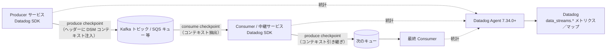
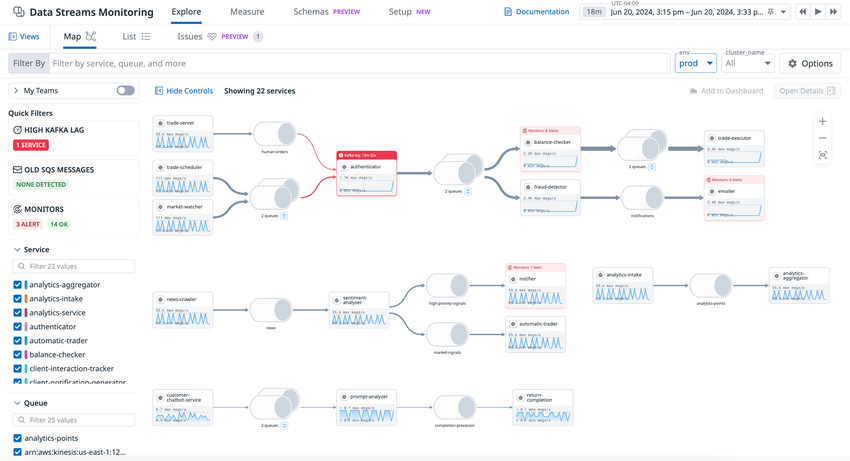
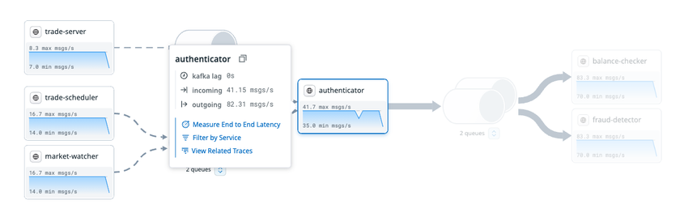
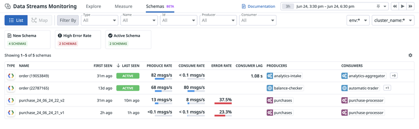
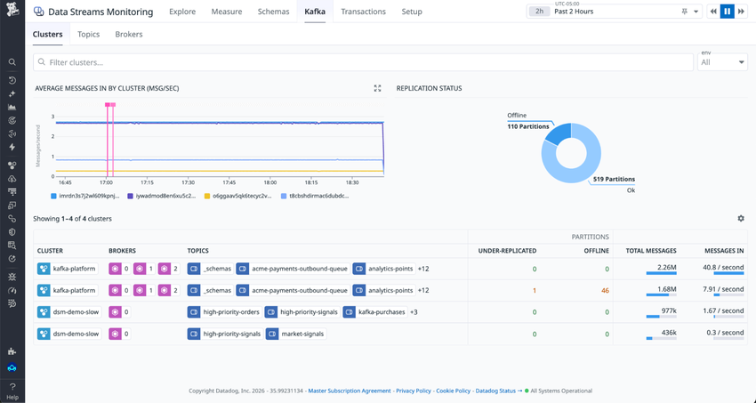
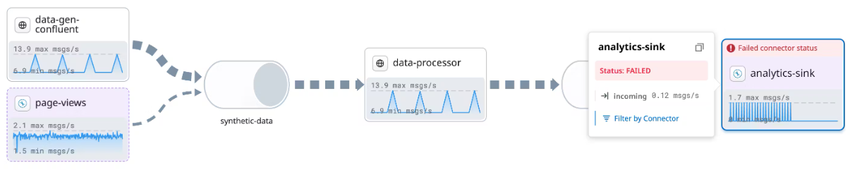

# Data Streams Monitoring

## 概要

Data Streams Monitoring（DSM、データストリーム監視）は、Kafka・RabbitMQ・Amazon SQS などのメッセージキュー／ストリーミング基盤を使うイベント駆動型アプリケーションについて、**プロデューサー → キュー → コンシューマー** のデータの流れを自動で地図化し、パイプライン全体の健全性を測る Datadog の製品である。Data Streams Monitoring は、エンドツーエンドのパイプラインレイテンシ、Consumer Lag（コンシューマーラグ）、スループットを計測し、遅延の原因となっているプロデューサー・コンシューマー・キューを特定して、滞留したイベントによる連鎖的な遅延を防ぐことを目的とする。[出典](https://docs.datadoghq.com/data_streams/)

Data Streams Monitoring は、Datadog APM と同じ **Datadog SDK（トレーサー）** をアプリケーションに組み込み、メッセージのヘッダー（または属性）に DSM 独自のコンテキスト（pathway context）を載せて伝搬させることで計測する。Kafka の場合、計装の対象は Kafka **クライアント**（プロデューサーとコンシューマー）であり、ブローカーではない。[出典](https://docs.datadoghq.com/data_streams/)

Data Streams Monitoring の主な機能は次のとおり。

| 機能 | 内容 | 出典 |
|---|---|---|
| トポロジーマップ（Map） | プロデューサー、コンシューマー、キューの依存関係、サービスオーナー、主要ヘルスメトリクスを自動で可視化 | [DSM](https://docs.datadoghq.com/data_streams/) |
| エンドツーエンドレイテンシ（Measure） | 開始サービスと終了サービスを選んでパイプライン区間のレイテンシを計測。モニター作成・ダッシュボード出力が可能 | [DSM](https://docs.datadoghq.com/data_streams/) |
| Consumer Lag | Kafka のラグを秒数・オフセット数で計測（`data_streams.kafka.lag_seconds` / `data_streams.kafka.lag_messages`） | [Metrics and Tags](https://docs.datadoghq.com/data_streams/metrics_and_tags) |
| スループット | サービス・キューごとの送受信バイト量とその変化の発生源（上流／下流）を特定 | [DSM](https://docs.datadoghq.com/data_streams/) |
| Schema 追跡 | プロデューサー／コンシューマーが使うスキーマ（Avro・Protobuf）と、新規スキーマ・エラー・スキーマ進化を追跡 | [Schema Tracking](https://docs.datadoghq.com/data_streams/schema_tracking/) |
| Dead Letter Queue 監視 | Amazon SQS の DLQ に溜まったメッセージを検知し、Peek・Redrive・Purge で是正 | [DLQ](https://docs.datadoghq.com/data_streams/dead_letter_queues) |
| Kafka Console | Agent チェックで Kafka クラスター（ブローカー・トピック・パーティション・コンシューマーグループ）を直接監視し、メッセージ取得やトピック作成・削除も行う | [Kafka Console](https://docs.datadoghq.com/data_streams/kafka/) |
| コネクター可視化 | Confluent Cloud のマネージドコネクターを自動検出し、状態（例：FAILED）・スループット・トピック依存を表示 | [DSM](https://docs.datadoghq.com/data_streams/) |
| モニターテンプレート | Consumer Lag、スループット、レイテンシ向けのテンプレートからワンクリックでモニター作成 | [DSM](https://docs.datadoghq.com/data_streams/) |

Data Streams Monitoring と隣接製品の役割分担は次のとおり。

| 製品 | 観点 | DSM との関係 |
|---|---|---|
| [APM](./apm-concepts-and-ingestion.md) | リクエスト単位の分散トレース | DSM は同じ SDK を使い、トレースではなく「パイプライン区間の集計メトリクス」を扱う。DSM 画面から関連トレースへ移動できる |
| [Universal Service Monitoring](./universal-service-monitoring.md) | eBPF によるコード変更不要のサービス間メトリクス | Kafka のトピック単位の可視化は DSM が担う。USM の Kafka 対応との機能差は公開情報では確認できず |
| Kafka インテグレーション（Kafka Broker / Kafka Consumer） | ブローカー・コンシューマーグループのメトリクス | Kafka Console はこのクラスター監視を DSM 画面に統合したもの。インテグレーション一般は [Integrations](../platform/integrations.md) を参照 |
| [Data Jobs Monitoring](../data/data-jobs-monitoring.md) | Spark・Databricks・Airflow 等のバッチ／ジョブ | DSM はストリーミング（キュー）側を担当 |
| [Data Observability](../data/data-observability.md) | データ品質・リネージ | DSM はデータの「流れ（遅延・ラグ・スループット）」を扱う |

Kafka Console と DSM の関係について、公式料金ページの FAQ は「Kafka Console はブローカーから直接読み取り、プロデューサー・コンシューマーとその下のインフラの実際の振る舞いを示す。DSM はアプリケーションコードを計装し、サービス間のデータフローとレイテンシを示す。両者は補完関係にあり、どちらか単独でも両方でも導入できる」と説明している。[出典](https://www.datadoghq.com/pricing/?product=data-streams-monitoring)（2026-11-02 取得）

> **サイト差異:** Data Streams Monitoring（Kafka Console、Schema 追跡、DLQ 監視を含む）は **US1-FED（app.ddog-gov.com）および us2.ddog-gov.com では提供されない**。公式ドキュメントの各ページに「This product is not supported for your selected Datadog site」と表示され、料金ページでも「This product is currently unavailable on the US-FED site」と記載されている。US1・US3・US5・EU1・AP1・AP2 での機能差は公開情報では確認できず。[出典](https://docs.datadoghq.com/data_streams/setup/) [出典](https://www.datadoghq.com/pricing/?product=data-streams-monitoring)

---

## 仕組み（コンテキスト伝搬とチェックポイント）

Data Streams Monitoring は、メッセージの送信時と受信時に **チェックポイント（checkpoint）** を記録し、メッセージに DSM コンテキストを付与して下流へ伝搬させる。[出典](https://docs.datadoghq.com/data_streams/manual_instrumentation/)

| 用語 | 意味 | 出典 |
|---|---|---|
| Produce checkpoint | メッセージ送信時に記録。DSM コンテキストをメッセージに注入（inject）する | [手動計装](https://docs.datadoghq.com/data_streams/manual_instrumentation/) |
| Consume checkpoint | メッセージ受信時に記録。上流の DSM コンテキストを抽出（extract）し、そのコンシューマーが次に送信するメッセージへコンテキストを引き継ぐ準備をする | [手動計装](https://docs.datadoghq.com/data_streams/manual_instrumentation/) |
| Pathway（パスウェイ） | サービスとキューを経由するメッセージの経路。`data_streams.latency` の `pathway_type` タグで `full`・`edge`・`partial_edge`・`internal` を区別する | [Metrics and Tags](https://docs.datadoghq.com/data_streams/metrics_and_tags) |
| コンテキストの格納先 | ヘッダー対応の技術ではヘッダー（SQS ではメッセージ属性）。ヘッダーがない場合はペイロードに埋め込む（手動計装） | [手動計装](https://docs.datadoghq.com/data_streams/manual_instrumentation/) |



- Data Streams Monitoring のレイテンシ計算は、**シングルスレッドでのメッセージ処理**を前提とする。パイプライン内でメッセージを複数スレッドで処理する場合は手動計装を追加する（Go・Java は専用ガイド、他言語は汎用の手動計装ガイド、.NET はサポートへ問い合わせ）。[出典](https://docs.datadoghq.com/data_streams/)
- Go ではコンテキストが自動では引き継がれないため、`context.Background()` を送信側で渡すと新しい pathway が始まり、エンドツーエンドの可視性が途切れる。ワーカー goroutine やチャネルを使う場合は、作業アイテムにコンテキストを含めて渡す。[出典](https://docs.datadoghq.com/data_streams/setup/language/go/)
- ファンアウト（1 受信 → 複数送信）では、同じ consume コンテキストを各 produce checkpoint に渡す（各呼び出しが子ノードを作る）。ファンイン（複数受信 → 1 送信）では、Go の `MergeContexts` で受信コンテキストを統合してから送信する。[出典](https://docs.datadoghq.com/data_streams/setup/language/go/)

---

## 対応技術と言語

### 対応マトリクス（技術 × 言語）

各技術のセットアップページに記載された「自動計装の対応ライブラリ」を集約すると次のとおり（◯＝ライブラリ対応あり、—＝技術別ページに記載なし）。[出典](https://docs.datadoghq.com/data_streams/setup/)

| 技術 | Java | Python | Node.js | .NET | Go | Ruby |
|---|---|---|---|---|---|---|
| Apache Kafka（セルフホスト、Amazon MSK、Confluent Cloud ほか） | ◯ | ◯ | ◯ | ◯ | ◯ | ◯ |
| RabbitMQ | ◯ | ◯ | ◯ | ◯ | — | — |
| Amazon SQS | ◯ | ◯ | ◯ | ◯ | — | — |
| Amazon SNS | ◯ | ◯ | ◯ | ◯ | — | — |
| Amazon Kinesis | ◯ | ◯ | ◯ | ◯ | — | — |
| Google Pub/Sub | ◯ | ◯ | ◯ | — | — | — |
| IBM MQ | ◯ | — | — | ◯ | — | — |
| Azure Service Bus | — | — | — | ◯ | — | — |
| BullMQ | — | — | ◯ | — | — | — |

> **注意（公式ページ間の表記ゆれ）:** DSM 概要ページの対応表（2026-11-02 取得時点）は列がずれて表示されており、Go が Kinesis・SNS・SQS・RabbitMQ に、Python が Azure Service Bus・IBM MQ に対応しているようにも読める。本ナレッジでは技術別・言語別のセットアップページ（最低トレーサーバージョンが明記されたもの）を正とした。Go で Kafka 以外の技術を扱う場合は、`SetDataStreamsCheckpointWithParams` 等による手動計装が案内されている。[出典](https://docs.datadoghq.com/data_streams/) [出典](https://docs.datadoghq.com/data_streams/setup/language/go/)

> **注意（料金ページ FAQ の古い記述）:** 料金ページ FAQ には「DSM は Kafka、RabbitMQ、SQS に対応（その他はカスタム計装）」「Java・Go・.NET の Kafka、Java・Go の RabbitMQ に対応」といった旧い対応範囲の記述が残っている（2026-11-02 取得）。対応範囲は docs.datadoghq.com のセットアップページを正とする。[出典](https://www.datadoghq.com/pricing/?product=data-streams-monitoring)

- Kafka はホスティング形態（セルフホスト、Confluent Platform／Confluent Cloud、Amazon MSK）を問わず計装できる。クラスター健全性の追加インテグレーションとして、セルフホストは Kafka Broker／Kafka Consumer インテグレーション、Confluent は Confluent Platform／Confluent Cloud インテグレーション、Amazon MSK はクラウドインテグレーションまたは Agent ベースのインテグレーションがある。**Redpanda は未統合**と記載されている。[出典](https://docs.datadoghq.com/data_streams/setup/technologies/kafka/)
- Kafka Streams は **Java のみ部分対応**で、レイテンシ計測が欠落する場合がある。[出典](https://docs.datadoghq.com/data_streams/setup/technologies/kafka/)

### 共通の前提条件

| 項目 | 値 | 出典 |
|---|---|---|
| Datadog Agent | **v7.34.0 以降**（DSM 計装・手動計装） | [Java](https://docs.datadoghq.com/data_streams/setup/language/java/) / [手動計装](https://docs.datadoghq.com/data_streams/manual_instrumentation/) |
| Datadog Agent（Kafka Console） | **7.78 以降** | [Kafka Console Setup](https://docs.datadoghq.com/data_streams/kafka/setup) |
| 有効化の環境変数 | `DD_DATA_STREAMS_ENABLED=true` をメッセージを送受信する全サービスに設定 | [Java](https://docs.datadoghq.com/data_streams/setup/language/java/) |
| 推奨の併用設定 | `DD_TRACE_REMOVE_INTEGRATION_SERVICE_NAMES_ENABLED=true`（各言語の設定例に記載） | [Java](https://docs.datadoghq.com/data_streams/setup/language/java/) |
| Kafka ブローカー | `log.message.format.version` を設定している場合は **`0.11.0.0` 以上**（それ未満は非対応）。DSM はメッセージヘッダーでコンテキストを伝搬するため | [Kafka](https://docs.datadoghq.com/data_streams/setup/technologies/kafka/) |
| APM との関係 | Datadog SDK（APM トレーサー）を使用。SDK 導入方法は [APM インスツルメンテーション](./apm-instrumentation.md) を参照 | [DSM](https://docs.datadoghq.com/data_streams/) |

`DD_TRACE_REMOVE_INTEGRATION_SERVICE_NAMES_ENABLED` の目的は DSM ページでは説明されていない。APM の一般設定としての意味は [APM インスツルメンテーション](./apm-instrumentation.md) を参照。

### Java

| 技術 | ライブラリ | 最低トレーサー | 推奨トレーサー |
|---|---|---|---|
| Kafka | `kafka-clients` | 1.9.0 | 1.43.0 以降 |
| RabbitMQ | `amqp-client` | 1.9.0 | 1.42.2 以降 |
| Amazon SQS | `aws-java-sdk-sqs`（v1） | 1.27.0 | 1.42.2 以降 |
| Amazon SQS | `sqs`（v2） | 1.27.0 | 1.42.2 以降 |
| Amazon Kinesis | Kinesis（v1） | 1.22.0 | 1.42.2 以降 |
| Amazon Kinesis | Kinesis（v2） | 1.22.0 | 1.42.2 以降 |
| Amazon SNS | SNS（v1） | 1.31.0 | 1.42.2 以降 |
| Amazon SNS | SNS（v2） | 1.31.0 | 1.42.2 以降 |
| Google Pub/Sub | `google-cloud-pubsub` | 1.25.0 | 1.42.2 以降 |
| IBM MQ | IBM MQ classes for Java and JMS（`com.ibm.mq.jakarta.client`） | 1.55.0 | 1.55.0 以降 |

[出典](https://docs.datadoghq.com/data_streams/setup/language/java/) [出典](https://docs.datadoghq.com/data_streams/setup/technologies/ibm_mq/)

Java の設定例は次のとおり。[出典](https://docs.datadoghq.com/data_streams/setup/language/java/)

```yaml
environment:
  - DD_DATA_STREAMS_ENABLED: "true"
  - DD_TRACE_REMOVE_INTEGRATION_SERVICE_NAMES_ENABLED: "true"
```

```shell
java -javaagent:/path/to/dd-java-agent.jar \
  -Ddd.data.streams.enabled=true \
  -Ddd.trace.remove.integration-service-names.enabled=true \
  -jar path/to/your/app.jar
```

- **実行時の有効化:** Java は APM のサービスページ（Dependencies セクション）から、サービスを再起動せずに DSM を有効化できる（Remote Configuration による「Configuration at Runtime」）。この機能固有の最低トレーサーバージョンは公開情報では確認できず。Remote Configuration は [Fleet Automation と Remote Configuration](../platform/fleet-automation.md) を参照。[出典](https://docs.datadoghq.com/data_streams/setup/language/java/)
- **Consumer Lag の制約:** `kafka-clients` **3.7.x では lag が生成されない**。Spring Boot 3.3.x と spring-kafka 3.2.x は 3.7.x を取り込むため、`kafka-clients` を 3.8.0 以降に上げる。[出典](https://docs.datadoghq.com/data_streams/setup/language/java/)
- **SNS → SQS（Java）:** SQS SDK v1 では `DD_TRACE_SQS_BODY_PROPAGATION_ENABLED=true` とトレーサー 1.44.0 以降が必要。SQS SDK v2 では SNS の raw message delivery を有効にする。[出典](https://docs.datadoghq.com/data_streams/setup/technologies/sns/)
- **Lambda:** Java は SQS・SNS・Kinesis の Lambda ライブラリ対応が「Not supported」。[出典](https://docs.datadoghq.com/data_streams/setup/technologies/sqs/)

### Python

| 技術 | ライブラリ | 最低トレーサー | 推奨トレーサー | 最低 Lambda ライブラリ |
|---|---|---|---|---|
| Kafka | `confluent-kafka` | 1.16.0 | 2.11.0 以降 | 112 |
| Kafka | `aiokafka` | 4.1.0 | 4.1.0 以降 | 非対応 |
| RabbitMQ | Kombu | 2.6.0 | 2.6.0 以降 | 112 |
| Amazon SQS | Botocore | 1.20.0 | 2.8.0 以降 | 112 |
| Amazon Kinesis | Botocore | 1.20.0 | 2.8.0 以降 | 112 |
| Amazon SNS | Botocore | 1.20.0 | 2.8.0 以降 | 112 |
| Google Pub/Sub | `google-cloud-pubsub` | 4.11.0 | 4.11.0 以降 | 記載なし |

[出典](https://docs.datadoghq.com/data_streams/setup/language/python/)

- 「Lambda ライブラリ 112」は datadog-lambda-python v7.112.0 を指す（SQS ページの記載）。[出典](https://docs.datadoghq.com/data_streams/setup/technologies/sqs/)

### Node.js

| 技術 | ライブラリ | 最低トレーサー | 推奨トレーサー |
|---|---|---|---|
| Kafka | `kafkajs` | 2.39.0（2.x）／3.26.0（3.x）／4.5.0（4.x） | 5.25.0 以降 |
| Kafka | `confluent-kafka-javascript` | 5.52.0 | 5.52.0 以降 |
| RabbitMQ | `amqplib` | 3.48.0／4.27.0／5.3.0 | 5.3.0 以降 |
| RabbitMQ | `rhea` | 3.48.0／4.27.0／5.3.0 | 5.3.0 以降 |
| Amazon SQS | `@aws-sdk/client-sqs` | 3.47.0／4.26.0／5.2.0 | 5.18.0 以降 |
| Amazon Kinesis | `@aws-sdk/client-kinesis` | 3.47.0／4.26.0／5.2.0 | 5.18.0 以降 |
| Amazon SNS | `@aws-sdk/client-sns` | 3.47.0／4.26.0／5.2.0 | 5.18.0 以降 |
| Google Pub/Sub | `@google-cloud/pubsub` | 4.49.0／5.25.0 | 5.25.0 以降 |
| BullMQ | `bullmq` | 5.82.0 | 5.82.0 以降 |

[出典](https://docs.datadoghq.com/data_streams/setup/language/nodejs/) [出典](https://docs.datadoghq.com/data_streams/setup/technologies/bullmq/)

- 最低トレーサーが複数並ぶ行は、dd-trace-js のメジャー系列（2.x／3.x／4.x／5.x）ごとの最低版を示す。[出典](https://docs.datadoghq.com/data_streams/setup/technologies/rabbitmq/)
- Node.js の Lambda で SQS・SNS・Kinesis を扱う場合は `datadog-lambda-js` **v12.128.0 以降**が必要。[出典](https://docs.datadoghq.com/data_streams/setup/language/nodejs/)

### .NET

| 技術 | ライブラリ | 最低トレーサー | 推奨トレーサー |
|---|---|---|---|
| Kafka | `Confluent.Kafka` | 2.28.0 | 2.41.0 以降 |
| RabbitMQ | `RabbitMQ.Client` | 2.28.0 | 2.37.0 以降 |
| Amazon SQS | `AWSSDK.SQS` | 2.48.0 | 2.48.0 以降 |
| Amazon SNS | `AWSSDK.SimpleNotificationService` | 3.6.0 | 3.6.0 以降 |
| Amazon Kinesis | `AWSSDK.Kinesis` | 3.7.0 | 3.7.0 以降 |
| IBM MQ | `IBMMQDotnetClient` | 2.49.0 | 2.49.0 以降 |
| Azure Service Bus（追加設定が必要） | `Azure.Messaging.ServiceBus` | 2.53.0 | 2.53.0 以降 |

[出典](https://docs.datadoghq.com/data_streams/setup/language/dotnet/)

.NET の `DD_DATA_STREAMS_ENABLED` はトレーサーのバージョンにより挙動が異なる。[出典](https://docs.datadoghq.com/data_streams/setup/language/dotnet/)

| .NET トレーサー | `DD_DATA_STREAMS_ENABLED` 未設定 | `true` | `false` |
|---|---|---|---|
| **3.22.0 以降** | **既定で DSM が有効（default mode）**。ただし Schema 追跡なし、サーバーレス環境では無効、メッセージサイズ追跡なし、一部メッセージはコンテキスト伝搬されない | 全機能有効（Schema 追跡、サーバーレス対応、全メッセージ追跡、メッセージサイズ） | DSM の全機能を無効化 |
| 3.22.0 未満（レガシー） | 無効 | メッセージを送受信する全サービスで `true` に設定して有効化 | 無効 |

.NET の default mode では、次のサイズ条件に当たるメッセージは計装されない。[出典](https://docs.datadoghq.com/data_streams/setup/language/dotnet/)

| 技術 | 計装されないメッセージ |
|---|---|
| Kafka | 34 バイト未満 |
| RabbitMQ | 128 KB 超 |
| Kinesis | 34 バイト未満 |

- .NET 3.22.0 以降は SDK が自動で DSM テレメトリを送信し、組織の契約に APM Enterprise・APM Pro・DSM のいずれかが含まれる場合にデータが自動で処理・保存され、DSM のビューとメトリクスが有効になる（公式記載）。[出典](https://docs.datadoghq.com/data_streams/setup/language/dotnet/)
- ただし default mode のホストが DSM の課金対象ホスト数に数えられるかの明示はない（公開情報では確認できず）。課金への影響は「## 課金への影響」を参照。
- .NET の手動計装は公開ガイドがなく、サポートへの問い合わせが案内されている。[出典](https://docs.datadoghq.com/data_streams/)

**Azure Service Bus の追加設定（.NET）** は次の 2 つが両方必要。[出典](https://docs.datadoghq.com/data_streams/setup/technologies/azure_service_bus/)

| 設定 | 値 | 目的 |
|---|---|---|
| `AZURE_EXPERIMENTAL_ENABLE_ACTIVITY_SOURCE`（またはアプリコードの `Azure.Experimental.EnableActivitySource` コンテキストスイッチ） | `true` | Azure Service Bus ライブラリにトレース情報を生成させる（Azure SDK 側で experimental 扱い） |
| `DD_TRACE_OTEL_ENABLED` | `true` | .NET 自動計装が Azure のトレース情報を処理し、DSM に必要な inject／extract を行えるようにする |

### Go

| 技術 | ライブラリ | 最低トレーサー（dd-trace-go） | 推奨トレーサー |
|---|---|---|---|
| Kafka | `confluent-kafka-go` | 1.56.1 | 1.66.0 以降 |
| Kafka | Sarama | 1.56.1 | 1.66.0 以降 |
| Kafka | `kafka-go` | 1.63.0 | 1.63.0 以降 |

[出典](https://docs.datadoghq.com/data_streams/setup/language/go/)

- dd-trace-go は v1.56.1 以降が必要。ドキュメントは v2（推奨）を前提とし、DSM の機能は v1 と v2 で変わらない。[出典](https://docs.datadoghq.com/data_streams/setup/language/go/)
- **自動計装:** Orchestrion で dd-trace-go を組み込み、`DD_DATA_STREAMS_ENABLED=true` を設定する（Sarama、Confluent Kafka、kafka-go が対象）。[出典](https://docs.datadoghq.com/data_streams/setup/language/go/)
- **手動計装（ライブラリ別）:** Sarama は `ddsarama` パッケージの `WrapAsyncProducer`、Confluent Kafka は `ddkafka` パッケージの `NewProducer` を、Data Streams オプション付きで使う。[出典](https://docs.datadoghq.com/data_streams/setup/language/go/)

Go の手動計装で使う主な関数は次のとおり。[出典](https://docs.datadoghq.com/data_streams/setup/language/go/)

| 関数 | 用途 |
|---|---|
| `SetDataStreamsCheckpointWithParams` | チェックポイントを記録（ペイロードサイズ、`direction`・`type`・`topic` 等のタグ付き） |
| `InjectToBase64Carrier` | 送信メッセージのヘッダーに pathway コンテキストを書き込む |
| `ExtractFromBase64Carrier` | 受信メッセージのヘッダーから上流の pathway コンテキストを読む |
| `MergeContexts` | ファンイン時に複数の受信コンテキストを統合 |
| `context.WithoutCancel`（Go 1.21 以降） | ハンドラーのコンテキストがキャンセルされてもワーカー goroutine で pathway を保持 |

- Go の手動計装では、メッセージ型が TextMapWriter／TextMapReader インターフェースを実装している必要がある（例：Kinesis）。[出典](https://docs.datadoghq.com/data_streams/setup/language/go/)

### Ruby

| ライブラリ | 最低ライブラリバージョン | 最低トレーサー | 推奨トレーサー |
|---|---|---|---|
| `ruby-kafka` | 0.7.10 | 2.23.0 | 2.23.0 以降 |
| `karafka` | 2.3.0 | 2.23.0 | 2.23.0 以降 |
| `waterdrop` | 2.8.8 | 2.23.0 | 2.23.0 以降 |

[出典](https://docs.datadoghq.com/data_streams/setup/language/ruby/)

- Ruby の対応は Kafka 関連の 3 ライブラリのみ。自動計装のため `DD_DATA_STREAMS_ENABLED=true` が唯一必須のスイッチ。[出典](https://docs.datadoghq.com/data_streams/setup/language/ruby/)

### OpenTelemetry との関係

| 構成 | DSM 対応 | 出典 |
|---|---|---|
| Datadog SDK ＋ DDOT（Datadog Distribution of OTel Collector）（推奨構成。API は Datadog API または OTel API） | 対応 | [OTel 互換性](https://docs.datadoghq.com/opentelemetry/compatibility/) |
| OTel SDK ＋ DDOT | 非対応（「OTel does not offer DSM functionality」） | [OTel 互換性](https://docs.datadoghq.com/opentelemetry/compatibility/) |
| OTel SDK ＋ 上流 OpenTelemetry Collector | 非対応（同上） | [OTel 互換性](https://docs.datadoghq.com/opentelemetry/compatibility/) |
| Direct OTLP Ingest | 互換性表に記載なし（公開情報では確認できず） | [OTel 互換性](https://docs.datadoghq.com/opentelemetry/compatibility/) |

- DSM 概要ページは「DSM は OpenTelemetry をサポートし、APM を OpenTelemetry で構成済みなら追加設定は不要」と記載している。一方、互換性ページは OTel SDK 単独では DSM 機能を提供しないとしている。両者を合わせると、**DSM には Datadog SDK が必要で、アプリコードから OTel API を使う構成は可**と読める【推定】。詳細は [OpenTelemetry サポート](../platform/opentelemetry.md) を参照。[出典](https://docs.datadoghq.com/data_streams/) [出典](https://docs.datadoghq.com/opentelemetry/compatibility/)

---

## 技術別の詳細と注意点

### Apache Kafka

| 項目 | 内容 | 出典 |
|---|---|---|
| ブローカー要件 | `log.message.format.version` を設定している場合は `0.11.0.0` 以上 | [Kafka](https://docs.datadoghq.com/data_streams/setup/technologies/kafka/) |
| Lag の取得 | トレーサーが `data_streams.kafka.lag_seconds`（秒）／`data_streams.kafka.lag_messages`（オフセット）を生成。`lag_seconds` は Java Agent v1.9.0 以降が必要と記載 | [Metrics and Tags](https://docs.datadoghq.com/data_streams/metrics_and_tags) / [DSM](https://docs.datadoghq.com/data_streams/) |
| Lag の制約 | `kafka-clients` 3.7.x では lag 非対応（3.8.0 以降へ） | [Kafka](https://docs.datadoghq.com/data_streams/setup/technologies/kafka/) |
| Kafka Streams | Java のみ部分対応。レイテンシ計測が欠落しうる | [Kafka](https://docs.datadoghq.com/data_streams/setup/technologies/kafka/) |
| Confluent Cloud コネクター | Datadog–Confluent Cloud インテグレーション経由で自動検出（状態・スループット・トピック依存） | [Kafka](https://docs.datadoghq.com/data_streams/setup/technologies/kafka/) |
| セルフホストの Kafka Connect コネクター | `【Preview】` dd-trace-java v1.44.0 以降。コネクターはトピックに接続されたサービスとして表示。トピックとの間のスループットのみ収集し、コネクター状態や source／sink は収集しない | [Kafka](https://docs.datadoghq.com/data_streams/setup/technologies/kafka/) |
| Redpanda | 未統合 | [Kafka](https://docs.datadoghq.com/data_streams/setup/technologies/kafka/) |

**Confluent Cloud コネクターの追加手順** [出典](https://docs.datadoghq.com/data_streams/setup/technologies/kafka/)

1. Datadog–Confluent Cloud インテグレーションをインストール・構成する。
2. インテグレーションタイルを開くと、検出されたクラスターとコネクターが **Actions** に表示される（タイルを表示するたびに検出が再実行される）。
3. 監視するリソースを選び **Add Resources** をクリックする。
4. Data Streams Monitoring でコネクターの状態とスループットを確認する。

**セルフホスト Kafka Connect コネクター（Preview）の手順** [出典](https://docs.datadoghq.com/data_streams/setup/technologies/kafka/)

1. Kafka Connect ワーカー上で Datadog Agent を動かす。
2. ワーカーに dd-trace-java をインストールする。
3. Java オプションに `-javaagent`（dd-java-agent.jar）を追加する（例：Strimzi の `STRIMZI_JAVA_OPTS`）。

### Amazon SQS

| 項目 | 内容 | 出典 |
|---|---|---|
| メッセージ属性 | DSM はメッセージの経路追跡に **属性を 1 つ**使う。SQS の上限は 1 メッセージ 10 属性のため、アプリが設定できる属性は **9 個以下** | [SQS](https://docs.datadoghq.com/data_streams/setup/technologies/sqs/) |
| Lambda | Node.js（datadog-lambda-js v12.128.0 以降）と Python（datadog-lambda-python v7.112.0 以降）のみ対応。Java・.NET は非対応 | [SQS](https://docs.datadoghq.com/data_streams/setup/technologies/sqs/) |
| DLQ のメッセージ数取得 | AWS インテグレーションに `sqs:ListQueues`、`sqs:GetQueueAttributes`、`tag:GetResources` の権限が必要 | [SQS](https://docs.datadoghq.com/data_streams/setup/technologies/sqs/) |

AWS インテグレーションの構成は [AWS Integration](../platform/aws-integration.md) を参照。

### Amazon SNS

| 項目 | 内容 | 出典 |
|---|---|---|
| SNS → SQS 直結 | SNS の **raw message delivery** の有効化が必要 | [SNS](https://docs.datadoghq.com/data_streams/setup/technologies/sns/) |
| Java（SQS SDK v1 側） | `DD_TRACE_SQS_BODY_PROPAGATION_ENABLED=true` とトレーサー 1.44.0 以降 | [SNS](https://docs.datadoghq.com/data_streams/setup/technologies/sns/) |
| Lambda | Node.js（128）・Python（112）のみ。Java・.NET は非対応 | [SNS](https://docs.datadoghq.com/data_streams/setup/technologies/sns/) |

### Amazon Kinesis

| 項目 | 内容 | 出典 |
|---|---|---|
| コンテキスト伝搬 | Kinesis にはコンテキストを運ぶメッセージ属性がないため、メッセージ単位の全経路は直接追跡できない | [Kinesis](https://docs.datadoghq.com/data_streams/setup/technologies/kinesis/) |
| エンドツーエンドレイテンシ | 区間（プロデューサー → ストリーム → コンシューマー）のレイテンシを合算した **近似値** | [Kinesis](https://docs.datadoghq.com/data_streams/setup/technologies/kinesis/) |
| スループット | 同じ区間単位で計測 | [Kinesis](https://docs.datadoghq.com/data_streams/setup/technologies/kinesis/) |
| トポロジー | サービスが計装されていれば全体を表示可能 | [Kinesis](https://docs.datadoghq.com/data_streams/setup/technologies/kinesis/) |
| 手動計装 | ヘッダーのない技術として、手動計装（ペイロードへの埋め込み）が案内されている | [Java](https://docs.datadoghq.com/data_streams/setup/language/java/) |

### RabbitMQ

RabbitMQ の DSM 自体はトレーサーの計装で動くが、「完全な互換性」のために RabbitMQ インテグレーションを次のように構成することが推奨されている（キュー・エクスチェンジの詳細メトリクスと全グラフの表示のため）。[出典](https://docs.datadoghq.com/data_streams/setup/technologies/rabbitmq/)

```yaml
instances:
  - prometheus_plugin:
      url: http://<HOST>:15692
      unaggregated_endpoint: detailed?family=queue_coarse_metrics&family=queue_consumer_count&family=channel_exchange_metrics&family=channel_queue_exchange_metrics&family=node_coarse_metrics
```

| 項目 | 内容 |
|---|---|
| `url` | RabbitMQ の Prometheus プラグインのエンドポイント（ポート 15692） |
| `unaggregated_endpoint` | `queue_coarse_metrics`、`queue_consumer_count`、`channel_exchange_metrics`、`channel_queue_exchange_metrics`、`node_coarse_metrics` の 5 ファミリー |

### Google Pub/Sub

Google Pub/Sub は Java・Node.js・Python に対応する（最低バージョンは前掲の言語別表）。技術別ページに追加の制限事項の記載はない。[出典](https://docs.datadoghq.com/data_streams/setup/technologies/google_pubsub/)

### IBM MQ

| 項目 | 内容 | 出典 |
|---|---|---|
| コンテキスト伝搬 | **IBM MQ ではコンテキストを伝搬しない**（メッセージへの想定外のフィールド追加が顧客サービスを危険にさらしうるため） | [IBM MQ](https://docs.datadoghq.com/data_streams/setup/technologies/ibm_mq/) |
| Pathways ビュー | IBM MQ のメッセージを上流 pathway でフィルターできない | [IBM MQ](https://docs.datadoghq.com/data_streams/setup/technologies/ibm_mq/) |
| レイテンシ | IBM MQ のみを通る pathway で取得可能だが **近似値** | [IBM MQ](https://docs.datadoghq.com/data_streams/setup/technologies/ibm_mq/) |
| 完全対応の機能 | メッセージスループット、トポロジーマップへの表示 | [IBM MQ](https://docs.datadoghq.com/data_streams/setup/technologies/ibm_mq/) |

### Azure Service Bus・BullMQ

- Azure Service Bus は .NET（`Azure.Messaging.ServiceBus`、トレーサー 2.53.0 以降）のみ。追加の環境変数は .NET 節を参照。[出典](https://docs.datadoghq.com/data_streams/setup/technologies/azure_service_bus/)
- BullMQ は Node.js（`bullmq`、トレーサー 5.82.0 以降）のみ。Preview かどうかの記載はない。[出典](https://docs.datadoghq.com/data_streams/setup/technologies/bullmq/)

---

## 手動計装（Manual Instrumentation）

Data Streams Monitoring の手動計装は、自動計装の対象外のメッセージング技術・ライブラリ、ヘッダーのない技術（Kinesis 等）、Lambda などで使う。DSM コンテキストはメッセージと一緒に運ぶ必要があり、ヘッダーに対応していればヘッダー、なければペイロードに埋め込む。[出典](https://docs.datadoghq.com/data_streams/manual_instrumentation/)

| 言語 | Produce | Consume | キャリア |
|---|---|---|---|
| Java | `DataStreamsCheckpointer.get().setProduceCheckpoint(queueType, name, carrier)` | `DataStreamsCheckpointer.get().setConsumeCheckpoint(queueType, name, carrier)` | `DataStreamsContextCarrier` を実装（`entries()` と `set(key, value)`）。import は `datadog.trace.api.experimental.*` |
| Node.js | `tracer.dataStreamsCheckpointer.setProduceCheckpoint(queueType, name, carrier)` | `tracer.dataStreamsCheckpointer.setConsumeCheckpoint(queueType, name, carrier)` | ヘッダーオブジェクト等のキー／値コンテナ |
| Python | `set_produce_checkpoint(queue_type, name, setter)` | `set_consume_checkpoint(queue_type, name, getter)` | setter は `(key, value)` を受ける callable（例：`headers.setdefault`）、getter は `(key)`（例：`headers.get`）。import は `ddtrace.data_streams` |
| Ruby | `Datadog::DataStreams.set_produce_checkpoint(queue_type, name, &block)` | `Datadog::DataStreams.set_consume_checkpoint(queue_type, name, &block)` | ブロックでコンテキストを保存／返却 |
| Go | `SetDataStreamsCheckpointWithParams` ＋ `InjectToBase64Carrier` | `ExtractFromBase64Carrier` ＋ consume チェックポイント | TextMapWriter／TextMapReader 実装 |
| .NET | 公開ガイドなし（サポートに問い合わせ） | 同左 | — |

[出典](https://docs.datadoghq.com/data_streams/manual_instrumentation/) [出典](https://docs.datadoghq.com/data_streams/setup/language/go/) [出典](https://docs.datadoghq.com/data_streams/)

| パラメーター | 内容 |
|---|---|
| `queueType` / `queue_type` | メッセージング技術。`kafka`、`rabbitmq`、`sqs`、`sns`、`kinesis`、`servicebus` などの既知の値を使うと技術固有の DSM メトリクスが表示される。それ以外の文字列も受け付ける |
| `name` | キュー・トピック・サブスクリプション名。**プロデューサーとコンシューマーで一致させる** |

注意点 [出典](https://docs.datadoghq.com/data_streams/manual_instrumentation/)

- produce と consume で `queueType` と `name` が一致しないとパイプラインがつながらない。
- produce checkpoint は送信 **前** に呼び、コンテキストをメッセージに付与する。
- consume checkpoint は受信直後、アプリケーションロジックの **前** に呼ぶ。
- 手動計装が必要な pathway では、Pathways タブに「latency values may be approximate」（レイテンシは近似値の可能性）と表示される。[出典](https://docs.datadoghq.com/data_streams/)
- 公式ページの Ruby サンプルには `Datadog::DataStreams..set_consume_checkpoint`（ドット重複）の誤記がある（2026-11-02 時点）。

---

## 画面構成と分析機能

Data Streams Monitoring の画面は、公式ドキュメントでは直接 URL `https://app.datadoghq.com/data-streams/map`（Map）と `https://app.datadoghq.com/data-streams/measure`（Measure）で案内されている（US1 以外のサイトはドメインを読み替える）。ナビゲーションメニュー上の位置は公式本文に明記がなく、公開情報では確認できず。画面上部のタブは公式スクリーンショット上で **Explore**、**Measure**、**Schemas**、**Kafka**、**Transactions**、**Setup** が確認できる（スクリーンショットからの読み取り）。画面全般のナビゲーションは [画面構成とナビゲーション](../../01_入門編/06-ui-navigation.md) を参照。[出典](https://docs.datadoghq.com/data_streams/) [出典](https://docs.datadoghq.com/data_streams/kafka/)

| タブ／ビュー | 内容 | 出典 |
|---|---|---|
| Explore > Map | トポロジーマップ。サービス・キューのノードとメッセージ流量（msgs/s）、モニター状態を表示。左ペインに Quick Filters（High Kafka Lag、Old SQS Messages、Monitors）と Service／Queue フィルター | [DSM](https://docs.datadoghq.com/data_streams/) |
| Explore > List | サービス・キューの一覧表示（詳細仕様は公開情報では確認できず） | スクリーンショット |
| Explore > Issues | `【Preview】`（スクリーンショット表記）メッセージ処理に問題のあるキューの一覧（DLQ 監視の文脈で説明） | [DLQ](https://docs.datadoghq.com/data_streams/dead_letter_queues) |
| Measure | 開始サービスと終了サービスを選び、区間レイテンシを表示。モニター作成・ダッシュボード出力 | [DSM](https://docs.datadoghq.com/data_streams/) |
| Schemas | スキーマ一覧（Schema 追跡の節を参照） | [Schema Tracking](https://docs.datadoghq.com/data_streams/schema_tracking/) |
| Kafka | Kafka Console（Clusters／Topics／Brokers） | [Kafka Console](https://docs.datadoghq.com/data_streams/kafka/) |
| Transactions | Business Transaction Tracking（`【Preview】`、後述） | [製品プレビュー](https://www.datadoghq.com/product-preview/business-transaction-tracking/) |
| Setup | 導入ガイド | スクリーンショット |

サービスまたはキューをクリックすると開くサイドパネルには次のタブがある。[出典](https://docs.datadoghq.com/data_streams/)

| サイドパネルのタブ | 内容 |
|---|---|
| Pathways | そのサービスと上流サービスとの間のレイテンシ |
| Throughput | スループットの変化と、変化が発生した上流／下流のサービスの特定 |
| Infra / Logs / Traces | Unified Service Tagging で自動的に関連付けられたインフラメトリクス・ログ・トレース。pathway レイテンシや Consumer Lag 上昇の原因調査に使う |
| Dead Letter Queue | SQS キューの DLQ 状態とモニター作成（DLQ の節を参照） |
| Schemas | サービス単位のスキーマ（Schema 追跡の節を参照） |

- Catalog（[Software Catalog](../platform/software-catalog.md)）を構成していれば、オーナーチームの Slack チャネルや On-Call 担当者へ移動できる。[出典](https://docs.datadoghq.com/data_streams/)
- Kafka・RabbitMQ・Amazon SQS のクラスター単位でフィルターでき、そのクラスターで検出された全トピック／キューの送受信トラフィックの変化を確認できる。[出典](https://docs.datadoghq.com/data_streams/)
- タグ（`env`、`service` など）の設計は [Tagging](../platform/tagging.md) を参照。



**図 1: Data Streams Monitoring の Explore > Map（トポロジーマップ）画面**
画面上部に Explore・Measure・Schemas（PREVIEW 表記）・Setup のタブ、その下に Map・List・Issues（PREVIEW 表記）のビュー切り替えがある。上部の Filter By 欄でサービス・キュー等を絞り込み、右上で `env`（例：prod）と `cluster_name` を選択する。左ペインには My Teams のトグル、Quick Filters（HIGH KAFKA LAG：該当 1 サービス、OLD SQS MESSAGES：検出なし、MONITORS：3 ALERT／14 OK）、Service と Queue のチェックボックスフィルターがある。中央のマップでは、trade-server・trade-scheduler・market-watcher などのサービスノード（各ノードに max msgs/s のスパークライン）と円筒形のキューノードが矢印で接続され、Kafka lag が発生している authenticator サービスが赤くハイライトされ、Monitors アラート中のノード（balance-checker、emailer 等）に赤いバッジが付いている。右上に Add to Dashboard と Open Details ボタンがある。
出典: https://docs.datadoghq.com/data_streams/ （2026-11-02 取得）



**図 2: トポロジーマップでサービスにカーソルを合わせたときのポップアップ**
authenticator サービスのポップアップに kafka lag（0s）、incoming（41.15 msgs/s）、outgoing（82.31 msgs/s）が表示され、メニューとして Measure End to End Latency（エンドツーエンドレイテンシ計測）、Filter by Service（サービスで絞り込み）、View Related Traces（関連トレース表示）がある。左に上流の trade-server・trade-scheduler・market-watcher、右に下流の balance-checker・fraud-detector が配置されている。
出典: https://docs.datadoghq.com/data_streams/ （2026-11-02 取得）

---

## エンドツーエンドレイテンシ

Data Streams Monitoring のエンドツーエンドレイテンシは、pathway の開始点から終了点までの時間を `data_streams.latency` メトリクスとして計測するものである。[出典](https://docs.datadoghq.com/data_streams/metrics_and_tags)

**Measure タブでの計測手順** [出典](https://docs.datadoghq.com/data_streams/)

1. Data Streams Monitoring の **Measure** タブを開く（`https://app.datadoghq.com/data-streams/measure`）。
2. 開始サービス（start）と終了サービス（end）を選ぶ。
3. 表示されたレイテンシからボトルネックを特定する。
4. 必要に応じて、その pathway のモニターを作成する、またはダッシュボードへエクスポートする。

`data_streams.latency` の `pathway_type` タグの値は次の 4 種類。[出典](https://docs.datadoghq.com/data_streams/metrics_and_tags)

| `pathway_type` | 意味（公式ページの定義） |
|---|---|
| `full` | データの起点（`start`）とパイプライン上の別の点（`end`）の間のエンドツーエンドレイテンシ |
| `edge` | キュー経由、または HTTP／gRPC で直接接続された 2 つのサービス間のレイテンシ |
| `partial_edge` | プロデューサーまたはコンシューマーが不明な場合の、サービスとキューの間のレイテンシ |
| `internal` | サービス内部のレイテンシ。*consume* とそれに続く *produce* の間の時間 |

[出典](https://docs.datadoghq.com/data_streams/metrics_and_tags)

- `start` は DSM が最初にペイロードを検出したノード名で、`pathway_type:full` では常にパイプラインの起点。`end` はパイプラインが終わるノード名で、部分パイプラインのクエリにも使う。[出典](https://docs.datadoghq.com/data_streams/metrics_and_tags)

レイテンシ計測の精度に関わる制約は次のとおり。

| 条件 | レイテンシの扱い | 出典 |
|---|---|---|
| マルチスレッドでメッセージを処理 | 自動計装では計算できず、手動計装が必要 | [DSM](https://docs.datadoghq.com/data_streams/) |
| 手動計装の pathway | 近似値の可能性（Pathways タブに表示） | [DSM](https://docs.datadoghq.com/data_streams/) |
| Kinesis | 区間レイテンシの合算による近似 | [Kinesis](https://docs.datadoghq.com/data_streams/setup/technologies/kinesis/) |
| IBM MQ | IBM MQ のみを通る pathway で近似値 | [IBM MQ](https://docs.datadoghq.com/data_streams/setup/technologies/ibm_mq/) |
| Kafka Streams（Java） | 部分対応。計測が欠落しうる | [Kafka](https://docs.datadoghq.com/data_streams/setup/technologies/kafka/) |
| Go で `context.Background()` を渡す | 新しい pathway が始まり経路が途切れる | [Go](https://docs.datadoghq.com/data_streams/setup/language/go/) |

---

## Consumer Lag

Data Streams Monitoring の Consumer Lag（コンシューマーラグ）には、トレーサー由来のメトリクスと、Kafka Console（Agent の Kafka チェック）由来のメトリクスの 2 系統がある。

| メトリクス | 由来 | 単位・内容 | タグ | 出典 |
|---|---|---|---|---|
| `data_streams.kafka.lag_seconds` | DSM（トレーサー） | 最後の produce と consume の間の秒数 | `partition`、`env`、`topic`、`consumer_group` | [Metrics and Tags](https://docs.datadoghq.com/data_streams/metrics_and_tags) |
| `data_streams.kafka.lag_messages` | DSM（トレーサー） | 最後の produce と consume の間のオフセット差 | `partition`、`env`、`topic`、`consumer_group` | [Metrics and Tags](https://docs.datadoghq.com/data_streams/metrics_and_tags) |
| `kafka.estimated_consumer_lag` | Kafka Console | 推定ラグ（秒） | トピック・コンシューマーグループ単位でモニター化 | [Monitors and Automation](https://docs.datadoghq.com/data_streams/kafka/monitors_and_automation) |
| `kafka.consumer_lag` | Kafka Console | ラグ（単位は公式ページに明記なし。bytes 保持期限モニターでスループットと掛け合わせて使うことからメッセージ数と読める【推定】） | — | [Monitors and Automation](https://docs.datadoghq.com/data_streams/kafka/monitors_and_automation) |

- `data_streams.kafka.lag_seconds` は Java Agent（dd-trace-java）v1.9.0 以降が必要と記載されている。[出典](https://docs.datadoghq.com/data_streams/)
- Java の `kafka-clients` 3.7.x では lag が生成されない（3.8.0 以降へ）。[出典](https://docs.datadoghq.com/data_streams/setup/language/java/)
- Kafka Console のトピック詳細では、全パーティションの最大ラグと、現在のラグがトピックの保持期限（retention）に近づいているかが表示される。[出典](https://docs.datadoghq.com/data_streams/kafka/)
- Explore > Map の Quick Filters に「HIGH KAFKA LAG」がある（スクリーンショットより）。
- RabbitMQ・SQS 等の Kafka 以外の技術について、DSM 独自のラグメトリクスは公開ページでは確認できず（SQS は Quick Filters の「OLD SQS MESSAGES」と DLQ メトリクスがある）。

---

## スループット

| メトリクス | 種類 | 内容 | タグ | 出典 |
|---|---|---|---|---|
| `data_streams.payload_size` | Distribution | DSM を通過するメッセージのサイズ分布（バイト）。送受信スループットの把握に使う | `data_streams.latency` と同じタグ群（概要ページでは `consumer_group`、`topic`、`env` を例示） | [Metrics and Tags](https://docs.datadoghq.com/data_streams/metrics_and_tags) / [DSM](https://docs.datadoghq.com/data_streams/) |

- サービス／キューのサイドパネルの Throughput タブで、スループットの変化と発生源（上流／下流）を特定できる。[出典](https://docs.datadoghq.com/data_streams/)
- .NET 3.22.0 以降の default mode ではメッセージサイズが追跡されない（`DD_DATA_STREAMS_ENABLED=true` で有効化）。[出典](https://docs.datadoghq.com/data_streams/setup/language/dotnet/)

---

## Schema 追跡（Schema Tracking）

Data Streams Monitoring の Schema 追跡は、プロデューサーとコンシューマーが使用するスキーマと、スキーマの問題が下流サービスに与える影響を可視化する機能である。新規スキーマ、エラーのあるスキーマ、スキーマの進化（evolution）を追跡し、プロデューサー側だけスキーマを変えてコンシューマーを更新しなかったことによる下流のデータフロー停止を防ぐ。[出典](https://docs.datadoghq.com/data_streams/schema_tracking/)

| 項目 | 内容 | 出典 |
|---|---|---|
| 前提 | プロデューサーとコンシューマーの両方に DSM を導入 | [Schema Tracking](https://docs.datadoghq.com/data_streams/schema_tracking/) |
| 対応形式 | Avro、Protobuf（JSON の記載なし） | [Schema Tracking](https://docs.datadoghq.com/data_streams/schema_tracking/) |
| 提供状態 | ドキュメント本文に記載なし。画面スクリーンショットでは Schemas タブに BETA／PREVIEW 表記がある | [Schema Tracking](https://docs.datadoghq.com/data_streams/schema_tracking/) |

言語別の対応（公式ページの表が崩れて表示されているため、読み取れる範囲）は次のとおり。[出典](https://docs.datadoghq.com/data_streams/schema_tracking/)

| 言語 | Avro | Protobuf | 最低トレーサー |
|---|---|---|---|
| Java | ◯ | ◯ | v1.36 以降 |
| Node.js | ◯ | ◯ | v5.24 以降または v4.48 以降 |
| Python | ◯ | ◯ | v2.14 以降 |
| .NET | 表の崩れにより判読不可 | 表の崩れにより判読不可 | v3.15 以降 |
| Go・Ruby | 記載なし | 記載なし | 記載なし |

- .NET 3.22.0 以降の default mode では Schema 追跡が無効で、`DD_DATA_STREAMS_ENABLED=true` を明示すると有効になる。[出典](https://docs.datadoghq.com/data_streams/setup/language/dotnet/)

**Schemas タブ（スキーマ一覧）の項目** [出典](https://docs.datadoghq.com/data_streams/schema_tracking/)

| 項目 | 内容 |
|---|---|
| 列 | Type、Name、First Seen、Last Seen、Produce Rate、Consume Rate、Error Rate（選択期間）、Producers、Consumers、Consumer Lag（そのスキーマを使う全コンシューマーの最大 Kafka ラグ） |
| Quick Filters | New Schema（直近 3 時間以内に初出）、High Error Rate、Active Schema |
| サイドパネル | サービス別スループット、サービス別エラー、スキーマ全体 |

**サービス単位**（Explore タブでサービスを選択 → Schemas タブ）では、スキーマ別の入力スループット、期間内に検出された全スキーマ（First／Last Seen、input／output の種別、エラー率、スループット）、スキーマのフィールド展開表示が見られる。[出典](https://docs.datadoghq.com/data_streams/schema_tracking/)



**図 3: Data Streams Monitoring の Schemas タブ（スキーマ一覧）**
上部に Explore・Measure・Schemas（BETA 表記）のタブ、List／Map の切り替え、Type・Name・Id・Producer・Consumer のフィルター、右に `env:*` と `cluster_name:*` の選択がある。その下に Quick Filters として New Schema（4 SCHEMAS）、High Error Rate（2 SCHEMAS）、Active Schema（2 SCHEMAS）が並ぶ。表には order（ID 付き）、purchase_24_06_24_22_v2 などのスキーマが行として表示され、FIRST SEEN、LAST SEEN（ACTIVE バッジ）、PRODUCE RATE、CONSUME RATE（msgs/s）、ERROR RATE（例：37.5%、23.3% を赤いバーで表示）、CONSUMER LAG（例：1.08 s）、PRODUCERS（analytics-intake、balance-checker 等）、CONSUMERS（analytics-aggregator +9 等）の列がある。
出典: https://docs.datadoghq.com/data_streams/schema_tracking/ （2026-11-02 取得）

- Kafka Console 側でも、スキーマレジストリーから収集したトピックの key／value スキーマとバージョン履歴・バージョン比較を表示できる（DSM 計装とは別系統）。[出典](https://docs.datadoghq.com/data_streams/kafka/) [出典](https://www.datadoghq.com/blog/kafka-console/)（2026-09-10 公開）

---

## Dead Letter Queue（DLQ）監視

Data Streams Monitoring の DLQ 監視は、空でない Dead Letter Queue を可視化し、メッセージ処理失敗を調査・是正する機能である。対応は **Amazon SQS のみ**。[出典](https://docs.datadoghq.com/data_streams/dead_letter_queues)

| 項目 | 内容 |
|---|---|
| 監視の前提 | メッセージングサービスで DSM を有効化し、Datadog–AWS インテグレーションをインストール |
| メトリクス | `data_streams.sqs.dead_letter_queue.messages`（タグ：`arn`、`aws_account`、`dlq`、`queue`、`region`） |
| 可視化 | Service Map で DLQ にメッセージがあるキューを強調表示。Issues ページで処理問題のあるキューを一覧 |
| 是正アクション | Peek（失敗メッセージの内容確認）、Redrive（再処理のため再投入）、Purge（不要メッセージの削除） |
| 是正の前提 | Datadog Actions で Connection を作成（IAM ユーザー＋シークレットアクセスキー、または `sts:AssumeRole` で引き受ける IAM ロール） |
| 是正に必要な IAM 権限 | `sqs:ReceiveMessage`（Peek）、`sqs:StartMessageMoveTask`（Redrive）、`sqs:PurgeQueue`（Purge）。全キューまたは特定キューに限定可能 |
| トラブルシュート | AWS インテグレーションのロールに AWS 管理ポリシー `AmazonSQSReadOnlyAccess`、`sqs:ListQueues`、`sqs:GetQueueAttributes` があるか確認 |

[出典](https://docs.datadoghq.com/data_streams/dead_letter_queues) [出典](https://docs.datadoghq.com/data_streams/metrics_and_tags)

**DLQ モニターの作成手順** [出典](https://docs.datadoghq.com/data_streams/dead_letter_queues)

1. Data Streams Monitoring の **Explore** タブ（既定）を開く。
2. 対応キューをクリックしてサイドパネルを開く。
3. **Dead Letter Queue** タブを選ぶ。
4. **Create Monitor** をクリックする。
5. 既定値（DLQ が空でないときにアラート）を確認し、必要に応じて調整する。
6. **Create** をクリックする。

Datadog Actions の Connection は [Workflow Automation](../service-management/workflow-automation.md) と共通の仕組みである。

---

## Kafka Console

Kafka Console は Data Streams Monitoring の機能で、Datadog Agent のチェックが Kafka クラスターに接続し、クラスター・ブローカー・トピック・パーティション・コンシューマーグループの健全性とパフォーマンスのメトリクスを収集する。DSM のアプリ計装がなくても導入できる。[出典](https://docs.datadoghq.com/data_streams/kafka/) [出典](https://www.datadoghq.com/blog/kafka-console/)（2026-09-10 公開）

> **旧ページの統合:** 以前の `Kafka Messages`（`/data_streams/kafka/messages`）および `Live Messages`（`/data_streams/live_messages`）のドキュメント URL は、2026-11-02 時点で Kafka Console の内容を表示する。旧 Kafka Messages は Preview（Agent 7.70 以降、CSM 経由で申請）、旧 Live Messages は Java の Kafka サービスで Avro／Protobuf のメッセージをログとして 1 ホストあたり毎秒 1 件サンプリングする Preview 機能と説明されていたが、これらは検索エンジンのスニペットに残る旧情報であり、現行仕様は Kafka Console のページを正とする。[出典](https://docs.datadoghq.com/data_streams/kafka/messages) [出典](https://docs.datadoghq.com/data_streams/live_messages)

| 機能 | 内容 | 出典 |
|---|---|---|
| ヘルス監視 | Clusters・Topics・Brokers タブ。トピックごとのパーティション数、Under-replicated／Offline パーティション、スループット、Consumer Lag | [Kafka Console](https://docs.datadoghq.com/data_streams/kafka/) |
| トピック詳細 | 受信メッセージレート、全パーティションの最大ラグ、ラグが保持期限に近いか | [Kafka Console](https://docs.datadoghq.com/data_streams/kafka/) |
| 変更の相関 | 設定変更・スキーマ変更イベントをスループット／ラグのグラフに重ねて表示。**View config change** で差分を確認（例：`max.message.bytes` が 1000012 → 1024 に変更） | [Kafka Console](https://docs.datadoghq.com/data_streams/kafka/) |
| サービス接続 | トピックの Producers／Consumers を表示し、Software Catalog のオーナー情報（チーム、リポジトリ、On-Call、Slack チャネル、健全性）を表示 | [Kafka Console](https://docs.datadoghq.com/data_streams/kafka/) |
| スキーマ・メッセージ | key／value スキーマとバージョン比較。パーティションとオフセットを指定してメッセージを取得し、ポイズンメッセージ等を調査 | [Kafka Console](https://docs.datadoghq.com/data_streams/kafka/) |
| トピック管理 | トピックの作成・削除 | [Kafka Console](https://docs.datadoghq.com/data_streams/kafka/) |
| アラートと自動化 | 推奨モニターテンプレート、Workflow Automation・Webhook の起動 | [Monitors and Automation](https://docs.datadoghq.com/data_streams/kafka/monitors_and_automation) |
| その他（ブログ） | 設定の最適化推奨、Bits AI・Datadog MCP Server との連携 | [ブログ](https://www.datadoghq.com/blog/kafka-console/)（2026-09-10 公開） |

- 料金ページの Kafka Console の機能一覧には、「オフセット・時間範囲・フィルターによるメッセージ検索とデシリアライズ」「Kafka ヘルス問題の自動検出」が挙がっている。対象は「Self-hosted and Amazon MSK provisioned」と記載されている。[出典](https://www.datadoghq.com/pricing/?product=data-streams-monitoring)（2026-11-02 取得）
- Kafka Console の提供状態（GA／Preview）はドキュメント・ブログとも明記がない。



**図 4: Data Streams Monitoring の Kafka タブ（Kafka Console）Clusters 画面**
上部に Explore・Measure・Schemas・Kafka・Transactions・Setup のタブがあり、Kafka タブ内に Clusters・Topics・Brokers のサブタブがある。Clusters 画面には Filter clusters 欄と `env` 選択、左に「AVERAGE MESSAGES IN BY CLUSTER（MSG/SEC）」の時系列グラフ（設定変更を示すピンクのマーカー付き）、右に「REPLICATION STATUS」のドーナツグラフ（例：Offline 110 Partitions、Ok 519 Partitions）がある。下部の表は CLUSTER、BROKERS、TOPICS、PARTITIONS（UNDER-REPLICATED、OFFLINE）、TOTAL MESSAGES、MESSAGES IN（/second）の列で、kafka-platform・dsm-demo-slow などのクラスターが並ぶ。
出典: https://docs.datadoghq.com/data_streams/kafka/ （2026-11-02 取得）

### Kafka Console のセットアップ

| 項目 | 内容 | 出典 |
|---|---|---|
| Agent | **7.78 以降** | [Setup](https://docs.datadoghq.com/data_streams/kafka/setup) |
| 有効化 | Kafka Consumer インテグレーションで `enable_cluster_monitoring: true` を設定 | [Setup](https://docs.datadoghq.com/data_streams/kafka/setup) |
| 設定画面 | `https://app.datadoghq.com/data-streams/kafka/setup` で **Get Started** → 環境を選んで手順に従う（**Copy for AI** で AI エージェントに手順を渡すことも可） | [Setup](https://docs.datadoghq.com/data_streams/kafka/setup) |
| 監視用 ACL（ACL 使用時） | `kafka-cluster`（CLUSTER）：Describe、DescribeConfigs ／ `*`（TOPIC）：Describe、DescribeConfigs ／ `*`（GROUP）：Describe | [Setup](https://docs.datadoghq.com/data_streams/kafka/setup) |
| スキーマ収集 | スキーマレジストリーの構成が必要 | [ブログ](https://www.datadoghq.com/blog/kafka-console/)（2026-09-10 公開） |

**Kafka actions（任意：メッセージ読み取り・トピック作成・削除）** の前提は次のとおり。[出典](https://docs.datadoghq.com/data_streams/kafka/setup)

| 項目 | 内容 |
|---|---|
| Remote Configuration | **組織・Agent・API キー**の 3 レベルすべてで有効化（[Fleet Automation と Remote Configuration](../platform/fleet-automation.md)、[API とキー管理](../platform/api-and-keys.md) を参照） |
| 追加 ACL（Agent ユーザー） | メッセージ読み取り：`*`（TOPIC）Read ／ トピック作成：`*`（TOPIC）Create ／ トピック削除：`*`（TOPIC）Delete。`*` は特定トピック名に置き換えて範囲を限定可能 |
| ユーザー権限（RBAC） | メッセージ読み取り：`Data Streams Monitoring Capture Messages` ／ トピック作成：`Data Streams Monitoring Kafka Create Topic` ／ トピック削除：`Data Streams Monitoring Kafka Delete Topic` |
| 監査 | 各アクションは Audit Trail の Data Streams Monitoring カテゴリーに、ユーザー・トピック・クラスター付きで記録（[Audit Trail](../platform/audit-trail.md)） |
| 警告 | トピック削除はトピックとその全メッセージを恒久的に削除する。削除権限は Kafka トピックの管理者にのみ付与する |

ロールの作成・割り当ては [組織・ユーザー・権限管理](../platform/account-and-access-management.md) を参照（ロールの編集は管理者のみ）。[出典](https://docs.datadoghq.com/data_streams/kafka/setup)

### Kafka Console の推奨モニター

推奨モニターは、Kafka Console Setup でクラスターを DSM に接続した後、クラスターまたはトピックの詳細ページから作成できる。[出典](https://docs.datadoghq.com/data_streams/kafka/monitors_and_automation)

| レベル | テンプレート | メトリクス | 条件 |
|---|---|---|---|
| クラスター | Offline partitions detected | `kafka.partition.offline` | クラスター内のいずれかのパーティションがオフライン（`kafka_cluster_id` でグループ化） |
| クラスター | Under-replicated partitions detected | `kafka.partition.under_replicated` | いずれかのパーティションがアンダーレプリケート（`kafka_cluster_id` でグループ化） |
| トピック | Consumer lag is high for topic | `kafka.estimated_consumer_lag`（秒） | トピック×コンシューマーグループでラグがしきい値超過 |
| トピック | Incoming message rate has dropped | `kafka.topic.message_rate` | 送信レートがしきい値を下回る |
| トピック | Offline partitions on topic | `kafka.partition.offline` | そのトピックのパーティションがオフライン |
| トピック | Consumer lag is approaching time retention limit | `kafka.estimated_consumer_lag` / `kafka.topic.config.retention_ms` | 推定ラグが時間ベースの保持期限に接近 |
| トピック | Consumer lag is approaching bytes retention limit | `kafka.consumer_lag` × スループット / `kafka.topic.config.retention_bytes` | 推定ラグがバイトベースの保持期限に接近（ブローカーメトリクスが必要） |

- 自動化：モニター通知本文に `@workflow-<name>` または `@webhook-<name>` を書くと、Workflow Automation または Webhook を起動できる。`{{topic.name}}`、`{{kafka_cluster_id.name}}`、`{{value}}` 等のテンプレート変数をペイロードに渡せる。[出典](https://docs.datadoghq.com/data_streams/kafka/monitors_and_automation)
- 公式ページの自動化シナリオ例：ラグ高騰時にコンシューマーのレプリカ数をスケール、保持期限接近時に保持期間の一時延長・上流プロデューサーの一時停止、ブローカーディスク逼迫時にストレージ追加、オフライン／アンダーレプリケート時にブローカー再起動・パーティション再配置。[出典](https://docs.datadoghq.com/data_streams/kafka/monitors_and_automation)
- 詳細は [Monitors](../platform/monitors.md)、[通知と Downtime](../platform/notifications-and-downtimes.md)、[Workflow Automation](../service-management/workflow-automation.md) を参照。

---

## Business Transaction Tracking

Business Transaction Tracking は `【Preview】`（Datadog の Product Preview Program）の機能で、Kafka を含む同期・非同期処理をまたぐビジネストランザクションの受付から完了までのエンドツーエンドレイテンシを計測し、SLO 違反や滞留・消失したトランザクションを検出する。規制対応のためのトランザクション ID レポート作成や、APM・ログでの例示トランザクション ID の調査も目的に挙げられている。[出典](https://www.datadoghq.com/product-preview/business-transaction-tracking/)

- 画面上は Data Streams Monitoring の **Transactions** タブとして表示される（図 4 のタブ列）。
- 以前のドキュメント（`/data_streams/business_transaction_tracking`）では、Create Transaction Pipeline でパイプライン名とステップ（Service、Environment、Extractor Type、Header Name）を定義し、Transactions by Status・Success Rate・Latency を表示すると説明されていたが、2026-11-02 時点で同 URL は DSM 概要ページを表示するため、現行の設定手順は公開情報では確認できず。[出典](https://docs.datadoghq.com/data_streams/business_transaction_tracking)
- 前提条件・対応言語・料金は公開情報では確認できず。

---

## モニターとダッシュボード

| 方法 | 内容 | 出典 |
|---|---|---|
| メトリクスモニター | `data_streams.*` メトリクスでメトリクスモニターを作成し、ダッシュボード・ノートブックに追加 | [DSM](https://docs.datadoghq.com/data_streams/) |
| Measure タブから | 特定 pathway のレイテンシモニターを作成 | [DSM](https://docs.datadoghq.com/data_streams/) |
| テンプレート | **Add Monitors and Synthetic Tests** から Consumer Lag・スループット・レイテンシのテンプレートを作成 | [DSM](https://docs.datadoghq.com/data_streams/) |
| DLQ | キューのサイドパネル > Dead Letter Queue > Create Monitor | [DLQ](https://docs.datadoghq.com/data_streams/dead_letter_queues) |
| Kafka Console | 推奨モニター（前掲）。任意のメトリクスからモニター・SLO・ダッシュボードを作成 | [Kafka Console](https://docs.datadoghq.com/data_streams/kafka/) |

メトリクスクエリの書き方は [メトリクスクエリと関数](../platform/metrics-query-and-functions.md)、SLO は [Service Level Objectives](../platform/slo.md) を参照。

---

## メトリクスとタグ一覧

| メトリクス | 内容 | 主なタグ | 出典 |
|---|---|---|---|
| `data_streams.latency` | パイプライン上の 2 点間のレイテンシ。意味は `pathway_type` 等のタグで決まる | `pathway_type`、`start`、`end`、`service`、`type`、`topic`、`direction`、`env`、`pathway`、`detailed_pathway`、`visited_queues`、`visited_services`、`upstream_service`、`exchange`、`hash`、`parent_hash` | [Metrics and Tags](https://docs.datadoghq.com/data_streams/metrics_and_tags) |
| `data_streams.kafka.lag_seconds` | 最後の produce と consume の間の秒数 | `partition`、`env`、`topic`、`consumer_group` | 同上 |
| `data_streams.kafka.lag_messages` | 最後の produce と consume の間のオフセット差 | `partition`、`env`、`topic`、`consumer_group` | 同上 |
| `data_streams.sqs.dead_letter_queue.messages` | SQS DLQ 内のメッセージ数 | `arn`、`aws_account`、`dlq`、`queue`、`region` | 同上 |
| `data_streams.payload_size` | メッセージサイズ分布（バイト、Distribution） | `data_streams.latency` と同じ | 同上 |

`data_streams.latency` と `data_streams.payload_size` の主なタグの定義は次のとおり。[出典](https://docs.datadoghq.com/data_streams/metrics_and_tags)

| タグ | 定義 |
|---|---|
| `type` | データが生成されたキュー技術名（例：Kafka、RabbitMQ、SQS） |
| `direction` | その `service` におけるデータの向き。`in`＝consume または HTTP／gRPC でのデータ提供、`out`＝produce または HTTP／gRPC でのデータ送信 |
| `exchange` | RabbitMQ で、データが送られたエクスチェンジ名 |
| `pathway` | データが通るサービスを `/` 区切りで順に並べたもの |
| `detailed_pathway` | データが通るサービスとキューを `/` 区切りで順に並べたもの |
| `visited_queues` | データが通る全キュー（パイプラインの始点・終点直結のキューは除く） |
| `visited_services` | データが通る全サービス（パイプラインの始点・終点直結のサービスは除く） |
| `upstream_service` | その `service` の上流サービス名 |
| `hash` | `type`・`service`・`direction`・`parent_hash` 等から計算される一意の識別子 |
| `parent_hash` | pathway 上で上流にあるノードの `hash` |
- Kafka Console 由来のメトリクスは `kafka.*`（例：`kafka.partition.offline`、`kafka.partition.under_replicated`、`kafka.estimated_consumer_lag`、`kafka.topic.message_rate`、`kafka.topic.config.retention_ms`、`kafka.topic.config.retention_bytes`、`kafka.consumer_lag`）。[出典](https://docs.datadoghq.com/data_streams/kafka/monitors_and_automation)
- `data_streams.*` メトリクスが Custom Metrics として課金されるかは、公式ページに記載がない（公開情報では確認できず）。Custom Metrics の課金は [Custom Metrics と DogStatsD](../platform/custom-metrics-and-dogstatsd.md) を参照。

---

## 制限値・クォータ・デフォルト値

| 項目 | 値 | 出典 |
|---|---|---|
| 提供サイト | US1-FED（app.ddog-gov.com）・us2.ddog-gov.com では非対応 | [DSM Setup](https://docs.datadoghq.com/data_streams/setup/) |
| Datadog Agent 最低バージョン（DSM） | 7.34.0 | [Java](https://docs.datadoghq.com/data_streams/setup/language/java/) |
| Datadog Agent 最低バージョン（Kafka Console） | 7.78 | [Kafka Console Setup](https://docs.datadoghq.com/data_streams/kafka/setup) |
| DSM の既定状態 | Java・Python・Node.js・Go・Ruby：`DD_DATA_STREAMS_ENABLED=true` の設定が必要（既定で有効との記載なし）／.NET 3.22.0 以降：未設定でも default mode で有効 | 各言語ページ |
| マップ履歴の保持期間 | **30 日** | [料金ページ FAQ](https://www.datadoghq.com/pricing/?product=data-streams-monitoring)（2026-11-02 取得） |
| メトリクスの保持期間 | **15 か月** | [料金ページ FAQ](https://www.datadoghq.com/pricing/?product=data-streams-monitoring)（2026-11-02 取得） |
| SQS のメッセージ属性 | DSM が 1 つ使用。アプリ側は 9 個以下（SQS 上限 10） | [SQS](https://docs.datadoghq.com/data_streams/setup/technologies/sqs/) |
| Kafka ブローカーの `log.message.format.version` | 設定時は `0.11.0.0` 以上 | [Kafka](https://docs.datadoghq.com/data_streams/setup/technologies/kafka/) |
| Kafka Lag 非対応クライアント | `kafka-clients` 3.7.x | [Kafka](https://docs.datadoghq.com/data_streams/setup/technologies/kafka/) |
| .NET default mode のサイズ除外 | Kafka 34 バイト未満、RabbitMQ 128 KB 超、Kinesis 34 バイト未満のメッセージは計装しない | [.NET](https://docs.datadoghq.com/data_streams/setup/language/dotnet/) |
| レイテンシ計算の前提 | シングルスレッドのメッセージ処理（マルチスレッドは手動計装） | [DSM](https://docs.datadoghq.com/data_streams/) |
| Schema の「New」判定 | 直近 3 時間以内に初出 | [Schema Tracking](https://docs.datadoghq.com/data_streams/schema_tracking/) |
| DLQ 監視の対象 | Amazon SQS のみ | [DLQ](https://docs.datadoghq.com/data_streams/dead_letter_queues) |
| DLQ モニターの既定条件 | DLQ が空でないときにアラート | [DLQ](https://docs.datadoghq.com/data_streams/dead_letter_queues) |
| コネクター自動検出 | Confluent Cloud のマネージドコネクターのみ（Confluent Cloud インテグレーション必須）。セルフホストは Preview でスループットのみ | [Kafka](https://docs.datadoghq.com/data_streams/setup/technologies/kafka/) |
| Lambda 対応 | Node.js（datadog-lambda-js v12.128.0 以降）・Python（v7.112.0 以降）。Java・.NET は非対応 | [SQS](https://docs.datadoghq.com/data_streams/setup/technologies/sqs/) |
| Schema・メッセージ・設定変更イベントの保持期間 | 公開情報では確認できず | — |
| 監視できるトピック／キュー／サービス数の上限 | 公開情報では確認できず | — |
| Kafka Console のメッセージ取得件数・サイズ上限 | 公開情報では確認できず | — |
| 対応 Kafka バージョン・認証方式（Kafka Console） | 公開情報では確認できず | — |
| DSM による CPU・メモリ・メッセージサイズのオーバーヘッド（定量値） | 公開情報では確認できず | — |
| Kafka Console・Business Transaction Tracking の API／Terraform 対応 | 公開情報では確認できず | — |

---

## 課金への影響

Data Streams Monitoring の課金単位は **クライアントホスト（DSM 計装済みのプロデューサー／コンシューマーが動くホスト）単位の月額**である。APM Pro・APM Enterprise には DSM が含まれる。Kafka Console は **ブローカーホスト単位**の別課金である。料金の正本は [製品別料金表](../../03_導入編/02-pricing-by-product.md)、計算方法は [課金計算の仕組み](../../03_導入編/03-billing-mechanics.md) を参照。

### 料金（US 表示、2026-11-02 取得）

| 項目 | 課金単位 | 年契約 | 月契約 | オンデマンド |
|---|---|---|---|---|
| Data Streams Monitoring（単体アドオン） | クライアントホスト／月 | $15 | $18 | $18 |
| APM Pro（APM＋Data Streams Monitoring） | APM ホスト／月 | $35 | $42 | $42 |
| APM Enterprise（APM＋Data Streams Monitoring＋Continuous Profiler） | APM ホスト／月 | $40 | $48 | $48 |
| Kafka Console（セルフホストおよび Amazon MSK provisioned） | ブローカーホスト／月 | $100 | $120 | $120 |
| Serverless Applications（AWS Fargate）※DSM 料金タブ内の項目 | アクティブなアプリケーションインスタンス／月 | $2.90 | $3.50 | $4.40 |

[出典](https://www.datadoghq.com/pricing/list/) [出典](https://www.datadoghq.com/pricing/?product=data-streams-monitoring)（取得日 2026-11-02。料金ページの地域セレクター既定値「US」の価格）

- APM Pro の $35（年契約）／$42（オンデマンド）は Infrastructure Monitoring を併用する場合の価格。Infrastructure Monitoring なしの単体 APM Pro は $41（年契約）と料金ページに記載されている。[出典](https://www.datadoghq.com/pricing/?product=apm--continuous-profiler)
- DSM の料金カードには「Included with APM Pro & APM Enterprise plans」「Billed annually or $18 on-demand」と記載されている。[出典](https://www.datadoghq.com/pricing/?product=data-streams-monitoring)
- Serverless Applications（AWS Fargate）の行は、料金ページの DSM タブに「Serverless Applications AWS Fargate $2.90 per active application instances ($4.40 on-demand)」として表示され、価格データのキー名は `SERVERLESS-APPS-DSM` である。料金ページの Serverless FAQ では、Fargate のアクティブインスタンスを「5 分間の計測間隔で 1 回以上アクティブだった一意の Fargate タスク（ECS）／Pod（EKS）の月平均」と定義している。DSM for Fargate の行にも同じ定義が適用されると考えられる【推定】（DSM 側に明記はない）。[出典](https://www.datadoghq.com/pricing/?product=data-streams-monitoring)（2026-11-04 取得）

> **サイト差異（料金）:** 料金ページの地域別価格データ（2026-11-02 取得）では次のとおり。DSM は US-FED では提供されない。
>
> | 地域 | DSM（年／月・オンデマンド） | APM Pro（年／月・オンデマンド） | APM Enterprise（年／月・オンデマンド） | Kafka Console（年／月・オンデマンド） | Serverless Apps・Fargate（年／月／オンデマンド） |
> |---|---|---|---|---|---|
> | US（US1、US3、US5）、EU1 | $15／$18 | $35／$42 | $40／$48 | $100／$120 | $2.90／$3.50／$4.40 |
> | AP1 | $18.75／$22.50 | $43.75／$52.50 | $50／$60 | $125／$150 | $3.625／$4.375／$5.50 |
> | AP2、UK1 | $18／$21.60 | $42／$50.40 | $48／$57.60 | $120／$144 | $3.48／$4.20／$5.28 |
>
> [出典](https://www.datadoghq.com/pricing/list/) [出典](https://www.datadoghq.com/pricing/?product=data-streams-monitoring)

### 課金対象の定義と購入条件

| 項目 | 内容 | 出典 |
|---|---|---|
| 課金対象の DSM ホスト | Datadog Agent がインストールされ、DSM 計装済みのプロデューサー／コンシューマーサービスが動いているホスト | [料金ページ FAQ](https://www.datadoghq.com/pricing/?product=data-streams-monitoring) |
| Infrastructure Monitoring の要件 | すべての課金対象 DSM ホストに Pro または Enterprise の Infrastructure Monitoring が必要（APM との併用有無を問わない） | [料金ページ FAQ](https://www.datadoghq.com/pricing/?product=data-streams-monitoring) |
| 請求プラン | 年契約、月契約、オンデマンドを利用可能 | [料金ページ FAQ](https://www.datadoghq.com/pricing/?product=data-streams-monitoring) |
| APM なしでの購入 | 可能。Pro／Enterprise Infrastructure Monitoring ホストの上に「年契約で $15／ホスト／月から」追加購入できる | [料金ページ FAQ](https://www.datadoghq.com/pricing/?product=data-streams-monitoring) |
| バンドル | APM Pro／APM Enterprise に含まれ、APM フリート全体で DSM を有効化できる | [料金ページ FAQ](https://www.datadoghq.com/pricing/?product=data-streams-monitoring) |
| プランの混在 | 全 APM ホストで 1 つのプランのみ（混在不可）。ただし APM（無印）の顧客は一部ホストに DSM／Continuous Profiler を追加購入でき、APM Pro の顧客は一部ホストに Continuous Profiler のみ追加購入できる | [料金ページ FAQ](https://www.datadoghq.com/pricing/?product=apm--continuous-profiler) |

### 計測方法

| 項目 | 内容 | 出典 |
|---|---|---|
| 計測頻度 | APM Pro／Enterprise では、一意の APM ホスト・DSM ホスト（Enterprise は Continuous Profiler ホストも）の同時監視数を 1 時間ごとに記録 | [APM 課金](https://docs.datadoghq.com/account_management/billing/apm_tracing_profiler/) |
| 月次の課金値 | APM ホストと同じ方式（High watermark プランでは 9 番目に高い時間値、2 月は 8 番目） | [APM 課金](https://docs.datadoghq.com/account_management/billing/apm_tracing_profiler/) |
| 含有量 | APM Pro は APM ホストと同じ（ホストあたり Indexed Spans 100 万件、Ingested Spans 150 GB） | [APM 課金](https://docs.datadoghq.com/account_management/billing/apm_tracing_profiler/) |
| Kubernetes | APM ホストと同様、Pod ではなくノード単位【推定】（DSM 単体の Kubernetes での数え方は公開情報では確認できず） | [APM 課金](https://docs.datadoghq.com/account_management/billing/apm_tracing_profiler/) |

**課金ドキュメントの計算例（APM Pro、年契約単価）** [出典](https://docs.datadoghq.com/account_management/billing/apm_tracing_profiler/)

| 項目 | 計算 | 金額 |
|---|---|---|
| APM Pro ホスト 5 台 | 5 × $35 | $175 |
| Indexed Spans 3,000 万件（含有 500 万件） | 超過 25 × $1.70 | $42.50 |
| Ingested Spans 900 GB（含有 750 GB） | 超過 150 GB × $0.10 | $15 |
| 合計 | | **$232.50／月** |

### 課金上の注意

- .NET トレーサー 3.22.0 以降は `DD_DATA_STREAMS_ENABLED` 未設定でも DSM が default mode で動作し、組織の契約に APM Enterprise・APM Pro・DSM のいずれかが含まれる場合にデータが自動で処理・保存される（公式記載）。[出典](https://docs.datadoghq.com/data_streams/setup/language/dotnet/) ただし default mode のホストが課金ホスト数に数えられるかの明示はない（公開情報では確認できず）。契約時に Datadog へ確認すること。
- Kafka Console の課金は Amazon MSK Provisioned クラスター（およびセルフホスト）に適用される。MSK Serverless と Confluent Cloud クラスターの監視は課金されない（料金ページ FAQ、2026-11-02 取得）。セルフホストクラスターでのブローカーホストの数え方は公開情報では確認できず。[出典](https://www.datadoghq.com/pricing/?product=data-streams-monitoring)
- Kafka Console の利用に DSM（クライアントホスト課金）の契約が前提となるかは公開情報では確認できず（FAQ は「どちらか単独でも導入可能」と記載）。
- `data_streams.*` メトリクスのカスタムメトリクス課金、Lambda 上の DSM の課金は公開情報では確認できず。
- Kafka Consumer／Kafka Broker・RabbitMQ・AWS などのインテグレーションメトリクスは Infrastructure Monitoring 側の扱いとなる（[Integrations](../platform/integrations.md)、[Infrastructure Monitoring](../infrastructure/infrastructure-monitoring.md) を参照）。

見積り手法は [コスト見積り手法](../../03_導入編/05-cost-estimation.md)、エディションの選び方は [エディション・プラン](../../03_導入編/04-editions-and-plans.md)、削減策は [コスト最適化](../../04_応用編/01-cost-optimization.md) を参照。

---

## 導入時のチェックリスト

Data Streams Monitoring を導入するときの確認事項を、公式ドキュメントの前提条件からまとめる。

| # | 確認事項 | 根拠 |
|---|---|---|
| 1 | Datadog サイトが US1-FED／us2.ddog-gov.com でないこと | [DSM Setup](https://docs.datadoghq.com/data_streams/setup/) |
| 2 | Agent が 7.34.0 以上（Kafka Console を使うなら 7.78 以上） | [Java](https://docs.datadoghq.com/data_streams/setup/language/java/) / [Kafka Console Setup](https://docs.datadoghq.com/data_streams/kafka/setup) |
| 3 | 言語・ライブラリのトレーサーが最低バージョン以上（推奨バージョン以上が望ましい） | 各言語ページ |
| 4 | 送受信する **全サービス** で `DD_DATA_STREAMS_ENABLED=true`（片側だけでは pathway がつながらない） | [Java](https://docs.datadoghq.com/data_streams/setup/language/java/) |
| 5 | Unified Service Tagging（`env`、`service`、`version`）を設定（Infra／Logs タブとの相関に必要） | [DSM](https://docs.datadoghq.com/data_streams/) |
| 6 | Kafka：ブローカーの `log.message.format.version` が 0.11.0.0 以上、Java の `kafka-clients` が 3.7.x でない | [Kafka](https://docs.datadoghq.com/data_streams/setup/technologies/kafka/) |
| 7 | SQS：アプリのメッセージ属性が 9 個以下、SNS → SQS 直結なら raw message delivery を有効化 | [SQS](https://docs.datadoghq.com/data_streams/setup/technologies/sqs/) / [SNS](https://docs.datadoghq.com/data_streams/setup/technologies/sns/) |
| 8 | マルチスレッド処理・非対応技術・Kinesis・Lambda（Java／.NET）の箇所は手動計装を検討 | [手動計装](https://docs.datadoghq.com/data_streams/manual_instrumentation/) |
| 9 | 課金対象ホストに Pro／Enterprise Infrastructure Monitoring があること | [料金ページ FAQ](https://www.datadoghq.com/pricing/?product=data-streams-monitoring) |
| 10 | Kafka Console のメッセージ取得・トピック操作を使う場合、Remote Configuration（組織・Agent・API キー）、ACL、RBAC 権限を準備し、削除権限を絞る | [Kafka Console Setup](https://docs.datadoghq.com/data_streams/kafka/setup) |

Agent の展開設計は [Agent 展開設計](../../03_導入編/10-agent-rollout-design.md)、APM 運用の実践は [APM 運用の実践](../../04_応用編/05-apm-practices.md) を参照。



**図 5: トポロジーマップ上の Confluent Cloud コネクター表示**
左から data-gen-confluent と page-views（コネクター、紫の枠）が synthetic-data キューへ、data-processor サービスを経由して analytics-sink コネクターへデータが流れる。analytics-sink のポップアップに「Status: FAILED」と incoming（0.12 msgs/s）、Filter by Connector が表示され、ノード上部に「Failed connector status」の赤いバッジが付いている。
出典: https://docs.datadoghq.com/data_streams/ （2026-11-02 取得）

---

## 関連ファイル

- [APM の概念とインジェスト制御](./apm-concepts-and-ingestion.md) / [APM インスツルメンテーション](./apm-instrumentation.md) / [APM 画面と分析機能](./apm-ui-and-analysis.md)
- [Universal Service Monitoring](./universal-service-monitoring.md) / [Continuous Profiler](./continuous-profiler.md) / [Error Tracking](./error-tracking.md)
- [Integrations](../platform/integrations.md) / [AWS Integration](../platform/aws-integration.md) / [Azure Integration](../platform/azure-integration.md) / [Google Cloud Integration](../platform/gcp-integration.md)
- [OpenTelemetry サポート](../platform/opentelemetry.md) / [Fleet Automation と Remote Configuration](../platform/fleet-automation.md)
- [Monitors](../platform/monitors.md) / [Software Catalog](../platform/software-catalog.md) / [Audit Trail](../platform/audit-trail.md) / [Datadog Sites](../platform/datadog-sites.md)
- [Serverless Monitoring](../infrastructure/serverless.md) / [Data Jobs Monitoring](../data/data-jobs-monitoring.md) / [Data Observability](../data/data-observability.md)
- [製品別料金表](../../03_導入編/02-pricing-by-product.md) / [課金計算の仕組み](../../03_導入編/03-billing-mechanics.md)

## 参照元

- Data Streams Monitoring 概要: https://docs.datadoghq.com/data_streams/
- Setup（索引）: https://docs.datadoghq.com/data_streams/setup/
- 言語別セットアップ（Java）: https://docs.datadoghq.com/data_streams/setup/language/java/
- 言語別セットアップ（Python）: https://docs.datadoghq.com/data_streams/setup/language/python/
- 言語別セットアップ（Node.js）: https://docs.datadoghq.com/data_streams/setup/language/nodejs/
- 言語別セットアップ（Go）: https://docs.datadoghq.com/data_streams/setup/language/go/
- 言語別セットアップ（.NET）: https://docs.datadoghq.com/data_streams/setup/language/dotnet/
- 言語別セットアップ（Ruby）: https://docs.datadoghq.com/data_streams/setup/language/ruby/
- 技術別（Kafka）: https://docs.datadoghq.com/data_streams/setup/technologies/kafka/
- 技術別（SQS）: https://docs.datadoghq.com/data_streams/setup/technologies/sqs/
- 技術別（SNS）: https://docs.datadoghq.com/data_streams/setup/technologies/sns/
- 技術別（Kinesis）: https://docs.datadoghq.com/data_streams/setup/technologies/kinesis/
- 技術別（RabbitMQ）: https://docs.datadoghq.com/data_streams/setup/technologies/rabbitmq/
- 技術別（Google Pub/Sub）: https://docs.datadoghq.com/data_streams/setup/technologies/google_pubsub/
- 技術別（IBM MQ）: https://docs.datadoghq.com/data_streams/setup/technologies/ibm_mq/
- 技術別（Azure Service Bus）: https://docs.datadoghq.com/data_streams/setup/technologies/azure_service_bus/
- 技術別（BullMQ）: https://docs.datadoghq.com/data_streams/setup/technologies/bullmq/
- 手動計装: https://docs.datadoghq.com/data_streams/manual_instrumentation/
- Schema Tracking: https://docs.datadoghq.com/data_streams/schema_tracking/
- Dead Letter Queues: https://docs.datadoghq.com/data_streams/dead_letter_queues
- Metrics and Tags: https://docs.datadoghq.com/data_streams/metrics_and_tags
- Kafka Console: https://docs.datadoghq.com/data_streams/kafka/
- Kafka Console Setup: https://docs.datadoghq.com/data_streams/kafka/setup
- Kafka Console Monitors and Automation: https://docs.datadoghq.com/data_streams/kafka/monitors_and_automation
- 旧 Kafka Messages（現在は Kafka Console を表示）: https://docs.datadoghq.com/data_streams/kafka/messages
- 旧 Live Messages（現在は Kafka Console を表示）: https://docs.datadoghq.com/data_streams/live_messages
- 旧 Business Transaction Tracking（現在は DSM 概要を表示）: https://docs.datadoghq.com/data_streams/business_transaction_tracking
- Datadog and OpenTelemetry Compatibility: https://docs.datadoghq.com/opentelemetry/compatibility/
- APM・Profiler・DSM の課金: https://docs.datadoghq.com/account_management/billing/apm_tracing_profiler/
- 料金ページ（Data Streams Monitoring、2026-11-02 取得）: https://www.datadoghq.com/pricing/?product=data-streams-monitoring
- 料金ページ（APM／Continuous Profiler、2026-11-02 取得）: https://www.datadoghq.com/pricing/?product=apm--continuous-profiler
- 料金一覧（2026-11-02 取得）: https://www.datadoghq.com/pricing/list/
- 公式ブログ「Troubleshoot Kafka issues across every layer of your stack with Kafka Console」（2026-09-10 公開）: https://www.datadoghq.com/blog/kafka-console/
- 製品プレビュー Business Transaction Tracking: https://www.datadoghq.com/product-preview/business-transaction-tracking/
