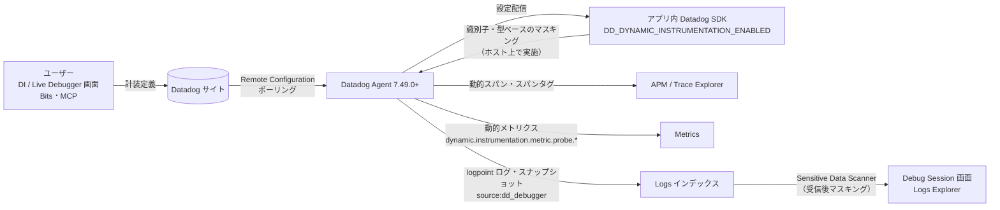
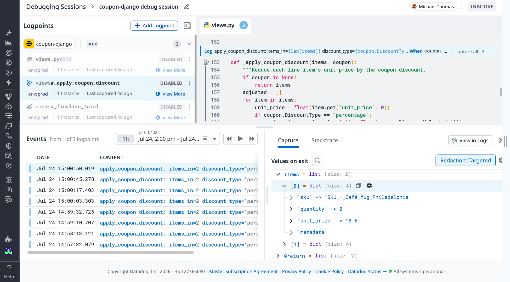
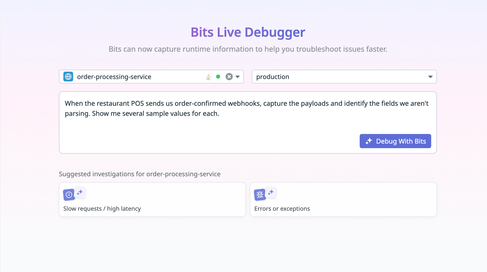
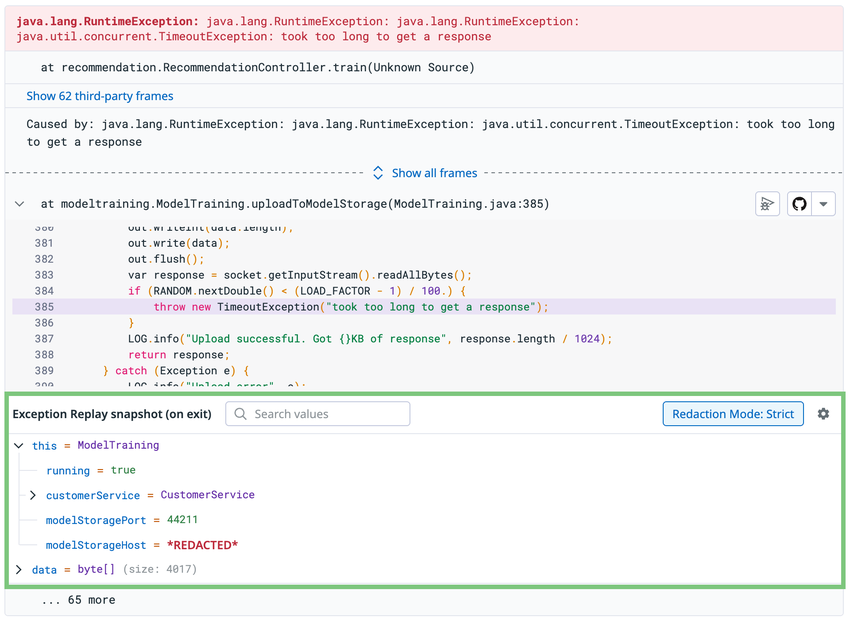
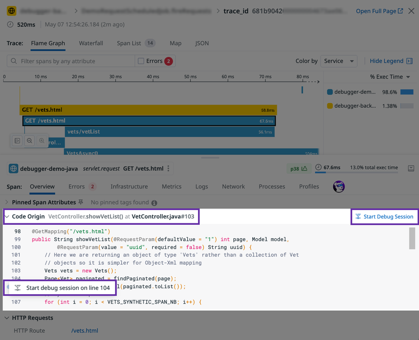
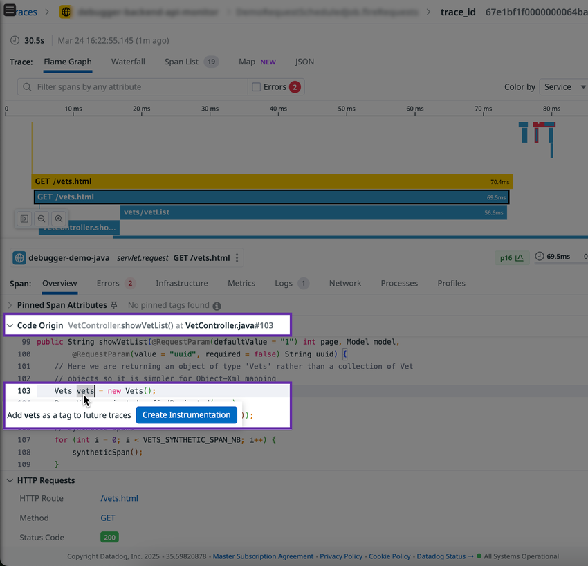

# Dynamic Instrumentation と Live Debugger

## 概要

Dynamic Instrumentation（ダイナミック インスツルメンテーション、動的計装。以下 DI）と Live Debugger（ライブデバッガー）は、**稼働中のアプリケーションに対して、コード変更・再デプロイ・再起動なしにテレメトリを追加する** Datadog APM の機能群である。両者は同じ計装技術、同じ [Expression Language（式言語）](#5-expression-language式言語)、一部の設定を共有する。[出典](https://docs.datadoghq.com/dynamic_instrumentation/)

| 観点 | Dynamic Instrumentation | Live Debugger |
|---|---|---|
| 目的 | カスタム APM 計装の追加（恒常的な観測） | 問題の調査（一時的なデバッグ） |
| 追加できるもの | 動的スパン（span）、動的スパンタグ（span tag）、動的メトリクス（metric） | logpoint（ログポイント）によるログイベントと変数スナップショット |
| 有効期間 | **無効化するまで有効** | **自動失効**（Debug Session の終了・設定した有効期限で停止） |
| 生成データの行き先 | APM（スパン／タグ）、Metrics | Logs（`source:dd_debugger`） |
| 画面 | APM > Dynamic Instrumentation（`/dynamic-instrumentation`） | APM > Live Debugger（`/debugging`） |
| 対応言語 | Java、Python、.NET、PHP | Java、Python、.NET、Node.js、Ruby、PHP、Go |
| RBAC 権限 | `debugger_*` 系 | `live_debugger_*` 系 |

[出典](https://docs.datadoghq.com/dynamic_instrumentation/) / [出典](https://docs.datadoghq.com/tracing/live_debugger/)

- 旧来の DI ドキュメントでは「log probe（ログプローブ）」として DI の一機能だったログ・スナップショット取得は、現行仕様では **Live Debugger の logpoint** に移っている。DI の画面では「Dynamic log instrumentations are supported in Live Debugger」と案内され、DI でログ型の計装は作成しない。[出典](https://docs.datadoghq.com/dynamic_instrumentation/)
- Live Debugger の源流は 2021-11 の Ozcode（本番デバッグ）買収とされる【第三者情報】（[what-is-datadog.md](../../01_入門編/what-is-datadog.md) の買収年表を参照）。Live Debugger は DASH 2024（2024-06）でベータとして発表された（当時の発表は Exception Replay や AI 生成テストを含む構想として紹介）。[出典](https://www.datadoghq.com/ja/about/latest-news/press-releases/datadog-live-debugger-dash-2024-06/)（2024-06-28 公開）
- 現行（2026-11-02 時点）の Live Debugger ドキュメントには Preview 表記がない（Bits Live Debugger と MCP の `live-debugger` ツールセットのみ【Preview】）。[出典](https://docs.datadoghq.com/tracing/live_debugger/)

本ファイルの範囲外（詳細はリンク先）：

| 関連トピック | 参照先 |
|---|---|
| APM SDK の導入・計装方法全般、コードによるカスタム計装 | [APM インスツルメンテーション](./apm-instrumentation.md) |
| スパンのインジェスト・Retention Filters・課金単位 | [APM の概念とインジェスト制御](./apm-concepts-and-ingestion.md) |
| Exception Replay（例外発生時の変数スナップショット）を含む Error Tracking | [Error Tracking](./error-tracking.md) |
| Trace Explorer 等の画面 | [APM 画面と分析機能](./apm-ui-and-analysis.md) |
| Remote Configuration の仕組み | [Fleet Automation と Remote Configuration](../platform/fleet-automation.md) |
| Sensitive Data Scanner 本体 | [Sensitive Data Scanner](../security/sensitive-data-scanner.md) |
| ログインデックス・保持・除外フィルター | [Indexes・保持・アーカイブ](../logs/log-indexes-retention-archives.md) |
| Bits AI / Bits Code | [Bits AI と AI 機能](../ai/bits-ai.md) |

> **サイト差異:** Dynamic Instrumentation、Live Debugger、Expression Language、Autocomplete and Search、Sensitive Data Scrubbing、Exception Replay の各ドキュメントは、**`app.ddog-gov.com`（US1-FED）および `us2.ddog-gov.com` では「This product is not supported」**と明記している。US1／US3／US5／EU1／AP1／AP2（および UK1）では利用可能。基準サイト AP1 での固有の差異は公開情報では確認できず。[出典](https://docs.datadoghq.com/dynamic_instrumentation/) / [出典](https://docs.datadoghq.com/tracing/live_debugger/)

---

## 1. アーキテクチャと動作の流れ

Dynamic Instrumentation と Live Debugger は、Datadog UI で定義した計装（instrumentation／probe／logpoint）の設定を **Remote Configuration（リモート設定）** で各ホストへ配信し、アプリケーション内の Datadog SDK（トレーサー）が実行中のコードに計装を差し込む。Agent が Datadog サイトをポーリングして設定を受け取り、トレーシングライブラリは Datadog に直接ポーリングせず Agent と通信して設定を受け取る。[出典](https://docs.datadoghq.com/remote_configuration/)



- 計装の作成・変更・再有効化から実際にデータ取得が始まるまで、Live Debugger では「数分（a couple of minutes）」かかることがある。MCP の `create_datadog_logpoint` の説明では「最大 1 分程度で伝搬」とされている。[出典](https://docs.datadoghq.com/tracing/live_debugger/) / [出典](https://docs.datadoghq.com/mcp_server/tools/)
- Go の Live Debugger は他言語と異なり、**Agent の system-probe（eBPF ベース）側の Dynamic Instrumentation を有効化**する必要があり、Agent はアプリと同一ホストで稼働している必要がある（後述）。[出典](https://docs.datadoghq.com/tracing/live_debugger/)
- 計装はアプリケーションの実行を停止しない（non-breaking）。Live Debugger の logpoint は「non-breaking breakpoints（止まらないブレークポイント）」と説明されている。[出典](https://docs.datadoghq.com/tracing/live_debugger/)
- Expression Language はメソッド呼び出しを許可しない（副作用のあるコードを実行させない設計）。[出典](https://docs.datadoghq.com/dynamic_instrumentation/expression-language/)

---

## 2. 前提条件（共通）

| 項目 | 要件 | 備考 |
|---|---|---|
| Datadog Agent | **7.49.0 以上**（Live Debugger の Go のみ **7.73.0 以上**、かつアプリと同一ホスト） | [Datadog Agent](../platform/agent.md) |
| APM | APM が有効で、Agent がトレース受信ポート `8126/TCP` で待ち受けていること（未設定なら `DD_APM_ENABLED=true`） | DI の手動有効化手順に記載 |
| Unified Service Tagging | `service`・`env`・`version` タグを設定 | [Tagging](../platform/tagging.md) |
| Remote Configuration | Agent で有効 | [Fleet Automation と Remote Configuration](../platform/fleet-automation.md) |
| Agent のログ収集（Live Debugger） | `logs_enabled: true`。無効のままにする場合は `apm_config.debugger_logs_enabled_override: true`（環境変数 `DD_APM_DEBUGGER_LOGS_ENABLED_OVERRIDE=true`）で Live Debugger のログだけ転送可能 | Live Debugger の要件 |
| Source Code Integration | 推奨（DI・Live Debugger）。**Bits Live Debugger では必須** | コードを Datadog 上に表示し、IDE のブレークポイントのように位置を選べる |
| 非対応環境（DI） | **Azure App Services、サーバーレス環境では利用不可** | [Serverless Monitoring](../infrastructure/serverless.md) |

[出典](https://docs.datadoghq.com/dynamic_instrumentation/) / [出典](https://docs.datadoghq.com/tracing/live_debugger/)

---

## 3. 対応言語と SDK バージョン

### 3.1 Dynamic Instrumentation（動的スパン・スパンタグ・メトリクス）

| 言語 | SDK | In-app 有効化の最低版 | 手動（環境変数）有効化の最低版 | 制約 |
|---|---|---|---|---|
| Java | `dd-java-agent`（JDK 8 以上） | 1.48.0 | 1.34.0 | Kotlin coroutines 非対応 |
| Python | `ddtrace` | 3.10.0 | 2.2.0 | — |
| .NET | .NET Framework / .NET Core 用 SDK | 3.57.0 | 2.54.0 | — |
| PHP | `dd-trace-php` | 公開情報では区別なし | 1.5.0 以上 | **ファイル・行指定の計装は非対応**（クラス＋メソッド指定のみ） |
| Node.js / Ruby / Go | — | — | — | DI（スパン・タグ・メトリクス）の対応言語として記載なし。Live Debugger のみ対応 |

[出典](https://docs.datadoghq.com/dynamic_instrumentation/)

**既知の制限（Java）**：JDK 18 以前で、`-parameters` フラグ付きでコンパイルされたクラス（Spring 6 以降、Spring Boot 3 以降、Scala では既定で付与）は `Method Parameters detected` エラーで計装に失敗することがある。[出典](https://docs.datadoghq.com/dynamic_instrumentation/)

### 3.2 Live Debugger（logpoint）

| 言語 | 強く推奨される SDK 版 | In-app 有効化の最低版 | 環境変数有効化の最低版 | Agent | その他の要件・制約 |
|---|---|---|---|---|---|
| Java | 1.64.0 以上（JDK 8 以上） | 1.48.0 | 1.42.0 | 7.49.0+ | JDK 18 以前の `-parameters` 問題（上記） |
| Python | `ddtrace` 4.11.0 以上 | 3.10.0 | 2.9.0 | 7.49.0+ | — |
| .NET | 3.46.0 以上 | 3.57.0 | 3.9.0 | 7.49.0+ | — |
| Node.js | `dd-trace-js` 5.109.0 以上 | 5.84.0 | 5.39.0 | 7.49.0+ | トランスパイル／バンドル（TypeScript、Babel、Webpack 等）時はソースマップをデプロイ物と一緒に公開。Node.js ランタイムのみ（**Bun・Deno 非対応**） |
| Ruby | 2.38.0 以上（最低 2.37.0） | — | — | 7.49.0+ | Ruby 2.6 以上（**MRI/CRuby のみ、JRuby 非対応**）、Rack ベースのフレームワーク（Rails、Sinatra 等）。**Sidekiq・Resque 等のバックグラウンドワーカー非対応**。`RAILS_ENV` または `RACK_ENV` が `production`。初回 HTTP リクエストで初期化されるため、1 リクエスト受信後でないと logpoint を作成できない |
| PHP | 1.23.0 以上（最低 1.5.0） | — | — | 7.49.0+ | — |
| Go | 2.9.0 以上（v1 系は 1.74.6 以上） | 2.6.0 | — | **7.73.0+、アプリと同一ホスト** | **Linux カーネル 5.17 以上** |

- 「強く推奨」未満の版では「予期しないエラーや体験の劣化が起こりうる」と明記されている。
- Ruby と PHP は In-app 有効化の記載がなく、環境変数で有効化する。
- In-app 有効化の最低版（例：.NET 3.57.0）が環境変数有効化の推奨版（.NET 3.46.0）より高い点に注意。In-app で有効化したい場合は In-app 最低版以上が必要。

[出典](https://docs.datadoghq.com/tracing/live_debugger/)

### 3.3 関連機能の対応言語（参考）

| 機能 | 対応言語・最低版 | 詳細 |
|---|---|---|
| Autocomplete and Search（シンボル検索・式補完） | Java（`dd-trace-java` 1.42.0+、DI 有効時に自動有効）、Python（`dd-trace-py` 2.9.0+、【Preview】）、.NET（`dd-trace-dotnet` 2.58.0+、【Preview】） | [4.6 節](#46-autocomplete-and-searchシンボルデータベース) |
| Code Origin for Spans | Java 1.47.0+、Python 2.15.0+、Node.js 4.49.0+（Fastify）/5.54.0+（Express）、.NET 3.15.0+、PHP 1.11.0+、Go（Source Code Integration 経由） | [8.1 節](#81-code-origin-for-spans-からの起動) |
| Exception Replay | Python、Java、.NET、PHP（GA、対応環境では既定で有効） | [Error Tracking](./error-tracking.md) |

[出典](https://docs.datadoghq.com/dynamic_instrumentation/symdb/) / [出典](https://docs.datadoghq.com/tracing/code_origin/) / [出典](https://docs.datadoghq.com/error_tracking/backend/exception_replay/)

---

## 4. Dynamic Instrumentation の設定と使い方

### 4.1 有効化方法

Dynamic Instrumentation の有効化には「In-app（推奨）」と「手動（環境変数）」の2通りがある（In-app は Java・Python・.NET のみ記載。PHP は環境変数で有効化）。[出典](https://docs.datadoghq.com/dynamic_instrumentation/)

| 方法 | 手順 | 条件 |
|---|---|---|
| In-app（推奨） | ① Dynamic Instrumentation Settings 画面（`/dynamic-instrumentation/settings`）でサービスと環境を有効化、または ② 計装を作成すると選択したサービス・環境で自動的に有効化 | SDK が In-app 最低版以上、Remote Configuration 有効 |
| 手動 | アプリケーション側に `DD_DYNAMIC_INSTRUMENTATION_ENABLED=true` を設定して起動 | SDK が In-app 最低版未満、または Datadog UI 外で有効化を管理したい場合 |

手動有効化の言語別例：

```bash
# Java（-javaagent は -jar より前に置く）
export DD_SERVICE=<YOUR_SERVICE>
export DD_ENV=<YOUR_ENV>
export DD_VERSION=<YOUR_VERSION>
export DD_DYNAMIC_INSTRUMENTATION_ENABLED=true   # または -Ddd.dynamic.instrumentation.enabled=true
java -javaagent:dd-java-agent.jar -jar <YOUR_SERVICE>.jar

# Python
pip install ddtrace
export DD_DYNAMIC_INSTRUMENTATION_ENABLED=true
ddtrace-run python -m myapp
#   コード内で設定する場合は ddtrace.auto の import 前に os.environ["DD_DYNAMIC_INSTRUMENTATION_ENABLED"]="true"

# .NET / PHP
DD_SERVICE=<YOUR_SERVICE> DD_ENV=<YOUR_ENV> DD_VERSION=<YOUR_VERSION> DD_DYNAMIC_INSTRUMENTATION_ENABLED=true
```

`dd-java-agent.jar` の取得先は `https://dtdg.co/latest-java-tracer`。[出典](https://docs.datadoghq.com/dynamic_instrumentation/)

### 4.2 設定項目（環境変数）

| 環境変数 | 型 | 説明 | 設定場所 |
|---|---|---|---|
| `DD_DYNAMIC_INSTRUMENTATION_ENABLED` | Boolean | `true` で DI（および Live Debugger の SDK 側機能）を有効化。Java は `-Ddd.dynamic.instrumentation.enabled=true` でも可 | アプリケーション |
| `DD_SERVICE` | String | サービス名（例：`web-backend`） | アプリケーション |
| `DD_ENV` | String | 環境名（例：`production`） | アプリケーション |
| `DD_VERSION` | String | サービスのバージョン | アプリケーション |
| `DD_TAGS` | String | 生成データに付与するタグ。`<key>:<value>` のカンマ区切り（例：`layer:api,team:intake`） | アプリケーション |
| `DD_DYNAMIC_INSTRUMENTATION_REDACTED_IDENTIFIERS` | String（カンマ区切り） | 追加でマスキングする識別子名 | アプリケーション（Agent ではない） |
| `DD_DYNAMIC_INSTRUMENTATION_REDACTION_EXCLUDED_IDENTIFIERS` | String（カンマ区切り） | 既定のマスキング対象から除外する識別子名 | アプリケーション（Agent ではない） |
| `DD_DYNAMIC_INSTRUMENTATION_REDACTED_TYPES` | String（カンマ区切り） | マスキングするクラス／型の完全修飾名 | アプリケーション（Agent ではない） |
| `DD_SYMBOL_DATABASE_UPLOAD_ENABLED` | Boolean | Autocomplete and Search 用シンボルのアップロード（Python・.NET は `true` で有効化、Java は既定有効で `false` で無効化） | アプリケーション |
| `DD_THIRD_PARTY_EXCLUDES` / `DD_THIRD_PARTY_INCLUDES` | String | Java・.NET でユーザーコード／サードパーティ判定を補正（パッケージ接頭辞のカンマ区切り） | アプリケーション |
| `DD_THIRD_PARTY_DETECTION_EXCLUDES` / `DD_THIRD_PARTY_DETECTION_INCLUDES` | String | Python で同上 | アプリケーション |

[出典](https://docs.datadoghq.com/dynamic_instrumentation/) / [出典](https://docs.datadoghq.com/tracing/live_debugger/sensitive-data-scrubbing/) / [出典](https://docs.datadoghq.com/dynamic_instrumentation/symdb/java/) / [出典](https://docs.datadoghq.com/dynamic_instrumentation/symdb/python/) / [出典](https://docs.datadoghq.com/dynamic_instrumentation/symdb/dotnet/)

Agent 側の関連設定：

| 設定キー（`datadog.yaml` / `system-probe.yaml`） | 環境変数 | 用途 |
|---|---|---|
| `apm_config.enabled`（APM 有効） | `DD_APM_ENABLED=true` | APM 未有効の場合に設定 |
| `logs_enabled: true` | `DD_LOGS_ENABLED=true` | Live Debugger のログ転送 |
| `apm_config.debugger_logs_enabled_override: true` | `DD_APM_DEBUGGER_LOGS_ENABLED_OVERRIDE=true` | ログ収集を無効のまま Live Debugger のログを転送 |
| `dynamic_instrumentation.enabled: true`（`system-probe.yaml`） | `DD_DYNAMIC_INSTRUMENTATION_ENABLED=true`（Agent マニフェスト） | **Go の Live Debugger 用**。Helm では `datadog.dynamicInstrumentationGo.enabled: true` |

[出典](https://docs.datadoghq.com/tracing/live_debugger/) / Agent 設定全般は [Agent 設定リファレンス](../platform/agent-configuration.md) を参照。

### 4.3 計装（instrumentation）の作成手順（共通部分）

1. Dynamic Instrumentation 画面（`/dynamic-instrumentation`）を開く。
2. 右上の **Create Instrumentation**、またはサービス行の三点メニュー → **Add an instrumentation for this service** をクリック。
3. 未入力なら service、runtime、environment、version（任意）を選択。
4. 計装位置を指定する。Java・Python・.NET は「クラス＋メソッド」または「ファイルの特定行」、PHP は「クラス＋メソッド」のみ。Autocomplete and Search が使える場合はファイル・メソッド・シンボルを検索できる。
5. 計装タイプ（Metric／Span／Span Tag）ごとの項目を設定する（次節）。

Source Code Integration を設定すると、Datadog 上でコードを表示し、IDE でブレークポイントを置く感覚で位置を選べる。[出典](https://docs.datadoghq.com/dynamic_instrumentation/)

### 4.4 計装タイプ別仕様

#### 動的メトリクス（Metric）

| 項目 | 仕様 |
|---|---|
| 動作 | 計装位置が実行されるたびにメトリクスを送信 |
| メトリクス名 | 指定名に接頭辞 **`dynamic.instrumentation.metric.probe.`** が付く |
| メトリクスタイプ | **Count**（実行回数。式は任意で、省略時は 1 回ごとに +1。式を指定すると変数値で加算）、**Gauge**（変数の最後の値。式が必須）、**Histogram**（変数値の統計分布。式が必須） |
| 値の指定 | Expression Language で数値を返す式（メソッド引数、ローカル変数、クラスフィールド、数値を返す式）。例：`len(data)` |
| 適用範囲 | 設定した環境・バージョンに一致する**全サービスインスタンスで自動的に有効** |
| レート制限 | **なし**（メソッドまたは行が呼ばれるたびに毎回実行） |

[出典](https://docs.datadoghq.com/dynamic_instrumentation/) / メトリクスタイプの意味は [Metrics](../platform/metrics.md) を参照。

#### 動的スパン（Span）

| 項目 | 仕様 |
|---|---|
| 動作 | メソッドの実行時にスパンを生成 |
| 位置指定 | メソッド（「A dynamic span emits a span when a method is executed」） |
| 例外 | メソッドが例外を投げた場合、例外の詳細が新しいスパンの `error` タグに関連付けられる |
| 用途 | コードによるカスタム計装（スパン作成）の代替 |
| 保持 | DI を使うと Retention Filter **`Dynamic Instrumentation Default`** が有効になり、動的に作成したスパンが既定で長期保持（インデックス化）される |

[出典](https://docs.datadoghq.com/dynamic_instrumentation/) / [出典](https://docs.datadoghq.com/tracing/trace_pipeline/trace_retention/)

#### 動的スパンタグ（Span Tag）

| 項目 | 仕様 |
|---|---|
| 動作 | 既存スパンにタグを追加 |
| 付与先 | **active span（現在アクティブなスパン）** または **service entry span（サービスエントリスパン）** |
| タグ名 | 任意に指定 |
| タグ値 | Expression Language（`{}` で囲む）。任意の型を評価可能 |
| 条件 | 任意。Boolean を返す式が true のときだけ付与 |
| 複数タグ | 1 計装に複数タグを追加可能（各タグに名前・式・条件） |
| 注意 | 内部スパン（internal span）は既定でインデックスされないため、APM で検索できない場合がある |

[出典](https://docs.datadoghq.com/dynamic_instrumentation/) / スパンのインデックスについては [APM の概念とインジェスト制御](./apm-concepts-and-ingestion.md) を参照。

#### ログ（参考）

DI では動的ログを作成しない。ログ・変数スナップショットは Live Debugger の logpoint で取得する（[6 章](#6-live-debugger)）。[出典](https://docs.datadoghq.com/dynamic_instrumentation/)

### 4.5 計装の停止

動的スパン・スパンタグ・メトリクスは、Datadog 上で計装を無効化するまで有効なまま残る。データ収集を止めるには Datadog 上で計装を無効化する（再デプロイ不要）。[出典](https://docs.datadoghq.com/dynamic_instrumentation/)

### 4.6 Autocomplete and Search（シンボルデータベース）

Autocomplete and Search は、DI の画面にクラス・メソッド検索、メソッドのコード表示、Expression Language の補完といった IDE 的機能を加える。実現のために、アプリから **機微でないシンボルとメタデータ**（クラス名、メソッド名、引数名、フィールド名、ローカル変数名、行番号など）が Datadog にアップロードされる。[出典](https://docs.datadoghq.com/dynamic_instrumentation/symdb/)

| 言語 | SDK 最低版 | 有効化 | ステータス |
|---|---|---|---|
| Java | `dd-trace-java` 1.42.0+ | DI 有効で自動有効。無効化は `DD_SYMBOL_DATABASE_UPLOAD_ENABLED=false`（`-Ddd.symbol.database.upload.enabled=false`） | ドキュメント上 Preview 表記なし |
| Python | `dd-trace-py` 2.9.0+ | `DD_SYMBOL_DATABASE_UPLOAD_ENABLED=true` | 【Preview】 |
| .NET | `dd-trace-dotnet` 2.58.0+ | `DD_SYMBOL_DATABASE_UPLOAD_ENABLED=true` | 【Preview】 |

前提：DI 有効、Agent 7.49.0+、Remote Configuration 有効、Unified Service Tagging。補完候補に自社コードが出ない場合は、サードパーティ判定のヒューリスティックによる誤分類の可能性があり、`DD_THIRD_PARTY_EXCLUDES`（Python は `DD_THIRD_PARTY_DETECTION_EXCLUDES`）で自社パッケージ接頭辞を指定する。[出典](https://docs.datadoghq.com/dynamic_instrumentation/symdb/java/) / [出典](https://docs.datadoghq.com/dynamic_instrumentation/symdb/python/) / [出典](https://docs.datadoghq.com/dynamic_instrumentation/symdb/dotnet/)

> 補足：DI 本体ページは「Autocomplete and Search を使うには Preview に opt-in」と記載し、symdb 総合ページは「Python と .NET で Preview」と記載している。Java は言語別ページに Preview 表記がない。

---

## 5. Expression Language（式言語）

Expression Language は、Live Debugger と Dynamic Instrumentation が稼働中のコードから値を読み取り、条件・メトリクス値・スパンタグ値・ログメッセージを定義するための式言語である。一般的なプログラミング言語の構文を借りているが独自ルールを持つ。式の対応範囲はランタイムのバージョンと計装位置に依存する。[出典](https://docs.datadoghq.com/dynamic_instrumentation/expression-language/)

### 5.1 用途別の型要件

| 用途 | 書き方 | 評価結果の型 | 例 |
|---|---|---|---|
| Live Debugger のログメッセージテンプレート | `{}` で囲む | 任意 | `User name is {user.name}` |
| DI のスパンタグ値 | `{}` で囲む | 任意 | `{request.headers["Host"]}` |
| 条件（condition） | 式そのもの | **Boolean** | `len(str) > 20`、`startsWith(user.name, "abc")`、`user.isActive == true` |
| メトリクス式 | 式そのもの | **数値** | `len(data)`（Histogram） |

### 5.2 サポートされるもの／されないもの

| 区分 | 内容 |
|---|---|
| アクセス | ローカル変数、メソッド引数、深くネストしたフィールド・属性（`private` フィールドも直接参照可）、`[]` によるキー・インデックスアクセス（例：`request.headers["Host"]`） |
| 比較演算子 | `<`、`>`、`>=`、`<=`、`==`、`!=`、`instanceof` |
| 論理演算子 | `&&`、`||`、`!` または `not(...)` |
| リテラル | `null`（Python では `None`、Ruby では `nil` に自動変換） |
| **非対応** | **メソッド呼び出し**（副作用防止のため）、**算術演算**（`i + 1` 等）、本ページ記載以外の言語ネイティブ構文 |

### 5.3 コンテキスト変数

| キーワード | 内容 | 利用可能な位置 |
|---|---|---|
| `@return` | メソッドの戻り値 | メソッド終了時 |
| `@duration` | メソッド実行時間（ミリ秒、浮動小数点） | メソッド終了時 |
| `@exception` | メソッド内で送出された未捕捉例外 | 未捕捉例外が存在する場合のみ |
| `@it` | コレクション走査中の現在要素 | `any`／`all`／`filter` の述語内 |

### 5.4 関数

| 関数 | 対象 | 説明 |
|---|---|---|
| `isDefined(var)` | 変数 | 現在のスコープに変数が存在すれば `true` |
| `len(value_src)` | 文字列／コレクション | 文字列長／要素数 |
| `isEmpty(value_src)` | 文字列／コレクション | `len(value_src) == 0` と同等 |
| `substring(value_src, startIndex, endIndex)` | 文字列 | 部分文字列 |
| `startsWith(value_src, string_literal)` | 文字列 | 前方一致 |
| `endsWith(value_src, string_literal)` | 文字列 | 後方一致 |
| `contains(value_src, string_literal)` | 文字列／コレクション | 部分文字列を含むか、またはコレクションが要素を含むか |
| `matches(value_src, string_literal)` | 文字列 | 正規表現マッチ |
| `[i]` / `[key]` | シーケンス／辞書 | i 番目要素／キーに対応する値。存在しない場合は言語によりエラーまたは null |
| `any(value_src, {predicate})` | コレクション | 1 要素でも述語を満たせば `true` |
| `all(value_src, {predicate})` | コレクション | 全要素が述語を満たせば `true` |
| `filter(value_src, {predicate})` | コレクション | 述語を満たす要素で絞り込み |

式の例：`someVar.someField`、`any(post.tags, {@it == "debugger"})`、`@duration > 10 && len(p.data) < 100`、`!isEmpty(user.email) && not(contains(user.name, "abc"))`。[出典](https://docs.datadoghq.com/dynamic_instrumentation/expression-language/)

> 注意：Bits Live Debugger のドキュメントは「条件式（condition expressions）はすべてのランタイムで対応しているわけではない」と記載している。言語ごとの対応可否は MCP の `discover_datadog_logpoint` が `message_templates`・`conditions`・`capture_expressions` として返す。[出典](https://docs.datadoghq.com/tracing/live_debugger/bits-live-debugger/) / [出典](https://docs.datadoghq.com/mcp_server/tools/)

---

## 6. Live Debugger

### 6.1 主な機能

Live Debugger は、稼働中サービスで実行を止めずにアプリケーションの状態（変数値、メソッド引数、実行コンテキスト）を取得し、本番などの長時間稼働環境での問題診断を行う機能である。[出典](https://docs.datadoghq.com/tracing/live_debugger/)

| 機能 | 内容 |
|---|---|
| Dynamic logpoints | 自社コードまたはサードパーティライブラリの対応位置に置く「止まらないブレークポイント」 |
| リアルタイム検査 | 変数値、メソッド引数、実行コンテキストの取得 |
| 非侵襲的なデータ取得 | アプリ停止・再デプロイなし |
| 自動失効 | 設定した期間後に logpoint が自動的に無効化 |
| 条件付き取得 | ユーザー定義の式が真のときだけ取得 |
| 組み込みのマスキング | 個人情報・シークレット・認証情報の露出防止（[7 章](#7-sensitive-data機微データの扱い)） |

### 6.2 有効化と Enablement mode

Live Debugger の有効化は「In-app（推奨）」と「環境変数」の2通り（In-app は Java・Python・.NET・Node.js・Go。Ruby と PHP は環境変数）。

| 方法 | 手順 |
|---|---|
| In-app | Live Debugger Settings 画面（`/debugging/settings`）でサービスと環境を有効化、または Debug Session を開始すると自動的に有効化 |
| 環境変数 | `DD_DYNAMIC_INSTRUMENTATION_ENABLED=true` と `DD_SERVICE`・`DD_ENV`・`DD_VERSION` を設定して起動（Java は `-javaagent` を `-jar` の前、Python は `ddtrace-run`） |

Live Debugger Settings 画面では、サービス×環境ごとに次の3モードを確認・変更できる。

| モード | 意味 |
|---|---|
| Automatic（既定） | まだ Enabled／Disabled が設定されていない状態。最初に Debug Session が開始されると自動的に Enabled に切り替わる。初回のデバッグを速くするには事前に Enabled にしておくのが推奨 |
| Enabled | 有効。デバッグシンボルのアップロードと、新しい logpoint の高速配信を含む |
| Disabled | そのサービス×環境では logpoint の作成・再有効化ができない |

[出典](https://docs.datadoghq.com/tracing/live_debugger/)

### 6.3 ログインデックスの準備

Live Debugger が生成するログは通常のアプリケーションログと同様に Datadog に送られ、**すべて `source:dd_debugger`** を持つ。除外フィルター等で意図せず捨てられないよう、専用インデックスの作成が推奨されている。[出典](https://docs.datadoghq.com/tracing/live_debugger/)

1. 希望の保持期間で、**サンプリングなし**のログインデックスを作成する。
2. フィルターを `source:dd_debugger` にする。
3. 同じタグにマッチする他のインデックスより**優先順位を上にする**（最初にマッチしたインデックスが採用されるため）。

Exception Replay のスナップショットも `source:dd_debugger` のログとして送られるため、同じインデックスで保持される。[出典](https://docs.datadoghq.com/error_tracking/backend/exception_replay/) / インデックスの仕様は [Indexes・保持・アーカイブ](../logs/log-indexes-retention-archives.md) を参照。

### 6.4 Debug Session の作成と利用

Debug Session は、自動失効する logpoint をまとめて実行中コードを調べる単位である。

| 開始場所 | 操作 |
|---|---|
| Live Debugger 画面（`/debugging/`） | **Create Debug Session** または **New Session** |
| Live Debugger 画面（Bits） | Bits Live Debugger に質問・調査プロンプトを送信【Preview】 |
| Trace Explorer | トレースを開き、サイドパネルの **Code Origin** セクションで **Start Debug Session** |
| MCP Server | `live-debugger` ツールセットの `create_debugger_session`【Preview】 |

手順：

1. 上記いずれかから Debug Session を開始する。
2. 最初の logpoint を置くコード位置を選択する。
3. セッション中に logpoint を追加・削除・変更する。
4. 取得されたログイベントは取り込み・インデックス後に Debug Session 画面に表示される。Logs Explorer など、ログを参照する他の Datadog ツールでも検索・分析できる。
5. 組織内ユーザーが作成したアクティブ／非アクティブな Debug Session は Live Debugger Sessions 一覧で確認できる。**Debug Session のログイベントはログインデックスの保持期間内のみ参照可能**。

Debug Session は自動的に失効する。セッションや個別 logpoint は手動でいつでも無効化・再有効化できる。[出典](https://docs.datadoghq.com/tracing/live_debugger/)



**キャプション：** Live Debugger の Debug Session 詳細画面（Python サービス `coupon-django`、環境 `prod` の例）。

**画面説明：** 画面上部にパンくず「Debugging Sessions > <セッション名>」と、セッション作成者、セッション状態（例：INACTIVE）が表示される。左上ペイン「Logpoints」には **Add Logpoint** ボタンと、サービス・環境ごとの logpoint 一覧（`views.py#216` のような行指定、`views#_apply_coupon_discount` のようなメソッド指定）があり、各行に状態（DISABLED など）、`env:prod`、インスタンス数、最終取得時刻、View More が表示される。右上ペインはソースコード表示（Source Code Integration 連携）で、logpoint を置いた行の上に「Log <メッセージテンプレート> When <条件>」「capture all」が表示される。左下「Events」は時間範囲を選んで logpoint が出力したログメッセージ（例：`apply_coupon_discount: items_in=2 discount_type='percentage'`）を時系列表示する。右下ペインは選択イベントの **Capture** タブ（「Values on exit」として引数 `items` の中身や `@return` をツリー表示）と **Stacktrace** タブ、**View in Logs** ボタン、現在のマスキングモード表示（「Redaction: Targeted」）で構成される。

出典：[Debug live production code without redeploying with Datadog Live Debugger](https://www.datadoghq.com/blog/live-debugger/)（Datadog 公式ブログ、2026-08-27 公開）／取得日 2026-11-02

### 6.5 logpoint の作成と設定項目

logpoint は「どのコード位置で、どのデータを、どの条件で取得するか」を定義する non-breaking breakpoint である。

1. Live Debugger 画面で **Create Debug Session** をクリック。
2. サービス、環境、最初の logpoint を置く位置を選択。
3. Expression Language でメッセージテンプレートを定義。
4. （任意）**Capture Variables** で実行コンテキスト全体または特定変数をログイベントのメタデータとして取得（**1 秒あたり 1 実行にレート制限**）。メッセージ文字列だけ取得する場合は Capture Variables を外す。
5. （任意）ログを出す条件を定義。
6. 既存定義を変更した場合は **Apply changes** で保存。

| 設定項目 | 必須 | 作成後の変更 | 備考 |
|---|---|---|---|
| サービス | 必須 | **不可** | 変更したい場合は新しい logpoint／Debug Session を作成 |
| 環境 | 必須 | **不可** | 同上 |
| コード位置（メソッドまたはファイル＋行） | 必須 | **不可** | 同上。デプロイ済みバージョンとソースが一致している必要あり |
| メッセージテンプレート | 必須 | 可 | Expression Language（`{}`） |
| Capture Variables | 任意 | 可 | 有効時は 1 回/秒に制限 |
| 条件（condition） | 任意 | 可 | Boolean 式。ランタイムにより非対応の場合あり |
| 有効期限 | — | 可（手動で無効化・再有効化） | Bits Live Debugger ドキュメントの記載では**10 分〜2 日、既定 60 分** |

[出典](https://docs.datadoghq.com/tracing/live_debugger/) / [出典](https://docs.datadoghq.com/tracing/live_debugger/bits-live-debugger/)

> 注：logpoint の有効期限の範囲（10 分〜2 日、既定 60 分）は Bits Live Debugger のページで「Logpoints created by Bits follow the same rules as manually created logpoints」という文脈で記載されている。Live Debugger 本体ページには既定値の明記がない。

### 6.6 Bits Live Debugger【Preview】

Bits Live Debugger は、Live Debugger に会話型インターフェースを加えた機能である。調べたい内容を自然言語で伝えると、Bits（基盤エージェントは Bits Code）が logpoint を配置し、変数スナップショットを取得・解釈し、根本原因の特定後にコード修正を提案できる。すべての操作は Live Debugger 経由で行われるため、Live Debugger と同じ権限・レート制限・自動失効・マスキングが適用される。Preview 参加には申請（Request Access）が必要。[出典](https://docs.datadoghq.com/tracing/live_debugger/bits-live-debugger/)

| 項目 | 仕様 |
|---|---|
| 前提 | Live Debugger が対象サービスで有効、Live Debugger の権限、対象サービス×環境が **Targeted Mode**、組織で Bits Code が利用可能、**Source Code Integration 必須** |
| Bits が実行できる操作 | Discover services（環境内のデバッグ可能サービスの探索）、Create logpoints、List session logpoints、Disable logpoints（セッション内の全 logpoint 無効化）、Retrieve snapshot data |
| 同時に置く logpoint 数 | 最大 5 個 |
| logpoint の性質 | 読み取り専用・ノンブロッキング、10 分〜2 日（既定 60 分）で自動失効。アプリの状態や制御フローは変更しない |
| 終了動作 | 必要なデータを取得すると Bits が通常は自ら logpoint を無効化 |
| 複数バージョン環境 | 環境内で複数バージョンが稼働しファイル内容が異なる場合、Bits は対象バージョンをユーザーに確認してから配置（行番号ずれ防止） |
| マスキング | **Strict Mode では利用不可**（Targeted Mode のみ）。手動作成の Debug Session は両モードで利用可 |
| 課金 | Preview 期間中、Live Debugger から開始したセッションでは **Bits Code の AI Credits は課金されない** |



**キャプション：** Bits Live Debugger の開始画面。

**画面説明：** 見出し「Bits Live Debugger」の下に、対象サービス（例：`order-processing-service`、言語アイコンと稼働状態の緑丸付き）と環境（例：`production`）を選ぶドロップダウンが並ぶ。その下の入力欄に調査内容を自然言語で書き（例：「POS から届く order-confirmed webhook のペイロードを取得し、パースしていないフィールドを特定して」）、**Debug With Bits** ボタンで調査を開始する。下部には「Suggested investigations for <サービス名>」として「Slow requests / high latency」「Errors or exceptions」の提案カードが表示される。

出典：[Debug live production code without redeploying with Datadog Live Debugger](https://www.datadoghq.com/blog/live-debugger/)（Datadog 公式ブログ、2026-08-27 公開）／取得日 2026-11-02

### 6.7 MCP Server の `live-debugger` ツールセット【Preview】

Datadog MCP Server の `live-debugger` ツールセットを使うと、自分のコーディングアシスタントから Live Debugger を操作できる。利用には Datadog サポートへのアクセス申請が必要。[出典](https://docs.datadoghq.com/mcp_server/tools/)

| ツール | 必要権限 | 内容 |
|---|---|---|
| `discover_datadog_logpoint` | Live Debugger Read / Write | サービスが稼働する環境と、対応機能（`message_templates`、`conditions`、`capture_expressions`）を返す。logpoint 作成前に呼ぶ |
| `enable_live_debugger` | Live Debugger Read / Write | 対応済みだが未有効の環境で Live Debugger を有効化（確認のため数分ブロックすることがある） |
| `create_debugger_session` | Live Debugger Read / Write | Debug Session を作成し `session_id` を返す |
| `create_datadog_logpoint` | Live Debugger Read / Write | logpoint 作成。取得開始まで最大 1 分程度の伝搬時間 |
| `list_datadog_session_logpoints` | Live Debugger Read | セッション内 logpoint の一覧（サービス、位置、テンプレート、有効状態） |
| `get_datadog_debugger_snapshot` | **Logs Read Data / Logs Read Index Data** | スナップショットの取得変数を取得（`variable_path`、`depth` 指定可） |
| `disable_datadog_logpoints` | Live Debugger Read / Write | セッション内の全 logpoint を無効化（セッションは残る） |

MCP Server 全般は [Bits AI と AI 機能](../ai/bits-ai.md) を参照。

### 6.8 IDE からの利用

- Code Origin for Spans の IDE 連携は IntelliJ と VS Code（言語は Java、Python）で、エンドポイントメソッドの上に RED メトリクスを表示する。[出典](https://docs.datadoghq.com/tracing/code_origin/)
- 過去には IDE プラグイン（JetBrains、VS Code）ごとの Live Debugger ページ（`/ide_plugins/idea/live_debugger/`、`/ide_plugins/vscode/live_debugger/`）が存在したが、2026-11-02 時点ではこれらの URL は Live Debugger 本体ページと同一内容を返し、IDE 固有の Live Debugger 仕様（IDE から作成した logpoint の有効期限など）は公開情報では確認できず。

---

## 7. Sensitive Data（機微データ）の扱い

Live Debugger（特に Capture Variables 使用時）と Exception Replay は、機微なアプリケーションデータを含みうるログ・変数スナップショットを取得する。Datadog は3層のマスキング（redaction）を提供する。[出典](https://docs.datadoghq.com/tracing/live_debugger/sensitive-data-scrubbing/)

| 層 | 実施場所 | タイミング | 設定方法 |
|---|---|---|---|
| ① 識別子・型ベースのルール | **顧客インフラ（アプリ内 SDK）** | アップロード**前** | 既定リスト＋アプリ側環境変数 |
| ② マスキングモード（Strict／Targeted） | 公開情報では処理位置の明記なし | 取得値の表示可否を制御 | Live Debugger Settings（権限 `live_debugger_redaction_write`） |
| ③ Sensitive Data Scanner ルール | Datadog 側 | アップロード**後** | Sensitive Data Scanner 画面 |

> 公式ドキュメントは、③ Sensitive Data Scanner ルールは「機微な値がインフラから出ないようにするルールの代替にはならない」と明記している。

### 7.1 マスキングモード（Mode-based redaction）

| モード | マスキング対象 | 備考 |
|---|---|---|
| **Strict Mode** | **数値と Boolean 以外のすべての値** | このモードのサービス×環境では Bits Live Debugger を利用できない |
| **Targeted Mode** | 既知の機微パターン（クレジットカード番号、API キー、IP アドレス、その他 PII）。加えて高エントロピーのシークレットスキャナーが推定シークレットをマスキングし、`[REDACTED:HIGH_ENTROPY]` と表示 | `staging`、`preprod` などの一般的な非本番環境では**自動的に Targeted Mode が適用** |

- マスキングモードは**無効化できず、切り替えのみ可能**。
- モード変更には **Live Debugger Redaction Write**（`live_debugger_redaction_write`）権限が必要。
- モードを設定する環境変数は公開情報では確認できず（画面での設定）。
- 本番環境の既定モードは明記されていないが、「非本番では自動的に Targeted」とされていることから、本番系では Strict が基本と読める【推定】。

[出典](https://docs.datadoghq.com/tracing/live_debugger/sensitive-data-scrubbing/)

Exception Replay にも同じ Strict／Targeted の2モードがある（説明は同一）。[出典](https://docs.datadoghq.com/error_tracking/backend/exception_replay/)



**キャプション：** Error Tracking の Exception Replay スナップショット（Java の例）。Live Debugger と同じ計装基盤・マスキング機構で取得される。

**画面説明：** 上部に例外メッセージ（`java.util.concurrent.TimeoutException: took too long to get a response`）とスタックトレース（「Show 62 third-party frames」「Show all frames」で展開可）、例外発生行（`ModelTraining.java:385`）周辺のソースコードが表示される。緑枠で囲まれた下部の「Exception Replay snapshot (on exit)」に、値検索ボックス、**Redaction Mode: Strict** ボタン、設定歯車があり、`this = ModelTraining` 配下のフィールド（`running = true`、`modelStoragePort = 44211` は数値・真偽値なので表示）と、文字列フィールド `modelStorageHost = *REDACTED*`（Strict Mode により伏字）がツリー表示される。

出典：[Exception Replay in Error Tracking](https://docs.datadoghq.com/error_tracking/backend/exception_replay/)／取得日 2026-11-02

### 7.2 識別子ベースのマスキング

| 項目 | 内容 |
|---|---|
| 既定動作 | `password`、`accessToken` などの機微な識別子に紐づく値を、**データがホストを出る前に**マスキング。各 SDK に言語固有の追加ルールが組み込まれている |
| 適用範囲 | 識別子の使われ方を問わない（メソッド引数、ローカル変数、クラス属性、辞書キーなど） |
| 追加 | `DD_DYNAMIC_INSTRUMENTATION_REDACTED_IDENTIFIERS=firstName,lastName,phoneNumber` |
| 除外 | `DD_DYNAMIC_INSTRUMENTATION_REDACTION_EXCLUDED_IDENTIFIERS=cookie,sessionid` |
| 設定場所 | **アプリケーションの環境**（`datadog-agent` ではない） |

[出典](https://docs.datadoghq.com/tracing/live_debugger/sensitive-data-scrubbing/)

**既定の識別子リスト（Java SDK の例）**：公式ドキュメントがリンクしている `dd-trace-java` の `Redaction.java` には、2026-11-02 時点で次の 85 個の既定キーワードが定義されている。識別子は比較前に正規化（大文字→小文字化、`_`・`-`・`$`・`@` を除去）されるため、例えば `access_token`、`AccessToken`、`access-token` はいずれも `accesstoken` として一致する。[出典](https://github.com/DataDog/dd-trace-java/blob/master/dd-java-agent/agent-debugger/debugger-bootstrap/src/main/java/datadog/trace/bootstrap/debugger/util/Redaction.java)

> `2fa`, `accesstoken`, `aiohttpsession`, `apikey`, `appkey`, `apisecret`, `apisignature`, `applicationkey`, `auth`, `authorization`, `authtoken`, `ccnumber`, `certificatepin`, `cipher`, `clientid`, `clientsecret`, `connectionstring`, `connectsid`, `cookie`, `credentials`, `creditcard`, `csrf`, `csrftoken`, `cvv`, `databaseurl`, `dburl`, `encryptionkey`, `encryptionkeyid`, `geolocation`, `gpgkey`, `ipaddress`, `jti`, `jwt`, `licensekey`, `masterkey`, `mysqlpwd`, `nonce`, `oauth`, `oauthtoken`, `otp`, `passhash`, `passwd`, `password`, `passwordb`, `pemfile`, `pgpkey`, `phpsessid`, `pin`, `pincode`, `pkcs8`, `privatekey`, `publickey`, `pwd`, `recaptchakey`, `refreshtoken`, `routingnumber`, `salt`, `secret`, `secretkey`, `secrettoken`, `securityanswer`, `securitycode`, `securityquestion`, `serviceaccountcredentials`, `session`, `sessionid`, `sessionkey`, `setcookie`, `signature`, `signaturekey`, `sshkey`, `ssn`, `symfony`, `token`, `transactionid`, `twiliotoken`, `usersession`, `voterid`, `xapikey`, `xauthtoken`, `xcsrftoken`, `xforwardedfor`, `xrealip`, `xsrf`, `xsrftoken`

- 上記は Java SDK のソースコードであり、他言語 SDK のリスト（例：Python は `ddtrace/debugging/_redaction.py`）は内容が異なる可能性がある。SDK のバージョンアップで変わりうる。[出典](https://docs.datadoghq.com/error_tracking/backend/exception_replay/)
- 既定では `email`、`firstName`、`phoneNumber` のような一般的な個人属性は含まれていないため、業務上の PII は `DD_DYNAMIC_INSTRUMENTATION_REDACTED_IDENTIFIERS` で追加する必要がある【推定】（上記リストからの推論）。

### 7.3 クラス／型ベースのマスキング

`DD_DYNAMIC_INSTRUMENTATION_REDACTED_TYPES` に機微な型の完全修飾名をカンマ区切りで設定する（例：`MyCompany.Authentication.UserCredential,MyCompany.BillingAddress`）。設定場所はアプリケーションの環境（Agent ではない）。[出典](https://docs.datadoghq.com/tracing/live_debugger/sensitive-data-scrubbing/)

| 効果 | 内容 |
|---|---|
| 値のマスキング | 指定型の変数をマスキングし、中身を Datadog にアップロードしない |
| 計装の禁止 | **指定したクラス内のコード位置には probe／logpoint を設定できなくなる** |

### 7.4 Sensitive Data Scanner との連携

Sensitive Data Scanner 画面（Organization Settings > Sensitive Data Scanner）でルールを作成・カスタマイズ・無効化し、ルールのフィルターを **`source:dd_debugger`** にすると Live Debugger（および Exception Replay）のログに適用される。正規表現ベースで検出・マスキングするが、処理は Datadog に**アップロードされた後**に行われる。[出典](https://docs.datadoghq.com/tracing/live_debugger/sensitive-data-scrubbing/) / Sensitive Data Scanner の詳細と課金は [Sensitive Data Scanner](../security/sensitive-data-scanner.md) を参照。

### 7.5 権限設計と監査

- 変数キャプチャを伴う DI probe の作成・変更には、別権限 `debugger_capture_variables`（既定は Datadog Admin Role）が定義されている（[8.3 節](#83-rbac-権限)）。
- 公式ブログは「Live Debugger は debugging activity の監査証跡（audit trail）を保持する」と述べている。[出典](https://www.datadoghq.com/blog/live-debugger/)（2026-08-27 公開）
- Audit Trail では DI のプローブ作成・変更・削除、Live Debugger の Redaction Settings 変更などのイベントを検索できる（イベント名とクエリは [Audit Trail](../platform/audit-trail.md) を参照）。

セキュリティ・コンプライアンス観点の全体設計は [セキュリティとコンプライアンス](../../03_導入編/security-and-compliance.md) を参照。

---

## 8. 画面・連携機能

### 8.1 Code Origin for Spans からの起動

Code Origin for Spans は、APM スパンが作成されたコード位置（ファイルパス、行番号、関数名）を service entry span に付与する機能で、Trace Explorer のスパン詳細の Overview タブに「Code Origin」セクションとして表示される。有効化は SDK に `DD_CODE_ORIGIN_FOR_SPANS_ENABLED=true`（Source Code Integration が前提）。このセクションから Live Debugger と Dynamic Instrumentation を直接起動できる。[出典](https://docs.datadoghq.com/tracing/code_origin/)

| 操作 | 結果 |
|---|---|
| Code Origin セクションの **Start Debug Session** | Code Origin のメソッド位置に logpoint を置いた Live Debugger セッションを開始 |
| コードプレビューの行番号横（gutter）をクリック | 選択行に logpoint を置いてセッションを開始（例：「Start debug session on line 104」） |
| コードプレビュー内の変数をクリック → **Create Instrumentation** | その変数を以後のスパンにタグとして追加する DI（動的スパンタグ）を作成（例：「Add vets as a tag to future traces」） |



**キャプション：** Trace Explorer のトレース詳細で、Code Origin セクションから Live Debugger の Debug Session を開始する画面。

**画面説明：** 上部はトレースの Flame Graph（タブ：Flame Graph／Waterfall／Span List／Map／JSON）、中央は選択スパン（サービス `debugger-demo-java`、`servlet.request GET /vets.html`）の詳細で、タブ Overview／Errors／Infrastructure／Metrics／Logs／Network／Processes／Profiles が並ぶ。Overview タブ内の「Code Origin」行に `VetController.showVetList() at VetController.java#103` と表示され、右端に **Start Debug Session** リンクがある。その下のコードプレビュー（98〜107 行）では、行番号横にカーソルを当てると「Start debug session on line 104」が表示される（紫枠で強調）。

出典：[Code Origin for Spans](https://docs.datadoghq.com/tracing/code_origin/)／取得日 2026-11-02



**キャプション：** Code Origin のコードプレビューから Dynamic Instrumentation の動的スパンタグを作成する画面。

**画面説明：** 前図と同じトレース詳細画面で、Code Origin セクション（`VetController.showVetList() at VetController.java#103`）のコードプレビュー 103 行目 `Vets vets = new Vets();` の変数 `vets` にカーソルを当てると、ポップアップ「Add vets as a tag to future traces」と **Create Instrumentation** ボタンが表示される（紫枠で強調）。ボタンから DI の Span Tag 計装の作成に進む。

出典：[Code Origin for Spans](https://docs.datadoghq.com/tracing/code_origin/)／取得日 2026-11-02

### 8.2 Exception Replay との関係

Exception Replay は、例外発生時の実行コンテキストとローカル変数を自動取得し、Error Tracking に表示する機能で、Dynamic Instrumentation 上に構築されている。そのため DI の機微データマスキング設定（識別子・型・Sensitive Data Scanner）が Exception Replay にも適用される。スナップショットのレート制限は「例外タイプごと・インスタンスごとに 1 時間あたり 1 スナップショット」。詳細は [Error Tracking](./error-tracking.md) を参照。[出典](https://docs.datadoghq.com/error_tracking/backend/exception_replay/)

### 8.3 RBAC 権限

| 権限名（表示名） | 権限キー | 内容 | 既定で含むロール |
|---|---|---|---|
| Dynamic Instrumentation Read | `debugger_read` | DI 設定の閲覧（DI 画面へのアクセスに必要） | Datadog Read Only Role |
| Dynamic Instrumentation Write Pre-Prod | `debugger_write_pre_prod` | 既知の非本番環境（staging、QA など）向け probe の作成・変更 | Datadog Standard Role |
| Dynamic Instrumentation Write | `debugger_write` | 全環境で DI 設定を編集。**関数状態を取得しない** probe の作成・変更 | Datadog Admin Role |
| Dynamic Instrumentation Capture Variables | `debugger_capture_variables` | **関数状態（ローカル変数、メソッド引数、フィールド、戻り値・例外）を取得する** probe の作成・変更 | Datadog Admin Role |
| Live Debugger Read | `live_debugger_read` | logpoint・セッション・設定の閲覧（Live Debugger 画面へのアクセスに必要） | Datadog Read Only Role |
| Live Debugger Write | `live_debugger_write` | Debug Session と logpoint の作成・変更 | Datadog Standard Role |
| Live Debugger Redaction Write | `live_debugger_redaction_write` | マスキングモード（redaction rules）の変更 | Datadog Admin Role |

[出典](https://docs.datadoghq.com/account_management/rbac/permissions/) / [出典](https://docs.datadoghq.com/dynamic_instrumentation/) / [出典](https://docs.datadoghq.com/tracing/live_debugger/)

- DI の利用には `debugger_read` に加え、`debugger_write` または `debugger_write_pre_prod` のいずれかが必要。
- 権限キーの表記揺れ：DI 本体ページは `debugger_write_preprod` と表記しているが、RBAC 権限一覧と Remote Configuration ページは `debugger_write_pre_prod`（`DEBUGGER_WRITE_PRE_PROD`）と表記している。API・Terraform で指定する際は権限一覧の表記を正とするのが安全【推定】。
- Remote Configuration ページは DI に必要な権限として `APM_REMOTE_CONFIGURATION_READ`・`APM_REMOTE_CONFIGURATION_WRITE` も挙げている。[出典](https://docs.datadoghq.com/remote_configuration/)
- MCP の `get_datadog_debugger_snapshot` は Logs の権限（Logs Read Data、Logs Read Index Data）で動作する点に注意（スナップショットはログとして保存されるため）。[出典](https://docs.datadoghq.com/mcp_server/tools/)

ロール設計全般は [組織・ユーザー・権限管理](../platform/account-and-access-management.md) を参照。

---

## 9. トラブルシューティング

### 9.1 Live Debugger でログ・変数が取れない場合のチェックリスト

| 確認項目 | 内容 |
|---|---|
| トラフィック | 選択したサービス・環境に、計装したコードを実行するトラフィックが来ているか |
| バージョン一致 | ソースファイルと位置がデプロイ済みバージョンと一致しているか |
| 条件 | 条件式がそのトラフィックにマッチしているか、ログイベントに `debugger.snapshot.evaluationErrors` がないか |
| ログインデックス | ログインデックスが `source:dd_debugger` を保持しているか（除外フィルター・優先順位） |
| マスキング・キャプチャ制限 | 必要な値がマスキングされていないか、キャプチャ制限の範囲外でないか |
| 反映待ち | 作成・変更・再有効化から数分待ったか |
| Ruby | サービスが少なくとも 1 件の HTTP リクエストを受けたか（初回リクエストで初期化） |

[出典](https://docs.datadoghq.com/tracing/live_debugger/)

### 9.2 言語別の既知の問題

| 言語 | 問題 | 対処 |
|---|---|---|
| Java | JDK 18 以前で `-parameters` 付きコンパイルのクラスが `Method Parameters detected` で計装失敗（Spring 6+／Spring Boot 3+／Scala で既定） | JDK 19 以降への移行など（公式の回避策は記載なし） |
| Java | Kotlin coroutines は DI 非対応 | — |
| Node.js | TypeScript の named/default import が CommonJS にコンパイルされると、logpoint メッセージ・条件・キャプチャ式で import 名が `ReferenceError` になる（ソースマップがあっても発生） | デプロイ済み JS で生成モジュール名を確認して参照（例：`import { LIMIT } from './limits'` → `limits_1.LIMIT`）。生成名はビルドごとに変わりうる。`instanceof` では `foo_1.Foo` のような修飾クラス名を使えないため回避不可 |
| Node.js | Bun・Deno 非対応、トランスパイル時はソースマップ必須 | — |
| PHP | DI ではファイル・行指定の計装不可 | メソッド指定を使う |
| Ruby | JRuby、Sidekiq／Resque などのバックグラウンドワーカー非対応 | — |

[出典](https://docs.datadoghq.com/tracing/live_debugger/) / [出典](https://docs.datadoghq.com/dynamic_instrumentation/)

### 9.3 GovCloud（US1-FED）での Java の警告ログ

DI・Exception Replay・Code Origin が非対応のサイト（`app.ddog-gov.com`）では、Java トレーサーが `com.datadog.debugger.uploader.BatchUploader` から HTTP 403（`This traffic is not permitted on your account`）の WARN を定期的に出すことがある。コア APM（トレース、メトリクス、プロファイリング、ログ注入）には影響しない。止めるには次を設定して再起動する（WARN は約 5 分に 1 回にレート制限されているため、確認は再起動後 5 分以上待つ）。[出典](https://docs.datadoghq.com/error_tracking/backend/exception_replay/)

```bash
DD_EXCEPTION_REPLAY_ENABLED=false
DD_DYNAMIC_INSTRUMENTATION_ENABLED=false
DD_CODE_ORIGIN_FOR_SPANS_ENABLED=false
# JVM システムプロパティの場合: -Ddd.exception.replay.enabled=false -Ddd.dynamic.instrumentation.enabled=false -Ddd.code.origin.for.spans.enabled=false
```

トレーサー起動時の `DATADOG TRACER CONFIGURATION` で `debugger_exception_enabled`、`debugger_enabled`、`debugger_span_origin_enabled` が `false` になっていることを確認する。

---

## 10. 制限値・クォータ・デフォルト値

| 項目 | 値 | 出典・備考 |
|---|---|---|
| Datadog Agent 最低版 | 7.49.0（Live Debugger の Go は 7.73.0、同一ホスト） | [DI](https://docs.datadoghq.com/dynamic_instrumentation/) / [LD](https://docs.datadoghq.com/tracing/live_debugger/) |
| Go の Linux カーネル | 5.17 以上 | [LD](https://docs.datadoghq.com/tracing/live_debugger/) |
| logpoint（Capture Variables あり）のレート制限 | **1 実行／秒** | [LD](https://docs.datadoghq.com/tracing/live_debugger/) |
| logpoint（Capture Variables なし）のレート制限 | **5,000 実行／秒／サービスインスタンス** | 同上 |
| 動的メトリクスのレート制限 | **なし**（毎回実行） | [DI](https://docs.datadoghq.com/dynamic_instrumentation/) |
| 動的スパン・スパンタグのレート制限 | 公開情報では確認できず | — |
| logpoint の有効期限 | **10 分〜2 日、既定 60 分** | [Bits Live Debugger](https://docs.datadoghq.com/tracing/live_debugger/bits-live-debugger/)（手動作成の logpoint にも同じルールが適用と記載） |
| Debug Session の有効期限 | 自動失効（具体的な既定値は公開情報では確認できず） | [LD](https://docs.datadoghq.com/tracing/live_debugger/) |
| DI 計装（スパン・タグ・メトリクス）の有効期限 | なし（無効化するまで有効） | [DI](https://docs.datadoghq.com/dynamic_instrumentation/) |
| 計装反映までの時間 | 数分（a couple of minutes）。MCP 経由の logpoint は最大 1 分程度 | [LD](https://docs.datadoghq.com/tracing/live_debugger/) / [MCP](https://docs.datadoghq.com/mcp_server/tools/) |
| Bits Live Debugger が同時に配置する logpoint 数 | 最大 5 | [Bits Live Debugger](https://docs.datadoghq.com/tracing/live_debugger/bits-live-debugger/) |
| 1 組織・1 サービスあたりの logpoint／計装の上限数 | 公開情報では確認できず | — |
| スナップショットのキャプチャ制限 | 公式ドキュメントに数値記載なし（トラブルシューティングで「capture limits」の存在のみ言及）。SDK ソースコード上の既定値は下表 | [LD](https://docs.datadoghq.com/tracing/live_debugger/) |
| 変更不可の logpoint 属性 | サービス、環境、コード位置 | [LD](https://docs.datadoghq.com/tracing/live_debugger/) |
| 動的メトリクス名の接頭辞 | `dynamic.instrumentation.metric.probe.` | [DI](https://docs.datadoghq.com/dynamic_instrumentation/) |
| Live Debugger ログの `source` | `dd_debugger` | [LD](https://docs.datadoghq.com/tracing/live_debugger/) |
| Live Debugger ログの保持期間 | 格納先ログインデックスの保持期間に従う | [LD](https://docs.datadoghq.com/tracing/live_debugger/) |
| Enablement mode の既定 | Automatic（初回 Debug Session 開始で Enabled） | [LD](https://docs.datadoghq.com/tracing/live_debugger/) |
| マスキングモード | 無効化不可。非本番（`staging`、`preprod` 等）は自動で Targeted | [Scrubbing](https://docs.datadoghq.com/tracing/live_debugger/sensitive-data-scrubbing/) |
| Exception Replay のスナップショット | 例外タイプ×インスタンスごとに 1 回／時間（ランタイムにより 2 回目の発生で取得） | [Exception Replay](https://docs.datadoghq.com/error_tracking/backend/exception_replay/) |
| 対応サイト | US1-FED（`app.ddog-gov.com`）・`us2.ddog-gov.com` は非対応 | [DI](https://docs.datadoghq.com/dynamic_instrumentation/) |
| 非対応実行環境（DI） | Azure App Services、サーバーレス | [DI](https://docs.datadoghq.com/dynamic_instrumentation/) |

**スナップショットのキャプチャ制限（SDK ソースコード上の既定値）**：公式ドキュメントには数値の記載がないため、公式 GitHub の SDK ソースコードで確認した値を示す（2026-11-02 時点。SDK バージョンで変わりうる）。

| 制限 | Java（`Limits.java`） | Python（`_probe/model.py`） | Node.js（`snapshot/constants.js`） |
|---|---|---|---|
| 参照の深さ（reference depth / level） | 3 | 2 | 3 |
| コレクションの最大要素数 | 100 | 100 | 100 |
| 文字列の最大長 | 255 | 255 | 255 |
| オブジェクトの最大フィールド数 | 20 | 20 | 20 |

出典：[dd-trace-java Limits.java](https://github.com/DataDog/dd-trace-java/blob/master/dd-java-agent/agent-debugger/debugger-bootstrap/src/main/java/datadog/trace/bootstrap/debugger/Limits.java) / [dd-trace-py _probe/model.py](https://github.com/DataDog/dd-trace-py/blob/main/ddtrace/debugging/_probe/model.py) / [dd-trace-js snapshot/constants.js（5.82.0）](https://app.unpkg.com/dd-trace@5.82.0/files/packages/dd-trace/src/debugger/devtools_client/snapshot/constants.js)。.NET・Ruby・PHP・Go の既定値は公開情報では確認できず。Ruby SDK は「式単位 → probe 単位 → グローバル設定」の順で制限値を解決する実装になっている（[rubydoc: Datadog::DI::CaptureLimits](https://www.rubydoc.info/gems/datadog/Datadog/DI/CaptureLimits)）。

---

## 11. 課金への影響

| 対象 | 課金上の扱い | 確度 |
|---|---|---|
| Dynamic Instrumentation 機能そのもの | 公式料金ページの APM 機能比較表で「Dynamic Instrumentation—Add logs, spans, and metrics without interrupting runtime」が **APM／APM Pro／APM Enterprise の全プランに含まれる**（2026-11-02 時点）。DI 単独の課金品目は料金ページに見当たらない | 公式料金ページ |
| Live Debugger 機能そのもの | 料金ページに個別の課金品目なし。上記 DI 行（logs を含む）の範囲で APM に含まれると読める | 【推定】 |
| 動的スパン | APM のスパン（Ingested Spans）として扱われ、`Dynamic Instrumentation Default` Retention Filter によりインデックス化されたスパンは Indexed Spans に計上される | Retention Filter の記載は公式。計上の扱いは [APM の概念とインジェスト制御](./apm-concepts-and-ingestion.md) を参照 |
| 動的メトリクス（`dynamic.instrumentation.metric.probe.*`） | カスタムメトリクスとしての課金対象か否かは公開情報では確認できず。タグの組み合わせ数が増えれば時系列数が増える点はカスタムメトリクスと同様に注意が必要 | 【推定】 |
| Live Debugger の logpoint ログ・Exception Replay スナップショット | Datadog Logs に `source:dd_debugger` として送られ、ログインデックスに格納される。Log Management の取り込み・インデックス課金の対象になると考えられる（公式の明記は確認できず） | 【推定】 |
| Sensitive Data Scanner ルールの適用 | Sensitive Data Scanner のスキャン量課金に従う | [Sensitive Data Scanner](../security/sensitive-data-scanner.md) |
| Bits Live Debugger | Preview 期間中、Live Debugger から開始したセッションでは Bits Code の AI Credits は課金されない | 公式ドキュメント |

[出典](https://www.datadoghq.com/pricing/)（取得日 2026-11-02）/ [出典](https://docs.datadoghq.com/tracing/trace_pipeline/trace_retention/) / [出典](https://docs.datadoghq.com/tracing/live_debugger/bits-live-debugger/)

- APM 各プランの単価（ホスト単価、年契約／月契約／オンデマンド）とスパンの割当量は、料金の正本である [製品別料金表](../../03_導入編/pricing-by-product.md) を参照。課金計算の仕組みは [課金計算の仕組み](../../03_導入編/billing-mechanics.md)、ログ課金の最適化は [コスト最適化](../../04_応用編/cost-optimization.md) を参照。
- 専用ログインデックスの保持期間を短めにする、Capture Variables を必要時のみ使う、logpoint を調査後すぐ無効化する、といった運用でログ量を抑えられる【経験則】。

---

## 12. 運用上の考慮事項

| 観点 | 推奨・注意 | 確度 |
|---|---|---|
| 事前有効化 | Enablement mode を事前に Enabled にしておくと、デバッグシンボルのアップロードと logpoint 配信が速くなり、障害時の初動が早まる | 公式（[LD](https://docs.datadoghq.com/tracing/live_debugger/)） |
| 本番での権限分離 | 本番の probe 作成は `debugger_write`（Admin 既定）、非本番は `debugger_write_pre_prod`（Standard 既定）、変数キャプチャは `debugger_capture_variables`（Admin 既定）と分かれているため、開発者には非本番権限のみ付与し本番は承認者に限定する設計が可能 | 権限の存在は公式。運用設計は【経験則】 |
| マスキングの強化 | 業務固有の PII（氏名、電話番号、メールアドレス等）は既定リストに含まれないものがあるため、`DD_DYNAMIC_INSTRUMENTATION_REDACTED_IDENTIFIERS`・`DD_DYNAMIC_INSTRUMENTATION_REDACTED_TYPES` をアプリのデプロイ設定に組み込み、Sensitive Data Scanner の `source:dd_debugger` ルールを後段の保険とする | 機能は公式。組み合わせ方は【推定】 |
| ログインデックス | 専用インデックスを最優先に配置し、除外フィルターで Live Debugger ログが消えないようにする | 公式 |
| バージョン整合 | `DD_VERSION` と Source Code Integration（Git コミット SHA）を正しく設定し、デプロイ済みコードと表示コードを一致させる。複数バージョン混在環境では行番号ずれに注意 | 公式（LD、Bits Live Debugger） |
| 恒久化の判断 | DI の動的スパン・タグで有用と分かった計装は、長期的にはコードによるカスタム計装へ移すかを検討する（DI は無効化するまで残るため棚卸しが必要） | 【経験則】 |
| オーバーヘッド | Datadog は「本番で安全に使える」と説明しているが、定量的なオーバーヘッド値は公開情報では確認できず。高頻度メソッドへの Capture Variables なし logpoint や動的メトリクス（レート制限なし）は呼び出し回数に比例してデータ量が増える | 公式記述＋【推定】 |

APM 運用全般のベストプラクティスは [APM 運用の実践](../../04_応用編/apm-practices.md) を参照。

---

## 13. 確認できなかった事項

- 動的スパン・動的スパンタグのレート制限値。
- Debug Session 自体の既定有効期限（logpoint の 10 分〜2 日・既定 60 分とは別に定められているか）。
- 1 組織・1 サービスあたりの計装数／logpoint 数の上限。
- スナップショットのキャプチャ制限の公式ドキュメント上の値（本ファイルでは SDK ソースコードの既定値を記載）、および .NET・Ruby・PHP・Go の既定値。
- 動的メトリクスがカスタムメトリクスとして課金されるか、Live Debugger のログが Log Management の課金対象となるかの公式明記。
- マスキングモードの本番環境での既定値の明記、モードを設定する環境変数・API。
- IDE（JetBrains、VS Code）から作成する logpoint の現行仕様。
- 定量的な性能オーバーヘッド。
- Live Debugger の GA 日付（2024-06 にベータ発表、2026-11-02 時点のドキュメントに Preview 表記なし）。

---

## 参照元

公式ドキュメント（取得日 2026-11-02）：

- Dynamic Instrumentation: https://docs.datadoghq.com/dynamic_instrumentation/
- Live Debugger: https://docs.datadoghq.com/tracing/live_debugger/
- Live Debugger Sensitive Data Scrubbing: https://docs.datadoghq.com/tracing/live_debugger/sensitive-data-scrubbing/
- Bits Live Debugger: https://docs.datadoghq.com/tracing/live_debugger/bits-live-debugger/
- Expression Language for Live Debugger and Dynamic Instrumentation: https://docs.datadoghq.com/dynamic_instrumentation/expression-language/
- Autocomplete and Search: https://docs.datadoghq.com/dynamic_instrumentation/symdb/
- Autocomplete and Search（Java / Python / .NET）: https://docs.datadoghq.com/dynamic_instrumentation/symdb/java/ / https://docs.datadoghq.com/dynamic_instrumentation/symdb/python/ / https://docs.datadoghq.com/dynamic_instrumentation/symdb/dotnet/
- Code Origin for Spans: https://docs.datadoghq.com/tracing/code_origin/
- Exception Replay in Error Tracking: https://docs.datadoghq.com/error_tracking/backend/exception_replay/
- Datadog Role Permissions: https://docs.datadoghq.com/account_management/rbac/permissions/
- Trace Retention（Retention Filters）: https://docs.datadoghq.com/tracing/trace_pipeline/trace_retention/
- Remote Configuration: https://docs.datadoghq.com/remote_configuration/
- Datadog MCP Server Tools: https://docs.datadoghq.com/mcp_server/tools/

公式サイト・ブログ・プレスリリース：

- Datadog Pricing（APM 機能比較表、取得日 2026-11-02）: https://www.datadoghq.com/pricing/
- Debug live production code without redeploying with Datadog Live Debugger（2026-08-27 公開）: https://www.datadoghq.com/blog/live-debugger/
- Datadog、Live Debuggerにより本番環境のライブデータでのトラブルシューティングとバグ修正を効率化（2024-06-28 公開）: https://www.datadoghq.com/ja/about/latest-news/press-releases/datadog-live-debugger-dash-2024-06/

公式 GitHub（SDK ソースコード、取得日 2026-11-02）：

- dd-trace-java Redaction.java: https://github.com/DataDog/dd-trace-java/blob/master/dd-java-agent/agent-debugger/debugger-bootstrap/src/main/java/datadog/trace/bootstrap/debugger/util/Redaction.java
- dd-trace-java Limits.java: https://github.com/DataDog/dd-trace-java/blob/master/dd-java-agent/agent-debugger/debugger-bootstrap/src/main/java/datadog/trace/bootstrap/debugger/Limits.java
- dd-trace-py _probe/model.py: https://github.com/DataDog/dd-trace-py/blob/main/ddtrace/debugging/_probe/model.py
- dd-trace-py _redaction.py: https://github.com/DataDog/dd-trace-py/blob/main/ddtrace/debugging/_redaction.py
- dd-trace-js snapshot/constants.js（5.82.0、unpkg）: https://app.unpkg.com/dd-trace@5.82.0/files/packages/dd-trace/src/debugger/devtools_client/snapshot/constants.js
- Datadog::DI::CaptureLimits（rubydoc）: https://www.rubydoc.info/gems/datadog/Datadog/DI/CaptureLimits

関連ファイル：

- [APM の概念とインジェスト制御](./apm-concepts-and-ingestion.md) / [APM インスツルメンテーション](./apm-instrumentation.md) / [APM 画面と分析機能](./apm-ui-and-analysis.md) / [Error Tracking](./error-tracking.md) / [Continuous Profiler](./continuous-profiler.md)
- [Fleet Automation と Remote Configuration](../platform/fleet-automation.md) / [Datadog Agent](../platform/agent.md) / [Agent 設定リファレンス](../platform/agent-configuration.md) / [組織・ユーザー・権限管理](../platform/account-and-access-management.md) / [Audit Trail](../platform/audit-trail.md) / [Datadog Sites](../platform/datadog-sites.md)
- [Sensitive Data Scanner](../security/sensitive-data-scanner.md) / [Indexes・保持・アーカイブ](../logs/log-indexes-retention-archives.md) / [Bits AI と AI 機能](../ai/bits-ai.md)
- [製品別料金表](../../03_導入編/pricing-by-product.md) / [課金計算の仕組み](../../03_導入編/billing-mechanics.md) / [セキュリティとコンプライアンス](../../03_導入編/security-and-compliance.md) / [APM 運用の実践](../../04_応用編/apm-practices.md) / [コスト最適化](../../04_応用編/cost-optimization.md)
