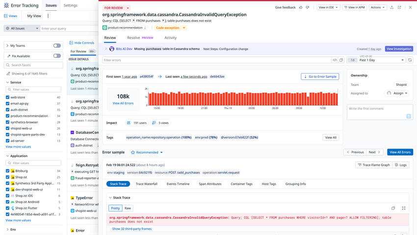
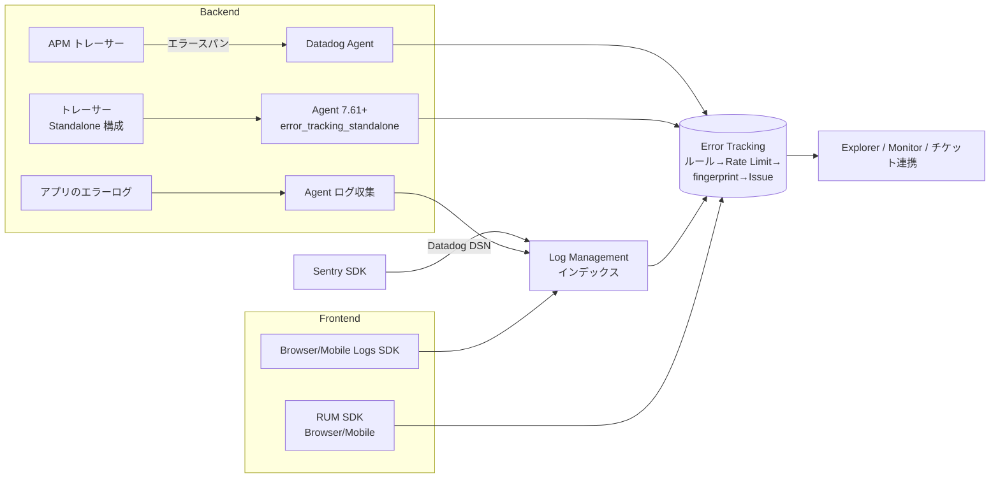
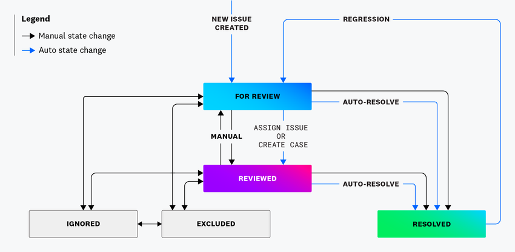
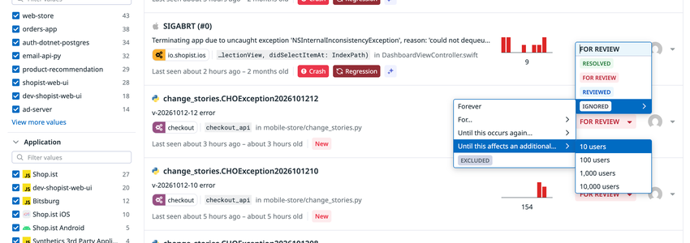
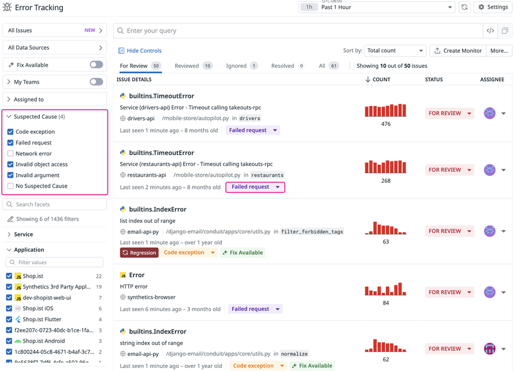
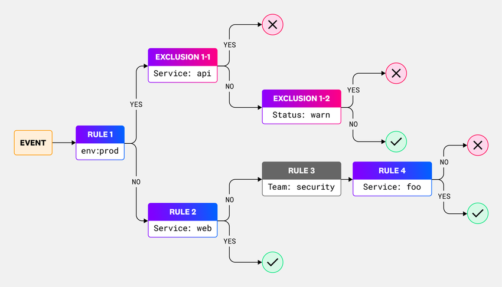

# Error Tracking

## 概要

Datadog Error Tracking（エラートラッキング）は、Datadog が収集したエラーイベントを、類似するもの同士で **Issue（イシュー）** に自動集約し、トリアージ・優先度付け・修正追跡を行うための製品である。Issue ごとに「影響を受けたユーザー数」「初回発生時刻」「原因と疑われるコミット」などが表示される。[出典](https://docs.datadoghq.com/error_tracking/)

Error Tracking の主な機能は次のとおり。[出典](https://docs.datadoghq.com/error_tracking/) / [出典](https://docs.datadoghq.com/error_tracking/backend/)

| 機能 | 内容 | 本書の節 |
|---|---|---|
| エラー集約（Issue 化） | `service`・エラー型・メッセージ・スタックトレースから fingerprint を計算し同一 Issue にまとめる | [4](#4-issue-のグルーピングfingerprint) |
| Issue 状態管理 | For Review / Reviewed / Resolved / Ignored / Excluded の 5 状態、自動レビュー・自動解決・Regression 再オープン・Snooze | [5](#5-issue-の状態ステータスとワークフロー) |
| 原因推定 | Suspected Causes（原因カテゴリのラベル）、Suspect Commits（疑わしいコミット）、Bits AI による調査 | [6](#6-原因究明の支援機能) |
| 担当割り当て | Issue Team Ownership（チーム）、Auto Assign（コミット作者） | [6.4](#64-issue-team-ownershipチーム所有) |
| Exception Replay | APM の例外発生時にローカル変数のスナップショットを取得 | [7](#7-exception-replay) |
| 通知 | Error Tracking Monitor（New Issue / High Impact） | [9](#9-error-tracking-monitor) |
| チケット連携 | Jira、Linear、Work Management（旧称：Case Management）、GitHub PR 連携 | [10](#10-チケット連携と-pull-request-連携) |
| データ量・コスト制御 | Rules（Inclusion/Exclusion）、Rate Limits、Dynamic Sampling、Excluded 状態 | [11](#11-データ収集の制御rulesrate-limitsdynamic-sampling) |

本ファイルは Error Tracking の仕様リファレンスである。APM のトレース収集・サンプリングは [APM の概念とインジェスト制御](./apm-concepts-and-ingestion.md)、トレーサーの導入は [APM インスツルメンテーション](./apm-instrumentation.md)、RUM SDK の詳細は [RUM（ブラウザ）](../dem/rum-browser.md) / [RUM（モバイル）](../dem/rum-mobile.md)、ログ収集とパイプラインは [ログ収集](../logs/log-collection.md) / [Log Pipelines と処理](../logs/log-pipelines-and-processing.md)、Exception Replay の基盤である Live Debugger は [Dynamic Instrumentation と Live Debugger](./dynamic-instrumentation.md) を参照。

### 0.1 沿革

| 時期 | 出来事 | 出典 |
|---|---|---|
| 2020-08-11 | Error Tracking を RUM（フロントエンド）向けに GA。RUM 顧客は追加料金なしで利用可能と発表 | [プレスリリース](https://www.datadoghq.com/ja/about/latest-news/press-releases/error-tracking)（2020-08-11 公開） |
| その後 | APM（バックエンド）、Logs のエラーへ対象を拡大 | [Error Tracking for Logs ブログ](https://www.datadoghq.com/blog/error-tracking-logs/) |
| 現在（2026-11 時点） | Standalone Backend / Frontend Error Tracking（APM・RUM 契約なしで単体利用）、Sentry SDK 取り込み、Exception Replay（GA）、Bits Investigation【Preview】などを提供 | [出典](https://docs.datadoghq.com/error_tracking/) |

> 各機能の正確な GA 日付（APM 対応、Logs 対応、Standalone 提供開始）は公開情報では確認できず。サードパーティの価格追跡サイトは「2025-07 頃に課金対象の記述が『APM 由来の特定属性付きエラー』から『APM トレース外で収集された Standalone Backend エラー』に変更された」と報告している【第三者情報】[出典](https://pricingsaas.com/companies/datadog.error-tracking/diffs/2025Q2)（2025 年第 2〜3 四半期の差分記録）。

### 0.2 画面イメージ



**キャプション：** Error Tracking Explorer の Issue 詳細パネル（APM 由来の Java 例外の例）。

**画面説明：** 左端にファセットパネル（My Teams / Fix Available のトグル、Service、Application、Env などのファセット）と Issue 一覧（For Review タブ）がある。右側の詳細パネル上部に状態ドロップダウン（`FOR REVIEW`）、例外クラス名 `org.springframework.data.cassandra.CassandraInvalidQueryException` とメッセージ、サービス名 `product-recommendation`、Suspected Cause ラベル（`Code exception`）が並び、右上に「View in IDE」「View in APM」「Actions」ボタンがある。タブは Review / Resolve（Preview）/ Activity。その下に Bits AI Dev の調査結果バナー（View Investigation）、First seen / Last seen とそれぞれのバージョン（コミットハッシュ）、総件数（108k）と時系列棒グラフ、Impact（191 users、5 views）、Tags（`operation_name`、`env:prod (78%)`、`@version` の分布）が表示される。右側には Ownership（Team: Shopist、Assigned to）とコメント欄。下部の Error sample 欄には env・version・resource・operation のタグ、Trace Flame Graph / Logs へのリンク、Stack Trace / Trace Waterfall / Events Timeline / Span Attributes / Container Tags / Host Tags / Grouping Info のタブと、スタックトレース（「Show 32 third-party frames」で展開）が表示される。

出典：[Error Tracking](https://docs.datadoghq.com/error_tracking/)／取得日 2026-11-02

---

## 1. エラーの取り込み経路（データソース）

Error Tracking は、エラーを独自の収集基盤で集めるのではなく、Datadog の各製品・SDK が送信したエラーイベントを処理して Issue 化する。取り込み経路は次の 6 系統に整理できる。[出典](https://docs.datadoghq.com/error_tracking/) / [出典](https://docs.datadoghq.com/error_tracking/backend/) / [出典](https://docs.datadoghq.com/error_tracking/frontend/)

| 経路 | 対象 | 必要な製品・設定 | Error Tracking の課金 | 詳細節 |
|---|---|---|---|---|
| APM（トレース） | バックエンドのエラースパン | APM（トレーサー + Agent）。追加 SDK・設定変更は不要 | 含まれる（追加料金なし） | [2.1](#21-apm-由来のエラー) |
| Standalone Backend | APM 契約なしでトレーサーが送るエラー | Agent 7.61 以降で `error_tracking_standalone` を有効化 | 課金対象 | [3.1](#31-standalone-backend-error-tracking) |
| RUM（ブラウザ／モバイル） | RUM セッション内のエラー・クラッシュ | RUM SDK | 含まれる（追加料金なし） | [2.2](#22-rum-由来のエラーブラウザモバイル) |
| Standalone Frontend | RUM セッション外で収集されたフロントエンドエラー | Browser / Mobile SDK（Error Tracking 用アプリとして作成） | 課金対象 | [3.2](#32-standalone-frontend-error-tracking) |
| Logs | 所定の属性を持つエラーログ（バックエンド・ブラウザ・モバイル Logs SDK） | Log Management（インデックス付き）＋ Error Tracking for Logs の有効化 | 課金対象（所定属性を持つもの） | [2.3](#23-logs-由来のエラー) |
| Sentry SDK | Sentry SDK のイベント（Datadog DSN 宛て） | Error Tracking for Logs の有効化（イベントはログとして取り込まれる） | ログ由来として扱われる | [3.3](#33-sentry-sdk-からの移行取り込み) |

課金区分の根拠は公式料金ページの FAQ（「APM トレースと RUM セッションで収集されたエラーは追加料金なし」「RUM セッション外の Standalone Frontend エラー、APM トレース外の Standalone Backend エラー、特定属性を持つログ由来エラーが課金対象」）。[出典](https://www.datadoghq.com/pricing/?product=error-tracking)（2026-11-02 取得）

Explorer では RUM・Logs・APM のエラーが 1 つのビューに統合表示され、Sources フィルター（All / Browser / Mobile / Backend）で絞り込める。[出典](https://docs.datadoghq.com/error_tracking/explorer/)

> **【経験則】** 同じ障害を APM・RUM・Logs の複数経路で同時に取り込むと、経路ごとに別 Issue として並ぶことがある。バックエンドは APM、ブラウザ／モバイルは RUM を主経路とし、Logs は SDK 非対応環境の補助に限る設計が推奨されている【第三者情報】。[出典](https://www.issoh.co.jp/tech/details/16602/)（2026-08-16 公開、2026-09-27 更新）



---

## 2. 製品別の取り込み条件

### 2.1 APM 由来のエラー

APM 由来の Error Tracking は APM がサポートする全言語で利用でき、追加の SDK や設定変更は不要。[出典](https://docs.datadoghq.com/error_tracking/apm/) / [出典](https://docs.datadoghq.com/tracing/error_tracking/)

| 条件・仕様 | 内容 |
|---|---|
| 必須スパン属性 | `error.type`、`error.message`、`error.stack` の 3 つすべて |
| スタックの要件 | スタックは 2 行以上、かつ「意味のある」フレーム（多くの言語で関数名とファイル名を持つフレーム）を 1 つ以上含むこと |
| トレース | スパンが完全なトレース（complete trace）に属していること |
| サービス内の重複 | 同じエラーがサービス内で複数回報告された場合、最上位（top-most）のエラーのみ保持 |
| 対象確認用クエリ | Trace Explorer で `@_top_level:1 @error.stack:* AND @error.message:* AND error.type:*`（公式トラブルシューティングの例） |
| Go トレーサー差異 | v2.7.0 未満は `error.stack` にスタックを格納。v2.7.0 以降はハンドリング時のスタックを `error.handling_stack` に、可能な場合は throw 時のスタックを `error.stack` に格納 |
| コード表示（任意） | Source Code Integration（GitHub 連携等）を設定するとスタックトレース内にコードスニペットを表示 |

[出典](https://docs.datadoghq.com/tracing/error_tracking/) / [出典](https://docs.datadoghq.com/error_tracking/troubleshooting/)

**エラーサンプルとトレース保持：** Error Tracking はすべてのエラーを処理するが、Issue パネルに「エラーサンプル」として表示されるのは保持（retained）されたエラーのみ。APM の場合、エラーに関連するスパンがカスタム Retention Filter で保持されていないと、サンプルが表示されない。保持フィルターの仕様は [APM の概念とインジェスト制御](./apm-concepts-and-ingestion.md) を参照。[出典](https://docs.datadoghq.com/error_tracking/troubleshooting/)

**ハンドル済み例外の自動捕捉：** Datadog SDK は、ハンドル（catch）された例外もスパンイベントとして処理中のスパンに付与し、Error Tracking に直接報告できる。[出典](https://docs.datadoghq.com/error_tracking/backend/capturing_handled_errors/)

| 項目 | 内容 |
|---|---|
| 対応言語 | Python、Ruby |
| 最低バージョン | Agent `7.61.0` 以上、`dd-trace-py` `3.8.0` 以上、`dd-trace-rb` `2.16.0` 以上 |
| 前提 | Agent が Standalone Backend Error Tracking または APM 構成であること |
| 識別属性 | ハンドル済みエラーはスパン属性 `error.handling:handled` を持つ |
| 非対応 | Error Tracking for Logs と RUM では利用不可 |

### 2.2 RUM 由来のエラー（ブラウザ・モバイル）

RUM SDK が収集したエラーは、RUM の Error イベントとして記録されると同時に Error Tracking で処理される。RUM 由来の Issue には、スタックトレース、ユーザーセッションのタイムライン、ユーザーの所在地・バージョン・クラッシュレポートのカスタム属性などが含まれる。[出典](https://docs.datadoghq.com/real_user_monitoring/error_tracking/) / [出典](https://docs.datadoghq.com/error_tracking/frontend/collecting_browser_errors/)

| 条件・仕様 | 内容 |
|---|---|
| 処理対象の `error.source` | `custom`（`addError` API）、`source`（未処理例外・未処理 Promise rejection）、`report`（`ReportingObserver` API）、`console`（`console.error()`） |
| 処理対象外 | 上記以外の source（例：`network`）、ブラウザ拡張機能から送られたエラー、スタックトレースを持たないエラー |
| 対象確認用クエリ | RUM Explorer で `@type:error @error.stack:*` |
| ルールとの関係 | Error Tracking の Rules は RUM の Error イベント自体には適用されない。Ignored / Excluded の Issue に一致するエラーも RUM の Error イベントとしては記録される |
| RUM メトリクス | `rum.measure.error`、`rum.measure.session.error`、`rum.measure.view.error_free` はセッション保持の有無に関わらず更新される |
| 対応プラットフォーム | Browser、Android、iOS、Expo、React Native、Flutter、Roku、Kotlin Multiplatform、Unity、.NET MAUI |

[出典](https://docs.datadoghq.com/error_tracking/troubleshooting/) / [出典](https://docs.datadoghq.com/error_tracking/frontend/collecting_browser_errors/) / [出典](https://docs.datadoghq.com/real_user_monitoring/error_tracking/)

**ブラウザ固有の注意：** npm・CDN 非同期読み込みでは SDK 初期化前のエラーを取りこぼす可能性がある。CDN 同期読み込みは全イベントを収集できるがページ読み込み性能に影響しうる。WebAssembly のエラーは `@datadog/browser-plugin-wasm`（RUM SDK と同一バージョン）を登録し、WASM シンボルをアップロードして記号化する。[出典](https://docs.datadoghq.com/error_tracking/frontend/browser/) / [出典](https://docs.datadoghq.com/error_tracking/frontend/collecting_browser_errors/)

#### 2.2.1 ソースマップ・シンボルファイル

ミニファイ・難読化されたスタックトレースを読める形に戻すには、ビルド成果物ごとにソースマップ・シンボルを Datadog にアップロードする。

| プラットフォーム | アップロード対象 | 主な手段 | サイズ制限 |
|---|---|---|---|
| Browser（JavaScript） | `.js.map`（`.mjs.map` は受理されるが逆ミニファイされない） | `datadog-ci sourcemaps upload`、Datadog Build Plugins（Debug ID 方式は Build Plugins 3.3.0 以上 / `datadog-ci` 5.24.0 以上） | ソースマップ＋対応するミニファイ済みファイルの合計で 500 MB |
| Android | ProGuard/R8 `mapping.txt`、NDK シンボル | Datadog Gradle プラグイン（ビルド時に自動アップロード） | mapping ファイル 1 つあたり 500 MB |
| iOS | `.dSYM` | `datadog-ci` 等 | 公開情報（iOS ページ）では確認できず。React Native / Flutter / Unity のページでは dSYM 1 つあたり 2 GB |
| React Native | JS ソースマップ、dSYM、Android mapping | `datadog-ci` | ソースマップ・mapping 500 MB、dSYM 2 GB |
| Flutter | dSYM、Android mapping、Dart シンボル、Flutter Web 用 JS ソースマップ | `datadog-ci`（1 コマンドで dSYM・Android mapping・Dart シンボルをアップロード可能） | mapping 500 MB、dSYM 2 GB |
| Unity | mapping、dSYM | — | mapping 500 MB、dSYM 2 GB |
| Roku | — | — | Roku OS 13 以降のみクラッシュのスタックトレース対応（13 未満は空） |

[出典](https://docs.datadoghq.com/real_user_monitoring/guide/upload-javascript-source-maps/) / [出典](https://docs.datadoghq.com/error_tracking/frontend/mobile/android/) / [出典](https://docs.datadoghq.com/error_tracking/frontend/mobile/reactnative/) / [出典](https://docs.datadoghq.com/error_tracking/frontend/mobile/flutter/) / [出典](https://docs.datadoghq.com/error_tracking/frontend/mobile/unity/) / [出典](https://docs.datadoghq.com/error_tracking/frontend/mobile/roku/)

ソースマップのマッチング方式は 2 つある。[出典](https://docs.datadoghq.com/real_user_monitoring/guide/upload-javascript-source-maps/)

| 方式 | 内容 | 要件・注意 |
|---|---|---|
| Debug ID（推奨） | バンドルとソースマップを URL・service・バージョンに依存せず紐づける。マイクロフロントエンドでも解決可能 | RUM Browser SDK 7.6.0 以上、または Browser Logs SDK 7.10.0 以上。`--debug-id` 指定時は `--service`・`--release-version`・`--minified-path-prefix` を渡さない |
| service と version | `datadog-ci sourcemaps upload <dir> --service ... --release-version ... --minified-path-prefix ...` | `--service`・`--release-version` は Error Tracking / RUM イベント・ブラウザログの `service`・`version` と一致必須。**同じバージョンで再アップロードしても既存のソースマップは上書きされない** |

> **【経験則】** 同一 `version` での再アップロードが上書きされない仕様のため、CI ではビルドごとに一意の `version` を生成する運用が勧められている【第三者情報】。[出典](https://www.issoh.co.jp/tech/details/16602/)（2026-08-16 公開）

### 2.3 Logs 由来のエラー

Error Tracking for Logs は、所定の属性を持つエラーログを Issue 化する。Error Tracking 設定画面で Error Tracking for Logs を有効化（activate）する必要がある。[出典](https://docs.datadoghq.com/error_tracking/backend/logs/) / [出典](https://docs.datadoghq.com/error_tracking/troubleshooting/)

| 条件 | 内容 |
|---|---|
| 必須属性 | `error.kind` または `error.stack` のいずれか（`error.stack` を使う場合は有効なスタックトレースであること） |
| 必須属性 | `service` 属性 |
| 必須ステータス | `ERROR`、`CRITICAL`、`ALERT`、`EMERGENCY` のいずれか |
| 推奨属性 | `error.stack`、`error.message`、`error.kind`（UI の専用表示とグルーピング精度向上のため） |
| `source` タグ | 言語を示す `source` タグ（例：`source:java`、`source:python`）を正しく設定 |
| 収集方法 | Datadog でのログ収集が前提。Agent ベースの収集を推奨 |
| Log Management | 料金ページ FAQ では「Error Tracking for Logs には Log Management（インデックス付き）が必要」 |
| 対象確認用クエリ | `status:(emergency OR alert OR critical OR error) AND (@error.stack:* OR @error.kind:*)` |

[出典](https://docs.datadoghq.com/error_tracking/backend/logs/) / [出典](https://docs.datadoghq.com/error_tracking/troubleshooting/) / [出典](https://www.datadoghq.com/pricing/?product=error-tracking)

言語別の設定ポイント（バックエンド）：[出典](https://docs.datadoghq.com/error_tracking/backend/logs/)

| 言語 / ロガー | 設定ポイント |
|---|---|
| Python / Java / Ruby | `source` タグが正しければ追加設定不要（インテグレーションパイプラインが属性を自動リマップ） |
| Java（Log4j、SLF4J） | 例外をログ呼び出しの最後の引数として渡す |
| Python（logging） | `logging.exception('...')` を使う |
| C# / .NET | Serilog は `.Enrich.WithExceptionDetails()` と `log.Error(ex, ...)`、NLog は `ErrorException(msg, ex)`、Log4Net は `Error(msg, ex)` |
| Go（Logrus） | `kind`・`stack`・`message` を持つ `error` フィールドを JSON 出力（スタックは `github.com/pkg/errors` 等で取得） |
| Node.js（Winston JSON） | `error` オブジェクト配下に `message` と `stack` をネスト |
| PHP（Monolog JSON） | `error.message`、`error.kind`（`get_class($e)`）、`error.stack`（`getTraceAsString()`） |
| Ruby on Rails | 例外を `error` フィールドに変換するカスタム JSON フォーマッタ、または Lograge の `custom_options` |

スタックトレースが `error.stack` 以外の属性に入っている場合は、Log Pipeline の Remapper で `error.stack` に再マップする（[Log Pipelines と処理](../logs/log-pipelines-and-processing.md) 参照）。Logs 由来の Issue でコードスニペットを表示するのに APM は不要で、Source Code Integration のみでよい。[出典](https://docs.datadoghq.com/error_tracking/backend/logs/)

ブラウザ・モバイルの Logs SDK からのエラー：Browser Logs SDK は `v4.36.0` 以上が必要で、Error Tracking は `Error` のインスタンスであるエラーのみを対象とする。Android / iOS / Kotlin Multiplatform の Logs SDK もサポートされる。`version`・`env`・`service` を SDK 初期化時に設定する。[出典](https://docs.datadoghq.com/error_tracking/frontend/logs/)

> **【経験則】** 複数行のスタックトレースがログ収集時に行単位で分断されると Issue 化されない・集約が崩れるため、Agent 側のマルチライン集約（`multi_line` ルール等）を先に設定する【第三者情報】。[出典](https://www.issoh.co.jp/tech/details/16602/)（2026-08-16 公開）。マルチライン設定は [ログ収集](../logs/log-collection.md) を参照。

---

## 3. Error Tracking 単体利用（Standalone）

Error Tracking は APM・RUM 契約がなくても単体で利用できる。この場合、Datadog SDK・Agent が送るエラーはトレースや RUM セッションの外で収集され、Error Tracking の課金対象となる（[13. 課金への影響](#13-課金への影響)）。

### 3.1 Standalone Backend Error Tracking

Standalone Backend Error Tracking は、APM トレーサー（Datadog SDK）でアプリを計装しつつ、Agent 側でトレース全体の送信を行わずエラーのみを Error Tracking に送る構成である。セットアップは「Single Step Instrumentation」と「Datadog SDK による手動計装」の 2 通り。[出典](https://docs.datadoghq.com/error_tracking/backend/getting_started/)

**Agent の要件：** Error Tracking Backend のみの構成には **Agent v7.61 以上**が必要。[出典](https://docs.datadoghq.com/error_tracking/backend/getting_started/dd_libraries/)

| 環境 | 設定 |
|---|---|
| Linux ホスト / VM（`datadog.yaml`） | `core_agent.enabled: false` と `apm_config.error_tracking_standalone.enabled: true` を設定し Agent を再起動 |
| Docker | 環境変数 `DD_CORE_AGENT_ENABLED=false`、`DD_APM_ERROR_TRACKING_STANDALONE_ENABLED=true` |
| Kubernetes（Helm） | `agents.containers.agent.env` に `DD_CORE_AGENT_ENABLED="false"`、`datadog.processAgent.enabled: false` / `containerCollection: false`、`datadog.apm.errorTrackingStandalone.enabled: true` |
| Kubernetes（Datadog Operator v1.14.0 以上。Single Step Instrumentation 手順のみ） | `global.env` に `DD_CORE_AGENT_ENABLED="false"`、`features.apm.errorTrackingStandalone.enabled: true`（公式例は SSI 用の `features.apm.instrumentation.enabled: true` も同時に設定） |

Linux・Docker・Helm の行は Datadog SDK による手動計装ページ、Operator の行は Single Step Instrumentation ページ（Kubernetes）に基づく。手動計装ページには Operator の手順は掲載されていない。[出典](https://docs.datadoghq.com/error_tracking/backend/getting_started/dd_libraries/) / [出典](https://docs.datadoghq.com/error_tracking/backend/getting_started/single_step_instrumentation/)

```yaml
# datadog.yaml（Standalone Backend Error Tracking）
core_agent:
  enabled: false
apm_config:
  error_tracking_standalone:
    enabled: true
```

[出典](https://docs.datadoghq.com/error_tracking/backend/getting_started/dd_libraries/) / [出典](https://docs.datadoghq.com/error_tracking/backend/getting_started/single_step_instrumentation/)

**Single Step Instrumentation（Linux）：** 1 行インストールスクリプトに次の環境変数を渡す。[出典](https://docs.datadoghq.com/error_tracking/backend/getting_started/single_step_instrumentation/)

| 環境変数 | 値 |
|---|---|
| `DD_API_KEY` | API キー |
| `DD_SITE` | Datadog サイト |
| `DD_APM_INSTRUMENTATION_ENABLED` | `host` |
| `DD_APM_INSTRUMENTATION_LIBRARIES` | `java:1,python:2,js:5,dotnet:3,php:1` |
| `DD_APM_ERROR_TRACKING_STANDALONE` | `true` |
| `DD_ENV` | 環境名（例：`staging`） |

インストール後に対象サービスを再起動する。Kubernetes の Single Step Instrumentation は Kubernetes v1.20 以上が必要で、Agent をインストールした名前空間のアプリは計装されない（Agent 用の別名前空間を推奨）。[出典](https://docs.datadoghq.com/error_tracking/backend/getting_started/single_step_instrumentation/)

`core_agent.enabled: false` は、メトリクス等の送信を止めてホストを Datadog に表示させない（＝インフラ監視ホストとして扱わない）ための設定である。後から APM や Infrastructure Monitoring を有効化する場合は、`enable_payloads` ブロック・`core_agent` 無効化・`error_tracking_standalone` を削除し、`apm_config.enabled: true` にして Agent を再起動する。[出典](https://docs.datadoghq.com/error_tracking/guides/enable_apm/) / [出典](https://docs.datadoghq.com/error_tracking/guides/enable_infra/)

Standalone 構成でも OpenTelemetry API のスパンイベントでエラーを手動送信できる（言語別の OpenTelemetry API ガイドに従う）。[出典](https://docs.datadoghq.com/error_tracking/backend/getting_started/dd_libraries/)

対応言語（料金ページ FAQ）：Backend は Java、Node.js、.NET、Python、Ruby、Go、PHP、C++。Browser は JavaScript / TypeScript、Mobile はネイティブ iOS・ネイティブ Android・React Native。[出典](https://www.datadoghq.com/pricing/?product=error-tracking)（2026-11-02 取得）。なおドキュメント側のモバイル対応はこれより広い（Flutter、Expo、Kotlin Multiplatform、Unity、Roku 等。[2.2](#22-rum-由来のエラーブラウザモバイル) 参照）。

### 3.2 Standalone Frontend Error Tracking

フロントエンドの Standalone Error Tracking は、RUM Browser / Mobile SDK を使い、Datadog の **Errors > Settings > Browser and Mobile > Add an Application** でアプリケーション（JS 等）を作成して `clientToken` と `applicationId` を発行する。[出典](https://docs.datadoghq.com/error_tracking/frontend/browser/)

| 手順 | 内容 |
|---|---|
| 1. アプリ作成 | Errors > Settings > Browser and Mobile > Add an Application |
| 2. 導入方式選択 | npm（推奨）/ CDN 非同期 / CDN 同期 |
| 3. 初期化 | `env`、`service`、`version`（ソースマップのバージョンと一致させる）、入力のプライバシーレベル等 |
| 4. デプロイ | データ受信まで Applications ページで `pending` 表示 |
| 5. ソースマップ・WASM シンボルのアップロード（推奨） | [2.2.1](#221-ソースマップシンボルファイル) 参照 |
| 6. Git 情報連携（任意） | `datadog-ci`（0.12.0 以上）でコミット・リポジトリ URL を報告し GitHub / GitLab / Bitbucket にリンク |

Agentic Onboarding（フロントエンドのみ）による導入も選択肢として案内されている。[出典](https://docs.datadoghq.com/error_tracking/frontend/)

**Replay Snippets【Preview】：** エラー発生前後 15 秒のユーザー操作を再現する機能。`sessionReplaySampleRate`（1〜100）を設定して有効化する（申請制のプレビュー）。Session Replay 本体は [Session Replay と Product Analytics](../dem/session-replay-and-product-analytics.md) を参照。[出典](https://docs.datadoghq.com/error_tracking/frontend/replay_errors/)

### 3.3 Sentry SDK からの移行・取り込み

既存の Sentry SDK の DSN を Datadog の DSN に向けるだけで、Sentry SDK のイベントを Error Tracking に取り込める。Datadog は最大限の機能のため Datadog SDK への移行を推奨している。[出典](https://docs.datadoghq.com/error_tracking/guides/sentry_sdk/)

| 項目 | 内容 |
|---|---|
| 取り込み形式 | Sentry の Event とメッセージは Datadog に**ログ**として取り込まれる。トレース、添付、セッション等の他のアイテム型は非対応 |
| 前提 | Error Tracking for Logs が有効であること。既定では全ログに Error Tracking が有効になるため、Rules で Sentry SDK 由来のログのみに絞ることが可能 |
| DSN | `https://<TOKEN>@sentry-intake.<DD_SITE>/1`（アプリ内手順で発行） |
| 必須タグ | 全イベントに `service` タグを設定 |
| ソースマップ | `release` とソースマップの `version` を一致させる |
| Source Code Integration | `git.commit.sha` と `git.repository_url` タグを設定 |
| 並行送信 | Sentry SDK のマルチプレックス Transport や Sentry Mirror で Sentry と Datadog の両方に送信可能。Datadog SDK と併用するとエラーが二重報告されうる |

検証済み SDK バージョン：`@sentry/node@9.13.0`・`@sentry/browser@9.13.0`、`sentry-sdk==2.26.1`（Python）、`io.sentry:sentry:8.6.0`（Java）、`Sentry 5.5.1`（.NET）、`sentry-go v0.32.0`、`sentry-ruby 5.23.0`。[出典](https://docs.datadoghq.com/error_tracking/guides/sentry_sdk/)

他製品からの移行全般は [他製品からの移行](../../03_導入編/14-migration-from-other-tools.md) を参照。

---

## 4. Issue のグルーピング（fingerprint）

### 4.1 既定のグルーピング

Error Tracking は各エラーの fingerprint を計算し、同じ fingerprint のエラーを同じ Issue にまとめる。既定で使われる属性は次のとおり。[出典](https://docs.datadoghq.com/error_tracking/error_grouping/)

| 属性 | 意味 |
|---|---|
| `service` | エラーが発生したサービス |
| `error.type` または `error.kind` | エラーのクラス |
| `error.message` | エラーの説明 |
| `error.stack` | 最上位の「意味のある」スタックフレームのファイル名と関数名 |

| 正規化ルール | 内容 |
|---|---|
| 位置の特定 | 最上位のスタックフレームをエラーの発生箇所とみなす |
| 無視される要素 | 数字、句読点、引用符内・括弧内の文字列 |
| 除去される要素 | バージョン、ID、日付など可変なスタックフレームのプロパティ |
| 境界 | いずれかの属性が異なれば別 Issue。サービスやエラー型をまたいでグルーピングされることはない |

fingerprint のハッシュ計算方法の詳細は公開情報では確認できず。Issue 詳細パネルの「Grouping Info」タブでグルーピング情報を確認できる（[0.2](#02-画面イメージ) の画像参照）。

> **【経験則】** 引用符・括弧で囲まれていないユーザー ID やリクエスト ID がメッセージに埋め込まれていると、同種の例外が ID 違いの別 Issue に分裂しうる。可変値はメッセージではなく属性・タグに移すのがよい【第三者情報】。[出典](https://www.issoh.co.jp/tech/details/16602/)（2026-08-16 公開）

### 4.2 カスタムグルーピング（`error.fingerprint`）

エラーに文字列の `error.fingerprint` を設定すると、既定のグルーピングより優先される。一部のエラーにだけ適用でき、値はそのまま（標準形式に変換されて）使われる。同じ `service` かつ同じ fingerprint のエラーが同一 Issue になり、サービスが異なれば常に別 Issue となる。[出典](https://docs.datadoghq.com/error_tracking/error_grouping/)

| 製品 / SDK | 設定方法 | 最低バージョン |
|---|---|---|
| APM | エラースパンに文字列タグ `error.fingerprint`（例：Python `span.set_tag("error.fingerprint", "...")`） | 公開情報では明記なし |
| Logs（サーバー） | ログ属性 `error.fingerprint`（例：Python の `extra`） | — |
| Logs（Android） | `LogAttributes.ERROR_FINGERPRINT` またはログマッパーで `event.fingerprint` | SDK 2.7.0 |
| Logs（Flutter） | `DatadogAttributes.errorFingerprint` またはログマッパーで `error.fingerprint` | SDK 2.4.0 |
| Logs（iOS） | `Logs.Attributes.errorFingerprint` またはイベントマッパーで `log.error?.fingerprint` | SDK 2.8.1 |
| Logs（React Native） | `DdLogs.error` の最後の引数、または `errorEventMapper` で `event.fingerprint` | RUM SDK 2.4.2 |
| RUM（Browser） | `addError` 前に Error オブジェクトへ `dd_fingerprint` を設定、または `beforeSend` で `event.error.fingerprint` | SDK v4.42.0 |
| RUM（Android） | `addError` に `RumAttributes.ERROR_CUSTOM_FINGERPRINT`、または `errorEventMapper` で `event.error.fingerprint` | SDK 2.7.0 |
| RUM（Flutter） | `addErrorInfo` に `DatadogAttributes.errorFingerprint`、または `errorEventMapper` | SDK 2.4.0 |
| RUM（iOS） | `addError` に `RUM.Attributes.errorFingerprint`、または `errorEventMapper` で `errorEvent.error.fingerprint` | SDK 2.8.1 |
| RUM（React Native） | `DdRum.addError` の最後の引数、または `errorEventMapper` で `event.fingerprint` | RUM SDK 2.4.2 |

```javascript
// Browser RUM の例
const error = new Error('Something went wrong');
error.dd_fingerprint = 'my-custom-grouping-fingerprint';
datadogRum.addError(error);
```

fingerprint 文字列の最大長などの数値制限は公開情報では確認できず。[出典](https://docs.datadoghq.com/error_tracking/error_grouping/)

---

## 5. Issue の状態（ステータス）とワークフロー

### 5.1 5 つの状態

| 状態 | 意味 | 収集・課金 |
|---|---|---|
| `FOR REVIEW` | 新規または Regression で再発し、対応が必要な Issue。**すべての Issue はこの状態で始まる** | 継続 |
| `REVIEWED` | トリアージ済みで、今または後で修正が必要な Issue | 継続 |
| `RESOLVED` | 修正済みで発生しなくなった Issue | 継続（再発すると Regression） |
| `IGNORED` | これ以上の調査・対応が不要な Issue。Snooze（条件付き無視）も可能 | 継続。Monitor 通知は自動ミュート |
| `EXCLUDED` | 調査・対応不要で、**新規エラーの収集を停止し、使用量・課金にも計上しない** Issue | 停止 |

[出典](https://docs.datadoghq.com/error_tracking/issue_states/) / [出典](https://docs.datadoghq.com/error_tracking/monitors/)



**キャプション：** Issue 状態の自動・手動遷移図。

**画面説明：** 凡例で黒矢印＝手動の状態変更、青矢印＝自動の状態変更を示す。上部の「NEW ISSUE CREATED」から青矢印で `FOR REVIEW` に入る。`FOR REVIEW` から「ASSIGN ISSUE OR CREATE CASE」で自動的に `REVIEWED` へ、`FOR REVIEW` と `REVIEWED` からはそれぞれ「AUTO-RESOLVE」で自動的に `RESOLVED` へ遷移する。`RESOLVED` からは右上を回る「REGRESSION」の青矢印で `FOR REVIEW` に戻る。`FOR REVIEW`・`REVIEWED` と `IGNORED`・`EXCLUDED` の間、`IGNORED` と `EXCLUDED` の間、`FOR REVIEW` と `REVIEWED` の間（MANUAL）は黒矢印の双方向の手動遷移である。

出典：[Issue States in Error Tracking](https://docs.datadoghq.com/error_tracking/issue_states/)／取得日 2026-11-02

### 5.2 自動遷移

| 遷移 | 条件 | 出典 |
|---|---|---|
| 自動レビュー（→ `REVIEWED`） | Issue が担当者に割り当てられた、または Issue からワークアイテム（Case）が作成された | [出典](https://docs.datadoghq.com/error_tracking/issue_states/) |
| 自動レビュー（チケット連携） | Jira チケット・Linear Issue・Work Management ワークアイテムを作成・リンクした | [出典](https://docs.datadoghq.com/error_tracking/ticketing_systems/jira/) |
| 自動レビュー（PR 連携） | `FOR REVIEW` の Issue に GitHub PR がリンクされた | [出典](https://docs.datadoghq.com/error_tracking/link_pull_requests/) |
| 自動解決（→ `RESOLVED`、version タグあり） | Issue が最後に報告されたバージョンが 14 日以上前のもので、より新しいバージョンがリリースされているのに同じエラーが報告されていない | [出典](https://docs.datadoghq.com/error_tracking/issue_states/) |
| 自動解決（version タグなし） | 直近 14 日間にその Issue の新規エラーがない | 同上 |
| 自動解決（PR 連携） | `REVIEWED` の Issue にリンクされた PR がマージされた（複数 PR の場合は最後の未クローズ PR のマージ時。マージせずクローズしても解決しない） | [出典](https://docs.datadoghq.com/error_tracking/link_pull_requests/) |
| Regression（→ `FOR REVIEW`） | `RESOLVED` の Issue のエラーが再発（[5.3](#53-regression-detection)） | [出典](https://docs.datadoghq.com/error_tracking/regression_detection/) |
| PR 再オープン（`RESOLVED` → `REVIEWED`） | リンク済み PR が再オープン、または新しい未マージ PR がリンクされた | [出典](https://docs.datadoghq.com/error_tracking/link_pull_requests/) |
| Snooze 解除（`IGNORED` → `FOR REVIEW`） | Snooze 条件を満たした（[5.4](#54-手動変更excludesnooze)） | [出典](https://docs.datadoghq.com/error_tracking/issue_states/) |

> **注記（公式ドキュメント内の記述の不一致）：** Issue States ページは、自動解決を version タグの有無で 2 通りに説明する一方、直後に「**Note**: The auto-resolution logic does not take `version` into account.」とも記載している（2026-11-02 時点）。version タグの有無で実際の挙動がどう変わるかは公開情報では確定できない。運用上は「version タグを設定すると新バージョンでの未再発が自動解決の判断材料になる」という本文の説明を前提にしつつ、挙動の確認を推奨する。[出典](https://docs.datadoghq.com/error_tracking/issue_states/)

version タグの設定は APM の Deployment Tracking、RUM・Logs の Unified Service Tagging で行う（[Tagging](../platform/tagging.md) 参照）。

### 5.3 Regression Detection

Regression は、`RESOLVED` の Issue のエラーが再び発生した状態を指す。Regression が検出されると Issue は `FOR REVIEW` に戻り、`Regression` タグが付く。[出典](https://docs.datadoghq.com/error_tracking/regression_detection/)

| version タグ | Regression の条件 |
|---|---|
| あり | 解決時点より**新しいバージョン**でエラーが発生した場合のみ（エラーが既知のバージョンで再発しても Regression にならない） |
| なし | `RESOLVED` の Issue でエラーが 1 件でも発生すれば Regression |

Regression は New Issue Monitor の対象（`FOR REVIEW` に戻るため）。[出典](https://docs.datadoghq.com/error_tracking/monitors/)

### 5.4 手動変更・Exclude・Snooze

- **手動変更：** Issue 一覧または詳細パネルで状態をクリックし、ドロップダウンから選ぶ。
- **Exclude：** 状態ドロップダウンで `EXCLUDED` を選ぶ。Excluded の Issue は Ignored タブで引き続き参照でき、履歴も確認できる。Excluded 以外の状態を選ぶと収集が再開する。
- **Snooze：** `IGNORED` にカーソルを合わせ、次のいずれかを選ぶ。条件を満たすと `FOR REVIEW` に戻る。Snooze 中の Issue は Ignored タブに表示される。Snooze の取り消しは任意の状態（`IGNORED` を含む）を手動で選ぶ。

| Snooze 条件 | UI 表示 | 内容 |
|---|---|---|
| Forever | Forever | 無期限で Ignored（画面上の選択肢） |
| 経過時間 | For… | 指定期間が経過したら戻す |
| 発生回数 | Until this occurs again… | 新規発生回数が閾値に達したら戻す |
| 影響ユーザー数 | Until this affects an additional… | 追加の影響ユーザー数（画面例：10 / 100 / 1,000 / 10,000 users）。エラーに `@usr.id` 属性が必要 |

発生回数・ユーザー数は Snooze 開始時点から数える。複数条件の組み合わせや、任意属性（例：`@account.id`）の異なり数でのカウントは、Datadog MCP Server の `update_datadog_error_tracking_issue` ツールでのみ設定できる。[出典](https://docs.datadoghq.com/error_tracking/issue_states/)



**キャプション：** Issue 一覧の状態ドロップダウンから IGNORED のサブメニュー（Snooze 条件）を開いた画面。

**画面説明：** Issue 一覧の各行に例外名（例：`SIGABRT (#0)`、`change_stories.CHOException...`）、サービス・ファイル、Last seen と経過期間、`Crash`・`Regression`・`New` のタグ、件数グラフが並ぶ。右側の状態ドロップダウンに RESOLVED / FOR REVIEW / REVIEWED / IGNORED が表示され、IGNORED のサブメニューに「Forever」「For…」「Until this occurs again…」「Until this affects an additional…」と、その下に `EXCLUDED` がある。「Until this affects an additional…」の右に 10 users / 100 users / 1,000 users / 10,000 users の選択肢が展開されている。

出典：[Issue States in Error Tracking](https://docs.datadoghq.com/error_tracking/issue_states/)／取得日 2026-11-02

状態変更の履歴は Issue 詳細パネルの **Activity** タブ（Activity Timeline）で確認できる。[出典](https://docs.datadoghq.com/error_tracking/issue_states/)

---

## 6. 原因究明の支援機能

### 6.1 Suspected Causes（推定原因ラベル）

Suspected Causes は、Datadog が **Issue 作成時**に自動付与する「根本原因の第一仮説」ラベルで、バックエンドの Error Tracking のドキュメントで説明されている。[出典](https://docs.datadoghq.com/error_tracking/suspected_causes/)

| カテゴリ | 意味 |
|---|---|
| Code Exception | コードの欠陥によるエラー |
| Failed Request | API エンドポイントがエラーステータスコードを返した |
| Illegal Object Access | null / undefined のオブジェクトにアクセスした |
| Invalid Argument | 不正な引数で関数が呼ばれた |
| Network | サーバー応答の遅延やネットワーク低速 |

- ラベルが誤っている場合は、ラベルをクリックして別のカテゴリを選び直せる。
- Explorer の Suspected Cause ファセットで検索フィルターとして使える。
- カテゴリ判定のロジックは公開情報では確認できず。

[出典](https://docs.datadoghq.com/error_tracking/suspected_causes/)



**キャプション：** Error Tracking Explorer の Suspected Cause ファセット。

**画面説明：** 左ファセットパネルの「Suspected Cause (4)」がピンク枠で強調され、Code exception・Failed request・Network error・Invalid object access・Invalid argument・No Suspected Cause のチェックボックスが並ぶ（画面上の表記はドキュメントのカテゴリ名と一部異なる）。上部にはクエリバー、時間範囲（Past 1 Hour）、Settings、Sort by（Total count）、Create Monitor ボタン、状態タブ（For Review 50 / Reviewed 10 / Ignored 1 / Resolved 0 / All 61）がある。Issue 一覧の各行に例外名（`builtins.TimeoutError`、`builtins.IndexError` 等）、サービスとファイルパス・関数名、Last seen、Suspected Cause ラベル（`Failed request`、`Code exception`）、`Regression`・`Fix Available` タグ、件数の棒グラフ、状態（FOR REVIEW）、担当者アイコンが表示される。

出典：[Suspected Causes](https://docs.datadoghq.com/error_tracking/suspected_causes/)／取得日 2026-11-02

### 6.2 Suspect Commits（疑わしいコミット）

Suspect Commits は、要件を満たすと Issue に自動表示される。Issue パネルに表示され、「View Commit」で GitHub のコミットを開ける。[出典](https://docs.datadoghq.com/error_tracking/suspect_commits/)

| 判定条件（すべて満たす） |
|---|
| スタックトレース内のいずれかの行を変更している |
| 初回エラー発生より前に作成された |
| 初回エラー発生の **90 日以内**に作成された |
| 上記を満たすコミットのうち最新のもの |

| 要件 | 内容 |
|---|---|
| Source Code Integration | Integrations ページの「Link Source Code」から設定 |
| GitHub インテグレーション | Pull requests と Contents の読み取り権限 |
| 遡及 | 要件を満たす前のコミットは表示されない |

### 6.3 Auto Assign（コミット作者への自動割り当て）

Auto Assign は Suspect Commit を特定し、そのコミット作者に Issue を自動割り当てして通知する。要件は Source Code Integration、GitHub インテグレーション（Contents・Members 権限）、および Datadog アカウントと GitHub アカウントの紐づけ（スタックトレースのコードスニペットを初めて読み込んだときに確立）。Error Tracking 設定画面で組織全体またはサービス単位で有効／無効を切り替えられ、手動での再割り当ても常に可能。[出典](https://docs.datadoghq.com/error_tracking/auto_assign/)

### 6.4 Issue Team Ownership（チーム所有）

Issue Team Ownership は Issue をチームに自動割り当てする。所有チームは次の順で決まる。[出典](https://docs.datadoghq.com/error_tracking/issue_team_ownership/)

| 優先度 | ソース | 内容 | 変更可否 |
|---|---|---|---|
| 1 | `team` 属性 | エラー送信時に `team` 属性（Datadog Team のハンドル）を付与。APM はスパンタグ、Logs はログ属性、RUM は `addError` のオプション | 割り当て後は変更不可 |
| 2 | GitHub `CODEOWNERS` | `team` 属性がない場合、リポジトリ内ファイルの最上位スタックフレームを所有するチーム（サードパーティのフレームは無視）。対応プロバイダーは **GitHub のみ** | 変更不可 |
| 3 | サービス所有 | Issue が発生したサービスの所有チーム（Software Catalog の設定を利用）。常に適用され、サービス所有の変更に追従 | 削除不可 |

CODEOWNERS 利用の要件：Source Code Integration、GitHub インテグレーション（Contents・Members 権限）、GitHub 標準に沿った `CODEOWNERS`、Datadog の Teams > 対象チーム > Settings > GitHub Connection で Datadog Team と GitHub Team をマッピング。要件を満たすと全サービスで既定で有効。Error Tracking 設定（`/error-tracking/settings/issues/ownership`）で全体・サービス単位で制御できる。手動で「Add team」「Unlink team from issue」も可能（サービス所有由来のチームは外せない）。[出典](https://docs.datadoghq.com/error_tracking/issue_team_ownership/) / サービス所有の設定は [Software Catalog](../platform/software-catalog.md) を参照。

### 6.5 Bits AI による調査（Bits Investigation）【Preview】

Error Tracking の Issue から Bits Investigation（自律型 AI エージェント）を起動すると、スタックトレース・関連テレメトリ（Source Code Integration があればソースコードも）を分析し、**Root cause（根本原因）** と **Impact（影響）** を報告する。調査は通常数分で、根拠不足の場合は inconclusive（結論なし）となる。[出典](https://docs.datadoghq.com/error_tracking/bits_investigation/)

| 項目 | 内容 |
|---|---|
| 起動方法 | Issue パネルの Review タブで Bits Investigation バナーの「Investigate this issue」 |
| 権限 | 閲覧：Bits Investigations Read、起動：Bits Investigations Write |
| コード修正 | Bits Code（リポジトリへの書き込み権限と Bits Code Write 権限）を設定すると修正案（差分）を生成し、「Create PR」で PR 作成可能。自動マージはしない |
| 一覧 | Bits AI > Investigations で Source: Error Tracking Issue をフィルター |
| 状態 | US1・US3・US5・EU1・AP1・AP2・UK1 で Preview |

> **サイト差異:** Bits Investigation in Error Tracking は `app.ddog-gov.com`（US1-FED）と `us2.ddog-gov.com` では非対応。その他のサイト（AP1 含む）では Preview。[出典](https://docs.datadoghq.com/error_tracking/bits_investigation/)

Explorer には「Fix available」（AI 生成の修正案がある Issue のみ表示）フィルターもある。[出典](https://docs.datadoghq.com/error_tracking/explorer/) Bits AI 全般は [Bits AI と AI 機能](../ai/bits-ai.md) を参照。

---

## 7. Exception Replay

Exception Replay は、APM で計装されたアプリで例外が発生したときに、スタックトレースと各フレームのローカル変数値のスナップショットを自動取得し、Error Tracking の Issue に表示する機能（GA）。**APM 由来の例外のみ対象**で、Logs・RUM のエラーは非対応。Dynamic Instrumentation の基盤上に構築されている。[出典](https://docs.datadoghq.com/error_tracking/backend/exception_replay/) / 基盤の詳細は [Dynamic Instrumentation と Live Debugger](./dynamic-instrumentation.md) を参照。

### 7.1 対応言語と最低トレーサーバージョン

| 言語 | 一括有効化（環境単位、既定で有効） | アプリ内有効化（サービス単位、Settings 画面） | 環境変数（サービス単位） |
|---|---|---|---|
| Python | ≥ 3.15.0 | ≥ 3.10.0 | ≥ 1.16.0 |
| Java | ≥ 1.54.0 | ≥ 1.48.0 | ≥ 1.47.0 |
| .NET | ≥ 3.57.0 | ≥ 3.29.0 | ≥ 2.53.0 |
| PHP | ≥ 1.19.0 | ≥ 1.14.0 | ≥ 1.12.1 |

- Agent は全方式で **v7.49.0 以上**。
- 一括・アプリ内有効化には Remote Configuration が必要（環境変数方式は不要）。Remote Configuration は [Fleet Automation と Remote Configuration](../platform/fleet-automation.md) を参照。
- .NET 3.57.0 以上は他の Remote Config 設定を持つサービスも含め既定で有効。3.43.0〜3.56.x は他の Remote Config 設定がないサービスのみ既定で有効。

[出典](https://docs.datadoghq.com/error_tracking/backend/exception_replay/)

### 7.2 有効化・設定

| 方法 | 内容 |
|---|---|
| アプリ内（一括／サービス単位） | Error Tracking の Exception Replay Settings 画面で環境またはサービスを選び Enabled に切り替え |
| 環境変数 | `DD_EXCEPTION_REPLAY_ENABLED=true`。アプリ内設定と両方ある場合は環境変数が優先 |
| ログインデックス | スナップショットは `source:dd_debugger` のログとして送られる。`source:dd_debugger` 用のインデックスを希望の保持期間・サンプリングなしで作成し、他のインデックスより先にマッチするよう順序を調整（最初にマッチしたインデックスが適用されるため） |
| Source Code Integration（任意） | コードプレビュー上で変数値をホバー表示 |
| サードパーティパッケージ | 既定で除外される場合がある。`DD_THIRD_PARTY_DETECTION_EXCLUDES` で対象に含められる |
| 検索 | Explorer で `@error.debug_info_captured:true` によりスナップショット付きエラーを検索 |

[出典](https://docs.datadoghq.com/error_tracking/backend/exception_replay/) / ログインデックスの仕様は [Indexes・保持・アーカイブ](../logs/log-indexes-retention-archives.md) を参照。

### 7.3 キャプチャ制限とマスキング

| 項目 | 内容 |
|---|---|
| レート制限 | 例外タイプごと・インスタンスごとに **1 時間あたり 1 スナップショット** |
| 取得タイミング | ランタイムによっては、例外の 2 回目の発生時に初めてスナップショットを取得 |
| Redaction Mode | **Strict**：数値と真偽値以外の値をすべて伏字化。**Targeted**：既知の機微パターン（クレジットカード番号、API キー、IP、PII 等）と高エントロピー文字列（`[REDACTED:HIGH_ENTROPY]`）を伏字化 |
| モード既定 | `staging`・`preprod` 等の本番前環境では Targeted が自動適用。マスキングは無効化できず、モードの切り替えのみ可能 |
| 識別子ベースの除去 | `password`・`accessToken` 等の一般的な機微名の値をホスト送出前に除去（言語ごとの既定リスト）。カスタム識別子・クラス／型ルール、Sensitive Data Scanner ルールで拡張可能（Dynamic Instrumentation のスクラビング設定に準拠） |
| 保持期間 | 固定の既定値は示されておらず、`source:dd_debugger` ログを格納するインデックスの保持期間に従う |

[出典](https://docs.datadoghq.com/error_tracking/backend/exception_replay/)

### 7.4 既知の制約

| 対象 | 制約 |
|---|---|
| Java | JDK 18 以下で `-parameters` 付きでコンパイルされたクラスは非対応の場合がある |
| .NET | FIPS 有効ホストでトレーサー 3.55.0 未満は非対応。Linux ではアプリがクラッシュしうるため 3.55.0 以上に更新するか `DD_EXCEPTION_REPLAY_ENABLED=false` |
| Java（GovCloud） | `BatchUploader` が HTTP 403 の WARN を定期出力する。止めるには `DD_EXCEPTION_REPLAY_ENABLED=false`、`DD_DYNAMIC_INSTRUMENTATION_ENABLED=false`、`DD_CODE_ORIGIN_FOR_SPANS_ENABLED=false` を設定して再起動 |
| スナップショットが見えない | Exception Replay 未有効、選択時間範囲外、`source:dd_debugger` ログがインデックスの保持・除外フィルターで落ちている、のいずれか |

> **サイト差異:** Exception Replay は `app.ddog-gov.com`（US1-FED）と `us2.ddog-gov.com`（FedRAMP リージョン）では利用不可。US1・US3・US5・EU1・AP1・AP2・UK1 での差異は公開情報では確認できず（UK1 は本ページに言及なし）。[出典](https://docs.datadoghq.com/error_tracking/backend/exception_replay/)

---

## 8. Error Tracking Explorer（画面）

Error Tracking Explorer は Issue の閲覧・フィルター・調査を行う画面で、メインナビゲーションの Error Tracking（RUM 文脈では Digital Experience > Error Tracking）から開く。画面全般の操作は [画面構成とナビゲーション](../../01_入門編/06-ui-navigation.md) を参照。[出典](https://docs.datadoghq.com/error_tracking/explorer/) / [出典](https://docs.datadoghq.com/real_user_monitoring/error_tracking/)

### 8.1 Issue 一覧

| 要素 | 内容 |
|---|---|
| 各行の表示 | エラー型とメッセージ、エラーが発生したファイルパス、初回／最終発生時刻、発生件数の時系列グラフ、選択期間内の件数 |
| 状態タブ | For Review / Reviewed / Ignored / Resolved / All |
| `New` タグ | 初回発生から 2 日未満かつ `FOR REVIEW` |
| `Regression` タグ | `RESOLVED` だったが新しいバージョンで再発 |
| `Crash` タグ | アプリがクラッシュした |
| Suspected Cause | ラベル表示 |
| 時間範囲 | 右上のタイムラインでプリセットを選択。選択期間内にエラーが発生した Issue を表示 |

### 8.2 並べ替え

| 並べ替え | 内容 |
|---|---|
| Relevance | コード起因・最近・急増中の Issue を優先するスコア。Issue の古さ、直近 1 日の発生数、直近 1 時間の顕著な増加、アプリのクラッシュの有無を分析する |
| Count | 選択期間内の総発生数 |
| Newest | 初回発生時刻 |
| Impacted Sessions | 影響を受けた RUM セッション数 |

### 8.3 ファセットと Issue レベルのフィルター

Error Tracking は所定の属性を自動でインデックス化しファセットとして提供する（鉛筆アイコンで表示・非表示を編集）。

| 属性 | 内容 |
|---|---|
| `error.message` | エラーメッセージ |
| `error.type` | エラーの型・クラス |
| `error.stack` | スタックトレース |
| `error.handling` | ハンドル済みか。APM は親スパンが成功または正常なエラー処理を報告した場合 `handled`。RUM はコードで手動捕捉されていなければ `unhandled` |

| Issue レベルのフィルター | 内容 |
|---|---|
| Sources | All / Browser / Mobile / Backend。さらにログソース、SDK・言語単位で絞り込み |
| Fix available | AI 生成の修正案がある Issue のみ |
| Teams | `CODEOWNERS` とサービス所有に基づくチーム |
| Assigned to | 担当者で絞り込み（自分や他メンバーへ割り当て可能） |
| Suspected Cause | 推定原因ラベル |

### 8.4 Issue パネル

Issue をクリックすると詳細パネルが開く。上段は初回・最終発生日時、総件数、件数推移のサマリー。下段はエラーサンプルで、サンプル間を移動でき、スタックトレースと影響ユーザーの特徴が表示される。内容はソースにより異なり、APM 由来ではリソース名・オペレーション名などのスパンタグ、関連トレース・ログへのリンクが表示される。Explorer の検索クエリはそのまま Error Tracking Monitor の作成にエクスポートできる。[出典](https://docs.datadoghq.com/error_tracking/explorer/)

APM の Trace Explorer でエラースパンを Issue 単位に表示する「Group into Issues」は [APM 画面と分析機能](./apm-ui-and-analysis.md) を参照。

---

## 9. Error Tracking Monitor

Error Tracking Monitor は、Issue が新規・高影響・Regression になったときに通知する Monitor タイプで、Web・モバイル・バックエンド・ログの各ソースに対応する。作成は **Monitors > New Monitor > Error Tracking**。Monitor の一般仕様は [Monitors（モニター）](../platform/monitors.md) を参照。[出典](https://docs.datadoghq.com/error_tracking/monitors/)

### 9.1 Monitor の種類

| 種類 | 対象の状態 | 挙動 |
|---|---|---|
| New Issue | `FOR REVIEW` | 新規 Issue でアラート。Regression の Issue も `FOR REVIEW` に戻るため既定で対象。**Monitor 作成（または最終編集）後に作成・Regression した Issue のみ**を評価。24 時間のルックバック |
| High Impact | `FOR REVIEW` と `REVIEWED` | 影響を受けたエンドユーザーが多い Issue でアラート |

Regression 専用の Monitor タイプはなく、New Issue Monitor で扱う。

### 9.2 アラート条件

| 設定 | 内容・既定値 |
|---|---|
| Source | All / Browser / Mobile / Backend から 1 つ。All と Backend は Error Occurrences のみ選択可 |
| メトリクス（閾値は「above」） | Error Occurrences（エラー件数）、Impacted Users（影響ユーザーのメール数）、Impacted Sessions（影響セッション ID 数）、Custom measure（任意ファセットの異なり数） |
| New Issue の閾値 | 「Alert on all new issues」（過去 1 日のエラー件数 > 0）、またはカスタム指標と閾値 |
| 評価ウィンドウ | 既定 **直近 1 日**（変更可） |
| 閾値 | 既定 **0**（初回発生でトリガー） |
| 通知 | マッチした Issue ごと（Multi Alert）。環境など他属性でグループ化も可能 |
| ミュート | `IGNORED` の Issue は通知が自動ミュートされる |

### 9.3 クエリ構文（API / Terraform）

```text
# New Issue
error-tracking("{filter}").source("backend").new().rollup("count").by("issue.id").last("1d") > 0

# High Impact
error-tracking("{filter}").source("browser").impact().rollup("count").by("issue.id").last("1d") > 0
```

- `.source()` は `"all"`・`"browser"`・`"mobile"`・`"backend"` のいずれか 1 つ。フィルター直後に置く。
- New Issue には `.new()`、High Impact には `.impact()` が必須。

### 9.4 通知変数とトラブルシューティング

| 通知変数 |
|---|
| `{{issue.attributes.error.type}}`、`{{issue.attributes.error.message}}`、`{{issue.attributes.error.stack}}`、`{{issue.attributes.error.file}}`、`{{issue.attributes.error.is_crash}}`、`{{issue.attributes.error.category}}`、`{{issue.attributes.error.handling}}` |

- `issue.age`・`issue.regression.age` によるフィルターは既定で追加されず、アラートの取りこぼしを招くため非推奨（キー名も製品により `@issue.age` / `issue.age` と異なる）。
- ノイズが多い場合は、Issue をトリアージ（Reviewed / Ignored / Resolved）する、評価ウィンドウを 1 日より広げる、閾値を 0 より上げる。

[出典](https://docs.datadoghq.com/error_tracking/monitors/) / アラート設計の実践は [アラート設計とノイズ削減](../../04_応用編/03-alert-design-and-noise-reduction.md) を参照。

---

## 10. チケット連携と Pull Request 連携

### 10.1 チケット連携（Jira / Linear / Work Management）

Error Tracking の Issue パネルの **Actions** ドロップダウンから、Jira チケット、Linear Issue、Work Management のワークアイテムを作成・リンクできる。作成・リンクすると Issue は自動的に `REVIEWED` になり、状態・担当者・コメントが双方向同期される。[出典](https://docs.datadoghq.com/error_tracking/ticketing_systems/) / [出典](https://docs.datadoghq.com/error_tracking/ticketing_systems/jira/) / [出典](https://docs.datadoghq.com/error_tracking/ticketing_systems/work_management/)

| 項目 | Jira | Linear | Work Management |
|---|---|---|---|
| Issue パネルからの作成 | Add Jira ticket | Add Linear issue | Add Case |
| 複数 Issue を 1 チケットに集約 | 可（1 チケット : N Issue。1 Issue は 1 チケットのみ） | 可 | 可（1 : N） |
| 自動化ルール（ボード振り分け・自動作成） | 可 | 公開情報（Linear ページ）では記載なし | 可 |
| 必要権限 | Error Tracking Read、Error Tracking Issue Write、Cases Read、Cases Write、Integrations Read | 同左 | Error Tracking Read、Error Tracking Issue Write、Cases Read、Cases Write |
| 制約 | チケット作成は Jira Cloud / Data Center、双方向同期は **Jira Cloud のみ**。Reporter は Jira 連携を設定した Datadog ユーザーになる。未使用の Jira 課題タイプごとに Work Management プロジェクトが自動作成される | — | 既定では Error Tracking プロジェクトに作成 |

Work Management との状態マッピング（単一 Issue の場合）：[出典](https://docs.datadoghq.com/error_tracking/ticketing_systems/work_management/)

| Error Tracking の状態 | Work Management のステータスグループ |
|---|---|
| `FOR REVIEW` | Open |
| `REVIEWED` | In Progress |
| `RESOLVED` | Closed |
| `IGNORED` | Closed |
| `EXCLUDED` | Closed |

自動化ルールは Error Tracking Settings の Ticketing & Automation で作成する。マッチ条件は `service:` と `team:`（Issue Team Ownership）で、`AND`・`OR`・`-`（NOT）を使える。ルールは順序付きで最初にマッチしたものが適用され、新規 Issue 作成時に評価される。作成には Error Tracking Write または Error Tracking Settings Write 権限が必要。[出典](https://docs.datadoghq.com/error_tracking/ticketing_systems/jira/)

> **サイト差異:** Jira 連携と Linear 連携は `app.ddog-gov.com`・`us2.ddog-gov.com` では非対応。[出典](https://docs.datadoghq.com/error_tracking/ticketing_systems/jira/) / [出典](https://docs.datadoghq.com/error_tracking/ticketing_systems/linear/)

Work Management（旧称：Case Management）本体は [Work Management](../service-management/case-management.md) を参照。

### 10.2 GitHub Pull Request 連携

Issue パネルの Actions > Link a Pull Request で Issue URL をコピーし、GitHub PR の説明文に貼ると自動でリンクされる（説明文から URL を消すとリンク解除）。要件は GitHub インテグレーション（PR 読み取り権限）、Source Code Integration、Error Tracking Issue Write 権限。状態の自動遷移は [5.2](#52-自動遷移) を参照。[出典](https://docs.datadoghq.com/error_tracking/link_pull_requests/)

---

## 11. データ収集の制御（Rules・Rate Limits・Dynamic Sampling）

Error Tracking は、取り込むエラーを Rules と Rate Limits で制御できる。いずれも **Error Tracking > Settings** で設定する。[出典](https://docs.datadoghq.com/error_tracking/manage_data_collection/)

### 11.1 Rules（Inclusion / Exclusion）

| 仕様 | 内容 |
|---|---|
| 構成 | スコープ（Inclusion フィルター。例：`service:my-web-store`）＋任意のネストした Exclusion フィルター（例：`env:staging`） |
| 判定 | ルールの Inclusion に一致し、そのルールのどの Exclusion にも一致しないイベントを取り込む |
| 評価順 | 上から順に評価し、**最初にマッチした有効なルールで評価終了**（以降のルールは無視）。6 点アイコンのドラッグで並べ替え |
| 有効化 | ルールごとにオン／オフ可能 |
| 対象 | 課金対象・非課金対象の両方のエラーに適用（ただし RUM の Error イベント自体には適用されない。[2.2](#22-rum-由来のエラーブラウザモバイル)） |
| 既定ルール | `*` の Inclusion（Exclusion なし）。他のルールにマッチしないイベントもすべて取り込む。取り込みを限定するには既定ルールに Exclusion を追加するか、削除して明示的な Inclusion ルールに置き換える |
| 注意 | ルールで受理されても必須属性が欠けていれば取り込まれない |
| ルール数の上限 | 公開情報では確認できず |

ルール追加手順：Error Tracking Settings > Add New Rule > 適用する Error Tracking ソースを選択 > Define scope にクエリ入力 > 任意で Exclusion と説明を追加 > Save Changes。[出典](https://docs.datadoghq.com/error_tracking/manage_data_collection/)



**キャプション：** Rules の評価フローの例。

**画面説明：** 左の EVENT から RULE 1（`env:prod`）に入り、YES なら EXCLUSION 1-1（`Service: api`）を評価、YES なら除外（×）、NO なら EXCLUSION 1-2（`Status: warn`）を評価し、YES なら除外、NO なら取り込み（✓）。RULE 1 が NO の場合は RULE 2（`Service: web`）へ進み、YES なら取り込み。NO の場合は灰色の RULE 3（`Team: security`、無効化されているため評価されない）を経て RULE 4（`Service: foo`）へ進み、YES なら取り込み、NO なら除外となる。

出典：[Manage Data Collection](https://docs.datadoghq.com/error_tracking/manage_data_collection/)／取得日 2026-11-02

### 11.2 Rate Limits（日次上限）

| 仕様 | 内容 |
|---|---|
| 対象 | ルールのフィルターに一致する**課金対象エラー**の 1 日あたり件数 |
| 上限到達時 | 翌日まで取り込みを停止 |
| 設定 | Error Tracking > Settings > Rate Limits で errors/day を編集し Save Rate Limit。いつでも変更・削除可能 |
| イベント | 上限到達時に `Rate limit applied` イベントを生成（[Event Management](../platform/event-management.md) で参照・Monitor 化可能） |
| 既定値 | 公開情報では確認できず |
| 「翌日」の基準タイムゾーン | 公開情報では確認できず |

料金ページ FAQ では、Rate Limit を「予算を設定して想定外のコストを防ぐ機能」と説明し、アプリ内で直近 24 時間（ローリング）の取り込み量推計を確認できるとしている。[出典](https://www.datadoghq.com/pricing/?product=error-tracking)（2026-11-02 取得）

### 11.3 Dynamic Sampling

Dynamic Sampling は、特定の Issue のエラーが急増して予算を食い潰すのを防ぐ機能である。日次 Rate Limit と過去のエラー量に基づいて Issue ごとのエラーレートの閾値を設定し、閾値を超えたらサンプリングし、下回ると自動で解除される。[出典](https://docs.datadoghq.com/error_tracking/manage_data_collection/)

| 仕様 | 内容 |
|---|---|
| 既定 | Error Tracking と同時に**自動で有効**（日次 Rate Limit と過去量に基づく既定閾値） |
| 推奨 | 日次 Rate Limit を設定すると最適に機能 |
| 無効化 | Error Tracking Settings 画面で無効化可能 |
| イベント | 適用時に `Dynamic Sampling activated` イベントを生成 |

### 11.4 使用量の監視

| 指標 | 内容 |
|---|---|
| `datadog.estimated_usage.error_tracking.logs.events` | Error Tracking に取り込まれたエラーログ件数（Error Tracking on Logs の推定使用量）。追加費用なし、15 か月保持 |
| 推定値と請求の差 | Estimated Usage メトリクスはリアルタイム性のため請求額と一致しない場合がある（公式には平均 10〜20% の差、少量利用時は誤差が大きい） |

[出典](https://docs.datadoghq.com/error_tracking/manage_data_collection/) / [出典](https://docs.datadoghq.com/account_management/billing/usage_metrics/) / Usage の確認方法は [Usage・Usage Attribution・Cost Visibility](../platform/usage-and-cost-attribution.md) を参照。

### 11.5 Excluded 状態との使い分け

| 手段 | 粒度 | 効果 |
|---|---|---|
| Rules の Exclusion | クエリ（service、env 等） | マッチするエラーを取り込まない |
| Rate Limit | ルール単位・日次 | 上限超過分の課金対象エラーを取り込まない |
| Dynamic Sampling | Issue 単位・自動 | 急増 Issue のエラーをサンプリング |
| `EXCLUDED` 状態 | Issue 単位・手動 | その Issue の新規エラー収集を停止し課金にも計上しない |
| `IGNORED` 状態 | Issue 単位・手動 | 収集は継続。通知ミュートと一覧からの退避のみ |

> **【経験則】** 収集を止めてよい非対応エラーは `EXCLUDED`、恒常的に出るが記録は残したい既知エラーは `IGNORED` と使い分けると運用が単純になる【第三者情報】。[出典](https://www.issoh.co.jp/tech/details/16602/)（2026-08-16 公開）。APM トレース全体を Agent／トレーサーで落とすとエラーだけでなくトレース全体が送られなくなる点に注意（公式）。[出典](https://docs.datadoghq.com/tracing/error_tracking/)

---

## 12. API・権限（RBAC）

### 12.1 Error Tracking API（v2）

| 操作 | メソッド / パス |
|---|---|
| Issue 検索 | `POST /api/v2/error-tracking/issues/search` |
| Issue 詳細取得 | `GET /api/v2/error-tracking/issues/{issue_id}` |
| 状態更新 | `PUT /api/v2/error-tracking/issues/{issue_id}/state` |
| 担当者更新 | `PUT /api/v2/error-tracking/issues/{issue_id}/assignee` |
| 担当者削除 | `DELETE /api/v2/error-tracking/issues/{issue_id}/assignee` |

ベース URL はサイトごとに異なる（例：AP1 は `https://api.ap1.datadoghq.com`、US1 は `https://api.datadoghq.com`）。US1・US3・US5・EU1・AP1・AP2・UK1・US1-FED（`api.ddog-gov.com`）・`us2.ddog-gov.com` のエンドポイントが掲載されている。Monitor の API・Terraform 定義は [9.3](#93-クエリ構文api--terraform) を参照。[出典](https://docs.datadoghq.com/api/latest/error-tracking/) / API キーは [API とキー管理](../platform/api-and-keys.md)、サイトは [Datadog Sites](../platform/datadog-sites.md) を参照。

Datadog MCP Server には `update_datadog_error_tracking_issue` ツールがあり、複合 Snooze 条件の設定に使える（[5.4](#54-手動変更excludesnooze)）。

### 12.2 権限

| 権限名（キー） | 内容 | 既定で付与されるロール |
|---|---|---|
| Error Tracking Read（`error_tracking_read`） | スタックトレース、エラーメッセージ、コンテキスト、Issue の分類・状態の閲覧 | Datadog Read Only Role |
| Error Tracking Issue Write（`error_tracking_write`） | Issue の編集 | Datadog Standard Role |
| Error Tracking Settings Write（`error_tracking_settings_write`） | Error Tracking の無効化、Inclusion フィルター・Rate Limit の編集 | Datadog Admin Role |
| Error Tracking Exclusion Filters Write（`error_tracking_exclusion_filters_write`） | Exclusion フィルターの追加・変更 | Datadog Admin Role |

[出典](https://docs.datadoghq.com/account_management/rbac/permissions/) / RBAC 全般は [組織・ユーザー・権限管理](../platform/account-and-access-management.md) を参照。

---

## 13. 課金への影響

Error Tracking の課金単位は**月間の課金対象エラー件数**である。料金の数値の正本は [製品別料金表](../../03_導入編/02-pricing-by-product.md) とし、以下は公式料金ページの掲載値（2026-11-02 取得）。[出典](https://www.datadoghq.com/pricing/?product=error-tracking) / [出典](https://www.datadoghq.com/pricing/list/)

### 13.1 課金対象と非課金

| エラーの種類 | Error Tracking の課金 | 補足 |
|---|---|---|
| APM トレースで収集されたエラー | **含まれる（追加料金なし）** | APM の課金は別途（[APM の概念とインジェスト制御](./apm-concepts-and-ingestion.md)） |
| RUM セッションで収集されたエラー | **含まれる（追加料金なし）** | RUM の課金は別途（[RUM（ブラウザ）](../dem/rum-browser.md)） |
| Standalone Frontend（RUM セッション外） | 課金対象 | — |
| Standalone Backend（APM トレース外） | 課金対象 | — |
| ログ由来のエラー（所定属性付き） | 課金対象 | Log Management（インデックス付き）が必要で、ログの取り込み・インデックス課金も別途発生 |
| `EXCLUDED` の Issue のエラー | 計上されない | — |

### 13.2 料金（定価、USD）

| 区分 | 単位 | 年契約（Billed Annually） | 月契約（Month-to-month） | オンデマンド |
|---|---|---|---|---|
| 1〜50K エラー | 最初の 50K エラーまでの月額定額 | $25 | $30 | $36 |
| 50K〜100K | 1K エラーあたり／月 | $0.25 | $0.30 | $0.38 |
| 100K〜500K | 1K エラーあたり／月 | $0.21 | $0.25 | $0.32 |
| 500K〜10M | 1K エラーあたり／月 | $0.17 | $0.20 | $0.26 |
| 10M〜20M | 1K エラーあたり／月 | $0.12 | $0.14 | $0.22 |
| 20M 超 | 1K エラーあたり／月 | $0.10 | $0.12 | $0.18 |

（取得日 2026-11-02、契約形態は表の列のとおり。料金ページのボリューム選択肢は 50K〜50M エラーで、それ以上は「Contact Us for Pricing」）

- 料金ページの APM 機能比較表では Error Tracking が APM / APM Pro / APM Enterprise の各プランに含まれる機能として表示されている。[出典](https://www.datadoghq.com/pricing/?product=error-tracking)
- Exception Replay の個別料金は料金ページに掲載がない。スナップショットは `source:dd_debugger` のログとして送られるため、Log Management の取り込み・インデックス課金の対象になると考えられる【推定】（公式の明記は確認できず）。[出典](https://docs.datadoghq.com/error_tracking/backend/exception_replay/)
- Standalone Backend 構成で `core_agent.enabled: false` にした Agent ホストがインフラホストとして課金されるかどうかの明記は公開情報では確認できず（同構成は「ホストが Datadog に表示されない」ようにする設定として説明されている）。[出典](https://docs.datadoghq.com/error_tracking/guides/enable_apm/)

課金計算の仕組み（月次集計、コミットとオンデマンド）は [課金計算の仕組み](../../03_導入編/03-billing-mechanics.md)、コスト削減策は [コスト最適化](../../04_応用編/01-cost-optimization.md) を参照。

---

## 14. 制限値・クォータ・デフォルト値

| 項目 | 値 | 出典 |
|---|---|---|
| エラーサンプルの保持期間 | 30 日 | [Data Retention Periods](https://docs.datadoghq.com/data_security/data_retention_periods/) |
| Issue の保持期間 | 最終アクティビティから 1 年 | 同上 |
| APM エラーの保持期間（APM 側） | 15 日 | 同上 |
| RUM Error イベントの保持期間（RUM 側） | 30 日 | 同上 |
| 自動解決までの期間 | 14 日（[5.2](#52-自動遷移)） | [Issue States](https://docs.datadoghq.com/error_tracking/issue_states/) |
| `New` タグの期間 | 初回発生から 2 日未満 | [Explorer](https://docs.datadoghq.com/error_tracking/explorer/) |
| Suspect Commit の遡及範囲 | 初回発生の 90 日以内のコミット | [Suspect Commits](https://docs.datadoghq.com/error_tracking/suspect_commits/) |
| Error Tracking Monitor の上限 | アカウントあたり既定 1,000（サポートに依頼して引き上げ可） | [Monitors](https://docs.datadoghq.com/error_tracking/monitors/) |
| Monitor の評価ウィンドウ既定 | 直近 1 日 | 同上 |
| Monitor の閾値既定 | 0（初回発生でトリガー） | 同上 |
| New Issue Monitor のルックバック | 24 時間 | 同上 |
| Exception Replay のスナップショット頻度 | 例外タイプ×インスタンスごとに 1 回／時間 | [Exception Replay](https://docs.datadoghq.com/error_tracking/backend/exception_replay/) |
| Exception Replay の Agent 要件 | v7.49.0 以上 | 同上 |
| Standalone Backend の Agent 要件 | v7.61 以上 | [dd_libraries](https://docs.datadoghq.com/error_tracking/backend/getting_started/dd_libraries/) |
| ハンドル済み例外捕捉の要件 | Agent 7.61.0、`dd-trace-py` 3.8.0、`dd-trace-rb` 2.16.0 以上 | [Capturing Handled Errors](https://docs.datadoghq.com/error_tracking/backend/capturing_handled_errors/) |
| APM スパンのスタック要件 | 2 行以上、意味のあるフレーム 1 つ以上 | [Troubleshooting](https://docs.datadoghq.com/error_tracking/troubleshooting/) |
| JS ソースマップのサイズ | ソースマップ＋ミニファイ済みファイルで 500 MB | [Upload JavaScript Source Maps](https://docs.datadoghq.com/real_user_monitoring/guide/upload-javascript-source-maps/) |
| Android / RN / Flutter / Unity の mapping・ソースマップ | 1 ファイル 500 MB | [Android](https://docs.datadoghq.com/error_tracking/frontend/mobile/android/) ほか |
| dSYM | 1 ファイル 2 GB（RN / Flutter / Unity ページ） | [Flutter](https://docs.datadoghq.com/error_tracking/frontend/mobile/flutter/) ほか |
| Browser Logs SDK の最低バージョン（Error Tracking） | v4.36.0 | [Frontend Logs](https://docs.datadoghq.com/error_tracking/frontend/logs/) |
| Replay Snippets の再生範囲 | エラー前後 15 秒【Preview】 | [Replay Snippets](https://docs.datadoghq.com/error_tracking/frontend/replay_errors/) |
| 使用量メトリクスの保持 | `datadog.estimated_usage.error_tracking.logs.events` は 15 か月 | [Manage Data Collection](https://docs.datadoghq.com/error_tracking/manage_data_collection/) |
| Rules の既定 | `*` の Inclusion ルール（全取り込み） | 同上 |
| Rate Limit の既定値 | 公開情報では確認できず | — |
| Dynamic Sampling の既定 | 有効 | 同上 |
| Rules の最大数 | 公開情報では確認できず | — |
| `error.fingerprint` の最大長 | 公開情報では確認できず | — |
| Issue あたりのエラーサンプル表示数 | 公開情報では確認できず | — |
| Jira チケットと Issue の関係 | 1 チケット : N Issue（1 Issue は 1 チケットのみ） | [Jira](https://docs.datadoghq.com/error_tracking/ticketing_systems/jira/) |

---

## 15. サイト差異のまとめ

| 機能 | US1 / US3 / US5 / EU1 / AP1 / AP2 / UK1 | US1-FED（`app.ddog-gov.com`）/ `us2.ddog-gov.com` |
|---|---|---|
| Error Tracking 本体・API | 利用可（API はすべてのサイトのエンドポイントを掲載） | API エンドポイントは掲載あり |
| Exception Replay | 利用可 | **利用不可** |
| Bits Investigation | Preview | **非対応** |
| Jira / Linear 連携 | 利用可 | **非対応** |

> **サイト差異:** UK1（`uk1.datadoghq.com`）は Bits Investigation の Preview 対象サイトと API エンドポイントの一覧に明記されている。Exception Replay・Jira 連携のページは非対応サイトとして `app.ddog-gov.com`・`us2.ddog-gov.com` だけを挙げ、UK1 には言及していない。このため上表では UK1 を商用サイト側に含めたが、UK1 で利用できると明記されているのは Bits Investigation と API だけである（2026-11-04 確認）。[出典](https://docs.datadoghq.com/error_tracking/bits_investigation/) / [出典](https://docs.datadoghq.com/error_tracking/backend/exception_replay/) / [出典](https://docs.datadoghq.com/error_tracking/ticketing_systems/jira/)

> **サイト差異:** 公式料金ページの FAQ は「Error Tracking は EU および US でホストされるすべてのアカウントで利用可能」と記載しており、AP1・AP2 には明示的に言及していない（2026-11-02 取得）。一方でドキュメントでは AP1・AP2 の API エンドポイントや Bits Investigation の Preview 対象サイトとして AP1・AP2 が明記されている。AP1 での Standalone 契約可否や価格差は公開情報では確認できず、契約時に営業へ確認することを推奨する。[出典](https://www.datadoghq.com/pricing/?product=error-tracking) / [出典](https://docs.datadoghq.com/api/latest/error-tracking/) / [出典](https://docs.datadoghq.com/error_tracking/bits_investigation/)

---

## 16. よくある問題と確認ポイント

| 症状 | 確認ポイント |
|---|---|
| ログのエラーが Error Tracking に出ない | 必須属性（`error.kind` または `error.stack`、`service`、ステータス）、Error Tracking for Logs の有効化、`error.stack` へのリマップ、マルチライン集約 |
| APM のエラーが出ない | `error.type`・`error.message`・`error.stack` の 3 属性、スタックの行数と意味のあるフレーム、完全なトレースか |
| RUM のエラーが出ない | `error.source` が `custom`/`source`/`report`/`console` か、スタックトレースの有無、ブラウザ拡張由来でないか |
| 何も取り込まれない | Rules の Inclusion に一致し Exclusion に一致しないか、Rate Limit 到達（`Rate limit applied` イベント）、Dynamic Sampling 適用（`Dynamic Sampling activated` イベント） |
| Issue にエラーサンプルがない | APM の場合、関連スパンがカスタム Retention Filter で保持されているか |
| スタックトレースがミニファイされたまま | ソースマップの `service`・`version` 一致、`.js.map` 拡張子、500 MB 上限、同一バージョンでの再アップロード（上書きされない） |
| Exception Replay のスナップショットがない | 有効化状態、時間範囲、`source:dd_debugger` ログのインデックス保持・除外フィルター |
| Monitor が鳴りすぎる | Issue のトリアージ、評価ウィンドウ拡大、閾値引き上げ、`IGNORED` による自動ミュート |
| Jira と状態が同期しない | Issue とチケットのリンク、自動作成された Work Management ワークアイテムとプロジェクトの同期設定、Jira 側 Webhook |

[出典](https://docs.datadoghq.com/error_tracking/troubleshooting/) / [出典](https://docs.datadoghq.com/error_tracking/monitors/) / [出典](https://docs.datadoghq.com/error_tracking/ticketing_systems/jira/)

APM 運用全体の実践は [APM 運用の実践](../../04_応用編/05-apm-practices.md)、よくある失敗は [よくある失敗とアンチパターン](../../04_応用編/12-common-pitfalls.md) を参照。

---

## 関連ファイル

- [APM の概念とインジェスト制御](./apm-concepts-and-ingestion.md) / [APM インスツルメンテーション](./apm-instrumentation.md) / [APM 画面と分析機能](./apm-ui-and-analysis.md)
- [Dynamic Instrumentation と Live Debugger](./dynamic-instrumentation.md)（Exception Replay の基盤、マスキング）
- [RUM（ブラウザ）](../dem/rum-browser.md) / [RUM（モバイル）](../dem/rum-mobile.md) / [Session Replay と Product Analytics](../dem/session-replay-and-product-analytics.md)
- [ログ収集](../logs/log-collection.md) / [Log Pipelines と処理](../logs/log-pipelines-and-processing.md) / [Indexes・保持・アーカイブ](../logs/log-indexes-retention-archives.md)
- [Monitors（モニター）](../platform/monitors.md) / [Software Catalog（旧 Service Catalog）](../platform/software-catalog.md) / [Tagging（タグ）](../platform/tagging.md)
- [Work Management（旧称：Case Management）](../service-management/case-management.md) / [Bits AI と AI 機能](../ai/bits-ai.md)
- [製品別料金表](../../03_導入編/02-pricing-by-product.md) / [課金計算の仕組み](../../03_導入編/03-billing-mechanics.md) / [他製品からの移行](../../03_導入編/14-migration-from-other-tools.md)

## 参照元

公式ドキュメント（取得日 2026-11-02）
- Error Tracking: https://docs.datadoghq.com/error_tracking/
- Error Tracking Explorer: https://docs.datadoghq.com/error_tracking/explorer/
- Error Grouping: https://docs.datadoghq.com/error_tracking/error_grouping/
- Issue States in Error Tracking: https://docs.datadoghq.com/error_tracking/issue_states/
- Regression Detection: https://docs.datadoghq.com/error_tracking/regression_detection/
- Suspected Causes: https://docs.datadoghq.com/error_tracking/suspected_causes/
- Suspect Commits: https://docs.datadoghq.com/error_tracking/suspect_commits/
- Auto Assign: https://docs.datadoghq.com/error_tracking/auto_assign/
- Issue Team Ownership: https://docs.datadoghq.com/error_tracking/issue_team_ownership/
- Investigate Errors with Bits AI: https://docs.datadoghq.com/error_tracking/bits_investigation/
- Manage Data Collection: https://docs.datadoghq.com/error_tracking/manage_data_collection/
- Error Tracking Monitors: https://docs.datadoghq.com/error_tracking/monitors/
- Error Tracking Troubleshooting: https://docs.datadoghq.com/error_tracking/troubleshooting/
- Error Tracking for APM: https://docs.datadoghq.com/error_tracking/apm/
- Error Tracking for Backend Services (APM): https://docs.datadoghq.com/tracing/error_tracking/
- Backend Error Tracking: https://docs.datadoghq.com/error_tracking/backend/
- Getting Started (Backend): https://docs.datadoghq.com/error_tracking/backend/getting_started/
- Install Backend Error Tracking Using Datadog SDKs: https://docs.datadoghq.com/error_tracking/backend/getting_started/dd_libraries/
- Single Step Instrumentation for Backend Error Tracking: https://docs.datadoghq.com/error_tracking/backend/getting_started/single_step_instrumentation/
- Capturing Handled Errors: https://docs.datadoghq.com/error_tracking/backend/capturing_handled_errors/
- Track Backend Error Logs: https://docs.datadoghq.com/error_tracking/backend/logs/
- Exception Replay in Error Tracking: https://docs.datadoghq.com/error_tracking/backend/exception_replay/
- Enable APM（Standalone からの移行）: https://docs.datadoghq.com/error_tracking/guides/enable_apm/
- Enable Infrastructure Monitoring: https://docs.datadoghq.com/error_tracking/guides/enable_infra/
- Sentry SDK: https://docs.datadoghq.com/error_tracking/guides/sentry_sdk/
- Frontend Error Tracking: https://docs.datadoghq.com/error_tracking/frontend/
- Browser Error Tracking: https://docs.datadoghq.com/error_tracking/frontend/browser/
- Collecting Browser Errors: https://docs.datadoghq.com/error_tracking/frontend/collecting_browser_errors/
- Track Browser and Mobile Error Logs: https://docs.datadoghq.com/error_tracking/frontend/logs/
- Error Tracking Replay Snippets: https://docs.datadoghq.com/error_tracking/frontend/replay_errors/
- Android Crash Reporting and Error Tracking: https://docs.datadoghq.com/error_tracking/frontend/mobile/android/
- iOS Crash Reporting and Error Tracking: https://docs.datadoghq.com/error_tracking/frontend/mobile/ios/
- React Native Crash Reporting and Error Tracking: https://docs.datadoghq.com/error_tracking/frontend/mobile/reactnative/
- Flutter Crash Reporting and Error Tracking: https://docs.datadoghq.com/error_tracking/frontend/mobile/flutter/
- Unity Crash Reporting and Error Tracking: https://docs.datadoghq.com/error_tracking/frontend/mobile/unity/
- Roku Crash Reporting and Error Tracking: https://docs.datadoghq.com/error_tracking/frontend/mobile/roku/
- Error Tracking for RUM: https://docs.datadoghq.com/real_user_monitoring/error_tracking/
- Upload JavaScript Source Maps: https://docs.datadoghq.com/real_user_monitoring/guide/upload-javascript-source-maps/
- Error Tracking for Logs: https://docs.datadoghq.com/logs/error_tracking/
- Ticketing System Integrations: https://docs.datadoghq.com/error_tracking/ticketing_systems/
- Integrate Jira with Error Tracking: https://docs.datadoghq.com/error_tracking/ticketing_systems/jira/
- Integrate Linear with Error Tracking: https://docs.datadoghq.com/error_tracking/ticketing_systems/linear/
- Integrate Work Management with Error Tracking: https://docs.datadoghq.com/error_tracking/ticketing_systems/work_management/
- Link Pull Requests to Error Tracking Issues: https://docs.datadoghq.com/error_tracking/link_pull_requests/
- Data Retention Periods: https://docs.datadoghq.com/data_security/data_retention_periods/
- RBAC Permissions: https://docs.datadoghq.com/account_management/rbac/permissions/
- Usage Metrics: https://docs.datadoghq.com/account_management/billing/usage_metrics/
- Error Tracking API: https://docs.datadoghq.com/api/latest/error-tracking/

公式サイト・ブログ・プレスリリース
- Pricing（Error Tracking）: https://www.datadoghq.com/pricing/?product=error-tracking （2026-11-02 取得）
- Pricing List: https://www.datadoghq.com/pricing/list/ （2026-11-02 取得）
- Datadog Releases Error Tracking（プレスリリース）: https://www.datadoghq.com/ja/about/latest-news/press-releases/error-tracking （2020-08-11 公開）
- Make Sense of Application Issues With Datadog Error Tracking: https://www.datadoghq.com/blog/error-tracking/
- Track and Triage Errors in Your Logs With Datadog Error Tracking: https://www.datadoghq.com/blog/error-tracking-logs/
- GitHub commit and ownership data in Error Tracking: https://www.datadoghq.com/blog/error-tracking-and-github/

第三者情報
- issoh「Datadog Error Tracking実装手順:イシュー集約とソースマップ登録、APM/RUM/Logs連携」: https://www.issoh.co.jp/tech/details/16602/ （2026-08-16 公開、2026-09-27 更新）
- pricingsaas.com Datadog Error Tracking 料金差分: https://pricingsaas.com/companies/datadog.error-tracking/diffs/2025Q2 （2025 年の差分記録）
