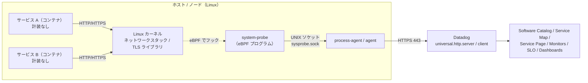
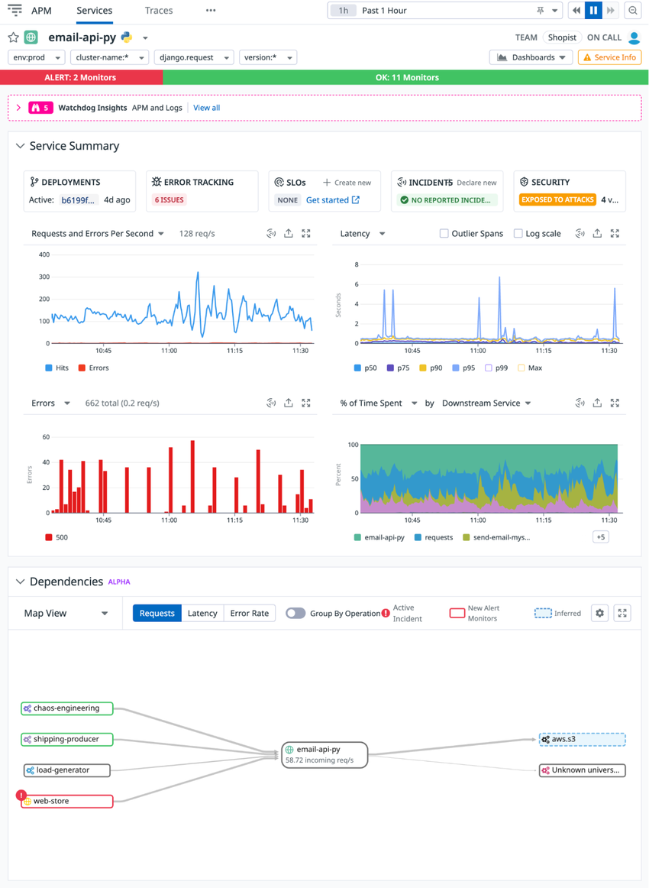
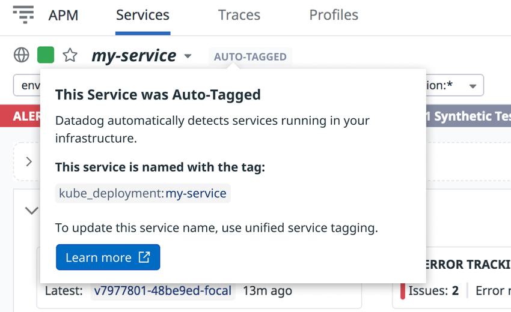
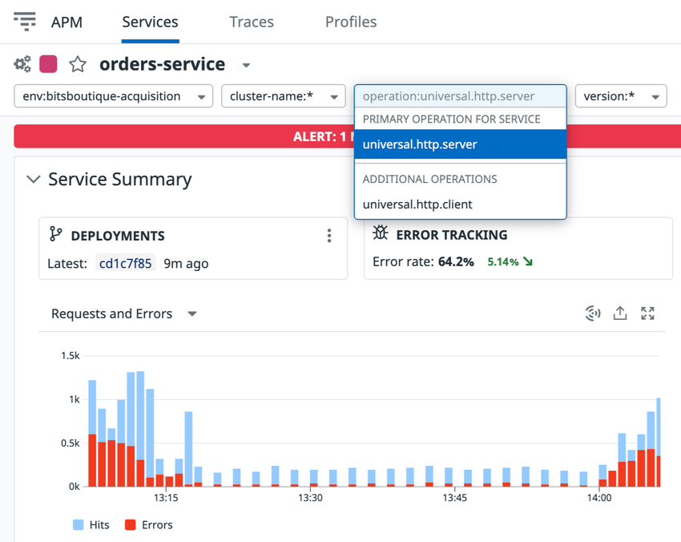
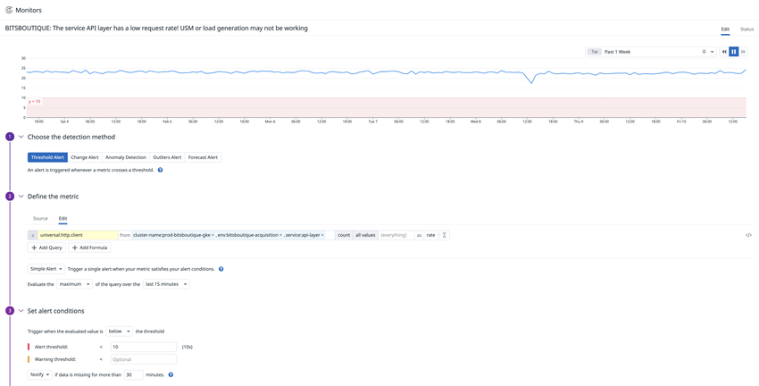
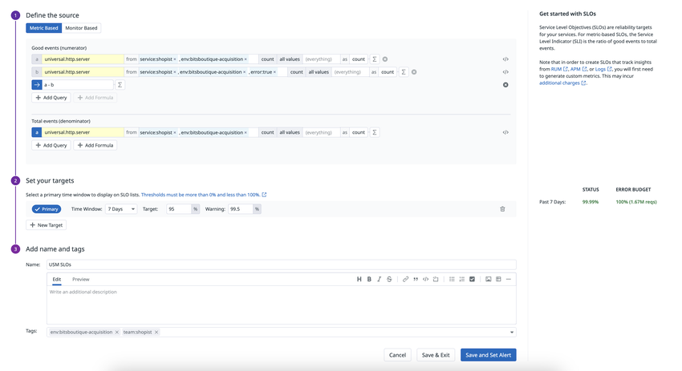

# Universal Service Monitoring（USM）

## 概要

Universal Service Monitoring（USM、ユニバーサルサービスモニタリング）は、**アプリケーションのコードを計装（インスツルメント）せずに**、サービスのヘルスメトリクス（リクエスト数・エラー・レイテンシ＝RED メトリクス／ゴールデンシグナル）を取得する Datadog の製品である。USM に必要なのは、設定済みの Datadog Agent と [Unified Service Tagging](../platform/tagging.md)（統合サービスタグ付け）だけで、計装されていないサービスの性能データを Software Catalog（旧称：Service Catalog）や Service Map（サービスマップ）に表示する。USM は Deployment Tracking（デプロイ追跡）、Monitors、Dashboards、SLO とも連携する。[出典](https://docs.datadoghq.com/universal_service_monitoring/)

- USM は Datadog Agent の **System Probe（`system-probe`）** が **eBPF**（カーネルレベルの技術）でカーネルのネットワークスタックから HTTP(S) 等の通信を解析し、メトリクスを生成する。[出典](https://www.datadoghq.com/blog/universal-service-monitoring-datadog/)（2021-10-26 公開、2022-11-29 更新）[出典](https://www.datadoghq.com/pricing/?product=universal-service-monitoring)
- USM はプログラミング言語に依存せず、自社開発サービスだけでなく、計装できないサードパーティ製サービスも検出する。[出典](https://www.datadoghq.com/about/latest-news/press-releases/datadog-launches-universal-service-monitoring/)
- USM は **2022-11-29（UTC）に一般提供（GA）** が発表された（GA 前の初公開は 2021-10-26 の公式ブログ）。[出典](https://www.datadoghq.com/about/latest-news/press-releases/datadog-launches-universal-service-monitoring/) [出典](https://www.datadoghq.com/blog/universal-service-monitoring-datadog/)
- USM のデータは APM 画面（Service Page、Service Map、Software Catalog）に統合され、オペレーション名 `universal.http.server`（受信）/ `universal.http.client`（送信）で APM のトレース由来データと区別される。[出典](https://docs.datadoghq.com/universal_service_monitoring/)

本ファイルが扱う範囲は「eBPF によるコード変更なしの観測、対応プロトコル、要件、APM との違い、課金」である。APM（トレーサー）側の概念・インジェスト制御は [APM の概念とインジェスト制御](./apm-concepts-and-ingestion.md)、APM 画面の詳細は [APM 画面と分析機能](./apm-ui-and-analysis.md)、System Probe の全般は [Datadog Agent](../platform/agent.md) と [Agent 設定リファレンス](../platform/agent-configuration.md) を参照。

## 1. USM の位置づけと APM との違い

### 1.1 USM と APM（分散トレーシング）の比較

Universal Service Monitoring と Datadog APM は「サービスの健全性を見る」という目的が重なるが、データ取得方法と得られる粒度が異なる。Datadog の料金ページ FAQ は「USM はサービスを再デプロイなし・言語非依存で自動検出・マッピング・カタログ化し、ヘルスメトリクスと依存関係を即座に可視化する。APM は分散トレースとコードプロファイルでリクエスト単位・コード単位の可視性を提供し、根本原因分析を行う」と位置づけている。[出典](https://www.datadoghq.com/pricing/?product=universal-service-monitoring)

| 観点 | Universal Service Monitoring | APM（分散トレーシング） |
|---|---|---|
| データ取得方法 | Agent の System Probe が eBPF でカーネルのネットワークスタックから通信を解析 | アプリに組み込んだトレーシングライブラリ（SDK）がスパンを生成 |
| コード変更・再デプロイ | 不要（SDK のインストール不要） | 必要（自動計装・Single Step Instrumentation でもライブラリ注入とプロセス再起動が必要） |
| 言語依存 | 言語非依存 | 対応言語・フレームワークに依存（[APM インスツルメンテーション](./apm-instrumentation.md)） |
| 得られるデータ | サービス単位・エンドポイント単位の RED メトリクス（リクエスト、エラー、レイテンシ）、依存関係 | RED メトリクス（Trace Metrics）＋個々のリクエストのスパン／トレース、フレームグラフ、Trace Search & Analytics |
| メトリクス名 | `universal.http.server` / `universal.http.client`（Distribution） | `trace.<SPAN_NAME>`（Distribution）ほか |
| 分散トレース（リクエスト単位の追跡） | なし | あり |
| 主な用途 | 全サービスの検出・初期トリアージ、依存関係の把握、SLO の一律展開 | 根本原因分析、コードレベルの調査 |
| 必須タグ | `env`（`service`、`version` は任意） | `service`、`env`、`version`（推奨） |
| 課金単位 | USM ホスト（Infrastructure ホスト）/ 月。APM ホストには同梱 | APM ホスト / 月＋取り込み・インデックス量 |

出典：[USM](https://docs.datadoghq.com/universal_service_monitoring/)、[USM Setup](https://docs.datadoghq.com/universal_service_monitoring/setup/)、[Using USM Metrics](https://docs.datadoghq.com/universal_service_monitoring/guide/using_usm_metrics/)、[公式ブログ](https://www.datadoghq.com/blog/universal-service-monitoring-datadog/)、[料金ページ](https://www.datadoghq.com/pricing/?product=universal-service-monitoring)

- 公式ブログは、USM を「検出と一次トリアージ」に使い、より深い根本原因分析には APM、ログ、Continuous Profiler、Database Monitoring を使う、という役割分担を示している。[出典](https://www.datadoghq.com/blog/universal-service-monitoring-datadog/)（2022-11-29 更新）
- USM と APM は同じホストで併用できる。料金ページ FAQ は「Pro / Enterprise の Infrastructure ホスト全体に USM を設定し、その全部または一部に APM と分散トレーシングを設定できる」としている。[出典](https://www.datadoghq.com/pricing/?product=universal-service-monitoring)

### 1.2 USM と Cloud Network Monitoring の関係

Universal Service Monitoring と [Cloud Network Monitoring](../infrastructure/cloud-network-monitoring.md)（旧称：Network Performance Monitoring / NPM）は、どちらも Agent の System Probe（eBPF）を基盤とするが、観測するレイヤーが異なる。

| 観点 | Universal Service Monitoring | Cloud Network Monitoring |
|---|---|---|
| 観測レイヤー | L7（HTTP 等のアプリケーション層プロトコル）のリクエスト・エラー・レイテンシ | L3/L4 のフロー（送受信バイト、TCP 再送、RTT、接続数等） |
| 表示先 | APM の Service Page / Service Map / Software Catalog | Network Analytics / Network Map |
| 有効化キー | `service_monitoring_config.enabled` | `network_config.enabled` |
| Windows での前提 | ネットワークカーネルドライバ（インストーラーの NPM / Cloud Network Monitoring コンポーネント）が必要 | 同左 |

出典：[USM Setup](https://docs.datadoghq.com/universal_service_monitoring/setup/)。CNM 側の詳細は [Cloud Network Monitoring](../infrastructure/cloud-network-monitoring.md) を参照。

- USM の有効化に CNM（`network_config.enabled`）の有効化が必須とする記述は、USM の公式セットアップページでは確認できず（Windows では Agent 7.44 以前のインストール時に「Cloud Network Monitoring」コンポーネント＝ネットワークカーネルドライバの選択が必要、という形で関係する）。[出典](https://docs.datadoghq.com/universal_service_monitoring/setup/)

## 2. 仕組み（アーキテクチャとデータフロー）

### 2.1 データフロー

Universal Service Monitoring のデータは、ホスト上の System Probe が eBPF で取得し、Agent（Process Agent 経由）が Datadog に送信する。



| 段階 | 内容 | 出典 |
|---|---|---|
| 1. 取得 | Agent が eBPF でカーネルのネットワークスタックから HTTP(S) トラフィックを自動解析する | [公式ブログ](https://www.datadoghq.com/blog/universal-service-monitoring-datadog/) |
| 2. 暗号化通信 | HTTPS は TLS ライブラリ（OpenSSL）の関数をフックして平文を取得する方式で対応（Go TLS、Node.js TLS、Istio mTLS は追加設定）。Windows は ETW（Event Tracing for Windows）の `Microsoft-Windows-HttpService` プロバイダを使う | [USM Setup](https://docs.datadoghq.com/universal_service_monitoring/setup/) |
| 3. サービス名付与 | プロセス起動時の環境変数（`DD_SERVICE`、`DD_ENV`、`DD_VERSION`、`DD_TAGS`）を Linux では `/proc/PID/environ`、Windows ではシステム API から読む。無い場合はコンテナタグから自動命名 | [USM Setup](https://docs.datadoghq.com/universal_service_monitoring/setup/)、[USM](https://docs.datadoghq.com/universal_service_monitoring/) |
| 4. 送信 | System Probe はソケット（`/var/run/sysprobe/sysprobe.sock`）経由で Agent プロセスと連携する。Kubernetes の手動構成では `process-agent` コンテナ（コンテナ分割時）または `agent` コンテナに USM の環境変数を設定する | [USM Setup](https://docs.datadoghq.com/universal_service_monitoring/setup/) |
| 5. 表示 | Agent 設定後、約 5 分で Software Catalog にサービスが表示される | [USM](https://docs.datadoghq.com/universal_service_monitoring/) |

- 「TLS ライブラリの関数をフックする」という内部実装の詳細（uprobe 等の具体的な eBPF プログラム種別）は USM の公式ドキュメントでは説明されておらず、公開情報では確認できず。上表 2 の記述は「OpenSSL 等ライブラリ単位で HTTPS に対応し、ライブラリ種別ごとに設定キーが分かれている」という公式の対応表から読み取れる範囲に留める。
- 送信先エンドポイント：USM のデータは Live Process / Containers / CNM と同じ `process.<サイト>` 系エンドポイント（AP1 では `process.ap1.datadoghq.com`、TCP 443）を使う。詳細は [Datadog Sites](../platform/datadog-sites.md) と [ネットワーク・接続要件](../../03_導入編/network-and-connectivity.md) を参照。

### 2.2 必要な権限（Linux）

Universal Service Monitoring の System Probe は eBPF プログラムのロードのため特権的な権限を必要とする。コンテナで Agent を動かす場合の公式構成は以下のとおり。[出典](https://docs.datadoghq.com/universal_service_monitoring/setup/)

| 項目 | 値 |
|---|---|
| Linux capabilities | `SYS_ADMIN`、`SYS_RESOURCE`、`SYS_PTRACE`、`NET_ADMIN`、`NET_BROADCAST`、`NET_RAW`、`IPC_LOCK`、`CHOWN` |
| AppArmor | `unconfined`（Kubernetes：アノテーション `container.apparmor.security.beta.kubernetes.io/system-probe: unconfined`、Docker：`--security-opt apparmor:unconfined`） |
| 名前空間（Docker） | `--cgroupns host`、`--pid host` |
| SELinux（Bottlerocket ノード、Helm） | `seLinuxOptions`：user `system_u`、role `system_r`、type `spc_t`、level `s0` |

### 2.3 ホストからマウントするパス（Linux コンテナ構成）

Universal Service Monitoring を Docker / Kubernetes（Helm なし）/ ECS で構成する場合、公式手順は以下のホストパスのマウントを指示している。[出典](https://docs.datadoghq.com/universal_service_monitoring/setup/)

| ホストパス | コンテナ内パス | 読み取り専用 | 用途（公式説明なし。名称からの推定を含む） |
|---|---|---|---|
| `/var/run/docker.sock` | `/var/run/docker.sock` | ○（Docker） | コンテナ情報取得 |
| `/proc/` | `/host/proc/` | ○ | プロセス情報（環境変数含む） |
| `/sys/fs/cgroup/` | `/host/sys/fs/cgroup` | ○ | cgroup 情報 |
| `/sys/kernel/debug` | `/sys/kernel/debug` | × | debugfs（eBPF 関連） |
| `/lib/modules` | `/lib/modules` | ○ | カーネルモジュール |
| `/usr/src` | `/usr/src` | ○ | カーネルヘッダ（**GKE の COS では削除**） |
| `/var/tmp/datadog-agent/system-probe/build` | 同左 | × | ランタイムコンパイル出力 |
| `/var/tmp/datadog-agent/system-probe/kernel-headers` | 同左 | × | カーネルヘッダのダウンロード先 |
| `/etc/apt`、`/etc/yum.repos.d`、`/etc/zypp`、`/etc/pki`、`/etc/yum/vars`、`/etc/dnf/vars`、`/etc/rhsm` | `/host/etc/...` | ○ | パッケージマネージャ設定（カーネルヘッダ取得用） |
| `/`（HTTPS 対応時のみ） | `/host/root`（環境変数 `HOST_ROOT=/host/root`） | ○ | ホストの TLS ライブラリへのアクセス |
| `/var/lib/docker/containers/`（ECS 例） | `/var/lib/docker/containers` | ○ | コンテナ情報 |

- 「用途」列は公式ドキュメントに説明が無く、マウント名からの【推定】である。

## 3. 対応範囲

### 3.1 対応バージョン・プラットフォーム

| 項目 | 要件 | 出典 |
|---|---|---|
| Datadog Agent | **6.40 / 7.40 以上**（コンテナ化されたサービスと同じホストに導入）。Preview 機能はさらに高いバージョンが必要 | [USM Setup](https://docs.datadoghq.com/universal_service_monitoring/setup/) |
| Linux | Linux カーネル **4.14 以上**、CentOS / RHEL **8.0 以上** | 同上 |
| Windows | **Windows Server 2012 R2 以上**（IIS 構成は Agent 6.41 / 7.41 以上） | 同上 |
| アプリケーション層プロトコル（基本） | **HTTP、HTTPS（OpenSSL）** | 同上 |
| 既知の制限 | System Probe を使うため **GKE Autopilot は非対応** | 同上 |
| Datadog Helm チャート | 2.26.2 以上 | 同上 |
| Datadog Operator | v1.0.0 以上 | 同上 |
| サーバーレス | **ECS Fargate、EKS Fargate、AWS Lambda は非対応**（料金ページ FAQ） | [料金ページ](https://www.datadoghq.com/pricing/?product=universal-service-monitoring) |

### 3.2 前提条件

Universal Service Monitoring の公式前提条件は以下のとおり。[出典](https://docs.datadoghq.com/universal_service_monitoring/setup/)

| OS | 前提条件 |
|---|---|
| Linux | サービスが**コンテナで稼働**していること。非コンテナ（ベアメタル / VM 上のプロセス）のサービスは前提条件節で **【Preview】** と表記（追加設定節では Agent 7.42 以上で「利用可能」と記載。§5.1 参照） |
| Windows | サービスが**仮想マシン上で稼働**していること |
| 共通 | Datadog Agent がサービスと同じホストに導入されていること。**SDK のインストールは不要** |
| 共通 | Unified Service Tagging の **`env` タグ**がデプロイに付与されていること。`service`、`version` は任意 |

### 3.3 対応プロトコル・暗号化方式一覧

Universal Service Monitoring のプロトコル・暗号化対応は、基本（HTTP / HTTPS(OpenSSL)）と、追加設定が必要なものに分かれる。提供ステータスは公式セットアップページの表記に従う（2026-11-02 時点）。

| プロトコル / 暗号化 | 提供状況 | 最低 Agent | カーネル要件 | 有効化 | 備考 |
|---|---|---|---|---|---|
| HTTP（HTTP/1.x） | GA | 6.40 / 7.40 | 4.14 以上 | USM 有効化のみ | Windows は IIS・非 IIS とも対応 |
| HTTPS（OpenSSL） | GA | 6.40 / 7.40 | 4.14 以上 | USM 有効化＋コンテナ構成ではホスト `/` を `/host/root` にマウント | 料金ページ FAQ は「OpenSSL と GnuTLS」をサポートと記載（ドキュメントは OpenSSL のみ明記） |
| HTTPS（Windows IIS） | GA | 6.41 / 7.41 | ― | `service_monitoring_config.enabled` | ETW `Microsoft-Windows-HttpService` を使用 |
| HTTPS（Windows 非 IIS） | **非対応** | ― | ― | ― | ETW プロバイダが IIS 限定のため |
| Istio mTLS（HTTPS、HTTP/2、gRPC） | GA（Preview 表記なし） | 7.50 | ― | `tls.istio.enabled` | Istio のサービスメッシュ配下の暗号化通信 |
| Go TLS | **【Preview】** | 7.51 | ― | `tls.go.enabled` | Go の HTTPS サーバーは HTTP/2 にアップグレードし得る。HTTP/2 対応はアカウントマネージャーに相談と記載 |
| HTTP/2・gRPC | GA（Preview 表記なし） | 7.53 | **5.2 以上** | `enable_http2_monitoring` | gRPC は HTTP/2 上で捕捉 |
| Kafka | **【Preview】** | 7.53 | プロデューサー・コンシューマー側 **5.2 以上** | `enable_kafka_monitoring` | プロデューサー・コンシューマーが **TLS なし**で Kafka に接続していること。公式見出しは「Kafka Console (Preview)」 |
| Node.js TLS（HTTP、HTTP/2、gRPC） | **【Preview】** | 7.54 | ― | `tls.nodejs.enabled` | ― |
| PostgreSQL | **【Preview】**（Product Preview Program） | 7.53.0 | 公開情報では確認できず | 公開情報では確認できず（Preview 参加後に案内） | Kafka と同じプレビューページで告知 |
| その他の追加プロトコル・暗号化方式 | **【Preview】** | 公開情報では確認できず | 公開情報では確認できず | Preview 申請 | 公式ページは具体名を列挙していない |

出典：[USM Setup](https://docs.datadoghq.com/universal_service_monitoring/setup/)、[Cloud Service Discovery and Additional Protocols](https://docs.datadoghq.com/universal_service_monitoring/additional_protocols/)、[Monitoring Kafka and PostgreSQL with USM（Product Preview）](https://www.datadoghq.com/product-preview/monitoring-kafka-and-postgresql-with-usm/)、[料金ページ FAQ](https://www.datadoghq.com/pricing/?product=universal-service-monitoring)

- **注意（ドキュメント間の差異）:** 料金ページ FAQ は「USM は言語非依存で、HTTP / HTTPS（OpenSSL と GnuTLS）で通信するコンテナ化アプリをサポート」「Windows は IIS ベースのサービス」と記載している。一方、セットアップドキュメントは HTTPS を「OpenSSL」と明記し、Windows では非 IIS サービスの HTTP 監視も Agent 7.57 以降デフォルトで有効と記載している。本ファイルでは技術仕様はドキュメント（docs.datadoghq.com）を優先する。
- Redis、MongoDB、AMQP 等その他のプロトコルについて、USM の公式ドキュメントに対応の明示は無く、公開情報では確認できず（Preview の対象に含まれるかは非公開）。
- 「Postgres の Preview」は Datadog 公式の Product Preview ページの記載であり、USM セットアップページには PostgreSQL の設定キーは掲載されていない。

### 3.4 Windows の対応範囲

Universal Service Monitoring の Windows 対応は IIS か否かで異なる。[出典](https://docs.datadoghq.com/universal_service_monitoring/setup/)

| サービス種別 | HTTP 監視 | HTTPS 監視 | 必要な設定 |
|---|---|---|---|
| IIS サービス | 対応 | 対応 | Agent 6.41 / 7.41 以上をネットワークカーネルドライバ付きで導入し、`service_monitoring_config.enabled: true` |
| 非 IIS サービス（独自 .NET、Node.js、Java 等の HTTP サーバー） | 対応 | **非対応** | Agent 7.57 以上はデフォルトで検出有効。それ以前は `service_monitoring_config.enabled` と `process_service_inference.enabled` を `true` |

- Windows の HTTPS 監視は ETW の `Microsoft-Windows-HttpService` プロバイダに依存しており、このプロバイダは IIS ベースのサービスでしか利用できない。そのため非 IIS サービスは平文 HTTP のみ監視可能。[出典](https://docs.datadoghq.com/universal_service_monitoring/setup/)

### 3.5 Cloud Service Discovery（クラウドサービス・サードパーティ API の検出）【Preview】

Universal Service Monitoring の Cloud Service Discovery は、アプリケーションが送信する外向きリクエストを観測し、AWS S3 などのクラウドサービスやサードパーティ API エンドポイントを依存先として検出する機能で、**【Preview】**である。組織に Preview アクセスが付与された後に有効になる。[出典](https://docs.datadoghq.com/universal_service_monitoring/additional_protocols/)

| 項目 | 内容 |
|---|---|
| 提供状況 | 【Preview】（申請制） |
| 検出対象（クラウドサービス） | 例として AWS S3（全一覧は公開情報では確認できず） |
| 検出対象（サードパーティ API） | Jira、Slack、Auth0、Splunk、HubSpot、Intercom、Stripe、SendGrid、Braintree、Mapbox、Twitter (X)、Palo Alto Networks、TowerData、SoundCloud、Amplitude、Render、Mixpanel、GitHub、OpenAI |
| 表示先 | Service Map（サービス間依存関係）と、スループット・エラー数・レイテンシのヘルスメトリクス |
| Preview 告知対象サイト | US1（app.datadoghq.com）、US3、US5、EU1、AP1、AP2、UK1（uk1.datadoghq.com） |



**図 1：Cloud Service Discovery 有効時の Service Page（Preview）**

- 画面説明：APM > Services のサービス詳細ページ（例：`email-api-py`）。上部にフィルター（`env:prod`、`cluster-name:*`、オペレーション `django.request`、`version:*`）とモニター状態（ALERT / OK の件数）。「Service Summary」に DEPLOYMENTS、ERROR TRACKING、SLOs、INCIDENTS、SECURITY のカード。その下に「Requests and Errors Per Second」「Latency（p50/p75/p90/p95/p99/Max）」「Errors（ステータスコード別）」「% of Time Spent by Downstream Service」のグラフ。最下部「Dependencies」の Map View で、上流サービス（chaos-engineering、shipping-producer、load-generator、web-store）から当該サービスへの流入と、下流の `aws.s3`（点線枠＝Inferred）や「Unknown univers...」への依存が表示されている。
- 出典：[Cloud Service Discovery and Additional Protocols](https://docs.datadoghq.com/universal_service_monitoring/additional_protocols/)（画像取得日：2026-11-02）

## 4. 有効化手順（デプロイ方式別）

Universal Service Monitoring は Agent 側の設定だけで有効化する（アプリケーションの変更は不要）。デプロイ方式ごとの公式設定は以下のとおり。[出典](https://docs.datadoghq.com/universal_service_monitoring/setup/)

### 4.1 設定方法の一覧

| デプロイ方式 | 設定 | 補足 |
|---|---|---|
| Helm（チャート 2.26.2 以上） | `datadog.serviceMonitoring.enabled: true` | GKE の Container-Optimized OS（COS）は `providers.gke.cos: true` を追加。Bottlerocket は System Probe の `seLinuxOptions` を追加 |
| Datadog Operator（v1.0.0 以上） | `DatadogAgent` リソースの `spec.features.usm.enabled: true` | `apiVersion: datadoghq.com/v2alpha1` |
| Kubernetes（Helm なし） | AppArmor アノテーション、環境変数、`system-probe` サイドカー、ホストボリューム | §4.4 参照 |
| Docker（`docker run`） | `DD_SYSTEM_PROBE_SERVICE_MONITORING_ENABLED=true`、capabilities、ホストマウント、`--cgroupns host`、`--pid host` | §4.5 参照 |
| Docker Compose | 上記と同等を `environment`、`volumes`、`cap_add`、`security_opt` で指定 | HTTPS は `/:/host/root:ro` と `HOST_ROOT` を追加 |
| Docker Swarm | Compose と同じ（ただし `security_opt` を除く） | Swarm は `security_opt` の変更に未対応のため、**ホスト OS で AppArmor が動作していないこと**が条件 |
| 設定ファイル（Linux） | `system-probe.yaml` に `service_monitoring_config.enabled: true` | Helm や環境変数を使わない場合 |
| 環境変数（Linux） | `DD_SYSTEM_PROBE_SERVICE_MONITORING_ENABLED=true` を **`process-agent` と `system-probe` の両方**に設定 | Docker、ECS で一般的 |
| Chef | `node["datadog"]["system_probe"]["service_monitoring_enabled"] = true` | ― |
| Puppet | `class { 'datadog_agent::system_probe': service_monitoring_enabled => true, }` | ― |
| Ansible | `service_monitoring_config: enabled: true` | プレイブックの属性 |
| Amazon ECS（EC2 起動タイプ） | タスク定義に環境変数・capabilities・マウントを追加し、**デーモンサービス**としてデプロイ | Ubuntu / Debian は `dockerSecurityOptions: ["apparmor:unconfined"]`。§4.6 参照 |
| Windows（IIS） | Agent 6.41 / 7.41 以上をネットワークカーネルドライバ付きで導入し、`C:\ProgramData\Datadog\system-probe.yaml` で `service_monitoring_config.enabled: true` | Agent 7.44 以前は `msiexec` に `ADDLOCAL="MainApplication,NPM"` を渡すか、GUI で Cloud Network Monitoring を選択 |
| Windows（非 IIS） | Agent 7.57 以上はデフォルト有効 | それ以前は `service_monitoring_config.enabled` と `service_monitoring_config.process_service_inference.enabled` を `true` |

- Agent のインストールスクリプトでは `DD_SYSTEM_PROBE_SERVICE_MONITORING_ENABLED` を指定して設定ファイルを生成できる（[Datadog Agent](../platform/agent.md) を参照）。
- Kubernetes の Helm / Operator キー全体の一覧は [コンテナ/Kubernetes向けAgent](../platform/kubernetes-and-containers-agent.md) を参照。

### 4.2 Helm

```yaml
datadog:
  serviceMonitoring:
    enabled: true

# GKE の Container-Optimized OS (COS) の場合
providers:
  gke:
    cos: true

# Bottlerocket ノードの場合
agents:
  containers:
    systemProbe:
      securityContext:
        seLinuxOptions:
          user: "system_u"
          role: "system_r"
          type: "spc_t"
          level: "s0"
```

出典：[USM Setup（Helm）](https://docs.datadoghq.com/universal_service_monitoring/setup/?tab=helm)

### 4.3 Datadog Operator

```yaml
apiVersion: datadoghq.com/v2alpha1
kind: DatadogAgent
metadata:
  name: datadog
spec:
  global:
    credentials:
      apiSecret:
        secretName: datadog-secret
        keyName: api-key
      appSecret:
        secretName: datadog-secret
        keyName: app-key
  features:
    usm:
      enabled: true
```

出典：[USM Setup（Operator）](https://docs.datadoghq.com/universal_service_monitoring/setup/?tab=operator)

### 4.4 Kubernetes（Helm なし）

Helm / Operator を使わずに Universal Service Monitoring を有効化する場合の公式手順は以下の 5 ステップ。[出典](https://docs.datadoghq.com/universal_service_monitoring/setup/?tab=kubernetes)

| 手順 | 内容 |
|---|---|
| 1 | `datadog-agent` テンプレートにアノテーション `container.apparmor.security.beta.kubernetes.io/system-probe: unconfined` を追加 |
| 2 | Agent DaemonSet に環境変数 `DD_SYSTEM_PROBE_SERVICE_MONITORING_ENABLED=true`、`DD_SYSTEM_PROBE_EXTERNAL=true`、`DD_SYSPROBE_SOCKET=/var/run/sysprobe/sysprobe.sock` を追加（Agent プロセスごとにコンテナを分けている場合は `process-agent` コンテナ、そうでなければ `agent` コンテナ） |
| 3 | `datadog-agent` コンテナに `sysprobe-socket-dir`（`/var/run/sysprobe`）をマウント |
| 4 | `system-probe` サイドカーコンテナ（コマンド `/opt/datadog-agent/embedded/bin/system-probe`、§2.2 の capabilities、§2.3 のマウント、`DD_SYSTEM_PROBE_SERVICE_MONITORING_ENABLED=true`、`DD_SYSPROBE_SOCKET`）を追加 |
| 5 | マニフェストに volumes（`sysprobe-socket-dir` は `emptyDir`、それ以外は `hostPath`）を追加 |
| 任意 | HTTPS 対応：`system-probe` コンテナに `HOST_ROOT=/host/root` と `hostroot`（ホスト `/`）の読み取り専用マウントを追加 |

- GKE の COS では `/usr/src`（`src`）のマウントとボリュームを削除する。[出典](https://docs.datadoghq.com/universal_service_monitoring/setup/?tab=kubernetes)

### 4.5 Docker / Docker Compose

```shell
docker run --cgroupns host \
--pid host \
-e DD_API_KEY="<DATADOG_API_KEY>" \
-e DD_SYSTEM_PROBE_SERVICE_MONITORING_ENABLED=true \
-v /var/run/docker.sock:/var/run/docker.sock:ro \
-v /proc/:/host/proc/:ro \
-v /sys/fs/cgroup/:/host/sys/fs/cgroup:ro \
-v /sys/kernel/debug:/sys/kernel/debug \
-v /lib/modules:/lib/modules:ro \
-v /usr/src:/usr/src:ro \
-v /var/tmp/datadog-agent/system-probe/build:/var/tmp/datadog-agent/system-probe/build \
-v /var/tmp/datadog-agent/system-probe/kernel-headers:/var/tmp/datadog-agent/system-probe/kernel-headers \
-v /etc/apt:/host/etc/apt:ro \
-v /etc/yum.repos.d:/host/etc/yum.repos.d:ro \
-v /etc/zypp:/host/etc/zypp:ro \
-v /etc/pki:/host/etc/pki:ro \
-v /etc/yum/vars:/host/etc/yum/vars:ro \
-v /etc/dnf/vars:/host/etc/dnf/vars:ro \
-v /etc/rhsm:/host/etc/rhsm:ro \
-e HOST_ROOT=/host/root \
--security-opt apparmor:unconfined \
--cap-add=SYS_ADMIN --cap-add=SYS_RESOURCE --cap-add=SYS_PTRACE \
--cap-add=NET_ADMIN --cap-add=NET_BROADCAST --cap-add=NET_RAW \
--cap-add=IPC_LOCK --cap-add=CHOWN \
registry.datadoghq.com/agent:latest
```

出典：[USM Setup（Docker）](https://docs.datadoghq.com/universal_service_monitoring/setup/?tab=docker)（`--cap-add` は原文では 1 行 1 つ。ここでは紙面の都合で 1 行に複数まとめた）

- 公式の `docker run` 例は `HOST_ROOT=/host/root` を設定しているが、ホスト `/` を `/host/root` にマウントする `-v` 指定は含まれていない。Docker Compose / Kubernetes / ECS の手順では HTTPS 対応のためにホスト `/` のマウントを指示しているため、`docker run` で HTTPS を監視する場合も `-v /:/host/root:ro` が必要と考えられる【推定】。
- Docker Compose で HTTPS を監視する場合は、`environment` に `HOST_ROOT: '/host/root'`、`volumes` に `/:/host/root:ro` を追加する。[出典](https://docs.datadoghq.com/universal_service_monitoring/setup/?tab=dockercompose)

### 4.6 Amazon ECS

Amazon ECS で Universal Service Monitoring を使う場合の公式手順の要点は以下のとおり。[出典](https://docs.datadoghq.com/universal_service_monitoring/setup/?tab=ecs)

| 項目 | 内容 |
|---|---|
| 起動タイプ | `requiresCompatibilities: ["EC2"]`（Fargate は非対応） |
| デプロイ形態 | Agent タスクを**デーモンサービス**として実行 |
| コンテナイメージ例 | `public.ecr.aws/datadog/agent:7`（`cpu: 500`、`memory: 1024` は公式例の値） |
| 環境変数 | `DD_API_KEY`、`DD_SYSTEM_PROBE_SERVICE_MONITORING_ENABLED=true` |
| capabilities | `linuxParameters.capabilities.add` に §2.2 の 8 種 |
| マウント | §2.3 のホストパス（`/var/lib/docker/containers` を含む） |
| AppArmor | OS イメージが Ubuntu / Debian の場合、`dockerSecurityOptions: ["apparmor:unconfined"]` |
| HTTPS | ホスト `/` を `host_root` ボリュームとして `/host/root` にマウント |
| ロードバランサー | USM にクラウド管理エンティティ（AWS Load Balancer）を検出させるには、(1) [AWS Integration](../platform/aws-integration.md) を導入、(2) ENI と EC2 のメトリクス収集を有効化、(3) 各ロードバランサーに `ENV=<env>`、`SERVICE=<service>` タグを付与 |

### 4.7 Windows

| 対象 | 手順 |
|---|---|
| IIS | 1. Agent（6.41 / 7.41 以上）をネットワークカーネルデバイスドライバのコンポーネント付きでインストール（7.44 以前は `msiexec` に `ADDLOCAL="MainApplication,NPM"`、または GUI で Cloud Network Monitoring を選択）。2. `C:\ProgramData\Datadog\system-probe.yaml` に `service_monitoring_config: enabled: true` |
| 非 IIS | Agent 7.57 以上はデフォルトで検出有効。それ以前は `system-probe.yaml` に以下を設定 |

```yaml
service_monitoring_config:
  enabled: true
  process_service_inference:
    enabled: true
```

出典：[USM Setup（Windows）](https://docs.datadoghq.com/universal_service_monitoring/setup/?tab=windows)

## 5. 追加設定（プロトコル・環境別）

Universal Service Monitoring の追加設定は、`system-probe.yaml`、環境変数、Helm（`agents.containers.systemProbe.env`）のいずれかで行う。[出典](https://docs.datadoghq.com/universal_service_monitoring/setup/)

### 5.1 追加設定の一覧

| 機能 | 提供状況 | 最低 Agent | `system-probe.yaml` キー | 環境変数 |
|---|---|---|---|---|
| USM 本体の有効化 | GA | 6.40 / 7.40 | `service_monitoring_config.enabled: true` | `DD_SYSTEM_PROBE_SERVICE_MONITORING_ENABLED=true` |
| Linux 非コンテナ（ベアメタル / VM）サービス | 前提条件節で【Preview】表記 | 7.42 | `service_monitoring_config.process_service_inference.enabled: true`（`enabled: true` と併記） | `DD_SYSTEM_PROBE_PROCESS_SERVICE_INFERENCE_ENABLED=true` |
| Go TLS | 【Preview】 | 7.51 | `service_monitoring_config.tls.go.enabled: true` | `DD_SERVICE_MONITORING_CONFIG_TLS_GO_ENABLED=true` |
| Node.js TLS（HTTP、HTTP/2、gRPC） | 【Preview】 | 7.54 | `service_monitoring_config.tls.nodejs.enabled: true` | `DD_SERVICE_MONITORING_CONFIG_TLS_NODEJS_ENABLED=true` |
| Istio mTLS（HTTPS、HTTP/2、gRPC） | GA（Preview 表記なし） | 7.50 | `service_monitoring_config.tls.istio.enabled: true` | `DD_SERVICE_MONITORING_CONFIG_TLS_ISTIO_ENABLED=true` |
| HTTP/2・gRPC | GA（Preview 表記なし）、カーネル 5.2 以上 | 7.53 | `service_monitoring_config.enable_http2_monitoring: true` | `DD_SERVICE_MONITORING_CONFIG_ENABLE_HTTP2_MONITORING=true` |
| Kafka | 【Preview】、カーネル 5.2 以上、TLS なし | 7.53 | `service_monitoring_config.enable_kafka_monitoring: true` | `DD_SERVICE_MONITORING_CONFIG_ENABLE_KAFKA_MONITORING=true` |
| パス除外・置換 | GA | 公開情報では確認できず | `network_config.http_replace_rules` | `DD_SYSTEM_PROBE_NETWORK_HTTP_REPLACE_RULES` |

- Linux 非コンテナサービスについて、公式ページは前提条件節で「In Preview」と書く一方、追加設定節では「USM は Linux VM 上のベアメタルサービスの監視に利用可能」と書いており、表記が揃っていない（2026-11-02 時点）。料金ページ FAQ は「コンテナ環境と非コンテナ環境をサポート」と記載している。[出典](https://docs.datadoghq.com/universal_service_monitoring/setup/) [出典](https://www.datadoghq.com/pricing/?product=universal-service-monitoring)
- Kafka を Helm で有効化する場合は、`datadog.serviceMonitoring.enabled: true` に加えて `agents.containers.systemProbe.env` に `DD_SERVICE_MONITORING_CONFIG_ENABLE_KAFKA_MONITORING` を指定する。
- Kafka のトピック単位の可視化は [Data Streams Monitoring](./data-streams-monitoring.md)（トレーサー / DSM ライブラリ方式）でも行える。USM の Kafka 対応との機能差は公開情報では確認できず。

### 5.2 設定ファイル例（system-probe.yaml）

```yaml
service_monitoring_config:
  enabled: true
  enable_http2_monitoring: true      # HTTP/2・gRPC（カーネル 5.2+、Agent 7.53+）
  enable_kafka_monitoring: true      # Kafka（Preview、Agent 7.53+、TLS なし）
  process_service_inference:
    enabled: true                    # Linux 非コンテナサービス（Agent 7.42+）
  tls:
    istio:
      enabled: true                  # Istio mTLS（Agent 7.50+）
    go:
      enabled: true                  # Go TLS（Preview、Agent 7.51+）
    nodejs:
      enabled: true                  # Node.js TLS（Preview、Agent 7.54+）

network_config:
  http_replace_rules:
    - pattern: "/api/.*"             # /api/ で始まるエンドポイントを破棄
      repl: ""
```

- 上記は公式ページに個別に掲載されたキーを 1 ファイルにまとめた例。各キーは公式ページの個別例に基づく。[出典](https://docs.datadoghq.com/universal_service_monitoring/setup/)

### 5.3 Helm での追加設定例

```yaml
datadog:
  serviceMonitoring:
    enabled: true
agents:
  containers:
    systemProbe:
      env:
        - name: DD_SERVICE_MONITORING_CONFIG_ENABLE_HTTP2_MONITORING
          value: "true"
        - name: DD_SERVICE_MONITORING_CONFIG_TLS_ISTIO_ENABLED
          value: "true"
        - name: DD_SERVICE_MONITORING_CONFIG_TLS_GO_ENABLED
          value: "true"
        - name: DD_SERVICE_MONITORING_CONFIG_TLS_NODEJS_ENABLED
          value: "true"
        - name: DD_SERVICE_MONITORING_CONFIG_ENABLE_KAFKA_MONITORING
          value: "true"
```

出典：[USM Setup（Additional configuration）](https://docs.datadoghq.com/universal_service_monitoring/setup/)

### 5.4 パス（エンドポイント）の除外と置換

Universal Service Monitoring は、`http_replace_rules` または `DD_SYSTEM_PROBE_NETWORK_HTTP_REPLACE_RULES` で、正規表現に一致する HTTP エンドポイントを**破棄**したり、**別の形式に置換**したりできる。[出典](https://docs.datadoghq.com/universal_service_monitoring/setup/)

| 動作 | 設定 | 例 |
|---|---|---|
| 破棄（除外） | `repl` を空文字 `""` にする | `pattern: "/api/.*"` は `/api/v1/users` を破棄するが、`/api` や `/users/api` は破棄しない |
| 置換 | `repl` に新しい形式を書く | `pattern: "/api/users"`、`repl: "/api/v1/users"` で `/api/users` を `/api/v1/users` に変換 |

```yaml
# system-probe.yaml
network_config:
  http_replace_rules:
    - pattern: "<exclusion rule>"
      repl: ""
    - pattern: "<replacement rule>"
      repl: "<new format>"
```

```text
# 環境変数（JSON 配列）
DD_SYSTEM_PROBE_NETWORK_HTTP_REPLACE_RULES=[{"pattern":"<drop regex>","repl":""},{"pattern":"<replace regex>","repl":"<replace pattern>"}]
```

```yaml
# Helm：/my-api を破棄し、/my-api-2 を /new-version に置換
agents:
  containers:
    systemProbe:
      env:
        - name: DD_SYSTEM_PROBE_NETWORK_HTTP_REPLACE_RULES
          value: '[{"pattern":"/my-api","repl":""},{"pattern":"/my-api-2","repl":"/new-version"}]'
```

- 設定キーが `network_config` 配下にあるが、USM の公式ページで USM のエンドポイント制御として案内されている。
- 用途の例：ヘルスチェック（`/healthz` 等）の除外、ID を含むパス（`/users/12345`）を正規化してエンドポイント数（カーディナリティ）を抑える、など【経験則】。
- 公式例では `pattern: "/my-api"` が `/my-api-2` にも部分一致し得る点に注意（正規表現のマッチ方式＝完全一致か部分一致か、ルールの評価順序は公式ページに明記なく、公開情報では確認できず）。厳密に一致させたい場合は `^...$` のようにアンカーを付ける運用が考えられる【推定】。

## 6. サービスの識別とタグ

### 6.1 サービス名の検出（環境変数）

Universal Service Monitoring は、**プロセス起動時に存在する環境変数**からサービス名を検出する。Linux では `/proc/PID/environ`、Windows ではシステム API から読む。[出典](https://docs.datadoghq.com/universal_service_monitoring/setup/)

| 環境変数 | 役割 |
|---|---|
| `DD_SERVICE` | サービス名を明示 |
| `DD_ENV` | `env` タグ |
| `DD_VERSION` | `version` タグ |
| `DD_TAGS` | 追加タグ（`service:<name>` を含めることも可） |

**重要な制限（APM との差異）:** アプリケーションコード内で実行時に環境変数・プロパティを設定した場合（Java の `System.setProperty("dd.service", "my-service")`、.NET の `Environment.SetEnvironmentVariable("DD_SERVICE", "my-service")` 等）、APM トレーサーはその値を使えるが、**USM は検出できない**。USM は Agent 内の別プロセスとして動作し、プロセス起動時の環境変数しか見えないためである。USM で検出させるには、Docker の `environment`、Kubernetes の `env`、シェルの `export` 等で**アプリ起動前に**設定する。[出典](https://docs.datadoghq.com/universal_service_monitoring/setup/)

```yaml
# Kubernetes の例
env:
  - name: DD_SERVICE
    value: "my-service"
  - name: DD_ENV
    value: "production"
```

### 6.2 自動サービスタグ付け（Unified Service Tagging が無い場合）

Universal Service Monitoring はインフラ上で稼働するサービスを自動検出し、統合サービスタグ（`service` 等）が見つからない場合、以下のいずれかのタグを基にサービス名を割り当てる。[出典](https://docs.datadoghq.com/universal_service_monitoring/)

| 公式記載順 | 自動命名に使われるタグ |
|---|---|
| 1 | `app` |
| 2 | `short_image` |
| 3 | `kube_container_name` |
| 4 | `container_name` |
| 5 | `kube_deployment` |
| 6 | `kube_service` |

- 公式ページは上記タグを「one of the tags」として列挙しており、この列挙順が優先順位であるとは明記していない（優先順位のロジックは公開情報では確認できず）。
- サービス名を変更したい場合は Unified Service Tagging を設定する（[Tagging](../platform/tagging.md)）。



**図 2：自動タグ付け（AUTO-TAGGED）されたサービスの Service Page**

- 画面説明：APM > Services のサービス名（例：`my-service`）の右に「AUTO-TAGGED」バッジが表示され、ホバーすると「This Service was Auto-Tagged」のポップアップが開く。ポップアップには「Datadog automatically detects services running in your infrastructure.」「This service is named with the tag: `kube_deployment:my-service`」と命名に使われたタグが示され、「To update this service name, use unified service tagging.」の案内と「Learn more」ボタンがある。
- 出典：[Universal Service Monitoring](https://docs.datadoghq.com/universal_service_monitoring/)（画像取得日：2026-11-02）

## 7. メトリクス

### 7.1 USM メトリクス一覧

Universal Service Monitoring のメトリクスは以下の 6 種で、受信（server）と送信（client）に分かれる。[出典](https://docs.datadoghq.com/universal_service_monitoring/guide/using_usm_metrics/)

| メトリクス名 | 単位 | タイプ | 説明 |
|---|---|---|---|
| `universal.http.client` | 秒 | Distribution | 送信リクエストのレイテンシ、件数、エラー、レート |
| `universal.http.client.hits` | Hits | Count | 送信リクエストとエラーの総数 |
| `universal.http.client.apdex` | Score | Gauge | このサービスの送信リクエストの Apdex スコア |
| `universal.http.server` | 秒 | Distribution | 受信リクエストのレイテンシ、件数、エラー、レート |
| `universal.http.server.hits` | Hits | Count | 受信リクエストとエラーの総数 |
| `universal.http.server.apdex` | Score | Gauge | この Web サービスの Apdex スコア |

- APM メトリクスと異なり、**エラーは別メトリクスではなく `error:true` タグ**で表される。[出典](https://docs.datadoghq.com/universal_service_monitoring/guide/using_usm_metrics/)
- `.hits` メトリクスはすべてのインフラタグを持ち、**リクエスト数・エラー数のクエリには `.hits` が推奨**される。[出典](https://docs.datadoghq.com/universal_service_monitoring/guide/using_usm_metrics/)
- すべての USM メトリクスに **second primary tag**（第 2 プライマリタグ）を追加できる。[出典](https://docs.datadoghq.com/universal_service_monitoring/guide/using_usm_metrics/)
- メトリクス名は `universal.http.*` だが、HTTP/2・gRPC・Kafka 等の追加プロトコルで生成されるメトリクス名・オペレーション名の一覧は公式に掲載がなく、公開情報では確認できず。

### 7.2 APM メトリクスとのクエリ構文の対応

Universal Service Monitoring のメトリクスは単一の Distribution メトリクス名にまとめられており、APM の `trace.*` 構文とは書き方が異なる。[出典](https://docs.datadoghq.com/universal_service_monitoring/guide/using_usm_metrics/)

| APM 形式 | USM 形式 |
|---|---|
| `trace.universal.http.client.hits{*}` | `count:universal.http.client{*}` |
| `trace.universal.http.client.errors` | `count:universal.http.client{error:true}` |
| `trace.universal.http.client.hits.by_http_status` | `count:universal.http.client{*} by http_status_family` |
| `pXX:trace.universal.http.client{*}` | `pXX:universal.http.client{*}` |
| `trace.universal.http.client.apdex{*}` | `universal.http.client.apdex{*}` |

- `universal.http.server`（受信）も同じ対応で変換する。Distribution メトリクスの詳細は [DDSketch-based Metrics in APM](https://docs.datadoghq.com/tracing/guide/ddsketch_trace_metrics/) を参照。
- クエリ構文の一般論は [メトリクスクエリと関数](../platform/metrics-query-and-functions.md) を参照。

#### クエリ例

| 目的 | クエリ |
|---|---|
| サービスの受信リクエスト数 | `count:universal.http.server{service:shopist,env:prod}.as_count()` |
| 受信エラー数 | `count:universal.http.server{service:shopist,env:prod,error:true}.as_count()` |
| エラー率（%） | `(count:universal.http.server{service:shopist,env:prod,error:true}.as_count() / count:universal.http.server{service:shopist,env:prod}.as_count()) * 100` |
| p95 レイテンシ | `p95:universal.http.server{service:shopist,env:prod}` |
| ステータスファミリー別件数 | `count:universal.http.server{service:shopist,env:prod} by {http_status_family}` |
| 送信先別のリクエスト数 | `count:universal.http.client{service:shopist,env:prod}` を依存先タグでグループ化（依存先を表すタグ名は公開情報では確認できず） |

- 上表のクエリは公式の対応表（7.2）をもとにした記述例【推定】。`service:shopist` は公式ガイドのスクリーンショットで使われている例示値。

### 7.3 メトリクスの粒度・保持

| 項目 | 値 | 出典 |
|---|---|---|
| 収集間隔 / 最小解像度 | 30 秒 / 30 秒（Datadog のデータ収集解像度表で「USM RED メトリクス」） | [Metrics](../platform/metrics.md)（[公式表](https://docs.datadoghq.com/developers/guide/data-collection-resolution/)） |
| 保持期間 | USM メトリクス固有の保持期間の明記は公開情報では確認できず。APM の Trace Metrics は 15 か月保持と公式に記載 | [DDSketch-based Metrics](https://docs.datadoghq.com/tracing/guide/ddsketch_trace_metrics/) |
| サンプリング | eBPF で全通信を観測する方式。USM 側のサンプリング設定は公式ドキュメントに記載なし | [USM](https://docs.datadoghq.com/universal_service_monitoring/) |

## 8. 画面と使い方

### 8.1 サービスの探索

Universal Service Monitoring を有効化すると、Agent 設定後約 5 分でサービスが Software Catalog に表示される。[出典](https://docs.datadoghq.com/universal_service_monitoring/)

| 操作 | 内容 |
|---|---|
| 依存関係の可視化 | **APM > Catalog**（Software Catalog）または **APM > Service Map** でサービスと依存関係を表示 |
| ゴールデンシグナル | 各サービスの Service Page でリクエスト・エラー・レイテンシ（duration）を表示 |
| デプロイ相関 | [Deployment Tracking](https://docs.datadoghq.com/tracing/services/deployment_tracking/) で最近のコード変更と相関（`version` タグを使用） |
| USM 由来かの判別 | Service Page 左上のオペレーション名が `universal.http.server` または `universal.http.client` なら USM のテレメトリ |
| アラート・SLO・ダッシュボード | `universal.http.*` メトリクスで Monitors、Dashboards、SLO を作成 |

- 公式ガイド「Using USM Metrics」は、ナビゲーションを「**Infrastructure > Universal Service Monitoring**」（リンク先は `/services`）と記載し、テレメトリタイプで Universal Service Monitoring を絞り込んで Performance タブを開く手順を示している。USM 概要ページは「APM > Catalog」と記載しており、メニュー名称の表記がページ間で揃っていない。UI 構成の変化による差異と考えられる【推定】。[出典](https://docs.datadoghq.com/universal_service_monitoring/guide/using_usm_metrics/) [出典](https://docs.datadoghq.com/universal_service_monitoring/)
- Software Catalog の詳細は [Software Catalog](../platform/software-catalog.md)、Service Page / Service Map の詳細は [APM 画面と分析機能](./apm-ui-and-analysis.md) を参照。



**図 3：USM のオペレーション名（universal.http.server / universal.http.client）の選択**

- 画面説明：APM > Services のサービス詳細ページ（例：`orders-service`）。上部のフィルター行に `env:bitsboutique-acquisition`、`cluster-name:*`、オペレーション選択、`version:*` が並ぶ。オペレーションのドロップダウンを開くと「PRIMARY OPERATION FOR SERVICE」に `universal.http.server`、「ADDITIONAL OPERATIONS」に `universal.http.client` が表示される。下部の Service Summary には DEPLOYMENTS（最新バージョンと経過時間）、ERROR TRACKING（エラー率）のカード、および「Requests and Errors」の棒グラフ（Hits と Errors）がある。
- 出典：[Universal Service Monitoring](https://docs.datadoghq.com/universal_service_monitoring/)（画像取得日：2026-11-02）

### 8.2 モニターの作成

Universal Service Monitoring のメトリクスでアラートを作るには **APM Monitor** を使う。[出典](https://docs.datadoghq.com/universal_service_monitoring/guide/using_usm_metrics/)

| 手順 | 操作 |
|---|---|
| 1 | Monitors > New Monitor で **APM** を選択 |
| 2 | **APM Metrics** を選び、サービスまたはリソースの `env` と他のプライマリタグを指定。監視するサービス／リソースと評価期間を設定 |
| 3 | **Threshold Alert** を選び、USM メトリクス（例：`Requests per Second`）と、above / below、アラート閾値・警告閾値（任意）を設定 |
| 4 | 通知メッセージ（事前入力済み）、アラート名、権限を編集 |
| 5 | Create |

- 閾値超過だけでなく「期待パターンからの逸脱」（Anomaly 等）でのアラートも可能と記載されている。[出典](https://docs.datadoghq.com/universal_service_monitoring/guide/using_usm_metrics/)
- 公式ブログは、`universal.http.server` を使った Multi Alert で複数サービスのエラー率を一括監視する使い方を紹介している。[出典](https://www.datadoghq.com/blog/universal-service-monitoring-datadog/)（2022-11-29 更新）
- モニター全般は [Monitors](../platform/monitors.md)、通知は [通知と Downtime](../platform/notifications-and-downtimes.md) を参照。



**図 4：USM メトリクス（universal.http.client）を使ったモニターの設定例**

- 画面説明：公式ガイドに掲載されたモニター編集画面（タイトル例「BITSBOUTIQUE: The service API layer has a low request rate! USM or load generation may not be working」）。上部に過去 1 週間のメトリクスグラフと閾値ライン（y = 10）。「1 Choose the detection method」で Threshold Alert / Change Alert / Anomaly Detection / Outliers Alert / Forecast Alert から **Threshold Alert** を選択。「2 Define the metric」でクエリ a：`universal.http.client` from `cluster-name:prod-bitsboutique-gke`、`env:bitsboutique-acquisition`、`service:api-layer`（count、as rate）、Simple Alert、評価は「maximum of the query over the last 15 minutes」。「3 Set alert conditions」で「below the threshold」、Alert threshold `10`、Warning threshold は任意、データ欠損 30 分で Notify。画面上の構成はメトリクスモニター形式であり、前掲の手順（APM Monitor > APM Metrics）とは別の作り方の例と読める【推定】。
- 出典：[Using USM Metrics in Monitors, SLOs, and Dashboards](https://docs.datadoghq.com/universal_service_monitoring/guide/using_usm_metrics/)（画像取得日：2026-11-02）

### 8.3 SLO の作成

Universal Service Monitoring のメトリクスでサービスごとの SLO を作成できる。多数のサービスに展開する場合は **API によるプログラム的な作成**が推奨されている。[出典](https://docs.datadoghq.com/universal_service_monitoring/guide/using_usm_metrics/)

**Software Catalog から作成：** Catalog の **Reliability** タブで、SLOs 列のサービスにホバーし **+ Create Availability SLO** または **+ Create Latency SLO** をクリックする。

**手動（Metric Based SLO）で作成：**

| 手順 | 設定 |
|---|---|
| 1 | SLOs > New SLO で **Metric Based** を選択 |
| 2 | Good events（分子）にクエリ A：`universal.http.server`、`from` に `service` と `env`、`as` に `count`。クエリ B：同じ条件に `error:true` を追加、`as` に `count` |
| 3 | **+ Add Formula** で `a - b` |
| 4 | Total events（分母）：`universal.http.server`、`from` に `service` と `env`、`as` に `count` |
| 5 | **+ New Target**：公式例は Time Window `7 Days`、Target `95%`、Warning `99.5%`。すべての時間枠で同じ目標値を設定することが推奨 |
| 6 | 名前・説明を入力し、プライマリタグ `env`、`service` と `team` タグを設定 |
| 7 | **Save and Set Alert** |

- 公式ブログは、`version` や `service` でグループ化した `universal.http.server` / `universal.http.client` ベースの SLO を作ると新しいサービスにも自動適用される、と紹介している。[出典](https://www.datadoghq.com/blog/universal-service-monitoring-datadog/)（2022-11-29 更新）
- SLO の仕様（時間枠、エラーバジェット、上限等）は [SLO](../platform/slo.md) を参照。



**図 5：USM メトリクスによる Metric Based SLO の設定**

- 画面説明：SLO 作成画面の「1 Define the source」で **Metric Based** が選択され、Good events（numerator）にクエリ a：`universal.http.server` from `service:shopist`、`env:bitsboutique-acquisition`（as count）、クエリ b：同条件＋`error:true`（as count）、数式 `a - b`。Total events（denominator）はクエリ a：`universal.http.server` from `service:shopist`、`env:bitsboutique-acquisition`。「2 Set your targets」で Primary の Time Window `7 Days`、Target `95`%、Warning `99.5`%。「3 Add name and tags」で Name `USM SLOs`、Tags `env:bitsboutique-acquisition`、`team:shopist`。右下に Cancel / Save & Exit / Save and Set Alert ボタン。右側パネルには過去 7 日の STATUS（99.99%）と ERROR BUDGET（100%（1.67M reqs））のプレビュー。
- 出典：[Using USM Metrics in Monitors, SLOs, and Dashboards](https://docs.datadoghq.com/universal_service_monitoring/guide/using_usm_metrics/)（画像取得日：2026-11-02）

### 8.4 ダッシュボード

Universal Service Monitoring のサービスに対して、Software Catalog はサービス定義ファイル（Service Definition）で定義されたダッシュボードを Dashboards タブに一覧表示する。**Manage Dashboards** をクリックすると GitHub 上のサービス定義を直接編集できる。[出典](https://docs.datadoghq.com/universal_service_monitoring/guide/using_usm_metrics/)

- ダッシュボード全般は [Dashboards](../platform/dashboards.md) を参照。

## 9. サイト差異

> **サイト差異:** Universal Service Monitoring は **US1-FED（app.ddog-gov.com）** および **us2.ddog-gov.com** では**サポートされていない**。それ以外のサイト（US1、US3、US5、EU1、AP1、AP2 等）で利用できる。[出典](https://docs.datadoghq.com/universal_service_monitoring/)

> **サイト差異:** Cloud Service Discovery と追加プロトコルの Preview は、US1、US3、US5、EU1、AP1、AP2、および uk1.datadoghq.com 向けに告知されている。GovCloud 系（app.ddog-gov.com、us2.ddog-gov.com）は対象外。[出典](https://docs.datadoghq.com/universal_service_monitoring/additional_protocols/)

- 基準サイト AP1 では USM が利用可能で、データ送信先は `process.ap1.datadoghq.com`（TCP 443）。詳細は [Datadog Sites](../platform/datadog-sites.md) を参照。
- サイトごとの USM の価格差は公式料金ページ上で確認できず（料金ページはリージョン別価格表示の仕組みを持つため、契約時に確認すること）。

## 10. 制限値・クォータ・デフォルト値

Universal Service Monitoring の制限値・デフォルト値を以下にまとめる。

| 項目 | 値 | 出典 |
|---|---|---|
| USM のデフォルト状態（Linux） | 無効（`service_monitoring_config.enabled` で有効化）。Helm `datadog.serviceMonitoring.enabled` / Operator `features.usm.enabled` のデフォルトは `false` | [USM Setup](https://docs.datadoghq.com/universal_service_monitoring/setup/)、[コンテナ/Kubernetes向けAgent](../platform/kubernetes-and-containers-agent.md) |
| USM のデフォルト状態（Windows 非 IIS） | Agent 7.57 以降はデフォルトで検出有効 | [USM Setup](https://docs.datadoghq.com/universal_service_monitoring/setup/) |
| 最低 Agent バージョン | 6.40 / 7.40（Windows IIS は 6.41 / 7.41） | 同上 |
| 最低 Linux カーネル | 4.14（HTTP/2・gRPC と Kafka は 5.2） | 同上 |
| 最低 CentOS / RHEL | 8.0 | 同上 |
| 最低 Windows | Windows Server 2012 R2 | 同上 |
| Helm チャート最低バージョン | 2.26.2 | 同上 |
| Operator 最低バージョン | v1.0.0 | 同上 |
| サービスが表示されるまでの時間 | 約 5 分 | [USM](https://docs.datadoghq.com/universal_service_monitoring/) |
| メトリクスの収集間隔 / 最小解像度 | 30 秒 / 30 秒 | [Metrics](../platform/metrics.md) |
| メトリクスの保持期間 | 公開情報では確認できず（APM Trace Metrics は 15 か月） | [DDSketch-based Metrics](https://docs.datadoghq.com/tracing/guide/ddsketch_trace_metrics/) |
| 監視できるサービス数・エンドポイント数の上限 | 公開情報では確認できず | ― |
| 1 ホストあたりの接続数・リクエストレートの上限 | 公開情報では確認できず | ― |
| `http_replace_rules` のルール数上限 | 公開情報では確認できず | ― |
| System Probe の CPU / メモリオーバーヘッド | 公開情報では確認できず（ECS 公式例の Agent コンテナは `cpu: 500`、`memory: 1024`） | [USM Setup](https://docs.datadoghq.com/universal_service_monitoring/setup/) |
| 非対応環境 | GKE Autopilot、ECS Fargate、EKS Fargate、AWS Lambda、US1-FED（app.ddog-gov.com）/ us2.ddog-gov.com | [USM Setup](https://docs.datadoghq.com/universal_service_monitoring/setup/)、[料金ページ](https://www.datadoghq.com/pricing/?product=universal-service-monitoring) |
| Windows 非 IIS の HTTPS | 非対応 | [USM Setup](https://docs.datadoghq.com/universal_service_monitoring/setup/) |
| Kafka の TLS 接続 | 非対応（TLS なしが条件） | 同上 |
| サービス名検出 | プロセス起動時の環境変数のみ（実行時にコードから設定した値は検出不可） | 同上 |
| SLO 作成ガイドの公式例 | 7 Days、Target 95%、Warning 99.5% | [Using USM Metrics](https://docs.datadoghq.com/universal_service_monitoring/guide/using_usm_metrics/) |

## 11. 課金への影響

Universal Service Monitoring の課金単位は **Infrastructure Monitoring ホスト単位の月額**で、Infrastructure Monitoring の購入が前提となる。料金の正本は [製品別料金表](../../03_導入編/pricing-by-product.md)。

### 11.1 USM 単体の価格（公式定価）

| 製品 | 課金単位 | 年契約 | 月契約（Month-to-month） | オンデマンド |
|---|---|---|---|---|
| Universal Service Monitoring | Infrastructure ホスト / 月 | $9 | $10.80 | $13 |

出典：[料金一覧](https://www.datadoghq.com/pricing/list/)、[料金ページ（USM）](https://www.datadoghq.com/pricing/?product=universal-service-monitoring)（2026-11-02 時点、USD）

- 料金一覧ページの列順（Billed Annually / Month-to-month / On-demand）に基づく。USM の製品ページ側の表記は「Starting At $9 Per Infrastructure Monitoring host, per month」「Billed annually or $13 on-demand」「Requires purchase of Infrastructure Monitoring」。[出典](https://www.datadoghq.com/pricing/?product=universal-service-monitoring)

### 11.2 購入形態（Full / Partial Infrastructure Coverage）

Universal Service Monitoring の料金ページは、適用範囲によって 2 つの購入形態を示している。[出典](https://www.datadoghq.com/pricing/?product=universal-service-monitoring)

| 形態 | 内容 | 価格（2026-11-02 時点） |
|---|---|---|
| Full Infrastructure Coverage | Infrastructure Monitoring の**全ホスト**に USM を購入 | USM $9 / Infrastructure ホスト / 月（年契約）、$13（オンデマンド） |
| Partial Infrastructure Coverage | Pro / Enterprise の Infrastructure ホストの**一部だけ**で USM を使う場合は **APM を購入**する（APM ホストには USM が追加費用なしで含まれる） | APM $31 / ホスト / 月（年契約）、$36（オンデマンド） |

### 11.3 APM との関係（同梱ルール）

| 料金ページ FAQ の記載 | 要点 |
|---|---|
| 「Does a purchase of APM host include USM on that same host? → Yes. USM is included on the same host APM is purchased on, regardless of the APM tier.」 | APM ホストには、APM / APM Pro / APM Enterprise のどのティアでも USM が含まれる |
| 「If both USM and APM are purchased and/or installed on the same host, you will only pay the APM price on the host, based on your APM tier.」 | 同一ホストで USM と APM を併用しても、課金は APM 価格のみ（二重課金されない） |
| 「Existing Infrastructure Monitoring customers can add USM to all their Pro or Enterprise hosts for an additional $9 per host per month (starting price with an annual commitment).」 | 既存の Infrastructure（Pro / Enterprise）顧客は全ホストに USM を追加可能 |
| 「Annual, monthly, and hourly plans are available in combination with Infrastructure Monitoring.」 | 年・月・時間単位のプランを Infrastructure Monitoring と組み合わせて選べる |

出典：[料金ページ（USM / APM FAQ）](https://www.datadoghq.com/pricing/?product=universal-service-monitoring)（2026-11-02 取得）

- APM のティア別価格（APM $31、APM Pro $35、APM Enterprise $40、いずれも年契約・Infrastructure 併用時の Per APM host / month）の詳細と、取り込み・インデックススパンの課金は [APM の概念とインジェスト制御](./apm-concepts-and-ingestion.md) と [製品別料金表](../../03_導入編/pricing-by-product.md) を参照。
- 料金ページの FAQ は「USM（$9）を全 Infrastructure ホストに購入するか、一部ホストなら APM（$31〜）を購入する」という選択肢を示している。どちらが安いかは、USM を適用したいホストの割合と APM のトレース機能の要否で決まる【推定】。見積り手法は [コスト見積り手法](../../03_導入編/cost-estimation.md)、最適化は [コスト最適化](../../04_応用編/cost-optimization.md) を参照。

### 11.4 使用量の計測

| 項目 | 内容 | 出典 |
|---|---|---|
| Usage Metering API のフィールド | `universal_service_monitoring_host_top99p`（当日・当該 org の全時間における USM ホスト数の 99 パーセンタイル）、`universal_service_monitoring_host_top99p_sum`（当月の全 org 合計） | [Usage Metering API](https://docs.datadoghq.com/api/latest/usage-metering/) |
| 計数方式 | 上記フィールド名・説明から、Infrastructure ホストと同様に「時間ごとのホスト数の 99 パーセンタイル（上位 1% の時間を除外）」で計数される | 同上 |
| 推定使用量メトリクス（`datadog.estimated_usage.*`）の USM 専用メトリクス | 公開情報では確認できず | [Usage Metrics](https://docs.datadoghq.com/account_management/billing/usage_metrics/) |

- 99 パーセンタイル課金の一般的な仕組みは [課金計算の仕組み](../../03_導入編/billing-mechanics.md) と [Usage・Usage Attribution・Cost Visibility](../platform/usage-and-cost-attribution.md) を参照。
- USM のメトリクス（`universal.http.*`）がカスタムメトリクスとして別途課金されるとの記載は、公式料金ページ・ドキュメントでは確認できず。

## 12. 導入時の注意点

以下は Universal Service Monitoring の公式ドキュメントの記載から導かれる注意点である。

| 注意点 | 内容 | 根拠 |
|---|---|---|
| `env` タグは必須 | Unified Service Tagging の `env` をデプロイに付与しないと前提条件を満たさない | [USM Setup](https://docs.datadoghq.com/universal_service_monitoring/setup/) |
| 実行時設定の環境変数は無効 | Java の `System.setProperty`、.NET の `Environment.SetEnvironmentVariable` 等で設定した `DD_SERVICE` は USM では見えない | 同上 |
| 自動命名は意図しない名前になり得る | Unified Service Tagging が無いとコンテナ／Deployment 名等から命名される。APM 側のサービス名と揃えるには `DD_SERVICE` を起動前に設定 | [USM](https://docs.datadoghq.com/universal_service_monitoring/) |
| 特権コンテナ相当の権限 | `SYS_ADMIN` 等の capabilities、AppArmor `unconfined` が必要。セキュリティ審査対象になりやすい【経験則】 | [USM Setup](https://docs.datadoghq.com/universal_service_monitoring/setup/) |
| HTTPS はホストルートのマウントが必要 | コンテナ構成で HTTPS を観測するにはホスト `/` を `/host/root` に読み取り専用でマウント | 同上 |
| 古いカーネルでは HTTP/2・gRPC・Kafka 不可 | カーネル 5.2 未満では HTTP/2・gRPC・Kafka の監視は使えない | 同上 |
| マネージド・サーバーレス基盤は不可 | GKE Autopilot、Fargate、Lambda では System Probe が使えない | 同上、[料金ページ](https://www.datadoghq.com/pricing/?product=universal-service-monitoring) |
| Windows 非 IIS は HTTP のみ | HTTPS を観測したい Windows サービスは APM 計装を検討 | [USM Setup](https://docs.datadoghq.com/universal_service_monitoring/setup/) |
| エンドポイントのカーディナリティ | ID を含むパスは `http_replace_rules` で正規化・除外する【経験則】 | 同上（機能の存在のみ公式） |

- Agent の展開設計（System Probe を含むロールアウト）は [Agent 展開設計](../../03_導入編/agent-rollout-design.md)、セキュリティ要件は [セキュリティとコンプライアンス](../../03_導入編/security-and-compliance.md) を参照。APM との使い分けの実践は [APM 運用の実践](../../04_応用編/apm-practices.md) を参照。

## 13. よくある質問（FAQ）

**Q1. USM を使うのにアプリケーションの再デプロイやコード変更は必要か。**
A. 不要。USM は Agent（System Probe）側の設定だけで有効になり、SDK のインストールも不要。ただしサービス名を `DD_SERVICE` 等で付ける場合は、その環境変数をプロセス起動前に設定する必要があり、既存プロセスへ反映するには再起動が必要になる【推定】。[出典](https://docs.datadoghq.com/universal_service_monitoring/setup/)

**Q2. USM で分散トレース（スパン）は見られるか。**
A. 見られない。USM が提供するのはサービス・エンドポイント単位の RED メトリクスと依存関係で、リクエスト単位のトレースやフレームグラフは APM の機能。[出典](https://www.datadoghq.com/blog/universal-service-monitoring-datadog/) [出典](https://www.datadoghq.com/pricing/?product=universal-service-monitoring)

**Q3. APM を導入済みのホストで USM を使うと追加費用がかかるか。**
A. かからない。APM ホストにはティアに関係なく USM が含まれ、同一ホストで両方を使っても APM 価格のみが課金される。[出典](https://www.datadoghq.com/pricing/?product=universal-service-monitoring)

**Q4. 一部のホストだけで USM を使いたい。**
A. 料金ページ FAQ によれば、USM 単体（$9 / ホスト / 月、年契約）は Infrastructure の全ホストに対して購入する形態で、Pro / Enterprise Infrastructure ホストの一部だけで使う場合は APM（USM を同梱）を購入する。[出典](https://www.datadoghq.com/pricing/?product=universal-service-monitoring)

**Q5. gRPC は監視できるか。**
A. できる。HTTP/2 監視（Agent 7.53 以上、Linux カーネル 5.2 以上、`enable_http2_monitoring`）で HTTP/2 と gRPC を捕捉する。Istio mTLS（Agent 7.50 以上）や Node.js TLS（Preview、Agent 7.54 以上）経由の gRPC にも対応する。[出典](https://docs.datadoghq.com/universal_service_monitoring/setup/)

**Q6. Kafka や PostgreSQL は監視できるか。**
A. どちらも Preview。Kafka は Agent 7.53 以上、プロデューサー・コンシューマー側カーネル 5.2 以上、TLS なしの接続が条件。PostgreSQL は Product Preview Program として告知されている（Agent 7.53.0 以上）。[出典](https://docs.datadoghq.com/universal_service_monitoring/setup/) [出典](https://www.datadoghq.com/product-preview/monitoring-kafka-and-postgresql-with-usm/)

**Q7. GKE Autopilot や ECS Fargate で使えるか。**
A. 使えない。USM は System Probe を必要とし、GKE Autopilot は非対応。料金ページ FAQ では ECS Fargate、EKS Fargate、AWS Lambda も非対応と記載。[出典](https://docs.datadoghq.com/universal_service_monitoring/setup/) [出典](https://www.datadoghq.com/pricing/?product=universal-service-monitoring)

**Q8. 日本（AP1）サイトで使えるか。**
A. 使える。非対応は app.ddog-gov.com と us2.ddog-gov.com（GovCloud 系）のみ。[出典](https://docs.datadoghq.com/universal_service_monitoring/)

**Q9. USM のデータが APM 由来かどうかはどう見分けるか。**
A. Service Page 左上のオペレーション名が `universal.http.server`（受信）または `universal.http.client`（送信）であれば USM 由来。[出典](https://docs.datadoghq.com/universal_service_monitoring/)

**Q10. USM のエラー数はどのメトリクスで取るか。**
A. 別メトリクスはなく、`universal.http.server` / `universal.http.client`（または推奨の `.hits`）を `error:true` タグで絞り込む。[出典](https://docs.datadoghq.com/universal_service_monitoring/guide/using_usm_metrics/)

## 14. 関連ファイル

- [APM の概念とインジェスト制御](./apm-concepts-and-ingestion.md) / [APM インスツルメンテーション](./apm-instrumentation.md) / [APM 画面と分析機能](./apm-ui-and-analysis.md)
- [Data Streams Monitoring](./data-streams-monitoring.md) / [Continuous Profiler](./continuous-profiler.md) / [Error Tracking](./error-tracking.md)
- [Datadog Agent](../platform/agent.md) / [Agent 設定リファレンス](../platform/agent-configuration.md) / [コンテナ/Kubernetes向けAgent](../platform/kubernetes-and-containers-agent.md)
- [Cloud Network Monitoring（旧 NPM）](../infrastructure/cloud-network-monitoring.md) / [AWS Integration](../platform/aws-integration.md)
- [Tagging](../platform/tagging.md) / [Software Catalog（旧 Service Catalog）](../platform/software-catalog.md) / [Monitors](../platform/monitors.md) / [SLO](../platform/slo.md) / [Dashboards](../platform/dashboards.md)
- [Datadog Sites](../platform/datadog-sites.md) / [Usage・Usage Attribution・Cost Visibility](../platform/usage-and-cost-attribution.md)
- [製品別料金表](../../03_導入編/pricing-by-product.md) / [課金計算の仕組み](../../03_導入編/billing-mechanics.md) / [コスト見積り手法](../../03_導入編/cost-estimation.md)
- [APM 運用の実践](../../04_応用編/apm-practices.md) / [コスト最適化](../../04_応用編/cost-optimization.md)

## 参照元

- Universal Service Monitoring（公式ドキュメント）：https://docs.datadoghq.com/universal_service_monitoring/
- Setting up Universal Service Monitoring：https://docs.datadoghq.com/universal_service_monitoring/setup/
- Cloud Service Discovery and Additional Protocols：https://docs.datadoghq.com/universal_service_monitoring/additional_protocols/
- Using USM Metrics in Monitors, SLOs, and Dashboards：https://docs.datadoghq.com/universal_service_monitoring/guide/using_usm_metrics/
- DDSketch-based Metrics in APM：https://docs.datadoghq.com/tracing/guide/ddsketch_trace_metrics/
- Data Collection Resolution：https://docs.datadoghq.com/developers/guide/data-collection-resolution/
- Deployment Tracking：https://docs.datadoghq.com/tracing/services/deployment_tracking/
- Usage Metering API：https://docs.datadoghq.com/api/latest/usage-metering/
- Usage Metrics：https://docs.datadoghq.com/account_management/billing/usage_metrics/
- Datadog 料金ページ（Universal Service Monitoring）：https://www.datadoghq.com/pricing/?product=universal-service-monitoring （2026-11-02 取得）
- Datadog 料金ページ（APM）：https://www.datadoghq.com/pricing/?product=apm--continuous-profiler （2026-11-02 取得）
- Datadog 料金一覧：https://www.datadoghq.com/pricing/list/ （2026-11-02 取得）
- Universal Service Monitoring 製品ページ：https://www.datadoghq.com/product/universal-service-monitoring/
- 公式ブログ「Golden signals in seconds with Universal Service Monitoring」：https://www.datadoghq.com/blog/universal-service-monitoring-datadog/ （2021-10-26 公開、2022-11-29 更新）
- プレスリリース「Datadog Launches Universal Service Monitoring」：https://www.datadoghq.com/about/latest-news/press-releases/datadog-launches-universal-service-monitoring/ （2022-11-29）
- Product Preview「Monitoring Kafka and PostgreSQL with USM」：https://www.datadoghq.com/product-preview/monitoring-kafka-and-postgresql-with-usm/
- Datadog Learning Center「Getting Started with Universal Service Monitoring」：https://learn.datadoghq.com/courses/getting-started-usm
