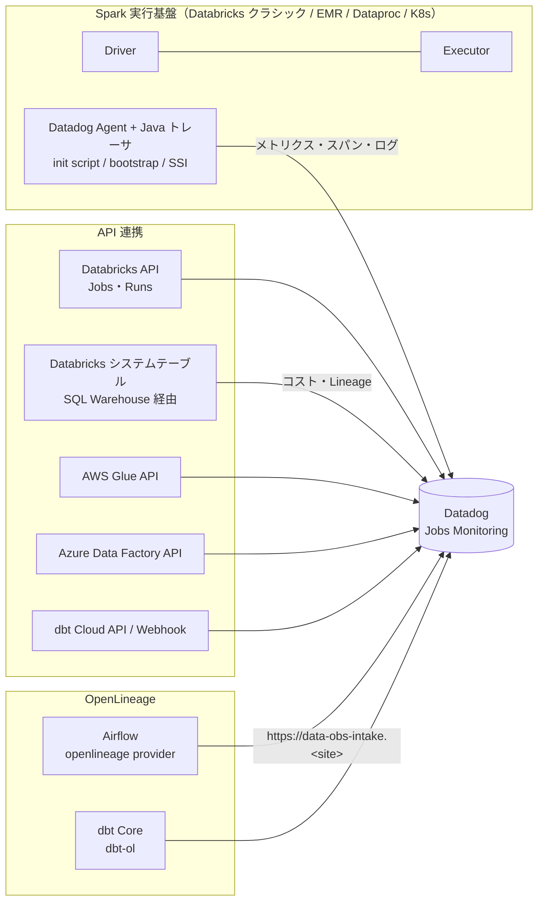
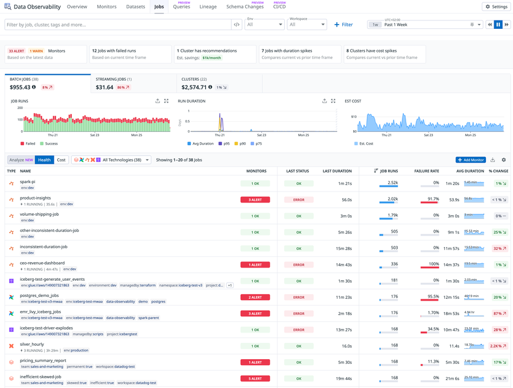
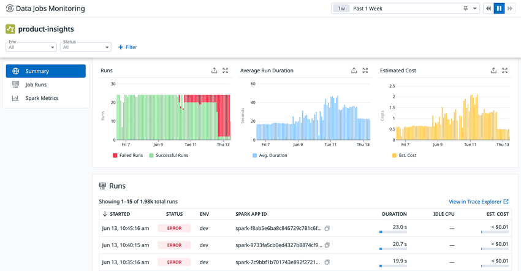
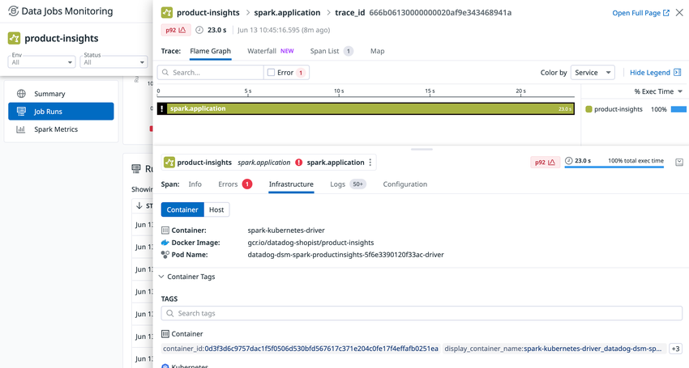
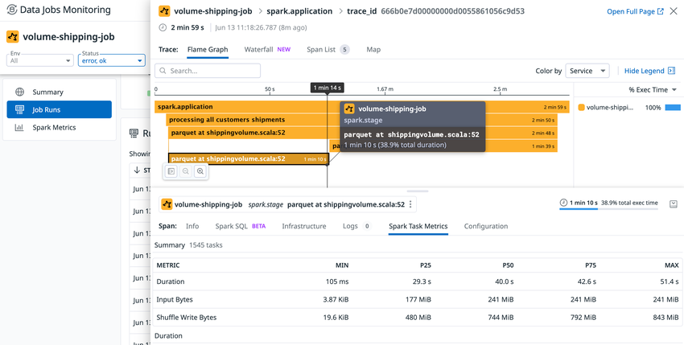

# Data Jobs Monitoring（現名称：Data Observability: Jobs Monitoring）

## 概要

Data Jobs Monitoring（データジョブ監視、略称 DJM）は、Apache Spark・Databricks などのデータ処理ジョブと、それを実行するクラスター／インフラの **パフォーマンス・信頼性・コスト効率** を可視化する Datadog の製品である。現在の公式名称は **Data Observability: Jobs Monitoring**（旧称：Data Jobs Monitoring）で、Data Observability スイートの一構成要素として位置づけられている。[出典](https://docs.datadoghq.com/data_observability/jobs_monitoring/)

- **一般提供（GA）開始**：2024-06-20（当時の名称は Data Jobs Monitoring、対象は Spark と Databricks ジョブ）。[出典](https://www.datadoghq.com/about/latest-news/press-releases/datadog-launches-new-product-to-observe-troubleshoot-and-optimize-data-processing-jobs/)
- **改称**：公式ドキュメント・料金ページは現在「Data Observability: Jobs Monitoring」表記。料金も「Clusters / Databricks Serverless / Orchestrators」の 3 区分に再編されている。改称時期は公式には明示されていないが、第三者の料金追跡サイトは 2026 年 1 月頃のパッケージ変更として記録している `【第三者情報】`。[出典](https://pricingsaas.com/companies/datadog.data-jobs-monitoring/diffs/2026W03)（2026-01 記録）
- 旧 URL `docs.datadoghq.com/data_jobs/` は現在も同内容を表示する（新 URL は `/data_observability/jobs_monitoring/`）。画面上のタイトルも、スクリーンショットにより「Data Jobs Monitoring」と「Data Observability」の両表記が混在する。

本ファイルが扱う範囲と、関連ファイルの分担は次のとおり。

| トピック | 本ファイル | 詳細の参照先 |
|---|---|---|
| Jobs Monitoring の対応範囲・セットアップ・画面・制限・課金単位 | ○ | — |
| Quality Monitoring（テーブル品質監視）、Data Catalog、CI/CD、Lineage 全般 | 概要のみ | [Data Observability](./data-observability.md) |
| Kafka 等ストリーミングパイプラインのレイテンシ監視 | 対象外 | [Data Streams Monitoring](../apm/data-streams-monitoring.md) |
| Spark ジョブのトレース基盤（Java トレーサ、スパン） | 概要のみ | [APM の概念とインジェスト制御](../apm/apm-concepts-and-ingestion.md)、[APM インスツルメンテーション](../apm/apm-instrumentation.md) |
| Databricks の DBU コストとクラウドコストの統合 | 概要のみ | [Cloud Cost Management](../infrastructure/cloud-cost-management.md) |
| モニターの共通仕様 | 概要のみ | [Monitors](../platform/monitors.md) |
| 料金の正本 | 概要のみ | [製品別料金表](../../03_導入編/pricing-by-product.md) |

## 対応テクノロジー

Data Observability: Jobs Monitoring が公式にサポートするテクノロジーは次のとおり（2026-11-02 時点）。[出典](https://docs.datadoghq.com/data_observability/jobs_monitoring/)

| 区分 | テクノロジー | 提供状況 | 主な収集方式 | 課金区分（料金ページ上） |
|---|---|---|---|---|
| ジョブ実行基盤 | Databricks（AWS / Azure / Google Cloud） | GA | Databricks API ポーリング + クラスター上の Agent + システムテーブルクエリ | Clusters（クラシック）／Databricks Serverless |
| ジョブ実行基盤 | AWS Glue | **【Preview】** | AWS API クローラ（Datadog AWS インテグレーション経由） | Orchestrators |
| ジョブ実行基盤 | Azure Data Factory | **【Preview】** | Azure API（Datadog Azure インテグレーション経由） | 公開情報では確認できず |
| オーケストレーター | Apache Airflow（OSS on Kubernetes / Amazon MWAA / Astronomer / Google Cloud Composer） | GA | OpenLineage プロバイダ | Orchestrators |
| オーケストレーター | dbt（dbt Cloud / dbt Core） | GA | dbt Cloud API + Webhook、または `openlineage-dbt` | Orchestrators |
| Apache Spark | Spark on Kubernetes（EMR on EKS を含む） | GA | Agent + Java トレーサ（Single Step Instrumentation） | Clusters |
| Apache Spark | Amazon EMR（EC2 上） | GA | ブートストラップアクションで Agent + Java トレーサ導入 | Clusters |
| Apache Spark | Google Cloud Dataproc（Compute Engine 上） | GA | 初期化アクションで Agent + Java トレーサ導入 | Clusters |

> 補足：AWS Glue と Azure Data Factory の Preview 表記は各セットアップページによる。[出典（Glue）](https://docs.datadoghq.com/data_observability/jobs_monitoring/glue/) [出典（ADF）](https://docs.datadoghq.com/data_observability/jobs_monitoring/azure_data_factory/)
>
> 補足：製品ページでは「Clusters、Serverless、Orchestrator の 3 つのジョブタイプ」と説明されている。[出典](https://www.datadoghq.com/product/data-observability/jobs-monitoring/)
>
> 補足：AWS Glue の課金区分は、料金ページの Orchestrators カード（「Airflow, dbt, AWS Glue, custom jobs」）による。Azure Data Factory は料金ページに記載がなく、課金区分は公開情報では確認できず。[出典](https://www.datadoghq.com/pricing/?product=jobs-monitoring)

> **サイト差異:** 公式ドキュメントでは、Data Observability: Jobs Monitoring は **US1-FED（`app.ddog-gov.com`）および `us2.ddog-gov.com` では非サポート** とされ、US1、US3、US5、EU1、AP1、AP2 で利用できる。[出典](https://docs.datadoghq.com/data_observability/jobs_monitoring/) 一方、料金ページの FAQ は「AP、EU、US の全データセンターで提供（GovCloud（US）を含む）」と書いており、公式情報どうしが食い違っている（2026-11-04 確認）。[出典](https://www.datadoghq.com/pricing/?product=jobs-monitoring) 本ファイルは仕様の記述として **ドキュメントの非サポート表記を優先** する。GovCloud で使う場合は、事前に Datadog 営業・サポートに提供可否を確認すること。なお [製品別料金表](../../03_導入編/pricing-by-product.md) は料金ページに従って「GovCloud（US）で提供」と書いており、本ファイルとの整合が必要である。

## アーキテクチャとデータの流れ

Data Observability: Jobs Monitoring は、ジョブの実行を **トレース（`spark.application` を根とするスパン）** として表現し、インフラメトリクス、ログ、ジョブ／クラスター設定、Lineage と関連付ける。収集経路は対象テクノロジーにより異なる。



Databricks の場合、公式ブログは次の 3 系統の収集経路を説明している。[出典](https://www.datadoghq.com/blog/how-to-monitor-databricks-with-datadog/)（2026-10-02 公開）

| 収集経路 | 収集内容 | 必要なもの |
|---|---|---|
| クラシッククラスター上の Datadog Agent | リアルタイムの Spark メトリクス、ホストのリソース使用率、Driver／Executor ログ | init script による Agent 導入 |
| Databricks API ポーリング | ジョブ／タスク実行の準リアルタイム情報（所要時間、ステータス、エラーメッセージ、タグ） | OAuth サービスプリンシパル（または旧 PAT） |
| システムテーブルクエリ | コストと Lineage | 専用の Databricks SQL Warehouse、Unity Catalog `system` カタログの読み取り権限 |

## 主要機能

Data Observability: Jobs Monitoring の主要機能は次のとおり。[出典](https://docs.datadoghq.com/data_observability/jobs_monitoring/) [出典](https://www.datadoghq.com/blog/data-jobs-monitoring/)（2024-06-20 公開）

| 機能 | 内容 |
|---|---|
| フリート全体の健全性把握 | クラウドアカウント・ワークスペースをまたいでジョブとクラスターを一覧化。失敗ジョブ、アイドル CPU が高く計算資源を浪費しているジョブを特定 |
| 推奨フィルター | 失敗ジョブ、実行時間スパイクのあるジョブ、過剰プロビジョニングのクラスターを抽出。ジョブ、ステータス、クラスター、環境、ワークスペース、カスタムタグ、ジョブ種別（バッチ／ストリーミング）で絞り込み |
| アラート | ジョブ失敗、想定完了時刻を超えた実行をモニターで通知。インストール済みインテグレーションに応じたモニターテンプレートを提供 |
| ジョブ分析 | ジョブ単位で実行履歴をまたいだ性能推移を確認。失敗実行のエラーメッセージを表示 |
| 実行（Run）分析 | Spark job／stage ごとの所要時間、リソース消費、Spark メトリクス（アイドル Executor CPU、入出力量、シャッフル、ディスクスピル）。ログ、ジョブ／クラスター設定へのリンク |
| インフラ相関 | Infrastructure タブで実行と Executor／Driver ノードの使用率を相関 |
| エラー | 失敗実行の Errors タブでスタックトレースを表示 |
| Spark Task Metrics | 特定ステージのタスクレベルメトリクスの分布（Min / P25 / P50 / P75 / Max）でデータスキューを特定 |
| 実行比較 | 複数実行を比較し、障害調査やプロビジョニング・設定のチューニングに利用 |
| Lineage | 失敗・遅延したジョブの上流原因と下流影響を評価 |
| コストビュー | ジョブ一覧を Health / Cost ビューで切替。アイドル CPU、推定コスト、コスト変化、月間削減見込みで並べ替え |
| Recommendations **【Preview】** | Spark 設定・コード／クエリ・インフラの最適化提案（後述） |

### Recommendations（最適化提案）

Recommendations は、コストと所要時間への影響が大きい Spark／Databricks ジョブを特定し、改善案を提示する機能で、2026-06 時点で **Public Preview** と案内されている。[出典](https://www.datadoghq.com/blog/optimize-spark-and-databricks-jobs-with-datadog/)（2026-06-09 公開）

| 提案種別 | 例 |
|---|---|
| Spark 設定 | `spark.sql.shuffle.partitions` の適正化、`spark.executor.memory` の調整 |
| コード／クエリ | プレディケートプッシュダウン、結合種別の変更、データスキュー対策の結合キーのソルティング、冗長な集約の除去 |
| インフラ | より適切なノードインスタンスタイプの選択、クラスターのライトサイジング |

Recommendations の関連仕様は次のとおり。

- 各提案には削減見込みが付く。見込み額はリソース消費量（Databricks では DBU 使用量）に基づく。AWS／Azure／Google Cloud の [Cloud Cost Management](../infrastructure/cloud-cost-management.md) を有効化していると実コストに基づき精度が上がる。[出典](https://www.datadoghq.com/blog/optimize-spark-and-databricks-jobs-with-datadog/)
- 削減額のしきい値や最適化種別を条件に、チームへ通知できる。
- 「View fix and create PR」で Bits Code による Pull Request 作成、「Optimize with Bits」で Bits AI による Spark クエリ／ステージ解析が可能（コードに基づく提案には Source Code Integration が必要）。詳細は [Bits AI と AI 機能](../ai/bits-ai.md)。
- Datadog MCP Server に Spark 向けツール `get_spark_health`（ジョブ全体の健全性と最も遅いステージ）、`get_spark_sql_plan`（特定トレースの実行計画とステージメトリクス）がある。MCP Server と Bits による Spark 最適化分析は GA と案内されている。
- クラスターのライトサイジング提案は Jira Issue 化、または Databricks コンソールで適用できる。[出典](https://www.datadoghq.com/blog/how-to-monitor-databricks-with-datadog/)

## 画面構成

Data Observability: Jobs Monitoring の画面は、Datadog のナビゲーションから **Data Observability > Jobs** で開く。上部タブは `Overview`、`Monitors`、`Datasets`、`Jobs`、`Queries`【Preview】、`Lineage`、`Schema Changes`【Preview】、`CI/CD`【Preview】で構成され、右上の `Settings` からインテグレーション設定に進む（下記スクリーンショット時点の表示）。

### Jobs 一覧（Overview）



- **キャプション**：Data Observability: Jobs Monitoring のジョブ一覧（Jobs タブ）画面。
- **画面説明**：
  - 上部にフィルターバー（`Filter by job, cluster, tags and more...`）、`Env`、`Workspace` のドロップダウン、時間範囲（例：Past 1 Week）。
  - その下にサマリーカード：アラート中のモニター数、失敗実行のあるジョブ数、推奨事項のあるクラスター数と推定削減額（例：`Est. savings: $1k/month`）、所要時間スパイクのあるジョブ数、コストスパイクのあるクラスター数。
  - `BATCH JOBS`、`STREAMING JOBS`、`CLUSTERS` の 3 タブがあり、それぞれ推定コストと前期間比を表示。
  - グラフ：`JOB RUNS`（Failed / Success の積み上げ棒）、`RUN DURATION`（Avg / p75 / p90 / p95）、`EST COST`。
  - ジョブ表：`TYPE`（Spark、Databricks、Airflow、dbt、Glue などのアイコン）、`NAME`（タグ付き）、`MONITORS`、`LAST STATUS`、`LAST DURATION`、`JOB RUNS`、`FAILURE RATE`、`AVG DURATION`、`% CHANGE`。表上部に `Analyze`（NEW）／`Health`／`Cost` 切替、テクノロジーフィルター（All Technologies）、`+ Add Monitor` ボタン。
- **出典**：https://docs.datadoghq.com/data_observability/jobs_monitoring/ （画像取得日 2026-11-02）

### ジョブ詳細画面



- **キャプション**：Spark アプリケーション「product-insights」のジョブ詳細画面。
- **画面説明**：
  - 左メニューに `Summary`、`Job Runs`、`Spark Metrics`。上部に `Env`、`Status` フィルター。
  - Summary には `Runs`（失敗／成功の実行数推移）、`Average Run Duration`（秒）、`Estimated Cost`（セント単位）の 3 グラフ。
  - 下部の `Runs` 表に `STARTED`、`STATUS`、`ENV`、`SPARK APP ID`、`DURATION`、`IDLE CPU`、`EST. COST`。右上に `View in Trace Explorer` リンク。
- **出典**：https://docs.datadoghq.com/data_observability/jobs_monitoring/ （画像取得日 2026-11-02）

### Run サイドパネル：Infrastructure タブ



- **キャプション**：個別実行（Run）のサイドパネルで Infrastructure タブを表示した画面。
- **画面説明**：
  - 上部に `spark.application` スパンのトレース（`Flame Graph`、`Waterfall`、`Span List`、`Map` 切替）。実行時間の百分位（例：p92）と所要時間を表示。
  - 下部のスパン詳細タブ：`Info`、`Errors`（件数バッジ）、`Infrastructure`、`Logs`、`Configuration`。
  - Infrastructure タブは `Container` / `Host` を切替でき、コンテナ名（例：`spark-kubernetes-driver`）、Docker イメージ、Pod 名、コンテナタグを表示する。
- **出典**：https://docs.datadoghq.com/data_observability/jobs_monitoring/ （画像取得日 2026-11-02）

### Run サイドパネル：Spark Task Metrics タブ



- **キャプション**：`spark.stage` スパンを選択し Spark Task Metrics タブを表示した画面。
- **画面説明**：
  - Flame Graph で `spark.application` > `spark.stage`（例：`parquet at shippingvolume.scala:52`、総実行時間の 38.9%）を選択。
  - スパン詳細タブ：`Info`、`Spark SQL`【BETA】、`Infrastructure`、`Logs`、`Spark Task Metrics`、`Configuration`。
  - Spark Task Metrics はステージ内の全タスク（例：1545 tasks）について、`Duration`、`Input Bytes`、`Shuffle Write Bytes` などを `MIN`／`P25`／`P50`／`P75`／`MAX` で表示し、偏り（データスキュー）を判断できる。
- **出典**：https://docs.datadoghq.com/data_observability/jobs_monitoring/ （画像取得日 2026-11-02）

### トレース上のスパン名

画面上で確認できるスパン名（オペレーション名）は次のとおり。網羅的なスパン一覧は公開情報では確認できず。

| スパン名 | 意味 | 出典 |
|---|---|---|
| `spark.application` | Spark アプリケーション全体（ルートスパン） | 公式スクリーンショット、Glue セットアップ手順 |
| `spark.sql_job` | Spark SQL ジョブ | [Glue セットアップ手順](https://docs.datadoghq.com/data_observability/jobs_monitoring/glue/) |
| `spark.stage` | Spark ステージ | 公式スクリーンショット |

## セットアップ：Databricks

Databricks 向け Jobs Monitoring のセットアップ要件と設定は次のとおり。[出典](https://docs.datadoghq.com/data_observability/jobs_monitoring/databricks/)

### 前提条件

| 項目 | 要件 |
|---|---|
| ネットワーク | ワークスペースにネットワーク制限がある場合、Datadog の Webhook IP レンジを許可リストに追加。Private Link ワークスペースでは Private Action Runner が必要 |
| SQL Warehouse | **Pro または Serverless**（Classic は非対応）。Warehouse の Permissions タブで、プリンシパル（サービスプリンシパルまたはトークンのプリンシパル）に **CAN USE** を付与する。コスト削減のため専用 2XS、Auto Stop 5〜10 分を推奨 |
| Unity Catalog システムテーブル | `system` カタログに `USE CATALOG`、`USE SCHEMA`、`SELECT`。付与作業者は `CATALOG system` に `MANAGE` が必要 |
| クエリテキスト | プリンシパルをアカウントレベルグループ `databricks_pii_access`（大文字小文字区別）に追加。Serverless ジョブ監視、SQL Warehouse／クエリ監視に必須 |

### 認証方式

| 方式 | 条件・仕様 |
|---|---|
| **OAuth サービスプリンシパル**（新規連携は必須） | エンタイトルメント：Workspace access、Databricks SQL access、Admin access（`admins` グループ相当。不可の場合は個別権限）。Databricks 管理または Microsoft Entra ID 管理のサービスプリンシパル（後者は「Use Microsoft Entra ID managed service principal」にチェックしテナント ID を入力）。クライアントシークレットは最大有効期間 **730 日** で発行。ワークスペースの Permissions タブで Manage 権限を付与。**OAuth に移行後は PAT に戻せない** |
| Personal Access Token（レガシー） | **2025-07-07 より前に連携したワークスペースのみ**。最大有効期間 730 日のトークンを推奨。Datadog 管理 init script には Workspace Admin、手動導入ではジョブ／クラスターへの CAN VIEW が必要 |

### 個別権限（Workspace Admin を付与できない場合）

| オブジェクト | 権限 |
|---|---|
| Job | CAN VIEW |
| Compute | CAN ATTACH TO |
| Lakeflow Declarative Pipelines | CAN VIEW |
| Query | CAN VIEW |
| SQL warehouse | CAN MONITOR（セットアップで指定する Warehouse には別途 CAN USE も必要） |

システムテーブルの個別権限は、`system.access.column_lineage`、`system.billing.usage`、`system.access.workspaces_latest`、`system.billing.list_prices`、`system.billing.account_prices` の 5 テーブルに `USE CATALOG`、`USE SCHEMA`、`SELECT`。

### Agent の導入方式

Datadog Agent は **All-purpose クラスターと Job クラスターで必要、Serverless コンピュートでは不要**。

| 方式 | 備考 |
|---|---|
| **Managed by Datadog（推奨）** | 全クラスターの起動時にグローバル init script を導入。Workspace Admin トークンが必要。**Standard アクセスモードのクラスターでは動作しない** |
| クラスターポリシーで手動設定 | Standard アクセスモードではこれを推奨。init script を Unity Catalog Volume に置き、`spark_env_vars` で環境変数を設定。Standard モードは Unity Catalog の allowlist への追加も必要 |
| グローバル init script を手動導入 | Settings > Compute > Global init scripts。Standard アクセスモードでは動作しない |
| 特定クラスターに手動導入 | Advanced options > Init Scripts タブ、環境変数は Spark タブ |

Volume の権限はクラスターを実行するプリンシパルではなく **クラスターオーナー** に対して評価されるため、関係ユーザーに `READ VOLUME` と `USE CATALOG` を付与する。

init script のバージョンを固定する場合、`install-databricks.sh` をバージョン付きファイル名（例：`install-databricks-0.14.0.sh`）に置き換える。

### init script の環境変数

| 変数 | 説明 | デフォルト |
|---|---|---|
| `DD_API_KEY` | Datadog API キー | 必須 |
| `DD_SITE` | Datadog サイト（AP1 は `ap1.datadoghq.com`） | 必須 |
| `DATABRICKS_WORKSPACE` | インテグレーションに登録したワークスペース名と一致させる（空白を含む場合は引用符で囲む） | 必須 |
| `DRIVER_LOGS_ENABLED` | Spark Driver ログを収集 | `false` |
| `WORKER_LOGS_ENABLED` | Spark Worker ログを収集 | `false` |
| `DD_TAGS` | クラスター／Spark メトリクスに付与するタグ（カンマまたは空白区切りの `key:value`、例：`env:staging,team:data_engineering`） | なし |
| `DD_ENV` | `env` タグを上書き | ワークスペース名 |
| `DD_LOGS_CONFIG_PROCESSING_RULES` | ログの処理ルール | なし |
| `DD_SERVICE` | 任意設定として言及あり | — |

Datadog 管理方式の画面では「Enable Log Collection」トグルが任意で、無効化できる。

### クラスター種別ごとの反映タイミング

| クラスター種別 | 反映 |
|---|---|
| All-purpose クラスター | セットアップ後に手動再起動が必要 |
| Job クラスター（長時間稼働） | 手動再起動が必要 |
| スケジュール実行の Job クラスター | 次回実行時に init script が Agent を導入 |
| Serverless コンピュート | Agent 不要。ただしクエリテキストへのアクセス（`databricks_pii_access`）が必要 |

### タグ

- Databricks のカスタムクラスタータグは自動取得される（**Azure リソースグループ由来のタグは除く**）。`DD_TAGS` でも同等に付与できる。
- 単発実行（one-time run）では、各 `new_cluster` の `spark_env_vars` に `DD_JOB_NAME` をジョブの `run_name` と同じ値で設定すると、実行をまたいでクラスターメトリクスを集約できる。
- 実行時 Spark タグは `sparkContext.setLocalProperty("spark.datadog.tags.key", "value")` で設定（設定後に開始したスパンのみに適用）。

### 注意事項

- `databricks_pii_access` 外のプリンシパルには、Databricks がクエリテキストを `<Redacted>` とマスクする。コストデータ、クラスター上のジョブ監視、テーブルレベルの Quality Monitoring には影響しない。
- 対応 Databricks Runtime バージョンの一覧は公開情報では確認できず。
- Databricks インテグレーションタイルでは Jobs Monitoring のほか Cloud Cost Management、Log Management、Infrastructure Monitoring、Reference Tables、Data Observability、Model Serving を個別に有効化できる。Infrastructure Monitoring 単体ではクラスターのリソース使用率と Spark メトリクスという限定的な機能のみ。[出典](https://docs.datadoghq.com/integrations/databricks/)

## セットアップ：Amazon EMR

Amazon EMR（EC2 上）向け Jobs Monitoring のセットアップは次のとおり。EMR on EKS は Kubernetes 手順を使う。[出典](https://docs.datadoghq.com/data_observability/jobs_monitoring/emr/)

| 項目 | 内容 |
|---|---|
| 対応バージョン | **Amazon EMR リリース 6.0.1 以降** |
| 手順 | ① API キーを AWS Secrets Manager に格納（推奨）② EMR EC2 インスタンスプロファイルに権限付与 ③ ブートストラップアクション付きでクラスター作成 ④ Spark アプリケーションごとのサービスタグ設定 |
| Secrets Manager | 種別「Other type of secret」、キー `dd_api_key`、推奨シークレット名 `datadog/dd_api_key`。自動ローテーションは任意 |
| IAM（Secrets Manager 利用時） | シークレット ARN への `secretsmanager:GetSecretValue` |
| IAM（デフォルトロール `EMR_EC2_DefaultRole` 以外を使う場合） | `elasticmapreduce:ListBootstrapActions`、`elasticmapreduce:ListInstanceFleets`、`elasticmapreduce:DescribeCluster`、`elasticmapreduce:ListInstanceGroups`（リソース `*`） |
| ブートストラップアクション | スクリプトを S3 に置き、ブートストラップアクション（推奨名 `datadog_agent`）として追加。スクリプトは `DD_SITE` 設定、`jq` で Secrets Manager から `DD_API_KEY` 取得、`DD_OPENLINEAGE_ENABLED=true` 設定、`install-emr.sh` を実行 |
| バージョン固定 | `install-emr-0.13.5.sh` のようにバージョン付きファイル名を指定 |
| 確認 | Jobs Monitoring 画面にジョブが表示されること。表示されない場合はクラスターに SSH し `sudo datadog-agent status` |

| 環境変数 | 説明 | デフォルト |
|---|---|---|
| `DD_SITE` | Datadog サイト | 公開情報では確認できず（スクリプトで設定） |
| `DD_API_KEY` | API キー（スクリプトで Secrets Manager から取得） | — |
| `DD_TAGS` | クラスター・Spark メトリクスのタグ | — |
| `DD_ENV` | メトリクス・トレース・ログの `env` タグ | — |
| `DD_EMR_LOGS_ENABLED` | Spark Driver／Worker ログを送信 | `false` |
| `DD_LOGS_CONFIG_PROCESSING_RULES` | ログのフィルタリングルール | — |
| `DD_OPENLINEAGE_ENABLED` | Lineage（上流・下流テーブル）を収集 | `false`（公式サンプルスクリプトでは `true`） |

## セットアップ：Google Cloud Dataproc

Google Cloud Dataproc 向け Jobs Monitoring のセットアップは次のとおり。Dataproc on GKE は Kubernetes 手順を使う。[出典](https://docs.datadoghq.com/data_observability/jobs_monitoring/dataproc/)

| 項目 | 内容 |
|---|---|
| 対応 | **Dataproc on Compute Engine、Dataproc リリース 2.0.x 以降**。Debian、Rocky Linux、Ubuntu の標準イメージすべて |
| Secret Manager | シークレット名 `dd_api_key`。リソース ID は `projects/<PROJECT_NAME>/secrets/<SECRET_NAME>`。クラスターのサービスアカウント（デフォルトは Compute Engine デフォルト SA）に `secretmanager.secretAccessor` または `secretmanager.versions.access` を含むロールを付与 |
| 初期化アクション | スクリプトを GCS に置き、Customize cluster の Initialization Actions に指定。`DD_SITE`、`PROJECT_NAME`、`SECRET_NAME` を設定し `gcloud secrets versions access latest` で `DD_API_KEY` を取得、`install.datadoghq.com/scripts/install-dataproc.sh` を実行。各ノードに Agent と Java トレーサを導入 |
| バージョン固定 | 例：`install-dataproc-0.13.5.sh` |
| 任意の環境変数（初期化スクリプト内） | `DD_TAGS`（クラスター・Spark メトリクスのタグ）、`DD_ENV`（`env` タグ） |
| ログ | 任意で Dataproc ログ収集を有効化し、アプリケーションログと Spark ジョブトレースを相関 |
| 確認 | `sudo datadog-agent status` |

## セットアップ：Spark on Kubernetes

Kubernetes 上の Spark（EMR on EKS、Dataproc on GKE を含む）向け Jobs Monitoring は、Datadog Agent と Admission Controller による **Single Step Instrumentation（SSI）** で Java トレーサを Driver／Executor Pod に注入する。[出典](https://docs.datadoghq.com/data_observability/jobs_monitoring/kubernetes/)

### バージョン要件

| コンポーネント | 最低バージョン |
|---|---|
| Datadog Agent | **7.64.0 以降**（旧版ドキュメントでは 7.55.0 以降と記載。最新の英語版を優先） |
| Java トレーサ（`dd-trace-java`） | 1.38.0 以降 |
| Lineage（任意） | Java トレーサ 1.48.0 以降 + `openlineage-spark` 1.29.0 以降 |
| Datadog Operator（SSI 利用時） | 1.13.0 以降 |
| Kubernetes | v1.20.X 以降（Operator の前提） |
| Spark バージョン | 公開情報では確認できず |

### Agent 設定の要点

| 設定 | Datadog Operator（`DatadogAgent`, `datadoghq.com/v2alpha1`） | Helm（`datadog-values.yaml`） |
|---|---|---|
| APM 有効化 | `features.apm.enabled: true`、`features.apm.hostPortConfig.enabled: true`、`hostPort: 8126` | `datadog.apm.portEnabled: true`、`datadog.apm.port: 8126` |
| Admission Controller | `features.admissionController.enabled: true`、`mutateUnlabelled: false` | `clusterAgent.admissionController.enabled: true`、`muteUnlabelled: false`（公式ページの表記。Helm チャートの実キー名を確認のこと） |
| ログ（任意） | `features.logCollection.enabled: true`、`containerCollectAll: true` | `datadog.logs.enabled`、`datadog.logs.containerCollectAll` |
| API キー | `global.credentials.apiSecret`（`secretName: datadog-secret`、`keyName: api-key`） | `datadog.apiKeyExistingSecret: datadog-secret` |
| SSI 設定位置 | `features.apm.instrumentation` | `datadog.apm.instrumentation` |

### SSI のターゲット定義

| ターゲット名 | Pod セレクタ | `ddTraceConfigs` |
|---|---|---|
| `spark-driver` | `spark-role: driver` | `DD_DATA_JOBS_ENABLED: "true"`、`DD_INTEGRATIONS_ENABLED: "false"`（Lineage 時は `DD_DATA_JOBS_OPENLINEAGE_ENABLED: "true"` を追加） |
| `spark-executor` | `spark-role: executor` | `DD_DATA_JOBS_ENABLED: "true"`、`DD_INTEGRATIONS_ENABLED: "false"` |

両ターゲットとも `namespaceSelector.matchNames` で名前空間を指定し、`ddTraceVersions.java: "latest"` を設定する。適用後は対象 Pod の再起動が必要。

### Spark 側のサービスタグ

```text
spark.driver.extraJavaOptions=-Ddd.service=<JOB_NAME> -Ddd.env=<ENV> -Ddd.version=<VERSION>
spark.executor.extraJavaOptions=-Ddd.service=<JOB_NAME> -Ddd.env=<ENV> -Ddd.version=<VERSION>
```

### 注意事項

- `DD_INTEGRATIONS_ENABLED: "false"` は対象 Pod 内の他のトレーサインテグレーション（AWS SDK、JDBC、HTTP クライアント等）を無効化する。
- クライアントモードでは `spark-driver` ターゲットが submit 元 Pod にマッチする。その Pod が独自に APM トレースを送る場合は integrations を無効化しないこと。
- OpenLineage 利用時、`openlineage-spark` JAR を Driver／Executor のクラスパスに置く。`spark.extraListeners` や `spark.openlineage.transport.*` の設定は不要。
- ログ収集を有効にすると、デフォルトで検出された全コンテナのログが対象になる（ログ課金に注意）。

Kubernetes Agent の一般的な設定は [コンテナ/Kubernetes向けAgent](../platform/kubernetes-and-containers-agent.md) を参照。

## Spark 系共通：サービスタグと実行時タグ

EMR、Dataproc、Kubernetes の Spark ジョブでは、Jobs Monitoring 上の **ジョブ名は `-Ddd.service` の値** になる。[出典](https://docs.datadoghq.com/data_observability/jobs_monitoring/emr/)

| 設定 | 指定箇所 | 用途 |
|---|---|---|
| `-Ddd.service` | `spark.driver.extraJavaOptions` と `spark.executor.extraJavaOptions` の両方 | ジョブ名 |
| `-Ddd.env` | 同上 | `env` タグ |
| `-Ddd.version` | 同上 | `version` タグ |
| `-Ddd.tags` | 同上（EMR / Dataproc） | 任意タグ（`<KEY>:<VALUE>`） |
| `sparkContext.setLocalProperty("spark.datadog.tags.key", "value")` | アプリケーションコード | 実行時タグ。追加後に開始したスパンにのみ適用。値を `null` にすると削除 |

タグ設計の全般は [Tagging](../platform/tagging.md) と [タグ戦略の実践](../../04_応用編/tagging-strategy.md) を参照。

## セットアップ：Apache Airflow

Airflow 向け Jobs Monitoring は、`apache-airflow-providers-openlineage` が送る OpenLineage イベントを Datadog のインテーク（`https://data-obs-intake.<YOUR_DATADOG_SITE>`）で受け取る方式である。[出典](https://docs.datadoghq.com/data_observability/jobs_monitoring/airflow/)

### 要件

| 環境 | 要件 |
|---|---|
| Airflow 共通 | **Airflow 2.7 以降（Airflow 3 を含む）**。Kubernetes、Amazon MWAA ともにこの最低要件 |
| Datadog Transport 方式 | プロバイダ 2.7.3 以降 + `openlineage-python` 1.37.0 以降 |
| Composite Transport 方式 | プロバイダ 1.11.0 以降 + `openlineage-python` 1.37.0 以降 |
| Astronomer | Astro Runtime 12.1.0 以降、プロバイダ 1.11.0 以降、`openlineage-python` 1.23.0 以降 |
| Google Cloud Composer | Cloud Composer 2 以降 |

### 推奨プロバイダバージョン

| Airflow | 推奨 `apache-airflow-providers-openlineage` | 主な最低要件 |
|---|---|---|
| 2.11 以降（3 を含む） | `2.20.3`（Python 3.11 以降が必要） | `openlineage-python>=1.52.0` |
| 2.10.x | `2.8.0` | `openlineage-python>=1.38.0` |
| 2.9.x | `2.2.0` | `openlineage-python>=1.31.0` |
| 2.8.x | `1.14.0` | `openlineage-python>=1.24.2` |
| 2.7.x | `1.10.0` | `openlineage-python>=1.16.0` |

### 環境別の設定

| 環境 | 設定方法 |
|---|---|
| Kubernetes（OSS） | スケジューラと **ワーカーの両方** の `requirements.txt` でプロバイダをピン留め。① Datadog Transport（推奨）：`DD_API_KEY`、`DD_SITE`、`OPENLINEAGE__TRANSPORT__TYPE=datadog`、`OPENLINEAGE_NAMESPACE` ② Composite Transport：既存 Transport に `OPENLINEAGE__TRANSPORT__TRANSPORTS__DATADOG__TYPE=datadog` を追加 ③ Simple：`OPENLINEAGE_URL`、`OPENLINEAGE_API_KEY`、`OPENLINEAGE_NAMESPACE`（全プロバイダ版で可）。Airflow 2.7/2.8 で ③ を使う場合は `AIRFLOW__OPENLINEAGE__CONFIG_PATH=""`、`AIRFLOW__OPENLINEAGE__DISABLED_FOR_OPERATORS=""` も設定。最後に Pod 再起動 |
| Amazon MWAA | `requirements.txt` にプロバイダ追加、startup script で `OPENLINEAGE_URL`、`OPENLINEAGE_API_KEY`、`AIRFLOW__OPENLINEAGE__NAMESPACE` を設定し S3 にアップロード。Airflow 2.7.2 / 2.8.1 / 2.9.2 は MWAA のアップグレードガイドに従いバージョン制約を修正 |
| Astronomer | Astro UI または Dockerfile で設定（**`.env` ファイルは不可**）：`OPENLINEAGE__TRANSPORT__TYPE=composite`、`OPENLINEAGE__TRANSPORT__TRANSPORTS__DATADOG__TYPE=http`、`...__URL`、`...__AUTH__TYPE=api_key`、`...__AUTH__API_KEY`、`...__COMPRESSION=gzip` |
| Google Cloud Composer | Airflow configuration override で `[openlineage] disabled=False`、`transport` に JSON（`"type": "http"`、`"url"`、`"auth": {"type": "api_key", "api_key": ...}`）、任意で `namespace`。**既存の Dataplex Transport 設定は上書きされ、Dataplex Lineage とは非互換** |

### 主な環境変数

| 変数 | 用途 |
|---|---|
| `OPENLINEAGE_URL` | インテーク URL `https://data-obs-intake.<YOUR_DATADOG_SITE>` |
| `OPENLINEAGE_API_KEY` | URL ベース設定時の Datadog API キー |
| `OPENLINEAGE_NAMESPACE` / `AIRFLOW__OPENLINEAGE__NAMESPACE` | Datadog 上の `env` タグ（前者は Kubernetes、後者は MWAA・Astronomer） |
| `OPENLINEAGE__TRANSPORT__TYPE` | `datadog` または `composite` |
| `OPENLINEAGE_CLIENT_LOGGING` | `DEBUG` でトラブルシュート |
| `AIRFLOW__OPENLINEAGE__SPARK_INJECT_PARENT_JOB_INFO` | `true` で Spark ジョブに親ジョブ情報を注入（プロバイダ 2.1.0 以降、Airflow 2.9 以降） |
| `AIRFLOW__OPENLINEAGE__EMISSION_POLICY` / `[openlineage] emission_policy` | 特定 DAG の送信除外（プロバイダ 2.19.0 以降 + Airflow 2.11 以降）。例：`[{"scope": {"dag_id": "<YOUR_DAG_ID>"}, "controls": {"emit": false}}]`、`"match_mode": "regex"` で正規表現 |

### ログ収集（任意）

- Kubernetes：クラスター上の Agent が必要。ログはデフォルトのファイル名形式であること。Pod に `ad.datadoghq.com/base.logs: '[{"type": "file", "path": "PATH_TO_AIRFLOW_LOGS/*/*/*/*.log", "source": "airflow"}]'` アノテーションを付与し、ログディレクトリをアプリ／Agent 両コンテナにマウント（`PATH_TO_AIRFLOW_LOGS` は通常 `$AIRFLOW_HOME/logs`）。
- Amazon MWAA：CloudWatch Logs に出力し、AWS インテグレーション経由で転送（[AWS Integration](../platform/aws-integration.md)、[ログ収集](../logs/log-collection.md)）。

### 既知の制限

- Airflow 2.x で DAG run／タスクを手動で failed にマークしても、Jobs Monitoring のステータスは更新されない（スパン長・所要時間メトリクスが不正確になりうる）。
- Cloud Composer の Dataplex Lineage とは非互換。
- 検証には OpenLineage Validation DAG が利用できる。

## セットアップ：dbt

dbt 向け Jobs Monitoring は、dbt のジョブ実行メタデータとモデル Lineage を読み取り、ウェアハウスのテーブルと dbt モデルを対応付ける。[出典](https://docs.datadoghq.com/data_observability/jobs_monitoring/dbt/)

| 項目 | dbt Cloud | dbt Core |
|---|---|---|
| 資格情報 | dbt Cloud サービストークン | Datadog API キー |
| トークン権限 | Webhook 自己管理：Stakeholder/Read-Only（プロジェクトスコープ）。Datadog 管理 Webhook：Developer（Enterprise）または Account Admin（Team） | — |
| パッケージ | 不要 | `openlineage-dbt` 1.39.0 以降（CI/CD ドリフト検知は 1.46.0 以降） |
| 接続手順 | Data Observability > Settings > dbt Cloud の Configure で Account Name / Account Id / Account Url / API Token を登録し、Webhook（Job Run Started / Job Run Completed）を自己管理または Datadog 管理で構成 | `pip3 install openlineage-dbt>=1.39.0`、環境変数 `DD_SITE`、`DD_API_KEY`、`OPENLINEAGE__TRANSPORT__TYPE=datadog`、`OPENLINEAGE_NAMESPACE` を設定し、`dbt` を `dbt-ol` に置き換え |

dbt Core の実行例：

```shell
dbt-ol run   --consume-structured-logs --openlineage-dbt-job-name <YOUR_DBT_JOB_NAME>
dbt-ol test  --consume-structured-logs --openlineage-dbt-job-name <YOUR_DBT_JOB_NAME>
dbt-ol build --consume-structured-logs --openlineage-dbt-job-name <YOUR_DBT_JOB_NAME>
```

- `--consume-structured-logs` を付けると実行中のランが見える。テスト失敗は `dbt-ol test`／`build` 経由でのみ表示される。
- 新規 Webhook がトラフィックを受け付けるまで最大 5 分。Datadog 側で設定を削除しても dbt Cloud 側の Webhook は手動削除が必要。
- Airflow から dbt Core を実行する場合は、Airflow 連携を先に構成し、`openlineage-dbt` 1.39.0 以降で `OPENLINEAGE_PARENT_*`、`OPENLINEAGE_ROOT_PARENT_*` を dbt タスクに設定すると親子関係が相関される。[出典](https://docs.datadoghq.com/data_observability/jobs_monitoring/airflow/)
- CI/CD ドリフト検知（`OPENLINEAGE__FACETS__SOURCE_CODE_LOCATION__DISABLED=false`）の詳細は [Data Observability](./data-observability.md) を参照。

## セットアップ：AWS Glue【Preview】

AWS Glue 向け Jobs Monitoring は **Preview** であり、Datadog AWS インテグレーションの IAM ロールに Glue 読み取り権限を追加し、Datadog 側のクローラがジョブとジョブ実行を取得する。[出典](https://docs.datadoghq.com/data_observability/jobs_monitoring/glue/)

| 手順 | 内容 |
|---|---|
| 1. 有効化 | Data Observability > Settings で AWS Glue の Configure |
| 2. アカウント選択 | 連携済み AWS アカウントを選択（または追加） |
| 3. IAM 権限 | Datadog ロールに Glue の読み取り（カタログ、DB、テーブル、ジョブ、ジョブ実行）、`s3:ListBucket`、`kms:Decrypt`、`lakeformation:GetDataAccess`、Iceberg メタデータ用に `s3:GetObject`／`s3:GetObjectVersion`（`*/metadata/*` に限定）を付与 |
| 4. クローラ設定 | 対象リージョンを選択し Job Monitoring トグルを ON。クローラは数分ごとに実行 |
| 5. ログ（任意） | CloudWatch Logs の `/aws-glue/jobs/error`、`/aws-glue/jobs/output`、`/aws-glue/jobs/logs-v2` を転送し、`host` 属性が一致する Log Index を作成 |
| 6. メトリクス（任意） | Glue インテグレーションタイルを有効化 |
| 7. Lineage（任意、Spark エンジンのジョブのみ） | `SparkSession` に OpenLineage リスナー、HTTP transport（`https://data-obs-intake.<YOUR_DATADOG_SITE>`）、API キーを設定し、`spark.openlineage.capturedProperties` に `spark.glue.JOB_RUN_ID` を指定。新しいコネクタを使う場合は `--extra-jars` と `--user-jars-first=true` |
| 8. 確認 | Flame Graph に `spark.application`、`spark.sql_job` スパンが出ること |

## セットアップ：Azure Data Factory【Preview】

Azure Data Factory（ADF）向け Jobs Monitoring は **Preview** で、Datadog Azure インテグレーションの App Registration にラン履歴の読み取り権限を付与して収集する。[出典](https://docs.datadoghq.com/data_observability/jobs_monitoring/azure_data_factory/)

| 項目 | 内容 |
|---|---|
| 必須アクション | `Microsoft.DataFactory/factories/querypipelineruns/action`、`Microsoft.DataFactory/factories/pipelineruns/queryactivityruns/action`、`Microsoft.DataFactory/factories/querytriggerruns/action`（**Monitoring Reader には含まれない**。無いとファクトリとパイプラインは一覧化されるがランは収集されない） |
| 権限付与 | 推奨：上記 + ファクトリ読み取りのカスタムロール（作成には Owner または User Access Administrator）。代替：組み込み Data Factory Contributor（書き込み・削除も含むためファクトリ単位でスコープ） |
| 設定 | Data Observability > Settings > Integrations で Azure Data Factory の Configure、App Registration とサブスクリプションを選択 |
| 確認 | Jobs Monitoring のジョブ種別セレクタで「ADF Pipelines」を選び、データファクトリ別にタグ付けされたパイプラインが表示されること |
| 収集内容 | 数分ごとの新規パイプライン／アクティビティラン、開始・終了時刻、所要時間、ステータス、失敗時エラーメッセージ、起動トリガー、`env` タグ（= データファクトリ名）、パイプラインアノテーションとアクティビティのユーザープロパティ（タグ化） |
| Lineage | 実行時に解決された値に基づく。Copy アクティビティはソース／シンク、SQL アクティビティは読み書きテーブル。対応コネクタ：Snowflake、BigQuery、Redshift、SQL Server／Azure SQL、Databricks Delta Lake、S3、Blob Storage、Data Lake Storage |

## Lineage との関係

Data Observability の Lineage は、Quality Monitoring と Jobs Monitoring のインテグレーションが収集したメタデータから自動構築される。ジョブはグラフ上のノードとして表示され、タスクや DAG などジョブ種別でフィルターできる。Jobs Monitoring の失敗などのステータスがグラフ上に表示され、フラグの付いたノードから直近のジョブ実行を開ける。関係は **選択した時間範囲内のクエリ履歴とジョブ実行** から導出されるため、頻度の低い依存関係は時間範囲を広げないと表示されない。[出典](https://docs.datadoghq.com/data_observability/lineage/)

Lineage の詳細は [Data Observability](./data-observability.md) を参照。

## モニター（アラート）

Data Observability: Jobs Monitoring のアラートは Datadog Monitors で構成する。[出典](https://docs.datadoghq.com/data_observability/jobs_monitoring/) [出典](https://www.datadoghq.com/blog/how-to-monitor-databricks-with-datadog/)

| 項目 | 内容 |
|---|---|
| 検知対象 | ジョブ失敗、想定完了時刻を超えた実行（遅延・長時間実行） |
| テンプレート | インストール済みインテグレーションに応じたモニターテンプレート（Monitors > Templates） |
| リトライの扱い | Data Observability のジョブモニターはリトライを考慮し誤検知を減らすと説明されている |
| 一覧画面との連携 | モニターの状態が Jobs 一覧の `MONITORS` 列に表示され、`+ Add Monitor` から作成できる。タグでスコープ可能 |
| 関連モニター | Quality モニター（鮮度・ボリューム等）、Databricks Model Serving テンプレート、Cloud Cost モニター |

モニタータイプ名、評価ウィンドウ等の詳細パラメータは公開情報では確認できず。モニターの共通仕様は [Monitors](../platform/monitors.md)、通知は [通知と Downtime](../platform/notifications-and-downtimes.md) を参照。

## 制限値・クォータ・デフォルト値

Data Observability: Jobs Monitoring の制限値・デフォルト値として公開情報で確認できたものは次のとおり。

| 項目 | 値 | 出典 |
|---|---|---|
| 非サポートサイト | `app.ddog-gov.com`（US1-FED）、`us2.ddog-gov.com`（料金ページ FAQ は GovCloud（US）でも提供と記載しており、食い違いがある。「対応テクノロジー」節のサイト差異を参照） | [Jobs Monitoring](https://docs.datadoghq.com/data_observability/jobs_monitoring/) |
| Amazon EMR 最低リリース | 6.0.1 | [EMR](https://docs.datadoghq.com/data_observability/jobs_monitoring/emr/) |
| Dataproc 最低リリース | 2.0.x（Compute Engine 上） | [Dataproc](https://docs.datadoghq.com/data_observability/jobs_monitoring/dataproc/) |
| Kubernetes：Agent／Java トレーサ／Operator | 7.64.0 以降／1.38.0 以降／1.13.0 以降 | [Kubernetes](https://docs.datadoghq.com/data_observability/jobs_monitoring/kubernetes/) |
| Spark Lineage（K8s） | Java トレーサ 1.48.0 + `openlineage-spark` 1.29.0 以降 | 同上 |
| Airflow 最低バージョン | 2.7（Airflow 3 対応） | [Airflow](https://docs.datadoghq.com/data_observability/jobs_monitoring/airflow/) |
| Cloud Composer | Composer 2 以降 | 同上 |
| dbt Core パッケージ | `openlineage-dbt` 1.39.0 以降（CI/CD は 1.46.0 以降） | [dbt](https://docs.datadoghq.com/data_observability/jobs_monitoring/dbt/) |
| dbt Cloud Webhook 反映 | 最大 5 分 | 同上 |
| Databricks OAuth シークレット／PAT 有効期間 | 最大 730 日 | [Databricks](https://docs.datadoghq.com/data_observability/jobs_monitoring/databricks/) |
| Databricks PAT 利用可能条件 | 2025-07-07 より前の連携のみ | 同上 |
| Databricks SQL Warehouse | Pro または Serverless（Classic 不可）、推奨 2XS・Auto Stop 5〜10 分 | 同上 |
| Databricks Driver／Worker ログ | デフォルト無効（`false`） | 同上 |
| Databricks `env` タグ | デフォルトはワークスペース名 | 同上 |
| EMR ログ（`DD_EMR_LOGS_ENABLED`） | デフォルト `false` | [EMR](https://docs.datadoghq.com/data_observability/jobs_monitoring/emr/) |
| EMR Lineage（`DD_OPENLINEAGE_ENABLED`） | デフォルト `false`（公式サンプルは `true`） | 同上 |
| Glue／ADF の収集間隔 | 「数分ごと」（具体値は非公開） | [Glue](https://docs.datadoghq.com/data_observability/jobs_monitoring/glue/)、[ADF](https://docs.datadoghq.com/data_observability/jobs_monitoring/azure_data_factory/) |
| ジョブ実行データの保持期間（デフォルト） | ジョブ実行トレース 90 日、メトリクス 15 か月 | [料金ページ FAQ](https://www.datadoghq.com/pricing/?product=jobs-monitoring) |
| 監視可能なジョブ数・クラスター数・ワークスペース数の上限 | 公開情報では確認できず | — |
| Spark 対応バージョン、Databricks Runtime 対応バージョン | 公開情報では確認できず | — |
| モニターの評価ウィンドウ等の既定値 | 公開情報では確認できず | — |
| API／Terraform リソース | Jobs Monitoring 専用のものは公開情報では確認できず | — |

## 課金への影響

Data Observability: Jobs Monitoring の課金単位と定価は次のとおり（**2026-11-02 時点、USD、US/EU1 価格**）。料金の正本は [製品別料金表](../../03_導入編/pricing-by-product.md)。[出典](https://www.datadoghq.com/pricing/list/) [出典](https://www.datadoghq.com/pricing/?product=jobs-monitoring)

| 区分 | 対象 | 課金単位 | 年契約（Billed Annually） | 月契約（Month-to-month） | オンデマンド |
|---|---|---|---|---|---|
| Jobs Monitoring (Clusters) | Databricks クラシック、Spark（EMR / Dataproc / Kubernetes） | ホスト・時間あたり（per host, per hour） | $0.05 | $0.06 | $0.072 |
| Jobs Monitoring (Databricks Serverless) | Databricks Serverless | DBU あたり（per DBU） | $0.025 | $0.03 | $0.036 |
| Jobs Monitoring (Orchestrators) | Airflow、dbt、AWS Glue、カスタムジョブ | ジョブ・時間あたり（per job, per hour） | $0.10 | $0.12 | $0.144 |

> **サイト差異:** 上表は US/EU1 の価格である。基準サイト AP1 の価格は高く、年契約／月契約／オンデマンドの順に、Clusters が $0.0625／$0.075／$0.09、Databricks Serverless が $0.03125／$0.0375／$0.045、Orchestrators が $0.125／$0.15／$0.18 である。サイト別の価格は [製品別料金表](../../03_導入編/pricing-by-product.md) を正本とする。

使用量の算定方法は、料金ページ FAQ で次のように示されている。[出典](https://www.datadoghq.com/pricing/?product=jobs-monitoring)

| 区分 | 算定方法 |
|---|---|
| Clusters | ホスト・時間課金。計装済みの一意ホスト数を **5 分ごとにサンプリングし、その平均を 1 時間のホスト数** とする（例：5 分ごとの観測値の合計 600 ÷ 12 = 50 ホスト時間） |
| Databricks Serverless | Datadog が監視した Serverless ジョブ実行で消費した **DBU の月合計 × 単価** |
| Orchestrators | 監視対象の各ジョブ実行の所要時間（時間単位）を月全体で合計し、**次の整数時間に切り上げ**（例：合計 8.9 時間 → 9 ジョブ時間） |

課金に関する補足は次のとおり。

- **同梱スパン**：Clusters のジョブ実行トレースは Span Ingestion と Span Indexing の使用量を生む。Jobs Monitoring ホスト・時間あたり **取り込みスパン 0.205 GB、インデックススパン 1,370 件** が同梱され、超過分は追加課金の対象になりうる。[出典](https://www.datadoghq.com/pricing/?product=jobs-monitoring)
- **コンテナ**：Kubernetes 上のジョブはコンテナ監視の使用量を生む。同梱枠は **10 コンテナ/ホスト**。[出典](https://www.datadoghq.com/pricing/?product=jobs-monitoring)
- **Infrastructure ホストとの関係**：Jobs Monitoring を有効にしたホストには Infrastructure Monitoring は不要で、Infrastructure ホストとして課金されない。例外は Spark on Kubernetes で、Datadog Agent が動く全ノードが Infrastructure ホストとして数えられる。そのうち Spark ジョブが実際に実行中のノードだけが Job Host Hours に計上される。[出典](https://www.datadoghq.com/pricing/?product=jobs-monitoring)
- **ログ**：任意のログ収集を有効にした場合、Log Management として課金される。[出典](https://www.datadoghq.com/pricing/?product=jobs-monitoring)
- 製品ページでは Databricks Serverless を「Contact sales」と表示している箇所があり、料金一覧ページ（per DBU 価格）と表記が異なる。本ファイルでは料金一覧ページの値を採用した。[出典](https://www.datadoghq.com/product/data-observability/jobs-monitoring/)
- AWS Glue（Preview）は Orchestrators 区分に含まれる。Azure Data Factory（Preview）は料金ページに記載がなく、課金区分は公開情報では確認できず。
- Jobs Monitoring 本体とは別に、以下は各製品の課金対象になりうる：Driver／Worker ログやコンテナログの取り込み・インデックス（[Indexes・保持・アーカイブ](../logs/log-indexes-retention-archives.md)）、Databricks の Infrastructure Monitoring・Cloud Cost Management（[Cloud Cost Management](../infrastructure/cloud-cost-management.md)）、Quality Monitoring（$16 / 監視テーブル / 月、年契約）（[Data Observability](./data-observability.md)）。
- Databricks 側でも、システムテーブル取得用 SQL Warehouse の DBU コストが発生する（公式は専用 2XS・Auto Stop 5〜10 分を推奨）。[出典](https://docs.datadoghq.com/data_observability/jobs_monitoring/databricks/)
- 新規アカウントには 14 日間の無料トライアルがある。[出典](https://www.datadoghq.com/product/data-observability/jobs-monitoring/)

課金計算の一般的な仕組みは [課金計算の仕組み](../../03_導入編/billing-mechanics.md)、使用量の確認は [Usage・Usage Attribution・Cost Visibility](../platform/usage-and-cost-attribution.md) を参照。

## 他製品との使い分け

| 目的 | 推奨製品 | 理由 |
|---|---|---|
| Spark／Databricks ジョブの失敗・遅延・非効率の特定 | Data Observability: Jobs Monitoring | ジョブ／ラン／ステージ単位のトレース、Spark メトリクス、コスト推定、推奨 |
| Databricks クラスターのリソース使用率だけ見たい | Databricks インテグレーションの Infrastructure Monitoring | Jobs Monitoring の機能の限定的なサブセット |
| テーブルの鮮度・件数・Null 率等のデータ品質 | Data Observability: Quality Monitoring | テーブル単位の品質モニター（[Data Observability](./data-observability.md)） |
| Kafka 等ストリーミングのエンドツーエンドレイテンシ・コンシューマラグ | [Data Streams Monitoring](../apm/data-streams-monitoring.md) | パイプライン経路とスループットの可視化 |
| Databricks DBU とクラウド費用の統合分析 | [Cloud Cost Management](../infrastructure/cloud-cost-management.md) | システムテーブル由来の DBU コストを CCM で統合 |
| 一般的なアプリケーションのトレース | [APM](../apm/apm-ui-and-analysis.md) | Jobs Monitoring は Spark 向けに Java トレーサを専用モード（`DD_DATA_JOBS_ENABLED`）で使う |

## 実務上の留意点

- **ジョブ名の一貫性**：Spark 系はジョブ名が `-Ddd.service` で決まるため、Driver と Executor の両方に同じ値を設定する。Databricks の単発実行では `DD_JOB_NAME` を `run_name` と一致させないと実行ごとに別ジョブ扱いになりやすい。[出典](https://docs.datadoghq.com/data_observability/jobs_monitoring/databricks/)
- **init script のバージョン固定**：本番では `install-*-<version>.sh` を指定し、予期しない更新を避ける `【経験則】`。
- **ログ量の管理**：Driver／Worker ログは既定無効。有効化する場合は `DD_LOGS_CONFIG_PROCESSING_RULES` やログインデックスの除外フィルターで量を制御する（[ログ管理の実践](../../04_応用編/log-management-practices.md)）。
- **Standard アクセスモード**：Databricks の Standard（旧 Shared）アクセスモードのクラスターでは Datadog 管理 init script とグローバル init script が使えない。クラスターポリシー方式を採る。
- **権限の最小化**：ADF は組み込み Data Factory Contributor より最小権限のカスタムロールを推奨。Databricks も Workspace Admin を付与できない場合は個別権限で構成できる。
- **導入計画**：Agent の展開方式は [Agent 展開設計](../../03_導入編/agent-rollout-design.md)、ネットワーク要件は [ネットワーク・接続要件](../../03_導入編/network-and-connectivity.md)、コスト最適化は [コスト最適化](../../04_応用編/cost-optimization.md) を参照。

## 変更履歴（公開情報ベース）

| 時期 | 内容 | 出典 |
|---|---|---|
| 2024-06-20 | Data Jobs Monitoring を GA（Spark と Databricks ジョブ、EMR／Kubernetes の Spark） | [プレスリリース](https://www.datadoghq.com/about/latest-news/press-releases/datadog-launches-new-product-to-observe-troubleshoot-and-optimize-data-processing-jobs/)、[ブログ](https://www.datadoghq.com/blog/data-jobs-monitoring/) |
| 2024-06-25 | 国内報道（クラウド Watch）`【第三者情報】` | [クラウド Watch](https://cloud.watch.impress.co.jp/docs/news/1603012.html)（2024-06-25 公開） |
| 2025-07-07 | Databricks 新規連携は OAuth 必須に（PAT はこれ以前の連携のみ） | [Databricks](https://docs.datadoghq.com/data_observability/jobs_monitoring/databricks/) |
| 2026-01 頃 | 名称が Data Observability: Jobs Monitoring に、料金が Clusters / Serverless / Orchestrators に再編 `【第三者情報】` | [pricingsaas.com](https://pricingsaas.com/companies/datadog.data-jobs-monitoring/diffs/2026W03)（2026-01 記録） |
| 2026-06 | Recommendations を Public Preview、MCP Server／Bits による Spark 最適化分析 GA | [ブログ](https://www.datadoghq.com/blog/optimize-spark-and-databricks-jobs-with-datadog/)（2026-06-09 公開） |

## 参照元

- Data Observability: Jobs Monitoring（公式ドキュメント）: https://docs.datadoghq.com/data_observability/jobs_monitoring/
- Data Jobs Monitoring（旧 URL）: https://docs.datadoghq.com/data_jobs/
- Data Observability Overview: https://docs.datadoghq.com/data_observability/
- Jobs Monitoring for Databricks: https://docs.datadoghq.com/data_observability/jobs_monitoring/databricks/
- Jobs Monitoring on Amazon EMR: https://docs.datadoghq.com/data_observability/jobs_monitoring/emr/
- Jobs Monitoring on Google Cloud Dataproc: https://docs.datadoghq.com/data_observability/jobs_monitoring/dataproc/
- Jobs Monitoring on Kubernetes: https://docs.datadoghq.com/data_observability/jobs_monitoring/kubernetes/
- Jobs Monitoring for Apache Airflow: https://docs.datadoghq.com/data_observability/jobs_monitoring/airflow/
- Jobs Monitoring for dbt: https://docs.datadoghq.com/data_observability/jobs_monitoring/dbt/
- Jobs Monitoring for AWS Glue: https://docs.datadoghq.com/data_observability/jobs_monitoring/glue/
- Jobs Monitoring for Azure Data Factory: https://docs.datadoghq.com/data_observability/jobs_monitoring/azure_data_factory/
- Lineage: https://docs.datadoghq.com/data_observability/lineage/
- Databricks Integration: https://docs.datadoghq.com/integrations/databricks/
- Datadog Pricing List（2026-11-02 取得）: https://www.datadoghq.com/pricing/list/
- Datadog Pricing: Jobs Monitoring（料金カードと FAQ、2026-11-04 確認）: https://www.datadoghq.com/pricing/?product=jobs-monitoring
- Jobs Monitoring 製品ページ: https://www.datadoghq.com/product/data-observability/jobs-monitoring/
- Datadog Blog「Troubleshoot and optimize data processing workloads with Data Jobs Monitoring」（2024-06-20 公開）: https://www.datadoghq.com/blog/data-jobs-monitoring/
- Datadog Blog「Optimize Spark and Databricks jobs with Datadog」（2026-06-09 公開）: https://www.datadoghq.com/blog/optimize-spark-and-databricks-jobs-with-datadog/
- Datadog Blog「How to monitor Databricks with Datadog」（2026-10-02 公開）: https://www.datadoghq.com/blog/how-to-monitor-databricks-with-datadog/
- Datadog プレスリリース（2024-06-20）: https://www.datadoghq.com/about/latest-news/press-releases/datadog-launches-new-product-to-observe-troubleshoot-and-optimize-data-processing-jobs/
- クラウド Watch（2024-06-25 公開）【第三者情報】: https://cloud.watch.impress.co.jp/docs/news/1603012.html
- pricingsaas.com 料金変更記録（2026-01 記録）【第三者情報】: https://pricingsaas.com/companies/datadog.data-jobs-monitoring/diffs/2026W03
