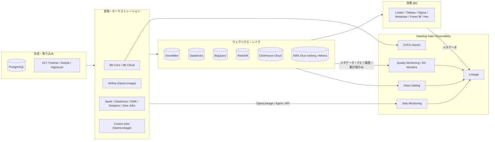
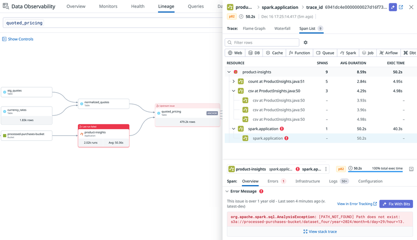
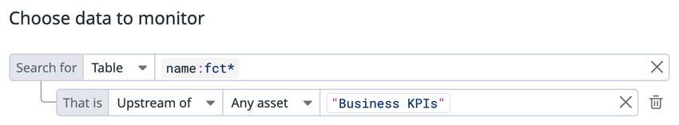
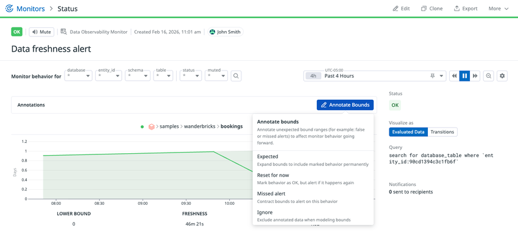
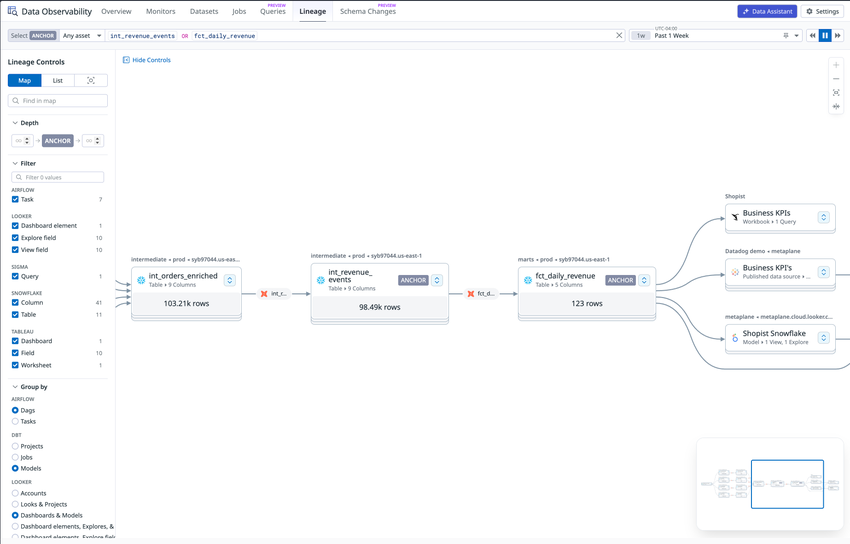
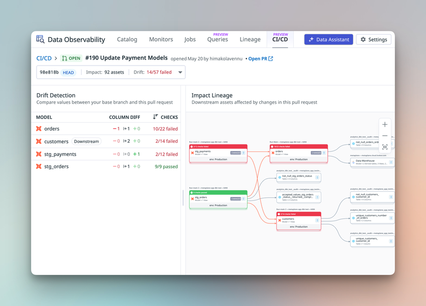

# Data Observability（データオブザーバビリティ）

## 概要

Datadog **Data Observability（DO、データオブザーバビリティ）** は、分析・AI 向けデータの信頼性を高め、データパイプラインの性能とコストを最適化するための製品群である。データの「生成（本番システム）→ 変換（ジョブ・パイプライン）→ 消費（BI・AI）」までを、**品質監視（Quality Monitoring）** と **ジョブ監視（Jobs Monitoring）** の両面から一元的に観測する。[出典](https://docs.datadoghq.com/data_observability/)

Data Observability は次の 5 つのコンポーネントで構成される。[出典](https://docs.datadoghq.com/data_observability/)

| コンポーネント | 目的 | 本ファイルでの扱い |
|---|---|---|
| **Data Catalog**（データカタログ） | 連携先から自動収集したデータ資産（DB・スキーマ・テーブル・ジョブ等）を一元的に閲覧・検索する | 本ファイルで詳述 |
| **Lineage**（リネージ） | 上流依存と下流利用者（テーブル・カラム・ジョブ・ダッシュボード）を追跡する | 本ファイルで詳述 |
| **Quality Monitoring**（品質監視） | BI・AI に影響する前にデータの鮮度遅延・件数異常・カラム値の変化を検知する | 本ファイルで詳述 |
| **Jobs Monitoring**（ジョブ監視、旧称：Data Jobs Monitoring / DJM） | Spark・Databricks・Airflow・dbt 等のパイプラインジョブを観測・トラブルシュート・最適化する | [Data Jobs Monitoring](./data-jobs-monitoring.md) を参照 |
| **CI/CD** | dbt モデルを変更する Pull Request に対し、マージ前に影響範囲とデータドリフトを検査する | 本ファイルで詳述 |

Data Observability の主な価値は次の 4 点とされる。[出典](https://docs.datadoghq.com/data_observability/)

- **早期検知**：ML ベースのモニターでウェアハウス内の不正データ、ジョブ側の上流パイプライン障害を検知する。
- **迅速な修復**：エンドツーエンドの Lineage で根本原因・影響範囲（blast radius）を特定し、オーナーへルーティングする。ジョブのトレース・ログへピボットできる。
- **コストと性能**：Spark / Databricks のジョブ・クラスタのコストと効率を可視化し、設定・コード・クエリの推奨を提示する（Jobs Monitoring の機能）。
- **統合オブザーバビリティ**：データ品質、パイプライン実行、インフラのシグナルを 1 か所で扱う。

### 製品の経緯（Metaplane 買収と名称）

- 2025-04-23、Datadog はデータオブザーバビリティ SaaS の **Metaplane** の買収を発表した。Metaplane は ML によるデータ監視とカラムレベルリネージを提供していた製品で、買収後は既存顧客のサポートと新規顧客のオンボーディングを継続し、**Metaplane by Datadog** として提供すると発表された。当時の Datadog のデータ系製品は Data Jobs Monitoring と [Data Streams Monitoring](../apm/data-streams-monitoring.md) であった。[出典](https://www.datadoghq.com/about/latest-news/press-releases/datadog-metaplane-aquistion/)（2025-04-23 公開）
- Quality Monitoring の機能（ML 異常検知、カラムレベルリネージ、BI 連携など）は Metaplane の技術を Datadog に統合したものと位置づけられる【推定】（Datadog 公式ドキュメントの Overview が Metaplane 買収のプレスリリースを関連資料として挙げていることに基づく）。
- 料金ページ上では 2026-01 頃に、**Data Jobs Monitoring** が「**Data Observability: Jobs Monitoring**」に改称され、「**Data Observability: Quality Monitoring**」が新設された。【第三者情報】[出典](https://pricingsaas.com/companies/datadog/diffs/2026W03)（2026-01 の料金ページ差分記録）

> **旧称併記:** Jobs Monitoring（旧称：Data Jobs Monitoring / DJM）。ドキュメント URL・一部 UI ではまだ旧称が残る場合がある。

### Data Observability と関連製品の関係

| 製品 | 観測対象 | 関係 |
|---|---|---|
| Data Observability: Quality Monitoring | ウェアハウス・データレイク・DB 内の**データそのもの**（鮮度・件数・カラム統計） | 本ファイル |
| Data Observability: Jobs Monitoring | Spark / Databricks / EMR / Dataproc / Glue / Airflow / dbt 等の**ジョブ実行** | [data-jobs-monitoring.md](./data-jobs-monitoring.md) |
| [Data Streams Monitoring](../apm/data-streams-monitoring.md) | Kafka 等のストリーミングパイプラインのレイテンシ・ラグ | 別製品（APM 系） |
| [Database Monitoring](../infrastructure/database-monitoring.md) | DB の**クエリ性能**・実行計画・待機イベント | 別製品。PostgreSQL では Agent 設定を共用できる |
| [Cloud Cost Management](../infrastructure/cloud-cost-management.md) | クラウド・Snowflake・Databricks 等のコスト | ウェアハウス側コストの検証に利用可能 |

### 全体アーキテクチャ





- **キャプション:** Data Observability のエンドツーエンドリネージから Spark ジョブのトレースへピボットする根本原因分析画面（公式 Overview ページの代表画像、alt: "Datadog Data Observability end-to-end lineage with Spark job traces."）。
- **画面説明:** 上部にリネージグラフ（上流の取り込み・ジョブ → テーブル → 下流 BI のノード列）、下部に該当 Spark ジョブのトレース（ジョブ・ステージのスパン）が表示され、品質異常が発生したテーブルから、それを生成したジョブ実行へたどれることを示す。
- **出典:** https://docs.datadoghq.com/data_observability/ （取得日：2026-11-02）

## 対応データソース

Quality Monitoring・Lineage が対応するデータソースは以下のとおり（2026-11-02 時点の公式ドキュメント）。[出典](https://docs.datadoghq.com/data_observability/quality_monitoring/)

| 区分 | 対応製品 | 主な用途 | ステータス |
|---|---|---|---|
| Data warehouses | Snowflake | 品質監視、クエリ履歴、カラムリネージ、タスク/Snowpipe リネージ、スキーマ変更 | GA |
| Data warehouses | Databricks | 品質監視、`system.query.history`、カラムリネージ、スキーマ変更 | GA |
| Data warehouses | BigQuery | 品質監視、クエリ履歴、スキーマ変更 | GA |
| Data warehouses | Redshift（Provisioned / Serverless） | 品質監視、クエリ履歴、テーブルサイズ、スキーマ変更 | ステータス記載なし（GA 扱いと推定）【推定】 |
| Data warehouses | ClickHouse Cloud | カタログ、行数・サイズ・鮮度（毎時）、Custom SQL モニター | 【Preview】（担当者による有効化が必要） |
| Data lakes | AWS Glue（Apache Iceberg テーブル） | Iceberg メタデータから鮮度・行数・サイズ・スキーマ | GA（Athena によるクエリは【Preview】） |
| Data lakes | Amazon Athena | クエリ履歴・失敗・性能・コスト | 公開情報では確認できず |
| Transactional databases | PostgreSQL | スキーマ、テーブル寸法、行数、カラムメトリクス、Custom SQL | 【Preview】（担当者による有効化が必要） |
| Transformation / Orchestration | Databricks、Airflow、dbt Core、dbt Cloud、Spark on Kubernetes、Spark on Amazon EMR、Spark on Google Dataproc、AWS Glue Jobs、OpenLineage によるカスタムジョブ。Azure Data Factory は Lineage ページにリネージ収集元として記載（[出典](https://docs.datadoghq.com/data_observability/lineage/)） | ジョブ実行・リネージ | [data-jobs-monitoring.md](./data-jobs-monitoring.md) 参照 |
| ELT（リネージ） | Airbyte、Fivetran、Hightouch | ソース → ウェアハウスのリネージ | — |
| BI（下流影響） | Looker、Tableau、Sigma、Metabase、Power BI、Hex（Hex は BI 概要ページのみに記載。[出典](https://docs.datadoghq.com/data_observability/quality_monitoring/business_intelligence/)） | ウェアハウス → ダッシュボード/レポート/フィールドのリネージ | — |

- 製品ページでは対応ウェアハウスを「Snowflake, Databricks, BigQuery, Redshift, Iceberg Tables (AWS Glue)」と記載し、OpenLineage でカスタムソースに拡張できるとしている。[出典](https://www.datadoghq.com/products/observability/data-observability/)
- BI 連携はダッシュボード・データセット・フィールドのメタデータを取り込み、ウェアハウスのテーブル/カラムから BI のダッシュボード・レポート・フィールドへのリネージを構築する。どの BI 連携が Preview かは BI 概要ページに記載がなく、公開情報では確認できず。[出典](https://docs.datadoghq.com/data_observability/quality_monitoring/business_intelligence/)

> **サイト差異:** Data Observability（Data Catalog、Lineage、Quality Monitoring、CI/CD、Data Observability Monitor、各ウェアハウス連携）は **US1-FED（`app.ddog-gov.com`）および `us2.ddog-gov.com` では非対応**。US1 / US3 / US5 / EU1 / AP1 / AP2（および UK1）では利用可能。料金ページでも Quality Monitoring は「US-FED サイトでは提供なし」と表記されている。[出典](https://docs.datadoghq.com/data_observability/) / [出典](https://www.datadoghq.com/pricing/?product=quality-monitoring#products)

## Quality Monitoring（品質監視）

### Quality Monitoring の機能

Quality Monitoring は、データの鮮度遅延、異常なデータパターン、カラムレベルメトリクスの変化を、ダッシュボード・ML モデル・下流システムに影響する前に検知する。[出典](https://docs.datadoghq.com/data_observability/quality_monitoring/)

| 機能 | 内容 |
|---|---|
| テーブル監視 | 更新遅延（Freshness）と行数（Row Count）の異常を検知 |
| カラム監視 | null 率、一意性（Uniqueness）、カーディナリティ、統計値の変化を検知 |
| 検知方式 | 静的しきい値（Thresholds）または履歴ベースライン（Anomalies、ML 異常検知） |
| 根本原因分析 | Lineage で上流ジョブ・下流影響をたどる |
| スキーマ変更 | カラム追加/削除/改名/型変更を検知（【Preview】） |
| ソース・ターゲット比較 | 2 資産間の同一メトリクスの差分を監視（【Preview】） |

製品ページでは、標準モニター（row count、freshness、uniqueness、nullness）、Custom SQL、手動しきい値、GROUP BY モニター、季節性・トレンド・アノテーションに適応する ML 異常検知、テーブル/カラムレベルのエンドツーエンドリネージを主要機能として挙げている。[出典](https://www.datadoghq.com/products/observability/data-observability/)

### Datadog に送信されるデータ

Quality Monitoring は、ウェアハウス内で**集計クエリ**（件数、最大タイムスタンプ、null 件数、distinct 件数など）を実行し、**結果のメトリクス値のみ**を Datadog に送信する。テーブルの行データは送信しない。[出典](https://docs.datadoghq.com/data_observability/quality_monitoring/)

| ケース | Datadog に保存されるもの | 注意点 |
|---|---|---|
| 標準メトリクス（Freshness、Row Count、カラムメトリクス） | 集計結果の数値のみ | 行データは送信されない |
| Custom SQL モニター | `dd_value` の値 | `SELECT *` のように行全体を返すクエリはバリデーションで失敗し保存されない |
| Custom SQL + `GROUP BY` | `dd_value` と**グループ化カラムの値** | 各グループが別シリーズとして評価される。メールアドレスやユーザー ID などの機微カラムでグループ化するとその値が Datadog に送信されるため、非機微カラムのみでグループ化するか、ウェアハウス側でマスキングする |

カラムマスキングへの対応は次のとおり。[出典](https://docs.datadoghq.com/data_observability/quality_monitoring/)

| ウェアハウス | 対応するマスキング機能 | 補足 |
|---|---|---|
| Databricks | Unity Catalog column masks | マスク済みカラムのカラムメトリクスはマスク後の値を反映。Freshness / Row Count はカラム値を読まないため影響なし |
| Snowflake | Masking policies | Snowflake **Enterprise Edition 以上**が必要 |
| BigQuery | Data masking | Datadog サービスアカウントに **BigQuery Masked Reader** ロールを付与 |
| Redshift | Dynamic data masking | — |

### メタデータ同期と初回同期

- 連携を保存すると、Datadog はバックグラウンドで **information schema（スキーマ情報）とクエリ履歴**を同期する。**初回同期はデプロイ規模により数時間**かかる場合がある（Snowflake / Databricks / BigQuery / Redshift）。[出典](https://docs.datadoghq.com/data_observability/quality_monitoring/data_warehouses/snowflake/)
- AWS Glue の初回同期は**テーブル数に応じて最大 1 時間程度**。PostgreSQL はカタログ表示まで**約 1 時間**。[出典](https://docs.datadoghq.com/data_observability/quality_monitoring/data_lakes/aws_glue/) / [出典](https://docs.datadoghq.com/data_observability/quality_monitoring/transactional_databases/postgres/)
- **テーブルの同期（カタログへの取り込み）自体は課金対象外**。モニターを設定したテーブルのみが課金される（後述「課金への影響」）。[出典](https://www.datadoghq.com/products/observability/data-observability/)
- 定期クロール（メタデータ再同期）の具体的な間隔は、Snowflake / Databricks / BigQuery / Redshift について公開情報では確認できず（ClickHouse Cloud のテーブルメトリクスは毎時と明記）。AWS Glue はクローラー設定で同期頻度を選択できる。

## Data Observability Monitor（データ品質モニター）

### モニタータイプ

Data Observability Monitor は [Monitors](../platform/monitors.md) のモニタータイプの 1 つで、作成フローの最初のステップで次の 4 種から選ぶ。Data Observability Monitor の利用には、少なくとも 1 つの対応ウェアハウスで Quality Monitoring がセットアップされている必要がある。[出典](https://docs.datadoghq.com/monitors/types/data_observability/)

| モニタータイプ | 監視対象 | ステータス |
|---|---|---|
| Data quality | テーブル・カラムの Freshness、Row Count、カラムメトリクス、Custom SQL | GA |
| Source to target | ソース資産とターゲット資産の同一メトリクスの差 | 【Preview】（GovCloud 以外の全リージョン） |
| Schema change | ウェアハウス内のフィールド追加・削除・改名・型変更 | 【Preview】 |
| Job | 失敗したジョブ実行 | 詳細は [data-jobs-monitoring.md](./data-jobs-monitoring.md) |

**作成画面への導線:** `Data Observability > Monitors > New Monitor`、または `Monitors > New Monitor > Data Observability`。既存モニターの一覧は `Data Observability > Monitors` ページで確認する。[出典](https://docs.datadoghq.com/monitors/types/data_observability/)

### メトリクスタイプ

**テーブルレベル:**

| メトリクスタイプ | 内容 | 備考 |
|---|---|---|
| Freshness | テーブルの最終更新からの経過時間 | **ビューでは利用不可**。システムメタデータに更新時刻を持たないウェアハウスでも利用不可 → カラム Freshness を使う |
| Row Count | テーブルまたはビューの行数 | 急減・急増、および行数が通常より長く変化しない「flatline」も検知 |
| Custom SQL | ユーザー定義 SQL が返すスカラー値（`dd_value`） | 1 モニター = 課金上 1 monitored table |

**カラムレベル:**

| メトリクスタイプ | 内容 | 対象カラム型 |
|---|---|---|
| Freshness | datetime カラムの最新日時 | datetime |
| Uniqueness | 一意な値の割合（%） | 任意 |
| Nullness | null 値の割合（%） | 任意 |
| Cardinality | distinct 値の数 | 任意 |
| Percent Zero | 0 の値の割合（%） | 数値 |
| Percent Negative | 負の値の割合（%） | 数値 |
| Min / Max / Mean / Sum / Standard Deviation | 統計値 | 数値 |

1 モニターが追跡できるメトリクスタイプは **1 種類**。[出典](https://docs.datadoghq.com/monitors/types/data_observability/)

Row Count・Freshness などは、可能な場合はウェアハウスのシステムメタデータ（例：`INFORMATION_SCHEMA`）から取得し、ウェアハウス上でクエリを実行しないことでコンピュートコストを抑える。システムメタデータを持たないウェアハウスでは直接クエリを実行する（詳細は「ウェアハウス側のオーバーヘッドとコスト」）。[出典](https://docs.datadoghq.com/monitors/types/data_observability/)

### 監視対象の選択（Choose data to monitor）

まず **Table** / **Column** レベルを選び、`key:value` フィルタで対象テーブル・ビュー・カラムを検索する。[出典](https://docs.datadoghq.com/monitors/types/data_observability/)



- **キャプション:** Data Observability Monitor 作成画面の「Choose data to monitor」セクション。
- **画面説明:** 「Search for」行でエンティティ種別（`Table`）を選び、クエリ欄に `name:fct*` と入力している。その下の「That is」行が Relation Filter で、`Upstream of` / `Any asset` / `"Business KPIs"` を指定し、「Business KPIs」ダッシュボードの上流にある `fct` 始まりのテーブルだけを対象にしている例。右端のゴミ箱アイコンでリレーションフィルタを削除できる。
- **出典:** https://docs.datadoghq.com/monitors/types/data_observability/ （取得日：2026-11-02）

| フィルタ種別 | 構文例 | 説明 |
|---|---|---|
| 名前 | `name:USERS*` | `*` ワイルドカード可 |
| スキーマ | `schema:PROD` | — |
| データベース | `database:ANALYTICS_DB` | — |
| アカウント | `account:my_account` | — |
| タグ | `owner:data-platform-team`、`platform:"Snowflake Prod"`、`owner:data-*` | 資産に付いた任意のタグキーで検索可。ワイルドカード・引用符可 |
| 計算属性 | `lineage_score:1.00`、`lineage_score:(0.90 OR 1.00)` | リネージ上の被依存度。値は `0.00`、`0.10`、`0.30`、`0.50`、`0.70`、`0.90`、`1.00` の離散値のみ |
| 論理演算 | `AND`、`OR`、`( )`、先頭 `-` で除外 | 例：`schema:PROD AND -name:TEMP*` |
| リネージ関係 | Add Relation Filter → `Upstream of` / `Downstream of` | 重要ダッシュボードの上流テーブル全体を監視するなど |
| 階層関係 | Add Relation Filter → `Parent of` / `Child of` | `revenue` カラムを持つ全テーブル、特定スキーマ配下の全テーブルなど |

- `lineage_score` は、同種の資産と比べてどれだけ多くの下流資産に依存されているかの相対指標で、値が高いほど下流から多く依存されている。重要テーブルを優先監視する際のフィルタに使える。
- **1 モニターで追跡できるテーブル・ビュー・カラムは最大 5,000 件**で、**引き上げ不可**。超える場合は複数モニターに分割する。

クエリ例（公式）：

| 目的 | クエリ |
|---|---|
| PROD スキーマの全テーブル（temp を除く） | `schema:PROD AND -name:TEMP*` |
| 全タイムスタンプカラム | `name:*_AT OR name:*_TIMESTAMP` |
| 特定 DB の PROD / STAGING | `database:ANALYTICS_DB AND (schema:PROD OR schema:STAGING)` |
| 特定チーム所有のテーブル | `owner:data-platform-team` |
| 特定 DB で最も依存されているテーブル | `database:ANALYTICS_DB AND lineage_score:1.00` |

### Custom SQL

Custom SQL メトリクスタイプの設定手順は次のとおり。[出典](https://docs.datadoghq.com/monitors/types/data_observability/)

1. 返却値を表すモデルタイプを選ぶ。
   - `Default`：スカラー値（通常はこれ）。履歴から範囲を推定する（例：負になったことがなければ下限 0 に制約）。
   - `Freshness`：現在時刻と最終イベント時刻の差（秒）。
   - `Percentage`：0〜100 のパーセント値。
2. 単一値を `dd_value` という別名で返す SQL を書く。例：`SELECT COUNT(*) as dd_value FROM ANALYTICS_DB.PROD.ORDERS WHERE STATUS = 'FAILED'`
3. **Validate** で構文を確認する。
4. `GROUP BY` を含む場合は、Group by 欄にグループ化カラムをカンマ区切りで列挙する（例：`column_a, column_b`）。各グループは独立して評価される。

> Custom SQL は **1 モニターごとに 1 monitored table として課金**される。グループ化カラムの値は Datadog に保存されるため、機微カラムでのグループ化は避ける。

### モニター設定項目一覧

| 設定 | 選択肢 / 値 | デフォルト・制限 |
|---|---|---|
| Detection method | `Anomalies`（異常検知） / `Thresholds`（しきい値） | 公式説明では「デフォルトで異常検知モデルを使用」 |
| Thresholds の比較演算子 | `above`、`above or equal to`、`below`、`below or equal to`、`equal to`、`not equal to` | Critical は必須、Warning は任意 |
| WHERE clause | 例：`created_at >= DATEADD(day, -7, CURRENT_TIMESTAMP())`、`region = 'US'` | 任意。直近パーティションに絞るとコスト削減に有効 |
| Group by | カラムを指定してグループ別に評価 | **デフォルト上限 500 グループ/モニター**（Support へ申請で引き上げ可） |
| If data is missing to evaluate | データ欠損時の報告方法を選択 | 選択肢の詳細は公開情報では確認できず |
| Model configuration（Anomalies のみ） | 下表 | 【Preview】（US1/US3/US5/EU1/AP1/AP2/UK1 で担当者経由で有効化） |
| Monitor schedule | `Hourly`、`Every 3 hours`、`Every 6 hours`、`Every 12 hours`、`Daily`、`Custom schedule`（cron） | Custom schedule の最短間隔は **15 分** |
| Manual スケジュール | API からの実行時のみ評価 | 【Preview】。UI では Row Count / Freshness 等のデフォルトメトリクスは非対応で、カスタム/カラムメトリクス向け |
| Aggregation | `Simple Alert` / `Multi Alert` | Multi Alert は `table`、`schema`、`database` 等でグループ化 |

**Model configuration（Anomalies 用、【Preview】）:**

| 設定 | 内容 |
|---|---|
| Alert after N consecutive anomalies | N 回連続で異常になってからアラート（単発スパイクを抑制） |
| Minimum upper bound size | 上側バウンドの最小幅 |
| Minimum lower bound size | 下側バウンドの最小幅 |
| Sensitivity | スライダーで Fewer alerts（広いバウンド）〜 More alerts（狭いバウンド）を調整。最小バウンド幅は引き続き適用 |
| Model Instructions | 平文で期待挙動を指示（**最大 500 文字**）。例：`Don't alert on large increases during US holidays` |

### 通知テンプレート

Data Observability Monitor の通知には、データ資産を指すテンプレート変数を使える。通知・Downtime の一般仕様は [notifications-and-downtimes.md](../platform/notifications-and-downtimes.md) を参照。[出典](https://docs.datadoghq.com/monitors/types/data_observability/)

| 変数 | 内容 | 用途 |
|---|---|---|
| `{{database.name}}`、`{{schema.name}}`、`{{table.name}}` | 対象資産の DB・スキーマ・テーブル名 | 共通 |
| `{{value}}`、`{{threshold}}` | 現在値・しきい値 | Thresholds |
| `{{observed}}`、`{{predicted}}`、`{{lower_bound}}`、`{{upper_bound}}` | 観測値・予測値・期待範囲 | Anomalies |

```text
{{#is_alert}}
Anomaly detected on {{database.name}}.{{schema.name}}.{{table.name}}:
observed value {{observed}} is outside the expected range of {{lower_bound}} to {{upper_bound}}
(predicted: {{predicted}}).
{{/is_alert}}
```

### 異常検知モデル（Anomalies）

Anomalies 検知方式は、Freshness や Row Count などデータ品質メトリクス向けに調整された専用の異常検知モデルを使う。Thresholds 方式のモニターはこのモデルを使わない。[出典](https://docs.datadoghq.com/data_observability/quality_monitoring/guides/anomaly_detection/)

| 項目 | 内容 |
|---|---|
| 学習期間 | モニターページ：**3〜7 日**（週末を含む、データ更新頻度による）。異常検知ガイド：**通常 3〜9 日**。学習中はアラートしない |
| モデル状態の色 | 青＝Training（学習中・アラートなし）、緑＝Normal（範囲内）、赤＝Alerting（範囲外） |
| 参照履歴 | 季節性・トレンド・過去アノテーション検出のため**最大 400 日** |
| 季節性パターン | Hour of day、Hour of week、Day of week、Day of month の 4 種（各パターンの検出には複数サイクル分の正常履歴が必要） |
| トレンド | 継続的な増加・減少の方向と速度を考慮し、定常的な成長を異常扱いしない |
| アラート継続 | 値が元の期待範囲に戻るか、異常が長く続きモデルが新しい正常と見なすまで継続（継続期間は公開情報では確認できず） |

> 学習期間は公式ページ間で「3〜7 日」と「3〜9 日」の記述差がある。運用上は**少なくとも 1 週間＋α**を見込み、学習中は保守的なしきい値モニターを暫定バックストップにすることが公式ブログで推奨されている。[出典](https://www.datadoghq.com/blog/monitor-warehouse-data-quality-beyond-pipeline-health/)（2026-10-01 公開）

メトリクス別の挙動：

| メトリクス | 異常検知の挙動 |
|---|---|
| Freshness | 過去の更新パターンから予測される時間を超えるとアラート。上限には小さな余裕（バッファ）を含む |
| Row Count | 異常な増減に加え、通常より長く行数が変化しない flatline もアラート（パイプライン停止の兆候） |
| パーセント系（Nullness、Uniqueness 等） | 0〜100 のスケール。過去に 0 または 100 になったことがない場合、その値への変化はアラート |
| Custom SQL | モデルタイプ（Freshness / Percentage / Default）に従う |

### アノテーション（Annotate bounds）

異常検知モニターでは、グラフ上の点にアノテーションを付けてモデルを即時に再学習させられる。[出典](https://docs.datadoghq.com/monitors/types/data_observability/) / [出典](https://docs.datadoghq.com/data_observability/quality_monitoring/guides/anomaly_detection/)



- **キャプション:** Data Observability Monitor のステータスページ（`Monitors > Status`）で、異常検知バウンドにアノテーションを付けるメニュー。
- **画面説明:** 上部にモニター状態（OK）、Mute、種別「Data Observability Monitor」、作成日時・作成者、右上に Edit / Clone / Export / More。モニター名「Data freshness alert」の下に `Monitor behavior for` フィルタ（database、entity_id、schema、table、status、muted）と時間セレクタ（Past 4 Hours）。Annotations 欄の **Annotate Bounds** ボタンを押すとメニューが開き、`Expected`（マークした挙動を含むようにバウンドを恒久的に拡大）/ `Reset for now`（今回は OK、再発時はアラート）/ `Missed alert`（この挙動でアラートするようバウンドを縮小）/ `Ignore`（バウンドのモデリングから除外）を選べる。グラフは `samples > wanderbricks > bookings` テーブルの Freshness（単位 Days）と期待範囲の帯を表示し、下部に LOWER BOUND、FRESHNESS（例：46m 21s）等の値が並ぶ。右側に Status、Visualize as（Evaluated Data / Transitions）、Query（`search for database_table where entity_id:...`）、Notifications。
- **出典:** https://docs.datadoghq.com/monitors/types/data_observability/ （取得日：2026-11-02）

| アノテーション | 効果 |
|---|---|
| Expected | 当該挙動を含むようにバウンドを拡大 |
| Reset for now | 今回は OK とするが、再発すればアラート |
| Missed alert | 当該挙動でアラートするようにバウンドを縮小 |
| Ignore | 当該データをバウンドのモデリングから除外 |

アノテーションは、①現在の状態（アラート → 次回観測で正常に戻し、新たな異常を検知可能にする）と、②将来予測（アノテーション済みの点で将来のバウンドを調整する）の 2 つに効く。

### Source to target モニター【Preview】

Source to target モニターは、2 つのデータ資産の同一メトリクスを比較し、差が生じたときにアラートする。レプリケーション（Postgres → Databricks）、同一 Snowflake 内の DB 間照合、Redshift → BigQuery 移行前の並行稼働検証、変換による行欠落の確認などに使う。[出典](https://docs.datadoghq.com/monitors/types/data_observability/)

| 項目 | 内容 |
|---|---|
| 提供範囲 | GovCloud を除く全リージョン。担当者または Support へ申請 |
| ソースとターゲット | 異なるウェアハウス間、同一ウェアハウス内のいずれも可 |
| メトリクス | 他の DO モニターと同じ（Row Count、Freshness、Nullness、Uniqueness、Cardinality、Custom SQL 等） |
| Format | `Difference`（ターゲット − ソース。負ならターゲットが少ない） / `% Difference`（ソース値に対する割合） |
| Custom SQL | ソース用・ターゲット用の 2 クエリを指定。WHERE clause は使えないためクエリ内でフィルタする |
| 評価 | 差分自体を独立メトリクスとして記録し、異常検知を含む通常の検知方式で評価。両側を同期スケジュールで同時刻に計測 |
| ステータス表示 | 監視対象資産はターゲット側（ターゲットのステータスページに表示） |

### Schema change モニター【Preview】

Schema change モニターは、データ内容ではなく構造の変化でアラートする。メトリクスタイプや検知方式は指定しない。[出典](https://docs.datadoghq.com/monitors/types/data_observability/)

| 変更種別 | 対象 |
|---|---|
| Added | データベース・スキーマ・テーブル・カラムの作成 |
| Removed | データベース・スキーマ・テーブル・カラムの削除 |
| Renamed | テーブル・カラムの改名 |
| Type changed | カラムのデータ型変更（例：`INTEGER` → `STRING`） |

- 対応ウェアハウス：**Snowflake、BigQuery、Databricks、Redshift**。
- 作成：`Monitors > New Monitor > Schema Change` → 監視するウェアハウスを選択 → 通知を設定。
- モニターを作らずに検出済み変更を見る場合は `Data Observability > Schema Changes` ページ（プラットフォーム、アカウント、DB、スキーマ、変更種別でフィルタ可）。
- 検出タイミングは、次回スキーマメタデータを収集した時点で前回との差分を比較する方式。

### Data Observability API

Manual スケジュールのモニターをプログラムから実行するための API が提供されている（いずれも【Preview】）。[出典](https://docs.datadoghq.com/api/latest/data-observability/)

| 操作 | メソッドとパス | AP1 のエンドポイント例 |
|---|---|---|
| Run a data observability monitor | `POST /api/v2/data-observability/monitors/{monitor_id}/run` | `https://api.ap1.datadoghq.com/api/v2/data-observability/monitors/{monitor_id}/run` |
| Get data observability monitor run status | `GET /api/v2/data-observability/monitors/runs/{run_id}/status` | `https://api.ap1.datadoghq.com/api/v2/data-observability/monitors/runs/{run_id}/status` |

- API リファレンス上は `app.ddog-gov.com` / `us2.ddog-gov.com` のエンドポイントも記載されているが、製品自体は両サイトで非対応である点に注意。
- API キー・アプリケーションキーの扱いは [api-and-keys.md](../platform/api-and-keys.md) を参照。
- Terraform プロバイダでの Data Observability Monitor 定義可否・リソース名は公開情報では確認できず（一般的な IaC は [terraform-and-iac.md](../platform/terraform-and-iac.md)）。

## Data Catalog（データカタログ）

Data Catalog は、連携済みインテグレーションから自動的に収集されたデータ資産（テーブル、スキーマ、データベース、パイプラインジョブ、ダッシュボード等）の検索可能な一元インベントリで、データソースと同期を保つ。[出典](https://docs.datadoghq.com/data_observability/data_catalog/)

### 資産カードの項目

| 項目 | 内容 |
|---|---|
| Asset type | テーブル、スキーマ、DB、ジョブ等の種別 |
| Name / Path | 名前とパス（例：`account > database > schema`） |
| Integration / Account | 同期元のインテグレーションとアカウント |
| Description | ソースシステムから取得した説明（ある場合） |
| Links | ソースシステムへのリンク |
| Tags | ソースから取得した `key:value` タグ（ある場合）。Snowflake では `TAG_REFERENCES` から**テーブルあたり最大 50 タグ** |
| Monitor Status | 当該資産に設定された Data Observability モニターの状態 |
| Lineage | 上流/下流依存（連携が対応している場合） |

### 検索構文

| 機能 | 例 | 備考 |
|---|---|---|
| 全文検索 | `orders` | **Catalog のみ対応**（Monitors・Lineage では不可） |
| フィールド指定 | `key:value` | 利用可能フィールドは連携先依存。任意のタグキーを検索フィールドに使える |
| ワイルドカード | `name:dim_zendesk*` | 前方一致 |
| OR | `data_owner:(team-a OR team-b)` | — |
| AND | `dim_zendesk AND data_owner:TS-OPS-ANALYTICS` | — |
| 最近の検索 | ドロップダウンに保存表示 | — |

- サイドバーには All assets、Databases、Schemas、Tables と、連携ごと（Snowflake、dbt、BigQuery 等）のエントリが表示される。
- 正式な「オーナー」機能は Data Catalog ページに記載がなく、`data_owner` のようなタグで所有者を表現する運用例が示されている。所有チームの一元管理は [Software Catalog](../platform/software-catalog.md) とは別物である点に注意。
- カタログの資産数上限・検索結果上限は公開情報では確認できず。

## Lineage（リネージ）

### Lineage の仕組み

Lineage は、ソースシステムやウェアハウスのテーブルから、変換・ジョブを経て、ダッシュボードやアプリケーションに至るデータの流れを表示する。根本原因の追跡、障害ジョブや予定しているスキーマ変更の影響範囲（blast radius）評価、インシデントのオーナーへのルーティングに使う。[出典](https://docs.datadoghq.com/data_observability/lineage/)

- Lineage は Quality Monitoring と Jobs Monitoring の連携から収集したメタデータで**自動構築**される（Snowflake、BigQuery、Databricks、dbt、Airflow、Azure Data Factory、Fivetran、Hightouch、Looker、Tableau ほか）。追加の手動定義は不要。
- Data Observability Catalog 内の任意の資産がグラフに現れうる。
- **カラムレベルリネージ**は「ほとんどの連携ソース」で対応（ソース別の対応可否表は公開情報では確認できず）。
- 関係は**選択した時間ウィンドウ内のクエリ履歴とジョブ実行**から導出される。ウィンドウを広げると古い/低頻度の依存が、狭めると現在アクティブな依存のみが表示される。
- Snowflake では、タスクと Snowpipe の SQL 定義をパースして、タスク間依存、タスク → テーブル、ステージ → テーブル（Snowpipe）のリネージを導出する（`MONITOR EXECUTION ON ACCOUNT` 権限が必要）。[出典](https://docs.datadoghq.com/data_observability/quality_monitoring/data_warehouses/snowflake/)
- Databricks では `system` カタログ（`system.query.history` 等）を読むことでリネージとクエリ可視化を行う。クエリテキストを読むにはサービスプリンシパルを `databricks_pii_access` グループに追加する必要がある（未追加だとクエリテキストは `<Redacted>`）。[出典](https://docs.datadoghq.com/data_observability/quality_monitoring/data_warehouses/databricks/)
- dbt Core / Airflow / カスタムジョブは OpenLineage イベント経由でリネージに寄与する（[data-jobs-monitoring.md](./data-jobs-monitoring.md) 参照）。
- Snowflake で dbt アカウント識別子、BI の接続文字列、AWS PrivateLink URL など**別名**で同一アカウントを参照するツールがある場合、Snowflake 連携の **Custom alias URLs** に登録しないとそのツールからのリネージが連携と結び付かない。[出典](https://docs.datadoghq.com/data_observability/quality_monitoring/data_warehouses/snowflake/)

### Lineage 画面

画面の場所は `Data Observability > Lineage`。



- **キャプション:** Data Observability の Lineage 画面（Map ビュー）。
- **画面説明:** 上部タブは Overview / Monitors / Datasets / Jobs / Queries（PREVIEW）/ **Lineage** / Schema Changes（PREVIEW）と、右上に Data Assistant・Settings ボタン。検索バーで `Select ANCHOR` / `Any asset` を選び `int_revenue_events OR fct_daily_revenue` を入力して 2 つのアンカーを設定、右側に時間セレクタ `1w`（Past 1 Week）。左の **Lineage Controls** パネルには Map / List 切替、Find in map、**Depth**（上流 `∞` ← ANCHOR → 下流 `∞`）、**Filter**（AIRFLOW: Task、LOOKER: Dashboard element / Explore field / View field、SIGMA: Query、SNOWFLAKE: Column 41 / Table 11、TABLEAU: Dashboard / Field / Worksheet）、**Group by**（AIRFLOW: Dags / Tasks、DBT: Projects / Jobs / Models、LOOKER: Accounts / Looks & Projects / Dashboards & Models など）。中央のグラフでは `int_orders_enriched`（103.21k rows）→ `int_revenue_events`（ANCHOR、98.49k rows）→ `fct_daily_revenue`（ANCHOR、123 rows）と連なり、エッジ上の赤い × は関連ジョブ/モニターの失敗を示し、右側に下流の Sigma ワークブック「Business KPIs」、Looker モデル「Shopist Snowflake」などが並ぶ。右下にミニマップ。
- **出典:** https://docs.datadoghq.com/data_observability/lineage/ （取得日：2026-11-02）

### アンカーの選択

すべての Lineage ビューは **アンカー（anchor、起点資産）** を中心に描画され、アンカーには ANCHOR バッジが付く。[出典](https://docs.datadoghq.com/data_observability/lineage/)

| 方式 | 操作 | 用途 |
|---|---|---|
| 1 アンカー | 資産名で検索して 1 件選択 | 単一資産の上流・下流を確認 |
| 複数アンカー | 検索バーに複数資産を追加 | 関連する経路を同一ビューで比較 |
| 検索クエリ | `schema:staging` のような属性クエリ | 一致したすべての資産をアンカーにして一括確認 |

アセット種別ドロップダウン（`Any asset` / Table / Column / Dashboard / Job 等）で検索対象を絞り込める。

### Lineage Controls

| コントロール | 内容 |
|---|---|
| Map / List | Map（デフォルトのグラフ表示）と List（現在のスライス内の全資産のソート可能な一覧）を切り替え |
| Fit（虫眼鏡アイコン） | グラフをビューポートに合わせる |
| Find in map | 画面上のノードを名前でハイライト（アンカーは変えない） |
| Depth | 左＝上流の階層数、右＝下流の階層数。`∞` で全階層を読み込み |
| Filter | 表示する資産種別（Snowflake は Column / Table、BI はダッシュボード・レポート、ジョブはタスク・DAG）。件数表示付き。アンカー・深さは変えない |
| Group by | 集約レベル（Snowflake は Accounts / Databases / Schemas / Tables / Columns） |
| ツールバー | Zoom in / Zoom out / Reset view / Center anchors |
| 時間セレクタ | 関係を評価する時間ウィンドウ（例：`1w`） |

- Lineage Controls（深さ・フィルタ・グループ化）は**アンカーには適用されない**（アンカーは常に表示される）。
- 上流はグラフの左、下流は右に配置される。各ノードには名前・種別・ソース・行数/カラム数などの基本統計が表示される。

### 代表的なワークフロー

| ワークフロー | 手順 |
|---|---|
| 根本原因分析 | ①壊れた資産（Looker ダッシュボード、Snowflake テーブル、dbt モデル等）をアンカーにする ②下流 Depth を `0` ③Group by Tables（カラム問題なら Columns） ④上流ノードをさかのぼる。Quality Monitoring / Jobs Monitoring が検知した失敗・鮮度異常・スキーマ変更はグラフ上にステータス表示される ⑤フラグの付いたノードから品質モニター、直近ジョブ実行、スキーマ履歴へジャンプ |
| 影響分析（blast radius） | ①変更予定の資産をアンカー ②下流 Depth を `∞`、上流を `0` ③必要な種別（ダッシュボード・レポート等）にフィルタ ④List ビューで影響資産の全一覧を取得 |
| カラムのエンドツーエンド追跡 | ①検索の資産種別を Column にして検索 ②結果をアンカー ③Group by Columns |

## CI/CD（dbt 変更のマージ前検査）

Data Observability の CI/CD は、dbt モデルを変更する Pull Request に対してチェックを実行し、マージしてよいかの判断材料を提供する。結果は PR コメントとして投稿され、プッシュごとに更新され、Datadog 上の詳細レポートへリンクする。CI/CD ドキュメント本文にはステータス表記がないが、公式スクリーンショット上の CI/CD タブには「PREVIEW」と表示されている。[出典](https://docs.datadoghq.com/data_observability/cicd/)



- **キャプション:** Data Observability の CI/CD レポート画面（PR 単位）。
- **画面説明:** 上部タブは Catalog / Monitors / Jobs / Queries（PREVIEW）/ Lineage / **CI/CD（PREVIEW）**。PR「#190 Update Payment Models」（OPEN）のヘッダーに HEAD コミット、`Impact: 92 assets`、`Drift: 14/57 failed` が表示される。左ペインの **Drift Detection** はベースブランチと PR の値を比較した結果で、モデル（`orders`、`customers`〔Downstream〕、`stg_payments`、`stg_orders`）ごとのカラム差分（削除・変更・追加数）とチェック結果（例：`orders` 10/22 failed、`stg_orders` 9/9 passed）を表示。右ペインの **Impact Lineage** は変更モデル（CHANGED バッジ）から下流のテスト・テーブル・データウェアハウスまでの影響グラフを、失敗は赤、成功は緑で表示する。
- **出典:** https://docs.datadoghq.com/data_observability/cicd/ （取得日：2026-11-02）

### 対応範囲

| 項目 | 対応 |
|---|---|
| ソース管理 | GitHub、GitLab、Bitbucket Cloud、Azure DevOps |
| 変換ツール | dbt Cloud、dbt Core |
| ウェアハウス | dbt モデルが実行される対応データソースアカウント（例は Snowflake） |

### チェックの種類

| チェック | 内容 | 主な設定 |
|---|---|---|
| Impact Lineage | 変更モデルの下流（テーブル、ダッシュボード、その他の利用者）のグラフを作成し、影響範囲とレビュー担当を判断する | ドラフト PR で実行するか |
| Drift Detection | 変更前後のモデル出力を統計的に比較（行数変化、null 率変化、カーディナリティ変化など）。CI ブランチとベースラインを比較 | ドラフト PR で実行するか、警告しきい値（例：`0.1` ＝ 10%）、下流何段までチェックするか、CI ジョブ設定 |

### セットアップ手順

1. ソース管理プロバイダ、データソースアカウント、dbt プロジェクトを接続する（dbt プロジェクトは CI/CD チェック設定時にも追加可能）。
2. CI/CD 設定で **Add CI/CD Checks** をクリックし、dbt プロジェクト、メインジョブ、（自動推定されない場合は）リポジトリを選ぶ。dbt がリポジトリ直下にない場合は詳細設定でパスを指定する。
3. 各チェックを個別に有効化する（両方有効にすると最も充実したレポートになる）。Drift Detection では CI ジョブを設定する。
   - **dbt Cloud**：CI ジョブの URL を指定。Bitbucket Cloud / Azure DevOps では dbt Cloud Administrative API でパイプラインから CI ジョブを起動する必要がある場合がある。
   - **dbt Core**：CI ジョブ名と（設定していれば）OpenLineage namespace を指定。CI ジョブから OpenLineage イベントを送信し、`sourceCodeLocation` facet で PR 番号と head コミットを付与する（**`openlineage-dbt` 1.46.0 以降**が必要）。あわせて環境変数 `OPENLINEAGE__FACETS__SOURCE_CODE_LOCATION__DISABLED=false` を設定し、`sourceCodeLocation` facet を有効にする。
4. CI ジョブが書き込むデータベースに対し、Datadog ロールへ `USAGE` と `SELECT` を付与する（`grant_database_access` プロシージャを利用）。付与しないと Drift Detection が失敗する。

[出典](https://docs.datadoghq.com/data_observability/cicd/)

### CI/CD の注意点

- dbt Cloud の API 起動例では、`schema_override` で CI のテーブルを本番スキーマから分離し、スキーマ名に CI ジョブ ID を含めて CI ジョブ同士が同じスキーマに書き込まないようにする。
- dbt Cloud は API 起動の CI 実行で CI スキーマを削除しないため、定期的なクリーンアップが必要。
- PR ごとのエフェメラル DB を使う場合は、作成時に Datadog への権限付与を行う（Snowflake の `grant_database_access` を CI に組み込む）。
- コンテナ化された dbt Core ジョブでは、リポジトリ URL、head SHA、PR 番号を渡す追加設定が必要。
- Redshift で dbt CI/CD を使う場合は「All schemas」方式の権限付与が必要（Specific schemas 方式では後から作成される CI スキーマをカバーできない）。[出典](https://docs.datadoghq.com/data_observability/quality_monitoring/data_warehouses/redshift/)

## ウェアハウス別セットアップ要件

すべてのウェアハウス連携は `Data Observability > Settings` から設定する（Databricks は Databricks インテグレーションタイル、ClickHouse は専用タイル）。IP 制限がある場合は、サイト別の Datadog **webhooks** IP レンジを許可リストに追加する（IP レンジはサイトごとに異なる。[11-network-and-connectivity.md](../../03_導入編/11-network-and-connectivity.md) 参照）。

### Snowflake

[出典](https://docs.datadoghq.com/data_observability/quality_monitoring/data_warehouses/snowflake/)

| 項目 | 要件・推奨値 |
|---|---|
| 前提 | `ACCOUNTADMIN` 権限、キーペア認証用 RSA キーペア |
| 認証 | **キーペア認証のみ**（パスワードは設定しない）。公開鍵は PEM のヘッダー・改行を除いて登録 |
| ロール | 専用ロール（例：`DATADOG_ROLE`）。デフォルトロール・ウェアハウスを設定し、デフォルトセカンダリロールは `NONE` |
| ウェアハウス | 専用 **X-Small / Standard**、`AUTO_SUSPEND = 30`、`AUTO_RESUME = TRUE`、`INITIALLY_SUSPENDED = TRUE` |
| ウェアハウス制限 | `MAX_CONCURRENCY_LEVEL = 8`、`STATEMENT_TIMEOUT_IN_SECONDS = 3600`、`STATEMENT_QUEUED_TIMEOUT_IN_SECONDS = 1200`（大規模クロールの中断防止とウェアハウス占有防止） |
| 監視系権限 | ウェアハウスの `USAGE`、`MONITOR EXECUTION ON ACCOUNT`（タスク・Snowpipe リネージにも必要）、DB ロール `SNOWFLAKE.OBJECT_VIEWER` / `SNOWFLAKE.USAGE_VIEWER` / `SNOWFLAKE.GOVERNANCE_VIEWER`（メタデータ・使用状況・ガバナンスビュー。テーブル内容は含まない） |
| データ読み取り権限 | 公式提供の JavaScript ストアドプロシージャ `grant_database_access`（DB 名の JSON 配列とロール名を引数）で、DB・スキーマの `USAGE`、テーブル/ビュー/マテビュー/外部テーブル/イベントテーブル/Iceberg テーブルの既存・将来分 `SELECT`、Dynamic Table の `SELECT` と `MONITOR` を付与 |
| 任意：イベントテーブル | DB・スキーマの `USAGE`、イベントテーブルの `SELECT`、`SNOWFLAKE.EVENTS_VIEWER` / `SNOWFLAKE.EVENTS_ADMIN` |
| Datadog 側設定 | `Data Observability > Settings` → Snowflake の **Configure** → アカウント情報と秘密鍵をアップロード → **Enable Data Observability for Snowflake tables** をオン → 任意で **Custom alias URLs** → **Save & Test** |
| タスクトレース | 【Preview】有効化するとタスクグラフ実行が APM トレース（`snowflake.task_graph`、`snowflake.task` スパン）として表示。担当者による有効化が必要 |
| オブジェクトタグ | `TAG_REFERENCES` から取得、**テーブルあたり最大 50 タグ**。クロールごとに更新され、Data Observability Metrics のフィルタ・グループ化・テンプレートに利用可能 |

- **スキーマレベルの権限付与を使う**こと。Snowflake ではスキーマレベル付与がデータベースレベル付与より優先されるため、他ロールが同じスキーマにスキーマレベル付与を持っていると Datadog から新規テーブルが見えなくなる場合がある。DB 追加時は `grant_database_access` を再実行する（エフェメラル DB は CI に組み込む）。
- 権限確認時は `USE ROLE DATADOG_ROLE;` → `USE SECONDARY ROLES NONE;` → `SELECT CURRENT_ROLE(), CURRENT_SECONDARY_ROLES();` で確認する。Snowflake コンソールは既定でセカンダリロールが有効なため、実際より多く見えることがある。
- Snowflake のメトリクス・コスト監視（Snowflake インテグレーション）とは別設定である点に注意（一般的な連携は [integrations.md](../platform/integrations.md)）。

### Databricks

[出典](https://docs.datadoghq.com/data_observability/quality_monitoring/data_warehouses/databricks/)

| 項目 | 要件 |
|---|---|
| 認証 | Databricks **サービスプリンシパル**（アプリケーション（クライアント）ID を連携タイルに登録） |
| サービスプリンシパル数 | **ワークスペースあたり Data Observability 用に 1 つ** |
| 管理者権限 | Quality Monitoring に Workspace Admin は不要 |
| 有効化 | Databricks インテグレーションタイルで **Data Observability** トグルをオン → **Save Databricks Workspace** |
| システムカタログ | `system` カタログへの `USE CATALOG`、`USE SCHEMA`、`SELECT`（リネージ・クエリ履歴） |
| データ読み取り | カタログ全体（新規テーブル自動対象）または特定テーブル（追加ごとに付与が必要）に `USE CATALOG` / `USE SCHEMA` / `SELECT` |
| 任意：クエリテキスト | アカウントレベルの `databricks_pii_access` グループ（大文字小文字区別）に追加 → リネージのパース、Serverless ジョブ監視、SQL warehouse / クエリ監視が可能に。テーブルレベルメトリクスはなしでも動作 |
| 収集内容 | メタデータ、テーブルレベルメトリクス、カラムレベルリネージ、`system.query.history` |

- Databricks では**すべてのメトリクスが接続した SQL warehouse 上の SQL として実行**され、DBU を消費する（後述）。
- Jobs Monitoring（Databricks ジョブ・クラスタ監視）の設定は別手順（[data-jobs-monitoring.md](./data-jobs-monitoring.md)）。

### BigQuery

[出典](https://docs.datadoghq.com/data_observability/quality_monitoring/data_warehouses/bigquery/)

| 項目 | 要件 |
|---|---|
| 認証 | サービスアカウント（既存の Datadog 連携済みのもの、または新規）。新規は **Quick Start**（手動権限設定不要）または **Manual setup**（Datadog Principal にサービスアカウントの **Service Account Token Creator** を付与するなりすまし方式） |
| Data Observability 用 IAM ロール | `roles/bigquery.dataViewer`（データセット可視化）、`roles/bigquery.resourceViewer`（ジョブ可視化）、`roles/bigquery.jobUser`（品質クエリ実行） |
| Manual setup の追加ロール | Monitoring Viewer、Cloud Asset Viewer、Browser、Compute Viewer |
| 必要 API | BigQuery API（`bigquery.googleapis.com`）。Manual setup では Cloud Monitoring、Cloud Asset、Compute Engine、Cloud Resource Manager API も各プロジェクトで有効化 |
| マスキング | BigQuery Masked Reader ロールを付与するとマスク済みデータを扱える |
| 収集内容 | メタデータ、クエリ履歴、テーブルレベルメトリクス |

GCP 連携全般は [gcp-integration.md](../platform/gcp-integration.md) を参照。リージョン選択に関する記述は公開情報では確認できず。

### Redshift

[出典](https://docs.datadoghq.com/data_observability/quality_monitoring/data_warehouses/redshift/)

| 項目 | Provisioned | Serverless |
|---|---|---|
| 前提 | Datadog に接続済みの AWS アカウント（ログ転送不要）、ロール作成・権限付与可能なユーザー | 同左 |
| Datadog 上の識別子 | クラスター識別子 | ワークグループ名 |
| DB ユーザー | 直接作成（例：`datadog_user`） | IAM マッピング（`IAMR:<role name>`） |
| Datadog IAM ロールの権限 | `AmazonRedshiftDataFullAccess` ＋ 当該ユーザーへの `redshift:GetClusterCredentials` | `AmazonRedshiftDataFullAccess` ＋ ワークグループへの `redshift-serverless:GetCredentials` |
| 共通の DB 権限 | `datadog_role` に `svv_table_info` の `SELECT`（テーブルサイズ）、データ読み取り（推奨：DB 全体に `USAGE FOR SCHEMAS` / `SELECT FOR TABLES`、または特定スキーマ）、ユーザーに `SYSLOG ACCESS UNRESTRICTED` | 同左 |

AWS 連携全般は [aws-integration.md](../platform/aws-integration.md) を参照。

### ClickHouse Cloud【Preview】

[出典](https://docs.datadoghq.com/data_observability/quality_monitoring/data_warehouses/clickhouse/)

| 項目 | 内容 |
|---|---|
| 前提 | HTTPS エンドポイント（**ポート 8443**）を持つ ClickHouse Cloud サービス、管理者権限、Preview 有効化 |
| ユーザー | `DD_MONITOR` ロール（`system.databases`、`system.tables`、`system.columns`、`system.parts`、`information_schema.key_column_usage` の `SELECT` ＋対象 DB/テーブルの `SELECT`）を既定ロールとする `datadog` ユーザー |
| 認証 | ユーザー名・パスワード（タイルに HTTPS URL とともに入力） |
| 収集 | カタログ（DB・テーブル・カラム。スキーマ階層なし）、**毎時**の行数・バイトサイズ・鮮度（データパーツの最終変更時刻） |
| モニター | ClickHouse SQL の Custom SQL（`dd_value` 別名、その他列はグループ） |
| 制限 | ビューは鮮度のみ。`Distributed`、`Log` 系、`TO` 付きマテビューはメタデータから行数を取れない。`Kafka`、`S3Queue`、`S3`、`URL`、`MySQL`、`PostgreSQL`、`Remote` 等の外部/ストリーミングエンジンは Custom SQL のみ。マージ・ミューテーションで行追加なしに鮮度が変わる。アイドル状態のサービスはクエリで起動する |

ClickHouse 社提供の「ClickHouse Cloud」インテグレーション（サービスメトリクス送信）とは別物で、併用可能。

### AWS Glue（Iceberg）と Amazon Athena

[出典](https://docs.datadoghq.com/data_observability/quality_monitoring/data_lakes/aws_glue/)

| 項目 | 内容 |
|---|---|
| 監視対象 | AWS Glue の Apache Iceberg テーブルのメタデータ（スキーマ、鮮度、行数、テーブルサイズ）。任意で Glue ジョブ（Job Monitoring トグル） |
| 前提 | Glue Iceberg テーブルを持ち Datadog に接続済みの AWS アカウント（ログ転送不要）、Datadog IAM ロールのポリシー変更権限、任意で Lake Formation 権限 |
| IAM 権限 | Glue 読み取りアクション、`s3:ListBucket`、`kms:Decrypt`、`lakeformation:GetDataAccess`、`s3:GetObject`（`*/metadata/*` パスに限定） |
| スコープ限定 | リソースをカタログ・DB・テーブルの ARN で明示（3 階層すべて必要。欠けると access denied） |
| Lake Formation | Datadog ロールに DB/テーブルの DESCRIBE・SELECT、S3 バケットの DATA_LOCATION_ACCESS |
| クローラー設定 | リージョン選択、Quality Monitoring 有効化、任意で Job Monitoring、DB 除外、**同期頻度**の選択 |
| 初回同期 | テーブル数により最大 1 時間程度 |
| Athena クエリ【Preview】 | 既定では Iceberg メタデータファイルからメトリクスを算出しテーブルデータは読まない。Athena を有効化（ワークグループ・結果格納先を指定）すると、カラムでのグループ化・カスタムフィルタ・非 Iceberg Glue テーブルの監視が可能。**Athena のクエリ料金は顧客の AWS アカウントに課金**。Athena なしではクエリが必要なモニターはスキップされる |

### PostgreSQL【Preview】

[出典](https://docs.datadoghq.com/data_observability/quality_monitoring/transactional_databases/postgres/)

| 項目 | 内容 |
|---|---|
| 収集方式 | **Datadog Agent 経由**（クラウド直結ではない） |
| 前提 | **Agent 7.81.0 以降**（PostgreSQL に到達できるホスト）、組織・Agent の API キー・Agent での **Remote Configuration** 有効化、スーパーユーザー権限 |
| Remote Configuration | メタデータ同期は不要だが、**モニターのクエリ受信・実行には必須**。多くの環境で Agent 既定はオン、GovCloud・FIPS 環境では既定オフ（Remote Configuration は [fleet-automation.md](../platform/fleet-automation.md) 参照） |
| 権限 | `datadog` ユーザーに `pg_monitor`、`pg_stat_database` の `SELECT`、対象スキーマの `USAGE` とテーブルの `SELECT`、テーブル作成ロールごとに `ALTER DEFAULT PRIVILEGES` |
| Agent 設定 | `conf.d/postgres.d/conf.yaml` で `database_autodiscovery`（全ユーザー DB）または `dbname`（単一 DB）、各インスタンスに `data_observability.enabled: true`、Agent 再起動。`datadog-agent status` の Remote Configuration 節で確認 |
| DBM との関係 | `dbm: true` は不要（Database Monitoring 併用時のみ）。DBM 稼働中なら Agent を 7.81.0 以上に更新（Postgres チェックだけの更新は不可）、`SELECT` 付与、`data_observability.enabled: true` 追加 |
| モニター | Row Count、カラムメトリクス（null 率、カーディナリティ、分布変化）、Custom SQL（`dd_value`） |
| 注意 | `dbm` と `collect_schemas` が有効なインスタンスのテーブルは、`data_observability.enabled: true` がなくてもカタログに出るが、モニターはデータを返さない |

Agent の設定全般は [agent-configuration.md](../platform/agent-configuration.md)、Database Monitoring は [database-monitoring.md](../infrastructure/database-monitoring.md) を参照。

## ウェアハウス側のオーバーヘッドとコスト

Data Observability の監視クエリは**顧客のウェアハウスのコンピュート**を消費し、その費用は Datadog 料金とは別に各ウェアハウスで発生する。公式は絶対的なコスト値を公表しておらず、唯一の定量関係は「毎時モニターは日次モニターの 24 倍クエリを実行する」という点である。[出典](https://docs.datadoghq.com/data_observability/integration_overhead/)

### メトリクス別の取得方法

| メトリクス | Snowflake | Databricks | BigQuery |
|---|---|---|---|
| Row Count | `INFORMATION_SCHEMA.TABLES` の `ROW_COUNT`（複数テーブルを 1 クエリに束ねる。データはスキャンしないがウェアハウス起動が必要） | `SELECT COUNT(1) FROM <table>`（スキャン量はテーブルサイズと Delta の data skipping 等に依存） | テーブルメタデータ API（`tables.get` 相当）。**クエリなし・スキャンなし** |
| Table Freshness | `INFORMATION_SCHEMA.TABLES` の `LAST_ALTERED` | ベーステーブル：`DESCRIBE HISTORY ... LIMIT 1`、マテビュー：`DESCRIBE TABLE EXTENDED`（いずれも軽量だがウェアハウス起動が必要）、標準ビュー：クエリなし（カラム Freshness を使う） | メタデータ API。クエリコストなし |
| カラムメトリクス | `SELECT` クエリ（通常のウェアハウス課金） | 集計 `SELECT`（DBU 消費） | 処理データ量課金（オンデマンドはスキャンバイト、キャパシティ課金はスロット時間） |
| Custom SQL | 記述どおり実行 | 記述どおり実行 | 記述どおり実行 |

- 同一テーブルで**フィルタとグループ化が同じカラムメトリクスは 1 クエリにまとめられる**。
- クエリは**同時実行数の上限とクエリごとのタイムアウト付き**で実行され、モニターの滞留が無制限の並列負荷にならない（具体的な数値は公開情報では確認できず）。

### コスト要因と削減策

| コスト要因 | 削減策（公式） |
|---|---|
| 実行頻度（毎時 vs 日次） | 毎時の粒度が不要なら日次にする |
| 異なるクエリ数（テーブル × フィルタ × グループ化の組み合わせ数） | 重要なテーブル・カラムに絞る。同一テーブルのカラムメトリクスは同じフィルタ/グループで束ねる |
| スキャン量（カラム統計・Custom SQL） | `WHERE` 句で直近パーティションや必要セグメントに限定 |
| ウェアハウスのウォーム時間（Snowflake / Databricks） | **専用・適正サイズ・積極的な自動停止のウェアハウスを使う（公式が「通常最も効果が大きい」とする）** |
| 鮮度チェック | ベーステーブル Freshness（メタデータ読み取り・軽量コマンド）を優先 |

Jobs Monitoring 側（Agent・トレーサー・ログ収集）のオーバーヘッドは [data-jobs-monitoring.md](./data-jobs-monitoring.md) を参照。実コストはウェアハウスのクエリ履歴・課金ビュー、または [Cloud Cost Management](../infrastructure/cloud-cost-management.md) で検証することが推奨されている。

## 運用上の推奨事項

以下は Datadog 公式ブログ（2026-10-01 公開、Kevin Hu ほか）で示された Quality Monitoring の運用指針である。[出典](https://www.datadoghq.com/blog/monitor-warehouse-data-quality-beyond-pipeline-health/)

| 観点 | 推奨内容 |
|---|---|
| 前提認識 | ジョブが正常終了しても正しいデータがテーブルに届いた保証にはならない（パイプラインの健全性 ≠ データ品質） |
| チェックの 4 分類 | テーブルレベル（鮮度・行数）、カラムレベル（null・一意性・カーディナリティ・分布）、スキーマ（追加・削除・改名・型変更）、カスタム（業務ルールの SQL） |
| 検知方式の使い分け | 時間で変動するメトリクスは異常検知、変わらない厳格ルールはしきい値。異常検知の学習期間中は保守的なしきい値で暫定監視 |
| モデル改善 | 結果を expected / ignored / missed alert とマークし、移行・バックフィル等の既知イベントをアノテーション |
| カバレッジ拡大 | 影響度が高く依存の多いテーブルから始める（`lineage_score` が有効）。スキーマ・テーブル・カスタム次元でグループ化 |
| 通知粒度 | データ所有の単位に合わせて Multi Alert（グループごと）と Simple Alert（集約 1 通）を選択 |
| ルーティング | テーブルオーナーとパイプラインのオンコールの両方へ（Slack、メール、PagerDuty、[Datadog On-Call](../service-management/on-call.md) 等） |
| 調査手順 | 影響テーブルと時間範囲を確認 → Lineage で下流影響 → 発生源（ソース / ストリーミング層 / バッチ）を切り分け。バッチは入出力件数を比較、ストリーミングはトピック別スループットとラグを確認 |

アラート設計全般は [03-alert-design-and-noise-reduction.md](../../04_応用編/03-alert-design-and-noise-reduction.md)、よくある失敗は [12-common-pitfalls.md](../../04_応用編/12-common-pitfalls.md) を参照。

## 制限値・クォータ・デフォルト値

| 項目 | 値 | 出典 |
|---|---|---|
| 1 モニターで追跡できるテーブル・ビュー・カラム数 | **最大 5,000**（引き上げ不可） | [Monitor](https://docs.datadoghq.com/monitors/types/data_observability/) |
| Group by のグループ数 | **デフォルト 500 / モニター**（Support へ申請で引き上げ可） | 同上 |
| 1 モニターのメトリクスタイプ数 | 1 | 同上 |
| スケジュール選択肢 | Hourly / 3h / 6h / 12h / Daily / Custom（cron） | 同上 |
| Custom schedule の最短間隔 | **15 分** | 同上 |
| Thresholds | Critical 必須、Warning 任意 | 同上 |
| Model Instructions の文字数 | **最大 500 文字**（【Preview】） | 同上 |
| 異常検知の学習期間 | 3〜7 日（モニターページ）／通常 3〜9 日（異常検知ガイド）。週末を含む。学習中はアラートなし | [Monitor](https://docs.datadoghq.com/monitors/types/data_observability/) / [Guide](https://docs.datadoghq.com/data_observability/quality_monitoring/guides/anomaly_detection/) |
| 異常検知の参照履歴 | 最大 400 日 | [Guide](https://docs.datadoghq.com/data_observability/quality_monitoring/guides/anomaly_detection/) |
| パーセント系メトリクスのスケール | 0〜100 | 同上 |
| `lineage_score` の値 | `0.00`、`0.10`、`0.30`、`0.50`、`0.70`、`0.90`、`1.00` の 7 段階 | [Monitor](https://docs.datadoghq.com/monitors/types/data_observability/) |
| Custom SQL の返却値 | `dd_value` という別名の単一数値（`SELECT *` は不可） | [Quality Monitoring](https://docs.datadoghq.com/data_observability/quality_monitoring/) |
| Snowflake オブジェクトタグ | テーブルあたり最大 50 | [Snowflake](https://docs.datadoghq.com/data_observability/quality_monitoring/data_warehouses/snowflake/) |
| Snowflake 推奨ウェアハウス設定 | X-Small、`AUTO_SUSPEND = 30`、`MAX_CONCURRENCY_LEVEL = 8`、`STATEMENT_TIMEOUT_IN_SECONDS = 3600`、`STATEMENT_QUEUED_TIMEOUT_IN_SECONDS = 1200` | 同上 |
| Databricks サービスプリンシパル | ワークスペースあたり 1 | [Databricks](https://docs.datadoghq.com/data_observability/quality_monitoring/data_warehouses/databricks/) |
| ClickHouse Cloud 接続ポート / メトリクス間隔 | HTTPS 8443 / 毎時 | [ClickHouse](https://docs.datadoghq.com/data_observability/quality_monitoring/data_warehouses/clickhouse/) |
| PostgreSQL 連携の Agent 最低バージョン | 7.81.0 | [PostgreSQL](https://docs.datadoghq.com/data_observability/quality_monitoring/transactional_databases/postgres/) |
| CI/CD の dbt Core 要件 | `openlineage-dbt` 1.46.0 以降、`OPENLINEAGE__FACETS__SOURCE_CODE_LOCATION__DISABLED=false`（`sourceCodeLocation` facet） | [CI/CD](https://docs.datadoghq.com/data_observability/cicd/) |
| 初回同期時間 | Snowflake / Databricks / BigQuery / Redshift：数時間、AWS Glue：最大 1 時間程度、PostgreSQL：約 1 時間 | 各ページ |
| Lineage の Depth | 上流・下流それぞれ任意の階層数、`∞` で全階層 | [Lineage](https://docs.datadoghq.com/data_observability/lineage/) |
| Lineage 時間ウィンドウのデフォルト | 公開情報では確認できず（例示は `1w`） | 同上 |
| メタデータ再クロール間隔（Snowflake 等） | 公開情報では確認できず | — |
| 監視クエリの同時実行数・タイムアウト値 | 上限・タイムアウトがあることのみ公開。数値は公開情報では確認できず | [Integration Overhead](https://docs.datadoghq.com/data_observability/integration_overhead/) |
| メトリクス・モニター履歴の保持期間 | 公開情報では確認できず（異常検知は最大 400 日の履歴を参照） | — |
| Data Catalog の資産数上限 | 公開情報では確認できず | — |
| 1 組織あたりの連携アカウント数上限 | 公開情報では確認できず | — |
| 対応サイト | US1-FED（`app.ddog-gov.com`）・`us2.ddog-gov.com` 以外 | [Overview](https://docs.datadoghq.com/data_observability/) |

## 権限（RBAC）

- Data Observability の設定（`Data Observability > Settings`）、モニター作成、Catalog / Lineage 閲覧に必要な Datadog 側の RBAC 権限名は、公開情報では確認できず。例外として PostgreSQL 連携では、組織で Remote Configuration を有効化するために `org_management`、Agent の API キーが Remote Configuration capability を持つか確認・変更するために `api_keys_write` が必要と明記されている。[出典](https://docs.datadoghq.com/data_observability/quality_monitoring/transactional_databases/postgres/)モニター作成には一般的な Monitors 権限（`monitors_write` 等）が関係すると考えられる【推定】。権限体系は [account-and-access-management.md](../platform/account-and-access-management.md) を参照。
- ウェアハウス側は、各連携で**読み取り専用**の専用ロール/ユーザー/サービスプリンシパルを作成する方式（上記「ウェアハウス別セットアップ要件」）。

## 課金への影響

Data Observability は **Quality Monitoring** と **Jobs Monitoring** で別々に課金される。以下は公式料金ページの定価（**2026-11-02 時点**、USD、US / EU1 サイト表示。AP1 は表下のサイト差異を参照）。料金の正本は [02-pricing-by-product.md](../../03_導入編/02-pricing-by-product.md)。[出典](https://www.datadoghq.com/pricing/list/)

| 製品 | 課金単位 | 年契約（Billed Annually） | 月契約（Month-to-month） | オンデマンド |
|---|---|---|---|---|
| Data Observability: **Quality Monitoring** | monitored table あたり / 月 | **$16** | $21 | $24 |
| Data Observability: Jobs Monitoring（Clusters） | ホストあたり / 時間 | $0.05 | $0.06 | $0.072 |
| Data Observability: Jobs Monitoring（Databricks Serverless） | DBU あたり | $0.025 | $0.03 | $0.036 |
| Data Observability: Jobs Monitoring（Orchestrators） | ジョブあたり / 時間 | $0.10 | $0.12 | $0.144 |

> **サイト差異:** 上表は US / EU1 の定価。基準サイト **AP1** では単価が異なり、Quality Monitoring は年契約 **$20** / 月契約 $26.25 / オンデマンド $30、Jobs Monitoring は Clusters $0.0625 / $0.075 / $0.09、Databricks Serverless $0.03125 / $0.0375 / $0.045、Orchestrators $0.125 / $0.15 / $0.18。最新値は正本の [02-pricing-by-product.md](../../03_導入編/02-pricing-by-product.md) を参照。[出典](https://www.datadoghq.com/pricing/list/)

> Jobs Monitoring の課金詳細は [data-jobs-monitoring.md](./data-jobs-monitoring.md) を参照。2026-01 時点の料金ページでは Databricks Serverless が「$0.50/job/hr」と記録されており、その後 DBU 単位に変更されたとみられる【第三者情報】[出典](https://pricingsaas.com/companies/datadog/diffs/2026W03)（2026-01 の差分記録）。

### Monitored table のカウント規則

Quality Monitoring の課金単位「**monitored table**」は次の規則で数える。[出典](https://www.datadoghq.com/products/observability/data-observability/) / [出典](https://docs.datadoghq.com/monitors/types/data_observability/)

| ケース | カウント |
|---|---|
| テーブルを同期しただけ（カタログ表示のみ、モニターなし） | **0**（同期テーブル数は無制限・無料） |
| 1 テーブルに Freshness・Row Count・Nullness・Uniqueness 等の**標準モニター**を複数設定（テーブル単位・カラム単位を問わない） | **1** |
| **Custom SQL モニター** | **モニター 1 本ごとに +1**（標準モニターのカウントに加算） |
| 例：標準モニター 2 本 ＋ Custom SQL 3 本のテーブル | **4** |
| **GROUP BY モニター**（例：1 テーブルで 100 グループを評価） | **1** |

- 課金対象は **1 時間ごとに計測した monitored table 数の月平均**。月内でテーブル数が増減しても平均で課金される。**最低数はなく**、1 テーブルから開始できる。[出典](https://www.datadoghq.com/pricing/?product=quality-monitoring)
- 公式 FAQ では「テーブルは、テーブル・ビュー・マテリアライズドビュー・カラムにモニター（freshness、nullness、row count 等の品質チェック）を追加した時点で monitored table になる」とされる。[出典](https://www.datadoghq.com/products/observability/data-observability/)
- 1 モニターが複数テーブルを対象にする場合（例：`schema:PROD` で 300 テーブル）、対象テーブル数がそのまま monitored table として数えられると解される【推定】。広いクエリでモニターを作ると課金テーブル数が急増するため、`lineage_score` 等で重要テーブルに絞ることがコスト面でも重要。
- 無料トライアルは **14 日間**（製品ページ記載）。[出典](https://www.datadoghq.com/products/observability/data-observability/)
- Datadog 料金とは別に、**監視クエリのウェアハウス側コスト**（Snowflake クレジット、Databricks DBU、BigQuery スキャン/スロット、Athena クエリ料金、ClickHouse コンピュート）が顧客側で発生する（前述「ウェアハウス側のオーバーヘッドとコスト」）。
- 試算例（定価からの単純計算）：1,200 テーブルを US / EU1 の年契約定価で監視すると $16 × 1,200 × 12 = $230,400/年、AP1 では $20 × 1,200 × 12 = $288,000/年。値引き条件は非公開で、実際の契約額は異なりうる【推定】。

使用量の確認は [usage-and-cost-attribution.md](../platform/usage-and-cost-attribution.md)、見積り手法は [05-cost-estimation.md](../../03_導入編/05-cost-estimation.md)、最適化は [01-cost-optimization.md](../../04_応用編/01-cost-optimization.md) を参照。

## 関連ファイル

- [Data Jobs Monitoring（Jobs Monitoring）](./data-jobs-monitoring.md) — Spark / Databricks / Airflow / dbt / OpenLineage のジョブ監視と課金
- [Data Streams Monitoring](../apm/data-streams-monitoring.md) — ストリーミングパイプライン
- [Database Monitoring](../infrastructure/database-monitoring.md) — DB クエリ性能（PostgreSQL 連携で Agent 設定を共用）
- [Monitors](../platform/monitors.md) / [通知と Downtime](../platform/notifications-and-downtimes.md)
- [Cloud Cost Management](../infrastructure/cloud-cost-management.md) — ウェアハウスコストの検証
- [AWS Integration](../platform/aws-integration.md) / [Google Cloud Integration](../platform/gcp-integration.md) / [Azure Integration](../platform/azure-integration.md)
- [Fleet Automation と Remote Configuration](../platform/fleet-automation.md)
- [Datadog Sites](../platform/datadog-sites.md)
- [製品別料金表（料金の正本）](../../03_導入編/02-pricing-by-product.md)
- [製品ポートフォリオ全体像](../../01_入門編/04-product-map.md)

## 参照元

公式ドキュメント（取得日：2026-11-02）
- https://docs.datadoghq.com/data_observability/
- https://docs.datadoghq.com/data_observability/quality_monitoring/
- https://docs.datadoghq.com/data_observability/data_catalog/
- https://docs.datadoghq.com/data_observability/lineage/
- https://docs.datadoghq.com/data_observability/cicd/
- https://docs.datadoghq.com/data_observability/integration_overhead/
- https://docs.datadoghq.com/data_observability/quality_monitoring/data_warehouses/
- https://docs.datadoghq.com/data_observability/quality_monitoring/data_warehouses/snowflake/
- https://docs.datadoghq.com/data_observability/quality_monitoring/data_warehouses/databricks/
- https://docs.datadoghq.com/data_observability/quality_monitoring/data_warehouses/bigquery/
- https://docs.datadoghq.com/data_observability/quality_monitoring/data_warehouses/redshift/
- https://docs.datadoghq.com/data_observability/quality_monitoring/data_warehouses/clickhouse/
- https://docs.datadoghq.com/data_observability/quality_monitoring/data_lakes/aws_glue/
- https://docs.datadoghq.com/data_observability/quality_monitoring/transactional_databases/postgres/
- https://docs.datadoghq.com/data_observability/quality_monitoring/business_intelligence/
- https://docs.datadoghq.com/data_observability/quality_monitoring/guides/anomaly_detection/
- https://docs.datadoghq.com/monitors/types/data_observability/
- https://docs.datadoghq.com/api/latest/data-observability/

公式サイト・ブログ・プレスリリース
- https://www.datadoghq.com/pricing/list/ （取得日：2026-11-02）
- https://www.datadoghq.com/pricing/?product=quality-monitoring#products （取得日：2026-11-02）
- https://www.datadoghq.com/products/observability/data-observability/ （取得日：2026-11-02）
- https://www.datadoghq.com/about/latest-news/press-releases/datadog-metaplane-aquistion/ （2025-04-23 公開）
- https://www.datadoghq.com/blog/monitor-warehouse-data-quality-beyond-pipeline-health/ （2026-10-01 公開）

第三者情報
- https://pricingsaas.com/companies/datadog/diffs/2026W03 （2026-01 の Datadog 料金ページ差分記録）【第三者情報】

画像（取得日：2026-11-02、出典：Datadog 公式ドキュメント、著作権は Datadog, Inc. に帰属）
- `assets/images/data-observability/do-suite-root-cause-analysis.png` — https://docs.datadoghq.com/data_observability/
- `assets/images/data-observability/lineage-overview.png` — https://docs.datadoghq.com/data_observability/lineage/
- `assets/images/data-observability/monitor-entity-selection.png` — https://docs.datadoghq.com/monitors/types/data_observability/
- `assets/images/data-observability/monitor-annotate-bounds.png` — https://docs.datadoghq.com/monitors/types/data_observability/
- `assets/images/data-observability/cicd-overview.png` — https://docs.datadoghq.com/data_observability/cicd/
