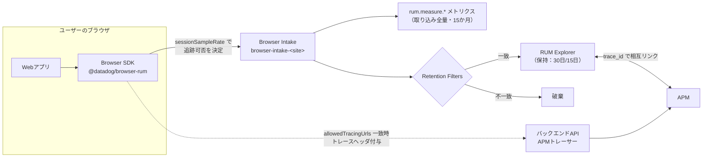
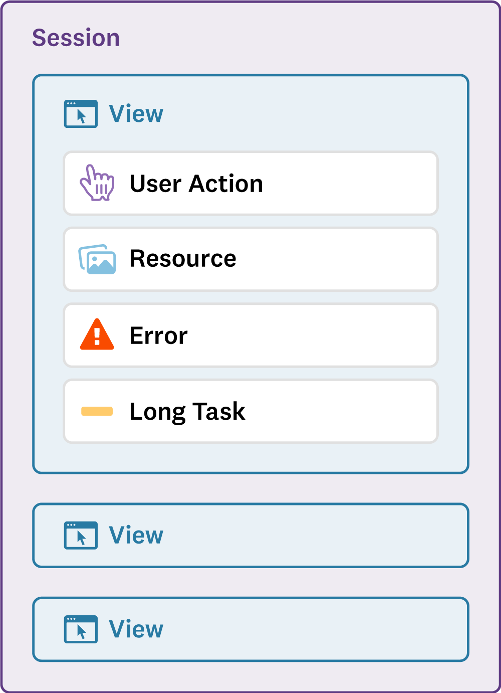
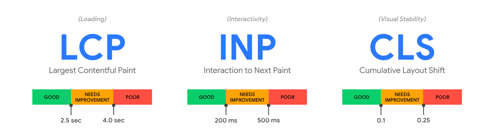
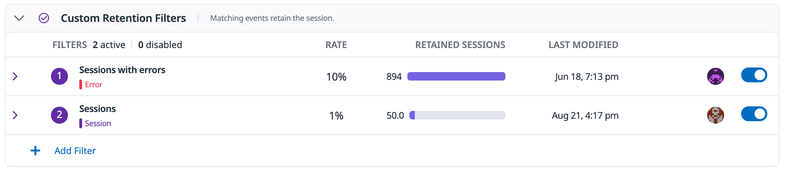
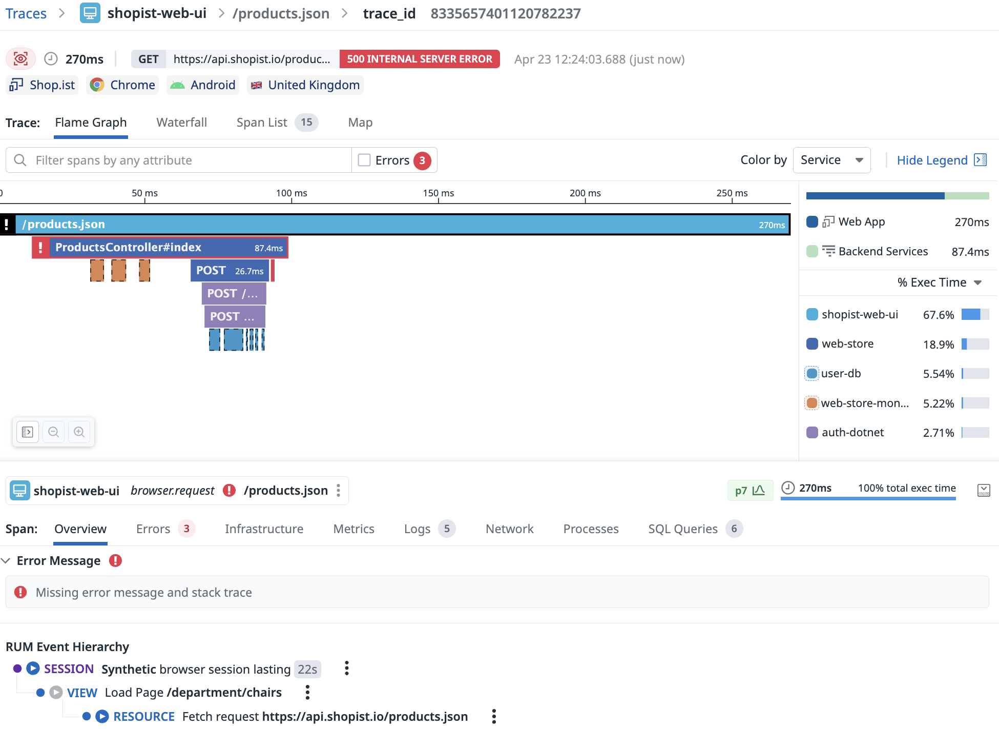
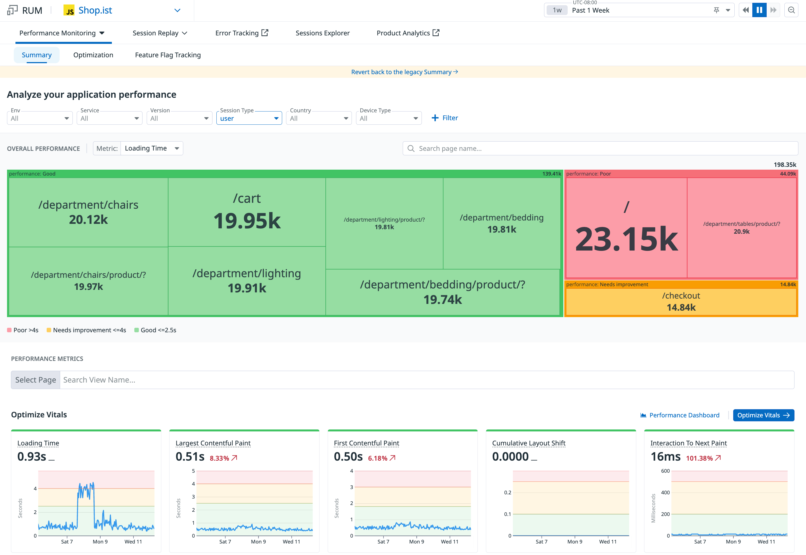

# RUM（ブラウザ）

## 概要

Datadog Real User Monitoring（RUM、リアルユーザーモニタリング）のブラウザ版は、Web アプリケーションに JavaScript の **Browser SDK（`@datadog/browser-rum`）** を組み込み、実ユーザーのブラウザ上で発生したページ表示・操作・ネットワーク通信・エラー・メインスレッドの長時間ブロックをイベントとして収集する製品である。Datadog の製品分類では Digital Experience Monitoring（DEM、デジタル体験モニタリング）に属し、UI では **Digital Experience** メニュー配下（例：Digital Experience > Performance Summary）から利用する。[出典](https://docs.datadoghq.com/real_user_monitoring/)

RUM（ブラウザ）で扱う主な機能は次のとおり。

| 機能 | 概要 | 本書の節 |
|---|---|---|
| Browser SDK の導入 | npm / CDN 非同期 / CDN 同期 / サーバーサイド自動インスツルメンテーション / Agentic Onboarding | [2](#2-browser-sdk-の導入) |
| 初期化パラメータ | サンプリング、追跡対象、プライバシー、トレース連携、セッション保存方式など | [3](#3-初期化パラメータとデフォルト値) |
| 収集データ | Session / View / Action / Resource / Error / Long Task / Vital の各イベント | [4](#4-収集データイベント種別と主要属性) |
| Core Web Vitals | LCP・INP・CLS と、FCP・Loading Time などのパフォーマンス指標 | [5](#5-core-web-vitals-とページパフォーマンス) |
| ユーザー操作とフラストレーション | クリックの自動収集、アクション名、Rage/Dead/Error Click | [6](#6-ユーザー操作actionとフラストレーションシグナル) |
| エラー収集 | 未処理例外、`console.error`、Reporting API、`addError` | [7](#7-エラー収集) |
| サンプリング | `sessionSampleRate`・`sessionReplaySampleRate`・`traceSampleRate` | [8](#8-サンプリング) |
| RUM without Limits | 全量取り込み＋Retention Filters による保持選別、`rum.measure.*` メトリクス | [9](#9-rum-without-limits) |
| APM 連携 | フロントエンドのリクエストとバックエンドトレースの接続 | [10](#10-apm-連携分散トレーシング) |
| プライバシー | マスキング、同意管理、IP・位置情報、`beforeSend`、プロキシ | [11](#11-プライバシーとデータ保護) |
| 分析・アラート | Performance Summary、RUM Explorer、RUM Monitor、カスタムメトリクス | [12](#12-画面分析アラート) |
| 課金 | RUM Measure / RUM Investigate / Session Replay | [14](#14-課金への影響) |

本ファイルはブラウザ版 RUM の仕様リファレンスである。モバイル SDK（Android / iOS / Flutter / React Native ほか）は [RUM（モバイル）](./rum-mobile.md)、Session Replay と Product Analytics の詳細は [Session Replay と Product Analytics](./session-replay-and-product-analytics.md)、合成監視（ラボデータ）は [Synthetic Monitoring](./synthetic-monitoring.md)、エラーの Issue 化は [Error Tracking](../apm/error-tracking.md)、バックエンドのトレース収集とサンプリングは [APM の概念とインジェスト制御](../apm/apm-concepts-and-ingestion.md) を参照。料金の正本は [製品別料金表](../../03_導入編/pricing-by-product.md)。

### 本書の基準

| 項目 | 基準 |
|---|---|
| 情報取得日 | 2026-11-02 |
| Browser SDK のメジャーバージョン | **v7**（v7.0.0 は 2026-04-30 に GitHub で公開。2026-10-27 公開の v7.16.2 が本書基準日時点の最新）[出典](https://github.com/DataDog/browser-sdk/blob/main/CHANGELOG.md) |
| CDN の URL | `https://www.datadoghq-browser-agent.com/<site>/v7/datadog-rum.js`（後述） |
| 旧バージョン | v6 以前との差分は [2.5](#25-sdk-バージョンと主な破壊的変更) にまとめる |

> **注意:** 公式ドキュメントの一部ページ（Session Replay のプライバシーオプション、Data Collected の FID 属性など）は v6 以前の記述が残っている。v7 の仕様は「Browser SDK 移行ガイド」と SDK の API リファレンス（datadoghq.dev）を優先した。差異は該当箇所で注記する。

---

## 1. 全体像とデータフロー

RUM（ブラウザ）のデータは、ブラウザ上の SDK が収集・バッチ化し、Datadog サイトごとの Browser Intake（`browser-intake-*`）へ HTTPS（ポート 443）で送信する。RUM without Limits では、取り込んだ全セッションから `rum.measure.*` メトリクスを計算したうえで、Retention Filters に一致したセッションのみを RUM Explorer に 30 日保持する。[出典](https://docs.datadoghq.com/real_user_monitoring/) / [出典](https://docs.datadoghq.com/real_user_monitoring/rum_without_limits/)



イベントの階層構造は「Session（セッション）> View（ビュー）> Action / Resource / Error / Long Task」である。各イベントは `session.id`、`view.id`、`action.id` で親イベントに紐づく。[出典](https://docs.datadoghq.com/real_user_monitoring/application_monitoring/browser/data_collected/)



**図：RUM イベントの階層構造（Data Collected ページの図）**
画面説明：最上位に Session があり、その下に複数の View がぶら下がる。各 View の下に Action、Resource、Error、Long Task のイベントが紐づく、という親子関係を示す図。
出典：https://docs.datadoghq.com/real_user_monitoring/application_monitoring/browser/data_collected/ （2026-11-02 取得）

---

## 2. Browser SDK の導入

### 2.1 導入方式の比較

RUM Browser SDK の導入方式は、クライアントサイドの手動導入（npm / CDN 非同期 / CDN 同期）、Agentic Onboarding、サーバーサイド自動インスツルメンテーションの 3 系統がある。[出典](https://docs.datadoghq.com/real_user_monitoring/application_monitoring/browser/setup/) / [出典](https://docs.datadoghq.com/real_user_monitoring/application_monitoring/browser/setup/client/)

| 方式 | 読み込み方 | 長所 | 短所・制約 | 想定用途 |
|---|---|---|---|---|
| npm（`@datadog/browser-rum`） | アプリのバンドルに含める | ページ読み込み性能に影響しない。推奨方式 | SDK 初期化前に発生したエラー・リソース・操作を取りこぼす可能性 | モダンな Web アプリ |
| CDN 非同期（async） | CDN から非同期に読み込む | ページ読み込み性能に影響しない | 初期化前のイベントを取りこぼす可能性 | 性能目標が厳しいアプリ |
| CDN 同期（sync） | 他のスクリプトより先に同期読み込み | 全イベントを収集できる | ページ読み込み性能に影響しうる | 全イベント収集を優先する場合 |
| Agentic Onboarding | Pup CLI または Datadog MCP Server で AI 支援により計装 | 対応フレームワーク：Next.js、React、Svelte、Vue、Vanilla JavaScript | — | 新規導入の省力化 |
| サーバーサイド自動インスツルメンテーション（RUM のみ） | Web サーバー／プロキシが HTML レスポンスに SDK を注入 | アプリコード変更不要 | Datadog Agent 7.34 以降が必要。高度な RUM 設定は非対応。Session Replay 等は対象外（RUM のみ）。対応：Apache、IBM HTTP Server、Java Servlet、NGINX、Windows IIS | アプリ改修が難しい環境 |

> **サイト差異:** Gov サイト（`app.ddog-gov.com`、`us2.ddog-gov.com`）ではサーバーサイド自動インスツルメンテーションは利用できず、クライアントサイドで導入する。[出典](https://docs.datadoghq.com/real_user_monitoring/application_monitoring/browser/setup/client/)

### 2.2 手動導入の手順

1. Datadog で **Digital Experience > Add an Application** を開き、アプリケーション種別に JavaScript（JS）を選ぶ。
2. アプリケーション名を入力し **Create Application** をクリックする。`applicationId` と `clientToken` が発行される。
3. 上表のいずれかの方式で SDK をインストールする。
4. アプリのライフサイクルのできるだけ早い段階で SDK を初期化する。

[出典](https://docs.datadoghq.com/real_user_monitoring/application_monitoring/browser/setup/client/)

RUM アプリケーションの作成・編集・削除には権限 `rum_apps_write` が必要である（作成時に Client Token も生成される。Client Token を直接作成するには Client Tokens Write 権限が必要）。[出典](https://docs.datadoghq.com/account_management/rbac/permissions/)

### 2.3 初期化コード

**npm の場合：**

```javascript
import { datadogRum } from '@datadog/browser-rum';

datadogRum.init({
  applicationId: '<APP_ID>',
  clientToken: '<CLIENT_TOKEN>',
  site: '<DATADOG_SITE>',        // 例: 'ap1.datadoghq.com'
  service: 'my-web-application',
  env: 'production',
  version: '1.0.0',
  sessionSampleRate: 100,
  sessionReplaySampleRate: 20,
});
```

**CDN 非同期の場合：** スクリプトを非同期読み込みし、`window.DD_RUM.onReady(function() { window.DD_RUM.init({ ... }) })` の形で初期化する。
**CDN 同期の場合：** スクリプトを同期読み込みし、`window.DD_RUM && window.DD_RUM.init({ ... })` の形で初期化する。

[出典](https://docs.datadoghq.com/real_user_monitoring/application_monitoring/browser/setup/client/)

- TypeScript の型定義は TypeScript 3.8.2 以上に対応する。それより古い場合は `@datadog/browser-rum/bundle/datadog-rum` を import し `window.DD_RUM` を使う。
- Browser Logs SDK（`@datadog/browser-logs`）と併用する場合は、同じバージョンを使うことが推奨されている。

[出典](https://docs.datadoghq.com/real_user_monitoring/application_monitoring/browser/setup/)

### 2.4 サイト別の CDN URL と Intake ドメイン

Browser SDK の `site` パラメータは利用中の Datadog サイトに合わせる。`site` を誤るとデータが届かない。CSP（Content Security Policy）やプロキシを使う場合は、Intake ドメインを許可する必要がある。[出典](https://docs.datadoghq.com/real_user_monitoring/) / [出典](https://docs.datadoghq.com/real_user_monitoring/application_monitoring/browser/setup/client/)

| サイト | `site` の値（ホスト） | CDN URL（v7） | Intake オリジン |
|---|---|---|---|
| US1 | `datadoghq.com`（`app.datadoghq.com`） | `https://www.datadoghq-browser-agent.com/us1/v7/datadog-rum.js` | `https://browser-intake-datadoghq.com` |
| US3 | `us3.datadoghq.com` | `.../us3/v7/datadog-rum.js` | `https://browser-intake-us3-datadoghq.com` |
| US5 | `us5.datadoghq.com` | `.../us5/v7/datadog-rum.js` | `https://browser-intake-us5-datadoghq.com` |
| EU1 | `datadoghq.eu` | `.../eu1/v7/datadog-rum.js` | `https://browser-intake-datadoghq.eu` |
| AP1（日本） | `ap1.datadoghq.com` | `.../ap1/v7/datadog-rum.js` | `https://browser-intake-ap1-datadoghq.com` |
| AP2 | `ap2.datadoghq.com` | `.../ap2/v7/datadog-rum.js` | `https://browser-intake-ap2-datadoghq.com` |
| UK1 | `uk1.datadoghq.com` | `.../uk1/v7/datadog-rum.js` | `https://browser-intake-uk1-datadoghq.com` |
| US1-FED | `ddog-gov.com` | `https://www.datadoghq-browser-agent.com/datadog-rum-v7.js`（リージョン区分なし） | `https://browser-intake-ddog-gov.com` |
| US2-FED | `us2.ddog-gov.com` | 同上 | `https://browser-intake-us2-ddog-gov.com` |

> **サイト差異:** 本ナレッジの規約で列挙する 7 サイトに加え、RUM の公式ドキュメントには UK1 と US2-FED の Intake が掲載されている（2026-11-02 時点）。各サイトの一般的な仕様は [Datadog Sites](../platform/datadog-sites.md) を参照。Browser Profiling 有効時は、各 Intake オリジンの `quota.` サブドメインにも通信するため CSP／プロキシで許可が必要。[出典](https://docs.datadoghq.com/real_user_monitoring/)

**CSP で必要なディレクティブ：**

| ディレクティブ | 値 | 条件 |
|---|---|---|
| `connect-src` | `https://<サイトの Intake ドメイン>` | 常に必要 |
| `worker-src` | `blob:` | Session Replay または `compressIntakeRequests` を使う場合。代替として SDK 4.47.0 以降は Worker ファイルを自ホストし `workerUrl` で指定可能（同一オリジン・SDK とメジャーバージョン一致が条件） |
| `script-src` | `https://www.datadoghq-browser-agent.com` | CDN（非同期・同期）で導入する場合のみ |

[出典](https://docs.datadoghq.com/integrations/content_security_policy_logs/)

### 2.5 SDK バージョンと主な破壊的変更

Browser SDK はメジャーバージョンごとにデフォルト値や対応ブラウザが変わる。設計書や既存環境の設定値を読む際は、SDK バージョンを必ず確認する。[出典](https://docs.datadoghq.com/real_user_monitoring/guide/browser-sdk-upgrade/)

| バージョン | 主な変更 |
|---|---|
| v7（2026-04-30 公開） | `defaultPrivacyLevel` のデフォルトが `mask` → **`mask-user-input`**。`enablePrivacyForActionName` のデフォルトが **`true`**。`propagateTraceBaggage` のデフォルトが **`true`**（クロスオリジンでは `Access-Control-Allow-Headers` に `baggage` の追加が必要になる場合あり）。**FID（First Input Delay）の収集を廃止**（INP に置き換え）。BFCache 復元は常に View として追跡（`trackBfcacheViews` 廃止）、早期リクエストは常に収集（`trackEarlyRequests` 廃止）、`allowFallbackToLocalStorage` 廃止（`sessionPersistence: ['cookie', 'local-storage']` を使う）、`usePciIntake` 廃止（標準 Intake が PCI 準拠）。ES2020 未満のブラウザを切り捨て（**Chrome 80+、Firefox 78+、Safari 14+**）。セッション Cookie 名が `_dd_s_v2` に変更。サンプリング判定が決定論的（セッション ID ベース）に。中断（abort）されたリクエストをネットワークエラーとして収集しない。View の `loading_type` に `session_renewal` を追加 |
| v6 | `trackUserInteractions`・`trackResources`・`trackLongTasks` が**デフォルト有効**。`traceContextInjection` のデフォルトが `sampled`。`trackAnonymousUser` によりセッション Cookie の有効期限が 1 年に延長（`false` で無効化可）。IE11 等を切り捨て（ES2018 が最低）。`useCrossSiteSessionCookie` 廃止（`usePartitionedCrossSiteSessionCookie` へ）。Long Animation Frame を Long Task イベントとして収集 |
| v5 | `defaultPrivacyLevel` のデフォルトが `mask-user-input` → `mask`。`sessionReplaySampleRate` のデフォルトが 100 → **0**。パラメータ改称：`proxyUrl`→`proxy`、`sampleRate`→`sessionSampleRate`、`allowedTracingOrigins`→`allowedTracingUrls`、`tracingSampleRate`→`traceSampleRate`、`trackInteractions`→`trackUserInteractions`、`premiumSampleRate`/`replaySampleRate`→`sessionReplaySampleRate`。`trackFrustrations` は不要に（`trackUserInteractions` で自動収集） |

[出典](https://docs.datadoghq.com/real_user_monitoring/guide/browser-sdk-upgrade/) / [出典](https://github.com/DataDog/browser-sdk/blob/main/CHANGELOG.md)

> **注意（v7 と RUM without Limits の課金）:** v7 で分散トレースのサンプリングが RUM のセッション ID に基づく決定論的方式になったため、RUM without Limits で RUM-APM のクロスプロダクト Retention Filter を使っている場合、**インデックスされるスパン量が増え、コストが上がる可能性がある**と CHANGELOG に警告されている。[出典](https://github.com/DataDog/browser-sdk/blob/main/CHANGELOG.md)

> **対応ブラウザ:** 公式ドキュメントは「モダンなデスクトップ／モバイルの全ブラウザをサポート」とし、詳細なブラウザ別バージョン表は公開していない。v7 の最低要件は移行ガイド記載の Chrome 80+、Firefox 78+、Safari 14+（ES2020）である。古いブラウザ対応が必要なら v6 以前に留める（v6 の最低は ES2018、IE11 は v5 以前）。[出典](https://docs.datadoghq.com/real_user_monitoring/application_monitoring/browser/setup/) / [出典](https://docs.datadoghq.com/real_user_monitoring/guide/browser-sdk-upgrade/)

---

## 3. 初期化パラメータとデフォルト値

`datadogRum.init()` に渡す `RumInitConfiguration` の主なパラメータを、v7 の API リファレンスに基づいて整理する。[出典](https://datadoghq.dev/browser-sdk/interfaces/_datadog_browser-rum.RumInitConfiguration.html)

### 3.1 認証・識別

| パラメータ | 型 | デフォルト | 説明 |
|---|---|---|---|
| `applicationId` | string | 必須 | RUM アプリケーション ID |
| `clientToken` | string | 必須 | ブラウザからの送信用 Client Token（API キーとは別物。詳細は [API とキー管理](../platform/api-and-keys.md)） |
| `site` | Site | `datadoghq.com` | 送信先 Datadog サイト |
| `service` | string \| null | `applicationId` の値 | サービス名。[Unified Service Tagging](../platform/tagging.md) の `service` |
| `env` | string \| null | 未指定 | 環境名（例：`prod`、`staging`） |
| `version` | string \| null | 未指定 | アプリのバージョン（例：`1.2.3`）。ソースマップ照合やデプロイ比較に使う |

### 3.2 データ収集

| パラメータ | 型 | デフォルト | 説明 |
|---|---|---|---|
| `sessionSampleRate` | number（0〜100） | `100` | 追跡するセッションの割合（%） |
| `trackUserInteractions` | boolean | `true`（v6 以降） | クリック操作（Action）を自動収集 |
| `trackResources` | boolean | `true`（v6 以降） | Resource イベントを収集 |
| `trackLongTasks` | boolean | `true`（v6 以降） | Long Task イベントを収集 |
| `trackViewsManually` | boolean | 未指定（自動） | `true` で View 開始を `startView()` で手動制御（SDK 2.17.0 以降） |
| `trackResourceHeaders` | boolean \| MatchHeader[] | `false` | Resource イベントにリクエスト／レスポンスヘッダを付与（機微ヘッダは常に除外） |
| `allowedGraphQlUrls` | 配列 | 未指定 | GraphQL エンドポイントを指定し、操作種別・操作名・変数等を付与 |
| `trackFeatureFlagsForEvents` | 配列 | 未指定 | Long Task・Resource・Action・Vital イベントにフィーチャーフラグ情報を付与 |
| `trackAnonymousUser` | boolean | `true` | 匿名ユーザー ID（`usr.anonymous_id`）を付与し、Cookie 有効期限を延長 |
| `actionNameAttribute` | string | 未指定 | クリック対象のアクション名に使う独自 HTML 属性（SDK 2.16.0 以降） |
| `excludedActivityUrls` | MatchOption[] | 未指定 | ページアクティビティ（Loading Time 計算）から除外するリクエスト |
| `beforeSend` | 関数 | 未指定 | 送信前にイベントを加工・破棄するフック（[11.4](#114-beforesend-によるイベント加工破棄)） |
| `telemetrySampleRate` | number | `20` | SDK 自体のテレメトリ送信割合 |
| `allowUntrustedEvents` | boolean | `false` | プログラムから dispatch された DOM イベントも収集 |
| `plugins` | RumPlugin[] | 未指定 | プラグイン（API は実験的） |

### 3.3 プライバシー

| パラメータ | 型 | デフォルト | 説明 |
|---|---|---|---|
| `defaultPrivacyLevel` | `mask` / `mask-user-input` / `allow` | **`mask-user-input`**（v7。v5〜v6 は `mask`） | Session Replay のマスキング既定値 |
| `enablePrivacyForActionName` | boolean | **`true`**（v7） | プライバシー設定をアクション名にも適用 |
| `trackingConsent` | `granted` / `not-granted` | `granted` | 初期の同意状態。後から `setTrackingConsent()` で変更可 |

### 3.4 Session Replay・Profiling

| パラメータ | 型 | デフォルト | 説明 |
|---|---|---|---|
| `sessionReplaySampleRate` | number（0〜100） | `0`（v5 以降） | 追跡セッションのうち Session Replay を録画する割合 |
| `startSessionReplayRecordingManually` | boolean | `false` | `true` で `startSessionReplayRecording()` 呼び出し時のみ録画（v5.0.0 以降） |
| `subdomain` | string | 未指定 | `getSessionReplayLink()` が返す URL のサブドメイン |
| `profilingSampleRate` | number（0〜100） | `0` | ブラウザプロファイリング対象ユーザーの割合（RUM Profiling） |

### 3.5 トレース連携

| パラメータ | 型 | デフォルト | 説明 |
|---|---|---|---|
| `allowedTracingUrls` | 配列（文字列・正規表現・関数・`{match, propagatorTypes}`） | 未指定（トレースヘッダを付与しない） | トレースヘッダを付与するリクエスト URL |
| `traceSampleRate` | number（0〜100） | `100` | トレース対象リクエストの割合 |
| `traceContextInjection` | `all` / `sampled` | `sampled`（v6 以降） | どのリクエストにトレースコンテキストを注入するか |
| `propagateTraceBaggage` | boolean | `true`（v7） | `baggage` ヘッダでユーザー ID・アカウント ID を伝播 |

### 3.6 セッション保存・通信

| パラメータ | 型 | デフォルト | 説明 |
|---|---|---|---|
| `sessionPersistence` | `cookie` / `local-storage` / `memory`、またはその配列 | `cookie` | セッションの保存方式。Logs SDK と併用時は一致させる |
| `trackSessionAcrossSubdomains` | boolean | `false` | 同一サイトのサブドメイン間でセッションを維持 |
| `useSecureSessionCookie` | boolean | `false` | Secure Cookie を使用（非 HTTPS からの送信を無効化） |
| `usePartitionedCrossSiteSessionCookie` | boolean | `false` | クロスサイト iframe 内で動作させるための Partitioned Cookie（`useSecureSessionCookie` を含意） |
| `storeContextsAcrossPages` | boolean | `false` | グローバルコンテキストとユーザー情報を `localStorage` に保存しページ間で維持（SDK 4.49.0 以降。`trackSessionAcrossSubdomains` とは併用不可。オリジンあたり 5 MiB 制限） |
| `compressIntakeRequests` | boolean | 未指定 | Worker スレッドで送信データを圧縮 |
| `proxy` | string \| 関数 | 未指定 | 自社プロキシ経由で送信（[11.6](#116-プロキシ経由の送信)） |
| `workerUrl` | string | 未指定 | 自ホストした Worker スクリプトの URL（同一オリジン） |
| `allowedTrackingOrigins` | MatchOption[] | 未指定 | ブラウザ拡張内で SDK を動かすことを許可するオリジン（未指定だと拡張内では動作しない） |
| `silentMultipleInit` | boolean | `false` | 二重初期化時にエラーを出さない |

### 3.7 ベータ／実験的パラメータ

| パラメータ | デフォルト | 説明 |
|---|---|---|
| `betaEnableViewUpdates` | `proxy` 未設定時は有効 | View の途中更新で変更されたフィールドのみ送信（v7.15.0 で全顧客にデフォルト有効化） |
| `betaTrackWebSockets` | 未指定 | WebSocket の Vital イベントを収集（v7.16.0 で実験的に追加） |

[出典](https://datadoghq.dev/browser-sdk/interfaces/_datadog_browser-rum.RumInitConfiguration.html) / [出典](https://github.com/DataDog/browser-sdk/blob/main/CHANGELOG.md)

### 3.8 主な実行時 API

| API | 用途 | 最低 SDK |
|---|---|---|
| `setUser({id, name, email, ...})` / `getUser` / `setUserProperty` / `removeUserProperty` / `clearUser` | ユーザー情報（`usr.*`）の付与。v6.4.0 以降は `usr.id` が必須 | — |
| `setAccount({id, name})` / `getAccount` / `setAccountProperty` / `removeAccountProperty` / `clearAccount` | アカウント情報（`account.*`）の付与。`account.id` 必須 | — |
| `setGlobalContext` / `setGlobalContextProperty` / `removeGlobalContextProperty` / `clearGlobalContext` / `getGlobalContext` | 全イベント共通のカスタム属性 | — |
| `startView({name, service, version, context})` | View の手動開始（`trackViewsManually: true` 時） | 名前のみ 2.17.0、`service`/`version` 4.13.0、`context` 5.28.0 |
| `setViewName(name)` | 現在の View 名を変更 | 2.17.0 |
| `setViewContext` / `setViewContextProperty` | View 単位のコンテキスト | 5.28.0 |
| `addAction(name, context)` | カスタムアクション（`action.type:custom`） | — |
| `addError(error, context)` | 処理済み例外の送信（`error.source:custom`） | — |
| `addTiming(name, time?)` | View 起点のカスタムタイミング（`@view.custom_timings.<name>`） | — |
| `startDurationVital` / `stopDurationVital` / `addDurationVital` | カスタム Vital（処理時間計測） | v7 で `DurationVitalReference` は `vitalKey` オプションに置き換え |
| `setViewLoadingTime()` | Loading Time を手動確定（最後の呼び出しが有効、自動検出は停止） | — |
| `setTrackingConsent('granted' \| 'not-granted')` | 同意状態の変更 | — |
| `startSessionReplayRecording()` / `stopSessionReplayRecording()` | Session Replay の録画制御 | — |
| `getInternalContext(startTime?)` | `application_id`・`session_id`・`view`・`user_action` を取得（デバッグ用） | — |

[出典](https://docs.datadoghq.com/real_user_monitoring/application_monitoring/browser/advanced_configuration/) / [出典](https://docs.datadoghq.com/real_user_monitoring/application_monitoring/browser/monitoring_page_performance/)

---

## 4. 収集データ（イベント種別と主要属性）

### 4.1 イベント種別と保持期間

| イベント | 発生単位 | 保持期間 | 内容 |
|---|---|---|---|
| Session | ユーザーの一連の閲覧（`session.id`） | 30 日 | 15 分無操作で終了、最長 4 時間 |
| View | ページ表示（SPA のルート変更を含む） | 30 日 | 表示時間、Core Web Vitals、Loading Time、配下イベント数 |
| Action | ユーザー操作（クリック）と `addAction` によるカスタムアクション | 30 日 | アクション名、処理時間、フラストレーションシグナル |
| Resource | 画像・XHR・Fetch・CSS・JS 等の読み込み | 15 日 | DNS・TLS・TTFB・ダウンロード等のタイミング、サイズ、ステータス |
| Error | ブラウザで発生したフロントエンドエラー | 30 日 | エラー種別、メッセージ、スタックトレース、発生源 |
| Long Task | メインスレッドを 50 ms 超ブロックした処理（v6 以降、対応ブラウザでは Long Animation Frame を Long Task として収集） | 15 日 | 継続時間、（LoAF の場合）スクリプトの帰属情報 |
| Vital | カスタム Vital（`startDurationVital` 等）、WebSocket Vital（実験的） | 15 日 | `@vital.name`、`@vital.duration` 等 |

[出典](https://docs.datadoghq.com/real_user_monitoring/application_monitoring/browser/data_collected/) / [出典](https://docs.datadoghq.com/data_security/data_retention_periods/) / [出典](https://github.com/DataDog/browser-sdk/blob/main/CHANGELOG.md)

> 保持期間は RUM without Limits で Retention Filters により保持されたセッションのイベントに適用される。保持されなかったセッションのイベントは RUM Explorer で検索できないが、`rum.measure.*` メトリクスには集計される（[9](#9-rum-without-limits)）。

### 4.2 Session の主要属性

| 属性 | 説明 |
|---|---|
| `session.id` | セッション ID |
| `session.type` | `user`（実ユーザー）や `synthetics`（Synthetic テスト由来）など |
| `session.is_active` | セッションが継続中か |
| `session.time_spent` | セッションの継続時間（ns） |
| `session.view.count` / `session.action.count` / `session.error.count` / `session.resource.count` / `session.long_task.count` | 配下イベント数 |
| `session.frustration.count` | フラストレーションシグナル数 |
| `session.initial_view.url` / `session.last_view.url` 等 | 最初・最後の View の URL 情報 |
| `session.referrer` | リファラー |
| `session.ip` | クライアント IP（収集を無効化可） |

[出典](https://docs.datadoghq.com/real_user_monitoring/application_monitoring/browser/data_collected/)

このほか、全イベント共通の標準属性として、アプリケーション（`application.id`）、`view.url`・`view.name`、デバイス（`device.type` 等）、OS、ブラウザ、地理情報（`geo.country` 等）、ユーザー（`usr.*`）、`service`・`env`・`version` などが付与される。v6.33.0 以降は全 RUM／Logs イベントに `tab.id` も付与される。[出典](https://docs.datadoghq.com/real_user_monitoring/application_monitoring/browser/data_collected/) / [出典](https://github.com/DataDog/browser-sdk/blob/main/CHANGELOG.md)

### 4.3 View の主要属性

時間値はナノ秒（ns）単位。[出典](https://docs.datadoghq.com/real_user_monitoring/application_monitoring/browser/monitoring_page_performance/)

| 属性 | 説明 |
|---|---|
| `view.time_spent` | View の滞在時間（バックグラウンド表示中も含む） |
| `view.loading_type` | `initial_load`（初回ロード）／`route_change`（SPA 遷移）／`session_renewal`（セッション更新、v7 で追加） |
| `view.first_byte` | 最初のバイト受信までの時間（TTFB） |
| `view.first_contentful_paint` | FCP |
| `view.largest_contentful_paint`（＋`_target_selector`） | LCP と対象要素の CSS セレクター |
| `view.interaction_to_next_paint`（＋`_target_selector`） | INP と対象要素 |
| `view.cumulative_layout_shift`（＋`_target_selector`） | CLS と最もずれた要素 |
| `view.first_input_delay`（＋`_target_selector`） | FID。**v7 では収集されない**（v6 以前のデータのみ） |
| `view.loading_time` | ネットワーク／DOM 活動が止まりページが準備完了になるまでの時間 |
| `view.dom_interactive` / `view.dom_content_loaded` / `view.dom_complete` / `view.load_event` | Navigation Timing 由来の指標 |
| `view.error.count` / `view.long_task.count` / `view.resource.count` / `view.action.count` | 配下イベント数 |
| `view.frustration.count` | フラストレーションシグナル数 |
| `view.custom_timings.<name>` | `addTiming` で付与したカスタムタイミング |

### 4.4 Resource の主要属性

| 区分 | 属性 |
|---|---|
| タイミング | `resource.duration`、`resource.dns.duration`、`resource.connect.duration`、`resource.ssl.duration`、`resource.redirect.duration`、`resource.first_byte.duration`、`resource.download.duration` |
| リクエスト | `resource.type`、`resource.method`、`resource.status_code`（fetch/XHR のみ）、`resource.url`、`resource.url_host`、`resource.url_path`、`resource.url_query`、`resource.url_scheme`、`resource.size` |
| 提供元 | `resource.provider.name`、`resource.provider.domain`、`resource.provider.type`（サードパーティ判別） |
| ヘッダ（`trackResourceHeaders` 有効時） | `resource.request.headers`、`resource.response.headers` |
| GraphQL（`allowedGraphQlUrls` 一致時） | `resource.graphql.operation_type`、`operation_name`、`variables`、`payload`、`errors_count`、`errors` |

[出典](https://docs.datadoghq.com/real_user_monitoring/application_monitoring/browser/data_collected/)

### 4.5 Action・Error・Long Task の主要属性

| イベント | 主要属性 |
|---|---|
| Action | `action.id`、`action.type`（`click`、カスタムは `custom`）、`action.name`、`action.target.name`（自動収集のみ）、`action.loading_time`（ns）、`action.long_task.count`、`action.resource.count`、`action.error.count`、`action.frustration.type`（`rage_click`／`dead_click`／`error_click`） |
| Error | `error.source`、`error.type`、`error.message`、`error.stack`、`error.causes` |
| Long Task | `long_task.duration` |

[出典](https://docs.datadoghq.com/real_user_monitoring/application_monitoring/browser/data_collected/) / [出典](https://docs.datadoghq.com/real_user_monitoring/application_monitoring/browser/collecting_browser_errors/)

### 4.6 SPA とハッシュルーティング

- Browser SDK は History API による URL 変化を検知して新しい View を作成し、`loading_type` を `route_change` とする。
- URL のハッシュ（`#`）変化も `HashChangeEvent` により新しい View とする。View の文脈を変えない単なるアンカーリンクは無視する。
- View 名を URL ではなく任意の名前にしたい場合は `trackViewsManually: true` と `startView()`、または `setViewName()` を使う。

[出典](https://docs.datadoghq.com/real_user_monitoring/application_monitoring/browser/monitoring_page_performance/) / [出典](https://docs.datadoghq.com/real_user_monitoring/application_monitoring/browser/advanced_configuration/)

---

## 5. Core Web Vitals とページパフォーマンス

### 5.1 Core Web Vitals

RUM（ブラウザ）は Google の Core Web Vitals を View ごとに収集する（`@datadog/browser-rum` v2.2.0 以降）。Datadog は **75 パーセンタイル（p75）** での監視を推奨している。[出典](https://docs.datadoghq.com/real_user_monitoring/application_monitoring/browser/monitoring_page_performance/)



**図：Core Web Vitals の 3 指標と評価閾値**
画面説明：左から LCP（Loading：Largest Contentful Paint）、INP（Interactivity：Interaction to Next Paint）、CLS（Visual Stability：Cumulative Layout Shift）を並べ、それぞれ GOOD／NEEDS IMPROVEMENT／POOR の帯を示す図。境界値は LCP が 2.5 秒と 4.0 秒、INP が 200 ms と 500 ms、CLS が 0.1 と 0.25。
出典：https://docs.datadoghq.com/real_user_monitoring/application_monitoring/browser/monitoring_page_performance/ （2026-11-02 取得）

| 指標 | 観点 | 目標値（Good） | 収集タイミング | 必要条件 |
|---|---|---|---|---|
| LCP（Largest Contentful Paint） | 読み込み性能 | 2.5 秒未満 | 初回ロードの View のみ（SPA 遷移では原則収集しない。soft navigation 向け LCP は v7 で実験的に追加） | ページが非表示で開始した場合、LCP エントリ前にユーザー操作があった場合、10 分超の場合は報告しない |
| INP（Interaction to Next Paint） | 応答性 | 200 ms 未満 | SPA のルート変更を含む全 View | SDK v5.1.0 以降。View 内で 1 回以上の操作が必要。ブラウザが `event` エントリと `PerformanceEventTiming.interactionId` に対応していること |
| CLS（Cumulative Layout Shift） | 視覚的安定性 | 0.1 未満 | SPA のルート変更を含む全 View | ブラウザが `layout-shift` エントリと `WeakRef` に対応していること |
| FCP（First Contentful Paint）※補助指標 | 初回描画 | — | 初回ロードの View のみ（10 分上限） | — |
| FID（First Input Delay）※廃止 | 初回入力遅延 | — | **v7 で収集廃止**（INP に置き換え） | — |

[出典](https://docs.datadoghq.com/real_user_monitoring/application_monitoring/browser/monitoring_page_performance/) / [出典](https://docs.datadoghq.com/real_user_monitoring/guide/browser-sdk-upgrade/) / [出典](https://github.com/DataDog/browser-sdk/blob/main/CHANGELOG.md)

- バックグラウンドタブ等、非表示で開始したページでは LCP と FCP を送信しない（バックグラウンド化前に取得済みの値は保持）。
- CLS と INP を全 View で報告する方式は、Chrome の Soft Navigations API の実験に沿ったもの。
- Synthetic Monitoring の LCP・CLS はラボ計測値であり、RUM の実ユーザー計測値とは別物である（[Synthetic Monitoring](./synthetic-monitoring.md)）。

### 5.2 Web Vitals のサブパート（診断用）

| 指標 | 属性 | 意味 | 最低 SDK |
|---|---|---|---|
| LCP | `view.first_byte` | TTFB | v6.32.0 |
| LCP | `view.performance.lcp.sub_parts.load_delay` | リソース読み込み開始までの遅延 | v6.32.0 |
| LCP | `view.performance.lcp.sub_parts.load_time` | LCP リソースの読み込み時間 | v6.32.0 |
| LCP | `view.performance.lcp.sub_parts.render_delay` | 読み込み後の描画遅延 | v6.32.0 |
| INP | `view.performance.inp.sub_parts.input_delay` | 入力遅延（大きいとメインスレッド競合を示唆） | v6.33.0 |
| INP | `view.performance.inp.sub_parts.processing_duration` | イベントハンドラ処理時間 | v6.33.0 |
| INP | `view.performance.inp.sub_parts.presentation_delay` | スタイル・レイアウト・描画の遅延 | v6.33.0 |

[出典](https://docs.datadoghq.com/real_user_monitoring/application_monitoring/browser/monitoring_page_performance/)

### 5.3 Loading Time の計算方法

`view.loading_time` は Datadog 独自の指標で、次のように計算する。[出典](https://docs.datadoghq.com/real_user_monitoring/application_monitoring/browser/monitoring_page_performance/)

| ケース | 計算 |
|---|---|
| 初回ロード | 「`navigationStart`〜`loadEventEnd`」と「`navigationStart`〜ページアクティビティが初めて止まった時点」の長い方 |
| SPA のルート変更 | URL 変化〜ページアクティビティが初めて止まった時点 |
| 手動指定 | `setViewLoadingTime()` を呼ぶと、その時点を Loading Time とし自動検出を停止（最後の呼び出しが有効） |

**ページアクティビティの判定：**

| 項目 | 内容 |
|---|---|
| アクティブとみなす条件 | `xhr`／`fetch` リクエストが進行中、Resource Timing エントリが発行された、DOM が変更された |
| 非アクティブとみなす条件 | **100 ms** 間アクティビティがない |
| 対象範囲 | SDK 初期化後のアクティビティのみ |
| 歪みの要因 | 定期的な分析ビーコン、ロングポーリング、ストリーミング通信 |
| 対策 | `excludedActivityUrls`（完全一致・正規表現・関数）でリクエストを除外。スピナー・プログレスバー・時計などの DOM 変化は要素に `data-dd-excluded-activity-mutations` 属性を付けて除外 |

### 5.4 カスタムタイミングとカスタム Vital

| 機能 | API | 検索・集計時の属性 | 留意点 |
|---|---|---|---|
| カスタムタイミング | `addTiming(name, time?)` | `@view.custom_timings.<name>`（ns） | View 開始からの相対時間。可視化前に RUM Explorer で Measure（メジャー）を作成する。非同期処理では Unix エポックの時刻を第 2 引数に渡す |
| カスタム Vital | `startDurationVital` / `stopDurationVital`、または `addDurationVital(name, {startTime, duration})` | `@vital.name`、`@vital.duration`、`@vital.description` | 名前に使える文字は英数字と `- _ . @ $` のみ |

[出典](https://docs.datadoghq.com/real_user_monitoring/application_monitoring/browser/monitoring_page_performance/)

### 5.5 Web Vitals が欠落する場合の確認ポイント

| 症状 | 主な原因 |
|---|---|
| INP がない | View 中に操作がない、ブラウザ非対応、操作前に View が終了した |
| LCP / FCP がない | バックグラウンドタブや非表示ウィンドウ、10 分超、SPA のルート変更 View |
| CLS がない | ブラウザが `layout-shift` または `WeakRef` に非対応 |
| 値が出ない全般 | SDK バージョンが要件未満。`window.DD_RUM.getInternalContext()`、ブラウザの Network タブの View イベント、RUM Explorer の `@view.*` 属性で確認 |

[出典](https://docs.datadoghq.com/real_user_monitoring/application_monitoring/browser/monitoring_page_performance/)

---

## 6. ユーザー操作（Action）とフラストレーションシグナル

### 6.1 Action の自動収集

- `trackUserInteractions: true`（v6 以降デフォルト）でクリック操作を Action として自動収集する。同じ要素への連続クリックは 1 つの Action にまとめられる。
- `action.loading_time` は、クリック後のページアクティビティが止まるまでの時間として計測される。
- カスタムアクションは `addAction(name, context)` で送信し、`action.type` は `custom` になる。

[出典](https://docs.datadoghq.com/real_user_monitoring/application_monitoring/browser/tracking_user_actions/)

### 6.2 アクション名の決定順序

| 優先順位 | 名前の決め方 |
|---|---|
| 1 | クリック要素または親要素の `data-dd-action-name` 属性、または `actionNameAttribute` で指定した独自属性（両方ある場合は `data-dd-action-name` が優先） |
| 2 | `enablePrivacyForActionName: true`（v7 のデフォルト）で明示名がない場合、マスク対象の要素は `Masked Element` になる |
| 3 | 上記以外は `label`、`placeholder`、`aria-label` などの属性、最終的には要素の内部テキストから生成 |

[出典](https://docs.datadoghq.com/real_user_monitoring/application_monitoring/browser/tracking_user_actions/) / [出典](https://docs.datadoghq.com/session_replay/browser/privacy_options/)

> **【経験則】** 内部テキストから自動生成されるアクション名に、ボタンラベル経由で個人情報が混入することがある。重要画面では `data-dd-action-name` で固定名を付けるとよい【第三者情報】。[出典](https://www.issoh.co.jp/tech/details/16576/)（2026-08-15 公開、2026-10-12 更新）

### 6.3 フラストレーションシグナル

フラストレーションシグナル（Frustration Signals）は、ユーザーの不満を示すクリックパターンを Action に付与する機能である。Browser RUM SDK 4.14.0 以降で利用でき、現行版では `trackUserInteractions: true` だけで 3 種類すべてが収集される（v5.0.0 未満では `trackFrustrations: true` も必要）。[出典](https://docs.datadoghq.com/real_user_monitoring/application_monitoring/browser/frustration_signals/)

| 種類 | 属性値 | 定義 |
|---|---|---|
| Rage Click（レイジクリック） | `rage_click` | 1 秒間のスライディングウィンドウ内で同一要素を **3 回を超えて**（4 回以上）クリック |
| Dead Click（デッドクリック） | `dead_click` | クリックしてもページ上で何も起きない静的要素へのクリック |
| Error Click（エラークリック） | `error_click` | クリック直後に JavaScript エラーが発生 |

- 検索例：`@action.frustration.type:rage_click`、`@session.frustration.count:>1`、`@view.frustration.count:>1`
- 表示箇所：RUM Applications ページ、RUM Explorer、Frustration Signals ダッシュボード（複製・編集可）、Session／View／Action／Error の各サイドパネル、Session Replay のタイムライン、RUM Monitor。
- 制約：マウスクリックのみが対象で、キーボード操作では発生しない。

[出典](https://docs.datadoghq.com/real_user_monitoring/application_monitoring/browser/frustration_signals/)

---

## 7. エラー収集

### 7.1 エラーの発生源（`error.source`）

| `error.source` | 収集元 | 自動収集 |
|---|---|---|
| `source` | 未処理例外、未処理の Promise rejection | ○ |
| `console` | `console.error()` の呼び出し | ○ |
| `report` | `ReportingObserver` API（ブラウザの介入・非推奨警告等） | ○ |
| `custom` | `addError()` で送信 | 手動 |
| `agent` | SDK 自身の実行 | ○ |
| `network` | ネットワークエラー | — （v7 では中断されたリクエストは収集しない） |

[出典](https://docs.datadoghq.com/real_user_monitoring/application_monitoring/browser/collecting_browser_errors/) / [出典](https://github.com/DataDog/browser-sdk/blob/main/CHANGELOG.md)

### 7.2 エラーの扱い

- 収集したエラーは RUM の Error イベントとして記録され、Retention Filter によるセッション保持のきっかけにもなる。`rum.measure.error`、`rum.measure.session.error`、`rum.measure.view.error_free` も更新される。
- **Error Tracking** で Issue 化されるのは、スタックトレースを持ち `error.source` が `custom`・`source`・`report`・`console` のエラーに限られる。`network` 由来やブラウザ拡張由来のエラーは処理されない。詳細は [Error Tracking](../apm/error-tracking.md)。
- Error Tracking のルール（Ignored／Excluded）は RUM の Error イベント自体の記録には影響しない。記録自体を止めるには `beforeSend` で破棄する。
- React のエラーバウンダリでは、`componentDidCatch` 内で `ReactRenderingError` という名前の `Error` を作り、コンポーネントスタックをスタックとして `addError()` に渡す。
- WebAssembly のエラーは `@datadog/browser-plugin-wasm`（SDK と同一バージョン）を `makeWasmPlugin()` で登録し、WASM モジュール読み込み前に RUM を初期化する。

[出典](https://docs.datadoghq.com/real_user_monitoring/application_monitoring/browser/collecting_browser_errors/)

### 7.3 既知の制約

| 制約 | 内容 | 対処 |
|---|---|---|
| `Script error.` | クロスオリジンのスクリプトはブラウザが詳細を隠すため、メッセージが「Script error.」のみになる | `<script>` に `crossorigin="anonymous"` を付け、配信元で `Access-Control-Allow-Origin` を設定 |
| 圧縮（minify）されたスタック | 本番バンドルのスタックトレースが読めない | ソースマップを `datadog-ci` 等でアップロード（`service`・`version` の一致または Debug ID が必要。詳細は [Error Tracking](../apm/error-tracking.md)） |
| 初期化前のエラー | npm／CDN 非同期では初期化前のエラーを取りこぼしうる | CDN 同期読み込み、または早期初期化 |

[出典](https://docs.datadoghq.com/real_user_monitoring/application_monitoring/browser/collecting_browser_errors/)

---

## 8. サンプリング

### 8.1 3 種類のサンプリング

| パラメータ | 対象 | デフォルト | 効果 |
|---|---|---|---|
| `sessionSampleRate` | セッション全体 | 100 | 対象外のセッションは**一切送信されない**（メトリクスにも計上されない） |
| `sessionReplaySampleRate` | 追跡セッションのうち Session Replay を録画する割合 | 0（v5 以降） | `sessionSampleRate` 適用後の割合に掛かる |
| `traceSampleRate` | `allowedTracingUrls` に一致するリクエストのうちバックエンドトレースを保持する割合 | 100 | RUM のセッションサンプリングには影響しない |

[出典](https://docs.datadoghq.com/real_user_monitoring/guide/sampling-browser-plans/) / [出典](https://docs.datadoghq.com/real_user_monitoring/correlate_with_other_telemetry/apm/)

**組み合わせの例：** `sessionSampleRate: 60`、`sessionReplaySampleRate: 50` の場合、40% のセッションは破棄、30% は Browser RUM、30% は Browser RUM & Session Replay として収集される。[出典](https://docs.datadoghq.com/real_user_monitoring/guide/sampling-browser-plans/)

- v7 ではサンプリング判定が決定論的（セッション ID に基づく）になり、製品間で一貫した判定が行われる。[出典](https://github.com/DataDog/browser-sdk/blob/main/CHANGELOG.md)
- 旧パラメータ名：`sampleRate`（v4.30.0 未満）→`sessionSampleRate`、`premiumSampleRate`（v4.20.0 未満）／`replaySampleRate`（v4.10.2 未満）→`sessionReplaySampleRate`。`sessionReplaySampleRate` は v3.0.0 以降。

### 8.2 条件付きの録画（強制リプレイ）

特定の条件に達したセッションだけを録画する場合は、`sessionSampleRate: 100`、`sessionReplaySampleRate: 100`、`startSessionReplayRecordingManually: true`（v5.0.0 以降）を設定し、条件成立時に `datadogRum.startSessionReplayRecording()` を呼ぶ。呼ばれなかったセッションは Browser RUM のままとなる。v5.0.0 以降、実際に録画されたセッションのみが Browser RUM & Session Replay として扱われる。[出典](https://docs.datadoghq.com/real_user_monitoring/guide/sampling-browser-plans/)

### 8.3 RUM without Limits におけるサンプリングの推奨

RUM without Limits を使う場合、Datadog は `sessionSampleRate` を **100%** にし、保持の選別は Retention Filters で行うことを推奨している。既存アプリを移行する手順は次のとおり。[出典](https://docs.datadoghq.com/real_user_monitoring/rum_without_limits/)

1. `sessionSampleRate` を 100 にする。
2. Replay 量を維持するよう `sessionReplaySampleRate` を下げる（例：20% / 10% → 100% / 2% でほぼ同量）。
3. APM スパン量を維持するため、`traceSampleRate` を従来の `sessionSampleRate` の値にし、`traceContextInjection: sampled` を使う（例：セッション 10%→100% にするならトレースは 100%→10%）。
4. 全アプリケーションバージョンで同じ Retention Filters を作る。
5. アプリを再デプロイする。

> **【経験則】** RUM without Limits を使わない（全取り込みセッションに課金される）契約では、ページ単位の p75 を安定させられるだけのセッション数を確保しつつ `sessionSampleRate` を下げ、障害調査時に一時的に 100% に戻す運用が語られている【第三者情報】。[出典](https://www.issoh.co.jp/tech/details/16576/)（2026-08-15 公開、2026-10-12 更新）

---

## 9. RUM without Limits

### 9.1 概念

RUM without Limits は、セッションの**取り込み（ingestion）**と**保持（indexing / retention）**を分離する仕組みである。SDK 側では原則全セッションを送り、Datadog の UI で設定する Retention Filters により、エラーや性能問題のあるセッションなど価値の高いものだけを保持する。コード変更や事前のサンプリング判断は不要になる。[出典](https://docs.datadoghq.com/real_user_monitoring/rum_without_limits/)

| 項目 | 内容 |
|---|---|
| 取り込み（RUM Measure） | 全セッションを取り込み、30 以上の標準メトリクス（`rum.measure.*`）を生成し 15 か月保持 |
| 保持（RUM Investigate） | Retention Filters に一致したセッションを RUM Explorer に 30 日保持（Resource・Long Task 等は 15 日） |
| 判定までのバッファ | 保持判定までセッションを最大 4 時間バッファする |
| 有効化 | コミットなし（non-committed）の RUM プラン顧客は自動で有効。それ以外はアカウントチームまたはサポートに連絡 |
| 既存利用者 | 機能を使うにはアプリの再デプロイが必要 |
| Performance Summary の制約 | RUM without Limits では Performance Monitoring Summary ページはデフォルトフィルターのみ使用可能（メトリクスはタグ数が限られるため） |

[出典](https://docs.datadoghq.com/real_user_monitoring/rum_without_limits/) / [出典](https://www.datadoghq.com/architecture/rum-without-limits-reference-architecture/)（2026-09-14 公開）

### 9.2 Retention Filters

Retention Filters は、RUM Explorer と同様の検索クエリを取り込み時のイベントに適用し、セッションを 30 日保持するか破棄するかを決める。[出典](https://docs.datadoghq.com/real_user_monitoring/rum_without_limits/retention_filters/)



**図：Custom Retention Filters の一覧**
画面説明：「Custom Retention Filters — Matching events retain the session.」という見出しの下に、フィルター一覧（FILTERS 2 active / 0 disabled）が表示されている。各行に評価順の番号、フィルター名とイベント種別（例：1 番「Sessions with errors」＝Error、2 番「Sessions」＝Session）、RATE（保持率、例：10%、1%）、RETAINED SESSIONS（保持セッション数の棒グラフ）、LAST MODIFIED（最終更新日時と更新者アイコン）、有効／無効のトグルが並ぶ。最下部に「+ Add Filter」ボタンがある。
出典：https://docs.datadoghq.com/real_user_monitoring/rum_without_limits/retention_filters/ （2026-11-02 取得）

**設定場所：** Digital Experience > Real User Monitoring > Manage Applications > 対象アプリ > Product Settings > Retention Filters。[出典](https://docs.datadoghq.com/real_user_monitoring/rum_without_limits/retention_quotas/)

**評価順序：**

| 順序 | 種類 | 動作 |
|---|---|---|
| 1 | Permanent Retention Filters（恒久フィルター、編集不可） | 一致すればセッションを保持 |
| 2 | Exclusion Filters（除外フィルター） | 一致したイベントはカスタムフィルターで評価しない。順序は無関係。対象に「All events」も指定可 |
| 3 | Custom Retention Filters（カスタム保持フィルター） | 上から順に評価し、一致すれば保持率に従ってセッションを保持。順序が重要 |

**恒久（デフォルト）フィルター：**

| フィルター | 内容 |
|---|---|
| RUM-APM Flat Sampling | 分散トレースを持つセッションの 1% を保持し、そのトレースを APM にインデックス（追加費用なし）。Browser SDK 6.5.0 以降（Android 3.0.0+、iOS 3.3.0+、React Native 3.0.0+、Flutter 3.0.0+） |
| Synthetics Sessions | Synthetic Monitoring 由来のセッションをすべて保持。**Synthetics として課金**される |
| Sessions with forced replays | 強制録画されたリプレイを持つセッションをすべて保持 |
| Excluded errors from Error Tracking（恒久の除外フィルター） | Error Tracking で除外されたエラーを反映。有効／無効の切替のみ可能で、編集・削除は不可 |

**保持率とセッション評価のルール：**

| 項目 | 内容 |
|---|---|
| 保持率の範囲 | 最小 **0.1%**（0% は不可）。除外フィルターには保持率なし |
| 見積り | 「Generate Estimate」ボタンで保持量を試算可能 |
| 判定単位 | セッション単位。サンプルインしたセッションは全イベントが保持される |
| 判定タイミング | イベント取り込み時に逐次評価。一度一致・サンプルインすると以降のイベントも自動保持。不一致なら後続イベントで再評価され、後から保持されることもある |
| 変化する属性の注意 | 早すぎる一致を避けるため `>=` 条件（例：`@session.error.count >= 2`）や `@session.is_active:false`、`@view.is_active:false` を使う |
| 反映時間 | 新規フィルターは数秒で反映 |
| フィルター数の上限 | 公開情報では確認できず |

**クエリ例：** 旧バージョン除外 `-version:(1* OR 2*)`、ボット除外 `-@device.type:Bot`、特定国除外 `-@geo.country:"South Korea"`。

[出典](https://docs.datadoghq.com/real_user_monitoring/rum_without_limits/retention_filters/)

### 9.3 クロスプロダクト Retention Filters

| 対象 | 動作 | 課金 |
|---|---|---|
| APM トレース | 親の RUM フィルターで保持されたセッションのうち、トレースを持つものについて指定割合の APM トレースをインデックス。`@session.has_indexed_apm_traces:true` で検索可能 | APM（Indexed Spans）として課金。APM インデックス量が増えうる |
| Session Replay | クロスプロダクトフィルターはない。保持（課金）されたセッションにリプレイがあれば、リプレイも保持・課金される | Session Replay として課金 |

**計算例：** SDK の `traceSampleRate` が 40%、エラー保持フィルターが 60%、その APM クロスプロダクトフィルターが 25% の場合、保持セッションのうち APM トレースがインデックスされるのは 25% × 40% = 10%。[出典](https://docs.datadoghq.com/real_user_monitoring/rum_without_limits/retention_filters/)

### 9.4 Retention Quotas

Retention Quotas は、Retention Filters 全体で 1 日に保持するセッション数の上限を、アプリケーション単位で設定する機能である。トラフィック急増や誤設定による課金スパイクを防ぐ。[出典](https://docs.datadoghq.com/real_user_monitoring/rum_without_limits/retention_quotas/)

| 項目 | 内容 |
|---|---|
| 単位 | アプリケーションごとの 1 日あたり保持セッション数 |
| リセット時刻 | 設定時に指定（タイムゾーンの扱いは公開情報では確認できず） |
| 上限到達時の動作 | **Stop retention**（その日の残りは保持しない）または **Slow down retention**（通常保持される量の 10% のみ保持）を選択 |
| 適用除外 | Permanent Retention Filters で保持されるセッション |
| 反映 | 上限・動作・リセット時刻の変更は即時反映 |
| 監視 | Retention Filters ページの日次内訳、メトリクス `rum.measure.usage.quota_blocked_sessions` |
| API | RUM Retention Quotas API で管理可能 |

### 9.5 標準メトリクス（`rum.measure.*`）

`rum.measure.*` メトリクスは、保持・破棄の判定**前**に、取り込んだ全セッション（100%）から計算される。保持率を 0.01% にしてもメトリクスは全量ベースである。原則 `@session.type:user` で絞り込まれており、デフォルトの次元は環境、アプリ名、アプリ ID、アプリバージョン、サービス、OS 名、OS バージョン、ブラウザ名、国。[出典](https://docs.datadoghq.com/real_user_monitoring/rum_without_limits/metrics/)

ブラウザで利用できる主なメトリクス：

| 区分 | メトリクス | 主な次元 |
|---|---|---|
| セッション | `rum.measure.session`、`rum.measure.session.action`、`rum.measure.session.error`、`rum.measure.session.frustration`、`rum.measure.session.inactive`、`rum.measure.session.time_spent` | Default（一部 Percentiles） |
| View | `rum.measure.view`、`rum.measure.view.loading_time`、`rum.measure.view.error_free`、`rum.measure.view.inactive`、`rum.measure.view.time_spent` | Default、View Name、Percentiles |
| Core Web Vitals | `rum.measure.view.largest_contentful_paint`、`rum.measure.view.interaction_to_next_paint`、`rum.measure.view.cumulative_layout_shift`、`rum.measure.view.first_contentful_paint` | Default、Percentiles（LCP・CLS・FCP は View Name も） |
| エラー | `rum.measure.error` | Default、Is Crash、View Name |
| Lighthouse（Synthetic のブラウザテスト監査由来） | `rum.measure.lighthouse.performance`、`.accessibility`、`.best_practices`、`.seo`、`.agentic` | App ID、View Name |
| 利用量 | `rum.measure.usage.quota_blocked_sessions` | — |

- メトリクスにはセッション／View の検出時点で計上されるものと非アクティブ化時点で計上されるものがあり、短い時間窓では比率が 100% を超えることがある。両種を組み合わせる比率は 1 週間以上の窓が推奨される。
- RUM Metrics API または Terraform の `rum_metric` リソースで管理できる。
- メトリクスの保持期間は 15 か月（リファレンスアーキテクチャ記載）。[出典](https://www.datadoghq.com/architecture/rum-without-limits-reference-architecture/)

### 9.6 アーカイブ・エクスポート・プロファイリング（アドオン）

| アドオン | 内容 |
|---|---|
| RUM Managed Archive | 取り込んだ全セッションを Datadog 管理のコールドストレージに 1／3／6 か月保存。1 セッションあたり最大 8 属性の軽量インデックスで検索。復元したセッションは RUM Explorer に 30 日表示され、RUM Investigate として課金（**復元 1 セッション＝保持 10 セッション分**） |
| Export Pipelines | RUM と Product Analytics のセッションデータを Amazon S3／Google Cloud Storage／Azure Blob Storage に Parquet または JSON で転送 |
| RUM Profiling | アクティブなセッション中にコールスタックをサンプリングし、Long Task・エラー等と関連付け。プロファイルの保持は 8 日（セッション保持とは独立）。Chromium 系ブラウザと Electron（メインプロセスのみ）に対応。`profilingSampleRate` によるヘッドベースのサンプリングのみ |

[出典](https://www.datadoghq.com/architecture/rum-without-limits-reference-architecture/)（2026-09-14 公開）

---

## 10. APM 連携（分散トレーシング）

### 10.1 仕組みと前提条件

RUM と APM を連携すると、ブラウザの XHR／Fetch リクエストにトレースヘッダが注入され、フロントエンドの Resource イベントとバックエンドのトレースが接続される。[出典](https://docs.datadoghq.com/real_user_monitoring/correlate_with_other_telemetry/apm/)

| 前提条件 | 内容 |
|---|---|
| バックエンド | 対象サービスで APM トレーシングを設定済みで、分散トレーシング対応ライブラリを使った HTTP サーバーであること |
| `allowedTracingUrls` | 連携対象の URL を指定（未指定ならヘッダを付与しない） |
| `service` | ブラウザアプリの `service` を設定 |
| CORS | トレースヘッダは CORS セーフリストに含まれないため、サーバー側で `Access-Control-Allow-Headers` に追加し、プリフライト（OPTIONS）を受け付ける |

**バックエンドトレーサーの最低バージョン：** Python 0.22.0、Go 1.10.0、Java 0.24.1、Ruby 0.20.0、Node.js 0.10.0、PHP 0.33.0、.NET 1.18.2。トレーサーの導入は [APM インスツルメンテーション](../apm/apm-instrumentation.md) を参照。

### 10.2 `allowedTracingUrls` の指定方法

| 形式 | 一致方法 |
|---|---|
| 文字列 | 前方一致（`scheme://host[:port]/path...` の完全 URL に対して） |
| 正規表現 | 部分一致（`^` を付けない限りアンカーなし）。広すぎるパターンは意図しない一致と CORS エラーの原因 |
| 関数 | `true` を返した URL が一致 |
| オブジェクト | `{ match: ..., propagatorTypes: [...] }` で伝播形式を指定 |

```javascript
datadogRum.init({
  // ...
  allowedTracingUrls: [
    'https://api.example.com',
    /^https:\/\/[^/]+\.example\.com\/api/,
    { match: 'https://otel.example.com', propagatorTypes: ['tracecontext'] },
  ],
  traceSampleRate: 20,
});
```

### 10.3 伝播形式と注入ヘッダ

| `propagatorTypes` | 注入ヘッダ |
|---|---|
| `datadog` | `x-datadog-trace-id`、`x-datadog-parent-id`、`x-datadog-origin: rum`、`x-datadog-sampling-priority`（`1`＝サンプル、`0`＝非サンプル） |
| `tracecontext`（W3C） | `traceparent`（バージョン `00`、128 bit トレース ID、フラグ `01`/`00`）、`tracestate: dd=s:[priority];o:rum` |
| `b3` | 単一ヘッダ `b3` |
| `b3multi` | `X-B3-TraceId`、`X-B3-SpanId`、`X-B3-Sampled` |
| `baggage`（v7 で `propagateTraceBaggage` がデフォルト有効） | `baggage` ヘッダでユーザー ID・アカウント ID を伝播 |

- デフォルトは `datadog` と `tracecontext` の両方。OpenTelemetry で計装したバックエンド（Next.js／Vercel など）はオブジェクト形式で `propagatorTypes` を指定する。詳細は [OpenTelemetry サポート](../platform/opentelemetry.md)。
- v7 で `baggage` ヘッダが追加されたため、クロスオリジン環境では `Access-Control-Allow-Headers` に `baggage` を加えるか、`propagateTraceBaggage: false` にする。

[出典](https://docs.datadoghq.com/real_user_monitoring/correlate_with_other_telemetry/apm/) / [出典](https://docs.datadoghq.com/real_user_monitoring/guide/browser-sdk-upgrade/)

### 10.4 `traceContextInjection` の動作

| 値 | 動作（`traceSampleRate: 20` の例） |
|---|---|
| `all` | 全リクエストにヘッダを注入。20% は保持（priority 1）、80% は破棄（priority 0）の判定を付けて送る |
| `sampled`（v6 以降デフォルト） | 20% にのみ保持判定付きでヘッダを注入。残り 80% にはサンプリング判定を注入せず、バックエンドのヘッドベースサンプリング設定に委ねる（例：バックエンドが 40% なら残りのうち 32% が保持され得る） |

[出典](https://docs.datadoghq.com/real_user_monitoring/correlate_with_other_telemetry/apm/)



**図：RUM イベントのサイドパネルに表示される Traces タブ**
画面説明：RUM Explorer で View や Resource を開いたサイドパネル内に、関連するバックエンドトレースのフレームグラフ（ウォーターフォール）が表示され、フロントエンドのリクエストからバックエンドサービスのスパンまでを一続きで確認できる画面。トレースから APM の詳細画面へ遷移できる。
出典：https://docs.datadoghq.com/real_user_monitoring/correlate_with_other_telemetry/apm/ （2026-11-02 取得）

### 10.5 制約と課金上の注意

| 項目 | 内容 |
|---|---|
| 対象範囲 | SDK 初期化後に発行されたリクエストのみ。初回の HTML ドキュメントや初期化前のリクエストは対象外 |
| リンク対象 | `allowedTracingUrls` に一致するリクエストのみ |
| トレースの可視期間 | 取り込まれたトレースは Live Search で 15 分。長期保持には APM の Retention Filter が必要（[APM の概念とインジェスト制御](../apm/apm-concepts-and-ingestion.md)） |
| 無償保持 | RUM セッションの 1% とそのトレースは追加費用なしで保持（RUM-APM Flat Sampling） |
| 課金影響 | APM の取り込み量（Ingested Spans）が大きく増える可能性がある。`traceSampleRate` で制御。クロスプロダクト Retention Filter は APM のインデックス量を増やしうる |

[出典](https://docs.datadoghq.com/real_user_monitoring/correlate_with_other_telemetry/apm/)

> **【経験則】** `allowedTracingUrls` にサードパーティのドメインを含めると、プリフライトの失敗で API 呼び出し自体が失敗する。自社 API のオリジンに限定し、CORS 設定を先にデプロイしてからトレース連携を有効化する手順が勧められている【第三者情報】。[出典](https://www.issoh.co.jp/tech/details/16576/)（2026-08-15 公開、2026-10-12 更新）

---

## 11. プライバシーとデータ保護

### 11.1 Session Replay のマスキング（`defaultPrivacyLevel`）

| 値 | 動作 | 備考 |
|---|---|---|
| `mask` | テキスト、ユーザー入力、画像、canvas、リンク、`data-*` 属性をすべてマスク（テキストは `X` に置換されワイヤーフレーム状になる） | v5〜v6 のデフォルト |
| `mask-user-input` | 入力欄・テキストエリア・チェックボックスの値をマスク（入力欄は `***`）。その他のテキストは記録 | **v7 のデフォルト**。SDK 3.6.0 以降 |
| `allow` | すべて非マスクで記録 | SDK 3.6.0 以降 |

**要素単位の上書き：** `data-dd-privacy="allow" | "mask" | "hidden" | "mask-user-input"` 属性、または `dd-privacy-allow` 等のクラス。`hidden` は要素を記録時に灰色のブロックに置換する。

**常にマスクされるもの：** `type` が `password`・`email`・`tel` の入力欄、`autocomplete` 属性を持つ要素（クレジットカード番号、有効期限、セキュリティコード等）。

Session Replay のマスキングはブラウザ側で行われ、マスクされた値は端末から送信されず、後から復元できない。

[出典](https://docs.datadoghq.com/session_replay/browser/privacy_options/) / [出典](https://docs.datadoghq.com/data_security/real_user_monitoring/) / [出典](https://docs.datadoghq.com/real_user_monitoring/guide/browser-sdk-upgrade/)

> **注意:** Session Replay のプライバシーオプションのページは「未指定時のデフォルトは `mask`」と記載しているが、v7 の移行ガイドと API リファレンスでは v7 のデフォルトは `mask-user-input` である（2026-11-02 時点）。設計時は明示的に値を指定することを推奨する。Session Replay の詳細は [Session Replay と Product Analytics](./session-replay-and-product-analytics.md)。

### 11.2 同意管理（Tracking Consent）

- ブラウザ RUM はファーストパーティ Cookie を必要とし、法令で同意が求められる地域では RUM の初期化前に同意を取得する必要がある。
- `trackingConsent: 'not-granted'` で初期化すると、同意前はデータを収集・送信しない。同意後に `setTrackingConsent('granted')` を呼ぶ。同意がない場合は匿名 ID も削除される。

[出典](https://docs.datadoghq.com/data_security/real_user_monitoring/) / [出典](https://docs.datadoghq.com/real_user_monitoring/application_monitoring/browser/advanced_configuration/) / [出典](https://github.com/DataDog/browser-sdk/blob/main/CHANGELOG.md)

### 11.3 Cookie とセッション保存

| Cookie | 用途 | 有効期限 |
|---|---|---|
| `_dd_s_v2`（v7） | セッション ID、サンプリング除外の有無、有効期限を保持し、ページ間でイベントを 1 セッションにまとめる | 操作のたびに 15 分延長、最長 4 時間（`trackAnonymousUser` 有効時は匿名 ID の保持のため Cookie 自体は 1 年に延長） |
| `_dd_s`（v6 以前） | 同上（v6 以前は `_dd_l`、`_dd_r`、`_dd` も使用）。v7 は初回読み込み時に `_dd_s` のセッションを移行 | — |
| `dd_site_test_*`、`dd_cookie_test_*` | Cookie 対応の確認用 | 即時失効 |

- Datadog はクロスドメインのトラッキングは行わない。
- Cookie が使えない環境では `sessionPersistence` に `local-storage` や `memory` を指定できる（v7 では `['cookie', 'local-storage']` のように配列でフォールバック指定）。

[出典](https://docs.datadoghq.com/real_user_monitoring/application_monitoring/browser/troubleshooting/) / [出典](https://docs.datadoghq.com/account_management/billing/rum/) / [出典](https://docs.datadoghq.com/real_user_monitoring/guide/browser-sdk-upgrade/)

### 11.4 `beforeSend` によるイベント加工・破棄

`beforeSend(event, context)` は送信前のイベントを加工、または `false` を返して破棄するフックである（2 引数版は SDK 2.13.0 以降）。[出典](https://docs.datadoghq.com/real_user_monitoring/application_monitoring/browser/advanced_configuration/)

| 項目 | 内容 |
|---|---|
| 変更可能な属性 | `view.url`、`view.referrer`、`view.name`、`service`、`version`、`action.target.name`、`error.message`、`error.stack`、`resource.url`、`context` 等（それ以外の変更は無視） |
| 破棄できないイベント | View イベント（View は複数回送信されるため加工時も注意） |
| 渡されるコンテキスト | View：Location／Action：Event と handling stack／Resource（XHR）：XMLHttpRequest と PerformanceResourceTiming／Resource（Fetch）：Request と Response／Error：Error／Long Task：PerformanceLongTaskTiming |
| 主な用途 | URL 内の個人情報の除去、不要エラーの破棄、マイクロフロントエンドの `service`／`version` 付け替え（手動は 5.22 以降、自動帰属は 6.30.1 以降） |

```javascript
datadogRum.init({
  // ...
  beforeSend: (event) => {
    // URL のクエリから email パラメータを除去する例
    event.view.url = event.view.url.replace(/email=[^&]*/, 'email=REDACTED');
    return true;
  },
});
```

### 11.5 IP アドレス・位置情報・ユーザー情報

| 項目 | 設定・挙動 |
|---|---|
| ユーザー識別 | デフォルトではユーザー個人を識別しない（`session.id` のみ）。`setUser()` で名前やメールを付与するかは実装者が選択 |
| IP アドレス | RUM アプリケーション設定の **User Data Collection** タブで IP 収集を無効化可能。即時反映され、SDK は送信を続けるが Datadog のバックエンドで IP を破棄する。既収集分は削除されない |
| 位置情報（GeoIP） | 「Collect geolocation data」のチェックを外すと国・都市等の収集を停止（バックエンドで適用、既収集分は削除されない） |
| Sensitive Data Scanner | RUM イベントを保存前にスキャンし、ルールに基づきマスク・ハッシュ化・部分削除（[Sensitive Data Scanner](../security/sensitive-data-scanner.md)）。権限 `Data Scanner Unmask` を持つユーザーは原文を参照可能（Session Replay のブラウザ側マスキングとは異なる） |
| データ削除 | Datadog サポートに依頼すると、指定期間の全データをハード削除できる（アプリケーション単位の指定は不可）。入力欄の自由記述などに混入した PII を除去する唯一の手段 |
| Client Token | クライアント側で平文で見えるが、データ送信先の識別にのみ使われる。定期的なローテーション、ボットセッションのフィルター、認証付きプロキシで実トークンを差し替える方式が推奨される |
| コンプライアンス | GDPR、HIPAA、ISO、CCPA/CPRA 等に対応した構成が可能。データは Datadog 管理のクラウドで保存時暗号化（詳細は [セキュリティとコンプライアンス](../../03_導入編/security-and-compliance.md)） |

[出典](https://docs.datadoghq.com/data_security/real_user_monitoring/)

### 11.6 プロキシ経由の送信

`proxy` オプションを使うと、ブラウザから Datadog に直接通信させず自社プロキシ経由で送信できる。広告ブロッカー対策やネットワーク制約への対応にも使われる。[出典](https://docs.datadoghq.com/real_user_monitoring/guide/proxy-rum-data/)

| 項目 | 内容 |
|---|---|
| 文字列形式 | `proxy: 'https://example.org/datadog-intake-proxy'`。SDK はクエリ `ddforward`（Intake のパスとパラメータを URL エンコードしたもの）を付与して送る |
| 関数形式 | `proxy: (options) => \`https://www.proxy.com/foo${options.path}/bar?${options.parameters}\``（SDK 5.4.0 以降）。毎リクエストで呼ばれるため重い処理は避ける |
| プロキシの要件 | サイトの Intake オリジン＋`ddforward` で転送先 URL を組み立てる／`X-Forwarded-For` にクライアント IP を付与（GeoIP 用）／POST で転送／本文はバイナリのまま無加工で転送／`cookie` 等の機微ヘッダを除去／転送先ホストを固定・検証 |
| Browser Profiling 使用時 | クォータ要求に `ddforwardSubdomain=quota` が付く（関数形式では `subdomain: 'quota'`） |
| セキュリティ | **SDK 4.34.0 以降を使う**（それ以前の `proxyUrl` 方式は `ddforward` に Intake オリジンを含むため、検証漏れが脆弱性になった） |

---

## 12. 画面・分析・アラート

### 12.1 主な画面

| 画面 | 内容 |
|---|---|
| Performance Monitoring Summary | アプリ単位の性能サマリー。遅いページの検索、Optimization（Inspect）ページへの遷移 |
| Sessions Explorer（RUM Explorer） | セッション・View・Action 等の検索、可視化、保存ビュー、Monitor 作成 |
| 標準ダッシュボード | ユーザーセッション、パフォーマンス、フラストレーションシグナル、ネットワークリソース、エラー |
| Error Tracking | エラーの Issue 化（[Error Tracking](../apm/error-tracking.md)） |
| Session Replay | ブラウザの録画再生（[Session Replay と Product Analytics](./session-replay-and-product-analytics.md)） |

[出典](https://docs.datadoghq.com/real_user_monitoring/)



**図：RUM の Performance Monitoring > Summary 画面（ブラウザアプリ）**
画面説明：左上でアプリケーション（例：Shop.ist）を選択し、上部タブに Performance Monitoring／Session Replay／Error Tracking／Sessions Explorer／Product Analytics が並ぶ。Performance Monitoring の下位タブは Summary／Optimization／Feature Flag Tracking。「Analyze your application performance」欄で Env・Service・Version・Session Type（user）・Country・Device Type のフィルターを指定できる。「OVERALL PERFORMANCE」では Metric（例：Loading Time）ごとに、ページ（View 名）をツリーマップで performance: Good（緑）／Needs improvement（黄）／Poor（赤）に色分けして表示し、凡例は Poor >4s、Needs improvement <=4s、Good <=2.5s。下部の「Optimize Vitals」には Loading Time、Largest Contentful Paint、First Contentful Paint、Cumulative Layout Shift、Interaction To Next Paint の時系列グラフと値が並び、「Performance Dashboard」「Optimize Vitals」ボタンから詳細へ遷移できる。
出典：https://docs.datadoghq.com/real_user_monitoring/ （2026-11-02 取得）

画面の基本操作は [画面構成とナビゲーション](../../01_入門編/ui-navigation.md) も参照。

### 12.2 RUM Monitor

| 項目 | 内容 |
|---|---|
| 作成場所 | Monitors > New Monitor > Real User Monitoring（テンプレートまたはカスタム） |
| 監視対象 | 全量トラフィックのメトリクス、または保持済みイベント |
| 値の種類 | イベント件数、ファセットのユニーク数、Measure の集計（min、avg、sum、median、pc75、pc90、pc95、pc98、pc99、max） |
| 数式 | 複数クエリ（a、b…）を数式で結合（例：エラー率 `(a/b)*100`） |
| Group by | 最大 4 ファセット。1 ファセット：上位 1,000（最大 1,000 グループ）、2：30（900）、3：10（1,000）、4：5（625） |
| 評価ウィンドウ | 5 分、15 分、1 時間、またはカスタム（5 分〜**48 時間**） |
| 上限 | アカウントあたり RUM Monitor **1,000 個**（デフォルト。マルチアラートの活用またはサポートへ相談） |
| データ欠落検知 | 条件を「below 1」にしてアプリからの RUM イベント停止を検知 |

[出典](https://docs.datadoghq.com/monitors/types/real_user_monitoring/)

Monitor 全般の設定と通知は [Monitors](../platform/monitors.md)、[通知と Downtime](../platform/notifications-and-downtimes.md) を参照。

### 12.3 RUM イベントからのカスタムメトリクス生成

| 項目 | 内容 |
|---|---|
| 作成場所 | Digital Experience > Application Management > Generate Metrics、または RUM Explorer の Export > Generate new metric |
| 対象イベント | Sessions、Views、Actions、Errors、Resources、Long Tasks |
| 種類 | `count`（件数）または `distribution`（数値分布。P50〜P99 のパーセンタイル集計を任意で有効化） |
| 計算対象 | 取り込んだ RUM トラフィックの 100%（保持されたイベントに限らない） |
| 生成間隔・保持 | 10 秒間隔でデータポイント生成、**15 か月保持**。過去データからは生成しない |
| 名前の制約 | `datadog.estimated_usage` で始まる名前は不可。作成後の改名不可 |
| Session／View のマッチ時点 | 初回一致時、または非アクティブ化・完了時を選択 |
| 課金 | **カスタムメトリクスとして課金**（[Custom Metrics と DogStatsD](../platform/custom-metrics-and-dogstatsd.md)）。ユーザー ID・セッション ID 等の高カーディナリティ属性での Group by は避ける。パーセンタイル有効化はメトリクス数を増やす |
| 必要権限 | `rum_generate_metrics` |

[出典](https://docs.datadoghq.com/real_user_monitoring/platform/generate_metrics/) / [出典](https://docs.datadoghq.com/account_management/rbac/permissions/)

---

## 13. 権限（RBAC）

RUM の操作権限は次のとおり。ロール全般は [組織・ユーザー・権限管理](../platform/account-and-access-management.md) を参照。[出典](https://docs.datadoghq.com/account_management/rbac/permissions/)

| 権限名 | キー | 内容 |
|---|---|---|
| RUM Apps Read | `rum_apps_read` | RUM アプリケーションのデータ閲覧（Restricted 権限として全ロールにデフォルト付与。削除可） |
| RUM Apps Write | `rum_apps_write` | RUM アプリケーションの作成・編集・削除 |
| RUM Session Replay Read | `rum_session_replay_read` | Session Replay の閲覧 |
| RUM Session Replay Extend Retention | `rum_extend_retention` | Session Replay の保持期間延長 |
| RUM Playlist Write | `rum_playlist_write` | RUM プレイリストの作成・更新・削除、セッションの追加・削除 |
| RUM Generate Metrics | `rum_generate_metrics` | RUM イベントからのカスタムメトリクス作成 |
| RUM Retention Filters Read | `rum_retention_filters_read` | Retention Filters の閲覧 |
| RUM Retention Filters Write | `rum_retention_filters_write` | Retention Filters の作成・変更 |
| RUM Settings Write | `rum_settings_write` | RUM 設定の変更 |
| RUM Delete Data | `rum_delete_data` | RUM データの削除 |

---

## 14. 課金への影響

### 14.1 課金単位

RUM は **1,000 セッション単位**で課金される。セッションは Web／モバイルアプリ上のユーザーの一連の操作で、**15 分間操作がないと終了**し、**最長 4 時間**で自動的に新しいセッションに切り替わる。[出典](https://docs.datadoghq.com/account_management/billing/rum/)

| SKU | 課金対象 | 単位 | 年契約 | 月契約 | オンデマンド |
|---|---|---|---|---|---|
| Real User Monitoring (RUM) - Measure | 取り込んだ全セッション（full traffic） | 1,000 セッション／月 | $0.15 | $0.18 | $0.22 |
| Real User Monitoring (RUM) - Investigate | Retention Filters で保持したセッション（filtered sessions） | 1,000 セッション／月 | $3 | $3.60 | $4.50 |
| Session Replay（RUM と Product Analytics のアドオン） | リプレイ付きで保持されたセッション | 1,000 セッション／月 | $2.50 | $3 | $3.60 |
| RUM Managed Archive（RUM Measure のアドオン） | アーカイブしたセッション（1 か月保存） | 1,000 セッション／月 | $0.20 | $0.25 | $0.30 |
| 同（3 か月保存） | 同 | 同 | $0.30 | $0.38 | $0.45 |
| 同（6 か月保存） | 同 | 同 | $0.45 | $0.56 | $0.68 |
| Export Pipelines（RUM Measure と Product Analytics のアドオン） | エクスポートしたセッション | 1,000 セッション／月 | $0.10 | $0.12 | $0.15 |
| RUM Profiling（RUM Measure のアドオン） | プロファイリング対象セッション | 1,000 セッション／月 | $3 | $3.60 | $4.50 |

価格は公式料金ページの定価（USD、**2026-11-02 時点**）。[出典](https://www.datadoghq.com/pricing/list/) 料金の正本・最新値は [製品別料金表](../../03_導入編/pricing-by-product.md) を参照。

### 14.2 課金の考え方

| 論点 | 内容 |
|---|---|
| RUM without Limits の二段課金 | 取り込み時に RUM Measure、Retention Filters で保持されたセッションに追加で RUM Investigate が課金される |
| 従来モデル | セッションは取り込まれた時点で課金される（RUM without Limits のような保持選別による 2 段階課金ではない） |
| `sessionSampleRate` で除外したセッション | SDK から送信されないため課金されない（メトリクスにも含まれない） |
| Session Replay | リプレイを録画したセッションは Browser RUM & Session Replay として扱われる（v5.0.0 以降は実際に録画されたセッションのみ）。RUM without Limits では保持されたセッションのリプレイが課金される |
| Synthetic Monitoring 由来のセッション | 恒久フィルターで保持され、**Synthetics として課金**される |
| モバイルアプリ内の WebView | Browser SDK と Mobile SDK の両方を導入しブリッジした場合、WebView のイベントはモバイルセッションに紐づき、**モバイルセッションのみが課金**対象 |
| APM 連携 | APM の Ingested／Indexed Spans が増えうる（APM 側で課金）。RUM セッションの 1% とそのトレースは追加費用なし |
| カスタムメトリクス生成 | RUM から生成したメトリクスはカスタムメトリクスとして課金 |
| Error Tracking | RUM セッションで収集されたエラーは Error Tracking の追加料金なし（RUM セッション外の Standalone Frontend エラーは課金対象。[Error Tracking](../apm/error-tracking.md)） |
| Managed Archive からの復元 | 復元 1 セッションは RUM Investigate の 10 セッション分として課金 |

[出典](https://docs.datadoghq.com/account_management/billing/rum/) / [出典](https://www.datadoghq.com/architecture/rum-without-limits-reference-architecture/) / [出典](https://docs.datadoghq.com/real_user_monitoring/rum_without_limits/retention_filters/) / [出典](https://docs.datadoghq.com/real_user_monitoring/guide/sampling-browser-plans/) / [出典](https://docs.datadoghq.com/real_user_monitoring/correlate_with_other_telemetry/apm/)

> 旧来の「Browser RUM」「Browser RUM & Session Replay」プランの現行定価は、2026-11-02 時点の公式料金一覧ページでは確認できず。既存契約の条件は契約書・Usage 画面で確認する。

### 14.3 利用量の監視

| 手段 | 内容 |
|---|---|
| `datadog.estimated_usage.rum.sessions` | セッション数の推定利用量メトリクス（無料、15 か月保持）。タグ：`application.id`、`service`、`source`、`sku`（課金プラン） |
| 推奨アラート | `application.id` で絞った Anomaly Monitor による急増検知、RUM Explorer のクエリから作る閾値 Monitor |
| `rum.measure.usage.quota_blocked_sessions` | Retention Quotas によりブロックされたセッション数 |

[出典](https://docs.datadoghq.com/real_user_monitoring/guide/monitor-your-rum-usage/) / [出典](https://docs.datadoghq.com/real_user_monitoring/rum_without_limits/retention_quotas/)

組織全体の利用量確認は [Usage・Usage Attribution・Cost Visibility](../platform/usage-and-cost-attribution.md)、コスト削減策は [コスト最適化](../../04_応用編/cost-optimization.md) を参照。

> **【経験則】** Synthetic 以外のクローラー・E2E テスト等も JavaScript を実行するため、SDK が初期化されるとセッションとして計上される。User-Agent やフラグで SDK の初期化をスキップする、または Exclusion Filter（例：`-@device.type:Bot`）で保持対象から外すことが勧められている【第三者情報】。[出典](https://www.issoh.co.jp/tech/details/16576/)（2026-08-15 公開、2026-10-12 更新）

---

## 15. 制限値・クォータ・デフォルト値

### 15.1 技術的制限値

| 項目 | 制限値 | 出典 |
|---|---|---|
| セッションの最大継続時間 | 4 時間 | [出典](https://docs.datadoghq.com/real_user_monitoring/) |
| セッションのタイムアウト | 15 分間の無操作 | [出典](https://docs.datadoghq.com/real_user_monitoring/) |
| 1 セッションあたりの最大イベント数 | 1,000 万（10 million） | [出典](https://docs.datadoghq.com/real_user_monitoring/) |
| 1 イベントあたりの最大属性数 | 1,000 | [出典](https://docs.datadoghq.com/real_user_monitoring/) |
| 属性の最大ネスト深さ | 20 | [出典](https://docs.datadoghq.com/real_user_monitoring/) |
| 最大イベントサイズ | 1 MB | [出典](https://docs.datadoghq.com/real_user_monitoring/) |
| 最大 Intake ペイロードサイズ | 5 MB | [出典](https://docs.datadoghq.com/real_user_monitoring/) |
| ソースマップ・マッピングファイルの最大サイズ | 1 ファイル 500 MB | [出典](https://docs.datadoghq.com/real_user_monitoring/) |
| 取り込みの最大遅延 | 24 時間 | [出典](https://docs.datadoghq.com/real_user_monitoring/) |
| 上記を超えた場合 | Intake で拒否される | [出典](https://docs.datadoghq.com/real_user_monitoring/application_monitoring/browser/troubleshooting/) |
| SDK の送信バッチ条件 | 30 秒ごと、50 イベント到達、ペイロード 16 kB 超、`visibility:hidden` または `beforeUnload` のいずれか | [出典](https://docs.datadoghq.com/real_user_monitoring/application_monitoring/browser/troubleshooting/) |
| グローバルコンテキスト・ユーザー情報・フィーチャーフラグの推奨上限 | 3 KiB（超過時に警告）。`compressIntakeRequests`（v5.3.0 以降）使用時は 16 KiB | [出典](https://docs.datadoghq.com/real_user_monitoring/application_monitoring/browser/troubleshooting/) |
| `storeContextsAcrossPages` の保存先容量 | `localStorage` のオリジン上限 5 MiB | [出典](https://docs.datadoghq.com/real_user_monitoring/application_monitoring/browser/advanced_configuration/) |
| Long Task の閾値 | メインスレッドのブロック 50 ms 超 | [出典](https://docs.datadoghq.com/real_user_monitoring/application_monitoring/browser/data_collected/) |
| ページアクティビティ終了判定 | 100 ms 無活動 | [出典](https://docs.datadoghq.com/real_user_monitoring/application_monitoring/browser/monitoring_page_performance/) |
| LCP・FCP の計測上限 | 10 分 | [出典](https://docs.datadoghq.com/real_user_monitoring/application_monitoring/browser/monitoring_page_performance/) |
| Rage Click の判定 | 1 秒間に同一要素を 3 回を超えてクリック | [出典](https://docs.datadoghq.com/real_user_monitoring/application_monitoring/browser/frustration_signals/) |
| 1 組織あたりの RUM アプリケーション数 | 公開情報では確認できず | — |
| Intake のレート制限（イベント／分） | 公開情報では確認できず | — |

### 15.2 保持期間

| データ | 保持期間 |
|---|---|
| Session・View・Action・Error イベント | 30 日 |
| Resource・Long Task・Vital イベント | 15 日 |
| Session Replay（延長なし） | 30 日 |
| Session Replay（UI で延長オプションを有効化） | 15 か月 |
| `rum.measure.*` メトリクス | 15 か月 |
| RUM から生成したカスタムメトリクス | 15 か月 |
| `datadog.estimated_usage.rum.sessions` | 15 か月 |
| Product Analytics のイベント | 15 か月（[Session Replay と Product Analytics](./session-replay-and-product-analytics.md)） |
| RUM Managed Archive | 1／3／6 か月（復元後は RUM Explorer で 30 日） |
| RUM Profiling のプロファイル | 8 日 |
| APM 連携トレース（Live Search） | 15 分（長期保持は APM の Retention Filter による） |

[出典](https://docs.datadoghq.com/data_security/data_retention_periods/) / [出典](https://docs.datadoghq.com/data_security/real_user_monitoring/) / [出典](https://www.datadoghq.com/architecture/rum-without-limits-reference-architecture/) / [出典](https://docs.datadoghq.com/real_user_monitoring/platform/generate_metrics/) / [出典](https://docs.datadoghq.com/real_user_monitoring/correlate_with_other_telemetry/apm/)

### 15.3 主要パラメータのデフォルト値（v7）

| パラメータ | デフォルト |
|---|---|
| `sessionSampleRate` | 100 |
| `sessionReplaySampleRate` | 0 |
| `traceSampleRate` | 100 |
| `profilingSampleRate` | 0 |
| `telemetrySampleRate` | 20 |
| `trackUserInteractions` / `trackResources` / `trackLongTasks` | `true` |
| `trackResourceHeaders` | `false` |
| `defaultPrivacyLevel` | `mask-user-input` |
| `enablePrivacyForActionName` | `true` |
| `trackingConsent` | `granted` |
| `trackAnonymousUser` | `true` |
| `traceContextInjection` | `sampled` |
| `propagateTraceBaggage` | `true` |
| `allowedTracingUrls` | 未指定（トレースヘッダ注入なし） |
| `sessionPersistence` | `cookie` |
| `trackSessionAcrossSubdomains` / `useSecureSessionCookie` / `usePartitionedCrossSiteSessionCookie` | `false` |
| `service` | `applicationId` の値 |
| `site` | `datadoghq.com`（US1）。AP1 利用時は `ap1.datadoghq.com` を必ず指定 |

[出典](https://datadoghq.dev/browser-sdk/interfaces/_datadog_browser-rum.RumInitConfiguration.html) / [出典](https://docs.datadoghq.com/real_user_monitoring/guide/browser-sdk-upgrade/)

### 15.4 RUM without Limits・Monitor の制限

| 項目 | 値 |
|---|---|
| Retention Filter の最小保持率 | 0.1%（0% 不可） |
| Retention Filter の最大数 | 公開情報では確認できず |
| 保持判定のバッファ | 最大 4 時間 |
| Retention Quota の Slow down 時の保持割合 | 通常の 10% |
| RUM-APM Flat Sampling | 分散トレース付きセッションの 1% |
| RUM Monitor の上限 | 1,000 個／アカウント（デフォルト） |
| RUM Monitor の評価ウィンドウ | 5 分〜48 時間 |
| RUM Monitor の Group by | 最大 4 ファセット |

[出典](https://docs.datadoghq.com/real_user_monitoring/rum_without_limits/retention_filters/) / [出典](https://docs.datadoghq.com/real_user_monitoring/rum_without_limits/retention_quotas/) / [出典](https://docs.datadoghq.com/monitors/types/real_user_monitoring/) / [出典](https://www.datadoghq.com/architecture/rum-without-limits-reference-architecture/)

---

## 16. サイト差異のまとめ

| 項目 | 差異 |
|---|---|
| `site` パラメータと Intake | サイトごとに異なる（[2.4](#24-サイト別の-cdn-url-と-intake-ドメイン)）。AP1 は `ap1.datadoghq.com`／`browser-intake-ap1-datadoghq.com` |
| CDN URL | 商用サイトは `/<site>/v7/datadog-rum.js`、Gov サイトはリージョン区分なしの `datadog-rum-v7.js` |
| サーバーサイド自動インスツルメンテーション | Gov サイト（US1-FED／US2-FED）では利用不可 |
| RUM 製品自体の提供可否・価格のサイト差 | 公開情報では確認できず（料金ページはサイト別の価格差を明示していない） |

[出典](https://docs.datadoghq.com/real_user_monitoring/) / [出典](https://docs.datadoghq.com/real_user_monitoring/application_monitoring/browser/setup/client/)

---

## 17. よくある問題と確認ポイント

| 症状 | 確認ポイント |
|---|---|
| データが届かない | `site` の値がサイトと一致しているか。広告ブロッカー・VPN・ウイルス対策・ネットワーク規則による遮断（npm 導入やプロキシ利用で回避）。CSP の `connect-src`／`script-src`／`worker-src` |
| セッションが出ない | `trackViewsManually: true` なのに初期化後 `startView()` を呼んでいない。`trackingConsent: 'not-granted'` のまま |
| 一部の XHR（GraphQL 等）が記録されない | SDK より前に初期化されたクライアント（例：ApolloClient）がある。SDK をより早く初期化する |
| API 呼び出しが CORS エラーになる | `allowedTracingUrls` の範囲が広すぎる、またはサーバーが `x-datadog-*`・`traceparent`・`tracestate`・`baggage` を `Access-Control-Allow-Headers` で許可していない |
| エラーが「Script error.」 | クロスオリジンスクリプトに `crossorigin="anonymous"` と `Access-Control-Allow-Origin` |
| スタックが読めない | ソースマップ未アップロード、または `service`／`version` の不一致 |
| INP／LCP が出ない | [5.5](#55-web-vitals-が欠落する場合の確認ポイント) を参照。v7 では FID は出ない |
| 「The data exceeds the recommended 3KiB threshold」 | グローバルコンテキスト・ユーザー情報・フィーチャーフラグが大きすぎる |
| iframe 内で「No cookie support detected」 | クロスサイト iframe では `usePartitionedCrossSiteSessionCookie: true` を検討 |
| v7 移行後に APM のインデックス量が増えた | 決定論的サンプリングとクロスプロダクト Retention Filter の組み合わせによる。フィルターの保持率を見直す |

[出典](https://docs.datadoghq.com/real_user_monitoring/application_monitoring/browser/troubleshooting/) / [出典](https://docs.datadoghq.com/real_user_monitoring/correlate_with_other_telemetry/apm/) / [出典](https://github.com/DataDog/browser-sdk/blob/main/CHANGELOG.md)

---

## 関連ファイル

- [RUM（モバイル）](./rum-mobile.md)
- [Session Replay と Product Analytics](./session-replay-and-product-analytics.md)
- [Synthetic Monitoring](./synthetic-monitoring.md)
- [Error Tracking](../apm/error-tracking.md)
- [APM の概念とインジェスト制御](../apm/apm-concepts-and-ingestion.md)
- [APM インスツルメンテーション](../apm/apm-instrumentation.md)
- [OpenTelemetry サポート](../platform/opentelemetry.md)
- [Monitors（モニター）](../platform/monitors.md)
- [Custom Metrics と DogStatsD](../platform/custom-metrics-and-dogstatsd.md)
- [Sensitive Data Scanner](../security/sensitive-data-scanner.md)
- [Datadog Sites（サイト）](../platform/datadog-sites.md)
- [API とキー管理](../platform/api-and-keys.md)
- [Usage・Usage Attribution・Cost Visibility](../platform/usage-and-cost-attribution.md)
- [製品別料金表（料金の正本）](../../03_導入編/pricing-by-product.md)
- [課金計算の仕組み](../../03_導入編/billing-mechanics.md)
- [コスト最適化](../../04_応用編/cost-optimization.md)

## 参照元

- Real User Monitoring（概要・技術的制限・Intake）: https://docs.datadoghq.com/real_user_monitoring/
- Browser SDK Setup: https://docs.datadoghq.com/real_user_monitoring/application_monitoring/browser/setup/
- Browser SDK Client-Side Setup: https://docs.datadoghq.com/real_user_monitoring/application_monitoring/browser/setup/client/
- Advanced Configuration: https://docs.datadoghq.com/real_user_monitoring/application_monitoring/browser/advanced_configuration/
- RUM Browser Data Collected: https://docs.datadoghq.com/real_user_monitoring/application_monitoring/browser/data_collected/
- Monitoring Page Performance: https://docs.datadoghq.com/real_user_monitoring/application_monitoring/browser/monitoring_page_performance/
- Tracking User Actions: https://docs.datadoghq.com/real_user_monitoring/application_monitoring/browser/tracking_user_actions/
- Frustration Signals: https://docs.datadoghq.com/real_user_monitoring/application_monitoring/browser/frustration_signals/
- Collecting Browser Errors: https://docs.datadoghq.com/real_user_monitoring/application_monitoring/browser/collecting_browser_errors/
- Browser Troubleshooting: https://docs.datadoghq.com/real_user_monitoring/application_monitoring/browser/troubleshooting/
- Upgrade the RUM Browser SDK: https://docs.datadoghq.com/real_user_monitoring/guide/browser-sdk-upgrade/
- Browser RUM & Session Replay Sampling: https://docs.datadoghq.com/real_user_monitoring/guide/sampling-browser-plans/
- Proxy Your Browser RUM Data: https://docs.datadoghq.com/real_user_monitoring/guide/proxy-rum-data/
- Monitor your RUM usage: https://docs.datadoghq.com/real_user_monitoring/guide/monitor-your-rum-usage/
- Connect RUM and Traces: https://docs.datadoghq.com/real_user_monitoring/correlate_with_other_telemetry/apm/
- RUM without Limits: https://docs.datadoghq.com/real_user_monitoring/rum_without_limits/
- Retention Filters: https://docs.datadoghq.com/real_user_monitoring/rum_without_limits/retention_filters/
- Retention Quotas: https://docs.datadoghq.com/real_user_monitoring/rum_without_limits/retention_quotas/
- RUM without Limits Metrics: https://docs.datadoghq.com/real_user_monitoring/rum_without_limits/metrics/
- Generate Custom Metrics from RUM Events: https://docs.datadoghq.com/real_user_monitoring/platform/generate_metrics/
- Real User Monitoring Monitor: https://docs.datadoghq.com/monitors/types/real_user_monitoring/
- Session Replay Browser Privacy Options: https://docs.datadoghq.com/session_replay/browser/privacy_options/
- RUM Data Security: https://docs.datadoghq.com/data_security/real_user_monitoring/
- Data Retention Periods: https://docs.datadoghq.com/data_security/data_retention_periods/
- Content Security Policy: https://docs.datadoghq.com/integrations/content_security_policy_logs/
- RUM Billing FAQ: https://docs.datadoghq.com/account_management/billing/rum/
- Datadog Role Permissions: https://docs.datadoghq.com/account_management/rbac/permissions/
- RumInitConfiguration（Browser SDK API リファレンス）: https://datadoghq.dev/browser-sdk/interfaces/_datadog_browser-rum.RumInitConfiguration.html
- Browser SDK CHANGELOG（GitHub）: https://github.com/DataDog/browser-sdk/blob/main/CHANGELOG.md （v7.0.0：2026-04-30 公開、v7.16.2：2026-10-27 公開）
- Datadog Pricing List（2026-11-02 取得）: https://www.datadoghq.com/pricing/list/
- RUM Without Limits reference architecture（2026-09-14 公開）: https://www.datadoghq.com/architecture/rum-without-limits-reference-architecture/
- 【第三者情報】Datadog RUM導入の実装手順（issoh.co.jp、2026-08-15 公開、2026-10-12 更新）: https://www.issoh.co.jp/tech/details/16576/
