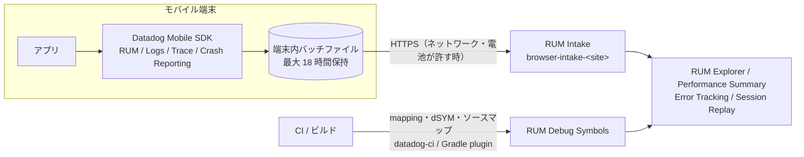
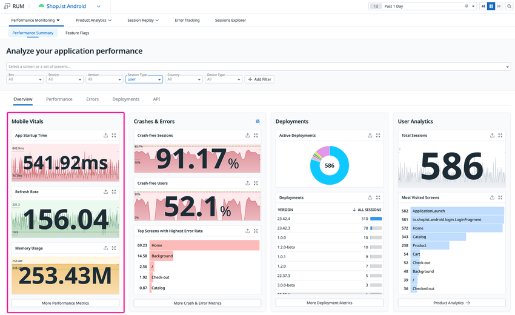
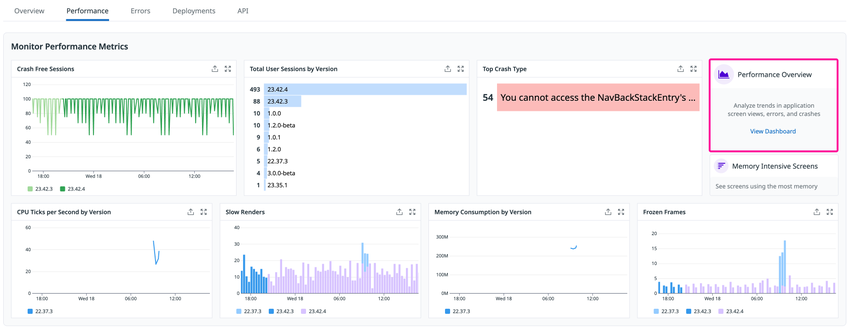
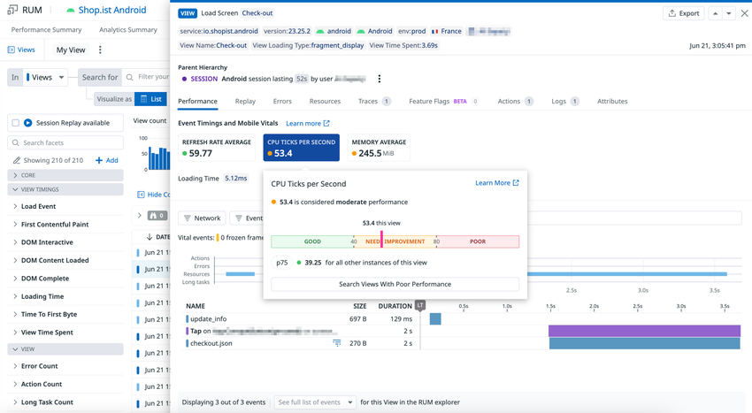
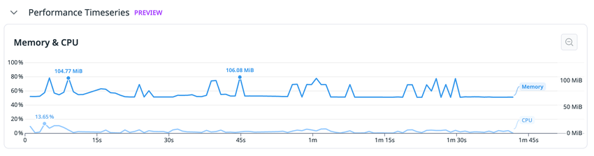

# RUM（モバイル）

## 概要

Datadog Real User Monitoring（RUM、リアルユーザーモニタリング）のモバイル版は、ネイティブアプリやクロスプラットフォームアプリに **Mobile SDK** を組み込み、実ユーザーの端末で起きた画面遷移（View）・操作（Action）・ネットワーク通信（Resource）・エラーとクラッシュ（Error）・メインスレッドの長時間ブロック（Long Task）・起動時間などをイベントとして収集する製品である。製品分類は Digital Experience Monitoring（DEM、デジタル体験モニタリング）で、UI では **Digital Experience** メニューからアプリケーションを登録・参照する。[出典](https://docs.datadoghq.com/real_user_monitoring/application_monitoring/)

RUM（モバイル）の主な機能を次の表に示す。

| 機能 | 概要 | 本書の節 |
|---|---|---|
| 対応プラットフォーム | Android / Android TV、iOS・iPadOS・tvOS・visionOS・watchOS、React Native、Flutter、Unity、Kotlin Multiplatform | [1](#1-対応プラットフォームと-sdk-一覧) |
| 導入と初期化 | アプリケーション登録、依存関係の追加、SDK 初期化、RUM の有効化 | [2](#2-共通の導入フローとアーキテクチャ)〜[8](#8-kotlin-multiplatform) |
| 収集データ | Session / View / Action / Resource / Error / Long Task / Vital の各イベントと主要属性 | [9](#9-収集データイベント種別と主要属性) |
| クラッシュレポート | ネイティブクラッシュ、NDK クラッシュ、ANR、App Hang、Watchdog Termination、シンボル化 | [10](#10-クラッシュレポートとエラー収集) |
| Mobile Vitals | リフレッシュレート、Slow Renders、Frozen Frames、CPU、メモリ、Hang Rate、Crash-free sessions | [11](#11-mobile-vitals) |
| アプリ起動・画面パフォーマンス | TTID / TTFD、Time to Network Settled、Interaction to Next View | [12](#12-アプリ起動計測と画面パフォーマンス) |
| オフライン時の挙動 | 端末内バッファリング、送信条件、保存上限、古いデータの破棄 | [13](#13-オフライン時の挙動とデータ送信) |
| 同意管理・プライバシー | `TrackingConsent`、IP・位置情報、イベントマッパー | [14](#14-トラッキング同意とプライバシー) |
| WebView・APM 連携 | Browser SDK とのブリッジ、分散トレーシング | [15](#15-webview-連携と-apm-連携) |
| 課金 | RUM Measure / RUM Investigate / Session Replay / Error Tracking | [17](#17-課金への影響) |
| 制限値 | セッション・イベント・シンボルファイル・端末内保存の上限 | [18](#18-制限値クォータデフォルト値) |

本ファイルはモバイル SDK の仕様リファレンスである。セッション・サンプリング・RUM without Limits・RUM Monitor などブラウザと共通の仕組みの詳細は [RUM（ブラウザ）](./rum-browser.md)、モバイル Session Replay と Product Analytics は [Session Replay と Product Analytics](./session-replay-and-product-analytics.md)、モバイルアプリの合成テスト（Mobile App Testing）は [Synthetic Monitoring](./synthetic-monitoring.md)、エラーの Issue 化は [Error Tracking](../apm/error-tracking.md) を参照。料金の正本は [製品別料金表](../../03_導入編/02-pricing-by-product.md)。

### 本書の基準

RUM（モバイル）の記述は 2026-11-02 時点の公式ドキュメントと、公式 GitHub リポジトリのリリース情報を基準とする。

| SDK | 基準日時点の最新リリース（GitHub） | メジャーバージョン |
|---|---|---|
| Android（`dd-sdk-android`） | 3.16.0（2026-10-29） | v3（3.0.0 は 2025-09-04） |
| iOS / Apple（`dd-sdk-ios`） | 3.21.0（2026-10-29） | v3（3.0.0 は 2025-09-02） |
| React Native（`dd-sdk-reactnative`） | 3.11.0（2026-10-20） | v3 |
| Flutter（`datadog_flutter_plugin`） | 3.7.0（2026-10-07） | v3 |
| Unity（`unity-package`） | 1.7.1（2026-05-28） | v1 |
| Kotlin Multiplatform（`dd-sdk-kotlin-multiplatform`） | 1.8.0（2026-08-10） | v1 |

[出典](https://github.com/DataDog/dd-sdk-android/blob/develop/CHANGELOG.md) / [出典](https://github.com/DataDog/dd-sdk-ios/blob/develop/CHANGELOG.md) / [出典](https://github.com/DataDog/dd-sdk-reactnative/releases) / [出典](https://github.com/DataDog/dd-sdk-flutter/releases) / [出典](https://github.com/DataDog/unity-package/blob/main/CHANGELOG.md) / [出典](https://github.com/DataDog/dd-sdk-kotlin-multiplatform/blob/develop/CHANGELOG.md)

> **注意:** 公式ドキュメントの一部ページは最新 SDK に追随していない。例として iOS の Supported Versions ページは「iOS 12+」と記載しているが、iOS SDK 3.17.0（2026-09-09）の CHANGELOG では最小デプロイメントターゲットが iOS 15.0 / tvOS 15.0 / watchOS 9.0 に引き上げられている。本書では差異がある箇所を注記し、バージョン要件は SDK の CHANGELOG を優先した。

---

## 1. 対応プラットフォームと SDK 一覧

### 1.1 主要 SDK

RUM（モバイル）の SDK は OS・フレームワークごとに提供される。クロスプラットフォーム SDK（React Native / Flutter / Unity / Kotlin Multiplatform）は、内部で Android SDK と iOS SDK をネイティブ層として利用する。

| SDK | 主なパッケージ / 配布形態 | 対応 OS・ランタイム（公式記載） | リポジトリ |
|---|---|---|---|
| Android | Maven：`com.datadoghq:dd-sdk-android-rum` ほか | Android 6.0+（API 23）、Android TV。Java / Kotlin | `DataDog/dd-sdk-android` |
| iOS（Apple） | SPM（`https://github.com/DataDog/dd-sdk-ios`）、CocoaPods、Carthage。モジュール `DatadogCore`・`DatadogRUM` ほか | iOS / iPadOS / tvOS / visionOS / watchOS（下表参照） | `DataDog/dd-sdk-ios` |
| React Native | npm：`@datadog/mobile-react-native`（Expo は `expo-datadog`） | React Native 0.65+。Android は `minSdkVersion` 23 | `DataDog/dd-sdk-reactnative` |
| Flutter | pub.dev：`datadog_flutter_plugin`（`^3.0.0`） | Flutter 3.27+（iOS / Android / Web） | `DataDog/dd-sdk-flutter` |
| Unity | UPM の Git URL：`https://github.com/DataDog/unity-package.git` | Unity LTS 2022+。公式の対応記載は iOS / Android。WebGL は Browser SDK を読み込むセットアップ手順のみ掲載されており、対応を明記した記述はない。デスクトップ・コンソールは非対応 | `DataDog/unity-package` |
| Kotlin Multiplatform | Maven：`com.datadoghq:dd-sdk-kotlin-multiplatform-rum` | Android / iOS | `DataDog/dd-sdk-kotlin-multiplatform` |

[出典](https://docs.datadoghq.com/real_user_monitoring/application_monitoring/android/) / [出典](https://docs.datadoghq.com/real_user_monitoring/application_monitoring/ios/supported_versions/) / [出典](https://docs.datadoghq.com/real_user_monitoring/application_monitoring/react_native/setup/) / [出典](https://docs.datadoghq.com/real_user_monitoring/application_monitoring/flutter/setup/) / [出典](https://docs.datadoghq.com/real_user_monitoring/application_monitoring/unity/setup/) / [出典](https://docs.datadoghq.com/real_user_monitoring/application_monitoring/kotlin_multiplatform/setup/)

### 1.2 その他の SDK

RUM のアプリケーション監視ドキュメントには、上記のほかに **C++**、**.NET MAUI**、**Roku** のセットアップページもある。これらは本書の対象外とし、対応範囲・提供段階は各公式ページで確認する。[出典](https://docs.datadoghq.com/real_user_monitoring/application_monitoring/)

### 1.3 Apple プラットフォームの対応 OS とモジュール

iOS SDK（Apple 各 OS 向け）の対応状況は次のとおり。

| プラットフォーム | Supported Versions ページの記載 | SDK CHANGELOG（3.17.0 以降） |
|---|---|---|
| iOS / iPadOS | 12+ | **15.0+** |
| tvOS | 12+ | **15.0+** |
| watchOS | 7.0+ | **9.0+** |
| visionOS | 1.0+ | 記載なし |
| macOS | Designed for iPad 11+。Catalyst 12+ とネイティブ macOS 12+ は公式サポート外（ネイティブ macOS では `DatadogRUM`・`DatadogSessionReplay`・`DatadogObjc` をビルドできない） | 記載なし |

[出典](https://docs.datadoghq.com/real_user_monitoring/application_monitoring/ios/supported_versions/) / [出典](https://github.com/DataDog/dd-sdk-ios/blob/develop/CHANGELOG.md)

| モジュール | iOS | tvOS | watchOS | visionOS | 備考 |
|---|---|---|---|---|---|
| `DatadogCore`（必須）/ `DatadogCrashReporting` / `DatadogLogs` / `DatadogTrace` / `DatadogFlags` | ○ | ○ | ○ | ○ | |
| `DatadogRUM` | ○ | ○ | ○ | ○ | watchOS では View / Action の自動追跡、フレームレート監視、メモリ警告検知が使えない |
| `DatadogProfiling` | ○ | ○ | × | ○ | |
| `DatadogSessionReplay` | ○ | × | × | × | |
| `DatadogWebViewTracking` | ○ | × | × | ○ | |

[出典](https://docs.datadoghq.com/real_user_monitoring/application_monitoring/ios/supported_versions/)

> 注: Supported Versions ページのモジュール表は列の配置が崩れており、`DatadogProfiling` と `DatadogWebViewTracking` の visionOS 列は「利用不可プラットフォーム」の注記から読み取った値である。

| 項目 | iOS SDK の対応 |
|---|---|
| Xcode | 最新の Xcode でビルドし、App Store 申請に Apple が認める最も古い Xcode との後方互換を維持（セットアップページの前提条件は「Xcode 12.0 以降」と記載） |
| 依存管理 | Swift Package Manager（推奨）、CocoaPods、Carthage（ビルド済みバイナリなし。`carthage bootstrap --use-xcframeworks --no-use-binaries`） |
| 言語 | Swift 5.*、Objective-C 2.0（v3 では Objective-C API は各製品モジュールに統合され、`DatadogObjc` は廃止） |
| UI フレームワーク | UIKit・SwiftUI ともに自動・手動計測に対応 |
| ネットワークライブラリ（自動・手動） | URLSession、Alamofire、Apollo GraphQL、SDWebImage、OpenAPI Generator |
| クラッシュ検知の内部依存 | KSCrash（3.5.0 で PLCrashReporter から置換。3.19.0 で KSCrash 2.5.1 に固定） |

[出典](https://docs.datadoghq.com/real_user_monitoring/application_monitoring/ios/supported_versions/) / [出典](https://docs.datadoghq.com/real_user_monitoring/application_monitoring/ios/setup/) / [出典](https://github.com/DataDog/dd-sdk-ios/blob/develop/MIGRATION.md) / [出典](https://github.com/DataDog/dd-sdk-ios/blob/develop/CHANGELOG.md)

---

## 2. 共通の導入フローとアーキテクチャ

### 2.1 データフロー

RUM（モバイル）の SDK は、端末内でイベントを生成してファイルにバッチとして書き込み、ネットワークと電池の状態が許すときに Datadog の RUM Intake へ送信する。



### 2.2 導入の共通手順

RUM（モバイル）の導入は、どの SDK でも次の流れになる。

| 手順 | 内容 |
|---|---|
| 1. アプリケーション作成 | **Digital Experience > Add an Application** でプラットフォーム（`android`、`iOS`、React Native、Flutter、Unity、Kotlin Multiplatform など）を選び名前を入力すると、**Application ID** と **Client Token** が発行される。作成時にクライアント IP と位置情報の自動収集を無効化するトグル、WebView 計測のトグルがある |
| 2. 依存関係の追加 | Gradle / SPM / CocoaPods / npm / pub / UPM で SDK を追加 |
| 3. SDK 初期化と RUM 有効化 | `clientToken`・`env`・（`service`・`site`）・トラッキング同意を指定して初期化し（アプリ起動のできるだけ早い時点）、`applicationId` とサンプリング率等を指定して RUM 機能を有効化 |
| 4. ネットワーク・View・Action の計測 | OkHttp / URLSession / Navigator 等のインスツルメンテーションを設定 |
| 5. シンボルファイルのアップロード | mapping / dSYM / ソースマップを CI でアップロード（[10.6](#106-シンボルファイルのアップロード)） |
| 6. 確認 | Applications ページでは最初のデータ到着まで pending 表示。RUM Explorer・Error Tracking で受信を確認 |

[出典](https://docs.datadoghq.com/real_user_monitoring/application_monitoring/android/setup/) / [出典](https://docs.datadoghq.com/real_user_monitoring/application_monitoring/ios/setup/)

> **Error Tracking のみ契約している場合:** アプリケーションは **Error Tracking > Settings > Browser and Mobile** から作成する。[出典](https://docs.datadoghq.com/real_user_monitoring/application_monitoring/kotlin_multiplatform/setup/)

Android SDK のセットアップページには、手動導入のほかに AI コーディングエージェントを使って導入する **Agentic Onboarding**【Preview】も示されている。[出典](https://docs.datadoghq.com/real_user_monitoring/application_monitoring/android/setup/)

### 2.3 Client Token を使う理由

RUM（モバイル）の SDK には **Client Token** を設定する。API キーはアプリのバイナリ（APK のバイトコードや iOS バイナリ）に埋め込まれて露出するため、SDK の認証に使ってはならない。キーの種類と管理は [API とキー管理](../platform/api-and-keys.md) を参照。[出典](https://docs.datadoghq.com/real_user_monitoring/application_monitoring/ios/error_tracking/) / [出典](https://docs.datadoghq.com/real_user_monitoring/application_monitoring/kotlin_multiplatform/setup/)

### 2.4 サイト指定

RUM（モバイル）の SDK は既定で US1 に送信する（Flutter は `site` が必須パラメータ）。AP1（日本）など他サイトを使う場合は初期化時に必ずサイトを指定する。

| Datadog サイト | Android（`DatadogSite`） | iOS（`site:`） | Flutter（`DatadogSite`） | RN（`site`） |
|---|---|---|---|---|
| US1（既定） | `US1`（`useSite` 省略可） | `.us1`（既定） | `us1` | `US1`（既定） |
| US3 | `US3` | `.us3` | `us3` | `US3` |
| US5 | `US5` | `.us5` | `us5` | 公開情報では確認できず |
| EU1 | `EU1` | `.eu1` | `eu1` | `EU1` |
| AP1 | `AP1` | `.ap1` | `ap1` | 公開情報では確認できず |
| AP2 | `AP2` | `.ap2` | `ap2` | 公開情報では確認できず |
| US1-FED | `US1_FED` | `.us1_fed` | `us1Fed` | `US1_FED` |
| US2-FED | `US2_FED` | `.us2_fed` | 公開情報では確認できず | `US2_FED` |
| UK1 | `UK1` | `.uk1` | 公開情報では確認できず | `UK1` |

[出典](https://docs.datadoghq.com/real_user_monitoring/application_monitoring/android/setup/) / [出典](https://docs.datadoghq.com/real_user_monitoring/application_monitoring/ios/setup/) / [出典](https://docs.datadoghq.com/real_user_monitoring/application_monitoring/flutter/advanced_configuration/) / [出典](https://docs.datadoghq.com/real_user_monitoring/application_monitoring/react_native/setup/)

> 注: React Native のセットアップページは例として `US1`・`US3`・`EU1`・`US1_FED`・`US2_FED`・`UK1` を挙げているだけで、全値の一覧ではない。AP1 で利用する場合は SDK の型定義で値を確認する。

> **サイト差異:** モバイル SDK の送信先 Intake は Android SDK のソースでは `browser-intake-<site>-datadoghq.com` 形式（AP1 は `browser-intake-ap1-datadoghq.com`、US1 は `browser-intake-datadoghq.com`、EU1 は `browser-intake-datadoghq.eu`、US1-FED は `browser-intake-ddog-gov.com`）である。ファイアウォールやプロキシで許可するドメインは [ネットワーク・接続要件](../../03_導入編/11-network-and-connectivity.md) と [Datadog Sites](../platform/datadog-sites.md) を参照。SDK は `UK1` サイトにも対応するが、本ナレッジのサイト一覧（US1〜AP2、US1-FED）には含まれていない。[出典](https://github.com/DataDog/dd-sdk-android/blob/develop/dd-sdk-android-core/src/main/kotlin/com/datadog/android/DatadogSite.kt)

---

## 3. Android SDK

### 3.1 要件と依存関係

Android SDK の要件と主な依存関係は次のとおり。

| 項目 | 内容 |
|---|---|
| 最小 OS | Android 6.0（API 23）。SDK 3.0.0 で `minSdk` を 23 に引き上げ（2.x は API 21） |
| 対応デバイス・言語 | スマートフォン・タブレット、Android TV。Java / Kotlin |
| Gradle プラグイン | `com.datadoghq:dd-sdk-android-gradle-plugin`（plugin ID `com.datadoghq.dd-sdk-android-gradle-plugin`。mapping アップロード用） |
| RUM 本体と主な追加モジュール | RUM 本体 `com.datadoghq:dd-sdk-android-rum`、ネットワーク `dd-sdk-android-okhttp`（OkHttp）・`dd-sdk-android-cronet`（Cronet）、NDK クラッシュ `dd-sdk-android-ndk`、WebView `dd-sdk-android-webview` |
| Jetpack Compose | `dd-sdk-android-compose`（2.21.0 以降、Kotlin 1.9.23 以降、Gradle Plugin 1.17.0 以降） |

[出典](https://docs.datadoghq.com/real_user_monitoring/application_monitoring/android/setup/) / [出典](https://github.com/DataDog/dd-sdk-android/blob/develop/MIGRATION.MD) / [出典](https://docs.datadoghq.com/error_tracking/frontend/mobile/android/) / [出典](https://docs.datadoghq.com/real_user_monitoring/application_monitoring/android/jetpack_compose_instrumentation/)

### 3.2 SDK 3.0 の主な変更点

Android SDK 3.0 では 2.x から次の変更があった。

| 変更 | 内容 |
|---|---|
| 最小 API・クラッシュの Logs 送信 | 最小 API を 23 に引き上げ（AndroidX のバージョンポリシーに追従）。致命的クラッシュは Logs へ自動送信されなくなり、RUM の Crash Reporting で扱う |
| OpenTracing | 依存を削除。トレース API は OpenTelemetry 版（`dd-sdk-android-trace-otel`）を推奨 |

[出典](https://github.com/DataDog/dd-sdk-android/blob/develop/MIGRATION.MD)

### 3.3 初期化コード

Android SDK は `Application.onCreate()` で初期化する。

```kotlin
class SampleApplication : Application() {
    override fun onCreate() {
        super.onCreate()
        val configuration = Configuration.Builder(
            clientToken = "<CLIENT_TOKEN>",
            env = "<ENV_NAME>",
            variant = "<APP_VARIANT_NAME>"   // BuildConfig.FLAVOR。なければ空文字
        )
            .useSite(DatadogSite.AP1)        // AP1 の場合。US1 は省略可
            .build()
        Datadog.initialize(this, configuration, TrackingConsent.PENDING)

        val rumConfig = RumConfiguration.Builder("<APPLICATION_ID>")
            .setSessionSampleRate(100f)
            .trackUserInteractions()
            .trackLongTasks(100L)
            .useViewTrackingStrategy(ActivityViewTrackingStrategy(true))
            .build()
        Rum.enable(rumConfig)
    }
}
```

`variant` はアップロード済み mapping ファイルとエラーを照合するために使われる。[出典](https://docs.datadoghq.com/real_user_monitoring/application_monitoring/android/setup/)

### 3.4 `Configuration.Builder`（コア設定）

Android SDK のコア設定項目とデフォルト値は次のとおり。

| メソッド | デフォルト | 説明 |
|---|---|---|
| `Configuration.Builder(clientToken, env, variant)` | 必須 | Java では引数順が `clientToken`・`env`・`variant` |
| `useSite(DatadogSite)` | `US1` | 送信先サイト |
| `setBatchSize(SMALL / MEDIUM / LARGE)` | `MEDIUM` | バッチの書き込みウィンドウ（SMALL 3 秒 / MEDIUM 10 秒 / LARGE 35 秒） |
| `setUploadFrequency(FREQUENT / AVERAGE / RARE)` | `AVERAGE` | アップロード間隔の基本ステップ（FREQUENT 0.5 秒 / AVERAGE 2 秒 / RARE 5 秒） |
| `setBatchProcessingLevel(LOW / MEDIUM / HIGH)` | `MEDIUM` | 1 回のアップロードで処理する最大バッチ数（LOW 1 / MEDIUM 20 / HIGH 100） |
| `setCrashReportsEnabled(Boolean)` | `true` | JVM クラッシュの捕捉 |
| `setFirstPartyHosts()` / `setFirstPartyHostsWithHeaderType()` | 未設定 | 分散トレーシング対象ホスト（ホスト名または単一 `*` のサブドメインワイルドカード） |
| `setProxy` | 未設定 | 送信用プロキシ |
| `setEncryption(Encryption)` | 未設定 | 端末内保存データの暗号化 |
| `setPersistenceStrategyFactory` | 未設定 | 永続化方式の差し替え |
| `setBackpressureStrategy` | キュー上限 1,024 | 内部キューが上限に達したときの扱い |
| `setAdditionalConfiguration` | 未設定 | 追加設定 |

[出典](https://docs.datadoghq.com/real_user_monitoring/application_monitoring/android/advanced_configuration/) / [出典](https://github.com/DataDog/dd-sdk-android/blob/develop/dd-sdk-android-core/src/main/kotlin/com/datadog/android/core/configuration/Configuration.kt) / [出典](https://github.com/DataDog/dd-sdk-android/tree/develop/dd-sdk-android-core/src/main/kotlin/com/datadog/android/core/configuration)

> 注: `BatchSize`・`UploadFrequency`・`BatchProcessingLevel` の数値（秒数・バッチ数）は公式ドキュメントに記載がなく、`dd-sdk-android` のソースコード（2026-11-02 時点の develop ブランチ）から取得した内部値である。将来変わる可能性がある。

### 3.5 `RumConfiguration.Builder`（RUM 設定）

Android SDK の RUM 設定項目とデフォルト値は次のとおり。

| メソッド | デフォルト | 説明 |
|---|---|---|
| `setSessionSampleRate(Float)` | 100 | セッションのサンプリング率（0〜100） |
| `setTelemetrySampleRate(Float)` | 20 | SDK 内部テレメトリのサンプリング率 |
| `trackUserInteractions(...)` / `disableUserInteractionTracking()` | 有効 | タップ・スワイプ等の自動収集 |
| `useViewTrackingStrategy(strategy)` | `ActivityViewTrackingStrategy` | View の自動追跡方式（下表） |
| `trackLongTasks(durationThreshold)` | 100 ms | Long Task の閾値。0 以下で無効。Error Tracking には適用されない |
| `trackNonFatalAnrs(Boolean)` | API 29 以下は有効、API 30 以上は無効 | 非致命的 ANR の検出（Watchdog スレッド方式） |
| `trackBackgroundEvents(Boolean)` | `false` | View がアクティブでないときのイベント（クラッシュ・通信）を追跡。**追加セッションが発生し課金に影響しうる** |
| `trackFrustrations(Boolean)` | `true` | フラストレーションシグナル（Error Tap） |
| `setVitalsUpdateFrequency(FREQUENT / AVERAGE / RARE / NEVER)` | `AVERAGE` | Mobile Vitals の取得頻度（100 ms / 500 ms / 1 秒 / 無効） |
| `trackAnonymousUser(Boolean)` | `true` | 起動をまたいで匿名ユーザー ID を保持 |
| `collectAccessibility(Boolean)` | `false` | アクセシビリティ設定を View イベントに含める |
| `setInitialResourceIdentifier` | 100 ms 以内に開始したリソース | Time to Network Settled の初期リソース判定 |
| `setLastInteractionIdentifier` | View 開始前 3 秒以内の操作 | Interaction to Next View の判定 |
| `setSessionListener` | なし | セッション開始時のコールバック |
| `setViewEventMapper` / `setResourceEventMapper` / `setActionEventMapper` / `setErrorEventMapper` / `setLongTaskEventMapper` | なし | イベントの加工・破棄（[14.3](#143-イベントマッパーによる加工破棄)） |
| `useCustomEndpoint` | なし | 送信先 URL の差し替え |

[出典](https://docs.datadoghq.com/real_user_monitoring/application_monitoring/android/advanced_configuration/) / [出典](https://docs.datadoghq.com/real_user_monitoring/application_monitoring/android/setup/) / [出典](https://docs.datadoghq.com/real_user_monitoring/application_monitoring/android/monitoring_app_performance/) / [出典](https://github.com/DataDog/dd-sdk-android/blob/develop/features/dd-sdk-android-rum/src/main/kotlin/com/datadog/android/rum/internal/RumFeature.kt)

### 3.6 View 追跡方式

Android SDK の View 自動追跡方式は次の 4 種類。

| 方式 | 対象 |
|---|---|
| `ActivityViewTrackingStrategy`（デフォルト） | Activity を 1 View として追跡 |
| `FragmentViewTrackingStrategy` | Fragment を View として追跡 |
| `MixedViewTrackingStrategy` | Activity と Fragment の両方 |
| `NavigationViewTrackingStrategy` | Jetpack Navigation の Destination |

Jetpack Compose は `NavigationViewTrackingEffect`（手動 View）と `Modifier.datadog(name = ...)`（手動 Action）、または Gradle プラグインの `composeInstrumentation`（`AUTO` / `ANNOTATION` / `DISABLE`）で計測する。`composeInstrumentation` を宣言しない場合は自動計測は無効で、Compose の Action 追跡には `RumConfiguration` で `enableComposeActionTracking()` が必要。プラグインがナビゲーションとして検出するのは `NavHost` のみ。[出典](https://docs.datadoghq.com/real_user_monitoring/application_monitoring/android/advanced_configuration/) / [出典](https://docs.datadoghq.com/real_user_monitoring/application_monitoring/android/jetpack_compose_instrumentation/)

### 3.7 ネットワーク計測

Android SDK のネットワーク計測は OkHttp または Cronet のインスツルメンテーションで行う。

| 対象 | 設定 | 注意点 |
|---|---|---|
| OkHttp | `OkHttpClient.Builder().addInterceptor(DatadogInterceptor.Builder(tracedHosts).build())` | `DatadogInterceptor` は RUM Resource とスパンを生成、`TracingInterceptor` はスパンのみ。複数インターセプターがある場合は `DatadogInterceptor` を先頭に。リダイレクト・リトライも捕捉するには `addNetworkInterceptor`。詳細なタイミングは `EventListener` で取得 |
| Cronet | `CronetEngine.Builder(context).configureDatadogInstrumentation(...)` | リダイレクト時にトレースヘッダが送られない、リトライは計測不可 |
| Retrofit / Picasso | 計測済みの `OkHttpClient` を渡す | 個別ライブラリなし |

**View がアクティブな間に開始したリクエストのみ** RUM Resource になる。バックグラウンドの通信を追跡するには手動で View を作成するか `trackBackgroundEvents(true)` を使う。[出典](https://docs.datadoghq.com/real_user_monitoring/application_monitoring/android/setup/) / [出典](https://docs.datadoghq.com/real_user_monitoring/application_monitoring/android/integrated_libraries/)

### 3.8 統合ライブラリ

Android SDK には主要ライブラリ向けの統合モジュール（リポジトリ内ディレクトリ名）がある。

| 分類 | ライブラリとモジュール |
|---|---|
| 画像読み込み | Coil `dd-sdk-android-coil`、Fresco `dd-sdk-android-fresco`、Glide `dd-sdk-android-glide` |
| UI・非同期 | Jetpack Compose `dd-sdk-android-compose`、RxJava `dd-sdk-android-rx`、Kotlin Coroutines `dd-sdk-android-rum-coroutines`・`dd-sdk-android-trace-coroutines`、Android TV（Leanback）`dd-sdk-android-tv` |
| データ・通信 | SQLDelight `dd-sdk-android-sqldelight`、Apollo（GraphQL）`dd-sdk-android-apollo`、SQLite は `SQLiteOpenHelper` に `DatadogDatabaseErrorHandler` を渡す |

Kotlin 拡張として `Closeable.useMonitored { }`（エラー報告付き）、`context.getAssetAsRumResource(fileName)`、`context.getRawResAsRumResource(id)` がある。[出典](https://docs.datadoghq.com/real_user_monitoring/application_monitoring/android/integrated_libraries/) / [出典](https://docs.datadoghq.com/real_user_monitoring/application_monitoring/android/setup/)

### 3.9 手動 API

Android SDK の主な手動 API は次のとおり（`GlobalRumMonitor.get()` から呼ぶ）。

| 分類 | API |
|---|---|
| View・Action | `startView(key, name, attributes)`（`onResume()`）、`stopView(key, attributes)`（`onPause()`）、`addViewLoadingTime(override)`、`addTiming(name)`。`addAction(type, name, attributes)`（type：`custom`・`click`・`tap`・`scroll`・`swipe`・`back`）、`startAction` / `stopAction` |
| Resource・Error | `startResource(key, method, url, attributes)`、`stopResource(resourceKey, ...)`、`stopResourceWithError(resourceKey, message, origin, throwable)`（`stopResource` の引数構成は SDK の API ドキュメントで確認）。`addError(message, source, throwable, attributes)` |
| 属性・セッション・起動 | `addAttribute(key, value)`、`removeAttribute(key)`、`stopSession()`、`getCurrentSessionId { }`、`reportAppFullyDisplayed()`（TTFD） |
| ユーザー・アカウント | `Datadog.setUserInfo(id, name, email)`（`usr.id` 必須）、`Datadog.addUserProperties(...)`、`Datadog.setAccountInfo(id, name, extraInfo)`、`Datadog.addAccountExtraInfo(...)`、`Datadog.clearAccountInfo()` |
| データ・確認 | `Datadog.clearAllData()`、`Datadog.stopInstance()`、`Datadog.isInitialized()`、`Datadog.setVerbosity(Log.INFO)` |

[出典](https://docs.datadoghq.com/real_user_monitoring/application_monitoring/android/advanced_configuration/) / [出典](https://docs.datadoghq.com/real_user_monitoring/application_monitoring/android/monitoring_app_performance/) / [出典](https://docs.datadoghq.com/real_user_monitoring/application_monitoring/android/troubleshooting/)

---

## 4. iOS SDK（Apple プラットフォーム）

### 4.1 導入方法

iOS SDK は SPM（推奨）・CocoaPods・Carthage で導入する。

| 方式 | 指定 |
|---|---|
| Swift Package Manager | `.package(url: "https://github.com/DataDog/dd-sdk-ios.git", .upToNextMajor(from: "3.0.0"))`。`DatadogCore` と `DatadogRUM` をリンク |
| CocoaPods | `pod 'DatadogCore'`、`pod 'DatadogRUM'` |
| Carthage | `github "DataDog/dd-sdk-ios"`。`DatadogInternal.xcframework`・`DatadogCore.xcframework`・`DatadogRUM.xcframework` を追加 |

[出典](https://docs.datadoghq.com/real_user_monitoring/application_monitoring/ios/setup/)

### 4.2 SDK 3.0 の主な変更点

iOS SDK 3.0（2025-09-02）では 2.x から次の変更があった。

| 変更 | 内容 |
|---|---|
| `DatadogObjc` の廃止 | Objective-C API は各製品モジュールに統合 |
| View 属性の伝播 | View レベルの属性が子イベント（Resource・Action・Error・Long Task）へ自動伝播。`addViewAttribute(forKey:value:)` 等を追加 |
| App Extension | App Hang と Watchdog Termination はアプリ拡張・ウィジェットからは報告されない |
| メモリ警告 | `trackMemoryWarnings` を追加（メモリ警告を RUM Error として報告） |
| Logs | Logs 製品は致命的エラーを報告しない。クラッシュは Crash Reporting と RUM で扱う |
| Trace | RUM と併用時、`session.id` に基づく決定論的サンプリング。トレースコンテキストはサンプリングされたリクエストのみに注入 |
| Session Replay | `defaultPrivacyLevel` を `textAndInputPrivacyLevel`・`imagePrivacyLevel`・`touchPrivacyLevel` に分割 |

[出典](https://github.com/DataDog/dd-sdk-ios/blob/develop/MIGRATION.md)

### 4.3 初期化コード

iOS SDK は `application(_:didFinishLaunchingWithOptions:)` で初期化する（SwiftUI アプリは `@UIApplicationDelegateAdaptor` を使う）。初期化が遅れると、特に起動時間のテレメトリが不正確または欠落する。

```swift
import DatadogCore
import DatadogRUM

Datadog.initialize(
    with: Datadog.Configuration(
        clientToken: "<CLIENT_TOKEN>",
        env: "<ENV_NAME>",
        site: .ap1,                 // AP1 の場合。既定は .us1
        service: "<SERVICE_NAME>"
    ),
    trackingConsent: .pending
)

RUM.enable(
    with: RUM.Configuration(
        applicationID: "<APPLICATION_ID>",
        uiKitViewsPredicate: DefaultUIKitRUMViewsPredicate(),
        uiKitActionsPredicate: DefaultUIKitRUMActionsPredicate(),
        swiftUIViewsPredicate: DefaultSwiftUIRUMViewsPredicate(),
        swiftUIActionsPredicate: DefaultSwiftUIRUMActionsPredicate(isLegacyDetectionEnabled: true),
        urlSessionTracking: RUM.Configuration.URLSessionTracking()
    )
)

URLSessionInstrumentation.enable(with: .init(delegateClass: <YourSessionDelegate>.self))
```

SwiftUI では `.trackRUMView(name:)` と `.trackRUMTapAction(name:)` で手動計測もできる。`List` 内で `.trackRUMTapAction` を使うと既定のジェスチャーが壊れることがあるため、Custom Actions API を使う。セッションデリゲートを持たないサードパーティ通信は Custom Resources API で計測する。[出典](https://docs.datadoghq.com/real_user_monitoring/application_monitoring/ios/setup/)

> 注: iOS セットアップページの本文はサンプリング率を `sessionSamplingRate` と書いているが、コード上のパラメータ名は `sessionSampleRate` である。

### 4.4 `Datadog.Configuration`（コア設定）

iOS SDK のコア設定項目とデフォルト値は次のとおり。

| パラメータ | デフォルト | 説明 |
|---|---|---|
| `clientToken` | 必須 | Client Token |
| `env` | 必須 | 環境名 |
| `site` | `.us1` | 送信先サイト |
| `service` | アプリのバンドル ID | サービス名 |
| `version` | 公開情報では確認できず | アプリバージョン |
| `batchSize` | `.medium` | `.small` / `.medium` / `.large` |
| `uploadFrequency` | `.average` | `.frequent` / `.average` / `.rare` |
| `batchProcessingLevel` | `.medium` | 1 サイクルで処理する最大バッチ数（`.low` 5 / `.medium` 20 / `.high` 100） |
| `backgroundTasksEnabled` | `false` | `beginBackgroundTask` を使いバックグラウンドで送信（約 30 秒のバックグラウンド時間が増えうる） |
| `proxyConfiguration` | なし | 送信用プロキシ |
| `encryption` | なし | `DataEncryption` 準拠オブジェクトによる端末内データ暗号化 |
| `serverDateProvider` | NTP Pool Project のプール | 時刻同期。差し替えると時刻ずれの原因になりうる |
| `bundle` | `.main` | 実行バンドル |

[出典](https://docs.datadoghq.com/real_user_monitoring/application_monitoring/ios/advanced_configuration/) / [出典](https://github.com/DataDog/dd-sdk-ios/blob/develop/DatadogCore/Sources/DatadogConfiguration.swift)

### 4.5 `RUM.Configuration`（RUM 設定）

iOS SDK の RUM 設定項目とデフォルト値は次のとおり（v3 のソースコードと Advanced Configuration ページによる）。

| パラメータ | デフォルト | 説明 |
|---|---|---|
| `applicationID` | 必須 | RUM Application ID |
| `sessionSampleRate` | 100.0 | 0.0〜100.0 |
| `telemetrySampleRate` | 20 | SDK 内部テレメトリ |
| `uiKitViewsPredicate` | なし（指定時は `DefaultUIKitRUMViewsPredicate` でクラス名を View 名に使用） | UIKit の View 自動追跡 |
| `uiKitActionsPredicate` | なし | UIKit の Action 自動追跡 |
| `swiftUIViewsPredicate` / `swiftUIActionsPredicate` | なし（`DefaultSwiftUIRUMViewsPredicate` / `DefaultSwiftUIRUMActionsPredicate`） | SwiftUI の自動追跡。Action はレガシー検出を無効化可能 |
| `urlSessionTracking` | なし | URLSession の Resource 追跡（下表） |
| `trackFrustrations` | `true` | Error Tap |
| `trackBackgroundEvents` | `false` | View がないときのイベント追跡 |
| `longTaskThreshold` | 0.1 秒 | Long Task の閾値。`nil` で無効 |
| `appHangThreshold` | `nil`（無効） | App Hang 検出の閾値（秒）。最小 0.1 |
| `trackWatchdogTerminations` | `false` | Watchdog Termination の検出 |
| `trackMemoryWarnings` | `true` | メモリ警告を RUM Error として報告 |
| `trackSlowFrames` | `true` | Slow Frames（View hitches）の収集 |
| `vitalsUpdateFrequency` | `.average`（500 ms） | `.frequent` 100 ms / `.rare` 1 秒 / `nil` で無効 |
| `trackAnonymousUser` | `true` | 匿名ユーザー ID の保持 |
| `collectAccessibility` | `false` | アクセシビリティ設定を View に含める |
| `networkSettledResourcePredicate` | 公開情報では確認できず | Time to Network Settled の初期リソース判定 |
| `nextViewActionPredicate` | 公開情報では確認できず | Interaction to Next View の判定 |
| `onSessionStart` | なし | セッション開始時のコールバック |
| `customEndpoint` | なし | 送信先 URL の差し替え |
| `viewEventMapper` / `resourceEventMapper` / `actionEventMapper` / `errorEventMapper` / `longTaskEventMapper` | なし | イベントの加工・破棄 |

[出典](https://docs.datadoghq.com/real_user_monitoring/application_monitoring/ios/advanced_configuration/) / [出典](https://docs.datadoghq.com/real_user_monitoring/application_monitoring/ios/error_tracking/) / [出典](https://github.com/DataDog/dd-sdk-ios/blob/develop/DatadogRUM/Sources/RUMConfiguration.swift)

`urlSessionTracking` の下位項目は次のとおり。

| 項目 | デフォルト | 説明 |
|---|---|---|
| `firstPartyHostsTracing` | なし。トレースのサンプリング率は v3 ソースでは 100、注入は `.sampled` | 分散トレーシング対象ホスト（単一 `*` のワイルドカード可） |
| `resourceAttributesProvider` | なし | Resource にカスタム属性を付与 |
| `disallowList` | なし | 追跡しない URL パターン（`*` 可）。`firstPartyHostsTracing` より優先 |
| `trackResourceHeaders` | 無効 | `.defaults` / `.custom([...])` でヘッダを `resource.request.headers`・`resource.response.headers` に記録 |

[出典](https://docs.datadoghq.com/real_user_monitoring/application_monitoring/ios/advanced_configuration/) / [出典](https://github.com/DataDog/dd-sdk-ios/blob/develop/DatadogRUM/Sources/RUMConfiguration.swift)

> 注: Advanced Configuration ページは `firstPartyHostsTracing` のトレースサンプリング率の既定値を「20」と記載しているが、v3 の SDK ソースコード（`RUMConfiguration.swift`）のコメントとデフォルト引数は「100」、注入方式は `.sampled` である。実際の挙動は使用する SDK バージョンで確認する。

### 4.6 手動 API

iOS SDK の主な手動 API は次のとおり（`RUMMonitor.shared()` から呼ぶ）。

| 分類 | API |
|---|---|
| View・Action | `startView(viewController:)` / `stopView(viewController:attributes:)`、`addViewAttribute(forKey:value:)`、`addViewLoadingTime(override:)`。`addAction(type:name:)`、`startAction(type:name:)` / `stopAction(type:)`（同じ `type` で対にする） |
| Resource・Error | `startResource(resourceKey:request:)`、`stopResource(resourceKey:response:)`、`stopResourceWithError(resourceKey:error:)`。`addError(message:)`、`addError(error:)` |
| 属性・セッション・起動 | `addAttribute(forKey:value:)`、`removeAttribute(forKey:)`、`addAttributes(_:)`、`removeAttributes(forKeys:)`、`stopSession()`、`currentSessionID(completion:)`、`reportAppFullyDisplayed()`（TTFD） |
| ユーザー・アカウント | `Datadog.setUserInfo(id:name:email:)`、`Datadog.addUserExtraInfo(_:)`、`Datadog.setAccountInfo(id:name:extraInfo:)`、`Datadog.clearAccountInfo()` |
| データ・同意・デバッグ | `Datadog.set(trackingConsent:)`、`Datadog.clearAllData()`、`Datadog.stopInstance()`、`Datadog.verbosityLevel = .debug`（DEBUG 構成のみで設定） |

[出典](https://docs.datadoghq.com/real_user_monitoring/application_monitoring/ios/advanced_configuration/) / [出典](https://docs.datadoghq.com/real_user_monitoring/application_monitoring/ios/troubleshooting/) / [出典](https://github.com/DataDog/dd-sdk-ios/blob/develop/MIGRATION.md)

---

## 5. React Native SDK

### 5.1 要件とパッケージ

React Native SDK の要件とパッケージは次のとおり。

| 項目 | 内容 |
|---|---|
| コア | `@datadog/mobile-react-native` |
| 操作追跡（推奨） | `@datadog/mobile-react-native-babel-plugin` |
| Expo | `expo-datadog`（Expo SDK のバージョンに追従。Expo SDK 45 以上を推奨） |
| CLI | `@datadog/datadog-ci`（ソースマップ等のアップロード） |
| React Native | 0.65+（それ以前は動作保証なし）。npm の `peerDependencies` は `react-native >=0.63.4 <1.0` |
| Android | `minSdkVersion` 23、`compileSdkVersion` 31 以上、Build Tools 31+、AGP 7+、Gradle 7+。Java 17（RN 0.67 超）/ Java 11（RN 0.67 以下）。`kotlinVersion = "1.8.21"` の指定例あり |
| iOS 最小バージョン | セットアップページに記載なし（ネイティブ層は iOS SDK に依存） |
| New Architecture | 公開情報では明示的な対応表明を確認できず |

[出典](https://docs.datadoghq.com/real_user_monitoring/application_monitoring/react_native/setup/) / [出典](https://github.com/DataDog/dd-sdk-reactnative/blob/develop/packages/core/package.json)

### 5.2 初期化

React Native SDK は `DatadogProvider` でルートコンポーネントを包み、`DatadogProviderConfiguration` で設定する。

```tsx
import { DatadogProvider, DatadogProviderConfiguration, TrackingConsent } from '@datadog/mobile-react-native';

const config = new DatadogProviderConfiguration(
  '<CLIENT_TOKEN>',
  '<ENV_NAME>',
  TrackingConsent.PENDING,
  {
    site: 'US1',                      // 既定は US1
    rumConfiguration: {
      applicationId: '<APPLICATION_ID>',
      trackInteractions: true,
      trackResources: true,
      trackErrors: true,
      sessionSampleRate: 100,
      nativeCrashReportEnabled: true,
    },
  }
);

export default function App() {
  return <DatadogProvider configuration={config}><Navigation /></DatadogProvider>;
}
```

[出典](https://docs.datadoghq.com/real_user_monitoring/application_monitoring/react_native/setup/)

> 注: 上記の `rumConfiguration` ネスト構造は Advanced Configuration ページのパラメータ表に従った。React Native のセットアップページ本文と例ではパラメータ名の表記揺れ（`sessionSamplingRate` と `sessionSampleRate` など）があるため、使用するバージョンの型定義で確認する。

### 5.3 設定パラメータとデフォルト値

React Native SDK の主な設定とデフォルト値は次のとおり。

| パラメータ | デフォルト | 説明 |
|---|---|---|
| `site` | `US1` | 送信先サイト |
| `service` | Android はパッケージ名、iOS はバンドル ID | |
| `verbosity` | `undefined`（ログなし） | SDK 内部ログ |
| `uploadFrequency` | `AVERAGE` | |
| `batchSize` | `MEDIUM` | |
| `proxyConfig` | なし | |
| `rumConfiguration.trackInteractions` | `false` | 操作の自動追跡 |
| `rumConfiguration.trackResources` | `false` | 通信の自動追跡 |
| `rumConfiguration.trackErrors` | `false` | JS エラー・クラッシュ |
| `rumConfiguration.trackFrustrations` | `true` | |
| `rumConfiguration.sessionSampleRate` | 100 | |
| `rumConfiguration.resourceTraceSampleRate` | 100（Advanced Configuration）／20%（Setup ページ） | 分散トレーシングのサンプリング率。記載が食い違う |
| `rumConfiguration.firstPartyHosts` | `[]` | `{ match, propagatorTypes }` の配列（`PropagatorType.DATADOG`・`TRACECONTEXT` など） |
| `rumConfiguration.nativeCrashReportEnabled` | `false` | ネイティブクラッシュ |
| `rumConfiguration.nativeLongTaskThresholdMs` | 200 | ネイティブスレッドの Long Task 閾値 |
| `rumConfiguration.longTaskThresholdMs` | 0（無効） | JS スレッドの Long Task 閾値 |
| `rumConfiguration.nativeViewTracking` / `nativeInteractionTracking` | `false` | ネイティブ画面・操作の追跡 |
| `rumConfiguration.trackBackgroundEvents` | `false` | |
| `rumConfiguration.telemetrySampleRate` | 20 | |
| `rumConfiguration.vitalsUpdateFrequency` | `AVERAGE` | |
| `rumConfiguration.appHangThreshold` | `undefined`（無効） | iOS の App Hang |
| `rumConfiguration.trackNonFatalAnrs` | Android 29 以下 `true`、30 以上 `false` | |
| `rumConfiguration.trackWatchdogTerminations` | `false` | iOS |
| `rumConfiguration.trackMemoryWarnings` | `true` | iOS |
| `rumConfiguration.useAccessibilityLabel` | `true` | Action 名にアクセシビリティラベルを使用 |
| `rumConfiguration.initialResourceThreshold` | 0.1 秒 | Time to Network Settled |
| `errorEventMapper` / `actionEventMapper` / `resourceEventMapper` | `null` | |
| `logsConfiguration.bundleLogsWithRum` / `bundleLogsWithTraces` | `true` | ログを RUM・トレースと関連付け |

[出典](https://docs.datadoghq.com/real_user_monitoring/application_monitoring/react_native/advanced_configuration/) / [出典](https://docs.datadoghq.com/real_user_monitoring/application_monitoring/react_native/setup/)

手動 API は `DdRum.startView` / `stopView`、`DdRum.addAction` / `startAction` / `stopAction`、`DdRum.addError`、`DdRum.startResource` / `stopResource`、ユーザー情報は `DdSdkReactNative.setUserInfo`・`addUserExtraInfo`・`clearUserInfo`。[出典](https://docs.datadoghq.com/real_user_monitoring/application_monitoring/react_native/advanced_configuration/)

React Native 固有の Mobile Vital として **JS refresh rate**（`@view.js_refresh_rate.average` / `.min` / `.max`）がある（[11](#11-mobile-vitals)）。

### 5.4 Expo と CodePush

React Native SDK の Expo 対応では、`app.json` の `plugins` に `"expo-datadog"` を加えると、EAS ビルドごとに dSYM・ソースマップ・ProGuard mapping が自動アップロードされる。`DATADOG_API_KEY` と `DATADOG_SITE` は `eas secret:create` で設定する。CodePush 利用時の手順は公式の CodePush ガイドを参照（セットアップページには詳細なし）。[出典](https://docs.datadoghq.com/real_user_monitoring/application_monitoring/react_native/setup/)

---

## 6. Flutter SDK

### 6.1 要件

Flutter SDK（`datadog_flutter_plugin`）の要件は次のとおり。

| 項目 | 内容 |
|---|---|
| Flutter | 3.27+（iOS / Android / Web） |
| iOS | 最小 12.0（Podfile の `platform :ios, '12.0'`）。CocoaPods（`use_frameworks!`）と SPM に対応 |
| Android | `minSdkVersion` 23 以上、`compileSdkVersion` 35 以上。Kotlin 使用時は 2.1.0 以上 |
| Web | SDK v3 から対応。`index.html` の `head` に Browser SDK（Logs / RUM）の同期 CDN スクリプトを追加。`startAction` / `stopAction` とイベントマッパーは Web 非対応 |

[出典](https://docs.datadoghq.com/real_user_monitoring/application_monitoring/flutter/setup/)

> 注: Flutter セットアップページの iOS 最小 12.0 という記載は、ネイティブ層の iOS SDK 3.17.0 以降の最小 iOS 15.0 と食い違う。最新プラグインが同梱する iOS SDK のバージョンに合わせて確認する。

### 6.2 初期化

Flutter SDK は `DatadogSdk.runApp` で初期化すると Flutter のエラーを自動捕捉できる。

```dart
final configuration = DatadogConfiguration(
  clientToken: '<CLIENT_TOKEN>',
  env: '<ENV_NAME>',
  site: DatadogSite.ap1,
  nativeCrashReportEnabled: true,
  loggingConfiguration: DatadogLoggingConfiguration(),
  rumConfiguration: DatadogRumConfiguration(applicationId: '<APPLICATION_ID>'),
);

await DatadogSdk.runApp(configuration, TrackingConsent.granted, () async {
  runApp(const MyApp());
});
```

手動で初期化する場合は `WidgetsFlutterBinding.ensureInitialized()` の後、`FlutterError.onError` から `DatadogSdk.instance.rum?.handleFlutterError(details)`、`PlatformDispatcher.instance.onError` から `addErrorInfo(...)` を呼び、`DatadogSdk.instance.initialize(...)` を実行する。`rumConfiguration` を省略すると RUM は無効、`loggingConfiguration` を省略すると Logs は無効。[出典](https://docs.datadoghq.com/real_user_monitoring/application_monitoring/flutter/setup/)

### 6.3 設定パラメータとデフォルト値

Flutter SDK の主な設定とデフォルト値は次のとおり。

| パラメータ | デフォルト | 説明 |
|---|---|---|
| `DatadogConfiguration.nativeCrashReportEnabled` | `false` | ネイティブクラッシュ |
| `uploadFrequency` | `average` | |
| `batchSize` | `medium` | |
| `batchProcessingLevel` | `medium` | |
| `firstPartyHosts` / `firstPartyHostsWithTracingHeaders` | なし | 分散トレーシング対象 |
| `DatadogRumConfiguration.sessionSamplingRate` | 100.0 | |
| `traceSampleRate` | 20.0 | |
| `traceContextInjection` | `all` | `all` / `sampled` |
| `detectLongTasks` | `true` | |
| `longTaskThreshold` | 0.1 秒（最小 0.02。Web は 0.05 固定） | |
| `trackFrustrations` | `true` | |
| `vitalUpdateFrequency` | `average`（500 ms） | `frequent` 100 ms / `rare` 1,000 ms / `null` で無効 |
| `reportFlutterPerformance` | `false` | Widget build time・Raster time を Mobile Vitals に収集 |
| `telemetrySampleRate` | 20.0 | |
| `trackResourceHeaders` | 無効 | `ResourceHeadersExtractor` で設定 |

[出典](https://docs.datadoghq.com/real_user_monitoring/application_monitoring/flutter/advanced_configuration/) / [出典](https://docs.datadoghq.com/real_user_monitoring/application_monitoring/flutter/setup/)

### 6.4 View・Action・Resource の計測

Flutter SDK の自動計測は次のとおり。

| 対象 | 方法 |
|---|---|
| View（Navigator v1） | `navigatorObservers` に `DatadogNavigationObserver(DatadogSdk.instance)`。名前なしルートは `DatadogRouteAwareMixin` と `DatadogNavigationObserverProvider` |
| View（Navigator v2 / go_router 等） | ルーターの observers に `DatadogNavigationObserver(datadogSdk: DatadogSdk.instance)`。View 名変更は `viewInfoExtractor` |
| Action | `RumUserActionDetector` でウィジェットツリーのタップを検出。`RumUserActionAnnotation` で説明を付与 |
| Resource | `datadog_tracking_http_client` パッケージ。`enableHttpTracking()` で `HttpOverrides.global` を差し替え。バックグラウンド isolate は `attachToBackgroundIsolate` |

[出典](https://docs.datadoghq.com/real_user_monitoring/application_monitoring/flutter/setup/) / [出典](https://docs.datadoghq.com/real_user_monitoring/application_monitoring/flutter/advanced_configuration/)

---

## 7. Unity SDK

### 7.1 要件と導入

Unity SDK の要件と導入手順は次のとおり。

| 項目 | 内容 |
|---|---|
| 導入 | Package Manager に Git URL `https://github.com/DataDog/unity-package.git` を追加 |
| 依存 | External Dependency Manager for Unity（EDM4U、OpenUPM で入手） |
| Unity | LTS 2022+ |
| プラットフォーム | 公式の対応記載は「iOS と Android（Unity LTS 2022+）」。WebGL は下記のセットアップ手順（Browser SDK の読み込み）が掲載されているが、対応プラットフォームとしては明記されていない。デスクトップ（Windows / Mac / Linux）とコンソールは「非対応」と明記されている |
| Android 設定 | Custom Main Template と Custom Gradle Properties Template を有効化。Unity 2022.x で「Duplicate class」エラーが出る場合は `mainTemplate.gradle` に `kotlin-stdlib-jdk8:1.8.0` の制約を追加 |
| WebGL | カスタム WebGL テンプレートで CDN の `datadog-logs.js` と `datadog-rum-slim.js` を読み込む |

[出典](https://docs.datadoghq.com/real_user_monitoring/application_monitoring/unity/setup/)

### 7.2 Project Settings > Datadog の設定項目

Unity SDK はコードではなく **Project Settings > Datadog** で設定する。

| 項目 | 必須 | 説明・デフォルト |
|---|---|---|
| Enable Datadog | — | 無効にすると送信停止（API は失敗せず null も返さない） |
| Output Symbol Files | — | シンボル化用ファイルを出力 |
| Perform Native Stack Mapping | — | 非開発ビルドで C# スタックをネイティブにマッピング（Output Symbols が必要） |
| Client Token | ○ | |
| Env | — | 既定 `"prod"` |
| Service Name | — | 既定はパッケージ名／バンドル名 |
| Datadog Site | ○ | |
| Batch Size / Upload Frequency / Batch Processing Level | ○ | 送信制御 |
| Enable Crash Reporting | — | |
| Forward Unity Logs | — | `Debug.Log` を転送（未捕捉例外の捕捉に必要） |
| Remote Log Threshold | ○ | これ未満のログは送らない |
| Enable RUM | — | |
| Enable Automatic Scene Tracking | — | `SceneManager.activeSceneChanged` で View を自動作成 |
| RUM Application ID | RUM 有効時 ○ | |
| Session Sample Rate / Trace Sample Rate | ○ | 0〜100 |
| Trace Context Injection | ○ | All / Only Sampled |
| Track Non-Fatal ANRs | — | Android のみ。API 30+ は既定無効、29 以下は既定有効 |
| Track Non-Fatal App Hangs | — | iOS のみ。閾値（秒） |
| First Party Hosts | — | 分散トレーシングに必要。ワイルドカード不可（サブドメインに一致） |

[出典](https://docs.datadoghq.com/real_user_monitoring/application_monitoring/unity/setup/)

### 7.3 API

Unity SDK の主な API は次のとおり。

| 分類 | API |
|---|---|
| 同意 | `DatadogSdk.Instance.SetTrackingConsent(TrackingConsent.Granted)`（初期値は `Pending`） |
| View | `DatadogSdk.Instance.Rum.StartView(name, attributes)`（新しい View を開始すると前の View は終了）、`StopView` |
| Resource | `DatadogTrackedWebRequest`（`UnityWebRequest` の置き換え。分散トレーシング対応） |
| Logs | `DatadogSdk.DefaultLogger`、`CreateLogger(DatadogLoggingOptions)`。Unity のログレベルは Log→Info、Warning→Warn、Error→Error、Assert→Critical、Exception→Critical に対応 |
| Feature Flags | `DdFlags.Enable()`、`IFlagsClient`（1.7.0 で追加） |

[出典](https://docs.datadoghq.com/real_user_monitoring/application_monitoring/unity/setup/) / [出典](https://github.com/DataDog/unity-package/blob/main/CHANGELOG.md)

---

## 8. Kotlin Multiplatform

### 8.1 要件と依存関係

Kotlin Multiplatform（KMP）SDK の要件は次のとおり。

| 項目 | 内容 |
|---|---|
| アーティファクト（`commonMain`） | `com.datadoghq:dd-sdk-kotlin-multiplatform-rum`、Ktor 2.x 用 `-ktor`、Ktor 3.x 用 `-ktor3` |
| 対応 | Android、iOS（12+ と記載） |
| Android 最小 | セットアップページは「Android 5.0+（API 21）」と記載。ただし KMP 1.4.0 以降は Android SDK 3.x（最小 API 23）を同梱 |
| Kotlin | iOS でクラッシュ追跡を有効にする場合は 2.0.20 以上（未満では `PLCrashReporter` 互換性によりハングの恐れ） |
| iOS ネイティブ依存 | `DatadogCore`・`DatadogRUM`・`DatadogCrashReporting` をリンク（KMP 1.3.0 以前は `DatadogObjc`）。バージョンは `NATIVE_SDK_VERSIONS.md` の対応表に合わせる |

[出典](https://docs.datadoghq.com/real_user_monitoring/application_monitoring/kotlin_multiplatform/setup/) / [出典](https://github.com/DataDog/dd-sdk-kotlin-multiplatform/blob/develop/NATIVE_SDK_VERSIONS.md)

KMP SDK とネイティブ SDK の対応（抜粋）は次のとおり。

| KMP SDK | Kotlin | iOS SDK | Android SDK |
|---|---|---|---|
| 1.8.0 | 2.2.21 | 3.15.0 | 3.12.1 |
| 1.7.0 | 2.1.21 | 3.12.0 | 3.10.0 |
| 1.6.0 | 2.1.21 | 3.9.1 | 3.9.0 |
| 1.4.0 | 2.1.21 | 3.1.0 | 3.1.0 |
| 1.3.0 | 2.0.21 | 2.30.0 | 2.26.0 |

[出典](https://github.com/DataDog/dd-sdk-kotlin-multiplatform/blob/develop/NATIVE_SDK_VERSIONS.md)

### 8.2 初期化と計測

KMP SDK の初期化は Android SDK とほぼ同じ API を共通コードから呼ぶ。

| 項目 | 内容 |
|---|---|
| 初期化 | `Configuration.Builder(clientToken, env, variant).build()` → `Datadog.initialize(context, configuration, trackingConsent)`（iOS では `context` は `null` 可） |
| RUM | `RumConfiguration.Builder(applicationId).setSessionSampleRate(...)`（既定 100）`.trackLongTasks(...)` → `Rum.enable(rumConfig)` |
| プラットフォーム固有設定 | `expect`/`actual` の `rumPlatformSetup(builder)` で、iOS は `trackUiKitViews()`・`trackUiKitActions()`、Android は `useViewTrackingStrategy(...)`・`trackUserInteractions()` |
| ネットワーク | `HttpClient` に `datadogKtorPlugin(tracedHosts, traceSampleRate)` をインストール。View がアクティブな間に開始したリクエストのみ追跡 |
| アプリ作成 | Digital Experience > Add an Application で Kotlin Multiplatform を選択 |

[出典](https://docs.datadoghq.com/real_user_monitoring/application_monitoring/kotlin_multiplatform/setup/)

---

## 9. 収集データ（イベント種別と主要属性）

### 9.1 イベント種別と保持期間

RUM（モバイル）が収集するイベント種別と保持期間は次のとおり。

| イベント | 保持期間 | 内容 |
|---|---|---|
| Session | 30 日 | ユーザーの一連の操作。15 分間の無操作でリセット |
| View | 30 日 | 1 画面または画面の一部 |
| Action | 30 日 | 起動・タップ・スワイプ・戻る等の操作 |
| Error | 30 日 | 例外・クラッシュ。発生した View に紐づく |
| Resource | 15 日 | ファーストパーティ・API・サードパーティへのネットワークリクエスト |
| Long Task | 15 日 | 閾値を超えてメインスレッドをブロックした処理 |
| Vital | 15 日（公式料金ページの RUM Investigate の保持仕様。モバイルの Data Collected ページには記載なし） | アプリ起動（`@vital.type:app_launch`）等 |

[出典](https://docs.datadoghq.com/real_user_monitoring/application_monitoring/android/data_collected/) / [出典](https://docs.datadoghq.com/real_user_monitoring/application_monitoring/android/application_launch_monitoring/) / [出典](https://www.datadoghq.com/pricing/)（[製品別料金表 §11.1](../../03_導入編/02-pricing-by-product.md#111-rumsession-replayproduct-analyticsexperiments)：保持セッションは 30 日、resources・long tasks・vitals は 15 日）

### 9.2 共通の既定属性

RUM（モバイル）の全イベントに付く主な既定属性は次のとおり。

| 区分 | 属性 |
|---|---|
| コア | `application.id`、`application.name`、`service`、`type`、`date`（エポックミリ秒） |
| デバイス | `device.architecture`、`device.brand`、`device.model`、`device.name`、`device.type` |
| OS | `os.name`、`os.version`、`os.version_major` |
| 接続（Resource・Error のみ） | `connectivity.status`（`connected` / `not connected` / `maybe`）、`connectivity.interfaces`、`connectivity.cellular.technology`、`connectivity.cellular.carrier_name` |
| 位置情報（IP からサーバー側で解決） | `geo.country`、`geo.country_iso_code`、`geo.country_subdivision`、`geo.continent_code`、`geo.continent`、`geo.city` |
| ユーザー（設定時） | `usr.id`、`usr.name`、`usr.email` |

[出典](https://docs.datadoghq.com/real_user_monitoring/application_monitoring/android/data_collected/)

> 注: iOS SDK 3.17.0 以降、iOS 16+ では `CTCarrier` の非推奨化に伴いキャリア情報は `nil` になる。Android SDK は 3.11.0 で API 24+ のキャリア情報報告に対応した。[出典](https://github.com/DataDog/dd-sdk-ios/blob/develop/CHANGELOG.md) / [出典](https://github.com/DataDog/dd-sdk-android/blob/develop/CHANGELOG.md)

### 9.3 Session と View の主要属性

RUM（モバイル）の Session・View の主要属性は次のとおり（時間の単位は ns）。

| 属性 | 型 | 説明 |
|---|---|---|
| `session.id` / `session.type`（`user`） / `session.is_active` / `session.has_replay` | string / boolean | |
| `session.time_spent` | number（ns） | セッション時間 |
| `session.view.count` / `action.count` / `error.count` / `resource.count` / `long_task.count` / `frustration.count` | number | |
| `session.initial_view.name` / `session.last_view.name` | string | 最初・最後の View |
| `session.ip` / `session.useragent` | string | |
| `view.id` / `view.name` / `view.url` / `view.is_active` | string / boolean | |
| `view.time_spent` | number（ns） | View 滞在時間 |
| `view.loading_time` | number（ns） | `addViewLoadingTime` で設定 |
| `view.network_settled_time` | number（ns） | Time to Network Settled |
| `view.interaction_to_next_view_time` | number（ns） | Interaction to Next View |
| `view.memory_average` / `view.memory_max` | number（bytes） | メモリ（View 開始時にリセット） |
| `view.refresh_rate_average` / `view.refresh_rate_min` | number（fps） | リフレッシュレート（0〜60 に正規化） |
| `view.custom_timings.<name>` | number | `addTiming` で記録 |
| `view.accessibility.*` | — | `collectAccessibility(true)` 時（`text_size`、`screen_reader_enabled` など） |

メモリは Android が `/proc/self/status` の `VmRSS`、iOS が `task_vm_info` の `phys_footprint` を 500 ms ごと（既定）に読み取る。[出典](https://docs.datadoghq.com/real_user_monitoring/application_monitoring/android/data_collected/) / [出典](https://docs.datadoghq.com/real_user_monitoring/application_monitoring/ios/data_collected/) / [出典](https://docs.datadoghq.com/real_user_monitoring/application_monitoring/mobile_vitals/)

### 9.4 Resource・Action・Error の主要属性

RUM（モバイル）の Resource・Action・Error の主要属性は次のとおり。

| イベント | 主な属性 |
|---|---|
| Resource | `resource.url`、`resource.method`、`resource.type`、`resource.status_code`、`resource.size`、`resource.duration`、`resource.dns.duration`、`resource.connect.duration`、`resource.ssl.duration`、`resource.first_byte.duration`、`resource.download.duration`、`resource.redirect.duration`、`resource.provider.name` / `domain` / `type` |
| Action | `action.id`、`action.type`（`tap`・`scroll`・`swipe`・`back`・`custom` 等）、`action.name`、`action.target.name`（自動収集時）、`action.loading_time`、`action.resource.count` / `error.count` / `long_task.count`、`action.frustration.type` |
| Error | `error.source`（例：`network`・`logger`・`webview`）、`error.type`、`error.message`、`error.stack`、`error.issue_id`、`error.file`、`error.is_crash`、`error.category`、`freeze.duration`（App Hang のみ、ns） |

`error.category` の値は Android では `ANR` / `Exception`、iOS では `ANR`・`App Hang`・`Exception`・`Watchdog Termination`・`Memory Warning`・`Network` が記載されている。[出典](https://docs.datadoghq.com/real_user_monitoring/application_monitoring/android/data_collected/) / [出典](https://docs.datadoghq.com/real_user_monitoring/application_monitoring/ios/data_collected/)

### 9.5 フラストレーションシグナル

RUM（モバイル）で記載されているフラストレーションシグナルは **Error Tap** のみである。Error Tap は「Action の継続中、または Action 終了後 100 ms 以内に少なくとも 1 件のエラーが発生した」タップを指し、`action.frustration.type:error_tap` で検索する。`session.frustration.count`・`view.frustration.count` でフラストレーションのあるセッション・View を抽出できる。追加設定は不要（`trackFrustrations` の既定は `true`）。ブラウザ版の Rage Click / Dead Click に相当するモバイル版の記載は公開情報では確認できず。[出典](https://docs.datadoghq.com/real_user_monitoring/application_monitoring/android/frustration_signals/)

---

## 10. クラッシュレポートとエラー収集

### 10.1 プラットフォーム別のクラッシュ・ハング検出

RUM（モバイル）のクラッシュ・ハング系エラーの検出方式は次のとおり。

| 種類 | プラットフォーム | 有効化 | 既定 | 報告タイミング |
|---|---|---|---|---|
| JVM クラッシュ | Android | `setCrashReportsEnabled(true)` | 有効 | 次回起動後に送信 |
| NDK（C/C++）クラッシュ | Android | `dd-sdk-android-ndk` を追加し `NdkCrashReports.enable()` | 無効 | 次回起動後 |
| 致命的 ANR | Android 11（API 30）以上 | `ApplicationExitInfo` API で自動 | 常に有効（API 30+） | 次回起動時に読み取り。API 29 以下では報告不可 |
| 非致命的 ANR | Android | `trackNonFatalAnrs(true/false)` | API 29 以下 有効 / API 30 以上 無効 | 通常の RUM データとして送信 |
| ネイティブクラッシュ | iOS 等 | `DatadogCrashReporting` を追加し `CrashReporting.enable()` | 無効 | 次回起動後 |
| App Hang | iOS | `appHangThreshold`（秒）を設定 | 無効（`nil`） | 非致命的は通常送信、致命的はクラッシュとして扱う |
| Watchdog Termination | iOS | `trackWatchdogTerminations: true` | 無効 | 次回起動時、前回セッションに紐づけ |
| メモリ警告 | iOS | `trackMemoryWarnings` | 有効 | 通常送信 |
| JS クラッシュ・エラー | React Native | `trackErrors: true` | 無効 | |
| ネイティブクラッシュ | React Native / Flutter | `nativeCrashReportEnabled: true` | 無効 | 次回起動後 |
| ネイティブクラッシュ | Unity | 全プロジェクトで有効 | 有効 | 次回起動後 |
| 未捕捉例外 | Unity | Forward Unity Logs を有効化 | — | |

[出典](https://docs.datadoghq.com/error_tracking/frontend/mobile/android/) / [出典](https://docs.datadoghq.com/real_user_monitoring/application_monitoring/ios/error_tracking/) / [出典](https://docs.datadoghq.com/real_user_monitoring/application_monitoring/react_native/error_tracking/) / [出典](https://docs.datadoghq.com/real_user_monitoring/application_monitoring/flutter/error_tracking/) / [出典](https://docs.datadoghq.com/real_user_monitoring/application_monitoring/unity/error_tracking/) / [出典](https://github.com/DataDog/dd-sdk-android/blob/develop/features/dd-sdk-android-rum/src/main/kotlin/com/datadog/android/rum/RumConfiguration.kt)

> 注: Android の非致命的 ANR 検出は Watchdog スレッド方式のためノイズが出やすく、API 30+ で致命的 ANR が発生した場合は重複報告になりうる（致命・非致命を区別できない）と SDK のソースコメントに記載がある。これが API 30+ で既定無効の理由である。[出典](https://github.com/DataDog/dd-sdk-android/blob/develop/features/dd-sdk-android-rum/src/main/kotlin/com/datadog/android/rum/RumConfiguration.kt)

### 10.2 ANR の定義

ANR（Application Not Responding）は UI スレッドが **5 秒を超えて**ブロックされた状態で、アプリが前面にある場合は OS が強制終了を促すダイアログを表示する。RUM は ANR の発生とメインスレッドをブロックしているスタックトレースを記録する。SDK が検出した ANR は `com.datadog.android.rum.internal.anr.ANRException` として表示される。[出典](https://docs.datadoghq.com/real_user_monitoring/application_monitoring/mobile_vitals/) / [出典](https://docs.datadoghq.com/error_tracking/frontend/mobile/android/)

### 10.3 iOS の App Hang

iOS SDK の App Hang（メインスレッドの応答停止）の仕様は次のとおり。

| 項目 | 内容 |
|---|---|
| 前提 | Crash Reporting の有効化が必要。Logs ではなく RUM で報告 |
| 有効化 | `RUM.Configuration` の `appHangThreshold` に秒数を設定（例：`0.25` で 250 ms 以上） |
| 推奨値 | 開発時 0.25 秒から調整、本番 2.0〜3.0 秒（2 秒未満のハングはユーザーに気づかれにくい） |
| 下限 | 0.1 秒（小さすぎると過剰報告） |
| 推奨範囲 | 0.25〜3.0 秒 |
| 判定の許容誤差 | CPU 負荷軽減のため 2.5% の許容誤差を適用。閾値付近のハングは報告されない場合がある |
| 致命的 App Hang | 回復せずアプリが終了したもの。Error Tracking と RUM Explorer で「Crash」として表示 |
| 非致命的 App Hang | 回復して実行継続したもの。「Crash」マークなし |
| 属性 | `error.category:App Hang`、`freeze.duration`（ns） |
| 無効化 | `appHangThreshold = nil` |

[出典](https://docs.datadoghq.com/real_user_monitoring/application_monitoring/ios/error_tracking/) / [出典](https://docs.datadoghq.com/real_user_monitoring/application_monitoring/ios/data_collected/)

### 10.4 iOS の Watchdog Termination

Watchdog Termination は、応答しない、または CPU・メモリを過剰に使ったアプリを OS の watchdog が強制終了するもので、回復不能な致命的終了である。`trackWatchdogTerminations: true` で有効化し（Crash Reporting が前提）、次回起動時に前回のユーザーセッションへ紐づけて報告する。次のすべてを満たす場合のみ報告される。

| 条件 |
|---|
| 間にアプリが更新されていない |
| `exit` / `abort` を呼んでいない |
| 例外や致命的 App Hang によるクラッシュではない |
| ユーザーが強制終了していない |
| 端末が再起動（OS アップデートを含む）していない |

[出典](https://docs.datadoghq.com/real_user_monitoring/application_monitoring/ios/error_tracking/)

### 10.5 クラッシュ収集の前提と制約

RUM（モバイル）のクラッシュ収集には次の前提・制約がある。

| 項目 | 内容 |
|---|---|
| 初期化前のクラッシュ | SDK 初期化後のクラッシュのみ検出。Android は `onCreate`、iOS は `didFinishLaunchingWithOptions` で早期に初期化 |
| View 外のクラッシュ | RUM View 中のクラッシュのみ保持。View 外のものは `trackBackgroundEvents` を有効にしないと破棄（Android） |
| サンプリング | サンプリングされたセッション内のクラッシュのみ保持（`sessionSampleRate` 既定 100） |
| 送信タイミング | 致命的クラッシュはアプリ再起動後に送信。非致命的エラーは他の RUM データと一緒に送信 |
| デバッガ | iOS ではデバッガ接続中は Xcode が先にクラッシュを捕捉するため、テスト時はデバッガを外す |
| App Extension | iOS SDK 3.0 以降、App Hang と Watchdog Termination はアプリ拡張・ウィジェットから報告されない |
| テスト手順 | Android：`throw RuntimeException("Crash the app")`、iOS：`fatalError("Crash the app")` → アプリを再起動 → Error Tracking で確認 |

[出典](https://docs.datadoghq.com/error_tracking/frontend/mobile/android/) / [出典](https://docs.datadoghq.com/real_user_monitoring/application_monitoring/ios/error_tracking/) / [出典](https://github.com/DataDog/dd-sdk-ios/blob/develop/MIGRATION.md)

### 10.6 シンボルファイルのアップロード

RUM（モバイル）では、難読化・シンボル除去されたスタックトレースを読める形にするため、ビルド成果物のシンボルファイルを Datadog にアップロードする。アップロード済みファイルは **RUM Debug Symbols** ページで確認できる。

| プラットフォーム | ファイル | アップロード方法 | サイズ上限 |
|---|---|---|---|
| Android | ProGuard / R8 の `mapping.txt` | Gradle プラグイン：`./gradlew uploadMappingRelease`（R8 の後に実行：`tasks["minify${variant}WithR8"].finalizedBy { tasks["uploadMapping${variant}"] }`） | 1 ファイル 500 MB |
| Android（NDK） | ネイティブシンボル | `./gradlew uploadNdkSymbolFilesRelease` | 公開情報では確認できず |
| iOS | `.dSYM` | `npx @datadog/datadog-ci dsyms upload <zip またはフォルダ>`、Fastlane プラグイン（`upload_symbols_to_datadog`）、GitHub Action（`DataDog/upload-dsyms-github-action@v1`） | 1 ファイル 2 GB |
| React Native | JS ソースマップ | `datadog-ci react-native upload`、Xcode ビルドフェーズの `datadog-ci react-native xcode`、Android の `datadog-sourcemaps.gradle`、`npx datadog-react-native-wizard` | ソースマップ・mapping 500 MB、dSYM 2 GB |
| Flutter | Dart シンボル、Android mapping、iOS dSYM | `datadog-ci flutter-symbols upload --service-name <名前> --dart-symbols-location <場所> --android-mapping --ios-dsyms` | 公開情報では確認できず |
| Unity | dSYM、NDK `.so`、Proguard mapping、IL2CPP マッピング | iOS：`datadog-ci unity-symbols upload --ios`、Android：エクスポートしたプロジェクトで `--android` | mapping 500 MB、dSYM 2 GB |

[出典](https://docs.datadoghq.com/error_tracking/frontend/mobile/android/) / [出典](https://docs.datadoghq.com/real_user_monitoring/application_monitoring/ios/error_tracking/) / [出典](https://docs.datadoghq.com/real_user_monitoring/application_monitoring/react_native/error_tracking/) / [出典](https://docs.datadoghq.com/real_user_monitoring/application_monitoring/flutter/error_tracking/) / [出典](https://docs.datadoghq.com/real_user_monitoring/application_monitoring/unity/error_tracking/)

各プラットフォームの補足は次のとおり。

| 項目 | 内容 |
|---|---|
| Android の照合キー | Gradle プラグイン 1.13.0 以降（SDK 2.8.0 以降が必要）は `build_id` で照合。それ以前は `service`・`version`・`variant` |
| Android の再アップロード | 同一バージョンでは既存 mapping を上書きしない |
| Android の mapping 縮小 | `mappingFileTrimIndents = true`（平均約 5% 縮小）、`mappingFilePackageAliases` |
| Gradle プラグインの `datadog { }` | `versionName`（既定は `android` ブロックのバージョン）、`serviceName`（既定はパッケージ名）、`site`、`remoteRepositoryUrl`、`checkProjectDependencies`（`none` / `warn` / `fail`、既定 `fail`） |
| API キー | `DD_API_KEY` / `DATADOG_API_KEY` 環境変数、タスクプロパティ、または `datadog-ci.json` の `apiKey`。`datadog-ci.json` はリポジトリにコミットしない |
| iOS の照合キー | `uuid` |
| iOS の再アップロード | 同一アプリバージョンの dSYM は上書きされない |
| iOS の dSYM 取得 | Bitcode 無効時は `$DWARF_DSYM_FOLDER_PATH` に出力（`DEBUG_INFORMATION_FORMAT` を「DWARF with dSYM File」に。既定は Release のみ）。Bitcode 有効時は App Store Connect からダウンロード |
| iOS のシステムシンボル | iOS 14+ の arm64 / arm64e でシンボル化に対応 |
| iOS のサイト指定 | `DATADOG_SITE`（例：`datadoghq.eu`）、または `DATADOG_DSYM_INTAKE_URL` |
| React Native の Debug ID | `withDatadogMetroConfig` と `datadog-ci react-native inject-debug-id` でバンドルとソースマップに Debug ID を付与（`@datadog/mobile-react-native` 2.10.0 以降、`@datadog/datadog-ci` v3.13.0 以降） |
| React Native のバージョン上書き | `DATADOG_RELEASE_VERSION`（`@datadog/mobile-react-native` 2.3.5 以降） |
| React Native と Hermes | RN 0.71 以前は Hermes で不正なソースマップが生成されるため `compose-source-maps.js` で合成。RN 0.70 は `USE_HERMES=true` |
| Flutter の照合キー | service・version・flavor の組み合わせ。flavor は `DdSdkConfiguration.flavor` と `--flavor` で指定、ビルド番号付きは `--version`（`+` は `-` に置換） |
| Unity の IL2CPP | iOS の既定は IL2CPP で C# スタックにファイル・行情報がない。Perform Native Stack Mapping を有効にし、シンボルと IL2CPP マッピングをアップロード（非開発ビルドのみ） |
| 警告「Deobfuscation failed」 | 元々難読化されていなければ無視可。そうでなければ RUM Debug Symbols でアップロード状況を確認 |

[出典](https://docs.datadoghq.com/error_tracking/frontend/mobile/android/) / [出典](https://docs.datadoghq.com/real_user_monitoring/application_monitoring/ios/error_tracking/) / [出典](https://docs.datadoghq.com/real_user_monitoring/application_monitoring/react_native/error_tracking/) / [出典](https://docs.datadoghq.com/real_user_monitoring/application_monitoring/flutter/error_tracking/) / [出典](https://docs.datadoghq.com/real_user_monitoring/application_monitoring/unity/error_tracking/) / [出典](https://docs.datadoghq.com/real_user_monitoring/application_monitoring/android/troubleshooting/)

エラーの Issue 化・グルーピング・通知は [Error Tracking](../apm/error-tracking.md) を参照。

---

## 11. Mobile Vitals

### 11.1 Mobile Vitals の一覧

Mobile Vitals は、アプリの応答性・安定性・リソース消費を示す指標群で、RUM の **Performance Summary**（Overview）と RUM Explorer の View 詳細に表示される。

| Vital | Android | iOS | Flutter | React Native | Unity | 定義・閾値 |
|---|:-:|:-:|:-:|:-:|:-:|---|
| Refresh rate | ○ | ○ | ○ | ○ | ○ | メインスレッドの描画リフレッシュレート。`@view.refresh_rate_average` / `_min`。0〜60 fps に正規化（120 fps 対応端末で 100 fps なら 50 fps と表示） |
| JS refresh rate | | | | ○ | | JS スレッドのリフレッシュレート。`@view.js_refresh_rate.average` / `.min` / `.max` |
| Slow renders | ○ | ○ | ○ | ○ | ○ | 描画に 16 ms（60 Hz）超かかる View。React Native は平均フレームレート 55 fps 未満 |
| Frozen frames | ○ | ○ | ○ | ○ | | 描画に 700 ms 超かかるフレーム。100 ms 超の Long Task として追跡 |
| ANR | ○ | | ○（Android） | ○ | | UI スレッドが 5 秒超ブロック |
| Crash-free sessions by version | ○ | ○ | ○ | ○ | ○ | 予期しない終了のないセッションの割合（Error Tracking と併せて表示） |
| Hang rate | | ○ | | | ○ | 1 時間あたりの無応答秒数（Apple の定義。250 ms 超の無応答のみ計上）。iOS は App Hang 報告、Unity は Track Non-Fatal App Hangs の有効化が必要 |
| CPU ticks per second | ○ | ○ | ○ | ○ | ○ | View ごとの CPU 使用。Good <40、Moderate <60 |
| Memory utilization | ○ | ○ | ○ | ○ | ○ | View ごとの物理メモリ（bytes）。Good <200 MB、Moderate <400 MB |
| Widget build time | | | ○ | | | UI スレッドでのフレーム構築時間。60 FPS で 16 ms 以下、120 FPS で 8 ms 以下が目標（`reportFlutterPerformance: true`） |
| Raster time | | | ○ | | | Raster スレッドでのラスタライズ時間。目標は同上 |

[出典](https://docs.datadoghq.com/real_user_monitoring/application_monitoring/mobile_vitals/) / [出典](https://docs.datadoghq.com/real_user_monitoring/application_monitoring/flutter/advanced_configuration/)

> 注: CPU ticks per second の閾値は公式本文では「Good <40、Moderate <60」と記載されているが、下記スクリーンショット（RUM Explorer のゲージ）では GOOD〜40、NEEDS IMPROVEMENT 40〜80、POOR 80〜と表示されている。UI の判定区分は製品画面で確認する。Kotlin Multiplatform の Mobile Vitals 対応表は公開情報では確認できず。

### 11.2 Performance Timeseries【Preview】

Performance Timeseries は、iOS と Android SDK でセッション中の CPU とメモリを **1 秒ごと**に取得し、セッション・View・オペレーションのサイドパネルにグラフ表示する機能である。既定では収集されず、Preview への参加が必要。ここでの CPU 使用率は端末の全コア合計に対する割合で、View 単位の CPU ticks per second とは異なる。[出典](https://docs.datadoghq.com/real_user_monitoring/application_monitoring/mobile_vitals/)

### 11.3 画面



**キャプション:** RUM の Performance Summary（Overview タブ）における Mobile Vitals 表示（Android アプリの例）。

**画面説明:** 上部にアプリ選択（例：Shop.ist Android）、タブ（Performance Monitoring > Performance Summary、Product Analytics、Session Replay、Error Tracking、Sessions Explorer）、Env・Service・Version・Session Type・Country・Device Type のフィルターがある。Overview タブの左端の「Mobile Vitals」列に App Startup Time（例：541.92ms）、Refresh Rate、Memory Usage の大きな数値とスパークラインが並ぶ（ピンク枠で強調）。右側に「Crashes & Errors」（Crash-free Sessions、Crash-free Users、エラー率の高い画面）、「Deployments」（バージョン別セッション）、「User Analytics」（総セッション数、よく見られる画面）の列がある。

**出典:** https://docs.datadoghq.com/real_user_monitoring/application_monitoring/mobile_vitals/ （2026-11-02 取得）



**キャプション:** Performance Summary の Performance タブ（モバイルアプリ）。

**画面説明:** 「Monitor Performance Metrics」として Crash Free Sessions、Total User Sessions by Version、Top Crash Type、CPU Ticks per Second by Version、Slow Renders、Memory Consumption by Version、Frozen Frames のグラフが並ぶ。右上の「Performance Overview」カード（ピンク枠）の **View Dashboard** から Mobile Performance Dashboard を開ける。その下に「Memory Intensive Screens」へのリンクがある。

**出典:** https://docs.datadoghq.com/real_user_monitoring/application_monitoring/mobile_vitals/ （2026-11-02 取得）



**キャプション:** RUM Explorer で View イベントを開いたサイドパネルの「Event Timings and Mobile Vitals」。

**画面説明:** サイドパネル上部に View 名（例：Check-out）、service・version・OS・env・国、View Loading Type・View Time Spent が表示される。Performance タブに REFRESH RATE AVERAGE、CPU TICKS PER SECOND、MEMORY AVERAGE のタイルがあり、CPU のタイルにカーソルを当てるとゲージ（GOOD / NEEDS IMPROVEMENT / POOR）と「この View の値」「他の同 View の p75」、および「Search Views With Poor Performance」ボタンが表示される。下部にイベントのウォーターフォール（Resource、Action のタイミング）がある。

**出典:** https://docs.datadoghq.com/real_user_monitoring/application_monitoring/mobile_vitals/ （2026-11-02 取得）



**キャプション:** Performance Timeseries【Preview】の「Memory & CPU」グラフ。

**画面説明:** 横軸がセッション経過時間（0〜1分45秒）、左縦軸が CPU 使用率（%）、右縦軸がメモリ（MiB）で、Memory（濃い青線）と CPU（薄い青線）の 2 系列を 1 秒刻みで表示し、ピーク値（例：104.77 MiB、13.65%）に注記が付く。

**出典:** https://docs.datadoghq.com/real_user_monitoring/application_monitoring/mobile_vitals/ （2026-11-02 取得）

---

## 12. アプリ起動計測と画面パフォーマンス

### 12.1 アプリ起動（App Launch）

RUM（モバイル）のアプリ起動計測は、Android SDK 3.5.0 以降・iOS SDK 3.5.0 以降で **TTID（Time to Initial Display）** と **TTFD（Time to Full Display）** を Vital イベントとして収集する。

| 項目 | 内容 |
|---|---|
| TTID | アプリが最初のフレームを描画するまでの時間。コールドスタートではプロセス初期化を含む。iOS では OS 管理のスプラッシュ画面を除く。SDK が自動計測 |
| TTFD | 最初のフレームに加え、非同期に読み込むコンテンツが表示されるまでの時間。**自動検出できない**ため、アプリ側で「完全に表示された」時点で `reportAppFullyDisplayed()` を 1 回呼ぶ。未呼び出しなら TTID のみ収集 |
| Android の補足 | `reportFullyDrawn` を使っている場合は `getFullyDrawnReporter` に登録してそこから `reportAppFullyDisplayed()` を呼ぶ |
| コールドスタート | Android：端末起動後初回、またはシステムがプロセスを終了した後の起動。iOS：初回インストール・再起動・アプリ更新・メモリから削除された後など、新しいプロセスを完全に初期化する起動 |
| ウォームスタート | Android：プロセスが残っている状態での起動（戻る操作後の再起動、サイレントプッシュや `WorkManager` で起動済みのプロセスなど）。iOS：強制終了後やバックグラウンドでの終了・クラッシュ後など、一部キャッシュを再利用する起動 |
| Prewarming（iOS 15+） | OS がバックグラウンドでプロセスを事前準備する最適化。`@vital.is_prewarmed` で識別 |
| `ApplicationLaunch` View | SDK 初期化時に作成され、開始時刻はプロセス開始時刻と一致。最初の `startView` 前のログ・Action・Resource を含む |
| 検索クエリ | `@vital.type:app_launch`、`@vital.name:time_to_initial_display`、`@vital.name:time_to_full_display`、`@vital.startup_type`（cold / warm） |
| メトリクス | `rum.measure.app.startup_to_initial_display`（TTID）、`rum.measure.app.startup_to_full_display`（TTFD） |
| 旧方式 | 3.5.0 以降は `application_start` Action を収集しない。`rum.measure.app.startup_time` は非推奨（旧 SDK の端末からは引き続き報告） |
| 表示場所 | RUM Summary の Mobile Performance、Mobile Performance Dashboard、RUM Sessions の `ApplicationLaunch` 直後の View |
| 制約 | セッション中にユーザーがアプリを起動した場合のみ TTID / TTFD が表示される |

[出典](https://docs.datadoghq.com/real_user_monitoring/application_monitoring/android/application_launch_monitoring/) / [出典](https://docs.datadoghq.com/real_user_monitoring/application_monitoring/ios/application_launch_monitoring/)

> 注: iOS の起動計測ページは本文で `Monitor.reportAppFullyDisplayed()`、Swift のコード例で `RUMMonitor.shared().reportAppFullyDisplayed()` と記載している。

### 12.2 View のタイミング指標

RUM（モバイル）の View 単位のタイミング指標は次のとおり。いずれも View の開始時刻を基準とする。

| 指標 | 属性 | 定義 | 既定の判定 | 変更方法 |
|---|---|---|---|---|
| Time to Network Settled（TNS） | `@view.network_settled_time` | View 開始直後に始まったリソースがすべて読み込み終わるまで | View 開始から 100 ms 以内に開始したリソース | Android：`setInitialResourceIdentifier(TimeBasedInitialResourceIdentifier(500))` 等、iOS：`networkSettledResourcePredicate` |
| Interaction to Next View（INV） | `@view.interaction_to_next_view_time` | 前の View の最後のタップ・クリック・スワイプから現在の View 開始まで | View 開始前 3 秒以内の操作 | Android：`setLastInteractionIdentifier(...)`、iOS：`nextViewActionPredicate` |
| Loading time | `@view.loading_time` | アプリが「表示完了」と通知した時点 | — | `addViewLoadingTime(override)`（実験的 API） |
| Custom timing | `@view.custom_timings.<name>` | 任意時点 | — | `addTiming("<name>")`。グラフ化には Measure の作成が必要 |

TNS は View 中にリソースが追跡されなかった場合、または最初の 100 ms 以内に開始したリソースがない場合に欠落する。INV はセッション最初の View、前の View で操作が追跡されなかった場合、または 3 秒超経過した場合に欠落する。[出典](https://docs.datadoghq.com/real_user_monitoring/application_monitoring/android/monitoring_app_performance/) / [出典](https://docs.datadoghq.com/real_user_monitoring/application_monitoring/ios/advanced_configuration/)

### 12.3 SDK 自体の性能影響

RUM（モバイル）の SDK 自体の性能影響について、公式のベンチマーク結果は次のとおり。

| 指標 | Android（Infinity-For-Reddit、既定設定） | iOS（Beam アプリ、RUM・Logs・Trace 有効） |
|---|---|---|
| バイナリサイズ増分 | +522,461 bytes（約 0.5 MB） | +1.4 MB（22.2 MB → 23.6 MB） |
| 起動時間の増分 | +14.2 ms（228.8 → 243 ms） | +0.245 ms（0.649 → 0.894 ms） |
| ピーク CPU | +1.6 ポイント（25.2% → 26.8%） | +4 ポイント（40% → 44%） |
| ピークメモリ | SDK ありの方が 4.4 MB 低い（437 → 432.6 MB） | +4.44 MB（67.96 → 72.4 MB） |
| ネットワーク | 送信 72.5 KB / 受信 22.9 KB | 送信 21.88 KB / 受信 1.68 KB |

[出典](https://docs.datadoghq.com/real_user_monitoring/application_monitoring/android/sdk_performance_impact/) / [出典](https://docs.datadoghq.com/real_user_monitoring/application_monitoring/ios/sdk_performance_impact/)

> 注: ベンチマークは特定アプリ・特定シナリオでの値であり、自社アプリでの影響は検証環境で測定する。iOS の起動時間の単位は公式ページの表記（ms）をそのまま転記した。

---

## 13. オフライン時の挙動とデータ送信

### 13.1 公式に記載された挙動

RUM（モバイル）の SDK は全 SDK（Android / iOS / React Native / Flutter / Unity / KMP）で共通して次のように振る舞う。

| 状況 | 挙動 |
|---|---|
| ネットワーク不通・低速、電池残量が少ない | イベントを端末内にバッチとして保存し、送信を保留 |
| ネットワークが回復し電池が十分 | 保存したバッチを送信 |
| アップロード失敗 | 成功するまでバッチを保持して再試行 |
| 古いデータ | ディスク使用量を抑えるため、古いデータは自動的に破棄 |
| 適用範囲 | サンプリング・同意・オフライン挙動は SDK が収集する全データ種別（RUM・Logs・Trace）に適用 |

[出典](https://docs.datadoghq.com/real_user_monitoring/application_monitoring/android/setup/) / [出典](https://docs.datadoghq.com/real_user_monitoring/application_monitoring/ios/setup/) / [出典](https://docs.datadoghq.com/real_user_monitoring/application_monitoring/react_native/setup/) / [出典](https://docs.datadoghq.com/real_user_monitoring/application_monitoring/flutter/setup/) / [出典](https://docs.datadoghq.com/real_user_monitoring/application_monitoring/unity/setup/) / [出典](https://docs.datadoghq.com/real_user_monitoring/application_monitoring/kotlin_multiplatform/setup/)

### 13.2 端末内保存の上限（SDK ソースコード上の値）

RUM（モバイル）の端末内保存の具体的な上限は公式ドキュメントに記載がなく、公式 GitHub リポジトリのソースコード（2026-11-02 時点の develop ブランチ）では次の値になっている。内部実装値のため予告なく変わりうる。

| 項目 | Android（`FilePersistenceConfig`） | iOS（`PerformancePreset`） |
|---|---|---|
| 1 バッチファイルの最大サイズ | 5 MB | 5 MB（サーバーの 1 バッチ 5 MB 制限に合わせる） |
| 1 バッチの最大イベント数 | 1,000 | 1,000 |
| 1 イベントの最大サイズ | 1 MB | 1 MB |
| 保存ディレクトリの最大容量 | 512 MB | 512 MB |
| 古いファイルの破棄閾値 | **18 時間** | **18 時間**（読み取り対象の最大ファイル経過時間） |
| 1 回のアップロードで処理するバッチ数 | LOW 1 / MEDIUM 20 / HIGH 100 | LOW 5 / MEDIUM 20 / HIGH 100 |
| バッチの書き込みウィンドウ | SMALL 3 秒 / MEDIUM 10 秒 / LARGE 35 秒 | small 3 秒 / medium 10 秒 / large 35 秒（アプリ拡張は 1 秒） |
| アップロード間隔の基本値 | FREQUENT 0.5 秒 / AVERAGE 2 秒 / RARE 5 秒 | frequent 0.5 秒 / average 2 秒 / rare 5 秒（初回は基本値の 5 倍、最大 10 倍まで動的に変動） |

[出典](https://github.com/DataDog/dd-sdk-android/blob/develop/dd-sdk-android-core/src/main/kotlin/com/datadog/android/core/internal/persistence/file/FilePersistenceConfig.kt) / [出典](https://github.com/DataDog/dd-sdk-ios/blob/develop/DatadogCore/Sources/PerformancePreset.swift) / [出典](https://github.com/DataDog/dd-sdk-android/tree/develop/dd-sdk-android-core/src/main/kotlin/com/datadog/android/core/configuration)

> **実務上の含意【推定】:** 18 時間を超えてオフラインが続いた端末のデータは送信されずに破棄される可能性が高い。また Datadog 側の RUM Intake は取り込み遅延の上限を 24 時間としている（[RUM（ブラウザ）の制限値](./rum-browser.md#151-技術的制限値)）。長時間オフラインで使われる業務アプリでは、オフライン期間中のイベントが欠落しうることを前提に設計する。

### 13.3 送信制御の設定

RUM（モバイル）の送信動作は次の設定で調整できる。

| 目的 | 設定 |
|---|---|
| 送信頻度を上げる・下げる | `uploadFrequency`（`FREQUENT` / `AVERAGE` / `RARE`） |
| バッチを小さく・大きくする | `batchSize`（`SMALL` / `MEDIUM` / `LARGE`）。小さいほど小さなリクエストが増える |
| 1 回に送るバッチ数 | `batchProcessingLevel`（`LOW` / `MEDIUM` / `HIGH`） |
| バックグラウンドでの送信（iOS） | `backgroundTasksEnabled: true` |
| 社内プロキシ経由 | Android `setProxy`、iOS `proxyConfiguration`、RN `proxyConfig` |
| 送信先の差し替え | `useCustomEndpoint` / `customEndpoint` |
| 端末内データの暗号化 | Android `setEncryption`、iOS `encryption` |

[出典](https://docs.datadoghq.com/real_user_monitoring/application_monitoring/android/advanced_configuration/) / [出典](https://docs.datadoghq.com/real_user_monitoring/application_monitoring/ios/advanced_configuration/) / [出典](https://docs.datadoghq.com/real_user_monitoring/application_monitoring/react_native/advanced_configuration/)

### 13.4 バックグラウンドイベント

RUM（モバイル）では、既定で **View がアクティブなときのイベントのみ**追跡する。アプリがバックグラウンドにあるときのクラッシュや通信を追跡するには `trackBackgroundEvents(true)`（iOS は `trackBackgroundEvents: true`）を設定する。この設定は**追加のセッションを生む可能性があり課金に影響しうる**。[出典](https://docs.datadoghq.com/real_user_monitoring/application_monitoring/android/setup/) / [出典](https://docs.datadoghq.com/real_user_monitoring/application_monitoring/ios/advanced_configuration/)

---

## 14. トラッキング同意とプライバシー

### 14.1 トラッキング同意（Tracking Consent）

RUM（モバイル）の SDK は、GDPR 等への対応のため初期化時に同意状態を受け取る。

| 値 | 挙動 |
|---|---|
| `PENDING` / `.pending`（Android・KMP・Unity の既定値） | データを収集してバッチ保存するが送信しない |
| `GRANTED` / `.granted` | 収集して送信 |
| `NOT_GRANTED` / `.notGranted` | 何も収集しない。手動のログ・トレース・イベントも送られない |

| 同意の変更 | 挙動 |
|---|---|
| `PENDING` → `GRANTED` | 保存済みバッチと以降のデータを送信 |
| `PENDING` → `NOT_GRANTED` | 保存済みバッチを削除し、以降収集しない |

| SDK | 変更 API |
|---|---|
| Android / KMP | `Datadog.setTrackingConsent(...)` |
| iOS | `Datadog.set(trackingConsent:)` |
| Flutter | `DatadogSdk.setTrackingConsent` |
| Unity | `DatadogSdk.Instance.SetTrackingConsent(...)` |
| React Native | 公式ページ上の表記は `Datadog.set(trackingConsent:)`（JS 側の正確な API 名は SDK の型定義で確認） |

[出典](https://docs.datadoghq.com/real_user_monitoring/application_monitoring/android/setup/) / [出典](https://docs.datadoghq.com/real_user_monitoring/application_monitoring/ios/setup/) / [出典](https://docs.datadoghq.com/real_user_monitoring/application_monitoring/flutter/setup/) / [出典](https://docs.datadoghq.com/real_user_monitoring/application_monitoring/unity/setup/) / [出典](https://docs.datadoghq.com/real_user_monitoring/application_monitoring/react_native/setup/)

### 14.2 IP アドレス・位置情報・ユーザー情報

RUM（モバイル）のアプリケーションは、作成時または設定画面で**クライアント IP と位置情報の自動収集を無効化**できる。位置情報（`geo.*`）は IP アドレスからサーバー側で解決される。ユーザー情報は `setUserInfo` で明示的に設定した場合のみ付与され、`trackAnonymousUser`（既定 `true`）は起動をまたぐ匿名 ID を保持する。データ保護の詳細は [セキュリティとコンプライアンス](../../03_導入編/12-security-and-compliance.md)、機微データのマスキングは [Sensitive Data Scanner](../security/sensitive-data-scanner.md) を参照。[出典](https://docs.datadoghq.com/real_user_monitoring/application_monitoring/android/setup/) / [出典](https://docs.datadoghq.com/real_user_monitoring/application_monitoring/ios/advanced_configuration/)

### 14.3 イベントマッパーによる加工・破棄

RUM（モバイル）のイベントマッパー（`viewEventMapper`・`resourceEventMapper`・`actionEventMapper`・`errorEventMapper`・`longTaskEventMapper`）は、送信前にイベントを加工または破棄するコールバックである。

| 項目 | 内容 |
|---|---|
| 破棄 | Error・Resource・Action（iOS では Long Task も）のマッパーで `null` / `nil` を返すとイベントを送らない |
| View | View のマッパーは `null` / `nil` を返してはならない（View は破棄できない） |
| 変更できる主な項目 | `view.name`、`resource.url`、`error.message`、`action.target.name` など |
| 用途 | URL のクエリパラメータに含まれる個人情報の除去、不要なエラーの除外 |
| Flutter Web | イベントマッパー非対応 |

[出典](https://docs.datadoghq.com/real_user_monitoring/application_monitoring/ios/advanced_configuration/) / [出典](https://docs.datadoghq.com/real_user_monitoring/application_monitoring/android/setup/) / [出典](https://docs.datadoghq.com/real_user_monitoring/application_monitoring/flutter/setup/)

> 注: Android の Advanced Configuration ページから得た要約には「null を返すとイベントがそのまま保持される」と読める箇所があったが、Android セットアップページの `setErrorEventMapper` の例は「`null` を返すとエラーを破棄」と説明しており、本書はセットアップページと iOS の記載に合わせた。実装時は SDK の API ドキュメントで確認する。

### 14.4 モバイル Session Replay のプライバシー

モバイル Session Replay は Android・iOS・Kotlin Multiplatform・React Native・Flutter で提供される。iOS SDK 3.0 以降はプライバシー設定が `textAndInputPrivacyLevel`・`imagePrivacyLevel`・`touchPrivacyLevel` に分かれている。リプレイの保持は既定 30 日、Extended Retention で 15 か月。詳細は [Session Replay と Product Analytics](./session-replay-and-product-analytics.md) を参照。[出典](https://docs.datadoghq.com/session_replay/mobile/) / [出典](https://github.com/DataDog/dd-sdk-ios/blob/develop/MIGRATION.md)

---

## 15. WebView 連携と APM 連携

### 15.1 WebView Tracking

RUM（モバイル）の WebView Tracking は、アプリ内 WebView で表示する Web ページの Browser SDK イベントを Mobile SDK に転送し、モバイルセッションに統合する機能である。

| 項目 | Android | iOS |
|---|---|---|
| 依存 | `com.datadoghq:dd-sdk-android-webview` | `DatadogWebViewTracking`（tvOS・watchOS 非対応） |
| 有効化 | `WebViewTracking.enable(webView, allowedHosts)` | `WebViewTracking.enable(webView:hosts:)`、無効化は `WebViewTracking.disable(webView:)` |
| 前提 | Web ページ側に RUM Browser SDK を導入。`webView.settings.javaScriptEnabled = true` | Web ページ側に RUM Browser SDK を導入 |
| `allowedHosts` | ホスト名（サブドメインにも一致）または単一 `*` のワイルドカード。不正な値は警告付きで除外 | 公開情報では詳細を確認できず |

WebView のイベントは RUM Explorer で `service`（Web コンポーネント）と `source`（Android 等）で識別でき、Web アイコン付きのサービスが WebView である。Session Replay ではネイティブ画面と WebView を 1 つのリプレイで再生できる。Flutter の `webview_flutter` では Android で `JavaScriptMode.unrestricted` が必要。[出典](https://docs.datadoghq.com/real_user_monitoring/application_monitoring/android/web_view_tracking/) / [出典](https://docs.datadoghq.com/real_user_monitoring/application_monitoring/ios/error_tracking/) / [出典](https://docs.datadoghq.com/real_user_monitoring/application_monitoring/ios/supported_versions/)

> **課金上の注意:** Browser SDK と Mobile SDK の両方を導入してブリッジした場合、WebView 内の Browser SDK イベントはモバイルセッションに転送・紐づけられ、**表示・課金対象はモバイルセッション 1 件のみ**になる。[出典](https://docs.datadoghq.com/account_management/billing/rum/)

### 15.2 APM 連携（分散トレーシング）

RUM（モバイル）の APM 連携は、アプリからバックエンドへの HTTP リクエストにトレースヘッダを注入し、RUM Resource とバックエンドのトレースを接続する。

| SDK | 対象ホストの指定 | トレースのサンプリング率（既定） | ヘッダ形式 |
|---|---|---|---|
| Android（OkHttp） | `DatadogInterceptor.Builder(mapOf(host to setOf(TracingHeaderType...)))` | ソース上 100（`setTraceSampleRate` で変更）、注入は `SAMPLED` | `DATADOG`、`TRACECONTEXT` など |
| iOS | `urlSessionTracking.firstPartyHostsTracing` | ドキュメント 20 / v3 ソース 100、注入は `.sampled` | Datadog、W3C Trace Context など |
| React Native | `firstPartyHosts: [{ match, propagatorTypes }]` | 100（Advanced Configuration）／20%（Setup） | `PropagatorType.DATADOG`・`TRACECONTEXT` など |
| Flutter | `firstPartyHosts` / `firstPartyHostsWithTracingHeaders` | 20.0、注入は `all` | `TracingHeaderType` |
| Unity | First Party Hosts（ワイルドカード不可） | Trace Sample Rate（必須設定） | Trace Context Injection（All / Only Sampled） |
| KMP（Ktor） | `datadogKtorPlugin(tracedHosts = ..., traceSampleRate = ...)` | 公開情報では確認できず | `TracingHeaderType.DATADOG` など |

Android は分散トレーシングに Trace 機能の追加と有効化が別途必要。RUM without Limits では、分散トレース付きセッションの 1% を保持する恒久フィルター「RUM-APM Flat Sampling」が Android 3.0.0+、iOS 3.3.0+、React Native 3.0.0+、Flutter 3.0.0+ で動作する。バックエンド側のサンプリング・課金は [APM の概念とインジェスト制御](../apm/apm-concepts-and-ingestion.md) を参照。[出典](https://docs.datadoghq.com/real_user_monitoring/application_monitoring/android/setup/) / [出典](https://docs.datadoghq.com/real_user_monitoring/application_monitoring/ios/advanced_configuration/) / [出典](https://docs.datadoghq.com/real_user_monitoring/application_monitoring/react_native/advanced_configuration/) / [出典](https://docs.datadoghq.com/real_user_monitoring/application_monitoring/flutter/advanced_configuration/) / [出典](https://docs.datadoghq.com/real_user_monitoring/application_monitoring/unity/setup/) / [出典](https://docs.datadoghq.com/real_user_monitoring/application_monitoring/kotlin_multiplatform/setup/) / [出典](https://docs.datadoghq.com/real_user_monitoring/rum_without_limits/retention_filters/)

> 注: トレースのサンプリング率の既定値は SDK・ドキュメント間で記載が揃っていない。導入時は明示的に値を指定することを勧める【経験則】。

---

## 16. サンプリングと RUM without Limits（モバイル固有の論点）

RUM（モバイル）のサンプリングと RUM without Limits の仕組みはブラウザと共通で、詳細は [RUM（ブラウザ）の 8・9 節](./rum-browser.md#8-サンプリング) を参照。モバイル固有の論点は次のとおり。

| 論点 | 内容 |
|---|---|
| 推奨サンプリング | RUM without Limits では新規アプリの `sessionSampleRate` を 100% にすることを推奨（メトリクスの正確性のため） |
| 旧バージョンの混在 | モバイルは複数バージョンが同時に稼働し、古いバージョンが 100% 送信していないことがある。SDK のサンプリング率にかかわらず、全バージョンに同じ Retention Filter を適用することを推奨 |
| APM のサンプリング設定名 | Android は `traceSampler`、iOS は `sampleRate`（ブラウザの `traceSampleRate` に相当） |
| SDK 側サンプリングの効果 | `sessionSampleRate` で除外したセッションは送信されず課金されない。ただしアプリのリリース後は変更にストアでの更新が必要 |
| 恒久フィルター | RUM-APM Flat Sampling（分散トレース付きセッションの 1%）、Synthetics Sessions、Sessions with forced replays |
| Retention Filter の最小保持率 | 0.1%（0% 不可） |

[出典](https://docs.datadoghq.com/real_user_monitoring/rum_without_limits/) / [出典](https://docs.datadoghq.com/real_user_monitoring/rum_without_limits/retention_filters/) / [出典](https://docs.datadoghq.com/account_management/billing/rum/)

> **【経験則】** モバイルアプリはストア審査とユーザーの更新待ちがあるため、SDK 側の `sessionSampleRate` をあとから変えても全端末に反映されるまで時間がかかる。保持量の調整は SDK を 100% にして RUM without Limits の Retention Filter（サーバー側）で行うと、リリースなしに変更できる。

---

## 17. 課金への影響

### 17.1 課金単位

RUM（モバイル）は Web と同じく **1,000 セッション単位**で課金され、モバイル専用の RUM SKU は公式料金ページに掲載されていない。セッションは Web／モバイルアプリ上のユーザーの一連の操作で、**15 分間操作がないと終了**し、**最長 4 時間**で区切られる。[出典](https://docs.datadoghq.com/account_management/billing/rum/)

| SKU | 課金対象 | 単位 | US/EU1 年契約 | US/EU1 月契約 | US/EU1 オンデマンド | AP1 年契約 | AP1 月契約 | AP1 オンデマンド |
|---|---|---|---|---|---|---|---|---|
| Real User Monitoring (RUM) - Measure | 取り込んだ全セッション（full traffic） | 1,000 セッション／月 | $0.15 | $0.18 | $0.22 | $0.1875 | $0.225 | $0.275 |
| Real User Monitoring (RUM) - Investigate | Retention Filters で保持したセッション（filtered sessions） | 1,000 セッション／月 | $3 | $3.60 | $4.50 | $3.75 | $4.50 | $5.625 |
| Session Replay（RUM と Product Analytics のアドオン） | リプレイ付きで保持されたセッション | 1,000 セッション／月 | $2.50 | $3 | $3.60 | $3.125 | $3.75 | $4.50 |
| RUM Profiling（RUM Measure のアドオン） | プロファイリング対象セッション | 1,000 セッション／月 | $3 | $3.60 | $4.50 | $3.75 | $4.50 | $5.625 |
| Error Tracking（RUM セッション外のエラー、最初の 50K） | エラー件数 | 50K エラーまで／月 | $25 | $30 | $36 | [製品別料金表](../../03_導入編/02-pricing-by-product.md) を参照 | 同左 | 同左 |
| Mobile App Testing（Synthetic Monitoring） | テスト実行回数 | 100 テスト実行／月 | $50 | $60 | $72 | $62.50 | $75 | $90 |

価格は公式料金ページの定価（USD、**2026-11-02 時点**）。RUM Managed Archive・Export Pipelines・Error Tracking の段階料金は [RUM（ブラウザ）の課金](./rum-browser.md#14-課金への影響) と [製品別料金表](../../03_導入編/02-pricing-by-product.md) を参照。[出典](https://www.datadoghq.com/pricing/list/)

> **サイト差異:** 公式料金ページの価格は Datadog サイトによって異なり、AP1 は US/EU1 と別価格（上表の SKU では US/EU1 の 1.25 倍）である。AP1 列の値は [製品別料金表 §11](../../03_導入編/02-pricing-by-product.md#11-digital-experiencerumproduct-analyticsexperimentssynthetic) に合わせた。[出典](https://www.datadoghq.com/pricing/list/)

> **サイト差異:** Mobile App Testing について、[製品別料金表 §11.2](../../03_導入編/02-pricing-by-product.md#112-synthetic-monitoringmobile-app-testingcontinuous-testing) は公式料金ページの記載として「US1 / US5 / EU1 で提供、テストは AWS US West で実行」としている。基準サイトの AP1 は提供サイトに含まれない。一方、公式ドキュメント（Mobile App Testing）が非対応として明記しているのは `app.ddog-gov.com`・`us2.ddog-gov.com` だけで、AP1 については記載がない。AP1 で利用できるかどうかは製品画面か Datadog に確認する。[出典](https://docs.datadoghq.com/synthetics/mobile_app_testing/)

### 17.2 モバイル特有の課金の考え方

RUM（モバイル）の課金で注意すべき点は次のとおり。

| 論点 | 内容 |
|---|---|
| RUM without Limits の二段課金 | 取り込み時に RUM Measure、Retention Filters で保持されたセッションに追加で RUM Investigate が課金される（ブラウザと共通） |
| `sessionSampleRate` で除外したセッション | SDK から送信されないため課金されない |
| RUM-APM Flat Sampling で保持したセッション | 恒久フィルター（分散トレース付きセッションの 1%）で保持したセッションとそのトレースは、RUM・APM のどちらの課金対象にもならない（[16](#16-サンプリングと-rum-without-limitsモバイル固有の論点)） |
| Synthetics Sessions | 恒久フィルターで保持した Synthetic テストのセッションは RUM の課金対象にならず、Synthetic Monitoring 側で課金される |
| `trackBackgroundEvents` | バックグラウンドのイベントで追加セッションが生まれ、課金に影響しうる |
| WebView | Browser SDK と Mobile SDK をブリッジした場合はモバイルセッションのみ課金 |
| Session Replay | リプレイを収集したセッションは Replay の対象として課金される |
| クラッシュ・エラー | RUM セッション内で収集したエラーは Error Tracking の追加料金なし。Error Tracking 単体契約（RUM セッション外）はエラー件数課金（[Error Tracking](../apm/error-tracking.md)） |
| `trackingConsent: NOT_GRANTED` | 何も収集・送信しないため課金対象にならない【推定】 |
| APM 連携 | APM の Ingested／Indexed Spans が増えうる（APM 側で課金） |
| カスタムメトリクス | RUM イベントから生成したメトリクスはカスタムメトリクスとして課金 |

[出典](https://docs.datadoghq.com/account_management/billing/rum/) / [出典](https://docs.datadoghq.com/real_user_monitoring/application_monitoring/android/setup/) / [出典](https://docs.datadoghq.com/real_user_monitoring/rum_without_limits/retention_filters/) / [出典](https://www.datadoghq.com/pricing/list/)

> 旧来のモバイル向けプラン名（「Mobile RUM」「Mobile RUM & Session Replay」など）の現行定価は、2026-11-02 時点の公式料金一覧ページでは確認できず。既存契約の条件は契約書・Usage 画面で確認する。

利用量は `datadog.estimated_usage.rum.sessions`（タグ `application.id`・`source`・`sku` など）で監視できる（[RUM（ブラウザ）の 14.3](./rum-browser.md#143-利用量の監視)）。組織全体の利用量は [Usage・Usage Attribution・Cost Visibility](../platform/usage-and-cost-attribution.md)、コスト削減策は [コスト最適化](../../04_応用編/01-cost-optimization.md) を参照。

---

## 18. 制限値・クォータ・デフォルト値

### 18.1 技術的制限値

RUM（モバイル）の技術的制限値は次のとおり。

| 項目 | 制限値 | 出典 |
|---|---|---|
| セッションの最大継続時間・タイムアウト | 4 時間・15 分間の無操作 | [出典](https://docs.datadoghq.com/account_management/billing/rum/) |
| 1 セッションあたりの最大イベント数・1 イベントの最大属性数・ネスト深さ・Intake ペイロード | ブラウザと共通（[RUM（ブラウザ）15.1](./rum-browser.md#151-技術的制限値)） | [出典](https://docs.datadoghq.com/real_user_monitoring/) |
| 取り込みの最大遅延 | 24 時間（ブラウザと共通） | [出典](https://docs.datadoghq.com/real_user_monitoring/) |
| シンボルファイル（1 ファイル） | Android mapping・React Native ソースマップ / mapping・Unity mapping は 500 MB、iOS・Unity の dSYM は 2 GB | [出典](https://docs.datadoghq.com/error_tracking/frontend/mobile/android/) / [出典](https://docs.datadoghq.com/real_user_monitoring/application_monitoring/react_native/error_tracking/) / [出典](https://docs.datadoghq.com/real_user_monitoring/application_monitoring/ios/error_tracking/) / [出典](https://docs.datadoghq.com/real_user_monitoring/application_monitoring/unity/error_tracking/) |
| 端末内保存（SDK ソース上の値） | 古いデータは 18 時間で破棄、最大容量 512 MB、1 バッチ 5 MB・1,000 イベント、1 イベント 1 MB | [13.2](#132-端末内保存の上限sdk-ソースコード上の値) |
| ANR・Frozen Frame・Slow Render の判定 | UI スレッド 5 秒超のブロック・700 ms 超・16 ms 超（RN は平均 55 fps 未満） | [出典](https://docs.datadoghq.com/real_user_monitoring/application_monitoring/mobile_vitals/) |
| Error Tap の判定 | Action 中または終了後 100 ms 以内のエラー | [出典](https://docs.datadoghq.com/real_user_monitoring/application_monitoring/android/frustration_signals/) |
| `appHangThreshold` の下限 | 0.1 秒（推奨 0.25〜3.0 秒、許容誤差 2.5%） | [出典](https://docs.datadoghq.com/real_user_monitoring/application_monitoring/ios/error_tracking/) |
| Flutter `longTaskThreshold` の下限 | 0.02 秒 | [出典](https://docs.datadoghq.com/real_user_monitoring/application_monitoring/flutter/advanced_configuration/) |
| Android 内部キュー（バックプレッシャー） | 1,024 件 | [出典](https://docs.datadoghq.com/real_user_monitoring/application_monitoring/android/advanced_configuration/) |
| 1 組織あたりの RUM アプリケーション数 | 公開情報では確認できず | — |
| Intake のレート制限 | 公開情報では確認できず | — |

### 18.2 保持期間

| データ | 保持期間 |
|---|---|
| Session・View・Action・Error | 30 日 |
| Resource・Long Task・Vital | 15 日 |
| Session Replay | 30 日（Extended Retention で 15 か月） |
| `rum.measure.*` メトリクス（`rum.measure.app.startup_to_initial_display` 等） | 15 か月 |
| RUM Debug Symbols（アップロード済みシンボル） | 公開情報では確認できず |

[出典](https://docs.datadoghq.com/real_user_monitoring/application_monitoring/android/data_collected/) / [出典](https://docs.datadoghq.com/session_replay/mobile/) / [出典](https://docs.datadoghq.com/real_user_monitoring/rum_without_limits/) / [出典](https://www.datadoghq.com/pricing/)（Vital の 15 日）

### 18.3 主要パラメータのデフォルト値（SDK 横断）

| 設定 | Android | iOS | React Native | Flutter |
|---|---|---|---|---|
| セッションサンプリング率 | 100 | 100.0 | 100 | 100.0 |
| テレメトリサンプリング率 | 20 | 20 | 20 | 20.0 |
| 初期同意状態 | 必須引数（ドキュメント上の既定は `PENDING`） | 必須引数 | 必須引数 | 必須引数 |
| 送信先サイト | US1 | `.us1` | `US1` | 必須指定 |
| Long Task 閾値 | 100 ms | 0.1 秒 | ネイティブ 200 ms / JS 0（無効） | 0.1 秒 |
| バックグラウンドイベント | `false` | `false` | `false` | 公開情報では確認できず |
| フラストレーション | `true` | `true` | `true` | `true` |
| Vitals 更新頻度 | AVERAGE（500 ms） | `.average`（500 ms） | AVERAGE | `average`（500 ms） |
| 非致命的 ANR | API 29 以下 有効 / 30 以上 無効 | — | 同左 | 公開情報では確認できず |
| App Hang | — | 無効（`nil`） | 無効（`undefined`） | 公開情報では確認できず |
| Watchdog Termination | — | `false` | `false` | 公開情報では確認できず |
| 匿名ユーザー追跡 | `true` | `true` | 公開情報では確認できず | 公開情報では確認できず |
| クラッシュレポート | 有効（JVM）／NDK は追加導入 | `CrashReporting.enable()` で有効化 | `nativeCrashReportEnabled: false` | `nativeCrashReportEnabled: false` |
| batchSize / uploadFrequency / batchProcessingLevel | MEDIUM / AVERAGE / MEDIUM | `.medium` / `.average` / `.medium` | MEDIUM / AVERAGE / — | medium / average / medium |

[出典](https://docs.datadoghq.com/real_user_monitoring/application_monitoring/android/advanced_configuration/) / [出典](https://docs.datadoghq.com/real_user_monitoring/application_monitoring/ios/advanced_configuration/) / [出典](https://docs.datadoghq.com/real_user_monitoring/application_monitoring/react_native/advanced_configuration/) / [出典](https://docs.datadoghq.com/real_user_monitoring/application_monitoring/flutter/advanced_configuration/) / [出典](https://github.com/DataDog/dd-sdk-android) / [出典](https://github.com/DataDog/dd-sdk-ios)

---

## 19. サイト差異のまとめ

| 項目 | 差異 |
|---|---|
| SDK のサイト指定 | 既定は US1。AP1 では Android `useSite(DatadogSite.AP1)`、iOS `site: .ap1`、Flutter `DatadogSite.ap1` を必ず指定 |
| Intake ドメイン | AP1 は `browser-intake-ap1-datadoghq.com`（Android SDK ソース） |
| シンボルアップロード | `datadog-ci` は `DATADOG_SITE`、Gradle プラグインは `site` でサイトを指定 |
| UK1 | Android / iOS / RN / KMP の SDK は UK1 サイトの値を持つ（本ナレッジのサイト一覧外） |
| RUM（モバイル）の価格 | サイトによって価格が異なる。AP1 は US/EU1 とは別の価格（[17.1](#171-課金単位)） |
| Mobile App Testing の提供サイト | 料金ページの記載は US1 / US5 / EU1。AP1 での提供は確認できない（[17.1](#171-課金単位)） |
| RUM（モバイル）SDK の提供可否のサイト差 | 公開情報では確認できず |

[出典](https://docs.datadoghq.com/real_user_monitoring/application_monitoring/android/setup/) / [出典](https://docs.datadoghq.com/real_user_monitoring/application_monitoring/ios/error_tracking/) / [出典](https://github.com/DataDog/dd-sdk-android/blob/develop/dd-sdk-android-core/src/main/kotlin/com/datadog/android/DatadogSite.kt)

---

## 20. よくある問題と確認ポイント

| 症状 | 確認ポイント |
|---|---|
| データが届かない | `site` の指定漏れ（AP1 なのに既定の US1 に送っている）、`trackingConsent` が `PENDING` のまま、Client Token の誤り。Android は `Datadog.isInitialized()` と `Datadog.setVerbosity(Log.INFO)`、iOS は `Datadog.verbosityLevel = .debug` で「(rum) accepted, won't be retransmitted: success」を確認 |
| 起動時間が出ない・不正確 | SDK の初期化が遅い（iOS は `didFinishLaunchingWithOptions`、Android は `Application.onCreate`）。SDK 3.5.0 未満は TTID / TTFD 非対応 |
| TTFD が出ない | `reportAppFullyDisplayed()` を呼んでいない |
| クラッシュが出ない | Crash Reporting / NDK / `nativeCrashReportEnabled` の有効化漏れ、クラッシュ後にアプリを再起動していない、iOS でデバッガ接続中、View 外のクラッシュ（`trackBackgroundEvents`）、セッションがサンプリング対象外 |
| スタックトレースが読めない（Deobfuscation failed） | mapping / dSYM / ソースマップ未アップロード、`service`・`version`・`variant`（flavor）の不一致。RUM Debug Symbols ページで確認 |
| バックグラウンドの通信が Resource にならない | View がアクティブな間に開始したリクエストのみ追跡。手動 View か `trackBackgroundEvents` |
| セッション数が想定より多い | `trackBackgroundEvents` の有効化、WebView を別アプリとして計測している |
| App Hang が多すぎる | `appHangThreshold` が小さすぎる（本番 2.0〜3.0 秒推奨） |
| ANR が重複する（Android 11+） | 非致命的 ANR（`trackNonFatalAnrs(true)`）と致命的 ANR の重複。API 30+ は既定無効 |
| Unity で Android ビルドが「Duplicate class」 | `mainTemplate.gradle` に `kotlin-stdlib-jdk8:1.8.0` 制約を追加 |
| KMP の iOS アプリがハングする | Kotlin 2.0.20 未満で iOS のクラッシュ追跡を有効化している |

[出典](https://docs.datadoghq.com/real_user_monitoring/application_monitoring/android/troubleshooting/) / [出典](https://docs.datadoghq.com/real_user_monitoring/application_monitoring/ios/troubleshooting/) / [出典](https://docs.datadoghq.com/error_tracking/frontend/mobile/android/) / [出典](https://docs.datadoghq.com/real_user_monitoring/application_monitoring/ios/error_tracking/) / [出典](https://docs.datadoghq.com/real_user_monitoring/application_monitoring/unity/setup/) / [出典](https://docs.datadoghq.com/real_user_monitoring/application_monitoring/kotlin_multiplatform/setup/)

---

## 関連ファイル

- [RUM（ブラウザ）](./rum-browser.md)
- [Session Replay と Product Analytics](./session-replay-and-product-analytics.md)
- [Synthetic Monitoring](./synthetic-monitoring.md)
- [Error Tracking](../apm/error-tracking.md)
- [APM の概念とインジェスト制御](../apm/apm-concepts-and-ingestion.md)
- [APM インスツルメンテーション](../apm/apm-instrumentation.md)
- [OpenTelemetry サポート](../platform/opentelemetry.md)
- [Monitors（モニター）](../platform/monitors.md)
- [Datadog Sites（サイト）](../platform/datadog-sites.md)
- [API とキー管理](../platform/api-and-keys.md)
- [Sensitive Data Scanner](../security/sensitive-data-scanner.md)
- [Usage・Usage Attribution・Cost Visibility](../platform/usage-and-cost-attribution.md)
- [製品別料金表（料金の正本）](../../03_導入編/02-pricing-by-product.md)
- [課金計算の仕組み](../../03_導入編/03-billing-mechanics.md)
- [ネットワーク・接続要件](../../03_導入編/11-network-and-connectivity.md)
- [セキュリティとコンプライアンス](../../03_導入編/12-security-and-compliance.md)
- [コスト最適化](../../04_応用編/01-cost-optimization.md)

## 参照元

- RUM Application Monitoring（対応 SDK 一覧）: https://docs.datadoghq.com/real_user_monitoring/application_monitoring/
- RUM 概要・技術的制限: https://docs.datadoghq.com/real_user_monitoring/
- Android and Android TV Monitoring: https://docs.datadoghq.com/real_user_monitoring/application_monitoring/android/
- Android Setup: https://docs.datadoghq.com/real_user_monitoring/application_monitoring/android/setup/
- Android Advanced Configuration: https://docs.datadoghq.com/real_user_monitoring/application_monitoring/android/advanced_configuration/
- Android Data Collected: https://docs.datadoghq.com/real_user_monitoring/application_monitoring/android/data_collected/
- Android Mobile Vitals: https://docs.datadoghq.com/real_user_monitoring/application_monitoring/android/mobile_vitals/
- Android Application Launch Monitoring: https://docs.datadoghq.com/real_user_monitoring/application_monitoring/android/application_launch_monitoring/
- Android Monitoring App Performance: https://docs.datadoghq.com/real_user_monitoring/application_monitoring/android/monitoring_app_performance/
- Android Frustration Signals: https://docs.datadoghq.com/real_user_monitoring/application_monitoring/android/frustration_signals/
- Android Web View Tracking: https://docs.datadoghq.com/real_user_monitoring/application_monitoring/android/web_view_tracking/
- Android Integrated Libraries: https://docs.datadoghq.com/real_user_monitoring/application_monitoring/android/integrated_libraries/
- Android Jetpack Compose Instrumentation: https://docs.datadoghq.com/real_user_monitoring/application_monitoring/android/jetpack_compose_instrumentation/
- Android SDK Performance Impact: https://docs.datadoghq.com/real_user_monitoring/application_monitoring/android/sdk_performance_impact/
- Android Troubleshooting: https://docs.datadoghq.com/real_user_monitoring/application_monitoring/android/troubleshooting/
- Android Crash Reporting and Error Tracking: https://docs.datadoghq.com/error_tracking/frontend/mobile/android/
- iOS Setup: https://docs.datadoghq.com/real_user_monitoring/application_monitoring/ios/setup/
- iOS Advanced Configuration: https://docs.datadoghq.com/real_user_monitoring/application_monitoring/ios/advanced_configuration/
- iOS Supported Versions: https://docs.datadoghq.com/real_user_monitoring/application_monitoring/ios/supported_versions/
- iOS Data Collected: https://docs.datadoghq.com/real_user_monitoring/application_monitoring/ios/data_collected/
- iOS Mobile Vitals: https://docs.datadoghq.com/real_user_monitoring/application_monitoring/ios/mobile_vitals/
- iOS Application Launch Monitoring: https://docs.datadoghq.com/real_user_monitoring/application_monitoring/ios/application_launch_monitoring/
- iOS Crash Reporting and Error Tracking: https://docs.datadoghq.com/real_user_monitoring/application_monitoring/ios/error_tracking/
- iOS SDK Performance Impact: https://docs.datadoghq.com/real_user_monitoring/application_monitoring/ios/sdk_performance_impact/
- iOS Troubleshooting: https://docs.datadoghq.com/real_user_monitoring/application_monitoring/ios/troubleshooting/
- React Native Setup: https://docs.datadoghq.com/real_user_monitoring/application_monitoring/react_native/setup/
- React Native Advanced Configuration: https://docs.datadoghq.com/real_user_monitoring/application_monitoring/react_native/advanced_configuration/
- React Native Crash Reporting and Error Tracking: https://docs.datadoghq.com/real_user_monitoring/application_monitoring/react_native/error_tracking/
- Flutter Setup: https://docs.datadoghq.com/real_user_monitoring/application_monitoring/flutter/setup/
- Flutter Advanced Configuration: https://docs.datadoghq.com/real_user_monitoring/application_monitoring/flutter/advanced_configuration/
- Flutter Crash Reporting and Error Tracking: https://docs.datadoghq.com/real_user_monitoring/application_monitoring/flutter/error_tracking/
- Unity Setup: https://docs.datadoghq.com/real_user_monitoring/application_monitoring/unity/setup/
- Unity Crash Reporting and Error Tracking: https://docs.datadoghq.com/real_user_monitoring/application_monitoring/unity/error_tracking/
- Kotlin Multiplatform Setup: https://docs.datadoghq.com/real_user_monitoring/application_monitoring/kotlin_multiplatform/setup/
- Mobile Vitals（横断）: https://docs.datadoghq.com/real_user_monitoring/application_monitoring/mobile_vitals/
- RUM without Limits: https://docs.datadoghq.com/real_user_monitoring/rum_without_limits/
- Retention Filters: https://docs.datadoghq.com/real_user_monitoring/rum_without_limits/retention_filters/
- Mobile Session Replay: https://docs.datadoghq.com/session_replay/mobile/
- RUM & Session Replay Billing: https://docs.datadoghq.com/account_management/billing/rum/
- Datadog 料金一覧（2026-11-02 取得。サイト別価格）: https://www.datadoghq.com/pricing/list/
- Datadog 料金ページ（RUM の保持仕様）: https://www.datadoghq.com/pricing/
- Mobile App Testing（提供サイトの注記）: https://docs.datadoghq.com/synthetics/mobile_app_testing/
- dd-sdk-android（CHANGELOG・MIGRATION・`FilePersistenceConfig.kt`・`Configuration.kt`・`RumFeature.kt`・`DatadogSite.kt`・`TracingInterceptor.kt`）: https://github.com/DataDog/dd-sdk-android
- dd-sdk-ios（CHANGELOG・MIGRATION・`PerformancePreset.swift`・`DatadogConfiguration.swift`・`RUMConfiguration.swift`）: https://github.com/DataDog/dd-sdk-ios
- dd-sdk-reactnative（Releases・`packages/core/package.json`）: https://github.com/DataDog/dd-sdk-reactnative
- dd-sdk-flutter（Releases）: https://github.com/DataDog/dd-sdk-flutter
- unity-package（CHANGELOG）: https://github.com/DataDog/unity-package
- dd-sdk-kotlin-multiplatform（CHANGELOG・NATIVE_SDK_VERSIONS.md）: https://github.com/DataDog/dd-sdk-kotlin-multiplatform
