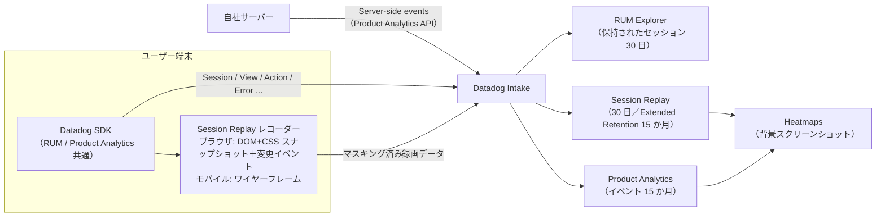
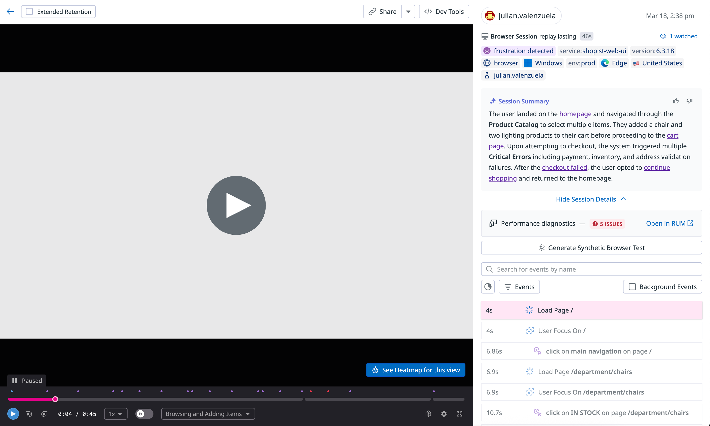
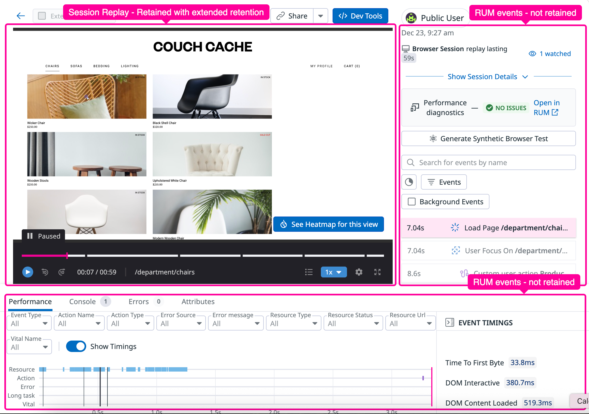
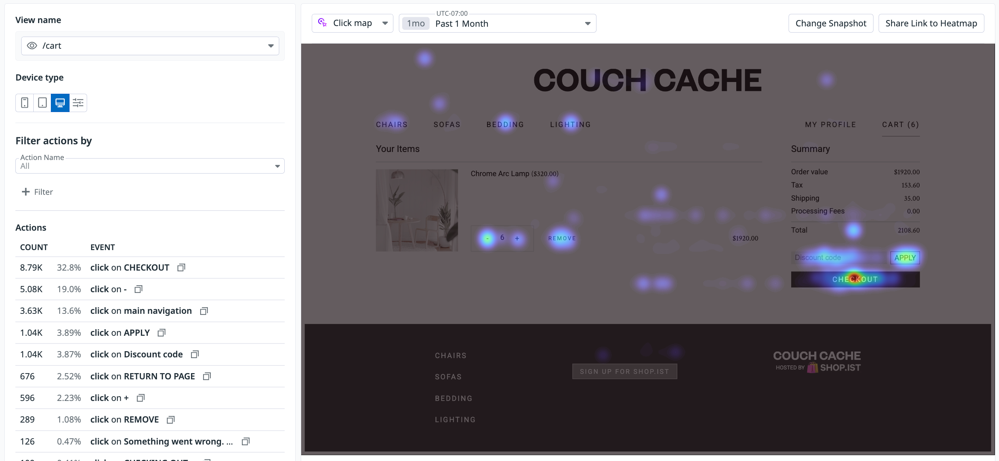
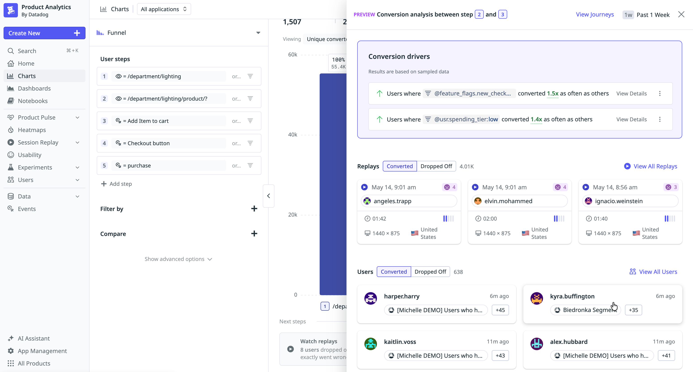

# Session Replay と Product Analytics

## 概要

Datadog の **Session Replay（セッションリプレイ）** は、Web ブラウザやモバイルアプリ上のユーザー操作を記録し、動画のように再生する機能である。**Product Analytics（プロダクト分析）** は、同じ Datadog SDK が収集するユーザー行動データ（Session・View・Action など）を使って、製品の利用状況、コンバージョン、継続利用を分析する製品である。いずれも Digital Experience Monitoring（DEM）領域に属し、RUM（Real User Monitoring）と同じ SDK・同じ設定を共有する。[出典](https://docs.datadoghq.com/session_replay/) / [出典](https://docs.datadoghq.com/product_analytics/)

| 項目 | Session Replay | Product Analytics |
|---|---|---|
| 目的 | 個々のセッションの操作を再生し、エラー再現・UX 問題の発見に使う | 利用者全体の行動を集計し、導線・転換率・継続率を分析する |
| データ源 | RUM SDK のレコーダー（ブラウザは DOM／CSS のスナップショットと変更イベント、モバイルはワイヤーフレーム） | RUM SDK の Session・View・Action イベント、Server-side events（API 送信） |
| 主な画面・機能 | リプレイプレイヤー、Dev Tools、Playlists、AI Summary／Smart Chapters、コメント、Heatmaps（ブラウザのみ） | Home、Pathways、Funnel、Retention、Analytics Explorer、Segments、Heatmaps、Dashboards |
| 標準保持期間 | 30 日（Extended Retention で 15 か月） | イベント 15 か月 |
| 課金（概要） | 1,000 セッション単位（RUM と Product Analytics のアドオン） | 1,000 セッション単位（full traffic） |

本ファイルの範囲と関連ファイル：

- ブラウザ SDK の導入・初期化パラメータ全般・RUM without Limits は [RUM（ブラウザ）](./rum-browser.md)、モバイル SDK 全般は [RUM（モバイル）](./rum-mobile.md) を参照。本ファイルは Session Replay と Product Analytics に固有の仕様に絞る。
- 合成監視（ラボ環境のテスト）は [Synthetic Monitoring](./synthetic-monitoring.md)、エラーの Issue 化は [Error Tracking](../apm/error-tracking.md)。
- 料金の正本は [製品別料金表](../../03_導入編/pricing-by-product.md)。課金計算の考え方は [課金計算の仕組み](../../03_導入編/billing-mechanics.md)。
- 個人情報の扱いや規制対応の全体設計は [セキュリティとコンプライアンス](../../03_導入編/security-and-compliance.md)、RUM イベントの保存前マスキングは [Sensitive Data Scanner](../security/sensitive-data-scanner.md)。

> **注意:** Datadog 公式ドキュメントの Session Replay 関連ページには、Browser SDK v7（2026 年時点の最新メジャー）以前の記述が残っている箇所がある（例：`defaultPrivacyLevel` のデフォルト値）。本ファイルでは SDK の移行ガイドと CHANGELOG を優先し、食い違いは該当箇所で注記する。

---

## 1. 全体像とデータフロー

Session Replay と Product Analytics は、アプリケーションに組み込んだ Datadog SDK（Browser SDK、Android／iOS SDK ほか）が収集したデータを使う。RUM を設定済みであれば、Product Analytics のために再度インスツルメントする必要はない。[出典](https://docs.datadoghq.com/product_analytics/)



- マスキングは端末側（SDK 内）で行われ、マスクされたデータは Datadog のサーバーに保存されない。[出典](https://docs.datadoghq.com/session_replay/browser/privacy_options/)
- RUM without Limits を使う場合、Session Replay は保持（Retention Filters で残された）セッションに紐づいて保持・課金される（[5.4](#54-rum-without-limits-との関係)）。

---

## 2. Session Replay の仕組み

### 2.1 ブラウザ版の録画方式

ブラウザ版 Session Replay のレコーダーは、オープンソースの RUM Browser SDK の一部であり、オープンソースの **rrweb** プロジェクトを基にしている。[出典](https://docs.datadoghq.com/session_replay/browser/)

| 項目 | 内容 |
|---|---|
| 記録内容 | 最初に DOM と CSS のスナップショットを取得し、以後は DOM の変更、マウス移動、クリック、入力イベントをタイムスタンプ付きで記録する |
| 再生方式 | Datadog 側でスナップショットに記録イベントを順に適用してページを再構築する（画面の動画を撮るのではない） |
| 圧縮 | 送信前に圧縮する。圧縮など CPU 負荷の高い処理は専用の Web Worker で実行し、UI スレッドへの影響を抑える |
| ネットワーク影響 | 想定は **100 kB/分未満** |
| 対応ブラウザ | RUM Browser SDK の対応ブラウザに準ずる（GitHub の `BROWSER_SUPPORT.md`） |
| データ形式（v7） | v7 でよりコンパクトな新データ形式になり帯域使用量が大きく減った。SDK の API からは直接見えないため利用者側の対応は不要 |
| 遅延読み込み（v6 以降） | Session Replay モジュールは録画対象としてサンプリングされたセッションでのみ読み込まれ、それ以外のセッションのバンドルサイズを削減する。バンドラーは動的 import に対応している必要がある |
| チャンク名（v7） | 非同期チャンクのファイル名に `datadog` 接頭辞が付く（例：`datadog-rum-recorder.js`）。CSP やキャッシュのルールでファイル名を指定している場合は更新が必要 |

[出典](https://docs.datadoghq.com/session_replay/browser/) / [出典](https://docs.datadoghq.com/real_user_monitoring/guide/browser-sdk-upgrade/)

### 2.2 モバイル版の録画方式

モバイル版 Session Replay は HTML／CSS を使わない。各画面を **wireframe（ワイヤーフレーム）** と呼ぶ矩形（text・shape・image の 3 種類）に分解して記録する。[出典](https://docs.datadoghq.com/session_replay/mobile/)

| 項目 | 内容 |
|---|---|
| ワイヤーフレーム | 背面から前面の順のフラットなリストとして正確な位置付きで記録される。プレイヤーは順に描画して重なりや透過を再現する。先頭のワイヤーフレームがビューポートのサイズと向きを定義する |
| フルスナップショット | 最初に画面全体のスナップショットを送る |
| インクリメンタルスナップショット | 以後は変化したワイヤーフレームのみを送る。各ワイヤーフレームは UUID で識別され、変更は「位置の更新」「UUID による削除」「内容のみの更新」で表現される |
| 再現性 | ピクセル単位の完全再現ではなく、骨組み（scaffold）にスタイルと画像を重ねたハイブリッドな再現 |
| 非対応 | スマート TV、ウェアラブル |

[出典](https://docs.datadoghq.com/session_replay/mobile/)（ワイヤーフレーム、スナップショット、非対応デバイス） / [出典](https://docs.datadoghq.com/session_replay/browser/)（再現性）

### 2.3 対応プラットフォーム

| プラットフォーム | パッケージ／依存関係 | 有効化 API | 補足 |
|---|---|---|---|
| Browser | RUM Browser SDK（`@datadog/browser-rum`。録画モジュールは同梱） | `datadogRum.init({ sessionReplaySampleRate })` | v5.0.0 以降は自動で録画開始。v5.0.0 未満は `startSessionReplayRecording()` の呼び出しが必要 |
| Android | `dd-sdk-android-session-replay`（任意で `-material`、`-compose`） | `SessionReplay.enable(SessionReplayConfiguration.Builder(sampleRate)...build())` | Material は `MaterialExtensionSupport()`、Jetpack Compose は `ComposeExtensionSupport()` を `addExtensionSupport()` で追加 |
| iOS | `DatadogSessionReplay`（SPM／CocoaPods／Carthage） | `SessionReplay.enable(with: SessionReplay.Configuration(replaySampleRate:, featureFlags:))` | SwiftUI は実験的サポート（`featureFlags: [.swiftui: true]`） |
| Kotlin Multiplatform | `dd-sdk-kotlin-multiplatform-session-replay`（iOS ターゲットは `DatadogSessionReplay` をリンク） | `SessionReplay.enable(SessionReplayConfiguration.Builder(sampleRate).build())` | Material 拡張は Android のみ |
| React Native | `@datadog/mobile-react-native-session-replay`（React Native SDK と同じバージョンにそろえる） | `SessionReplay.enable({ replaySampleRate, ... })` | React Native SDK 2.0.4 以降。iOS は `pod install` 後に再ビルド |
| Flutter【Preview】 | `datadog_session_replay` | `DatadogConfiguration(...)..enableSessionReplay(DatadogSessionReplayConfiguration(...))` | ルートウィジェットを `SessionReplayCapture` で囲む必要がある。iOS は Strip Style を Non-Global Symbols に設定 |
| .NET MAUI | `Datadog.Maui` NuGet パッケージに同梱 | `.UseDatadogSessionReplay(new SessionReplayConfiguration { ReplaySampleRate })` または `DdRum.Enable` 後に `DdSessionReplay.Enable(...)` | 手動の録画開始／停止は非対応 |

[出典](https://docs.datadoghq.com/session_replay/mobile/setup_and_configuration/)

- モバイル各 SDK の Session Replay の最低対応バージョン（WebView 連携以外）は、公開情報では確認できず。
- Unity 向け Session Replay は公開情報では確認できず。

---

## 3. Session Replay の設定

### 3.1 ブラウザの設定パラメータ

| パラメータ／API | 型・値 | デフォルト | 説明 |
|---|---|---|---|
| `sessionReplaySampleRate` | number（0〜100） | **`0`**（v5.0.0 以降。v4 までは 100） | RUM で追跡するセッションのうち録画する割合。0 で録画しない |
| `startSessionReplayRecordingManually` | boolean | `false` | `true` にすると自動録画せず、`startSessionReplayRecording()` 呼び出し時に録画開始 |
| `startSessionReplayRecording()` | 関数 | — | 録画を開始する。`{ force: true }` を渡すと、サンプリングで録画対象外になったセッションでも以降の録画を強制する |
| `stopSessionReplayRecording()` | 関数 | — | 録画を停止する |
| `defaultPrivacyLevel` | `mask` / `mask-user-input` / `allow` | **`mask-user-input`（v7）**。v5〜v6 は `mask`、v4 以前は `mask-user-input` | 録画のマスキング既定値（[4.1](#41-ブラウザのプライバシーレベル)） |
| `enablePrivacyForActionName` | boolean | **`true`（v7）**。v6 以前は `false` | クリックアクション名を `defaultPrivacyLevel` に従ってマスクする |
| `getSessionReplayLink()` | 関数 | — | 現在のセッションのリプレイ URL を返す（[RUM（ブラウザ）](./rum-browser.md) 参照） |
| 旧パラメータ | `replaySampleRate`、`premiumSampleRate` | — | v5 で `sessionReplaySampleRate` に置き換え。v5.0.0 未満で録画を無効化するには `replaySampleRate: 0` |

[出典](https://docs.datadoghq.com/session_replay/browser/setup_and_configuration/) / [出典](https://docs.datadoghq.com/real_user_monitoring/guide/browser-sdk-upgrade/)

> **注意（デフォルト値の食い違い）:** Session Replay のセットアップページの「Additional configuration」節には「サンプルレートを指定しない場合は 100 が適用される」との記述があるが、これはモバイル向けの記述の文脈にあり、Browser SDK については移行ガイドが「v5 以降 `sessionReplaySampleRate` のデフォルトは 0」と明記している（2026-11-02 時点）。モバイル SDK で未指定時に 100 が適用されるかどうかは SDK ごとの API リファレンスで確認すること。いずれの SDK でも値は明示指定を推奨する。

**サンプリングの掛かり方：** RUM のサンプルレートが先に適用され、Session Replay のサンプルレートはその内側に掛かる。例：RUM 80%、Session Replay 20% の場合、全セッションの 80% が RUM で追跡され、そのうち 20%（全体の 16%）が録画される。[出典](https://docs.datadoghq.com/session_replay/browser/setup_and_configuration/)

**条件付き録画の例（ブラウザ）：**

```javascript
import { datadogRum } from '@datadog/browser-rum';

datadogRum.init({
  applicationId: '<APP_ID>',
  clientToken: '<CLIENT_TOKEN>',
  site: 'ap1.datadoghq.com',
  service: 'web-shop',
  sessionSampleRate: 100,
  sessionReplaySampleRate: 100,
  startSessionReplayRecordingManually: true, // 自動録画しない
  defaultPrivacyLevel: 'mask-user-input',    // 明示指定を推奨
});

// 例：決済画面に入ったときだけ録画を開始
datadogRum.startSessionReplayRecording();
```

v5.0.0 以降、実際に録画が取得されたセッションだけが Session Replay のセッションとして数えられる。[出典](https://docs.datadoghq.com/real_user_monitoring/guide/browser-sdk-upgrade/)

### 3.2 モバイルの設定パラメータ

| 設定 | 対応プラットフォーム | 説明 |
|---|---|---|
| `replaySampleRate`（.NET MAUI は `ReplaySampleRate`、Android／KMP は `Builder(sampleRate)`） | 全モバイル SDK | 録画するセッションの割合（0.0〜100.0） |
| `startRecordingImmediately` | Android、iOS、KMP、React Native | `false` にすると自動録画しない。`SessionReplay.startRecording()`／`SessionReplay.stopRecording()` で制御する |
| `textAndInputPrivacyLevel`、`imagePrivacyLevel`、`touchPrivacyLevel` | React Native（Flutter は text と touch） | 初期化時のプライバシーレベル（[4.3](#43-モバイルのプライバシー設定)） |
| `featureFlags: [.swiftui: true]` | iOS | SwiftUI の録画（実験的） |
| `addExtensionSupport()` | Android、KMP | Material／Jetpack Compose 拡張 |

| 制約 | 内容 |
|---|---|
| Flutter | 手動の開始／停止はドキュメントに記載なし |
| .NET MAUI | 手動の開始／停止は非対応。有効化時から録画しセッション終了まで続く。対象セッションの絞り込みはサンプルレートか条件付きの有効化で行う |
| デフォルト動作 | 録画は自動で開始される |

[出典](https://docs.datadoghq.com/session_replay/mobile/setup_and_configuration/)

**デバッグログ（録画が届かないときの確認）：**

| プラットフォーム | 設定 |
|---|---|
| Android | `Datadog.setVerbosity(Log.DEBUG)` |
| iOS | `Datadog.verbosityLevel = .debug`（起動後約 30 秒でアップロードのログが出力される） |
| Kotlin Multiplatform | `Datadog.setVerbosity(SdkLogVerbosity.DEBUG)` |
| React Native | `config.verbosity = SdkVerbosity.DEBUG` |
| .NET MAUI | `UseDatadog` で `Verbosity = SdkVerbosity.DEBUG` |
| Flutter | `DatadogSdk.instance.sdkVerbosity = CoreLoggerLevel.debug` |

[出典](https://docs.datadoghq.com/session_replay/browser/setup_and_configuration/)

### 3.3 WebView（ハイブリッドアプリ）の録画

モバイルアプリ内の WebView は、Browser SDK と Mobile SDK の両方を導入しブリッジすると、ネイティブ画面と Web 画面を 1 つのリプレイとして再生できる。

| 項目 | 内容 |
|---|---|
| 最低バージョン | Android SDK 2.8.0 以降、iOS SDK 2.13.0 以降 |
| React Native | 対応。ただし Android の New Architecture では非対応 |
| Flutter、.NET MAUI | WebView の録画は非対応 |
| プライバシー | WebView には `hidden` とタッチの上書きのみ有効。WebView を hidden にしてもデータは送信されるため、Web 側は Browser SDK のプライバシー設定でマスクする |
| 課金 | WebView のイベントはモバイルセッションに紐づき、課金対象はモバイルセッション 1 つのみ |

[出典](https://docs.datadoghq.com/session_replay/browser/setup_and_configuration/) / [出典](https://docs.datadoghq.com/session_replay/browser/privacy_options/) / [出典](https://docs.datadoghq.com/account_management/billing/rum/)

### 3.4 無効化

| 対象 | 方法 |
|---|---|
| Browser | `sessionReplaySampleRate: 0`（v5.0.0 未満は `replaySampleRate: 0`） |
| モバイル各 SDK | サンプルレートを 0 にする |

録画を設定していないのに Session Replay の課金が発生している場合は、上記で録画を止めるよう公式 FAQ が案内している。[出典](https://docs.datadoghq.com/account_management/billing/rum/)

### 3.5 アプリ性能への影響（モバイル）

| 項目 | 値 |
|---|---|
| 画面キャプチャの間隔 | 64〜100 ms（プラットフォームによる） |
| 1 回のキャプチャ時間 | 3 ms（UI スレッド上で実行され、UI 更新が遅れる可能性がある） |
| 収集データの処理 | すべてバックグラウンドスレッド |
| 平均帯域 | iOS 約 12 KB/秒、Android 約 1.22 KB/秒（画像の多いアプリで画像録画を有効にすると初期データ量がやや増える） |
| バッチ・アップロード | SDK コアの既存のバッチ化とスマートアップロードを使用（バッチサイズ・送信間隔は公開情報では確認できず） |
| オフライン時 | ディスクにバッファし、通信回復後にアップロード（保存上限は公開情報では確認できず） |
| アプリサイズ | Android：AAR 内の Datadog コード 480 kB／iOS：`.ipa` が約 200 kB 増加 |
| CPU・メモリの数値 | 公開情報では確認できず（GitHub の各 SDK のベンチマーク文書を参照するよう案内されている） |

[出典](https://docs.datadoghq.com/session_replay/mobile/app_performance/)

---

## 4. プライバシーとマスキング

Session Replay のマスキングは端末側で適用され、マスクされた値は Datadog に送信・保存されない。そのため **後から解除（アンマスク）できない**。Sensitive Data Scanner によるマスキング（`Data Scanner Unmask` 権限で原文を参照できる）とは性質が異なる。[出典](https://docs.datadoghq.com/session_replay/browser/privacy_options/)

### 4.1 ブラウザのプライバシーレベル

`defaultPrivacyLevel` で全体の既定値を決め、要素単位の上書きで調整する（SDK v3.6.0 以降）。

| レベル | マスク対象 | 表示のされ方 |
|---|---|---|
| `mask` | HTML テキスト、ユーザー入力、画像、canvas、リンク、`data-*` 属性をすべて | テキストは `X` に置換され、ワイヤーフレームのような見た目になる |
| `mask-user-input` | `input`、`textarea`、チェックボックスの値 | 入力欄は `***`、テキストエリアは空白を保持した `x` に置換。その他のテキストは記録 |
| `allow` | なし（常時マスク対象を除く） | すべて記録 |

| SDK バージョン | `defaultPrivacyLevel` の既定値 |
|---|---|
| v4 以前 | `mask-user-input` |
| v5〜v6 | `mask` |
| v7 | `mask-user-input`（全面マスクを維持するには `defaultPrivacyLevel: "mask"` を明示） |

[出典](https://docs.datadoghq.com/session_replay/browser/privacy_options/) / [出典](https://docs.datadoghq.com/real_user_monitoring/guide/browser-sdk-upgrade/)

> **注意:** Privacy Options ページは「未指定時は `mask`」と記載しているが、v7 の移行ガイドでは v7 の既定値は `mask-user-input`（2026-11-02 時点）。v7 への更新で録画に表示されるテキストが増えるため、更新前に `defaultPrivacyLevel` を明示指定すること。RUM（ブラウザ）側の記述は [RUM（ブラウザ）](./rum-browser.md) の 11.1 節と一致させている。

### 4.2 要素単位の上書き（ブラウザ）

| 指定方法 | 値 |
|---|---|
| HTML 属性 | `data-dd-privacy="allow"` / `"mask"` / `"mask-user-input"` / `"hidden"` |
| クラス名 | `dd-privacy-allow` / `dd-privacy-mask` / `dd-privacy-mask-user-input` / `dd-privacy-hidden` |

| 機能 | 内容 |
|---|---|
| 継承 | 親に `allow`、子の `span` に `mask` を付けると子の値のみマスクされる |
| `hidden` | 記録時点で要素を灰色のブロックに置き換える（テキストを伏せ字にするのではなく、要素自体を記録しない） |
| アクション名 | `data-dd-action-name` 属性でアクション名を明示（例：「Click on Address」）。`enablePrivacyForActionName` 有効時、上書きされていないアクション名は「Masked Element」に置換される |
| 設定に関係なく常にマスク | `type` が `password`・`email`・`tel` の入力欄、クレジットカード番号・有効期限・セキュリティコードの `autocomplete` 属性を持つ要素 |

```html
<!-- 例：会員情報エリアは全体を隠し、検索ボックスは入力も記録する -->
<section data-dd-privacy="hidden">...</section>
<input type="search" class="dd-privacy-allow" />
<button data-dd-action-name="Click on Checkout">購入手続きへ</button>
```

[出典](https://docs.datadoghq.com/session_replay/browser/privacy_options/)

- SDK の CHANGELOG には `mask-unless-allowlisted`（許可リストにない要素をマスクする）というプライバシーレベルに関する修正が v6.20.0〜v6.33.0 にかけて記録されているが、公式ドキュメントには記載がない（2026-11-02 時点）。一般提供かどうかは公開情報では確認できず。[出典](https://github.com/DataDog/browser-sdk/blob/main/CHANGELOG.md)

### 4.3 モバイルのプライバシー設定

モバイル SDK では、テキスト・入力、画像、タッチの 3 軸を個別に設定できる（Android、iOS、Kotlin Multiplatform、React Native、Flutter、.NET MAUI）。[出典](https://docs.datadoghq.com/session_replay/browser/privacy_options/)

**テキストと入力（`textAndInputPrivacy`）**

| 値 | 動作 |
|---|---|
| `mask_all`（デフォルト） | すべてのテキストと入力をマスク |
| `mask_all_inputs` | 入力欄のみマスク |
| `mask_sensitive_inputs` | テキストと入力を表示し、機密入力（パスワード、メール、電話番号）のみマスク |

**画像（`imagePrivacy`）**

| 値 | 動作 | 対象 |
|---|---|---|
| `mask_all`（デフォルト） | すべての画像を「Image」プレースホルダーに置換 | 全 SDK |
| `mask_large_only` | 100×100 dp を超える画像を「Content Image」に置換（ビューではなく drawable リソースのサイズで判定） | Android、KMP |
| `mask_non_bundled_only` | アプリにバンドルされていない画像をマスク（UIKit はバンドル判定、SwiftUI は 100×100 pt 超を非バンドルとみなす） | iOS、React Native（iOS） |
| `mask_non_assets_only` | `AssetImage` 以外の画像をマスク | Flutter |
| `mask_none` | すべて表示 | 全 SDK |

| 画像の種類 | `mask_none` | large only／non-bundled／non-assets | `mask_all` |
|---|---|---|---|
| コンテンツ画像 | 表示 | マスク | マスク |
| システム画像 | 表示 | 表示 | マスク |

- Flutter では合計 1000×1000 ピクセルを超える画像は「Large Image」と表示されマスクされる。
- iOS のベクター画像は「Unsupported image type」と表示される（アセットカタログで「Preserve Vector Data」を無効にすると表示される）。SF Symbols は非対応。

**タッチ（`touchPrivacy`）**

| 値 | 動作 |
|---|---|
| `hide`（デフォルト） | すべてのタッチを非表示 |
| `show` | すべてのタッチを表示 |

画面上のキーボードへのタッチは、設定に関係なく常にマスクされる。

**テキストのマスク方式**

| テキストの種類 | Allow all | Mask all | Mask user input |
|---|---|---|---|
| 機密テキスト（パスワード、メール、電話番号、iOS の住所・カード番号・ワンタイムコード等） | 固定長（`***`） | 固定長 | 固定長 |
| 入力・選択肢のテキスト | マスクなし | 固定長 | 固定長 |
| 静的テキスト（ラベル、編集不可テキスト等） | マスクなし | 空白保持（文字を `x` に置換） | マスクなし |
| ヒントテキスト（プレースホルダー） | マスクなし | 固定長 | マスクなし |

選択状態を示唆する外観（セグメントの選択背景、日付ピッカーの選択円、スライダーのつまみ、Android のチェックマーク等）もマスク対象になる。[出典](https://docs.datadoghq.com/session_replay/browser/privacy_options/)

### 4.4 モバイルのビュー単位の上書き

上書きはそのビューと子孫すべてに適用され、最も近い親の上書きが優先される（なければアプリ全体の設定）。`null` または `false` で上書きを解除する。`hidden` を付けたビューは「Hidden」プレースホルダーになり子ビューは記録されないが、タッチは隠れないため必要ならタッチの上書きも併用する。

| プラットフォーム | API |
|---|---|
| Android（View） | `setSessionReplayTextAndInputPrivacy`、`setSessionReplayImagePrivacy`、`setSessionReplayTouchPrivacy`、`setSessionReplayHidden` |
| Android（Jetpack Compose） | `Modifier.sessionReplayTextAndInputPrivacy`、`sessionReplayImagePrivacy`、`sessionReplayTouchPrivacy`、`sessionReplayHide` |
| iOS（UIKit） | `dd.sessionReplayOverrides` の `textAndInputPrivacy`、`imagePrivacy`、`touchPrivacy`、`hide` |
| iOS（SwiftUI） | `SessionReplayPrivacyView`（ネイティブレイヤーが増えるため、入れ子にせず 1 つのビューで設定をまとめる） |
| Flutter | `SessionReplayPrivacy` ウィジェット（ツリー全体に適用。子でタッチ非表示を戻すことはできない。hidden にしたツリーは処理されない） |
| Kotlin Multiplatform | iOS ターゲットは `UIView` の `setSessionReplay...` メソッド、Android ターゲットは Android の API |
| React Native（SDK 2.8.0 以降） | `SessionReplayView.Privacy`、`SessionReplayView.MaskAll`（`showTouch`）、`SessionReplayView.MaskNone`、`SessionReplayView.Hide` |

[出典](https://docs.datadoghq.com/session_replay/browser/privacy_options/)

### 4.5 同意管理とローカル保存（モバイル）

| 同意状態 | SDK の動作 |
|---|---|
| Not granted | ディスクに書き込まない |
| Pending | アップロード不可の一時フォルダに保存 |
| Granted | アップロード用フォルダに保存し、バックグラウンドで送信 |

Pending から Granted に変わると一時フォルダのデータがアップロード用フォルダに移動する。アップロードまでのデータはアプリのキャッシュディレクトリに**平文で**保存される。[出典](https://docs.datadoghq.com/session_replay/browser/troubleshooting/)

ブラウザの同意管理（`trackingConsent`）は [RUM（ブラウザ）](./rum-browser.md) を参照。

---

## 5. Session Replay の画面と機能

### 5.1 リプレイプレイヤー



**キャプション:** Session Replay のプレイヤー画面（右側に AI 生成の Session Summary を表示した例）。

**画面説明:** 左上に戻る矢印と「Extended Retention」チェックボックス、右上に「Share」（ドロップダウン付き）と「Dev Tools」ボタンが並ぶ。中央がリプレイの再生領域で、下部に再生ボタン、10 秒戻し／送り、再生位置（例：0:04 / 0:45）、再生速度（1x）、非アクティブ区間スキップのトグル、Smart Chapters のドロップダウン（例：「Browsing and Adding Items」）、設定・全画面ボタン、イベントを示す点の付いたタイムラインがある。再生領域の右下には「See Heatmap for this view」ボタンがある。右側パネルには、ユーザー名、日時、「Browser Session replay lasting 46s」、視聴数（「1 watched」）、ファセット（frustration detected、service、version、browser、OS、env、ブラウザ、国、ユーザー）が表示され、その下に「Session Summary」（ユーザーの行動とエラーを要約し、ページへのハイパーリンクを含む文章。評価用の高評価／低評価ボタン付き）、「Performance diagnostics」（例：5 ISSUES、Open in RUM）、「Generate Synthetic Browser Test」ボタン、イベント検索欄、「Events」フィルター、「Background Events」チェックボックス、時刻付きのイベント一覧（Load Page、User Focus On、click on ... など）が並ぶ。

**出典:** https://docs.datadoghq.com/session_replay/ （取得日 2026-11-02）

### 5.2 AI Summary と Smart Chapters

| 機能 | 内容 |
|---|---|
| Summary（要約） | ユーザーの意図、主要な操作、摩擦のシグナル（frustration）、結果を文章で示し、該当時刻へ移動できるハイパーリンクを含む。一度要約したセッションは即時に表示される |
| Smart Chapters | タイムラインをジャーニーの段階ごとにラベル付けして分割する。タイムラインのホバーとプレイヤーのドロップダウンに表示 |
| 生成条件 | ユーザー操作が **4 回以上**、かつセッションが **45 秒以上** |
| 非対応サイト | `app.ddog-gov.com`、`us2.ddog-gov.com` |

[出典](https://docs.datadoghq.com/session_replay/)

AI 機能全般は [Bits AI と AI 機能](../ai/bits-ai.md) を参照。

### 5.3 コメントと視聴履歴

| 機能 | 内容 |
|---|---|
| コメント | タイムライン上の時刻にコメントを付け、ユーザーやチームを @メンション（メールで通知）。コメントへのリンク共有、スレッド返信、自分のコメントの編集・削除が可能。`app.ddog-gov.com`／`us2.ddog-gov.com` では非対応（サポートに問い合わせ） |
| 視聴履歴（Playback history） | プレイヤーの「watched」数で誰が視聴したかを表示。プレイヤーページと埋め込みプレイヤー（Notebooks、サイドパネル等）での再生が対象で、サムネイルプレビューは対象外 |
| 監査 | 対象となる再生ごとに Audit Trail のイベントが記録される（[Audit Trail](../platform/audit-trail.md)） |
| 自分の履歴 | 「My Watch History」プレイリスト |

[出典](https://docs.datadoghq.com/session_replay/)

### 5.4 RUM without Limits との関係

RUM without Limits（取り込んだ全セッションのうち Retention Filters に一致したものだけを保持する方式）を使う場合の Session Replay の扱い：

| 論点 | 内容 |
|---|---|
| 保持と課金 | リプレイ付きのセッションが保持（課金）されると、セッションのイベントと録画の両方が保持・課金される。リプレイはセッションに従う |
| リプレイ専用のクロスプロダクトフィルター | なし（APM トレース用のクロスプロダクトフィルターとは異なる） |
| 強制録画 | Browser SDK で強制録画（`startSessionReplayRecording({ force: true })`）されたリプレイを持つセッションは、変更不可の恒久フィルターで常に保持される。モバイル SDK の開始／停止 API で録画したリプレイは、デフォルトでは保持されない |
| フィルターの書き方 | `@session.has_replay:true` を条件にした Retention Filter で、リプレイ付きセッションの保持率を個別に設定できる |
| Synthetic 由来のセッション | 恒久フィルターで保持され、Synthetic Monitoring として課金（RUM の課金対象外） |

[出典](https://docs.datadoghq.com/real_user_monitoring/rum_without_limits/retention_filters/) / [出典](https://docs.datadoghq.com/api/latest/rum-retention-filters/get-all-rum-retention-filters/)

Retention Filters・Retention Quotas の仕様全体は [RUM（ブラウザ）](./rum-browser.md) の 9 節を参照。

### 5.5 Dev Tools

Dev Tools は、保持された RUM セッションのリプレイ再生中に技術情報を確認するデバッグパネルである。リプレイ画面の「Share」の右にある `</> Dev Tools` ボタンで開く。追加設定は不要。[出典](https://docs.datadoghq.com/session_replay/dev_tools/)

| タブ | 内容 | 操作 |
|---|---|---|
| Performance | セッション内のイベント（Action、Error、Resource、Long Task、Vital）とタイミングのウォーターフォール | Event Type・Action Name・Resource Type などで絞り込み、スライダーで時間範囲を拡大 |
| Console | View ごとのブラウザログとエラー | 重大度（Error／Warn／Info／Debug）で絞り込み。「View in Log Explorer」でクエリ付きの Log Explorer を開く |
| Errors | セッションに関連する RUM エラーと Error Tracking の Issue | — |
| Attributes | セッションの全属性 | — |

制約：Dev Tools は **保持された RUM セッションでのみ** 利用できる。Extended Retention で保持期間を延長したリプレイでも、RUM イベントが保持期間を過ぎていれば Dev Tools 側のイベントは表示されない（[5.7](#57-保持期間と-extended-retention) の画像を参照）。

### 5.6 Playlists

Playlists は、リプレイを任意の観点でグループ化する機能である（同じエラーパターン、新 UI で迷ったユーザー、売上に関わるボタンでのレイジクリックなど）。[出典](https://docs.datadoghq.com/session_replay/playlists/)

| 項目 | 内容 |
|---|---|
| 作成 | Digital Experience > Session Replay > Playlists で「New Playlist」（名前と説明）、または個々のリプレイの「Share」>「Save to Playlist」 |
| 追加できるリプレイ | 完了済みでリプレイ付きのユーザーセッションのみ。対象の検索クエリ：`@session.is_active:false @session.type:user @session.has_replay:true`（アクティブなセッションと Synthetic セッションは対象外） |
| 既定のプレイリスト | My Watch History（自分が視聴したリプレイ）、All mentions to me（コメントで自分がメンションされたリプレイ）、Commented replays（組織内でコメントが 1 件以上あるリプレイ） |
| 保持期間 | `rum_extend_retention` 権限を持つユーザーがプレイリストに追加すると、そのリプレイの保持期間が自動的に延長される（最長 15 か月）。権限がない場合は延長されない |
| 権限 | Playlist write（作成・編集・削除、セッションの追加・削除）、Session Replay read（閲覧）、`rum_extend_retention`（追加時の保持延長） |
| 件数上限 | 公開情報では確認できず |

よくあるエラー：保存エラーはセッションがアクティブ、またはリプレイ付きのユーザーセッションでない場合に起きる。作成エラーは書き込み権限の不足が多い。

### 5.7 保持期間と Extended Retention

| データ | 保持期間 |
|---|---|
| リプレイ（Extended Retention なし） | **30 日** |
| リプレイ（Extended Retention あり） | **15 か月** |
| Browser／Mobile RUM の Session・View・Action・Error | 30 日 |
| Browser／Mobile RUM の Resource・Long Task・Vital | 15 日 |

[出典](https://docs.datadoghq.com/data_security/data_retention_periods/)

**Extended Retention の仕様：**

| 項目 | 内容 |
|---|---|
| 適用単位 | リプレイ単位（プレイヤー左上の「Extended Retention」チェックボックス、またはプレイリストへの追加） |
| 対象 | アクティブでない（完了した）セッションのみ |
| 必要な権限 | `rum_extend_retention` |
| 期間の起点 | 有効化した時点から 15 か月（セッション収集時点からではない） |
| 対象データ | リプレイのみ。関連する RUM イベントは延長されない |
| 無効化したとき | 元の 30 日以内なら 30 日経過時に失効。30 日を過ぎていれば即時に失効 |
| 推奨 | リプレイ URL を保存するか、プレイリストに追加する |
| 追加料金 | 公開情報では確認できず（料金ページに Extended Retention の個別 SKU は掲載されていない。2026-11-02 時点） |

[出典](https://docs.datadoghq.com/session_replay/)



**キャプション:** Extended Retention を有効にしたリプレイの表示例。録画は保持されるが、関連する RUM イベントは保持されない。

**画面説明:** 公式ドキュメントの注釈付き画像。左上の再生領域（EC サイト「COUCH CACHE」の椅子一覧ページの録画）に「Session Replay - Retained with extended retention」の注釈があり、録画は 15 か月保持されることを示す。右側のセッション情報パネル（ユーザー名、「Browser Session replay lasting 59s」、Performance diagnostics、Generate Synthetic Browser Test、イベント一覧）と、下部の Dev Tools パネル（Performance／Console／Errors／Attributes タブ、Event Type・Action Name・Resource Type などのフィルター、Resource／Action／Error／Long task／Vital のウォーターフォール、右側の EVENT TIMINGS：Time To First Byte、DOM Interactive、DOM Content Loaded）には「RUM events - not retained」の注釈があり、これらは RUM の保持期間を過ぎると表示されなくなることを示す。

**出典:** https://docs.datadoghq.com/session_replay/ （取得日 2026-11-02）

### 5.8 録画できない要素とトラブルシューティング（ブラウザ）

| 項目 | 内容 |
|---|---|
| 非対応要素 | `iframe`、`video`、`audio`、`canvas`、Web Animations API |
| HTTPS | 必須。HTTP ではリソースがタイムアウトし、画像や一部の要素が表示されない |
| iframe | iframe 側のコードを別途インスツルメントする。サブドメインをまたぐ場合は `trackSessionAcrossSubdomains: true`。iframe と親ウィンドウは同一セッション内の別ページとして表示され、親のリプレイへの埋め込み表示は非対応 |
| フォント・画像 | 再生時に取得するため、削除済み（旧デプロイのアセット）、認証や社内ネットワークが必要、CORS でブロック（Web フォントで多い）の場合は表示されない |
| CORS 設定 | リプレイは `session-replay-datadoghq.com` のサンドボックスドメインで描画される。フォント・画像のホストで `Access-Control-Allow-Origin` にこのドメインを許可する |
| CSS | `CSSStyleSheet` インターフェース経由で CSS ルールをまとめて記録し、失敗時は CSS ファイルへのリンクを記録する。マウスホバーの再現には `CSSStyleSheet` からルールにアクセスできる必要がある。別ドメインのスタイルシートには `crossorigin="anonymous"` 属性と `Access-Control-Allow-Origin` ヘッダーが必要 |
| Shadow DOM | v7 で Shadow DOM 内のアクション追跡がデフォルトになった（`betaTrackActionsInShadowDom` は廃止）。録画自体の Shadow DOM 対応範囲の公式記述は公開情報では確認できず |
| CSP | Session Replay の Worker 用に `worker-src blob:` が必要（代替として Worker ファイルを自ホストし `workerUrl` で指定）。詳細は [RUM（ブラウザ）](./rum-browser.md) |
| 保守 | Browser SDK を定期的に更新する（各リリースに修正が含まれる） |

[出典](https://docs.datadoghq.com/session_replay/browser/troubleshooting/) / [出典](https://github.com/DataDog/browser-sdk/blob/main/CHANGELOG.md)

> **canvas 録画について:** Browser SDK の CHANGELOG には v7.9.0 以降、canvas（WebGL を含む）の録画に関する実験的（⚗️）な変更が続いており、v7.16.2 で設定 `sessionReplayCanvasRecording` が生成ドキュメントから非表示にされている（2026-11-02 時点）。公式ドキュメントでは canvas は非対応と記載されており、一般提供ではない。[出典](https://github.com/DataDog/browser-sdk/blob/main/CHANGELOG.md)

**モバイルで表示されないことが多い要素：** システム要素（アクションバー、プログレスバー、スピナー）、リッチなシステムコンテンツ（動画、音楽、地図ウィジェット）、canvas への直接描画、高度なテキスト装飾。ネイティブフレームワークのみ対応。iOS／KMP では SwiftUI の録画を有効にしないと SwiftUI 画面が空白や不完全になる。Flutter はアンマウントされたウィジェットや幅・高さ 0 のウィジェットが欠けることがある。画像は別処理のため表示まで数分かかることがある。継続時間が 1 ナノ秒のセッションは処理できず、リプレイが付いているように見えても再生できない。[出典](https://docs.datadoghq.com/session_replay/browser/troubleshooting/)

---

## 6. Heatmaps

Heatmaps（ヒートマップ）は、Session Replay の画面（スクリーンショット）にユーザー操作を重ねて可視化する機能である。**Browser Session Replay のみ対応**（モバイルは非対応）。`app.ddog-gov.com`、`us2.ddog-gov.com` では非対応。[出典](https://docs.datadoghq.com/session_replay/heatmaps/)

### 6.1 前提条件とアクセス

| 項目 | 内容 |
|---|---|
| Browser SDK | Click map は v4.40.0 以降、Scroll map は v4.50.0 以降 |
| Session Replay | 有効化が必要（背景スクリーンショットに使う） |
| アクション収集 | `trackUserInteractions: true`（Click map が依存） |
| グルーピング | View 名単位。複数ページが同じ View 名なら 1 つのヒートマップになる |
| RUM からのアクセス | Digital Experience > Real User Monitoring > Session Replay > Heatmaps（`/rum/heatmap/`） |
| Product Analytics からのアクセス | Digital Experience > Product Analytics > Heatmaps（`/product-analytics/heatmap`） |
| その他 | リプレイプレイヤーの「See Heatmap for this view」ボタン、Pathways のノードメニュー |

### 6.2 ヒートマップの種類

| 種類 | 内容 |
|---|---|
| Top Elements | View 内で最も操作された要素を最大 **上位 10 件**までランク表示。マップ上の番号とサイドパネルのアクション名が対応し、ホバーでハイライト |
| Click map | クリックアクションを集計し、ページ上に色の塊として表示。左パネルに頻度順のアクション一覧。アクションを選ぶと実行回数、上位アクション内の順位、関連するフラストレーションシグナル（レイジクリック等）を表示し、「Start a Funnel」でファネル分析を開始できる |
| Scroll map | スクロールの集計と平均フォールド（端末上でスクロールせずに見える最下点）を表示。青いバーをドラッグして特定のスクロール深度を評価し、ミニマップと分布グラフで最大の離脱位置を確認できる |

**フィルター：** View Name、Application、Device type、Filter actions by（アクション名）、Add Filter（地域などの詳細条件）。



**キャプション:** Heatmaps の Click map 表示（View 名 `/cart` の例）。

**画面説明:** 左パネル上部に「View name」（例：`/cart`）のセレクター、「Device type」（モバイル、タブレット、デスクトップ、詳細設定のアイコン）、「Filter actions by」（Action Name：All）と「+ Filter」がある。その下の「Actions」表に COUNT（件数と割合）と EVENT（例：click on CHECKOUT 8.79K／32.8%、click on main navigation、click on APPLY、click on Discount code など）が頻度順に並ぶ。右側上部にマップ種類のセレクター（Click map）、期間（Past 1 Month）、「Change Snapshot」「Share Link to Heatmap」ボタンがあり、その下に EC サイトのカート画面のスクリーンショットが暗く表示され、クリックが多い箇所（CHECKOUT ボタン、APPLY ボタンなど）が明るい色の塊で重ねて表示される。

**出典:** https://docs.datadoghq.com/session_replay/heatmaps/ （取得日 2026-11-02）

### 6.3 背景スクリーンショット

「Change Screenshot」ボタンで背景を選ぶ。

| 方法 | 内容 |
|---|---|
| Existing screenshots | 自分やチームが保存済みのスクリーンショットを選ぶ |
| Take new screenshot | 埋め込みブラウザでライブのアプリを操作し、モーダル表示中・ホバーメニュー表示中など録画にない状態を撮影する。**Datadog Test Recorder の Chrome 拡張**が必要。撮影時にマスキングレベルを選択（コード側の要素単位のプライバシー設定が優先） |
| Grab from replay | 録画済みリプレイのアクションイベントを選び、その時点の画面を背景にする。必要なアクションがなければ「Choose Another Replay」 |

- Take new screenshot／Grab from replay で作成したスクリーンショットは自動保存され、組織のデフォルトになる。自動選択された背景は「Save」で保存、「Unpin」で解除。1 つの View に複数保存できる。

### 6.4 データの保持期間

| データ | 取得元 | 保持期間 |
|---|---|---|
| オーバーレイ（クリック・スクロール）：RUM | RUM の Action イベント | 30 日 |
| オーバーレイ（クリック・スクロール）：Product Analytics | Product Analytics のクリックデータ | 15 か月 |
| 背景スクリーンショット | Session Replay | 既定 30 日 |

- ヒートマップの表示にはオーバーレイと背景の両方が必要。
- Product Analytics でスクリーンショットを保存すると、その元のリプレイの保持期間が 15 か月に延長される。30 日より前の期間を分析するには、期間を直近 30 日に設定してスクリーンショットを「Save」し、その後で対象期間に戻す。
- 背景は分析期間当時ではなく最近の画面であるため、レイアウト変更後はクリックが別の要素の上に表示されることがある。
- RUM のヒートマップは Action イベントの 30 日を超えて表示できない。

[出典](https://docs.datadoghq.com/session_replay/heatmaps/)

### 6.5 よくある表示状態

| 表示 | 原因 |
|---|---|
| No Replay Data | 期間がリプレイの保持期間（既定 30 日）を超えている、フィルターに一致するリプレイがない、録画開始直後（表示まで数分） |
| Not enough data to generate a heatmap | 選択したリプレイに一致するアクションがない（古い SDK、ページの大幅な変更） |
| 想定外のページが表示される | 同じ View 名を共有する複数ページがある |
| 要素が見えない（「element is not visible」アイコン） | 要素は頻出だが現在のスナップショットにない。スナップショットを切り替える |
| ユーザー情報が空 | ユーザー情報はデフォルトで収集されない（`setUser` 等で設定が必要） |

---

## 7. Product Analytics

### 7.1 位置づけと RUM との関係

Product Analytics は、製品の採用状況、コンバージョン率とその推移、主要な行動パターンの把握、ユーザー操作の可視化を目的とする製品である。RUM と同じ SDK・設定を使い、RUM のイベント階層（Session・View・Action）をデータ源とする。[出典](https://docs.datadoghq.com/product_analytics/)

| 観点 | RUM | Product Analytics |
|---|---|---|
| 主な利用者 | エンジニア、SRE（性能・エラー調査） | プロダクトマネージャー、デザイナー、グロース担当 |
| 主な問い | どこが遅い・壊れているか | どの導線で離脱し、誰が継続利用しているか |
| データの保持 | RUM without Limits では Retention Filters で保持したセッションを 30 日（メトリクスは全量を 15 か月） | 行動データを全量（full traffic）で 15 か月 |
| Session Replay | アドオン | アドオン（RUM と併用しても**リプレイの課金は 1 回**） |
| 単独利用 | 可 | 料金ページ上は Session Replay なしでも利用可。RUM 契約なしで単独利用できるかの明示的な記述は公開情報では確認できず |

[出典](https://www.datadoghq.com/pricing/?product=product-analytics)

### 7.2 データの種類

| データ | 内容 |
|---|---|
| Sessions | 1 人のユーザーのアプリ内の一連の行動 |
| Views | セッション内で訪れたページ・画面 |
| Actions | クリック、タップ、スクロールなどの操作（RUM SDK が自動収集）。Funnel や Segments のステップ・フィルターに使える |
| Labeled actions | 画面上で視覚的にラベル付けして定義したアクション（Analytics Explorer のイベントピッカーにタブあり） |
| Server-side events | Product Analytics API で自社サーバーから送るカスタムイベント（決済完了など） |

**Server-side events の仕様：**

| 項目 | 内容 |
|---|---|
| 送信方法 | Product Analytics API の「Send server-side events」 |
| クライアントとの紐付け | クライアントのアクティブな RUM セッションの `session_id` を含める |
| 分析での利用 | すべての Product Analytics チャートで利用可能。イベントピッカーで「Server Events」を選ぶ |
| 前提 | SDK のセットアップと Product Analytics の有効化 |
| 課金 | 標準の Product Analytics とは**別課金**（単価は公開情報では確認できず。CSM に確認するよう案内されている） |
| ペイロード上限・必須フィールド | 公開情報では確認できず（API リファレンスを参照） |

[出典](https://docs.datadoghq.com/product_analytics/data_collected/server_side_events) / [出典](https://docs.datadoghq.com/product_analytics/)

### 7.3 有効化手順

1. 対象アプリに Datadog SDK（Browser、iOS、Android）を導入する（RUM 導入済みなら不要。AI コーディングアシスタントを使う Agentic onboarding も用意されている）。
2. Digital Experience > Real User Monitoring > **Manage Applications** を開く。
3. **Active** の下で対象アプリケーションを選ぶ。
4. **PRODUCT SETTINGS** の下で **Product Analytics** をクリックする。
5. **Enable** をクリックする。
6. （任意）Product Analytics API で Server-side events を送信する。

[出典](https://docs.datadoghq.com/product_analytics/)

Retention 分析や Funnel のユーザー単位集計には `usr.id` の設定（Browser SDK の `setUser` 等）が必要になる。

### 7.4 画面構成

Product Analytics の左ナビゲーションには、Search、Home、Charts、Dashboards、Notebooks、Heatmaps、Session Replay、Users などが並ぶ（下図参照）。

| 機能 | 内容 |
|---|---|
| Home | 利用状況の俯瞰。既定チャートはアクティブユーザー数、ページビュー数、ユーザーあたり平均滞在時間。Users／App & Devices（デスクトップとモバイルの比率、利用中のアプリバージョン）／Engagement（ページ滞在時間、上位アクション）／Traffic（直帰率、流入元）／Performance（よくあるエラーとフラストレーション、影響を受ける View）のサブセクション |
| Charts | Pathways、Funnel、Retention、Analytics（Analytics Explorer） |
| Users & Segments | ユーザー・アカウントのプロフィール閲覧とセグメント作成 |
| Session Replay・Playlists | Product Analytics 側からのリプレイ再生 |
| Heatmaps | Click map、Top Elements、Scroll map（[6](#6-heatmaps)） |
| Dashboards | Product Analytics のチャートを集約（Home にダッシュボードを追加することも可能） |

[出典](https://docs.datadoghq.com/product_analytics/)

### 7.5 Pathways

Pathways は、アプリ内のユーザーの遷移経路を可視化するチャートである。各ノードは訪問した View で、太さはそのページのセッション数を表す。[出典](https://docs.datadoghq.com/product_analytics/charts/pathways/)

| 項目 | 内容 |
|---|---|
| 作成 | Product Analytics で **Create New > Pathways** |
| 起点 | アンカーとなる View を 1 つ選び、その**前**または**後**のステップを表示。ワイルドカード可（例：`/department/*`） |
| 集計単位 | セッション。同一セッション内の同じページへの再訪は 1 回と数える |
| 対象イベント | View のみ（Action イベントは非対応） |
| ノード表示 | 前ステップに対する到達セッションの割合と件数。Dropoff は選択したステップ数内で次の View に到達しなかったセッション |
| 操作 | 表示する経路数・ステップ数の変更、期間指定、Filter by（国、デバイス種別など）、Segment での絞り込み |
| ノードメニュー | そのノードを起点に新しい Pathways を作成、Analytics で全訪問を表示、サンプルのリプレイを視聴、ヒートマップを表示 |
| ファネル化 | ノードを選び **Create Funnel From Selection** |
| 上限（経路数・ステップ数） | 公開情報では確認できず |

### 7.6 Funnel（ファネル分析）

Funnel は、主要なワークフローの各ステップでの転換と離脱を測るチャートである。[出典](https://docs.datadoghq.com/product_analytics/charts/funnel_analysis/)

| 項目 | 内容 |
|---|---|
| 作成 | **Create New > Funnel** で開始ステップを選び、**Add step** で追加。ドラッグ＆ドロップで並べ替え |
| ステップの結合 | 既存イベントの横の **or** ボタンで複数イベントを 1 ステップにまとめる（いずれかで成立：OR 条件） |
| コンバージョンの定義 | 最後のステップを完了したとき |
| 集計単位 | Unique converted sessions（同一 `@session.id`）、Unique converted users（同一 `@user.id`）、Unique converted accounts（同一 `@account.id`。ログインユーザーを `@user.id` より長期間追える）、Total conversions、Time to convert（時系列） |
| 数え方 | Unique：A→B→C→A→B→C を 1 回と数える／Total：同じ流れを 2 回と数える。ステップに一致しない操作は転換率に影響しない |
| 表示 | 件数または率、全ステップまたは個別ステップ |
| コンバージョン期間 | ユーザー・アカウント単位の分析で適用。最初のイベントから計測。**既定 1 日（24 時間の窓。暦日ではない）**。時間または日単位で変更可 |
| ステップ間の平均時間 | 最初から最後のステップまでの合計時間をステップ数で平均 |
| フィルター | 全体（Filter by）とステップ単位（フィルターアイコン。デバイス、OS、地域など） |
| 比較（Compare） | By breakdown（属性でグループ化、上位／下位と件数を指定）、By property or segment（セグメントや属性値を並べて比較）、By time（期間比較） |
| 可視化 | Steps（既定）、Timeseries、Query value、Top list（breakdown 必須）、Bar chart（breakdown 必須） |
| 離脱分析 | ステップをクリックしたサイドパネルで、Conversion drivers、ユーザージャーニー、転換・離脱したセッションのリプレイ、ユーザー詳細を表示 |
| 最大ステップ数 | 公開情報では確認できず |



**キャプション:** Product Analytics の Funnel 画面と、ステップ間のコンバージョン分析サイドパネル。

**画面説明:** 左端は Product Analytics のナビゲーション（Create New、Search、Home、Charts、Dashboards、Notebooks、Product Pulse、Heatmaps、Session Replay、Usability、Experiments、Users、Data、Events、下部に AI Assistant、App Management、All Products）。中央の Funnel 設定パネルには「User steps」として 5 つのステップ（1：View `/department/lighting`、2：View `/department/lighting/product/?`、3：Action「Add Item to cart」、4：Action「Checkout button」、5：Action「purchase」）が並び、各ステップに「or...」とフィルターアイコンがある。下に「+ Add step」「Filter by」「Compare」「Show advanced options」。右側のサイドパネル（「PREVIEW Conversion analysis between step 2 and 3」、期間 Past 1 Week、View Journeys リンク）には、「Conversion drivers」（サンプルデータに基づく。例：`@feature_flags.new_check...` のユーザーは他より 1.5 倍転換、`@usr.spending_tier:low` は 1.4 倍）、「Replays」（Converted／Dropped Off の切り替え、件数 4.01K、各リプレイのカードに日時・ユーザー名・再生時間・画面サイズ・国・フラストレーション数、View All Replays）、「Users」（Converted／Dropped Off、件数 638、ユーザー名と所属セグメント、View All Users）が表示されている。

**出典:** https://docs.datadoghq.com/product_analytics/charts/funnel_analysis/ （取得日 2026-11-02）

> 画像内のサイドパネルには「PREVIEW」の表示がある。Conversion drivers を含むステップ間分析パネルの提供段階は、ドキュメント本文では明記されていない（2026-11-02 時点）。画面上の Product Pulse、Usability、Experiments などのメニューの仕様は公開ドキュメントの本ファイル対象ページでは確認できず。

### 7.7 Retention（リテンション分析）

Retention は、ユーザーがページやアクションにどれだけ戻ってくるかを測るチャートである。[出典](https://docs.datadoghq.com/product_analytics/charts/retention_analysis/)

| 項目 | 内容 |
|---|---|
| 前提 | SDK で **`usr.id` の設定が必須** |
| 開始イベント | コホートを定義するイベント（例：リンクのクリック）。**View と Action のみ** |
| 復帰イベント | 継続とみなすイベント。開始イベントと同じでも異なってもよい。View と Action のみ |
| 復帰の判定（Advanced options） | Returned on（その期間に復帰）／Returned on or after（その期間以降のいずれかで復帰。チャーン測定向け） |
| 粒度と最大期間 | 日次：最大 1 か月／週次：最大 1 年／月次：最大 16 か月 |
| 対象ユーザー | Define users でセグメントを指定可能 |
| フィルター・比較 | Filter by（国、デバイス種別など）、Compare by（属性でグループ化。Top list は必須） |
| 表示オプション | コホート選択（All Cohorts、Weighted Average、特定コホート）、測定単位（`@usr.id` のユニークユーザー、`@account.id` のユニークアカウント）、Rate または Count |
| 可視化 | Retention（曲線とグリッド）、Timeseries（1 つの復帰期間の推移）、Query value、Top list |
| 計算 | コホートサイズで重み付けした加重平均 |
| 制約 | 進行中の期間など部分的なデータの値は無効表示。`@usr.id` で測るユニークユーザーは Cookie 削除や端末変更でリセットされうる |

Retention Analysis は 2024-02-15 の公式ブログで公開ベータとして発表された（コホート内ユーザーの名前・ID・メールの表示と CSV エクスポートにも言及）。現行ドキュメントには Preview 表記はない（2026-11-02 時点）。[出典](https://www.datadoghq.com/blog/user-engagement-retention-analysis/)（2024-02-15 公開。2 年以上前の情報のため、現行仕様と異なる可能性がある）

### 7.8 Analytics Explorer

Analytics Explorer は、利用データを集計して可視化する Product Analytics の探索画面である。[出典](https://docs.datadoghq.com/product_analytics/analytics_explorer/)

| 項目 | 内容 |
|---|---|
| イベントピッカー | Sessions、Views、Labeled actions、Actions、Server actions のタブ |
| 集計 | 全イベント数、または特定プロパティのユニーク数（例：User Id） |
| フィルター | イベント・ユーザー・セグメント・アカウントのプロパティ（サードパーティ連携由来のカスタム属性を含む） |
| Group by | プロパティ値で比較（国、View 名など） |
| 可視化（ドキュメント記載分） | Timeseries（ロールアップ間隔：Default または固定、表示：Bars／Lines／Areas）、Query Value（breakdown なし）、Geomap（breakdown を位置ファセットに変換） |
| 関数・数式 | Σ で関数（変化率、平滑化など）、Add Query で独立クエリ追加、Add Formula で複数クエリを結合 |
| 期間 | Past 1 Hour〜Past 1 Year、またはカスタム |
| 操作 | データポイントのクリックでズーム、元イベントの表示、値で検索・除外。進行中の区間はハッチング表示 |
| 保存ビュー・上限 | 公開情報では確認できず |

### 7.9 Segments（Users & Segments）

Segments は、特徴や行動でユーザーまたはアカウントをグループ化する機能である。1 つのセグメントはユーザーかアカウントのどちらか一方を返す。[出典](https://docs.datadoghq.com/product_analytics/segmentation/)

| 作成方法 | 対象 | 内容 |
|---|---|---|
| Product Analytics データから | ユーザー | 「Performed event(s)」「Have attribute(s)」（インポートしたカスタム属性を含む）を組み合わせ、国やサインアップ日などで絞り込む |
| CSV ファイル | ユーザー | アンケート・実験・CRM のリストをアップロード。`usr.id` または `usr.email` に対応する列が必要 |
| Filter Builder | アカウント | 「Performed events」（アカウント内の誰かが実行）、「Have attributes」（ARR、開始日、アカウント ID など） |
| CSV インポート | アカウント | アカウント ID の列をアップロード |

- 作成場所：Digital Experience Monitoring > Product Analytics > Users > Segments >「Create Segment」。
- 利用箇所：Pathways と Analytics Explorer の絞り込み、Funnel の Filter by／Compare、Retention の Define users。
- 例：先週ブラジルから `/cart` を訪れ同一セッションで checkout をクリックしたユーザー、`/cart` を見たが checkout をクリックしなかったユーザー。
- セグメント数・条件数・CSV の行数の上限は公開情報では確認できず。
- カスタムのユーザー／アカウント属性は「User and Account Profiles」の手順でインポートする。

---

## 8. 権限

| 権限 | 用途 |
|---|---|
| `rum_extend_retention` | リプレイの Extended Retention の有効化・無効化、プレイリスト追加時の保持延長 |
| Session Replay read | リプレイとプレイリストの閲覧 |
| Playlist write | プレイリストの作成・編集・削除、セッションの追加・削除 |

[出典](https://docs.datadoghq.com/session_replay/playlists/) / [出典](https://docs.datadoghq.com/session_replay/)

権限の正式な識別子の一覧とロール設計は [組織・ユーザー・権限管理](../platform/account-and-access-management.md) を参照。リプレイの視聴は Audit Trail に記録されるため、個人情報を含みうるリプレイの閲覧統制に利用できる。

---

## 9. サイト差異

> **サイト差異:** Product Analytics（Pathways、Funnel、Retention、Analytics Explorer、Segments、Server-side events）、Heatmaps、Session Replay の AI Summary／Smart Chapters／コメントは、`app.ddog-gov.com`（US1-FED）と `us2.ddog-gov.com` では**非対応**。[出典](https://docs.datadoghq.com/product_analytics/) / [出典](https://docs.datadoghq.com/session_replay/) / [出典](https://docs.datadoghq.com/session_replay/heatmaps/)

> **サイト差異:** 公式料金ページの Product Analytics の説明には「Available for US and EU accounts. Not yet on GovCloud.」と記載されている（2026-11-02 時点）。一方、ドキュメントでは非対応サイトとして GovCloud 系の 2 サイトのみを挙げている。また公式料金一覧には Product Analytics の AP1 価格（年契約 $1／月契約 $1.25／オンデマンド $1.50 per 1,000 セッション）が掲載されており（[製品別料金表](../../03_導入編/pricing-by-product.md) 11.1 節）、AP1 での提供を前提とした記載になっている。料金ページの説明文（US/EU のみ）だけが他の記述と食い違っているため、AP1 で利用する場合は、組織の画面で Product Analytics を有効化できるか、または Datadog の担当者に確認すること。[出典](https://www.datadoghq.com/pricing/?product=product-analytics)

- リプレイはサンドボックスドメイン `session-replay-datadoghq.com` で描画される（CORS 設定の対象）。サイトごとのサンドボックスドメインの違いは公開情報では確認できず。
- Intake エンドポイントは RUM と共通（[RUM（ブラウザ）](./rum-browser.md)、[Datadog Sites](../platform/datadog-sites.md)）。

---

## 10. 制限値・クォータ・デフォルト値

### 10.1 保持期間

| 項目 | 値 | 出典 |
|---|---|---|
| Session Replay（既定） | 30 日 | [出典](https://docs.datadoghq.com/data_security/data_retention_periods/) |
| Session Replay（Extended Retention） | 有効化時点から 15 か月 | [出典](https://docs.datadoghq.com/session_replay/) |
| Product Analytics イベント | 15 か月（料金ページでは「最低 15 か月」） | [出典](https://docs.datadoghq.com/data_security/data_retention_periods/) |
| User Profiles | 15 か月（Product Analytics 未有効化の場合は 30 日） | [出典](https://docs.datadoghq.com/data_security/data_retention_periods/) |
| Heatmaps のオーバーレイ | RUM：30 日／Product Analytics：15 か月 | [出典](https://docs.datadoghq.com/session_replay/heatmaps/) |
| Heatmaps の背景 | 既定 30 日（Product Analytics で保存すると 15 か月） | [出典](https://docs.datadoghq.com/session_replay/heatmaps/) |
| RUM の Session・View・Action・Error | 30 日 | [出典](https://docs.datadoghq.com/data_security/data_retention_periods/) |

### 10.2 デフォルト値

| 項目 | 既定値 | 出典 |
|---|---|---|
| `sessionReplaySampleRate`（Browser SDK v5 以降） | 0 | [出典](https://docs.datadoghq.com/real_user_monitoring/guide/browser-sdk-upgrade/) |
| `startSessionReplayRecordingManually` | `false` | [出典](https://docs.datadoghq.com/session_replay/browser/setup_and_configuration/) |
| `defaultPrivacyLevel`（Browser SDK v7） | `mask-user-input`（v5〜v6 は `mask`） | [出典](https://docs.datadoghq.com/real_user_monitoring/guide/browser-sdk-upgrade/) |
| `enablePrivacyForActionName`（Browser SDK v7） | `true` | [出典](https://docs.datadoghq.com/real_user_monitoring/guide/browser-sdk-upgrade/) |
| モバイル `textAndInputPrivacy` | `mask_all` | [出典](https://docs.datadoghq.com/session_replay/browser/privacy_options/) |
| モバイル `imagePrivacy` | `mask_all` | [出典](https://docs.datadoghq.com/session_replay/browser/privacy_options/) |
| モバイル `touchPrivacy` | `hide` | [出典](https://docs.datadoghq.com/session_replay/browser/privacy_options/) |
| モバイル録画開始 | 自動（`startRecordingImmediately` 相当が true） | [出典](https://docs.datadoghq.com/session_replay/mobile/setup_and_configuration/) |
| モバイル `replaySampleRate` 未指定時 | ドキュメント上は 100 との記述あり（SDK ごとの確認を推奨。[3.1](#31-ブラウザの設定パラメータ) の注意を参照） | [出典](https://docs.datadoghq.com/session_replay/browser/setup_and_configuration/) |
| Funnel のコンバージョン期間 | 1 日（24 時間） | [出典](https://docs.datadoghq.com/product_analytics/charts/funnel_analysis/) |

### 10.3 技術的制限・上限

| 項目 | 値 | 出典 |
|---|---|---|
| ブラウザ録画のネットワーク影響 | 100 kB/分未満（想定） | [出典](https://docs.datadoghq.com/session_replay/browser/) |
| モバイルの平均帯域 | iOS 約 12 KB/秒、Android 約 1.22 KB/秒 | [出典](https://docs.datadoghq.com/session_replay/mobile/app_performance/) |
| モバイルのキャプチャ間隔／1 回の時間 | 64〜100 ms／3 ms | [出典](https://docs.datadoghq.com/session_replay/mobile/app_performance/) |
| モバイルのアプリサイズ増加 | Android 480 kB（AAR 内）、iOS 約 200 kB | [出典](https://docs.datadoghq.com/session_replay/mobile/app_performance/) |
| AI Summary／Smart Chapters の生成条件 | 操作 4 回以上かつ 45 秒以上 | [出典](https://docs.datadoghq.com/session_replay/) |
| Heatmaps の Top Elements | 最大 10 要素 | [出典](https://docs.datadoghq.com/session_replay/heatmaps/) |
| Heatmaps の SDK 要件 | Click map：v4.40.0 以降、Scroll map：v4.50.0 以降 | [出典](https://docs.datadoghq.com/session_replay/heatmaps/) |
| Retention の最大期間 | 日次 1 か月、週次 1 年、月次 16 か月 | [出典](https://docs.datadoghq.com/product_analytics/charts/retention_analysis/) |
| Analytics Explorer の期間 | 最大 Past 1 Year（またはカスタム） | [出典](https://docs.datadoghq.com/product_analytics/analytics_explorer/) |
| モバイル画像（Android `mask_large_only`） | 100×100 dp 以下のみ表示 | [出典](https://docs.datadoghq.com/session_replay/browser/privacy_options/) |
| モバイル画像（Flutter） | 合計 1000×1000 ピクセル超は「Large Image」 | [出典](https://docs.datadoghq.com/session_replay/browser/privacy_options/) |
| セッションのタイムアウト／最大長 | 15 分の無操作で終了／最長 4 時間 | [出典](https://docs.datadoghq.com/account_management/billing/rum/) |
| 1 セッションあたりの最大録画時間・データ量 | 公開情報では確認できず（セッション最大 4 時間に従う） | — |
| Funnel の最大ステップ数 | 公開情報では確認できず | — |
| Pathways の最大経路数・ステップ数 | 公開情報では確認できず | — |
| プレイリスト数・プレイリスト内リプレイ数 | 公開情報では確認できず | — |
| セグメント数・CSV の最大行数 | 公開情報では確認できず | — |
| Server-side events のペイロード上限・レート制限 | 公開情報では確認できず | — |

RUM イベント自体の上限（1 イベント最大 1 MB、属性 1,000 個など）は [RUM（ブラウザ）](./rum-browser.md) の 15 節を参照。

---

## 11. 課金への影響

### 11.1 課金単位と定価

| SKU | 課金対象 | 単位 | US/EU1 年契約 | US/EU1 月契約 | US/EU1 オンデマンド | AP1 年契約 | AP1 月契約 | AP1 オンデマンド |
|---|---|---|---|---|---|---|---|---|
| Session Replay（RUM と Product Analytics のアドオン） | リプレイ付きで保持されたセッション | 1,000 セッション／月 | $2.50 | $3 | $3.60 | $3.125 | $3.75 | $4.50 |
| Product Analytics | 取り込んだ全セッション（full traffic） | 1,000 セッション／月 | $0.80 | $1 | $1.20 | $1 | $1.25 | $1.50 |
| Export Pipelines（RUM Measure と Product Analytics のアドオン） | エクスポートしたセッション | 1,000 セッション／月 | $0.10 | $0.12 | $0.15 | $0.125 | $0.15 | $0.1875 |
| （参考）RUM - Measure | 取り込んだ全セッション | 1,000 セッション／月 | $0.15 | $0.18 | $0.22 | $0.1875 | $0.225 | $0.275 |
| （参考）RUM - Investigate | Retention Filters で保持したセッション | 1,000 セッション／月 | $3 | $3.60 | $4.50 | $3.75 | $4.50 | $5.625 |

> **サイト差異:** 定価はサイトによって異なり、AP1（日本）の価格は US/EU1 の 1.25 倍。AP1 価格は [製品別料金表](../../03_導入編/pricing-by-product.md) 11.1 節（取得日 2026-11-03）による。

価格は公式料金ページの定価（USD、**2026-11-02 時点**）。[出典](https://www.datadoghq.com/pricing/list/) / [出典](https://www.datadoghq.com/pricing/?product=product-analytics) 料金の正本・最新値は [製品別料金表](../../03_導入編/pricing-by-product.md) を参照。

### 11.2 課金の考え方

| 論点 | 内容 |
|---|---|
| セッションの定義 | 15 分間操作がないと終了、最長 4 時間で新しいセッションに切り替わる |
| リプレイの二重課金 | RUM と Product Analytics の両方で使っても、リプレイは**1 回だけ**課金される |
| 録画の数え方（ブラウザ v5 以降） | 実際に録画が取得されたセッションだけが Session Replay として数えられる |
| RUM without Limits | 保持（課金）されたセッションにリプレイがあれば、リプレイも保持・課金される。リプレイ量の制御は `sessionReplaySampleRate` と `@session.has_replay:true` の Retention Filter で行う |
| 強制録画 | Browser SDK の強制録画セッションは恒久フィルターで常に保持されるため、RUM Investigate と Session Replay の課金対象になる |
| 旧プラン | 旧来の「Browser RUM & Session Replay」プランでは、リプレイを収集したセッションが Replay プランとして課金される。このプランの現行定価は 2026-11-02 時点の公式料金一覧ページでは確認できず |
| WebView | モバイルアプリ内の WebView をブリッジした場合、課金対象はモバイルセッションのみ |
| Product Analytics の Server-side events | 標準の Product Analytics とは別課金（単価は公開情報では確認できず） |
| Extended Retention | 追加料金の有無は公開情報では確認できず |
| Synthetic 由来のセッション | Synthetic Monitoring として課金（RUM の課金対象外） |

[出典](https://docs.datadoghq.com/account_management/billing/rum/) / [出典](https://docs.datadoghq.com/real_user_monitoring/rum_without_limits/retention_filters/) / [出典](https://docs.datadoghq.com/real_user_monitoring/guide/browser-sdk-upgrade/) / [出典](https://www.datadoghq.com/pricing/?product=product-analytics)

**試算例（定価・年契約、2026-11-02 時点）:** 月 200 万セッションを取り込み、Product Analytics を有効化し、そのうち 5%（10 万セッション）を録画・保持する場合、US/EU1 の単価では Product Analytics は 2,000 × $0.80 = $1,600、Session Replay は 100 × $2.50 = $250 で月 $1,850、AP1 の単価では Product Analytics は 2,000 × $1 = $2,000、Session Replay は 100 × $3.125 = $312.50 で月 $2,312.50 となる（RUM Measure／Investigate を併用する場合はその分が加算される）。実際の請求は契約条件により異なる。見積り手法は [コスト見積り手法](../../03_導入編/cost-estimation.md)、削減策は [コスト最適化](../../04_応用編/cost-optimization.md) を参照。

利用量は Usage 画面と推定利用量メトリクス（`datadog.estimated_usage.rum.sessions` の `sku` タグ等）で確認する（[RUM（ブラウザ）](./rum-browser.md) 14.3 節、[Usage・Usage Attribution・Cost Visibility](../platform/usage-and-cost-attribution.md)）。

---

## 12. 設計上の要点

| 論点 | 推奨・注意 |
|---|---|
| プライバシーレベルの明示 | SDK のメジャー更新で既定値が変わってきた（v5 で `mask`、v7 で `mask-user-input`）。`defaultPrivacyLevel` は必ず明示指定する |
| 機密画面 | 決済・会員情報などは `data-dd-privacy="hidden"` または `mask` で要素単位に保護する。マスキングは後から解除できないため、分析に必要なテキストは `allow` で明示的に許可する |
| 録画対象の絞り込み | `startSessionReplayRecordingManually` と `startSessionReplayRecording()` で、問題の起きやすい画面・条件のセッションだけを録画するとコストを抑えられる |
| ユーザー識別 | Retention 分析・Funnel のユーザー単位集計・Segments には `usr.id`（必要に応じて `account.id`）の設定が必要 |
| View 名の設計 | Heatmaps と Pathways は View 名でグループ化されるため、URL パラメータを含む View 名は正規化する（[RUM（ブラウザ）](./rum-browser.md) の View 名のカスタマイズを参照） |
| アセットの CORS | Web フォント・画像のホストで `session-replay-datadoghq.com` を許可しないと、リプレイの見た目が崩れる |
| 保存したいリプレイ | 30 日で失効するため、インシデントの証跡などは Extended Retention またはプレイリストで保持する |
| AP1 での Product Analytics | 料金一覧には AP1 価格が掲載されているが、料金ページの説明文は US/EU のみと記載しているため、契約前に提供可否を確認する（[9](#9-サイト差異)） |

---

## 参照元

- Session Replay: https://docs.datadoghq.com/session_replay/
- Browser Session Replay: https://docs.datadoghq.com/session_replay/browser/
- Session Replay Setup and Configuration: https://docs.datadoghq.com/session_replay/browser/setup_and_configuration/
- Session Replay Privacy Options: https://docs.datadoghq.com/session_replay/browser/privacy_options/
- Troubleshoot Session Replay: https://docs.datadoghq.com/session_replay/browser/troubleshooting/
- Mobile Session Replay: https://docs.datadoghq.com/session_replay/mobile/
- Mobile Session Replay Setup and Configuration: https://docs.datadoghq.com/session_replay/mobile/setup_and_configuration/
- How Mobile Session Replay Impacts App Performance: https://docs.datadoghq.com/session_replay/mobile/app_performance/
- Heatmaps: https://docs.datadoghq.com/session_replay/heatmaps/
- Session Replay Playlists: https://docs.datadoghq.com/session_replay/playlists/
- Session Replay Dev Tools: https://docs.datadoghq.com/session_replay/dev_tools/
- Product Analytics: https://docs.datadoghq.com/product_analytics/
- Pathways: https://docs.datadoghq.com/product_analytics/charts/pathways/
- Funnel Analysis: https://docs.datadoghq.com/product_analytics/charts/funnel_analysis/
- Retention Analysis: https://docs.datadoghq.com/product_analytics/charts/retention_analysis/
- Analytics Explorer: https://docs.datadoghq.com/product_analytics/analytics_explorer/
- Segmentation: https://docs.datadoghq.com/product_analytics/segmentation/
- Server-side events: https://docs.datadoghq.com/product_analytics/data_collected/server_side_events
- Browser SDK Upgrade Guide: https://docs.datadoghq.com/real_user_monitoring/guide/browser-sdk-upgrade/
- RUM without Limits Retention Filters: https://docs.datadoghq.com/real_user_monitoring/rum_without_limits/retention_filters/
- RUM Retention Filters API: https://docs.datadoghq.com/api/latest/rum-retention-filters/get-all-rum-retention-filters/
- Data Retention Periods: https://docs.datadoghq.com/data_security/data_retention_periods/
- RUM Billing FAQ: https://docs.datadoghq.com/account_management/billing/rum/
- Datadog Pricing List（2026-11-02 取得）: https://www.datadoghq.com/pricing/list/
- Datadog Pricing - Product Analytics（2026-11-02 取得）: https://www.datadoghq.com/pricing/?product=product-analytics
- DataDog/browser-sdk CHANGELOG（2026-11-02 取得）: https://github.com/DataDog/browser-sdk/blob/main/CHANGELOG.md
- Datadog Blog「Measure long-term user engagement with Datadog Retention Analysis」（2024-02-15 公開）: https://www.datadoghq.com/blog/user-engagement-retention-analysis/
