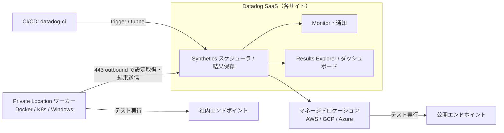
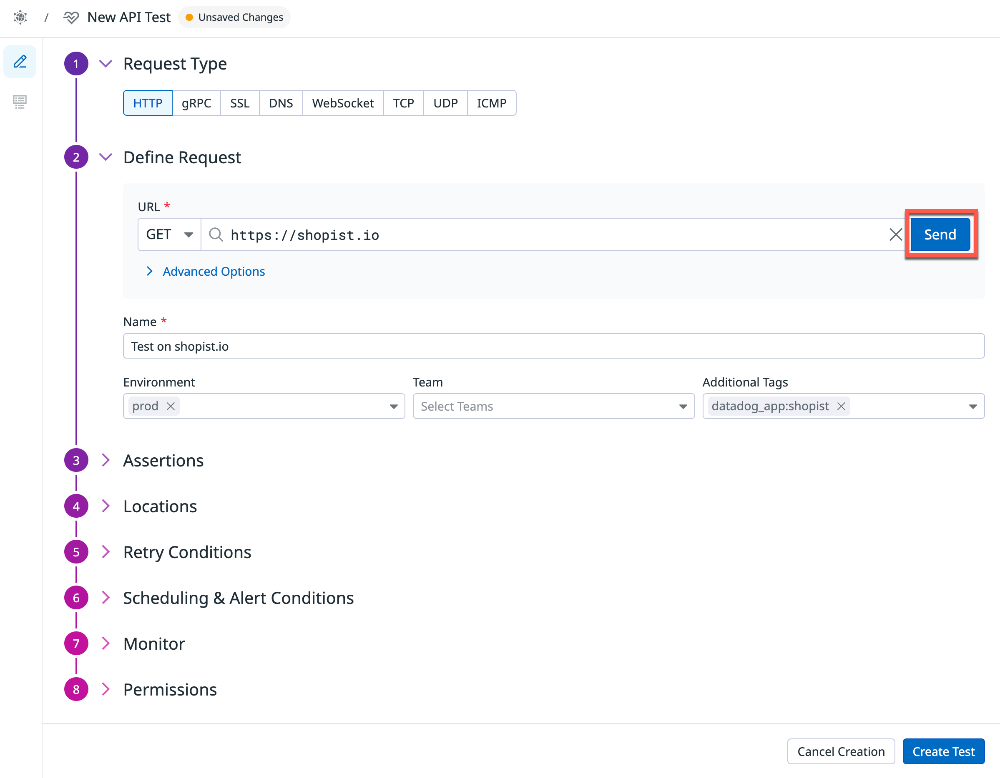
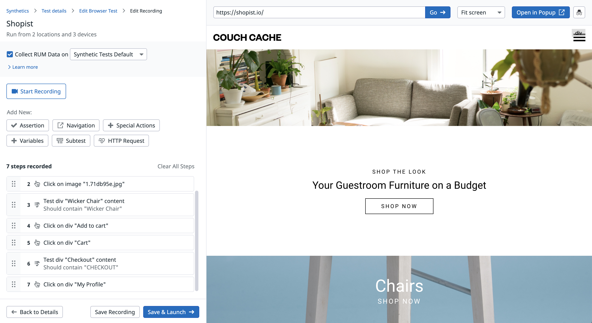
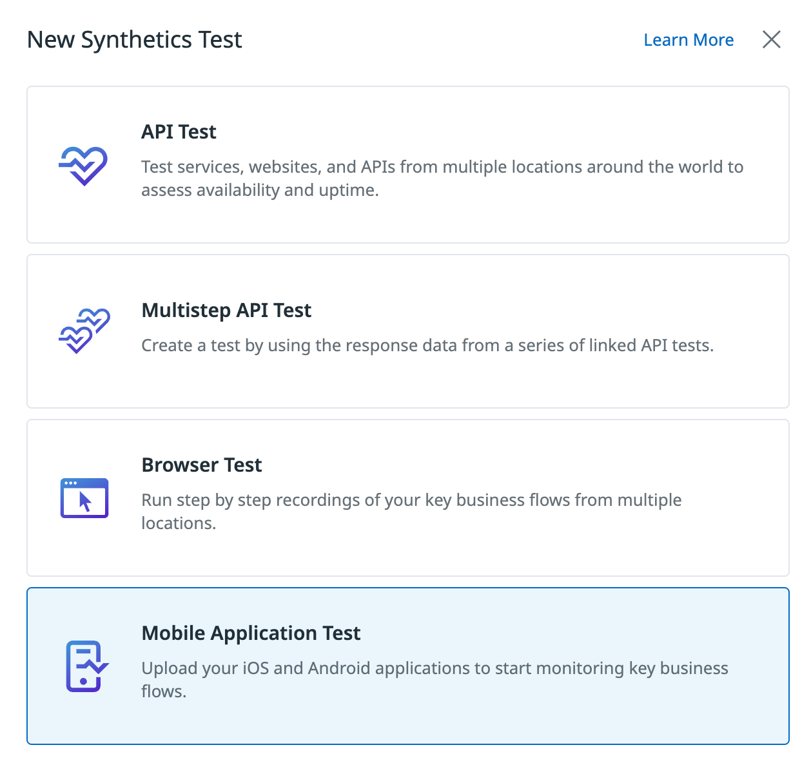
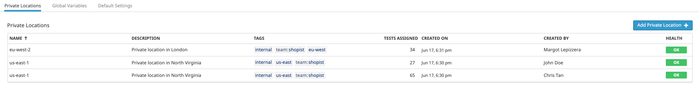
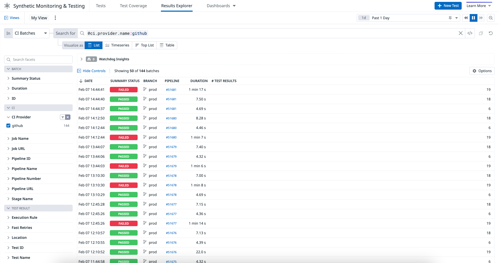

# Synthetic Monitoring（外形監視・合成監視）

## 概要

Datadog Synthetic Monitoring（シンセティックモニタリング、外形監視）は、世界各地の Datadog 管理ロケーション（managed locations）または利用者のネットワーク内に設置する Private Location（プライベートロケーション）から、模擬リクエスト・模擬ユーザー操作を定期実行し、Web ページ・API・ネットワーク層・モバイルアプリの可用性と性能を監視する製品である。障害（回帰、機能破損、応答遅延、想定外のステータスコード）を検知してアラートを出す。テストは Datadog の UI、API、Terraform のいずれでも作成できる。[出典](https://docs.datadoghq.com/synthetics/)

Synthetic Monitoring は Datadog の Digital Experience Monitoring（DEM）領域に属し、[RUM（ブラウザ）](./rum-browser.md)・[RUM（モバイル）](./rum-mobile.md)・[Session Replay と Product Analytics](./session-replay-and-product-analytics.md) と連携する。同じテストを CI/CD パイプラインから実行する仕組みを **Continuous Testing** と呼ぶ。

本ファイルが扱う範囲:

| 区分 | 内容 |
|---|---|
| API テスト | HTTP、SSL、DNS、TCP、UDP、ICMP、WebSocket、gRPC（単一リクエスト） |
| Multistep API テスト | 複数リクエストの連鎖、変数の受け渡し |
| Browser テスト | Chrome 拡張でのレコーディングによる E2E ブラウザ操作テスト |
| Mobile App Testing | iOS / Android 実機上のモバイルアプリテスト |
| Private Locations | 社内ネットワークから実行するためのワーカー |
| ロケーション一覧 | マネージドロケーション（AWS / GCP / Azure） |
| Continuous Testing | CI/CD 実行、並列実行（Parallel Testing）、トンネル |
| 関連機能 | Network Path テスト、Test Suites、Bits Testing、Goal-Based Testing、APM/RUM 連携 |
| 課金 | テスト実行回数（test run）単位の課金 |

Synthetic Monitoring のテスト種別一覧（公式トップページ記載）[出典](https://docs.datadoghq.com/synthetics/):

| テスト種別 | 説明 |
|---|---|
| API tests | HTTP、SSL、DNS、WebSocket、TCP、UDP、ICMP、gRPC の単一リクエスト |
| Multistep API tests | 連鎖したリクエスト |
| Browser tests | Web ページのエンドツーエンド体験 |
| Mobile application tests | iOS / Android の各種デバイス上のアプリ |
| Network path tests | TCP/UDP/ICMP によるパケット経路の可視化 |
| Bits Testing | AI エージェントがユーザージャーニーを探索しテストを生成 |
| Goal-Based tests | 非決定的（エージェント型）テスト。ユーザーが目的を達成できるかを検証 |



## 共通概念

### 実行トリガー

すべての API / Multistep / Browser テストは以下の3通りで実行できる。[出典](https://docs.datadoghq.com/synthetics/api_tests/http_tests/)

| 実行方式 | 説明 |
|---|---|
| Scheduled（スケジュール） | 設定した頻度で定期実行。監視用途 |
| CI/CD pipelines | `datadog-ci` 等からパイプライン内で実行（Continuous Testing） |
| On-demand | 必要時に手動・API で実行 |

### 実行頻度（Frequency）

| 項目 | 値 | 出典 |
|---|---|---|
| API の `tick_every`（秒） | 最小 30、最大 604800（= 7日） | [OpenAPI 定義](https://github.com/DataDog/datadog-api-client-go/blob/master/.generator/schemas/v1/openapi.yaml) |
| Browser テスト | 「1分ごと〜週1回」 | [出典](https://docs.datadoghq.com/synthetics/browser_tests/) |
| API テストの Performance スニペット | 最短頻度 1 分を設定 | [出典](https://docs.datadoghq.com/synthetics/api_tests/http_tests/) |
| Mobile App テスト | 既定は on-demand。最短の基本間隔は 15 分（Uptime スニペット） | [出典](https://docs.datadoghq.com/mobile_app_testing/) |
| Advanced scheduling | 曜日ごとの時間帯（`timeframes`）とタイムゾーンを指定して実行時間帯を限定可能（API の `options.scheduling`） | [OpenAPI 定義](https://github.com/DataDog/datadog-api-client-go/blob/master/.generator/schemas/v1/openapi.yaml) |

> 注: UI のプルダウンで選べる具体的な頻度の選択肢一覧は、公開ドキュメントでは確認できず。API 上の下限 30 秒が全テスト種別の UI で選択可能かどうかも公開情報では確認できず。

### アラート条件（Alerting rule）と Fast retry

Synthetic テストは保存すると Synthetic 専用の Monitor（モニター）として扱われ、通知・再通知・Downtime（ダウンタイム）の対象になる。Monitor 全般は [Monitors](../platform/monitors.md)、通知と Downtime は [通知と Downtime](../platform/notifications-and-downtimes.md) を参照。

| 設定 | 内容 | API フィールド |
|---|---|---|
| Alerting rule | 「X 分間、N 拠点中 n 拠点以上でいずれかのアサーションが失敗」したらアラート。条件は (1) 直近 X 分間に少なくとも1拠点が失敗、(2) その期間のある時点で n 拠点以上が同時に失敗、の両方 | `min_failure_duration`、`min_location_failed` |
| Fast retry | 失敗時に Y ミリ秒間隔で X 回再試行してから拠点を失敗扱いにする | `retry.count`（既定 0）、`retry.interval`（既定 300 ms） |
| Renotification | 失敗継続時の再通知間隔（分）、X 回で再通知停止 | `monitor_options.renotify_interval`、`renotify_occurrences` |
| Monitor priority | 1（高）〜5（低） | `monitor_priority` |
| Monitor name | アラートタイトル・ダッシュボード・SLO で使われる名前 | `monitor_name` |
| 通知プリセット | `show_all`、`hide_all`、`hide_query`、`hide_handles`、`hide_query_and_handles`、`show_only_snapshot`、`hide_handles_and_footer` | `monitor_options.notification_preset_name` |
| Bits AI 自動調査 | アラート時に Bits AI が自動調査するか | `bits_ai_auto_investigate` |
| Downtime | 既存の Synthetics 用 Downtime を選択してテストを一時停止。Downtime はテスト作成フォームでは作れず Settings 側で作成 | — |

出典: [HTTP テスト](https://docs.datadoghq.com/synthetics/api_tests/http_tests/)、[OpenAPI 定義](https://github.com/DataDog/datadog-api-client-go/blob/master/.generator/schemas/v1/openapi.yaml)

Fast retry と Monitor ステータスの関係 [出典](https://docs.datadoghq.com/synthetics/guide/synthetic-test-retries-monitor-status/):

- Fast retry の結果はロケーション単位の評価（local group evaluation）に反映される。
- テスト全体の評価（total group evaluation）に使われるのは最終リトライの結果のみで、元の実行と途中のリトライは評価から除外される。
- 最大リトライ後も失敗した実行は最終結果として扱われる。
- 最終結果のタイムスタンプは元の予定時刻ではなくリトライ時刻になる。
- `retry.count` の上限値は公開情報では確認できず。

### 通知メッセージ

- 事前入力（pre-filled）のモニターメッセージ: 標準化されたタイトル・サマリー・メタデータフッターが入る。
- テンプレート変数は `synthetics.attributes` から取得でき、Handlebars テンプレートによる高度な記述が可能。
- 条件付き変数: `is_alert`、`is_recovery`、`is_renotify`、`is_priority`。
- 結果や失敗条件に応じた条件分岐アラート（conditional alerting）に対応。

[出典](https://docs.datadoghq.com/synthetics/)、[出典](https://docs.datadoghq.com/synthetics/api_tests/http_tests/)

### 変数（Variables）

| 種類 | 内容 |
|---|---|
| ローカル変数（組み込み関数） | `numeric(n)`、`alphabetic(n)`、`alphanumeric(n)`、`date(n unit, format)`、`timestamp(n, unit)`、`uuid`、`public-id`、`result-id` |
| フィルター | `urlEncode`、`urlDecode`、`base64Encode`、`base64Decode`（1参照につき1つ、大文字小文字を区別） |
| 難読化 | 「Hide and obfuscate variable value」で結果上の値を隠す |
| Global variables | Settings で定義し、URL・Advanced options・アサーション・レコーディングで `{{ VAR }}` として参照 |

Global variables の種類 [出典](https://docs.datadoghq.com/synthetics/platform/settings/):

| 種類 | 内容 |
|---|---|
| Specify Value | 固定値。組み込み関数も利用可 |
| Create From Test | HTTP テストのレスポンスヘッダー・ボディ・ステータスコード、または Multistep API テストの抽出変数から値を取得。ソーステスト実行ごとに更新。ボディは正規表現・JSONPath・XPath・全文で抽出 |
| MFA Token | シークレットキーまたは QR コードから TOTP を生成（SHA1 のみ対応） |
| Virtual Authenticator | Browser テスト用にパスキーを生成・保存する仮想認証器 |

- 変数名は英大文字・数字・アンダースコアのみで一意である必要がある。
- Global variable ごとに Restrict access（ロール・チーム・ユーザー単位で Viewer / Editor / No access）を設定できる。制限しても既存テストで使用中の変数名は隠れない。
- Global variables の最大数・値の最大長は公開情報では確認できず。

### 権限（RBAC）

| 対象 | 既定 | カスタムロールに必要な権限 |
|---|---|---|
| テストの作成・編集・削除 | Datadog Admin / Datadog Standard | `synthetics_read`、`synthetics_write` |
| Default Settings・Global Variables ページ | Datadog Admin / Datadog Standard | `synthetics_default_settings_read`、`synthetics_default_settings_write` |
| Continuous Testing の並列度変更 | — | `billing_edit` |
| テスト単位のアクセス制限 | Viewer（構成の閲覧）/ Editor（構成の閲覧・編集、結果閲覧、実行）をロール・チーム・ユーザー単位で付与 | Restriction policies API で管理（旧 `restricted_roles` は非推奨） |

出典: [HTTP テスト](https://docs.datadoghq.com/synthetics/api_tests/http_tests/)、[Settings](https://docs.datadoghq.com/synthetics/platform/settings/)、[Continuous Testing Settings](https://docs.datadoghq.com/continuous_testing/settings/)。ロール全般は [組織・ユーザー・権限管理](../platform/account-and-access-management.md) を参照。

> 注: 公式 HTTP テストページの Viewer / Editor の説明は表記上の揺れがあり（Viewer が「view and edit configuration」と記載）、厳密な権限境界は UI で確認すること。

## API テスト

API テストは1回の実行で1リクエストを送る単一リクエスト型テストで、ネットワークの各層（HTTP、SSL、DNS、WebSocket、TCP、UDP、ICMP、gRPC）を対象にする。ビジネストランザクションや認証付きエンドポイントのように複数リクエストが必要な場合は Multistep API テストを使う。[出典](https://docs.datadoghq.com/synthetics/api_tests/)



- **キャプション:** Synthetic Monitoring の「New API Test」作成画面（HTTP を選択した状態）。
- **画面説明:** 左側に番号付きの縦ステップが並ぶ。①Request Type でタブ「HTTP / gRPC / SSL / DNS / WebSocket / TCP / UDP / ICMP」からテストのサブタイプを選択。②Define Request で HTTP メソッド（GET 等）と URL を入力し「Send」でリクエストを試行、その下に「Advanced Options」の展開リンク。テスト名（Name、必須）、Environment（`env` タグ、例: `prod`）、Team、Additional Tags を入力する。以降、③Assertions、④Locations、⑤Retry Conditions、⑥Scheduling & Alert Conditions、⑦Monitor、⑧Permissions の各セクションが続き、右下の「Create Test」で保存する。
- **出典:** https://docs.datadoghq.com/getting_started/synthetics/api_test/ 掲載画像（https://docs.dd-static.net/images/getting_started/synthetics/api-test-config-4.7ab513fd164d341c7f31c4749a240ab8.png）、取得日 2026-11-03。

### API テスト共通の制限

| 項目 | 値 | 出典 |
|---|---|---|
| アサーション数 | 1テストあたり最大 20、最低 1（単一 API テスト） | [HTTP](https://docs.datadoghq.com/synthetics/api_tests/http_tests/) ほか各サブタイプページ |
| OR 条件 | 不可。正規表現の `matches` で `(200\|302)` のように表現 | 同上 |
| ボディアサーションなしの場合 | レスポンスボディは破棄され、応答時間のみ記録 | [DNS](https://docs.datadoghq.com/synthetics/api_tests/dns_tests/) |
| ボディアサーションありでタイムアウト到達 | `Assertions on the body/response cannot be run beyond this limit` エラー | [HTTP](https://docs.datadoghq.com/synthetics/api_tests/http_tests/) |
| タイムアウト | 秒単位で設定（`request.timeout`）。Multistep API のリクエストタイムアウト既定は 60 秒。単一 API テストの既定値・上限値は公開ドキュメントでは確認できず | [Multistep](https://docs.datadoghq.com/synthetics/multistep/) |
| 既定の `user-agent` | `Datadog/Synthetics`（上書き可） | [出典](https://docs.datadoghq.com/synthetics/guide/identify_synthetics_bots/) |

### HTTP テスト

HTTP テストは Web サイト・API エンドポイントに HTTP(S) リクエストを送り、ステータスコード・ヘッダー・ボディ・応答時間を検証する。[出典](https://docs.datadoghq.com/synthetics/api_tests/http_tests/)

#### リクエスト設定

| 項目 | 内容・値 |
|---|---|
| メソッド | `GET`、`POST`、`PATCH`、`PUT`、`HEAD`、`DELETE`、`OPTIONS` |
| URL | `http` / `https`。Global variables 使用可 |
| HTTP version | `HTTP/1.1 only`、`HTTP/2 only`、`HTTP/2 fallback to HTTP/1.1`（API 値 `http1` / `http2` / `any`）。Akamai・CloudFront・Fastly 等 CDN 配下では断続的エラー回避のため `HTTP/2 only` か `HTTP/1.1 only` を推奨 |
| Follow redirects | 有効時、最大 10 リダイレクトまで追従 |
| Ignore server certificate error | SSL 証明書検証エラーでも接続継続 |
| Timeout | 秒 |
| Request headers | 追加・既定値（`user-agent` 等）の上書き |
| Cookies | `NAME1=VALUE1; NAME2=VALUE2` 形式 |
| Query parameters | エンコードが必要な名前/値ペアを追加 |
| Proxy | `http://<USER>:<PWD>@<IP>:<PORT>`、プロキシ向けヘッダー |
| Privacy | 「Do not save response body」でレスポンスボディを保存しない（JavaScript アサーション失敗メッセージも切り詰め） |
| JavaScript（pre-request） | リクエスト送信前に実行し変数を定義 |

#### 認証方式

| 方式 | 詳細 |
|---|---|
| Client certificate（mTLS） | PEM 形式の `.crt` と `.key` をアップロード（PKCS12 は `openssl pkcs12` で変換） |
| HTTP Basic Auth / Digest Auth | ユーザー名・パスワード |
| NTLM | NTLMv2 / NTLMv1 |
| AWS Signature v4 | Access Key ID / Secret Access Key。基本的な SigV4 のみ対応。S3 の単一チャンクリクエストには `x-amz-content-sha256` ヘッダーが必要 |
| OAuth 2.0 | Client credentials / Resource owner password グラント。Access token URL 必須。資格情報は Basic 認証ヘッダーまたはボディで送信。audience・resource・scope は任意 |
| JWT | `HS256`（テキストシークレット）、`RS256` / `ES256`（PEM 秘密鍵）。`iat`・`exp` 自動付与（既定有効期限 3600 秒）、`kid`・`x5t` 等のカスタムヘッダー可、トークンプレフィックス既定 `Bearer` |

#### リクエストボディ

| Body type | サイズ上限 |
|---|---|
| `application/json`、`application/x-www-form-urlencoded`、`text/html`、`text/plain`、`text/xml`、`GraphQL` | 50 KB |
| `application/octet-stream` | 1ファイル 3 MB |
| `multipart/form-data` | 最大 3 ファイル、各 3 MB |
| `None` | — |

#### アサーション

| 種類 | 演算子 | 値 |
|---|---|---|
| `body` | `contains`、`does not contain`、`is`、`is not`、`matches`、`does not match`、`jsonpath`、`xpath`、`jsonschema` | 文字列・正規表現 |
| `body hash` | `md5`、`sha1`、`sha256` | ハッシュ値 |
| `header` | `contains`、`does not contain`、`is`、`is not`、`matches`、`does not match`、`does not exist`、`is less than`、`is less than or equal`、`is more than`、`is more than or equal` | 文字列・数値 |
| `response time` | `is less than` | 整数（ms） |
| `status code` | `is`、`is not`、`matches`、`does not match` | 整数・正規表現 |

- JavaScript アサーション: Chai ライブラリ（`dd.expect()`、`dd.should`、`dd.assert()`）。JSON は `JSON.parse(dd.response.body)` で解析。アサーション内から追加の HTTP リクエストは送れない。
- 対応する圧縮形式: `br`、`deflate`、`gzip`、`identity`。
- アサーション成功時、ボディは先頭 50 文字のみ表示。ボディアサーション失敗時のみボディ全体が返る。

[出典](https://docs.datadoghq.com/synthetics/api_tests/http_tests/)

### SSL テスト

SSL テストは SSL/TLS 証明書の有効性・有効期限・TLS バージョンを検証する。[出典](https://docs.datadoghq.com/synthetics/api_tests/ssl_tests/)

| 設定 | 内容 | 既定 |
|---|---|---|
| Host / Port | 対象 | Port `443` |
| Accept self-signed certificates | 自己署名証明書エラーを無視（API: `accept_self_signed`） | — |
| Fail on revoked certificate in stapled OCSP | OCSP stapling で失効なら失敗（API: `checkCertificateRevocation`）。CRL チェックの記載なし | — |
| Fail on incomplete certificate chain | AIA による中間証明書取得を無効化（API: `disableAiaIntermediateFetching`） | — |
| Server Name（SNI） | TLS ハンドシェイクのサーバー名 | Host の値 |
| Client certificate（mTLS） | PEM の `.crt`・`.key` | — |
| Timeout | 秒 | 公開情報では確認できず |

| アサーション | 演算子 | 値 |
|---|---|---|
| Certificate | `expires in more than`、`expires in less than` | 日数 |
| Property | `contains`、`does not contain`、`is`、`is not`、`matches`、`does not match` | 文字列・正規表現 |
| Response time | `is less than` | ms |
| Maximum TLS version | `is less than`、`is less than or equal`、`is`、`is more than`、`is more than or equal` | 小数 |
| Minimum TLS version | `is more than`、`is more than or equal` | 小数 |

### DNS テスト

DNS テストは名前解決の可否・レコード内容・応答時間を検証する。[出典](https://docs.datadoghq.com/synthetics/api_tests/dns_tests/)

| 設定 | 内容 | 既定 |
|---|---|---|
| Domain | 問い合わせる名前 | — |
| DNS Server | ドメイン名または IP（任意） | 未指定時 `8.8.8.8` → `1.1.1.1` → AWS 内部 DNS の順にフォールバック |
| DNS Server Port | 任意 | `53` |
| Timeout | 秒（任意） | 公開情報では確認できず |
| プロトコル（UDP/TCP の選択） | — | 公開情報では確認できず |

| アサーション | 演算子 | 備考 |
|---|---|---|
| Response time | `is less than` | ms |
| Every available record（レコードタイプ別） | `is`、`contains`、`matches`、`does not match` | 全レコードが条件を満たす |
| At least one record（レコードタイプ別） | `is`、`contains`、`matches`、`does not match` | いずれか1件が満たす |

- 対応レコードタイプ: `A`、`AAAA`、`CNAME`、`MX`、`NS`、`TXT`。`SOA` はテスト不可。

### TCP テスト

TCP テストはホスト・ポートへの TCP 接続確立を検証する。[出典](https://docs.datadoghq.com/synthetics/api_tests/tcp_tests/)

| 設定 | 内容 |
|---|---|
| Host / Port | 接続先 |
| Track number of network hops (TTL) | 有効化でネットワークホップのアサーションと TCP Traceroute が利用可能（API: `shouldTrackHops`） |
| Timeout | 秒（任意） |

| アサーション | 演算子 | 値 |
|---|---|---|
| Response time | `is less than` | ms |
| Network hops | `is less than`、`is less than or equal`、`is`、`is more than`、`is more than or equal` | 整数 |
| Connection | `is` | `established`、`refused`、`timeout` |

### UDP テスト

UDP テストは指定ホスト・ポートへ文字列メッセージを送り、応答を検証する。[出典](https://docs.datadoghq.com/synthetics/api_tests/udp_tests/)

| 設定 | 内容 |
|---|---|
| Host / Port | 宛先 |
| Message | 送信する文字列 |
| Timeout | 秒（任意） |

| アサーション | 演算子 | 値 |
|---|---|---|
| Response time | `is less than` | ms |
| String response | `contains`、`does not contain`、`is`、`is not`、`matches`、`does not match` | 文字列・正規表現 |

### ICMP テスト

ICMP テストは ping による到達性・遅延・パケットロスを検証する。[出典](https://docs.datadoghq.com/synthetics/api_tests/icmp_tests/)

| 設定 | 内容 | 既定・範囲 |
|---|---|---|
| Domain / IP | 対象 | — |
| Track number of network hops (TTL) | traceroute プローブでゲートウェイを探索 | 任意 |
| Number of pings | 1テストセッションあたりの ping 数（API: `numberOfPackets`） | 既定 4、最大 10（API 定義上 0〜10） |

| アサーション | 集計 | 値 |
|---|---|---|
| Latency | `avg`、`max`、`min`、`stddev`（ジッター） | ms |
| Packet loss | — | % |
| Packet received | — | 整数 |
| Network hops | — | 整数 |

- 演算子は全種類共通で `is less than`、`is less than or equal`、`is`、`is more than`、`is more than or equal`。
- 「Test Host」実行後、Latency・Packet loss・Packet received の基本アサーションが自動追加される。

### WebSocket テスト

WebSocket テストは WebSocket 接続を開き、メッセージ送信と応答を検証する。[出典](https://docs.datadoghq.com/synthetics/api_tests/websocket_tests/)

| 設定 | 内容 |
|---|---|
| URL | 接続先（Global variables 使用可） |
| Message | 送信文字列 |
| Request headers / Cookies | 接続開始の HTTP リクエストに付与（`user-agent` 上書き可） |
| Authentication | HTTP Basic Auth |
| Timeout | 秒 |

| アサーション | 演算子 |
|---|---|
| Response time | `is less than`（ms） |
| String response | `contains`、`does not contain`、`is`、`is not`、`matches`、`does not match` |
| Header | `contains`、`does not contain`、`is`、`is not`、`matches`、`does not match` |

- メッセージサイズの上限は公開情報では確認できず。

### gRPC テスト

gRPC テストは gRPC サーバーに対する Health Check または Behavior Check を行う。[出典](https://docs.datadoghq.com/synthetics/api_tests/grpc_tests/)

| 種別 | 内容 |
|---|---|
| Behavior Check | unary 呼び出しを送り、レスポンス・メタデータ・応答時間を検証。スキーマは Server Reflection または `.proto` ファイルのアップロード。**ストリーミングメソッドは非対応** |
| Health Check | 標準の gRPC health checking protocol を使用。`.proto` 不要。Service name 未指定でサーバー全体をチェック |

| 設定 | 内容 | 既定 |
|---|---|---|
| Host / Port | 接続先 | Port `50051` |
| Timeout | 秒 | — |
| Ignore server certificate error | 証明書検証エラーを無視 | — |
| gRPC metadata | キー・値のメタデータ | — |
| Client certificate（mTLS） | PEM の `.crt`・`.key` | — |

| アサーション | Behavior Check | Health Check |
|---|---|---|
| Response time | `is less than` | `is less than` |
| gRPC response | `contains`、`does not contain`、`is`、`is not`、`matches`、`does not match`、`jsonpath`、`xpath` | — |
| Healthcheck status | — | `is`、`is not` |
| gRPC metadata | `is`、`is not`、`contains`、`does not contain`、`matches regex`、`does not match regex`、`does not exist` | 同左 |

## Multistep API テスト

Multistep API テストは複数の API リクエストを連鎖させ、前のステップのレスポンスから抽出した値を後続ステップで使うことで、認証フローやビジネストランザクションを検証する。[出典](https://docs.datadoghq.com/synthetics/multistep/)

| 項目 | 内容・値 |
|---|---|
| ステップのリクエスト種別 | HTTP、gRPC、SSL、DNS、WebSocket、TCP、UDP、ICMP |
| Wait ステップ | 0〜180 秒待機（API 定義 `SyntheticsAPIWaitStep`）[OpenAPI 定義](https://github.com/DataDog/datadog-api-client-go/blob/master/.generator/schemas/v1/openapi.yaml) |
| ステップ数 | 既定で最大 10。サポートへの依頼で引き上げ可 |
| アサーション | Multistep では任意（単一 API テストでは必須） |
| 変数抽出 | 1ステップあたり最大 10 変数。ヘッダー（全体または正規表現）、ボディ（全体、正規表現、JSONPath、XPath）から抽出 |
| 変数名 | 英大文字・数字・アンダースコア、3文字以上 |
| 成功時の動作 | 次ステップへ進む／テストを終了し成功扱い |
| 失敗時の動作 | 「If step fails, continue to next step」で後続（クリーンアップ等）を継続可能 |
| ステップ単位のリトライ | 失敗時に Y ms 後 X 回再試行 |
| リクエストタイムアウト | 既定 60 秒 |
| テスト全体の実行タイムアウト | 30 分 |
| Subtest | 他の Multistep API テストをサブテストとして組込み可能（最大 2 階層）。単一 API テストはサブテスト化不可。親テストで同名変数を定義すると上書き（最初に代入された値が使われる）。一時停止したサブテストも親からは実行される |

> 補足: API 定義（OpenAPI）では Multistep のステップ subtype に `mcp`（MCP サーバーへの `init` / `tool_list` / `tool_call` 呼び出し）が列挙されている。[OpenAPI 定義](https://github.com/DataDog/datadog-api-client-go/blob/master/.generator/schemas/v1/openapi.yaml) ただし公式ドキュメント本文での機能説明・提供ステータスは公開情報では確認できず。

## Browser テスト

Browser テストは、Chrome 拡張でレコーディングしたユーザー操作シナリオを Datadog 管理の実ブラウザで再生し、Web アプリケーションのエンドツーエンド体験を検証する。[出典](https://docs.datadoghq.com/synthetics/browser_tests/)



- **キャプション:** Browser テストの「Edit Recording」画面。
- **画面説明:** 上部パンくずは「Synthetics > Test details > Edit Browser Test > Edit Recording」。左ペインにテスト名と「Run from 2 locations and 3 devices」の実行条件、「Collect RUM Data on（Synthetic Tests Default）」チェックボックス、「Start Recording」ボタン、手動追加用ボタン群「Assertion / Navigation / Special Actions / Variables / Subtest / HTTP Request」が並び、その下に記録済みステップ一覧（例: 「Click on div "Add to cart"」「Test div "Checkout" content — Should contain "CHECKOUT"」）がドラッグで並べ替え可能な形で表示される。右ペインは対象サイトのプレビュー（URL 入力欄、Go、表示サイズ、「Open in Popup」）。下部に「Back to Details」「Save Recording」「Save & Launch」。
- **出典:** https://docs.datadoghq.com/synthetics/browser_tests/ 掲載画像（https://docs.dd-static.net/images/synthetics/browser_tests/browser_check_record_test.51a8806df6633a177e0b7d213063a794.png）、取得日 2026-11-03。

### ブラウザ・デバイス

| 項目 | 内容 |
|---|---|
| ブラウザ | Google Chrome、Mozilla Firefox、Microsoft Edge |
| デバイス（ビューポート） | Laptop Large 1440×1100 px、Tablet 768×1020 px、Mobile Small 320×550 px |
| API でのデバイス指定 | `options.device_ids`（例: `chrome.laptop_large`） |
| 課金への影響 | ブラウザ×デバイス×ロケーションの組合せごとに実行回数が増える（課金節参照） |

[出典](https://docs.datadoghq.com/synthetics/browser_tests/)、[Settings](https://docs.datadoghq.com/synthetics/platform/settings/)

### レコーディング要件

- Google Chrome に「Datadog Record Test」拡張をインストールして記録する。Edge では「Allow extensions from other stores」を有効にして Chrome 拡張を導入可能。
- タブ切り替えは記録可能だが、アサーション前にページ操作（クリック等）が必要。
- テストはアサーションで終えることが推奨。
- ステップ単位の再生（step replay）には拡張が必要。JavaScript ステップとキー入力シミュレーションには debugger 権限が必要。メール関連ステップとファイルアップロードは step replay 非対応。

[出典](https://docs.datadoghq.com/synthetics/browser_tests/)

### テスト全体の Advanced options

| オプション | 内容 | 既定 |
|---|---|---|
| Request headers | ブラウザ既定ヘッダーの追加・上書き（例: User-Agent） | — |
| Cookies | `Set-Cookie` 構文、1行1件 | — |
| HTTP authentication | Basic / Digest / NTLM、全ステップに適用 | — |
| Proxy | `http://<USER>:<PWD>@<IP>:<PORT>`、Global variables 可 | — |
| Client certificate | PEM のみ。既定は開始 URL のドメインに適用、ワイルドカード可、追加ドメイン指定可（`certificateDomains`） | 開始 URL ドメイン |
| Ignore server certificate error | 証明書エラーを無視 | — |
| Disable CORS / Disable CSP | CORS・CSP によるブロックを回避 | — |
| Capture HTTP payloads | Fetch/XHR のリクエスト/レスポンスのヘッダー・ボディを取得。secret 指定変数以外はマスクされず PII が残りうる。テスト結果と同期間保持 | 無効 |
| Initial navigation timeout | 初回ステップを失敗とするまでの秒数 | 公開情報では確認できず |
| Retry wait | 失敗後リトライまでの待機 | 300 ms |
| Time and language | タイムゾーン・言語（2〜3文字 ISO コード） | UTC、`en` |
| Blocked requests | ワイルドカード対応のリクエストパターンを実行時にブロック（Resources タブで `blocked` 表示） | — |
| Do not capture any screenshots | テスト全体でスクリーンショット取得を無効化（ステップ単位でも可） | 無効 |
| RUM データ収集 | 実行時に RUM SDK でデータ収集、Lighthouse 監査も可能 | — |

- リクエスト系オプションは記録時ではなく実行時に適用される。

[出典](https://docs.datadoghq.com/synthetics/browser_tests/)

### ステップの種類

| 区分 | ステップ |
|---|---|
| 自動記録 | Click（通常・ダブル・右クリック）、Type text、Select option、Upload file、Drag and drop |
| Assertion（要素） | 要素の内容、属性、存在、チェックボックス/ラジオの状態 |
| Assertion（ページ） | テキストの有無、現在 URL |
| Assertion（特殊） | メール受信、カスタム JavaScript、ファイルダウンロード、HTTP リクエスト数 |
| Navigation | ページ更新、メール内リンクへ移動、URL へ移動 |
| Special actions | Hover、Press key、Scroll、Wait（自動記録されないため手動追加） |
| HTTP Request | ブラウザテスト内から API を呼び、アサーションと変数抽出 |
| Variables | Pattern（numeric 等）、要素テキスト、メール本文、JavaScript、Global、Global MFA（TOTP）、メールアドレス |
| Subtest | 既存 Browser テストの再利用、または現在のテストからステップを切り出し。最大 2 階層 |

API の step type 列挙値: `assertCurrentUrl`、`assertElementAttribute`、`assertElementContent`、`assertElementPresent`、`assertEmail`、`assertFileDownload`、`assertFromJavascript`、`assertPageContains`、`assertPageLacks`、`assertRequests`、`click`、`drag`、`drop`、`extractFromJavascript`、`extractFromEmailBody`、`extractVariable`、`goToEmailLink`、`goToUrl`、`goToUrlAndMeasureTti`、`hover`、`playSubTest`、`pressKey`、`refresh`、`runApiTest`、`scroll`、`selectOption`、`typeText`、`uploadFiles`、`wait`。[OpenAPI 定義](https://github.com/DataDog/datadog-api-client-go/blob/master/.generator/schemas/v1/openapi.yaml)

[出典](https://docs.datadoghq.com/synthetics/browser_tests/test_steps/)

### ステップの制限値・既定値

| 項目 | 値 |
|---|---|
| ステップタイムアウト | 既定 60 秒、最大 300 秒（ステップごとに設定） |
| Wait ステップ | 最大 300 秒（実行時間に毎回加算） |
| 記録された Upload file | 最大 10 ファイル、各 5 MB |
| HTTP Request ステップのボディ | 50 KB、ファイルアップロード 3 MB |
| HTTP Request ステップのアサーション | 1ステップ最大 25 |
| HTTP Request ステップのリダイレクト | 最大 10 |
| Drag and drop の遅延 | pre-drag / pre-drop とも既定 0 ms、操作点は既定 Center |
| Scroll | 既定でページ全体をスクロール |
| ユーザー指定ロケーター | CSS または XPath 1.0。「If user specified locator fails, fail test」が既定で有効（無効化で Datadog の多重ロケーターにフォールバック） |
| 1テストあたりの最大ステップ数 | 公開情報では確認できず（課金上は 25 ステップごとに 1 実行） |

[出典](https://docs.datadoghq.com/synthetics/browser_tests/test_steps/)、[出典](https://docs.datadoghq.com/synthetics/browser_tests/advanced_options/)

### ステップ単位の Advanced options

| オプション | 内容 |
|---|---|
| User specified locator | XPath / CSS を指定。`{{` で変数利用可、Highlight で確認 |
| Timeout | 既定 60 秒、最大 300 秒 |
| If this step fails, continue to next step | 失敗しても後続へ進む（ポップアップ対応等） |
| If this step fails, mark test as failed | サブテストの失敗でテスト全体を失敗にする |
| Always run this step | 前のステップが失敗しても実行（クリーンアップ用途） |
| Exit on success | このステップ成功でテスト終了（残りをスキップし成功扱い） |
| スクリーンショット無効化 | 機密データ保護のためステップ単位で無効化 |
| Subtest window | Main（既定）/ New / Specific window |

[出典](https://docs.datadoghq.com/synthetics/browser_tests/advanced_options/)

### テスト結果画面

| 項目 | 内容 |
|---|---|
| スクリーンショット | ステップごとの画像、説明、URL、ステップ ID、所要時間 |
| Core Web Vitals | ステップ URL ごとの LCP・CLS（FID は RUM 利用時のみ） |
| Errors & Warnings | `js` / `network` エラー（最大 8 件表示） |
| Resources | リクエスト・アセット、CDN プロバイダ（最大 100 件表示、開始時刻順） |
| Traces | APM トレースとの紐付け |
| RUM リンク | RUM Explorer / Session Replay を開く |
| AI failure summaries | 失敗原因の推定と「真の失敗」「テスト設定ミス」の分類、次のアクション提示 |
| Compare Screenshots | 直近の成功実行と並べて比較（バージョン・開始 URL・デバイス・ブラウザ・実行種別が一致する場合） |

[出典](https://docs.datadoghq.com/synthetics/browser_tests/test_results/)

## Mobile App Testing

Mobile App Testing（モバイルアプリテスト）は、Datadog にアップロードした iOS / Android アプリを Datadog 管理の実機上で実行し、主要な業務フローを検証する。[出典](https://docs.datadoghq.com/mobile_app_testing/)



- **キャプション:** 「New Synthetics Test」ダイアログ（テスト種別選択）。
- **画面説明:** 4 つのカードが縦に並ぶ。「API Test」（世界各地から API・サイトの可用性を検証）、「Multistep API Test」（連鎖した API テストのレスポンスデータを使うテスト）、「Browser Test」（業務フローのステップ記録を複数ロケーションから実行）、「Mobile Application Test」（iOS / Android アプリをアップロードして業務フローを監視）。画像では Mobile Application Test が選択状態。
- **出典:** https://docs.datadoghq.com/mobile_app_testing/ 掲載画像（https://docs.dd-static.net/images/mobile_app_testing/new_test_2.385255d3a3c52b1984e58b10d5f574c7.png）、取得日 2026-11-03。

| 項目 | 内容 |
|---|---|
| 対応 OS | iOS、Android |
| アップロード形式 | Android `.apk`、iOS `.ipa`（`.aab` の記載なし） |
| 対応フレームワーク | ネイティブ Android / iOS、React Native（2025年7月から正式サポート）。Flutter は完全には非対応 |
| アプリ管理 | Settings の Mobile Applications List で登録（OS・フレームワーク・名前・`env` タグ）、バージョン追加・削除。テストでは特定バージョン固定または「常に最新」を選択 |
| 実行デバイス | 実機。個別デバイスまたはデバイスファミリー（例: 「Any iPhone Pro」「Any Samsung device」）を指定。ファミリー指定時は空きデバイスで実行 |
| 実行ロケーション | EU（AWS Frankfurt）、US（AWS Oregon）。EU のみ/US のみ/両方を選択。両地域で利用できないデバイスあり |
| 頻度 | 既定は on-demand。スケジュール実行可（Uptime スニペットは 15 分） |
| Retry | 「Retry X times after Y ms」（例: 0 回・300 ms） |
| Advanced options | OS アラートの自動許可、アプリクラッシュの許容（再起動ステップ必須）、ネットワークリクエスト/レスポンスの取得（性能影響・起動失敗の可能性あり）、起動引数（Android: Initial Intent Extras、iOS: Process Arguments） |
| Self-healing | 成功実行後にロケーターを再計算し UI 変更に追随 |
| CI 連携 | `datadog-ci synthetics run-tests`、`mobileApplicationVersionFilePath` で新ビルドを指定、`datadog-ci synthetics upload-application` でバージョン追加 |
| RUM 連携 | アプリに RUM SDK を組み込むと Synthetic と RUM のデータを相互リンク可能 |
| 保持 | アプリバイナリはアカウント存続期間中保持 |

出典: [Mobile App Testing](https://docs.datadoghq.com/mobile_app_testing/)、[Mobile App Tests](https://docs.datadoghq.com/mobile_app_testing/mobile_app_tests/)、[Settings](https://docs.datadoghq.com/mobile_app_testing/settings/)、[データ保持](https://docs.datadoghq.com/data_security/data_retention_periods/)

> **サイト差異:** Mobile App Testing は `app.ddog-gov.com`（US1-FED）および `us2.ddog-gov.com` では提供されない。[出典](https://docs.datadoghq.com/mobile_app_testing/)

- アプリサイズ上限、1アプリあたりのバージョン数上限、ステップ数上限、iOS の署名要件は公開情報では確認できず。

## ロケーション

### マネージドロケーション一覧

Datadog 管理ロケーション（managed locations）はクラウド事業者のリージョン上で稼働し、公開エンドポイントのテストに使う。HTTP テストドキュメント記載のロケーション名と、Synthetics IP レンジファイル（`synthetics.json`、2026-08-12 更新版、US1）のロケーション ID を対応付けたもの。[出典](https://docs.datadoghq.com/synthetics/api_tests/http_tests/)、[IP レンジ](https://ip-ranges.datadoghq.com/synthetics.json)

| 地域 | ロケーション名 | ID（`synthetics.json` のキー） | クラウド |
|---|---|---|---|
| Americas | Canada Central | `aws:ca-central-1` | AWS |
| Americas | Northern California | `aws:us-west-1` | AWS |
| Americas | Northern Virginia | `aws:us-east-1` | AWS |
| Americas | Ohio | `aws:us-east-2` | AWS |
| Americas | Oregon | `aws:us-west-2` | AWS |
| Americas | São Paulo | `aws:sa-east-1` | AWS |
| Asia Pacific | Sydney | `aws:ap-southeast-2` | AWS |
| Asia Pacific | Tokyo | `aws:ap-northeast-1` | AWS |
| Asia Pacific | Hong Kong | `aws:ap-east-1` | AWS |
| Asia Pacific | Jakarta | `aws:ap-southeast-3` | AWS |
| Asia Pacific | Mumbai | `aws:ap-south-1` | AWS |
| Asia Pacific | Osaka | `aws:ap-northeast-3` | AWS |
| Asia Pacific | Seoul | `aws:ap-northeast-2` | AWS |
| Asia Pacific | Singapore | `aws:ap-southeast-1` | AWS |
| EMEA | Paris | `aws:eu-west-3` | AWS |
| EMEA | Stockholm | `aws:eu-north-1` | AWS |
| EMEA | Bahrain | `aws:me-south-1` | AWS |
| EMEA | Cape Town | `aws:af-south-1` | AWS |
| EMEA | Frankfurt | `aws:eu-central-1` | AWS |
| EMEA | Ireland | `aws:eu-west-1` | AWS |
| EMEA | London | `aws:eu-west-2` | AWS |
| EMEA | Milan | `aws:eu-south-1` | AWS |
| Americas | Dallas | `gcp:us-south1` | GCP |
| Americas | Los Angeles | `gcp:us-west2` | GCP |
| Americas | Oregon | `gcp:us-west1` | GCP |
| Americas | Virginia | `gcp:us-east4` | GCP |
| Asia Pacific | Tokyo | `gcp:asia-northeast1` | GCP |
| EMEA | Frankfurt | `gcp:europe-west3` | GCP |
| Americas | Virginia | `azure:eastus` | Azure |

- 合計 29 拠点（AWS 22、GCP 6、Azure 1）。ロケーション名と ID の対応は、AWS/GCP/Azure のリージョンコードと地名から本ナレッジで対応付けたもの【推定】。正確な ID は `GET /api/v1/synthetics/locations` で取得できる。[出典](https://docs.datadoghq.com/api/latest/synthetics/)
- 日本国内のマネージドロケーションは Tokyo（AWS・GCP）と Osaka（AWS）。

> **サイト差異:** US1-FED（Datadog for Government）のマネージドロケーションは US-West のみ。[出典](https://docs.datadoghq.com/synthetics/api_tests/http_tests/)  
> **サイト差異:** Synthetics の送信元 IP レンジは `https://ip-ranges.<YOUR_DATADOG_SITE>/synthetics.json` でサイトごとに公開される（AP1 なら `ip-ranges.ap1.datadoghq.com` 系）。WAF・ボット対策の許可リストに用いる。[出典](https://docs.datadoghq.com/synthetics/guide/identify_synthetics_bots/)  
> 各サイトで選択できるマネージドロケーションに差があるかは、US1-FED 以外について公開情報では確認できず。

### Synthetic トラフィックの識別

| 識別子 | 内容 |
|---|---|
| 送信元 IP | `synthetics.json` の CIDR |
| `user-agent` | API / Multistep: `Datadog/Synthetics`。Browser: ブラウザ・デバイスにより異なるが末尾が `DatadogSynthetics` |
| `x-datadog-origin` | `synthetics`（Browser の APM 連携では `synthetics-browser`） |
| `window._DATADOG_SYNTHETICS_BROWSER` | Datadog ロボットがレンダリング時に `true`（Firefox では実行タイミングにより未設定のことあり）。アナリティクス初期化の抑止に使える |
| Cookie | `datadog-synthetics-public-id`、`datadog-synthetics-result-id`（Firefox は全ステップ、Chrome/Edge は開始 URL のみ） |

[出典](https://docs.datadoghq.com/synthetics/guide/identify_synthetics_bots/)

## Private Locations

Private Location（プライベートロケーション）は、利用者のネットワーク内で Synthetics ワーカー（コンテナまたは Windows サービス）を稼働させ、社内向けアプリ・閉域 API のテストや独自拠点からのテストを実行する仕組み。ワーカーは Datadog から HTTPS で設定をポーリングし、結果を送信する（インバウンド通信不要）。[出典](https://docs.datadoghq.com/synthetics/platform/private_locations/)



- **キャプション:** Synthetic Monitoring Settings の「Private Locations」タブ（一覧）。
- **画面説明:** 上部に「Private Locations / Global Variables / Default Settings」のタブ。表の列は NAME、DESCRIPTION、TAGS、TESTS ASSIGNED（割当テスト数）、CREATED ON、CREATED BY、HEALTH（例: 緑の `OK`）。右上に「Add Private Location」ボタン。現行 UI ではタブ名・列構成が変わっている可能性がある。
- **出典:** https://docs.datadoghq.com/synthetics/ 掲載画像（https://docs.dd-static.net/images/synthetics/private_locations.e50282ca1df64041a30d588375f4e31b.png）、取得日 2026-11-03。

### 導入形態

| 形態 | 要点 |
|---|---|
| Docker | Linux、または Linux コンテナモードの Windows Docker。イメージ `datadog/synthetics-private-location-worker`（FIPS: `datadog/synthetics-private-location-worker-fips`）。Podman 例では `gcr.io/datadoghq/synthetics-private-location-worker:latest` |
| Helm | Linux ベース Kubernetes。チャート `datadog/synthetics-private-location`（リポジトリ `https://helm.datadoghq.com`） |
| Kubernetes / EKS | 設定ファイルを Secret（EKS では ConfigMap も可）として `/etc/datadog/synthetics-check-runner.json` にマウント |
| OpenShift | `anyuid` SCC で実行（Browser テストに必要） |
| ECS（EC2） | タスク定義で実行 |
| Fargate | EC2/FARGATE 互換タスク定義。AWS Secrets Manager 連携可。予約 IP ブロック（ファイアウォール）オプションは使用不可 |
| Windows（MSI） | `datadog-synthetics-worker-<version>.amd64.msi`（ドキュメント記載例は 1.75.0）。Windows Server 2016/2019/2022/2025、Windows 10/11。RAM 最小 4 GB・推奨 8 GB、64bit CPU（2.8 GHz 以上推奨）、PowerShell 有効、.NET 4.7.2 以上 |

Windows 版の Browser テスト対応: ワーカー v1.71.0 以降は Chrome・Firefox を同梱（Edge は別途インストール）、v1.70.0 以前は 3 ブラウザとも自前でインストール。

### ネットワーク要件

| 項目 | 内容 |
|---|---|
| アウトバウンド | 443/TCP で `<YOUR_SYNTHETICS_INTAKE_ENDPOINT>`（サイトごとに異なる）へ。設定取得と結果送信は AWS Signature Version 4 ベースのプロトコル |
| インバウンド | 不要 |
| プロキシ | `http://<USER>:<PWD>@<IP>:<PORT>`（設定ファイルの `proxyDatadog`） |
| FIPS | Linux コンテナは v1.32.0 以降、Windows は v1.63.0 以降（`ENABLE_FIPS=1` と FIPS モードのホスト） |
| 予約 IP のブロック | `enableDefaultBlockedIpRanges: true`（IANA 特殊用途アドレスをブロック）、例外は `allowedIPRanges`。コンテナには `NET_ADMIN` capability が必要。Windows は MSI の `APPLYFIREWALLDEFAULTBLOCKRULES`（ループバックはブロック不可） |
| 独自ルート証明書 | Linux: `.pem` を `/etc/datadog/certs` にマウント（中間→ルートの順）。Windows: `NODE_EXTRA_CA_CERTS` |

> **サイト差異:** EU1（`app.datadoghq.eu`）の Private Location 向けエンドポイントは静的 IP が `ip-ranges.datadoghq.eu` で公開される。US1-FED（`app.ddog-gov.com`）と `us2.ddog-gov.com` では FIPS イメージを使用する。[出典](https://docs.datadoghq.com/synthetics/platform/private_locations/)  
> ネットワーク設計全般は [ネットワーク・接続要件](../../03_導入編/network-and-connectivity.md) を参照。

### 設定ファイルとシークレット

- 作成時に生成される設定ファイルには API キー、アクセスキー/シークレットキー、秘密鍵・公開鍵 PEM、フィンガープリントが含まれる。**Datadog 側では保存されないためローカルで保管が必要**。
- 主な設定キー: `proxyDatadog`、`enableDefaultBlockedIpRanges`、`allowedIPRanges`、`concurrency`。
- ヘルスプローブ: `GET /liveness`、`GET /readiness`（ポート 8080、事前に有効化）。旧方式の `/tmp/liveness.date`（既定 2 秒ごと更新）は非推奨。
- Windows MSI オプション: `CONFIG_FILEPATH`、`APPLYDEFAULTFIREWALLRULES`、`APPLYFIREWALLDEFAULTBLOCKRULES`、`LOGGING_ENABLED`、`LOGGING_VERBOSITY`（既定 `-vvv`）、`LOGGING_MAXDAYS`（既定 7 日）。

[出典](https://docs.datadoghq.com/synthetics/platform/private_locations/)

### サイジング（Dimensioning）

| 区分 | CPU | メモリ | ディスク |
|---|---|---|---|
| ベース（全 Private Location 共通） | 150 mCores | 150 MiB | 記載なし |
| API / Multistep API テスト 1 実行あたり | 100 mCores | 200 MiB | 100 MiB |
| Browser テスト 1 実行あたり | 800 mCores | 1 GiB | 500 MiB |

- `concurrency`（同時実行数）の既定は 10。上限値は公開情報では確認できず。
- Browser テスト計算式: CPU = 150 mCores + 800 mCores × 最大同時実行数、メモリ = 150 MiB + 1 GiB × 最大同時実行数、ディスク = 500 MiB × 最大同時実行数。例: 同時 10 実行で約 8 コア・10 GiB・5 GiB。
- API と Browser を混在させる拠点は Browser の要件でサイジングする。種類別に拠点を分けると効率的。
- 水平スケール: 同じ設定ファイルでワーカーを追加し、`concurrency` を「最大同時実行数 ÷ ワーカー数」にする（例: 2 ワーカーで `concurrency: 5`、各約 4 コア・5 GiB・2.5 GiB）。
- CI/CD からの on-demand 実行のスパイクを考慮する。Continuous Testing の並列化には `concurrency` 設定とワーカー v1.27.0 以降が必要。

[出典](https://docs.datadoghq.com/synthetics/platform/private_locations/dimensioning/)

### Private Location の監視

| メトリクス | 内容 |
|---|---|
| `synthetics.pl.worker.running` | 稼働中ワーカー |
| `synthetics.pl.worker.remaining_slots` | 空きスロット |
| `synthetics.pl.worker.outdated` | 古いイメージで稼働中なら 1 |
| `synthetics.pl.worker.concurrency` | 平均同時実行数 |
| `synthetics.pl.worker.pulled_tests` | ワーカーが取得したテスト数 |
| `synthetics.pl.awaiting_tests` | ポーリング待ちテスト数 |
| `synthetics.pl.time_to_poll` | 予定時刻からポーリングまでの遅延 |

最初の Private Location 作成時に作られる既定モニター（通知先は未設定のため各自追加が必要）:

| モニター | 条件 |
|---|---|
| Stopped reporting | `synthetics.pl.worker.running` が NO DATA |
| Underprovisioned | `remaining_slots` の平均が 30 分間 1.5 未満 |
| Uses an outdated image version | `outdated` が 1 |
| Taking too long to poll | `time_to_poll` の平均が 30 分間 30 秒超 |

[出典](https://docs.datadoghq.com/synthetics/platform/private_locations/monitoring/)、[メトリクス](https://docs.datadoghq.com/synthetics/metrics/)

### アップグレード

- 各 Private Location の歯車アイコン → Installation instructions のコマンドを再実行。Docker の `latest` タグは `--pull=always` でキャッシュ回避。
- `browsers-latest` タグは毎週新しい Chrome/Edge/Firefox で再ビルドされる（日付付き `X.Y.Z-rc.N-browsers-YYYY-MM-DD` で固定可）。マネージドロケーションで検証されていないブラウザ版のため Browser テストが不安定になりうる。

## Continuous Testing

Continuous Testing は Synthetic テストを CI/CD パイプラインから実行し、デプロイ前に回帰を検出する機能群である。本番監視用のテストを変数の上書きで Staging・QA 環境に再利用できる。[出典](https://docs.datadoghq.com/continuous_testing/)、[料金ページ](https://www.datadoghq.com/pricing/?product=synthetic-monitoring)



- **キャプション:** Synthetic Monitoring & Testing の「Results Explorer」で CI Batches を表示した画面。
- **画面説明:** 上部ナビゲーションは「Tests / Test Coverage / Results Explorer / Dashboards」と「+ New Test」。検索バーの左で対象を「CI Batches」に切り替え、クエリ（例: `@ci.provider.name:github`）で絞り込む。「Visualize as」で List / Timeseries / Top List / Table を選択。左のファセットに BATCH（Summary Status、Duration、ID）、CI（CI Provider、Job Name、Pipeline ID/Name/Number/URL、Stage Name）、TEST RESULT（Execution Rule、Fast Retries、Location、Test ID、Test Name）。一覧の列は DATE、SUMMARY STATUS（PASSED / FAILED）、BRANCH、PIPELINE、DURATION、# TEST RESULTS。
- **出典:** https://docs.datadoghq.com/continuous_testing/ 掲載画像（https://docs.dd-static.net/images/continuous_testing/explorer_ci_batches_1.d5b0a754d072c00ed09e370ad1949c98.png）、取得日 2026-11-03。

### CI/CD 連携

| 連携 | 形態 |
|---|---|
| `datadog-ci` | NPM パッケージ（`@datadog/datadog-ci`）の CLI |
| GitHub Actions | Action |
| GitLab | CI 連携 |
| Jenkins | プラグイン |
| CircleCI | Orb |
| Azure DevOps | 拡張機能 |
| Bitrise | `bitrise_upload` / `bitrise_run` |
| Terraform | テスト作成・状態管理（CI プロバイダではない）。[Terraform と IaC](../platform/terraform-and-iac.md) 参照 |

[出典](https://docs.datadoghq.com/continuous_testing/)

### datadog-ci の設定

| 項目 | 内容 | 既定 |
|---|---|---|
| コマンド | `datadog-ci synthetics run-tests`（実行）、`datadog-ci synthetics upload-application`（モバイルアプリのバージョン追加） | — |
| グローバル設定 | `datadog-ci.json`（`--config` / `DATADOG_SYNTHETICS_CONFIG_PATH` で変更） | — |
| テスト設定ファイル | `*.synthetics.json`（`{,!(node_modules)/**/}*.synthetics.json` を自動探索） | — |
| 優先順位（低→高） | Global Config → 環境変数 → CLI パラメータ → Test Config（`proxy` はグローバル設定か `HTTPS_PROXY` のみ） | — |
| `batchTimeout` | CI バッチのタイムアウト | 1800000 ms（30 分） |
| `failOnCriticalErrors` | レート制限・認証失敗等で失敗 | `false` |
| `failOnMissingTests` | テスト不在で失敗 | `false` |
| `failOnTimeout` | バッチタイムアウトで失敗 | `true` |
| `selectiveRerun` | 同一コミットで成功済みテストを再実行しない | `false`（未指定時は組織既定） |
| `tunnel` | Continuous Testing トンネルを使用 | `false` |
| `datadogSite` / `subdomain` | 接続先サイト | `datadoghq.com` / `app` |
| テスト選択 | `publicIds`（`-p`、`id@2` でバージョン指定、Test Suite 指定も可）、`testSearchQuery`（`-s`）、`files`（`-f`） | — |
| レポート | JUnit（`--jUnitReport`）、JSON（`--jsonReport`） | — |

テスト単位の上書き項目（overrides）: `allowInsecureCertificates`、`basicAuth`、`body`、`bodyType`、`cookies`、`setCookies`、`defaultStepTimeout`、`testTimeout`、`deviceIds`、`locations`、`executionRule`（`blocking` / `non_blocking` / `skipped`。`blocking` の失敗でバッチ失敗）、`followRedirects`、`headers`、`mobileApplicationVersion`、`mobileApplicationVersionFilePath`、`resourceUrlSubstitutionRegexes`、`startUrl`、`startUrlSubstitutionRegex`、`retry`、`variables`。

[出典](https://docs.datadoghq.com/continuous_testing/cicd_integrations/configuration/)

### Continuous Testing トンネル

Continuous Testing トンネルは、CI ランナーや開発端末からしか到達できない環境（`localhost`、閉域 Staging）を、マネージドロケーションからテストするための一時的な接続である。[出典](https://docs.datadoghq.com/continuous_testing/environments/proxy_firewall_vpn/)

| 項目 | 内容 |
|---|---|
| 仕組み | `datadog-ci` が署名付き URL を取得 → マネージドロケーションへ WSS 接続 → WebSocket 上で SSH を通す。DNS 解決もトンネル経由 |
| 要件 | `@datadog/datadog-ci` 0.11.0 以降、`--tunnel` フラグ、443 番アウトバウンド |
| 対応テスト | HTTP テスト、Browser テスト |
| 実行ロケーション | アカウントのサイトに応じたロケーションに上書きされる |
| 用途の制約 | 短時間接続向け。長期の定期監視には Private Location を推奨 |

> **サイト差異:** US1（`app.datadoghq.com`）ではトンネル利用時に `intake.synthetics.datadoghq.com` への到達も必要。EU1 のトンネルサービスは `.com` ドメインだが AWS Frankfurt でホストされる。

### 並列実行（Parallelization）

| 項目 | 内容 |
|---|---|
| 既定 | CI/CD 内のテストは逐次（1件ずつ）実行 |
| 設定場所 | Synthetic Monitoring & Testing の Settings → Parallelization |
| 必要権限 | `billing_edit` |
| 見積り | Estimate Parallelization ウィザード。推奨並列度 =（CI バッチあたり平均テスト数 × 平均テスト時間）÷ 期待する CI パイプライン所要時間 |
| 課金 | 追加 1 並列ごとに月額課金（Parallel Testing）。並列実行したテストも API / Browser の実行回数として別途計上 |
| 関連 API | `GET`/`POST /api/v2/synthetics/settings/on_demand_concurrency_cap` |
| メトリクス | `synthetics.on_demand.concurrency`（平均並列度） |
| 最大並列度 | 公開情報では確認できず |

[出典](https://docs.datadoghq.com/continuous_testing/settings/)、[料金ページ](https://www.datadoghq.com/pricing/?product=synthetic-monitoring)、[メトリクス](https://docs.datadoghq.com/synthetics/metrics/)

Continuous Testing と [CI Visibility](../software-delivery/ci-visibility.md) / [Test Optimization](../software-delivery/test-optimization.md) は別製品で、後者は単体テスト等のコードテストの可視化を扱う。

## 関連機能

### APM 連携

HTTP API テスト・Multistep API テスト・Browser テストのリクエストに Datadog の分散トレーシングヘッダーを付与し、テスト結果とバックエンドの APM トレースを紐付ける。[出典](https://docs.datadoghq.com/synthetics/platform/apm/)

| ヘッダー | 値 |
|---|---|
| `x-datadog-trace-id` | Synthetics バックエンドが生成 |
| `x-datadog-parent-id` | `0`（Synthetic テストをルートスパンにする） |
| `x-datadog-origin` | API テスト `synthetics`、Browser テスト `synthetics-browser` |
| `x-datadog-sampling-priority` | `1`（Agent にトレースを保持させる） |
| `traceparent` | W3C Trace Context（`00-<128bit trace id>-<64bit parent id>-<flags>`） |

- トレースは `ingestion_reason:synthetics` / `synthetics-browser` タグ付きで、Synthetics Default 保持フィルターにより 15 日保持。
- Browser テストは Settings の Integrations でヘッダー付与先 URL を許可リスト登録する必要がある（ドメイン部の `*` はドット 1 区切りのみ、パス部の `*` は `/` を含む任意文字）。
- トレーサー最低バージョン: Python 0.50.4、Go 1.10.0、Java 0.24.1、Ruby 0.20.0、Node.js 0.10.0、PHP 0.33.0、.NET 1.18.2。

APM 全般は [APM の概念とインジェスト制御](../apm/apm-concepts-and-ingestion.md) を参照。

### RUM 連携

- Browser テストは RUM SDK を組み込んで実行でき、Integration Settings の「Synthetic Data RUM Collection」を有効にすると、テスト実行ごとに RUM セッションが記録され Session Replay・RUM Explorer・Error Tracking で参照できる。
- 既定の RUM アプリケーション（Synthetic Data RUM Applications）を設定可能。テストごとに「Collect RUM Data」で選択も可能。
- RUM 未契約の利用者もこのデータを「追加費用なし」でプレビューできると記載されている。

[出典](https://docs.datadoghq.com/synthetics/guide/explore-rum-through-synthetics/)。RUM の詳細は [RUM（ブラウザ）](./rum-browser.md) を参照。

### Network Path テスト

Network Path テストは TCP・UDP・ICMP でパケット経路（traceroute）を可視化し、アプリ・社内ネットワーク・ISP のどこで障害が起きているかを特定する。[出典](https://docs.datadoghq.com/synthetics/network_path_tests/)

| 項目 | 内容 | 既定 |
|---|---|---|
| プロトコル | TCP、UDP、ICMP（UDP/ICMP はポート任意） | — |
| Max TTL | 最大ホップ数 | 30 |
| E2E queries | 損失・遅延・ジッター測定用パケット数 | 50 |
| Traceroute queries | 1実行あたりの経路探索回数 | 3 |
| TCP traceroute strategy | SACK、Force SACK、SYN | — |
| アサーション | Latency（avg/max/min）、Packet loss（0〜100）、Jitter、Network hops（avg/max/min） | — |
| 実行元 | マネージドロケーション（AWS・GCP。Azure 非対応）、または Datadog Agent 7.72 以降のホスト（Private Location からは不可） | — |
| Agent 要件 | Remote Configuration 有効、system-probe の traceroute モジュール有効、`workers`（既定 4）≥ 同時実行テスト数 | — |
| データ保持 | 30 日 | — |

- 課金は 1,000 テストあたり/月（US/EU1 年契約 $5、AP1 年契約 $6.25）。Agent 実行でも Managed Location 実行でも同一価格（課金節、[製品別料金表](../../03_導入編/pricing-by-product.md) 参照）。提供ステータス（GA/Preview）は公開情報では確認できず。関連製品として [Cloud Network Monitoring（旧 NPM）](../infrastructure/cloud-network-monitoring.md) も参照。

### Test Suites

Test Suites はユーザージャーニー・環境・サービス・チーム等の単位で既存テストをまとめ、集約結果とスイート単位のアラート・SLO を提供する。[出典](https://docs.datadoghq.com/synthetics/test_suites/)

| 項目 | 値 |
|---|---|
| 1スイートあたりのテスト数 | 最大 300 |
| Run Tests Now | 一度に最大 50 テスト |
| 既定のアラート | 全テストが Critical 扱いで、いずれかの失敗でアラート。Ignored 指定や失敗率しきい値も設定可 |
| 自動生成 SLO | スイートごとに 7 日ローリング・目標 99.9%（時間窓・目標・警告しきい値のみ編集可） |
| 結果表示 | テスト追加日以降の実行のみスイートに表示 |

> **サイト差異:** スイートのアラートと Bits Testing によるスイート作成は `app.ddog-gov.com` / `us2.ddog-gov.com` では非対応。

SLO 全般は [SLO](../platform/slo.md) を参照。

### Bits Testing と Goal-Based Testing

| 機能 | 内容 | ステータス |
|---|---|---|
| Bits Testing | AI エージェントがアプリを探索して重要なユーザージャーニーを把握し、カバレッジ向上策を提案、Browser・HTTP・Network Path テストを生成。実行元はマネージド 4 拠点（Frankfurt（GCP）、N. Virginia（AWS）、Ohio（AWS）、Virginia（Azure））または Private Location（ワーカー v1.74.0 以降、remote execution 有効）。生成テストの既定頻度は 5 分 | ドキュメント上ステータス表記を確認できず |
| Goal-Based Testing | 開始 URL と自然言語のゴールを与え、エージェントが分岐を探索してゴール到達の可否を判定 | 【Preview】（ウェイティングリスト） |

> **サイト差異:** Bits Testing は `app.ddog-gov.com` / `us2.ddog-gov.com` では非対応。Goal-Based Testing のサイト対応は公開情報では確認できず。
- 課金: Bits Testing のテスト生成ジョブは AI Credits で課金（2026-11-30 まで無料と掲載）。生成されたテストの実行は通常の API / Browser / Network Path の実行回数として課金される。詳細は課金節と [製品別料金表 §14](../../03_導入編/pricing-by-product.md#14-aiagent-observabilityai-credits) を参照。Goal-Based Testing の課金単位は公開情報では確認できず。

[出典](https://docs.datadoghq.com/synthetics/bits_testing/)、[出典](https://docs.datadoghq.com/synthetics/goal_based_testing/)。AI 機能全般は [Bits AI と AI 機能](../ai/bits-ai.md) を参照。

### その他の機能

| 機能 | 内容 |
|---|---|
| Version History | 過去バージョンの実行、復元、新規テストへの複製 |
| Test Coverage | 重要ワークフローがテストされているかを確認 |
| 標準ダッシュボード | API / Multistep / Browser / Private Location テスト、イベント |
| Results Explorer | テスト実行と CI バッチの検索・可視化 |
| Default Settings | 既定ロケーション、既定ブラウザ・デバイス、既定タグ・タイムアウト・頻度・リトライ、既定モバイルデバイス |
| 強制タグ（Enforced tags） | Usage Attribution 用タグ最大 3 個を必須化可能。Monitor のタグポリシーも適用可能 |

[出典](https://docs.datadoghq.com/synthetics/)、[Settings](https://docs.datadoghq.com/synthetics/platform/settings/)

### API エンドポイント（抜粋）

| 操作 | エンドポイント |
|---|---|
| API テスト作成・取得・更新 | `POST /api/v1/synthetics/tests/api`、`GET`/`PUT /api/v1/synthetics/tests/api/{public_id}` |
| Browser テスト作成・取得・更新 | `POST /api/v1/synthetics/tests/browser`、`GET`/`PUT /api/v1/synthetics/tests/browser/{public_id}` |
| Mobile テスト | `POST /api/v1/synthetics/tests/mobile`、`GET`/`PUT /api/v1/synthetics/tests/mobile/{public_id}` |
| Network Path テスト | `POST /api/v2/synthetics/tests/network` |
| 一覧・検索 | `GET /api/v1/synthetics/tests`、`GET /api/v1/synthetics/tests/search` |
| 一時停止/再開 | `PUT /api/v1/synthetics/tests/{public_id}/status` |
| 削除 | `POST /api/v1/synthetics/tests/delete` |
| 実行トリガー | `POST /api/v1/synthetics/tests/trigger`、`POST /api/v1/synthetics/tests/trigger/ci` |
| 結果取得 | `GET /api/v1/synthetics/tests/{public_id}/results` ほか |
| CI バッチ | `GET /api/v1/synthetics/ci/batch/{batch_id}` |
| Uptime 取得 | `POST /api/v1/synthetics/tests/uptimes` |
| Global variables | `POST`/`GET /api/v1/synthetics/variables`、`GET`/`PUT`/`DELETE /api/v1/synthetics/variables/{variable_id}` |
| ロケーション | `GET /api/v1/synthetics/locations` |
| Private Location | `POST /api/v1/synthetics/private-locations`、`GET`/`PUT`/`DELETE /api/v1/synthetics/private-locations/{location_id}` |
| Test Suites | `POST /api/v2/synthetics/suites` ほか |
| Synthetics Downtime | `GET`/`POST /api/v2/synthetics/downtimes` ほか |

[出典](https://docs.datadoghq.com/api/latest/synthetics/)。API キー・サイト別エンドポイントは [API とキー管理](../platform/api-and-keys.md) を参照。

## メトリクス

Synthetic テストは実行ごとに `synthetics.*` メトリクスを生成する（Synthetic 標準メトリクスであり、カスタムメトリクス課金の対象かどうかは公開情報では確認できず）。[出典](https://docs.datadoghq.com/synthetics/metrics/)

| 区分 | 主なメトリクス |
|---|---|
| 共通 | `synthetics.test_runs`、`synthetics.test_run_steps` |
| API 共通 | `synthetics.api.response` |
| HTTP | `synthetics.http.response.time`、`.dns.time`、`.connect.time`、`.ssl.time`、`.send.time`、`.firstbyte.time`、`.download.time`、`.redirect.time`、`.response.size`、`synthetics.http.response`（多くに `.distrib` 版あり） |
| SSL | `synthetics.ssl.time_to_expiry`（証明書失効までの分）、`synthetics.ssl.handshake.time`、`synthetics.ssl.dns.time`、`synthetics.ssl.response.time` |
| DNS | `synthetics.dns.response.time` |
| WebSocket | `synthetics.websocket.response.time`、`.connect.time`、`.open.time`、`.receive.time` ほか |
| TCP | `synthetics.tcp.response.time`、`.connect.time`、`.dns.time` |
| UDP | `synthetics.udp.response.time`、`.message.time`、`.dns.time` |
| ICMP | `synthetics.icmp.latency_avg`/`_max`/`_min`/`_stddev`、`synthetics.icmp.packet_loss_percentage`、`packets_sent`、`packets_received`、`hops` |
| Multistep | `synthetics.multi.response.time` |
| Browser | `synthetics.browser.test_duration`、`synthetics.browser.time_to_interactive`、`synthetics.browser.step.duration`、`synthetics.browser.step.largest_contentful_paint`、`synthetics.browser.step.cumulative_layout_shift`、`synthetics.browser.number_of_buckets`（25 ステップで 1 バケット） |
| Mobile | `synthetics.mobile.test_duration.distrib`、`synthetics.mobile.step.duration.distrib`、`synthetics.mobile.number_of_buckets`（25 ステップで 1 バケット） |
| 使用量（推定） | `datadog.estimated_usage.synthetics.api_test_runs`、`.browser_test_runs`、`.mobile_test_runs`、`.parallel_testing_slots` |

- 推定使用量メトリクスは請求上の使用量と平均 10〜20% 程度ずれることがある。[出典](https://docs.datadoghq.com/account_management/billing/usage_metrics/)

## 制限値・クォータ・デフォルト値

| 項目 | 値 | 出典 |
|---|---|---|
| 実行頻度（API `tick_every`） | 30〜604800 秒 | [OpenAPI](https://github.com/DataDog/datadog-api-client-go/blob/master/.generator/schemas/v1/openapi.yaml) |
| Browser テスト頻度 | 1 分〜週 1 回 | [Browser](https://docs.datadoghq.com/synthetics/browser_tests/) |
| Mobile テスト頻度 | 既定 on-demand、スケジュール最短 15 分（Uptime スニペット） | [Mobile](https://docs.datadoghq.com/mobile_app_testing/) |
| Fast retry | `count` 既定 0（上限は確認できず）、`interval` 既定 300 ms | [OpenAPI](https://github.com/DataDog/datadog-api-client-go/blob/master/.generator/schemas/v1/openapi.yaml) |
| Monitor priority | 1〜5 | 同上 |
| API テストのアサーション | 最大 20 | [HTTP](https://docs.datadoghq.com/synthetics/api_tests/http_tests/) |
| HTTP リダイレクト追従 | 最大 10 | 同上 |
| HTTP ボディ | テキスト系 50 KB、octet-stream 3 MB×1、multipart 3 MB×3 | 同上 |
| JWT 既定有効期限 | 3600 秒 | 同上 |
| SSL 既定ポート | 443 | [SSL](https://docs.datadoghq.com/synthetics/api_tests/ssl_tests/) |
| DNS 既定ポート / 既定リゾルバ | 53 / `8.8.8.8` → `1.1.1.1` → AWS 内部 DNS | [DNS](https://docs.datadoghq.com/synthetics/api_tests/dns_tests/) |
| ICMP ping 数 | 既定 4、最大 10 | [ICMP](https://docs.datadoghq.com/synthetics/api_tests/icmp_tests/) |
| gRPC 既定ポート | 50051 | [gRPC](https://docs.datadoghq.com/synthetics/api_tests/grpc_tests/) |
| 単一 API テストのタイムアウト既定・上限 | 公開情報では確認できず | — |
| Multistep ステップ数 | 既定上限 10（サポートで引き上げ可） | [Multistep](https://docs.datadoghq.com/synthetics/multistep/) |
| Multistep 変数抽出 | 1 ステップ最大 10 | 同上 |
| Multistep リクエストタイムアウト / 全体 | 既定 60 秒 / 30 分 | 同上 |
| Multistep Wait ステップ | 0〜180 秒 | [OpenAPI](https://github.com/DataDog/datadog-api-client-go/blob/master/.generator/schemas/v1/openapi.yaml) |
| サブテストのネスト | 最大 2 階層（Multistep・Browser） | [Multistep](https://docs.datadoghq.com/synthetics/multistep/)、[Browser steps](https://docs.datadoghq.com/synthetics/browser_tests/test_steps/) |
| Browser ステップタイムアウト | 既定 60 秒、最大 300 秒 | [Advanced options](https://docs.datadoghq.com/synthetics/browser_tests/advanced_options/) |
| Browser Wait ステップ | 最大 300 秒 | [Browser steps](https://docs.datadoghq.com/synthetics/browser_tests/test_steps/) |
| Browser アップロードファイル | 最大 10 ファイル、各 5 MB | 同上 |
| Browser HTTP Request ステップ | アサーション最大 25、ボディ 50 KB、ファイル 3 MB | 同上 |
| Browser 結果画面 | Resources 最大 100 件、Errors 最大 8 件表示 | [Test results](https://docs.datadoghq.com/synthetics/browser_tests/test_results/) |
| Browser 既定タイムゾーン / 言語 | UTC / `en` | [Browser](https://docs.datadoghq.com/synthetics/browser_tests/) |
| Browser テストの最大ステップ数 | 公開情報では確認できず | — |
| Private Location `concurrency` | 既定 10（上限は確認できず） | [Dimensioning](https://docs.datadoghq.com/synthetics/platform/private_locations/dimensioning/) |
| Private Location のヘルスプローブ | ポート 8080 | [Private Locations](https://docs.datadoghq.com/synthetics/platform/private_locations/) |
| Test Suite | 最大 300 テスト、Run Tests Now 最大 50 | [Test Suites](https://docs.datadoghq.com/synthetics/test_suites/) |
| `datadog-ci` `batchTimeout` | 既定 30 分 | [CI 設定](https://docs.datadoghq.com/continuous_testing/cicd_integrations/configuration/) |
| CI 並列度 | 既定は逐次（1）。上限は確認できず | [CT Settings](https://docs.datadoghq.com/continuous_testing/settings/) |
| Usage Attribution 強制タグ | 最大 3 | [Settings](https://docs.datadoghq.com/synthetics/platform/settings/) |
| Global variables 数・値の長さ | 公開情報では確認できず | — |
| Synthetic 由来 APM トレース保持 | 15 日 | [APM 連携](https://docs.datadoghq.com/synthetics/platform/apm/) |
| Network Path テストデータ保持 | 30 日 | [Network Path](https://docs.datadoghq.com/synthetics/network_path_tests/) |
| Synthetics テスト結果の保持 | 15 か月 | [データ保持](https://docs.datadoghq.com/data_security/data_retention_periods/) |
| Continuous Testing のバッチ結果・テスト結果の保持 | 2 か月 | 同上 |
| Mobile App Testing のテスト結果保持 | UI に表示された結果 15 か月、表示されていない結果 2 か月 | 同上 |
| Mobile アプリバイナリ保持 | アカウント存続期間 | 同上 |

> 注: Synthetics のテスト結果保持について、Datadog の「Data Collection, Resolution, and Retention」ガイドには「UI で表示された結果は 15 か月、表示されていない結果は 2 か月」「CI CLI / trigger API のバッチは 15 日」とする記述があるとの検索結果があり、データ保持ページ（Synthetics 15 か月、Continuous Testing 2 か月）と粒度・数値が一致しない。本ファイルは data_retention_periods ページの値を正とする。[参考](https://docs.datadoghq.com/developers/guide/data-collection-resolution-retention)

## 課金への影響

Synthetic Monitoring はテスト実行回数（test run）単位の従量課金である。以下は公式料金ページの定価（2026-11-02 基準、2026-11-03 取得、USD、月額換算）。料金の正本は [製品別料金表](../../03_導入編/pricing-by-product.md)。[出典](https://www.datadoghq.com/pricing/list/)

| SKU | 課金単位 | US/EU1 年契約 | US/EU1 月契約 | US/EU1 オンデマンド | AP1 年契約 | AP1 月契約 | AP1 オンデマンド |
|---|---|---|---|---|---|---|---|
| Synthetic API Tests | 1万 API テスト実行あたり/月 | $5 | $6 | $7.20 | $6.25 | $7.50 | $9 |
| Synthetic Browser Tests | 1,000 Browser テスト実行あたり/月 | $12 | $15 | $18 | $15 | $18.75 | $22.50 |
| Mobile App Testing | 100 テスト実行あたり/月 | $50 | $60 | $72 | $62.50 | $75 | $90 |
| Parallel Testing（Continuous Testing アドオン） | 追加 1 並列あたり/月 | $79 | $95 | $114 | $98.75 | $118.75 | $142.50 |
| Network Path | 1,000 テストあたり/月 | $5 | $6 | $7.20 | $6.25 | $7.50 | $9 |

> **サイト差異:** 基準サイト AP1 の価格は US/EU1 より高い（上表の AP1 列）。その他のサイトの価格は [製品別料金表](../../03_導入編/pricing-by-product.md) を参照。Continuous Testing（Parallel Testing）は料金ページの製品カードで「currently unavailable on the US-FED site」と表示され、US1-FED では提供されない。[出典](https://www.datadoghq.com/pricing/?product=synthetic-monitoring)

課金ルール（公式料金ページ FAQ・ドキュメント）:

| 論点 | 内容 | 出典 |
|---|---|---|
| 実行回数の数え方 | 1 テスト × 1 ロケーション × 1 回の実行（Browser はさらにデバイス/ブラウザごと）が 1 実行。例: 60 ステップの Browser テスト（3 実行分）を 15 分ごと・5 ロケーション・2 デバイスで実行すると 1 時間あたり 120 実行 | [料金ページ](https://www.datadoghq.com/pricing/?product=synthetic-monitoring) |
| Browser テストのステップ | 25 ステップまでで 1 実行。50 ステップなら 1 回の実行で 2 実行分 | 同上、[使用量ガイド](https://docs.datadoghq.com/synthetics/guide/monitor-usage/) |
| サブテスト | サブテストのステップも親テストのステップ数に合算（5 ステップ×3 サブテスト = 15 ステップ = 1 実行） | [料金ページ](https://www.datadoghq.com/pricing/?product=synthetic-monitoring) |
| CI/CD での実行 | API / Browser テスト実行料金に含まれ、既定は逐次実行。並列化は Parallel Testing の追加が必要で、並列実行分も API / Browser の実行回数として計上 | 同上 |
| Multistep API の数え方 | Multistep API テストは各ステップが 1 API テスト実行として計上される（API テストの使用量メトリクス `api_test_runs` に計上）。例: 5 ステップを 3 ロケーションから毎分実行すると 5 × 3 × 60 = 900 実行/時 | [料金ページ](https://www.datadoghq.com/pricing/?product=synthetic-monitoring)、[使用量ガイド](https://docs.datadoghq.com/synthetics/guide/monitor-usage/) |
| Mobile App Testing の数え方 | 25 ステップを 1 バケットとし、実行回数 = バケット数 × 選択デバイス数。例: 26 ステップ・2 デバイスなら 1 回の実行で 2 × 2 = 4 実行。バケット数は `synthetics.mobile.number_of_buckets` メトリクスで確認できる | [料金ページ](https://www.datadoghq.com/pricing/?product=synthetic-monitoring)、[メトリクス](https://docs.datadoghq.com/synthetics/metrics/) |
| Fast retry | リトライ実行が課金対象の実行回数に含まれるかは公開情報では確認できず | — |
| Private Location | 料金表に Private Location 自体の個別 SKU は見当たらない（テストは通常どおり実行回数で課金）。ワーカーのインフラ費用は利用者負担 | [料金表](https://www.datadoghq.com/pricing/list/) |
| Synthetic 由来の RUM データ | RUM 未契約でも Browser テストの RUM データを追加費用なしでプレビュー可能と記載 | [出典](https://docs.datadoghq.com/synthetics/guide/explore-rum-through-synthetics/) |
| Network Path | 1,000 テストあたりの月額課金（上表）。Datadog Agent（ホスト・End User Device）からの実行でも Managed Synthetic Locations からの実行でも同一価格 | [料金ページ](https://www.datadoghq.com/pricing/?product=synthetic-monitoring)、[製品別料金表](../../03_導入編/pricing-by-product.md) |
| Bits Testing | テスト生成ジョブ（Autonomous test generation job）は AI Credits で課金（料金ページでは「Free of charge through Nov 30」、2026-11-30 まで無料と掲載）。生成されたテストの実行は通常の API / Browser / Network Path の実行回数として課金。AI Credits の価格は [製品別料金表 §14](../../03_導入編/pricing-by-product.md#14-aiagent-observabilityai-credits) を参照 | [料金ページ](https://www.datadoghq.com/pricing/?product=synthetic-monitoring) |
| Goal-Based Testing | Preview のため課金単位は公開情報では確認できず | — |
| 割引 | 複数年・ボリューム割引は「Contact Us」（非公開） | [料金ページ](https://www.datadoghq.com/pricing/?product=synthetic-monitoring) |

使用量の監視: `sum:datadog.estimated_usage.synthetics.api_test_runs{*}.as_count()`、`sum:datadog.estimated_usage.synthetics.browser_test_runs{*}.as_count()` を `team` 等のテストタグで分割し、異常検知・予測モニターで急増を検知することが推奨されている。[出典](https://docs.datadoghq.com/synthetics/guide/monitor-usage/)

月間実行回数の概算式（本ナレッジによる整理【推定】）:

```
API テスト   : (43,200 分/月 ÷ 実行間隔[分]) × ロケーション数 × ステップ数（Multistep の場合。単一 API テストは 1）
Browser テスト: (43,200 分/月 ÷ 実行間隔[分]) × ロケーション数 × デバイス・ブラウザ組合せ数 × ceil(ステップ数 ÷ 25)
Mobile テスト : 実行回数/月 × 選択デバイス数 × ceil(ステップ数 ÷ 25)
（43,200 分 = 30 日。CI 実行・on-demand 実行分は別途加算）
```

例【推定】: API テスト 1 本を 1 分間隔・3 ロケーションで実行 → 129,600 実行/月 → 年契約単価で約 $64.8/月。Browser テスト 1 本（20 ステップ）を 15 分間隔・2 ロケーション・Chrome Laptop Large のみで実行 → 5,760 実行/月 → 年契約単価で約 $69.1/月。

見積り手法とコスト最適化は [コスト見積り手法](../../03_導入編/cost-estimation.md)、[課金計算の仕組み](../../03_導入編/billing-mechanics.md)、[コスト最適化](../../04_応用編/cost-optimization.md)、使用量の部門配賦は [Usage・Usage Attribution・Cost Visibility](../platform/usage-and-cost-attribution.md) を参照。

## 設計上の留意点

- **ロケーション数・頻度・デバイス数の掛け算で実行回数が増える**: Browser テストはデバイス×ブラウザ×ロケーションが乗算される。本番監視は少数ロケーション・低頻度、CI では必要なデバイスのみ、のように用途で分ける【経験則】。
- **アラートのノイズ抑制**: Fast retry と「n 拠点以上で X 分間失敗」を組み合わせて一過性の失敗で通知しない設計が公式に推奨される仕組みとして用意されている。[出典](https://docs.datadoghq.com/synthetics/guide/synthetic-test-retries-monitor-status/)。全般は [アラート設計とノイズ削減](../../04_応用編/alert-design-and-noise-reduction.md) を参照。
- **WAF・ボット対策**: Synthetic のトラフィックが WAF にブロックされる場合、`synthetics.json` の IP 許可、または `user-agent`・カスタムヘッダーでの識別を設定する。IP 変更検知用に `synthetics.json` 自体を HTTP テストで監視する方法が公式に示されている。[出典](https://docs.datadoghq.com/synthetics/guide/identify_synthetics_bots/)
- **アナリティクス汚染の回避**: `window._DATADOG_SYNTHETICS_BROWSER` で Web アナリティクスの初期化を抑止できる。
- **機密情報**: Global variables の難読化、「Do not save response body」、スクリーンショット無効化、Capture HTTP payloads の無効化（PII 残存リスク）を検討する。Private Location の設定ファイルのシークレットは Datadog 側に保存されないため安全に保管する。
- **IaC 管理**: テスト・Global variables・Private Location は Terraform で管理できる。[Monitoring as Code](../../04_応用編/monitoring-as-code.md) 参照。

## 参照元

- https://docs.datadoghq.com/synthetics/
- https://docs.datadoghq.com/synthetics/api_tests/
- https://docs.datadoghq.com/synthetics/api_tests/http_tests/
- https://docs.datadoghq.com/synthetics/api_tests/ssl_tests/
- https://docs.datadoghq.com/synthetics/api_tests/dns_tests/
- https://docs.datadoghq.com/synthetics/api_tests/tcp_tests/
- https://docs.datadoghq.com/synthetics/api_tests/udp_tests/
- https://docs.datadoghq.com/synthetics/api_tests/icmp_tests/
- https://docs.datadoghq.com/synthetics/api_tests/websocket_tests/
- https://docs.datadoghq.com/synthetics/api_tests/grpc_tests/
- https://docs.datadoghq.com/synthetics/multistep/
- https://docs.datadoghq.com/synthetics/browser_tests/
- https://docs.datadoghq.com/synthetics/browser_tests/test_steps/
- https://docs.datadoghq.com/synthetics/browser_tests/advanced_options/
- https://docs.datadoghq.com/synthetics/browser_tests/test_results/
- https://docs.datadoghq.com/mobile_app_testing/
- https://docs.datadoghq.com/mobile_app_testing/mobile_app_tests/
- https://docs.datadoghq.com/mobile_app_testing/settings/
- https://docs.datadoghq.com/synthetics/platform/private_locations/
- https://docs.datadoghq.com/synthetics/platform/private_locations/dimensioning/
- https://docs.datadoghq.com/synthetics/platform/private_locations/monitoring/
- https://docs.datadoghq.com/synthetics/platform/settings/
- https://docs.datadoghq.com/synthetics/platform/apm/
- https://docs.datadoghq.com/synthetics/metrics/
- https://docs.datadoghq.com/synthetics/network_path_tests/
- https://docs.datadoghq.com/synthetics/test_suites/
- https://docs.datadoghq.com/synthetics/bits_testing/
- https://docs.datadoghq.com/synthetics/goal_based_testing/
- https://docs.datadoghq.com/synthetics/guide/identify_synthetics_bots/
- https://docs.datadoghq.com/synthetics/guide/monitor-usage/
- https://docs.datadoghq.com/synthetics/guide/synthetic-test-retries-monitor-status/
- https://docs.datadoghq.com/synthetics/guide/explore-rum-through-synthetics/
- https://docs.datadoghq.com/getting_started/synthetics/api_test/
- https://docs.datadoghq.com/continuous_testing/
- https://docs.datadoghq.com/continuous_testing/settings/
- https://docs.datadoghq.com/continuous_testing/cicd_integrations/configuration/
- https://docs.datadoghq.com/continuous_testing/environments/proxy_firewall_vpn/
- https://docs.datadoghq.com/api/latest/synthetics/
- https://docs.datadoghq.com/data_security/data_retention_periods/
- https://docs.datadoghq.com/developers/guide/data-collection-resolution-retention
- https://docs.datadoghq.com/account_management/billing/usage_metrics/
- https://www.datadoghq.com/pricing/list/
- https://www.datadoghq.com/pricing/?product=synthetic-monitoring
- https://ip-ranges.datadoghq.com/synthetics.json （version 63、2026-08-12 更新）
- https://github.com/DataDog/datadog-api-client-go/blob/master/.generator/schemas/v1/openapi.yaml （Datadog API OpenAPI 定義 v1）
