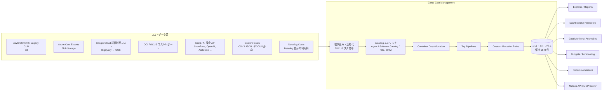
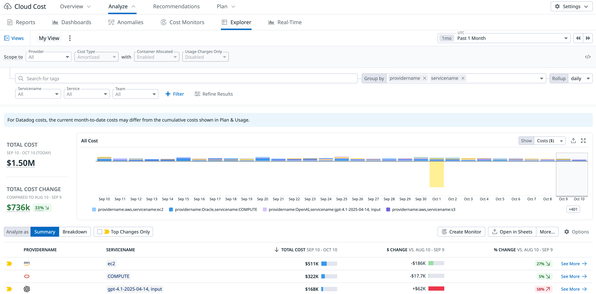
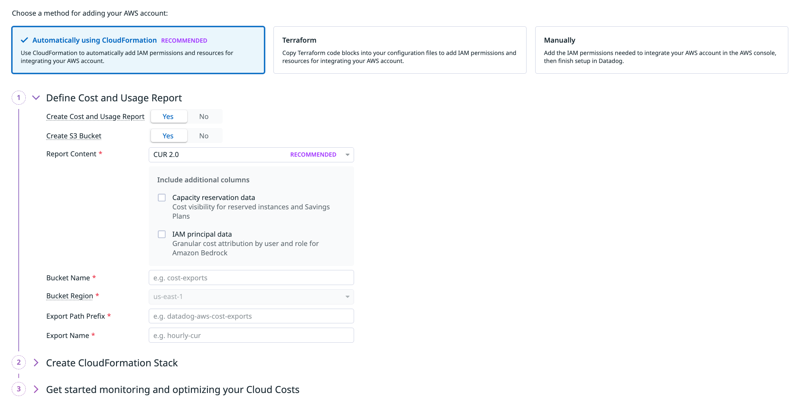
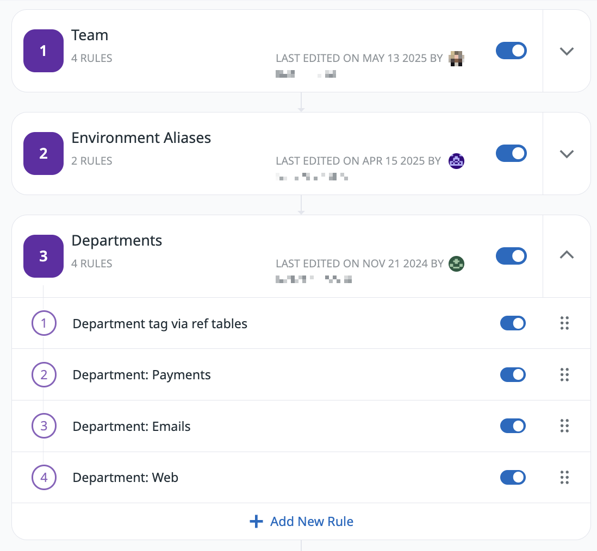
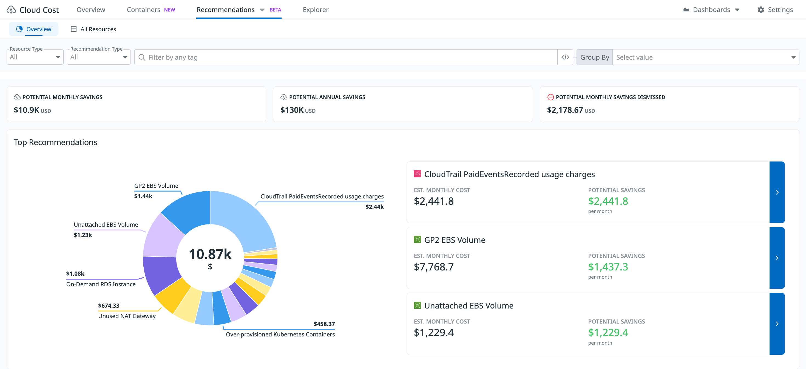
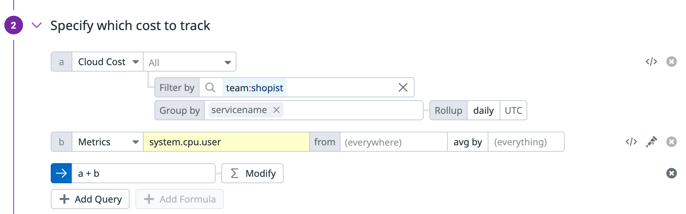

# Cloud Cost Management（クラウドコスト管理）

## 概要

Datadog Cloud Cost Management（CCM、クラウドコスト管理）は、クラウド事業者（AWS、Azure、Google Cloud、Oracle Cloud）、SaaS・AI サービス（Snowflake、Databricks、OpenAI、Anthropic など）、任意のコストデータ（Custom Costs）、および Datadog 自身の利用料（Datadog Costs）を取り込み、Datadog の**コストメトリクス**として可視化・配賦・最適化・監視する FinOps 製品である。[出典](https://docs.datadoghq.com/cloud_cost_management/)

Cloud Cost Management の特徴は次のとおり。

- **請求データをメトリクス化**する。取り込んだコストは `aws.cost.amortized` などのメトリクスとして Explorer、ダッシュボード、ノートブック、モニターで使える。観測メトリクス（CPU 使用率、リクエスト数など）と同じクエリで並べられるので、コスト増の原因を利用状況と突き合わせて調べられる。[出典](https://docs.datadoghq.com/cloud_cost_management/)
- **FOCUS（FinOps Open Cost and Usage Specification）タグを自動付与**する。事業者ごとに異なる請求スキーマを `providername`、`servicename` などの共通タグにそろえ、複数事業者を 1 つのクエリ（`all.cost`）で横断できる。[出典](https://docs.datadoghq.com/cloud_cost_management/tags/multisource_querying/)
- **タグの補正と配賦**を持つ。Tag Pipelines（タグパイプライン）でタグの欠落・表記揺れを直し、Custom Allocation Rules（カスタム配賦ルール）で共有コストを分割し、Container Cost Allocation（コンテナコスト配賦）で Kubernetes / ECS のノード費用を Pod・タスクに配る。[出典](https://docs.datadoghq.com/cloud_cost_management/tags/)
- **最適化と統制**の機能を持つ。Cost Recommendations（コスト推奨）、Anomalies（異常検知）、Cost Monitor（コストモニター）、Budgets（予算）、Forecasting（予測）、Commitment Programs（RI・Savings Plans・CUD の管理）を備える。

本ファイルは CCM の仕様（取り込み要件、メトリクス、タグ、各機能の設定項目、制限値、権限、課金単位）を扱う。関連する内容は次のファイルを参照する。

| 内容 | 参照先 |
|---|---|
| Datadog 自身の利用量・Plan & Usage・Usage Attribution・Cost Summary/Chargebacks | [Usage・Usage Attribution・Cost Visibility](../platform/usage-and-cost-attribution.md) |
| AWS / Azure / Google Cloud インテグレーション本体（IAM ロール、メトリクス収集、Resource Collection） | [AWS Integration](../platform/aws-integration.md)、[Azure Integration](../platform/azure-integration.md)、[Google Cloud Integration](../platform/gcp-integration.md) |
| Kubernetes 監視、Kubernetes Autoscaling | [コンテナ・Kubernetes 監視](container-and-kubernetes-monitoring.md) |
| データ転送コスト配賦に必要な CNM | [Cloud Network Monitoring](cloud-network-monitoring.md) |
| モニター全般、通知 | [Monitors](../platform/monitors.md)、[通知と Downtime](../platform/notifications-and-downtimes.md) |
| タグの基本・Unified Service Tagging | [Tagging](../platform/tagging.md)、[タグ戦略の実践](../../04_応用編/tagging-strategy.md) |
| Reference Tables | [Notebooks・DDSQL・Reference Tables](../platform/notebooks-and-data-tools.md) |
| Terraform リソース | [Terraform と IaC](../platform/terraform-and-iac.md) |
| 料金（数値の正本） | [製品別料金表](../../03_導入編/pricing-by-product.md) |
| コスト最適化の実践 | [コスト最適化](../../04_応用編/cost-optimization.md) |

---

## 全体アーキテクチャとデータフロー

Cloud Cost Management は、各事業者が出力する請求データ（AWS CUR、Azure Cost Exports、Google Cloud BigQuery 詳細エクスポート、OCI FOCUS レポート）や SaaS の課金 API を Datadog が読み取り、タグ付け・配賦を経てコストメトリクスにする。タグの処理順は「請求データ由来のタグ → Datadog 側のエンリッチ → Tag Pipelines → Custom Allocation Rules」である（Custom Allocation Rules は Tag Pipelines の後に実行される）。[出典](https://docs.datadoghq.com/cloud_cost_management/tags/)、[出典](https://docs.datadoghq.com/cloud_cost_management/allocation/custom_allocation_rules/)

> 注記: 図中のエンリッチとコンテナ配賦の前後関係は、公式ドキュメントのタグ優先順位と処理説明から整理したもので、内部処理の厳密な順序は公開情報では確認できず。Tag Pipelines → Custom Allocation Rules の順序は公式に明記されている。

### 画面構成（ナビゲーション）

Cloud Cost Management の画面は **Cloud Cost** メニュー配下にあり、上部タブは Overview、Analyze（Reports / Dashboards / Anomalies / Cost Monitors / Explorer / Real-Time）、Recommendations、Plan（Budgets など）、Settings（Accounts、Tag Pipelines、Custom Costs、SaaS Integrations、Data History など）で構成される。[出典](https://docs.datadoghq.com/cloud_cost_management/reporting/explorer/)、[出典](https://docs.datadoghq.com/cloud_cost_management/setup/permissions/)

- **キャプション:** Cloud Cost > Analyze > Explorer 画面
- **画面説明:** 最上段に Cloud Cost のグローバルタブ（Overview、Analyze、Recommendations、Plan、右端に Settings）。Analyze 配下のサブタブは Reports、Dashboards、Anomalies、Cost Monitors、Explorer、Real-Time。その下の「Scope to」行に Provider（All）、Cost Type（Amortized）、Container Allocated（Enabled）、Usage Charges Only（Disabled）のドロップダウン。次の行にタグ検索欄、Group by（例: `providername`、`servicename`）、Rollup（daily）。さらに Servicename / Service / Team のフィルター、「+ Filter」「Refine Results」。中央に「For Datadog costs, the current month-to-date costs may differ from the cumulative costs shown in Plan & Usage.」という注意帯。左に TOTAL COST（例: $1.50M）と前期間比の TOTAL COST CHANGE、右に日次の積み上げ棒グラフ（凡例例: `providername:aws,servicename:ec2`、`providername:Oracle,servicename:COMPUTE`、`providername:OpenAI,servicename:gpt-4.1-...`）。下段は Analyze as（Summary / Breakdown）、Top Changes Only、Create Monitor、Open in Sheets、More… ボタンと、PROVIDERNAME / SERVICENAME / TOTAL COST / $ CHANGE / % CHANGE の表。
- **出典:** https://docs.datadoghq.com/cloud_cost_management/reporting/explorer/ （取得日: 2026-11-02）

---

## 対応データソース一覧

Cloud Cost Management が取り込めるコストデータ源は次のとおり。[出典](https://docs.datadoghq.com/cloud_cost_management/)

| データソース | 取り込み元 | 主なコストメトリクス | データ遅延（公式記載） | 自動取り込みされる履歴 | コンテナ配賦 |
|---|---|---|---|---|---|
| AWS | Cost and Usage Report（CUR 2.0 / Legacy CUR、S3） | `aws.cost.*` | 完全な CUR 生成後 48〜72 時間 | S3 にあれば最大 15 か月 | 対応（EKS 含む Kubernetes、ECS on EC2 / Fargate） |
| Azure | Cost Management Exports（Actual / Amortized、Blob Storage） | `azure.cost.*` | セットアップ後安定まで 48〜72 時間。データ・バックフィル反映まで最大 24 時間待つ | 最大 15 か月（手動バックフィルは最大 12 か月） | 対応（AKS 含む Kubernetes） |
| Google Cloud | 詳細利用コストエクスポート（BigQuery）→ GCS バケット | `gcp.cost.*` | セットアップ後安定まで 48〜72 時間 | BigQuery に現れた分を最大 15 か月（新規データセットは直近 2 か月のみ） | 対応（GKE 含む Kubernetes。GKE Autopilot はエージェントレスのみ・制約あり） |
| Oracle Cloud（OCI） | OCI FOCUS コストエクスポート | `oci.cost.*` | 公開情報では確認できず | OCI の保持（1 年）の範囲で最大 15 か月 | 非対応 |
| SaaS / AI | 各 SaaS の課金 API（12 種） | 公開情報ではメトリクス名の一覧は確認できず | 多くは 24 時間程度（Temporal Cloud は 25〜30 時間） | 多くは 15 か月（Snowflake 6 か月、Confluent 12→15 か月） | 対象外 |
| Custom Costs | CSV / JSON アップロード（FOCUS 形式）、API | `custom.cost.basis`、`custom.cost.amortized` | 約 24 時間 | 公開情報では確認できず | 対象外 |
| Datadog Costs | Datadog の課金データ | 公開情報（公式ドキュメント）ではメトリクス名の一覧は確認できず（ブログ例では `datadog.cost.amortized`） | 48 時間 | 15 か月 | 対象外 |

[出典](https://docs.datadoghq.com/cloud_cost_management/setup/aws/)、[出典](https://docs.datadoghq.com/cloud_cost_management/setup/azure/)、[出典](https://docs.datadoghq.com/cloud_cost_management/setup/google_cloud/)、[出典](https://docs.datadoghq.com/cloud_cost_management/setup/oracle/)、[出典](https://docs.datadoghq.com/cloud_cost_management/setup/saas_costs/)、[出典](https://docs.datadoghq.com/cloud_cost_management/setup/custom/)、[出典](https://docs.datadoghq.com/cloud_cost_management/datadog_costs/)

> **ポイント:** Cloud Cost Management のコストデータは、事業者側の請求データより新しくはならない。Settings > Data History 画面の **Last Bill Received**（請求データの最終受信時刻。最新の利用日ではない）と **Last Processed**（最終処理時刻）で取り込み状況を確認できる。事業者側にコストが無い場合は事業者に、事業者側にあるのに CCM に無い場合は Datadog サポートに問い合わせる。[出典](https://docs.datadoghq.com/cloud_cost_management/)

---

## AWS のコスト取り込み

### AWS の前提条件

Cloud Cost Management の AWS 連携は、AWS Cost and Usage Report（CUR）を S3 から読み取る方式である。前提条件は次のとおり。[出典](https://docs.datadoghq.com/cloud_cost_management/setup/aws/)

| 項目 | 内容 |
|---|---|
| AWS アカウント | 請求情報へのアクセス権があること |
| AWS インテグレーション | Datadog の AWS インテグレーションがインストール済みであること（[AWS Integration](../platform/aws-integration.md)） |
| 推奨アカウント | **管理アカウント**（management account）。委任管理者アカウントではなく管理アカウントを推奨。管理アカウントはメンバーアカウントを検出できる |
| メンバーアカウントから CUR を出す場合 | 管理アカウントの設定で Linked Account Access、Linked Account Refunds and Credits、Linked Account Discounts を有効化する |
| Recommendations 用権限（任意） | 連携ロールに `cost-optimization-hub:GetRecommendation`、`cost-optimization-hub:ListRecommendations` |
| AI Agent によるセットアップ方式を使う場合 | ロールベースの AWS インテグレーション（アクセスキー方式は非対応）、AWS Configurations Manage 権限、ローカルのコーディングエージェント（Claude Code または Cursor） |

### CUR の要件

| 区分 | 設定 | 要件・推奨 |
|---|---|---|
| 形式 | Report Content | **CUR 2.0**（新規は推奨）または Legacy CUR |
| 内容 | Include resource IDs | 有効化 |
| 内容 | Split cost allocation data | 有効化（AWS Cost Explorer の設定で AWS Split Cost Allocation へのオプトインも必要） |
| 内容 | Refresh automatically | 有効化 |
| 内容（任意） | IAM Principal Allocation Data | Amazon Bedrock のコストをユーザー・ロール単位で配賦する場合に有効化 |
| 追加カラム（任意） | Capacity reservation data | Reserved Instances・Savings Plans のコスト可視化用 |
| 追加カラム（任意） | IAM principal data | Bedrock の IAM プリンシパル別配賦用 |
| 配信 | Time granularity | **Hourly（時間単位）** |
| 配信 | Report versioning | **Create new report version** |
| 配信 | Compression | GZIP または Parquet |
| 上限 | メンバーアカウントあたりの CUR | 1 つ |
| AWS Billing Conductor | Pro forma CUR | 同じ要件を満たせば対応 |

[出典](https://docs.datadoghq.com/cloud_cost_management/setup/aws/)

### S3 バケットとレポート位置の設定項目

| 項目 | 内容 |
|---|---|
| Bucket Name | レポートファイルの保存先バケット名 |
| Bucket Region | リージョンコード（例: `us-east-1`） |
| Export Path Prefix | 空にできない。先頭・末尾を `/` にできない。途中の `/` は可（例: `cost/hourly`） |
| Export Name | CUR の名前 |
| 既存バケット利用時 | AWS が CUR を書き込めるようバケットポリシーの更新が必要な場合がある |
| Data Export フィールド | 新規作成（レポートとバケット）／既存バケット利用／既存レポートとバケット利用 を選択 |

[出典](https://docs.datadoghq.com/cloud_cost_management/setup/aws/)

### AWS の IAM ポリシー

Datadog 連携ロール（既定名 `DatadogIntegrationRole`）に、次の権限を持つポリシーを付与する。[出典](https://docs.datadoghq.com/cloud_cost_management/setup/aws/)

| アクション | リソース | 用途 |
|---|---|---|
| `s3:ListBucket` | バケット ARN | CUR ファイル一覧 |
| `s3:GetObject` | `BUCKETNAME/REPORT_PREFIX/REPORT_NAME/*` | CUR ファイル読み取り |
| `ce:Get*` | `*` | Cost Explorer との金額突き合わせ（精度チェック） |
| `cur:DescribeReportDefinitions` | `*` | CUR 定義の取得 |
| `organizations:Describe*`、`organizations:List*` | `*` | 組織・アカウント情報の取得 |

### AWS のセットアップ方式

| 方式 | 概要 |
|---|---|
| CloudFormation（UI で推奨表示） | IAM 権限とリソースを自動作成 |
| Terraform（CCM UI 経由） | UI が生成した HCL をコピーし `terraform plan` / `terraform apply` |
| Terraform | Datadog provider のリソース（`aws_cur_config` など。[Terraform と IaC](../platform/terraform-and-iac.md) 参照） |
| API | Cloud Cost Management API |
| Manual（手動） | AWS コンソールで IAM 権限を追加し Datadog 側で設定完了 |
| AI Agent | ローカルのコーディングエージェントが Terraform を生成し、レビュー後に適用 |

[出典](https://docs.datadoghq.com/cloud_cost_management/setup/aws/)

- **キャプション:** Cloud Cost Management の AWS アカウント追加画面（CloudFormation による自動設定を選択した状態）
- **画面説明:** 上部で追加方法を「Automatically using CloudFormation（RECOMMENDED）」「Terraform」「Manually」の 3 つから選ぶ。手順 1「Define Cost and Usage Report」では Create Cost and Usage Report（Yes/No）、Create S3 Bucket（Yes/No）、Report Content（`CUR 2.0`、RECOMMENDED 表示）、追加カラムのチェックボックス（Capacity reservation data：RI・Savings Plans の可視化、IAM principal data：Amazon Bedrock のユーザー・ロール別配賦）、Bucket Name、Bucket Region（例: us-east-1）、Export Path Prefix、Export Name を入力する。手順 2 は「Create CloudFormation Stack」、手順 3 は「Get started monitoring and optimizing your Cloud Costs」。
- **出典:** https://docs.datadoghq.com/cloud_cost_management/setup/aws/ （取得日: 2026-11-02）

### AWS のデータ遅延・履歴・バックフィル

| 項目 | 内容 |
|---|---|
| 遅延 | 完全な CUR が生成されてから **48〜72 時間**。72 時間後もデータが無ければ Datadog サポートへ |
| 履歴 | S3 に履歴データがあれば **最大 15 か月**を自動取り込み |
| バックフィル | レポートに履歴が無い場合、AWS サポートにレポート名と請求期間を伝えてケースを起票。AWS の処理後 24 時間以内に Datadog が取り込む |
| バックフィルの制約 | アカウント作成前の期間や、以前の Organizations 構成を反映したデータは AWS がバックフィルできない |

[出典](https://docs.datadoghq.com/cloud_cost_management/setup/aws/)

### AWS のコストメトリクス（コストタイプ）

| メトリクス | 内容 | コンテナ内訳 |
|---|---|---|
| `aws.cost.net.amortized.shared.resources.allocated` | 正味（Net）償却コスト＋コンテナ内訳 | あり（Container Cost Allocation が必要） |
| `aws.cost.net.amortized` | 正味償却コスト | なし |
| `aws.cost.net.unblended` | 正味非ブレンドコスト。割引を事前計算済みで請求書と一致 | なし |
| `aws.cost.amortized.shared.resources.allocated` | 償却コスト＋コンテナ内訳 | あり（Container Cost Allocation が必要） |
| `aws.cost.amortized` | 償却コスト | なし |
| `aws.cost.unblended` | 非ブレンドコスト。請求書と一致 | なし |
| `aws.cost.ondemand` | 定価ベース。Savings Plans・リザーブド・割引・税・手数料を除外 | なし |
| `aws.cost.net.amortized.realtime.estimated` | Real-Time Costs の推定値（EC2 のみ。後述） | Kubernetes Pod 内訳あり |

コストタイプの考え方（公式記載）は次のとおり。[出典](https://docs.datadoghq.com/cloud_cost_management/setup/aws/)

- **On-demand** は実際のコストの推定には一般に適さない。
- **Net amortized**（正味償却）が配賦用途では最も正確。Enterprise Discount 等の割引が無いアカウントでは Net amortized ＝ Amortized になる。
- **Unblended** は請求書との突き合わせ用。

### AWS のタグ取得元

| # | 取得元 | 内容 |
|---|---|---|
| 1 | CUR のカラム | 文字列カラムがタグになる。キーは正規化される（例: `lineItem/ResourceId` → `line_item/resource_id`） |
| 2 | AWS リソースタグ | 大半のリソースで自動取得。作成・変更日から適用され、過去の値は上書きされない。インテグレーション無しの場合は AWS 請求のコスト配分タグを使う |
| 3 | AWS Organizations・アカウントタグ | 組織（管理）アカウントへのインテグレーション設定が必要 |
| 4 | AWS インテグレーションタグ | インテグレーションタイルで設定。そのアカウントの全コストに付与 |
| 5 | 既定（OOTB）タグ | 例: `aws_product`、`aws_region`、`aws_member_account_id`、`aws_pricing_term`、`is_aws_ec2_savings_plan` |
| 6 | コンテナワークロードタグ | Container Cost Allocation が必要。`*.shared.resources.allocated` メトリクスにのみ付与 |
| 7 | Tag Pipelines | 未タグのコストを補う最終エンリッチ層 |

観測メトリクスとの相関用リソース識別タグの例: `instance_id`（EC2）、`bucketname`（S3）、`dbinstanceidentifier`（RDS）、`functionname`（Lambda）、`tablename`（DynamoDB）。[出典](https://docs.datadoghq.com/cloud_cost_management/setup/aws/)

### AWS の注意点・制約

| 項目 | 内容 |
|---|---|
| アカウントフィルタリング | 管理アカウントが必要。Datadog の追加料金は発生しない。タグ検索には非対応 |
| Billing Conductor の pro forma CUR | 割引・税を含まないため Cost Explorer と比較しにくい。課金グループへのアカウント追加で RI・Savings Plans の共有範囲が変わる |
| Legacy CUR → CUR 2.0 の切替 | Legacy のアカウント設定を削除して新規設定すると**二重計上**になり得る。CUR 2.0 は新規設定アカウントでのみ有効化する |
| レポートファイル | AWS が生成したファイルを変更・移動しない。第三者のファイルを置かない |

> **サイト差異:** `app.ddog-gov.com` と `us2.ddog-gov.com` のサイトでは、検証に使う AWS CUR エンドポイントが FIPS 検証済みではない。[出典](https://docs.datadoghq.com/cloud_cost_management/setup/aws/)

---

## Azure のコスト取り込み

### Azure の対応契約とスコープ

| 項目 | 内容 |
|---|---|
| Microsoft Customer Agreement（MCA） | 対応。課金アカウント・サブスクリプション・リソースグループの各スコープ |
| Enterprise Agreement（EA） | 対応（EA → MCA 移行手順あり） |
| 従量課金（PAYG、MOSP） | **非対応**（通常、利用量のみのエクスポートしか提供されないため） |
| CSP | 公開情報では確認できず |
| 推奨スコープ | **課金アカウント（billing account）**。下位スコープのエクスポートには未使用の予約・Savings Plan のコストが含まれないため |

[出典](https://docs.datadoghq.com/cloud_cost_management/setup/azure/)

### Azure のエクスポート設定要件

Azure では **Actual cost（実コスト）** と **Amortized cost（償却コスト）** の 2 種類のエクスポートが必要。両方に共通のストレージコンテナを使うことが推奨されている。[出典](https://docs.datadoghq.com/cloud_cost_management/setup/azure/)

| 設定 | 要件 |
|---|---|
| 保存先 | Azure Blob Storage（ストレージアカウント・コンテナ・ディレクトリ）。エクスポートは任意のサブスクリプションに置ける。複数サブスクリプションの場合は 1 つのストレージアカウントに集約を推奨 |
| エクスポート名 | 一意であること |
| 名前に使う文字 | ストレージアカウント・コンテナ・ディレクトリ名に `.` などの特殊文字を避ける |
| 頻度 | **日次の月初来（month-to-date）エクスポート** |
| データセットバージョン | `2021-10-01`、`2021-01-01`、`2020-01-01`（`2019-10-01` は非対応） |
| 形式 | CSV（Gzip または無圧縮）／Parquet（Snappy または無圧縮） |
| File partitioning | **有効化必須** |
| Overwrite data | **無効化必須**（非対応）。以前有効だった場合はディレクトリを空にするかファイルを移動 |
| Export prefix | 空不可。先頭・末尾 `/` 不可。途中の `/` は可 |

### Azure の権限

| 対象 | ロール |
|---|---|
| エクスポートのストレージコンテナ | Datadog の App Registration に **Storage Blob Data Reader** |
| サブスクリプション | **Cost Management Reader**（課金アカウントスコープの場合は不要） |
| Azure Native Integration（US3） | Azure Portal の Datadog リソース方式で連携した場合も、CCM 用に App Registration の作成が必要 |
| ネットワーク | Datadog の Webhook IP がブロックされていると権限エラーに見える失敗が起きる。Datadog IP ranges の Webhooks の IP を許可 |

[出典](https://docs.datadoghq.com/cloud_cost_management/setup/azure/)

> **サイト差異:** Azure Native Integration（Azure Portal から作成する Datadog リソース）は US3 サイトの方式である。CCM では App Registration が別途必要。[出典](https://docs.datadoghq.com/cloud_cost_management/setup/azure/)

セットアップ方式は Terraform（ストレージ・コンテナ・エクスポートの作成または既存利用。リソース `azure_uc_config`）、手動（Azure portal）、API。[出典](https://docs.datadoghq.com/cloud_cost_management/setup/azure/)

### Azure の遅延・履歴・バックフィル

| 項目 | 内容 |
|---|---|
| 遅延 | セットアップ後データが安定するまで 48〜72 時間。データ・バックフィル結果の表示は最大 24 時間待つ |
| 履歴 | Azure のエクスポートは作成月から開始。Datadog は利用可能な履歴を最大 15 か月取り込む |
| 手動バックフィル | 最大 12 か月。暦月ごと（1 日〜末日）の一回限りエクスポートを作成し、その後日次エクスポートに戻す。スケジュールエクスポートと同じ構造・パーティションに従うこと |

### EA から MCA への移行時の注意

- Azure はエクスポート定義を自動移行しない。移行前にエクスポート名、ストレージ、ディレクトリ、プレフィックス、データセットバージョン、形式、圧縮を記録する。
- EA エクスポートは最終実行後に無効化し、定義は残す。
- EA と MCA のエクスポートを同じ保存先に同時に書き込ませない。
- MCA スコープから EA 期間をバックフィルしない。空の MCA マニフェストが取り込み済み EA データをゼロにすることがある。

[出典](https://docs.datadoghq.com/cloud_cost_management/setup/azure/)

### Azure のコストメトリクスとタグ

| メトリクス | 内容 |
|---|---|
| `azure.cost.amortized` | 発生主義。割引・前払いを利用分に配分 |
| `azure.cost.actual` | 現金主義。予約・Savings Plan の割引は別のチャージタイプとして現れる |
| `azure.cost.discounted.ondemand` | 交渉割引後の定価ベース。真の定価は (1 − 交渉割引率) で割って求める |
| `azure.cost.amortized.shared.resources.allocated` | 償却コスト＋コンテナ内訳（Container Cost Allocation が必要） |

[出典](https://docs.datadoghq.com/cloud_cost_management/setup/azure/)、[出典](https://docs.datadoghq.com/cloud_cost_management/allocation/container_cost_allocation/)

Azure の既定タグ（利用コストレポート由来）の主な分類は次のとおり。[出典](https://docs.datadoghq.com/cloud_cost_management/setup/azure/)

| 分類 | タグ例 |
|---|---|
| アカウント・課金 | `accountname`、`billingaccountid`、`billingaccountname`、`billingcurrency`、`billingperiod`、`billingprofileid`、`billingprofilename`、`currency`、`exchangeratepricingtobilling` |
| 請求・インボイス | `chargetype`、`frequency`、`InvoiceId`、`offerid`、`planname`、`publishername`、`publishertype`、`invoicesectionname` |
| 日付 | `date`、`ServicePeriodStartDate`、`ServicePeriodEndDate` |
| サービス・メーター | `consumedservice`、`metercategory`、`meterid`、`metername`、`meterregion`、`metersubcategory`、`ProductId`、`productname`、`servicefamily`、`unitofmeasure`、`effectiveprice` |
| リソース | `costcenter`、`location`、`resourcegroup`、`resourceid`、`resourcelocation`、`resourcename`、`resourcetype`、`subscriptionid`、`subscriptionname` |
| 価格・コミットメント | `pricingmodel`、`reservationid`、`reservationname`、`term` |
| Datadog 付与 | `name`（主要 Azure 製品で観測メトリクスとの相関用） |

観測メトリクスとの相関例: `azure.cost.amortized` と `azure.vm.network_in_total` を `name` でグループ化し VM コストと利用率を並べる。[出典](https://docs.datadoghq.com/cloud_cost_management/setup/azure/)

---

## Google Cloud のコスト取り込み

### Google Cloud のセットアップ手順

1. Datadog の Google Cloud Platform インテグレーションを設定する（[Google Cloud Integration](../platform/gcp-integration.md)）。
2. **詳細利用コスト（Detailed usage cost）の BigQuery エクスポート**を有効化し、Billing Account ID、エクスポート先 Project ID、Dataset 名を控える。
3. サービスアカウントのあるプロジェクトで BigQuery API と BigQuery Data Transfer Service を有効化する。
4. Cloud Storage バケットを作成または選択する（BigQuery エクスポートのデータセットと**同じロケーション**に置く）。
5. （任意）確約利用割引（CUD）メタデータエクスポートを有効化する。
6. （任意）サービスアカウントが課金エクスポートと別プロジェクトにある場合、クロスプロジェクト認可を設定する。

セットアップは UI（Terraform / Manual モード）、API、Terraform（`gcp_uc_config`）で行える。エクスポートデータには `datadog_cloud_cost_detailed_usage_export` というプレフィックスが付く。[出典](https://docs.datadoghq.com/cloud_cost_management/setup/google_cloud/)、[出典](../platform/terraform-and-iac.md)

### Google Cloud のサービスアカウント権限

| 対象 | 個別権限 | 既存ロールで付与する場合 |
|---|---|---|
| エクスポートプロジェクト（BigQuery） | `bigquery.jobs.create`、`bigquery.transfers.get`、`bigquery.transfers.update` | `roles/bigquery.admin` |
| エクスポートデータセット | `bigquery.datasets.get`、`bigquery.tables.create`、`bigquery.tables.delete`、`bigquery.tables.export`、`bigquery.tables.get`、`bigquery.tables.getData`、`bigquery.tables.list`、`bigquery.tables.update`、`bigquery.tables.updateData` | `roles/bigquery.dataEditor` |
| CUD メタデータプロジェクト（任意） | `bigquery.datasets.get`、`bigquery.readsessions.create`、`bigquery.readsessions.getData`、`bigquery.readsessions.update`、`bigquery.tables.get`、`bigquery.tables.getData`、`bigquery.tables.list` | `roles/bigquery.dataViewer` ＋ `roles/bigquery.readSessionUser` |
| Storage バケット | `storage.buckets.get`、`storage.objects.create`、`storage.objects.delete`、`storage.objects.get`、`storage.objects.list` | `roles/storage.legacyObjectReader` ＋ `roles/storage.legacyBucketWriter` |
| クロスプロジェクト認可（任意） | BigQuery Data Transfer Service エージェントロール、`roles/iam.serviceAccountTokenCreator` | — |

[出典](https://docs.datadoghq.com/cloud_cost_management/setup/google_cloud/)

CUD メタデータエクスポートは、詳細利用データセットと同じロケーション種別・リージョン（またはマルチリージョン）でなければならず、作成後は変更できない。[出典](https://docs.datadoghq.com/cloud_cost_management/setup/google_cloud/)

### Google Cloud の遅延・履歴

| 項目 | 内容 |
|---|---|
| 遅延 | セットアップ後安定まで 48〜72 時間 |
| 新規エクスポートデータセット | 直近 2 か月分のみ。バックフィルに 1〜2 日 |
| 履歴 | BigQuery テーブルに現れたデータを最大 15 か月取り込む |
| バックフィル | Google Cloud には初期 2 か月を超えて遡る手段が無い |

[出典](https://docs.datadoghq.com/cloud_cost_management/setup/google_cloud/)

### Google Cloud のコストメトリクスとタグ

| メトリクス | 内容 |
|---|---|
| `gcp.cost.amortized` | 割り当てリソースの総コスト（プロモーション・CUD クレジット込み） |
| `gcp.cost.amortized.shared.resources.allocated` | 償却コスト＋コンテナ内訳（Container Cost Allocation が必要） |
| `gcp.cost.ondemand` | 割引前の公開オンデマンド価格 |

既定タグ: `google_product`、`google_cost_type`、`google_usage_type`、`google_location`、`google_region`、`google_zone`、`google_pricing_usage_unit`、`google_is_unused_reservation`、`service_description`、`project_id`、`project_name`、`cost_type`、`sku_description`、`resource_name`、`global_resource_name`。[出典](https://docs.datadoghq.com/cloud_cost_management/setup/google_cloud/)

観測メトリクスとの相関タグ: Compute Engine（`instance_id`、`instance-type`）、Cloud Functions（`function_name`）、Cloud Run（`job_name`、`service_name`）、Cloud SQL（`database_id`）、Cloud Spanner（`instance_id`）、App Engine（`module_id`）、BigQuery（`project_id`、`dataset_id`）、GKE（`cluster_name`）。[出典](https://docs.datadoghq.com/cloud_cost_management/setup/google_cloud/)

Google Cloud のラベルは、プロジェクトラベル、システムリソースラベル、ユーザーリソースラベル、ユーザーリソースタグ、GKE Pod ラベルがタグとして取り込まれる。`goog-originating-sku-description` タグは Google の SKU API で付与される。[出典](https://docs.datadoghq.com/cloud_cost_management/tags/)

---

## Oracle Cloud（OCI）のコスト取り込み

| 項目 | 内容 |
|---|---|
| 前提 | OCI テナンシー、Datadog の OCI インテグレーション |
| 手順 | CCM の Setup & Configuration で OCI アカウントを追加し、親テナンシー向け手順に従う。QuickStart 方式以外で作成した OCI インテグレーションは先に QuickStart 移行を行う。作成後に Cloud Cost Management トグルをオン |
| データ源 | OCI FOCUS コストエクスポート |
| メトリクス | `oci.cost.amortized`（割引込み、利用時点の割り当てリソースコスト）、`oci.cost.ondemand`（公開・非公開割引前の公開オンデマンド価格） |
| 履歴 | OCI はコストレポートを 1 年保持。Datadog は有効化時に、Oracle の保持範囲で最大 15 か月を取り込む。保持範囲を超えるバックフィル手段は無い |
| 既定タグ | `servicename`、`region`、`resourceid`、`resourcename`、`skuid`、`pricingcategory`、`commitmentdiscounttype`、`subaccountname` など計 33 個 |
| 相関タグ | Compute は `host`、Object Storage は `name`。共通で `compartment_id`、`compartment_name`、`tenancy_ocid`、`tenancy_name`、`resource_id`、`resource_type`、`dd_resource_key` |
| 制約 | Container Cost Allocation は OCI 非対応 |
| 必要な IAM ポリシー・遅延 | 公開情報（セットアップページ）では確認できず |

[出典](https://docs.datadoghq.com/cloud_cost_management/setup/oracle/)

---

## SaaS・AI コストの取り込み

Cloud Cost Management は 12 種類の SaaS・AI サービスの課金データを取り込める。**USD 建てのみ対応**で、その他の事業者は Custom Costs を使う。[出典](https://docs.datadoghq.com/cloud_cost_management/setup/saas_costs/)

| サービス | 必要な認証情報・権限 | データ遅延 | 履歴 | 主なタグ（抜粋） |
|---|---|---|---|---|
| Snowflake | アカウント URL、ユーザー名、Datadog 専用ロール・ユーザー、キーペア認証 | 24 時間以内 | 6 か月 | `account_name`、`billing_type`、`servicename`、`warehouse_name`、`warehouse_size`、`user_name`、`database_name`、`query_hash` |
| Databricks | サービスプリンシパルのクライアント ID・シークレット、ワークスペース名・URL、SQL Warehouse ID。`system` カタログへの `USE CATALOG`、`USE SCHEMA`、`SELECT` | 24 時間後 | 15 か月 | `cloud`、`charge_description`、`usage_type`、`job_id`、`job_name`、`cluster_id`、`warehouse_id`、`workspace_id`、`is_serverless`、`custom_tags` |
| OpenAI | **Admin スコープ**の API キー（プロジェクトスコープのキーではコスト取得不可） | 24 時間後 | 15 か月 | `charge_description`（モデル名）、`organization_name`、`project_name`、`project_id` |
| Anthropic | Admin API キー。Enterprise 利用分は Enterprise Analytics API キーで別エントリを追加 | 公開情報では確認できず（保存後にポーリング開始） | 公開情報では確認できず | `workspace_name`、`org_type`、`model_id`、`model_name`、`service_tier`、`token_type`、`context_window` |
| Cursor | Enterprise プラン、チーム管理者ロール、Admin API キー（Standard チームプランはアクセス拒否） | 24 時間後 | 15 か月 | `billing_group`、`charge_type`、`hour`、`is_headless`、`max_mode`、`user` |
| Temporal Cloud | Finance Admin または Account Owner ロールのサービスアカウントの Billing API キー（Metrics Read-Only・Account Admin は不可） | 25〜30 時間 | 公開情報では確認できず | `namespace`、`sku_id`、`sku_meter`、`service_subcategory`、`unit_price`、`invoice_id`、`temporal_tag_<key>` |
| GitHub | クラシック PAT（`manage_billing:enterprise`、`read:org`）、Enterprise 名 | 24 時間以内 | 15 か月 | `enterprise_name`、`product`、`organization_name`、`repository_name`、`discount` |
| Confluent Cloud | BillingAdmin ロールの API キー・シークレット（任意で Schema Registry キー） | 24 時間 | 当初 12 か月、3 か月かけて 15 か月へ | `product`、`environment_id`、`resource_name`、`network_access_type`、`charge_description` |
| MongoDB | Organizational Billing Viewer（クラスタのリソースタグには Organizational Read Only も）、公開鍵・秘密鍵、組織 ID | 24 時間後 | 15 か月 | `cluster_name`、`group_id`、`invoice_id`、`resource_tags`、`status` |
| Elastic Cloud | Billing Admin ロールの API キー、組織 ID、Billing API キー | 24 時間後 | 15 か月 | `kind`、`name`、`price_per_hour`、`charge_description` |
| Fastly | `global:read` スコープと Billing ロールの個人 API トークン | 24 時間後 | 15 か月 | `product_name`、`product_line`、`region`、`usage_type`、`service_name` |
| Twilio | Account SID、Twilio コストトグルの有効化 | 24 時間後 | 15 か月 | `account_sid`、`category`、`usage_unit`、`count_unit`、`charge_description` |

[出典](https://docs.datadoghq.com/cloud_cost_management/setup/saas_costs/)

SaaS コストの注意点は次のとおり。[出典](https://docs.datadoghq.com/cloud_cost_management/setup/saas_costs/)

- **Databricks** は定価（list price）ベースで、交渉価格・割引は反映されない。
- **GitHub** は定価から推計し、割引値があれば含めるが交渉価格は含まない。
- **Snowflake** のクエリタグは JSON として解析可能な値であること。許可リストのキーは英数字・`_`・`-`・`.` のみ。高カーディナリティのタグは取り込み・描画のボトルネックになるため低〜中カーディナリティのキーを使う。
- **Anthropic** は Enterprise とプラットフォームのアカウントで別キー・別エントリが必要。
- Amazon Bedrock、Vertex AI、Gemini など**クラウド事業者経由の AI サービス**のコストは、各クラウドの請求データに含まれて取り込まれる（Anomalies の対象一覧に個別に挙がっている）。[出典](https://docs.datadoghq.com/cloud_cost_management/reporting/anomalies/)

---

## Custom Costs（FOCUS 形式の任意コスト）

Custom Costs は、直接連携の無い事業者（プライベートクラウド、オンプレミス、その他 SaaS など）のコストを **FinOps FOCUS 仕様に沿った CSV / JSON** でアップロードする機能である。[出典](https://docs.datadoghq.com/cloud_cost_management/setup/custom/)、[出典](https://www.datadoghq.com/blog/focus-cost-data/)（2025-01-06 公開）

### Custom Costs の前提とファイル形式

| 項目 | 内容 |
|---|---|
| 前提 | Cloud Cost Management がクラウド事業者（AWS / Azure / Google Cloud / Oracle）または SaaS 事業者のいずれかで設定済みであること（アップロード内容が無関係でも必要） |
| 形式 | CSV（カンマ区切り）または JSON（オブジェクトの配列、ECMA-404） |
| 複数ファイル | 可。CSV と JSON の混在可 |
| 重複 | **同じファイルを 2 回アップロードするとコストが 2 倍になる** |
| 準拠仕様 | FinOps FOCUS（対応バージョンは公開情報では確認できず） |

### Custom Costs の必須フィールド

フィールド名は PascalCase、値は空・NULL 不可。CSV では以下の順序で列を並べる。[出典](https://docs.datadoghq.com/cloud_cost_management/setup/custom/)

| フィールド | 形式・ルール |
|---|---|
| `ProviderName` | 利用しているサービス |
| `ChargeDescription` | サービスのどの側面への課金か |
| `ChargePeriodStart` | `YYYY-MM-DD`。終了日以前 |
| `ChargePeriodEnd` | `YYYY-MM-DD`。**終了日を含む（inclusive）** |
| `BilledCost` | 10 進数（NaN 不可） |
| `BillingCurrency` | **USD のみ** |

タグは、CSV では必須列の後にタグごとの列を追加、JSON では `Tags` オブジェクトにキー・値で記述する。

### Custom Costs のアップロード方法

| 方法 | 内容 |
|---|---|
| UI | Cloud Cost > Settings > Custom Costs（Custom Costs Files ページ）の **+ Upload Costs** |
| API（ファイル） | `PUT api/v2/cost/custom_costs`、`Content-Type: multipart/form-data`、ファイルをフォームフィールドで送信 |
| API（生データ） | `PUT api/v2/cost/custom_costs`、`Content-Type: application/json`、本文にファイル内容 |
| 認証 | `DD-API-KEY` と `DD-APPLICATION-KEY` ヘッダー |

### Custom Costs のメトリクスと検証ルール

| 項目 | 内容 |
|---|---|
| `custom.cost.basis` | 利用時点で割り当てたコスト |
| `custom.cost.amortized` | 期間にわたり按分したコスト。例: 9/1〜9/4 の $4 は、basis では 9/1 に $4、amortized では 9/1〜9/4 に $1/日 |
| 遅延 | アップロード後約 24 時間で表示 |
| 文字数 | 列名・プロパティ名・値はそれぞれ最大 1,000 文字 |
| 文字コード | UTF-8 |
| 未来日付 | 拒否される |
| タイムゾーン | 日付は UTC に変換（例: 2024-01-01 → 2024-01-01 00:00:00） |
| ファイルサイズ・行数上限 | 公開情報では確認できず |

[出典](https://docs.datadoghq.com/cloud_cost_management/setup/custom/)

---

## FOCUS と Multisource Querying

### FOCUS タグ

FOCUS（FinOps Open Cost and Usage Specification）は、FinOps Foundation（Linux Foundation 傘下）が策定するクラウド・SaaS の請求データの共通仕様で、v1.0 は 2024 年 6 月に公開された。[出典](https://www.datadoghq.com/blog/focus-and-datadog/)（2025-04 公開）

Cloud Cost Management は取り込んだ全コストメトリクスに、FOCUS の Column ID を**小文字化したタグ**を付与する。[出典](https://docs.datadoghq.com/cloud_cost_management/tags/multisource_querying/)

| FOCUS タグ | 意味 |
|---|---|
| `providername` | リソース・サービスを提供した事業者 |
| `servicename` | 事業者が提供する購入可能なサービス（クラウド VM、SaaS DB など） |
| `billingaccountid` | 請求アカウントの ID |
| `billingaccountname` | 請求アカウントの表示名 |
| `billingcurrency` | 請求通貨 |
| `subaccountid` | アクセス・コスト管理用のリソースグループ単位の ID（AWS アカウント、Azure サブスクリプション、GCP プロジェクト相当） |
| `subaccountname` | 同上の名前 |
| `regionname` | リージョン |
| `availabilityzone` | アベイラビリティゾーン |
| `pricingunit` | 単価の単位 |

例えば `servicename` は、AWS の `lineItem/ProductCode`、Azure の `metercategory`、Google Cloud の `service_description` を 1 つの列にそろえたものである。[出典](https://www.datadoghq.com/blog/focus-cost-data/)（2025-01-06 公開）

> **注意:** 組織で既に FOCUS タグと同名のタグキー（`servicename` など）を使っている場合、値の重複を避けるため元のインフラ側でタグキーを変更することが推奨されている。FOCUS タグは**上書き不可**で、タグ優先順位で上位（Custom Allocation Rules に次ぐ 2 位）にある。[出典](https://docs.datadoghq.com/cloud_cost_management/tags/multisource_querying/)、[出典](https://docs.datadoghq.com/cloud_cost_management/tags/)

### Multisource Querying（`all.cost`）

| 項目 | 内容 |
|---|---|
| 対象 | AWS、Azure、Google Cloud、Oracle、SaaS、Datadog Costs（Custom Costs もコストデータとして横断可能） |
| メトリクス | `all.cost`（全事業者のコストメトリクスを統合） |
| 自動切替 | 検索で単一事業者に絞ると、その事業者のメトリクス（例: `aws.cost.amortized`）に自動で切り替わる |
| 制約 | `all.cost` には**リソースレベルのタグが含まれない**。リソース単位の分析は事業者別メトリクスを使う |
| 通貨 | 異なる通貨のコストは**月平均為替レート（日次更新）で USD に換算**。元の請求通貨で見るには単一事業者に絞る |
| 前提 | コストが CCM に取り込まれていること |

Multisource で使えるその他の既定タグ: `allocated_resource`（`cpu` / `mem`）、`allocated_spend_type`（`usage` / `workload_idle` / `cluster_idle`）、`ecs_cluster_name`、`kube_cluster_name`、`orchestrator`（`kubernetes` / `ecs`）。[出典](https://docs.datadoghq.com/cloud_cost_management/tags/multisource_querying/)

### Refine Results（結果の絞り込み）

| オプション | 内容 |
|---|---|
| Usage Charges Only | クレジット・手数料・税を除外 |
| Complete Days Only | 不完全な直近 2 日を除外 |
| Total Cost | 金額範囲で絞り込み |
| Dollar Change | 金額変化の範囲で絞り込み |
| Percent Change | 変化率の範囲で絞り込み |

[出典](https://docs.datadoghq.com/cloud_cost_management/tags/multisource_querying/)、[出典](https://docs.datadoghq.com/cloud_cost_management/reporting/explorer/)

---

## タグの取得元・正規化・優先順位

### タグの取得元

Cloud Cost Management のコストに付くタグの取得元は次のとおり。[出典](https://docs.datadoghq.com/cloud_cost_management/tags/)

| 区分 | 取得元 |
|---|---|
| 請求データ | 請求カラム（AWS CUR、Google Billing Export など） |
| Datadog エンリッチ | Host Agent、APM / Software Catalog（[Software Catalog](../platform/software-catalog.md)）、インテグレーションタイルのタグ（アカウントの全コスト）、Data Observability（BigQuery）、Cloud Network Monitoring（送信元・宛先ディメンション） |
| Kubernetes エンリッチ | ノード・Pod・Persistent Volume・Persistent Volume Claim のユーザー定義タグ |
| CCM 自身 | コストエイリアス（例: `aws_product`）、コスト配賦タグ（例: `allocated_spend_type`）、FOCUS タグ |
| ユーザー定義 | Tag Pipelines、Custom Allocation Rules（後者は SaaS コストには適用されない） |
| AWS 固有 | CUR のコスト配分タグ、Resource Groups Tagging API、Organizational Units、Organization accounts |
| Amazon ECS | タスク定義タグ、コンテナタグ |
| Azure 固有 | ユーザーリソースタグ（Tags 列。リソースグループのタグは含まない）、システムリソースタグ（AdditionalInfo 列） |
| Google Cloud 固有 | プロジェクトラベル、システム・ユーザーリソースラベル、ユーザーリソースタグ、GKE Pod ラベル |
| Oracle Cloud | OCI FOCUS コストエクスポートのユーザーリソースタグ |
| Datadog Costs | Usage Attribution のタグ（最大 3 キー） |
| Custom Costs | アップロードファイルのタグ |

### タグの正規化ルール

| 対象 | ルール |
|---|---|
| キー | 先頭の非英字を削除し小文字化。特殊文字・空白は 1 つの `_` に置換、連続 `_` は 1 つに、末尾 `_` は削除。キーは英字で始まる（Datadog Metrics とは文字の扱いが異なる） |
| 値 | 連続空白を 1 つに。英字・記号・数字・句読点・シンボルは保持し、それ以外は `_` に置換。人が読める形を保つ（例: `Machine Learning ASIC Instances`） |
| Tag Normalization トグル | Tag Pipelines 画面にある。ユーザー定義コストタグの**値**に Datadog メトリクスの正規化（小文字化）を適用。キーは変えず数値は保持。Tag Pipelines で作ったタグには適用されない。新規ユーザーは既定で有効、直近 3 か月をバックフィル（15 か月までのバックフィルはサポートに依頼） |
| Cost Recommendations | 値は常に小文字、最大 200 文字 |

[出典](https://docs.datadoghq.com/cloud_cost_management/tags/)

### タグの優先順位

複数の取得元で同じタグキーが衝突した場合、上位の取得元が下位を置き換える（高い順）。[出典](https://docs.datadoghq.com/cloud_cost_management/tags/)

| 順位 | 取得元 |
|---|---|
| 1 | Custom Allocation Rules |
| 2 | FOCUS |
| 3 | Service Catalog（現 Software Catalog） |
| 4 | Amazon ECS Container |
| 5 | Amazon ECS Task |
| 6 | Kubernetes Pod |
| 7 | Kubernetes Persistent Volume |
| 8 | Kubernetes Node |
| 9 | Host Agent |

- AWS Organization タグやインテグレーションタイルのタグなどその他の取得元は上書きされ得る。
- 請求カラムと FOCUS カラムは上書きできない。
- Tag Pipelines は新しいタグを追加するが、既存タグを上書きしない（ルールで Replace を選んだ場合を除く。後述）。
- Kubernetes Persistent Volume Claim の順位は公式一覧に記載が無い。

### Tag Explorer

Tag Explorer は、コストデータに存在するタグを一覧し、任意のタグでグループ化して配賦済みコストを確認する画面である。未配賦のコストは `N/A` として表示される。Container Allocated を有効にすると Pod レベルのタグも含まれる。タグの欠落を見つけたら、Custom Allocation Rules（共有コストの分割）と Tag Pipelines（エイリアス・タグ作成）で補う。[出典](https://docs.datadoghq.com/cloud_cost_management/tags/)

---

## Tag Pipelines（タグパイプライン）

Tag Pipelines は、コストデータのタグの欠落・不統一を、ルールで補正・追加する機能である。Cloud Cost > Settings > Tag Pipelines で **+ New Ruleset** からルールセットを作り、ルールセット内で **+ Add New Rule** でルールを追加する。[出典](https://docs.datadoghq.com/cloud_cost_management/tags/tag_pipelines/)

### Tag Pipelines のルール種別

| ルール種別 | 動作 | 例 |
|---|---|---|
| Add tag（タグ追加） | 既存タグの条件に基づき新しいキー・値を追加 | `service` から事業部（business unit）タグを付与 |
| Alias tag keys（タグキーのエイリアス） | 表記揺れしたキーを 1 つの標準キーにまとめる。1 ルールあたり最大 25 キー | `app`、`webapp`、`apps` → `application` |
| Map multiple tags（複数タグのマッピング） | Reference Table を使い、主キー列の値とコストタグを照合して、選択した列を一度に複数タグとして付与 | AWS / Azure のアカウント → VP、組織、事業部 |

### Tag Pipelines のルールオプション

| オプション | 内容 |
|---|---|
| タグが既に存在する場合（Add tag / Alias） | Don't apply（適用しない）／Append（追加）／Replace（置換。既存データを上書きし得る） |
| 列が既に存在する場合（Map multiple tags） | Don't apply／Append／Replace |
| 大文字小文字を区別しない照合 | リソースタグ、エイリアスキー、Reference Table の主キーで利用可 |

### Tag Pipelines の実行順序と反映

| 項目 | 内容 |
|---|---|
| 実行順序 | ルールセット・ルールは上から下へ順に決定的に実行。並べ替え可能 |
| Alias・Map の照合 | リソースごとに**最初に一致した時点で処理終了** |
| 遡及処理 | ルール変更は**直近 3 か月**のデータに自動適用。反映まで最大 24 時間 |
| タグ削除 | タグを作ったルールを削除すると、24 時間以内に直近 3 か月から削除。それより古いデータはサポートに依頼 |
| 予約タグ | `env`、`host` は Unified Service Tagging の予約タグ。**`host` は Tag Pipelines で作成不可** |
| Reference Table 同期エラー | 作成・更新後数分待ってからルールを再保存。解消しない場合はファイル再アップロードか行の更新で同期を促す |
| 管理手段 | UI、Cloud Cost Management API、Terraform（`tag_pipeline_ruleset` リソース） |

[出典](https://docs.datadoghq.com/cloud_cost_management/tags/tag_pipelines/)

- **キャプション:** Cloud Cost > Settings > Tag Pipelines のルールセット一覧
- **画面説明:** ルールセットが番号付きカードで縦に並ぶ（例: 1「Team」4 RULES、2「Environment Aliases」2 RULES、3「Departments」4 RULES）。各カードに最終編集日と編集者、有効/無効トグル、展開ボタンがある。展開した「Departments」には番号付きのルール（「Department tag via ref tables」「Department: Payments」「Department: Emails」「Department: Web」）が並び、各ルールに有効トグルと並べ替え用ハンドルがある。最下部に「+ Add New Rule」。上から順に評価される実行順序が視覚的に示されている。
- **出典:** https://docs.datadoghq.com/cloud_cost_management/tags/tag_pipelines/ （取得日: 2026-11-02）

---

## Custom Allocation Rules（カスタム配賦ルール）

Custom Allocation Rules は、共有コスト（未タグのサポート費、共有 DB など）を、チーム・部門・サービスなどの宛先に分割する機能である。Tag Pipelines の**後**に実行され、コストは**日次**で配賦される。[出典](https://docs.datadoghq.com/cloud_cost_management/allocation/custom_allocation_rules/)

### 配賦方式

| 方式 | 内容 | プラン要件 |
|---|---|---|
| Even（均等） | 宛先の値に均等に分割 | — |
| Custom percentage（固定割合） | 指定した割合で分割（例: 60/30/10） | — |
| Proportional by spend（支出比例） | 各宛先の支出比率で分割（例: チーム別 EC2 支出） | — |
| Dynamic by metric（メトリクス比例） | メトリクスクエリの比率で分割（例: ユーザー別 PostgreSQL クエリ実行時間） | **CCM Enterprise** |

### ルール定義のステップ

| ステップ | 項目 | 内容 |
|---|---|---|
| 1 | Source（配賦元） | 分割したい共有コストを選択。複数フィルターは AND。1 フィルター内の `in` / `not in` は OR。異なるタグ間で OR が必要な場合は別ルールにする |
| 2 | 配賦方式 | 上表から選択 |
| 3 | Destination（配賦先） | `team`、`department`、`service` などのディメンションと、その値（複数可） |
| 4 | Filters（任意） | ルール全体を支出の一部に限定（例: `environment` が `production`） |
| 5 | Partitions（任意） | 1 ルールをタグ値ごとのサブ配賦に分割（例: `environment` ごと）。Dynamic by metric ではパーティションタグがコストとメトリクスの両方に必要 |

### Custom Allocation Rules の運用仕様

| 項目 | 内容 |
|---|---|
| 適用順 | 一覧の表示順 |
| 反映 | 変更後最大 24 時間 |
| 対応事業者 | AWS、Google Cloud、Azure、設定済み SaaS（ただしタグ取得元の説明では「SaaS コストには適用されない」とあり、公式ドキュメント内で記述が食い違う） |
| 編集 | ルール名以外すべて変更可。削除せず無効化も可 |
| 削除 | 当月・前月のデータから 24 時間以内に配賦が消える。それより古いデータはサポートにバックフィル依頼 |
| 識別タグ | 配賦されたコストに `allocated_by_rule`（ルール名）が付く |
| タグ優先順位 | 最上位（1 位） |
| 管理手段 | UI、API、Terraform（`custom_allocation_rule`、`custom_allocation_rules`） |
| ルール数上限 | 公開情報では確認できず |

[出典](https://docs.datadoghq.com/cloud_cost_management/allocation/custom_allocation_rules/)、[出典](https://docs.datadoghq.com/cloud_cost_management/tags/)

> 注記: SaaS コストへの適用可否は、Custom Allocation Rules ページ（「AWS、Google Cloud、Azure、および設定済みの SaaS 事業者」）と Tags ページ（「Custom Allocation Rules は SaaS コストに適用されない」）で記述が異なる（2026-11-02 時点）。利用前に実環境で確認すること。

---

## Container Cost Allocation（コンテナコスト配賦）

Container Cost Allocation は、Kubernetes ノードや ECS ホストのコストを、Pod・タスクなどのワークロードに配る機能である。Kubernetes 監視全般は [コンテナ・Kubernetes 監視](container-and-kubernetes-monitoring.md) を参照。[出典](https://docs.datadoghq.com/cloud_cost_management/allocation/container_cost_allocation/)

### 対応プラットフォーム

| クラウド | 対応 |
|---|---|
| AWS | Kubernetes（EKS 含む）、Amazon ECS on EC2、ECS on Fargate（Fargate は CUR で既に完全配賦されており、CCM はタグを付与する） |
| Azure | Kubernetes（AKS 含む） |
| Google Cloud | Kubernetes（GKE 含む）。GKE Autopilot はエージェントレス構成のみ・制約あり |
| Oracle Cloud | 非対応 |

### 最低 Agent バージョン

| 機能 | Agent | Cluster Agent |
|---|---|---|
| Container Cost Allocation | 7.27.0 | 1.11.0 |
| GPU Container Cost Allocation | 7.54.0 | 7.54.0 |
| Persistent Volume Allocation | 7.46.0 | 1.11.0 |
| Data Transfer Cost Allocation | 7.58.0 | 7.58.0 |
| Local Storage（Google Cloud のみ） | 7.27.0 | 1.11.0 |

### セットアップ要件

| 対象 | 要件 |
|---|---|
| 共通 | Cloud Cost Setup で事業者のコスト連携を設定 |
| Kubernetes | Datadog Agent を導入し、Agent 設定で **Orchestrator Explorer** を有効化（[コンテナ/Kubernetes 向け Agent](../platform/kubernetes-and-containers-agent.md)） |
| ECS | タスクで Datadog Container Monitoring が必要。AWS Split Cost Allocation は任意（有効なら利用量ベースの配賦） |
| ストレージ（AWS） | EBS メトリクス収集 |
| GPU | Datadog DCGM インテグレーション。`nvidia.com/gpu` の Pod リクエストのみ対応 |
| データ転送 | **Cloud Network Monitoring** が必要（追加料金。全ホストで有効化が正確性の前提）。[Cloud Network Monitoring](cloud-network-monitoring.md) |

### 配賦ロジック

| 対象 | 方法 |
|---|---|
| コンピュート | ノードのホストコストを **CPU 60%・メモリ 40%** に分割。GPU ホストは **GPU 95%・CPU 3%・メモリ 2%**。その後、Pod のリソース予約（requests）と使用量に基づき、稼働時間で重み付けして配る |
| Persistent Volume | ストレージ・IOPS・スループットのコスト。ストレージは当日のピーク使用量、IOPS・スループットは日平均 |
| ローカルストレージ（Google Cloud・Azure） | 各 Pod は ephemeral-storage リクエストと日次ピーク使用量の大きい方を予約したとみなす |
| データ転送 | ノードの転送コストをネットワーク通信量でワークロードに配賦 |
| ECS on EC2 | Split Cost Allocation 有効時は使用量、無効時は予約量でタスクに配賦 |

### `allocated_spend_type` タグの値

| 値 | 意味 |
|---|---|
| `usage` | ワークロードが実際に使ったリソースのコスト |
| `workload_idle` | ワークロードが予約したが使わなかったリソース |
| `cluster_idle` | どのワークロードにも予約されていないリソース |
| `not_monitored` | 監視と照合できなかったデータ転送・エージェントレスのコスト（配賦されない） |
| `local_storage_not_supported` | ノード容量に結び付けられない Google Cloud のローカルストレージ |
| `<resource>_not_supported` | 完全に配賦できない AWS ホストレベルのコスト（例: ローカルストレージ） |

その他のタグ: `allocated_resource`（node、host、storage volume、cluster、`data_transfer`、`gpu`、`local_storage`、`persistent_volume` など）。`pod_allocation_source:aggregated_minor_usage` は、1 ノード上の多数の短命・小規模 Pod を集約した行で、Pod レベルのタグが `aggregated_pod_kube_cluster_name`、`aggregated_pod_kube_node_name` に置き換わる。[出典](https://docs.datadoghq.com/cloud_cost_management/allocation/container_cost_allocation/)

### Cluster Idle の再配分

| 項目 | 内容 |
|---|---|
| 既定 | **無効** |
| 動作 | 有効にすると、アイドルコストを使用量コストに比例して配分 |
| 粒度 | cluster / node / nodepool。追加の宛先タグを最大 2 つ（例: `kube_namespace`、`kube_deployment`） |
| 設定変更時 | 直近 3 か月を再バックフィル |
| 結果タグ | `cluster_idle_redistribution_grain`（NODE / NODEPOOL / CLUSTER）、`cluster_idle_source`（`proportional_usage` / `aggregated_minor_usage` / `unmatched_usage`） |

### Container Cost Allocation の制約

| 項目 | 内容 |
|---|---|
| ラベル | Pod・ノードラベルはタグとして有効化した場合のみタグになる。Namespace などの関連リソースタグは Kubernetes Tag Extraction が必要 |
| データ転送 | 標準 Kubernetes ワークロードリソースのみノード・Namespace レベルに配賦。カスタムリソースはクラスタレベルまで。Azure・Google Cloud では NAT ゲートウェイ、ロードバランサー、VPN、Private Link / Interconnect を除外 |
| AWS の Persistent Volume の workload idle | Resource Collection が必要。セットアップ時に Cloud Security Posture Management のチェックを外すと CSPM の課金を避けられる |
| エージェントレス GKE | workload idle 追跡なし、Pod 単位コスト・`pod_name` タグなし、エンリッチは Pod ラベルのみ（Datadog タグは無視） |
| ローカルストレージ | AWS では限定的。Azure・Google Cloud の ECS には該当しない |

[出典](https://docs.datadoghq.com/cloud_cost_management/allocation/container_cost_allocation/)

---

## Cost Explorer と Reports

### Cost Explorer

Cost Explorer は、コストをアドホックに調査する画面である（Cloud Cost > Analyze > Explorer）。[出典](https://docs.datadoghq.com/cloud_cost_management/reporting/explorer/)

| 区分 | 項目 |
|---|---|
| クエリ | Provider（複数選択可）、Cost Type、Container Allocated、Usage Charges Only、+ Filter（サービス・タグ・リージョン・チームなど）、検索バー（高度なクエリ） |
| 表示データ | Costs ($)、Change trends (%)、Change trends ($) |
| Group by | Provider name、Service name、リソースタグ（`team`、`env`、`project` など）、Region、Account ID |
| 期間 | 時・日・週・月・カスタム |
| Refine Results | Complete Days Only、Total Cost、Dollar Change、Percent Change、Usage Charges Only |
| 表 | Summary（集計）／Breakdown（日・週・月別）、Top changes only、列（Total、金額変化、変化率） |
| エクスポート・共有 | CSV ダウンロード、ダッシュボードウィジェットへの出力、コストモニター作成（email、Slack、PagerDuty 通知）、Datadog Sheets で開く、URL コピー（フィルター・グループ・期間を含む） |
| 制約 | 複数事業者を横断する場合はリソースレベルのタグが使えない |

Cost Change Summary サイドパネルでは、コスト変化を**利用量（usage）要因と単価（unit price）要因**に分けて表示できる。[出典](https://docs.datadoghq.com/cloud_cost_management/reporting/explorer/)

### Reports（コストレポート）

| 項目 | 内容 |
|---|---|
| 種類 | **Cost**（支出の内訳）／**Budget**（予算対実績と予測） |
| テンプレート | AWS / Azure / GCP Spend by Service Name、Datadog Spend by Product、Spend by Provider |
| グラフ | 棒・円・ツリーマップ |
| 表 | Summary、前日比・前週比・前月比 |
| 比較期間 | 既定または任意（例: 1 年前） |
| フィルター | 事業者、製品・サービス、タグ、リージョン、コストタイプ、カスタム条件 |
| 予測 | 「Show forecast」トグルで予測コストを重ねて表示 |
| 共有 | URL コピー、CSV・PNG エクスポート、個人・チーム用に保存、ダッシュボードへ出力 |
| 権限 | 閲覧は `cloud_cost_management_read`、作成・編集・削除は `ccm_report_write` |

[出典](https://docs.datadoghq.com/cloud_cost_management/reporting/)

### Scheduled Reports（定期配信）

| 項目 | 内容 |
|---|---|
| 形式 | PDF。メールではサイズに応じて添付またはリンク（しきい値は非公開） |
| 頻度 | 送信タイミングと頻度を設定可能。1 レポートに複数スケジュール可。具体的な選択肢は公開情報では確認できず |
| メール | アドレス指定。自分のアカウントは自動追加（削除可）。Enterprise・Pro アカウントは外部宛先に送信可（ドメイン許可リストで制御） |
| Slack | ワークスペースとチャンネル選択。プライベートチャンネルは Datadog Slack bot を招待。Slack インテグレーションが必要 |
| Microsoft Teams | Tenant・Team・Channel を選択。Teams インテグレーションと Datadog アプリの追加が必要 |
| 配信停止 | Datadog ユーザーのみ自分で停止可。外部受信者はスケジュール所有者に連絡 |
| 権限 | 自分のスケジュールの作成・変更は `generate_ccm_report_schedules` または `manage_ccm_report_schedules`、他者のスケジュール変更は `manage_ccm_report_schedules` |

[出典](https://docs.datadoghq.com/cloud_cost_management/reporting/scheduled_reports/)、[出典](https://docs.datadoghq.com/cloud_cost_management/setup/permissions/)

> 注記: Scheduled Reports の「Enterprise・Pro アカウント」は Datadog の組織プランを指すと読めるが、CCM Pro / Enterprise プランを指すかどうかは公開情報では確認できず。

### ダッシュボード・ノートブック・API

- ダッシュボード・ノートブックでデータソース **Cloud Cost** を選ぶとコストを可視化できる。コストデータの保持は **15 か月**。[出典](https://docs.datadoghq.com/cloud_cost_management/)
- 予算は **Budget Summary** ウィジェット、または予算レポートの Share > Save to dashboard でダッシュボードに追加できる。[出典](https://docs.datadoghq.com/cloud_cost_management/planning/budgets/)
- コスト時系列は **Metrics API** でプログラムから取得できる。[出典](https://docs.datadoghq.com/cloud_cost_management/)
- コストは Software Catalog・Resource Catalog・Container Monitoring の画面にも表示される（閲覧には `cloud_cost_management_read`）。[出典](https://docs.datadoghq.com/cloud_cost_management/setup/permissions/)、[出典](https://www.datadoghq.com/product/cloud-cost-management/)

---

## Cost Recommendations（コスト推奨）

Cost Recommendations は、観測データと請求データを組み合わせて、孤立（orphaned）・旧世代（legacy）・過剰プロビジョニング・未最適化のクラウド・AI リソースを検出し、削減策を提示する機能である。[出典](https://docs.datadoghq.com/cloud_cost_management/recommendations/)

### Cost Recommendations の基本仕様

| 項目 | 内容 |
|---|---|
| 対応事業者 | AWS、Azure、GCP、Anthropic、OpenAI、Cursor（Databricks クラスタは AWS / Azure / GCP 配下に表示） |
| 実行頻度 | **毎日**。新しい推奨はリリース時に自動で有効 |
| タグ | Tag Pipelines のルールが自動適用され、値は正規化（小文字、最大 200 文字） |
| 通貨 | USD 以外の請求通貨にも対応 |
| AI エージェント連携 | Datadog MCP Server の `cost_recommendations` ツールで照会可能 |

### Cost Recommendations の前提条件

| 前提 | 内容 |
|---|---|
| 事業者アカウント | 推奨を得たい事業者のアカウント |
| Resource Collection | AWS（AWS タイルの Resource Collection タブ）、Azure（Azure タイル、または US3 の Azure Native Integration）、GCP（GCP タイルの Resource Collection タブ） |
| 請求データ | CCM で請求データを送信済み。Azure は App Registration 方式が必要 |
| AI 推奨 | OpenAI または Anthropic インテグレーション |
| Datadog Agent | Downsize 推奨と一部の Terminate 推奨に必要（下表で [Agent] 表記） |
| AWS RDS Downsize | AWS Cost Optimization Hub の権限 |

Agent が無い場合、一部の EC2・Azure VM の推奨は CloudWatch / Azure Monitor の CPU メトリクスを使う。Kubernetes と EC2 以外の AWS リソースは CloudWatch のメトリクスを使う。[出典](https://docs.datadoghq.com/cloud_cost_management/recommendations/)

### 推奨カテゴリ

| カテゴリ | 内容 |
|---|---|
| Terminate（削除） | 未使用または極めて低利用のリソース |
| Migrate（移行） | 中程度の低利用・非効率。インスタンスタイプ等の変更 |
| Downsize（縮小） | 低利用・過剰プロビジョニング |
| Purchase（購入） | 長時間稼働のオンデマンド課金。リザベーション・Savings Plan で償却コストを削減（2026-11-02 時点の公式推奨一覧には該当項目の記載なし） |
| Configure（設定） | 容量変更・削除なしにコストを下げる設定変更 |

### 推奨一覧（事業者別）

[Agent] は Datadog Agent 必須。括弧内はその他の前提。[出典](https://docs.datadoghq.com/cloud_cost_management/recommendations/)

**AI / SaaS**

| 事業者 | 対象 | 推奨（カテゴリ） |
|---|---|---|
| Anthropic | API Key | Enable Prompt Caching（Configure）、Optimize Prompt Caching（Configure） |
| Anthropic | Enterprise User | Reduce Top-Tier Model Usage（Configure） |
| OpenAI | API Key | Optimize Prompt Caching（Configure）、Reduce OpenAI Priority Processing（Configure） |
| Cursor | Cursor Seat | Enable Cursor Auto Mode（Configure） |

**AWS**

| 対象 | 推奨（カテゴリ） |
|---|---|
| Auto Scaling Group | Downsize Auto Scaling Group（Downsize）[Agent]、Migrate ASG Legacy Instances（Migrate）、Reduce Minimum Capacity（Downsize）[Agent] |
| CloudTrail Trail | Delete Unnecessary CloudTrail Trails（Terminate） |
| DynamoDB Table | Delete DynamoDB Global Secondary Index、Delete Extra DynamoDB On-Demand Backups、Delete Unused DynamoDB Table（Terminate）、Downsize DynamoDB Capacity（Downsize）、Migrate to Infrequent Access Table Class / On-Demand Capacity Mode / Provisioned Capacity Mode / Standard Table Class（Migrate） |
| EBS Snapshot | Delete Old EBS Snapshots（Terminate） |
| EBS Volume | Delete Unattached / Unused EBS Volume（Terminate）、Downsize Provisioned IOPS / Provisioned Throughput / Storage Capacity（Downsize、EC2 インテグレーション）、Migrate GP2 to GP3、Migrate IO1 to GP3（Migrate） |
| Elastic IP | Release Idle Elastic IP（Terminate） |
| EC2 Instance | Downsize EC2 Instance（Downsize）[Agent]、Migrate EC2 Instance、Migrate EC2 Instance to Graviton Type（Migrate）、Terminate EC2 Instance with Stuck Node [Agent]、Terminate Unused EC2 Instance [Agent]（Terminate） |
| ECR Repository | Delete ECR Repository（Terminate） |
| ECS Task Definition | Downsize ECS Task Size（Downsize、Container Monitoring） |
| ElastiCache Cluster | Delete Unused ElastiCache Cluster（Terminate） |
| OpenSearch Domain | Delete Unused OpenSearch Domain（Terminate） |
| Classic Load Balancer | Delete Unused Classic Load Balancer（Terminate） |
| Load Balancer | Delete Application Load Balancer、Delete Network Load Balancer（Terminate） |
| Lambda | Downsize Lambda Provisioned Concurrency（Downsize） |
| CloudWatch Log Group | Set CloudWatch Logs Retention Policy（Downsize） |
| MQ Broker | Delete Unused MQ Broker（Terminate） |
| RDS Instance | Delete Unused RDS Instance（Terminate）、Downsize RDS Instance（Downsize、Cost Optimization Hub 権限）、Downsize RDS Instance Provisioned IOPS（Downsize）、Migrate RDS Instance Engine、Migrate RDS Instance to Graviton（Migrate） |
| Redshift Cluster | Delete Redshift Cluster（Terminate） |
| S3 Bucket | Clean up old versions（Migrate、Storage Management）、Delete S3 Bucket（Terminate）、Delete S3 noncurrent version objects（Terminate、Storage Lens）、Delete abandoned S3 multipart uploads（Terminate、Storage Lens）、Reduce small file count（Migrate）、Transition S3 IA and Glacier objects to Intelligent-Tiering、Transition S3 Standard objects to Intelligent Tiering、Transition S3 objects to Infrequent Access by Prefix（Storage Management）、Transition old Standard-class data（Storage Management）（いずれも Migrate） |
| SageMaker Endpoint | Delete Idle SageMaker Endpoint（Terminate）、Downsize SageMaker Endpoint（Downsize） |
| SageMaker Training Job | Enable SageMaker Managed Spot Training（Configure） |
| VPC NAT Gateway | Delete Unused NAT Gateway（Terminate）、Reduce NAT Gateway Cross-Zone Transfers（Downsize）、Reduce NAT Gateway Within-VPC Transfers（Downsize、NPM / CNM） |
| Databricks Cluster | Downsize Databricks All-Purpose、Downsize Databricks Job（Downsize） |
| Kubernetes Cluster | Reduce Cluster Idle（Downsize）[Agent] |
| Kubernetes Deployment | Downsize Deployment（Downsize）[Agent] |

**Azure**

| 対象 | 推奨（カテゴリ） |
|---|---|
| AKS Cluster | Delete AKS Cluster（Terminate） |
| App Service Plan | Delete Unused App Service Plan（Terminate） |
| Managed Disk Snapshot | Migrate Disk Snapshot to Standard Storage（Migrate） |
| Container App | Downsize Container App（Downsize）、Scale to Zero Azure Container App Replicas（Terminate） |
| Container Registry | Delete Container Registry（Terminate） |
| Foundry Account | Optimize Prompt Caching（Configure） |
| Data Explorer Cluster | Terminate Unused Stopped Data Explorer Cluster（Terminate） |
| Load Balancer | Delete Load Balancer（Terminate） |
| Log Analytics Workspace | Delete Idle Log Analytics Workspace（Terminate） |
| Managed Disk | Delete Unattached / Unused Managed Disk（Terminate）、Downsize Managed Disk IOPS / Throughput（Downsize）、Migrate Managed Disk from Premium SSD to Premium SSD v2（Migrate） |
| MySQL / PostgreSQL | Delete Database for MySQL、Delete Database for PostgreSQL（Terminate） |
| Azure Firewall | Delete Idle Azure Firewall（Terminate） |
| Azure Managed Redis | Delete Azure Managed Redis（Terminate） |
| SQL Server Database | Delete SQL Server Database（Terminate）、Downsize SQL Server Database DTU / Storage（Downsize） |
| SQL Managed Instance | Downsize SQL Managed Instance（Downsize） |
| Storage Account | Delete Storage Account（Terminate） |
| VM Instance | Delete Azure VM Instance（Terminate）[Agent]、Downsize Azure VM Instance（Downsize）[Agent]、Migrate Azure VM Instance to Arm、Upgrade Azure VM Instance（Migrate） |
| VM Scale Set | Downsize Azure VM Scale Set（Downsize）、Shutdown Azure VM Scale Set（Terminate） |
| Databricks Cluster | Downsize Databricks All-Purpose / Job（Downsize） |

**Google Cloud**

| 対象 | 推奨（カテゴリ） |
|---|---|
| BigQuery Dataset | Delete Idle BigQuery Dataset（Terminate） |
| Compute Address / Global Address | Delete Unused Compute IP Address、Delete Unused Compute Global IP Address（Terminate） |
| Compute Disk | Delete Unattached / Unused Compute Disk（Terminate） |
| Compute Instance | Delete Compute Instance（Terminate）[Agent]、Downsize Compute Instance（Downsize）[Agent] |
| Compute Instance Group | Downsize Compute Instance Group（Downsize）[Agent]、Reduce Minimum Capacity（Downsize） |
| CloudSQL Instance | Delete Cloud SQL Instance（Terminate）、Downsize CloudSQL Database（Downsize） |
| Storage Bucket | Delete Noncurrent Cloud Storage Objects（Terminate）、Transition Cloud Storage Bucket to Autoclass（Migrate） |
| Vertex AI Project | Optimize Prompt Caching（Configure） |
| Kubernetes Cluster | Reduce Cluster Idle（Downsize）[Agent] |
| Kubernetes Deployment | Downsize Deployment（Downsize）[Agent] |
| Databricks Cluster | Downsize Databricks All-Purpose / Job（Downsize） |

評価期間は推奨ごとに異なる。例: DynamoDB 移行・RDS IOPS は 2 週間、S3 Storage Lens 系・Storage Account は 14 日、S3 非最新バージョンは 30 日、マルチパートアップロードは 7 日、停止中 Data Explorer クラスタは 60 日、古い EBS スナップショット・アイドル BigQuery データセットは 90 日。Container Apps・Azure Firewall は lookback を設定可能。削減額の算出式は公開情報では確認できず。[出典](https://docs.datadoghq.com/cloud_cost_management/recommendations/)

### リスク・工数・ステータス

| 項目 | 値 |
|---|---|
| Risk | Low / Medium / High（可逆性、データ損失、影響範囲、ダウンタイムで判定） |
| Level of Effort | Low（数分、自動化可）／Medium（数時間〜数日、他チーム 1 つ）／High（数週間、アーキテクチャ変更・複数チーム） |
| ステータス | Open（既定）、In Progress、Completed、Dismissed。日次再生成後も保持。タブごとに推定・潜在・実現済みの削減額を表示 |

### 推奨に対するアクション

| アクション | 内容 |
|---|---|
| Jira | サイドパネルまたは一括で Issue 作成（Datadog へのリンク付き）。`@jira_issues.issue_key:*`、`-@jira_issues.issue_key:*`、`jira_issues.issue_key:ABC*` で絞り込み |
| Bits Code | S3・DynamoDB 推奨（Terraform）と Downsize Kubernetes Deployment（Helm）の PR を自動作成。Bits Code の設定が必要 |
| Copy Fix Prompt | AI コーディングエージェント（Cursor、GitHub Copilot、Claude Code など）用プロンプトをコピー。設定不要 |
| 1-click Workflow Automation | 一部の推奨で利用可（例: 未使用・GP2 の EBS ボリューム → Delete EBS Volume）。[Workflow Automation](../service-management/workflow-automation.md) |
| Cost Optimization Automations | アカウント・リージョン・タグでスコープした定期自動化。実行前スナップショット、Slack / Microsoft Teams での承認（任意） |
| Notifications | Slack / Microsoft Teams への定期サマリー（操作は行わない） |
| Case Management | サイドパネルからケース作成。[Case Management](../service-management/case-management.md) |
| Dismiss | 理由を付けて指定期間非表示 |

[出典](https://docs.datadoghq.com/cloud_cost_management/recommendations/)

- **キャプション:** Cloud Cost > Recommendations の Overview タブ（公式ドキュメント掲載の画面。タブ表示に「BETA」「Containers NEW」とあり、現行 UI より古い版の可能性がある）
- **画面説明:** 上部に Cloud Cost のタブ（Overview、Containers、Recommendations、Explorer）、サブタブ Overview / All Resources。フィルター行に Resource Type、Recommendation Type、タグ検索、Group By。上段に 3 つの集計カード「POTENTIAL MONTHLY SAVINGS（例: $10.9K USD）」「POTENTIAL ANNUAL SAVINGS（例: $130K USD）」「POTENTIAL MONTHLY SAVINGS DISMISSED」。下段「Top Recommendations」に推奨種類別の削減額ドーナツグラフ（CloudTrail PaidEventsRecorded usage charges、GP2 EBS Volume、Unattached EBS Volume、On-Demand RDS Instance、Unused NAT Gateway、Over-provisioned Kubernetes Containers など）と、右側に EST. MONTHLY COST と POTENTIAL SAVINGS（per month）を示す推奨カード。
- **出典:** https://docs.datadoghq.com/cloud_cost_management/recommendations/ （取得日: 2026-11-02）

---

## Anomalies（コスト異常検知）

Anomalies は、機械学習で通常と異なるコストの動きを自動検出する画面である（Cloud Cost > Analyze > Anomalies）。CCM のセットアップ以外に追加設定は不要。[出典](https://docs.datadoghq.com/cloud_cost_management/reporting/anomalies/)

| 項目 | 内容 |
|---|---|
| 検出方法 | 組織の利用パターンに適応する機械学習。毎週月曜の増加など周期的な上下は異常とみなさない |
| 対象コスト | エンジニアリング利用分のみ。税、クレジット、返金、RI 料金は除外。影響の小さい異常は除外 |
| 既定の対象 | AWS、Azure、Google Cloud、Oracle Cloud、Datadog、Anthropic、OpenAI、Cursor、Amazon Bedrock、Vertex AI、Gemini、Databricks |
| カスタム検出設定の対象 | 上記から Databricks を除いたもの |
| カスタム設定項目 | Minimum daily cost（組織通貨で **5 以上**）、追加の内訳タグ（事業者ごとに**最大 5 つ**。既定セットは常に含まれ削除不可） |
| 権限 | 検出設定の変更は `cloud_cost_management_write` |
| タブ | Active（直近の完全な 1 日分。データ遅延のため通常 2〜3 日前）、Past（7 日超継続、または異常でなくなったもの）、Resolved |
| カード表示 | サービス名、利用タイプ、影響アカウント、期待値と実績、1 か月トレンド。コスト影響順 |
| 調査 | Watchdog Explains で関与したアカウント・チーム・サービス・K8s / ECS クラスタ・リージョンを特定。サイドパネルでリソース ID や利用量要因・単価要因を表示 |
| アクション | Cost Explorer / Notebook で開く、オーナーに共有、コスト異常モニター作成、Resolve（「金額が小さすぎる」「想定外の増加」「想定内の増加」から選択） |
| Bits Chat 連携 | カスタム内訳タグは Bits Chat の Cloud Cost skill に使われる |

[出典](https://docs.datadoghq.com/cloud_cost_management/reporting/anomalies/)

---

## Cost Monitors（コストモニター）

Cost Monitor は、Cloud Cost のコストデータを対象にしたモニターである。CCM のセットアップが前提。作成経路は Cloud Cost > Analyze > Cost Monitors の **+ New Cost Monitor**、Monitors > New Monitor > Cloud Cost、Cloud Cost Explorer、Terraform。モニター全般の仕様は [Monitors](../platform/monitors.md) を参照。[出典](https://docs.datadoghq.com/monitors/types/cloud_cost/)

### モニタータイプ

| タイプ | メトリクスベース | 目的 | アラート条件 |
|---|---|---|---|
| Changes（変化） | ○ | 日次・週次・月次のコスト変化を検知 | 増加・減少がしきい値（% または金額）を超えたとき。% 変化に最低金額の条件を併用可（例: 5% 超かつ $500 超） |
| Anomalies（異常） | ○ | 通常と異なるコストパターン | 期待値より above / below / above or below。確定（finalized）異常モニターは `agile` アルゴリズム、上下 2 境界、月次季節性 |
| Threshold（しきい値） | ○ | 指定額を超えたとき | above、below、above or equal、below or equal |
| Forecast（予測） | ○ | 予測コストがしきい値を超えるとき | above、below、above or equal、below or equal、equal to、not equal to |
| Budget（予算） | × | 実績・予測が予算に対して一定割合を超えるとき | 下表参照 |

### Budget モニターの設定

| 設定 | 値 |
|---|---|
| Evaluation basis | `actual`（実績）／`forecasted`（予測） |
| Granularity | `overall`（総額）／`per_row`（予算の行ごと） |
| Threshold | 予算消化率 0〜100 % |
| Timeframe | `all_months`／`current_month` |
| 予測モデル | 予算カード・予算ステータス画面と同じ予測モデル（カスタム予測があればそれを使用） |

### 評価タイミング

| 種類 | 評価頻度 | 評価ウィンドウ | データ |
|---|---|---|---|
| 確定（Finalized）モニター（Changes、Threshold、Forecast、Budget、確定 Anomalies） | **30 分ごと** | **48 時間遅延**（請求データは利用から最大 48 時間遅れるため）。例: 1/15 に 7 日 lookback で評価すると 1/6〜1/13 を対象 | 確定した請求データ |
| リアルタイム AI 異常モニター | 15 分以内にアラート | 推定コストの**ローリング 4 時間** | Agent Observability（[LLM Observability](../ai/llm-observability.md)）の推定コスト（トークン数と事業者価格から算出） |

[出典](https://docs.datadoghq.com/monitors/types/cloud_cost/)

### リアルタイム AI 異常モニターの要件

| 要件 | 内容 |
|---|---|
| データ | Agent Observability が LLM コストを送信していること。`ml_obs.span.llm.total.cost` メトリクスが報告されてから選択肢に現れる |
| 履歴 | 最低 3 日分のコストデータ。検出品質のため 21 日を推奨 |
| しきい値 | 組織通貨で**最低 500**。今後 24 時間の推定総コストに適用 |
| グループ化 | 最大 2 タグ。Preferred Tags に `ml_app`、`model_provider` |

確定異常モニターは不完全な日を除外し、最低 1 か月分のコストデータが必要。[出典](https://docs.datadoghq.com/monitors/types/cloud_cost/)

### クエリ設定

| ステップ | 必須 | 既定 | 例 |
|---|---|---|---|
| コストメトリクスの選択 | ○ | All providers | `azure.cost.actual` |
| filter by | — | なし | `aws_product:s3` |
| group by | — | なし | `aws_availability_zone` |
| 観測メトリクスの追加 | — | `system.cpu.user` | `aws.s3.all_requests` |

任意のコストタイプ・メトリクスを使え、カスタム・観測メトリクスとコストを組み合わせて**ユニットエコノミクス**（例: リクエストあたりコスト）を監視できる。権限設定でモニターの閲覧・編集をチーム・ロール・ユーザー・サービスアカウントに限定できる（既定は組織全員）。[出典](https://docs.datadoghq.com/monitors/types/cloud_cost/)

- **キャプション:** Cost Monitor 作成画面の手順 2「Specify which cost to track」
- **画面説明:** クエリ a はデータソース「Cloud Cost」、対象「All」、Filter by に `team:shopist`、Group by に `servicename`、Rollup は daily（UTC）。クエリ b はデータソース「Metrics」で `system.cpu.user`（from everywhere、avg by everything）。数式欄に `a + b` と Modify ボタン。下部に「+ Add Query」「+ Add Formula」。コストと観測メトリクスを 1 つのモニターで組み合わせられることを示す。
- **出典:** https://docs.datadoghq.com/monitors/types/cloud_cost/ （取得日: 2026-11-02）

---

## Real-Time Costs（リアルタイムコスト）

Real-Time Costs は、Amazon EC2 のコストを Agent データから**ほぼリアルタイムに推定**する機能である。[出典](https://docs.datadoghq.com/cloud_cost_management/cost_changes/real_time_costs/)

| 項目 | 内容 |
|---|---|
| 提供状況 | CCM **Enterprise** 顧客向け。公式ドキュメント英語版には Preview 表記なし。第三者の料金解説では「Real-Time Costs (Preview)」と記載【第三者情報】（[出典](https://www.usage.ai/blogs/finops/tools/datadog-cloud-cost-management-pricing/)、2026-10-05 公開） |
| 対象 | Amazon EC2 の支出のみ（EBS、ネットワーク等は除外）と EC2 上の Kubernetes |
| 推定方法 | インスタンスタイプ・リージョン・AWS アカウント別の直近平均時間単価（正味償却）から推定 |
| メトリクス | `aws.cost.net.amortized.realtime.estimated`（Metrics データソースで参照） |
| 更新頻度 | **5 分ごと** |
| クエリ例 | `sum:aws.cost.net.amortized.realtime.estimated{*}.as_count().rollup(sum, 300)`。`sum` 集計、count 型、5 分以上の `sum` ロールアップを使う |
| 単価タグ | `estimated_hourly_cost` |
| 要件 | AWS アカウントで CCM 有効、各 EC2 インスタンスに Datadog Agent。Kubernetes の内訳には Container Monitoring（任意） |
| Kubernetes タグ | `allocated_spend_type`、`kube_cluster_name`、`kube_namespace`、`kube_deployment`、`kube_stateful_set`、`pod_name`、`pod_phase`、`pod_status` とカスタム Pod タグ |
| 精度目標 | Agent 監視下のホストについて、CUR の日次 EC2 コストの **10% 以内** |
| 過小推定の要因 | Agent 未導入インスタンス、CCM 請求データに未登場のインスタンスタイプ・リージョン、コンピュートのみの推定 |
| 過大推定の要因 | Agent 監視下だが CCM 請求データに無いインスタンス |
| 制約 | タグ値は小文字・メトリクス同様に正規化。**Tag Pipelines と Custom Allocation Rules は適用されない**。一部の CUR 固有タグ・FOCUS タグが無い場合あり。一時的な欠損あり。長期傾向分析には請求データベースのメトリクスを推奨 |

[出典](https://docs.datadoghq.com/cloud_cost_management/cost_changes/real_time_costs/)

---

## Budgets（予算）と Forecasting（予測）

### Budgets

Budgets は月単位の予算を設定し、実績・予測と比較する機能である（Cloud Cost > Plan > Budgets）。[出典](https://docs.datadoghq.com/cloud_cost_management/planning/budgets/)

| 項目 | 内容 |
|---|---|
| 種類 | **Basic**（単一階層）／**Hierarchical**（親子 2 階層。例: 部門 → チーム） |
| 粒度 | **月単位** |
| 設定項目 | Budget Name、Start Date / End Date（過去月・将来月可）、Provider(s)（AWS、Azure、Google Cloud、Oracle Cloud、その他 SaaS（Datadog、Custom Costs 含む））、Dimension to budget by（team、service、env など） |
| 入力 | ディメンション値ごとに 1 行。既存タグ値の選択または新しい値の追加（将来の支出用）。初月の値をコピーボタンで後続月に複製 |
| 一括入力 | UI 提供のテンプレートに従った CSV アップロード |
| API / IaC | Cloud Cost Management API（create or update a budget）、Terraform `cost_budget` |
| ステータス | 予測が予算超過なら **Projected Over**。View Performance で当月または全月の状況、Show Forecast トグル |
| 共有 | Copy Link、Share > Save to dashboard、Budget Summary ウィジェット |
| アラート | Budget モニター（前節） |
| 制約 | 予算対実績はコストメトリクスの保持期間により **15 か月**を超えると表示不可。予算数・行数の上限は公開情報では確認できず |

| 操作 | 必要な権限 |
|---|---|
| 予算の閲覧 | `cloud_cost_management_read` |
| 予算の作成・編集・削除 | `ccm_budget_write` |
| カスタム予測値の編集 | `ccm_forecast_write` |

[出典](https://docs.datadoghq.com/cloud_cost_management/planning/budgets/)

> 注記: Hierarchical Budgets が CCM Enterprise 限定かどうかについて、公式ドキュメントの Budgets ページには記載が無い。第三者の料金解説は Enterprise の機能として「Hierarchical budget controls」を挙げている【第三者情報】（[出典](https://www.usage.ai/blogs/finops/tools/datadog-cloud-cost-management-pricing/)、2026-10-05 公開）。

### Forecasting

| 項目 | 内容 |
|---|---|
| 方式 | 過去の支出で学習した予測アルゴリズム。週次・月次などの周期、上昇・下降・横ばいの傾向、特定期間・イベントに伴う変化を検出 |
| Bits forecast | 自動生成される予測。トレンドベースで、計画イベント（新製品投入、移行、季節需要）は反映できない |
| Custom forecast | 予算で月ごとの値を上書き。当月と将来月のみ編集可。Hierarchical では子レベルで編集（親は子の合計）。負値不可。セルを空にすると Bits forecast に戻る。予算ステータス・Budgets 合計・Budget モニター・CSV エクスポートに反映。予算削除でカスタム予測値も削除 |
| 予測期間 | 次の請求期間、当月、当年、任意期間（「Until end of」で指定） |
| 粒度 | コストレポートは日次・週次・月次ロールアップ |
| データ要件 | **連続 64 日以上**のコストデータが必要。最大直近 64 日を使用。不足分はゼロ埋め（精度に影響） |
| 表示箇所 | Cost レポート、Budget レポート、Budgets 一覧のカード、予算パフォーマンス画面（「Forecasted Past」線） |

[出典](https://docs.datadoghq.com/cloud_cost_management/planning/forecasting/)、[出典](https://docs.datadoghq.com/cloud_cost_management/planning/budgets/)

---

## Commitment Programs（コミットメント管理）

Commitment Programs は、リザベーション・Savings Plans・CUD などの割引コミットメントの利用状況と効果を可視化する機能である。[出典](https://docs.datadoghq.com/cloud_cost_management/planning/commitment_programs/)

| 事業者 | 対応コミットメント |
|---|---|
| AWS | EC2・RDS・ElastiCache の Reserved Instances と Savings Plans |
| Azure | 対象サービスの Reservations と Savings Plans、Azure Databricks の事前購入プラン |
| Google Cloud | Compute のフレキシブル CUD（その他の CUD 種別は記載なし） |

| 指標 | 内容 |
|---|---|
| Effective Savings Rate（ESR） | オンデマンド価格に対する割引プログラムの削減率（使い切れなかったコミットメントも含む） |
| Realized Savings | オンデマンド比の削減額 |
| Coverage | コミットメントでカバーされた利用の割合（On-demand hot-spots に表示） |
| On-demand cost / hours | 未カバーの支出・利用時間（金額と時間を切替） |
| Utilization | 期間中のコミットメント利用率 |
| Unused spend / waste | 未使用のコミット額（コミットメント別、Least used savings plans） |
| Hourly unused committed spend % | 時間帯（UTC）× 曜日のヒートマップ |

| 要件・制約 | 内容 |
|---|---|
| Azure | 利用率・未使用コスト・事前購入プラン残高は**課金アカウントスコープ**のエクスポートが必要 |
| AWS Cost Optimization Hub 推奨 | IAM ロールに `cost-optimization-hub:GetRecommendation`、`cost-optimization-hub:ListRecommendations`。Compute Savings Plans のみ |
| Savings Plan シミュレーション【Preview】 | AWS Savings Plans のみ、管理アカウントレベル。lookback は最大直近 3 か月（既定 30 日）。過去のオンデマンド利用を再計算する遡及推定で、予測ではない。コストデータ欠損時は incomplete 表示 |
| 共有プラン | Consolidated Billing Family 内の Savings Plans は複数アカウントの利用に適用され得る |
| 期限切れ間近 | インベントリで 30 日以内に満了するコミットメントにフラグ |
| 件数上限 | 公開情報では確認できず |

[出典](https://docs.datadoghq.com/cloud_cost_management/planning/commitment_programs/)

---

## Datadog Costs（Datadog 自身のコスト表示）

Datadog Costs は、Datadog への日次の支出を CCM のコストデータとして提供する機能である。詳細（Plan & Usage との違い、Usage Attribution、Cost Summary / Chargebacks）は [Usage・Usage Attribution・Cost Visibility](../platform/usage-and-cost-attribution.md) を正とし、ここでは CCM 観点の要点のみ記す。[出典](https://docs.datadoghq.com/cloud_cost_management/datadog_costs/)

| 項目 | 内容 |
|---|---|
| 料金 | **追加料金なし** |
| 対象顧客 | CCM 利用者・非利用者の両方。Datadog との直接契約、または External Marketplace のドローダウン契約 |
| 権限 | `billing_read` と `usage_read` の両方（Datadog Admin ロールに含まれる）。`cloud_cost_management_read` だけでは見えない |
| 遅延 | 48 時間 |
| 履歴 | 15 か月 |
| 確定 | 前月分は毎月 16 日頃に確定。確定前は「Usage Charges Only: Enabled」で推定の利用料のみ表示。確定後は「Disabled」で調整レコードも含む |
| Plan & Usage との差 | Plan & Usage は月次累積・按分、CCM は日次計算のため、MTD 推定と一致しないことがある |
| 子組織 | Sub Organization Cost Summary 機能が必要（営業またはサポートに依頼） |
| タグ | `organization`、`dimension_name` / `dimension`、`product_name` / `datadog_product`、Usage Attribution タグ（最大 3 キー）、`cost_type`（`usage`、`adjustment`）、`pricing_category`（`committed`、`on-demand`） |
| 利用先 | Explorer、ダッシュボード、ノートブック、Cost Monitor、Reports、Budgets、Anomalies |

[出典](https://docs.datadoghq.com/cloud_cost_management/datadog_costs/)

> 注記: Datadog のコストのみを対象とする無料の「Datadog Cost Visibility」というプラン名（ダッシュボード、異常検知、予測、予算を含む）が第三者の料金解説で紹介されている【第三者情報】（[出典](https://www.usage.ai/blogs/finops/tools/datadog-cloud-cost-management-pricing/)、2026-10-05 公開）。公式ドキュメント上は「Datadog Costs は追加料金なし」と記載されている。

---

## Bits Chat の Cloud Cost skill と MCP Server

| 項目 | 内容 |
|---|---|
| できること | コストモニターのアラート・異常・コスト変化の調査と原因（チーム・サービス・アカウント・リージョン・リソース）の特定、クラウド・SaaS・Custom・Datadog コストへの質問応答、予算と実績・予測の比較と超過の説明、観測メトリクス（CPU、メモリ、リクエスト数、ストレージ容量）との相関、引き継ぎ用 Notebook の作成 |
| 要件 | 対象コストソースの CCM 設定、Bits Chat Access 権限、対象データの CCM 権限、（任意）Notebook 権限 |
| MCP Server | 外部 AI エージェントからコスト推奨の一覧（`cost` ツールセットの `cost_recommendations`。`cloud_cost_management_read` が必要）と CCM メトリクスの照会（`core` ツールセット） |
| 提供状況 | 公式ページに Preview / GA の記載なし |

[出典](https://docs.datadoghq.com/cloud_cost_management/cloud_cost_skill/)。Bits AI 全般は [Bits AI と AI 機能](../ai/bits-ai.md) を参照。

---

## 権限（RBAC）

| 権限 | 内容 |
|---|---|
| `cloud_cost_management_read` | コストデータ、予算、推奨、設定の閲覧（CCM 各画面、外部連携） |
| `cloud_cost_management_write` | CCM 設定の変更（Custom Costs のアップロード、クラウドアカウント管理など）。**予算の作成・編集・削除は含まない** |
| `ccm_budget_write` | 予算の作成・更新・削除（read 権限が前提） |
| `ccm_forecast_write` | 予算のカスタム予測値の編集（read 権限が前提） |
| `ccm_report_write` | CCM レポートの作成・更新・削除（read 権限が前提） |
| `generate_ccm_report_schedules` | 全レポートスケジュールの閲覧と、自分が作成したスケジュールの管理 |
| `manage_ccm_report_schedules` | 組織内の全レポートスケジュールの閲覧・作成・管理 |

| 画面・機能 | 閲覧（read） | 変更 |
|---|---|---|
| Summary、Containers、Recommendations、Explorer | 閲覧 | — |
| Plan（Budgets） | 閲覧 | `ccm_budget_write` |
| Settings: Custom Costs | 閲覧 | アップロード（write） |
| Settings: Tag Pipelines | 閲覧 | 作成（write） |
| Settings: SaaS Integrations | 閲覧 | CCM 用に有効化（write） |
| Settings: Accounts | 閲覧 | 作成・変更（write） |
| Settings: Configure Recommendations | 閲覧 | カスタマイズ（write） |
| ダッシュボード・ノートブック | ウィジェット作成・閲覧 | — |
| モニター | CCM モニターの作成 | — |
| Service Catalog・Resource Catalog | コスト表示 | — |
| API によるコスト照会 | 照会 | — |
| Datadog Costs | `billing_read` ＋ `usage_read` が別途必要 | — |

既定ロールへの割り当ては公開情報（CCM 権限ページ）では確認できず。ロール管理は [組織・ユーザー・権限管理](../platform/account-and-access-management.md) を参照。[出典](https://docs.datadoghq.com/cloud_cost_management/setup/permissions/)、[出典](https://docs.datadoghq.com/cloud_cost_management/datadog_costs/)

---

## IaC・API での管理

| 対象 | Terraform リソース（Datadog provider） | API |
|---|---|---|
| AWS CUR 設定 | `aws_cur_config` | Cloud Cost Management API |
| Azure エクスポート設定 | `azure_uc_config` | 同上 |
| Google Cloud 設定 | `gcp_uc_config` | 同上 |
| Tag Pipelines | `tag_pipeline_ruleset` | create tag pipeline ruleset |
| Custom Allocation Rules | `custom_allocation_rule`、`custom_allocation_rules` | 同 API |
| Budgets | `cost_budget` | create or update a budget |
| カスタム予測 | `cost_custom_forecast` | 公開情報では確認できず |
| Cost Monitor | モニターリソース（[Terraform と IaC](../platform/terraform-and-iac.md)） | Monitors API |
| Custom Costs | — | `PUT api/v2/cost/custom_costs` |
| コスト時系列 | — | Metrics API |

[出典](https://docs.datadoghq.com/cloud_cost_management/setup/aws/)、[出典](https://docs.datadoghq.com/cloud_cost_management/setup/azure/)、[出典](https://docs.datadoghq.com/cloud_cost_management/tags/tag_pipelines/)、[出典](https://docs.datadoghq.com/cloud_cost_management/planning/budgets/)、[出典](../platform/terraform-and-iac.md)

---

## サイト差異

| 項目 | 内容 |
|---|---|
| 政府向けサイト | `app.ddog-gov.com`（US1-FED）と `us2.ddog-gov.com` では、AWS CUR 検証用エンドポイントが FIPS 検証済みではない旨が公式に記載されている。[出典](https://docs.datadoghq.com/cloud_cost_management/setup/aws/) |
| US3 | Azure Native Integration 利用時も CCM 用に App Registration の作成が必要。Recommendations の Azure Resource Collection は US3 では Azure Native Integration でも可。[出典](https://docs.datadoghq.com/cloud_cost_management/setup/azure/)、[出典](https://docs.datadoghq.com/cloud_cost_management/recommendations/) |
| AP1 / AP2 / EU1 / US5 | CCM の機能提供に関するサイト固有の制限は、公開情報では確認できず |
| データ保存場所 | 取り込んだコストデータは各 Datadog サイトに保存される前提だが、CCM 固有の記述は公開情報では確認できず。サイト全般は [Datadog Sites](../platform/datadog-sites.md) |

---

## 制限値・クォータ・デフォルト値

| 項目 | 値 | 出典 |
|---|---|---|
| コストメトリクスの保持期間 | 15 か月 | [CCM](https://docs.datadoghq.com/cloud_cost_management/) |
| 予算対実績の表示範囲 | 15 か月まで | [Budgets](https://docs.datadoghq.com/cloud_cost_management/planning/budgets/) |
| 自動取り込みする履歴（AWS / Azure / GCP / OCI） | 最大 15 か月（事業者側にデータがある範囲） | 各セットアップページ |
| Azure 手動バックフィル | 最大 12 か月（暦月ごとの一回限りエクスポート） | [Azure](https://docs.datadoghq.com/cloud_cost_management/setup/azure/) |
| GCP 新規エクスポートの初期データ | 直近 2 か月 | [GCP](https://docs.datadoghq.com/cloud_cost_management/setup/google_cloud/) |
| OCI コストレポートの保持 | 1 年（Oracle 側） | [OCI](https://docs.datadoghq.com/cloud_cost_management/setup/oracle/) |
| AWS データ遅延 | 完全な CUR 生成後 48〜72 時間 | [AWS](https://docs.datadoghq.com/cloud_cost_management/setup/aws/) |
| Azure / GCP 安定までの時間 | 48〜72 時間 | Azure / GCP セットアップ |
| SaaS データ遅延 | 概ね 24 時間（Temporal Cloud 25〜30 時間） | [SaaS](https://docs.datadoghq.com/cloud_cost_management/setup/saas_costs/) |
| SaaS 履歴 | 多くは 15 か月。Snowflake 6 か月、Confluent 12→15 か月 | 同上 |
| SaaS・Custom Costs の通貨 | USD のみ | SaaS / Custom |
| Custom Costs 遅延 | 約 24 時間 | [Custom](https://docs.datadoghq.com/cloud_cost_management/setup/custom/) |
| Custom Costs の文字数 | 列名・プロパティ名・値それぞれ最大 1,000 文字 | 同上 |
| Custom Costs のファイルサイズ・行数上限 | 公開情報では確認できず | — |
| Datadog Costs 遅延 / 履歴 | 48 時間 / 15 か月 | [Datadog Costs](https://docs.datadoghq.com/cloud_cost_management/datadog_costs/) |
| Datadog Costs の Usage Attribution タグ | 最大 3 キー | 同上 |
| CUR 数 | メンバーアカウントあたり 1 つ | [AWS](https://docs.datadoghq.com/cloud_cost_management/setup/aws/) |
| タグキー / 値の長さ | 各最大 5,000 文字（Recommendations は 200 文字） | [Tags](https://docs.datadoghq.com/cloud_cost_management/tags/) |
| Tag Normalization の既定 | 新規ユーザーは有効、直近 3 か月をバックフィル（15 か月はサポート依頼） | 同上 |
| Tag Pipelines のルール数 | 最大 100 | [Tag Pipelines](https://docs.datadoghq.com/cloud_cost_management/tags/tag_pipelines/) |
| Alias ルールあたりのキー数 | 最大 25 | 同上 |
| Tag Pipelines の遡及範囲 / 反映時間 | 直近 3 か月 / 最大 24 時間 | 同上 |
| ルールセット数の上限 | 公開情報では確認できず | — |
| 遡及処理の既定範囲（Data History） | Tag Pipelines 3 か月、Custom Allocation Rules 1 か月 | [CCM](https://docs.datadoghq.com/cloud_cost_management/) |
| Custom Allocation Rules の反映 | 最大 24 時間。削除時は当月・前月から除去 | [Custom Allocation](https://docs.datadoghq.com/cloud_cost_management/allocation/custom_allocation_rules/) |
| Custom Allocation Rules の数 | 公開情報では確認できず | — |
| コンテナ配賦のコンピュート分割 | CPU 60% / メモリ 40%（GPU ホストは GPU 95% / CPU 3% / メモリ 2%） | [Container](https://docs.datadoghq.com/cloud_cost_management/allocation/container_cost_allocation/) |
| Cluster idle 再配分 | 既定無効。追加宛先タグ最大 2。設定変更で直近 3 か月を再バックフィル | 同上 |
| Recommendations の実行頻度 | 毎日 | [Recommendations](https://docs.datadoghq.com/cloud_cost_management/recommendations/) |
| Anomalies の Minimum daily cost | 5 以上（組織通貨） | [Anomalies](https://docs.datadoghq.com/cloud_cost_management/reporting/anomalies/) |
| Anomalies の追加内訳タグ | 事業者ごとに最大 5 | 同上 |
| 確定コストモニターの評価頻度 / 遅延 | 30 分ごと / 48 時間 | [Cost Monitors](https://docs.datadoghq.com/monitors/types/cloud_cost/) |
| 確定異常モニターの必要データ | 最低 1 か月 | 同上 |
| リアルタイム AI 異常モニター | 15 分以内にアラート、4 時間ローリング、最低 3 日（推奨 21 日）、しきい値最低 500、グループ化最大 2 タグ | 同上 |
| Budget モニターのしきい値 | 0〜100 % | 同上 |
| 予算の粒度 | 月単位 | [Budgets](https://docs.datadoghq.com/cloud_cost_management/planning/budgets/) |
| Forecast の必要データ | 連続 64 日以上（最大直近 64 日を使用） | [Forecasting](https://docs.datadoghq.com/cloud_cost_management/planning/forecasting/) |
| Real-Time Costs の更新 / 精度目標 | 5 分ごと / CUR の日次 EC2 コストの 10% 以内 | [Real-Time Costs](https://docs.datadoghq.com/cloud_cost_management/cost_changes/real_time_costs/) |
| Savings Plan シミュレーション lookback | 最大 3 か月（既定 30 日） | [Commitment Programs](https://docs.datadoghq.com/cloud_cost_management/planning/commitment_programs/) |
| コミットメント満了フラグ | 30 日以内 | 同上 |
| Explorer の Complete Days Only | 直近 2 日を除外 | [Explorer](https://docs.datadoghq.com/cloud_cost_management/reporting/explorer/) |
| 多通貨の換算 | 月平均為替レート（日次更新）で USD 換算 | [Multisource](https://docs.datadoghq.com/cloud_cost_management/tags/multisource_querying/) |
| Datadog Costs の前月確定 | 毎月 16 日頃 | [Datadog Costs](https://docs.datadoghq.com/cloud_cost_management/datadog_costs/) |
| API レート制限（CCM 固有） | 公開情報では確認できず | — |
| 予算数・行数の上限 | 公開情報では確認できず | — |

---

## 課金への影響

Cloud Cost Management の課金単位は「**取り込んだクラウド / SaaS 支出 $1,000 あたり / 月**」で、Pro と Enterprise の 2 プランがある。料金の数値の正本は [製品別料金表](../../03_導入編/pricing-by-product.md)。

| プラン | 年契約（Billed Annually） | 月契約（Billed Month-to-month） | オンデマンド（Billed On-demand） |
|---|---|---|---|
| Cloud Cost Management Pro | $5 | $6 | $7.20 |
| Cloud Cost Management Enterprise | $10 | $12 | $15 |

（単位: USD / クラウド・SaaS 支出 $1,000 あたり / 月。2026-11-02 時点、[公式料金一覧](https://www.datadoghq.com/pricing/list/)）

### プラン別の機能差

| 機能 | Pro | Enterprise | 根拠 |
|---|---|---|---|
| クラウド・SaaS コストの可視化、Kubernetes コスト、配賦、レポート、推奨 | ○ | ○ | 【第三者情報】[出典](https://www.usage.ai/blogs/finops/tools/datadog-cloud-cost-management-pricing/)（2026-10-05 公開） |
| Custom Allocation Rules の **Dynamic by metric** | × | ○ | 公式 [出典](https://docs.datadoghq.com/cloud_cost_management/allocation/custom_allocation_rules/) |
| **Real-Time Costs**（EC2・EC2 上の Kubernetes） | × | ○ | 公式 [出典](https://docs.datadoghq.com/cloud_cost_management/cost_changes/real_time_costs/) |
| Hierarchical budget controls | 公開情報では確認できず | ○ | 【第三者情報】同上 |

### 課金に関わる注意点

| 項目 | 内容 |
|---|---|
| Datadog Costs | 追加料金なし（[出典](https://docs.datadoghq.com/cloud_cost_management/datadog_costs/)） |
| AWS アカウントフィルタリング | Datadog の追加料金なし（[出典](https://docs.datadoghq.com/cloud_cost_management/setup/aws/)） |
| データ転送コスト配賦 | Cloud Network Monitoring が必要で、CNM の料金が別途発生（[出典](https://docs.datadoghq.com/cloud_cost_management/allocation/container_cost_allocation/)） |
| Container Cost Allocation の Agent | Datadog Agent（Infrastructure Monitoring のホスト・コンテナ課金）が前提 |
| AWS PV の workload idle 用 Resource Collection | セットアップ時に CSPM を外さないと Cloud Security の課金が発生し得る（同上） |
| Recommendations の Downsize 等 | Datadog Agent が必要（Infrastructure の課金対象） |
| リアルタイム AI 異常モニター | LLM Observability（Agent Observability）のデータが前提 |
| 課金対象となる「支出」の定義（コストタイプ、税・クレジットの扱い、Custom Costs・Datadog Costs を含むか） | 公開情報では確認できず |
| 最低利用額 | 公開情報では確認できず |

> 注記（料金体系の変遷）: 第三者の料金追跡サイトによると、CCM の料金は 2026 年 3 月 30 日〜6 月 29 日の間に「ホスト単価（$7.50/ホスト/月）の単一プラン」から「支出額ベースの 3 階層（無料の Datadog Cost Visibility、Pro、Enterprise）」に変更された【第三者情報】（[出典](https://pricingsaas.com/companies/datadog.cloud-cost-management/diffs/2026Q2)、2026-07-02 確認）。旧体系を前提にした古い記事に注意する。

料金体系全般は [料金体系の全体像](../../03_導入編/pricing-overview.md)、計算方法は [課金計算の仕組み](../../03_導入編/billing-mechanics.md)、見積りは [コスト見積り手法](../../03_導入編/cost-estimation.md) を参照。

---

## よくある質問（FAQ）

**Q. CCM のコストはどのくらい遅れて表示されるか。**
A. AWS は完全な CUR 生成後 48〜72 時間、Azure・Google Cloud はセットアップ後安定まで 48〜72 時間、SaaS は概ね 24 時間、Custom Costs は約 24 時間、Datadog Costs は 48 時間。確定コストモニターはこの遅延を考慮して 48 時間遅らせて評価する。EC2 について近リアルタイムが必要なら Real-Time Costs（Enterprise）を使う。

**Q. AWS で使うべきコストメトリクスはどれか。**
A. 配賦には `aws.cost.net.amortized`（コンテナ内訳が必要なら `aws.cost.net.amortized.shared.resources.allocated`）が最も正確。請求書との突き合わせには `aws.cost.unblended` / `aws.cost.net.unblended`。`aws.cost.ondemand` は実コストの推定には適さない。

**Q. 複数クラウドを 1 つのグラフで比較するには。**
A. `all.cost` メトリクスと FOCUS タグ（`providername`、`servicename` など）を使う。ただしリソースレベルのタグは使えず、非 USD は月平均レートで USD 換算される。

**Q. Azure の従量課金（Pay-As-You-Go）サブスクリプションは取り込めるか。**
A. 取り込めない（MOSP は通常、利用量のみのエクスポートしか提供されないため）。MCA または EA が必要。

**Q. タグを後から付け直したら過去データに反映されるか。**
A. Tag Pipelines は直近 3 か月に自動反映（最大 24 時間）。Custom Allocation Rules は当月・前月中心で、それより古い期間はサポートへのバックフィル依頼が必要。AWS リソースタグは作成・変更日以降に適用され、過去の値は上書きされない。

**Q. CCM を契約しなくても Datadog の利用料は見られるか。**
A. Datadog Costs は CCM 非利用者も追加料金なしで使える（直接契約または External Marketplace ドローダウン契約、`billing_read`＋`usage_read` が必要）。ただし Datadog Costs を対象とした Cost Monitor を CCM 未契約で作れるかは公開情報では確認できず（[Usage・Usage Attribution・Cost Visibility](../platform/usage-and-cost-attribution.md) 参照）。

---

## 参照元

公式ドキュメント（2026-11-02 取得）

- Cloud Cost Management 概要: https://docs.datadoghq.com/cloud_cost_management/
- AWS セットアップ: https://docs.datadoghq.com/cloud_cost_management/setup/aws/
- Azure セットアップ: https://docs.datadoghq.com/cloud_cost_management/setup/azure/
- Google Cloud セットアップ: https://docs.datadoghq.com/cloud_cost_management/setup/google_cloud/
- Oracle セットアップ: https://docs.datadoghq.com/cloud_cost_management/setup/oracle/
- SaaS コスト: https://docs.datadoghq.com/cloud_cost_management/setup/saas_costs/
- Custom Costs: https://docs.datadoghq.com/cloud_cost_management/setup/custom/
- 権限: https://docs.datadoghq.com/cloud_cost_management/setup/permissions/
- Tags: https://docs.datadoghq.com/cloud_cost_management/tags/
- Multisource Querying: https://docs.datadoghq.com/cloud_cost_management/tags/multisource_querying/
- Tag Pipelines: https://docs.datadoghq.com/cloud_cost_management/tags/tag_pipelines/
- Custom Allocation Rules: https://docs.datadoghq.com/cloud_cost_management/allocation/custom_allocation_rules/
- Container Cost Allocation: https://docs.datadoghq.com/cloud_cost_management/allocation/container_cost_allocation/
- Recommendations: https://docs.datadoghq.com/cloud_cost_management/recommendations/
- Cost Changes: https://docs.datadoghq.com/cloud_cost_management/cost_changes/
- Anomalies: https://docs.datadoghq.com/cloud_cost_management/reporting/anomalies/
- Real-Time Costs: https://docs.datadoghq.com/cloud_cost_management/cost_changes/real_time_costs/
- Cloud Cost Monitor: https://docs.datadoghq.com/monitors/types/cloud_cost/
- Budgets: https://docs.datadoghq.com/cloud_cost_management/planning/budgets/
- Forecasting: https://docs.datadoghq.com/cloud_cost_management/planning/forecasting/
- Commitment Programs: https://docs.datadoghq.com/cloud_cost_management/planning/commitment_programs/
- Reports: https://docs.datadoghq.com/cloud_cost_management/reporting/
- Cost Explorer: https://docs.datadoghq.com/cloud_cost_management/reporting/explorer/
- Scheduled Reports: https://docs.datadoghq.com/cloud_cost_management/reporting/scheduled_reports/
- Datadog Costs: https://docs.datadoghq.com/cloud_cost_management/datadog_costs/
- Cloud Cost skill: https://docs.datadoghq.com/cloud_cost_management/cloud_cost_skill/

公式サイト・ブログ

- 料金一覧（2026-11-02 取得）: https://www.datadoghq.com/pricing/list/
- 製品ページ: https://www.datadoghq.com/product/cloud-cost-management/
- Datadog Blog「FOCUS cost data」（2025-01-06 公開）: https://www.datadoghq.com/blog/focus-cost-data/
- Datadog Blog「Simplify multi-cloud cost management with FOCUS and Datadog」（2025-04 公開）: https://www.datadoghq.com/blog/focus-and-datadog/

第三者情報

- usage.ai「Datadog Cloud Cost Management pricing」（2026-10-05 公開）: https://www.usage.ai/blogs/finops/tools/datadog-cloud-cost-management-pricing/
- PricingSaaS「Datadog Cloud Cost Management 2026Q2 diff」（2026-07-02 確認）: https://pricingsaas.com/companies/datadog.cloud-cost-management/diffs/2026Q2
- FinOps FOCUS 仕様: https://focus.finops.org/
