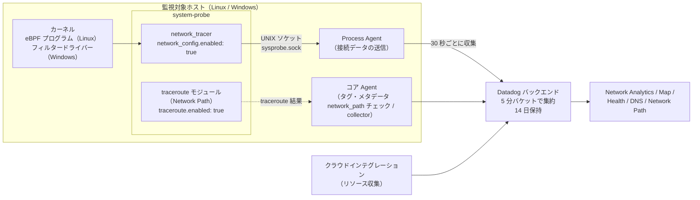
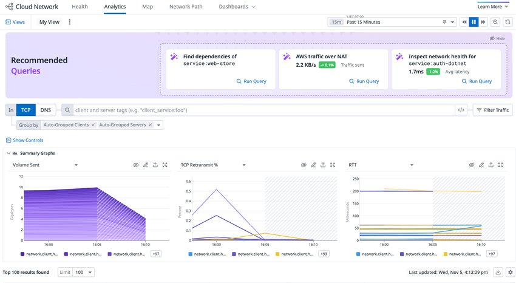
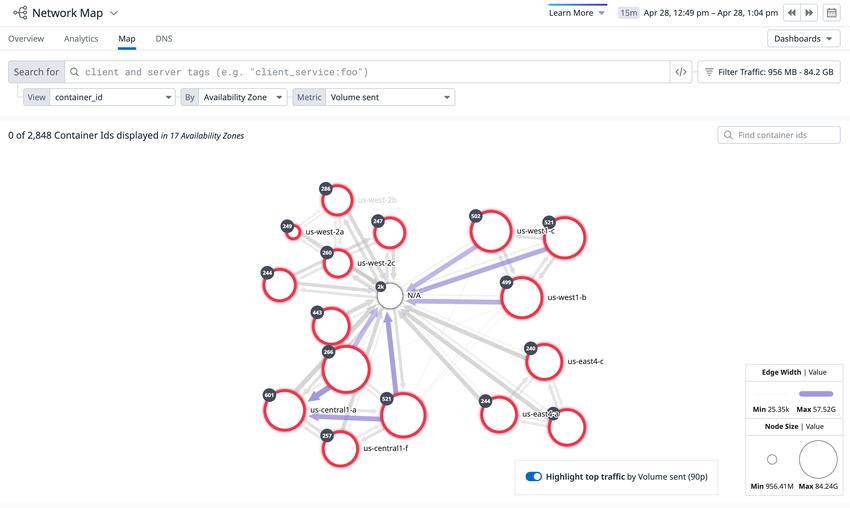
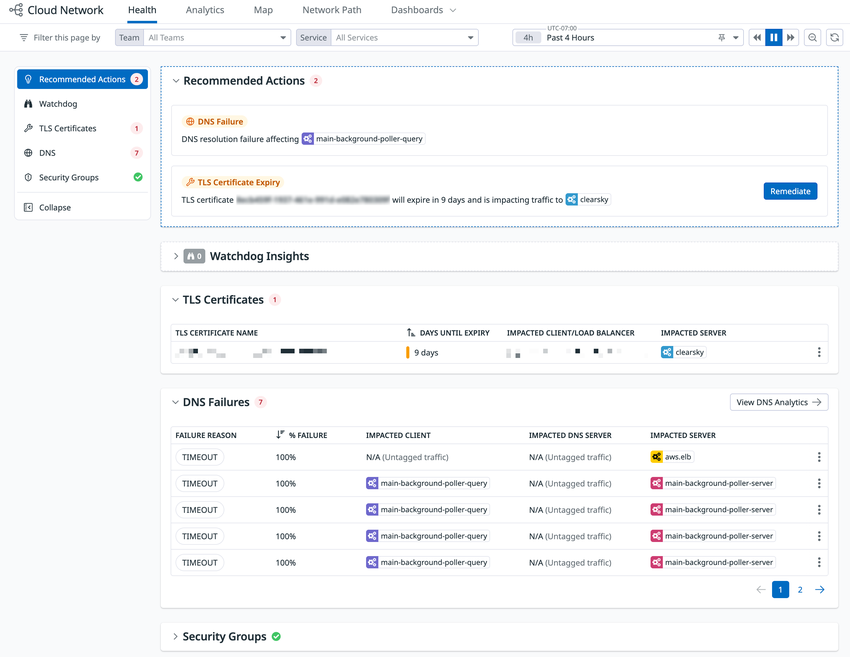
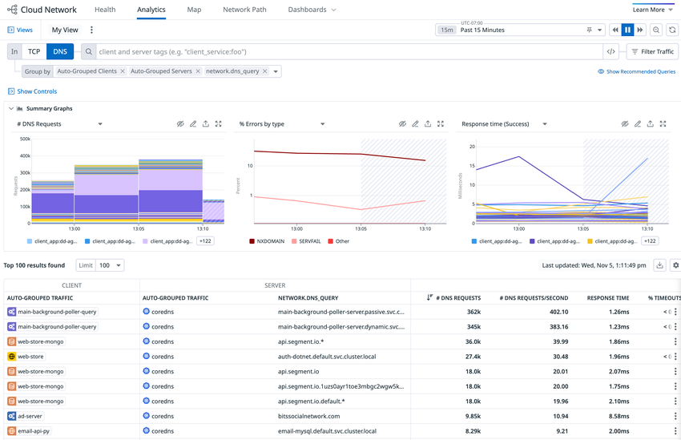
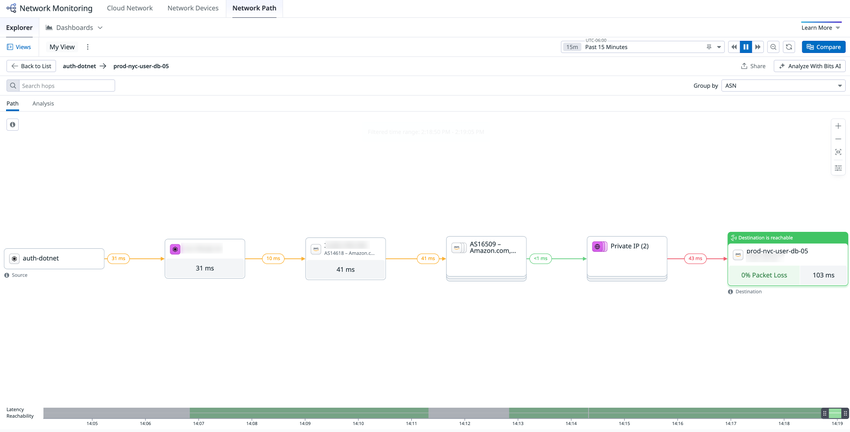

# Cloud Network Monitoring（旧称：Network Performance Monitoring / NPM）

## 概要

Datadog Cloud Network Monitoring（CNM、クラウドネットワークモニタリング）は、Datadog Agent がホスト上で収集した接続単位のデータ（IP、ポート、PID）を、`service`、`availability-zone`、`kube_service`、`container_name` などの Datadog タグで集約し、**クライアントとサーバー間の通信の依存関係と品質（通信量、TCP 再送、RTT、接続失敗、DNS エラー）**を可視化する製品である。[出典](https://docs.datadoghq.com/network_monitoring/cloud_network_monitoring/glossary/)

- **旧称**：Cloud Network Monitoring は、もとは **Network Performance Monitoring（NPM）**という名前だった。Datadog 公式ブログの編集注に「This post covers Cloud Network Monitoring, a Datadog feature that was originally called Network Performance Monitoring.」とある。[出典](https://www.datadoghq.com/blog/cloud-network-monitoring/)
- **改称時期**：改称の正確な日付は公開情報では確認できず。NPM は 2019-07-17 に発表された（公式ブログ公開日。2019-11-18 更新）。[出典](https://www.datadoghq.com/blog/cloud-network-monitoring/)
- **旧称の名残**：Operator の設定キー `features.npm`、Windows インストーラーの `ADDLOCAL="...,NPM"`、メトリクス `datadog.npm.host_instance`、モニター作成 URL `/monitors/create/network-performance`、画像パス `network_performance_monitoring` など、設定や URL には旧称が残っている。[出典](https://docs.datadoghq.com/network_monitoring/cloud_network_monitoring/setup/)
- system-probe の設定例ファイル内の `network_config` の説明文は、2026-11-02 時点でも「Network Performance Monitoring (NPM) module」と書かれている。[出典](https://github.com/DataDog/datadog-agent/blob/main/pkg/config/example/system-probe_linux.yaml.example)

CNM の主なユースケースは、公式ドキュメントでは次の 4 つとされている。[出典](https://docs.datadoghq.com/network_monitoring/cloud_network_monitoring/setup/)

| ユースケース | 内容 |
|---|---|
| 依存関係の把握 | 想定外の依存関係や遅いサービス依存を見つける |
| 通信コストの最適化 | 高額なリージョン間・マルチクラウド間の通信を見つけて減らす |
| 障害の切り分け | クラウドプロバイダーのリージョン障害やサードパーティの障害を見つける |
| DNS のトラブルシュート | DNS サーバーのメトリクスでサービスディスカバリーの不具合を調べる |

### Network Monitoring 製品群の中での位置付け

Datadog の Network Monitoring は複数の製品で構成される。本ファイルが扱う範囲は次のとおり。

| 製品・機能 | 内容 | 本ファイル | 詳細ファイル |
|---|---|---|---|
| Cloud Network Monitoring（CNM） | ホスト・コンテナ間のフロー（eBPF / Windows ドライバー） | 扱う | — |
| Network Analytics / Network Map / Network Health | CNM の分析画面 | 扱う | — |
| DNS Monitoring | CNM の DNS フロー分析 | 扱う | — |
| Network Path | traceroute によるホップ単位の経路可視化 | 扱う | Synthetic 側は [Synthetic Monitoring](../dem/synthetic-monitoring.md) |
| Network Device Monitoring（NDM）、NetFlow Monitoring | SNMP によるネットワーク機器監視、NetFlow 等のフローレコード | 扱わない（比較のみ） | [Network Device Monitoring](network-device-monitoring.md) |
| Universal Service Monitoring（USM） | 同じ system-probe（eBPF）で L7 の RED メトリクスを取得 | 扱わない | [Universal Service Monitoring](../apm/universal-service-monitoring.md) |
| ホストの `system.net.*` メトリクス | Network チェック（インターフェース単位の通信量） | 扱わない | [Infrastructure Monitoring](infrastructure-monitoring.md) |

> **CNM のフローと NetFlow の違い:** CNM のフローは、ホストで動く Datadog Agent が eBPF で集めたデータから作られる。NetFlow Monitoring のレコードは物理ネットワーク機器から受け取るもので、現時点では CNM のフローより情報が多い。CNM のフローはホスト・コンテナ・クラウド上のソフトウェアの接続問題の調査に、NetFlow のレコードは物理ネットワークの接続問題の調査とキャパシティプランニングに使う。（公式料金ページ FAQ）[出典](https://www.datadoghq.com/pricing/?product=network-monitoring)

## アーキテクチャとデータフロー

CNM のデータ収集は Datadog Agent の **system-probe**（システムプローブ）が担う。Linux では eBPF、Windows ではネットワークカーネルデバイスドライバー（フィルタードライバー）で接続を観測する。[出典](https://docs.datadoghq.com/network_monitoring/cloud_network_monitoring/setup/)



- データは **30 秒ごとに収集**され、**5 分のバケットに集約**され、**14 日間保持**される。[出典](https://docs.datadoghq.com/network_monitoring/cloud_network_monitoring/network_analytics/)
- **フロー（flow）**は、送信元（IP:Port）と宛先（IP:Port）の間で 5 分間に送受信された通信の記録である。似た宛先は 1 つのフローにまとめられ、フロー数が減ることがある。[出典](https://www.datadoghq.com/pricing/?product=network-monitoring)
- Kubernetes（Helm なし）の手順では、Process Agent（またはコア Agent コンテナ）に `DD_PROCESS_AGENT_ENABLED`、`DD_SYSTEM_PROBE_ENABLED` などを設定し、system-probe をサイドカーとして動かす。system-probe と Agent は UNIX ソケット `/var/run/sysprobe/sysprobe.sock` と認証トークン `/etc/datadog-agent/auth/token` を共有する。[出典](https://docs.datadoghq.com/network_monitoring/cloud_network_monitoring/setup/)
- Linux で Agent 7.65.0 以降はコンテナとプロセスの収集がコア Agent に統合されたが、CNM には引き続き Process Agent が必要である。詳しくは [Infrastructure Monitoring](infrastructure-monitoring.md) の Live Processes 節を参照。
- CNM は通信の**両端の間の通信**を分析する製品のため、Datadog は**意味のある範囲のインフラ、最低 2 ホスト以上**に導入するよう推奨している。[出典](https://docs.datadoghq.com/network_monitoring/cloud_network_monitoring/setup/)

## 対応プラットフォームと前提条件（eBPF 要件）

### OS とカーネル

| 区分 | 要件 | 出典 |
|---|---|---|
| Agent | **Agent v6.14 以上**（DNS Monitoring は 7.33 以上） | [出典](https://docs.datadoghq.com/network_monitoring/cloud_network_monitoring/setup/)、[出典](https://docs.datadoghq.com/network_monitoring/dns/) |
| Linux カーネル | **eBPF** を使うため、**カーネル 4.4.0 以上**、または eBPF 機能がバックポートされたカーネル | [出典](https://docs.datadoghq.com/network_monitoring/cloud_network_monitoring/setup/) |
| Linux ディストリビューション | Ubuntu 16.04+、Debian 9+、Fedora 26+、SUSE 15+、Amazon AMI 2016.03+、Amazon Linux 2、CentOS/RHEL 7.6+ | 同上 |
| CentOS/RHEL 7.6 の例外 | カーネル 4.4.0 未満でも対応（eBPF がバックポートされているため）。ただし **DNS Resolution（DNS 監視）は CentOS/RHEL 7.6 では非対応** | 同上 |
| Windows | ネットワークカーネルデバイスドライバーで収集。**Agent 7.27.1 以上**、**Windows Server 2012 R2 以上**（Windows 10 など同等のデスクトップ OS を含む） | 同上 |
| Windows コンテナ | **非対応**（Windows ホストのみ監視） | 同上 |
| macOS | **CNM は非対応**（Network Path は macOS 対応。後述） | 同上 |

- SELinux が有効なシステムでは、system-probe バイナリが eBPF 機能を使うための権限が必要になる。CentOS 系向け RPM パッケージには SELinux ポリシー（`system_probe_policy.te`）が同梱されている。その他のシステムでは手動でポリシーを適用する（後述）。[出典](https://docs.datadoghq.com/network_monitoring/cloud_network_monitoring/setup/)
- eBPF プログラムの読み込み方式（CO-RE、ランタイムコンパイル、プリコンパイル）について、CNM のセットアップドキュメントには記載がない。設定キーと既定値は公開情報では確認できず。

### コンテナ・ネットワーク関連の対応

| 対象 | 要件・内容 | 出典 |
|---|---|---|
| コンテナ | Docker、Kubernetes、ECS などに対応。`container_name`、`task_name`、`kube_service` などのタグでコンテナ、タスク、Pod、クラスター、Deployment 単位に集約できる | [出典](https://docs.datadoghq.com/network_monitoring/cloud_network_monitoring/setup/) |
| Istio | Istio サービスメッシュ上のコンテナ・Pod・サービス間の通信を可視化。**Istio v1.6.4 以上 + Agent v7.24.1 以上** | 同上 |
| Cilium | **Cilium 1.6 以上**、かつ**カーネル 5.1.16 以上**（4.19.x 系は 4.19.57 以上） | 同上 |
| Consul | 公式ブログで Consul ネットワーキング対応が案内されている（要件の詳細はセットアップドキュメントに記載なし） | 同上（Further Reading） |
| Amazon ECS（EC2 起動タイプ） | **Linux のみ** | [出典](https://docs.datadoghq.com/agent/amazon_ecs/) |
| ECS Fargate | **【Preview】**。Agent 7.58 以上。申込みは Datadog 担当者経由 | [出典](https://docs.datadoghq.com/network_monitoring/cloud_network_monitoring/setup/) |

### プロビジョニングツール

| ツール | 対応バージョン | 出典 |
|---|---|---|
| DaemonSet / Helm | 対応プラットフォーム表では **1.38.11 以上**。ただし Helm タブの手順では **Helm チャート v3.135.3 以上が必要**と書かれている | [出典](https://docs.datadoghq.com/network_monitoring/cloud_network_monitoring/setup/) |
| Chef | 12.7 以上（Datadog Chef レシピ） | 同上 |
| Ansible | 2.6 以上（Datadog Ansible ロール） | 同上 |

> **注意（公式ドキュメント内の記載差）:** Helm チャートの必要バージョンは、同じセットアップページの中で「1.38.11+」と「v3.135.3+」の 2 通りに書かれている。現行の手順（`datadog.networkMonitoring.enabled`）は Helm タブの記載に従って v3.135.3 以上を使うのが安全である。

### Agent バージョン別の機能要件（まとめ）

| 機能 | 最低 Agent バージョン | 出典 |
|---|---|---|
| CNM（基本） | 6.14 | [出典](https://docs.datadoghq.com/network_monitoring/cloud_network_monitoring/setup/) |
| Domain resolution（IP → ドメイン名） | 7.17 | [出典](https://docs.datadoghq.com/network_monitoring/cloud_network_monitoring/network_analytics/) |
| system-probe の自動起動 | 6.18 / 7.18（それ未満は手動起動） | [出典](https://docs.datadoghq.com/network_monitoring/cloud_network_monitoring/setup/) |
| `network_config` キー（それ未満は `system_probe_config`） | 7.24.1 | 同上 |
| Istio 対応 | 7.24.1 | 同上 |
| Windows 対応 | 7.27.1 | 同上 |
| DNS Monitoring | 7.33 | [出典](https://docs.datadoghq.com/network_monitoring/dns/) |
| ECS Fargate【Preview】 | 7.58 | [出典](https://docs.datadoghq.com/network_monitoring/cloud_network_monitoring/setup/) |
| Failed Connections（既定で有効） | 7.59 | 同上 |
| Host Unreachable / Network Unreachable | 7.68 | [出典](https://docs.datadoghq.com/network_monitoring/cloud_network_monitoring/network_analytics/) |
| Connection Cancels | 7.70 | 同上 |
| 非標準ポートの DNS 監視（`dns_monitoring_ports`） | 7.76.0 | [出典](https://docs.datadoghq.com/network_monitoring/cloud_network_monitoring/setup/) |
| Network Path 各機能 | 7.59〜7.84（[Network Path](#network-path) 節の表を参照） | [出典](https://docs.datadoghq.com/network_monitoring/network_path/setup/) |

## セットアップ

### Linux ホスト（Agent パッケージ）

Linux ホストで CNM を有効にする手順は次のとおり。[出典](https://docs.datadoghq.com/network_monitoring/cloud_network_monitoring/setup/)

1. Agent が v6.14 より古い場合は、先に Live Process 収集を有効にする（v6.14 以上なら不要）。
2. system-probe の設定例をコピーする。

   ```shell
   sudo -u dd-agent install -m 0640 /etc/datadog-agent/system-probe.yaml.example /etc/datadog-agent/system-probe.yaml
   ```

3. `/etc/datadog-agent/system-probe.yaml` で有効化フラグを `true` にする。

   ```yaml
   network_config:   # Agent 7.24.1 未満は system_probe_config を使う
     enabled: true
   ```

4. （任意、Agent v7.76.0 以上）非標準ポートの DNS 通信も監視する場合は `dns_monitoring_ports` を追加する。

   ```yaml
   network_config:
     enabled: true
     dns_monitoring_ports:
       - 53
       - 5353
   ```

5. Agent が v6.18 / 7.18 より古い場合は、system-probe を手動で起動し、ブート時に起動するよう設定する（`sudo systemctl start datadog-agent-sysprobe`、`sudo systemctl enable datadog-agent-sysprobe`）。v6.18 / 7.18 以上では Agent 起動時に自動で起動する。
6. Agent を再起動する（`sudo systemctl restart datadog-agent`。`systemctl` がない場合は `sudo service datadog-agent restart`）。

#### SELinux が有効なシステム

SELinux 有効環境（CentOS 系 RPM 以外）では、次の手順でポリシーを適用する。[出典](https://docs.datadoghq.com/network_monitoring/cloud_network_monitoring/setup/)

| 手順 | コマンド・内容 |
|---|---|
| 1. ポリシーの調整 | GitHub の基本ポリシー `system_probe_policy.te` を自環境の SELinux 構成に合わせて修正する（型や属性が存在しない、名前が違う場合がある） |
| 2. モジュールのコンパイル | `checkmodule -M -m -o system_probe_policy.mod system_probe_policy.te` → `semodule_package -o system_probe_policy.pp -m system_probe_policy.mod` |
| 3. モジュールの適用 | `semodule -v -i system_probe_policy.pp` |
| 4. バイナリのラベル付け | `semanage fcontext -a -t system_probe_t /opt/datadog-agent/embedded/bin/system-probe` → `restorecon -v /opt/datadog-agent/embedded/bin/system-probe` |
| 5. 再起動 | Agent を再起動する |

必要なユーティリティ（`checkmodule`、`semodule`、`semodule_package`、`semanage`、`restorecon`）は Ubuntu、Debian、RHEL、CentOS、SUSE など多くのディストリビューションで利用できる。

### Windows ホスト

Windows ではフィルタードライバーでネットワークデータを収集する。[出典](https://docs.datadoghq.com/network_monitoring/cloud_network_monitoring/setup/)

1. **Agent 7.27.1 以上**を、ネットワークドライバーコンポーネントを有効にしてインストールする。
   - 公式手順では「【非推奨】（バージョン 7.44 以下）インストール時に `msiexec` に `ADDLOCAL="MainApplication,NPM"` を渡すか、GUI インストールで "Cloud Network Monitoring" を選ぶ」と記載されている。7.45 以降でコンポーネントの明示指定が不要になったのかどうかは、公式ドキュメントに明記がない（公開情報では確認できず）。
2. `C:\ProgramData\Datadog\system-probe.yaml` で `network_config.enabled: true` を設定する（任意で `dns_monitoring_ports`、Agent v7.76.0 以上）。
3. Agent を再起動する（PowerShell：`restart-service -f datadogagent`、コマンドプロンプト：`net /y stop datadogagent && net start datadogagent`）。

- Windows で system-probe のネットワークモジュールを有効にすると、カーネルドライバーが読み込まれる。[出典](https://github.com/DataDog/datadog-agent/blob/main/pkg/config/example/system-probe_linux.yaml.example)（設定例ファイルの `network_config.enabled` の説明）
- CNM が監視するのは Windows ホストのみで、Windows コンテナは監視しない。

### Kubernetes（Helm）

Helm では `values.yaml` に次を追加する（**Helm チャート v3.135.3 以上**）。[出典](https://docs.datadoghq.com/network_monitoring/cloud_network_monitoring/setup/)

```yaml
datadog:
  networkMonitoring:
    enabled: true
    # 任意（Agent v7.76.0 以上）：非標準ポートの DNS 監視
    dnsMonitoringPorts:
      - 53
      - 5353
```

環境によって次の追加設定が必要になる。

| 環境 | 追加する `values.yaml` 設定 |
|---|---|
| GKE Autopilot | `providers.gke.autopilot: true` |
| Google Container-Optimized OS（COS） | `providers.gke.cos: true` |
| Bottlerocket Linux | `agents.containers.systemProbe.securityContext.seLinuxOptions` に `user: system_u`、`role: system_r`、`type: super_t`、`level: s0` |

Kubernetes 上の Agent 全般の構成は [コンテナ/Kubernetes向けAgent](../platform/kubernetes-and-containers-agent.md) を参照。

### Kubernetes（Helm なし、マニフェスト）

新規に導入する場合は、公式のマニフェストテンプレート `datadog-agent-npm.yaml` をダウンロードし、`<DATADOG_API_KEY>` を API キーに置き換えて `kubectl apply -f datadog-agent.yaml` で DaemonSet をデプロイする。US1 以外のサイトでは `DD_SITE` 環境変数を設定する（公式手順の例は EU の `datadoghq.eu`。AP1 なら `ap1.datadoghq.com`。サイトの値は [Datadog Sites](../platform/datadog-sites.md) を参照）。[出典](https://docs.datadoghq.com/network_monitoring/cloud_network_monitoring/setup/)

既存のマニフェストに追加する場合の変更点は次のとおり。[出典](https://docs.datadoghq.com/network_monitoring/cloud_network_monitoring/setup/)

| 変更箇所 | 内容 |
|---|---|
| AppArmor（Kubernetes 1.30 未満） | Pod テンプレートにアノテーション `container.apparmor.security.beta.kubernetes.io/system-probe: unconfined` |
| AppArmor（Kubernetes 1.30 以上） | Pod の `securityContext.appArmorProfile.type: Unconfined` |
| 環境変数（Process Agent コンテナ、またはコア Agent コンテナ） | `DD_PROCESS_AGENT_ENABLED=true`、`DD_SYSTEM_PROBE_ENABLED=true`、`DD_SYSTEM_PROBE_EXTERNAL=true`、`DD_SYSPROBE_SOCKET=/var/run/sysprobe/sysprobe.sock`、`DD_AUTH_TOKEN_FILE_PATH=/etc/datadog-agent/auth/token` |
| Agent コンテナのボリュームマウント | `procdir`→`/host/proc`（RO）、`cgroups`→`/host/sys/fs/cgroup`（RO）、`debugfs`→`/sys/kernel/debug`、`sysprobe-socket-dir`→`/var/run/sysprobe`、`auth-token`→`/etc/datadog-agent/auth`（**RW**、認証トークンを書き込むため） |
| system-probe サイドカー | イメージ `registry.datadoghq.com/agent:latest`、コマンド `/opt/datadog-agent/embedded/bin/system-probe`、環境変数 `DD_SYSTEM_PROBE_ENABLED`、`DD_SYSPROBE_SOCKET`、`DD_AUTH_TOKEN_FILE_PATH`、同じボリューム（`auth-token` は RO） |
| system-probe の capabilities | `SYS_ADMIN`、`SYS_RESOURCE`、`SYS_PTRACE`、`NET_ADMIN`、`NET_BROADCAST`、`NET_RAW`、`IPC_LOCK`、`CHOWN` |
| system-probe のリソース（例） | requests：memory `150Mi`、cpu `200m`／limits：memory `300Mi`、cpu `400m` |
| ボリューム定義 | `debugfs`（hostPath `/sys/kernel/debug`）、`sysprobe-socket-dir`（emptyDir）、`auth-token`（emptyDir） |

### Datadog Operator

Datadog Operator（`DatadogAgent` リソース、`datadoghq.com/v2alpha1`）では次のように設定する。[出典](https://docs.datadoghq.com/network_monitoring/cloud_network_monitoring/setup/)

```yaml
apiVersion: datadoghq.com/v2alpha1
kind: DatadogAgent
metadata:
  name: datadog
spec:
  features:
    npm:
      enabled: true
```

（公式ドキュメントの例では `kind` が省略されているが、Operator のリソース種別は `DatadogAgent` である。キー名 `npm` は旧称のまま。）

### Docker

コンテナ版 Agent を `docker run` で起動する場合の要点は次のとおり。`docker-compose` でも同じ環境変数・ボリューム・capabilities・`security_opt` を指定する。[出典](https://docs.datadoghq.com/network_monitoring/cloud_network_monitoring/setup/)

| 項目 | 値 |
|---|---|
| 環境変数 | `DD_API_KEY`、`DD_SYSTEM_PROBE_NETWORK_ENABLED=true`、`DD_PROCESS_AGENT_ENABLED=true` |
| 名前空間 | `--cgroupns host`、`--pid host` |
| ボリューム | `/var/run/docker.sock:/var/run/docker.sock:ro`、`/proc/:/host/proc/:ro`、`/sys/fs/cgroup/:/host/sys/fs/cgroup:ro`、`/sys/kernel/debug:/sys/kernel/debug` |
| セキュリティ | `--security-opt apparmor:unconfined` |
| capabilities | `SYS_ADMIN`、`SYS_RESOURCE`、`SYS_PTRACE`、`NET_ADMIN`、`NET_BROADCAST`、`NET_RAW`、`IPC_LOCK`、`CHOWN` |
| イメージ | `registry.datadoghq.com/agent:latest` |

### Amazon ECS（EC2 起動タイプ）

ECS では、公式サンプルのタスク定義 `datadog-agent-sysprobe-ecs.json`（Amazon Linux 1 は `datadog-agent-sysprobe-ecs1.json`）を使う。既存のタスク定義に追加する場合は次を設定する。**Linux のみ対応**。[出典](https://docs.datadoghq.com/agent/amazon_ecs/)

| 項目 | 値 |
|---|---|
| 環境変数 | `DD_SYSTEM_PROBE_NETWORK_ENABLED=true` |
| マウント | ホストの `/sys/kernel/debug` を `debug` ボリュームとしてコンテナの `/sys/kernel/debug` にマウント |
| `linuxParameters.capabilities.add` | `SYS_ADMIN`、`SYS_RESOURCE`、`SYS_PTRACE`、`NET_ADMIN`、`NET_BROADCAST`、`NET_RAW`、`IPC_LOCK`、`CHOWN` |
| `requiresCompatibilities` | `EC2` |

### ECS Fargate【Preview】

ECS Fargate での CNM は Preview で、Datadog 担当者を通じて申し込む。**Agent 7.58 以上**が必要。[出典](https://docs.datadoghq.com/network_monitoring/cloud_network_monitoring/setup/)

- 新規の Fargate デプロイでは、Fargate のプロセス収集を有効にする。
- 既存のタスク定義には、環境変数 `DD_SYSTEM_PROBE_NETWORK_ENABLED=true`、`DD_NETWORK_CONFIG_ENABLE_EBPFLESS=true`、`DD_PROCESS_AGENT_ENABLED=true` と、Linux capability `SYS_PTRACE` を追加する。
- 環境変数名 `DD_NETWORK_CONFIG_ENABLE_EBPFLESS` から、Fargate では eBPF を使わない収集方式で動くと読み取れる。方式の詳細は公開情報では確認できず。

### クラウドインテグレーションによる Enhanced resolution（任意）

クラウドインテグレーションのリソース収集を有効にすると、CNM がクラウドのマネージドエンティティ（ロードバランサーなど）を識別できるようになる（Enhanced resolution）。[出典](https://docs.datadoghq.com/network_monitoring/cloud_network_monitoring/setup/)

| クラウド | 必要な設定 | 見えるようになるもの |
|---|---|---|
| AWS | [AWS Integration](../platform/aws-integration.md) のリソース収集を有効化。**ENI と EC2 のメトリクス収集も有効にする必要がある** | AWS のロードバランサー、NAT Gateway、VPC Internet Gateway、VPC Endpoint |
| Azure | [Azure Integration](../platform/azure-integration.md) をインストール | Azure のロードバランサー、Application Gateway |

> **サイト差異:** セットアップページでは、この Enhanced resolution の案内が「app.datadoghq.com（US1）、us3、us5、app.datadoghq.eu（EU1）、uk1 のユーザー向けの重要な注記」として掲載されている。AP1・AP2・US1-FED が対象外なのか、単に記載がないだけなのかは公開情報では確認できず。[出典](https://docs.datadoghq.com/network_monitoring/cloud_network_monitoring/setup/)

### Failed Connections（接続失敗の収集）

Failed Connections は、TCP の失敗（リセット、拒否、タイムアウト）を収集・表示する機能である。**Agent 7.59 以上で既定で有効**で、[CNM Analytics](https://app.datadoghq.com/network) の Customize メニューで **Failures** トグルをオンにすると表示される。[出典](https://docs.datadoghq.com/network_monitoring/cloud_network_monitoring/setup/)

- 一部の Agent が 7.59 未満だと、失敗が少なく報告されることがある。Datadog は**すべてのホストで同じ Agent バージョンを使う**よう推奨している。

## 画面構成とナビゲーション

CNM の画面は **Infrastructure > Cloud Network**（URL：`/network`）にあり、上部タブで **Health**、**Analytics**、**Map**、**Network Path**、**Dashboards** を切り替える（2026-11-02 時点の公式スクリーンショットによる）。Analytics 内で **TCP** / **DNS** を切り替える。[出典](https://docs.datadoghq.com/network_monitoring/cloud_network_monitoring/network_analytics/)

| 画面 | URL | 役割 |
|---|---|---|
| Network Health【Preview】 | `/network`（Health タブ） | DNS、TLS 証明書、セキュリティグループ、異常の問題を優先度付きで表示 |
| Network Analytics | `/network` | クライアント・サーバー間のフローをタグで集約した表とグラフ |
| DNS（Analytics の DNS トグル） | `/network/dns` | クライアント → DNS サーバーの依存関係と DNS メトリクス |
| Network Map | `/network/map` | タグ単位のトポロジーマップ |
| Network Path | `/network/path` | traceroute によるホップ単位の経路 |
| Autonomous Systems View | `/network-path/autonomous-systems` | 経路上の AS（ISP・事業者）単位の性能 |

## Network Analytics

Network Analytics は、クライアントとサーバーの間のネットワークデータを、グループ化タグに基づいてグラフ化・分析する CNM の画面である。[出典](https://docs.datadoghq.com/network_monitoring/cloud_network_monitoring/glossary/)



- **キャプション**：Cloud Network > Analytics 画面（TCP 表示）。
- **画面の説明**：上部に Health / Analytics / Map / Network Path / Dashboards のタブ、右上に時間範囲（例：Past 15 Minutes）。その下の紫色の **Recommended Queries** 領域に 3 枚のタイル（例：「Find dependencies of service:web-store」「AWS traffic over NAT」「Inspect network health for service:auth-dotnet」）があり、各タイルに値と前時間比、**Run Query** ボタンがある。その下に **TCP / DNS** の切り替え、タグ検索バー（`client_service:foo` のような形式）、**Filter Traffic** ボタン、**Group by**（既定は Auto-Grouped Clients / Auto-Grouped Servers）。**Summary Graphs** に 3 つのグラフ（Volume Sent、TCP Retransmit %、RTT）。最下部に「Top 100 results found」と Limit（100）の選択がある。
- **出典**：https://docs.datadoghq.com/network_monitoring/cloud_network_monitoring/network_analytics/ （取得日 2026-11-02）

### クエリとグループ化

| 項目 | 内容 | 出典 |
|---|---|---|
| 検索 | タグでネットワーク接続を絞り込み・集約する。インテグレーションのタグや [Unified Service Tagging](../platform/tagging.md) のタグが自動で使える | [出典](https://docs.datadoghq.com/network_monitoring/cloud_network_monitoring/network_analytics/) |
| client / server タグ | `client_` と `server_` を付けたタグで、2 組のタグの**間**の通信を表示する（例：`client_service:orders-app` で絞り、Group By に `client_service` と `server_availability-zone`） | 同上 |
| 既定の集約 | クライアント・サーバーとも `service` タグで集約。表の各行は 1 時間分のサービス間の集約接続 | 同上 |
| Auto-grouped traffic | `service`、`kube_service`、`short_image`、`container_name` などよく使うタグで自動的にバケット化する。アイコンにマウスを置くとタグの出どころが表示される | 同上 |
| すべてのホストを 1 グループで見る | Group By に `client_host` と `Auto-Grouped-Servers` を指定 | 同上 |
| Recommended queries | ページ上部に表示される定型クエリ。クリックで検索バー・Group by・サマリーグラフが設定される。例：`Find dependencies of service: web-store` → `client_service: web-store`。直近 1 時間の変化も表示 | 同上 |
| ワイルドカード | `client_service:web*`（前方一致）、`*web`（後方一致）、`*web*`（部分一致）。ファセット内でも使える | 同上 |
| Facet panels | Client / Server タブで利用可能なタグを一覧・フィルター。既定で `service`、`availability zone`、`env`、`environment`、`pod`、`host`、`ip`、`port` など | 同上 |
| Custom facets | ファセットパネル右上の **+ Add** で任意のタグをファセットに追加。Analytics と Network Map の両方で使える。下部の `Custom` 節に表示 | 同上 |
| Neutral tags | クライアント・サーバーのどちらでもなくフロー全体に付くタグ（例：`tls_encrypted`）。後述の[タグ](#タグ)節を参照 | 同上 |
| AI エージェントからの照会 | Datadog MCP Server の `analyze_cloud_network_monitoring` ツールでネットワークデータを照会できる | 同上 |

#### クライアントとサーバーの向き

Network Analytics のフローは**向きを持ち、対称ではない**。[出典](https://docs.datadoghq.com/network_monitoring/cloud_network_monitoring/network_analytics/)

- **Client（クライアント）**は接続を開始した側、**Server（サーバー）**は応答した側である。
- 逆方向（サーバー → クライアント）は別のフローとして表示され、その向きで接続が開始されていなければデータがないこともある。例：`us-east-1d` のクライアントが `us-east-1c` のサーバーへ通信していても、`us-east-1d` にサーバーがなければ逆の行（`us-east-1c → us-east-1d`）はほぼ空になる。
- プロキシや NAT、アプリケーションの挙動によっても非対称になる。

### Summary graphs（サマリーグラフ）

サマリーグラフは、ネットワークの要約表示で、**1〜3 個**のグラフを表示できる。グラフのタイトルをクリックしてデータを、鉛筆アイコンで表示形式を変える。[出典](https://docs.datadoghq.com/network_monitoring/cloud_network_monitoring/network_analytics/)

| 設定 | 選択肢 |
|---|---|
| データ | Volume Sent、Throughput Sent、Volume Received、Throughput Received、Established Connections、Closed Connections、Established Connections / Second、Closed Connections / Second、TCP Latency |
| Y 軸スケール | Linear、Log、Pow、Sqrt |
| グラフ種類 | Area、Line、Bars、Toplist、Change、Piechart |

- グラフ上の系列をクリックして **Isolate this series** を選ぶと、その通信だけを表示するページが開く。[出典](https://docs.datadoghq.com/network_monitoring/cloud_network_monitoring/guide/detecting_application_availability/)

### 表（Network table）

ネットワーク表は、クエリで定義した**送信元（source）と宛先（destination）**ごとに Volume、Throughput、TCP Retransmits、Round-trip Time（RTT）、RTT variance を表示する。右上の歯車アイコン（Customize）で列を設定する。[出典](https://docs.datadoghq.com/network_monitoring/cloud_network_monitoring/network_analytics/)

| 表示オプション | 既定 | 内容 |
|---|---|---|
| Show Datadog Traffic | オン | Datadog Agent 自身の通信を表示 |
| Show External Traffic | オン | パブリック IP 宛ての通信を表示 |
| Show N/A (Unresolved Traffic) | 公開情報では既定値を確認できず | クライアントまたはサーバーが解決できない（`N/A`）集約接続の表示切り替え |
| Show pre-NAT IPs | オフ | オンで NAT 前の IP を表示（後述） |
| Failures | Customize メニューのトグル | TCP の失敗（リセット・拒否・タイムアウト）を表示 |

#### 解決できない通信（Unresolved traffic / N/A）

クライアントやサーバーのタグが解決できない通信は `N/A` と表示される。主な原因は次のとおり。[出典](https://docs.datadoghq.com/network_monitoring/cloud_network_monitoring/network_analytics/)

| 原因 | 典型例 |
|---|---|
| IP に集約用タグが付いていない | ホストやコンテナに `service` タグがない |
| プライベートネットワーク外のエンドポイント | Agent がタグ付けできない外部 IP |
| Agent を入れられない機器 | ファイアウォール、サービスメッシュ |
| 宛先にサービスが付いていない | IP がどのサービスにも対応付けられていない |

### サイドパネル

表の行をクリックすると、2 つのエンドポイント間の依存関係を調べるサイドパネルが開く。[出典](https://docs.datadoghq.com/network_monitoring/cloud_network_monitoring/network_analytics/)

| タブ・要素 | 内容 |
|---|---|
| Common tags | 直近の接続で共通するクライアント・サーバーのタグ（コンテナ、タスク、ホスト、AZ、クラウドアカウント、Deployment など） |
| Flows | IP・ポート単位のフロー。TCP / UDP の別、RTT、Jitter、送受信パケットなど |
| Logs | 関連するログ |
| Traces | 選択したフローに関連する APM トレース。ネットワークの RTT とアプリのリクエスト時間（Duration）を比べ、ネットワーク起因かアプリ起因かを切り分ける |
| Processes | 送信元・宛先で動くプロセス。CPU やメモリを使い過ぎているプロセスを特定 |
| Integration Metrics | クラウドサービス（例：S3）のインテグレーションメトリクス |
| Security | [Workload Protection](../security/workload-protection.md) と Cloud Security Misconfigurations（[Cloud Security](../security/cloud-security.md)）が検出した、そのフローに関連する脅威や設定ミス |

- 表の行の三点メニューから **Network Path** に移動でき、同じ送信元・宛先間の経路を表示できる。[出典](https://docs.datadoghq.com/network_monitoring/cloud_network_monitoring/network_analytics/)
- Analytics の **Saved Views** で、クエリ・表の構成・グラフのメトリクスを保存できる（**+ Save** で保存、**Views** で読み込み、歯車で名前変更、リンクアイコンでパーマリンクをコピー）。[出典](https://docs.datadoghq.com/network_monitoring/cloud_network_monitoring/network_analytics/)

### Cloud service autodetection（クラウドサービスの自動検出）

CNM は、Agent を入れられないマネージドクラウドサービスへの通信を自動で識別する。[出典](https://docs.datadoghq.com/network_monitoring/cloud_network_monitoring/network_analytics/)

| クラウド | 自動検出の対象 | 補足 | 出典 |
|---|---|---|---|
| AWS | S3（`s3_bucket` で分解可）、RDS（`rds_instance_type` で分解可）、Kinesis、ELB、ElastiCache など。公式一覧には 300 以上のサービス名が載っている | `server_service:aws.s3` のように指定 | [出典](https://docs.datadoghq.com/network_monitoring/cloud_network_monitoring/supported_cloud_services/aws_supported_services/) |
| Google Cloud | App Engine、Google DNS、Gmail などへの API 呼び出し。公式一覧には約 200 のサービス名が載っている | — | [出典](https://docs.datadoghq.com/network_monitoring/cloud_network_monitoring/supported_cloud_services/gcp_supported_services/) |
| Azure | `access_control_service`、`active_directory`、`api_management`、`app_service`、`biz_talk_services`、`blob_storage`、`container_registry`、`cosmos_db`、`files`、`key_vault`、`management_services`、`media_services`、`mobile_apps`、`postgres`、`queue_storage`、`service_bus`、`sql_database`、`table_storage`、`traffic_manager`（19 種） | — | [出典](https://docs.datadoghq.com/network_monitoring/cloud_network_monitoring/supported_cloud_services/azure_supported_services/) |

- 上記以外の Agent を入れられないエンドポイント（パブリック API など）は、宛先を `domain` タグでグループ化して監視する。

#### Enhanced resolution で付くタグ

Enhanced resolution を設定すると、クラウドから収集したリソースで通信をフィルター・グループ化でき、次のタグ（とユーザー定義タグ）が自動で付く。[出典](https://docs.datadoghq.com/network_monitoring/cloud_network_monitoring/network_analytics/)

| リソース | 自動付与されるタグ |
|---|---|
| AWS Load Balancer | `name`、`loadbalancer`、`load_balancer_arn`、`dns_name`（形式 `loadbalancer/dns:`）、`region`、`account_id`、`scheme` |
| AWS NAT Gateway | `gateway_id`、`gateway_type`、`aws_nat_gateway_id`、`aws_nat_gateway_public_ip`、`aws_account`、`availability-zone`、`region` |
| AWS VPC Internet Gateway | `gateway_id`、`gateway_type`、`aws_internet_gateway_id`、`aws_account`、`region` |
| AWS VPC Endpoint | `gateway_id`、`gateway_type`、`aws_vpc_endpoint_id` |
| Azure Load Balancer / Application Gateway | `name`、`loadbalancer`、`cloud_provider`、`region`、`type`、`resource_group`、`tenant_name`、`subscription_name`、`subscription_id`、`sku_name` |

### Domain resolution（ドメイン名の解決）

**Agent 7.17 以上**では、外部・内部の通信の IP を人が読めるドメイン名に解決する。ドメインは `domain` タグとして保存され、検索バーやファセットで使える。S3 バケット、ALB、外部 API など Agent を入れられないエンドポイントの監視に使え、DGA（ドメイン生成アルゴリズム）由来のような不審なドメインはセキュリティ上の脅威の手掛かりになる。[出典](https://docs.datadoghq.com/network_monitoring/cloud_network_monitoring/network_analytics/)

- DNS 解決は、system-probe がルートネットワーク名前空間で動いているホストでサポートされる。公式の原文は「DNS resolution is supported for hosts where the system probe is running on the root network namespace, which is usually caused by running the system-probe in a container without using the host network.」である。字面どおりに読むと、ホストネットワークを使わないコンテナ実行が「ルート名前空間で動いている」状態の原因になる。しかし、ホストネットワークを使わないコンテナは通常ルート名前空間の外で動くため、この読み方では技術的に筋が通らない。【推定】原文は「サポートされないのは、system-probe がルート名前空間の外で動いている場合で、これは通常ホストネットワークを使わずにコンテナで動かしたときに起きる」という意味と考えられる。この解釈が正しければ、system-probe をコンテナで動かすときはホストネットワークを使う必要がある。[出典](https://docs.datadoghq.com/network_monitoring/cloud_network_monitoring/network_analytics/)

### Network Address Translation（NAT）

Kubernetes などは NAT でコンテナ間の通信をルーティングする。CNM では **NAT 前の IP（pre-NAT IP）**の有無から、独自にルーティングする Kubernetes ネイティブのサービスと、外部クライアントのルーティングに頼るサービスを見分けられる。[出典](https://docs.datadoghq.com/network_monitoring/cloud_network_monitoring/network_analytics/)

- 表の設定の **Show pre-NAT IPs** トグルで NAT 前後の IP を表示する。オフのとき、Client IP / Server IP 列は NAT 後の IP。
- 1 つの NAT 後 IP に複数の NAT 前 IP がある場合は、**多い順に上位 5 つ**の NAT 前 IP を表示する。
- `pre_nat.ip` はタグとして集約・フィルターに使える。
- この機能は **NAT Gateway の解決は含まない**（NAT Gateway は AWS の Enhanced resolution で識別する）。

### Network ID（重複する IP 空間）

複数の VPC で IP アドレス範囲が重複する場合でも宛先を正しく分類するため、CNM は **Network ID**（互いに通信できる IP アドレスの集合を表す英数字の識別子、タグとして表現）を使う。[出典](https://docs.datadoghq.com/network_monitoring/cloud_network_monitoring/network_analytics/)

| 環境 | Network ID の決まり方 |
|---|---|
| AWS、Google Cloud | 自動で **VPC ID** が設定される |
| その他（オンプレミス、Azure など） | 手動で設定する。`datadog.yaml` の `network.id`、またはプロセス Agent とコア Agent のコンテナに環境変数 `DD_NETWORK_ID` |

```yaml
# datadog.yaml
network:
  id: <your-network-id>
```

（公式ドキュメントの例ではキーが `Id` と大文字で書かれている。YAML のキーは小文字の `id` が通常の表記だが、大文字小文字を区別するかは公開情報では確認できず。）

## Network Map

Network Map は、ネットワークのトポロジーを有向マップで表示し、ネットワークの分断、依存関係、ボトルネックを見つけるための画面である。Agent が自動収集したデータを可視化するため、**追加のセットアップは不要**。[出典](https://docs.datadoghq.com/network_monitoring/cloud_network_monitoring/network_map/)



- **キャプション**：Network Map 画面（Map タブ）。
- **画面の説明**：旧 UI のスクリーンショットのため、上部のタブは Overview / Analytics / Map / DNS で、現行のタブ構成（Health / Analytics / Map / Network Path / Dashboards。「画面構成とナビゲーション」節を参照）とは異なる。検索バーの下に **View**（ノードが表すタグ。例：`container_id`）、**By**（クラスタリングのタグ。例：Availability Zone）、**Metric**（エッジが表すメトリクス。例：Volume sent）の 3 つのドロップダウンと、右側に **Filter Traffic**（例：956 MB - 84.2 GB）。中央に「0 of 2,848 Container Ids displayed in 17 Availability Zones」と表示され、AZ（us-west-2a、us-central1-a など）ごとのクラスターが円で、`N/A` ノードが中央に描かれる。クラスターの数字はノード数、赤い枠はアラート中のモニターがあることを示す。右下に Edge Width と Node Size の凡例、下部に **Highlight top traffic by Volume sent (90p)** トグルがある。
- **出典**：https://docs.datadoghq.com/network_monitoring/cloud_network_monitoring/network_map/ （取得日 2026-11-02）

### 設定項目

| 項目 | 内容 | 出典 |
|---|---|---|
| ノード（View） | ノードが表すタグを選ぶ。選べるタグは Analytics と同じ | [出典](https://docs.datadoghq.com/network_monitoring/cloud_network_monitoring/network_map/) |
| クラスタリング（By） | ノードが多すぎると 2 つ目のタグが自動で追加される。By ドロップダウンで変更可 | 同上 |
| エッジ（Metric） | Throughput sent、Throughput received、TCP Retransmits、TCP Latency、TCP Jitter、Established Connections、Closed Connections（ガイドの例では Volume Sent も使われている） | 同上、[出典](https://docs.datadoghq.com/network_monitoring/cloud_network_monitoring/guide/detecting_application_availability/) |
| フィルター | 環境・名前空間など任意のタグで絞り込み、ファジー文字列一致、未解決の通信の表示、アクティブなメトリクスのパーセンタイル範囲外の通信を非表示 | [出典](https://docs.datadoghq.com/network_monitoring/cloud_network_monitoring/network_map/) |

### 操作

- ノードにマウスを置くと、そのノードが送受信する通信の向きがアニメーション表示される。
- ノードをクリックして **Inspect** を選ぶと、より大きなネットワークの中での位置付けを表示する。
- 大きなマップは読み込み時間と見やすさのため**自動でクラスタリング**される。クラスターをクリックで展開、周りの灰色部分をクリックで折りたたむ。
- **赤い枠のクラスター**：グループ化に使ったタグと一致するタグ（例：グループ化が service なら `service:<nodeName>`）を持つモニターがアラート状態であることを示す。[出典](https://docs.datadoghq.com/network_monitoring/cloud_network_monitoring/network_map/)
- エッジの太さは選んだメトリクスの大きさを表す。点線のエッジをクリックすると Network Analytics に移動する。[出典](https://docs.datadoghq.com/network_monitoring/cloud_network_monitoring/guide/detecting_application_availability/)

## Network Health【Preview】

Network Health は、DNS、TLS 証明書、セキュリティグループ、ネットワークの異常にまたがる重大な問題を自動で検出・優先順位付けし、対処方法と合わせて 1 画面に表示する機能である。**Preview** のため、利用には Datadog 担当者への申込みが必要。[出典](https://docs.datadoghq.com/network_monitoring/cloud_network_monitoring/network_health/)



- **キャプション**：Cloud Network > Health 画面。
- **画面の説明**：上部に **Team** と **Service** のフィルター、時間範囲（例：Past 4 Hours）。左側のメニューに Recommended Actions、Watchdog、TLS Certificates、DNS、Security Groups と件数バッジ。右側に、**Recommended Actions**（例：「DNS Failure：DNS resolution failure affecting main-background-poller-query」「TLS Certificate Expiry：TLS certificate ... will expire in 9 days」と **Remediate** ボタン）、**Watchdog Insights**、**TLS Certificates**（証明書名、有効期限までの日数、影響を受けるクライアント／ロードバランサー、影響を受けるサーバー）、**DNS Failures**（失敗理由 TIMEOUT など、失敗率、影響を受けるクライアント、DNS サーバー、サーバー、**View DNS Analytics** ボタン）、**Security Groups** の各セクションが並ぶ。
- **出典**：https://docs.datadoghq.com/network_monitoring/cloud_network_monitoring/network_health/ （取得日 2026-11-02）

| セクション | 内容 | 前提・補足 |
|---|---|---|
| Recommended Actions | 最も重大な問題を、**Severity**（通信を実際に止めているか）と **Impact**（影響サービスの重要度）で優先順位付け。問題内容、影響を受けるクライアントサービス・サーバーサービスを表示。**Remediate** で手順を表示し、[Workflow](../service-management/workflow-automation.md) 作成、[Case](../service-management/case-management.md) 作成、[Incident](../service-management/incident-management.md) 宣言ができる | — |
| Watchdog Insights | [Watchdog](../platform/watchdog.md) が検出した TCP 再送の急増など。比較の基準は通常、前週 | — |
| TLS certificates | 期限切れ（通信を止めている）・期限間近の証明書と、影響を受けるクライアント・サーバー（クライアントが ALB の場合もある）。AWS での更新手順を表示 | — |
| DNS failures | 失敗理由（`NXDOMAIN`、`TIMEOUT`、`SERVFAIL`）、影響を受ける DNS サーバー、影響を受けるサービス | — |
| Security groups | 通信を止めているセキュリティグループの設定ミス、通信できないサービス、ルールの最近の変更。サイドパネルの **View in AWS** と Infrastructure Change Tracking で変更時刻を特定 | **AWS のみ**。AWS インテグレーションで **EC2 のリソース収集**が必要 |
| フィルター | Service、Team | — |

[出典](https://docs.datadoghq.com/network_monitoring/cloud_network_monitoring/network_health/)

- 公式ブログ（2025-12-23 公開）では、Network Health がセキュリティグループに加えて NACL の変更による接続断も相関分析すると説明されている。[出典](https://www.datadoghq.com/blog/cnm-network-health/)

## DNS Monitoring

DNS Monitoring は、CNM の一部として DNS サーバーの性能を可視化し、サーバー側とクライアント側の DNS 問題を見つける機能である。前提は **Agent 7.33 以上**と CNM の有効化。[出典](https://docs.datadoghq.com/network_monitoring/dns/)

DNS Monitoring で分かることは次のとおり。

- どの Pod やサービスが DNS リクエストを出し、どのサーバーが処理しているか
- リクエストの多いクライアントと、そのクエリレート
- 応答時間が徐々に、または急に悪化している DNS サーバー
- エラー率が高い DNS サーバーとエラーの種類
- インフラ全体のドメイン解決のパターン



- **キャプション**：Cloud Network > Analytics で **DNS** トグルを有効にした画面。
- **画面の説明**：TCP / DNS の切り替えで DNS が選ばれ、Group by に Auto-Grouped Clients、Auto-Grouped Servers、`network.dns_query` が指定されている。Summary Graphs に「# DNS Requests」「% Errors by type」（NXDOMAIN、SERVFAIL、Other）「Response time (Success)」の 3 グラフ。下の表は CLIENT（例：main-background-poller-query、web-store）、SERVER（例：coredns）、NETWORK.DNS_QUERY（問い合わせたドメイン）、# DNS REQUESTS、# DNS REQUESTS/SECOND、RESPONSE TIME、% TIMEOUTS の列で構成される。
- **出典**：https://docs.datadoghq.com/network_monitoring/dns/ （取得日 2026-11-02）

### DNS のクエリ

- **CNM > Analytics** の DNS トグルで、クライアント（DNS リクエストを出す側）と DNS サーバー（応答する側）の依存関係を検索する。宛先ポートは自動で DNS ポート **`53`** に絞り込まれる。[出典](https://docs.datadoghq.com/network_monitoring/dns/)
- クライアントは既定で最もよく使われるタグでグループ化され、各行は「DNS サーバーへリクエストを出すサービス」を表す。
- ページ上部に **3 つの Recommended queries**（DNS の健全性調査用の静的クエリ）がある。各クエリには推奨グラフがあり、**Clear query** でグラフが既定に戻る。

> **注意（記載差）:** DNS Monitoring ページは「宛先ポートは自動で 53 に絞られる」と説明しているが、セットアップページでは Agent v7.76.0 以上で `dns_monitoring_ports`（例：53 と 5353）による非標準ポートの監視が案内されている。非標準ポートを設定した場合の DNS 画面の絞り込み動作は公開情報では確認できず。

DNS サーバーの表示（Group by）の選択肢は次のとおり。[出典](https://docs.datadoghq.com/network_monitoring/dns/)

| 選択肢 | 意味 |
|---|---|
| `dns_server` | DNS リクエストを受けるサーバー。値は `pod_name` または `task_name` と同じで、それらがなければ `host_name` |
| `host` | DNS サーバーのホスト名 |
| `service` | DNS サーバーで動くサービス |
| `IP` | DNS サーバーの IP |
| `dns_query` | 問い合わせたドメイン |

### DNS メトリクス

DNS のデータも 30 秒ごとに収集され、5 分バケットで集約され、14 日間保持される。[出典](https://docs.datadoghq.com/network_monitoring/dns/)

| メトリクス | 説明 |
|---|---|
| DNS requests | クライアントが出した DNS リクエスト数 |
| DNS requests / second | クライアントの DNS リクエストのレート |
| DNS response time | クライアントのリクエストに対する DNS サーバーの平均応答時間 |
| Timeouts | タイムアウトしたリクエスト数（全 DNS 応答に対する割合で表示）。**CNM が内部で計算した値**で、DNS クライアントやサーバーが報告するタイムアウトとは一致しない |
| Errors | DNS エラーコードになったリクエスト数（割合で表示） |
| SERVFAIL | SERVFAIL（DNS サーバーが応答に失敗）の数（割合で表示） |
| NXDOMAIN | NXDOMAIN（ドメイン名が存在しない）の数（割合で表示） |
| OTHER | NXDOMAIN と SERVFAIL 以外のエラーコードの数（割合で表示） |
| Failures | タイムアウトとエラーの合計（割合で表示） |

- 表の列は歯車アイコンで設定し、Filter Traffic の選択肢は Network Analytics と同じ。サイドパネルには Flows、Logs、Traces、Processes タブがある。[出典](https://docs.datadoghq.com/network_monitoring/dns/)
- 公式ブログによれば、`SERVFAIL` は一般にサーバー側の問題、`NXDOMAIN` はクライアントが存在しないドメインを問い合わせていること（多くは設定ミス）を示す。[出典](https://www.datadoghq.com/blog/cnm-best-practices/)（2021-09-09 公開。2 年以上前の記事のため、画面名などは現行仕様と違う可能性がある）

> **補足:** 本節は CNM の DNS Monitoring を扱う。Network Device Monitoring（NDM）の DNS 関連の設定は [Network Device Monitoring](network-device-monitoring.md) を参照。

## メトリクス

### ネットワーク負荷と TCP のメトリクス

送信（Sent）・受信（Received）のメトリクスは、すべて**送信元（source）の視点**で表示される。パケットロスが多いと、`sent_metric(source → destination)` と `received_metric(destination → source)` が一致しないことがある。[出典](https://docs.datadoghq.com/network_monitoring/cloud_network_monitoring/network_analytics/)

| 区分 | メトリクス | 説明 | 最低 Agent |
|---|---|---|---|
| 負荷 | Volume | 期間内に送受信したバイト数（双方向） | — |
| 負荷 | Throughput | 期間内の送受信のレート（バイト / 秒、双方向） | — |
| TCP | Established Connections | 確立状態の TCP 接続数（クライアントからの接続 / 秒） | — |
| TCP | Closed Connections | クローズ状態の TCP 接続数（クライアントからの接続 / 秒） | — |
| TCP | TCP Retransmits | 配信を保証するために再送されたパケット数（クライアントからの回数） | — |
| TCP | TCP Latency | TCP の平滑化 RTT（フレームの送信から ACK までの時間） | — |
| TCP | TCP Jitter | TCP の平滑化 RTT の分散 | — |
| TCP | TCP Refusals | サーバーに拒否された接続数（接続を待ち受けていない IP/ポートへの接続、ファイアウォール・セキュリティ設定ミスなど） | 7.59（Failed Connections） |
| TCP | TCP Resets | サーバーにリセットされた接続数 | 7.59（Failed Connections） |
| TCP | TCP Timeouts | OS から見てタイムアウトした接続数（接続性や遅延の一般的な問題） | 7.59（Failed Connections） |
| TCP | Host Unreachable | 宛先ホストがオフライン、またはルーターやファイアウォールで遮断 | 7.68 |
| TCP | Network Unreachable | Agent のホスト自身のネットワーク問題 | 7.68 |
| TCP | Connection Cancels | TCP 接続のキャンセルと、Go や Node.js などのランタイムのユーザー空間での接続タイムアウト | 7.70 |

[出典](https://docs.datadoghq.com/network_monitoring/cloud_network_monitoring/network_analytics/)、[出典](https://docs.datadoghq.com/network_monitoring/cloud_network_monitoring/setup/)

- すべてのメトリクスは、可能な場合は接続の**クライアント側**で、できない場合はサーバー側で測定される。

### ダッシュボードでの利用

- ダッシュボードやノートブックの Timeseries ウィジェットで、データソースに **Network** を選ぶと、Cloud Network ページと同じクエリで任意の 2 エンドポイント間の通信量をグラフ化できる。Datadog は通信量メトリクスを時系列で追跡することを推奨している。[出典](https://docs.datadoghq.com/network_monitoring/cloud_network_monitoring/guide/manage_traffic_costs_with_cnm/)
- ネットワークホストのホスト名を調べるには `datadog.npm.host_instance` メトリクスを使える。ホストの最後のメトリクスが 14 日より古い場合は、`avg:datadog.npm.host_instance{*} by {host}` のクエリで更新する必要がある。[出典](https://docs.datadoghq.com/network_monitoring/cloud_network_monitoring/guide/manage_traffic_costs_with_cnm/)
- 公式ブログでは、CNM Overview の既定ダッシュボードが Network load、TCP performance、DNS health、Application overview、Cross-regional traffic（「Top cross-AZ talkers」ウィジェットを含む）の 5 区分で構成されると紹介されている。[出典](https://www.datadoghq.com/blog/cnm-best-practices/)（2021-09-09 公開。現行の既定ダッシュボードの構成とは違う可能性がある）

ダッシュボード全般は [Dashboards](../platform/dashboards.md) を参照。

## タグ

### 既定の client / server タグ

CNM には既定で `client_` / `server_` を付けたタグが用意されており、Network Analytics、Network Map などの検索・フィルター・グループ化に使える。主なものを分類して示す（全量は公式 Tags Reference を参照）。[出典](https://docs.datadoghq.com/network_monitoring/cloud_network_monitoring/tags_reference/)

| 分類 | タグ（`server_` / `client_` の両方にあるもの） |
|---|---|
| インフラ | `instance-id`、`instance-type`、`datacenter`、`region`、`account`、`kernel_version`、`autoscaling_group`、`security-group`、`security-group-name`、`name`、`image`、`site`、`terraform.module` |
| アプリケーション | `team`、`role`、`env`、`environment`、`app` |
| Kubernetes | `pod_name`、`kube_deployment`、`kube_replica_set`、`kube_job`、`kube_cronjob`、`kube_daemon_set`、`kube_stateful_set`、`kube_cluster_name`、`kube_service`、`kube_namespace`、`kubernetes_cluster`、`cluster-name`、`kube_container_name`、`kube-labels`、`kubernetescluster`、`kube_cluster` |
| コンテナ | `container_id`、`container_name`、`image_name`、`image_tag`、`short_image`、`docker_image` |
| ECS | `task_name`、`task_version`、`task_family`、`ecs_cluster` |
| その他オーケストレーター | `mesos_task`、`marathon_app`、`chronos_job`、`chronos_job_owner`、`nomad_task`、`nomad_group`、`nomad_job`、`rancher_container`、`rancher_service`、`rancher_stack`、`swarm_service`、`swarm_namespace` |
| ネットワーク | `loadbalancer`、`protocol` |

**server 側だけにあるタグ**：`server_domain`、`server_dns_server`、`server_cacheclusterid`、`server_cluster`、`server_s3_bucket`、`server_rds_instance_id`、`server_cloud_endpoint_detection`、`server_gateway_id`。[出典](https://docs.datadoghq.com/network_monitoring/cloud_network_monitoring/tags_reference/)

- これらに加え、インテグレーションや Agent で付けた任意のカスタムタグも使える。ファセットパネルに出すには Custom facets として追加する。タグ設計の考え方は [Tagging](../platform/tagging.md) と [タグ戦略の実践](../../04_応用編/tagging-strategy.md) を参照。

### Neutral tags（フロー全体に付くタグ）

Neutral tags は、クライアント・サーバーのどちらにも属さず、フロー全体に付くタグである。[出典](https://docs.datadoghq.com/network_monitoring/cloud_network_monitoring/tags_reference/)

| タグ | 説明 |
|---|---|
| `gateway_availability-zone` | ゲートウェイがある AZ（例：`us-east-1a`） |
| `gateway_id` | AWS ゲートウェイリソースの ID |
| `gateway_public_ip` | NAT Gateway のパブリック IP |
| `gateway_region` | ゲートウェイの AWS リージョン |
| `gateway_type` | AWS ゲートウェイの種類（internet、NAT、Transit） |
| `intra_availability_zone` | AZ 内（`true`）、AZ 間（`false`）、不明（`unknown`）。**Azure には適用されない** |
| `intra_region` | リージョン内（`true`）、リージョン間（`false`）、不明（`unknown`） |
| `is_agent_traffic` | Datadog Agent が生成した通信か |
| `tgw_attachment_id` | AWS Transit Gateway アタッチメントの ID |
| `tgw_attachment_type` | Transit Gateway アタッチメントの種類（VPC、VPN、Direct Connect など） |
| `tls_cipher_insecure` | 使われた暗号スイートが安全でないとみなされるか |
| `tls_cipher_suite` | TLS 暗号スイート（例：`tls_ecdhe_rsa_with_aes_128_gcm_sha256`） |
| `tls_client_version` | クライアントが対応する TLS バージョン（`tls_1.2` / `tls_1.3`） |
| `tls_encrypted` | TLS で暗号化された接続か |
| `tls_version` | 使われた TLS バージョン（`tls_1.2` / `tls_1.3`） |
| `vpc_endpoint_id` | VPC エンドポイントの ID |
| `security_group_evaluation` | セキュリティグループのルールでの評価結果：`unknown`（評価できず）、`allowed`（許可）、`denied`（拒否） |
| `security_group_denial_reason` | 拒否の理由。`security_group_evaluation: denied` のときだけ付く。現在の値は `client_egress` など |

### クエリ例

| 目的 | クエリ・グループ化 |
|---|---|
| 特定サービスの下流の依存先 | 検索 `client_service:web-store`、Group by を server 側のサービスに |
| AZ をまたぐ通信を名前空間別に | Group by `client_kube_namespace` と `server_availability-zone` |
| 環境をまたぐ依存（例：stg → prod） | Group by `client_env` と `server_env` |
| AZ 間の通信だけ | 検索 `intra_availability_zone:false` |
| 暗号化されていない通信 | 検索 `tls_encrypted:false`（値の表記は公式の例では確認できず【推定】） |
| 外部宛ての通信量を宛先ドメイン別に | IP Type ファセットで宛先をパブリック IP に絞り、宛先を `domain` でグループ化 |

[出典](https://docs.datadoghq.com/network_monitoring/cloud_network_monitoring/tags_reference/)、[出典](https://docs.datadoghq.com/network_monitoring/cloud_network_monitoring/guide/manage_traffic_costs_with_cnm/)

## Network Path

Network Path は、送信元から宛先までの通信経路を**ホップ単位**で可視化し、問題が社内ネットワーク、ISP、経路の誤りのどこにあるかを特定する機能である。各ホストが自分で `traceroute` を実行し、その結果を経路図として表示する。実行中のアプリケーションに対して TCP または UDP のパケットを送る。[出典](https://docs.datadoghq.com/network_monitoring/network_path/)

- 公式ブログ（2025-08-22 公開）で、Network Path は Network Monitoring の一部として **一般提供（GA）**になったと発表された。[出典](https://www.datadoghq.com/blog/network-path/)
- Network Path のテストは Network Monitoring と Synthetic Monitoring の両方から作成でき、同じ仕組みを使うため一方の画面で作ったテストはもう一方でも見える。Synthetic 側の詳細は [Synthetic Monitoring](../dem/synthetic-monitoring.md) を参照。[出典](https://docs.datadoghq.com/synthetics/network_path_tests/)

### 収集方式

| 方式 | 内容 | 前提 | 最低 Agent | 出典 |
|---|---|---|---|---|
| Scheduled tests | Agent 設定ファイルで定義した送信元・宛先の組を継続監視。重要 API やパートナーサービスなど既知の宛先向け | — | Linux 7.59、Windows 7.72、macOS 7.75 | [出典](https://docs.datadoghq.com/network_monitoring/network_path/setup/) |
| Dynamic tests | CNM が観測した実際の通信から経路を自動発見して監視 | **CNM の有効化** | Linux・Windows 7.73、macOS 7.79 | 同上 |
| Basic dynamic tests | 各 Agent が **1 時間ごとに通信量上位最大 5 経路**を選び、それぞれ 1 回テスト。**CNM に含まれ追加費用なし** | CNM の有効化 | 7.84 | 同上 |
| Dynamic Tests for NetFlow【Experimental】 | NetFlow レコードで観測した宛先 IP へ、NetFlow を収集する Agent ホストからテスト。CNM 不要。利用には Datadog サポートかアカウントチームへの連絡が必要 | NetFlow Monitoring | 7.81 | 同上 |
| Synthetic Monitoring の Network Path テスト | Datadog 管理ロケーション、または Agent から実行。UI でアサーション（latency、packet loss、jitter、network hops）を設定 | Agent 実行時は Remote Configuration 有効な API キー | 7.72 | [出典](https://docs.datadoghq.com/synthetics/network_path_tests/) |

### Scheduled tests の設定

Linux での手順は次のとおり（Windows は `%ProgramData%\Datadog\`、macOS は `/opt/datadog-agent/etc/` 配下の同名ファイル）。[出典](https://docs.datadoghq.com/network_monitoring/network_path/setup/)

1. `/etc/datadog-agent/system-probe.yaml` で traceroute モジュールを有効にする。

   ```yaml
   traceroute:
     enabled: true
   ```

2. `/etc/datadog-agent/conf.d/network_path.d/conf.yaml` に監視先を書く（1 宛先 = 1 チェックインスタンス）。

   ```yaml
   init_config:
     min_collection_interval: 60   # 秒。既定 60
   instances:
     - hostname: api.datadoghq.eu  # 宛先のホスト名または IP
       protocol: TCP
       port: 443
       tags:
         - "tag_key:tag_value"
       min_collection_interval: 120  # インスタンス単位でも指定可
       # max_ttl: 30               # 最大 TTL。既定 30
       # timeout: 1000             # ホップごとのタイムアウト（ミリ秒）。既定 1 秒
       # tcp_method: syn           # syn（既定）、sack、prefer_sack。Windows のみ syn_socket も可
       # traceroute_queries: 3     # 1 回のチェックで送る traceroute 数。既定 3
       # e2e_queries: 50           # 1 回のチェックで送る end-to-end プローブ数。既定 50
     - hostname: 1.1.1.1
       protocol: UDP               # UDP ではポートを指定しない
   ```

3. Agent を再起動する。

| 設定キー（インスタンス） | 既定値 | 説明 |
|---|---|---|
| `hostname` | （必須） | 宛先のホスト名または IP |
| `protocol` | 公開情報では既定値を確認できず | `TCP` または `UDP`（ICMP は Synthetic の Network Path テストで選べる） |
| `port` | — | TCP の宛先ポート。**UDP では指定しない**（指定すると traceroute が失敗し、到達不能と誤報告されることがある） |
| `min_collection_interval` | 60 秒 | 実行間隔。`init_config` とインスタンスの両方で指定可 |
| `max_ttl` | 30 | 最大 TTL（最大ホップ数） |
| `timeout` | 1,000 ms | ホップごとのタイムアウト |
| `tcp_method` | `syn` | `syn`、`sack`、`prefer_sack`、`syn_socket`（Windows のみ） |
| `traceroute_queries` | 3 | 1 回のチェックで実行する traceroute 数 |
| `e2e_queries` | 50 | 1 回のチェックで送る end-to-end プローブ数 |
| `tags` | — | 経路に付けるタグ |
| `source_service` | — | Autodiscovery のアノテーションで送信元サービス名を指定 |

- **Helm**（Agent 7.59 以上、Helm チャート v3.109.1 以上）：`datadog.traceroute.enabled: true` と、`datadog.confd` に `network_path.yaml` を記述する。
- **Kubernetes Autodiscovery**：Helm で traceroute を有効にしたうえで、Pod のアノテーション `ad.datadoghq.com/<CONTAINER_NAME>.checks` に `network_path` チェックを JSON で書く（Deployment などでは `spec.template.metadata` 配下）。
- **ECS**：`datadog-agent-sysprobe-ecs.json` に環境変数 `DD_TRACEROUTE_ENABLED=true` を追加する。[出典](https://docs.datadoghq.com/agent/amazon_ecs/)
- **並列数**：Scheduled tests は Agent インテグレーション（チェック）として動き、同時実行数は `datadog.yaml` の `check_runners`（環境変数 `DD_CHECK_RUNNERS`、**既定 4**）で決まる。大規模環境では増やす（メモリ・CPU 負荷とのトレードオフ）。

### Dynamic tests の設定

Dynamic tests は CNM が観測した接続から経路を自動発見する。Linux では `datadog.yaml` に次を追加する（Agent 7.83 以前は system-probe の traceroute モジュールも有効にする）。[出典](https://docs.datadoghq.com/network_monitoring/network_path/setup/)

```yaml
network_path:
  connections_monitoring:
    enabled: true          # 既定 false。Dynamic tests に必要
  collector:
    # workers: 4           # 並列に経路を収集するワーカー数。既定 4
    # pathtest_interval: "30m"  # 監視中の接続に traceroute を実行する間隔。既定 30m
    # pathtest_ttl: "70m"       # 接続が見えなくなってから監視を続ける時間。既定 70m（再び見えるとリセット）
    # filters:                  # 対象の include / exclude（後述）
```

| 設定キー | 環境変数 | 既定値 | 説明 |
|---|---|---|---|
| `network_path.connections_monitoring.enabled` | `DD_NETWORK_PATH_CONNECTIONS_MONITORING_ENABLED` | `false` | Dynamic tests を有効化（CNM も必要） |
| `network_path.connections_monitoring.basic_tests_enabled` | `DD_NETWORK_PATH_CONNECTIONS_MONITORING_BASIC_TESTS_ENABLED` | 公開情報では既定値を確認できず（有効化手順で `true` を設定） | Basic dynamic tests を有効化（Agent 7.84 以上） |
| `network_path.collector.workers` | `DD_NETWORK_PATH_COLLECTOR_WORKERS` | 4 | 並列ワーカー数 |
| `network_path.collector.pathtest_interval` | `DD_NETWORK_PATH_COLLECTOR_PATHTEST_INTERVAL` | `30m` | traceroute の実行間隔 |
| `network_path.collector.pathtest_ttl` | `DD_NETWORK_PATH_COLLECTOR_PATHTEST_TTL` | `70m` | 接続が観測されなくなってからの監視継続時間 |
| `network_path.collector.filters` | — | なし | ドメイン・IP の include / exclude |
| `network_path.collector.monitor_ip_without_domain` | — | `false`（ドメイン名のない宛先は既定でスキップ） | IP のみの宛先も対象にする。Dynamic Tests for NetFlow では `true` 必須 |
| `network_path.collector.source_excludes` | — | — | NAT やエイリアスで Agent 発の通信が別の送信元 IP に見える場合に除外する送信元 IP（NetFlow 用） |
| `network_path.netflow_monitoring.enabled` | — | 公開情報では既定値を確認できず | Dynamic Tests for NetFlow を有効化 |
| `traceroute.enabled`（system-probe.yaml） | `DD_TRACEROUTE_ENABLED` | `false`。ただし**未設定時は、CNM と Dynamic tests または Basic dynamic tests が有効なら自動で有効**（Agent 7.84 以上）。明示的に `false` にすると自動有効化を防ぐ | traceroute モジュール |

[出典](https://docs.datadoghq.com/network_monitoring/network_path/setup/)、[出典](https://github.com/DataDog/datadog-agent/blob/main/pkg/config/example/system-probe_linux.yaml.example)

- **Helm**：Agent 7.73 以上と Helm チャート v3.124.0 以上が必要。`datadog.traceroute.enabled: true`（**Helm チャートは既定で `false` にするため、全 Agent バージョンで明示が必要**）、`datadog.networkMonitoring.enabled: true`、`datadog.networkPath.connectionsMonitoring.enabled: true`。`datadog.networkPath.collector` 配下は `workers`、`pathtestInterval`、`pathtestTTL`、`filters`。**フィルターの設定には Agent 7.83.2 以上と Helm チャート v3.249.0 以上**が必要。
- **ECS**：環境変数 `DD_NETWORK_PATH_CONNECTIONS_MONITORING_ENABLED=true`、ワーカー数は `DD_NETWORK_PATH_COLLECTOR_WORKERS`。[出典](https://docs.datadoghq.com/agent/amazon_ecs/)
- **End User Devices**：Windows の手順には「End User Device Monitoring で Network Path を有効にする場合は `connections_monitoring` の手順を飛ばす」と注記がある。End User Device Monitoring は Preview で、詳細は [Infrastructure Monitoring](infrastructure-monitoring.md) を参照。

#### Basic dynamic tests

Basic dynamic tests は、通信量の多い接続のホップ単位の可視化を、個別の宛先設定なしで提供する。**CNM に含まれ、追加費用はない**。[出典](https://docs.datadoghq.com/network_monitoring/network_path/setup/)

- 前提：CNM の有効化、**Agent 7.84 以上**（Helm はチャート v3.124.0 以上）。
- 動作：各 Agent が **1 時間ごとに、通信量上位の経路を最大 5 つ**選び、それぞれ 1 回 Network Path テストを実行する。特定の接続がテストされる保証はない。広く網羅するには通常の Dynamic tests を使う。
- 有効化：`datadog.yaml` に `network_path.connections_monitoring.basic_tests_enabled: true` を設定して再起動（Helm は `datadog.env` に `DD_NETWORK_PATH_CONNECTIONS_MONITORING_BASIC_TESTS_ENABLED=true`）。無効化は `false` にして再起動。
- 結果の確認：再起動の約 5 分後に [Network Path](https://app.datadoghq.com/network/path) で `test_run_type:dynamic` で絞り込む（通常の Dynamic tests と Dynamic Tests for NetFlow の結果も含まれる）。
- フィルターで許可された宛先だけが選ばれる。

#### フィルターの書き方

`network_path.collector.filters` は Dynamic tests と Dynamic Tests for NetFlow の両方に適用される。**上から順に適用され、後のフィルターが優先**される。[出典](https://docs.datadoghq.com/network_monitoring/network_path/setup/)

```yaml
network_path:
  collector:
    filters:
      - match_domain: '*.datadoghq.com'   # ワイルドカード（既定の照合方式）
        type: exclude
      - match_domain: '.*\.zoom\.us'
        match_domain_strategy: regex      # 正規表現
        type: exclude
      - match_ip: 10.20.0.0/24            # 単一 IP または CIDR
        type: exclude
      - match_domain: 'api.datadoghq.com' # 後に書いた include が優先
        type: include
```

- 上の例では、`*.datadoghq.com` のドメインはすべて除外されるが、`api.datadoghq.com` だけは監視される。
- Dynamic Tests for NetFlow は宛先 IP を対象にするため `match_ip` を使う。
- 用途：社内ネットワーク向けの監視負荷の削減、外部通信への集中、監視不要な既知の範囲の除外。

#### Dynamic Tests for NetFlow【Experimental】

- NetFlow Monitoring が設定済みでフローを受信していること、Agent 7.81 以上が前提。CNM や `network_path.connections_monitoring.enabled` は不要。
- テストは NetFlow を収集する Datadog Agent から実行され、NetFlow のエクスポーター（ルーター）や元のフロー送信元からは実行されない。調べたい経路を代表できるよう、フロー送信元の近くに Agent を置く。
- 設定：system-probe の traceroute を有効にし、`datadog.yaml` で `network_path.netflow_monitoring.enabled: true` と `network_path.collector.monitor_ip_without_domain: true` を設定。
- 結果は Network Path 画面で `origin:netflow` で絞り込む。送信元 IP が Agent ホスト自身のレコードは自己ループ防止のため自動でスキップされる。

[出典](https://docs.datadoghq.com/network_monitoring/network_path/setup/)。NetFlow Monitoring 自体は [Network Device Monitoring](network-device-monitoring.md) を参照。

#### 送信元パブリック IP の解決（Agent 7.75 以上）

Network Path は、インターネット向けの経路を正しく描くため、送信元ホストのパブリック IP を外部の IP 確認サービスに HTTPS（443）で問い合わせて解決する。**必須ではなく**、到達できなくても Network Path は動くが、送信元 IP のメタデータが表示されない。外向き通信を制限している環境では次を許可リストに入れる。Agent は上から順に試し、最初に成功した応答を使う。[出典](https://docs.datadoghq.com/network_monitoring/network_path/setup/)

| URL | 提供元 |
|---|---|
| `https://icanhazip.com` | Cloudflare |
| `https://ipinfo.io/ip` | IPinfo |
| `https://checkip.amazonaws.com` | Amazon |
| `https://api.ipify.org` | ipify |
| `https://whatismyip.akamai.com` | Akamai |

外向き通信の要件全般は [ネットワーク・接続要件](../../03_導入編/network-and-connectivity.md) を参照。

### traceroute の方式（バリアント）

traceroute は TTL を 1 ずつ増やしたパケットを送り、各ホップの情報を得る。送るパケットの種類で ICMP、UDP、TCP に分かれる（Linux/macOS の `traceroute` は既定で UDP、Windows の `tracert` は ICMP）。Datadog の対応は次のとおり。[出典](https://docs.datadoghq.com/network_monitoring/network_path/guide/traceroute_variants/)

| 方式 | Linux | Windows | macOS | 特徴 |
|---|---|---|---|---|
| ICMP | 対応（`traceroute -I` 相当） | 対応（`tracert` 相当） | 対応 | Echo Request（`ping` と同じ）を送る |
| UDP | 対応（`traceroute` 相当） | 対応 | 対応 | UDP はファイアウォールで遮断されやすい |
| TCP SYN | 対応（`tcptraceroute` 相当） | 対応 | 対応 | アプリと同じプロトコルのためファイアウォールを通りやすい。ただしハーフオープン接続のため SYN フラッドやポートスキャンと誤認されることがある |
| TCP SACK | 対応 | 表では「対応」 | 表では「対応」 | 完全な TCP 接続を確立したうえで選択的 ACK を促す。意図的な欠落でデータをアプリ層に届けない |

> **注意（公式ドキュメント内の記載差）:** traceroute バリアントのガイドは、表では Windows・macOS の TCP SACK も「yes」としている一方、本文では「Datadog currently supports TCP SACK traceroutes on Linux only」と書いている。また Scheduled tests の設定例では Windows・macOS でも `tcp_method: sack` が選択肢に挙がっている。Windows・macOS で SACK が実際に使えるかは、検証するか Datadog サポートに確認すること。

- ICMP の "TTL Exceeded" 応答はどの方式でも使われる。方式の違いは**送るパケット**の種類である。
- 対応マトリクスの詳細は GitHub の `datadog-traceroute` を参照。

### List View（一覧）

List View は Network Path の既定の一覧画面である。[出典](https://docs.datadoghq.com/network_monitoring/network_path/list_view/)

| 機能 | 内容 |
|---|---|
| 一覧の列 | source、destination、タグ、protocol、port、平均到達率（average reachability）、平均 RTT |
| 検索・グループ化 | `hostname`、`service` でグループ化。`source.service`、`destination.service` などで検索 |
| ファセット | 左側の Destination / Source パネル（`Destination AS Name`、`Destination Service`、`Source Hostname` など） |
| フィルター | **Unreachable**（traceroute が宛先に届かなかった経路）、**Reachable**（届いた経路） |
| Multi-path map | 複数の経路を選んでまとめた経路マップを作る |
| `origin` ファセット | テストのきっかけ（通信、NetFlow、Scheduled の Agent 設定、Synthetic Monitoring）で絞り込む |

[出典](https://docs.datadoghq.com/network_monitoring/network_path/glossary/)

### Path View（経路の詳細）

Path View は、特定の経路の end-to-end のレイテンシとパケットロスを詳しく調べる画面である。List View または AS View から経路をクリックして開く。[出典](https://docs.datadoghq.com/network_monitoring/network_path/path_view/)



- **キャプション**：Network Path の Path View（経路の詳細表示）。
- **画面の説明**：上部に Network Monitoring の Cloud Network / Network Devices / Network Path のタブ。**Back to List** の右に送信元 `auth-dotnet` → 宛先 `prod-nyc-user-db-05`。右上に **Share**、**Analyze With Bits AI**、**Compare** ボタンと時間範囲（Past 15 Minutes）。**Group by**（例：ASN）。中央の経路図は左端の送信元から、各ホップ（ホップごとのレイテンシ。例：31 ms、41 ms、AS16509 - Amazon.com、Private IP (2)）を経て、右端の緑色の宛先ノード（「Destination is reachable」「0% Packet Loss」「103 ms」）まで矢印でつながり、矢印にホップ間のレイテンシが表示される。最下部に Latency / Reachability のヘルスバー（時間軸）がある。
- **出典**：https://docs.datadoghq.com/network_monitoring/network_path/path_view/ （取得日 2026-11-02）


| 要素 | 内容 |
|---|---|
| ホップの詳細 | ホップをクリックすると `Hop TTL`、`Hop Latency`、`Traversed count` を表示。**View Device Details** で [NDM](network-device-monitoring.md) のデバイス詳細へ移動 |
| 凡例 | Traversal count（ホップを通った traceroute の数）、Traversal completion（宛先に到達したか）、Reachability（宛先のパケットロスの程度）、Latency（送信元から宛先までの時間） |
| ホップ間レイテンシ | 不完全なホップは `N/A` になることがある |
| ヘルスバー | ドラッグで特定期間の end-to-end レイテンシとパケットロスを表示。ページ上部の時間範囲は変わらない |
| Analyze with Bits AI | 経路を読み込んだ状態で [Bits AI](../ai/bits-ai.md) を開き、レイテンシ・パケットロス・ジッターを分析 |
| Visual comparison（Compare） | 同じ経路の 2 期間、または 2 つの経路を左右に並べて比較。既定では選択中の期間と直前の同じ長さの期間を比較（例：3 時間なら前の 3 時間）。共通ホップと固有ホップを自動識別し、RTT、パケットロス、ジッター、ホップ数を重ねたグラフを表示。Analysis タブでホップごとの比較表。Bits AI での比較も可 |
| グラフ | End-to-end metrics graph（レイテンシとパケットロス）、Hop-to-hop latency graph |
| AI エージェントからの照会 | Datadog MCP Server の `get_network_path_test_runs` でホップ単位のデータを取得 |

経路図の用語（Aggregated hop、Missing hop、ICMP timeout、Path change indicator、AS grouping、Region grouping など）は公式の Network Path Terms and Concepts を参照。[出典](https://docs.datadoghq.com/network_monitoring/network_path/glossary/)

### Autonomous Systems（AS）View

AS View は、経路が通る**自律システム（AS）**、つまりネットワーク事業者や ISP 単位で性能を可視化する画面である。BGP のピアリングの問題やトランジット事業者の切り替わりを、手作業で経路や BGP テーブルを調べずに判断するのに使う。Network Path Explorer の **Autonomous Systems (AS)** から開く。[出典](https://docs.datadoghq.com/network_monitoring/network_path/as_view/)

| 要素 | 内容 |
|---|---|
| Global blast radius | 国別の平均レイテンシの地図。国をクリックで AS 一覧を絞り込み |
| Traffic categories | 通信がホスティング事業者と通常の ISP のどちらを主に通るか |
| Traffic distribution | 経路が通るリージョンの割合 |
| Need Attention | レイテンシ急増や異常のある AS を重大度順に表示 |
| AS 一覧の列 | ASN、Name（事業者名）、Country、Prefixes Monitored、Tests Found（AS を通るテスト数）、Issues Detected（レイテンシ急増、パケットロスなど） |
| AS 一覧のフィルター | AS Number、Country、Category、Issues Detected |
| AS の詳細 | **Traffic** タブ（上流 → この AS → 下流の関係図）、**Neighbors** タブ（隣接 AS）、経路一覧（Source、Destination、Tags、Avg Reachability、Avg RTT） |
| AI エージェントからの照会 | Datadog MCP Server の `list_autonomous_system_statuses`、`get_autonomous_system_status`（各 AS のレイテンシ・パケットロス・可視性を **7 日間のベースライン**と比較） |

### Network Path のトラブルシュート

| 症状 | 確認すること | 出典 |
|---|---|---|
| UI にデータが出ない | traceroute モジュールが有効か（Agent 7.84 以上は Dynamic / Basic dynamic tests で自動有効、ただし `traceroute.enabled: false` の明示があると無効）。Scheduled（`conf.d/network_path.d`）、Dynamic（`network_path.connections_monitoring.enabled` + CNM）、NetFlow（`network_path.netflow_monitoring.enabled` + NetFlow Monitoring）のいずれかが有効か | [出典](https://docs.datadoghq.com/network_monitoring/network_path/setup/) |
| `test_run_type:dynamic` が出ない | 前提を満たし `basic_tests_enabled: true` で 5 分以上経過したか、CNM Analytics に当該ホストの接続が出ているか、宛先にドメイン名があるか（なければ `monitor_ip_without_domain: true`）、フィルターで除外していないか | 同上 |
| `origin:netflow` が出ない | Agent 7.81 以上、NetFlow Monitoring がフローを受信中、traceroute 有効、`netflow_monitoring.enabled` と `monitor_ip_without_domain` が `true`、フィルターで除外していないか | 同上 |
| `Error: failed to trace path: traceroute request failed: ... status code: 404` | traceroute モジュールが無効。`system-probe.yaml` で有効にする | 同上 |
| 外向き通信の制限 | Agent のプロキシ設定に従う | 同上 |

## モニター

### CNM モニター（Cloud Network モニター）

CNM モニターは、CNM の TCP ネットワークメトリクスがしきい値を超えたときに通知するモニターである。**Monitors > New Monitor > Cloud Network**（URL：`/monitors/create/network-performance`）で作成する。[出典](https://docs.datadoghq.com/monitors/types/cloud_network_monitoring/)

作成手順は次のとおり。

1. CNM Analytics の検索バーと同じ書き方で検索クエリを作る。
2. クライアント・サーバーのグループ化タグを選ぶ。
3. N/A の通信を表示するか隠すかを選ぶ。
4. 測るメトリクスを選ぶ（**既定は選んだメトリクスの合計**）。
5. 結果の件数の上限（limit）を設定する。
6. 必要なら複数クエリと数式・関数を使う（例：再送の割合 `(a/b)*100`）。

CNM モニターで使えるメトリクスは次のとおり。[出典](https://docs.datadoghq.com/monitors/types/cloud_network_monitoring/)

| 区分 | メトリクス |
|---|---|
| Volume | Bytes Received、Bytes Sent、Packets Sent |
| TCP | Retransmits、Latency（接続にかかる平均時間）、RTT（応答を受け取るまでの平均時間）、Jitter（RTT の平均分散）、TCP Timeouts、TCP Refusals、TCP Resets、Established Connections、Closed Connections、TCP Retransmit Timeouts（RTO）、TCP Fast Recovery Events、TCP Reordering Events、TCP Out-of-Order Packets、TCP ECN Negotiated、TCP Congestion Events（ECN の CE マーク付き ACK 数）、TCP Zero Window Probes |
| DNS | DNS Requests、DNS Failures、DNS Timeouts、DNS Failed Responses、DNS Successful Responses、DNS Failure Latency、DNS Success Latency、NXDOMAIN Errors、SERVFAIL Errors、Other Errors |

公式が挙げる代表的なモニターは次の 3 つ。

| モニター | 設定例 |
|---|---|
| Throughput | クエリ A に Bytes Sent、数式 `throughput(a)`。帯域の上限に近づいていないかを監視 |
| Percent retransmits | クエリ A に Retransmits、クエリ B に Packets Sent、数式 `(a/b)*100` |
| DNS failures | クエリ A に DNS Failures の合計 |

> **注意:** Network Analytics の TCP メトリクス表にある Host Unreachable、Network Unreachable、Connection Cancels は、2026-11-02 時点のモニターのメトリクス定義表には載っていない。モニターで使えるかは公開情報では確認できず。

### Network Path モニター

Network Path モニターは、Network Path のメトリクスがしきい値を超えたときに通知する。**Monitors > New Monitor > Network Path**（URL：`/monitors/create/network-path`）で作成する。[出典](https://docs.datadoghq.com/monitors/types/network_path/)

| 設定 | 内容 |
|---|---|
| データ種別 | **Test Runs**（end-to-end の traceroute 結果と経路単位のメタデータ。多くの用途はこれで足りる）、**Hops**（ホップ単位の詳細データ。ホップごとの分析用で、使う頻度は低い） |
| 評価方法 | イベント数（ファセット・メジャーを選ばない）、ファセットの `Unique value count`、メジャーの数値（`min`、`avg`、`sum`、`median`、`pc75`、`pc90`、`pc95`、`pc98`、`pc99`、`max`） |
| グループ化 | **最大 4 つのファセット** |
| 複数クエリ | Add Query と数式・関数 |

| メトリクス | メトリクス名 | 定義 |
|---|---|---|
| E2E Probe RTT Latency (Average) | `e2e_probe.rtt.avg` | 全プローブパケットの宛先からの応答時間の平均 |
| E2E Probe Packets Sent | `e2e_probe.packets_sent` | 送信したパケット数 |
| E2E Probe Packets Received | `e2e_probe.packets_received` | 応答を受け取ったパケット数 |
| E2E Probe Packet Loss | `e2e_probe.packet_loss_percentage` | 応答がなかったパケットの割合 |
| E2E Probe Jitter | `e2e_probe.jitter` | 連続するパケットの RTT の変動 |

代表的なモニターは RTT、Packet loss、Jitter の 3 つ（いずれも Test Runs を Source Display Name と Destination Hostname でグループ化する例）。モニター全般とアラート設計は [Monitors](../platform/monitors.md) と [アラート設計とノイズ削減](../../04_応用編/alert-design-and-noise-reduction.md) を参照。

## 活用パターン

### クラウドの通信コストの把握

クラウドプロバイダーは、AZ 内、AZ 間、リージョン間、インターネット向けで通信料金を変えており、リージョン間とインターネット向け（egress）が最も高い。CNM はサービス、AZ、リージョン、データセンターなど任意のタグの間の通信量を出せるため、通信コストの監視と最適化に使える。[出典](https://docs.datadoghq.com/network_monitoring/cloud_network_monitoring/guide/manage_traffic_costs_with_cnm/)

| 手順 | 操作 |
|---|---|
| 1. 区分ごとに見る | client / server タグでリージョン、AZ、データセンターの間の通信を表示する。送信元はサービス、宛先は AZ のように**非対称なグループ化**が有効 |
| 2. 多い通信を特定する | ファセットと検索で、ある AZ から別の AZ へ送るサービスに絞る（表は通信量順） |
| 3. チーム別に見る | `team` タグでリージョン間通信の多いチームを特定する |
| 4. 外部向けを見る | IP Type ファセットで宛先をパブリック IP に絞り、宛先を `domain` でグループ化する |
| 5. 可視化する | Network Map で AZ 間・サービス間の通信を表示。Filter Traffic のスライダーで通信量の多い依存関係だけに絞る |
| 6. 継続監視する | ダッシュボードの Timeseries ウィジェット（データソース Network）で通信量を時系列に追跡する |

- **Datadog 自身の事例**：Datadog は Kubernetes への移行で、ステートレスサービスを先に移したため、1 つの AZ にあるステートフルサービス（Kafka など）と、他の AZ に分散したステートレスサービスの間でテラバイト規模の AZ 間通信が新たに発生し、クラウド料金が想定外に増えた。CNM で原因を特定し、ステートフルサービスのシャーディングで通信コストを大きく減らした。[出典](https://docs.datadoghq.com/network_monitoring/cloud_network_monitoring/guide/manage_traffic_costs_with_cnm/)
- Network Map は、EU と US の AZ が通信していないこと（GDPR 対応の確認）の検証にも使える。[出典](https://docs.datadoghq.com/network_monitoring/cloud_network_monitoring/guide/manage_traffic_costs_with_cnm/)
- クラウド料金そのものとの突き合わせは [Cloud Cost Management](cloud-cost-management.md)、実践は [コスト最適化](../../04_応用編/cost-optimization.md) を参照。

### 障害の切り分け（ネットワーク起因か、アプリ起因か）

公式ガイドは、ネットワーク障害を消去法で判断する手順を示している。[出典](https://docs.datadoghq.com/network_monitoring/cloud_network_monitoring/guide/detecting_a_network_outage/)

| 確認順 | 見るもの | 判断 |
|---|---|---|
| 1. 通信量の過多 | サイドパネルのグラフで、送信元が大量の通信や接続を宛先に送っていないか | 受信側が処理しきれずパケットロス → TCP レイテンシ増加 |
| 2. CPU の使い過ぎ | Processes タブで送信元・宛先のプロセスをコマンド別に | 重いワークロードが応答能力を下げている |
| 3. アプリのエラー | Traces タブ、APM トレースの Network タブ | 接続をループで作るなどクライアント側のバグ |
| 4. 上記に該当しない | 特定のリージョン、AZ、外部ドメインに限ってエラーや遅延 | ネットワーク障害の可能性が高い → プロバイダーへ連絡 |

- ネットワーク RTT が高くアプリのリクエスト時間（Duration）が正常ならネットワーク起因、RTT が安定していて Duration が高ければアプリ起因の可能性が高い。[出典](https://docs.datadoghq.com/network_monitoring/cloud_network_monitoring/guide/detecting_application_availability/)
- Network Map で、同じクラスター内の Pod 同士がイングレスコントローラー経由で通信している（直接通信していない）ような設定ミスを見つけられる。[出典](https://docs.datadoghq.com/network_monitoring/cloud_network_monitoring/guide/detecting_application_availability/)
- 経路上のどこ（自社か ISP か）に問題があるかは Network Path と AS View で確認する。

APM との相関は [APM 画面と分析機能](../apm/apm-ui-and-analysis.md)、Kubernetes 環境での実践は [Kubernetes 監視の実践](../../04_応用編/kubernetes-monitoring-practices.md) を参照。

### セキュリティの観点

- `tls_encrypted`、`tls_version`、`tls_cipher_insecure` などのタグで、暗号化されていない通信や古い TLS を探せる。[出典](https://docs.datadoghq.com/network_monitoring/cloud_network_monitoring/tags_reference/)
- `security_group_evaluation:denied` でセキュリティグループに拒否された接続を探せる。
- Network Analytics のサイドパネルの Security タブで、Workload Protection と Cloud Security Misconfigurations の検出結果を確認できる。[出典](https://docs.datadoghq.com/network_monitoring/cloud_network_monitoring/network_analytics/)
- 公式ブログでは、CNM を使って Kubernetes の egress ポリシーを deny-by-default に移行する方法が紹介されている（セットアップページの Further Reading）。[出典](https://docs.datadoghq.com/network_monitoring/cloud_network_monitoring/setup/)

## 制限値・クォータ・デフォルト値

### CNM

| 項目 | 値 | 出典 |
|---|---|---|
| データ収集間隔 | 30 秒 | [出典](https://docs.datadoghq.com/network_monitoring/cloud_network_monitoring/network_analytics/) |
| 集約単位 | 5 分のバケット | 同上 |
| データ保持期間（フロー・DNS） | **14 日** | 同上、[出典](https://docs.datadoghq.com/network_monitoring/dns/) |
| 保持期間の延長 | 公開情報では確認できず | — |
| フローの定義 | 送信元（IP:Port）と宛先（IP:Port）の 5 分間の送受信記録。似た宛先はまとめられることがある | [出典](https://www.datadoghq.com/pricing/?product=network-monitoring) |
| 表の既定の集約 | `service`（クライアント・サーバーとも）、1 時間の集約接続 | [出典](https://docs.datadoghq.com/network_monitoring/cloud_network_monitoring/network_analytics/) |
| 表の結果件数 | 画面上の Limit の既定表示は 100（公式スクリーンショットで「Top 100 results found」）。選べる上限値は公開情報では確認できず | 同上（スクリーンショット） |
| サマリーグラフ | 1〜3 個 | 同上 |
| NAT 前 IP の表示 | 1 つの NAT 後 IP につき上位 5 個 | 同上 |
| 推奨導入規模 | 最低 2 ホスト | [出典](https://docs.datadoghq.com/network_monitoring/cloud_network_monitoring/setup/) |
| `network_config.enabled` | 既定 `false` | 同上、[出典](https://github.com/DataDog/datadog-agent/blob/main/pkg/config/example/system-probe_linux.yaml.example) |
| `network_config.dns_monitoring_ports` | 既定 `[53]`（環境変数 `DD_NETWORK_CONFIG_DNS_MONITORING_PORTS`） | [出典](https://github.com/DataDog/datadog-agent/blob/main/pkg/config/example/system-probe_linux.yaml.example) |
| system-probe のリソース（Kubernetes マニフェスト例） | requests 150Mi / 200m、limits 300Mi / 400m | [出典](https://docs.datadoghq.com/network_monitoring/cloud_network_monitoring/setup/) |
| system-probe の CPU・メモリのオーバーヘッド（実測値） | 公開情報では確認できず（2019 年の発表ブログは eBPF により負荷が低いと説明） | [出典](https://www.datadoghq.com/blog/cloud-network-monitoring/) |
| 監視できるフロー数・接続数の上限 | 公開情報では確認できず | — |
| `datadog.npm.host_instance` の注意 | 最後のメトリクスが 14 日より古いホストは手動クエリで更新が必要 | [出典](https://docs.datadoghq.com/network_monitoring/cloud_network_monitoring/guide/manage_traffic_costs_with_cnm/) |
| 非対応 | macOS、Windows コンテナ、CentOS/RHEL 7.6 での DNS Resolution | [出典](https://docs.datadoghq.com/network_monitoring/cloud_network_monitoring/setup/) |

### Network Path

| 項目 | 値 | 出典 |
|---|---|---|
| Scheduled tests の実行間隔（`min_collection_interval`） | 既定 60 秒 | [出典](https://docs.datadoghq.com/network_monitoring/network_path/setup/) |
| `max_ttl` | 既定 30 | 同上 |
| `timeout`（ホップごと） | 既定 1,000 ms | 同上 |
| `tcp_method` | 既定 `syn` | 同上 |
| `traceroute_queries` | 既定 3 | 同上 |
| `e2e_queries` | 既定 50 | 同上 |
| `check_runners`（Scheduled tests の並列数） | 既定 4 | 同上 |
| Dynamic tests の `workers` | 既定 4 | 同上 |
| Dynamic tests の `pathtest_interval` | 既定 30 分 | 同上 |
| Dynamic tests の `pathtest_ttl` | 既定 70 分 | 同上 |
| Basic dynamic tests | 各 Agent が 1 時間ごとに最大 5 経路、各 1 回 | 同上 |
| Basic dynamic tests の結果表示まで | 再起動後 約 5 分 | 同上 |
| Network Path モニターのグループ化 | 最大 4 ファセット | [出典](https://docs.datadoghq.com/monitors/types/network_path/) |
| AS View のベースライン（MCP ツール） | 7 日 | [出典](https://docs.datadoghq.com/network_monitoring/network_path/as_view/) |
| Network Path Testing（Synthetic）のデータ保持 | **30 日** | [出典](https://docs.datadoghq.com/synthetics/network_path_tests/) |
| Agent 実行の Network Path（Network Monitoring 側）のデータ保持 | 公開情報では明記を確認できず（Synthetic 側と同じ仕組みと説明されているため 30 日の可能性【推定】） | — |
| Synthetic の Network Path テストの既定値 | Max TTL 30、E2E Queries 50、Traceroute Queries 3 | [出典](https://docs.datadoghq.com/synthetics/network_path_tests/) |
| Synthetic の Agent 側ワーカー（`synthetics.collector.workers`） | 既定 4（同時に動くテスト数以上にする） | 同上 |
| Synthetic の Network Path テストの実行場所 | 管理ロケーション（AWS、GCP）または Agent。**プライベートロケーションからは直接実行できない**。**Azure リージョンは非対応** | 同上 |

## 課金への影響

CNM と Network Path の課金単位を簡潔にまとめる。料金の正本は [製品別料金表](../../03_導入編/pricing-by-product.md)、計算の詳細は [課金計算の仕組み](../../03_導入編/billing-mechanics.md)、全体像は [料金体系の全体像](../../03_導入編/pricing-overview.md) を参照。

### 課金単位と計測方法

| 対象 | 課金単位 | 計測方法 | 出典 |
|---|---|---|---|
| CNM ホスト（Network Hosts） | ネットワークホスト / 月 | CNM で同時に監視しているホスト数を**毎時**記録し、月末に**上位 1% を除いた最大値（下位 99% の最大値、high-water mark）**で請求 | [出典](https://docs.datadoghq.com/account_management/billing/pricing/) |
| CNM フロー（Network Flows） | フロー | すべての CNM ホストが使ったフローの総数を月単位で計測。Usage 画面では「全時間に**インデックスされた**フローの合計」と表示 | 同上、[出典](https://docs.datadoghq.com/account_management/billing/usage_details/) |
| Network Path | 1,000 テスト / 月 | テスト = 送信元から宛先への TCP / UDP / ICMP の traceroute と複数のプローブの組み合わせ。Agent 実行でも Synthetic の管理ロケーション実行でも同じ価格 | [出典](https://www.datadoghq.com/pricing/?product=network-monitoring) |

- **ホストの定義**：Cloud Network Monitoring を有効にした Datadog Agent がインストールされた物理または仮想マシン。[出典](https://www.datadoghq.com/pricing/?product=network-monitoring)
- **前提となる契約**：CNM を使うホストには、**すべて Infrastructure Pro または Enterprise の購入が必要**。[出典](https://www.datadoghq.com/pricing/?product=network-monitoring)（Infrastructure の課金は [Infrastructure Monitoring](infrastructure-monitoring.md) を参照）
- **フローの割り当て・超過料金**：ホストあたりに含まれるフロー数や、超過フローの単価は、2026-11-02 時点の公式料金ページ・料金一覧では確認できず（料金一覧の CNM の行に割り当ての注記はない）。契約書（Order Form）で確認すること。[出典](https://www.datadoghq.com/pricing/list/)
- **Basic dynamic tests**：CNM に含まれ、**追加費用なし**。[出典](https://docs.datadoghq.com/network_monitoring/network_path/setup/)
- **推定使用量メトリクス**：`datadog.estimated_usage.network.hosts`（タグ別は `datadog.estimated_usage.network.hosts.by_tag`）が直近 1 時間のユニーク CNM ホスト数を表す。フローと Network Path テストの推定使用量メトリクスは公式の一覧では確認できず。[出典](https://docs.datadoghq.com/account_management/billing/usage_metrics/)（使用量の確認方法は [Usage・Usage Attribution・Cost Visibility](../platform/usage-and-cost-attribution.md) を参照）

### 定価（2026-11-02 時点、USD、公式料金ページ、US サイトの価格）

| 品目 | 単位 | 年契約 | 月契約 | オンデマンド |
|---|---|---|---|---|
| Cloud Network Monitoring | ネットワークホスト / 月 | $5 | $6 | $7.20 |
| Network Path | 1,000 テスト / 月 | $5 | $6 | $7.20 |

[出典](https://www.datadoghq.com/pricing/list/)、[出典](https://www.datadoghq.com/pricing/?product=network-monitoring)

> **サイト差異:** 公式料金ページはリージョン（データサイト）を選ぶと価格が変わる。2026-11-02 時点のページのデータでは、CNM と Network Path の年契約 / 月契約 / オンデマンドの価格は、US と EU が $5 / $6 / $7.20、UK と AP2 が $6 / $7.20 / $8.64、**AP1（日本）と US-Fed が $6.25 / $7.50 / $9** である。数値は [製品別料金表](../../03_導入編/pricing-by-product.md) と一致させること。[出典](https://www.datadoghq.com/pricing/?product=network-monitoring)

参考として、同じ Network Monitoring 区分の関連製品の定価（US、年契約）は、Network Device Monitoring がデバイスあたり $7 / 月、NetFlow Monitoring（30 日保持）が 100 万レコードあたり $0.65 / 月。詳細は [Network Device Monitoring](network-device-monitoring.md) を参照。[出典](https://www.datadoghq.com/pricing/list/)

### Network Path のテスト数の見積り【推定】

Network Path は 1,000 テスト単位で課金されるため、実行間隔と宛先数でテスト数が大きく変わる。チェックの 1 回の実行が課金上の 1 テストに当たると仮定した試算は次のとおり（Datadog の公式な換算方法ではない。実際の計上方法は Usage 画面か Datadog に確認すること）。

| 構成 | 1 宛先あたりの実行回数 / 月（30 日） | 1 宛先あたりの費用 / 月（US 年契約 $5 / 1,000 テスト） |
|---|---|---|
| Scheduled tests、既定の 60 秒間隔 | 約 43,200 回 | 約 $216 |
| Scheduled tests、300 秒間隔 | 約 8,640 回 | 約 $43 |
| Dynamic tests、既定の `pathtest_interval` 30 分（接続が継続して観測される場合） | 約 1,440 回 | 約 $7.2 |
| Basic dynamic tests | — | 追加費用なし |

- Scheduled tests を既定の 60 秒間隔のまま多くの宛先に設定すると、テスト数が急増しうる【推定】。重要な宛先に絞り、`min_collection_interval` を長めにすることを検討する。
- Dynamic tests は `filters` で対象を絞るとテスト数を抑えられる【推定】。

## 関連ファイル

- [Datadog Agent](../platform/agent.md) / [Agent 設定リファレンス](../platform/agent-configuration.md) / [コンテナ/Kubernetes向けAgent](../platform/kubernetes-and-containers-agent.md)
- [AWS Integration](../platform/aws-integration.md) / [Azure Integration](../platform/azure-integration.md) / [Google Cloud Integration](../platform/gcp-integration.md)
- [Tagging](../platform/tagging.md) / [Monitors](../platform/monitors.md) / [Dashboards](../platform/dashboards.md) / [Watchdog](../platform/watchdog.md) / [Datadog Sites](../platform/datadog-sites.md)
- [Infrastructure Monitoring](infrastructure-monitoring.md) / [コンテナ・Kubernetes 監視](container-and-kubernetes-monitoring.md) / [Network Device Monitoring](network-device-monitoring.md) / [Cloud Cost Management](cloud-cost-management.md)
- [Universal Service Monitoring](../apm/universal-service-monitoring.md) / [APM 画面と分析機能](../apm/apm-ui-and-analysis.md) / [Synthetic Monitoring](../dem/synthetic-monitoring.md)
- [Workload Protection](../security/workload-protection.md) / [Cloud Security](../security/cloud-security.md) / [Bits AI と AI 機能](../ai/bits-ai.md)
- [製品別料金表](../../03_導入編/pricing-by-product.md) / [課金計算の仕組み](../../03_導入編/billing-mechanics.md) / [Agent 展開設計](../../03_導入編/agent-rollout-design.md) / [ネットワーク・接続要件](../../03_導入編/network-and-connectivity.md)
- [コスト最適化](../../04_応用編/cost-optimization.md) / [Kubernetes 監視の実践](../../04_応用編/kubernetes-monitoring-practices.md)

## 参照元

公式ドキュメント（取得日 2026-11-02）

- Cloud Network Monitoring：https://docs.datadoghq.com/network_monitoring/cloud_network_monitoring/
- Cloud Network Monitoring Setup：https://docs.datadoghq.com/network_monitoring/cloud_network_monitoring/setup/
- Network Analytics：https://docs.datadoghq.com/network_monitoring/cloud_network_monitoring/network_analytics/
- Network Map：https://docs.datadoghq.com/network_monitoring/cloud_network_monitoring/network_map/
- Network Health：https://docs.datadoghq.com/network_monitoring/cloud_network_monitoring/network_health/
- CNM Terms and Concepts：https://docs.datadoghq.com/network_monitoring/cloud_network_monitoring/glossary/
- Tags Reference：https://docs.datadoghq.com/network_monitoring/cloud_network_monitoring/tags_reference/
- CNM AWS Supported Services：https://docs.datadoghq.com/network_monitoring/cloud_network_monitoring/supported_cloud_services/aws_supported_services/
- CNM Google Cloud Supported Services：https://docs.datadoghq.com/network_monitoring/cloud_network_monitoring/supported_cloud_services/gcp_supported_services/
- CNM Azure Supported Services：https://docs.datadoghq.com/network_monitoring/cloud_network_monitoring/supported_cloud_services/azure_supported_services/
- Manage Cloud Traffic Costs with CNM：https://docs.datadoghq.com/network_monitoring/cloud_network_monitoring/guide/manage_traffic_costs_with_cnm/
- Detecting Application Availability using Network Insights：https://docs.datadoghq.com/network_monitoring/cloud_network_monitoring/guide/detecting_application_availability/
- Detecting a Network Outage：https://docs.datadoghq.com/network_monitoring/cloud_network_monitoring/guide/detecting_a_network_outage/
- DNS Monitoring：https://docs.datadoghq.com/network_monitoring/dns/
- Network Path：https://docs.datadoghq.com/network_monitoring/network_path/
- Network Path Setup：https://docs.datadoghq.com/network_monitoring/network_path/setup/
- Network Path List View：https://docs.datadoghq.com/network_monitoring/network_path/list_view/
- Network Path Path View：https://docs.datadoghq.com/network_monitoring/network_path/path_view/
- Autonomous Systems View：https://docs.datadoghq.com/network_monitoring/network_path/as_view/
- Network Path Terms and Concepts：https://docs.datadoghq.com/network_monitoring/network_path/glossary/
- Network Path traceroute variants：https://docs.datadoghq.com/network_monitoring/network_path/guide/traceroute_variants/
- Cloud Networking Monitor：https://docs.datadoghq.com/monitors/types/cloud_network_monitoring/
- Network Path Monitor：https://docs.datadoghq.com/monitors/types/network_path/
- Network Path Testing（Synthetic Monitoring）：https://docs.datadoghq.com/synthetics/network_path_tests/
- Amazon ECS（Cloud Network Monitoring / Network Path）：https://docs.datadoghq.com/agent/amazon_ecs/
- Pricing（課金の仕組み）：https://docs.datadoghq.com/account_management/billing/pricing/
- Usage Details：https://docs.datadoghq.com/account_management/billing/usage_details/
- Estimated Usage Metrics：https://docs.datadoghq.com/account_management/billing/usage_metrics/

公式 GitHub（取得日 2026-11-02）

- system-probe 設定例（Linux）：https://github.com/DataDog/datadog-agent/blob/main/pkg/config/example/system-probe_linux.yaml.example
- system-probe 設定例（Windows）：https://github.com/DataDog/datadog-agent/blob/main/pkg/config/example/system-probe_windows.yaml.example

公式サイト・料金（取得日 2026-11-02）

- 料金ページ（Network Monitoring）：https://www.datadoghq.com/pricing/?product=network-monitoring
- 料金一覧：https://www.datadoghq.com/pricing/list/

公式ブログ

- Introducing Datadog Cloud Network Monitoring（2019-07-17 公開、2019-11-18 更新）：https://www.datadoghq.com/blog/cloud-network-monitoring/
- Monitor your cloud architecture and app dependencies with Datadog CNM（2021-06-11 公開）：https://www.datadoghq.com/blog/cloud-network-monitoring-datadog/
- Best practices for getting started with Datadog Cloud Network Monitoring（2021-09-09 公開）：https://www.datadoghq.com/blog/cnm-best-practices/
- Identify slowdowns across your entire network with Datadog Network Path（2025-08-22 公開）：https://www.datadoghq.com/blog/network-path/
- Detect, diagnose, and resolve network issues easily with CNM Network Health（2025-12-23 公開）：https://www.datadoghq.com/blog/cnm-network-health/
