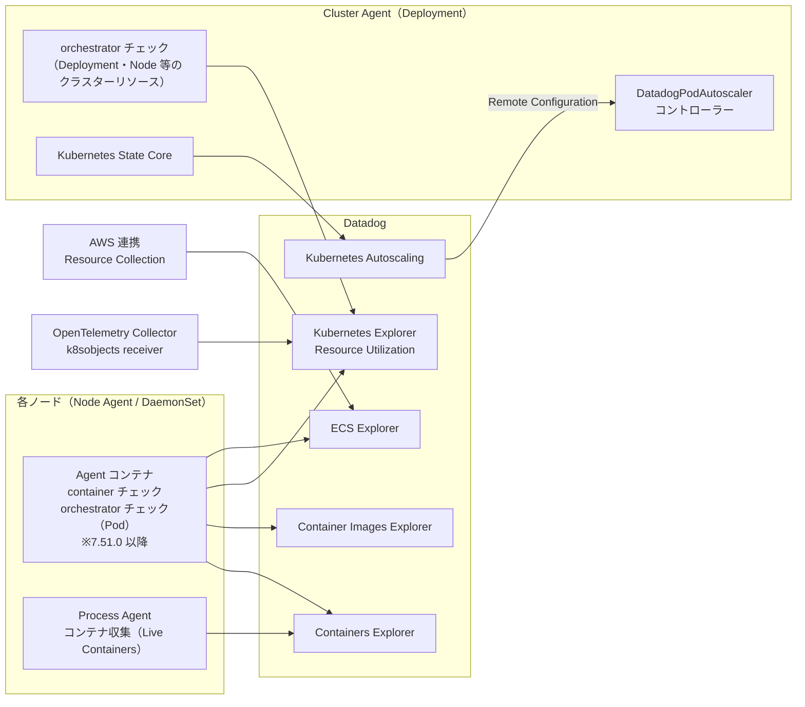
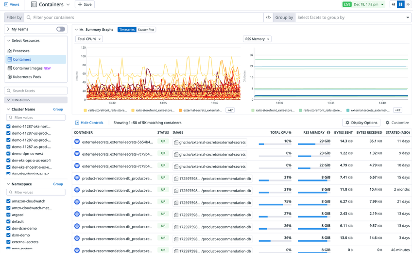
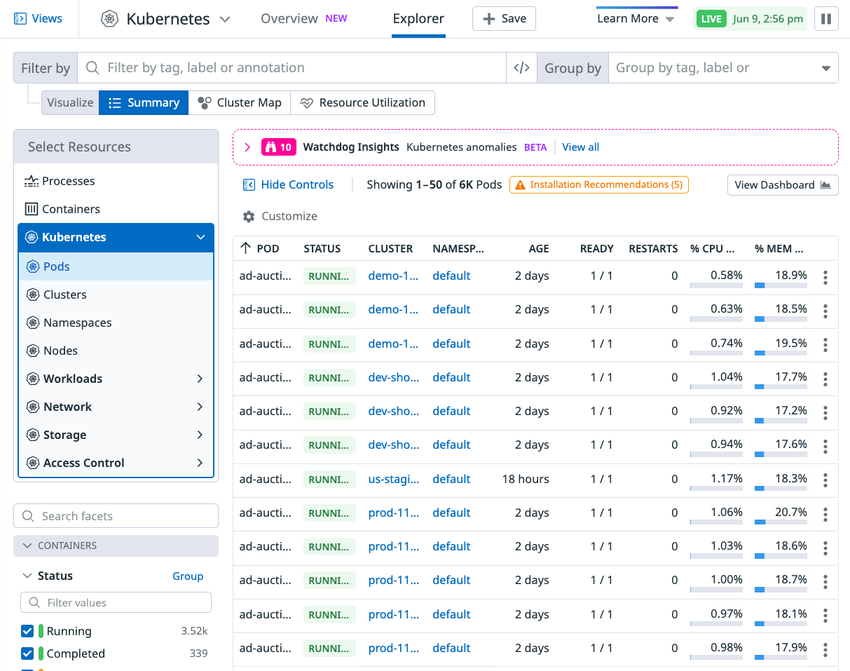
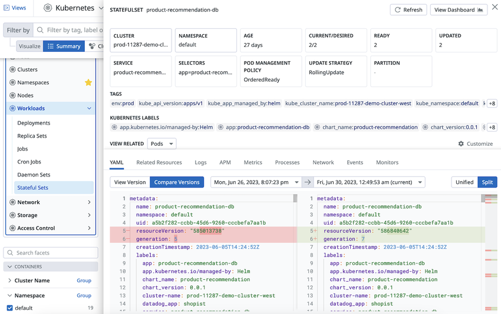
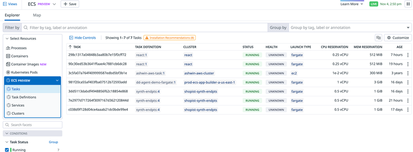
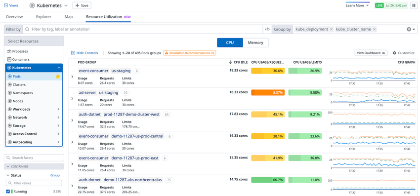

# コンテナ・Kubernetes 監視

## 概要

Datadog のコンテナ・Kubernetes 監視（Container Monitoring）は、Datadog Agent（v7 系）・Cluster Agent・クラウド連携が収集したコンテナとオーケストレーター（Kubernetes、Amazon ECS）のデータを、専用の画面群で可視化・分析・最適化する機能群である。本ファイルは「収集されたデータをどの画面でどう見るか、どう最適化するか、どう課金されるか」を扱う。Agent のインストール方法・Cluster Agent・Autodiscovery・Kubernetes State Metrics Core などの**収集側の仕様**は [コンテナ/Kubernetes向けAgent](../platform/kubernetes-and-containers-agent.md) を参照。[出典](https://docs.datadoghq.com/containers/monitoring/)

Datadog Container Monitoring を構成する画面（2026-11-02 時点の公式ドキュメント上の構成）は次のとおり。

| 画面（英語正式名称） | 旧称・別名 | 用途 | アプリ URL（US1 の例） | 本ファイルの節 |
|---|---|---|---|---|
| Containers Explorer（コンテナエクスプローラー） | Live Containers（ライブコンテナ）、通称「Containers 画面」 | 全コンテナのリアルタイム一覧、2 秒解像度のメトリクス、コンテナログのストリーミング | `https://app.datadoghq.com/containers` | [2](#2-containers-explorer旧称-live-containers) |
| Container Images Explorer（コンテナイメージエクスプローラー） | — | 環境内の全コンテナイメージ、展開状況、脆弱性 | `https://app.datadoghq.com/container-images` | [3](#3-container-images-explorer) |
| Kubernetes Explorer（Kubernetes エクスプローラー） | Orchestrator Explorer（オーケストレーターエクスプローラー） | Pod・Deployment・Node など Kubernetes リソースの状態、YAML と変更履歴、Cluster Map | `https://app.datadoghq.com/orchestration/explorer`（Overview は `/orchestration/overview`） | [4](#4-kubernetes-explorer旧称-orchestrator-explorer) |
| ECS Explorer | — | Amazon ECS のタスク・サービス・クラスターなど | `https://app.datadoghq.com/orchestration/explorer/ecsTask` | [5](#5-ecs-explorer) |
| Kubernetes Resource Utilization（リソース使用率） | — | CPU/メモリの requests・limits と実使用量の比較（ライトサイジング） | `https://app.datadoghq.com/orchestration/resource/pod` | [6](#6-kubernetes-resource-utilization) |
| Kubernetes Autoscaling（Kubernetes オートスケーリング） | Datadog Kubernetes Autoscaling（DKA） | スケーリング推奨と、`DatadogPodAutoscaler` による水平・垂直・多次元オートスケーリング | `https://app.datadoghq.com/orchestration/scaling/summary` | [7](#7-kubernetes-autoscaling) |
| Kubernetes Remediation（Kubernetes 修復） | Bits AI Kubernetes Remediation | Kubernetes エラーの原因分析と修復手順・自動修正 PR | `https://app.datadoghq.com/orchestration/remediation` | [8](#8-kubernetes-remediation) |

[出典](https://docs.datadoghq.com/containers/monitoring/)

> **名称について:** Containers Explorer は公式ドキュメントで「formerly known as Live Containers（旧称 Live Containers）」と明記されている。[出典](https://docs.datadoghq.com/containers/monitoring/containers_explorer/) Kubernetes Explorer については、公式ドキュメントが改称を明記していないが、設定キー（`orchestratorExplorer.enabled`、`DD_ORCHESTRATOR_EXPLORER_*`）、スクリーンショットの代替テキスト（"Orchestrator Explorer opened to show Workloads > Replica Sets"）、旧ドキュメント URL（`/infrastructure/containers/orchestrator_explorer`）に Orchestrator Explorer の名称が残っており、旧称として扱う。改称時期は公開情報では確認できず。[出典](https://docs.datadoghq.com/containers/monitoring/kubernetes_explorer/)

関連ファイル:

| 関連トピック | ファイル |
|---|---|
| Agent のコンテナ/Kubernetes への展開、Operator・Helm、Cluster Agent、Admission Controller、Autodiscovery、KSM Core | [コンテナ/Kubernetes向けAgent](../platform/kubernetes-and-containers-agent.md) |
| ホスト監視・Infrastructure List・Host Map・Live Processes | [Infrastructure Monitoring](infrastructure-monitoring.md) |
| Fargate・GKE Autopilot・Lambda などサーバーレス | [Serverless Monitoring](serverless.md) |
| コンテナ間通信の可視化 | [Cloud Network Monitoring（旧 NPM）](cloud-network-monitoring.md) |
| クラウド費用（Kubernetes コスト配賦を含む） | [Cloud Cost Management](cloud-cost-management.md) |
| Remote Configuration | [Fleet Automation と Remote Configuration](../platform/fleet-automation.md) |
| コンテナイメージの脆弱性 | [Cloud Security（旧 CSM）](../security/cloud-security.md) |
| コンテナのランタイム脅威検知 | [Workload Protection（旧 CWS）](../security/workload-protection.md) |
| タグ・Unified Service Tagging | [Tagging（タグ）](../platform/tagging.md) |
| Kubernetes 監視の実務ノウハウ | [Kubernetes 監視の実践](../../04_応用編/07-kubernetes-monitoring-practices.md) |
| 料金（正本） | [製品別料金表](../../03_導入編/02-pricing-by-product.md) |

---

## 1. 全体像とデータフロー

### 1.1 画面とデータソースの対応

Datadog のコンテナ監視画面は、Node Agent（DaemonSet）・Cluster Agent・AWS 連携のどれが収集したデータかによって、表示できる情報と更新間隔が異なる。



| 画面 | 主なデータソース | 必須コンポーネント |
|---|---|---|
| Containers Explorer | Node Agent（コンテナ収集） | Agent。Kubernetes メタデータには Cluster Agent と RBAC |
| Container Images Explorer | Node Agent（コンテナイメージ収集、SBOM） | Agent。ECR メタデータは AWS 連携と Resource Collection |
| Kubernetes Explorer | Cluster Agent と Node Agent の orchestrator チェック、または OpenTelemetry Collector の `k8sobjects` receiver | Agent 7.27.0+、Cluster Agent 1.11.0+（Kubernetes 1.25+ では Cluster Agent 7.40.0+） |
| Kubernetes Resource Utilization | Kubernetes Explorer のデータと Kubernetes の標準メトリクス | Agent 7.45.0+、Kubernetes Explorer 有効 |
| ECS Explorer | Agent の ECS タスク収集と AWS 連携の Resource Collection | AWS Resource Collection、ECS on EC2 / ECS on Fargate 連携 |
| Kubernetes Autoscaling | Agent のメトリクス・イベント、Kubernetes State Core | Remote Configuration、Cluster Agent、Admission Controller（垂直スケーリング） |

[出典](https://docs.datadoghq.com/containers/monitoring/kubernetes_explorer/) [出典](https://docs.datadoghq.com/infrastructure/containers/kubernetes_resource_utilization/) [出典](https://docs.datadoghq.com/infrastructure/containers/amazon_elastic_container_explorer/) [出典](https://docs.datadoghq.com/containers/monitoring/autoscaling/) [出典](https://docs.datadoghq.com/infrastructure/faq/set-up-orchestrator-explorer-daemonset/)

> 注: 上図の矢印は公式ドキュメントの記述（「Agent 7.51.0 以降、orchestrator チェックは Process Agent コンテナではなく Agent コンテナで動く」「Cluster Agent は DatadogPodAutoscaler のコントローラー」など）を元に本ナレッジで整理したもので、公式の構成図ではない。

### 1.2 画面ナビゲーション

Datadog UI では、左ナビゲーションの **Infrastructure** 配下から Containers / Kubernetes / ECS の各画面に入る。Kubernetes 画面の上部には **Overview**・**Explorer**・**Map**・**Resource Utilization** などのタブがあり、左側の **Select Resources** パネルで Processes、Containers、Container Images、Kubernetes（Pods、Clusters、Namespaces、Nodes、Workloads、Network、Storage、Access Control、Autoscaling、Custom Resources 等）、ECS を切り替える（公式スクリーンショットに基づく。UI は継続的に更新されるため、現行画面と一部異なる可能性がある）。[出典](https://docs.datadoghq.com/containers/monitoring/kubernetes_explorer/) [出典](https://docs.datadoghq.com/infrastructure/containers/kubernetes_resource_utilization/)

全体の UI ナビゲーションは [画面構成とナビゲーション](../../01_入門編/06-ui-navigation.md) を参照。

---

## 2. Containers Explorer（旧称 Live Containers）

### 2.1 機能概要

Datadog の Containers Explorer（旧称 Live Containers）は、環境内のすべてのコンテナをリアルタイムに一覧する画面である。htop・ctop・kubectl に着想を得た設計で、継続更新されるテーブル、**2 秒解像度**のリソースメトリクス、ファセット検索、コンテナログのストリーミングを提供する。[出典](https://docs.datadoghq.com/containers/monitoring/containers_explorer/)



**キャプション:** Containers Explorer（Containers 画面）の全体表示。

**画面の説明:** 画面上部に「Filter by」（コンテナの絞り込み検索）と「Group by」（ファセットによるグループ化）のバー、右上に LIVE 表示と再生／一時停止ボタンがある。左側の「Select Resources」で Processes / Containers / Container Images / Kubernetes Pods を切り替え、その下にファセット（Cluster Name、Namespace など）のチェックボックスが並ぶ。中央上段の「Summary Graphs」は Timeseries / Scatter Plot のタブを持ち、例では Total CPU % と RSS Memory の時系列が表示されている。下段のテーブルは CONTAINER、STATUS、IMAGE、TOTAL CPU %、RSS MEMORY、BYTES SENT、BYTES RECEIVED、STARTED（AGO）の列を持ち、「Showing 1–50 of 5K matching containers」と件数が表示される。右上に「Display Options」「Customize」ボタンがある。

**出典:** https://docs.datadoghq.com/infrastructure/containers/ （画像: `https://docs.dd-static.net/images/infrastructure/livecontainers/live-containers-overview_2.*.png`、取得日 2026-11-02）

### 2.2 有効化（コンテナ収集）

Containers Explorer 向けのコンテナ収集は、ほとんどの Agent インストールで**デフォルト有効**である。

| 環境 | 設定キー | 値 / 備考 |
|---|---|---|
| Docker | `DD_PROCESS_CONFIG_CONTAINER_COLLECTION_ENABLED` | `true`（デフォルト有効。例では `-v /etc/passwd:/etc/passwd:ro` も併せて指定） |
| Datadog Operator | `features.liveContainerCollection.enabled` | `true`（デフォルト有効） |
| Helm | `datadog.processAgent.containerCollection` | `true`（デフォルト有効） |
| Amazon ECS | タスク定義の環境変数 `DD_PROCESS_CONFIG_CONTAINER_COLLECTION_ENABLED` | `"true"` |
| Agent v7.21.1〜v7.27.0、Cluster Agent v1.9.0〜1.11.0 | 旧設定（Live Containers legacy configuration） | [旧設定のドキュメント](https://docs.datadoghq.com/infrastructure/faq/live-containers-legacy-configuration/)を参照 |

Helm で Cluster Agent のログに `Orchestrator explorer enabled but no cluster name set: disabling.` と出る場合は、Kubernetes クラスター名を自動検出できていないため、`datadog.clusterName` を明示的に設定する。[出典](https://docs.datadoghq.com/containers/monitoring/containers_explorer/)

### 2.3 コンテナの包含・除外

Datadog Agent はデフォルトですべてのコンテナを自動検出する。収集対象は次の環境変数で制御する（正規表現可）。

| 環境変数 | Helm キー | 意味 |
|---|---|---|
| `DD_CONTAINER_EXCLUDE` | `datadog.containerExclude` | 除外リスト（ブロックリスト） |
| `DD_CONTAINER_INCLUDE` | `datadog.containerInclude` | 包含リスト（許可リスト） |

例: Debian イメージのコンテナを除外しつつ、名前が `frontend` で始まるものは含める場合は `DD_CONTAINER_EXCLUDE="image:debian"`、`DD_CONTAINER_INCLUDE="name:frontend.*"` とする。Operator では `spec.override.nodeAgent.env` に設定する。より細かな制御（メトリクス・ログ別の除外など）は Container Discovery Management を参照。[出典](https://docs.datadoghq.com/containers/monitoring/containers_explorer/) 詳細は [コンテナ/Kubernetes向けAgent の 9.7 節](../platform/kubernetes-and-containers-agent.md#97-コンテナの収集対象の制御) を参照。

### 2.4 マニフェストの機密情報スクラビング

Datadog Agent は、収集した Kubernetes YAML マニフェストから機密情報をスクラビング（マスキング）する。スクラビングは**デフォルト有効**で、Containers Explorer と Kubernetes Explorer の両方に表示されるマニフェストに適用される。

| 項目 | 内容 |
|---|---|
| 対象 | アノテーション値、ラベル値、プローブ設定（HTTP ヘッダーとコマンド）、環境変数、コンテナの exec コマンド |
| 方式 | 機密キーワードを含むキーと値のペアを検出し、値を `********` に置換。JSON/YAML 形式に見える値の中のキーと値のペアにも適用 |
| デフォルトのキーワード | `password`、`passwd`、`mysql_pwd`、`access_token`、`auth_token`、`api_key`、`apikey`、`pwd`、`secret`、`credentials`、`stripetoken` |
| キーワードの追加 | `DD_ORCHESTRATOR_EXPLORER_CUSTOM_SENSITIVE_WORDS` にスペース区切りで指定（デフォルトに追加され、上書きはしない） |
| 大文字小文字 | Agent は照合前にテキストを小文字化するため、追加キーワードは**小文字**で指定する必要がある |
| 例外 | 機密キーワードを含む**パス**はスクラビングされない（例: `/etc/vaultd/secret/haproxy-crt.pem` はそのまま） |

[出典](https://docs.datadoghq.com/containers/monitoring/containers_explorer/)

### 2.5 検索・フィルター・ピボット

Containers Explorer の検索は、コンテナ名・コンテナ ID・イメージの各フィールドに対する**部分文字列一致**の文字列検索である。

| 演算子 | 意味 | 例 |
|---|---|---|
| `AND` | 積集合（省略時のデフォルト） | `java AND elasticsearch` |
| `OR` | 和集合 | `java OR python` |
| `NOT` / `!` | 除外 | `java NOT elasticsearch`、`java !elasticsearch` |
| `( )` | グループ化 | `(NOT (elasticsearch OR kafka) java) OR python` |

- **ピボット（Group by）:** `kube_service` と `host` でピボットして `kube_namespace:default` で絞る、ECS の `ecs_task_name` と `ecs_task_version` でピボットしてタスク更新前後のリソース使用率の変化を見る、といった使い方ができる。
- **limits との比較:** コンテナに limits が設定されている場合、RSS と CPU 使用率は limits との比較で表示される。

[出典](https://docs.datadoghq.com/containers/monitoring/containers_explorer/)

### 2.6 タグ

Containers Explorer のコンテナには、ホストレベルのすべてのタグと、コンテナ固有のメタデータがタグとして付与される。各コンテナには Docker・ECS・Kubernetes のアイコンが表示され、オーケストレーターの種類を一目で判別できる。

| 対象 | 付与されるタグ |
|---|---|
| すべてのコンテナ | ホストタグ、`image_name` |
| ECS コンテナ | `task_name`、`task_version`、`ecs_cluster` |
| Kubernetes コンテナ | `pod_name`、`kube_service`、`kube_namespace`、`kube_replica_set`、`kube_daemon_set`、`kube_job`、`kube_deployment`、`kube_cluster_name` |
| Unified Service Tagging 設定時 | `env`、`service`、`version`（APM・ログ・メトリクスとの相関に利用） |

[出典](https://docs.datadoghq.com/containers/monitoring/containers_explorer/) タグ全般は [Tagging（タグ）](../platform/tagging.md) を参照。

### 2.7 ビュー（テーブル・Scatter Plot・Timeseries）

| ビュー | 内容 |
|---|---|
| テーブル | コンテナ名、ステータス、開始時刻などで並べ替え可能な一覧 |
| Summary Graphs > Timeseries | 選択したメトリクスの時系列 |
| Summary Graphs > Scatter Plot | 2 つのメトリクスを比較する散布図。デフォルトは `short_image` タグでグループ化。点の大きさはグループ内のコンテナ数で、点をクリックすると構成コンテナとホストを表示。表示メトリクス、両軸の集計方法、両軸のスケール（Linear / Log）を選択可能 |

[出典](https://docs.datadoghq.com/containers/monitoring/containers_explorer/)

### 2.8 リアルタイム監視の解像度

| 状態 | メトリクス解像度 |
|---|---|
| Containers 画面を操作中（アクティブ） | **2 秒** |
| バックグラウンド（履歴用） | **10 秒** |
| リアルタイム収集の自動停止 | **30 分**経過でリアルタイム（2 秒）収集が止まる。再開にはページを再読み込みする |

[出典](https://docs.datadoghq.com/containers/monitoring/containers_explorer/)

### 2.9 コンテナログ

Containers Explorer では、`docker logs -f` や `kubectl logs -f` と同様に任意のコンテナのログを Datadog 上で見られる。テーブルのコンテナをクリックし、**Logs** タブを開く。

| モード | 内容 | 注意 |
|---|---|---|
| Live Tail | すべてのコンテナログをストリーミング表示。一時停止・再開が可能。単純な文字列一致で検索可能 | ストリーミングログは**保存されない**。新しい検索の入力やページ再読み込みで消える |
| Indexed logs | インデックス済みで保存されたログを、選択した期間で表示。タグとファセットで絞り込み可能（例: `status:error`） | Log Management でインデックスされたログのみ |

[出典](https://docs.datadoghq.com/containers/monitoring/containers_explorer/) ログ収集・インデックスの仕様は [ログ収集](../logs/log-collection.md)、[Indexes・保持・アーカイブ](../logs/log-indexes-retention-archives.md) を参照。

### 2.10 補足事項

- RBAC 設定によって Kubernetes メタデータの収集が制限されることがある（Cluster Agent の RBAC を確認する）。
- Kubernetes での `health` 値は、コンテナの **readiness プローブ**の結果であり、liveness プローブではない。

[出典](https://docs.datadoghq.com/containers/monitoring/containers_explorer/)

### 2.11 主なコンテナメトリクス（`container.*`）

Containers Explorer のリソースメトリクスとは別に、Agent のコア チェック `container`（Container インテグレーション）は、ランタイム（Docker、containerd 等）にかかわらずコンテナのメトリクスを `container.*` として送信する。このチェックはサポート対象のランタイムを検出すると自動で有効になる。代表的なメトリクスは次のとおり。

| メトリクス | 型 | 単位 | 説明 |
|---|---|---|---|
| `container.cpu.usage` | gauge | nanocore | CPU 使用量合計 |
| `container.cpu.user` / `container.cpu.system` | gauge | nanocore | ユーザー空間 / システムの CPU 使用量 |
| `container.cpu.limit` | gauge | nanocore | コンテナが使える CPU 時間の上限 |
| `container.cpu.throttled` | gauge | nanosecond | スロットリングされた時間の合計 |
| `container.cpu.throttled.periods` | gauge | なし | スロットリングされた期間数 |
| `container.memory.usage` | gauge | byte | メモリ使用量合計 |
| `container.memory.usage.peak` | gauge | byte | コンテナ起動以降の最大メモリ使用量 |
| `container.memory.rss` | gauge | byte | RSS 使用量 |
| `container.memory.working_set` | gauge | byte | ワーキングセット使用量 |
| `container.memory.limit` | gauge | byte | メモリ上限 |
| `container.memory.cache` | gauge | byte | キャッシュ使用量 |
| `container.memory.oom_events` | gauge | なし | コンテナで発生した OOM イベント数 |
| `container.io.read` / `container.io.write` | gauge | byte | ディスクの読み取り / 書き込みバイト数 |
| `container.*.partial_stall` | gauge | nanosecond | CPU・メモリ・I/O の PSI（待機によるストール時間） |

一部のメモリ詳細メトリクス（`container.memory.active_anon` など）は、チェック設定で `extended_memory_metrics: true` が必要。[出典](https://docs.datadoghq.com/integrations/container/)

> 注: 上表は代表例であり、全メトリクスは出典の一覧を参照。Kubernetes 固有メトリクス（`kubernetes.*`、`kubernetes_state.*`）は [コンテナ/Kubernetes向けAgent の 10 節](../platform/kubernetes-and-containers-agent.md#10-kubernetes-state-metrics-core) を参照。

---

## 3. Container Images Explorer

### 3.1 機能概要

Datadog の Container Images Explorer は、環境内のすべてのコンテナイメージについて、展開範囲（そのイメージで動いているコンテナ数など）と Cloud Security の脆弱性情報を表示する画面である。

| 機能 | 内容 |
|---|---|
| イメージ一覧 | 環境内の全イメージ。ランニングコンテナ数などで並べ替え可能 |
| 脆弱性 | SBOM 収集を有効にすると、Cloud Security Vulnerabilities がコンテナを**1 時間ごと**に評価・スキャン。脆弱性をイメージのレイヤー単位で追跡可能 |
| Trends タブ | イメージサイズ、イメージの経過日数、脆弱性、ランニングコンテナ数などの高レベル指標を週・月単位で表示（`https://app.datadoghq.com/container-images/image-trends`） |

[出典](https://docs.datadoghq.com/infrastructure/containers/container_images/)

### 3.2 有効化

| 環境 | イメージ収集 | SBOM 収集（脆弱性用） |
|---|---|---|
| Datadog Operator | 自動で有効 | `spec.features.sbom.enabled: true`、`containerImage.enabled: true`、`host.enabled: true` |
| Helm | `datadog.containerImageCollection.enabled: true` | `datadog.sbom.containerImage.enabled: true`、`datadog.sbom.host.enabled: true` |
| Amazon ECS on EC2 | `DD_CONTAINER_IMAGE_ENABLED=true` | `DD_SBOM_ENABLED=true`、`DD_SBOM_CONTAINER_IMAGE_ENABLED=true`、`DD_SBOM_HOST_ENABLED=true`（SBOM 抽出に失敗する場合は Agent コンテナのメモリを増やす。公式例は 256） |
| ホスト（`datadog.yaml`） | `container_image.enabled: true` | `sbom.enabled`、`sbom.container_image.enabled`、`sbom.host.enabled` を `true` |

- Amazon ECR のメタデータを表示するには、AWS 連携を設定し Resource Collection を有効にする。
- イメージにタグを付けるには Kubernetes Tag Extraction または Docker Tag Extraction を使う。

[出典](https://docs.datadoghq.com/infrastructure/containers/container_images/)

### 3.3 メトリクス

| メトリクス | 型 | 説明 |
|---|---|---|
| `contimage.max_image_size` | gauge | コンテナイメージの最大サイズ |
| `contimage.max_image_age` | gauge | コンテナイメージの経過時間 |
| `contimage.running_containers` | gauge | そのイメージで動いているコンテナ数 |
| `contimage.vuln_count` | gauge | 検出された脆弱性の総数（Cloud Security Container Vulnerabilities が必要） |

[出典](https://docs.datadoghq.com/infrastructure/containers/container_images/)

### 3.4 制約

- Windows 上のコンテナでは Cloud Security Vulnerabilities は利用できない。
- ECS Fargate の脆弱性は Agentless Scanning で提供される。
- GKE では SBOM を収集するために GKE の image streaming 機能を無効にする必要がある。

[出典](https://docs.datadoghq.com/infrastructure/containers/container_images/) 脆弱性管理の仕様と課金は [Cloud Security（旧 CSM）](../security/cloud-security.md) を参照。

---

## 4. Kubernetes Explorer（旧称 Orchestrator Explorer）

### 4.1 機能概要

Datadog の Kubernetes Explorer は、Pod・Deployment などの Kubernetes リソースの状態を監視する画面である。Deployment 内で失敗した Pod のリソース仕様の確認、Node の動きと関連ログの相関、リソース使用率の追跡、ワークロードの自動スケーリング、エラーの修復を 1 か所から行える。[出典](https://docs.datadoghq.com/containers/monitoring/kubernetes_explorer/)



**キャプション:** Kubernetes Explorer で Kubernetes Pods を表示した画面。

**画面の説明:** 上部に「Kubernetes」のタイトルと **Overview**・**Explorer** のタブ、「Save」ボタン、LIVE 表示がある。その下に「Filter by」（タグ・ラベル・アノテーションでの絞り込み）と「Group by」のバー、「Visualize」の切り替え（**Summary** / **Cluster Map** / **Resource Utilization**）が並ぶ。左の「Select Resources」パネルでは Processes、Containers、Kubernetes（Pods、Clusters、Namespaces、Nodes、Workloads、Network、Storage、Access Control）を選べ、その下に Status などのファセットがある。中央上部に「Watchdog Insights — Kubernetes anomalies」のバナー（撮影時は BETA 表記）があり、テーブルは POD、STATUS、CLUSTER、NAMESPACE、AGE、READY、RESTARTS、% CPU、% MEM の列を持つ。右上に「View Dashboard」、テーブル上部に「Installation Recommendations」の警告表示がある。

**出典:** https://docs.datadoghq.com/containers/monitoring/kubernetes_explorer/ （画像: `https://docs.dd-static.net/images/infrastructure/livecontainers/orch_ex.*.png`、取得日 2026-11-02）

### 4.2 前提条件

| 収集方式 | 前提バージョン |
|---|---|
| Datadog Agent | Agent **7.27.0+**、Cluster Agent **1.11.0+**。Kubernetes **1.25+** では Cluster Agent **7.40.0+** |
| OpenTelemetry Collector | OpenTelemetry Collector Contrib **v0.159.0+**、OpenTelemetry Collector Helm chart **v0.156.2+**、Datadog API キー |
| OpenTelemetry Kube Stack | `opentelemetry-kube-stack` Helm chart **0.20.1+**、Collector Contrib **v0.154.0+**（参照 values ファイルで固定）、cert-manager |

> 注: Cluster Agent はバージョン 1.22 の後、7.39.0 から Agent と同じ番号体系になっている。[出典](https://docs.datadoghq.com/containers/monitoring/kubernetes_explorer_configuration/)

[出典](https://docs.datadoghq.com/containers/monitoring/kubernetes_explorer/)

### 4.3 有効化

Kubernetes Explorer は、ほとんどの Datadog Agent インストールで**デフォルト有効**である。

| 方式 | 設定キー | 備考 |
|---|---|---|
| Datadog Operator | `spec.features.orchestratorExplorer.enabled: true` | デフォルト有効 |
| Helm | `datadog.orchestratorExplorer.enabled: true` | デフォルト有効。`datadog.processAgent.enabled: true` と `datadog.clusterName` も設定例に含まれる |
| 手動（DaemonSet） | Cluster Agent と Agent に `DD_ORCHESTRATOR_EXPLORER_ENABLED=true` | 下表参照 |
| OpenTelemetry Collector | `k8sobjects` receiver（`presets.kubernetesObjects.enabled: true`、`watch: true`、`interval: 3m`）＋ OTLP HTTP exporter（`https://otlp.<DD_SITE>`） | kube-state-metrics や Prometheus は不要。関連ダッシュボード用のメトリクスは収集されない |
| OpenTelemetry Kube Stack | `cluster`（Deployment）と `daemon`（DaemonSet）の 2 つの Collector を構成 | Datadog が参照用 `values-otlp-http.yaml` と対話型インストーラー（`./install`）を提供 |

[出典](https://docs.datadoghq.com/containers/monitoring/kubernetes_explorer/)

**手動（DaemonSet）セットアップの要点:**

| 手順 | 内容 |
|---|---|
| 1 | Cluster Agent 1.11.0+ が稼働し、Agent と通信できること |
| 2 | Cluster Agent コンテナに `DD_ORCHESTRATOR_EXPLORER_ENABLED=true` を設定 |
| 3 | Cluster Agent の ClusterRole に、`apps`・`batch` API グループのリソース（deployments、replicasets、daemonsets、statefulsets、cronjobs、jobs 等）や serviceaccounts、roles、ingresses などの読み取り権限を付与。これらは `datadog-cluster-id` ConfigMap の作成（Agent DaemonSet・Cluster Agent と同じ Namespace）とリソース収集に必要 |
| 4 | Agent DaemonSet 側で `DD_ORCHESTRATOR_EXPLORER_ENABLED=true` を設定。Agent **7.51.0+** では orchestrator チェックは Process Agent コンテナではなく **Agent コンテナ**で動く（それ以前は Process Agent が必要。プロセス収集自体は不要） |
| 5（任意） | `orchestrator.yaml` を ConfigMap で Cluster Agent の `/conf.d` にマウントし、`instances[].collectors` で収集リソースを指定（`cronjobs` または `batch/v1/cronjobs` 形式。CRD は `<apigroup_and_version>/<collector_name>` 形式のみ） |
| トラブル | `cluster-id` ConfigMap が作成されないと Agent Pod はリソースを収集できない。権限を修正して Cluster Agent → Agent の順に再起動。クラスター名を検出できない場合は Cluster Agent と Process Agent の両方に `DD_CLUSTER_NAME` を設定 |

[出典](https://docs.datadoghq.com/infrastructure/faq/set-up-orchestrator-explorer-daemonset/)

> **サイト差異:** OpenTelemetry Collector / OpenTelemetry Kube Stack による Kubernetes Explorer への送信は、`app.ddog-gov.com`（US1-FED）と `us2.ddog-gov.com` では利用できない。[出典](https://docs.datadoghq.com/containers/monitoring/kubernetes_explorer/)

**OpenTelemetry 経由の制約:** オープンソースの `k8sobjects` receiver は Kubernetes API サーバーに大きな負荷をかけ得る。Collector Contrib v0.164.0 で追加された `receiver.k8sobjects.useInformerObserver` フィーチャーゲート（alpha、デフォルト無効）で軽減できるが、Collector のメモリ使用量が増える。公式の推奨は、Kubernetes 1.33 以降を使う（streaming list の改善で API サーバー負荷が下がる）、小さなクラスターから始めてリソース種別あたりのオブジェクト数を当初 **5,000 未満**に抑え、クラスターの健全性を見ながら段階的に拡大すること。OpenTelemetry の Explorer 専用構成では、コア Kubernetes リソースと **Custom Resources > CRD** は表示されるが、**Custom Resources > Resources** の表示には追加設定（[4.11](#411-custom-resourcesカスタムリソース)）が必要。[出典](https://docs.datadoghq.com/containers/monitoring/kubernetes_explorer/)

OpenTelemetry 全般は [OpenTelemetry サポート](../platform/opentelemetry.md) を参照。

### 4.4 対応リソースと最低バージョン

Kubernetes Explorer が収集するリソースと、収集に必要な最低バージョンは次のとおり。

| リソース | 最低 Agent | 最低 Cluster Agent | 最低 Helm chart | 最低 Kubernetes |
|---|---|---|---|---|
| ClusterRoleBindings | 7.33.0 | 1.19.0 | 2.30.9 | 1.14.0 |
| ClusterRoles | 7.33.0 | 1.19.0 | 2.30.9 | 1.14.0 |
| Clusters | 7.33.0 | 1.18.0 | 2.10.0 | 1.17.0 |
| CronJobs | 7.33.0 | 7.40.0 | 2.15.5 | 1.16.0 |
| CustomResourceDefinitions | 7.51.0 | 7.51.0 | 3.39.2 | v1.16.0 |
| CustomResources | 7.51.0 | 7.51.0 | 3.39.2 | v1.16.0 |
| DaemonSets | 7.33.0 | 1.18.0 | 2.16.3 | 1.16.0 |
| Deployments | 7.33.0 | 1.18.0 | 2.10.0 | 1.16.0 |
| HorizontalPodAutoscalers | 7.33.0 | 7.51.0 | 2.10.0 | 1.1.1 |
| Ingresses | 7.33.0 | 1.22.0 | 2.30.7 | 1.21.0 |
| Jobs | 7.33.0 | 1.18.0 | 2.15.5 | 1.16.0 |
| Namespaces | 7.33.0 | 7.41.0 | 2.30.9 | 1.17.0 |
| Network Policies | 7.33.0 | 7.56.0 | 3.57.2 | 1.14.0 |
| Nodes | 7.33.0 | 1.18.0 | 2.10.0 | 1.17.0 |
| PersistentVolumeClaims | 7.33.0 | 1.18.0 | 2.30.4 | 1.17.0 |
| PersistentVolumes | 7.33.0 | 1.18.0 | 2.30.4 | 1.17.0 |
| Pods | 7.33.0 | 1.18.0 | 3.9.0 | 1.17.0 |
| ReplicaSets | 7.33.0 | 1.18.0 | 2.10.0 | 1.16.0 |
| RoleBindings | 7.33.0 | 1.19.0 | 2.30.9 | 1.14.0 |
| Roles | 7.33.0 | 1.19.0 | 2.30.9 | 1.14.0 |
| ServiceAccounts | 7.33.0 | 1.19.0 | 2.30.9 | 1.17.0 |
| Services | 7.33.0 | 1.18.0 | 2.10.0 | 1.17.0 |
| Statefulsets | 7.33.0 | 1.15.0 | 2.20.1 | 1.16.0 |
| VerticalPodAutoscalers | 7.33.0 | 7.46.0 | 3.6.8 | 1.16.0 |

[出典](https://docs.datadoghq.com/containers/monitoring/kubernetes_explorer_configuration/)

> 注: 4.2 節の「Agent 7.27.0+」は Kubernetes Explorer 自体の最低要件、上表はリソース種別ごとの収集要件であり、多くのリソースは Agent 7.33.0+ を要する。上表のバージョン値は公式表の転記で、HorizontalPodAutoscalers の最低 Kubernetes「1.1.1」など一部は公式表の表記のまま記載している。

Select Resources パネルでの分類（公式スクリーンショットに基づく）: **Workloads** に Deployments・Replica Sets・Jobs・Cron Jobs・Daemon Sets・Stateful Sets、ほかに **Network**、**Storage**、**Access Control**、**Autoscaling**、**Custom Resources** のグループがある。各グループに含まれるリソースの完全な対応は公開ドキュメントに一覧がなく、Network・Storage・Access Control の内訳は公開情報では確認できず（名称から、それぞれ Services/Ingresses/Network Policies、PV/PVC、Roles/RoleBindings/ClusterRoles/ClusterRoleBindings/ServiceAccounts と推定される【推定】）。

### 4.5 ビュー

| ビュー | 内容 |
|---|---|
| Select Resources | 画面左上のドロップダウン（パネル）で Pods、Clusters、Namespaces などのリソース種別を切り替える |
| Summary（データテーブル） | ステータス、名前、Kubernetes ラベルなどのフィールドで並べ替え・整理できる表 |
| Cluster Map | リソースを円（ノード）としてまとめて表示する図。グループとフィルターを自由に設定し、円の塗り色に使うメトリクスを選べる。円やグループをクリックすると詳細パネルが開く |
| Group by | 右上の Group by バー、またはタグ・ラベルをクリックしたときのコンテキストメニューで、タグ・Kubernetes ラベル・アノテーションによるグループ化 |
| ファセット | 左側のファセットで絞り込み・グループ化（例: Pod ステータスが CrashLoopBackOff の Pod） |
| Overview タブ | 全クラスターのトップレベルリソース（ReplicaSet、Deployment、Service など）の俯瞰、症状のある Pod・コンテナ再起動・スケジュール不能 Node などのトラブルシュートのヒント、Recommended Monitors の有効化、学習リソースへのリンクを表示（公式ブログ 2022-08-31 公開。現行画面と異なる可能性あり） |

[出典](https://docs.datadoghq.com/containers/monitoring/kubernetes_explorer/) [出典](https://www.datadoghq.com/blog/unify-kubernetes-insights-with-the-kubernetes-overview-page/)（2022-08-31 公開）

### 4.6 情報パネル（サイドパネル）

テーブルの行または Cluster Map のオブジェクトをクリックすると、リソースの詳細がサイドパネルに表示される。右上の **View Dashboard** でそのリソースの詳細ダッシュボードを開ける。

| タブ | 内容 |
|---|---|
| YAML | リソース定義の全文。**Agent 7.44.0 以降**は**7 日間の定義履歴**を含み、バージョン間の差分比較が可能（表示時刻は変更が適用されたおおよその時刻） |
| Logs | コンテナ・リソースのログ。ログをクリックすると Log Explorer で関連ログを表示 |
| APM | コンテナ・リソースのトレース（日時、サービス、所要時間、メソッド、ステータスコード） |
| Metrics | コンテナ・リソースのライブメトリクス。グラフの全画面表示、スナップショット共有、エクスポートが可能 |
| Processes | リソースのコンテナで動いている全プロセス |
| Network | 送信元・送信先、送受信量、スループットなどのネットワーク性能。Destination で `DNS` や `ip_type` などのタグ検索、`pod_name` や `service` でのグループ化が可能 |
| Events | リソースのすべての Kubernetes イベント |
| Monitors | そのリソースにタグ付け・スコープ・グループ化されたモニター |

YAML 履歴では、ノイズを避けるため、次のフィールドだけが変わった更新は無視される: `metadata.resourceVersion`、`metadata.managedFields`、`metadata.generation`、`metadata.annotations["kubernetes.io/config.seen"]`、`status`。[出典](https://docs.datadoghq.com/containers/monitoring/kubernetes_explorer/)



**キャプション:** Kubernetes Explorer のサイドパネル（StatefulSet）で YAML の変更履歴を比較している画面。

**画面の説明:** 左側の Select Resources で Workloads > Stateful Sets が選択され、右側にサイドパネルが開いている。パネル上部に STATEFULSET 名、Refresh と View Dashboard ボタン、CLUSTER、NAMESPACE、AGE、CURRENT/DESIRED、READY、UPDATED、SERVICE、SELECTORS、POD MANAGEMENT POLICY、UPDATE STRATEGY、PARTITION の各情報、TAGS と KUBERNETES LABELS が並ぶ。その下に「VIEW RELATED」（関連リソースの選択）と、YAML、Related Resources、Logs、APM、Metrics、Processes、Network、Events、Monitors のタブがある。YAML タブでは「View Version」と「Compare Versions」を切り替え、2 つの日時を選んで Unified / Split 表示で差分を比較できる（例では `resourceVersion` と `generation` の行が赤と緑でハイライトされている）。

**出典:** https://docs.datadoghq.com/containers/monitoring/kubernetes_explorer/ （画像: `https://docs.dd-static.net/images/infrastructure/livecontainers/orch_ex_manifest_history.*.png`、取得日 2026-11-02）

> 注: スクリーンショットのタブ一覧には Related Resources も含まれるが、公式ドキュメント本文のタブ説明には記載がない。

### 4.7 クエリフィルター構文

Kubernetes Explorer の「Filter by」検索バーのクエリは、項（term）と演算子で構成される。

**項の種類:**

| 種類 | 説明 | 例 |
|---|---|---|
| Tags | Agent が付与したタグ、および Datadog が Kubernetes リソース向けに生成したタグ | `datacenter:staging`、`tag#datacenter:staging`（`tag#` は省略可） |
| Labels | リソースのメタデータのラベル | `label#chart_version:2.1.0` |
| Annotations | リソースのメタデータのアノテーション | `annotation#checksum/configmap:a1bc23d4` |
| Metrics | ワークロードリソースに付与されたリソース使用率メトリクス（[4.9](#49-リソース使用率フィルター)） | `metric#cpu_usage_pct_limits_avg15:>80%` |
| String matching | 一部の属性に対する文字列一致（キーは指定できない） | `"10.132.6.23"`（IP）、`"9cb4b43f-8dc1-4a0e"`（UID）、`web-api-3`（名前） |
| Fields | リソースのメタデータ、またはカスタムリソースのインデックス済みフィールド | `field#metadata.creationTimestamp:>=4wk`、`field#metadata.deletionTimestamp:<=1hr`、`field#status.currentReplicas:3`、`field#status.conditions.Active.status:True` |

- 文字列一致の対象: `metadata.name`、`metadata.uid`、IP アドレス（Pod、Node の内部・外部 IP、Service の Cluster IP・External IP・LoadBalancer IP）。特殊文字を含む場合を除き引用符は不要。
- 同じキーと値がタグとラベル（またはアノテーション）の両方に現れることがある（クラスター設定に依存）。

**比較演算子:** すべての項で `:`（等価）が使える。メトリクス値の項では `:>`、`:>=`、`:<`、`:<=` の数値比較も使える（例: `metric#cpu_usage_avg15:>0.9`）。

**論理演算子（大文字小文字を区別）:**

| 演算子 | 意味 | 例 |
|---|---|---|
| `AND` | 積集合（省略時のデフォルト） | `a AND b` |
| `OR` | 和集合 | `a OR b` |
| `NOT` / `-` | 除外 | `a AND NOT b`、`a AND -b` |
| `( )` | グループ化 | `a AND (b OR c)` |

- **OR の短縮形:** `app_name:web-server OR app_name:database` は `app_name:(web-server OR database)` と書ける。
- **ワイルドカード:** `*` をキーと値の両方に使える。例: `kube_job:stats-*`、`pod_name:*canary`、`label#release:*`（値を問わず `release` ラベルを持つ）、`-label#*.datadoghq.com/*`（Datadog スコープのラベルを持たない）、`kube_*:*stats*canary`。

[出典](https://docs.datadoghq.com/containers/monitoring/kubernetes_explorer/)

### 4.8 自動抽出タグ

Kubernetes Explorer は、Agent で設定したタグに加え、リソースの属性から生成したタグを条件に応じて付与する。

| 対象 | 付与されるタグ |
|---|---|
| 全リソース | `kube_cluster_name`。Namespace スコープのリソースには `kube_namespace` |
| 全リソース（種別名） | `kube_<api_kind>:<metadata.name>`（例: Deployment `web-server-2` → `kube_deployment:web-server-2`）。例外: Pod は `pod_name`、VPA は `verticalpodautoscaler`、HPA は `horizontalpodautoscaler`、PVC は `persistentvolumeclaim` |
| 推奨ラベル由来 | `kube_app_name`（`app.kubernetes.io/name`）、`kube_app_instance`（`app.kubernetes.io/instance`）、`kube_app_version`（`app.kubernetes.io/version`）、`kube_app_component`（`app.kubernetes.io/component`）、`kube_app_part_of`（`app.kubernetes.io/part-of`）、`kube_app_managed_by`（`app.kubernetes.io/managed-by`） |
| Unified Service Tagging ラベル由来 | `env`（`tags.datadoghq.com/env`）、`version`（`tags.datadoghq.com/version`）、`service`（`tags.datadoghq.com/service`） |
| 関係（Relationships） | 関連リソース同士が相互にタグ付けされる（例: Deployment「XYZ」の Pod に `kube_deployment:xyz`、Service「A」を指す Ingress に `kube_service:a`）。親から生成されたリソース（Pod、Job 等）には `kube_ownerref_kind`、`kube_ownerref_name` |
| Pod | `pod_name`、`pod_phase`（マニフェストから抽出）、`pod_status`（`kubectl` と同様に算出） |
| ワークロード | `resource_utilization`（`supported` / `unsupported`）、`missing_cpu_requests`、`missing_cpu_limits`、`missing_memory_requests`、`missing_memory_limits` |
| Conditions | `kube_condition_<name>`（値は `true` / `false`。例: Deployment の `kube_condition_available`） |
| Cluster | `api_server_version`、`kubelet_version` |
| CRD・Custom Resources | `kube_crd_kind`、`kube_crd_group`、`kube_crd_version`、`kube_crd_scope`、`kube_crd_resource` |
| Namespace | `phase` |
| Node | `kube_node_unschedulable`、`kube_node_kubelet_version`、`kube_node_kernel_version`、`kube_node_runtime_version`、`eks_fargate_node`、`node_schedulable`、`node_status` |
| Persistent Volume | `kube_reclaim_policy`、`kube_storage_class_name`、`pv_type`、`pv_phase` |
| Persistent Volume Claim | `pvc_phase`、`kube_storage_class_name` |
| Service | `kube_service_type`、`kube_service_port` |

ヒント: 検索バーで `kube_` や `kube_condition` と入力すると、オートコンプリートで利用可能なタグを確認できる。[出典](https://docs.datadoghq.com/containers/monitoring/kubernetes_explorer/)

**カスタムタグの追加:** `DD_ORCHESTRATOR_EXPLORER_EXTRA_TAGS`（例: `"tag1:value1 tag2:value2"`）を設定すると、Kubernetes リソースにカスタムタグを付与できる。このタグは **Kubernetes Explorer にのみ**表示される。Process Agent と Cluster Agent の**両方**に設定する必要がある（Operator では `agents.containers.processAgent.env` と `clusterAgent.env`、Helm では `processAgent.env` と `clusterAgent.env`）。

> 注: 公式ドキュメントは Process Agent への設定を案内しているが、Agent 7.51.0+ では orchestrator チェックが Agent コンテナで動く（[4.3](#43-有効化) 手順4）。この場合に Agent コンテナ側にも設定が必要かどうかは公開情報では確認できず。

| 方式 | 設定箇所 |
|---|---|
| Datadog Operator | `spec.override.agents.containers.processAgent.env` と `spec.override.clusterAgent.env` |
| Helm | `agents.containers.processAgent.env` と `clusterAgent.env` |
| DaemonSet | Process Agent コンテナと Cluster Agent コンテナの `env` |

[出典](https://docs.datadoghq.com/containers/monitoring/kubernetes_explorer/) [出典](https://docs.datadoghq.com/containers/monitoring/kubernetes_explorer_configuration/)

### 4.9 リソース使用率フィルター

Kubernetes Explorer では、**Clusters**・**Nodes**・**Pods** にリソース使用率メトリクスが付与される。値は収集時点で**直近 15 分間の平均**として計算され、`metric#<metric_name><comparator><numeric_value>` でフィルターできる。各列は並べ替えに対応する。

| CPU | メモリ | 意味 |
|---|---|---|
| `cpu_limits_avg15` | `mem_limits_avg15` | limits |
| `cpu_requests_avg15` | `mem_requests_avg15` | requests |
| `cpu_usage_avg15` | `mem_usage_avg15` | 使用量 |
| `cpu_usage_pct_limits_avg15` | `mem_usage_pct_limits_avg15` | 使用量 ÷ limits |
| `cpu_usage_pct_requests_avg15` | `mem_usage_pct_requests_avg15` | 使用量 ÷ requests |
| `cpu_waste_avg15` | `mem_waste_avg15` | 無駄（waste）。公式ドキュメントに定義の記載なし |

Clusters と Nodes には追加で `cpu_usage_pct_alloc_avg15`、`cpu_requests_pct_alloc_avg15`、`mem_usage_pct_alloc_avg15`、`mem_requests_pct_alloc_avg15`（割り当て可能量に対する比率）がある。

| 単位 | 内容 |
|---|---|
| CPU | コア数 |
| メモリ | バイト |
| `*_pct_*` | 浮動小数（`0.0` = 0%、`1.0` = 100%）。100% を超えることがある（例: requests に対する CPU 使用率） |

[出典](https://docs.datadoghq.com/containers/monitoring/kubernetes_explorer/)

### 4.10 既知の事項

- データは一定間隔で自動更新される（Agent 経由の具体的な更新間隔は公開情報では確認できず。OpenTelemetry 構成の `k8sobjects` は `3m` を推奨）。
- Deployment または ReplicaSet が 1,000 以上あるクラスターでは、Cluster Agent の CPU 使用率が上がることがある。Helm chart にはコンテナスクラビングを無効化するオプションがある。

[出典](https://docs.datadoghq.com/containers/monitoring/kubernetes_explorer/)

### 4.11 Custom Resources（カスタムリソース）

Kubernetes Explorer は CRD と Custom Resource（CR）を表示できる（Agent・Cluster Agent 7.51.0+、Helm chart 3.39.2+）。

**自動収集される CRD（主要なもの）:** 次の CRD がクラスターに存在する場合、Agent は CR を自動収集する（最低 Agent バージョンは表のとおり）。

| CRD グループ | Kind | バージョン | 最低 Agent |
|---|---|---|---|
| `argoproj.io` | application、applicationset、rollout | v1alpha1 | 7.71.0 |
| `azure.karpenter.sh` | `*` | v1beta1 | 7.71.0 |
| `datadoghq.com` | datadogagent | v2alpha1 | 7.71.0 |
| `datadoghq.com` | datadogagentprofile、datadogdashboard、datadogmetric、datadogmonitor、datadogslo | v1alpha1 | 7.71.0 |
| `datadoghq.com` | datadogpodautoscaler | v1alpha2 | 7.71.0 |
| `datadoghq.com` | datadoginstrumentation | v1alpha1 | 7.83.0 |
| `eks.amazonaws.com` | nodeclass | v1、v1beta1 | 7.77.0 |
| `karpenter.k8s.aws` | `*` | v1 | 7.71.0 |
| `karpenter.sh` | `*` | v1 | 7.71.0 |
| `kubeai.org` | model | v1 | 7.85.0 |
| `kustomize.toolkit.fluxcd.io` | kustomization | v1 | 7.76.0 |
| `source.toolkit.fluxcd.io` | bucket、externalartifact、gitrepository、helmchart、helmrepository、ocirepository | v1 | 7.76.0 |
| `nvidia.com` | dynamocheckpoint、dynamocomponentdeployment、dynamographdeployment、dynamographdeploymentrequest、dynamographdeploymentscalingadapter、dynamomodel、dynamoworkermetadata | v1alpha1 / v1beta1 | 7.84.0 |
| `ray.io` | raycluster・rayjob・rayservice（v1、v1alpha1）、raycronjob（v1） | 表記のとおり | 7.84.0 |
| `serving.kserve.io` | inferenceservice（v1beta1）、servingruntime・clusterservingruntime・clusterstoragecontainer・trainedmodel・inferencegraph・localmodelcache・localmodelnamespacecache・localmodelnode・localmodelnodegroup（v1alpha1）、llminferenceservice・llminferenceserviceconfig（v1alpha2、v1alpha1） | 表記のとおり | 7.85.0 |

[出典](https://docs.datadoghq.com/containers/monitoring/kubernetes_explorer_configuration/)

**手動設定（上表にない CRD、または古い Agent）:**

1. Kubernetes Explorer で **Kubernetes > Custom Resources > Resource Definitions** を開く。
2. **Versions** 列で設定したいバージョンタグをクリックする。
3. モーダルの **Set up Datadog Agent** の手順に従う。
   - Helm: `datadog.orchestratorExplorer.customResources` に `<group>/<version>/<kind>` 形式で追加し、`helm upgrade`。
   - Operator: Operator を `--set clusterRole.allowReadAllResources=true` でインストールし、`spec.features.orchestratorExplorer.customResources` に追加して適用。
   - OpenTelemetry: `clusterRole.rules` で `get`・`list`・`watch` 権限を付与し、`k8sobjects.objects` に各リソースを `mode: watch` と `mode: pull`（例は `interval: 3m`）の 2 回追加。
4. （任意）モーダルでインデックスするフィールドを選び **Update Fields** を押す。インデックスしたフィールドは `field#` でフィルター・グループ化に使える。**1 リソースあたり最大 50 フィールド**。

**CR のメトリクス化:** Kubernetes State Core チェックで CR のフィールドをメトリクス化できる（Cluster Agent 7.63.0+、Operator v1.20+）。Helm は `datadog.kubeStateMetricsCore.collectCrMetrics`、Operator は `features.kubeStateMetricsCore.collectCrMetrics` に `groupVersionKind`、`commonLabels`、`labelsFromPath`、`metricNamePrefix`、`metrics` を定義する。メトリクス名はプレフィックスなしで `kubernetes_state_customresource.<metrics.name>`、プレフィックスありで `kubernetes_state_customresource.<metricNamePrefix>_<metric.name>`。リソース名は既定で Kind の小文字＋`s`で、複数形が異なる場合は `resource` を指定する。[出典](https://docs.datadoghq.com/containers/monitoring/kubernetes_explorer_configuration/)

> 注: CR メトリクスはカスタムメトリクスとして課金されるかどうかについて、公式ドキュメントの本ページには記載がない（公開情報では確認できず）。Kubernetes State Core 由来のメトリクスの扱いは [Custom Metrics と DogStatsD](../platform/custom-metrics-and-dogstatsd.md) を参照。

---

## 5. ECS Explorer

### 5.1 機能概要と前提

Datadog の ECS Explorer は、AWS アカウントをまたいで Amazon ECS のタスク・サービスなどを監視する画面で、Kubernetes Explorer と同じ「orchestration」系の UI（データテーブル、Cluster Map、Group by、情報パネル）を持つ。

| 前提 | 内容 |
|---|---|
| AWS Resource Collection | すべての ECS リソースの収集に必須（Agent はタスクのみを報告するため） |
| ECS on EC2 連携 | EC2 起動タイプのクラスター |
| ECS on Fargate 連携 | Fargate 起動タイプのクラスター |
| Agent | 7.58.0+ を推奨（更新間隔が短くなる） |
| タスク収集 | `DD_ECS_TASK_COLLECTION_ENABLED="true"`（タスク定義）または `ecs_task_collection_enabled: true`（設定ファイル）。Agent **7.64.0+** ではデフォルト有効 |
| Fargate のログ相関 | AWS FireLens と Datadog の Fluent Bit 出力プラグインを使い、`dd_source` を `ecs` に設定（公式例では `provider` も `ecs`） |

[出典](https://docs.datadoghq.com/infrastructure/containers/amazon_elastic_container_explorer/)



**キャプション:** ECS Explorer で ECS タスクを表示した画面。

**画面の説明:** 上部に「ECS」（撮影時は PREVIEW 表記）のタイトルと **Explorer**・**Map** タブ、Filter by / Group by バーがある。左の Select Resources で ECS 配下の Tasks、Task Definitions、Services、Clusters を切り替え、その下に Task Status などのファセットがある。テーブルは TASK、TASK DEFINITION、CLUSTER、STATUS、HEALTH、LAUNCH TYPE（fargate / ec2）、CPU RESERVATION、MEM RESERVATION、AGE の列を持つ。

**出典:** https://docs.datadoghq.com/infrastructure/containers/amazon_elastic_container_explorer/ （画像: `https://docs.dd-static.net/images/infrastructure/livecontainers/orch_ecs_ex.*.png`、取得日 2026-11-02）

> 注: スクリーンショットには PREVIEW 表記があるが、2026-11-02 時点の公式ドキュメント本文には Preview の記載はない。現行の提供ステータスはアプリ上で確認すること。

### 5.2 ビューと情報パネル

| 機能 | 内容 |
|---|---|
| Select Resources | Tasks、Services、Clusters などを切り替え |
| データテーブル・Cluster Map | ステータス・名前・AWS タグで整理。Cluster Map はタスクとクラスターを 1 画面に表示し、メトリクスで色分け |
| Group by・ファセット | タグでのグループ化、左側ファセットでの絞り込み（例: Fargate 起動タイプ） |
| 情報パネルのタブ | Task Definition（**7 日間**のリビジョン履歴）、Related Resources、Logs、Metrics、APM、Network、Monitors |
| クエリフィルター | `tag#` で Datadog タグと AWS タグの両方を検索 |

[出典](https://docs.datadoghq.com/infrastructure/containers/amazon_elastic_container_explorer/)

### 5.3 収集間隔

| リソース | Agent ＋ Resource Collection | Resource Collection のみ | Agent のみ |
|---|---|---|---|
| Cluster | 約 15 分 | 約 15 分 | 収集されない |
| Task | 約 15 秒 | 約 15 分 | 約 15 秒 |
| Task Definition | 約 15 秒 | 約 15 分 | 収集されない |
| Service | 約 15 秒 | 約 15 分 | 収集されない |
| Container Instance | 約 15 分 | 約 15 分 | 収集されない |

- 新規作成された Service は通常約 15 秒で収集されるが、既存 Service のステータス変化がその時間内に反映される保証はない。
- Agent なしの場合、停止したタスクが最大 15 分間 running と表示されることがある。

[出典](https://docs.datadoghq.com/infrastructure/containers/amazon_elastic_container_explorer/) AWS 連携の Resource Collection は [AWS Integration](../platform/aws-integration.md) を参照。

---

## 6. Kubernetes Resource Utilization

### 6.1 機能概要と前提

Datadog の Kubernetes Resource Utilization は、Kubernetes インフラ全体で CPU とメモリの requests・limits・実使用量を比較し、過剰・過少プロビジョニングのワークロードを特定する（ライトサイジングする）ための画面である。

| 項目 | 内容 |
|---|---|
| 前提 | Datadog Agent **7.45.0+**、Kubernetes Explorer が有効 |
| 開き方 | Kubernetes Overview ページの **Resource Utilization** タブ（`/orchestration/resource/pod`） |
| 初期表示 | **Pods**。`kube_cluster_name`、`kube_namespace`、`kube_deployment` でグループ化 |
| CPU / Memory | トグルで切り替え、別々にサイジングを検討する |

[出典](https://docs.datadoghq.com/infrastructure/containers/kubernetes_resource_utilization/)



**キャプション:** Kubernetes Resource Utilization（CPU 表示）。

**画面の説明:** 上部に **Overview**・**Explorer**・**Map**・**Resource Utilization**（撮影時は NEW 表記）のタブ、Filter by と Group by（例では `kube_deployment` と `kube_cluster_name`）のバーがある。中央の **CPU** / **Memory** トグルで表示を切り替える。テーブルは POD GROUP（Deployment 名とクラスター名、Pod 数。展開すると Usage・Requests・Limits の合計）、CPU IDLE（コア数）、CPU USAGE/REQUESTS（%）、CPU USAGE/LIMITS（%）、CPU GRAPH（使用量・requests・limits の時系列）の列を持ち、使用率セルは過不足の度合いに応じて色分けされる。右上に View Dashboard と Customize がある。左の Select Resources には Kubernetes 配下に Autoscaling のグループも見える。

**出典:** https://docs.datadoghq.com/infrastructure/containers/kubernetes_resource_utilization/ （画像: `https://docs.dd-static.net/images/infrastructure/livecontainers/kubernetes_resource_utilization.*.png`、取得日 2026-11-02）

### 6.2 表示項目

| 列 | CPU ビュー | メモリビュー |
|---|---|---|
| Pod group | グループ（デフォルトは Deployment）と、使用量・requests・limits の合計 | 同左 |
| 未使用量 | **CPU idle**: 未使用 CPU（Pod ごとの「使用量と requests の差」を合計） | **Memory unused**: 未使用メモリ（同様に requests との差） |
| usage/requests | 使用量合計 ÷ requests 合計（%） | 同左（メモリ） |
| usage/limits | 使用量合計 ÷ limits 合計（%） | 同左（メモリ） |
| グラフ | 使用量・requests・limits の時系列。行をクリックすると長期間を表示 | 同左 |

- 右上の **Customize** で列を追加できる。色分けで過剰・過少の度合いを示す。
- 右上の **Group by** でグループの粒度を変更できる。
- 行をクリックすると詳細サイドパネルが開き、グループの CPU・メモリ、Pod 別またはコンテナ別のグラフ（外れ値の発見用）、Pod のトップリストが表示される。サイドパネルのグラフはデフォルトで `pod_name` でグループ化され、`kube_container_name` に切り替えると、マルチコンテナ Pod のどのコンテナが過剰・過少の原因かを特定できる。

[出典](https://docs.datadoghq.com/infrastructure/containers/kubernetes_resource_utilization/)

> 注: 公式ドキュメントは CPU idle / Memory unused を「the sum of differences between usage and requests（使用量と requests の差の合計）」と記載しており、差の向き（負の値の扱いを含む）は明記されていない。未使用量という意味からは「requests − 使用量」の合計と解釈される【推定】。

### 6.3 データと制約

- Resource Utilization のデータは Kubernetes の標準メトリクスから得ており、他の Datadog メトリクスと同様に最大 **15 か月**の履歴をフル解像度でクエリできる。公式は、直近の使用量だけでなく長い期間でサイジングを判断することを推奨している。
- グループ内に、コンテナの requests または limits が未設定の Pod が 1 つでもあると、そのグループはメトリクスが表示されない（使用率を計算できないため）。こうしたグループは並べ替え順に関係なく末尾に表示される。
- グループの requests・limits の合計はグループのリソース状態とは独立に計算されるため、付随するメトリクスグラフの値と異なることがある。

[出典](https://docs.datadoghq.com/infrastructure/containers/kubernetes_resource_utilization/)

**実務上のヒント（公式ブログ）:** Datadog の公式ブログ「Practical tips for rightsizing your Kubernetes workloads」（2023-03-21 公開）は、新規サービスはまず多めに requests を取ること、既存ワークロードは瞬間値ではなく履歴のパーセンタイル（コスト重視なら p75、性能重視なら p99 など）で requests を決めること、CPU は圧縮可能なリソースで limits 超過はスロットリング、メモリは非圧縮で limits 超過はプロセスの強制終了につながることを解説している。2 年以上前の記事のため、現行の Kubernetes Autoscaling の推奨ロジック（[7.9](#79-垂直スケーリング推奨の計算方法)）とは考え方が異なる部分がある点に注意。[出典](https://www.datadoghq.com/blog/rightsize-kubernetes-workloads/)（2023-03-21 公開）

---

## 7. Kubernetes Autoscaling

### 7.1 機能概要

Datadog Kubernetes Autoscaling（DKA）は、Kubernetes リソースを継続的に監視し、即時のスケーリング推奨と、ワークロードの多次元オートスケーリング（水平・垂直・カスタムクエリ）を提供する機能である。Datadog の Web UI から展開するか、`DatadogPodAutoscaler`（DPA）カスタムリソースで展開する。

| 項目 | 内容 |
|---|---|
| 推奨の根拠 | 既存の Datadog Agent が収集するリアルタイム・履歴の使用率メトリクスとイベント |
| 自動スケーリングの実体 | ワークロード単位でスケーリング動作を定義する `DatadogPodAutoscaler`。**Cluster Agent がコントローラー**として動作 |
| コスト推定 | デフォルトは推定 CPU・メモリ単価で節約見込みを表示。Cloud Cost Management 併用で実際のインスタンス費用に基づくレポート |
| 上限 | **1 クラスターあたり最大 1,000 ワークロード**まで最適化可能 |
| 対応ディストリビューション | Datadog がサポートするすべての Kubernetes ディストリビューション |
| HPA・VPA との関係 | HPA・VPA の代替。有効化するワークロードからは HPA・VPA の削除を推奨（該当ワークロードはアプリ上で識別される）。HPA/VPA を残したまま試す場合は `applyPolicy.mode: Preview` の DPA を作成する |

[出典](https://docs.datadoghq.com/containers/monitoring/autoscaling/)

**提供状況の経緯:** Kubernetes Autoscaling は 2024-06-26 のプレスリリースでベータとして発表され、2025-06-10 公開の公式ブログで一般提供（GA）が告知された。[出典](https://www.datadoghq.com/about/latest-news/press-releases/datadog-announces-kubernetes-autoscaling-to-help-teams-intelligently-optimize-resources-and-cloud-costs/)（2024-06-26 公開） [出典](https://www.datadoghq.com/blog/datadog-kubernetes-autoscaling/)（2025-06-10 公開）

> **サイト差異:** 料金ページの US1-FED（Datadog for Government）価格データには Kubernetes Autoscaling の SKU が存在しない（＝US1-FED では購入不可または非掲載。[製品別料金表 §18.2](../../03_導入編/02-pricing-by-product.md#182-us1-fedgovcloudで提供されない製品)）。[出典](https://www.datadoghq.com/pricing/list/)

### 7.2 要件

| 要件 | 内容 |
|---|---|
| Remote Configuration | 組織レベルと、対象クラスターの Agent の**両方**で有効化が必要（[Fleet Automation と Remote Configuration](../platform/fleet-automation.md)） |
| ツール | Agent 更新用に Helm。Operator 利用者は `kubectl` |
| Kubernetes State Core | スケーリング推奨に必須 |
| Agent | ライブオートスケーリングでは最新版を推奨 |
| ユーザー権限 | Org Management（Remote Configuration に必要）、API Keys Write（同）、**Workload Scaling Write**、**Autoscaling Manage** |
| 推奨環境 | Linux カーネル 5.19+ と cgroup v2 |

**機能別の最低 Agent バージョン:**

| 機能 | 最低 Agent |
|---|---|
| アプリ内のワークロードスケーリング推奨 | 7.50+ |
| ライブワークロードスケーリング | 7.66.1+ |
| Argo Rollouts の推奨とオートスケーリング | 7.71+ |
| クラスターオートスケーリング【Preview】（プレビュー申込制） | 7.72+ |
| インプレース垂直 Pod リサイズ（オプトイン） | 7.78+ |
| クラスタープロファイル（ワークロードラベル） | 7.78+ |
| クラスタープロファイル（Namespace ラベル） | 7.79+ |
| クラスタープロファイル（Argo Rollout ワークロード） | 7.80+ |

[出典](https://docs.datadoghq.com/containers/monitoring/autoscaling/)

### 7.3 セットアップ

| 方式 | 設定 |
|---|---|
| Datadog Operator（**v1.16.0+**） | `spec.features.autoscaling.workload.enabled: true`、`spec.features.eventCollection.unbundleEvents: true`、`spec.override.clusterAgent.env` と `spec.override.nodeAgent.env` に `DD_AUTOSCALING_FAILOVER_ENABLED="true"`。Admission Controller（`spec.features.admissionController.enabled`）はデフォルト有効。`kubectl apply -n $DD_NAMESPACE -f datadog-agent.yaml` で適用 |
| Helm（Agent・Cluster Agent **v7.66.1+**） | `datadog.autoscaling.workload.enabled: true`、`datadog.kubernetesEvents.unbundleEvents: true`。Admission Controller（`clusterAgent.admissionController.enabled`）はデフォルト有効。`helm repo update` の後 `helm upgrade -f datadog-values.yaml <RELEASE_NAME> datadog/datadog` |

- **垂直スケーリングと Admission Controller:** 垂直スケーリングの推奨値は、Admission Controller の mutating webhook を通じて**新しい Pod** に適用される。Admission Controller を無効にすると、水平スケーリングは動くが垂直スケーリングは効かない。
- `DD_AUTOSCALING_FAILOVER_ENABLED` は、Datadog から推奨値が届かない場合にクラスター内で計算するローカルフォールバック（[7.8](#78-datadogpodautoscaler-マニフェストの主要フィールド)の `fallback`）のためのクラスター側設定と考えられる【推定】。公式マニフェストリファレンスは、ローカルフォールバックには Cluster Agent とノード Agent の両方でクラスター側の設定が必要と記載している。

[出典](https://docs.datadoghq.com/containers/monitoring/autoscaling/) [出典](https://docs.datadoghq.com/containers/autoscaling/manifest/) Admission Controller の詳細は [コンテナ/Kubernetes向けAgent の 8 節](../platform/kubernetes-and-containers-agent.md#8-admission-controller) を参照。

### 7.4 インプレース垂直スケーリング

デフォルトでは、垂直推奨の適用には Pod の完全なロールアウト（Pod テンプレート更新 → Pod 再作成）が必要である。インプレース垂直スケーリングは Kubernetes の Pod resize サブリソースで、稼働中の Pod のコンテナリソースを更新し、多くの場合**再起動なし**でリサイズする。

| 項目 | 内容 |
|---|---|
| 要件 | Kubernetes **1.33+**（`InPlacePodVerticalScaling` フィーチャーゲートがデフォルト有効）、Cluster Agent **7.78+** |
| 有効化（Operator） | `spec.features.autoscaling.workload.inPlaceVerticalScaling.enabled: true` |
| 有効化（Helm） | `datadog.autoscaling.workload.inPlaceVerticalScaling.enabled: true` |
| 権限 | 有効化により、Cluster Agent に Pod のリサイズと（必要に応じた）退避（evict）の権限が付与される |
| 戦略 | `applyPolicy.update.strategy`: `Auto`（デフォルト。対応環境ではインプレース、それ以外はロールアウト）、`TriggerRollout`（常にロールアウト）、`Disabled` |

**動作と制約:**

- 起動時にのみ CPU・メモリの requests/limits を読むアプリケーションは、再起動するまで新しい値を認識しない。Downward API で環境変数に設定したリソース値は、インプレースリサイズでは更新されない（スレッドプール、ヒープ、キャッシュをリソース値から決めるワークロードは注意）。
- Datadog はコンテナの `resizePolicy` を設定・上書きしない。未設定時、Kubernetes は CPU・メモリとも `NotRequired`（再起動なしでリサイズ）。再起動が必要なコンテナには `RestartContainer` を設定する。
- Kubernetes の制約: リサイズできるのは CPU とメモリのみ。QoS クラスは変更不可。requests/limits は変更できるが削除はできない。Windows Pod と、static CPU / メモリマネージャーポリシー下の Pod は対象外。
- Burstable モード（CPU limits の削除）はロールアウトが必要（インプレースでは limits を削除できないため）。
- リサイズが完了できないか保留のままの場合、Pod は Kubernetes Eviction API で退避される（PodDisruptionBudget を尊重）。

[出典](https://docs.datadoghq.com/containers/monitoring/autoscaling/)

### 7.5 画面（推奨と最適化対象の特定）

| 画面 | URL パス | 内容 |
|---|---|---|
| Autoscaling Summary | `/orchestration/scaling/summary` | 組織全体の Kubernetes リソース節約機会の総量。主要クラスター・Namespace への絞り込み |
| Setup | `/orchestration/scaling/setup` | 複数ワークロードを選択してバッチでスケーリングを有効化、セットアップウィザード |
| Cluster Scaling | `/orchestration/scaling/cluster` | クラスターごとのアイドル CPU 合計・アイドルメモリ合計・コスト。クラスターをクリックすると推定節約額順のワークロード表 |
| Workload Scaling（一覧） | `/orchestration/scaling/workload` | チーム名・サービス名での絞り込み、推奨の状態、最後に適用されたアクション、リコンサイルエラーの確認、テンプレート変更 |

各画面からワークロードの **Optimize** をクリックするとスケーリング推奨が表示され、**Configure Recommendation** で制約や目標使用率を調整してから有効化できる。[出典](https://docs.datadoghq.com/containers/monitoring/autoscaling/)

### 7.6 オートスケーリングの有効化方法

| 方法 | 適するケース | 開始点 | 継続管理 |
|---|---|---|---|
| A. Datadog UI セットアップウィザード | すぐに始めたい、視覚的フィードバックで設定を試したい、アプリチームに判断させたい | Setup ページ | UI またはクラスター上で DPA を編集 |
| B. `DatadogPodAutoscaler` マニフェスト（GitOps） | `kubectl`、Helm、ArgoCD、Terraform などの既存マニフェスト配布フロー | 手書き・テンプレート化した YAML | マニフェストを編集して同じツールで再適用 |
| C. クラスタープロファイルのラベル | 多数のワークロード・Namespace に共通ポリシーを一括適用 | ワークロードまたは Namespace に `autoscaling.datadoghq.com/profile` ラベル | プロファイルを編集すると管理下の全ワークロードに反映。ラベル変更でプロファイル間を移動 |
| 手動適用（推奨値のみ利用） | 自動スケーリングを使わず推奨値だけ使う | 推奨値を自分でマニフェストに反映、または **Export Recommendation** で生成される `kubectl patch` コマンド | 推奨値は更新され続けるが、クラスターは再適用したときだけ変わる |

**UI ウィザード（Path A）** は 5 ステップ（クラスター選択 → Agent と権限の要件確認 → インストール方式選択 → スケーリングテンプレート選択 → 展開）。`Workload Scaling Write` と `Autoscaling Manage` 権限が必要。

| テンプレート | 特徴 | 向くワークロード |
|---|---|---|
| Optimize cost | 高い CPU 目標使用率、積極的なスケールダウン、最小レプリカ数が最も低い | ステートレスでコスト重視 |
| Optimize balance | 中程度の目標使用率、速いスケールアップ、バランスの取れたスケールダウン | 大半のステートレス |
| Optimize performance | 控えめな目標使用率、速いスケールアップ、遅いスケールダウン、高めの最小レプリカ数 | ステートフル・重要サービス |
| Customize | 上記を起点に CPU 目標、レプリカ数、安定化ウィンドウを調整 | 個別要件 |

[出典](https://docs.datadoghq.com/containers/monitoring/autoscaling/) ArgoCD・Terraform での DPA 管理は公式ガイド（Manage DatadogPodAutoscaler with ArgoCD / Terraform）を参照。IaC 全般は [Terraform と IaC](../platform/terraform-and-iac.md)。

### 7.7 クラスタープロファイル

`DatadogPodAutoscalerClusterProfile` は、DPA のテンプレートを保持する**クラスタースコープ**のリソースである。Cluster Agent は `Deployment`・`StatefulSet`・Argo `Rollout`（およびそれらを含む Namespace）の `autoscaling.datadoghq.com/profile` ラベルを監視し、一致するワークロードごとに管理用の DPA を作成する（1 プロファイルを多数のワークロードに適用でき、1 ワークロードには 1 つの DPA が対応する）。

**組み込みプロファイル**（Cluster Agent が起動時に再作成。名前は予約済み）:

| プロファイル | CPU 目標 | 最小レプリカ | 特徴 |
|---|---|---|---|
| `datadog-optimize-cost` | 85% | 1 | 高い目標使用率、積極的なスケールダウン |
| `datadog-optimize-balance` | 70% | 2 | 中程度の目標、速いスケールアップ、バランスの取れたスケールダウン |
| `datadog-optimize-performance` | 60% | 3 | 控えめな目標、遅いスケールダウン、高い最小レプリカ |

**有効化と優先順位:**

| ルール | 内容 |
|---|---|
| 必要バージョン | ワークロードラベル: Cluster Agent 7.78.0+。Namespace ラベル: 7.79.0+。Argo Rollout: 7.80.0+。古い Cluster Agent はラベルを無視 |
| 優先順位 | ワークロードのラベルが Namespace のラベルより優先（7.79.0+） |
| オプトアウト | ラベル値を `excluded` にすると、Namespace がオプトインしていてもそのワークロードは除外（7.79.0+） |
| 未知のプロファイル名 | DPA は作成されず、エラーも報告されない。同名のプロファイルが作成された時点で反映 |
| 反映時間 | ラベルの追加・変更・削除は**数秒以内**に管理用 DPA に反映 |
| 対応ワークロード | `Deployment`、`StatefulSet`、Argo `Rollout` のみ。その他は Path B（DPA を直接作成） |
| Argo Rollouts の注意 | CRD 検出は Cluster Agent 起動時に行われるため、Argo Rollouts CRD を先にインストールする。後からインストールした場合は Cluster Agent を再起動 |

カスタムプロファイルは `apiVersion: datadoghq.com/v1alpha2`、`kind: DatadogPodAutoscalerClusterProfile` で作成し、`spec.template` に DPA の spec と同じフィールド（`targetRef` を除く）を書く。クラスタースコープのため `--namespace` なしで適用する。[出典](https://docs.datadoghq.com/containers/monitoring/autoscaling/)

### 7.8 DatadogPodAutoscaler マニフェストの主要フィールド

`DatadogPodAutoscaler`（API バージョン `datadoghq.com/v1alpha2`）は 1 つのワークロードのオートスケーリング動作を定義する。`targetRef` 以外のフィールドはすべて任意である。

**対応するターゲット:**

| `targetRef.kind` | `apiVersion` |
|---|---|
| `Deployment` | `apps/v1` |
| `StatefulSet` | `apps/v1` |
| `Rollout`（Argo Rollouts） | `argoproj.io/v1alpha1` |

**スケーリングモードの決まり方:**

| `objectives` | `applyPolicy.update.strategy` | モード |
|---|---|---|
| あり | `Disabled`（または未設定） | 水平のみ |
| なし | `Auto` | 垂直のみ |
| あり | `Auto` | 多次元（水平＋垂直） |

**主要フィールド:**

| フィールド | 値・既定値 | 説明 |
|---|---|---|
| `spec.owner` | `Local` / `Remote` | `Local` はマニフェストが正（GitOps 向け）、`Remote` は Datadog UI から作成・管理 |
| `spec.targetRef` | 必須 | 対象ワークロード。1 ワークロードに 1 DPA |
| `spec.applyPolicy.mode` | `Apply` / `Preview` | `Preview` は推奨値を計算して `.status` に表示するだけで何も適用しない（一時停止スイッチとしても使える） |
| `spec.applyPolicy.scaleUp` / `scaleDown` | `strategy`（`Max` / `Min` / `Disabled`）、`stabilizationWindowSeconds`、`rules[]`（`type`: `Percent` / `Pods`、`value`、`periodSeconds`: 1〜3600） | 水平スケーリングの方向別ポリシー |
| `spec.applyPolicy.update.strategy` | `Auto` / `TriggerRollout` / `Disabled` | 垂直スケーリングの適用方法 |
| `spec.applyPolicy.update.resizePendingPeriod` | 1〜3600 秒（未設定時はコントローラーの既定値） | kubelet がリサイズを pending と報告した場合に Pod を退避するまでの待ち時間 |
| `spec.applyPolicy.update.rolloutFallbackDelay` | 1〜3600 秒（同上） | PDB などで退避がブロックされた場合に完全ロールアウトへ切り替えるまでの待ち時間 |
| `spec.constraints.minReplicas` / `maxReplicas` | — | レプリカ数の範囲 |
| `spec.constraints.containers[].name` | 必須。`"*"` は個別エントリのない全コンテナ | コンテナ別の垂直設定。`"*"` と名前付きエントリは**マージされない** |
| `…containers[].enabled` | 既定 `true` | `false` でそのコンテナの垂直スケーリングを無効化 |
| `…containers[].controlledResources` | 既定 `[cpu, memory]`。空リストは `enabled: false` と同等 | 垂直推奨の対象リソース。**水平と垂直を併用する DPA では、未設定時の垂直推奨はメモリのみ**（CPU も対象にするには `[cpu, memory]` を明示。Cluster Agent 7.78.0+） |
| `…containers[].controlledValues` | `RequestsAndLimits`（既定） / `RequestsOnly` | requests と limits の両方を推奨値にするか、requests のみか |
| `…containers[].minAllowed` / `maxAllowed` | リソースマップ | requests の下限・上限 |
| `spec.objectives[]` | 1 エントリのみ。`type`: `PodResource` / `ContainerResource` / `CustomQuery` | 水平スケーリングの目標。`value.type` は `Utilization` / `AbsoluteValue` |
| `spec.fallback.horizontal` | `enabled`、`direction`（`ScaleUp` 既定 / `ScaleDown` / `All`）、`triggers.staleRecommendationThresholdSeconds`（100〜3600、既定 600） | Datadog からの推奨が閾値時間内に届かない場合、Agent 収集メトリクスからクラスター内で計算した推奨で水平スケーリングを継続 |
| `spec.options.burstable` | 未設定時は Cluster Agent のクラスター全体の既定値 | `true` で CPU limits を削除し、CPU requests の推奨は適用 |
| `spec.options.outOfMemory.bumpUpRatio` | 既定 `"1.2"`（+20%） | OOMKill 後のメモリ limits 引き上げ率 |
| `metadata.annotations["ad.datadoghq.com/tags"]` | JSON | この DPA のオートスケーリングテレメトリにタグを付与 |

**カスタムクエリ（`CustomQuery`）:** CPU・メモリ以外の任意の Datadog メトリクス（例: キューの滞留数 `avg:my.queue.depth{service:my-app}`）でスケールする。`customQuery.request.queries[].source` は `Metrics` または `ApmMetrics`（`service`、`resourceName`、`operationName`、`stat` などを指定）。目標は `AbsoluteValue`、`window`（例 `5m`）を指定する。カスタムクエリは**水平スケーリング専用**で、垂直スケーリングとの併用は不可。公式例では、カスタムクエリ使用時はローカルフォールバックがデフォルトで有効にならず、フォールバックには CPU またはメモリの目標が必要とされている。

**サイドカーの扱い:** サイドカーがある Pod では、Pod 全体の使用率（`PodResource`）がサイドカーの requests で薄まり、忙しいアプリコンテナがアイドルに見えることがあるため、メインコンテナを指定した `ContainerResource` の使用が推奨される。ネイティブサイドカー（Kubernetes 1.29+、`initContainers` で `restartPolicy: Always`）も通常のコンテナとして扱われ、`constraints.containers[]` で名前を指定して設定・除外できる。

**運用:** テンプレート変更は DPA の spec 編集または Workload Scaling 一覧から行い、次回リコンサイルで反映される。DPA を削除するとオートスケーリングが止まり、Pod のリソースは最後に適用された値のまま残り、次のロールアウトで親コントローラー（Deployment 等）の指定値に戻る。

[出典](https://docs.datadoghq.com/containers/autoscaling/manifest/) [出典](https://docs.datadoghq.com/containers/monitoring/autoscaling/)

最小構成の例（公式の「Optimize Cost」テンプレート）:

```yaml
apiVersion: datadoghq.com/v1alpha2
kind: DatadogPodAutoscaler
metadata:
  name: <WORKLOAD_NAME>
  namespace: <NAMESPACE>
spec:
  targetRef:
    apiVersion: apps/v1
    kind: Deployment
    name: <WORKLOAD_NAME>
  owner: Local
  applyPolicy:
    mode: Apply
    scaleDown:
      rules:
        - periodSeconds: 120   # 2 分ごとに最大 50% 削減（積極的）
          type: Percent
          value: 50
      stabilizationWindowSeconds: 300
    scaleUp:
      rules:
        - periodSeconds: 120
          type: Percent
          value: 50
      stabilizationWindowSeconds: 190
    update:
      strategy: Auto
  constraints:
    maxReplicas: 100
    minReplicas: 1
  objectives:
    - type: PodResource
      podResource:
        name: cpu
        value:
          type: Utilization
          utilization: 85
```

[出典](https://docs.datadoghq.com/containers/monitoring/autoscaling/)

### 7.9 垂直スケーリング推奨の計算方法

Datadog は直近 **8 日間**のコンテナ使用量データから CPU とメモリの垂直推奨を計算する。計算方法は、各リソースの request と limit が等しいか（Kubernetes の QoS クラスに倣い Guaranteed / Burstable）で変わり、CPU とメモリは独立に判定される。

| リソース | クラス | requests 推奨 | limits 推奨 |
|---|---|---|---|
| メモリ | Burstable（request < limit） | 使用量の **p95**（古いサンプルほど重みを減衰）＋ **10%** | 8 日間の**最大ピーク**＋ **5%** |
| メモリ | Guaranteed（request = limit） | 最大ピーク＋ 5%（requests・limits 共通）。OOMKill 検出時はさらに **20%** 上乗せ | 同左 |
| CPU | Burstable | 現在の request に対する使用量の **p90**（減衰重み）＋ **10%** | 同 **p95** ＋ **5%**。requests 推奨が limits 推奨を超える場合は requests の値を両方に使用 |
| CPU | Guaranteed | p95 ＋ 5%（requests・limits 共通） | 同左 |

- ピークメモリは、8 日間の参照期間内に存在したコンテナが記録した最高値を対象とする（期間開始前に起動したコンテナの起動時ピークも含まれる）。
- OOMKill 発生時は、ワークロードが安定するまで OOMKill のたびにメモリ limits を引き上げる（既定 20%、`spec.options.outOfMemory.bumpUpRatio` で変更）。
- Guaranteed クラスでは、requests と limits の間に差を生まないよう、より保守的な（limit レベルの）計算を両方に使う。

[出典](https://docs.datadoghq.com/containers/monitoring/autoscaling/)

### 7.10 アイドルコストと節約見込みの推定

| 条件 | 計算方法 |
|---|---|
| Cloud Cost Management が有効 | 監視対象インスタンスの実際の請求額に基づく（AWS・Azure・Google Cloud）。CCM は必須ではなく、推奨とオートスケーリングは CCM なしでも機能する |
| CCM なし（デフォルト） | 固定単価: CPU **$0.0295 / コア・時**、メモリ **$0.0053 / GB・時**（今後見直される可能性あり） |

デフォルトの計算式:

- クラスターのアイドル = (`cpu_capacity` − max(`cpu_usage`, `cpu_requests`)) × CPU 単価 ＋ (`mem_capacity` − max(`mem_usage`, `mem_requests`)) × メモリ単価
- ワークロードのアイドル = (max(`cpu_usage`, `cpu_requests`) − `cpu_usage`) × CPU 単価 ＋ (max(`mem_usage`, `mem_requests`) − `mem_usage`) × メモリ単価

[出典](https://docs.datadoghq.com/containers/monitoring/autoscaling/) Kubernetes のコスト配賦は [Cloud Cost Management](cloud-cost-management.md) を参照。

> 注: 上記の $0.0295 / $0.0053 は**節約見込みの表示に使う推定単価**であり、Datadog の料金ではない。Kubernetes Autoscaling 自体の料金は [課金への影響](#課金への影響) を参照。

### 7.11 社内導入事例（公式ブログ）

Datadog は自社の Kubernetes Autoscaling 導入事例を公式ブログ（2026-06-25 公開）で紹介している。社内プラットフォームチームは 1 日で 3,000 Deployment のオートスケーリングを設定し、多次元スケーリングを約 30,000 Deployment に適用、年換算 300 万ドル超のアイドルコンピュートコストを削減したとしている。教訓として、推奨値を適用前に確認・調整すること、CPU 100% に張り付いていた過少プロビジョニングのサービスでは requests が増え費用が上がる場合があること、成果を共有して他チームの採用を促すことが挙げられている（ベンダー自社の報告値）。[出典](https://www.datadoghq.com/blog/how-we-saved-with-kubernetes-autoscaling/)（2026-06-25 公開）

導入・運用の実践は [Kubernetes 監視の実践](../../04_応用編/07-kubernetes-monitoring-practices.md)、[コスト最適化](../../04_応用編/01-cost-optimization.md) を参照。

---

## 8. Kubernetes Remediation

Datadog の Kubernetes Remediation（Bits AI Kubernetes Remediation）は、Bits AI が Kubernetes のエラーを分析し、修復を支援する機能である。

| 項目 | 内容 |
|---|---|
| 表示内容 | 収集テレメトリと既知パターンに基づく推定根本原因の AI 説明、推奨される次の手順（一部は Bits Code で Datadog から実行可能）、期間を調整できる関連データ（最近のデプロイ、エラーログ、Kubernetes イベント、問題種別に応じたメトリクス） |
| 対応する問題 | `CrashLoopBackOff`、`ErrImagePull`、`ImagePullBackOff`、`OOMKilled`、`CreateContainerError`、`CreateContainerConfigError` |
| 起動箇所 | Kubernetes モニターの Troubleshooting > Problematic Workloads、Kubernetes Explorer でエラー状態の Pod にホバーして **Start Remediation**、Kubernetes Remediation タブでワークロードを選択 |
| 自動修正【Preview】 | Datadog に接続したリポジトリのコード変更で直せる場合、Bits Code がプルリクエストを作成（例: `OOMKilled` の Pod のメモリ limits 引き上げ）。申込フォームでアクセスをリクエスト |
| ガイド付き手順 | その他のケースでは手動で実施する修復手順の一覧を提示 |

> **サイト差異:** Kubernetes Remediation は `app.ddog-gov.com`（US1-FED）と `us2.ddog-gov.com` では利用できない。自動修正は US1、US3、US5、EU1、AP1、AP2、UK1 向けに記載されている。[出典](https://docs.datadoghq.com/containers/bits_ai_kubernetes_remediation/)

- ガイド付き修復が Preview かどうか、必要な権限、課金、利用上限は公開情報では確認できず。

[出典](https://docs.datadoghq.com/containers/bits_ai_kubernetes_remediation/) Bits AI 全般は [Bits AI と AI 機能](../ai/bits-ai.md) を参照。

---

## 9. 画面間の使い分け

| やりたいこと | 使う画面 | 補足 |
|---|---|---|
| 特定コンテナの CPU・メモリを秒単位で見る | Containers Explorer | 2 秒解像度は画面操作中のみ、30 分で停止 |
| コンテナのログをリアルタイムで追う | Containers Explorer（Logs > Live Tail） | 保存されない |
| CrashLoopBackOff の Pod を一覧する | Kubernetes Explorer（ファセット `pod_status`） | Kubernetes Remediation へ遷移可能 |
| Deployment の設定変更を追跡する | Kubernetes Explorer（YAML 履歴） | 7 日間、Agent 7.44.0+ |
| requests/limits 未設定のワークロードを探す | Kubernetes Explorer（`missing_cpu_requests` 等のタグ） | Resource Utilization では未設定グループにメトリクスが出ない |
| 過剰プロビジョニングの Deployment を探す | Kubernetes Resource Utilization、Autoscaling の Cluster Scaling | 長期間で判断 |
| requests・レプリカ数を自動調整する | Kubernetes Autoscaling（DPA） | 有料（vCPU 単位） |
| 脆弱なイメージを使うコンテナを探す | Container Images Explorer | SBOM 収集と Cloud Security が必要 |
| ECS タスク定義の変更履歴を見る | ECS Explorer（Task Definition タブ） | 7 日間 |

本表は本ファイルの各節の公式情報を用途別に再整理したもの。

---

## 制限値・クォータ・デフォルト値

| 項目 | 値 | 出典 |
|---|---|---|
| Containers Explorer のメトリクス解像度（画面操作中） | 2 秒 | [Containers Explorer](https://docs.datadoghq.com/containers/monitoring/containers_explorer/) |
| Containers Explorer のメトリクス解像度（バックグラウンド） | 10 秒 | 同上 |
| リアルタイム（2 秒）収集の自動停止 | 30 分（再読み込みで再開） | 同上 |
| Live Tail のストリーミングログ | 保存されない | 同上 |
| コンテナ収集・Kubernetes Explorer・マニフェストスクラビング | いずれもデフォルト有効 | 同上、[Kubernetes Explorer](https://docs.datadoghq.com/containers/monitoring/kubernetes_explorer/) |
| スクラビングのデフォルトキーワード数 | 11 語（`password` ほか） | [Containers Explorer](https://docs.datadoghq.com/containers/monitoring/containers_explorer/) |
| データ保持: コンテナメタデータ | 2 時間 | [Data Retention Periods](https://docs.datadoghq.com/data_security/data_retention_periods/) |
| データ保持: ライブプロセス・ライブコンテナ | 36 時間 | 同上 |
| データ保持: YAML 定義 | 7 日 | 同上 |
| YAML 履歴（Kubernetes Explorer） | 7 日間（Agent 7.44.0+） | [Kubernetes Explorer](https://docs.datadoghq.com/containers/monitoring/kubernetes_explorer/) |
| Task Definition リビジョン履歴（ECS Explorer） | 7 日間 | [ECS Explorer](https://docs.datadoghq.com/infrastructure/containers/amazon_elastic_container_explorer/) |
| Kubernetes メトリクスの履歴（Resource Utilization） | 最大 15 か月（フル解像度） | [Resource Utilization](https://docs.datadoghq.com/infrastructure/containers/kubernetes_resource_utilization/) |
| リソース使用率フィルターの平均期間 | 直近 15 分 | [Kubernetes Explorer](https://docs.datadoghq.com/containers/monitoring/kubernetes_explorer/) |
| Kubernetes Explorer の最低バージョン | Agent 7.27.0、Cluster Agent 1.11.0（K8s 1.25+ は 7.40.0） | 同上 |
| Kubernetes Explorer の更新間隔（Agent） | 公開情報では確認できず（「一定間隔で自動更新」） | 同上 |
| OpenTelemetry `k8sobjects` の収集間隔 | `3m`（公式推奨） | 同上 |
| OpenTelemetry 構成の初期オブジェクト数目安 | リソース種別あたり 5,000 未満から開始 | 同上 |
| Cluster Agent の CPU 上昇が起こり得る規模 | Deployment / ReplicaSet 1,000 以上 | 同上 |
| CR のインデックス可能フィールド | 1 リソースあたり最大 50 | [Kubernetes Explorer 設定](https://docs.datadoghq.com/containers/monitoring/kubernetes_explorer_configuration/) |
| 収集できる CR 数の上限 | 公開情報では確認できず | 同上 |
| ECS Explorer の更新間隔 | Task 約 15 秒（Agent あり）／約 15 分（Resource Collection のみ）、Cluster・Container Instance 約 15 分 | [ECS Explorer](https://docs.datadoghq.com/infrastructure/containers/amazon_elastic_container_explorer/) |
| ECS タスク収集 | Agent 7.64.0+ でデフォルト有効 | 同上 |
| Resource Utilization の最低 Agent | 7.45.0 | [Resource Utilization](https://docs.datadoghq.com/infrastructure/containers/kubernetes_resource_utilization/) |
| Container Images の脆弱性スキャン間隔 | 1 時間ごと | [Container Images](https://docs.datadoghq.com/infrastructure/containers/container_images/) |
| Kubernetes Autoscaling の最適化ワークロード上限 | 1 クラスターあたり 1,000 | [Kubernetes Autoscaling](https://docs.datadoghq.com/containers/monitoring/autoscaling/) |
| 1 ワークロードあたりの DPA 数 | 1 | [DPA マニフェスト](https://docs.datadoghq.com/containers/autoscaling/manifest/) |
| `objectives` のエントリ数 | 1 | 同上 |
| 垂直推奨の参照期間 | 8 日 | [Kubernetes Autoscaling](https://docs.datadoghq.com/containers/monitoring/autoscaling/) |
| 推奨の安全マージン | 5〜10% | 同上 |
| OOMKill 後のメモリ引き上げ | 既定 20%（`bumpUpRatio: "1.2"`） | 同上 |
| `fallback.horizontal.direction` 既定 | `ScaleUp` | [DPA マニフェスト](https://docs.datadoghq.com/containers/autoscaling/manifest/) |
| `staleRecommendationThresholdSeconds` | 100〜3600 秒、既定 600 | 同上 |
| `periodSeconds`（スケーリングルール） | 1〜3600 秒 | 同上 |
| `resizePendingPeriod` / `rolloutFallbackDelay` | 各 1〜3600 秒、未設定時はコントローラー既定値（値は公開情報では確認できず） | 同上 |
| `update.strategy` 既定 | `Auto` | [Kubernetes Autoscaling](https://docs.datadoghq.com/containers/monitoring/autoscaling/) |
| `controlledValues` 既定 | `RequestsAndLimits` | [DPA マニフェスト](https://docs.datadoghq.com/containers/autoscaling/manifest/) |
| 水平＋垂直併用時の垂直推奨対象（既定） | メモリのみ | 同上 |
| インプレース垂直スケーリングの要件 | Kubernetes 1.33+、Cluster Agent 7.78+ | [Kubernetes Autoscaling](https://docs.datadoghq.com/containers/monitoring/autoscaling/) |
| 節約見込みの推定単価（CCM なし） | CPU $0.0295 / コア・時、メモリ $0.0053 / GB・時 | 同上 |
| クラスタープロファイルのラベル反映 | 数秒以内 | 同上 |
| 課金上のコンテナ計測間隔 | 5 分（1 時間あたり 12 回の平均） | [Containers Billing](https://docs.datadoghq.com/account_management/billing/containers/) |
| CrashLoopBackOff コンテナの課金判定 | 計測間隔内に 10 秒超稼働で課金対象 | 同上 |

---

## 課金への影響

Containers Explorer、Kubernetes Explorer、ECS Explorer、Kubernetes Resource Utilization は Infrastructure Monitoring（Pro / Enterprise）の一部として提供され、画面単位の追加料金は公式料金ページに記載がない。課金はホスト数・コンテナ数（または Fargate タスク／Pod 数）と、有償オプション（Kubernetes Autoscaling、Cloud Security など）で発生する。以下の金額は公式料金ページの定価（**2026-11-02 時点、USD**）。料金の正本は [製品別料金表](../../03_導入編/02-pricing-by-product.md)、課金計算の詳細は [課金計算の仕組み](../../03_導入編/03-billing-mechanics.md) を参照。

> **サイト差異:** 以下の表の金額は US（US1/US3/US5）・EU1 の価格。**AP1（日本）では価格が異なる**（年契約 / 月契約 / オンデマンド）。Infrastructure Pro $18.75 / $22.50 / $22.50、Enterprise $28.75 / $33.75 / $33.75、追加コンテナ $1.25/月（年・月契約）/ $0.0025/時（オンデマンド）、Serverless Workload Monitoring - Apps $3.75 / $5 / $5.40、Kubernetes Autoscaling $3.75 / $4.50 / $5.40。AP2・UK1・US1-FED を含む詳細は [製品別料金表](../../03_導入編/02-pricing-by-product.md)（AP1 列および §18）を参照。[出典](https://www.datadoghq.com/pricing/list/)

### コンテナ（Kubernetes / Docker / ECS on EC2）

| 項目 | 内容 | 出典 |
|---|---|---|
| 対象プラン | Pro と Enterprise。Infrastructure Basic のホストではコンテナ監視は利用できない | [Containers Billing](https://docs.datadoghq.com/account_management/billing/containers/)、[Pricing](https://www.datadoghq.com/pricing/) |
| ホスト課金 | Node Agent が動くノードは Infrastructure のホストとして課金（Pro: 年契約 $15 / 月契約 $18 / オンデマンド $18、Enterprise: $23 / $27 / $27、いずれもホスト・月あたり） | [Pricing list](https://www.datadoghq.com/pricing/list/) |
| 無料コンテナ枠 | ホストライセンスあたり Pro **5** コンテナ、Enterprise **10** コンテナ。インフラ全体で平均して判定（ホスト間で偏りがあっても合計が枠内なら追加料金なし） | [Containers Billing](https://docs.datadoghq.com/account_management/billing/containers/) |
| 超過分（オンデマンド） | **$0.002 / コンテナ・時** | [Pricing](https://www.datadoghq.com/pricing/) |
| 前払い（Prepaid） | **$1 / コンテナ・月**（DevSecOps Containers は $1.50 / コンテナ・月）。営業または CSM に相談 | 同上 |
| 計測方法 | 5 分間隔で計測し、1 時間ごとに合計 ÷ 12 で平均。各時間から割当（無料枠＋契約分）を差し引き、超過時間の合計がオンデマンド使用量（例: ある 5 分間に 1,200 オンデマンドコンテナ → 100 コンテナ時） | [Containers Billing](https://docs.datadoghq.com/account_management/billing/containers/) |
| オートスケーリンググループ | 枠はホスト数に基づくため、ピーク時にホストが増えれば枠も増える | 同上 |
| 課金対象外 | Datadog Agent のコンテナ、Kubernetes の pause コンテナ（Agent v5.8 以降、EKS は v7.20 以降） | 同上 |
| CrashLoopBackOff | 計測間隔内に 10 秒を超えて動いたコンテナは課金対象 | 同上 |
| 既存顧客 | 料金ページは「既存顧客は最新の請求契約の含有枠を参照」と注記 | [Pricing list](https://www.datadoghq.com/pricing/list/) |

> 注: コンテナの包含・除外設定（`DD_CONTAINER_EXCLUDE` 等、[2.3](#23-コンテナの包含除外)）がコンテナ課金の計測に与える影響は公開情報では確認できず。課金対象コンテナを制限する方法として公式の Containers Billing ページは Container Discovery Management を案内している。

### Fargate・GKE Autopilot

| 項目 | 内容 | 出典 |
|---|---|---|
| ECS Fargate / EKS Fargate | 監視中のタスク（ECS）/ Pod（EKS）の同時数で課金。料金ページ FAQ では、アクティブインスタンスを「5 分間の計測間隔で 1 回以上アクティブと観測されたユニークな Fargate タスク / Pod 数の月平均」と定義 | [Containers Billing](https://docs.datadoghq.com/account_management/billing/containers/)、[Pricing](https://www.datadoghq.com/pricing/) |
| GKE Autopilot | GKE Standard とは異なり Serverless 区分で課金 | 同上 |
| 単価（Serverless Workload Monitoring - Apps） | アクティブアプリケーションインスタンスあたり月 $3（年契約）/ $4（月契約）/ $4.32（オンデマンド） | [Pricing list](https://www.datadoghq.com/pricing/list/) |

詳細は [Serverless Monitoring](serverless.md) と [コンテナ/Kubernetes向けAgent の課金への影響](../platform/kubernetes-and-containers-agent.md#課金への影響) を参照。

### Kubernetes Autoscaling

| 項目 | 内容 | 出典 |
|---|---|---|
| 課金単位 | **vCPU・月あたり**（製品ページでは「autoscaled vCPU」あたり） | [Pricing list](https://www.datadoghq.com/pricing/list/)、[Pricing](https://www.datadoghq.com/pricing/) |
| 定価 | **$3**（年契約）/ **$3.60**（月契約）/ **$4.32**（オンデマンド） | [Pricing list](https://www.datadoghq.com/pricing/list/) |
| 割引 | 複数年・ボリューム割引、Cloud Cost Management とのバンドル割引あり（料金ページ記載。割引率は非公開） | [Pricing](https://www.datadoghq.com/pricing/) |
| vCPU の数え方 | 推奨表示のみ（自動スケーリング未適用）のワークロードが課金対象か、vCPU を requests・ノード容量のどちらで数えるか、計測間隔などは公開情報では確認できず | — |
| AP1 価格 | **$3.75**（年契約）/ **$4.50**（月契約）/ **$5.40**（オンデマンド） | [製品別料金表 §2.3](../../03_導入編/02-pricing-by-product.md#23-infrastructure-の追加-skuコンテナカスタムメトリクスイベントほか) |
| 提供サイト | 料金ページの US1-FED 価格データに SKU が存在しない（[製品別料金表 §18.2](../../03_導入編/02-pricing-by-product.md#182-us1-fedgovcloudで提供されない製品)） | [Pricing list](https://www.datadoghq.com/pricing/list/) |

### 機能別の課金への影響

| 機能 | 課金への影響 | 参照 |
|---|---|---|
| Containers Explorer / Kubernetes Explorer / ECS Explorer / Resource Utilization | 画面の追加料金は料金ページに記載なし（Infrastructure のホスト・コンテナ課金に含まれる） | [Infrastructure Monitoring](infrastructure-monitoring.md) |
| コンテナログ（Live Tail・Indexed logs） | Log Management の取り込み・インデックス課金 | [Indexes・保持・アーカイブ](../logs/log-indexes-retention-archives.md) |
| Container Images の脆弱性 | Cloud Security（Vulnerability Management）の課金 | [Cloud Security](../security/cloud-security.md) |
| Network タブ | Cloud Network Monitoring のホスト課金 | [Cloud Network Monitoring](cloud-network-monitoring.md) |
| CR メトリクス・`kubernetes_state_customresource.*` | カスタムメトリクス扱いかは公開情報では確認できず | [Custom Metrics と DogStatsD](../platform/custom-metrics-and-dogstatsd.md) |
| Kubernetes Remediation（Bits AI） | 公開情報では確認できず | [Bits AI と AI 機能](../ai/bits-ai.md) |
| Kubernetes Autoscaling の節約額を実費で表示 | Cloud Cost Management の課金（任意） | [Cloud Cost Management](cloud-cost-management.md) |

コスト最適化の実践は [コスト最適化](../../04_応用編/01-cost-optimization.md) を参照。

---

## 参照元

公式ドキュメント（取得日 2026-11-02）:

- Containers（索引）: https://docs.datadoghq.com/containers/
- Container Monitoring: https://docs.datadoghq.com/containers/monitoring/
- Containers Explorer: https://docs.datadoghq.com/containers/monitoring/containers_explorer/ （旧 URL: https://docs.datadoghq.com/infrastructure/containers/ ）
- Live Containers Legacy Configuration: https://docs.datadoghq.com/infrastructure/faq/live-containers-legacy-configuration/
- Container Images Explorer: https://docs.datadoghq.com/infrastructure/containers/container_images/
- Kubernetes Explorer: https://docs.datadoghq.com/containers/monitoring/kubernetes_explorer/
- Configure Kubernetes Explorer: https://docs.datadoghq.com/containers/monitoring/kubernetes_explorer_configuration/
- Set up Kubernetes Explorer with a DaemonSet: https://docs.datadoghq.com/infrastructure/faq/set-up-orchestrator-explorer-daemonset/
- ECS Explorer: https://docs.datadoghq.com/infrastructure/containers/amazon_elastic_container_explorer/
- Kubernetes Resource Utilization: https://docs.datadoghq.com/infrastructure/containers/kubernetes_resource_utilization/
- Kubernetes Autoscaling: https://docs.datadoghq.com/containers/monitoring/autoscaling/
- DatadogPodAutoscaler manifest reference: https://docs.datadoghq.com/containers/autoscaling/manifest/
- Bits AI Kubernetes Remediation: https://docs.datadoghq.com/containers/bits_ai_kubernetes_remediation/
- Container インテグレーション: https://docs.datadoghq.com/integrations/container/
- Data Retention Periods: https://docs.datadoghq.com/data_security/data_retention_periods/
- Containers Billing: https://docs.datadoghq.com/account_management/billing/containers/

料金（取得日 2026-11-02）:

- Pricing: https://www.datadoghq.com/pricing/
- Pricing list: https://www.datadoghq.com/pricing/list/

公式ブログ・プレスリリース:

- Datadog Announces Kubernetes Autoscaling（2024-06-26 公開）: https://www.datadoghq.com/about/latest-news/press-releases/datadog-announces-kubernetes-autoscaling-to-help-teams-intelligently-optimize-resources-and-cloud-costs/
- Rightsize workloads and reduce costs with Datadog Kubernetes Autoscaling（2025-06-10 公開）: https://www.datadoghq.com/blog/datadog-kubernetes-autoscaling/
- How we saved over $3 million in idle compute costs with Datadog Kubernetes Autoscaling（2026-06-25 公開）: https://www.datadoghq.com/blog/how-we-saved-with-kubernetes-autoscaling/
- Practical tips for rightsizing your Kubernetes workloads（2023-03-21 公開）: https://www.datadoghq.com/blog/rightsize-kubernetes-workloads/
- Equip any user to monitor Kubernetes with the Overview Page（2022-08-31 公開）: https://www.datadoghq.com/blog/unify-kubernetes-insights-with-the-kubernetes-overview-page/

画像（取得日 2026-11-02、Datadog 公式ドキュメントより。著作権は Datadog, Inc. に帰属）:

- `assets/images/container-and-kubernetes-monitoring/containers-explorer-overview.png`
- `assets/images/container-and-kubernetes-monitoring/kubernetes-explorer-pods.png`
- `assets/images/container-and-kubernetes-monitoring/kubernetes-explorer-yaml-history.png`
- `assets/images/container-and-kubernetes-monitoring/ecs-explorer-tasks.png`
- `assets/images/container-and-kubernetes-monitoring/kubernetes-resource-utilization.png`
