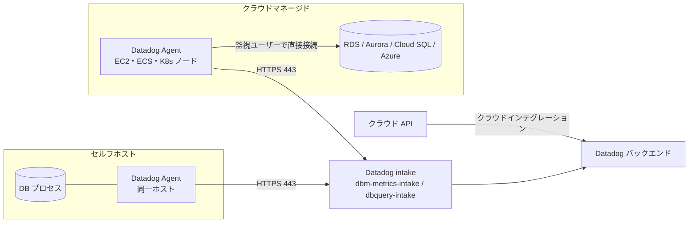
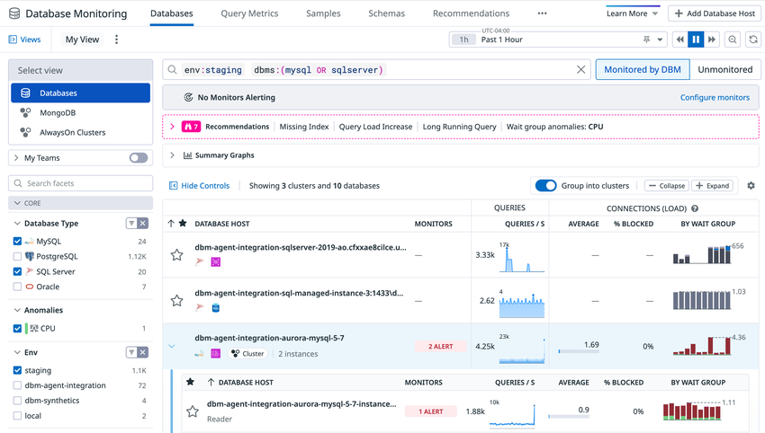
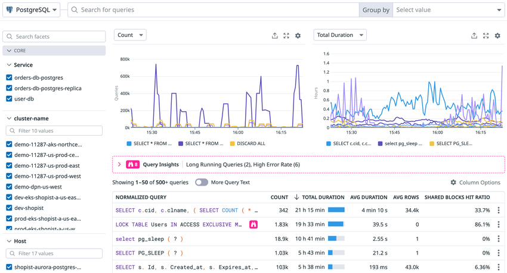
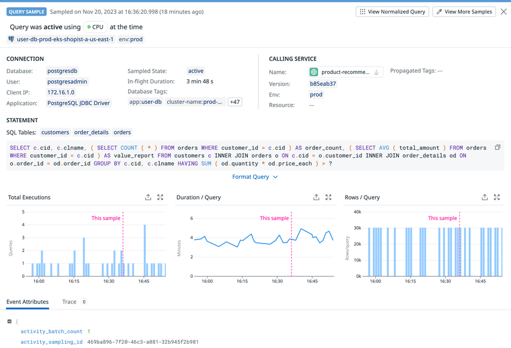
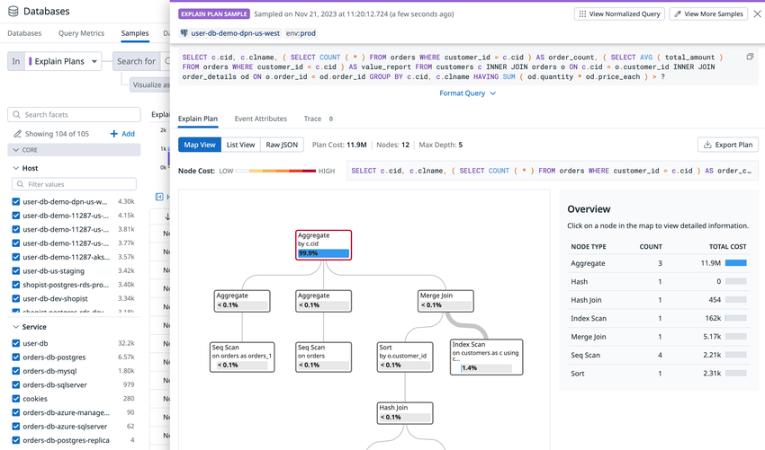
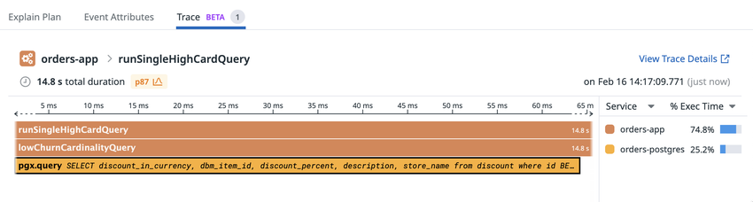

# Database Monitoring（データベースモニタリング）

## 概要

Datadog Database Monitoring（DBM、データベースモニタリング）は、Datadog Agent が監視用の読み取り専用ユーザーでデータベースに接続し、**正規化クエリ単位の性能メトリクス（Query Metrics）、実行中クエリのスナップショット（Query Samples）、実行計画（Explain Plan）、待機イベント・ブロッキング、スキーマ情報**を収集して、ホストレベルのメトリクスと同じ画面で分析できるようにする製品である。[出典](https://docs.datadoghq.com/database_monitoring/)

- **リリース**：Datadog 公式ブログは 2021-08-17 に「Today, we're excited to announce the release of Database Monitoring.」として DBM のリリースを発表している。[出典](https://www.datadoghq.com/blog/database-performance-monitoring-datadog/)（2021-08-17 公開）
- **旧称**：DBM に製品名の改称はない（公開情報で改称は確認できず）。機能単位では「Database Investigator」が Bits Chat に統合されている（後述）。[出典](https://docs.datadoghq.com/database_monitoring/database_investigator/)
- **製品区分**：料金ページの製品メニューでは Data 区分に置かれている。本ナレッジではリファレンスを `infrastructure/` に置く（[製品ポートフォリオ全体像](../../01_入門編/product-map.md) を参照）。
- **前提製品**：DBM は単体購入できず、Infrastructure Monitoring の契約が前提である（料金ページ FAQ「No, you need to be an existing Infrastructure Monitoring customer to purchase Database Monitoring.」）。データベースホストの一部だけに DBM を購入することはできる。[出典](https://www.datadoghq.com/pricing/?product=database-monitoring)

### 標準の DB インテグレーションと DBM の違い

Datadog の Postgres / MySQL / SQL Server / Oracle / MongoDB などの**標準インテグレーション**は、接続数、バッファ、レプリケーションなどのデータベース全体のメトリクスを収集する。DBM はこれと同じ Agent チェック（例：`postgres` チェック）のインスタンス設定に `dbm: true` を加えることで有効になり、クエリ単位の情報を追加で収集する。追加の Agent は不要である。[出典](https://docs.datadoghq.com/database_monitoring/setup_postgres/selfhosted/)、[出典](https://www.datadoghq.com/pricing/?product=database-monitoring)

| 観点 | 標準インテグレーション（`dbm: false`） | Database Monitoring（`dbm: true`） |
|---|---|---|
| 収集対象 | DB 全体のメトリクス（接続、トランザクション、バッファ、レプリケーション等） | 左記 ＋ 正規化クエリ単位のメトリクス、クエリサンプル、実行計画、アクティブセッション、ブロッキング、設定値、スキーマ |
| 主なメトリクス名 | `postgresql.*`、`mysql.*`、`sqlserver.*`、`oracle.*`、`mongodb.*` | 左記 ＋ `postgresql.queries.*`、`mysql.queries.*`、`sqlserver.queries.*`、`oracle.queries.*`、`mongodb.queries.*` |
| 画面 | インテグレーションダッシュボード | Database Monitoring（Databases / Query Metrics / Samples / Schemas / Recommendations 等） |
| 課金 | Infrastructure ホストに含まれる（`custom_queries` はカスタムメトリクス） | Infrastructure に加えて DBM のデータベースホスト課金 |

[出典](https://docs.datadoghq.com/database_monitoring/data_collected/)、[出典](https://docs.datadoghq.com/database_monitoring/query_metrics/)、[出典](https://docs.datadoghq.com/metrics/custom_metrics/)

Agent 本体のインストール・設定は [Datadog Agent](../platform/agent.md) と [Agent 設定リファレンス](../platform/agent-configuration.md)、インテグレーション全般は [Integrations](../platform/integrations.md) を参照。

## 主な機能一覧

Database Monitoring の主な機能と画面を次に示す。画面は Datadog の **Database Monitoring**（`https://app.datadoghq.com/databases`）配下にあり、上部タブは Databases / Query Metrics / Samples / Schemas / Recommendations などで構成される。[出典](https://docs.datadoghq.com/database_monitoring/)

| 機能 | 内容 | 主な対応 DB | 提供状況 |
|---|---|---|---|
| Databases（データベースホスト一覧） | ホスト・クラスター単位の健全性、クエリ量、接続、アラートを一覧し、ホスト詳細パネルで Top Queries・Active Connections・Blocking Queries 等を表示 | 全対応 DB（タブにより異なる） | GA |
| Query Metrics | 正規化クエリ単位の履歴性能（実行回数、平均レイテンシ、合計時間など） | Postgres、MySQL、SQL Server、Oracle、MongoDB ほか | GA |
| Query Samples | 実行中・直近完了クエリのスナップショットと実行計画 | 全対応 DB | GA |
| Explain Plans | 実行計画の継続収集、プランごとのコスト比較、プランの変化の追跡 | Postgres、MySQL、SQL Server、Oracle、MongoDB（読み取り操作）、ClickHouse（`SELECT` のみ） | GA（ClickHouse は Preview） |
| Schemas（Schema Tracking） | テーブル、列、インデックス、外部キー、スキーマ変更の追跡 | PostgreSQL、SQL Server、MySQL（MongoDB は推定スキーマ） | GA |
| Recommendations | Missing Index、Unused Index、Long Running Query などの改善提案 | MongoDB、MySQL、Oracle、PostgreSQL、SQL Server（種類により異なる） | GA |
| Custom Metrics | `custom_queries` で任意テーブルからメトリクスを収集 | Postgres、MySQL、SQL Server、Oracle 等 | GA |
| Deadlocks | SQL Server のデッドロックイベントの探索 | SQL Server | GA |
| Query Completions / Errors | SQL Server の Extended Events によるクエリ完了・エラーの収集 | SQL Server | GA |
| APM 連携 | トレースと DBM データの相互参照 | Postgres、MySQL、SQL Server、Oracle、MongoDB | GA |
| DBM モニター | 待機クエリ数、長時間クエリ、実行計画コストの変化などでアラート | — | GA |
| Database Investigations in Bits Chat | Bits Chat による根本原因分析（AI Credits 課金） | 全対応 DB | 公開情報では提供段階の表記なし |
| Bits Database Optimization | 低性能クエリの最適化を検証し PR を作成（AI Credits 課金） | PostgreSQL、MySQL | 公開情報では提供段階の表記なし |
| Database Monitoring Workbench | 本番相当の一時的な Postgres サンドボックス | PostgreSQL | 【Preview】 |
| Database Monitoring PR Reviews | GitHub PR 上でクエリ・スキーマ変更の影響をレビュー | Postgres ほか | 【Preview】 |

[出典](https://docs.datadoghq.com/database_monitoring/)、[出典](https://docs.datadoghq.com/database_monitoring/explore/)、[出典](https://docs.datadoghq.com/database_monitoring/schema_explorer/)、[出典](https://docs.datadoghq.com/database_monitoring/recommendations/)、[出典](https://docs.datadoghq.com/database_monitoring/database_monitoring_workbench/)、[出典](https://docs.datadoghq.com/database_monitoring/pr_reviews/)

## 対応データベースとデプロイ形態

### 対応データベース一覧

Database Monitoring は、**Postgres、MySQL、MariaDB、Oracle、SQL Server、MongoDB、Amazon DocumentDB、ClickHouse** のセルフホスト版とマネージドクラウド版に対応する。[出典](https://docs.datadoghq.com/database_monitoring/)

| データベース | 対応ホスティング形態 | Agent 最低バージョン | 備考 |
|---|---|---|---|
| PostgreSQL | Self-hosted、Amazon RDS、Amazon Aurora、Google Cloud SQL、Google AlloyDB、Azure、Heroku、Supabase Cloud、Supabase Self-Hosted | 7.36.1+（Supabase Self-Hosted は 7.69.1+） | Self-hosted は `contrib` パッケージ（追加モジュール）が必要 |
| MySQL | Self-hosted、Amazon RDS、Amazon Aurora、Google Cloud SQL、Azure | 7.36.1+（MySQL 9 は 7.84+） | Cloud SQL はインスタンスの RAM 16GB 以上が必要 |
| MariaDB | Self-hosted、Amazon RDS | 7.61.0+（MariaDB 12 / 13 は 7.84+） | MySQL インテグレーションで監視し、`dbms_flavor:mariadb` タグが付く。既知の制限あり |
| SQL Server | Self-hosted、Amazon RDS、Azure、Google Cloud SQL | 7.41.0+（SQL Server 2025 は 7.79+） | RDS Custom は一部構成のみ対応 |
| Oracle | Self-hosted、Amazon RDS、RAC、Exadata、Autonomous Database | 7.53.0+ | マルチテナント（CDB/PDB）と Non-CDB に対応 |
| MongoDB | Self-hosted（Community / Enterprise）、MongoDB Atlas | 7.58.0+ | Atlas は M10 以上。Serverless、共有クラスター（M0/M2/M5）は非対応 |
| Amazon DocumentDB | インスタンスベースクラスター | 7.59.0+ | Elastic クラスター、DocumentDB 3.6.0 は非対応 |
| ClickHouse | Self-hosted、ClickHouse Cloud | 7.84+ | 【Preview】。Preview 期間中の利用は課金されない |

[出典](https://docs.datadoghq.com/database_monitoring/)、[出典](https://docs.datadoghq.com/database_monitoring/setup_postgres/selfhosted/)、[出典](https://docs.datadoghq.com/database_monitoring/setup_mysql/selfhosted/)、[出典](https://docs.datadoghq.com/database_monitoring/setup_mysql/gcsql/)、[出典](https://docs.datadoghq.com/database_monitoring/setup_mariadb/)、[出典](https://docs.datadoghq.com/database_monitoring/setup_sql_server/selfhosted/)、[出典](https://docs.datadoghq.com/database_monitoring/setup_oracle/)、[出典](https://docs.datadoghq.com/database_monitoring/setup_mongodb/mongodbatlas/)、[出典](https://docs.datadoghq.com/database_monitoring/setup_documentdb/amazon_documentdb/)、[出典](https://docs.datadoghq.com/database_monitoring/setup_clickhouse/)

### PostgreSQL の対応バージョン

次の表は Postgres 設定ページの対応表（2026-11-02 時点）である。○は対応、空欄は表で対応と記載されていないことを示す。

| バージョン | Self-hosted | Amazon RDS | Amazon Aurora | Google Cloud SQL | Google AlloyDB | Azure | Supabase |
|---|---|---|---|---|---|---|---|
| Postgres 9.6 | ○ | ○ | ○ | | | ○ | |
| Postgres 10 | ○ | ○ | ○ | ○ | | ○ | |
| Postgres 11 | ○ | ○ | ○ | ○ | | ○ | |
| Postgres 12 | ○ | ○ | ○ | ○ | | ○ | |
| Postgres 13 | ○ | ○ | ○ | ○ | | ○ | |
| Postgres 14 | ○ | ○ | ○ | ○ | ○ | ○ | ○ |
| Postgres 15 | ○ | ○ | ○ | ○ | ○ | ○ | ○ |
| Postgres 16 | ○ | ○ | ○ | ○ | ○ | ○ | ○ |
| Postgres 17 | ○ | ○ | ○ | ○ | ○ | | ○ |
| Postgres 18 | ○ | ○ | ○ | ○ | ○ | ○ | |

[出典](https://docs.datadoghq.com/database_monitoring/setup_postgres/)

- 個別ページの記載は、Self-hosted / RDS / Aurora / Azure が 9.6〜18、Cloud SQL が 10〜18、AlloyDB が 14〜18、Supabase Self-Hosted が 9.6〜17 である。**Azure の Postgres 17 は、対応表では空欄だが Azure 個別ページでは対応と記載**されており、ページ間で食い違いがある。[出典](https://docs.datadoghq.com/database_monitoring/setup_postgres/azure/)
- Azure の対応デプロイ形態は PostgreSQL on Azure VMs、Single Server、Flexible Server である。[出典](https://docs.datadoghq.com/database_monitoring/setup_postgres/azure/)

### MySQL / MariaDB の対応バージョン

| バージョン | Self-hosted | Amazon RDS | Amazon Aurora | Google Cloud SQL（RAM 16GB 超） | Azure | 注記 |
|---|---|---|---|---|---|---|
| MySQL 5.6 | ○ | ○ | ○ | ○ | | |
| MySQL 5.7 | ○ | ○ | ○ | ○ | ○ | |
| MySQL 8.0 | ○ | ○ | ○ | ○ | ○ | |
| MySQL 9 | ○ | | | | | Agent 7.84+ が必要 |
| MariaDB 10.5 / 10.6 / 10.11 | ○ | ○ | | | | |
| MariaDB 11.4 | ○ | | | | | |
| MariaDB 12 / 13 | ○ | | | | | Agent 7.84+ が必要 |

[出典](https://docs.datadoghq.com/database_monitoring/setup_mysql/)

- **ページ間の食い違い**：MariaDB 専用ページの対応表では MariaDB 10.5 / 10.6 / 10.11 / 11.4 が Self-hosted と Amazon RDS の両方で対応とされ、MariaDB 12 / 13 は記載されていない。MySQL Self-hosted ページでは MariaDB の対応版を「10.5, 10.6, 10.11, 11.1, 12, or 13」と記載している。導入時は対象ホスティング形態の個別ページで確認すること。[出典](https://docs.datadoghq.com/database_monitoring/setup_mariadb/)、[出典](https://docs.datadoghq.com/database_monitoring/setup_mysql/selfhosted/)
- Azure の対応デプロイ形態は MySQL on Azure VMs、Single Server、Flexible Server だが、**Flexible Server では Query Activity と Wait Event の収集に対応しない**。[出典](https://docs.datadoghq.com/database_monitoring/setup_mysql/azure/)
- Aurora MySQL で APM 連携の `full` 伝播モードを使うには Aurora MySQL version 3 が必要。[出典](https://docs.datadoghq.com/database_monitoring/connect_dbm_and_apm/)

### SQL Server の対応バージョン

| バージョン | Self-hosted | Azure | Amazon RDS | Google Cloud SQL | 注記 |
|---|---|---|---|---|---|
| SQL Server 2012 | ○ | | | | 2022-07-12 に EOL。既知の制限付きで対応 |
| SQL Server 2014 | ○ | ○ | ○ | | |
| SQL Server 2016 | ○ | ○ | ○ | | |
| SQL Server 2017 | ○ | ○ | ○ | ○ | |
| SQL Server 2019 | ○ | ○ | ○ | ○ | |
| SQL Server 2022 | ○ | ○ | ○ | ○ | |
| SQL Server 2025 | ○ | ○ | | ○ | Agent 7.79+ が必要 |

[出典](https://docs.datadoghq.com/database_monitoring/setup_sql_server/)

- Google Cloud SQL 個別ページは対応版を 2014〜2025 と記載しており、対応表（2017 以降）と食い違う。[出典](https://docs.datadoghq.com/database_monitoring/setup_sql_server/gcsql/)
- SQL Server 2012 では `sqlserver.files.read_io_stall_queued`、`sqlserver.ao.quorum_type` などの一部メトリクスを収集できない。[出典](https://docs.datadoghq.com/database_monitoring/setup_sql_server/troubleshooting/)

### Oracle / MongoDB / DocumentDB / ClickHouse の対応バージョン

| データベース | 対応バージョン | 補足 |
|---|---|---|
| Oracle | 11g、12c、18c、19c、21c（Self-Hosted、RDS、RAC、Exadata、Autonomous Database、Automatic Storage Management すべて対応） | マルチテナント（CDB/PDB）、Non-CDB |
| MongoDB | 4.4（Self-hosted のみ）、5.0、6.0、7.0、8.0（Self-hosted、Atlas） | Query Metrics は Self-hosted が MongoDB 8.0+、Atlas が 7.0+ で、いずれも Agent 7.78+ が必要 |
| Amazon DocumentDB | 4.0.0、5.0.0 | インスタンスベースクラスターのみ |
| ClickHouse | 23.x、24.x、25.x、26.3（推奨最低 23.8 LTS） | ClickHouse の HTTP インターフェース（ポート 8123/8443）を使う。ネイティブ TCP（9000/9440）は使わない |

- **ページ間の食い違い（MongoDB 4.4）**：MongoDB の対応表では 4.4 は Self-hosted のみだが、MongoDB Atlas 個別ページの「Supported MongoDB major versions」には 4.4 も含まれている。[出典](https://docs.datadoghq.com/database_monitoring/setup_mongodb/)、[出典](https://docs.datadoghq.com/database_monitoring/setup_mongodb/mongodbatlas/)

[出典](https://docs.datadoghq.com/database_monitoring/setup_oracle/)、[出典](https://docs.datadoghq.com/database_monitoring/setup_mongodb/)、[出典](https://docs.datadoghq.com/database_monitoring/setup_mongodb/selfhosted/)、[出典](https://docs.datadoghq.com/database_monitoring/setup_mongodb/mongodbatlas/)、[出典](https://docs.datadoghq.com/database_monitoring/setup_documentdb/)、[出典](https://docs.datadoghq.com/database_monitoring/setup_clickhouse/selfhosted/)

> **注記（ClickHouse）:** ClickHouse の DBM は Agent 7.84 以降が必要と記載される一方、非同期 INSERT の監視（`collect_pending_async_inserts`、`collect_async_inserts`）は「Agent 7.83 or later」と書かれている。実運用では 7.84 以降を前提とするのが安全である。[出典](https://docs.datadoghq.com/database_monitoring/setup_clickhouse/selfhosted/)

## アーキテクチャ

### 必要な構成要素

Database Monitoring を利用するには、どのデータベースとホスティング形態でも次の 3 つが必要である。[出典](https://docs.datadoghq.com/database_monitoring/architecture/)

1. Datadog Agent
2. Agent を動かすホスト
3. データベースへの読み取り専用アクセス（監視用ユーザー）

Agent は SQL ユーザーとしてデータベースにログインし、読み取り専用クエリを実行して性能データを収集する。

### 構成パターン

| パターン | Agent の配置 | システムメトリクスの取得元 | 推奨用途 |
|---|---|---|---|
| セルフホスト | データベースホスト上に Agent を直接インストール | Agent が OS から収集（CPU、メモリ、ディスク、ネットワーク）、DB ログも Agent が収集 | オンプレミス、IaaS 上の DB |
| クラウドマネージド | 別ホスト（EC2 などの VM、ECS）に Agent を置き、各マネージドインスタンスへリモート接続 | クラウドプロバイダーのインテグレーション（AWS / Azure / Google Cloud）経由 | RDS、Aurora、Cloud SQL、Azure など |
| Kubernetes | Cluster Agent が **cluster checks** として DB チェックを Node Agent 群へ分配 | 同上 | Kubernetes 上でアプリを運用している場合 |

[出典](https://docs.datadoghq.com/database_monitoring/architecture/)



- **Kubernetes の Cluster Agent**：Cluster Agent は DB インスタンスを Agent プールへ自動分配し、各チェックが 1 インスタンスだけで動くようにする。Node Agent は 10 秒ごとに Cluster Agent に接続して設定を取得し、Agent が停止すると Cluster Agent は設定を他の Agent に再割り当てする。[出典](https://docs.datadoghq.com/database_monitoring/architecture/)
- 自前の Kubernetes クラスターを持たない場合、Datadog はクラウドプロバイダーのオーケストレーション（例：Amazon ECS）で Agent コンテナを動かすことを推奨している。[出典](https://docs.datadoghq.com/database_monitoring/architecture/)
- Kubernetes 上の Agent 構成の詳細は [コンテナ/Kubernetes向けAgent](../platform/kubernetes-and-containers-agent.md) を参照。

### 直接接続の原則（プロキシ・LB・コネクションプーラー不可）

Database Monitoring の Agent は**監視対象ホストへ直接接続しなければならない**。プロキシ、ロードバランサー、`pgbouncer` などのコネクションプーラー、Aurora のクラスターエンドポイント経由で接続してはならない。Agent が実行中に別ホストへ接続先を変えると（フェイルオーバーや負荷分散）、2 つのホスト間の統計差分を計算してしまい、メトリクスが不正確になる。セルフホストでは `127.0.0.1` か Unix ソケットでの接続が推奨される。[出典](https://docs.datadoghq.com/database_monitoring/architecture/)、[出典](https://docs.datadoghq.com/database_monitoring/setup_mysql/selfhosted/)

- **Aurora**：Agent はクラスターエンドポイントではなく**個々の Aurora インスタンス**に接続する。[出典](https://docs.datadoghq.com/database_monitoring/architecture/)
- **MongoDB / DocumentDB**：接続文字列や SRV 文字列ではなく、監視対象インスタンスへ直接接続する。[出典](https://docs.datadoghq.com/database_monitoring/setup_mongodb/selfhosted/)
- **プロキシ経由が避けられない場合**：Cloud SQL Auth proxy などを使う場合は `reported_hostname` を設定し、プロキシホストではなく実際の DB インスタンス名でテレメトリにタグ付けする。[出典](https://docs.datadoghq.com/database_monitoring/setup_postgres/selfhosted/)

### 送信先エンドポイント

Database Monitoring のデータは、通常のメトリクス・ログとは別の intake に送信される。ファイアウォールやプロキシがある場合はこれらへの 443 番ポートの外向き通信を許可する。IP アドレスは `https://ip-ranges.<YOUR_DATADOG_SITE>` の APM ブロックに含まれる。[出典](https://docs.datadoghq.com/database_monitoring/troubleshooting/)

| 用途 | エンドポイント |
|---|---|
| DBM メトリクス | `dbm-metrics-intake.<YOUR_DATADOG_SITE>` |
| DBM クエリデータ（サンプル、実行計画等） | `dbquery-intake.<YOUR_DATADOG_SITE>` |

> **サイト差異:** エンドポイントのホスト名はサイトにより異なる（例：AP1 は `dbm-metrics-intake.ap1.datadoghq.com`、`dbquery-intake.ap1.datadoghq.com`）。サイト一覧は [Datadog Sites](../platform/datadog-sites.md)、全エンドポイントとファイアウォール設計は [ネットワーク・接続要件](../../03_導入編/network-and-connectivity.md) を参照。

### Agent のオーバーヘッド

Database Monitoring の既定設定は保守的で、公式ドキュメントは「ほとんどのワークロードで Agent はクエリ実行時間の 1% 未満、CPU の 1% 未満」としている。次は公式ベンチマーク（Agent ホスト EC2 `c5.xlarge`、DB は RDS `db.m5.large` で TPC-C 20 warehouses）の結果である。[出典](https://docs.datadoghq.com/database_monitoring/agent_integration_overhead/)

| 項目 | Postgres | MySQL | SQL Server | Oracle |
|---|---|---|---|---|
| 検証 Agent バージョン | 7.50.2 | 7.50.2 | 7.50.2 | 7.53.0 |
| Agent CPU（平均） | 約 1% | 約 2% | 約 1% | 約 0.2% |
| Agent メモリ（RSS） | 約 300 MiB | 約 300 MiB | 約 300 MiB | 約 270 MiB |
| ネットワーク受信 | 約 30 KB/s | 約 40 KB/s | 約 40 KB/s | 約 6 KB/s |
| ネットワーク送信 | 約 30 KB/s | 約 30 KB/s | 約 30 KB/s | 約 4 KB/s |
| DB 上の Agent クエリ負荷（CPU 時間） | 約 1% | 約 1% | 約 1% | 約 0.2% |

検証時の収集間隔設定は次のとおり（表は検証値であり、既定値と一致するとは限らない）。

| 設定 | Postgres | MySQL | SQL Server | Oracle |
|---|---|---|---|---|
| Check Min Collection Interval | 15 秒 | 15 秒 | 15 秒 | 10 秒 |
| Query Metrics Collection Interval | 10 秒 | 10 秒 | 60 秒 | 60 秒 |
| Query Samples Collection Interval | 10 秒 | 1 秒 | — | — |
| Query Activities Collection Interval | — | 10 秒 | 10 秒 | 10 秒 |
| Settings Collection Interval | 600 秒 | 600 秒 | 600 秒 | — |
| Schema Collection Interval | 600 秒 | — | — | — |

[出典](https://docs.datadoghq.com/database_monitoring/agent_integration_overhead/)

## セットアップ

### 共通の流れ

Database Monitoring のセットアップは、データベースの種類とホスティング形態ごとに個別手順があるが、共通の流れは次のとおりである。[出典](https://docs.datadoghq.com/database_monitoring/setup/)

1. **DB 側の設定**：クエリ統計を有効化するパラメーターを設定する（Postgres の `pg_stat_statements`、MySQL の Performance Schema、MongoDB の `$queryStats` など）。多くは DB の再起動が必要。
2. **監視ユーザーの作成と権限付与**：読み取り専用の `datadog` ユーザーを作成し、統計ビューの参照権限と実行計画取得用の関数・プロシージャを用意する。
3. **パスワードの保護**：パスワードはシークレット管理ツールに保存し、Agent 設定では `ENC[<SECRET_NAME>]` で参照する（平文も可能だが非推奨）。
4. **Agent のインストールと設定**：`conf.d/<check>.d/conf.yaml` に `dbm: true` を含むインスタンス設定を書き、Agent を再起動する。
5. **（任意）ログ収集・クラウドインテグレーション**：DB ログを Datadog に送り、RDS などはクラウドインテグレーションを入れる。
6. **確認**：`agent status` の Checks セクションにチェック名（`postgres`、`mysql`、`sqlserver`、`oracle`、`mongo` 等）が出ることと、Databases ページにホストが表示されることを確認する。

[出典](https://docs.datadoghq.com/database_monitoring/setup_postgres/selfhosted/)、[出典](https://docs.datadoghq.com/database_monitoring/setup_mysql/selfhosted/)

| データベース | Agent チェック設定ファイル | 確認時の Checks 名 |
|---|---|---|
| PostgreSQL | `conf.d/postgres.d/conf.yaml` | `postgres` |
| MySQL / MariaDB | `conf.d/mysql.d/conf.yaml` | `mysql` |
| SQL Server | `conf.d/sqlserver.d/conf.yaml`（Windows は `C:\ProgramData\Datadog\conf.d\sqlserver.d\conf.yaml`） | `sqlserver` |
| Oracle | `conf.d/oracle.d/conf.yaml`（Agent 7.50.1〜7.53.0 は `oracle-dbm.d`） | `oracle` |
| MongoDB / DocumentDB | `conf.d/mongo.d/conf.yaml` | `mongo` |

[出典](https://docs.datadoghq.com/database_monitoring/setup_sql_server/selfhosted/)、[出典](https://docs.datadoghq.com/database_monitoring/setup_oracle/selfhosted/)、[出典](https://docs.datadoghq.com/database_monitoring/setup_mongodb/selfhosted/)

### PostgreSQL のセットアップ

#### DB パラメーター

PostgreSQL の `postgresql.conf`（RDS / Aurora では DB パラメーターグループ）に次を設定し、サーバーを再起動する。[出典](https://docs.datadoghq.com/database_monitoring/setup_postgres/selfhosted/)、[出典](https://docs.datadoghq.com/database_monitoring/setup_postgres/rds/)

| パラメーター | 値 | 必須 / 任意 | 目的 |
|---|---|---|---|
| `shared_preload_libraries` | `pg_stat_statements` | 必須 | `postgresql.queries.*` メトリクスの収集 |
| `track_activity_query_size` | `4096` | 必須 | 1,024 文字を超えるクエリの収集（既定値のままだと 1,024 文字超を収集できない） |
| `pg_stat_statements.track` | `ALL` | 任意 | ストアドプロシージャ・関数内の文の追跡 |
| `pg_stat_statements.max` | `10000` | 任意 | 追跡する正規化クエリ数の拡大（高負荷 DB 向け。これより大きい値は収集クエリの遅延・タイムアウトの原因になる） |
| `pg_stat_statements.track_utility` | `off` | 任意 | `PREPARE`、`EXPLAIN` などのユーティリティコマンドを除外 |
| `track_io_timing` | `on` | 任意 | ブロック読み書き時間の収集 |

[出典](https://docs.datadoghq.com/database_monitoring/setup_postgres/troubleshooting/)

#### 監視ユーザーと関数

PostgreSQL では**プライマリ**で次を実行する。[出典](https://docs.datadoghq.com/database_monitoring/setup_postgres/selfhosted/)

```sql
CREATE USER datadog WITH password '<PASSWORD>';
-- Postgres 15 以降は先に実行
ALTER ROLE datadog INHERIT;
-- 以下はすべてのデータベースで実行（Postgres 10 以降）
CREATE SCHEMA datadog;
GRANT USAGE ON SCHEMA datadog TO datadog;
GRANT USAGE ON SCHEMA public TO datadog;
GRANT pg_monitor TO datadog;
CREATE EXTENSION IF NOT EXISTS pg_stat_statements;
```

| 作成物 | 目的 | 対象 |
|---|---|---|
| `datadog.explain_statement(query TEXT)` | 実行計画の取得。`SECURITY DEFINER` の PL/pgSQL 関数で、読み取り専用トランザクション内で `EXPLAIN (FORMAT JSON)` を実行する | すべてのデータベース |
| `datadog.pg_stat_activity()`、`datadog.pg_stat_statements()` | Postgres 9.6 のみ。`pg_monitor` の代わりに使うラッパー関数 | すべてのデータベース |
| `datadog.column_statistics()` | 列統計（`pg_stats`）の収集（任意）。`collect_column_statistics.enabled: true` と併用 | すべてのデータベース |

[出典](https://docs.datadoghq.com/database_monitoring/setup_postgres/selfhosted/)、[出典](https://docs.datadoghq.com/database_monitoring/setup_postgres/advanced_configuration/)

#### Agent 設定例

```yaml
init_config:
instances:
  - dbm: true
    host: localhost
    port: 5432
    username: datadog
    password: 'ENC[datadog_user_database_password]'
    ## custom_queries を別 DB で実行する場合のみ
    # dbname: '<DB_NAME>'
```

- Postgres 9.6 ではインスタンス設定に `pg_stat_statements_view: datadog.pg_stat_statements()` と `pg_stat_activity_view: datadog.pg_stat_activity()` を追加する。[出典](https://docs.datadoghq.com/database_monitoring/setup_postgres/rds/)
- RDS / Aurora ではインスタンス設定に `aws.instance_endpoint`、`aws.region` を書き、`dbinstanceidentifier:<DB_INSTANCE_NAME>` タグを付ける例が示されている。[出典](https://docs.datadoghq.com/database_monitoring/setup_postgres/rds/)
- 1 つの Agent で複数インスタンスを監視でき、`database_autodiscovery`（`include` / `exclude`）でホスト上のデータベースを自動検出できる。リレーションメトリクス（テーブルサイズ、シーケンシャルスキャン等）は各データベースへの接続が必要。[出典](https://docs.datadoghq.com/database_monitoring/setup_postgres/selfhosted/)

#### auto_explain による EXPLAIN ANALYZE の取り込み（任意）

PostgreSQL の既定の実行計画は、サンプリングした実行中クエリに対する `EXPLAIN`（推定プラン）であり、プリペアドステートメントを反映しないことがある。全クエリの `EXPLAIN ANALYZE` 相当（実測値付き）の計画を得るには、ログ収集を設定したうえで `shared_preload_libraries` に `auto_explain` を追加し、`log_format = 'json'`、`log_min_duration`（例：1000 ms）、`log_analyze`、`log_buffers` などを設定する。[出典](https://docs.datadoghq.com/database_monitoring/setup_postgres/selfhosted/)

- 公式ブログ（2026-01-29 公開）によると、`auto_explain` で取得した計画はクエリおよび関連する APM トレースと関連付けられ、実行時間の大部分を占めるノードを強調するインタラクティブな可視化、推定行数と実行行数、I/O 読み取り時間、shared hit/read blocks を表示する。[出典](https://www.datadoghq.com/blog/database-monitoring-explain-analyze/)（2026-01-29 公開）
- **注意**：`auto_explain` のログにはアプリケーションクエリの生の値（機密情報）が含まれうる。`dbm_parameterized_queries_read` 権限と Logs の RBAC でアクセスを制限する。[出典](https://docs.datadoghq.com/database_monitoring/setup_postgres/selfhosted/)

#### ログ収集（任意）

PostgreSQL のログ収集では、`logging_collector` を有効化し、相関に必要な `log_line_prefix` を公式指定のパターンに設定する。`log_min_duration_statement` で文のログ出力閾値（ミリ秒、0 は全件）を決め、`datadog.yaml` の `logs_enabled: true` と `conf.yaml` の `logs`（`type: file`、`path`、`source: postgresql`、`service`）を設定する。[出典](https://docs.datadoghq.com/database_monitoring/setup_postgres/selfhosted/)。ログ収集全般は [ログ収集](../logs/log-collection.md) を参照。

### MySQL のセットアップ

#### Performance Schema の設定

MySQL では Performance Schema を有効化し、次のオプションを設定する（MySQL 5.7 以降）。[出典](https://docs.datadoghq.com/database_monitoring/setup_mysql/selfhosted/)

| パラメーター | 値 | 区分 | 説明 |
|---|---|---|---|
| `performance_schema` | `ON` | 必須 | Performance Schema の有効化 |
| `max_digest_length` | `4096` | 大きなクエリに必須 | 既定値のままだと 1,024 文字超のクエリを収集できない |
| `performance_schema_max_digest_length` | `4096` | 同上 | `max_digest_length` と一致させる |
| `performance_schema_max_sql_text_length` | `4096` | 同上（5.7 以降） | `max_digest_length` と一致させる |
| `performance-schema-consumer-events-statements-current` | `ON` | 必須 | 実行中クエリの監視 |
| `performance-schema-consumer-events-waits-current` | `ON` | 必須 | 待機イベントの収集 |
| `performance-schema-consumer-events-statements-history-long` | `ON` | 推奨 | 全スレッドの直近クエリを多く追跡し、低頻度クエリの実行詳細を捕捉しやすくする |
| `performance-schema-consumer-events-statements-history` | `ON` | 任意 | スレッドごとの直近履歴 |

- `performance-schema-consumer-*` は、Agent に実行時に有効化させる方法（`datadog.enable_events_statements_consumers()` プロシージャ）が推奨されている。[出典](https://docs.datadoghq.com/database_monitoring/setup_mysql/selfhosted/)

#### 監視ユーザーとプロシージャ

```sql
CREATE USER datadog@'%' IDENTIFIED by '<UNIQUEPASSWORD>';
ALTER USER datadog@'%' WITH MAX_USER_CONNECTIONS 5;
GRANT REPLICATION CLIENT ON *.* TO datadog@'%';
GRANT PROCESS ON *.* TO datadog@'%';
GRANT SELECT ON performance_schema.* TO datadog@'%';
CREATE SCHEMA IF NOT EXISTS datadog;
GRANT EXECUTE ON datadog.* to datadog@'%';
-- インデックスメトリクスを収集する場合
GRANT SELECT ON mysql.innodb_index_stats TO datadog@'%';
```

| 作成物 | 目的 |
|---|---|
| `datadog.explain_statement(IN query TEXT)` | `EXPLAIN FORMAT=json` を実行して実行計画を取得（`SQL SECURITY DEFINER`） |
| `<YOUR_SCHEMA>.explain_statement` | **実行計画を取得したい各スキーマ**に同じプロシージャを作成し、`EXECUTE` を付与 |
| `datadog.enable_events_statements_consumers()` | `events_statements_*` と `events_waits_current` のコンシューマーを Agent が実行時に有効化するため |

[出典](https://docs.datadoghq.com/database_monitoring/setup_mysql/selfhosted/)

- `MAX_USER_CONNECTIONS` は 5 が例示されている。Data Observability ジョブを併用する場合は接続が 1 つ増えるため 6 に増やすよう設定例ファイルに記載がある。[出典](https://github.com/DataDog/integrations-core/blob/master/mysql/datadog_checks/mysql/data/conf.yaml.example)
- Agent 設定では `host: 127.0.0.1`（`localhost` ではなく）または `sock` を使う。[出典](https://docs.datadoghq.com/database_monitoring/setup_mysql/selfhosted/)
- MySQL のスキーマ収集は Agent 7.65 以降。Agent 7.68 以前は `collect_schemas` ではなく `schemas_collection` キーを使う。[出典](https://docs.datadoghq.com/database_monitoring/setup_mysql/rds/)

```yaml
init_config:
instances:
  - dbm: true
    host: 127.0.0.1
    port: 3306
    username: datadog
    password: 'ENC[datadog_user_database_password]'
```

### MariaDB のセットアップ

MariaDB は MySQL インテグレーション（`mysql.d/conf.yaml`）で監視し、メトリクスとイベントには `dbms_flavor:mariadb` タグが付く。一部の InnoDB メトリクス（`mysql.innodb.hash_index_cells_total`、`mysql.innodb.hash_index_cells_used`、`mysql.innodb.os_log_fsyncs` など）は MariaDB の特定バージョンで取得できない。スキーマ収集は Agent 7.65 以降で `collect_schemas.enabled: true`、IAM データベース認証は Agent 7.67.0 以降。[出典](https://docs.datadoghq.com/database_monitoring/setup_mariadb/troubleshooting/)、[出典](https://docs.datadoghq.com/database_monitoring/setup_mariadb/rds/)

### SQL Server のセットアップ

#### 監視ログインと権限

```sql
CREATE LOGIN datadog WITH PASSWORD = '<PASSWORD>';
CREATE USER datadog FOR LOGIN datadog;
GRANT CONNECT ANY DATABASE to datadog;   -- SQL Server 2014 以降
GRANT VIEW SERVER STATE to datadog;
GRANT VIEW ANY DEFINITION to datadog;
-- Log Shipping 監視（Agent 7.50+）または SQL Server Agent 監視（Agent 7.57+）を使う場合
USE msdb;
CREATE USER datadog FOR LOGIN datadog;
GRANT SELECT to datadog;
```

- SQL Server 2012 では `CONNECT ANY DATABASE` が使えないため、各アプリケーション DB に `CREATE USER datadog FOR LOGIN datadog;` を実行する。[出典](https://docs.datadoghq.com/database_monitoring/setup_sql_server/selfhosted/)

#### Agent の配置と接続ドライバー

| 項目 | 内容 |
|---|---|
| 推奨配置 | SQL Server ホストに直接インストール（CPU・メモリ・ディスク・ネットワークも収集できるため） |
| AlwaysOn | **各レプリカに Agent を入れ、各レプリカへ直接接続**することを推奨。可用性グループのテレメトリは接続した各レプリカから収集する。`database_metrics.ao_metrics.enabled: true` |
| Windows の接続 | `connector: adodbapi` と `adoprovider: MSOLEDBSQL`（バージョン 19 は `MSOLEDBSQL19`）。`SQLOLEDB`、`SQLNCLI` は Microsoft が非推奨 |
| Linux の接続 | ODBC ドライバー（例：`ODBC Driver 18 for SQL Server`）をインストールし、`odbc.ini` と `odbcinst.ini` を `/opt/datadog-agent/embedded/etc` にコピーして `connector: odbc` を使う |
| Windows 認証 | `connection_string: "Trusted_Connection=yes"` を設定し、`username` / `password` を省略 |
| SQL Server Browser Service | Agent 7.41 以降。ホスト文字列のポートを `0`（`<HOSTNAME>,0`）にする |

[出典](https://docs.datadoghq.com/database_monitoring/setup_sql_server/selfhosted/)

```yaml
init_config:
instances:
  - dbm: true
    host: '<HOSTNAME>,<PORT>'
    username: datadog
    password: 'ENC[datadog_user_database_password]'
    connector: adodbapi
    adoprovider: MSOLEDBSQL
    tags:
      - 'service:<CUSTOM_SERVICE>'
      - 'env:<CUSTOM_ENV>'
```

#### SQL Server 固有機能

| 機能 | 内容 | 要件 |
|---|---|---|
| Deadlock 監視 | Datadog 用 Extended Events（XE）セッションを作成し、`collect_deadlocks` を有効化（Agent 7.70 で `deadlocks_collection` から改名）。XE セッションがない場合は既定の system health XE セッションから収集を試みる。RDS では `MEMORY_PARTITION_MODE = PER_NODE` 行を削除 | Agent 7.59.0+（Azure DB は 7.64.0+）。既定 `enabled: false`、`collection_interval: 600`、`max_deadlocks: 100` |
| Query Completions / Query Errors | XE でクエリ完了イベントとエラー・タイムアウトを収集（`collect_xe.query_completions` / `collect_xe.query_errors`） | Agent 7.67.0+ |
| ストアドプロシージャメトリクス | `procedure_metrics`（既定 `enabled: true`、`collection_interval: 60`） | — |
| SQL Server Agent ジョブ | `agent_jobs`（既定 `enabled: false`、`collection_interval: 15`） | Agent 7.57+、`msdb` の権限 |

[出典](https://docs.datadoghq.com/database_monitoring/guide/sql_deadlock/)、[出典](https://docs.datadoghq.com/database_monitoring/guide/sql_extended_events/)、[出典](https://github.com/DataDog/integrations-core/blob/master/sqlserver/datadog_checks/sqlserver/data/conf.yaml.example)

- SQL Server の Query Metrics と Plan Samples では、SQL Server 側の技術的制約により `user` タグをサポートしない。[出典](https://docs.datadoghq.com/database_monitoring/setup_sql_server/troubleshooting/)

### Oracle のセットアップ

Oracle の Database Monitoring は次の手順で設定する。[出典](https://docs.datadoghq.com/database_monitoring/setup_oracle/selfhosted/)

1. **監視ユーザーの作成**：マルチテナントでは共通ユーザー `c##datadog`（`CONTAINER = ALL`）、Non-CDB と Oracle 11 では `datadog` を作成する。
2. **権限付与**：`sysdba` で `create session` と、`V_$SESSION`、`V_$SQLSTATS`、`V_$SQL`、`V_$SQL_PLAN_STATISTICS_ALL`、`V_$SYSMETRIC`、`V_$CON_SYSMETRIC`、`CDB_TABLESPACE_USAGE_METRICS`、`V_$LOCK`、`GV_$LOCK`、`DBA_OBJECTS` など多数のビューへの `select` を付与する。
3. **`dd_session` ビューの作成**：アクティブセッション収集用に、`x$ksuse`、`x$kslwt`、`x$ksled`、`v$sql` などを結合する `dd_session` ビューを作成し、`GRANT SELECT ON dd_session TO <ユーザー>` を実行する（CDB / Non-CDB / Oracle 11 で定義が異なる）。
4. **Agent 設定**：`oracle.d/conf.yaml` に `server: '<HOSTNAME>:<PORT>'`、`service_name`、`username`、`password`、`dbm: true` を書く。

- 既定プロファイル以外を使っていてデータを取得できない場合は `grant execute on sys.dbms_lob` が必要になることがある。PDB でカスタムクエリを実行する場合は `grant set container to c##datadog` が必要。[出典](https://docs.datadoghq.com/database_monitoring/setup_oracle/selfhosted/)
- **注意**：Oracle でカスタムクエリを実行すると、Oracle による追加費用が発生する可能性があると公式ドキュメントが警告している。[出典](https://docs.datadoghq.com/database_monitoring/setup_oracle/selfhosted/)

### MongoDB / Amazon DocumentDB のセットアップ

MongoDB の監視ユーザーは `admin` データベースに作成し、`read`（`admin`、`local`）と `clusterMonitor`（`admin`）ロールを付与する。監視対象 DB ごとに `read` を付与するか、全 DB を監視するなら `readAnyDatabase` を付与する。シャードクラスターでは各シャードのプライマリで同じユーザーを作成する。MongoDB Atlas ではカスタムロール（`clusterMonitor` 等）を持つデータベースユーザーを Atlas UI で作成する。[出典](https://docs.datadoghq.com/database_monitoring/setup_mongodb/selfhosted/)、[出典](https://docs.datadoghq.com/database_monitoring/setup_mongodb/mongodbatlas/)

```yaml
init_config:
instances:
  - hosts:
      - <HOST>:<PORT>
    username: datadog
    password: "ENC[datadog_user_database_password]"
    options:
      authSource: admin
    tls: true
    dbm: true
    cluster_name: <MONGO_CLUSTER_NAME>   # dbm 有効時は必須
    query_metrics:
      enabled: true                      # Agent 7.78+、MongoDB 8.0+（Atlas は 7.0+）
    database_autodiscovery:
      enabled: true
```

| MongoDB で収集するデータ | 収集方法 |
|---|---|
| Query Metrics | `$queryStats` 集約パイプライン。サーバー側で無効が既定のため、MongoDB 8.0.20 以降は `internalQueryStatsSampleRate: 1.0`、8.0.0〜8.0.19 は `internalQueryStatsRateLimit: -1` を各 `mongod` / `mongos` に設定 |
| Slow operations | プロファイリングがレベル 1 / 2 なら `system.profile`、無効なら `getLog` コマンド（直近 1,024 イベントのみ取得するため取りこぼしがありうる）。閾値は MongoDB の `slowms` |
| Operation samples / Explain plans | `currentOp` コマンドでサンプルを取得し、読み取り操作のサンプルに `explain` コマンドで実行計画を取得 |
| Replication state changes | レプリケーション状態が変わるたびにイベントを生成 |
| Schemas / Indexes | `$sample` でドキュメントをサンプリングし、フィールド名・出現率・データ型のメタデータだけを送信（ドキュメント内容は送信しない） |

[出典](https://docs.datadoghq.com/database_monitoring/setup_mongodb/selfhosted/)

Amazon DocumentDB も MongoDB と同じ `mongo` チェックとユーザーロールで設定し、`aws` ブロックでクラスター情報を指定する。[出典](https://docs.datadoghq.com/database_monitoring/setup_documentdb/amazon_documentdb/)

### ClickHouse のセットアップ【Preview】

ClickHouse の Database Monitoring は Preview であり、Agent 7.84 以降が必要である。Preview 参加者は Preview 期間中の利用に対して課金されない。[出典](https://docs.datadoghq.com/database_monitoring/setup_clickhouse/)

| 収集データ | 取得元 | 補足 |
|---|---|---|
| Database instance | — | 5 分ごとにバージョン、ホスト名、設定を収集 |
| Query metrics | `system.query_log` | 集約された性能メトリクス |
| Query samples | `system.processes` | 1 秒間隔のスナップショット。1 秒未満で終わるクエリは漏れることがある |
| Query completions | — | 成功した個々のクエリ実行の記録（短命クエリの補完） |
| Explain plans | 参照テーブルへの `EXPLAIN` | `SELECT`（`WITH` を含む）のみ。参照テーブルへの `SELECT` 権限が必要 |
| Parts and merges | `system.parts`、`system.merges`、`system.mutations`、`system.replication_queue` 等 | ストレージ健全性 |
| Async inserts | `system.asynchronous_inserts`、`system.asynchronous_insert_log` | 既定で無効 |

[出典](https://docs.datadoghq.com/database_monitoring/setup_clickhouse/selfhosted/)

- セルフホストでは Agent が**各ノードへ個別に接続**し、ノードごとに `instances` エントリを書く。ClickHouse Cloud では `single_endpoint_mode: true`（既定 `false`）を設定し、`clusterAllReplicas()` で単一エンドポイント配下の全ノードからデータを集める。[出典](https://docs.datadoghq.com/database_monitoring/setup_clickhouse/cloud/)

### マネージド DB とコンテナ環境向けの補助機能

| 機能 | 内容 | 対応 / 要件 |
|---|---|---|
| RDS Quick Install | Database Monitoring Setup 画面（Unmonitored Hosts タブ）で Add Agent を押すと CloudFormation テンプレートが生成され、Amazon ECS 上に推奨設定の Agent をデプロイする。RDS 管理者資格情報を AWS Secrets Manager に保存しておく（Datadog は資格情報を保存しない） | Amazon RDS（Postgres の手順に記載） |
| RDS Autodiscovery | `rds:DescribeDBInstances` 権限を使い、`datadoghq.com/scrape:true` タグ（変更可）が付いた同一アカウント・同一リージョンの RDS インスタンスを自動検出 | Postgres、MySQL。Agent 7.68.0+ |
| Aurora Autodiscovery | Aurora クラスターのインスタンスを自動検出 | Postgres、MySQL。Agent 7.53.0+ |
| IAM 認証 | AWS IAM 認証で RDS / Aurora に接続。クロスアカウント IAM 認証は Agent 7.57 以降 | Postgres（Agent 7.46+）、MySQL（Agent 7.67+） |
| Microsoft Entra ID Managed Identity | Azure の Managed Identity で接続 | Postgres、SQL Server（Agent 7.48+） |
| Terraform による Agent プロビジョニング | `DataDog/dd-database-monitoring-example` の Terraform 例で AWS 上に Agent をデプロイ | Postgres、MySQL |
| Kubernetes | Cluster Agent の cluster checks（Operator、Helm、マウントファイル、Service の Autodiscovery アノテーション）で設定 | 全 DB |

[出典](https://docs.datadoghq.com/database_monitoring/setup_postgres/rds/)、[出典](https://docs.datadoghq.com/database_monitoring/guide/rds_autodiscovery/)、[出典](https://docs.datadoghq.com/database_monitoring/guide/aurora_autodiscovery/)、[出典](https://docs.datadoghq.com/database_monitoring/guide/managed_authentication/)、[出典](https://docs.datadoghq.com/database_monitoring/setup_agent_terraform/)

Kubernetes の Cluster Agent で RDS Postgres を監視する Operator 設定の抜粋を示す（`features.clusterChecks.enabled: true` が前提）。[出典](https://docs.datadoghq.com/database_monitoring/setup_postgres/rds/)

```yaml
spec:
  features:
    clusterChecks:
      enabled: true
  override:
    clusterAgent:
      extraConfd:
        configDataMap:
          postgres.yaml: |-
            cluster_check: true
            init_config:
            instances:
            - host: <AWS_INSTANCE_ENDPOINT>
              port: 5432
              username: datadog
              password: 'ENC[datadog_user_database_password]'
              dbm: true
              aws:
                instance_endpoint: <AWS_INSTANCE_ENDPOINT>
                region: <REGION>
```

### データベース識別子（database_identifier）

Database Monitoring は監視対象の各 DB インスタンスを一意の識別子で区別する。Postgres、MySQL、SQL Server、Oracle では `database_identifier.template` で定義し、既定値は `$resolved_hostname`（DB ホストの解決済みホスト名）である。**識別子の異なるインスタンスはそれぞれ 1 データベースホストとして課金される**。[出典](https://docs.datadoghq.com/database_monitoring/guide/database_identifier/)

| ケース | テンプレート例 |
|---|---|
| 1 ホストに複数 Postgres（ポート違い） | `$resolved_hostname:$port` |
| SQL Server の複数インスタンス | `$resolved_hostname/$instance_name` |
| Azure プールの DB を個別に監視 | `$azure_name/$database`（Agent 7.68+） |
| 同名ホストが複数環境にある MySQL | `$env-$resolved_hostname` |
| プロキシ経由で複数 CDB の Oracle | `reported_hostname: my-oracle.mydomain.com` ＋ `$resolved_hostname\$cdb_name` |

[出典](https://docs.datadoghq.com/database_monitoring/guide/database_identifier/)

## 主要な設定キーと既定値

Database Monitoring のチェック設定（`conf.yaml`）の主なキーと既定値を、公式の設定例ファイル（`conf.yaml.example`、2026-11-02 時点の `master`）から抜粋する。

### PostgreSQL（`postgres.d/conf.yaml`）

| キー | 既定値 | 説明 |
|---|---|---|
| `dbm` | `false` | Database Monitoring の有効化 |
| `min_collection_interval` | `15` | チェックの実行間隔（秒） |
| `query_metrics.enabled` / `collection_interval` | `true` / `10` | Query Metrics の収集（秒） |
| `query_samples.enabled` / `collection_interval` | `true` / `1` | Query Samples の収集（秒）。低頻度・短時間クエリの計画を増やすには小さくする（例：`0.1`） |
| `query_samples.explain_function` | `datadog.explain_statement` | 実行計画取得に使う関数 |
| `query_samples.explained_queries_per_hour_per_query` | `60` | 正規化クエリあたり 1 時間に取得する実行計画数の上限 |
| `query_samples.samples_per_hour_per_query` | `15` | 正規化クエリあたり 1 時間に取り込むサンプル数の上限 |
| `query_samples.explain_parameterized_queries` | `true` | 拡張クエリプロトコル・プリペアドステートメントの計画取得（Postgres 12 以降） |
| `query_activity.enabled` / `payload_row_limit` | `true` / `3500` | アクティブセッションの収集と 1 ペイロードの行数上限 |
| `collect_settings.enabled` / `collection_interval` | `true` / `600` | DB 設定値の収集（Configuration タブ） |
| `collect_schemas.enabled` | `true`（Agent 7.80.0 以降で既定有効） | スキーマ収集 |
| `collect_schemas.max_tables` / `max_columns` | `300` / `50` | 収集するテーブル数・テーブルあたり列数の上限 |
| `collect_schemas.max_query_duration` / `collection_interval` | `60` / `600` | スキーマ収集クエリの最大時間・収集間隔（秒） |
| `collect_column_statistics.enabled` / `collection_interval` / `max_tables` | `false` / `3600` / `500` | 列統計の収集 |
| `collect_roles.enabled` | `false` | ロール情報の収集 |
| `max_relations` | `300` | リレーションメトリクスの対象上限 |
| `ignore_databases` | `template0`、`template1`、`rdsadmin`、`azure_maintenance`、`cloudsqladmin`、`alloydbadmin`、`alloydbmetadata` | 監視対象外の DB |
| `collect_database_size_metrics` | 設定例ファイルを参照 | 数千リレーション規模では `false` を推奨（`pg_database_size()` が重いため） |
| `obfuscator_options.obfuscation_mode` | `obfuscate_and_normalize` | 難読化モード |
| `obfuscator_options.replace_digits` | 設定例ファイルを参照 | `daily_aggregates_001` のような数字違いのテーブル名を 1 つの正規化クエリにまとめる |
| `application_name` | `datadog-agent` | 接続時のアプリケーション名 |
| `propagate_agent_tags` | `false` | Agent のホストタグをチェックに伝播 |

[出典](https://github.com/DataDog/integrations-core/blob/master/postgres/datadog_checks/postgres/data/conf.yaml.example)、[出典](https://docs.datadoghq.com/database_monitoring/setup_postgres/advanced_configuration/)、[出典](https://docs.datadoghq.com/database_monitoring/schema_explorer/)

> **注記:** Schemas ページの記載では Postgres の `collect_schemas.enabled` の既定は `true`（Agent 7.80.0 以降）、SQL Server と MySQL は `false` である。古い Agent では Postgres も明示的に有効化が必要。[出典](https://docs.datadoghq.com/database_monitoring/schema_explorer/)

### MySQL（`mysql.d/conf.yaml`）

| キー | 既定値 | 説明 |
|---|---|---|
| `query_metrics.enabled` / `collection_interval` | `true` / `10` | Query Metrics（秒） |
| `query_samples.enabled` / `collection_interval` | `true` / `1` | Query Samples（秒） |
| `query_samples.explained_queries_per_hour_per_query` | `60` | 実行計画の取得上限 |
| `query_samples.samples_per_hour_per_query` | `15` | サンプル取り込み上限 |
| `query_activity.enabled` | `true` | アクティブセッションの収集 |
| `collect_settings.enabled` / `collection_interval` | `true` / `600` | 設定値の収集 |
| `collect_schemas.enabled` / `collection_interval` / `max_execution_time` | `false` / `600` / `60` | スキーマ収集（Agent 7.68 以前は `schemas_collection`） |
| `index_metrics.enabled` | `true` | `mysql.index.size`、`mysql.index.reads` 等 |

[出典](https://github.com/DataDog/integrations-core/blob/master/mysql/datadog_checks/mysql/data/conf.yaml.example)

### SQL Server（`sqlserver.d/conf.yaml`）

| キー | 既定値 | 説明 |
|---|---|---|
| `query_metrics.enabled` / `collection_interval` | `true` / `60` | Query Metrics（秒） |
| `query_metrics.samples_per_hour_per_query` | `4` | クエリあたり 1 時間の計画サンプル数 |
| `procedure_metrics.enabled` / `collection_interval` | `true` / `60` | ストアドプロシージャメトリクス |
| `query_activity.enabled` | `true` | アクティブセッション |
| `collect_settings.enabled` / `collection_interval` | `true` / `600` | 設定値 |
| `collect_schemas.enabled` / `collection_interval` / `max_tables` / `max_views` / `max_execution_time` | `false` / `600` / `300` / `1000` / `10` | スキーマ収集 |
| `collect_deadlocks.enabled` / `collection_interval` / `max_deadlocks` | `false` / `600` / `100` | デッドロック |
| `agent_jobs.enabled` / `collection_interval` | `false` / `15` | SQL Server Agent ジョブ |
| `stored_procedure_characters_limit` | `500` | 収集するストアドプロシージャ本文の文字数上限 |
| `database_autodiscovery` | `false` | DB の自動検出 |

[出典](https://github.com/DataDog/integrations-core/blob/master/sqlserver/datadog_checks/sqlserver/data/conf.yaml.example)

Oracle、MongoDB、ClickHouse の全キーは各 `conf.yaml.example` と個別セットアップページを参照。

## 画面と機能

### Databases ページ（データベースホスト一覧）



- **キャプション**：Database Monitoring の Databases ページ（データベースホスト一覧）。
- **画面説明**：上部に Databases / Query Metrics / Samples / Schemas / Recommendations のタブと、右上に Add Database Host ボタンがある。左ペインに Views（Databases、MongoDB、AlwaysOn Clusters）とファセット（Database Type、Anomalies、Env など）、中央の検索バーにクエリ（例：`env:staging dbms:(mysql OR sqlserver)`）を入力し、Monitored by DBM / Unmonitored を切り替える。その下に No Monitors Alerting の状態、Recommendations のサマリー（Missing Index、Query Load Increase、Long Running Query、Wait group anomalies）、Group into clusters トグルがある。一覧の列は DATABASE HOST、MONITORS（アラート数）、QUERIES / S、CONNECTIONS（AVERAGE、% BLOCKED、BY WAIT GROUP）で、Aurora MySQL などのクラスター行には Cluster バッジとインスタンス数が表示され、展開すると Reader などのインスタンスが並ぶ。
- **出典**：https://docs.datadoghq.com/database_monitoring/database_hosts/ （2026-11-03 取得）

Databases ページでは、データベースホストとクラスターの健全性と活動を評価し、アラート発生中・クエリ量が多いホストなどを並べ替え・絞り込みで優先順位付けできる。ホストをクリックすると詳細パネルが開き、アクティブ接続数のグラフと次のタブが表示される。[出典](https://docs.datadoghq.com/database_monitoring/database_hosts/)

| タブ | 内容 | Postgres | SQL Server | MySQL | Oracle |
|---|---|---|---|---|---|
| Top Queries | 最大時間・平均レイテンシ等で並べ替え。クエリをクリックすると Query Insights、グラフ、実行計画、ブロッキング、実行ホスト、呼び出し元サービスを表示 | ○ | ○ | ○ | ○ |
| Stored Procedures | プロシージャ名ごとの平均時間、論理読み取り・書き込み数。展開して個々の SQL を表示 | | ○ | | |
| Metrics | システム健全性、クエリ活動、ブロッキング、関数性能などのメトリクス | ○ | ○ | | |
| Active Connections | ホスト上で実行中のライブクエリ。関連トレースも表示 | ○ | ○ | ○ | ○ |
| Schema | DB 構造、テーブル、列、データ型、外部キー、インデックス | ○ | ○ | | |
| Blocking Queries | ブロッキングクエリの時間・実行回数、待機中クエリ数 | ○ | ○ | ○ | ○ |
| Calling Services | ホストを呼び出したサービス（デプロイ時刻、リクエスト/秒、クエリ数）。クリックで APM ダッシュボード | ○ | ○ | ○ | |
| Configuration | DB の設定パラメーター（`collect_settings` の有効化が必要） | ○ | ○ | ○ | |

[出典](https://docs.datadoghq.com/database_monitoring/database_hosts/)（レンダリング後の対応表、2026-11-03 取得）

**クラスターグルーピング**：ホストタグからクラスタートポロジーを検出できる場合、Group into clusters トグルが表示され、クラスター行は全インスタンスの集約値を示す。[出典](https://docs.datadoghq.com/database_monitoring/database_hosts/)

| データベース | トポロジー | グルーピングタグ | クラスター名の取得元 |
|---|---|---|---|
| Amazon RDS（AWS インテグレーション必須） | Multi-AZ クラスター、リードレプリカ | `dbclusteridentifier`、`region`、`aws_account` | `dbclusteridentifier` |
| PostgreSQL（Agent 7.58+） | 物理レプリケーション | `system_identifier`、`env` | `postgresql_cluster_name`（インスタンス設定の `cluster_name`）、プライマリ名、`system_identifier` |
| MySQL（Agent 7.68+） | 通常のレプリケーション（グループレプリケーションは除く） | `cluster_uuid`、`env` | プライマリ名、`cluster_uuid` |

### Query Metrics（クエリメトリクス）



- **キャプション**：Query Metrics 画面（PostgreSQL を選択した状態）。
- **画面説明**：左上のソースセレクター（PostgreSQL など）、クエリ検索バー、Group by セレクターがある。左ペインに Service、cluster-name、Host などのファセット。中央上部に Count（実行回数）と Total Duration（合計時間）の時系列グラフ、その下に Query Insights（例：Long Running Queries、High Error Rate）の帯、More Query Text トグル、Column Options がある。一覧の列は NORMALIZED QUERY、COUNT、TOTAL DURATION、AVG DURATION、AVG ROWS、SHARED BLOCKS HIT RATIO などで、列見出しをクリックすると並べ替えられる。
- **出典**：https://docs.datadoghq.com/database_monitoring/ （2026-11-03 取得）

Query Metrics ビュー（`https://app.datadoghq.com/databases/queries`）は、正規化クエリの履歴性能を表示する。選択期間で合計実行時間が最も長い **上位 200 クエリ**を表示し、一度きりの高速クエリなどは Query Metrics に出ないが、直近 15 日以内に実行されていれば Query Samples でスナップショットを確認できる。[出典](https://docs.datadoghq.com/database_monitoring/query_metrics/)

| 操作 | 内容 |
|---|---|
| ソース選択 | 画面上部で Postgres などの DB 製品を選ぶ |
| 絞り込み・グループ化 | タグで検索し、最大 **3 つ**（例：host、env、datacenter）までグループ化できる。View all queries in this group でグループ条件を検索欄に移す |
| ファセット | Core（Services、hosts、environments）、Database（Postgres は `database`・`user`、MySQL は `schema`）、Infrastructure（Agent が収集するインフラタグ） |
| 単一クエリへの絞り込み | `query` タグではなく `query_signature`（正規化クエリのハッシュ）でフィルターする。タグ値は 200 文字で切り詰められるため `query` は一意にならない。Query Details の Filter to This Query でも絞り込める |
| 表示列 | Requests、Average latency、Total time、Percent time などに加え DB 製品固有の指標。Options メニューで列を切り替える |
| Query Details | 正規化クエリ全文、全タグ（実行ホストのタグの和集合）、このクエリと他の全クエリを比較するグラフ、Metrics タブ、Explain Plans、Hosts Running This Query（ログ・ネットワークへのピボット） |
| ダッシュボード | ページ上部の Dashboards リンクから DBM の標準ダッシュボードへ移動（複製してカスタマイズ可能） |

[出典](https://docs.datadoghq.com/database_monitoring/query_metrics/)

### Query Samples（クエリサンプル）



- **キャプション**：Query Sample の詳細パネル。
- **画面説明**：上部に「QUERY SAMPLE」ラベル、サンプリング日時、クエリがアクティブで CPU を使用していた旨、DB ホスト名と `env:prod`、右上に View Normalized Query / View More Samples ボタンがある。CONNECTION 欄に Database、User、Client IP、Application（例：PostgreSQL JDBC Driver）、Sampled State、In-flight Duration、Database Tags、CALLING SERVICE 欄に APM 連携で得たサービス名・Version・Env・Resource・Propagated Tags がある。STATEMENT 欄に SQL Tables と SQL 全文（Format Query で整形）、下部に Total Executions、Duration / Query、Rows / Query のグラフと「This sample」の縦線、さらに Event Attributes と Trace タブがある。
- **出典**：https://docs.datadoghq.com/database_monitoring/ （2026-11-03 取得）

Query Samples ページ（`https://app.datadoghq.com/databases/samples`）は、実行中および直近に完了したクエリのある時点のスナップショットを表示する。全クエリを網羅するものではないが、比率の把握に使える。Query Metrics と異なり、全 DB 製品のサンプルを一緒に表示し、`source` ファセットで絞り込む。[出典](https://docs.datadoghq.com/database_monitoring/query_samples/)

| ファセット・項目 | 内容 |
|---|---|
| Core | Services、DB 製品ソース、host、duration |
| Network | アプリケーションやプロキシのクライアント IP とポート |
| Database | データベース名、Explain plan cost スライダー、インデックス、行数スライダー、クエリ文、ユーザー |
| Explain plan cost | DB がプラン比較に使う単位なしの値（概ねブロック・ページ数に対応）。絶対値ではなく相対比較に使う |
| Indexes | 特定インデックスを使うクエリの絞り込み。長い期間（例：1 週間）で使用回数の少ないインデックスを探せる |
| Sample Details | Source / Host / Client IP タイルからピボット。上位 200 クエリなら実行数・時間・行数グラフを表示（それ以外は空）。Explain Plan 欄は現在のサンプルと期間内の平均・p90 の Duration と Cost、ノードごとの startup cost、total cost、plan rows、plan width |
| 可視化 | List のほか Timeseries、Top List、Table で表示（例：`Statement` でグループ化して平均 duration、p75 Duration の表）。Export で共有 |

[出典](https://docs.datadoghq.com/database_monitoring/query_samples/)

### Explain Plans（実行計画）



- **キャプション**：Explain Plan サンプルの詳細（Map View）。
- **画面説明**：Samples タブで「In: Explain Plans」を選んだ状態から開くパネル。上部に「EXPLAIN PLAN SAMPLE」ラベル、サンプリング日時、DB ホスト名、SQL 全文がある。Explain Plan / Event Attributes / Trace のタブがあり、Explain Plan タブでは Map View / List View / Raw JSON を切り替え、Plan Cost、Nodes、Max Depth、Export Plan ボタンが表示される。中央のツリーは Aggregate、Merge Join、Seq Scan、Index Scan、Sort、Hash Join などのノードを Node Cost の色（LOW〜HIGH）とコスト割合（例：Aggregate 99.9%）で示し、右の Overview にノード種別ごとの COUNT と TOTAL COST の表がある。
- **出典**：https://docs.datadoghq.com/database_monitoring/ （2026-11-03 取得）

Database Monitoring は実行計画を**継続的に収集**するため、1 つのクエリに複数のプランが存在しうる。プランは正規化されて別々に表示され、性能の良いプランとコストの高いプランを比較できる。プランを選ぶとコストメトリクスや JSON を確認でき、View All Samples for This Plan で関連サンプルへ移動できる。[出典](https://docs.datadoghq.com/database_monitoring/query_metrics/)

| DB | 実行計画の取得方法 | 主な制約 |
|---|---|---|
| PostgreSQL | `datadog.explain_statement` 関数で `EXPLAIN (FORMAT JSON)`（推定プラン）。任意で `auto_explain` ログから実測プラン | 拡張クエリプロトコル / プリペアドステートメントは Postgres 12 以降なら `explain_parameterized_queries: true`（既定）で取得可。12 未満はクライアントで simple query protocol を強制する必要がある |
| MySQL / MariaDB | `explain_statement` プロシージャで `EXPLAIN FORMAT=json` | 各スキーマへのプロシージャ作成と `events_statements_*` コンシューマーが必要 |
| SQL Server | 公開情報では取得方式の詳細は確認できず（手順上、explain 用関数の作成は不要） | Plan Samples に `user` タグは付かない |
| Oracle | 公開情報では取得方式の詳細は確認できず（権限に `V_$SQL_PLAN_STATISTICS_ALL` を含む） | — |
| MongoDB | 読み取り操作のサンプルに `explain` コマンド | 読み取り操作のみ |
| ClickHouse | 参照テーブルへの `EXPLAIN` | `SELECT`（`WITH` を含む）のみ |

[出典](https://docs.datadoghq.com/database_monitoring/setup_postgres/troubleshooting/)、[出典](https://docs.datadoghq.com/database_monitoring/setup_mysql/troubleshooting/)、[出典](https://docs.datadoghq.com/database_monitoring/setup_mongodb/selfhosted/)、[出典](https://docs.datadoghq.com/database_monitoring/setup_clickhouse/selfhosted/)

**実行計画が取得されない主な原因（PostgreSQL）**：explain 関数の欠落、サポート外の Agent バージョン、クエリの切り詰め、拡張クエリプロトコル、Agent が無視する DB 内のクエリ、EXPLAIN できない文（`BEGIN`、`COMMIT`、`SHOW`、`USE`、`ALTER` など。EXPLAIN 対象は `SELECT`、`UPDATE`、`INSERT`、`DELETE`、`REPLACE` のみ）、低頻度・短時間のクエリ、`search_path` 依存、過大な `pg_stat_statements.max`。[出典](https://docs.datadoghq.com/database_monitoring/setup_postgres/troubleshooting/)

PostgreSQL の主要クライアントで simple query protocol を使う方法は次のとおり（Postgres 12 未満で実行計画を得たい場合）。[出典](https://docs.datadoghq.com/database_monitoring/setup_postgres/troubleshooting/)

| 言語 | クライアント | 対応方法 |
|---|---|---|
| Go | pgx | `PreferSimpleProtocol` を設定、またはクエリごとに `QuerySimpleProtocol` |
| Java | Postgres JDBC | `preferQueryMode = simple` |
| Python | asyncpg | 拡張プロトコルを無効化できない。psycopg sql 等で SQL を整形してから渡す |
| Python | psycopg | psycopg2 は拡張プロトコル不使用で問題なし。psycopg3 は無効化不可のため整形が必要 |
| Node.js | node-postgres | 無効化不可。pg-format で整形してから渡す |

### Schemas（スキーマ）

Database Monitoring の Schemas（Schema Tracking）は PostgreSQL、SQL Server、MySQL で利用でき、インスタンス設定に `collect_schemas.enabled: true` を加えて有効化する。[出典](https://docs.datadoghq.com/database_monitoring/schema_explorer/)

| 画面要素 | 内容 |
|---|---|
| Tables overview | テーブル名ごとに # Variants（全ホストでの異なるバージョン数）、# Instances、# Columns（全バリアントの一意の列数）、Databases、Schemas、Database Hosts |
| Table variant パネル | Definition（列、インデックス、外部キー）、Table Instances、Metrics（テーブルサイズ、シーケンシャルスキャン等。既定 7 日）、Queries（既定 7 日）、Changes（スキーマ変更。既定 7 日） |
| Recommendations | 主キー欠落や非効率なインデックスなどの検出事項、影響の説明、修正用 SQL |
| Metrics overview | Total Table Instance Count、Largest Instances、Instances with Most Dead Rows、Longest Last Vacuum Age 等のダッシュボード |

- PostgreSQL では、宣言的パーティショニング（`PARTITION BY`）は 1 テーブルとして `max_tables` に数えるが、継承パーティショニング（`INHERITS`、9.6 で唯一の方法）は親と子を別々に数えるため、既定上限 300 に早く達する。[出典](https://docs.datadoghq.com/database_monitoring/schema_explorer/)

### Recommendations（推奨事項）

Database Monitoring の Recommendations は、DBM のメトリクスとサンプルを分析して最優先の問題を特定し、推奨事項ごとに重大度（severity）を算出する。[出典](https://docs.datadoghq.com/database_monitoring/recommendations/)

| 推奨事項の種類 | 内容 | MongoDB | MySQL | Oracle | PostgreSQL | SQL Server |
|---|---|---|---|---|---|---|
| Function in Filter | フィルター対象列に関数を適用しており、インデックスを使えずシーケンシャルスキャンになる | | | | ○ | |
| High Disk Queue Depth | 過剰な I/O 待ち（Amazon RDS のみ） | | ○ | ○ | ○ | ○ |
| High Impact Blocker | ブロックされたクエリに大きな待ち時間を生じさせている | | | ○ | ○ | ○ |
| High Row Count | 結果セットの行数が多い | | ○ | ○ | ○ | ○ |
| Long Running Query | 実行時間が 30 秒の閾値を超えた | | ○ | ○ | ○ | ○ |
| Low Disk Space | ディスク空き容量が少ない（Amazon RDS のみ） | | ○ | ○ | ○ | ○ |
| Missing Index | 実行計画が高コストなシーケンシャルスキャンを行っており、インデックスを推奨 | ○ | ○ | | ○ | ○ |
| Query Regression | クエリの合計時間が大きく増加した | | ○ | | ○ | |
| Unused Index | 最近の実行計画で使われていないインデックス | ○ | ○ | | ○ | ○ |

[出典](https://docs.datadoghq.com/database_monitoring/recommendations/)（レンダリング後の対応表、2026-11-03 取得）

### Custom Metrics（custom_queries）

Database Monitoring の `custom_queries` は、Agent の DB ユーザーが読める任意のテーブルから SQL でメトリクスを収集する。結果はインスタンス詳細ページの Custom Metrics セクションに時系列グラフとして自動表示される。[出典](https://docs.datadoghq.com/database_monitoring/custom_metrics/)

| オプション | 必須 | 内容 |
|---|---|---|
| `metric_prefix` | いいえ | メトリクス名の接頭辞（`<metric_prefix>.<column_name>`）。未指定時は Postgres が `postgresql.<column_name>`、MySQL が `<column_name>` |
| `query` | はい | 実行する SQL。全行が評価される |
| `columns` | はい | `SELECT` と同じ順序・同じ数で `name` と `type` を指定。少なくとも 1 つはメトリクス型（`tag` 以外） |
| `tags` | いいえ | 静的タグ |
| `collection_interval` | いいえ | 実行間隔（秒）。既定 15 秒 |

`type` には `gauge`、`count`、`rate`、`monotonic_count`、`monotonic_gauge`、`temporal_percent`、`time_elapsed`、`tag` を指定でき、`count` と `monotonic_count` は `sum`、それ以外は `avg` で集約される。[出典](https://docs.datadoghq.com/database_monitoring/custom_metrics/)。課金については「課金への影響」節を参照。

### SQL 文へのタグ付け（SQL コメント）

Postgres、MySQL、SQL Server では、[sqlcommenter](https://google.github.io/sqlcommenter) または [marginalia](https://github.com/basecamp/marginalia) 形式の SQL コメント（例：`/*key1='val1',key2='val2'*/ SELECT * from FOO`）でクエリにタグを付け、DBM で利用できる（Agent 7.36.1+）。[出典](https://docs.datadoghq.com/database_monitoring/guide/tag_database_statements/)

## 収集データと機密情報の扱い

### 正規化クエリ（Normalized Queries）

Database Monitoring は、パラメーターだけが異なる同一クエリをパラメーターの難読化によってまとめる。これを **正規化クエリ（normalized query）** または **クエリダイジェスト（query digest）** と呼ぶ（例：`SELECT * FROM customers WHERE id = ?`）。[出典](https://docs.datadoghq.com/database_monitoring/data_collected/)

- **追跡対象**：クエリ単位のメトリクスは、各ホストで合計実行時間の多い**上位 200 正規化クエリ**を対象とする。上限は収集間隔（既定 10 秒）ごとに適用されるため、長い期間で見ると追跡されるクエリ数は 200 を超えうる。これは厳密なクエリ量の上限ではない。
- **Other Queries**：上位 200 に入らないクエリのメトリクスは Other Queries にまとめられる。あるクエリが間隔によって上位 200 に入ったり外れたりするため、時間とともに異なるグループに現れることがある。
- **Query Samples**：一意の正規化クエリ数に上限はない。サンプリングは遅いクエリや頻繁なクエリを優先する。上位 200 に入らないクエリは、サンプルがあってもメトリクスがない場合がある。

[出典](https://docs.datadoghq.com/database_monitoring/data_collected/)

### 機密情報と難読化

- バインドパラメーターは Datadog の intake に届く前に難読化され、Query Metrics、Query Samples、Explain Plans にパスワードや個人情報が現れないようにしている。生のバインドパラメーターは `?` に置換される。[出典](https://docs.datadoghq.com/database_monitoring/data_collected/)、[出典](https://docs.datadoghq.com/database_monitoring/troubleshooting/)
- **難読化されないもの**：スキーマ情報（テーブル名、列名、インデックス名、DB 名）、DB ログ（送信すると bind パラメーター付きの SQL 全文を含みうる。ログのセキュリティルールを適用する）、クエリコメント（難読化されずに送られる場合がある）。[出典](https://docs.datadoghq.com/database_monitoring/data_collected/)
- **パラメーター値の取得（任意）**：PostgreSQL と SQL Server では `collect_raw_query_statement.enabled: true` で、パラメーター値付きのクエリ文と実行計画を収集できる（既定は無効）。表示には `dbm_parameterized_queries_read` 権限が必要。[出典](https://docs.datadoghq.com/database_monitoring/guide/parameterized_queries/)

| 実行方法 | PostgreSQL | SQL Server |
|---|---|---|
| 直接実行（リテラル値を含む SQL） | 対応（Agent 7.64.0+） | 対応（Agent 7.64.0+） |
| 関数 | 対応（7.64.0+） | 対応（7.64.0+） |
| ストアドプロシージャ | 対応（7.64.0+、`CALL`） | 対応（7.64.0+、`EXEC`） |
| プリペアドステートメント | **非対応**（DBMS が実行時にプレースホルダーへ置換するため、アクティビティサンプリングで値を観測できない） | 対応（Agent 7.67.0+、XE の query completions 設定が必要） |

[出典](https://docs.datadoghq.com/database_monitoring/guide/parameterized_queries/)

全社的なデータ保護方針は [セキュリティとコンプライアンス](../../03_導入編/security-and-compliance.md)、ログ側のマスキングは [Sensitive Data Scanner](../security/sensitive-data-scanner.md) を参照。

## APM との連携

### 仕組みと前提

Database Monitoring と APM を連携すると、APM SDK（トレーサー）が SQL コメントなどでトレース識別子を DB に伝播し、DBM のデータ収集に注入される。これにより、APM 画面で DB 情報を、DBM 画面で APM データを参照できる。[出典](https://docs.datadoghq.com/database_monitoring/connect_dbm_and_apm/)

| 項目 | 内容 |
|---|---|
| 対応 DB | Postgres、MySQL、SQL Server、Oracle、MongoDB |
| Agent バージョン | 7.46+ |
| データプライバシー | SQL コメント伝播を有効にすると、サービス名などの情報が DB に保存され、DB へのアクセス権を持つ第三者が参照しうる |
| 推奨難読化モード | Agent 7.63 以降は APM Agent 設定の `apm_config` に `sql_obfuscation_mode: "obfuscate_and_normalize"` を設定（変更すると正規化後の SQL テキストが変わり、SQL テキストを条件にした APM モニターの修正が必要になる場合がある） |
| アプリ側の必須環境変数 | `DD_SERVICE`、`DD_ENV`、`DD_VERSION`（統合サービスタグ） |

[出典](https://docs.datadoghq.com/database_monitoring/connect_dbm_and_apm/)

### 伝播モード（DD_DBM_PROPAGATION_MODE）

| モード | 内容 |
|---|---|
| `full` | トレース情報全体を DB に送り、DBM で個々のトレースを調査できる。ほとんどのインテグレーションで推奨 |
| `service` | サービス名だけを送り、どのサービスが DB 負荷に寄与しているかを把握できる |
| `disabled` | 伝播を無効化する |
| `dynamic_service` | Oracle ＋ Java のみ。SQL テキストを変えずにサービス情報を伝播（SQL Plan Management のベースラインなど SQL テキスト一致に依存する機能を使う場合） |

[出典](https://docs.datadoghq.com/database_monitoring/connect_dbm_and_apm/)

### 言語・ライブラリ別の対応

| DB | 言語（最低トレーサーバージョン）とライブラリ | モード |
|---|---|---|
| Postgres | Go（dd-trace-go v2：database/sql、sqlx）、Java（1.11.0+：jdbc）、.NET（2.35.0+：Npgsql）、Node.js（3.17.0+：postgres）、PHP（0.86.0+：pdo）、Python（1.9.0+：psycopg2 / psycopg、2.9.0+：asyncpg）、Ruby（1.8.0+：pg） | `full`、`service` |
| MySQL | Go（v2）、Java（1.11.0+）、.NET（2.35.0+：MySql.Data、MySqlConnector）、Node.js（3.17.0+：mysql、mysql2）、PHP（0.86.0+：pdo、MySQLi）、Python（2.9.0+：aiomysql、mysql-connector-python、mysqlclient、pymysql）、Ruby（1.8.0+：mysql2） | `full`、`service` |
| SQL Server | Go（v2）は `service` のみ。Java（1.11.0+：jdbc）、.NET（2.35.0+：System.Data.SqlClient、Microsoft.Data.SqlClient）は `full`、`service` | 左記 |
| Oracle | Go（v2）は `service` のみ。Java（1.11.0+：jdbc）は `full`、`service`、`dynamic_service` | 左記 |
| MongoDB | Java（1.58.0+：mongo-java-driver v3.8+）、Node.js（5.80.0+：mongodb）、Python（3.5.0+：pymongo） | `full`、`service` |

[出典](https://docs.datadoghq.com/database_monitoring/connect_dbm_and_apm/)

**モード別・言語別の注意事項**：[出典](https://docs.datadoghq.com/database_monitoring/connect_dbm_and_apm/)

- **.NET**：`CommandType.StoredProcedure` は非対応。自動インスツルメンテーションの有効化が必要。
- **SQL Server の `full`（Java / .NET）**：クエリ発行時に `SET context_info` を実行するため DB への往復が 1 回増える。アプリが `context_info` を使っていると上書きされる。前提は Agent 7.55.0+、Java トレーサー 1.39.0+、.NET トレーサー 3.3+。
- **Oracle の `full`（Java）**：`V$SESSION.ACTION` を上書きする（Java トレーサー 1.45+）。`dynamic_service` は `DD_DBM_PROPAGATION_MODE=dynamic_service` と `DD_DBM_PROPAGATION_ORACLE_ACTION_ONLY_ENABLED=true` を設定し、サービスハッシュを `V$SESSION.ACTION` に書く（Java トレーサー 1.67.0+）。
- **Java のプリペアドステートメント**：トレーサー 1.44 以降で `DD_DBM_TRACE_PREPARED_STATEMENTS=true`（Postgres）により追跡できるが、`Application` プロパティを `_DD_overwritten_by_tracer` で上書きし、DB への往復が 1 回増える。**Amazon RDS Proxy では接続ピニングが増え、プーリング効率が下がる**ことがある。1.44 未満では Postgres / MySQL のプリペアドステートメントは `service` モードに自動で格下げされる。Java では `jdbc-datasource` インスツルメンテーションの有効化も必要。
- **伝播の無効化**：`DD_DBM_PROPAGATION_MODE=disabled`。

### 連携で使える画面



- **キャプション**：Query Sample の Trace タブで、そのサンプルを生んだ APM トレースをプレビューした画面。
- **画面説明**：Explain Plan / Event Attributes / Trace（BETA 表示）のタブのうち Trace タブを開いた状態。サービス名（orders-app）とリソース名（runSingleHighCardQuery）、合計時間（14.8 s）と p87 表示、右上に View Trace Details リンクがある。中央はスパンのタイムライン（runSingleHighCardQuery、lowChurnCardinalityQuery、`pgx.query` スパンと SQL 文）、右側に Service ごとの % Exec Time（orders-app 74.8%、orders-postgres 25.2%）が表示される。
- **出典**：https://docs.datadoghq.com/database_monitoring/connect_dbm_and_apm/ （2026-11-03 取得）

| 方向 | 機能 |
|---|---|
| DBM → APM | ホストのアクティブ接続を呼び出し元 APM サービス別に分解、APM サービスでデータベースホストを絞り込み、Query Sample から関連トレースを表示（APM 側でサンプリングされたトレースのみ） |
| APM → DBM | サービスページの Databases セクションで下流 DB ホストを表示（Databases タブ）、Queries タブでレイテンシ外れ値とクエリ一覧、トレース内の DB スパンで類似クエリの待機イベント・平均レイテンシ・最近の実行計画を表示 |

[出典](https://docs.datadoghq.com/database_monitoring/connect_dbm_and_apm/)

確認方法は、計装したアプリでクエリを実行し、**Database Monitoring > Query Samples** でサンプルに APM 相関バッジが表示されることを確かめる。[出典](https://docs.datadoghq.com/database_monitoring/connect_dbm_and_apm/)。APM 側の計装は [APM インスツルメンテーション](../apm/apm-instrumentation.md)、画面は [APM 画面と分析機能](../apm/apm-ui-and-analysis.md) を参照。

## Database Monitoring モニター

Database Monitoring モニター（Monitors > New Monitor > Database Monitoring）は、DBM のイベント（Query Samples または Explain Plans）を対象に、閾値ベースでアラートする。[出典](https://docs.datadoghq.com/monitors/types/database_monitoring/)

| 項目 | 内容 |
|---|---|
| 主なシナリオ | 待機中クエリ数、指定時間を超えるクエリ数、実行計画コストの大きな変化 |
| 事前定義タイプ | Waiting Queries、Long Running Queries |
| 評価対象 | ファセットの**ユニーク値カウント** |
| グループ化 | 最大 **4 ファセット**。Simple Alert / Multi Alert（例：`@db.user` ごと） |
| 条件 | `above`、`above or equal to`、`below`、`below or equal to`。データ欠落 5 分時の挙動（`evaluate as zero`、`show NO DATA` 等）を選択 |
| 上限 | **アカウントあたり既定 1,000 個の DBM モニター**（Multi Alert の活用か、サポートへの上限緩和依頼） |

[出典](https://docs.datadoghq.com/monitors/types/database_monitoring/)

`postgresql.queries.*` などの DBM メトリクスは標準メトリクスとしてメトリクスモニターにも使える。モニター全般は [Monitors](../platform/monitors.md)、通知は [通知と Downtime](../platform/notifications-and-downtimes.md) を参照。

## AI 関連機能と開発者向け機能

| 機能 | 概要 | 対応 DB / 要件 | 課金 |
|---|---|---|---|
| Database Investigations in Bits Chat | Overview の Investigate ボタン、Metrics タブ、Blocking Queries / Deadlocks パネル、Query Metrics、Query Samples から起動し、Bits Chat が根本原因分析と修正手順（SQL を含む）を返す。Bits Chat が DB に接続したり SQL を実行したりすることはない。共有 URL、Notebook へのエクスポート、インシデント作成が可能。データソースは Datadog MCP Server からも利用可能 | 全 DBM 対応 DB。権限は Bits Chat Access と Database Monitoring Read | AI Credits |
| Bits Database Optimization | DBM テレメトリから影響の大きいクエリを選び、スキーマの統計的性質から生成した合成データのシミュレーション DB で最適化を検証し、GitHub PR を作成。Continuous Optimizations を有効にすると、**DB インスタンスあたり月 50 個の異なるクエリ**まで分析（最適化が見つからなくてもカウント、UTC の月初にリセット） | PostgreSQL、MySQL。スキーマ収集が必須。PR 自動作成には APM 連携と GitHub リポジトリ連携が必要。設定には DBM Read と Org Management 権限 | AI Credits |
| Database Monitoring Workbench【Preview】 | DBM が収集したスキーマと統計から、本番と同形の一時的な Postgres を作成（合成データ、実データはコピーしない）。MCP Server（`create_datadog_database_workbench` 等 3 ツール）、API（`/api/unstable/databases/workbench/session`）、SQL クライアントで利用。TTL は既定 1,800 秒（30 分）でリクエストでは変更不可 | PostgreSQL。対象 DB のスキーマ収集と Database Monitoring Read 権限 | 公開情報では確認できず |
| Database Monitoring PR Reviews【Preview】 | GitHub PR のクエリ・スキーマ変更を、直近 24 時間の本番クエリと照合してインラインコメント。DB 負荷に占める割合 5% 以上を High、0.5〜5% を Medium、0.5% 未満を Low とする。`DROP TABLE`、`DROP COLUMN`、`RENAME` を検出し、Missing index や `SELECT *` の提案も行う | GitHub インテグレーション。影響分析は Postgres ＋ スキーマ収集 ＋ Workbench | 公開情報では確認できず |

[出典](https://docs.datadoghq.com/database_monitoring/database_investigator/)、[出典](https://docs.datadoghq.com/database_monitoring/bits_database_optimization/)、[出典](https://docs.datadoghq.com/database_monitoring/database_monitoring_workbench/)、[出典](https://docs.datadoghq.com/database_monitoring/pr_reviews/)

- **Database Investigator からの移行**：Preview 中に Database Investigator で実行した調査は Bits Chat の履歴とは別に保管され、公式ドキュメントでは **2026-09-30 まで**閲覧可能と記載されている（基準日 2026-11-02 時点では期限を過ぎている）。[出典](https://docs.datadoghq.com/database_monitoring/database_investigator/)
- AI 機能全般と AI Credits は [Bits AI と AI 機能](../ai/bits-ai.md) を参照。

### DBM データの API 利用

Database Monitoring のデータは API で取得できる。[出典](https://docs.datadoghq.com/database_monitoring/guide/build_apps_with_dbm_api/)

| データ | エンドポイント | 備考 |
|---|---|---|
| Query metrics | `POST https://api.<DD_SITE>/api/v2/query/scalar` | `postgresql.queries.time` などの標準メトリクスを `query_signature`、`host`、`service` 等で集計 |
| Query samples | `POST https://app.<DD_SITE>/api/v1/logs-analytics/list?type=databasequery` | — |
| Explain plans | `POST https://app.<DD_SITE>/api/v1/logs-analytics/list?type=databasequery` | — |

API キー・アプリケーションキーの管理は [API とキー管理](../platform/api-and-keys.md) を参照。

## 権限（RBAC）

| 権限名 | キー | 内容 | 既定ロール |
|---|---|---|---|
| Database Monitoring Read | `dbm_read` | Database Monitoring データの閲覧 | Datadog Read Only Role |
| Database Monitoring Parameterized Queries Read | `dbm_parameterized_queries_read` | パラメーター値付き SQL の閲覧 | Datadog Read Only Role |

[出典](https://docs.datadoghq.com/account_management/rbac/permissions/)

- パラメーター付きクエリのガイドでは、`dbm_parameterized_queries_read` は Datadog Admin Role、Datadog Standard Role、Datadog Read Only Role で既定有効と記載されている。機密性の高い環境では、カスタムロールで付与範囲を絞ることを検討する。[出典](https://docs.datadoghq.com/database_monitoring/guide/parameterized_queries/)
- 権限管理全般は [組織・ユーザー・権限管理](../platform/account-and-access-management.md) を参照。

## 制限値・クォータ・デフォルト値

| 項目 | 値 | 出典 |
|---|---|---|
| Query Metrics の保持期間 | 15 か月 | [出典](https://docs.datadoghq.com/data_security/data_retention_periods/) |
| Query Samples の保持期間 | 15 日 | [出典](https://docs.datadoghq.com/data_security/data_retention_periods/) |
| Explain Plans の保持期間 | 15 日（料金ページ FAQ） | [出典](https://www.datadoghq.com/pricing/?product=database-monitoring) |
| ホストあたりの正規化クエリ | 200（料金に含まれる割当。メトリクス追跡は収集間隔ごとに上位 200） | [出典](https://docs.datadoghq.com/database_monitoring/data_collected/) |
| Query Metrics ビューの表示 | 選択期間の合計実行時間上位 200 クエリ | [出典](https://docs.datadoghq.com/database_monitoring/query_metrics/) |
| Query Samples の一意クエリ数 | 上限なし（遅い・頻繁なクエリを優先してサンプリング） | [出典](https://docs.datadoghq.com/database_monitoring/data_collected/) |
| タグ値の長さ | 200 文字で切り詰め（`query` タグは一意にならない） | [出典](https://docs.datadoghq.com/database_monitoring/query_metrics/) |
| Query Metrics のグループ化 | 最大 3 項目 | [出典](https://docs.datadoghq.com/database_monitoring/query_metrics/) |
| 1 Agent あたりの DB インスタンス | 推奨最大 30（超過時は `Job loop stopping due to check inactivity` 警告が出ることがある） | [出典](https://docs.datadoghq.com/database_monitoring/troubleshooting/) |
| DBM モニター数 | アカウントあたり既定 1,000（サポートで緩和可） | [出典](https://docs.datadoghq.com/monitors/types/database_monitoring/) |
| DBM モニターのグループ化 | 最大 4 ファセット | [出典](https://docs.datadoghq.com/monitors/types/database_monitoring/) |
| 収集される SQL 長（Postgres / MySQL） | DB 側の既定 1,024 文字。`track_activity_query_size` / `max_digest_length` 等を `4096` に設定して拡大 | [出典](https://docs.datadoghq.com/database_monitoring/setup_postgres/selfhosted/) |
| `pg_stat_statements.max` | 推奨 `10000`（それ以上は収集遅延・タイムアウトの原因） | [出典](https://docs.datadoghq.com/database_monitoring/setup_postgres/troubleshooting/) |
| Query Metrics 収集間隔（既定） | Postgres / MySQL 10 秒、SQL Server 60 秒 | 各 `conf.yaml.example` |
| Query Samples 収集間隔（既定） | Postgres / MySQL 1 秒 | 各 `conf.yaml.example` |
| 実行計画の取得上限（既定） | Postgres / MySQL：正規化クエリあたり 60 件/時、サンプル 15 件/時。SQL Server：`samples_per_hour_per_query` 4 | 各 `conf.yaml.example` |
| 設定値収集間隔（既定） | 600 秒 | 各 `conf.yaml.example` |
| スキーマ収集（既定） | 間隔 600 秒、`max_tables` 300（Postgres / SQL Server）、Postgres `max_columns` 50、SQL Server `max_views` 1000 | [出典](https://docs.datadoghq.com/database_monitoring/schema_explorer/) |
| 列統計（Postgres、既定） | 無効、間隔 3,600 秒、`max_tables` 500 | [出典](https://docs.datadoghq.com/database_monitoring/setup_postgres/advanced_configuration/) |
| `custom_queries` の実行間隔（既定） | 15 秒 | [出典](https://docs.datadoghq.com/database_monitoring/custom_metrics/) |
| SQL Server デッドロック（既定） | 無効、間隔 600 秒、`max_deadlocks` 100 | 設定例ファイル |
| SQL Server ストアドプロシージャ本文 | 500 文字（`stored_procedure_characters_limit`） | 設定例ファイル |
| MySQL 監視ユーザーの接続数 | `MAX_USER_CONNECTIONS 5`（例示値） | [出典](https://docs.datadoghq.com/database_monitoring/setup_mysql/selfhosted/) |
| MongoDB slow operations（`getLog`） | 直近 1,024 イベントまで | [出典](https://docs.datadoghq.com/database_monitoring/setup_mongodb/selfhosted/) |
| ClickHouse Query Samples 間隔 | 1 秒 | [出典](https://docs.datadoghq.com/database_monitoring/setup_clickhouse/selfhosted/) |
| ClickHouse インスタンス情報の収集 | 5 分ごと | [出典](https://docs.datadoghq.com/database_monitoring/setup_clickhouse/selfhosted/) |
| Recommendations の Long Running Query 閾値 | 30 秒 | [出典](https://docs.datadoghq.com/database_monitoring/recommendations/) |
| Bits Database Optimization | DB インスタンスあたり月 50 クエリ | [出典](https://docs.datadoghq.com/database_monitoring/bits_database_optimization/) |
| Workbench インスタンスの TTL | 1,800 秒（30 分）、変更不可 | [出典](https://docs.datadoghq.com/database_monitoring/database_monitoring_workbench/) |
| Cluster Agent の設定取得間隔 | Node Agent が 10 秒ごと | [出典](https://docs.datadoghq.com/database_monitoring/architecture/) |
| 正規化クエリ割当を超えた場合の扱い・追加料金 | 公開情報では確認できず | — |
| API のレート制限（DBM 固有） | 公開情報では確認できず | — |

## 課金への影響

Database Monitoring の課金単位は **データベースホスト / 月** である。料金の正本は [製品別料金表](../../03_導入編/pricing-by-product.md)、計算の仕組みは [課金計算の仕組み](../../03_導入編/billing-mechanics.md) を参照。

### 定価（公式料金ページ掲載値、2026-11-03 取得）

| サイト | 年契約（Billed annually） | 月契約（Month-to-month） | オンデマンド |
|---|---|---|---|
| US（US1 / US3 / US5）・EU1 | $70 | $84 | $84 |
| AP1 | $87.50 | $105 | $105 |
| US1-FED | $87.50 | $105 | $105 |
| AP2・UK1 | $84 | $100.80 | $100.80 |

[出典](https://www.datadoghq.com/pricing/?product=database-monitoring)（料金ページ内のリージョン別価格データ）、[出典](https://www.datadoghq.com/pricing/list/)

> **サイト差異:** DBM の単価はサイトにより異なり、AP1（日本）は US / EU1 の 1.25 倍である。US1-FED でも料金ページ上で DBM が提供製品に含まれている。サイト別単価の一覧は [Datadog Sites](../platform/datadog-sites.md) を参照。

### 課金の仕組み

| 項目 | 内容 |
|---|---|
| 課金単位 | DBM で監視する一意のデータベースホスト数を毎時記録する |
| High Watermark Plan（HWMP） | 月末に、毎時の計測値の下位 99% における最大値（上位 1% を除外）で課金 |
| Hybrid Monthly/Hourly Plan（MHP） | 月額の最低コミットを課金し、超過分はホスト時間あたりの時間単価で課金 |
| 正規化クエリ | 各データベースホストに 200 正規化クエリの割当が含まれる。課金ドキュメントは「任意の時点で追跡されている設定済み正規化クエリの総数」に基づいて課金すると記載している |
| ホストの数え方 | `database_identifier` が異なるインスタンスはそれぞれ 1 ホストとして課金される（1 台に複数インスタンスを同居させる場合に注意） |
| 前提契約 | Infrastructure Monitoring の契約が必要（DBM 単体購入不可）。DB ホストの一部だけに DBM を適用できる |
| `custom_queries` | MySQL、Oracle、Postgres、SQL Server インテグレーションは「カスタムメトリクスを収集するよう設定できる」標準インテグレーションに分類され、`custom_queries` のメトリクスはカスタムメトリクスとして扱われる（[Custom Metrics と DogStatsD](../platform/custom-metrics-and-dogstatsd.md) を参照） |
| AI 機能 | Database Investigations in Bits Chat と Bits Database Optimization は AI Credits で課金 |
| ClickHouse | Preview 期間中の利用は課金されない |
| Oracle のカスタムクエリ | Oracle 側で追加費用が発生する可能性がある（Datadog の課金ではない） |
| 使用量メトリクス | `datadog.estimated_usage.dbm.hosts`、`datadog.estimated_usage.dbm.hosts.by_tag`（直近 1 時間に観測された一意の DBM ホスト） |

[出典](https://docs.datadoghq.com/account_management/billing/pricing/)、[出典](https://www.datadoghq.com/pricing/?product=database-monitoring)、[出典](https://docs.datadoghq.com/database_monitoring/guide/database_identifier/)、[出典](https://docs.datadoghq.com/metrics/custom_metrics/)、[出典](https://docs.datadoghq.com/account_management/billing/usage_metrics/)

- 正規化クエリの割当（ホストあたり 200）を超えた場合の追加単価は、公式料金ページ・価格表に個別の項目がなく、公開情報では確認できず。
- DBM の `postgresql.queries.*` などのクエリメトリクスがカスタムメトリクスとして別途課金されるかどうかは、公開情報では明記されていない。
- DBM で監視する DB ホストのうち、クラウドマネージド DB（RDS 等）を Infrastructure ホストとしてどう数えるかは [Infrastructure Monitoring](./infrastructure-monitoring.md) と [AWS Integration](../platform/aws-integration.md) を参照。使用量の確認は [Usage・Usage Attribution・Cost Visibility](../platform/usage-and-cost-attribution.md)、見積りは [コスト見積り手法](../../03_導入編/cost-estimation.md)、削減策は [コスト最適化](../../04_応用編/cost-optimization.md) を参照。

## トラブルシューティングの要点

| 症状 | 確認・対処 |
|---|---|
| DBM データが表示されない（接続問題） | Agent ホストから `dbm-metrics-intake.<SITE>` と `dbquery-intake.<SITE>` の 443 番への TCP 接続を確認し、無効な API キーで空ペイロードを POST して `403 Forbidden` が返るか確認する。プロキシ・ファイアウォールで DBM エンドポイントの IP を許可 |
| Agent が過負荷 | 1 Agent の DB インスタンスを 30 以下に分散する |
| メトリクス値が不正確 | プロキシ・LB・プーラー・Aurora クラスターエンドポイント経由になっていないか確認し、個々のインスタンスへ直接接続する |
| バインドパラメーターが見えない | 仕様（`?` に置換）。必要なら Postgres / SQL Server で `collect_raw_query_statement` を検討 |
| 特定クエリが Query Metrics にない | 上位 200 に入っていない可能性。Query Samples（15 日以内）で確認 |
| 実行計画がない | explain 関数・プロシージャの作成漏れ、拡張クエリプロトコル、EXPLAIN 非対応の文などを確認（前述） |
| Databases 一覧で DB がまとまってしまう | カスタムの `db` タグを付けると DB ごとの値が上書きされ、1 つにまとまる。カスタム `db` タグを外す |
| Schemas に一部テーブルが出ない | `max_tables`（既定 300）の超過、特に継承パーティショニングを確認 |

[出典](https://docs.datadoghq.com/database_monitoring/troubleshooting/)、[出典](https://docs.datadoghq.com/database_monitoring/setup_postgres/troubleshooting/)、[出典](https://docs.datadoghq.com/database_monitoring/schema_explorer/)

Datadog は、最新の安定版 Agent を使い、最新のセットアップドキュメントに従うことを推奨している（Agent のリリースに伴い手順が変わるため）。[出典](https://docs.datadoghq.com/database_monitoring/troubleshooting/)

## 導入・運用上の注意点

| 観点 | 内容 | 確度 |
|---|---|---|
| 接続経路 | PgBouncer や RDS Proxy を標準経路にしている環境では、Agent 専用の直接接続経路（セキュリティグループ、ネットワーク ACL）を用意する | 公式要件に基づく。[出典](https://docs.datadoghq.com/database_monitoring/architecture/) |
| 再起動の計画 | Postgres の `shared_preload_libraries`、MySQL の `performance_schema` の変更は DB 再起動を伴うため、メンテナンス枠を先に確保する | 公式手順に基づく。[出典](https://docs.datadoghq.com/database_monitoring/setup_postgres/selfhosted/) |
| explain 用オブジェクト | Postgres は各データベースに `datadog.explain_statement`、MySQL は実行計画を取りたい各スキーマに `explain_statement` を作らないと、そのクエリの実行計画が空欄になる | 公式手順に基づく。【第三者情報】でも同様の指摘あり [出典](https://www.issoh.co.jp/tech/details/16605/)（2026-08-16 公開、2026-09-27 更新） |
| 伝播モードの段階導入 | `full` はプリペアドステートメントの条件、SQL Server / Oracle での追加往復、RDS Proxy の接続ピニング増加に注意し、まず 1 サービスで `service` から試すのが安全 | 【第三者情報】[出典](https://www.issoh.co.jp/tech/details/16605/)（2026-08-16 公開、2026-09-27 更新） |
| ホスト数の管理 | リードレプリカや Aurora の各インスタンスも 1 ホストとして数えられるため、DBM を適用するインスタンスを用途（本番の書き込み系のみ等）で選ぶとコストを抑えられる | 【推定】課金ドキュメントのホスト定義からの推定 |
| パーティションテーブル | 数字違いのテーブル名が大量の正規化クエリを生む場合は `obfuscator_options.replace_digits: true` でまとめ、200 クエリの枠を有効に使う | 公式推奨。[出典](https://docs.datadoghq.com/database_monitoring/setup_postgres/advanced_configuration/) |
| 機密情報 | DB ログ、`auto_explain` ログ、パラメーター値収集は生の値を含みうる。ログの RBAC、Sensitive Data Scanner、`dbm_parameterized_queries_read` の付与範囲を設計する | 公式注意事項に基づく。[出典](https://docs.datadoghq.com/database_monitoring/data_collected/) |

導入計画全体は [導入方法論](../../03_導入編/implementation-methodology.md)、Agent 展開は [Agent 展開設計](../../03_導入編/agent-rollout-design.md)、APM 運用は [APM 運用の実践](../../04_応用編/apm-practices.md)、よくある失敗は [よくある失敗とアンチパターン](../../04_応用編/common-pitfalls.md) を参照。

## 関連ファイル

- [Datadog Agent](../platform/agent.md) / [Agent 設定リファレンス](../platform/agent-configuration.md) / [コンテナ/Kubernetes向けAgent](../platform/kubernetes-and-containers-agent.md)
- [Integrations](../platform/integrations.md) / [AWS Integration](../platform/aws-integration.md) / [Azure Integration](../platform/azure-integration.md) / [Google Cloud Integration](../platform/gcp-integration.md)
- [Infrastructure Monitoring](./infrastructure-monitoring.md) / [Cloud Network Monitoring](./cloud-network-monitoring.md)
- [APM の概念とインジェスト制御](../apm/apm-concepts-and-ingestion.md) / [APM インスツルメンテーション](../apm/apm-instrumentation.md) / [Universal Service Monitoring](../apm/universal-service-monitoring.md)
- [Data Observability](../data/data-observability.md) / [Data Jobs Monitoring](../data/data-jobs-monitoring.md)
- [Monitors](../platform/monitors.md) / [Dashboards](../platform/dashboards.md) / [Bits AI と AI 機能](../ai/bits-ai.md)
- [製品別料金表](../../03_導入編/pricing-by-product.md) / [課金計算の仕組み](../../03_導入編/billing-mechanics.md) / [ネットワーク・接続要件](../../03_導入編/network-and-connectivity.md)

## 参照元

- https://docs.datadoghq.com/database_monitoring/
- https://docs.datadoghq.com/database_monitoring/architecture/
- https://docs.datadoghq.com/database_monitoring/setup/
- https://docs.datadoghq.com/database_monitoring/explore/
- https://docs.datadoghq.com/database_monitoring/agent_integration_overhead/
- https://docs.datadoghq.com/database_monitoring/data_collected/
- https://docs.datadoghq.com/database_monitoring/query_metrics/
- https://docs.datadoghq.com/database_monitoring/query_samples/
- https://docs.datadoghq.com/database_monitoring/database_hosts/
- https://docs.datadoghq.com/database_monitoring/schema_explorer/
- https://docs.datadoghq.com/database_monitoring/recommendations/
- https://docs.datadoghq.com/database_monitoring/custom_metrics/
- https://docs.datadoghq.com/database_monitoring/connect_dbm_and_apm/
- https://docs.datadoghq.com/database_monitoring/database_investigator/
- https://docs.datadoghq.com/database_monitoring/bits_database_optimization/
- https://docs.datadoghq.com/database_monitoring/database_monitoring_workbench/
- https://docs.datadoghq.com/database_monitoring/pr_reviews/
- https://docs.datadoghq.com/database_monitoring/troubleshooting/
- https://docs.datadoghq.com/database_monitoring/setup_postgres/
- https://docs.datadoghq.com/database_monitoring/setup_postgres/selfhosted/
- https://docs.datadoghq.com/database_monitoring/setup_postgres/rds/
- https://docs.datadoghq.com/database_monitoring/setup_postgres/azure/
- https://docs.datadoghq.com/database_monitoring/setup_postgres/advanced_configuration/
- https://docs.datadoghq.com/database_monitoring/setup_postgres/troubleshooting/
- https://docs.datadoghq.com/database_monitoring/setup_mysql/
- https://docs.datadoghq.com/database_monitoring/setup_mysql/selfhosted/
- https://docs.datadoghq.com/database_monitoring/setup_mysql/rds/
- https://docs.datadoghq.com/database_monitoring/setup_mysql/gcsql/
- https://docs.datadoghq.com/database_monitoring/setup_mysql/azure/
- https://docs.datadoghq.com/database_monitoring/setup_mysql/troubleshooting/
- https://docs.datadoghq.com/database_monitoring/setup_mariadb/
- https://docs.datadoghq.com/database_monitoring/setup_mariadb/rds/
- https://docs.datadoghq.com/database_monitoring/setup_mariadb/troubleshooting/
- https://docs.datadoghq.com/database_monitoring/setup_sql_server/
- https://docs.datadoghq.com/database_monitoring/setup_sql_server/selfhosted/
- https://docs.datadoghq.com/database_monitoring/setup_sql_server/gcsql/
- https://docs.datadoghq.com/database_monitoring/setup_sql_server/troubleshooting/
- https://docs.datadoghq.com/database_monitoring/setup_oracle/
- https://docs.datadoghq.com/database_monitoring/setup_oracle/selfhosted/
- https://docs.datadoghq.com/database_monitoring/setup_mongodb/
- https://docs.datadoghq.com/database_monitoring/setup_mongodb/selfhosted/
- https://docs.datadoghq.com/database_monitoring/setup_mongodb/mongodbatlas/
- https://docs.datadoghq.com/database_monitoring/setup_documentdb/
- https://docs.datadoghq.com/database_monitoring/setup_documentdb/amazon_documentdb/
- https://docs.datadoghq.com/database_monitoring/setup_clickhouse/
- https://docs.datadoghq.com/database_monitoring/setup_clickhouse/selfhosted/
- https://docs.datadoghq.com/database_monitoring/setup_clickhouse/cloud/
- https://docs.datadoghq.com/database_monitoring/setup_agent_terraform/
- https://docs.datadoghq.com/database_monitoring/guide/database_identifier/
- https://docs.datadoghq.com/database_monitoring/guide/managed_authentication/
- https://docs.datadoghq.com/database_monitoring/guide/rds_autodiscovery/
- https://docs.datadoghq.com/database_monitoring/guide/aurora_autodiscovery/
- https://docs.datadoghq.com/database_monitoring/guide/parameterized_queries/
- https://docs.datadoghq.com/database_monitoring/guide/tag_database_statements/
- https://docs.datadoghq.com/database_monitoring/guide/sql_deadlock/
- https://docs.datadoghq.com/database_monitoring/guide/sql_extended_events/
- https://docs.datadoghq.com/database_monitoring/guide/build_apps_with_dbm_api/
- https://docs.datadoghq.com/monitors/types/database_monitoring/
- https://docs.datadoghq.com/account_management/billing/pricing/
- https://docs.datadoghq.com/account_management/billing/usage_metrics/
- https://docs.datadoghq.com/account_management/rbac/permissions/
- https://docs.datadoghq.com/data_security/data_retention_periods/
- https://docs.datadoghq.com/metrics/custom_metrics/
- https://github.com/DataDog/integrations-core/blob/master/postgres/datadog_checks/postgres/data/conf.yaml.example
- https://github.com/DataDog/integrations-core/blob/master/mysql/datadog_checks/mysql/data/conf.yaml.example
- https://github.com/DataDog/integrations-core/blob/master/sqlserver/datadog_checks/sqlserver/data/conf.yaml.example
- https://www.datadoghq.com/pricing/?product=database-monitoring （2026-11-03 取得）
- https://www.datadoghq.com/pricing/list/ （2026-11-03 取得）
- https://www.datadoghq.com/blog/database-performance-monitoring-datadog/ （2021-08-17 公開）
- https://www.datadoghq.com/blog/database-monitoring-explain-analyze/ （2026-01-29 公開）
- https://www.issoh.co.jp/tech/details/16605/ （2026-08-16 公開、2026-09-27 更新）【第三者情報】
