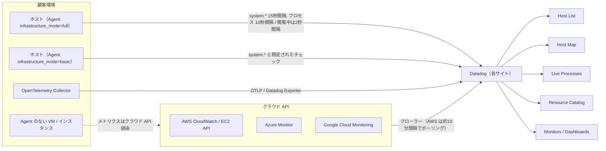
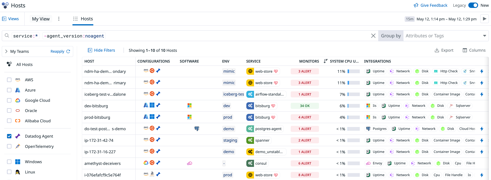
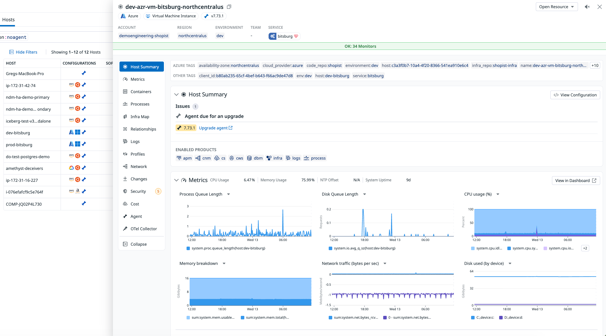
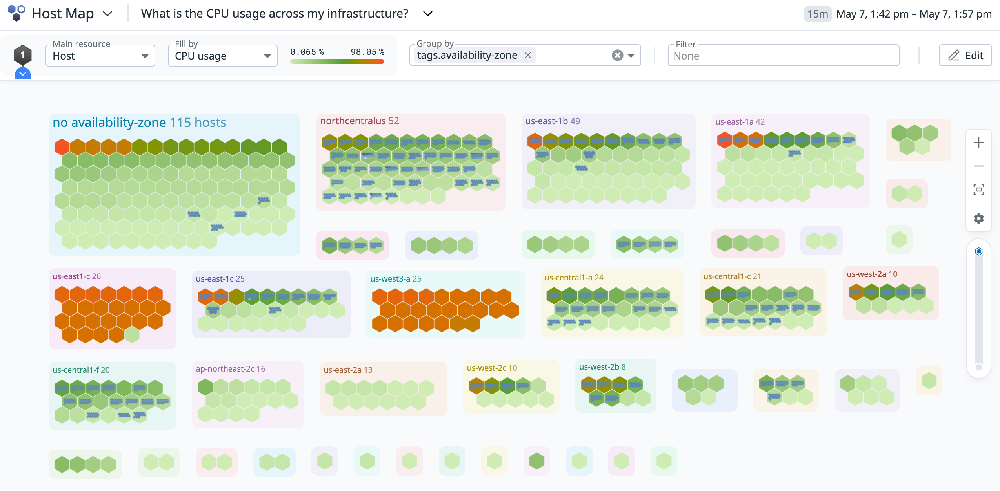
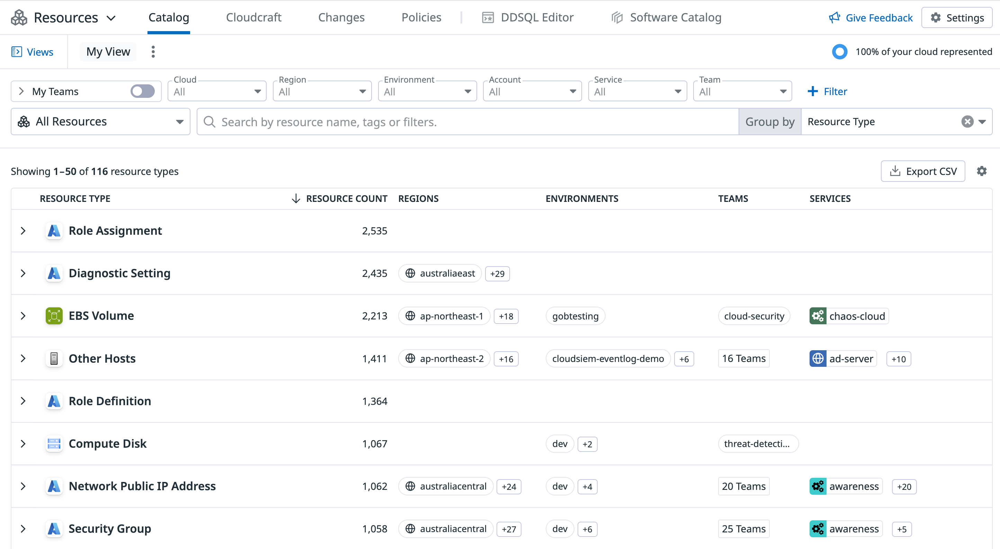
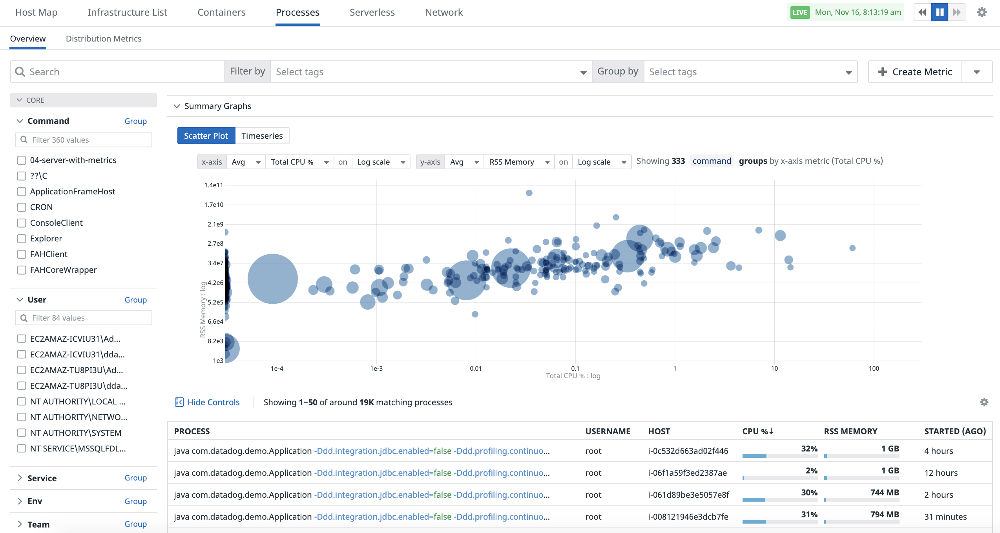

# Infrastructure Monitoring

## 概要

Datadog **Infrastructure Monitoring（インフラストラクチャ監視）** は、ホスト・コンテナ・プロセス・クラウドリソースのメトリクスを集め、可視化し、監視するための Datadog の中核製品である。Datadog の公式ドキュメントは Infrastructure Monitoring を「ホスト、コンテナ、プロセスのパフォーマンスを可視化・監視・計測する中核機能」と説明している。[出典](https://docs.datadoghq.com/infrastructure/)

本ファイルが扱う範囲は次のとおり。

| 項目 | 本ファイルの扱い | 詳細の参照先 |
|---|---|---|
| Host List（旧称：Infrastructure List） | 画面・フィルタ・列・エクスポート | 本ファイル |
| Host Map | クエリエディタ・Fill / Size / Group / Filter | 本ファイル |
| Live Processes | 有効化・設定キー・スクラビング・保持・タグ | 本ファイル |
| Resource Catalog | 画面・設定・Resource Changes・Policies | 本ファイル（セキュリティ機能の詳細は [Cloud Security](../security/cloud-security.md)） |
| ホストの定義 | 課金上の定義、ホスト名の決め方、エイリアス | 本ファイル（計算方法の詳細は [課金計算の仕組み](../../03_導入編/03-billing-mechanics.md)） |
| Agent の Infrastructure モード / Infrastructure Basic | Full / Basic / End User Device / None | 本ファイル（Agent 全般は [Datadog Agent](../platform/agent.md)） |
| システムメトリクス | System / Disk / Network / NTP チェック | 本ファイル（メトリクスの型・保持は [Metrics](../platform/metrics.md)） |
| Agent なしの監視（Agentless） | クラウドインテグレーションのみで見えるホスト、Agentless Scanning との違い | 本ファイル（各クラウドの設定は [AWS](../platform/aws-integration.md) / [Azure](../platform/azure-integration.md) / [Google Cloud](../platform/gcp-integration.md)） |
| プロセス監視 | Process Check、Live Process Monitor、Host Monitor | 本ファイル（モニター全般は [Monitors](../platform/monitors.md)） |
| コンテナ・Kubernetes（Live Containers、Container Map、Kubernetes Explorer） | 扱わない | [コンテナ・Kubernetes 監視](container-and-kubernetes-monitoring.md) |
| ネットワーク（CNM、NDM） | 扱わない | [Cloud Network Monitoring](cloud-network-monitoring.md)、[Network Device Monitoring](network-device-monitoring.md) |

### 名称の整理

| 現在の名称（2026-11-02 時点） | 旧称・別名 | 備考 |
|---|---|---|
| Host List | Infrastructure List（インフラストラクチャーリスト） | 公式ドキュメントのページタイトルは「Host List」。ナビゲーションは **Infrastructure > Hosts**。課金ドキュメントなどには「Infrastructure List」の表記が残っている。[出典](https://docs.datadoghq.com/infrastructure/list/) |
| Host Map | Host and Container Maps | 2026-03-25 に Kubernetes 対応の新しい Host Map が発表され、Host / Pod / Container / Cluster を 1 つの画面で扱えるようになった。[出典](https://www.datadoghq.com/blog/datadog-host-map/)（2026-03-25 公開） |
| Live Processes | Processes View、Live Process Monitoring | アプリの URL は `/process`。[出典](https://docs.datadoghq.com/infrastructure/process/) |
| Resource Changes | Recent Changes | Preview の申込ページ URL は `recent-changes-tab`。[出典](https://docs.datadoghq.com/infrastructure/resource_catalog/resource_changes/) |

### 全体のデータフロー



- Agent の標準チェックの収集間隔（`min_collection_interval`）は既定で 15 秒である（[Agent 設定リファレンス](../platform/agent-configuration.md) 参照）。
- AWS インテグレーションのメトリクスは API ポーリングで約 10 分間隔である（[AWS Integration](../platform/aws-integration.md) 参照）。

---

## ホストの定義

### 課金上の「ホスト」

Datadog の課金ドキュメントは、ホストを「Datadog で監視する物理または仮想の OS インスタンス」と定義している。[出典](https://docs.datadoghq.com/account_management/billing/)

| 区分 | ホストとして数えるもの | 根拠 |
|---|---|---|
| Agent を入れたマシン | サーバー、VM、Kubernetes のノード | [出典](https://docs.datadoghq.com/account_management/billing/) |
| PaaS | Azure App Service Plan のインスタンス（ノード）、Heroku dyno | 同上 |
| クラウドインテグレーションで検出したインスタンス | Amazon EC2、Google Cloud（GCE）、Azure VM、vSphere VM（Agent がなくても数える） | 同上 |
| 重複の扱い | Agent を入れた EC2 / VM をインテグレーションでも検出した場合は 1 ホストとして数える（二重課金しない） | 同上 |
| コンテナごとに Agent を入れた場合 | 各コンテナを 1 ホストとして数える。このため、Datadog はホストごとに 1 つのコンテナ版 Agent を動かす構成を推奨している | 同上 |
| INACTIVE のホスト | 報告が止まり Host List で `INACTIVE` になったホストは課金しない。Host List から消えるまで最大 2 時間かかる。有料アカウントでは過去データが残り、ホスト名やタグを指定すればグラフ化できる | 同上 |

課金対象に**ならない**クラウドリソースの例：

| クラウド | 課金対象（ホスト） | ホスト課金の対象外 | 出典 |
|---|---|---|---|
| AWS | EC2 インスタンス（Agent の有無は問わない） | ELB、RDS、DynamoDB など。課金対象になるのは EC2（ホスト）、Lambda（アクティブ関数）、CloudWatch カスタムメトリクス、コンテナのみ | [出典](https://docs.datadoghq.com/account_management/billing/aws/) |
| Azure | すべての Azure VM（Agent の有無は問わない）、App Service Plan 内のノード | Azure SQL DB、Azure Redis Cache、Load Balancer など。Shared / Dynamic / Free 階層の App Service Plan はノード数を持たないため課金に影響しない | [出典](https://docs.datadoghq.com/account_management/billing/azure/) |
| Google Cloud | GCE インスタンス（Agent の有無は問わない）。Dataflow など GCE 以外のサービスも課金対象の GCE ホストを作ることがある | Cloud SQL、App Engine、Pub/Sub など | [出典](https://docs.datadoghq.com/account_management/billing/google_cloud/) |

> **注意（AWS の二重課金）:** Datadog は EC2 インスタンスメタデータを使って「Agent が動くホスト」と「AWS インテグレーションが検出したホスト」を同一と判定する。EC2 が IMDSv2 を必須にしている場合は、**Agent 7.64.0 以上を使う**か、Agent 設定で `ec2_prefer_imdsv2: true` を設定しないと二重課金になる。[出典](https://docs.datadoghq.com/account_management/billing/aws/)

ホストの計測方法（HWMP / MHP）と料金は「[課金への影響](#課金への影響)」節を参照。

### Agent がホスト名を決める仕組み

Datadog Agent はさまざまな情報源からホスト名の候補を集め、そのうち 1 つを**正規ホスト名（canonical hostname）**として Datadog に名乗る。残りの候補は**エイリアス（alias）**として送られる。候補は `datadog-agent status` の `Hostnames` 節で確認できる。[出典](https://docs.datadoghq.com/agent/faq/how-datadog-agent-determines-the-hostname/)

```text
Hostnames
=========
  hostname: my.special.hostname
  agent-hostname: my.special.hostname
  ec2-hostname: ip-192-0-0-1.internal
  instance-id: i-deadbeef
  socket-hostname: myhost
  socket-fqdn: myhost.mydomain
```

正規ホスト名は次の順で決まり、最初に当てはまったものが採用される。`localhost.localdomain` のような一般的で一意でない名前はその段階で不採用となり、次のルールに進む。[出典](https://docs.datadoghq.com/agent/faq/how-datadog-agent-determines-the-hostname/)

| 順位 | 候補 | 条件 |
|---|---|---|
| 1 | `agent-hostname` | Agent 設定ファイル（`hostname`）または `DD_HOSTNAME` で明示した名前。ただし `ip-` や `domu` で始まる名前は除く |
| 2 | `hostname`（Linux では `hostname -f`） | DNS ホスト名が EC2 の既定名（例 `ip-192-0-0-1`）でない場合 |
| 3 | `instance-id` | ホストから EC2 メタデータエンドポイントに到達できる場合 |
| 4 | `hostname` | EC2 の既定名であっても DNS ホスト名にフォールバック |

ホスト名に関係する Agent の設定キー：

| 設定キー | 環境変数 | 既定値 | 内容 | 出典 |
|---|---|---|---|---|
| `hostname` | `DD_HOSTNAME` | `""`（自動判定） | ホスト名を明示する | [出典](https://github.com/DataDog/datadog-agent/blob/main/pkg/config/example/datadog-agent_linux.yaml.example) |
| `hostname_fqdn` | `DD_HOSTNAME_FQDN` | `false` | `true` で FQDN をホスト名にする。Agent v6.3 で導入、Windows では v6.5 以降で有効 | [出典](https://docs.datadoghq.com/agent/faq/how-datadog-agent-determines-the-hostname/) |
| `ec2_prefer_imdsv2` | — | 公開情報では確認できず | IMDSv2 を優先して EC2 メタデータを取得する | [出典](https://docs.datadoghq.com/account_management/billing/aws/) |

ホスト名に関する主な注意点：

- Agent v5 は `hostname -f`、v6 以降は Go の `os.Hostname()` を使うため、v5 から移行するとホスト名が FQDN から短縮名（`sub.domain.tld` → `sub`）に変わることがある。v6.3 以降で影響がある場合、Agent は `DEPRECATION NOTICE` の警告をログに出す。[出典](https://docs.datadoghq.com/agent/faq/how-datadog-agent-determines-the-hostname/)
- GCE 上の Agent v6 以降は GCE が提供するインスタンスのホスト名を使う。[出典](https://docs.datadoghq.com/agent/faq/how-datadog-agent-determines-the-hostname/)
- ホスト名が変わると Datadog 上では**別ホスト**として扱われる。このため、移行期間に同じマシンが 2 ホストとして数えられることがある【経験則】。OpenTelemetry（DDOT）と Agent のホスト名が食い違い、同じノードが 2 ホストとして数えられた事例は [OpenTelemetry サポート](../platform/opentelemetry.md) を参照。

### ホストエイリアス

EC2 上のホスト 1 台には、インスタンス ID（`i-abcd1234`）、IP ベースの既定名（`ip-192-0-0-1`）、社内 DNS の名前（`myhost.mydomain`）など複数の名前がありうる。Datadog はこれらを正規ホスト名のエイリアスとして結び付ける。エイリアスは Host List のホスト詳細サイドパネル（Hostnames and aliases）で確認できる。[出典](https://docs.datadoghq.com/infrastructure/list/) ホスト名 FAQ は、エイリアスを「ホスト行にカーソルを置いて Inspect ボタンを押すと開く inspect パネル」（Legacy 表示の操作）で見られると説明しており、エイリアスは**検索・フィルタには使えない**としている。[出典](https://docs.datadoghq.com/agent/faq/how-datadog-agent-determines-the-hostname/)

Hosts API（`GET /api/v1/hosts`）で AWS ホストを取得したときは、次の属性が返る。[出典](https://docs.datadoghq.com/agent/faq/how-datadog-agent-determines-the-hostname/)

| 属性 | 内容 |
|---|---|
| `aws_id` | インスタンス ID（なければホスト名） |
| `aws_name` | クラウドの `providername` タグ |
| `display_name` | 正規ホスト名 |

---

## Agent の Infrastructure モードと Infrastructure Basic

### Infrastructure モードとは

Datadog Agent の **Infrastructure モード（`infrastructure_mode`）** は、ホスト上で Agent がどこまでインフラ監視を行うかを決める設定である。公式ドキュメントは「モードは Agent の動作を変えるだけで、組織を製品に登録したり契約を変更したりはしない」と明記している。[出典](https://docs.datadoghq.com/agent/configuration/infrastructure-modes/)

| 機能 | `full`（既定） | `basic` | `end_user_device`【Preview】 | `none` |
|---|---|---|---|---|
| システムリソースメトリクス | ○ | ○ | ○ | — |
| インフラ系インテグレーション | ○（すべて） | ○（限定されたもののみ） | ○ | — |
| Container Monitoring | ○ | — | — | — |
| Live Processes | ○ | — | ○ | — |
| カスタムチェック・ログ専用インテグレーション | ○ | ○ | ○ | ○ |
| カスタムメトリクス | ○ | ○ | ○ | ○ |
| インフラ系ダッシュボードへの表示 | ○ | ○ | — | — |
| 最低 Agent バージョン | 7.73.0 | 7.73.0（Linux、macOS）、7.76.2（Windows） | 7.76.2 | 7.77.0 |
| 推奨用途 | ほとんどのケース | システムリソースメトリクスだけが必要な VM・物理サーバー | 社員の PC・ノート PC・ワークステーション | Log Management、APM、Error Tracking だけを使うホスト |

[出典](https://docs.datadoghq.com/agent/configuration/infrastructure-modes/)

- `none` モードのホストも Agent がメタデータを送り続けるため、Fleet Automation の **View Agents** タブには表示される。ただし、インフラ系メトリクスに依存するダッシュボードやクエリには出てこない。[出典](https://docs.datadoghq.com/agent/configuration/infrastructure-modes/)
- `end_user_device` モードは、Container Monitoring を除く `full` モードの全機能に加え、Device Performance Monitoring、ログ収集、Wi-Fi 監視、Windows Crash Detection、Network Path を使う。End User Device Monitoring は【Preview】である。[出典](https://docs.datadoghq.com/infrastructure/end_user_device_monitoring/)
- Agent の設定ファイル例（GitHub）には、ドキュメントにない 5 つ目の値 `cloud_cost_only`（Cloud Cost Management 用の軽量タグ付け）も記載されている。公式ドキュメントには説明がないため、用途・サポート状況は公開情報では確認できず。[出典](https://github.com/DataDog/datadog-agent/blob/main/pkg/config/example/datadog-agent_linux.yaml.example)

### `basic` モードで動くインテグレーション

`basic` モードでは、次のインテグレーションだけが動く（括弧内は必要な Agent バージョン）。[出典](https://docs.datadoghq.com/agent/configuration/infrastructure-modes/)

| 分類 | インテグレーション |
|---|---|
| OS 共通 | System Check、Disk、Network、NTP、Processes（Process Check）、Systemd、Directory（7.80+） |
| ネットワーク機器 | SNMP（7.78+）、Cisco ACI（7.78+）、Cisco SD-WAN（7.78+）、Versa（7.78+） |
| Windows | Windows Event Log、Windows Crash Detection、Windows Kernel Memory、Windows Services（7.78+）、Windows Certificate Store（7.80+）、Windows Performance Counters（7.80+）、Windows Registry（7.80+）、WMI Check（7.80+） |
| カスタム | 名前が `custom_` で始まるカスタムチェック |

### モードの設定方法

| 対象 | 方法 |
|---|---|
| 新規インストール（Linux） | インストールスクリプトの前に `DD_INFRASTRUCTURE_MODE="<MODE>"` を付ける |
| 新規インストール（Windows） | `msiexec` の引数に `DD_INFRASTRUCTURE_MODE="<MODE>"` を付ける |
| 既存ホスト | `datadog.yaml` のルートに `infrastructure_mode: <MODE>` を追加し、Agent を再起動 |
| 確認 | Fleet Automation の **View Agents** タブで **Group by** に **Infrastructure Mode** を選ぶ |

[出典](https://docs.datadoghq.com/agent/configuration/infrastructure-modes/)

```shell
DD_API_KEY="<API_KEY>" \
DD_SITE="<DD_SITE>" \
DD_INFRASTRUCTURE_MODE="basic" \
bash -c "$(curl -L https://install.datadoghq.com/scripts/install_script_agent7.sh)"
```

```yaml
# datadog.yaml（既存ホスト）
infrastructure_mode: basic
```

### 仮想化インテグレーションでの `basic` モード

vSphere、Proxmox、Nutanix の各インテグレーションでは、インスタンス設定に `infrastructure_mode: basic` を書くと、そのインテグレーションが検出したホスト・VM（Agent のない VM を含む）を Basic として報告する。インテグレーションを動かすホストの Agent 自体は `full` モードでなければならない（`basic` モードの Agent は仮想化インテグレーションを動かせない）。[出典](https://docs.datadoghq.com/agent/configuration/infrastructure-modes/)

| インテグレーション | インテグレーションを動かす Agent の最低バージョン | 設定例 |
|---|---|---|
| vSphere | 7.74.0 | `instances: - host: <VCENTER_HOSTNAME>` に `infrastructure_mode: basic` |
| Proxmox | 7.82.0 | `instances: - proxmox_server: <PROXMOX_API_ENDPOINT>` に同上 |
| Nutanix | 7.83.0 | `instances: - pc_ip: <PRISM_CENTRAL_HOSTNAME>` に同上 |

監視対象 VM の実際のモードは次のように決まる。

| 監視対象 VM の Agent | VM の実際のモード |
|---|---|
| Agent なし、または `none` モード | インテグレーション側のモード |
| `basic` モードの Agent | Basic |
| `full` モードの Agent | Full |

### Infrastructure Basic（料金プラン）

**Infrastructure Basic** は、重要度の低いワークロード向けの軽量なホスト監視の料金区分である。Datadog は 2026-10-28 のブログで Infrastructure Basic を紹介し、「Agent を `basic` モードで構成すると収集範囲が制限される」と説明している。[出典](https://www.datadoghq.com/blog/infrastructure-monitoring-basic/)（2026-10-28 公開）

| 項目 | 内容 | 出典 |
|---|---|---|
| 含まれるもの | CPU・メモリ・ディスク使用率と I/O・ネットワーク・稼働時間・ロードアベレージのシステムメトリクス。指定したプロセスを監視する Process Check。ホストの状態・リソース使用率の標準ダッシュボード。CPU 高負荷・ディスク残量不足・プロセス停止などのモニター。ServiceNow や PagerDuty などの通知・インシデント管理ツールとの SaaS 連携 | [ブログ](https://www.datadoghq.com/blog/infrastructure-monitoring-basic/) |
| 含まれないもの | Container Monitoring、Agent による技術別インテグレーション（Basic モードで動くもの以外）、より広いプロセス可視性（Live Processes）、アプリケーションレベルのコンテキスト | 同上 |
| データ保持 | フル解像度で 15 か月 | 同上、[料金ページ](https://www.datadoghq.com/pricing/) |
| 他プランとの混在 | 同じ組織で Pro または Enterprise のどちらか 1 つと混在できる。両方のホストのシステムメトリクスを同じダッシュボードで扱える | 同上 |
| 料金ページの比較表 | Custom Metrics 0 / ホスト、Custom Events 0 / ホスト、Container Monitoring 非対応、Host and Container Maps は「Host map only」、1,000+ Integrations は「Limited」 | [料金ページ](https://www.datadoghq.com/pricing/)（2026-11-02 時点） |
| 想定用途 | 社内の業務サーバー、ステージング、オンプレミスの開発 VM・物理サーバー・レガシーアプリなど | [ブログ](https://www.datadoghq.com/blog/infrastructure-monitoring-basic/) |

料金は「[課金への影響](#課金への影響)」節を参照。

---

## Host List（旧称：Infrastructure List）

### 概要

Datadog の **Host List** は、Agent またはクラウドインテグレーション経由で報告しているホストの一覧である。既定では**直近 15 分間**に動きのあったホストを表示する。ナビゲーションは **Infrastructure > Hosts**。画面右上のトグルで **New** 表示と **Legacy** 表示を切り替えられる（以下は New 表示の説明）。[出典](https://docs.datadoghq.com/infrastructure/list/)

> **注意:** 公式ドキュメントは「Host List をインフラホストの課金見積りに使ってはならない」と明記している。課金上のホスト数は Plan & Usage 画面や推定使用量メトリクス `datadog.estimated_usage.hosts` で確認する（[課金への影響](#課金への影響) 参照）。[出典](https://docs.datadoghq.com/infrastructure/list/)



- **キャプション:** Host List（New 表示）の全体画面。
- **画面の説明:** 左側にフィルタパネル（Teams、クラウドプロバイダー、テレメトリーソース、OS、GPU のクイックフィルタと検索ファセット）、右側にホストの一覧表がある。一覧の上には検索バーと **Columns** ボタン、左上には保存済みビューを開く **Views** パネルがある。一覧の各行はホスト名、状態、クラウド・OS・Agent 状態をまとめた Configurations 列、検出されたソフトウェア、有効なインテグレーション、メトリクス値の列で構成される。
- **出典:** https://docs.datadoghq.com/infrastructure/list/ （取得日 2026-11-02）

### フィルタと検索

| 機能 | 内容 |
|---|---|
| Teams | 選んだチーム（Datadog Teams）に関連付いたホストだけを表示 |
| クイックフィルタ：クラウドプロバイダー | AWS、Azure、Google Cloud、Oracle、Alibaba Cloud |
| クイックフィルタ：テレメトリーソース | Datadog Agent、OpenTelemetry |
| クイックフィルタ：OS | Windows、Linux、Darwin |
| クイックフィルタ：ハードウェア | GPU |
| Filter Metrics | メトリクスを選び、値の範囲で絞り込む |
| 検索ファセット | Cloud Provider、Env、Region、Resource Type、Instance Type、OS、OS Version、Agent、Docker Version、そのほか任意のホスト属性・タグ |
| 検索ボックス | Datadog の検索構文 |

[出典](https://docs.datadoghq.com/infrastructure/list/)

### 列（Columns）

**Columns** ボタンで列の追加・削除・並べ替えができる。列はドラッグで並べ替え、右端のドラッグで幅を変え、トグルで非表示にできる。[出典](https://docs.datadoghq.com/infrastructure/list/)

| 列の種類 | 内容 |
|---|---|
| Host Attributes | ホスト名、状態など |
| Tags | 任意のタグ |
| Metrics | ホストが報告している任意のメトリクス |
| Configurations（複合列） | クラウドプロバイダー、OS、Agent のインストール状態 |
| Software（複合列） | 検出された Web サーバー、データベース、キャッシュ、コンテナオーケストレーター（Docker、Kubernetes など） |
| Integrations（複合列） | ホストで有効な Agent インテグレーション |

### 保存済みビュー（Saved Views）

左上の **Views** パネルで **Save as new view** を押すと、フィルタと列の構成を保存できる。保存済みビューはパネル内でフィルタ・並べ替え・編集・スター付けができる。[出典](https://docs.datadoghq.com/infrastructure/list/)

### ホストの詳細パネル

ホストをクリックすると詳細のサイドパネルが開く。このパネルは Resource Catalog のホストパネルと同じものである。[出典](https://docs.datadoghq.com/infrastructure/list/)



- **キャプション:** Host List でホストをクリックしたときに開く詳細サイドパネル。
- **画面の説明:** パネル上部にホスト名・クラウド・OS・インスタンスタイプなどのホスト情報とタグがあり、その下に Host Summary（アクティブなモニターアラートと有効な製品）、メトリクスのグラフ、Containers、Processes などの節が縦に並ぶ。下にスクロールすると **Agent** 節（Agent 設定の JSON）や **OTel Collector** 節がある。
- **出典:** https://docs.datadoghq.com/infrastructure/list/ （取得日 2026-11-02）

| パネルの節 | 内容 | 条件 |
|---|---|---|
| ホスト名・エイリアス | 正規ホスト名とエイリアス | — |
| Tags | ホストのタグ | — |
| Metrics | ホストのメトリクス | — |
| Containers | ホスト上のコンテナ | — |
| Logs | ホストのログ | ログを有効にしている場合 |
| Agent | Agent 設定（JSON 形式） | Agent 設定の表示が有効な場合。設定の一括管理は [Fleet Automation](../platform/fleet-automation.md) |
| OTel Collector | Collector のビルド情報と全設定 | Datadog Extension が必要 |

[出典](https://docs.datadoghq.com/infrastructure/list/)

### エクスポート

| 方法 | 内容 |
|---|---|
| DDSQL Editor | **Export > Open in DDSQL Editor** で開き、結果をダウンロード。結果はダッシュボード、ノートブック、スプレッドシートにも送れる（[Notebooks・DDSQL](../platform/notebooks-and-data-tools.md) 参照） |
| JSON（ホスト概要レポート） | 事前に決められたメトリクス一覧と、apps・sources・aliases・meta・mute 状態・tags を含められるフラグ付きのレポート |
| JSON（Hosts API） | `GET /api/v1/hosts`（ホスト検索 API） |
| Agent バージョン監査 | Miscellany リポジトリの `get_host_agent_list` スクリプトで、稼働中の Agent とバージョンを出力。`json_to_csv` スクリプトで CSV に変換できる |
| Agent のない EC2 の洗い出し | Python 3 スクリプト（環境変数 `DD_API_KEY`、`DD_APP_KEY` が必要）。ホスト概要レポートを `window=3h` で取得し、`aws` を含み、`rds` と `agent` を含まない行を抽出する。対象は RDS を除く EC2 で、AWS インテグレーション設定後に現れる |

[出典](https://docs.datadoghq.com/infrastructure/list/)

### ホストの状態表示

| 状態 | 意味 | 出典 |
|---|---|---|
| `INACTIVE` | 報告が止まったホスト。課金対象外。Host List から消えるまで最大 2 時間 | [出典](https://docs.datadoghq.com/account_management/billing/) |
| `???` | クラウドインテグレーションでメトリクス収集を制限（タグで除外）した直後の移行期間に、以前検出された EC2 / Azure VM / GCE インスタンスに表示される。最大 2 時間 Host List に残るが課金対象外 | [AWS](https://docs.datadoghq.com/account_management/billing/aws/)、[Azure](https://docs.datadoghq.com/account_management/billing/azure/)、[Google Cloud](https://docs.datadoghq.com/account_management/billing/google_cloud/) |

上記以外の状態値（`ACTIVE` など）の一覧と定義は、New 表示の公式ドキュメントでは確認できず。

### Agent 監視かクラウド監視かの見分け方

| 表示 | 判断 |
|---|---|
| AWS ロゴだけが表示される、またはメトリクスが `aws.*` 名前空間に限られる | AWS インテグレーションだけで監視されている（Agent なし） |
| Datadog Agent のロゴがあり AWS ロゴがない、または `datadog.*`・`system.*` などの Agent 由来メトリクスがある | Datadog Agent で監視されている |

[出典](https://docs.datadoghq.com/account_management/billing/aws/)

---

## Host Map

### 概要

Datadog の **Host Map** は、ホスト・Pod・コンテナ・クラスタを 1 つの画面に並べ、色・大きさ・グループで状態を一目で把握するための可視化機能である。[出典](https://docs.datadoghq.com/infrastructure/hostmap/) 2026-03-25 のブログで発表された新しい Host Map は、Kubernetes を前提としたトポロジー向けに作り直され、Pod とクラスタを扱えるようになった。[出典](https://www.datadoghq.com/blog/datadog-host-map/)（2026-03-25 公開）



- **キャプション:** Host Map の初期画面（availability-zone でグループ化した例）。
- **画面の説明:** 画面左上にクエリのドロップダウン（推奨クエリ・保存済みクエリ・**Create**）、その横に Main / Secondary resource、Fill by、Size by、Group by、Filter の入力欄がある。下の領域ではホストが六角形のセルとして並び、グループ（例：「no availability-zone」565 ホスト、「eastus」192 ホスト、「eastus-1」147 ホスト）ごとに枠で囲まれる。セルの色は既定で CPU 使用率を表し、緑（0%）からオレンジ（100%）に変わる。
- **出典:** https://docs.datadoghq.com/infrastructure/hostmap/ （取得日 2026-11-02）

### クエリエディタの設定項目

| 項目 | 内容 | 既定値・制約 |
|---|---|---|
| クエリの選択 | 左上のドロップダウンで推奨クエリ（Suggested Queries）や、組織内のユーザーが保存したカスタムクエリを選ぶ。**Create** で新規作成 | 保存したクエリを既定のビューにできる（[ブログ](https://www.datadoghq.com/blog/datadog-host-map/)） |
| Main resource | Host、Pod、Container、Cluster から選ぶ | — |
| Secondary resource | Main resource の下位に入れ子で表示するリソース（例：Host の中の Pod、Cluster の中の Pod） | — |
| Fill by | セルの色に使うメトリクスまたはシグナル（メモリ、エラーログなど） | 既定は CPU 使用率（緑 0% → オレンジ 100%） |
| Size by | セルの大きさに使うメトリクスまたはシグナル | **Secondary resource を指定しないときのみ**使える |
| Group by | セルを空間的にグループ化。複数指定でき、最初の指定が外側の階層になる（例：`tags.availability-zone` → `tags.instance-type`） | — |
| Filter | 表示対象を絞り込む。`AND`・`NOT`・`OR` とワイルドカード `*` が使える | 例：`(tags.availability-zone:ap* OR tags.availability-zone:eu*) NOT tags.agent_version:5.3*` |

[出典](https://docs.datadoghq.com/infrastructure/hostmap/)

### 代表的な使い方（公式の例）

| 目的 | クエリ・設定の例 |
|---|---|
| 性能劣化の原因切り分け | `kubernetes_state.pod.status:unready`、`system.cpu.user > 80` を使い、階層表示で原因を絞る |
| コストのホットスポット特定 | `tags.kube_node_instance_type`、`tags.cloud_provider`、コスト配賦用タグでグループ化し、CPU・メモリと組み合わせて過不足を見る |
| Agent の一括管理 | `tags.agent_version < 7.50` で古い Agent を探し、AZ・クラスタ・サービスでグループ化して展開計画を立てる |
| ロールアウト・移行の監視 | クラスタの中に Pod を入れ子表示し、リアルタイムに変化を見る |
| タグの衛生チェック | `tags.env:prod AND NOT (tags.team:*)` で所有者タグのないリソースを探す |

[出典](https://docs.datadoghq.com/infrastructure/hostmap/)

### Host Map の制限事項

- 表示できるホスト数・グループ数の上限、更新間隔は公開情報では確認できず（ブログは「数千のリソース」を含む大規模環境を想定と記載するのみ）。[出典](https://www.datadoghq.com/blog/datadog-host-map/)
- Infrastructure Basic の料金比較表では、Basic は「Host map only」（Container Map は使えない）とされる。[出典](https://www.datadoghq.com/pricing/)
- Container Map とコンテナ側の可視化は [コンテナ・Kubernetes 監視](container-and-kubernetes-monitoring.md) を参照。

---

## Resource Catalog

### 概要

Datadog **Resource Catalog** は、インフラリソースを一元管理する画面である。ホスト、データベース、ストレージなどのクラウドリソースについて、メタデータ、所有者、構成、リソース間の関係、セキュリティリスクを確認できる。データ源は Datadog のクラウドインテグレーションと Datadog Agent である。[出典](https://docs.datadoghq.com/infrastructure/resource_catalog/)

Resource Catalog は全顧客に一般提供（GA）されている。Security タブを使うには Datadog Cloud Security が、Cost タブを使うには Cloud Cost Management が必要である。[出典](https://www.datadoghq.com/blog/datadog-resource-catalog/)（2023-11-28 公開、2024-12-04 更新。公開から約 3 年、最終更新からも 2 年以上経っており、タブ構成などは現行画面と異なる可能性がある）



- **キャプション:** Resource Catalog の Catalog タブ（リソースタイプでグループ化した表示）。
- **画面の説明:** 左側にファセットパネル（クラウド、リソースタイプ、アカウント、リージョン、Teams トグルなど）、右側にリソースタイプごとにまとめたリソース一覧がある。一覧には所有チーム、関連サービス、リソースタイプ別の属性が並ぶ。一覧右上から CSV にエクスポートできる。
- **出典:** https://docs.datadoghq.com/infrastructure/resource_catalog/ （取得日 2026-11-02）

### 用途

| 用途 | 内容 |
|---|---|
| リソースのポリシーとレポート | 所有者・バージョン・移行状況などのコンプライアンス把握、タグ付けの徹底、依存関係の脆弱性の把握、記録・監査用のエクスポート |
| インシデント・性能問題の調査 | テレメトリーやダッシュボードへの移動、所有チーム・サービスオーナーの特定、構成変更の確認 |
| 監視の網羅性向上 | Datadog での監視が不十分なリソースや、セキュリティの設定不備を報告していないリソースの発見 |

[出典](https://docs.datadoghq.com/infrastructure/resource_catalog/)

### セットアップ

| 対象 | 既定で表示されるか | 必要な操作 |
|---|---|---|
| Agent で監視しているホスト | 表示される | 不要 |
| 他の製品（CNM、DBM など）のためにクロールしたクラウドリソース | 表示される | 不要 |
| その他のクラウドリソース | 表示されない | Resource Catalog の設定ページ（`/infrastructure/catalog/configuration`）で **extend resource collection** をオンにする |

[出典](https://docs.datadoghq.com/infrastructure/resource_catalog/)

> **注意（AWS のコスト）:** リソース収集を有効にすると AWS CloudWatch の料金に影響することがある。避けるには AWS インテグレーションの **Metric Collection** タブで **Usage** メトリクスを無効にする。[出典](https://docs.datadoghq.com/infrastructure/resource_catalog/)

### Catalog タブ

- Catalog タブでは、リソースごとに所有チームと関連サービスを表示する。インシデントの前に所有者情報の欠落を見つけて埋めるのに使う。[出典](https://docs.datadoghq.com/infrastructure/resource_catalog/)
- リソースタイプ別の属性で検索できる（例：ホストのインスタンスタイプ、データベースのバージョン）。
- Datadog Teams を使っている場合、左パネルの **Teams** トグルで自分のチームのリソースだけに絞れる。
- 一覧右上から CSV でエクスポートできる。
- リソースをクリックしてサイドパネルを開き、右上の **Open Resource** ドロップダウンからクラウドコンソールに移動できる。

### ホスト・リソースの詳細パネル

ホストのサイドパネルには次の節がある。このパネルには秘密情報は表示されない（「secret」のように見える文字列はランダム生成値）。[出典](https://docs.datadoghq.com/infrastructure/resource_catalog/)

| 節 | 内容 |
|---|---|
| ホスト情報 | 名前、アカウント、OS、インスタンスタイプ、タグ、メタデータ |
| Host Summary | アクティブなモニターアラート、有効な製品 |
| Telemetry | メトリクス、ログ、トレース、プロセス |
| Containers | ホスト上のコンテナのメトリクス |
| Infra map | Cloudcraft の構成図 |
| Relationships | 他のリソースとの関係を示すインタラクティブなマップ |
| Profiles | ホストに関連するプロファイル（Continuous Profiler が必要） |
| Network | タグで絞り込めるネットワーク情報とグラフ |
| Changes | ホストの変更履歴 |
| Security | 設定不備、IaC の設定不備、シグナル、脆弱性、ID リスク、アクセスインサイト |
| Cost | コスト削減の推奨 |
| Agent | Agent 設定（JSON 形式） |
| OTel Collector | OpenTelemetry Collector 設定【Preview】 |

ホスト以外のリソースのパネルは、Resource Info（リソース固有のタグと JSON 形式の定義）、Telemetry（メトリクス、ログ）、Relationships、Changes、Security（設定不備、シグナル、脆弱性、ID リスク）で構成される。[出典](https://docs.datadoghq.com/infrastructure/resource_catalog/)

### 対応リソースタイプ

Cloud Resources Schema Reference には、Resource Catalog で絞り込みに使えるリソースタイプが載っている。2026-11-02 時点で数えると、AWS 1,085 種、Google Cloud 486 種、Azure 54 種である（ページ上のリソースタイプへのリンク数を数えたもの）。[出典](https://docs.datadoghq.com/infrastructure/resource_catalog/schema/)

### Resource Changes【Preview】

**Resource Changes（旧称：Recent Changes）** は、クラウドインフラの構成変更を一覧で見る機能である。2026-11-02 時点で【Preview】で、利用には申込みが必要。[出典](https://docs.datadoghq.com/infrastructure/resource_catalog/resource_changes/)

| 項目 | 内容 |
|---|---|
| 前提 | 対象クラウドリソースのリソース収集を有効にし、Resource Catalog に表示されていること |
| 画面 | **Infrastructure > Resources > Resource Changes**。リソースのサイドパネルの **Recent Changes** 節からも開ける |
| 対象リソースの分類 | Hosts、Containers、Serverless Functions、Databases、Queues、Storage、Networking、Monitoring、Identity、Data Processing（AWS、Azure、Google Cloud） |
| Snapshot Changes | リソースのスナップショットを約 5〜15 分ごとに比較して差分を検出する。追加設定は不要。途中の状態は省かれ、正味の差分だけが残る |
| 保持期間 | Snapshot Changes は 1 週間 |
| 追加料金 | Snapshot Changes の生成に追加のイベント料金はかからない |
| モニター連携 | モニターのアラートから、時間範囲と関連タグ（`service`、`env`、`team` など）で絞り込まれた Resource Changes ページに移動できる |
| 差分表示 | 変更を選ぶと構成の差分を左右に並べて表示し、AWS CloudTrail などの関連ログも見られる |

[出典](https://docs.datadoghq.com/infrastructure/resource_catalog/resource_changes/)

Resource Changes の検索パラメータ：

| パラメータ | 例 |
|---|---|
| Change Type（Update / Create / Delete） | `latest_change_type:Update` |
| Resource Category（クラウド横断の分類） | `resource_category:hosts`（EC2、Azure VM、GCP Compute インスタンスなど） |
| Resource Type | `resource_type:aws_ec2_instance` |
| 主要属性 | `cloud_provider:aws region:us-east-1 env:staging account_id:123456789012` |
| Resource Name | `display_name:*bucket*` |
| Tags | `tags:"application:frontend" "owner:team-alpha"` |

ワイルドカード（`*`）、`OR`（リソースタイプ・カテゴリでは使えない）、`-` による除外（例 `-service:*` でタグ未設定のものを表示）が使える。[出典](https://docs.datadoghq.com/infrastructure/resource_catalog/resource_changes/)

### Resource Policies【Preview】

**Resource Policies** は、インフラリソースのあるべき構成をポリシーとして定義し、準拠していないリソースとコンプライアンススコアを表示する機能である。2026-11-02 時点で【Preview】。ナビゲーションは **Resources > Policies**。[出典](https://docs.datadoghq.com/infrastructure/resource_catalog/policies/)

| 機能 | 内容 |
|---|---|
| カスタムポリシー | リソースタイプ、属性、目標値を選んで作成。入れ子の属性、`>`・`<`・`!=` の条件、複数属性の組み合わせが使える |
| タグポリシー | リソースタイプと、付いているべきタグのキー・値を指定 |
| 標準テンプレート | 信頼性、コスト最適化、運用の優秀性、バージョン管理の分野のテンプレート。一部は Datadog の Native Actions で Datadog から直接修正できる |
| ポリシーごとのビュー | 非準拠リソースの一覧とコンプライアンススコア。チームや任意のタグで絞り込み・グループ化できる |

テンプレートの例（公式）：EC2 は承認済みの Golden AMI のみ使う、RDS のバックアップ保持を 1 日以上にする、ECS サービスの希望タスク数を 1 より大きくする、EBS は GP2 ではなく GP3 を使う、Lambda で非推奨ランタイムを使わない、など。[出典](https://docs.datadoghq.com/infrastructure/resource_catalog/policies/)

> **サイト差異:** Resource Policies と Resource Changes は `app.ddog-gov.com`（US1-FED）と `us2.ddog-gov.com`（US2-FED）では提供されない。Resource Policies の Preview は US1・US3・US5・EU1・AP1・AP2・UK1 で案内されている。[出典](https://docs.datadoghq.com/infrastructure/resource_catalog/policies/)、[出典](https://docs.datadoghq.com/infrastructure/resource_catalog/resource_changes/)

---

## システムメトリクス

### 概要

Datadog Agent は、インストールしただけでホストのシステムメトリクス（`system.*`）を収集する。System Check、System Core、System Swap、Disk、Network、NTP の各チェックは Agent パッケージに同梱されており、追加インストールは不要である。[出典](https://docs.datadoghq.com/integrations/system/)

| チェック | 主なメトリクス名前空間 | 既定で有効か | 設定ファイル | 出典 |
|---|---|---|---|---|
| System Check | `system.cpu.*`、`system.load.*`、`system.mem.*`、`system.swap.*`、`system.io.*`、`system.fs.file_handles.*`、`system.uptime`、`system.proc.*`（Windows） | 有効 | —（同梱） | [出典](https://docs.datadoghq.com/integrations/system/) |
| System Core | `system.core.*`（コア数、コア別 CPU 時間） | 設定が必要 | `system_core.d/conf.yaml` | 同上 |
| System Swap | `system.swap.swapped_in`、`system.swap.swapped_out` | 設定が必要 | `system_swap.d/conf.yaml` | 同上 |
| Disk | `system.disk.*`、`system.fs.inodes.*` | 有効（全ローカルパーティション） | `disk.d/conf.yaml` | [出典](https://docs.datadoghq.com/integrations/disk/) |
| Network | `system.net.*` | 有効 | `network.d/conf.yaml` | [出典](https://docs.datadoghq.com/integrations/network/) |
| NTP | `ntp.offset`、`ntp.intake_offset` | 有効 | `ntp.d/conf.yaml` | [出典](https://docs.datadoghq.com/integrations/ntp/) |

### タグ

すべてのシステムメトリクスには `host:<HOST_NAME>` タグが自動で付く。`system.disk.*`、`system.fs.inodes.*`、`system.io.*`、`system.net.*` にはさらに `device:<DEVICE_NAME>` が付く。[出典](https://docs.datadoghq.com/integrations/system/)

### 主要なシステムメトリクス

CPU（System Check）：[出典](https://docs.datadoghq.com/integrations/system/)

| メトリクス | 型 | 内容 | 対象 OS の注意 |
|---|---|---|---|
| `system.cpu.user` | gauge | ユーザー空間プロセスの CPU 時間の割合（%） | — |
| `system.cpu.system` | gauge | カーネルの CPU 時間の割合（%） | — |
| `system.cpu.idle` | gauge | アイドル時間の割合（%） | — |
| `system.cpu.iowait` | gauge | I/O 待ちの割合（%） | Windows なし |
| `system.cpu.stolen` | gauge | ハイパーバイザーに奪われた時間の割合（%） | VM のみ、Windows なし |
| `system.cpu.guest` | gauge | 仮想 CPU 実行時間の割合（%） | ハイパーバイザーのみ、Windows なし |
| `system.cpu.interrupt` | gauge | 割り込み処理の割合（%） | — |
| `system.cpu.context_switches` | count | コンテキストスイッチ回数 | — |
| `system.cpu.num_cores` | gauge | CPU コア数 | — |

ロードアベレージ（Linux のみ）：`system.load.1`、`system.load.5`、`system.load.15`、および CPU 数で正規化した `system.load.norm.1`、`system.load.norm.5`、`system.load.norm.15`。[出典](https://docs.datadoghq.com/integrations/system/)

メモリ・スワップ：[出典](https://docs.datadoghq.com/integrations/system/)

| メトリクス | 内容 |
|---|---|
| `system.mem.total` | 物理メモリの総量（byte） |
| `system.mem.used` | 使用中のメモリ（byte） |
| `system.mem.free` | 空きメモリ（byte） |
| `system.mem.usable` | `/proc/meminfo` の MemAvailable（なければ free + buffered + cached） |
| `system.mem.pct_usable` | 使用可能メモリの割合（fraction） |
| `system.mem.cached` / `system.mem.buffered` | キャッシュ・バッファに使われているメモリ |
| `system.mem.committed_as` / `system.mem.commit_limit` | コミット済みメモリ / コミット上限（Linux のみ） |
| `system.swap.total` / `system.swap.used` / `system.swap.free` / `system.swap.pct_free` | スワップ領域 |
| `system.paging.total` / `system.paging.used` / `system.paging.free` / `system.paging.pct_free` | ページファイル（Windows のみ） |

ディスク・ファイルシステム（Disk チェック）：[出典](https://docs.datadoghq.com/integrations/disk/)

| メトリクス | 内容 |
|---|---|
| `system.disk.total` / `system.disk.used` / `system.disk.free` | ディスク容量（byte） |
| `system.disk.in_use` | 使用率（fraction、0〜1） |
| `system.disk.utilized` | 使用率（percent、0〜100） |
| `system.disk.read_time_pct` / `system.disk.write_time_pct` | 読み書きに費やした時間の割合 |
| `system.fs.inodes.total` / `used` / `free` / `in_use` / `utilized` | inode |

ディスク I/O（System Check）：`system.io.r_s`、`system.io.w_s`、`system.io.rkb_s`、`system.io.wkb_s`、`system.io.await`、`system.io.r_await`、`system.io.w_await`、`system.io.avg_q_sz`、`system.io.util`（Linux のみ）など。[出典](https://docs.datadoghq.com/integrations/system/)

ネットワーク（Network チェック）：`system.net.bytes_rcvd`、`system.net.bytes_sent`、`system.net.packets_in.count`、`system.net.packets_in.error`、`system.net.packets_in.drop`、`system.net.packets_out.*`、`system.net.iface.up`、`system.net.iface.mtu`、`system.net.conntrack.*`（conntrack）、`system.net.ip.*`（IP 統計）など。[出典](https://docs.datadoghq.com/integrations/network/)

稼働時間：`system.uptime`（秒）。[出典](https://docs.datadoghq.com/integrations/system/)

### サービスチェック

| サービスチェック | 内容 | 既定 | 出典 |
|---|---|---|---|
| `datadog.agent.up` | Agent が正常に動いていれば OK。ホストが応答しなければ CRITICAL（Host Monitor の判定に使う） | 有効 | [出典](https://docs.datadoghq.com/integrations/system/) |
| `disk.read_write` | ディスクの読み書き状態 | **無効**（`disk.d/conf.yaml` で `service_check_rw: true`） | [出典](https://docs.datadoghq.com/integrations/disk/) |
| `ntp.in_sync` | 時刻のずれがしきい値を超えると CRITICAL、NTP サーバーに接続できないと UNKNOWN | 有効 | [出典](https://docs.datadoghq.com/integrations/ntp/) |

### NTP チェックの既定動作

- NTP チェックは既定で有効で、**15 分ごと**に NTP サーバーとの時刻差（オフセット）を報告する。[出典](https://docs.datadoghq.com/integrations/ntp/)
- Agent の時刻が Datadog や他のホストと **15 秒以上**ずれると、誤ったアラート、メトリクスの遅延、グラフの欠けが起きうる。[出典](https://docs.datadoghq.com/integrations/ntp/)
- クラウドを検出した場合はそのクラウドのプライベート NTP サーバーを使い、検出しなければ `0.datadog.pool.ntp.org`〜`3.datadog.pool.ntp.org` を使う。NTP 要求はプロキシ設定に対応しない。[出典](https://docs.datadoghq.com/integrations/ntp/)
- `ntp.intake_offset`（Datadog の受信サーバーとの時刻差、HTTP の Date ヘッダーから算出、精度は秒）は Agent 7.79 以降で使える。[出典](https://docs.datadoghq.com/integrations/ntp/)

> **サイト差異:** System Check のドキュメントには、`us2.ddog-gov.com`（US2-FED）では組織でこのインテグレーションが使えるかを Integrations ページで確認し、使えない場合は `support@ddog-gov.com` に例外申請するよう注記がある。[出典](https://docs.datadoghq.com/integrations/system/)

メトリクスの型、保持期間、クエリ方法の詳細は [Metrics](../platform/metrics.md) と [メトリクスクエリと関数](../platform/metrics-query-and-functions.md) を参照。

---

## Agentless 監視（Agent なしでの監視）

### Agentless 監視の位置付け

Datadog の Infrastructure Monitoring では、Agent を入れていないマシンも**クラウドインテグレーション**（AWS、Azure、Google Cloud）や**仮想化インテグレーション**（vSphere、Proxmox、Nutanix）経由でホストとして扱える。Datadog の文脈で「Agentless」と呼ばれるものには、性質の違う次の 3 種類がある。

| 種類 | 何が分かるか | 課金上の扱い | 詳細 |
|---|---|---|---|
| クラウドインテグレーションによるホスト監視 | クラウド API から取れるメトリクス（`aws.ec2.*` など）とメタデータ。Host List・Host Map・Resource Catalog に表示される | EC2、Azure VM、GCE インスタンスは **Agent がなくてもインフラホストとして課金**される | 本節、各クラウドのインテグレーションファイル |
| 仮想化インテグレーションによる VM 監視 | vCenter などのハイパーバイザー側から見た VM のメトリクス | vSphere VM はホストとして課金。`infrastructure_mode: basic` を設定すると Basic として報告される | 「[仮想化インテグレーションでの basic モード](#仮想化インテグレーションでの-basic-モード)」 |
| Agentless Scanning（セキュリティ） | ディスクのスナップショットから SBOM を作り、脆弱性を検出する | Cloud Security の課金（インフラホスト課金とは別） | [Cloud Security](../security/cloud-security.md) |

### Agent ありとクラウドインテグレーションのみの比較

| 観点 | Datadog Agent あり | クラウドインテグレーションのみ |
|---|---|---|
| メトリクスの粒度 | 標準チェックは 15 秒間隔（`min_collection_interval` 既定値） | クラウド API のポーリング間隔に従う（AWS は約 10 分間隔。[AWS Integration](../platform/aws-integration.md) 参照） |
| メトリクスの種類 | OS 内部の `system.*`（メモリ、ディスク使用率、プロセスなど） | ハイパーバイザー側から見えるもの（例：EC2 の CPU、ネットワーク、ディスク I/O）。OS 内部のメモリやファイルシステム使用率は通常取れない【経験則】 |
| Live Processes / Process Check | 使える（モード・プランの条件あり） | 使えない |
| ログ・APM・コンテナ | Agent で収集できる | 使えない（クラウド側のログ転送などは別） |
| 課金 | ホスト単位 | EC2 / Azure VM / GCE はホスト単位で課金（Agent ありと二重には数えない） |

Datadog の公式ブログは、クラウドインテグレーションだけでの監視は基本的な監視を早く始めるのに役立つが、Agent のほうがより細かい粒度でデータを取れると説明している。[出典](https://www.datadoghq.com/blog/datadog-agent/)（公開日は公式ページ上で確認できず）

### クラウドインテグレーションのホストを絞り込む

Agent のないインスタンスを課金・監視の対象から外すには、各クラウドインテグレーションでタグによる収集制限を設定する。Agent が動いているホストは、制限の有無に関係なく表示され、課金対象になる。[出典](https://docs.datadoghq.com/account_management/billing/aws/)、[出典](https://docs.datadoghq.com/account_management/billing/azure/)、[出典](https://docs.datadoghq.com/account_management/billing/google_cloud/)

| クラウド | 設定場所 | 例 |
|---|---|---|
| AWS | AWS インテグレーション > アカウント > **Metric Collection** タブ > **Limit Metric Collection to Specific Resources**（EC2、Lambda、ELB、ALB、NLB、RDS、SQS、Step Functions、CloudWatch カスタムメトリクスが対象）。API でも設定可 | `!datadog:no`（`datadog:no` タグの EC2 を除外）、`datadog:monitored,env:production,instance-type:c1.*,!region:us-east-1` |
| Azure | Azure インテグレーション > **Metric Collection** タブ > App Registration の「Optionally limit metrics collection to hosts with tag:」。App Service Plan は Configuration タブの別設定 | — |
| Google Cloud | Google Cloud インテグレーション > Configuration タブ > プロジェクトの「Optionally Limit Metrics Collection to hosts with tag」 | — |

- AWS の EC2 の制限は、EC2 インスタンスと接続された EBS ボリュームの両方に効く。[出典](https://docs.datadoghq.com/account_management/billing/aws/)
- Datadog ではタグの大文字は小文字に、空白はアンダースコアに変換される。AWS の `Team:Frontend App` は `team:frontend_app` と書く。[出典](https://docs.datadoghq.com/account_management/billing/aws/)
- CloudWatch Metric Streams（Amazon Data Firehose 経由）を使う場合も、インテグレーション画面のタグフィルタが適用される。[出典](https://docs.datadoghq.com/account_management/billing/aws/)

詳しい設定手順は [AWS Integration](../platform/aws-integration.md)、[Azure Integration](../platform/azure-integration.md)、[Google Cloud Integration](../platform/gcp-integration.md) を参照。

### Agentless Scanning（参考）

Cloud Security の **Agentless Scanning** は、AWS・Azure・GCP のリソースの脆弱性を Agent なしで見つける機能である。インフラ監視（メトリクス収集）の機能ではない。[出典](https://docs.datadoghq.com/security/cloud_security_management/setup/agentless_scanning/)

| 項目 | 内容 |
|---|---|
| 仕組み | 顧客のクラウドアカウント内にスキャナー VM を置き、VM のボリュームのスナップショット（Lambda などは関数コード）から SBOM を作って Datadog に送る。スナップショットは削除される |
| スキャン間隔 | 12 時間ごと（Remote Configuration で対象を配布） |
| Agent との関係 | Datadog Agent を入れたリソースはスキャン対象外 |
| 送信されるデータ | CycloneDX 形式のパッケージ一覧（SBOM）とホストメタデータのみ。設定、暗号鍵・証明書、ログ、業務データは送らない |
| クラウド側のコスト | スキャナーの計算資源・ネットワーク料金は顧客のクラウド請求に載る。ホストが 150 台を超えるリージョンにはリージョンごとのスキャナー設置が推奨される |
| スキャナーの運用 | AWS では負荷に応じて自動スケールし、対象がなければ 0 台まで縮小する。スキャナーは 24 時間ごとに入れ替わる |

> **サイト差異:** Agentless Scanning は `app.ddog-gov.com`（US1-FED）と `us2.ddog-gov.com`（US2-FED）では提供されない。[出典](https://docs.datadoghq.com/security/cloud_security_management/setup/agentless_scanning/)

詳細は [Cloud Security](../security/cloud-security.md) を参照。

---

## Live Processes

### 概要

Datadog **Live Processes** は、インフラ上で動くすべてのプロセスをリアルタイムに一覧・検索・分析する機能である。Live Processes でできることは次のとおり。[出典](https://docs.datadoghq.com/infrastructure/process/)

- 動いているプロセスを 1 か所で見る
- ホストやコンテナのリソース消費をプロセス単位で分解する
- ホスト、ゾーン、ワークロードなどでプロセスを検索する
- 社内ソフトウェアやサードパーティソフトウェアの性能を 2 秒粒度のシステムメトリクスで監視する
- ダッシュボードやノートブックにプロセスの情報を加える

> **利用条件:** Live Processes と Live Process Monitor は **Enterprise プランに含まれる**。それ以外のプランでは、担当営業または success@datadoghq.com に問い合わせる必要がある。[出典](https://docs.datadoghq.com/infrastructure/process/)、[出典](https://docs.datadoghq.com/monitors/types/process/) 料金ページでも Live Processes は Infrastructure Enterprise の特長として記載されている。[出典](https://www.datadoghq.com/pricing/)
>
> **モードの条件:** Agent の `infrastructure_mode` が `full` または `end_user_device` のときに使える。`basic` と `none` では使えない。[出典](https://docs.datadoghq.com/agent/configuration/infrastructure-modes/)



- **キャプション:** Live Processes（Processes）画面。
- **画面の説明:** 上部に検索バー（テキスト検索とタグフィルタ）とサマリーグラフの表示切替、左側にタグのファセットパネル（host、service、command、pod_name など）、中央にプロセスの一覧表がある。一覧の各行はコマンド、ホスト、ユーザー、CPU 使用率、RSS メモリなどの列で、行をクリックするとプロセスの詳細パネルが開く。
- **出典:** https://docs.datadoghq.com/infrastructure/process/ （取得日 2026-11-02）

### 有効化の方法

| 環境 | 設定 | 補足 |
|---|---|---|
| Linux / Windows（Agent 6 / 7） | `datadog.yaml` で `process_config.process_collection.enabled: true` にして Agent を再起動 | 環境変数の設定は設定ファイルより優先される |
| Docker | `-v /etc/passwd:/etc/passwd:ro` と `-e DD_PROCESS_CONFIG_PROCESS_COLLECTION_ENABLED=true` を付けて Agent コンテナを起動 | コンテナ情報を集めるには `dd-agent` ユーザーが `docker.sock` にアクセスできる必要がある。コンテナ版 Agent でもホストのプロセスを集められる |
| Helm | `datadog-values.yaml` で `datadog.processAgent.enabled: true` と `datadog.processAgent.processCollection: true`、その後 `helm upgrade -f datadog-values.yaml <RELEASE_NAME> datadog/datadog` | — |
| Datadog Operator | `datadog-agent.yaml` で `features.liveProcessCollection.enabled: true`、その後 `kubectl apply -n $DD_NAMESPACE -f datadog-agent.yaml` | — |
| Kubernetes（DaemonSet 手動） | 環境変数 `DD_PROCESS_CONFIG_PROCESS_COLLECTION_ENABLED="true"`、`/etc/passwd` の読み取り専用 volumeMount と hostPath ボリューム | — |
| Amazon ECS on Fargate | タスク内に Agent コンテナを置き、`datadog-agent` コンテナに `DD_PROCESS_AGENT_PROCESS_COLLECTION_ENABLED=true`、タスク定義に `"pidMode": "task"` | プロセスと Fargate コンテナの関連付けは Agent 7.50.0 以降。`AWS Fargate` ファセットや `fargate:ecs` で絞り込める |
| Agent 5 | 別手順（Agent 5 用ガイド） | — |

[出典](https://docs.datadoghq.com/infrastructure/process/)

```yaml
# datadog.yaml
process_config:
  process_collection:
    enabled: true
```

### コア Agent での収集（Agent 7.65.0 以降）

Linux では、コンテナとプロセスの収集を別プロセスの Process Agent ではなくコア Agent で行うことで、Agent 全体の負荷を下げられる。**Agent 7.65.0 以降はこれが既定で有効**である。ただし Cloud Network Monitoring には引き続き Process Agent が必要である。状態は `datadog-agent status` の `Process Component` 節（`Enabled Checks: [process rtprocess]` など）で確認できる。[出典](https://docs.datadoghq.com/infrastructure/process/)

### プロセス関連の Agent 設定キー

Agent の設定ファイル例（Linux）に載っている `process_config` 配下の主な設定は次のとおり。[出典](https://github.com/DataDog/datadog-agent/blob/main/pkg/config/example/datadog-agent_linux.yaml.example)

| 設定キー（`process_config.` 配下） | 環境変数 | 既定値 | 内容 |
|---|---|---|---|
| `process_collection.enabled` | `DD_PROCESS_CONFIG_PROCESS_COLLECTION_ENABLED` | `false` | Live Processes 用のプロセス情報を収集する |
| `container_collection.enabled` | `DD_PROCESS_CONFIG_CONTAINER_COLLECTION_ENABLED` | `true` | コンテナ情報を収集する（Live Containers 用） |
| `process_discovery.enabled` | `DD_PROCESS_CONFIG_PROCESS_DISCOVERY_ENABLED` | `true` | 動いているソフトウェアを検出する Process Discovery チェック（インテグレーションの自動検出に使う） |
| `process_discovery.interval` | `DD_PROCESS_CONFIG_PROCESS_DISCOVERY_INTERVAL` | `4h`（最小 10 分） | Process Discovery の実行間隔 |
| `intervals.process` | `DD_PROCESS_CONFIG_INTERVALS_PROCESS` | `10`（秒） | 通常のプロセスチェックの間隔 |
| `intervals.process_realtime` | `DD_PROCESS_CONFIG_INTERVALS_PROCESS_REALTIME` | `2`（秒） | リアルタイムのプロセスチェックの間隔 |
| `intervals.container` | `DD_PROCESS_CONFIG_INTERVALS_CONTAINER` | `10`（秒） | コンテナチェックの間隔 |
| `intervals.container_realtime` | `DD_PROCESS_CONFIG_INTERVALS_CONTAINER_REALTIME` | `2`（秒） | リアルタイムのコンテナチェックの間隔 |
| `disable_realtime_checks` | `DD_PROCESS_CONFIG_DISABLE_REALTIME_CHECKS` | `false` | リアルタイムのプロセス・コンテナチェックを無効にする |
| `blacklist_patterns` | `DD_PROCESS_CONFIG_BLACKLIST_PATTERNS` | `[]` | 一致したプロセスを除外する正規表現 |
| `scrub_args` | `DD_SCRUB_ARGS` / `DD_PROCESS_CONFIG_SCRUB_ARGS` | `true` | 機密引数のスクラビング |
| `custom_sensitive_words` | `DD_CUSTOM_SENSITIVE_WORDS` / `DD_PROCESS_CONFIG_CUSTOM_SENSITIVE_WORDS` | `[]` | 既定の機密語に追加する語 |
| `strip_proc_arguments` | `DD_STRIP_PROCESS_ARGS`（Helm での指定） | 公開情報では確認できず（無効と推定される）【推定】 | すべての引数を消す |
| `max_per_message` | `DD_PROCESS_CONFIG_MAX_PER_MESSAGE` | `100` | 1 メッセージあたりのプロセス・コンテナ数の上限 |
| `queue_size` | `DD_PROCESS_CONFIG_QUEUE_SIZE` | `256` | 送信失敗時にメモリに溜めるチェック結果の数 |
| `rt_queue_size` | `DD_PROCESS_CONFIG_RT_QUEUE_SIZE` | `5` | 送信失敗時に溜めるリアルタイムチェック結果の数 |
| `process_queue_bytes` | `DD_PROCESS_CONFIG_PROCESS_QUEUE_BYTES` | `60000000`（byte） | 送信失敗時に溜めるデータ量 |
| `expvar_port` | `DD_PROCESS_CONFIG_EXPVAR_PORT` | `6062` | Process Agent のデバッグ用ポート |
| `cmd_port` | `DD_PROCESS_CONFIG_CMD_PORT` | `6162` | Process Agent の実行時設定用ポート |
| `log_file` | `DD_PROCESS_CONFIG_LOG_FILE` | `/var/log/datadog/process-agent.log` | Process Agent のログファイル |

設定ファイル例のコメントによると、リアルタイム時と通常時で同じ動きにしたい場合は `container_realtime` と `process_realtime` を `10` にする。[出典](https://github.com/DataDog/datadog-agent/blob/main/pkg/config/example/datadog-agent_linux.yaml.example)

### 収集間隔と保持期間

| 項目 | 値 | 出典 |
|---|---|---|
| 通常の収集間隔 | 10 秒 | [出典](https://docs.datadoghq.com/infrastructure/process/) |
| Live Processes ページを開いている間の収集間隔 | 2 秒（リアルタイム表示。CPU のように変動の大きいメトリクスで重要） | 同上 |
| 過去データとして取り込まれる解像度 | 10 秒 | 同上 |
| リアルタイム収集の自動停止 | 30 分で停止。ページを再読み込みすると再開 | 同上 |
| Live Processes データの保持期間 | **36 時間** | [出典](https://docs.datadoghq.com/infrastructure/process/increase_process_retention/) |
| 長期保持 | プロセスからメトリクス（process-based metrics）を作れば 15 か月 | 同上 |

### I/O 統計と開いているファイル

プロセスごとの I/O 統計と開いているファイルは **system-probe**（高い権限で動くコンポーネント）が集める。[出典](https://docs.datadoghq.com/infrastructure/process/)

1. `sudo -u dd-agent install -m 0640 /etc/datadog-agent/system-probe.yaml.example /etc/datadog-agent/system-probe.yaml`
2. `/etc/datadog-agent/system-probe.yaml` に次を書く。

   ```yaml
   system_probe_config:
     process_config:
       enabled: true
   ```

3. `sudo systemctl restart datadog-agent`（`systemctl` がなければ `sudo service datadog-agent restart`）

### 引数のスクラビング（機密情報のマスク）

Agent は、Live Processes ページで機密情報が見えないよう、コマンドラインの機密引数の値を隠す。この機能は**既定で有効**で、次の語に一致した引数の値を隠す（大文字小文字は区別しない）。[出典](https://docs.datadoghq.com/infrastructure/process/)

```text
"password", "passwd", "mysql_pwd", "access_token", "auth_token", "api_key", "apikey", "secret", "credentials", "stripetoken"
```

| 操作 | 設定 |
|---|---|
| 機密語を追加（既定の一覧に追加される） | `process_config.custom_sensitive_words: ['personal_key', '*token', 'sql*', '*pass*d*']` |
| スクラビングを無効化 | `process_config.scrub_args: false` |
| すべての引数を消す | `process_config.strip_proc_arguments: true` |
| Helm | 環境変数 `DD_SCRUB_ARGS`、`DD_CUSTOM_SENSITIVE_WORDS`（カンマ区切り）、`DD_STRIP_PROCESS_ARGS` |

- 追加する語に使えるのは英数字、アンダースコア、ワイルドカード（`*`）のみ。`*` だけの語は使えない。[出典](https://docs.datadoghq.com/infrastructure/process/)

### ユーザー名の解決（`/etc/passwd`）

コンテナ版 Agent に `/etc/passwd` をマウントすると、プロセスのユーザー名を表示できる。`/etc/passwd` は公開ファイルで、使うのはユーザー名の欄だけである。Agent が非特権で動く場合はマウントを省いてもよく、その場合は `user` メタデータ以外のすべての機能が動く。使われるのはホストの `passwd` ファイルだけで、コンテナ内で作ったユーザーは解決されない。[出典](https://docs.datadoghq.com/infrastructure/process/)

### 検索とタグ

| 機能 | 内容 |
|---|---|
| テキスト検索 | コマンドラインやパスへのあいまい一致。**2 文字以上**が必要 |
| 論理演算子 | `AND`（既定）、`OR`、`NOT`（または `!`）、括弧によるグループ化 |
| 自動生成タグ | `command`（例：`command:nginx`、`command:mongod`、`command:docker`、`command:kubelet`、`command:ssh`、`command:CRON`） |
| よく使うタグ | `host`、`pod`、`user`、`service` |
| ECS のタグ | `task_name`、`task_version`、`ecs_cluster` |
| Kubernetes のタグ | `pod_name`、`kube_service`、`kube_namespace`、`kube_replica_set`、`kube_daemon_set`、`kube_job`、`kube_deployment`、`kube_cluster_name` |
| Unified Service Tagging | `env`、`service`、`version` を自動で拾う（コンテナ環境のみ） |

[出典](https://docs.datadoghq.com/infrastructure/process/)

### カスタムプロセスタグ（Process Tag Rules）

コマンドラインを元にプロセスへタグを付けるルールを作れる。必要な権限は `Process Tags Read` と `Process Tag Write`。[出典](https://docs.datadoghq.com/infrastructure/process/)

1. **Manage Process Tags** タブで **New Process Tag Rule** を押す
2. 参照用のプロセスを選ぶ
3. タグの解析・一致条件を定義する
4. 検証が通ればルールを作成する

作ったタグは検索、Live Process Monitor、プロセスベースのメトリクスで使える。

### 分析・連携機能

| 機能 | 内容 |
|---|---|
| Scatter Plot | **Show Summary graph** から **Scatter Plot** タブを開く。既定は `command` タグでグループ化し、点の大きさはプロセス数。2 つのメトリクスとそれぞれの集計方法、各軸の Linear / Log を選べる |
| ダッシュボード・ノートブック | Timeseries ウィジェットでデータソースに **Processes** を選び、検索文字列・プロセスメトリクス・`From` のタグで絞る |
| 自動検出されたインテグレーション | 動いているソフトウェアの状態を **+ Detected**（どのホストでも未有効）、**✓ Partial Visibility**（一部のホストで有効）で表示。インテグレーションタイルの Hosts タブで未対応のホストが分かる |
| プリセットビュー | **Views** メニューで Nginx、Redis、Kafka などの範囲に絞る |
| Integration Metrics タブ | プロセスの挙動とインテグレーションのメトリクスを並べて見る |
| 保存済みビュー | **+Save** でクエリ・列・可視化設定を保存して共有 |
| Live Containers 連携 | コンテナをクリックするとプロセスツリーとリソース消費を表示 |
| APM 連携 | スパンから、その時点で下位のホスト・Pod で動いていたプロセスを表示（サーバーレスとブラウザのトレースは非対応） |
| Cloud Network Monitoring 連携 | Network Analytics から通信元・先のプロセスを見て、TCP 再送や RTT の悪化が高負荷によるものか確認 |

[出典](https://docs.datadoghq.com/infrastructure/process/)

### プロセスベースのメトリクス（保持の延長）

Live Processes のデータ（36 時間保持）から、15 か月保持されるメトリクスを作れる。[出典](https://docs.datadoghq.com/infrastructure/process/increase_process_retention/)

| 項目 | 内容 |
|---|---|
| 作成場所 | Live Processes ページ、または **Manage Metrics** タブの **+ New Metric** |
| フィルタ | Live Processes と同じタグ。テキスト検索フィルタは Live Processes ページでのみ使える |
| メジャー | 例：`Total CPU %`。`count`、`min`、`max`、`sum`、`avg` の集計メトリクスが作られる |
| Group by | 既定ではタグなし。Live Processes で使えるタグを次元として追加する |
| 名前 | 常に接頭辞 `proc.` と接尾辞 `[measure_selection]` が付く |
| パーセンタイル | **Include percentile aggregations** で p50、p75、p90、p95、p99 を作る |
| データ点の間隔 | 10 秒 |
| 反映の遅延 | 作成・更新から最初のデータ点まで最大 3 分 |
| 作成後に変更できる項目 | Filter（タグ）、Group by、パーセンタイルの有無。メトリクスの型と名前は変更できず、作り直しが必要 |

> **課金の注意:** プロセスベースのメトリクス（パーセンタイルを含む）はカスタムメトリクスとして課金される。`command` や `user` のような値の種類が多いタグでグループ化しないこと。[出典](https://docs.datadoghq.com/infrastructure/process/increase_process_retention/)

---

## プロセス監視

### プロセス監視の方式の比較

Datadog でプロセスを監視する方式は 3 つある。

| 観点 | Process Check（`process` インテグレーション） | Live Process Monitor | プロセスベースのメトリクス＋Metric Monitor |
|---|---|---|---|
| データ源 | Agent の Process Check（`process.d/conf.yaml` で指定したプロセスのみ） | Live Processes のデータ | Live Processes から作った `proc.*` メトリクス |
| 主な判定 | サービスチェック `process.up`（プロセス数のしきい値）、`system.processes.*` メトリクス | プロセス数（全ホスト・タグ横断） | 任意の集計値（CPU、RSS など）のしきい値・異常検知 |
| 必要なプラン | Infrastructure 全プラン（Basic モードでも動く） | Enterprise（他プランは問い合わせ） | Live Processes の利用条件＋カスタムメトリクス課金 |
| 対象範囲の決め方 | ホストごとの設定ファイルで名前・正規表現を指定 | タグまたはテキスト検索（UI で指定） | タグ（Filter / Group by） |
| 向いている用途 | 決まったプロセスの稼働と資源使用量を継続監視 | 長時間動くプロセスの台数確認、特定プロセスが動いていることの検知 | 長期の傾向、デプロイ前後の比較 |
| 最低 Agent バージョン | 6.0.0 | 公開情報では確認できず | 公開情報では確認できず |

[出典](https://docs.datadoghq.com/integrations/process/)、[出典](https://docs.datadoghq.com/monitors/types/process/)、[出典](https://docs.datadoghq.com/infrastructure/process/increase_process_retention/)、[出典](https://docs.datadoghq.com/agent/configuration/infrastructure-modes/)

### Process Check

Datadog の **Process Check** は、指定したプロセスのリソース使用量（CPU、メモリ、I/O、スレッド数など）を集め、プロセス数のしきい値で監視するためのチェックである。Agent に同梱されているが、**既定では何も監視しない**ため、監視するプロセスを設定する必要がある。最低 Agent バージョンは 6.0.0。[出典](https://docs.datadoghq.com/integrations/process/)

```yaml
# conf.d/process.d/conf.yaml
init_config:
instances:
  - name: ssh
    search_string:
      - ssh
      - sshd
```

| 設定項目 | 内容 |
|---|---|
| `name` | インスタンス名。メトリクスに `process_name:<name>` タグとして付く |
| `search_string` | 一致させるプロセス名のリスト |
| `exact_match` | 既定ではプロセス名の完全一致。`false` にすると部分一致になり、`search_string` は Python の `re.search()` の正規表現として解釈される（`.`、`+` などはエスケープが必要） |
| `try_sudo` | `true` にすると、Unix で `open_file_descriptors` を取るために sudo を使う（sudoers に `dd-agent ALL=NOPASSWD: /bin/ls /proc/*/fd/` が必要） |
| `user` | 特定ユーザーのプロセスを選ぶ |

[出典](https://docs.datadoghq.com/integrations/process/)

主なメトリクス（`system.processes.*`）：

| メトリクス | 内容 |
|---|---|
| `system.processes.number` | プロセス数 |
| `system.processes.cpu.pct` / `cpu.normalized_pct` | CPU 使用率 / 正規化した CPU 使用率 |
| `system.processes.mem.rss` / `mem.vms` / `mem.pct` / `mem.real` | RSS、仮想メモリ、メモリ使用率、共有不可の物理メモリ（Linux のみ） |
| `system.processes.threads` | スレッド数 |
| `system.processes.open_file_descriptors` | ファイルディスクリプタ数（dd-agent ユーザーで動くプロセスのみ。`try_sudo` で拡張） |
| `system.processes.open_handles` | ハンドル数 |
| `system.processes.ioread_bytes` / `iowrite_bytes` / `ioread_count` / `iowrite_count` | ディスク I/O |
| `system.processes.mem.page_faults.*` | ページフォールト（Unix / Linux / macOS） |
| `system.processes.voluntary_ctx_switches` / `involuntary_ctx_switches` | コンテキストスイッチ |
| `system.processes.run_time.avg` / `max` / `min` | 稼働時間 |

[出典](https://docs.datadoghq.com/integrations/process/)

Process Check の注意点：

- Linux / macOS ではプロセスの I/O メトリクスは取れない（`/proc/<PID>/io` は所有者しか読めないため）。[出典](https://docs.datadoghq.com/integrations/process/)
- Windows では `system.cpu.iowait`、ページフォールト系、`system.processes.mem.real` は取れない。ページフォールトは WMI チェックで取る。[出典](https://docs.datadoghq.com/integrations/process/)
- Windows の Agent v6.11 以降は `ddagentuser` で動くため、他ユーザーのプロセスのフルコマンドラインやユーザーにアクセスできない。そのため `exact_match: false` と `user` が期待どおり動かないことがある。[出典](https://docs.datadoghq.com/integrations/process/)
- `system.processes.cpu.pct` は 30 秒以上動くプロセスでのみ正確である。[出典](https://docs.datadoghq.com/integrations/process/)
- サービスチェック `process.up` は、警告しきい値内なら OK、警告しきい値外なら WARNING、重大しきい値外なら CRITICAL を返す。[出典](https://docs.datadoghq.com/integrations/process/)

### Live Process Monitor

Datadog の **Live Process Monitor** は、Live Processes のデータを使い、ホストやタグをまたいだプロセス数で警告・アラートを出すモニターである。[出典](https://docs.datadoghq.com/monitors/types/process/)

| 項目 | 内容 |
|---|---|
| 利用条件 | Enterprise プランに含まれる。他プランは担当営業または success@datadoghq.com に問い合わせ |
| 作成方法 | **Monitors > New Monitor > Live Process**、または Processes ページで検索後、**+ New Metric** 横のドロップダウンから **Create monitor** |
| 向いている用途 | コンテナ化していない長時間動くプロセスが十分な数動いているかの確認、特定プロセスが動いていることの検知 |
| 短命プロセス | Agent が拾うのは長時間動くプロセスのみ。**20 秒未満**で終わるプロセスのモニターは不安定になりうる |
| 対象の絞り込み | タグ（推奨）またはテキスト検索（コマンドラインとユーザー名に対する部分一致・あいまい一致。`AND`・`OR`・`NOT`） |
| 対象数の目安 | 数千プロセス程度に収めることが推奨される。多い場合はタグで絞るかモニターを分ける |
| アラートのグループ化 | Simple Alert（既定、全体で 1 つ）、Multi Alert（グループごと） |
| 条件 | プロセス数が `above` / `above or equal to` / `below` / `below or equal to` しきい値 |
| 評価期間 | `5 minutes`、`15 minutes`、`1 hour` など。`custom` では 5 分〜24 時間。毎分、直近の期間を見るローリングウィンドウ。5 分未満は誤検知の原因になるため非推奨 |
| 回復 | alert / warning のしきい値に基づき自動で回復 |

[出典](https://docs.datadoghq.com/monitors/types/process/)

### Host Monitor（ホストの死活監視）

Datadog の **Host Monitor** は、ホストが Datadog にデータを送っているかを監視するモニターである。すべての Datadog Agent はサービスチェック `datadog.agent.up` を `OK` で報告しており、Host Monitor はこれを使う。[出典](https://docs.datadoghq.com/monitors/types/host/)

| 項目 | 内容 |
|---|---|
| 作成 | **Monitors > New Monitor > Host** |
| 対象の指定 | ホスト名、タグ、または **All Monitored Hosts**。Include 欄は `AND`（すべての条件を満たすホスト）、Exclude 欄は `OR`（どれか 1 つでも当てはまれば除外） |
| Check Alert | ホストが指定した分数報告しなければアラート。**既定 2 分** |
| Cluster Alert | 一定割合のホストが報告しなくなったらアラート。タグでグループ化も可。データ欠落の判定時間は既定 2 分 |
| AIX の注意 | AIX の Agent は `datadog.agent.up` を報告しない。代わりにメトリクス `datadog.agent.running`（報告中は 1）を使う |

[出典](https://docs.datadoghq.com/monitors/types/host/)

モニターの共通設定（通知、自動解決、評価の遅延など）は [Monitors](../platform/monitors.md) と [通知と Downtime](../platform/notifications-and-downtimes.md) を参照。

---

## Hosts API

Datadog の Hosts API は、組織内のホスト情報の取得と、ホスト単位のミュートを行う API である。[出典](https://docs.datadoghq.com/api/latest/hosts/)

| 操作 | メソッドとパス |
|---|---|
| 組織の全ホストを取得 | `GET /api/v1/hosts` |
| アクティブなホストの総数を取得 | `GET /api/v1/hosts/totals` |
| ホストをミュート | `POST /api/v1/host/{host_name}/mute` |
| ホストのミュートを解除 | `POST /api/v1/host/{host_name}/unmute` |

サイトごとの API ホスト名：

| サイト | API ホスト |
|---|---|
| US1 | `https://api.datadoghq.com` |
| US3 | `https://api.us3.datadoghq.com` |
| US5 | `https://api.us5.datadoghq.com` |
| EU1 | `https://api.datadoghq.eu` |
| AP1 | `https://api.ap1.datadoghq.com` |
| AP2 | `https://api.ap2.datadoghq.com` |
| UK1 | `https://api.uk1.datadoghq.com` |
| US1-FED | `https://api.ddog-gov.com` |
| US2-FED | `https://api.us2.ddog-gov.com` |

[出典](https://docs.datadoghq.com/api/latest/hosts/)

> **サイト差異:** 執筆規約は 7 サイトを挙げているが、2026-11-02 時点の公式 API ドキュメントには UK1 と US2-FED を加えた 9 サイトが載っている。サイトの詳細は [Datadog Sites](../platform/datadog-sites.md) を参照。

API キーとアプリケーションキーの扱いは [API とキー管理](../platform/api-and-keys.md) を参照。

---

## 制限値・クォータ・デフォルト値

| 項目 | 値 | 出典 |
|---|---|---|
| Host List の既定の表示範囲 | 直近 15 分間に動きのあったホスト | [出典](https://docs.datadoghq.com/infrastructure/list/) |
| INACTIVE ホストが Host List から消えるまで | 最大 2 時間 | [出典](https://docs.datadoghq.com/account_management/billing/) |
| インテグレーションで除外したインスタンスが `???` で残る期間 | 最大 2 時間（課金対象外） | [出典](https://docs.datadoghq.com/account_management/billing/aws/) |
| ホストエイリアス | 検索・フィルタには使えない（ホスト詳細パネル／Legacy 表示の inspect パネルでのみ表示） | [出典](https://docs.datadoghq.com/agent/faq/how-datadog-agent-determines-the-hostname/) |
| `hostname_fqdn` の既定値 | `false` | [出典](https://github.com/DataDog/datadog-agent/blob/main/pkg/config/example/datadog-agent_linux.yaml.example) |
| `infrastructure_mode` の既定値 | `full` | [出典](https://docs.datadoghq.com/agent/configuration/infrastructure-modes/) |
| Infrastructure モードの最低 Agent バージョン | `full` / `basic` 7.73.0（Windows の `basic` は 7.76.2）、`end_user_device` 7.76.2、`none` 7.77.0 | 同上 |
| Host Map の既定の Fill by | CPU 使用率（緑 0% → オレンジ 100%） | [出典](https://docs.datadoghq.com/infrastructure/hostmap/) |
| Host Map の Size by | Secondary resource 未指定時のみ | 同上 |
| Host Map の表示上限・更新間隔 | 公開情報では確認できず | — |
| Resource Changes（Snapshot Changes）の検出間隔 | 約 5〜15 分 | [出典](https://docs.datadoghq.com/infrastructure/resource_catalog/resource_changes/) |
| Resource Changes（Snapshot Changes）の保持期間 | 1 週間 | 同上 |
| Resource Catalog のエクスポート形式 | CSV | [出典](https://docs.datadoghq.com/infrastructure/resource_catalog/) |
| Agent の標準チェックの収集間隔 | 15 秒（`min_collection_interval`） | [Agent 設定リファレンス](../platform/agent-configuration.md) |
| NTP チェックの報告間隔 | 15 分 | [出典](https://docs.datadoghq.com/integrations/ntp/) |
| 問題が起きる時刻ずれの目安 | 15 秒 | 同上 |
| Live Processes の通常収集間隔 | 10 秒 | [出典](https://docs.datadoghq.com/infrastructure/process/) |
| Live Processes のリアルタイム収集間隔 | 2 秒（ページを開いている間） | 同上 |
| リアルタイム収集の自動停止 | 30 分 | 同上 |
| Live Processes データの保持期間 | 36 時間 | [出典](https://docs.datadoghq.com/infrastructure/process/increase_process_retention/) |
| プロセスベースのメトリクスの保持期間 | 15 か月 | 同上 |
| プロセスベースのメトリクスのデータ点間隔 / 初回反映の遅延 | 10 秒 / 最大 3 分 | 同上 |
| Live Processes のテキスト検索 | 2 文字以上 | [出典](https://docs.datadoghq.com/infrastructure/process/) |
| Process Discovery の実行間隔 | 既定 4 時間（最小 10 分） | [出典](https://github.com/DataDog/datadog-agent/blob/main/pkg/config/example/datadog-agent_linux.yaml.example) |
| Process Agent の 1 メッセージあたりの上限 | 100 プロセス / コンテナ | 同上 |
| 引数スクラビング | 既定で有効（10 語） | [出典](https://docs.datadoghq.com/infrastructure/process/) |
| Live Process Monitor が安定して拾えるプロセス | 20 秒以上動くもの | [出典](https://docs.datadoghq.com/monitors/types/process/) |
| Live Process Monitor の対象数の目安 | 数千プロセス程度 | 同上 |
| Live Process Monitor の評価期間 | 5 分〜24 時間（5 分未満は非推奨） | 同上 |
| Process Check の CPU 使用率の正確さ | 30 秒以上動くプロセスで正確 | [出典](https://docs.datadoghq.com/integrations/process/) |
| Host Monitor のデータ欠落判定の既定値 | 2 分 | [出典](https://docs.datadoghq.com/monitors/types/host/) |
| Agentless Scanning のスキャン間隔 | 12 時間 | [出典](https://docs.datadoghq.com/security/cloud_security_management/setup/agentless_scanning/) |
| Free 階層 | Basic ホスト 5 台まで、メトリクス保持 1 日 | [出典](https://www.datadoghq.com/pricing/) |
| 有料プランのメトリクス保持 | 15 か月（Enterprise はカスタマイズ可） | 同上 |
| ホストあたりの割り当て（Basic / Pro / Enterprise） | コンテナ：なし / 5 / 10、カスタムメトリクス：0 / 100 / 200、カスタムイベント：0 / 500 / 1,000 | 同上 |
| Hosts API のレート制限 | 公開情報では確認できず | — |
| Host List の保存済みビュー数・列数の上限 | 公開情報では確認できず | — |

---

## 課金への影響

Infrastructure Monitoring の課金単位を簡潔にまとめる。料金の正本は [製品別料金表](../../03_導入編/02-pricing-by-product.md)、計算の詳細は [課金計算の仕組み](../../03_導入編/03-billing-mechanics.md) を参照。

### 課金単位と計測方法

| 対象 | 課金単位 | 計測方法 | 出典 |
|---|---|---|---|
| インフラホスト | ホスト / 月 | 毎時のユニークホスト数を記録。**HWMP（High Watermark Plan）**では月末に、毎時の値のうち上位 1% を除いた最大値（下位 99% の最大値）で請求。**MHP（Hybrid Monthly/Hourly Plan）**では月の最低コミットを請求し、超過分はホスト時間単位で請求 | [出典](https://docs.datadoghq.com/account_management/billing/pricing/) |
| コンテナ | コンテナ時間（割り当て超過分） | 5 分ごとにユニークコンテナ数を記録。各時間で 12 で割って平均し、割り当てを引いた残りを合計。割り当ては Pro 5 / ホスト、Enterprise 10 / ホスト（アカウント全体で平均）と契約したコンテナ数の合計 | [出典](https://docs.datadoghq.com/account_management/billing/containers/) |
| カスタムメトリクス | 100 カスタムメトリクス / 月 | 毎時のユニークなカスタムメトリクス数の月平均。ホスト単位ではなくアカウント全体で数える | [出典](https://docs.datadoghq.com/account_management/billing/pricing/)、[料金ページ](https://www.datadoghq.com/pricing/) |
| Fargate タスク | タスク | 5 分間隔で監視中のタスク数を記録し、月末に稼働時間の合計で請求 | [出典](https://docs.datadoghq.com/account_management/billing/pricing/) |

- 推定使用量メトリクス `datadog.estimated_usage.hosts`（タグ別は `datadog.estimated_usage.hosts.by_tag`）は、直近 1 時間に見えたユニークホスト数を表す。[出典](https://docs.datadoghq.com/account_management/billing/usage_metrics/)
- Datadog Agent のコンテナ、Kubernetes の pause コンテナ（EKS の除外は Agent v7.20 以上）は割り当てに数えない。10 秒以上動いたコンテナは `CrashLoopBackoff` 中でも数える。[出典](https://docs.datadoghq.com/account_management/billing/containers/)
- GKE Autopilot は Infrastructure ではなく Serverless の区分で課金される。[出典](https://docs.datadoghq.com/account_management/billing/containers/)

### 定価（2026-11-02 時点、USD、公式料金ページ）

| 品目 | 単位 | 年契約 | 月契約 | オンデマンド |
|---|---|---|---|---|
| Infrastructure Basic | インフラホスト / 月 | 要問い合わせ（Contact Sales） | 要問い合わせ | 要問い合わせ |
| Infrastructure Pro | インフラホスト / 月 | $15 | $18 | $18 |
| Infrastructure Enterprise | インフラホスト / 月 | $23 | $27 | $27 |
| Infrastructure DevSecOps Pro | インフラホスト / 月 | $22 | $27 | $27 |
| Infrastructure DevSecOps Enterprise | インフラホスト / 月 | $34 | $41 | $41 |
| Container Monitoring（割り当て超過分） | コンテナ時間 | — | — | $0.002 |
| Container Monitoring（前払い） | コンテナ / 月 | $1（DevSecOps は $1.50） | $1（DevSecOps は $1.50） | — |
| Custom Metrics（超過分） | 100 カスタムメトリクス / 月 | $5 | $5 | $5 |

[出典](https://www.datadoghq.com/pricing/list/)、[出典](https://www.datadoghq.com/pricing/)

- 料金ページの FAQ によると、無料トライアル終了後は有料プランに移るか Free 階層に移るかを選べる。Free 階層では **Basic ホスト 5 台まで、メトリクス保持 1 日**を無料で使える。[出典](https://www.datadoghq.com/pricing/)
- 料金ページでは、2026-10-27〜28 ごろに「Infrastructure Free（$0、5 ホストまで）」のカードがなくなり、問い合わせ価格の Basic カードに置き換わったと第三者の料金追跡サイトが報告している【第三者情報】。[出典](https://pricingsaas.com/companies/datadog/diffs/2026D301)（2026-10 公開）。ただし 2026-11-02 時点の料金ページ FAQ には、上記の Free 階層（Basic ホスト 5 台、保持 1 日）が引き続き記載されている。
- アカウントで選べるカバレッジは Pro、Enterprise、DevSecOps Pro、DevSecOps Enterprise のいずれか 1 つで、Basic ホストは Pro または Enterprise と同じアカウントで混在できる。DevSecOps バンドルは単体の Infrastructure・コンテナ・Cloud Security 製品と組み合わせられない。[出典](https://www.datadoghq.com/pricing/)
- 500 ホスト / 月以上では複数年・ボリューム割引がある（料金ページの記載）。割引率は非公開。[出典](https://www.datadoghq.com/pricing/)

> **サイト差異:** 定価はサイトによって異なる（例：AP1 の Infrastructure Pro は年契約 $18.75）。サイト別の価格は [Datadog Sites](../platform/datadog-sites.md) と [製品別料金表](../../03_導入編/02-pricing-by-product.md) を参照。

### 機能と課金の関係

| 機能 | 課金への影響 |
|---|---|
| Host List / Host Map | 追加料金なし（インフラホスト課金に含まれる）。Basic は Host Map のみ |
| Resource Catalog | 追加料金の記載は公開情報では確認できず。リソース収集を広げると AWS CloudWatch の料金が増えることがある（Usage メトリクスを無効化して回避） |
| Resource Changes（Snapshot Changes） | 追加のイベント料金なし |
| Live Processes / Live Process Monitor | Enterprise に含まれる。他プランは問い合わせ |
| プロセスベースのメトリクス | カスタムメトリクスとして課金（パーセンタイルも含む） |
| Process Check | Infrastructure のホスト課金に含まれる（`system.processes.*` は標準インテグレーションのメトリクス）。Basic でも使える |
| クラウドインテグレーションのみのホスト | EC2 / Azure VM / GCE はホスト課金。タグで除外すると課金対象外 |
| コンテナごとの Agent | 各コンテナがホストとして課金される（非推奨） |
| `infrastructure_mode: none` | インフラ系メトリクスを集めないモード。ホスト課金にどう影響するかは公開情報では確認できず（公式は「モードは契約を変えない」とのみ記載） |
| Agentless Scanning | Cloud Security の課金。スキャナーのクラウド費用は顧客負担 |

コスト削減の実践（不要ホストの除外、コンテナ数の管理、カスタムメトリクスのカーディナリティ管理）は [コスト最適化](../../04_応用編/01-cost-optimization.md) を参照。

---

## 関連ファイル

- [Datadog Agent](../platform/agent.md) / [Agent 設定リファレンス](../platform/agent-configuration.md) / [Fleet Automation と Remote Configuration](../platform/fleet-automation.md)
- [コンテナ・Kubernetes 監視](container-and-kubernetes-monitoring.md) / [コンテナ/Kubernetes向けAgent](../platform/kubernetes-and-containers-agent.md)
- [AWS Integration](../platform/aws-integration.md) / [Azure Integration](../platform/azure-integration.md) / [Google Cloud Integration](../platform/gcp-integration.md) / [Integrations](../platform/integrations.md)
- [Metrics](../platform/metrics.md) / [Custom Metrics と DogStatsD](../platform/custom-metrics-and-dogstatsd.md) / [Tagging](../platform/tagging.md)
- [Monitors](../platform/monitors.md) / [通知と Downtime](../platform/notifications-and-downtimes.md) / [Dashboards](../platform/dashboards.md)
- [Cloud Network Monitoring](cloud-network-monitoring.md) / [Network Device Monitoring](network-device-monitoring.md) / [Cloud Cost Management](cloud-cost-management.md)
- [Cloud Security](../security/cloud-security.md) / [Workload Protection](../security/workload-protection.md)
- [OpenTelemetry サポート](../platform/opentelemetry.md) / [Datadog Sites](../platform/datadog-sites.md)
- [製品別料金表](../../03_導入編/02-pricing-by-product.md) / [課金計算の仕組み](../../03_導入編/03-billing-mechanics.md) / [エディション・プラン](../../03_導入編/04-editions-and-plans.md)
- [Agent 展開設計](../../03_導入編/10-agent-rollout-design.md) / [コスト最適化](../../04_応用編/01-cost-optimization.md) / [タグ戦略の実践](../../04_応用編/02-tagging-strategy.md)

## 参照元

公式ドキュメント（docs.datadoghq.com、2026-11-02 取得）

- Infrastructure: https://docs.datadoghq.com/infrastructure/
- Host List: https://docs.datadoghq.com/infrastructure/list/
- Host Map: https://docs.datadoghq.com/infrastructure/hostmap/
- Live Processes: https://docs.datadoghq.com/infrastructure/process/
- Increase Process Retention: https://docs.datadoghq.com/infrastructure/process/increase_process_retention/
- Datadog Resource Catalog: https://docs.datadoghq.com/infrastructure/resource_catalog/
- Resource Changes: https://docs.datadoghq.com/infrastructure/resource_catalog/resource_changes/
- Policies: https://docs.datadoghq.com/infrastructure/resource_catalog/policies/
- Cloud Resources Schema Reference: https://docs.datadoghq.com/infrastructure/resource_catalog/schema/
- End User Device Monitoring: https://docs.datadoghq.com/infrastructure/end_user_device_monitoring/
- Configure Agent Infrastructure Modes: https://docs.datadoghq.com/agent/configuration/infrastructure-modes/
- How does Datadog determine the Agent hostname?: https://docs.datadoghq.com/agent/faq/how-datadog-agent-determines-the-hostname/
- System Check: https://docs.datadoghq.com/integrations/system/
- Disk: https://docs.datadoghq.com/integrations/disk/
- Network: https://docs.datadoghq.com/integrations/network/
- NTP: https://docs.datadoghq.com/integrations/ntp/
- Processes（Process Check）: https://docs.datadoghq.com/integrations/process/
- Live Process Monitor: https://docs.datadoghq.com/monitors/types/process/
- Host Monitor: https://docs.datadoghq.com/monitors/types/host/
- Hosts API: https://docs.datadoghq.com/api/latest/hosts/
- Billing: https://docs.datadoghq.com/account_management/billing/
- Pricing（課金単位）: https://docs.datadoghq.com/account_management/billing/pricing/
- AWS Integration Billing: https://docs.datadoghq.com/account_management/billing/aws/
- Azure Integration Billing: https://docs.datadoghq.com/account_management/billing/azure/
- Google Cloud Integration Billing: https://docs.datadoghq.com/account_management/billing/google_cloud/
- Containers Billing: https://docs.datadoghq.com/account_management/billing/containers/
- Estimated Usage Metrics: https://docs.datadoghq.com/account_management/billing/usage_metrics/
- Cloud Security Agentless Scanning: https://docs.datadoghq.com/security/cloud_security_management/setup/agentless_scanning/

公式サイト・ブログ（datadoghq.com）

- Pricing（2026-11-02 取得）: https://www.datadoghq.com/pricing/
- Pricing List（2026-11-02 取得）: https://www.datadoghq.com/pricing/list/
- Infrastructure Basic の紹介ブログ（2026-10-28 公開）: https://www.datadoghq.com/blog/infrastructure-monitoring-basic/
- A new Host Map for modern infrastructure（2026-03-25 公開）: https://www.datadoghq.com/blog/datadog-host-map/
- Govern your infrastructure resources with the Datadog Resource Catalog（2023-11-28 公開、2024-12-04 更新）: https://www.datadoghq.com/blog/datadog-resource-catalog/
- Datadog Agent の紹介ブログ（公開日は確認できず）: https://www.datadoghq.com/blog/datadog-agent/

公式 GitHub

- Datadog Agent 設定ファイル例（Linux）: https://github.com/DataDog/datadog-agent/blob/main/pkg/config/example/datadog-agent_linux.yaml.example

第三者情報

- PricingSaaS「Datadog drops free Infrastructure plan, adds contact-sales Basic tier」（2026-10 公開）: https://pricingsaas.com/companies/datadog/diffs/2026D301
