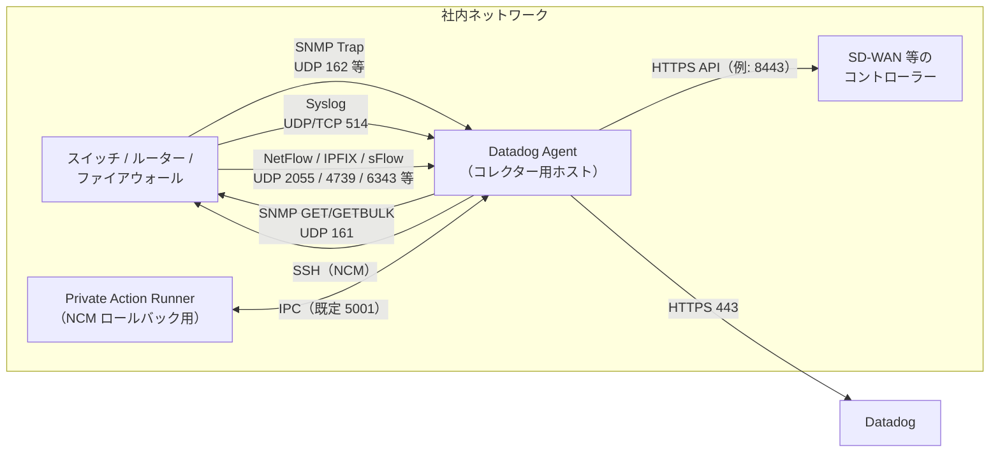
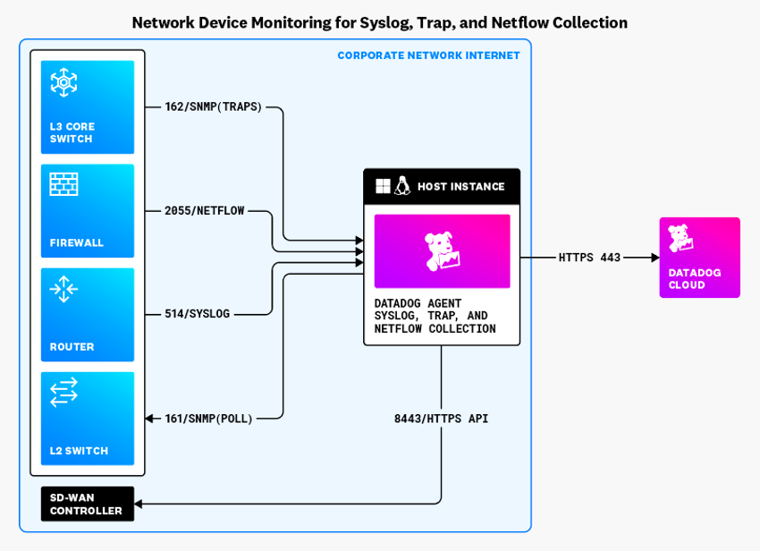
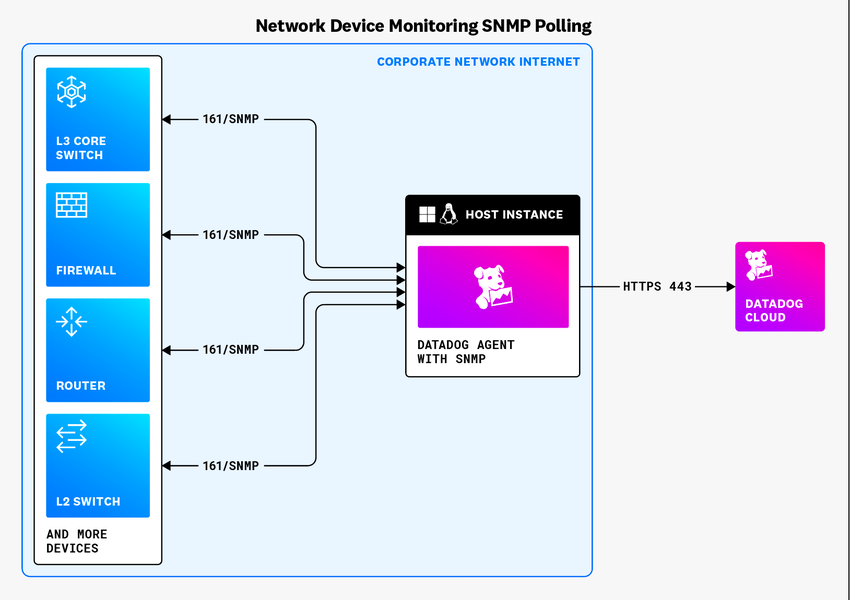
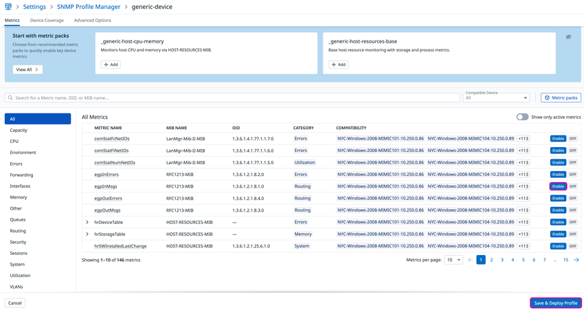
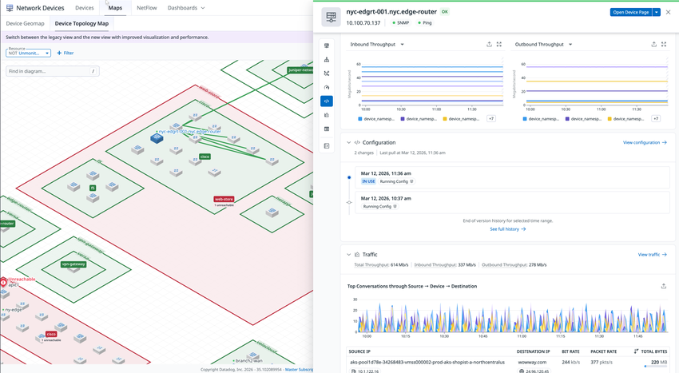
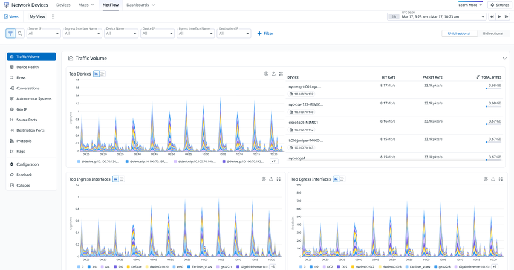
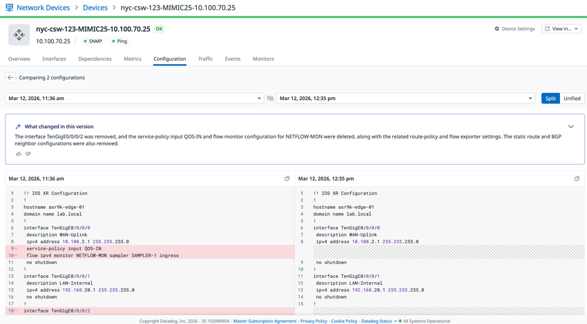

# Network Device Monitoring（ネットワークデバイス監視）

## 概要

Network Device Monitoring（NDM、ネットワークデバイス監視）は、ルーター、スイッチ、ファイアウォール、ロードバランサー、無線 AP、UPS などのオンプレミス／仮想ネットワーク機器を、Datadog Agent 経由で監視する Datadog の製品である。NDM は主に **SNMP（Simple Network Management Protocol）** でデバイスをポーリングして帯域使用率、送受信バイト数、エラー、CPU・メモリ、デバイスの稼働状態（Up / Down）などを収集し、デバイス単位の画面で表示する。[出典](https://docs.datadoghq.com/network_monitoring/devices/)

NDM の主な構成要素は次のとおり。

| 機能 | 内容 | 本ファイルの節 |
|---|---|---|
| SNMP ポーリング | Agent が UDP 161 番で OID をポーリングしてメトリクス化する。個別デバイス指定とサブネット単位の Autodiscovery がある | [SNMP ポーリング](#snmp-ポーリングsnmp-metrics) |
| SNMP Traps | デバイスから送られる Trap を Agent が受信し、ログとして Datadog に転送する | [SNMP Traps](#snmp-traps) |
| Syslog | デバイスの Syslog を Agent で受信し、デバイスに関連付ける | [Syslog](#syslog) |
| Ping | SNMP チェックから ICMP Ping を打ち、到達性と RTT を取る | [Ping](#ping) |
| VPN Monitoring | Cisco IPsec VPN トンネルの状態を SNMP で取る | [VPN Monitoring](#vpn-monitoring) |
| Device Profiles / SNMP Profile Manager | デバイス種別ごとに収集する OID・タグ・メタデータを定義する。GUI の Profile Manager もある | [デバイスプロファイル](#デバイスプロファイルdevice-profiles) |
| ベンダー API 連携 | Cisco Meraki、Cisco SD-WAN、VeloCloud などのコントローラー API から収集する | [対応デバイスとインテグレーション](#対応デバイスとインテグレーション) |
| NetFlow Monitoring | NetFlow v5/v9・IPFIX・sFlow のフローレコードを Agent で受けて集約・分析する | [NetFlow Monitoring](#netflow-monitoring) |
| Device Topology Map / Device Geomap | LLDP / CDP から機器間の接続を描く図と、位置情報タグから描く地図 | [Device Maps](#device-mapsdevice-topology-map--device-geomap) |
| Summary Page / Device Health | ネットワーク全体の健全性の要約と、問題の検出・調査【Preview】 | [Summary Page と Device Health](#summary-page-と-device-healthpreview) |
| Network Configuration Management（NCM） | SSH で機器のコンフィグを取得し、変更履歴・差分・AI 要約・ロールバックを提供する | [Network Configuration Management](#network-configuration-managementncm) |

関連ファイルとの切り分けは次のとおり。

| トピック | 扱うファイル |
|---|---|
| ホスト上の eBPF によるフロー（CNM、旧称 NPM）、Network Path、Dynamic Tests for NetFlow の詳細 | [Cloud Network Monitoring](cloud-network-monitoring.md) |
| Agent 本体のインストールと共通設定 | [Datadog Agent](../platform/agent.md)、[Agent 設定リファレンス](../platform/agent-configuration.md) |
| Remote Configuration、Fleet Automation | [Fleet Automation と Remote Configuration](../platform/fleet-automation.md) |
| モニター全般、通知 | [Monitors](../platform/monitors.md)、[通知と Downtime](../platform/notifications-and-downtimes.md) |
| ログ処理（Pipelines、Remapper、Grok） | [Log Pipelines と処理](../logs/log-pipelines-and-processing.md) |
| 料金の正本 | [製品別料金表](../../03_導入編/pricing-by-product.md) |

> **CNM との違い（公式料金ページ FAQ）:** CNM のフローはホストで動く Agent が eBPF で集めたデータから作られ、ホスト・コンテナ・クラウド上のソフトウェアの接続問題の調査に使う。NetFlow Monitoring のレコードは物理ネットワーク機器から受け取るもので、物理ネットワークの接続問題の調査とキャパシティプランニングに使う。[出典](https://www.datadoghq.com/pricing/?product=network-monitoring)

## アーキテクチャとデータフロー

NDM では、監視対象デバイスとは別のホスト（Linux / Windows など）に Datadog Agent をインストールし、その Agent が「コレクター」としてデバイスにアクセスする。Agent は収集したデータを **HTTPS（TCP 443）** で Datadog に送る。デバイスから Agent への Syslog・Trap・NetFlow のポートは Agent 設定で変更できる。ベンダー API 連携では、Agent がオンプレミスまたはクラウドのコントローラー／マネージャーに接続する。[出典](https://docs.datadoghq.com/network_monitoring/devices/getting_started/)





- **キャプション:** Network Device Monitoring for Syslog, Trap, and Netflow Collection（Syslog・Trap・NetFlow 収集の構成図）
- **画面の説明:** 左側の「CORPORATE NETWORK INTERNET」枠内に L3 Core Switch、Firewall、Router、L2 Switch が並ぶ。各機器から中央の「HOST INSTANCE（Datadog Agent: Syslog, Trap, and NetFlow collection）」へ、`162/SNMP(TRAPS)`、`2055/NETFLOW`、`514/SYSLOG` の矢印が向かい、Agent から L2 Switch へは `161/SNMP(POLL)` の矢印が出る。Agent から下の「SD-WAN CONTROLLER」へは `8443/HTTPS API`、右側の「DATADOG CLOUD」へは `HTTPS 443` で送信する。図中のポート番号は例であり、Agent の設定で変更できる。
- **出典:** https://docs.datadoghq.com/network_monitoring/devices/getting_started/ （取得日 2026-11-02）



- **キャプション:** Network Device Monitoring SNMP Polling（SNMP ポーリングの構成図）
- **画面の説明:** 社内ネットワーク内の L3 Core Switch、Firewall、Router、L2 Switch（「AND MORE DEVICES」）と、中央の「Datadog Agent with SNMP」との間が、それぞれ双方向の `161/SNMP` 矢印でつながる。Agent から右側の Datadog Cloud へは `HTTPS 443` で送る。
- **出典:** https://docs.datadoghq.com/network_monitoring/devices/snmp_metrics/ （取得日 2026-11-02）

### 用語

| 用語 | 意味 |
|---|---|
| SNMP | ネットワーク機器から情報を集めるためのプロトコル |
| MIB（Management Information Base） | 取得可能な OID とその定義を集めたデータベース。例：IF-MIB はインターフェースの OID を定義する |
| OID（Object Identifier） | デバイス上の値（CPU 負荷、ファン回転数など）を指す一意のアドレス |
| sysObjectID（sysOID） | デバイスの種別を示す OID。例：Cisco Meraki のベース sysOID は `1.3.6.1.4.1.29671` |
| Profile（プロファイル） | デバイス種別に対応付けた OID の集合。複数デバイスでメトリクス定義を再利用する |
| LLDP / CDP | 隣接機器に自分の識別情報・能力を通知するプロトコル。NDM はトポロジー描画に使う |
| Device Namespace | 同じプライベート IP を持つデバイスを区別するための名前空間。タグとしても使える |
| SD-WAN | MPLS、ブロードバンド、5G など複数の回線で拠点やデータセンターを結ぶソフトウェア定義の WAN |

[出典](https://docs.datadoghq.com/network_monitoring/devices/glossary/)

## 対応プラットフォームと前提条件

### 機能別の最低 Agent バージョン

| 機能 | 最低 Agent バージョン | 出典 |
|---|---|---|
| SNMP Autodiscovery（初期実装） | 7.27 | [出典](https://docs.datadoghq.com/network_monitoring/devices/snmp_metrics/) |
| SNMP コアチェック（Go 実装、`loader: core`） | 7.27 | [出典](https://docs.datadoghq.com/network_monitoring/devices/guide/migrating-to-snmp-core-check/) |
| SNMP メトリクス収集（公式ページの基本要件） | 7.32 | [出典](https://docs.datadoghq.com/network_monitoring/devices/snmp_metrics/) |
| SNMP Traps | 7.37 | [出典](https://docs.datadoghq.com/network_monitoring/devices/snmp_traps/) |
| NetFlow Monitoring | 7.45 | [出典](https://docs.datadoghq.com/network_monitoring/netflow/) |
| SNMP Traps の SNMPv3 複数ユーザー | 7.51 | [出典](https://docs.datadoghq.com/network_monitoring/devices/snmp_traps/) |
| Device Topology Map（LLDP / CDP 収集）、Ping、プロファイルの `device_type` | 7.52 | [出典](https://docs.datadoghq.com/network_monitoring/devices/topology/) |
| Autodiscovery の新構文（`network_devices.autodiscovery` 内の `configs`） | 7.53（移行ガイド）／ 7.54（SNMP Metrics ページ） | 下記注記参照 |
| Syslog 連携 | 7.57 | [出典](https://docs.datadoghq.com/network_monitoring/devices/syslog/) |
| High Availability（HA） | 7.64 | [出典](https://docs.datadoghq.com/integrations/guide/high_availability/) |
| Autodiscovery の重複排除（`use_deduplication`） | 7.67 | [出典](https://docs.datadoghq.com/network_monitoring/devices/snmp_metrics/) |
| VPN Monitoring | 7.70 | [出典](https://docs.datadoghq.com/network_monitoring/devices/vpn_monitoring/) |
| NCM（コンフィグ取得） | 7.73〜7.77（ベンダー OS により異なる） | [出典](https://docs.datadoghq.com/network_monitoring/devices/config_management/) |
| NetFlow のフロー量上限（`aggregator_max_flows_per_flush_interval`） | 7.75.1 | [出典](https://docs.datadoghq.com/network_monitoring/netflow/) |
| SNMP Profile Manager | 7.77.0 | [出典](https://docs.datadoghq.com/network_monitoring/devices/guide/device_profiles/) |
| Dynamic Tests for NetFlow【Experimental】 | 7.81 | [出典](https://docs.datadoghq.com/network_monitoring/netflow/) |
| NCM ロールバック | 7.83.0 | [出典](https://docs.datadoghq.com/network_monitoring/devices/config_management_rollback/) |

> **注記:** Autodiscovery の新構文の最低バージョンは、SNMP Metrics ページでは「Agent 7.54+」、コアチェック移行ガイドでは「Agent 7.53+」と書かれており、公式ドキュメント内で表記が揺れている（2026-11-02 時点）。新規導入では、より新しい Agent を使えば両方を満たす。トラブルシューティングページは Agent 7.61.0 以降を前提に書かれている。[出典](https://docs.datadoghq.com/network_monitoring/devices/troubleshooting/)

### 前提条件

- Agent は、デバイスにネットワーク到達できるホストにインストールする。通常、監視対象デバイスとは別のサーバーを使う。[出典](https://docs.datadoghq.com/network_monitoring/devices/getting_started/)
- デバイス側で SNMP を有効にし、UDP 161 番を Agent から到達可能にする。Agent ホストのファイアウォールで、Agent からの送信（egress）を許可する。[出典](https://docs.datadoghq.com/network_monitoring/devices/troubleshooting/)
- Trap・NetFlow・Syslog を使う場合は、Agent ホストで該当 UDP（Syslog は TCP も可）ポートの受信を許可する。[出典](https://docs.datadoghq.com/network_monitoring/devices/troubleshooting/)
- NDM のライセンスとは別に、ポーリングに使う Agent ホスト（1 台以上）の Infrastructure ホストの購入が必要。詳細は [課金への影響](#課金への影響) を参照。[出典](https://www.datadoghq.com/pricing/?product=network-monitoring)

> **サイト差異:** High Availability、SNMP Profile Manager、Network Configuration Management は `app.ddog-gov.com` と `us2.ddog-gov.com`（US1-FED などの政府向けサイト）では非対応と明記されている。Profile Manager については「GovCloud では UI からデバイススキャンを開始できない（Agent 側でデフォルトスキャンを有効化して実行する）」とも書かれている。NetFlow Monitoring、SNMP Traps 等のサイト別提供可否は公開情報では確認できず。サイト一覧は [Datadog Sites](../platform/datadog-sites.md) を参照。[出典](https://docs.datadoghq.com/network_monitoring/devices/config_management/)、[出典](https://docs.datadoghq.com/network_monitoring/devices/guide/device_profiles/)、[出典](https://docs.datadoghq.com/integrations/guide/high_availability/)

## セットアップの全体手順

公式の Getting Started / Setup ページは、NDM の導入を次の順で説明している。[出典](https://docs.datadoghq.com/network_monitoring/devices/getting_started/)

| 順序 | 作業 | 補足 |
|---|---|---|
| 0 | Agent をデバイスへ到達可能なホストにインストール | Agent インストールページから取得 |
| 1 | （任意）High Availability を構成 | アクティブ／スタンバイの 2 Agent |
| 2 | SNMP 監視を有効化 | 個別デバイス、Autodiscovery、Ping、Syslog、VPN Monitoring |
| 3 | デバイスにタグ付け | Agent 設定、デバイスプロファイル、ServiceNow 連携、Device 画面（Tags タブ > Edit Tags）、NDM API |
| 4 | メトリクスとタグのカスタマイズ | プロファイルの YAML 編集、または GUI（SNMP Profile Manager） |
| 5 | NetFlow Monitoring を構成 | フローレコードの可視化 |
| 6 | 検証 | Network Devices 画面、ダッシュボード「Datacenter Overview」「Interface Performance」、Device Topology Map |

- デバイスのユーザータグは、既定で **1 デバイスあたり最大 20 個**。上限を上げるにはサポートへの連絡が必要。[出典](https://docs.datadoghq.com/network_monitoring/devices/getting_started/)
- ServiceNow の CMDB とのタグ連携は、ServiceNow 連携側の機能である。詳細は [通知・コラボレーション連携](../platform/collaboration-integrations.md) を参照。

## SNMP ポーリング（SNMP Metrics）

NDM の SNMP ポーリングは、Agent の SNMP チェック（`snmp.d`）がデバイスの OID を定期的に取得してメトリクスとして送る仕組みである。SNMPv1、v2（v2c）、v3 に対応する。[出典](https://docs.datadoghq.com/network_monitoring/devices/snmp_metrics/)

### ローダー（Python チェックとコアチェック）

SNMP チェックには Python 実装（旧来）と Go 実装の **コアチェック（`loader: core`）** がある。公式は `loader: core` を推奨しており、コアチェックはメモリ使用量と性能が改善されている。[出典](https://docs.datadoghq.com/network_monitoring/devices/guide/migrating-to-snmp-core-check/)

| 項目 | コアチェック（`loader: core`） | Python チェック（`loader: python`） |
|---|---|---|
| 実装 | Go（Agent プロセス内） | Python |
| 導入バージョン | Agent 7.27 | — |
| Autodiscovery の設定場所 | `datadog.yaml` の `network_devices.autodiscovery` | SNMP チェック（`snmp.d/conf.yaml`）の `network_address` |
| OID の指定 | 数値 OID と名前の両方が必要（名前のみの参照は不可） | MIB 名のみの参照も可 |
| 非対応の設定 | `mibs_folder`、`optimize_mib_memory_usage`、`enforce_mib_constraints`、`bulk_threshold`、手動コンパイルした MIB のプロファイル利用 | — |
| `min_collection_interval` | 有効（既定 15 秒） | 公開サンプルでは「core ローダーでのみ適用」と記載 |

`conf.yaml.example` の `loader` の既定値は `python` だが、`datadog.yaml` の Autodiscovery 設定の `loader` の既定値は `core` である。個別デバイスの設定では `init_config` に `loader: core` を明示するのが公式の推奨である。[出典](https://github.com/DataDog/integrations-core/blob/master/snmp/datadog_checks/snmp/data/conf.yaml.example)、[出典](https://github.com/DataDog/datadog-agent/blob/main/pkg/config/example/datadog-agent_linux.yaml.example)

**移行手順（Python → コア）:** ① Agent 7.27 以降にする、② `snmp.d/conf.yaml` の `init_config` に `loader: core` を設定する、③ サブネットスキャンを使う場合は各サブネット設定を SNMP チェックから `datadog.yaml` の `network_devices.autodiscovery` に移す、④ カスタムプロファイルの各シンボル・テーブル・タグに OID と名前の両方を書く（例：`sysName` は `OID: 1.3.6.1.2.1.1.5.0` と `name: sysName` の組にする）。[出典](https://docs.datadoghq.com/network_monitoring/devices/guide/migrating-to-snmp-core-check/)

### 個別デバイスの設定（`snmp.d/conf.yaml`）

個別デバイスは Agent の `conf.d/snmp.d/conf.yaml` に `instances` として書き、Agent を再起動する。[出典](https://docs.datadoghq.com/network_monitoring/devices/snmp_metrics/)

SNMPv2 の例：

```yaml
init_config:
  loader: core                    # 推奨
  use_device_id_as_hostname: true # 推奨
instances:
  - ip_address: '1.2.3.4'
    community_string: 'sample-string'
    tags:
      - 'key1:val1'
```

SNMPv3 の例：

```yaml
init_config:
  loader: core
  use_device_id_as_hostname: true
instances:
  - ip_address: '1.2.3.4'
    snmp_version: 3            # 省略時は自動判別
    user: 'user'
    authProtocol: 'SHA256'     # MD5, SHA, SHA224, SHA256, SHA384, SHA512
    authKey: 'fakeKey'
    privProtocol: 'AES256'     # DES, AES, AES192, AES192C, AES256, AES256C
    privKey: 'fakePrivKey'
    tags:
      - 'key1:val1'
```

設定後は `datadog-agent status` の Checks 節に `snmp` が出ることで確認する。[出典](https://docs.datadoghq.com/network_monitoring/devices/snmp_metrics/)

### SNMP チェックの主な設定キーと既定値

以下は公式サンプル `conf.yaml.example` に基づく（2026-11-02 時点）。[出典](https://github.com/DataDog/integrations-core/blob/master/snmp/datadog_checks/snmp/data/conf.yaml.example)

**`init_config`**

| キー | 既定値 | 説明 |
|---|---|---|
| `loader` | `python` | `core`（推奨、高速・省メモリ）または `python`（旧来） |
| `use_device_id_as_hostname` | `false` | メトリクスとサービスチェックのホスト名に `device:<DEVICE_ID>` を使う。カスタムタグ付けに必要 |
| `oid_batch_size` | 公開サンプルの例は `10` | 1 回の要求でまとめる OID 数。大きいほど速いが負荷が増す。コアチェックの既定値は Agent 7.30 未満で 60、7.30 以降で 5 |
| `min_collection_interval` | `15`（秒） | 収集間隔。core ローダーでのみ有効 |
| `global_metrics` | なし | `use_global_metrics: true` の全インスタンスに適用するメトリクス |
| `use_remote_config_profiles` | `false` | SNMP Profile Manager のプロファイルを使い、ローカルのプロファイルを無視する |
| `ping.enabled` | `false` | 各チェック実行時に ICMP Ping を打つ |
| `ping.count` | `2` | 1 回の実行で送る Ping 数 |
| `ping.timeout` | `3000`（ミリ秒） | 全 Ping のタイムアウト |
| `ping.interval` | `20`（ミリ秒） | Ping 間隔（`datadog.yaml` の Autodiscovery 側サンプルの既定値は `10`） |
| `ping.linux.use_raw_socket` | `false` | raw ソケットで Ping を送る（system-probe の `ping` モジュールが必要） |
| `refresh_oids_cache_interval`、`optimize_mib_memory_usage`、`mibs_folder`、`ignore_nonincreasing_oid` | `0` / `false` / なし / `false` | Python ローダー専用 |

**`instances`（接続・認証）**

| キー | 既定値 | 説明 |
|---|---|---|
| `ip_address` | なし | デバイスの IP（`network_address` とどちらか必須） |
| `port` | `161` | SNMP ポート |
| `snmp_version` | `2` | `1`、`2`、`3` |
| `community_string` | なし | SNMPv1/v2 用。特殊文字を含む場合はシングルクォートで囲む |
| `timeout` | `2`（秒） | Python チェックの既定値は 5 |
| `retries` | `3` | Python チェックの既定値は 5 |
| `user` | なし | SNMPv3 ユーザー名 |
| `authProtocol` | `authKey` 指定時 `MD5` | `MD5`、`SHA`、`SHA224`、`SHA256`、`SHA384`、`SHA512` |
| `authKey` | なし | 認証キー |
| `privProtocol` | `privKey` 指定時 `DES` | `DES`、`AES`、`AES192`、`AES192C`、`AES256`、`AES256C`（`3DES` は Python のみ） |
| `privKey` | なし | 暗号化キー |
| `context_engine_id`、`context_name` | なし | 通常は不要 |

**`instances`（収集内容・その他）**

| キー | 既定値 | 説明 |
|---|---|---|
| `oid_batch_size` | `5` | コアチェックのみ |
| `profile` | なし | 使うプロファイル名を固定する |
| `metrics` | なし | インスタンス固有メトリクス（`use_global_metrics: false` でなければ `global_metrics` に追加） |
| `use_global_metrics` | `true` | `global_metrics` を適用するか |
| `metric_tags` | なし | シンボル／OID の値からタグを作る。正規表現で値を分割して複数タグにできる |
| `collect_topology` | `true` | LLDP / CDP のトポロジーデータを収集する |
| `collect_vpn` | `false` | VPN トンネルとルートテーブルを収集する |
| `interface_configs` | なし | インターフェースごとの速度上書き・タグ追加・無効化（`match_field`、`match_value`、`in_speed`、`out_speed`、`tags`、`disabled`） |
| `tags` | なし | 全メトリクス・サービスチェックに付けるタグ |
| `min_collection_interval` | `15`（秒） | 収集間隔 |
| `empty_default_hostname` | `false` | ホスト名なしでメトリクスを送る（クラスターレベルのチェック向け） |
| `bulk_threshold`、`enforce_mib_constraints`、`refresh_oids_cache_interval` | `0` / `true` / `0` | Python ローダー専用 |

### インターフェース速度の上書き

SNMP チェックは既定でデバイスが報告するインターフェース速度を使う。帯域使用率の分母を実契約帯域などに合わせたい場合は `interface_configs` で上書きする。`match_field` は `name` または `index`（SNMP Metrics ページの表記は `ifIndex`）、`match_value` は大文字小文字を区別する。`in_speed` / `out_speed` の単位は **bytes per second（バイト／秒）** である。[出典](https://docs.datadoghq.com/network_monitoring/devices/snmp_metrics/)

```yaml
instances:
  - ip_address: '1.2.3.4'
    community_string: 'sample-string'
    interface_configs:
      - match_field: name
        match_value: eth0
        in_speed: 6250000    # 50 Mbps = 6,250,000 バイト/秒
        out_speed: 6250000
```

> **注意:** 公式ページの例は `in_speed: 50000000` に「50 Mbps」というコメントを付けているが、単位がバイト／秒であれば 50,000,000 バイト／秒は 400 Mbps に相当する（2026-11-02 時点の記載）。値を設定する際は単位を確認すること。上記の例は単位どおりに 50 Mbps へ換算した値である。

### Autodiscovery（サブネットスキャン）

Autodiscovery は、指定したサブネット（CIDR）内の IP に SNMP で問い合わせ、応答があり、かつ一致するプロファイルがあるデバイスを「発見」して、IP ごとに SNMP チェックを自動生成する機能である。設定は `datadog.yaml` の `network_devices.autodiscovery` に書く。[出典](https://docs.datadoghq.com/network_monitoring/devices/snmp_metrics/)

```yaml
network_devices:
  autodiscovery:
    use_deduplication: true   # 任意。既定 false。Agent 7.67+
    workers: 100              # 同時に動く探索ワーカー数（公式例の値）
    discovery_interval: 3600  # スキャン間隔（秒）
    loader: core
    use_device_id_as_hostname: true
    configs:
      - network_address: 10.10.0.0/24
        loader: core
        snmp_version: 2
        port: 161
        community_string: '***'
        tags:
          - "key1:val1"
      - network_address: 10.20.0.0/24
        snmp_version: 3
        user: 'user'
        authProtocol: 'SHA256'
        authKey: 'fakeKey'
        privProtocol: 'AES256'
        privKey: 'fakePrivKey'
```

`datadog.yaml` の `network_devices.autodiscovery` の主なキーと既定値（Agent の Linux 用設定サンプル、`main` ブランチ、2026-11-02 取得）は次のとおり。[出典](https://github.com/DataDog/datadog-agent/blob/main/pkg/config/example/datadog-agent_linux.yaml.example)

| キー | 既定値 | 説明 |
|---|---|---|
| `workers` | `2` | 探索の同時実行数（公式ドキュメントの例は `100`） |
| `discovery_interval` | `3600`（秒） | サブネット再スキャン間隔 |
| `discovery_allowed_failures` | `3` | 発見済みホストを除外するまでの許容失敗回数 |
| `loader` | `core` | — |
| `min_collection_interval` | `15`（秒） | 発見デバイスの収集間隔 |
| `use_device_id_as_hostname` | `false` | — |
| `collect_topology` | `true` | LLDP / CDP 収集 |
| `collect_vpn` | `false` | VPN Monitoring |
| `device_tags_source` | `resource` | デバイスタグの取得元（詳細は公開情報では確認できず） |
| `use_deduplication` | `false` | 同じデバイスが複数 IP で見つかった場合の重複排除（Agent 7.67+） |
| `oid_batch_size` | `5` | — |
| `timeout` / `retries` | `5` / `3` | — |
| `ping.*` | `enabled: false`、`timeout: 3000`、`count: 2`、`interval: 10` | Autodiscovery 対象への Ping |
| `use_remote_config_profiles` | 公開情報では既定値を確認できず（Profile Manager 利用時に `true`） | SNMP Profile Manager のプロファイルを使う |
| `configs[].network_address` | 必須 | 対象サブネット |
| `configs[].ignored_ip_addresses` | `[]` | スキャン対象外の IP |
| `configs[].port` | `161` | — |
| `configs[].authentications` | — | 複数の認証情報（コミュニティ／v3 ユーザー）を列挙して試行させるリスト形式 |
| `configs[].ad_identifier` | `snmp` | Autodiscovery 識別子 |

- `conf.yaml.example`（SNMP チェック側、Python 実装の Autodiscovery）では `workers` の既定値は 5、`discovery_workers` は 5（コアチェックのみ）となっている。設定場所によって既定値が異なる点に注意する。[出典](https://github.com/DataDog/integrations-core/blob/master/snmp/datadog_checks/snmp/data/conf.yaml.example)
- 発見までの時間：個別設定のデバイスは表示まで約 1 分。Autodiscovery は `datadog-agent status` の `autodiscovery` 節で全 IP のスキャン完了を確認する。大規模ネットワークでは数分以上かかる。[出典](https://docs.datadoghq.com/network_monitoring/devices/troubleshooting/)
- Autodiscovery では、SNMP に応答しないデバイスには Ping を打たない。[出典](https://docs.datadoghq.com/network_monitoring/devices/ping/)

### デフォルトスキャン（`default_scan`）

`network_devices.default_scan` は、Autodiscovery または個別設定で見つかった SNMP デバイスを自動でスキャン（SNMP walk）し、OID データを収集する機能である。SNMP Profile Manager の「最後の SNMP walk の状態」表示やメトリクス推奨に使われる。[出典](https://github.com/DataDog/datadog-agent/blob/main/pkg/config/example/datadog-agent_linux.yaml.example)、[出典](https://docs.datadoghq.com/network_monitoring/devices/guide/device_profiles/)

| キー | 既定値 | 説明 |
|---|---|---|
| `default_scan.enabled` | `true` | 自動スキャンを有効化（環境変数 `DD_NETWORK_DEVICES_DEFAULT_SCAN_ENABLED`） |
| `default_scan.excluded_ips` | `[]` | スキャン対象外の IP |
| `default_scan.bulk_batch_size` | `20` | GetBulk 1 回あたりの要求値数の上限。失敗時に下げ、成功時に戻す |

- 1 回のスキャンは最大 10 分程度かかることがあり、無限ループを検知すると停止する。Extreme Networks EXOS 33.1.1 ではスキャン有効時に機器がクラッシュすることがあるため、スキャンを無効化するかファームウェアを更新する。[出典](https://docs.datadoghq.com/network_monitoring/devices/guide/device_profiles/)

### Namespace（名前空間）

`network_devices.namespace`（既定値 `default`）は、拠点ごとに同じプライベート IP 帯を使っている場合などに、デバイスを区別するための名前空間である。テレメトリに `device_namespace` タグとして付く。[出典](https://docs.datadoghq.com/network_monitoring/devices/snmp_traps/)

- ある Agent で Namespace を使う場合は、**すべての Agent で** Namespace を設定する（一部の Agent だけに設定しない）。[出典](https://docs.datadoghq.com/network_monitoring/devices/snmp_traps/)
- NCM の `namespace` は、監視対象デバイスの Namespace と一致させる必要がある。[出典](https://docs.datadoghq.com/network_monitoring/devices/config_management/)

### Cluster Agent でのスケール

Datadog Cluster Agent（DCA）は、NDM の Autodiscovery をクラスターチェックのソースとして使い、大量のデバイスを複数ノードの Agent に分散して監視できる。Helm では `datadog.clusterChecks.enabled: true`、`clusterAgent.enabled: true` を設定し、`clusterAgent.confd` に `snmp.yaml`（`cluster_check: true`、`ad_identifiers: [snmp]`、`%%host%%` 等のテンプレート変数）を置き、`clusterAgent.datadog_cluster_yaml.autodiscovery` に探索設定を書く。公式テンプレートの例は timeout 5、retries 5、`oid_batch_size` 60。必要な Agent / Cluster Agent バージョンは公開情報では確認できず。[出典](https://docs.datadoghq.com/network_monitoring/devices/guide/cluster-agent/)。Kubernetes 上の Agent 構成は [コンテナ/Kubernetes向けAgent](../platform/kubernetes-and-containers-agent.md) を参照。

## SNMP Traps

SNMP Traps は、デバイスが異常を検知したときに自発的に送る通知である。ポーリング間隔より短い事象（例：15 秒ごとのインターフェースのフラップは 60 秒間隔のポーリングでは安定して見える）や、バッテリー・筐体の状態などを捉えられる（公式ブログ）。[出典](https://www.datadoghq.com/blog/diagnose-network-performance-with-snmp-trap-monitoring/)（2022-06-14 公開）

### 設定（`datadog.yaml`）

Trap の受信は Agent 7.37 以降で、`datadog.yaml` の `network_devices.snmp_traps` で設定する。[出典](https://docs.datadoghq.com/network_monitoring/devices/snmp_traps/)

```yaml
network_devices:
  namespace: <NAMESPACE>   # 任意。既定 default
  snmp_traps:
    enabled: true
    port: 9162
    community_strings:
      - <STRING_1>
    bind_host: 0.0.0.0
    users:                 # SNMPv3（複数ユーザーは Agent 7.51+）
      - user: <USERNAME>
        authKey: <AUTHENTICATIONKEY>
        authProtocol: <AUTHENTICATIONPROTOCOL>
        privKey: <PRIVACYKEY>
        privProtocol: <PRIVPROTOCOL>
```

| キー | 既定値 | 説明 |
|---|---|---|
| `snmp_traps.enabled` | `false` | Trap 受信を有効化 |
| `snmp_traps.port` | `9162` | 受信 UDP ポート |
| `snmp_traps.community_strings` | `[]` | SNMPv2 Trap で受け付けるコミュニティ文字列。空にはできない。不明なコミュニティの Trap は無視される |
| `snmp_traps.users` | `[]` | SNMPv3 ユーザー。`authProtocol` は `authKey` 指定時 MD5、`privProtocol` は `privKey` 指定時 DES が既定 |
| `snmp_traps.bind_host` | `0.0.0.0` | 待ち受けアドレス |
| `snmp_traps.stop_timeout` | `5`（秒） | Agent 停止時に受信処理の停止を待つ最大秒数 |
| `snmp_traps.tags` | `[]` | 付与タグ |

[出典](https://github.com/DataDog/datadog-agent/blob/main/pkg/config/example/datadog-agent_linux.yaml.example)、[出典](https://docs.datadoghq.com/network_monitoring/devices/troubleshooting/)

- Agent ホストのファイアウォールで、設定したポートへの UDP 受信を許可する。
- 標準ポート 162 など 1024 未満のポートで待ち受けるには特権が必要。Linux では `sudo setcap CAP_NET_BIND_SERVICE=+ep /opt/datadog-packages/datadog-agent/stable/bin/agent/agent` を実行し、`sudo getcap` で `cap_net_bind_service+ep` を確認してから Agent を再起動する。**Agent をアップグレードするたびに再実行が必要**。トラブルシューティングページには旧パス `/opt/datadog-agent/bin/agent/agent` の例もある。インストール方式に応じて実際のバイナリのパスを確認する。[出典](https://docs.datadoghq.com/network_monitoring/devices/snmp_traps/)、[出典](https://docs.datadoghq.com/network_monitoring/devices/troubleshooting/)

### Trap の表示先

- Trap は **ログ** として Datadog に転送される。Log Explorer で `source:snmp-traps` で検索する。`logs_enabled: true` の設定は不要。[出典](https://docs.datadoghq.com/network_monitoring/devices/snmp_traps/)
- NDM のデバイス画面（Infrastructure > Network Devices）の **Events** タブに、Syslog と SNMP Trap がまとめて表示され、イベント種別で絞り込める。[出典](https://docs.datadoghq.com/network_monitoring/devices/snmp_traps/)
- 特定の Trap にはログモニターでアラートを設定でき、メール、ServiceNow などのチケットツール、モバイル通知に送れる。関連 Trap は Log Patterns で探せる。[出典](https://www.datadoghq.com/blog/diagnose-network-performance-with-snmp-trap-monitoring/)（2022-06-14 公開）

### OID の解決（TrapsDB）

- Trap には送信元情報、Trap 種別を示す OID、`OID:値` 形式のメタデータが入る。Agent は TrapsDB ファイル `<conf.d>/snmp.d/traps_db/dd_traps_db.json.gz` を使ってローカルで OID を名前に変換する。Datadog は **11,000 を超える MIB** に対応する。[出典](https://docs.datadoghq.com/network_monitoring/devices/snmp_traps/)
- 独自 MIB の Trap は、カスタムのマッピングファイル（YAML または JSON。最上位キーは `mibs`、`traps`、`vars`）を `<conf.d>/snmp.d/traps_db/` に置いて解決する。手書きのほか、`ddev meta snmp generate-traps-db -o ./output_dir/ /path/to/mib1 ...` で生成できる（Python 3、`ddev`、`pysmi` が必要。依存 MIB が手元にない場合は `--mib-sources <DIR>`）。MIB ファイル名は MIB 名と一致させる（例：`SNMPv2-SMI`。`snmp_v2_smi.txt` は不可）。[出典](https://docs.datadoghq.com/network_monitoring/devices/snmp_traps/)
- NDM Troubleshooting ダッシュボードの「Traps incorrectly formatted」が 0 でない場合、多くはコレクターとデバイスの認証情報（コミュニティ文字列／v3 ユーザー）の不一致が原因である。[出典](https://docs.datadoghq.com/network_monitoring/devices/troubleshooting/)

## Syslog

NDM の Syslog 連携は、ネットワーク機器の Syslog を Agent で受信し、デバイスに関連付けて Events タブに表示する機能である（Agent 7.57 以降）。[出典](https://docs.datadoghq.com/network_monitoring/devices/syslog/)

| 手順 | 内容 |
|---|---|
| 1 | `datadog.yaml` で `logs_enabled: true` と `logs_config.use_sourcehost_tag: true` を設定（送信元 IP が `source_host` タグに入る） |
| 2 | `conf.d/syslog.d/conf.yaml` を作り、`logs` に `type`（Windows / Docker の例では `protocol`）: `udp` または `tcp`、`port`（既定 514）、`source: syslog`、任意で `service` を書く |
| 3 | Agent を再起動 |
| 4 | Log Pipelines で `syslog_ip` 属性を作る（下記） |

```yaml
# conf.d/syslog.d/conf.yaml（Linux の例）
logs:
  - type: udp
    port: 514
    source: syslog
    service: network-devices
```

- **デバイスとの関連付け条件:** ログに `source:syslog` が付き、かつ `syslog_ip` タグがデバイスの IP のいずれかに一致すること。[出典](https://docs.datadoghq.com/network_monitoring/devices/syslog/)
- **直接受信の場合:** ログパイプラインで Log Remapper を作り、`source_host` を `syslog_ip` にリマップする。
- **rsyslog / syslog-ng などのプロキシ経由の場合:** `source_host` はプロキシの IP になるため、プロキシ側で元の送信元 IP をメッセージに含め（例：rsyslog のテンプレート）、Grok Parser で一時属性に抽出し、Log Remapper で `syslog_ip` にリマップする。

パイプラインの詳細は [Log Pipelines と処理](../logs/log-pipelines-and-processing.md)、Agent のログ収集は [ログ収集](../logs/log-collection.md) を参照。

## Ping

NDM の Ping は、SNMP チェックから ICMP Ping を送り、デバイスの到達性と往復遅延を計測する機能である（Agent 7.52 以降、SNMP 監視の設定が前提）。[出典](https://docs.datadoghq.com/network_monitoring/devices/ping/)

| 設定場所 | 適用範囲 |
|---|---|
| `snmp.d/conf.yaml` の `init_config.ping` | 個別設定の全デバイス |
| `snmp.d/conf.yaml` の各 `instances[].ping` | そのデバイスのみ |
| `datadog.yaml` の `network_devices.autodiscovery`（`configs`）の `ping` | Autodiscovery の全サブネット |

```yaml
init_config:
  loader: core
  ping:
    enabled: true
    linux:
      use_raw_socket: true   # Linux のみ。権限エラー時に使用
```

- raw ソケット（Linux のみ）を使う場合は、`use_raw_socket: true` に加えて `/etc/datadog-agent/system-probe.yaml` で `ping: enabled: true` を設定する（昇格権限が必要）。Windows での挙動は公開ページに記載がない。[出典](https://docs.datadoghq.com/network_monitoring/devices/ping/)

| メトリクス | 内容 |
|---|---|
| `networkdevice.ping.avg_rtt` | 平均往復時間 |
| `networkdevice.ping.reachable` | 到達可能状態 |
| `networkdevice.ping.unreachable` | 到達不能状態 |
| `networkdevice.ping.packet_loss` | パケットロス率 |

Ping State の表示値は **Ok**（到達可能）、**Unreachable**（到達不能）、**Unmonitored**（Ping 未設定）、**N/A**（デバイスが Ping 非対応）の 4 つ。[出典](https://docs.datadoghq.com/network_monitoring/devices/ping/)

## VPN Monitoring

NDM の VPN Monitoring は、SNMP チェックで **Cisco の IPsec VPN トンネル** の情報を収集する機能である（Agent 7.70 以降）。他ベンダーへの対応は公開ページに記載がない。[出典](https://docs.datadoghq.com/network_monitoring/devices/vpn_monitoring/)

- 有効化：`collect_vpn: true`（既定 `false`）を `snmp.d/conf.yaml` の `init_config` またはインスタンス、Autodiscovery の場合は `datadog.yaml` の `network_devices.autodiscovery` に設定する。
- 表示：デバイス画面の **Dependencies** タブで VPN フィルターを選ぶと、トンネルごとにローカルの外側 IP、リモートピア IP、プロトコル、トンネルインターフェース、宛先サブネット、送受信バイト、稼働時間が出る。
- 主なメトリクス：`snmp.cipSecTunActiveTime`、`snmp.cipSecTunHcInOctets` / `snmp.cipSecTunHcOutOctets`、`snmp.cipSecTunInPkts` / `snmp.cipSecTunOutPkts`、`snmp.cipSecTunInAuthFails` / `snmp.cipSecTunOutAuthFails`、`snmp.cipSecTunInDecryptFails` / `snmp.cipSecTunOutEncryptFails`。
- 確認コマンド：`sudo -u dd-agent datadog-agent snmp walk <DEVICE_IP> 1.3.6.1.4.1.9.9.171.1.3.2`

## デバイスプロファイル（Device Profiles）

NDM のデバイスプロファイルは、Agent がデバイスから「どの OID をどのメトリクス名・タグ・メタデータとして収集するか」を定義する YAML である。同じ MIB を持つ機種間で再利用できる（例：1 つの Cisco c3850 用プロファイルで多くの Cisco スイッチをカバー）。[出典](https://docs.datadoghq.com/network_monitoring/devices/profiles/)

### プロファイルの選択規則

| 規則 | 内容 |
|---|---|
| 既定動作 | Agent は設定ディレクトリ内の全プロファイルを読み込む |
| 自動マッチ | デバイスの sysObjectID を各プロファイルの `sysobjectid` リストと照合する。完全一致または末尾 `*` の前方一致。複数一致時は最も近い（具体的な）ものを使う |
| 明示指定 | インスタンスの `profile` オプションで指定する（`sysobjectid` を持たないプロファイルはこの方法で割り当てる） |
| 読み込み対象の限定 | `definition_file` でファイル名を参照、または `definition` でインラインに書く |
| 汎用プロファイル | ベンダープロファイルがない機器は `generic-device.yaml` で TCP、UDP、IP、インターフェース（帯域使用率・送受信量）などの基本メトリクスを取る |

[出典](https://docs.datadoghq.com/network_monitoring/devices/profiles/)、[出典](https://docs.datadoghq.com/network_monitoring/devices/supported_devices/)

### 配置ディレクトリ

| ディレクトリ | 用途 | 注意 |
|---|---|---|
| `conf.d/snmp.d/default_profiles/` | Datadog 同梱のプロファイル | **Agent アップグレード時に消去・再作成される**ため、ここにファイルを置かない |
| `conf.d/snmp.d/profiles/` | カスタムプロファイル | 同梱プロファイルと同名の場合はカスタムが優先される |

[出典](https://docs.datadoghq.com/network_monitoring/devices/profiles/)

### プロファイルの構造

主なトップレベル要素は次のとおり。完全な書式は公式の Profile Format Reference を参照。[出典](https://docs.datadoghq.com/network_monitoring/devices/profiles/)、[出典](https://datadoghq.dev/integrations-core/tutorials/snmp/profile-format/)

| 要素 | 内容 |
|---|---|
| `extends` | 他のプロファイル（`_base.yaml`、`_generic-if.yaml` など）を継承する |
| `sysobjectid` | マッチさせる sysObjectID のリスト（`*` によるワイルドカード可） |
| `device_type` | 機器種別（Agent 7.52+）。`access_point`、`firewall`、`load_balancer`、`pdu`、`printer`、`router`、`sd-wan`、`sensor`、`server`、`storage`、`switch`、`ups`、`wlc` |
| `metrics` | MIB 名、スカラー `symbol`（`OID` と `name`）、またはテーブルと `metric_tags` |
| `metric_tags` | グローバルタグ（シンボル値から生成、正規表現での分割も可） |
| `metadata` | デバイスのメタデータ（名前、ベンダー、モデル、OS バージョン、所在地など）の取得元。固定値または OID |

```yaml
# 例：sysobjectid とスカラーメトリクス
sysobjectid:
  - 1.3.6.1.4.1.232.9.4.10
  - 1.3.6.1.4.1.232.9.4.2.*
metrics:
  - MIB: CPQHLTH-MIB
    symbol:
      OID: 1.3.6.1.4.1.232.6.2.8.1.0
      name: cpqHeSysUtilLifeTime
```

### SNMP Profile Manager（GUI）

SNMP Profile Manager は、NDM の Configuration 画面からプロファイルを GUI で作成・編集し、Remote Configuration で全 Agent に配布する機能である。OID をベンダー資料で探したり YAML を書いたりせずに、人が読めるメトリクスを選べる。デバイスから編集を始めるとカスタム版が自動作成される。[出典](https://docs.datadoghq.com/network_monitoring/devices/guide/device_profiles/)

| 要件 | 内容 |
|---|---|
| Agent | 7.77.0 以降 |
| Remote Configuration | 組織で有効化（[Fleet Automation と Remote Configuration](../platform/fleet-automation.md)） |
| `use_remote_config_profiles: true` | Autodiscovery は `datadog.yaml` の `network_devices.autodiscovery`、個別設定は `snmp.d/conf.yaml` の `init_config` |
| `network_devices.default_scan.enabled: true` | デバイススキャン用 |
| 権限 | **NDM Device Profiles View**（閲覧。Datadog Standard Role に含まれる）、**NDM Device Profiles Edit**（編集。Datadog Admin Role に含まれる） |

主な操作：

1. **Infrastructure > Network Devices** で SNMP デバイスを開き、**View all metrics** で Metrics タブ（Alerting、Starred、Key、Additional Metrics の分類）を表示する。
2. 左サイドバーの **Configure metrics** でプロファイルエディタを開き、メトリクスごとの **Enable** トグルで有効化する。カテゴリ絞り込み、メトリクス名・OID 検索ができる。
3. **Save & Deploy Profile** で保存・配布する（保存・配布するまで反映されない）。

その他の機能：

| 機能 | 内容 |
|---|---|
| Device Coverage | プロファイルの対象デバイス、sysObjectID、タグ、最後の SNMP walk 状態（「Failed」または成功時刻）を表示。**Manage Devices** で追加・削除 |
| Advanced options | デバイスメタデータの OID マッピング（No Modification、Format（`mac_address`、`ip_address`）、Extract Value（正規表現）、Mapping）、グローバルタグ |
| Metric packs | 厳選されたメトリクスセットを一括有効化。Suggested packs の提示、内容のプレビュー、**Add metric pack** |
| インベントリ | **Infrastructure > Network Devices > Settings > SNMP Profile Manager** で Datadog / カスタムの全プロファイルを一覧。ベンダー・名前で絞り込み、三点メニューで編集・削除 |
| ダウンロード／アップロード | カスタムプロファイルを YAML の ZIP でダウンロード・アップロード（既存のカスタムプロファイルは UI にアップロードして移行） |
| 継承 | 自動。カスタムプロファイルは一致するプロファイルを拡張し、`_base`、`_generic-if`、`_generic-ip`、`_generic-ospf`、`_generic-tcp`、`_generic-udp` を含む |

- 同じ sysObjectID を持つプロファイルが複数あるとマッチが競合する。1 つの sysObjectID は 1 つのプロファイルに対応させる。
- Remote Configuration がない場合、UI からスキャン開始やプロファイル同期はできず、プロファイルを手動で各 Agent に配置する。

[出典](https://docs.datadoghq.com/network_monitoring/devices/guide/device_profiles/)



- **キャプション:** SNMP Profile Manager のプロファイル編集画面（`generic-device` プロファイルの Metrics タブ）
- **画面の説明:** パンくずは「Settings > SNMP Profile Manager > generic-device」。上部タブは **Metrics**、**Device Coverage**、**Advanced Options**。上段の「Start with metric packs」領域に `_generic-host-cpu-memory`（HOST-RESOURCES-MIB による CPU とメモリ）と `_generic-host-resources-base` のカードがあり、それぞれ **+ Add** ボタンが付く。中段に「Search for a Metric name, OID, or MIB name...」検索欄、Compatible Device の選択、**Metric packs** ボタン。左側にカテゴリ（All、Capacity、CPU、Environment、Errors、Forwarding、Interfaces、Memory、Other、Queues、Routing、Security、Sessions、System、Utilization、VLANs）。右側の「All Metrics」表は METRIC NAME、MIB NAME、OID、CATEGORY、COMPATIBILITY（対応デバイス）、Enable / OFF トグルの列を持ち、例として `comStatFcNetIOs`（LanMgr-Mib-II-MIB）、`egpInMsgs`（RFC1213-MIB）、`hrStorageTable`（HOST-RESOURCES-MIB）が並ぶ。「Showing 1–10 of 146 metrics」の表示と、右下に **Save & Deploy Profile** ボタンがある。
- **出典:** https://docs.datadoghq.com/network_monitoring/devices/guide/device_profiles/ （取得日 2026-11-02）

## 対応デバイスとインテグレーション

### SNMP プロファイルの対応ベンダー

NDM は 80 社を超えるベンダーの SNMP プロファイルを内蔵する。公式の Supported Devices ページに掲載されているベンダーは次のとおり（2026-11-02 時点）。[出典](https://docs.datadoghq.com/network_monitoring/devices/supported_devices/)、[出典](https://docs.datadoghq.com/network_monitoring/devices/integrations/)

3Com、A10、Alcatel-Lucent、Anue、APC、Arista、Aruba、Audiocodes、Avaya、Avocent、Avtech、Barracuda、BlueCat、Brocade、Brother、Chatsworth、Checkpoint、Chrysalis、Cisco（ACI、ASA、ASR、Catalyst、ICM、ISE、ISR、Meraki、Nexus、SB、UCS、WLC など）、Citrix、Cradlepoint、Cyberpower、Dell、Dialogic、D-Link、Eaton、ExaGrid、Extreme Networks、F5、FireEye、Fortinet、Gigamon、HP、Huawei、iXsystems、IBM、Infinera、Infoblox、Juniper Networks、Linksys、McAfee、Mikrotik、Nasuni、NEC、NetApp、Netgear、NVIDIA、Omron、Opengear、Palo Alto Networks、Peplink、pfSense、Raritan、Riverbed、Ruckus、Server Iron、Servertech、Silverpeak、Sinetica、Sophos、Synology、Tripplite、TP-Link、Ubiquiti、VeloCloud、Vertiv、VMware、WatchGuard、Western Digital、Zebra、Zyxel。

- ベンダーは対応しているが機種が未対応の場合は、①新しいプロファイルを作る、②SNMP walk の結果を添えてサポートに依頼する、③既存プロファイルに `sysobjectid` を追加して拡張する、のいずれかで対応する。[出典](https://docs.datadoghq.com/network_monitoring/devices/supported_devices/)
- 個別のインテグレーションページ（セットアップ手順・ダッシュボード付き）があるベンダー：Arista、Aruba、Chatsworth、Cisco、Dell、F5、Fortinet、HP、Juniper Networks、Cisco ACI、Cisco ASA、Cisco ISE、pfSense、Barracuda、Infoblox、Palo Alto Networks、Cisco Meraki。

### API ベースのインテグレーション

SNMP 以外に、コントローラーやクラウド管理サービスの API から収集する NDM 対応インテグレーションがある。公式は収集方式を「Agent-based」と「Crawler-based」に分類している（両者の動作の違いの詳細は公開ページに記載がない。一般に Crawler-based は Datadog 側から API を呼び出す方式で Agent 不要と考えられる【推定】）。[出典](https://docs.datadoghq.com/network_monitoring/devices/integrations/)

| 分類 | インテグレーション | 方式 | 主な収集内容 |
|---|---|---|---|
| SDN / SD-WAN | Cisco ACI | Agent-based | APIC REST API からファブリックトポロジー、EPG の健全性、テナントポリシー状態 |
| SDN / SD-WAN | Cisco SD-WAN | Agent-based | vManage REST API からデバイス健全性、トンネル状態、WAN リンク性能 |
| SDN / SD-WAN | VMware VeloCloud SD-WAN | Crawler-based | VeloCloud Orchestrator API からエッジ健全性、リンク品質、アプリ性能 |
| SDN / SD-WAN | Fortinet FortiManager | Crawler-based | JSON-RPC API から管理デバイス一覧、ポリシー配布状態、システム健全性 |
| SDN / SD-WAN | Versa Networks | Agent-based | Versa Director API からアプライアンス健全性、SLA 性能、アプリ認識ルーティング |
| 無線 | Cisco Meraki | Crawler-based | Meraki Dashboard API からデバイス状態、クライアント数、アップリンク性能 |
| 無線 | Juniper Mist【Preview】 | Crawler-based | Mist API から AP、スイッチ、ゲートウェイ |
| 無線 | Aruba Central【Preview】 | Crawler-based | Aruba Central API から AP・スイッチの健全性と性能 |
| 仮想化 | VMware vSphere | Agent-based | vCenter API からホスト、VM、データストア、クラスター |
| 仮想化 | OpenStack | Agent-based | Nova、Neutron、Cinder からハイパーバイザー、VM、仮想ネットワーク |
| 仮想化 | Proxmox VE | Agent-based | Proxmox REST API からノード、VM、コンテナ |

インテグレーション全般の仕組みは [Integrations](../platform/integrations.md) を参照。

## データ（メトリクス・サービスチェック・タグ）

| 種類 | 名前空間・名前 | 内容 |
|---|---|---|
| デバイスメトリクス | `snmp.*` | プロファイルに応じて収集（例：インターフェース、CPU、メモリ、`snmp.bgpPeerState`、`snmp.bfdSessState`）。ベンダー固有メトリクスは出典 MIB / ベンダー別（例：Dell iDRAC、Cisco-WLC、Juniper、A10-AX-MIB）に分類される |
| Ping | `networkdevice.ping.*` | [Ping](#ping) 参照 |
| 連携の健全性 | `datadog.snmp.*` | チェック所要時間、チェック間隔、SNMP 要求数、送信メトリクス数 |
| Trap | `datadog.snmp_traps.*` | 受信数、転送数、形式不正で破棄、無効、未エンリッチの Trap 数 |
| NetFlow 切り詰め | `ndm.flow_truncation.*` | [NetFlow のフロー量制御](#フロー量の上限とパケットロス対策) 参照 |
| サービスチェック | `snmp.can_check` | **CRITICAL**：SNMP メトリクスを収集できない、**WARNING**：収集はできるがメトリクス設定が不正、**OK**：それ以外 |
| イベント | なし | NDM 自体はイベントを生成しない（Trap・Syslog はログとして扱う） |

[出典](https://docs.datadoghq.com/network_monitoring/devices/data/)

- テーブル型メトリクスは `sum by {X}` のクエリでタグ別に数えられる。メトリクス一覧にない OID は Global OID reference database で調べてプロファイルに追加する。[出典](https://docs.datadoghq.com/network_monitoring/devices/data/)
- 主なデバイスタグとして `device_namespace`、`device_vendor`、`device_type`、`geolocation` が Summary Page のフィルターに使われる。[出典](https://docs.datadoghq.com/network_monitoring/devices/summary/)。NDM が付与するタグの完全な一覧は公開情報では確認できず。
- NDM のデバイス情報は DDSQL の `dd.network_devices` データセットでも参照でき、`device_id`、`sys_object_id`、`name`、`namespace`、`description`（sysDescr）、`status`、`ping_status`、`profile`、`vendor`、`subnet`、`ip_address`、`device_type`、`location`、`model`、`tags`、`agent_host`、`agent_version` の列を持つ。`status` と `ping_status` の取りうる値は公開ページに記載がない。[出典](https://docs.datadoghq.com/ddsql_reference/data_directory/dd/dd.network_devices.dataset/)。DDSQL は [Notebooks・DDSQL・Reference Tables](../platform/notebooks-and-data-tools.md) を参照。

## 画面構成

NDM の画面は **Infrastructure > Network Devices** にあり、上部メニューで **Devices**、**Maps**（Device Geomap / Device Topology Map）、**NetFlow**、**Dashboards** を切り替え、右上に **Settings** がある（2026-11-02 時点の公式スクリーンショットによる）。[出典](https://docs.datadoghq.com/network_monitoring/netflow/)、[出典](https://docs.datadoghq.com/network_monitoring/devices/topology/)

### デバイス画面（Device page）

デバイスを開くと、名前・IP・状態（例：OK）と **SNMP**、**Ping** の状態表示があり、タブは **Overview**、**Interfaces**、**Dependencies**、**Metrics**、**Configuration**、**Traffic**、**Events**、**Monitors** で構成される。右上に **Device Settings** と **View in...** がある（2026-11-02 時点の公式スクリーンショットによる）。[出典](https://docs.datadoghq.com/network_monitoring/devices/config_management/)

| タブ | 内容 |
|---|---|
| Interfaces | インターフェース一覧と状態 |
| Dependencies | VPN トンネル、ネットワークデバイス、エンドポイントへの依存（グラフと表） |
| Metrics | CPU、メモリ、スループットのグラフ、Profile Manager への導線 |
| Configuration | NCM のコンフィグ履歴・差分 |
| Traffic | 総・受信・送信スループットと Top Conversations（NetFlow） |
| Events | Syslog と SNMP Trap（急増箇所のハイライト付き） |
| Monitors | 関連モニター |

- 付属ダッシュボード：「Datacenter Overview」「Interface Performance」、および NDM Troubleshooting ダッシュボード。[出典](https://docs.datadoghq.com/network_monitoring/devices/getting_started/)、[出典](https://docs.datadoghq.com/network_monitoring/devices/troubleshooting/)

## Device Maps（Device Topology Map / Device Geomap）

### Device Topology Map

Device Topology Map（公式画像のパス等には `network_topology_map` の名称が残る）は、Cloudcraft を使って描かれる対話型の図で、ネットワークデバイス、インターフェース、デバイス間の接続を表示する。デバイスの問題の発見、上流・下流への影響の評価、接続性のトラブルシューティング、トラフィックの流れの把握に使う。[出典](https://docs.datadoghq.com/network_monitoring/devices/topology/)

| 要件 | 内容 |
|---|---|
| プロトコル | デバイスで SNMP と **LLDP または CDP** を有効化する。接続されたデバイス同士は同じプロトコルを使う（一般に LLDP 推奨） |
| Agent | 7.52 以降。トポロジーデータは自動収集（`collect_topology` の既定値は `true`） |
| 任意 | VPN 依存関係は VPN Monitoring、エンドポイント依存関係は End User Device Monitoring（EUDM）が必要 |

主な機能：

| 機能 | 内容 |
|---|---|
| Group by | `location`、`vendor` などのタグでグループ化 |
| + Filter | 表示デバイスを絞り込む（ファセット検索を含む全クエリに適用） |
| Resources | Firewalls、Access Points、Routers などの種別で絞り込み |
| デバイスの詳細 | IP、タグ、スループット、CPU、メモリ、Dependencies / Metrics / Traffic / Events タブ、**Open Device Page** |
| リンクの詳細 | リンクをクリックすると、トラフィック、帯域使用率、エラー、破棄を表示 |
| アイコン | デバイスプロファイルの種別から決まる（Access Point、Firewall、Router、Server、Switch、Device） |
| Unmonitored Device | LLDP / CDP で見つかったが NDM で直接監視していない機器の表示。**既定はオフ（非表示）** |

トラブルシューティング：マップが空の場合は NDM 未設定かフィルターの除外を疑う。デバイスやリンクが欠ける場合は Agent 7.52+ と LLDP / CDP の有効化を確認し、`datadog-agent snmp walk <DEVICE_IP> 1.0.8802`（LLDP）または `... 1.3.6.1.4.1.9.9.23`（CDP）でデータを確認する。重複ノードは発見済みデバイスを監視対象と照合できなかった場合に出る。枠なし・黒色のノードは NDM 非監視または解決できなかったデバイスである。[出典](https://docs.datadoghq.com/network_monitoring/devices/topology/)



- **キャプション:** Device Topology Map でデバイスを選択し、詳細パネルを開いた画面
- **画面の説明:** 上部メニューで **Maps** が選ばれ、サブタブ **Device Geomap** / **Device Topology Map** のうち Device Topology Map が表示されている。左上に Resource フィルター（「NOT Unmonit...」）と **+ Filter**、「Find in diagram...」検索欄。左側の図では、拠点・タグ単位のグループ（緑または赤の枠）の中にデバイスのアイコンが並び、到達不能デバイスがあるグループは赤枠で「1 unreachable」などと表示される。右側の詳細パネルには `nyc-edgrt-001.nyc.edge-router`（状態 OK、IP 10.100.70.137、SNMP・Ping の状態）と **Open Device Page** ボタン、Inbound / Outbound Throughput グラフ、**Configuration** 節（「2 changes」「Last pull at ...」、Running Config の版の時系列と **View configuration**）、**Traffic** 節（Total / Inbound / Outbound Throughput と「Top Conversations through Source → Device → Destination」の表：SOURCE IP、DESTINATION IP、BIT RATE、PACKET RATE、TOTAL BYTES）が表示される。
- **出典:** https://docs.datadoghq.com/network_monitoring/devices/topology/ （取得日 2026-11-02）

### Device Geomap

Device Geomap は、デバイスを設定された所在地に基づいて地図上にプロットする画面で、拠点の網羅状況や地域ごとのネットワーク健全性を示す。[出典](https://docs.datadoghq.com/network_monitoring/devices/geomap/)

1. 各デバイスに `geolocation:<値>` タグを付ける。
2. Device Geomap 画面の **Add locations** で Geomap locations 設定を開き、位置の値・緯度・経度（10 進数）を登録する。**+ Add mapping** の **Import from CSV** でテンプレート CSV から一括登録もできる。
3. 設定画面のタブ：**All**（`geolocation` タグを持つ全デバイス）、**Needs Coordinates**（座標未設定）、**On Map**（地図に表示中）、**Unused**（どのデバイスにも使われていない座標）。

- 座標のないデバイスは地図に表示されない。`geolocation` タグを複数持つデバイスは地図上では 1 か所にのみ表示される（デバイス画面には全所在地が出る）。タグ更新の反映には数分かかる。

## Summary Page と Device Health【Preview】

### Summary Page【Preview】

NDM の Summary Page は、ネットワークエンジニア向けにデバイス・インターフェースの健全性、アクティブな問題、最近のコンフィグ変更を 1 画面にまとめたページである。前提は、SNMP 監視中のデバイスが 1 台以上メトリクスを送っていること。[出典](https://docs.datadoghq.com/network_monitoring/devices/summary/)

| 節 | 内容 |
|---|---|
| Network health | Bits AI による現状の要約（影響デバイス・インターフェース、関連しそうなコンフィグ変更）、状態別デバイス数、モニターのアラート／警告、アクティブな問題。**View Health** で Device Health へ |
| Interface health | しきい値を外れた上位インターフェース（エラー率、破棄率、送受信帯域使用率）。Bandwidth utilization / Errors / Discards の集計カード |
| Device health | しきい値を外れた上位デバイス（CPU、メモリ、ファン、期間内のコンフィグ変更）。既定は CPU 順 |
| Traffic | NetFlow による上位 25 フローの Sankey 図。**View NetFlow** |
| Changes | NCM の最近のコンフィグ変更。**View all changes** |

- 上部のフィルターバーで `device_namespace`、`device_vendor`、`device_type`、`geolocation` などのタグで全体を絞り込む。既定の時間範囲は **Past 2 Hours**。
- 健全性の状態：**Good**（全指標が健全）、**Degraded**（一部が警告しきい値超え）、**Poor**（複数のデバイス／インターフェースで重大しきい値超え）、**Unknown**（データ不足）。
- Datadog MCP Server のツール `search_ndm_devices`、`get_ndm_device`、`search_ndm_interfaces` で、Claude Code や Cursor などの AI エージェントからデバイス・インターフェースを照会できる。Bits AI は [Bits AI と AI 機能](../ai/bits-ai.md) を参照。

| 指標 | Warn | Critical |
|---|---|---|
| Bandwidth In/Out（インターフェース） | 80% | 90% |
| Errors In/Out | 0.10% | 5% |
| Discards In/Out | 0.10% | 5% |
| CPU（デバイス） | 80% | 90% |
| Memory（デバイス） | 85% | 95% |

[出典](https://docs.datadoghq.com/network_monitoring/devices/summary/)

### Device Health【Preview】

Device Health は、フリート全体のネットワークデバイスの問題を表示し、問題とコンフィグ変更を相関させる機能である。全体ビューは **Infrastructure > Devices > Health**（公式ページの表記）にある。[出典](https://docs.datadoghq.com/network_monitoring/devices/device_health/)

- 問題パネル：平易な要約、影響を受けたメトリクスのグラフ（開始時刻・重大度）、デバイスのコンフィグ変更のタイムライン重ね表示。
- **Bits Investigation** を起動すると、調査手順の要約と根本原因分析が平易な文章で示される。
- 提案された修正（例：最後に信頼できるコンフィグ版へのロールバック）を、適用前に差分を確認して実行できる。
- 影響を受ける可能性のある他デバイスと依存関係を、依存関係図付きで一覧する。
- 問題の種類、要件、Agent バージョン、制限値は公開ページに記載がない（Preview）。

## NetFlow Monitoring

NetFlow Monitoring は、NetFlow 対応のネットワーク機器（ルーター、スイッチ、ファイアウォールなど）から送られるフローレコードを Agent で受信・集約し、トラフィックの傾向、帯域使用、上位の通信元・通信先・プロトコルを可視化する機能である（Agent 7.45 以降）。料金ページの FAQ では、NetFlow v5 / v9、IPFIX、sFlow、jFlow を含む NetFlow の全バージョンに対応すると説明している。[出典](https://docs.datadoghq.com/network_monitoring/netflow/)、[出典](https://www.datadoghq.com/pricing/?product=network-monitoring)

### 設定

```yaml
network_devices:
  namespace: <NAMESPACE>        # 重複するプライベート IP の区別
  netflow:
    enabled: true
    listeners:
      - flow_type: netflow9
        port: 2055
        workers: 4              # CPU コア数に合わせることを推奨
      - flow_type: netflow5
        port: 2056
      - flow_type: ipfix
        port: 4739
      - flow_type: sflow5
        port: 6343
    reverse_dns_enrichment_enabled: false
    aggregator_max_flows_per_flush_interval: 10000   # Agent 7.75.1+
```

| キー | 既定値 | 説明 |
|---|---|---|
| `netflow.enabled` | `false` | NetFlow 収集を有効化（環境変数 `DD_NETWORK_DEVICES_NETFLOW_ENABLED`） |
| `netflow.listeners[].flow_type` | — | `netflow5`、`netflow9`、`ipfix`、`sflow5` |
| `netflow.listeners[].port` | フロー種別ごと（下表） | デバイスの送信先ポートと一致させる |
| `netflow.listeners[].bind_host` | `0.0.0.0` | 待ち受けアドレス |
| `netflow.listeners[].workers` | `1` | リスナーのワーカー数 |
| `netflow.listeners[].mapping` | なし | NetFlow v9 / IPFIX の追加フィールドを収集（`field`：フィールド型 ID、`destination`：`@<destination>` で検索可能な名前、`type`：`string` / `integer` / `hex`（既定 hex）、`endianness`：`big` / `little`（既定 big）） |
| `netflow.stop_timeout` | `5`（秒） | Agent 停止時のリスナー停止待ち |
| `netflow.reverse_dns_enrichment_enabled` | `false` | プライベート IP の逆引き DNS エンリッチメント |
| `netflow.aggregator_max_flows_per_flush_interval` | 公開情報では既定値を確認できず（未設定時は上限なしと読める） | フラッシュ間隔ごとに送るフロー数の上限 |

[出典](https://docs.datadoghq.com/network_monitoring/netflow/)、[出典](https://github.com/DataDog/datadog-agent/blob/main/pkg/config/example/datadog-agent_linux.yaml.example)

| フロー種別 | 公式ドキュメント例のポート | 備考 |
|---|---|---|
| `netflow9` | 2055 | — |
| `netflow5` | 2056 | Agent 設定サンプルのコメントでは netflow5 の既定ポートも 2055。netflow9 と同時に使う場合は別ポートにする必要がある |
| `ipfix` | 4739 | — |
| `sflow5` | 6343 | — |

- 設定変更後は Agent を再起動し、Agent ホストのファイアウォールで該当 UDP ポートの受信を許可する。
- `mapping` で `destination.port` のように既定フィールド名を指定すると、既定の収集値を上書きする。

### 集約・エンリッチメント・サンプリング

| 項目 | 内容 |
|---|---|
| 集約 | 送信元・宛先・ポート・プロトコルが同じフローを **5 分間隔** で 1 レコードに集約する（料金ページは「既定 5 分、変更可能」と記載）。エフェメラルポートは除去され `port:*` と表示されることがある |
| デバイスのエンリッチメント | エクスポーターの IP とインターフェースのインデックスで、デバイス名・モデル・ベンダー・インターフェース名を付与。SNMP によるデバイス監視は必須ではないが強く推奨。エクスポーター IP が SNMP 設定の IP と異なっても、一意に特定できればデバイスに関連付ける |
| クラウドのエンリッチメント | IPv4 アドレスにクラウドプロバイダー、サービス、リージョンを付与 |
| ポートの名前解決 | 既知ポートは IANA のデータで解決。独自ポートは Configuration タブの **+ Add Enrichment** で CSV をアップロード |
| IP / CIDR のエンリッチメント | Enrichment 設定画面で手動または CSV でマッピング |
| 逆引き DNS | プライベートな送信元・宛先 IP を逆引きしてホスト名を付与。**既定は無効**。結果はキャッシュされ、レート制限される。**+ Filter** の DNS ファセットで絞り込み可能 |
| 会話の結合（Conversation stitching） | A→B と B→A の単方向フローを 1 つの双方向レコードにまとめる。時間選択の下の **Unidirectional / Bidirectional** で切り替え |
| サンプリング補正 | UI のバイト数・パケット数は既定でサンプリングレート補正済み。ダッシュボード・ノートブックでは補正値 `@adjusted_bytes`・`@adjusted_packets`（Bytes / Packets (Adjusted)）、生値 `@bytes`・`@packets`（Bytes / Packets (Sampled)）を使い分ける |

[出典](https://docs.datadoghq.com/network_monitoring/netflow/)

逆引き DNS エンリッチメントの Agent 全体設定（`reverse_dns_enrichment`）の既定値は次のとおり。[出典](https://github.com/DataDog/datadog-agent/blob/main/pkg/config/example/datadog-agent_linux.yaml.example)

| キー | 既定値 |
|---|---|
| `reverse_dns_enrichment.workers` | `10` |
| `reverse_dns_enrichment.chan_size` | `5000` |
| `reverse_dns_enrichment.cache.enabled` / `entry_ttl` / `clean_interval` / `persist_interval` / `max_retries` / `max_size` | `true` / `24h` / `2h` / `2h` / `10` / `1000000` |
| `reverse_dns_enrichment.rate_limiter.enabled` / `limit_per_sec` / `limit_throttled_per_sec` | `true` / `1000` / `1` |

### 画面

NetFlow 画面の左ナビゲーションは **Traffic Volume**、**Device Health**、**Flows**、**Conversations**、**Autonomous Systems**、**Geo IP**、**Source Ports**、**Destination Ports**、**Protocols**、**Flags** で構成される。Flows ではフローにカーソルを合わせると送信元 IP、受信インターフェース名、デバイス名、宛先 IP が出る。Conversations ではパブリックな宛先 IP のメタデータと関連接続へのリンクが出る。[出典](https://docs.datadoghq.com/network_monitoring/netflow/)



- **キャプション:** Network Devices > NetFlow の Traffic Volume 画面
- **画面の説明:** 上部メニューは Devices、Maps、**NetFlow**（選択中）、Dashboards、右上に Learn More と Settings。その下に Views / My View、時間範囲（例：1h）。フィルター行に Source IP、Ingress Interface Name、Device Name、Device IP、Egress Interface Name、Destination IP のドロップダウンと **+ Filter**、右端に **Unidirectional / Bidirectional** の切り替え。左サイドバーに Traffic Volume、Device Health、Flows、Conversations、Autonomous Systems、Geo IP、Source Ports、Destination Ports、Protocols、Flags、Configuration、Feedback、Collapse。本文の「Traffic Volume」節に **Top Devices** の積み上げグラフと、DEVICE、BIT RATE、PACKET RATE、TOTAL BYTES の表（例：`nyc-edgrt-001.nyc...` 8.17 Mb/s、3.68 GB）、下段に **Top Ingress Interfaces** と **Top Egress Interfaces** のグラフがある。
- **出典:** https://docs.datadoghq.com/network_monitoring/netflow/ （取得日 2026-11-02）

### NetFlow モニター

NetFlow の各ビューにある **Create Monitor** アイコンから NetFlow モニターを作成できる。モニターではインターフェース、デバイス、フローの詳細、送信元・宛先 IP のファセットを条件に使える。[出典](https://docs.datadoghq.com/network_monitoring/netflow/)。モニター全般は [Monitors](../platform/monitors.md) を参照。

### 保持期間

NetFlow レコードの保持期間は **既定 30 日**で、**15・30・60・90 日** から選べる。90 日を超える保持はアカウント担当者に問い合わせる。[出典](https://docs.datadoghq.com/network_monitoring/netflow/)、[出典](https://www.datadoghq.com/pricing/?product=network-monitoring)

### フロー量の上限とパケットロス対策

- `aggregator_max_flows_per_flush_interval`（Agent 7.75.1+）を設定すると、Agent はフラッシュ間隔（既定 5 分）ごとにバイト数上位のフローだけを残し、残りを破棄する。NetFlow の量と関連コストを制御する目的で使う。[出典](https://docs.datadoghq.com/network_monitoring/netflow/)
  - 1 日の最大フロー数の目安 = `max_flows_per_flush_interval × (1 日の分数 ÷ フラッシュ間隔の分数)`。10,000 フロー・5 分間隔なら **2,880,000 フロー／日**。
  - 上限は **Agent ごと** に適用され、Agent 間で全体集約してから切り詰めるわけではない。上限に達すると少量の会話は表示されないことがある。
  - 切り詰め状況のメトリクス：`ndm.flow_truncation.flows_total`、`ndm.flow_truncation.flows_kept`、`ndm.flow_truncation.flows_dropped`、`ndm.flow_truncation.keep_ratio`、`ndm.flow_truncation.threshold_value`、`ndm.flow_truncation.runtime_ms`。
- 毎秒約 **50,000 パケット** を超えると UDP パケットの取りこぼしが起きやすい。`netstat -s` で UDP の破棄を確認し、①リスナーを増やして `workers` を CPU コア数にする、②Linux では UDP 受信バッファを 25 MB（26214400 バイト）に上げる（`sysctl -w net.core.rmem_max=26214400`、`sysctl -w net.core.rmem_default=26214400`、`/etc/sysctl.conf` に永続化）。[出典](https://docs.datadoghq.com/network_monitoring/netflow/)

### Dynamic Tests for NetFlow【Experimental】

NetFlow レコードで観測した宛先 IP へ Network Path テストを自動実行する機能（Agent 7.81 以降）。詳細は [Cloud Network Monitoring](cloud-network-monitoring.md) の Network Path 節を参照。[出典](https://docs.datadoghq.com/network_monitoring/netflow/)

## Network Configuration Management（NCM）

Network Configuration Management（NCM、ネットワーク構成管理）は、NDM を拡張してデバイスのコンフィグ（設定）を SSH で定期取得し、変更の追跡、2 版の比較、AI による変更要約、以前の版へのロールバックを提供する機能である。[出典](https://docs.datadoghq.com/network_monitoring/devices/config_management/)

> **提供状態:** 現行の公式ページには Preview の表記がない（2026-11-02 時点）。以前の版のドキュメントでは Preview かつ読み取り専用とされていたが、その後ロールバック機能が追加されている。GA 化の時期は公開情報では確認できず。

### 前提と対応ベンダー

- NDM がデバイスで構成済みであること。コンフィグ履歴は **NCM を有効化した時点から** 蓄積され、それ以前のデータはない。
- `app.ddog-gov.com`、`us2.ddog-gov.com` では非対応。

| ベンダー | OS | プロファイル | 最低 Agent | Running config | Startup config |
|---|---|---|---|---|---|
| Arista | EOS | `eos` | 7.77.0 | ○ | ○ |
| Aruba | AOS-CX | `aoscx` | 7.76.0 | ○ | ○ |
| Aruba | AOS-W | `aosw` | 7.75.0 | ○ | × |
| Cisco | IOS | `cisco-ios` | 7.73.0 | ○ | ○ |
| Cisco | NX-OS | `nxos` | 7.76.0 | ○ | ○ |
| Dell | DellOS10 | `dellos10` | 7.77.0 | ○ | ○ |
| F5 | TMOS | `tmos` | 7.76.0 | ○ | × |
| FortiGate | FortiOS | `fortios` | 7.77.0 | ○ | × |
| Juniper | JunOS | `junos` | 7.74.0 | ○ | × |
| Palo Alto | PAN-OS | `pan-os` | 7.75.0 | ○ | × |

NCM のプロファイルは Agent に同梱され、OS で自動選択され、Agent のリリースとともに更新される。[出典](https://docs.datadoghq.com/network_monitoring/devices/config_management/)

### 設定（`conf.d/network_config_management.d/conf.yaml`）

```yaml
init_config:
  namespace: default             # 監視デバイスの Namespace と一致させる
  min_collection_interval: 900   # 既定 900 秒（15 分）
  ssh:
    timeout: 30                  # TCP 接続確立のタイムアウト（秒）
    known_hosts_path: /path/to/known_hosts
    # insecure_skip_verify: false  # true は開発・検証用のみ
instances:
  - ip_address: 10.0.0.1
    auth:
      username: netops
      private_key_file: /path/to/key  # または password
```

| キー | 必須 / 既定 | 説明 |
|---|---|---|
| `init_config.namespace` | 任意 / `default` | デバイスの Namespace と一致させる |
| `init_config.min_collection_interval` | 任意 / `900`（秒） | コンフィグ取得間隔 |
| `ssh.timeout` | 任意 / `30`（秒） | TCP 接続確立のタイムアウト |
| `ssh.known_hosts_path` | `insecure_skip_verify: true` でなければ必須 | ホスト鍵検証用 known_hosts |
| `ssh.insecure_skip_verify` | 任意 / `false` | ホスト鍵検証を省略（危険。開発・検証専用） |
| `ssh.ciphers`、`ssh.key_exchanges`、`ssh.host_key_algorithms` | 任意 | 特定の SSH アルゴリズムが必要な機器向け |
| `instances[].ip_address` | 必須 | 対象デバイス |
| `instances[].auth.username` | 必須 | SSH ユーザー |
| `instances[].auth.password` | `private_key_file` がなければ必須 | 両方ある場合はフォールバックとして使う |
| `instances[].auth.private_key_file` | 任意 | パスワードと鍵の少なくとも一方が必要 |

デバイス単位の `ssh` 設定はグローバルの `ssh` ブロックより優先される。設定後に Agent を再起動する。[出典](https://docs.datadoghq.com/network_monitoring/devices/config_management/)

### 閲覧と比較

- NDM のデバイス（一覧、Device Geomap、Device Topology Map から開く）の **Configuration** タブで表示する。
- フィルター：**All**、**Running**（稼働中の設定）、**Startup**（起動時に読み込まれる保存済み設定）。
- 時間選択を広げると古い版を表示できる（最大 **1 年**、保持期間の上限）。イベントを選ぶとその時点の全コンフィグとデバイスメタデータを表示する。
- 2 つの版のチェックボックスを選び **Compare Two Configs** で、変更行をハイライトした並列（Split）またはインライン（Unified）の差分を表示する。比較時には AI が変更内容を平易な文章で要約し、インシデント調査やリスクに関係する変更を示す。

[出典](https://docs.datadoghq.com/network_monitoring/devices/config_management/)



- **キャプション:** デバイス画面の Configuration タブで 2 つのコンフィグを比較した画面
- **画面の説明:** パンくずは「Network Devices > Devices > nyc-csw-123-MIMIC25-10.100.70.25」。デバイス名の下に IP、SNMP・Ping の状態、右上に **Device Settings** と **View in...**。タブは Overview、Interfaces、Dependencies、Metrics、**Configuration**（選択中）、Traffic、Events、Monitors。「Comparing 2 configurations」の下に比較する 2 つの日時（例：Mar 12, 2026, 11:36 am と 12:35 pm）の選択欄と **Split / Unified** 切り替え。「What changed in this version」欄に AI 要約（例：インターフェース TenGigE0/0/0/2 の削除、QOS-IN のサービスポリシーと NETFLOW-MON のフローモニター設定の削除、関連するルートポリシーとフローエクスポーター、スタティックルートと BGP ネイバー設定の削除）と評価ボタン。下段に左右 2 列で IOS XR のコンフィグ全文が行番号付きで並び、削除行は赤くハイライトされる。
- **出典:** https://docs.datadoghq.com/network_monitoring/devices/config_management/ （取得日 2026-11-02）

### ロールバック

NCM のロールバックは、Configuration タブから以前のコンフィグ版をデバイスに戻す機能である。[出典](https://docs.datadoghq.com/network_monitoring/devices/config_management_rollback/)

| 項目 | 内容 |
|---|---|
| 対応ベンダー | Cisco IOS、Arista EOS |
| Agent | 7.83.0 以降 |
| Private Action Runner（PAR） | Agent の IPC ポート（既定 **5001**）に到達できる PAR（同一ホストまたはネットワーク経由） |
| 権限 | **NCM Read**（コンフィグ閲覧）、**NCM Write**（ロールバック実行） |
| Agent 設定 | `datadog.yaml` で `network_devices.config_management.rollback.enabled: true`、Agent が `run_path` に書き込めること |
| インベントリ報告間隔 | `conf.d/network_config_management.d/conf.yaml` の `inventory_report_max_interval`（既定 3600 秒） |
| ローカルストア | ロールバック対象のコンフィグを保持。デバイスあたり最小 2 版・最大 24 版、ストア全体の最大 2 GB（いずれも既定値） |
| PAR 設定 | `private_action_runner.actions_allowlist` に `com.datadoghq.remoteaction.networkconfigmanagement.rollbackConfig` を追加し、ランナーを登録、実行グループに割り当て、ロールバックを許可するポリシー（NCM の書き込みロールのユーザーに Editor）を作る |

手順：デバイスの Configuration タブで戻したい版を選び、サイドパネルの **Rollback** をクリック → 確認モーダルで差分を確認 → もう一度 **Rollback** で確定。

> **注記:** 公式ページの PAR ポリシー手順では「NCM Device Config Write」ロール、権限表では「NCM Write」と表記が揺れている（2026-11-02 時点）。組織の実際のロール名を確認すること。Private Action Runner は [Workflow Automation](../service-management/workflow-automation.md) を参照。

## High Availability（HA）

NDM の High Availability は、同じ構成の 2 台の Agent をアクティブ／スタンバイとして組み、アクティブ側の障害時にスタンバイが監視を引き継ぐ機能である。[出典](https://docs.datadoghq.com/integrations/guide/high_availability/)

| 項目 | 内容 |
|---|---|
| Agent | 7.64 以降。Linux、Windows、macOS |
| 設定 | 各ホストの `datadog.yaml` に `ha_agent.enabled: true`（既定 `false`）と、共通の `config_id`（小文字英数字・ハイフン・アンダースコアのみ。環境変数 `DD_CONFIG_ID`） |
| 前提 | 組織で Remote Configuration を有効化。優先アクティブ Agent を Fleet Automation で指定するには `fleet_policies_write` 権限 |
| 対象 | SNMP（個別デバイス、Autodiscovery）、Network Path、HTTP Check、Cisco ACI、Cisco SD-WAN、Versa、Proxmox、vSphere、OpenStack Controller、Database Monitoring（PostgreSQL、MySQL、MongoDB、Oracle、SQL Server） |
| 非対象（記載なし） | NetFlow、SNMP Traps、Syslog は対象一覧に記載がない |
| 切り替え時間 | 概要では「90 秒以内」、テスト手順では「1〜3 分後に監視が始まる」と記載 |
| 優先 Agent | 未指定時はアクティブがランダムに選ばれ、復旧した元のアクティブは役割を取り戻さない。指定時は優先 Agent が復旧すると自動でアクティブに戻る（計画メンテナンス前の切り替えにも使える） |
| 確認 | Fleet Automation の High Availability タブで、優先アクティブ・スタンバイ・連携の状態を表示。状態が `unknown` の場合は Remote Configuration の設定不備の可能性 |
| 構成 | 2 台のホストは CPU、メモリ、ネットワーク、設定を揃える |

```yaml
# datadog.yaml（アクティブ・スタンバイ両方）
ha_agent:
  enabled: true
config_id: my-ndm-agents
```

> **サイト差異:** HA は `app.ddog-gov.com` と `us2.ddog-gov.com` では非対応。[出典](https://docs.datadoghq.com/network_monitoring/devices/getting_started/)

- スタンバイ Agent のホストが Infrastructure ホストとして課金されるかは、HA ガイドに記載がない（公開情報では確認できず）。

## NDM API

NDM のデバイス・インターフェース情報とタグは、API v2 で取得・更新できる（パスは US1 の例。他サイトは各サイトの API ホストを使う。[API とキー管理](../platform/api-and-keys.md) 参照）。[出典](https://docs.datadoghq.com/api/latest/network-device-monitoring/)

| メソッド | パス | 用途 |
|---|---|---|
| GET | `/api/v2/ndm/devices` | デバイス一覧（タグでの絞り込み例：`device_namespace:default`） |
| GET | `/api/v2/ndm/devices/{device_id}` | デバイス詳細（状態別インターフェース数などを含む） |
| GET | `/api/v2/ndm/interfaces` | インターフェース一覧 |
| GET | `/api/v2/ndm/tags/devices/{device_id}` | デバイスのタグ取得 |
| PATCH | `/api/v2/ndm/tags/devices/{device_id}` | デバイスのタグ更新 |
| GET | `/api/v2/ndm/tags/interfaces/{interface_id}` | インターフェースのタグ取得 |
| PATCH | `/api/v2/ndm/tags/interfaces/{interface_id}` | インターフェースのタグ更新 |

- ページサイズ上限、レート制限、必要なスコープは API 概要ページに記載がない（公開情報では確認できず）。

## トラブルシューティング

| 症状 | 確認・対処 |
|---|---|
| デバイスが表示されない | `datadog-agent status` の `snmp` 節でデバイスの監視 IP を確認。個別設定は約 1 分、Autodiscovery は全 IP のスキャン完了を待つ。それでも出ない場合は SNMP walk で接続を確認 |
| デバイスに到達できない | デバイスの SNMP 有効化と UDP 161 の公開、コレクターの egress 許可（Linux は `iptables -L OUTPUT` で DROP ルールを確認）、コミュニティ文字列の一致 |
| SNMPv2 で「authentication method needs to be provided」 | コミュニティ文字列を設定する |
| SNMPv3 で復号エラー・digest 不一致 | `user`、`authKey`、`authProtocol`、`privKey`、`privProtocol` を確認 |
| Trap・フローが届かない | Agent ホストのローカルファイアウォールで UDP が破棄されていないか（Linux：`sudo iptables -S`、`sudo nft list ruleset`、`sudo ufw status`。Windows：Agent 7.67 以降の `agent.exe diagnose` がブロックするルールを警告。macOS：`sudo pfctl -sr`） |
| 162 番などで bind できない | `setcap` で `cap_net_bind_service` を付与（Agent アップグレード後は再実行） |
| Trap の形式不正 | `community_strings` と `users` をデバイスの Trap 設定と一致させる |

SNMP walk コマンド（コマンドラインで認証情報を省略すると、Agent は稼働中の設定ファイルから探す）：[出典](https://docs.datadoghq.com/network_monitoring/devices/troubleshooting/)

```shell
# Linux SNMPv2
sudo -u dd-agent datadog-agent snmp walk <IP_ADDRESS> -C <COMMUNITY_STRING>
# Linux SNMPv3
sudo -u dd-agent datadog-agent snmp walk <IP_ADDRESS> -A <AUTH_KEY> -a <AUTH_PROTOCOL> -X <PRIV_KEY> -x <PRIV_PROTOCOL>
# Windows（管理者として c:\Program Files\Datadog\Datadog Agent\bin で実行）
agent.exe snmp walk -v 2 -C <COMMUNITY_STRING> <IP_ADDRESS>:<PORT>
agent.exe snmp walk -v 3 -u <USER> -a <AUTH_PROTOCOL> -A <AUTH_KEY> -x <PRIV_PROTOCOL> -X <PRIV_KEY> <IP_ADDRESS>:<PORT>
```

Windows で管理者として実行しないと `auth_token` のアクセス拒否エラーになる。Net-SNMP の `snmpwalk` も使える。[出典](https://docs.datadoghq.com/network_monitoring/devices/supported_devices/)

## 活用パターン

| パターン | 構成 | 出典 |
|---|---|---|
| ポーリングと Trap の併用 | ポーリング（既定 15 秒間隔）で傾向を、Trap で間隔内の短時間事象（フラップ、ハードウェア異常）を捉える。Trap はログモニターで通知 | [出典](https://www.datadoghq.com/blog/diagnose-network-performance-with-snmp-trap-monitoring/)（2022-06-14 公開） |
| 変更起因の障害調査 | Summary Page / Device Health で劣化を検知 → NCM の差分と AI 要約で直前の変更を特定 → ロールバック | [出典](https://docs.datadoghq.com/network_monitoring/devices/device_health/) |
| 拠点の重複 IP 対策 | 拠点ごとの Agent に異なる `network_devices.namespace` を設定（全 Agent で設定する） | [出典](https://docs.datadoghq.com/network_monitoring/devices/snmp_traps/) |
| 大規模環境 | Autodiscovery＋Cluster Agent のクラスターチェックで分散。コレクターは HA 構成 | [出典](https://docs.datadoghq.com/network_monitoring/devices/guide/cluster-agent/) |
| NetFlow のコスト制御 | `aggregator_max_flows_per_flush_interval` で Agent ごとの送信フロー数を制限し、保持期間（15〜90 日）を用途に合わせて選ぶ | [出典](https://docs.datadoghq.com/network_monitoring/netflow/) |

アラート設計全般は [アラート設計とノイズ削減](../../04_応用編/alert-design-and-noise-reduction.md)、タグ設計は [タグ戦略の実践](../../04_応用編/tagging-strategy.md) を参照。

## 制限値・クォータ・デフォルト値

| 項目 | 値 | 出典 |
|---|---|---|
| SNMP ポーリング間隔（`min_collection_interval`） | 既定 15 秒 | [出典](https://github.com/DataDog/integrations-core/blob/master/snmp/datadog_checks/snmp/data/conf.yaml.example) |
| SNMP ポート | 既定 161 | 同上 |
| SNMP タイムアウト／リトライ（コアチェック、`snmp.d` インスタンス） | 既定 2 秒 / 3 回（Python チェックは 5 / 5） | 同上 |
| SNMP タイムアウト／リトライ（`datadog.yaml` Autodiscovery） | 既定 5 秒 / 3 回 | [出典](https://github.com/DataDog/datadog-agent/blob/main/pkg/config/example/datadog-agent_linux.yaml.example) |
| `oid_batch_size`（コアチェック） | 既定 5（Agent 7.30 以降。それ以前は 60） | [出典](https://github.com/DataDog/integrations-core/blob/master/snmp/datadog_checks/snmp/data/conf.yaml.example) |
| Autodiscovery のスキャン間隔 | 既定 3600 秒 | [出典](https://docs.datadoghq.com/network_monitoring/devices/snmp_metrics/) |
| Autodiscovery の許容失敗回数 | 既定 3 | [出典](https://github.com/DataDog/datadog-agent/blob/main/pkg/config/example/datadog-agent_linux.yaml.example) |
| Autodiscovery の workers | `datadog.yaml` 既定 2（公式例は 100）、`snmp.d` の Python 実装は既定 5 | 同上 |
| デフォルトスキャンの GetBulk バッチ | 既定 20 | 同上 |
| デフォルトスキャンの所要時間 | 最大 10 分程度 | [出典](https://docs.datadoghq.com/network_monitoring/devices/guide/device_profiles/) |
| デバイスあたりのユーザータグ | 既定 最大 20 個（サポート依頼で拡張） | [出典](https://docs.datadoghq.com/network_monitoring/devices/getting_started/) |
| Ping | 既定 無効、count 2、timeout 3000 ms | [出典](https://github.com/DataDog/integrations-core/blob/master/snmp/datadog_checks/snmp/data/conf.yaml.example) |
| SNMP Trap 受信ポート | 既定 UDP 9162（1024 未満は特権が必要） | [出典](https://github.com/DataDog/datadog-agent/blob/main/pkg/config/example/datadog-agent_linux.yaml.example) |
| TrapsDB の対応 MIB 数 | 11,000 超 | [出典](https://docs.datadoghq.com/network_monitoring/devices/snmp_traps/) |
| Syslog 受信ポート | 既定 514 | [出典](https://docs.datadoghq.com/network_monitoring/devices/syslog/) |
| NetFlow ポート（公式例） | netflow9 2055、netflow5 2056、IPFIX 4739、sFlow5 6343 | [出典](https://docs.datadoghq.com/network_monitoring/netflow/) |
| NetFlow 集約間隔（フラッシュ間隔） | 既定 5 分 | 同上 |
| NetFlow リスナーの workers | 既定 1 | [出典](https://github.com/DataDog/datadog-agent/blob/main/pkg/config/example/datadog-agent_linux.yaml.example) |
| NetFlow 取りこぼしの目安 | 約 50,000 パケット／秒超。推奨 UDP 受信バッファ 25 MB | [出典](https://docs.datadoghq.com/network_monitoring/netflow/) |
| NetFlow 保持期間 | 既定 30 日（15 / 30 / 60 / 90 日。90 日超は要問い合わせ） | 同上 |
| NetFlow フロー上限（`aggregator_max_flows_per_flush_interval`） | 既定値は公開情報では確認できず。Agent 単位で適用 | 同上 |
| 逆引き DNS のレート制限 | 既定 1000 件／秒、キャッシュ TTL 24 時間、最大 1,000,000 件 | [出典](https://github.com/DataDog/datadog-agent/blob/main/pkg/config/example/datadog-agent_linux.yaml.example) |
| Summary Page の Traffic | 上位 25 フロー、既定期間 Past 2 Hours | [出典](https://docs.datadoghq.com/network_monitoring/devices/summary/) |
| NCM のコンフィグ取得間隔 | 既定 900 秒（15 分） | [出典](https://docs.datadoghq.com/network_monitoring/devices/config_management/) |
| NCM の SSH タイムアウト | 既定 30 秒 | 同上 |
| NCM のコンフィグ保持期間 | 最大 1 年（有効化以降のみ） | 同上 |
| NCM ロールバックのローカルストア | デバイスあたり最小 2 版・最大 24 版、全体最大 2 GB（既定） | [出典](https://docs.datadoghq.com/network_monitoring/devices/config_management_rollback/) |
| NCM ロールバックの IPC ポート／報告間隔 | 既定 5001 / 3600 秒 | 同上 |
| HA の切り替え時間 | 90 秒以内（テスト手順では 1〜3 分） | [出典](https://docs.datadoghq.com/integrations/guide/high_availability/) |
| 監視可能デバイス数の上限、1 Agent あたりの推奨デバイス数 | 公開情報では確認できず | — |
| NDM API のレート制限・ページサイズ上限 | 公開情報では確認できず | — |
| Syslog・Trap のメッセージサイズ上限 | 公開情報では確認できず | — |

## 課金への影響

NDM 関連の課金単位は次のとおり（公式料金ページ、2026-11-02 時点、USD）。料金の数値の正本は [製品別料金表](../../03_導入編/pricing-by-product.md)、課金計算の仕組みは [課金計算の仕組み](../../03_導入編/billing-mechanics.md) を参照。[出典](https://www.datadoghq.com/pricing/list/)、[出典](https://www.datadoghq.com/pricing/?product=network-monitoring)

| SKU | 課金単位 | 年契約 | 月契約 | オンデマンド |
|---|---|---|---|---|
| Network Device Monitoring | ネットワークデバイス／月 | $7 | $8.50 | $10.20 |
| Wireless Access Point Monitoring | デバイス／月 | $4 | $4.80 | $5.76 |
| NetFlow Monitoring（15 日保持） | 集約済み NetFlow レコード 100 万件／月 | $0.60 | $0.72 | $0.86 |
| NetFlow Monitoring（30 日保持） | 同上 | $0.65 | $0.78 | $0.94 |
| NetFlow Monitoring（60 日保持） | 同上 | $0.75 | $0.90 | $1.08 |
| NetFlow Monitoring（90 日保持） | 同上 | $0.85 | $1.02 | $1.22 |
| NetFlow Monitoring（90 日超） | — | 要問い合わせ | — | — |

- **デバイスの定義:** 「SNMP でポーリングされる、一意の IP アドレスを持つ物理または仮想のアプライアンス」（料金ページ FAQ）。
- **Infrastructure ホストの購入:** NDM の利用には、デバイスをポーリングするための Infrastructure ホストを 1 台以上購入する必要がある（CNM のように監視対象ホストごとの Infrastructure Pro / Enterprise は不要）。ホストの課金は [Infrastructure Monitoring](infrastructure-monitoring.md) を参照。
- **Wireless AP SKU の対象:** Cisco Meraki など、NDM が提供する標準の API インテグレーションに対応した無線 AP が対象。**SNMP で直接監視する AP** と、**Cisco Meraki のスイッチ、アプライアンス、WLC、セルラーゲートウェイ** は対象外（料金ページ FAQ）。対象外の機器は通常の NDM デバイスとして課金されると考えられる【推定】。
- **NetFlow レコード:** Agent が生のフローを集約（既定 5 分）して送信したレコード数で課金される。`aggregator_max_flows_per_flush_interval` で量を制御できる。
- **SNMP Traps と Syslog:** どちらも Datadog にはログとして送られる。ログとしての取り込み・インデックス課金の対象になるかは NDM ドキュメントに明記がない（公開情報では確認できず）。Log Management の課金体系で扱われる可能性が高い【推定】。ログ課金は [Indexes・保持・アーカイブ](../logs/log-indexes-retention-archives.md) を参照。
- **NDM のメトリクス（`snmp.*`）がカスタムメトリクスとして課金されるか:** 公開情報では確認できず。
- **NCM、Device Health、Summary Page、SNMP Profile Manager、VPN Monitoring、HA の個別料金:** 公式料金ページに個別の SKU は掲載されていない（2026-11-02 時点、公開情報では確認できず）。
- **ベンダー API インテグレーション（Cisco SD-WAN、Versa など）の課金単位:** Wireless AP SKU 以外は公開情報では確認できず。
- 使用量の確認は [Usage・Usage Attribution・Cost Visibility](../platform/usage-and-cost-attribution.md) を参照。

## 関連ファイル

- [Cloud Network Monitoring（旧称 NPM）](cloud-network-monitoring.md) — ホスト側のフロー、Network Path、Dynamic Tests for NetFlow
- [Infrastructure Monitoring](infrastructure-monitoring.md)
- [Datadog Agent](../platform/agent.md) / [Agent 設定リファレンス](../platform/agent-configuration.md)
- [Fleet Automation と Remote Configuration](../platform/fleet-automation.md)
- [Integrations](../platform/integrations.md)
- [Tagging](../platform/tagging.md)
- [Monitors](../platform/monitors.md)
- [Log Pipelines と処理](../logs/log-pipelines-and-processing.md)
- [Workflow Automation](../service-management/workflow-automation.md)（Private Action Runner）
- [Bits AI と AI 機能](../ai/bits-ai.md)
- [製品別料金表](../../03_導入編/pricing-by-product.md) / [ネットワーク・接続要件](../../03_導入編/network-and-connectivity.md)

## 参照元

- https://docs.datadoghq.com/network_monitoring/devices/ （Network Device Monitoring、取得日 2026-11-02）
- https://docs.datadoghq.com/network_monitoring/devices/getting_started/
- https://docs.datadoghq.com/network_monitoring/devices/setup/
- https://docs.datadoghq.com/network_monitoring/devices/snmp_metrics/
- https://docs.datadoghq.com/network_monitoring/devices/snmp_traps/
- https://docs.datadoghq.com/network_monitoring/devices/syslog/
- https://docs.datadoghq.com/network_monitoring/devices/ping/
- https://docs.datadoghq.com/network_monitoring/devices/vpn_monitoring/
- https://docs.datadoghq.com/network_monitoring/devices/profiles/
- https://docs.datadoghq.com/network_monitoring/devices/guide/device_profiles/
- https://datadoghq.dev/integrations-core/tutorials/snmp/profile-format/
- https://docs.datadoghq.com/network_monitoring/devices/supported_devices/
- https://docs.datadoghq.com/network_monitoring/devices/integrations/
- https://docs.datadoghq.com/network_monitoring/devices/data/
- https://docs.datadoghq.com/network_monitoring/devices/glossary/
- https://docs.datadoghq.com/network_monitoring/devices/topology/
- https://docs.datadoghq.com/network_monitoring/devices/geomap/
- https://docs.datadoghq.com/network_monitoring/devices/summary/
- https://docs.datadoghq.com/network_monitoring/devices/device_health/
- https://docs.datadoghq.com/network_monitoring/devices/config_management/
- https://docs.datadoghq.com/network_monitoring/devices/config_management_rollback/
- https://docs.datadoghq.com/network_monitoring/devices/troubleshooting/
- https://docs.datadoghq.com/network_monitoring/devices/guide/cluster-agent/
- https://docs.datadoghq.com/network_monitoring/devices/guide/migrating-to-snmp-core-check/
- https://docs.datadoghq.com/network_monitoring/netflow/
- https://docs.datadoghq.com/integrations/guide/high_availability/
- https://docs.datadoghq.com/api/latest/network-device-monitoring/
- https://docs.datadoghq.com/ddsql_reference/data_directory/dd/dd.network_devices.dataset/
- https://github.com/DataDog/integrations-core/blob/master/snmp/datadog_checks/snmp/data/conf.yaml.example （SNMP チェック設定サンプル）
- https://github.com/DataDog/datadog-agent/blob/main/pkg/config/example/datadog-agent_linux.yaml.example （Agent 設定サンプル、`main` ブランチ）
- https://www.datadoghq.com/pricing/?product=network-monitoring （料金・FAQ、取得日 2026-11-02）
- https://www.datadoghq.com/pricing/list/ （料金一覧、取得日 2026-11-02）
- https://www.datadoghq.com/blog/network-device-monitoring/ （公式ブログ、2021-10-26 公開）
- https://www.datadoghq.com/blog/diagnose-network-performance-with-snmp-trap-monitoring/ （公式ブログ、2022-06-14 公開）
