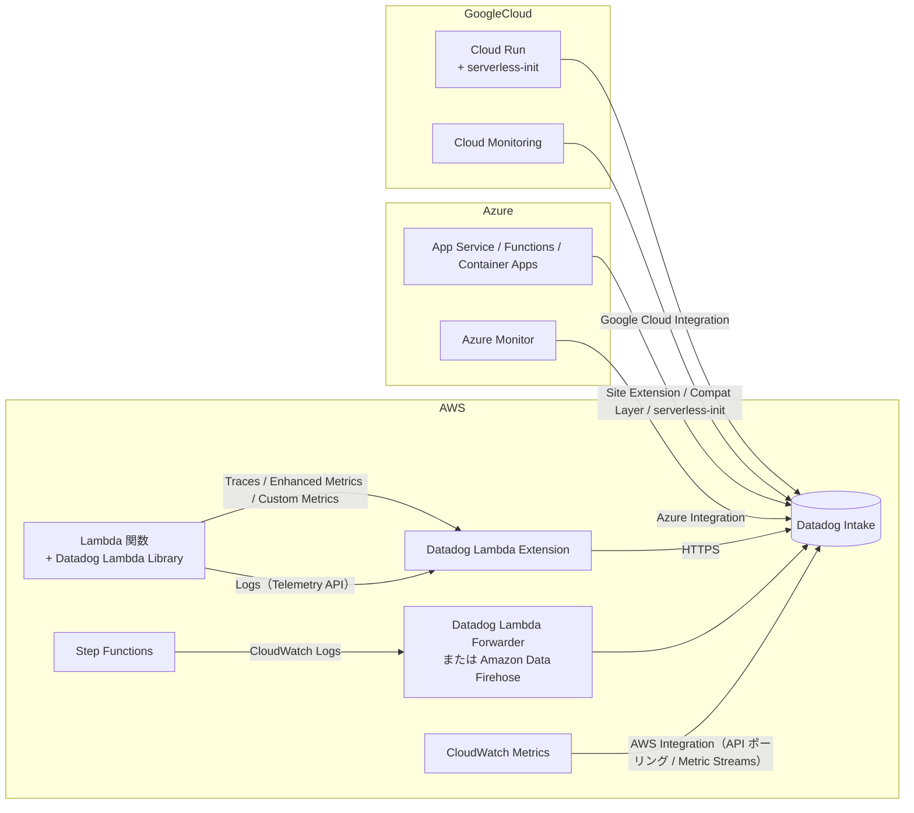
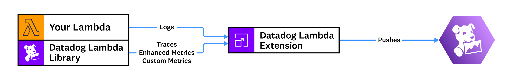
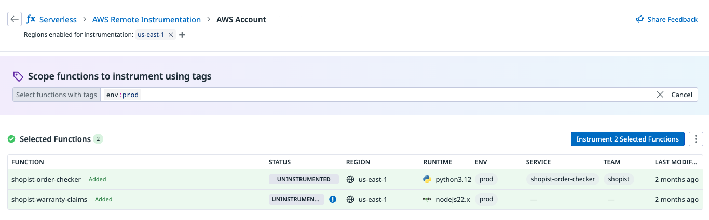
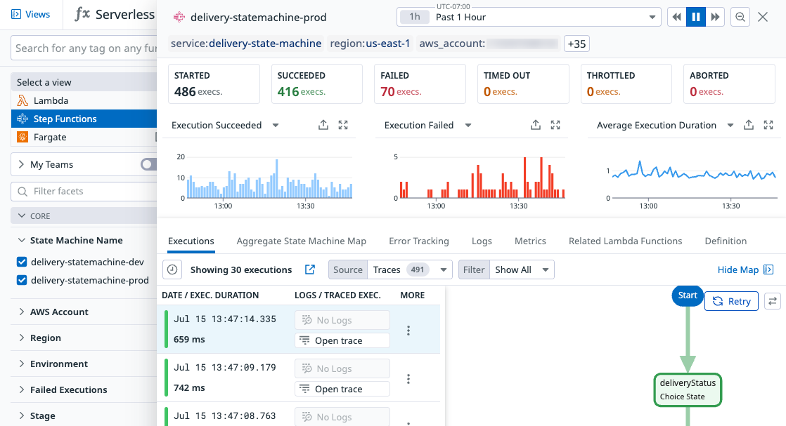
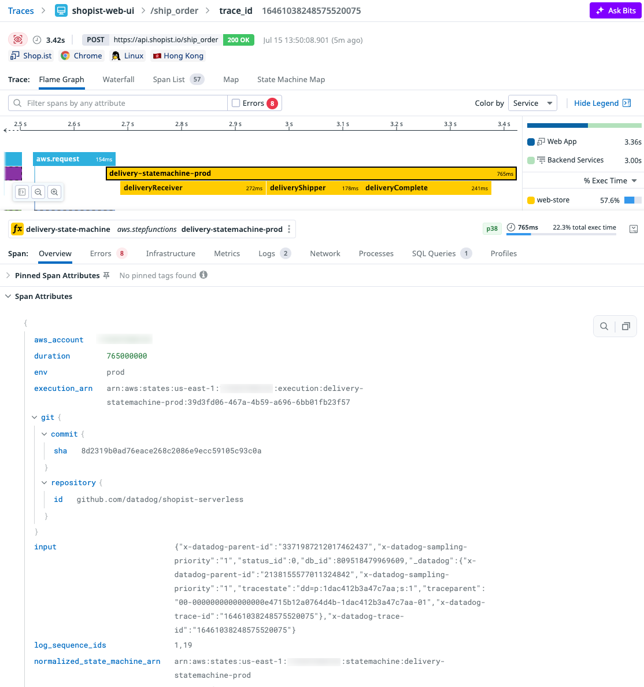
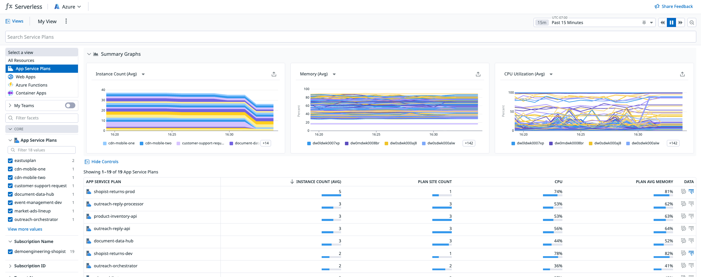

# Serverless Monitoring（サーバーレス監視）

## 概要

Datadog Serverless Monitoring（サーバーレス監視）は、サーバー（ホスト）を意識しないマネージド実行環境上のワークロードについて、メトリクス・トレース・ログを収集し、単一の **Serverless** 画面（プラットフォーム切り替えで AWS / Azure 等を選択）で関数・アプリ単位に可視化する製品群である。2026-11-02 時点で公式ドキュメントが対象とする主なプラットフォームは次のとおり。[出典](https://docs.datadoghq.com/serverless/)

| プラットフォーム | 主な計装コンポーネント | Enhanced Metrics の名前空間 | 課金上の区分 |
|---|---|---|---|
| AWS Lambda | Datadog Lambda Extension ＋ ランタイム別 Datadog Lambda Library（Lambda Layer またはパッケージ） | `aws.lambda.enhanced.*` | Serverless Workload Monitoring（アクティブ関数）＋ Serverless Functions APM（トレース対象呼び出し） |
| AWS Step Functions | CloudWatch Logs を Datadog Lambda Forwarder または Amazon Data Firehose で送信 | `aws.states.enhanced.*` | Serverless Workload Monitoring（アクティブ Step Function）＋ Serverless Functions APM（ステート遷移数） |
| Azure App Service（Web Apps / Function Apps / App Service Plans） | Windows：Datadog Site Extension、Linux：`serverless-init` サイドカー | 公開情報では確認できず（Azure 連携の enriched metrics あり） | Serverless Application Monitoring（アクティブアプリインスタンス） |
| Azure Functions | Serverless Compatibility Layer ＋ 各言語トレーサー | `azure.functions.enhanced.*` | Serverless Application Monitoring |
| Azure Container Apps | `serverless-init`（コンテナ内 / サイドカー） | `azure.app_containerapps.enhanced.*` | Serverless Application Monitoring |
| Google Cloud Run（サービス / ジョブ / functions） | `serverless-init`（コンテナ内 / サイドカー） | `gcp.run.container.enhanced.*`、`gcp.run.job.enhanced.*` | Serverless Application Monitoring |
| AWS Fargate、GKE Autopilot | Datadog Agent（コンテナ） | — | 料金ページ上は Serverless Application Monitoring に分類 |

Serverless Monitoring の基本構成は「クラウド連携（AWS / Azure / Google Cloud Integration）による標準メトリクス・ログ」＋「Datadog 独自コンポーネントによる計装（トレース、Enhanced Metrics、カスタムメトリクス、直接ログ収集）」の二層である。クラウド連携自体の設定は [AWS Integration](../platform/aws-integration.md)、[Azure Integration](../platform/azure-integration.md)、[Google Cloud Integration](../platform/gcp-integration.md) を参照。

本ファイルが扱わない内容と参照先：

| 内容 | 参照先 |
|---|---|
| APM の概念、Ingestion Control、Retention Filter | [APM の概念とインジェスト制御](../apm/apm-concepts-and-ingestion.md) |
| トレーサー（dd-trace）の言語別計装の一般論 | [APM インスツルメンテーション](../apm/apm-instrumentation.md) |
| Lambda Forwarder によるログ収集全般、ログパイプライン | [ログ収集](../logs/log-collection.md)、[Log Pipelines と処理](../logs/log-pipelines-and-processing.md) |
| ECS on Fargate / EKS on Fargate / GKE Autopilot の Agent 構成 | [コンテナ・Kubernetes 監視](container-and-kubernetes-monitoring.md)、[コンテナ/Kubernetes向けAgent](../platform/kubernetes-and-containers-agent.md) |
| カスタムメトリクスの課金・DogStatsD | [Custom Metrics と DogStatsD](../platform/custom-metrics-and-dogstatsd.md) |
| OpenTelemetry 全般 | [OpenTelemetry サポート](../platform/opentelemetry.md) |
| Serverless での App and API Protection（旧称：Application Security Management / ASM） | [App and API Protection](../security/app-and-api-protection.md) |
| Continuous Profiler 全般 | [Continuous Profiler](../apm/continuous-profiler.md) |
| 料金の正本 | [製品別料金表](../../03_導入編/pricing-by-product.md) |

---

## 全体アーキテクチャ



AWS Lambda では、ランタイム固有の **Datadog Lambda Library** と **Datadog Lambda Extension** が連携してテレメトリを送信する。Extension は Lambda Telemetry API 経由で関数ログを収集するため、CloudWatch Logs を経由しない収集が可能である。Extension は Enhanced Metrics を生成し、Library が生成した APM トレース・カスタムスパン・カスタムメトリクスとログを結合して送信する。[出典](https://docs.datadoghq.com/serverless/aws_lambda/)



- **キャプション:** AWS Lambda における Datadog Lambda Library と Datadog Lambda Extension のデータフロー図（公式図版、alt: "Collecting Enhanced Metrics from AWS Lambda"）。
- **画面の説明:** 左側に「Your Lambda」と「Datadog Lambda Library」が同じ箱として描かれ、Lambda 関数からは「Logs」、Datadog Lambda Library からは「Traces / Enhanced Metrics / Custom Metrics」の矢印が中央の「Datadog Lambda Extension」に向かう。Extension から右側の Datadog ロゴへ「Pushes」の矢印で送信される。画面 UI ではなく構成図である。
- **出典:** https://docs.datadoghq.com/serverless/aws_lambda/ （取得日 2026-11-02）

---

## AWS Lambda

### 主要機能

AWS Lambda 向け Serverless Monitoring の機能一覧。[出典](https://docs.datadoghq.com/serverless/aws_lambda/)

| 機能 | 内容 |
|---|---|
| Enhanced Metrics | `aws.lambda.enhanced.*` 名前空間。秒粒度・ほぼリアルタイム。コールドスタート、推定 AWS コスト、タイムアウト、OOM、メモリ使用量などのアラート・SLO に使用可能 |
| Custom Metrics | 関数コードからディストリビューションとして送信 |
| Distributed Tracing（分散トレース） | Python / Node.js / Ruby / Go / Java / .NET の Datadog SDK で対応 |
| Log Collection | Extension による直接収集、フィルタリング、トレースとの関連付け |
| Invocation Payloads | リクエスト / レスポンスのペイロード取得（オプトイン、`DD_CAPTURE_LAMBDA_PAYLOAD`） |
| Serverless View | サービス単位にリソースをグルーピングし、API Gateway・SNS・SQS・DynamoDB・S3・EventBridge・Kinesis 等の呼び出し元 AWS リソースのメトリクスを Lambda と相関表示 |
| Deployment Tracking | コード・設定・デプロイの変更をメトリクス・トレース・ログと相関し、リグレッションを特定（`version` タグを使用） |
| Continuous Profiler | Python で【Preview】 |
| Secure Functions | App and API Protection（AAP）による脅威検知 |

### Datadog Lambda Extension

Datadog Lambda Extension は「Lambda 関数の実行中にカスタムメトリクス・トレース・ログを非同期に送信する AWS Lambda Extension」である。[出典](https://docs.datadoghq.com/serverless/libraries_integrations/extension/)

| 項目 | 内容 |
|---|---|
| 対応ワークロード | ログ・メトリクスは全ワークロード。APM トレースは Python / Node.js / Go / Java / .NET / Ruby |
| 世代 | Next-generation（次世代）版が GA。コールドスタートが大幅に速く、リソース消費が少ない。v67〜v87 は `DD_EXTENSION_VERSION=compatibility` で旧版（Compatibility 版）に戻せる。**v88 以降は次世代版のみ** |
| 実装言語 | 公式ドキュメント本文には明記なし。FIPS ページでは Compatibility 版が Go バイナリ、Next Generation 版が Rust バイナリと記載 [出典](https://docs.datadoghq.com/serverless/aws_lambda/fips-compliance/) |
| AAP 利用時 | `DD_SERVERLESS_APPSEC_ENABLED=true` の場合はデフォルトで互換版が使用される（`false` で最適化版、v67+）[出典](https://docs.datadoghq.com/serverless/aws_lambda/configuration/) |
| Lambda Managed Instances | v90 以降で対応。`AWS_LAMBDA_INITIALIZATION_TYPE` 環境変数で自動検知し追加設定不要 |
| 最新版 | GitHub Releases 上の最新は **v102（2026-11-02 リリース、セキュリティ更新。侵害された eMudhra（emSign）CA 鍵で発行された証明書を信頼しない変更を含み、全ユーザーにアップグレードを推奨）**。公式ドキュメントのインストール例は v101 を使用 [出典](https://github.com/DataDog/datadog-lambda-extension/releases) |
| アップグレード方法 | Lambda Layer のバージョン、またはコンテナイメージの Dockerfile 上のバージョンを更新。事前にリリースノートを確認 |

#### フラッシュ（送信）戦略

Datadog Lambda Extension のデータ送信タイミングは次のとおり。[出典](https://docs.datadoghq.com/serverless/libraries_integrations/extension/)

| モード | 動作 |
|---|---|
| デフォルト（呼び出し終了時） | 各呼び出しの終了時にフラッシュ。コールドスタート時は必ずフラッシュ |
| 定期フラッシュ（自動切替） | 呼び出しが安定かつ高頻度（1分に1回超）になると、データをバッチ化し、フラッシュ期限が来た呼び出しの開始時に送信 |
| 固定間隔 | `DD_SERVERLESS_FLUSH_STRATEGY=periodically,60000` で1分ごとにフラッシュ（オーバーヘッド削減） |
| ローカルエミュレータ | Telemetry API がないエミュレータでは `DD_SERVERLESS_FLUSH_STRATEGY=periodically,1` [出典](https://docs.datadoghq.com/serverless/aws_lambda/configuration/) |
| Lambda Managed Instances（v90+） | バックグラウンドで継続的にフラッシュ。デフォルト 30 秒ごと |

#### オーバーヘッドの考え方

- コールドスタート時は Extension の初期化分だけ init duration が長くなる。
- `aws.lambda.duration` / `aws.lambda.enhanced.duration` にはフラッシュ時間が含まれるが、フラッシュは AWS がレスポンスを返した後に行われるため、呼び出し元への応答は遅くならない。
- Extension の時間を除いた関数実行時間は `aws.lambda.enhanced.runtime_duration`、フラッシュ時間は `aws.lambda.post_runtime_extensions_duration` または `aws.lambda.enhanced.post_runtime_duration` で確認する。
- Datadog サイトから地理的に遠いリージョンの関数はネットワーク遅延によるオーバーヘッドが増えるため、フラッシュ頻度を下げる設定が推奨される。
- タイムアウトが極端に短いと後続呼び出しでハンドラーが実行されない場合がある。`INIT_REPORT` ログで検知でき、タイムアウトを延ばすことが推奨される。

[出典](https://docs.datadoghq.com/serverless/libraries_integrations/extension/)

### Datadog Lambda Library（Layer）

Datadog Lambda Library はランタイムごとに提供され、トレース生成・Enhanced Metrics 用データ・カスタムメトリクス送信 API を提供する。Lambda Layer として付与するか、パッケージ（例：Python は `datadog-lambda`、Node.js は `datadog-lambda-js`）として同梱する。Python の場合、`datadog-lambda` パッケージのマイナーバージョンは Layer バージョンと一致する。[出典](https://docs.datadoghq.com/serverless/aws_lambda/installation/python/)

#### Layer ARN の形式（Python の例、2026-11-02 時点の公式ドキュメント記載値）

| 種別 | アーキテクチャ | パーティション | ARN 形式 |
|---|---|---|---|
| Python Library | x86_64 | 商用リージョン | `arn:aws:lambda:<AWS_REGION>:464622532012:layer:Datadog-<RUNTIME>:130` |
| Python Library | arm64 | 商用リージョン | `arn:aws:lambda:<AWS_REGION>:464622532012:layer:Datadog-<RUNTIME>-ARM:130` |
| Python Library | x86_64 | GovCloud | `arn:aws-us-gov:lambda:<AWS_REGION>:002406178527:layer:Datadog-<RUNTIME>:130` |
| Python Library | arm64 | GovCloud | `arn:aws-us-gov:lambda:<AWS_REGION>:002406178527:layer:Datadog-<RUNTIME>-ARM:130` |
| Extension | x86_64 | 商用リージョン | `arn:aws:lambda:<AWS_REGION>:464622532012:layer:Datadog-Extension:101` |
| Extension | arm64 | 商用リージョン | `arn:aws:lambda:<AWS_REGION>:464622532012:layer:Datadog-Extension-ARM:101` |
| Extension | x86_64 | GovCloud | `arn:aws-us-gov:lambda:<AWS_REGION>:002406178527:layer:Datadog-Extension:101` |
| Extension | arm64 | GovCloud | `arn:aws-us-gov:lambda:<AWS_REGION>:002406178527:layer:Datadog-Extension-ARM:101` |
| Extension（FIPS） | x86_64 / arm64 | 商用・GovCloud | `Datadog-Extension-FIPS:101` / `Datadog-Extension-ARM-FIPS:101`（パブリッシャーのアカウント ID は商用と GovCloud で異なる） |

- `<RUNTIME>` は `Python38`〜`Python314` 等（例：`Python313`）。[出典](https://docs.datadoghq.com/serverless/aws_lambda/installation/python/)
- 商用リージョンの Layer 公開アカウントは `464622532012`、GovCloud は `002406178527`。
- バージョン番号（Python 130 / Extension 101）はドキュメント取得時点の例であり、常に最新を確認すること。Extension の GitHub 上の最新は v102（前述）。
- 他ランタイム（Node.js、Ruby、Java、Go、.NET）の Layer 名・バージョンは各ランタイムのインストールページを参照（本ファイルでは Python のみ確認）。

### インストール方法

AWS Lambda の導入経路は大きく「アプリ内クイックスタート」「エージェント型オンボーディング」「手動（ランタイム別）」の3つ。[出典](https://docs.datadoghq.com/serverless/aws_lambda/installation/)

| 経路 | 内容 | 恒久性 |
|---|---|---|
| Quick start（アプリ内フロー） | Fleet Automation の AWS Lambda 用インストールフローから関数をその場で設定 | 計装は恒久化されない（IaC に反映されない） |
| Agentic onboarding（Pup CLI） | プロジェクトディレクトリで `npx @datadog/pup setup --product serverless --serverless-compute-type=aws-lambda`。Node.js 22 以上が必要、利用者自身の AI モデルトークンは消費しない | コードに反映 |
| Agentic onboarding（MCP Server） | IDE のアシスタント（Claude Code、Cursor 等）から Datadog MCP Server の `serverless_onboarding` ツールを使用 | コードに反映 |
| 手動計装 | Python / Node.js / Ruby / Java / Go / .NET 別のガイドに従う | 方式による |

> **サイト差異:** アプリ内 Quick start / Agentic onboarding / Remote Instrumentation は `app.ddog-gov.com`（US1-FED）および `us2.ddog-gov.com`（US2-FED）では非対応と記載されている。[出典](https://docs.datadoghq.com/serverless/aws_lambda/installation/)

#### 手動計装の方式（Python ページの例）

| 方式 | 手順の要点 |
|---|---|
| Datadog UI（Remote Instrumentation） | `Serverless > AWS Lambda > Settings` → **Remote Instrumentation** → **AWS Lambda** タブ（後述） |
| Datadog CLI | `npm install -g @datadog/datadog-ci @datadog/datadog-ci-plugin-lambda` → 環境変数 `DATADOG_SITE`、`DATADOG_API_KEY_SECRET_ARN`（推奨。テスト時は `DATADOG_API_KEY`）を設定 → `datadog-ci lambda instrument -f <functionname> -r <aws_region> -v 130 -e 101`。初回は `-i`（対話モード）が便利。`--functions-regex` で正規表現指定可。戻すときは同じ引数で `uninstrument` |
| Serverless Framework | `serverless plugin install --name serverless-plugin-datadog` → `serverless.yml` の `custom.datadog` に `site`、`apiKeySecretArn`（テスト用に `apiKey` も可） |
| AWS SAM | リージョンごとに1回 Datadog Serverless Macro の CloudFormation スタック（テンプレート `https://datadog-cloudformation-template.s3.amazonaws.com/aws/serverless-macro/latest.yml`、`CAPABILITY_AUTO_EXPAND CAPABILITY_IAM`）を作成 → `template.yml` の Transform に `AWS::Serverless-2016-10-31` の後ろへ `DatadogServerless` を追加し、`pythonLayerVersion`、`extensionLayerVersion`、`site`、`apiKeySecretArn` を指定 |
| AWS CDK | Construct ライブラリ `datadog-cdk-constructs`（CDK v1）/ `datadog-cdk-constructs-v2`（CDK v2）。Python 関数の計装は TypeScript / Python / Go の CDK アプリで対応（Go は `github.com/DataDog/datadog-cdk-constructs-go/ddcdkconstruct/v3`、CDK v2 のみ）。`addLambdaFunctions` に関数を渡す |
| コンテナイメージ | ライブラリをインストール（`pip install datadog-lambda`）し、`COPY --from=public.ecr.aws/datadog/lambda-extension:<TAG> /opt/. /opt/` で Extension をコピー（`101-alpine` 等の Alpine タグあり）。`CMD` を `datadog_lambda.handler.handler` にし、`DD_LAMBDA_HANDLER` に元のハンドラーを設定 |
| Terraform | モジュール `DataDog/lambda-datadog/aws`（例は `version = "4.0.0"`）を `aws_lambda_function` の代わりに使用。`datadog_extension_layer_version`、`datadog_python_layer_version` を省略すると最新 Layer |
| Custom（手動） | Layer を付与し、ハンドラーを `datadog_lambda.handler.handler`、`DD_LAMBDA_HANDLER` に元ハンドラー、`DD_SITE`、`DD_API_KEY_SECRET_ARN`（または `DD_API_KEY`）、`DD_TRACE_ENABLED=true` を設定 |
| SST v3 | Layer（`Datadog-Extension`、`Datadog-<RUNTIME>`）を追加し、ハンドラーラッパーで包む |

[出典](https://docs.datadoghq.com/serverless/aws_lambda/installation/python/)

全方式共通の注意点：

- Serverless 環境では `DD_AGENT_HOST` や `DD_TRACE_AGENT_URL` を設定しない。
- `DD_API_KEY_SECRET_ARN` で参照する Secrets Manager のシークレットは JSON ではなく平文文字列で保存し、実行ロールに `secretsmanager:GetSecretValue` を付与する。
- `pip install datadog-lambda -t ./` でローカル同梱する場合、ネイティブ拡張を含むため対象アーキテクチャの Linux 上でビルドする。

### Remote Instrumentation（リモート計装）

Remote Instrumentation は Datadog UI から Lambda 関数に Extension と Library を付与し、計装状態を維持する機能である。[出典](https://docs.datadoghq.com/serverless/aws_lambda/remote_instrumentation/)

| 項目 | 内容 |
|---|---|
| 仕組み | CloudFormation スタックが計装用 Lambda 関数 `datadog-remote-instrumenter`、CloudTrail 等をデプロイ。対象関数に Datadog Lambda Extension と Library を追加し、外部から Datadog の Layer・環境変数が変更されると再計装する |
| 前提条件 | AWS 連携でリソース収集が有効／ユーザーに Serverless AWS Instrumentation Read・Write 権限／API キーに Remote Configuration アクセス |
| デプロイ範囲 | 計装したい**全リージョン・全アカウント**に instrumenter をデプロイする必要がある |
| 対象選択 | 関数名、AWS リソースタグ、`DD_TAGS` のタグで指定（大文字小文字を区別しない）。`OR`、`AND`、`!`（否定）を使用可能。例：`name:(app-staging OR app-prod)` |
| スキップされる関数 | 既に Datadog の Layer または環境変数がある関数は `manual` として扱われスキップ（Layer 競合回避） |
| 推奨 | メモリ 256 MB 超の関数のみ計装することを推奨。開発環境で試験後にステージング・本番へ |
| スタック作成権限 | EventBridge、S3、CloudTrail、Lambda のリソース作成権限 |
| 削除時の挙動 | リージョンの CloudFormation スタックを削除すると、そのリージョンの全関数から計装が外れる |
| サイト | US1-FED / US2-FED では非対応 |



- **キャプション:** Datadog の AWS Remote Instrumentation 画面。
- **画面の説明:** 公式の代替テキストによれば、「Scope functions to instrument using tags（タグで計装対象関数を絞り込む）」入力ボックスと、リモート計装可能な関数の一覧が表示される。画面へは `Serverless > AWS Lambda > Settings` の **Remote Instrumentation** セクションから到達する。
- **出典:** https://docs.datadoghq.com/serverless/aws_lambda/remote_instrumentation/ （取得日 2026-11-02）

### 主な環境変数（AWS Lambda）

Datadog Lambda Extension / Library の主な設定。デフォルトが公開情報で確認できないものは「—」とした。[出典](https://docs.datadoghq.com/serverless/aws_lambda/configuration/)

#### 接続・認証

| 環境変数 | デフォルト | 説明 |
|---|---|---|
| `DD_SITE` | — | 送信先 Datadog サイト（例 `ap1.datadoghq.com`） |
| `DD_API_KEY` | — | API キー（平文。テスト用途） |
| `DD_API_KEY_SECRET_ARN` | — | API キーを格納した Secrets Manager シークレットの ARN（推奨） |
| `DD_API_KEY_SECRET_RELOAD_INTERVAL` | — | 必要時にシークレットを再読み込みするまでの秒数（例 `43200`）。Extension v88+ |
| `DD_ORG_UUID` | — | Workload Identity Federation を有効化。他の API キー変数より優先。v96+ |
| `DD_LAMBDA_HANDLER` | — | ラッパーハンドラー使用時の元ハンドラー |

#### タグ

| 環境変数 | デフォルト | 説明 |
|---|---|---|
| `DD_ENV` / `DD_SERVICE` / `DD_VERSION` | — | Unified Service Tagging の予約タグ。Extension 利用時は環境変数で設定 |
| `DD_TAGS` | — | カスタムタグ（カンマ区切り、例 `team:avengers,project:marvel`）。Enhanced Metrics は関数の AWS タグを継承しないため `DD_TAGS` で付与する |
| `DD_LAMBDA_CUSTOMER_METRICS_EXCLUDE_TAGS` | 除外なし | カスタムメトリクスから自動付与タグ（例 `function_arn,region`）を除外。v98+ |

タグに関する補足：Lambda 関数に付与した AWS タグはメトリクス・トレース・ログの新たなディメンションになる。`env` 未設定の関数は `env:none` になる。新規顧客の場合 `service` 未設定の関数は `aws.lambda` にまとめられる。`version` は Deployment Tracking に使われる。[出典](https://docs.datadoghq.com/serverless/guide/serverless_tagging/)

#### トレース

| 環境変数 | デフォルト | 説明 |
|---|---|---|
| `DD_TRACE_ENABLED` | 有効 | Extension 経由のトレース収集。`false` で無効 |
| `DD_TRACE_SAMPLING_RULES` | — | ヘッドベースのサンプリング率 0.000〜1.000（例 `[{"sample_rate":0.1}]`） |
| `DD_TRACE_SAMPLE_RATE` | — | 非推奨。`DD_TRACE_SAMPLING_RULES` を使用 |
| `DD_TRACE_MANAGED_SERVICES` | 有効 | 呼び出し元 AWS マネージドサービス（API Gateway、Function URL、SQS、SNS、Kinesis、EventBridge、S3、DynamoDB）の推論スパン（inferred span）を生成。`false` で無効 |
| `DD_SERVICE_MAPPING` | — | 上流サービス名の付け替え（`old:new` のカンマ区切り。例 `lambda_sqs:newName`） |
| `DD_TRACE_AWS_SERVICE_REPRESENTATION_ENABLED` | 有効（推奨） | AWS リソース名でサービス名を付与。`false` で旧来の命名 |
| `DD_TRACE_OTEL_ENABLED` | — | `true` で OpenTelemetry API による計装を有効化 |
| `DD_TRACE_EXTRACTOR` | — | 非同期経路のトレースコンテキスト抽出関数（`<FILE NAME>.<FUNCTION NAME>`）。Node.js arm64 では関数コード内で定義 [出典](https://docs.datadoghq.com/serverless/aws_lambda/distributed_tracing/) |
| `DD_MERGE_XRAY_TRACES` | — | X-Ray トレースとのマージ（Ruby は `DD_MERGE_DATADOG_XRAY_TRACES`） |
| `DD_BOTOCORE_DYNAMODB_TABLE_PRIMARY_KEYS` | — | DynamoDB PutItem のスパン自動リンク用（テーブル名→主キー名1〜2個の JSON） |
| `DD_COLD_START_TRACING` | `true` | コールドスタート時のモジュールロードを子スパンとして生成（Node.js / Python）。`false` で単一のコールドスタートスパン [出典](https://github.com/DataDog/datadog-lambda-js) |
| `DD_MIN_COLD_START_DURATION` | `3`（ms） | コールドスタートスパンにするモジュールロード時間の下限 |
| `DD_COLD_START_TRACE_SKIP_LIB` | `./opentracing/tracer` | コールドスタートスパン作成時にスキップするライブラリ（Node.js） |
| `DD_ENCODE_AUTHORIZER_CONTEXT` / `DD_DECODE_AUTHORIZER_CONTEXT` | `true` / `true` | Lambda オーソライザーを跨ぐトレースコンテキスト伝播（Node.js / Python） |
| `DD_DURABLE_CROSS_INVOCATION_TRACING_ENABLED` | `true` | Lambda durable functions で複数呼び出しのスパンを1トレースにまとめる（Node.js ライブラリ） |

#### ペイロード・スクラビング

| 環境変数 | デフォルト | 説明 |
|---|---|---|
| `DD_CAPTURE_LAMBDA_PAYLOAD` | 無効 | `true` でリクエスト / レスポンスのペイロードをスパンのタグとして取得（Python、Node.js、Go、Java、.NET） |
| `DD_CAPTURE_LAMBDA_PAYLOAD_MAX_DEPTH` | `10` | JSON ペイロードをタグ化する深さ（Node.js ライブラリ）[出典](https://github.com/DataDog/datadog-lambda-js) |
| `DD_APM_REPLACE_TAGS` | — | スパン・ペイロードの機微情報をマスクするルール（`name`、`pattern`、`repl` の JSON 配列） |

#### メトリクス・ログ

| 環境変数 | デフォルト | 説明 |
|---|---|---|
| `DD_ENHANCED_METRICS` | 有効 | `false` で Enhanced Metrics を無効化 [出典](https://docs.datadoghq.com/serverless/aws_lambda/metrics/) |
| `DD_SERVERLESS_LOGS_ENABLED` | Extension 利用時は有効 | `false` で Extension によるログ収集を無効化 [出典](https://docs.datadoghq.com/serverless/aws_lambda/logs/) |
| `DD_LOGS_CONFIG_PROCESSING_RULES` | — | ログの除外・マスクルール（例：START/END ログの除外） |
| `DD_LOGS_INJECTION` | Forwarder 利用時に有効 | ログへの `dd.trace_id` 注入（Forwarder 経路用） |
| `DD_LOG_LEVEL` | — | `debug` でトラブルシュート用ログ |
| `DD_SERVERLESS_FLUSH_STRATEGY` | 自動 | フラッシュ戦略（前述） |

#### デュアルシッピング（複数 org への送信）

| 環境変数 | 説明 |
|---|---|
| `DD_ADDITIONAL_ENDPOINTS` | メトリクスの追加送信先と API キー（JSON マップ） |
| `DD_APM_ADDITIONAL_ENDPOINTS` | APM トレースの追加送信先 |
| `DD_APM_PROFILING_ADDITIONAL_ENDPOINTS` | プロファイルの追加送信先 |
| `DD_LOGS_CONFIG_ADDITIONAL_ENDPOINTS` | ログの追加送信先（`api_key`、`Host`、`Port`、`is_reliable` の JSON 配列）。併せて `DD_LOGS_CONFIG_FORCE_USE_HTTP=true` |
| `*_SECRET_ARN` 版 | 上記設定を Secrets Manager から取得（`DD_ADDITIONAL_ENDPOINTS_SECRET_ARN` 等。Extension v101 で対応追加 [出典](https://github.com/DataDog/datadog-lambda-extension/releases)） |
| `*_KMS_ENCRYPTED` 版 | 上記設定を KMS 暗号化値で指定。なお APM 用は公式ドキュメント上 `DD_APM_ADDITIONAL_KMS_ENCRYPTED` と表記されており、他の変数と命名が不揃い（公式表記のまま記載） |

#### その他

| 環境変数 | 説明 |
|---|---|
| `DD_SERVERLESS_APPSEC_ENABLED` / `AWS_LAMBDA_EXEC_WRAPPER=/opt/datadog_wrapper` | App and API Protection による脅威検知 |
| `DD_EXTENSION_VERSION=compatibility` | 旧版 Extension を強制（v67〜v87 のみ有効） |
| `DD_PROFILING_ENABLED` / `DD_PROFILING_IGNORE_PROFILER` | Continuous Profiler（Python、【Preview】） |
| `DD_LAMBDA_FIPS_MODE` | FIPS モード（Python / JavaScript / Go）。GovCloud ではデフォルト `true`、それ以外は `false` |
| `DD_OBSERVABILITY_PIPELINES_WORKER_LOGS_ENABLED` / `DD_OBSERVABILITY_PIPELINES_WORKER_LOGS_URL` | ログを Observability Pipelines へ送信（Extension v87+） |

### Enhanced Lambda Metrics

Enhanced Lambda Metrics は Serverless Monitoring 導入で自動的に有効になる、`aws.lambda.enhanced.*` 名前空間のディストリビューションメトリクスである。タグとして `aws_account`、`region`、`functionname`、`cold_start`、`memorysize`、`executedversion`、`resource`、`runtime` が付与される。AWS Integration による標準の CloudWatch 由来メトリクス（`aws.lambda.*`）に追加して生成される。[出典](https://docs.datadoghq.com/serverless/aws_lambda/metrics/)

| メトリクス（`aws.lambda.enhanced.` 以下） | 説明 | 単位 |
|---|---|---|
| `invocations` | 呼び出し回数 | — |
| `errors` | 関数エラーで失敗した呼び出し数 | — |
| `max_memory_used` | 最大メモリ使用量 | MB |
| `duration` | コード開始〜停止までの時間 | 秒 |
| `billed_duration` | 課金対象の実行時間 | 公式表記は「100 ms 単位」（AWS 側の課金粒度変更との関係は公開情報では確認できず） |
| `init_duration` | コールドスタート時の初期化時間 | 秒 |
| `runtime_duration` | コード開始〜レスポンス返却（Extension 時間を除く） | ミリ秒 |
| `post_runtime_duration` | レスポンス返却〜停止（Extension 実行時間） | ミリ秒 |
| `response_latency` | リクエスト受信〜最初のレスポンスバイト送信 | ミリ秒 |
| `response_duration` | 最初〜最後のレスポンスバイト送信 | ミリ秒 |
| `produced_bytes` | 関数が返したバイト数 | バイト |
| `estimated_cost` | 呼び出しの推定コスト | USD |
| `timeouts` | タイムアウト数 | — |
| `out_of_memory` | OOM 発生数（一部ケースは捕捉されない場合あり） | — |
| `cpu_total_utilization` / `cpu_total_utilization_pct` | CPU 総使用率 | コア数 / % |
| `cpu_max_utilization` / `cpu_min_utilization` | 最も / 最も使われていないコアの使用率 | — |
| `cpu_system_time` / `cpu_user_time` / `cpu_total_time` | カーネル / ユーザー / 合計 CPU 時間 | — |
| `num_cores` | 利用可能コア数 | — |
| `rx_bytes` / `tx_bytes` / `total_network` | 受信 / 送信 / 合計バイト | バイト |
| `tmp_max` / `tmp_used` | `/tmp` の総容量 / 使用量 | — |
| `fd_max` / `fd_use` | ファイルディスクリプタ上限 / 呼び出し中の最大使用数 | — |
| `threads_max` / `threads_use` | スレッド上限 / 呼び出し中の最大使用数 | — |

- Enhanced Metrics の無効化は `DD_ENHANCED_METRICS=false`。
- Enhanced Metrics がカスタムメトリクスとして課金されるか否かは、公式ドキュメント（メトリクスページ）では明記を確認できず。
- Lambda Managed Instances【Preview】では `estimated_cost` と `billed_duration` は提供されない。[出典](https://docs.datadoghq.com/serverless/aws_lambda/managed_instances/)

#### カスタムメトリクスの送信

Lambda のカスタムメトリクスはすべて**ディストリビューション**として送信する。同時実行環境ではカウント / ゲージは同一タイムスタンプ・同一タグで上書きされ過少計上になり得るが、ディストリビューションは Datadog バックエンドで集計されるため全ポイントが反映される。[出典](https://docs.datadoghq.com/serverless/aws_lambda/metrics/)

| ランタイム | 送信 API |
|---|---|
| Python | `datadog_lambda.metric` の `lambda_metric` |
| Node.js | `datadog-lambda-js` の `sendDistributionMetric` |
| Go | `ddlambda.Distribution` |
| Java | `java-dogstatsd-client`（`recordDistributionValue`） |
| .NET | `dogstatsd-csharp-client`（`DogStatsd.Distribution`） |
| その他 | DogStatsD クライアント |

- 既存メトリクス名を再利用せず、新しい名前のディストリビューションにする。
- 過去タイムスタンプ付きメトリクスは Extension 経由で送信可能。公式本文では「最大1時間前まで」とあるが、同ページ内の Python 例のコメントは「20分以内」となっており記述が不一致（要確認）。
- デフォルト集計は `avg`、`sum`、`max`、`min`、`count`。パーセンタイル（p50〜p99）は Metrics Summary で有効化。
- コード変更なしの代替として、ログベースメトリクス・スパンベースメトリクス（インデックス有無に関係なく全取り込みスパンから生成）も使える。
- Metrics Summary ページでは Serverless のカスタムメトリクスが Serverless タグで識別できる。`function_arn` 等の自動付与タグを除外してカーディナリティを抑制できる（`DD_LAMBDA_CUSTOMER_METRICS_EXCLUDE_TAGS`）。

### 分散トレース（Lambda）

| 項目 | 内容 |
|---|---|
| 対応 SDK | Python、Node.js、Ruby、Go、Java、.NET |
| Python / Node.js の追加機能 | ログとトレースの自動相関、Serverless Framework / SAM / CDK によるノーコード導入、AWS SDK 経由の連続呼び出しのトレース、コールドスタートトレース、多数の AWS マネージドサービスを経由する非同期トレース |
| Ruby / Java | ログ・トレース相関、下流 Lambda / コンテナへの HTTP トレース |
| Go | ログ・トレース相関は手動 |
| .NET | HTTP トレース、標準ライブラリトレース |
| X-Ray との関係 | `dd-trace` のみの利用を推奨。X-Ray とのマージは Node.js / Python で可能（X-Ray アクティブトレース有効化＋ `DD_MERGE_XRAY_TRACES=true`）。マージは AWS の請求増加の可能性があり、X-Ray スパンは 2〜5 分遅れて表示される。新規アプリは X-Ray 連携より Extension を推奨 |
| Step Functions | Datadog ネイティブのトレースとなり X-Ray 不要 |
| 非同期の伝播 | 送信側で `getTraceHeaders`（Node.js）/ `get_dd_trace_context`（Python）によりイベントへトレースコンテキストを付与し、受信側で `DD_TRACE_EXTRACTOR` を設定。Go は `TraceContextExtractor` |
| Span auto-linking（スパン自動リンク） | S3 変更通知、DynamoDB Change Streams で「Backward / Forward」のリンクを表示。要件：`datadog-lambda-python` Layer v101+ / `dd-trace-py` v2.16+、`datadog-lambda-js` Layer 118+ / `dd-trace-js` v4.53.0+ または v5.29.0+。サンプリング・Retention Filter によりリンク先が見えない場合あり |
| ハイブリッド環境 | Lambda とホストの両方に `dd-trace` を入れるとインフラ境界を跨ぐリクエストが1トレースで見える |
| Continuous Profiler | Python で【Preview】（分散トレースページは「4.62.0 / Layer 62 以降」、設定ページは「4.62.0 / Layer 62 以前」と読める記述で、公式ドキュメント内に表記揺れあり）。`DD_PROFILING_ENABLED=true` |

[出典](https://docs.datadoghq.com/serverless/aws_lambda/distributed_tracing/)

サンプリングと Retention Filter の一般概念は [APM の概念とインジェスト制御](../apm/apm-concepts-and-ingestion.md) を参照。

### ログ収集（Lambda）

| 項目 | Extension 経路 | Forwarder 経路 |
|---|---|---|
| 収集方式 | Lambda Telemetry API から直接収集（CloudWatch 不要） | CloudWatch Logs のサブスクリプションフィルターで Datadog Lambda Forwarder に送信 |
| 有効化 | Extension 利用時はデフォルト有効。`DD_SERVERLESS_LOGS_ENABLED` で制御 | ロググループへのサブスクリプション設定 |
| 無効化 | `DD_SERVERLESS_LOGS_ENABLED=false`、または `enableDDLogs: false`（Serverless Framework / SAM）、`enableDatadogLogs: false`（CDK） | サブスクリプションフィルターを削除 |
| トレース相関 | Lambda リクエスト ID を `aws.lambda` スパンの `request_id` タグとログの `lambda.request_id` で突合 | `DD_LOGS_INJECTION` によりログに `dd.trace_id` を注入 |

- START/END ログの除外例：`DD_LOGS_CONFIG_PROCESSING_RULES=[{"type": "exclude_at_match", "name": "exclude_start_and_end_logs", "pattern": "(START|END) RequestId"}]`（またはプロジェクトルートの `datadog.yaml` の `logs_config.processing_rules`）。
- **`REPORT` ログは除外しない**。Serverless 画面の呼び出し一覧（invocations）の生成に使われるため。
- 非対応ランタイムでは JSON ログに `dd.trace_id` を含めるか、既定パイプラインを複製して Grok で trace ID を抽出する。

[出典](https://docs.datadoghq.com/serverless/aws_lambda/logs/)

> 注意【経験則】: Extension でログを直接送る場合でも、Lambda 実行ロールに CloudWatch Logs への書き込み権限があれば CloudWatch Logs にもログが書き込まれ、AWS 側の CloudWatch Logs 料金が引き続き発生する。CloudWatch 側を止める方法（実行ロールの権限調整等）は公式 Serverless ドキュメントのログページでは扱われておらず、AWS 側の仕様として個別に確認すること。

### Lambda Managed Instances【Preview】

| 項目 | 内容 |
|---|---|
| ステータス | 【Preview】 |
| メトリクス・Enhanced Metrics・ログ | 全ランタイム対応（Enhanced Metrics は Extension が必要） |
| トレース | Python、Node.js、Java、.NET のみ |
| 提供されないメトリクス | `aws.lambda.enhanced.estimated_cost`、`aws.lambda.enhanced.billed_duration` |
| ログ・トレース相関 | `DD_TRACE_ENABLED=true`、`DD_LOGS_INJECTION=true` |
| Extension | v90 以降で自動検知、30 秒ごとのバックグラウンドフラッシュ |
| 課金 | 公開情報では確認できず |

[出典](https://docs.datadoghq.com/serverless/aws_lambda/managed_instances/)

### FIPS 対応

| 項目 | 内容 |
|---|---|
| FIPS 版 Extension | Compatibility 版：Go ＋ BoringCrypto、Next Generation 版：Rust ＋ AWS-LC（FIPS 認定モジュール） |
| Layer | `Datadog-Extension-FIPS`、`Datadog-Extension-ARM-FIPS`（全 AWS リージョン、商用・GovCloud で公開アカウントが異なる） |
| エンドツーエンド FIPS | US1-FED（`ddog-gov.com`）または US2-FED（`us2.ddog-gov.com`）への送信が必要 |
| ランタイム | Python / Node.js / Go は `DD_LAMBDA_FIPS_MODE` で制御（有効時は AWS FIPS エンドポイントで API キー取得、メトリクスは FIPS Extension 経由のみ）。Ruby / .NET / Java は AWS API 呼び出し・直接メトリクス送信をしないため変数不要 |

> **サイト差異:** FIPS ページ内で「US1 / US3 / US5 / EU1 / AP1 / AP2 / UK1 では非サポート」とする記述と「任意のサイトで利用可」とする記述が併存しており、公式ドキュメント内で不一致がある。商用サイトでの利用可否は Datadog へ確認すること。[出典](https://docs.datadoghq.com/serverless/aws_lambda/fips-compliance/)

### その他の Lambda 関連機能

| 機能 | 内容 |
|---|---|
| Network | PrivateLink またはプロキシ経由での送信に対応（詳細は [ネットワーク・接続要件](../../03_導入編/network-and-connectivity.md)） |
| Code signing | Datadog の署名プロファイル ARN を Lambda のコード署名設定に追加 |
| 移行 | Forwarder → Extension、x86 → arm64 の移行手順あり |
| Source code linking | ソースコードリンク設定あり |
| OTLP | ADOT（AWS Distro for OpenTelemetry）Layer を使い、Datadog の OTLP intake へ直接送信可能（後述） |
| 無効化 | 「Disable Serverless Monitoring」ガイドあり |

[出典](https://docs.datadoghq.com/serverless/aws_lambda/configuration/)

---

## AWS Step Functions

AWS Step Functions 向け Serverless Monitoring は、AWS Step Functions Integration の CloudWatch メトリクスと、Step Functions の CloudWatch Logs を組み合わせ、実行トレース（Execution Traces）と Enhanced Metrics を生成する。ログは利用者環境内で動く Datadog Lambda Forwarder または Amazon Data Firehose で送信する。[出典](https://docs.datadoghq.com/serverless/step_functions/)

### 主な機能

| 機能 | 内容 |
|---|---|
| Serverless view | Step Functions の主要メトリクス（Started / Succeeded / Failed / Timed Out / Throttled / Aborted 等）を一覧 |
| State Machine Map | 実行が想定経路を通ったか、どのステートが遅い・失敗しているかを可視化（トレース有効化が必要） |
| Execution Traces | ステップの入力・出力、関連 Lambda トレース、ステップ所要時間を含むエンドツーエンドのトレース |
| Enhanced Metrics | `aws.states.enhanced.*` |

### 要件と制約

| 項目 | 値 |
|---|---|
| 完全なトレースの条件 | 実行全体が **6 時間未満** |
| ログ設定 | ログレベル `ALL`、「Include execution data」を有効 |
| Forwarder バージョン | Datadog Lambda Forwarder **v3.130.0 以降** |
| `env` タグ | トレース表示に必須。未設定時 `dev` |
| トレース有効化 | 各ステートマシンに AWS タグ `DD_TRACE_ENABLED=true` |
| Log Autosubscription | Forwarder とステートマシンが**同一リージョン**である必要 |
| Firehose | 複数リージョンのロググループを購読可能。ただしロググループ名が `/aws/vendedlogs/states/` で始まる必要 |
| サンプリング | `DD_TRACE_SAMPLE_RATE`（0.00〜1.00）。ドロップされたトレースは取り込まれない |

[出典](https://docs.datadoghq.com/serverless/step_functions/installation/)

### インストール方法

| 方式 | 要点 |
|---|---|
| Custom | AWS コンソールで CloudWatch ロググループを Forwarder に購読、または AWS 連携の Log Autosubscription で「Step Functions CloudWatch Logs」を有効化 |
| Datadog CLI | `datadog-ci stepfunctions instrument --step-function <ARN> --forwarder <ARN> --env <env>`（トレースも自動有効化） |
| Serverless Framework | `serverless-plugin-datadog` v5.40.0+、`enableStepFunctionsTracing: true` |
| AWS CDK | Datadog Step Functions CDK construct（トレース自動有効化） |
| AWS SAM | `DatadogServerless` Transform に `stepFunctionForwarderArn` |
| Terraform | 公式ページにタブはあるが Terraform 固有手順は記載なし（コンソール手順のみ） |

Lambda トレースとのマージ：Serverless Framework では `mergeStepFunctionAndLambdaTraces: true`、Datadog CLI では `--merge-step-function-and-lambda-traces`。前提として Lambda 側の Serverless Monitoring 設定が必要。

Enhanced Metrics：トレースを有効化すると自動的に有効。トレースなしで Enhanced Metrics のみ使う場合は各ステートマシンに AWS タグ `DD_ENHANCED_METRICS=true` を付与する。

### Step Functions Enhanced Metrics

| メトリクス | 説明 | 種別 |
|---|---|---|
| `aws.states.enhanced.execution.started` | 開始した実行数 | count |
| `aws.states.enhanced.execution.succeeded` | 成功した実行数 | count |
| `aws.states.enhanced.execution.failed` | 失敗した実行数 | count |
| `aws.states.enhanced.execution.execution_time` | 実行ごとの所要時間 | distribution |
| `aws.states.enhanced.task.execution.tasks_started` | 開始したタスク数 | count |
| `aws.states.enhanced.task.execution.tasks_succeeded` | 成功したタスク数 | count |
| `aws.states.enhanced.task.execution.tasks_failed` | 失敗したタスク数 | count |
| `aws.states.enhanced.task.execution.task_duration` | タスクごとの所要時間 | distribution |
| `aws.states.enhanced.state.run_duration` | ステートの実行時間 | gauge |
| `aws.states.enhanced.state.duration` | リトライを含むステートの所要時間 | gauge |
| `aws.states.enhanced.state.invocation_count` | ステートの呼び出し数 | count |
| `aws.states.enhanced.state.succeeded` | 成功したステート実行数 | count |
| `aws.states.enhanced.state.failed` | 失敗したステート実行数 | count |
| `aws.states.enhanced.state.retry_count` | ステートのリトライ数 | gauge |

[出典](https://docs.datadoghq.com/serverless/step_functions/enhanced-metrics/)

### 画面



- **キャプション:** Serverless 画面の Step Functions ビューで、ステートマシン `delivery-statemachine-prod` の詳細パネルを開いた状態。
- **画面の説明:** 左ペインの「Select a view」で Lambda / Step Functions / Fargate を切り替え、その下に My Teams トグルと「State Machine Name」「AWS Account」「Region」「Environment」「Failed Executions」「Stage」等のファセットがある。右側の詳細パネル上部には `service`、`region`、`aws_account` タグ、続いて STARTED / SUCCEEDED / FAILED / TIMED OUT / THROTTLED / ABORTED の実行数タイル、「Execution Succeeded」「Execution Failed」「Average Execution Duration」のグラフが並ぶ。下部のタブは Executions / Aggregate State Machine Map / Error Tracking / Logs / Metrics / Related Lambda Functions / Definition。Executions タブでは実行ごとの日時・所要時間・「Open trace」ボタンの一覧と、右側にステートマシンマップ（Start → Choice State 等）が表示される。
- **出典:** https://docs.datadoghq.com/serverless/step_functions/ （取得日 2026-11-02）



- **キャプション:** Web アプリのリクエストから Step Functions 実行までを1つにつないだ APM トレース画面。
- **画面の説明:** Trace 表示のタブは Flame Graph / Waterfall / Span List / Map / State Machine Map。フレームグラフでは `aws.request` スパンの後に `delivery-statemachine-prod`（765ms）のスパンがあり、その子に各ステップ（`deliveryReceiver`、`deliveryShipper`、`deliveryComplete`）が並ぶ。下部の Span 詳細（`aws.stepfunctions` スパン）には Overview / Errors / Infrastructure / Metrics / Logs 等のタブがあり、Span Attributes として `aws_account`、`duration`、`env`、`execution_arn`、`git.commit.sha`、`git.repository.id`、`input`（`_datadog` トレースコンテキストを含む）、`normalized_state_machine_arn` 等が表示される。
- **出典:** https://docs.datadoghq.com/serverless/step_functions/ （取得日 2026-11-02）

---

## Azure

Azure 上の Serverless Monitoring は「Azure Integration（標準メトリクス・リソースログ）」に、Datadog の計装（Site Extension / Serverless Compatibility Layer / `serverless-init`）を加えてトレース・Enhanced Metrics・カスタムメトリクス・直接ログ収集を行う構成である。Azure Integration の設定は [Azure Integration](../platform/azure-integration.md) を参照。

### Azure App Service

Azure App Service（Web Apps、Function Apps、App Service Plans）向けには、高レイテンシ・エラーのアプリ特定、使用率追跡、アクティブインスタンス単位のコスト確認、App Service Plan 上のアプリのマッピングを行うビューが提供される。[出典](https://docs.datadoghq.com/serverless/azure_app_service/)

| 構成 | APM 対応ランタイム | 計装方式 |
|---|---|---|
| Linux（コードデプロイ） | Java、Node.js、.NET、PHP、Python | `datadog/serverless-init` イメージのサイドカーコンテナ＋アプリ設定（推奨。ラッパースクリプト方式は「Not Recommended」） |
| Linux（コンテナデプロイ） | コンテナ計装 | Linux container ガイドに従う |
| Windows（コードデプロイ） | Java、Node.js、.NET | Datadog Site Extension |

機能：Azure Integration によるメトリクス、Azure ログ転送によるログ、自動計装による分散トレース、App Service 向けにカスタマイズされた APM サービス画面、手動スパン、ログへの trace ID 注入、DogStatsD によるカスタムメトリクス。

#### Windows（Site Extension）

| 項目 | 内容 |
|---|---|
| Site Extension 名 | .NET：`Datadog.AzureAppServices.DotNet`、Node.js：`Datadog.AzureAppServices.Node.Apm`、Java：`Datadog.AzureAppServices.Java.Apm` |
| 対応プラン | Web Apps は Basic / Standard / Premium |
| 対応ランタイム | ASP.NET V3.5・V4.8、dotnet 8〜10、Java 8〜21（Tomcat 含む）、Node.js 20 LTS・22 LTS |
| Azure Functions | Site Extension は .NET のみ・Dedicated（App Service）/ Premium プランのみ。それ以外は Serverless Compatibility Layer を使用 |
| 導入方法 | `datadog-ci aas instrument`（ローカルまたは Azure Cloud Shell）、Terraform（Datadog Windows Web App モジュール）、Bicep / ARM、Azure Portal（Extensions ページ）、PowerShell スクリプト（.NET、バージョン固定可）、Azure Native Integration（.NET） |
| 必須アプリ設定 | `DD_API_KEY`、`DD_SITE`（デフォルト `datadoghq.com`） |
| 主なアプリ設定 | `DD_SERVICE` / `DD_ENV` / `DD_VERSION`、`DD_LOGS_INJECTION`、`DD_TRACE_ENABLED`、`DD_PROFILING_ENABLED`、`DD_AAS_ENABLE_CUSTOM_METRICS`、`DD_TRACE_DEBUG` |
| カスタムメトリクス | Extension に DogStatsD を内蔵（ポート・ホスト設定不要）。メトリクスのみ送る場合は `DD_TRACE_ENABLED=false` かつ `DD_AAS_ENABLE_CUSTOM_METRICS=true` |
| 制約 | 導入・更新時にアプリを**完全停止**する必要あり／.NET CLR Profiling API は APM 購読者を1つしか許さないため APM 製品は1つだけ／Java Web Apps は【Preview】（Extension v2.4+、プログラムによる管理不可）／デプロイスロット計装は【Preview】／Continuous Profiler は .NET・Node.js で【Preview】／Automatic Scaling 時は無関係なトレースが結合されることがあり `DD_TRACE_PROPAGATION_STYLE_EXTRACT=datadog` が有効な場合あり |

[出典](https://docs.datadoghq.com/serverless/azure_app_service/windows_code/)

#### Linux（サイドカー）

| 項目 | 内容 |
|---|---|
| 方式 | Azure のサイドカー機能で `datadog/serverless-init` を追加し、アプリ設定で構成 |
| CLI | `npm install -g @datadog/datadog-ci @datadog/datadog-ci-plugin-aas` → `datadog-ci aas instrument -s <subscription-id> -g <resource-group-name> -n <app-service-name>`（設定変更時のみ再実行） |
| 主なアプリ設定 | `DD_API_KEY`、`DD_SITE`（デフォルト `datadoghq.com`）、`DD_SERVICE`（Node.js は `package.json` の `name` がデフォルト）、`DD_ENV`、`WEBSITES_ENABLE_APP_SERVICE_STORAGE=true`（`/home/` マウントをサイドカーと共有）、`DD_SERVERLESS_LOG_PATH`（例 `/home/LogFiles/*.log`）、`DD_AAS_INSTANCE_LOGGING_ENABLED`（`true` で `/home/LogFiles/*$COMPUTERNAME*.log` を収集） |
| 注意 | 複数インスタンス時はログファイル名に `$COMPUTERNAME` を含めないとログが重複取り込みされる／デプロイスロットは【Preview】／Continuous Profiler は Python・Node.js で【Preview】 |

[出典](https://docs.datadoghq.com/serverless/azure_app_service/linux_code/)



- **キャプション:** Serverless 画面の Azure ビュー（App Service Plans 一覧）。
- **画面の説明:** 画面上部に「Serverless」と「Azure」のプラットフォーム切り替え、右上にタイムレンジ（Past 15 Minutes）がある。左ペインの「Select a view」は All Resources / App Service Plans / Web Apps / Azure Functions / Container Apps。その下にファセット（App Service Plans、Subscription Name、Subscription ID 等）。右側の Summary Graphs に「Instance Count (Avg)」「Memory (Avg)」「CPU Utilization (Avg)」の3グラフ、下部に App Service Plan ごとの表（APP SERVICE PLAN、INSTANCE COUNT (AVG)、PLAN SITE COUNT、CPU、PLAN AVG MEMORY、DATA 列）が表示される。
- **出典:** https://docs.datadoghq.com/serverless/azure_app_service/ （取得日 2026-11-02）

### Azure Functions

| 項目 | 内容 |
|---|---|
| 対応ランタイム | .NET、Node.js、Python、Java |
| OS | Windows、Linux |
| ホスティングプラン | Dedicated（App Service）、Premium、Consumption、Flex Consumption |
| 例外 | Windows 上の .NET で Dedicated / Premium プランの場合は Serverless Compatibility Layer ではなく Datadog .NET APM Extension（Site Extension）を推奨 |
| 前提 | Datadog-Azure Integration の導入 |
| 機能 | トレース、トレースメトリクス、ランタイムメトリクス、Enhanced Metrics（`azure.functions.enhanced.*`）、カスタムメトリクス、Durable Functions のトレース（`host.json` の `durableTask` 設定。Java は `"telemetryMode": "OpenTelemetry"` も必要）、Continuous Profiler（Python・Node.js で【Preview】） |
| 表示先 | Trace Explorer、`Serverless > Azure Functions` |

[出典](https://docs.datadoghq.com/serverless/azure_functions/)

ランタイム別の計装（Serverless Compatibility Layer）：

| ランタイム | パッケージ | 組み込み方法 |
|---|---|---|
| Node.js | `@datadog/serverless-compat`、`dd-trace` | アプリ設定 `languageWorkers__node__arguments` で両者を `--require` |
| Python | `datadog-serverless-compat`、`ddtrace` | `datadog_serverless_compat` の `start()` を `ddtrace.auto` の import 前に呼ぶ |
| Java | `dd-serverless-compat-java-agent.jar`、`dd-java-agent.jar` | 両方を `-javaagent` で JVM 引数に追加（JVM オプションの環境変数名はホスティングプランにより異なる） |
| .NET | `Datadog.AzureFunctions` | 起動時に `Datadog.Serverless.CompatibilityLayer.Start()`。in-process モデルは `Microsoft.Azure.Functions.Extensions` も必要。自動計装用に `CORECLR_*` と `DD_DOTNET_TRACER_HOME` を設定 |

主な環境変数：

| 環境変数 | 説明 |
|---|---|
| `DD_API_KEY`、`DD_SITE` | 送信先と認証 |
| `DD_AZURE_RESOURCE_GROUP` | **Flex Consumption プランでのみ必須** |
| `DD_ENV`、`DD_SERVICE`、`DD_VERSION` | Unified Service Tagging |
| `DD_PROFILING_ENABLED` | Continuous Profiler 有効化 |
| `DD_TRACE_DEBUG` | トレーサーのデバッグログ |
| `DD_LOG_LEVEL` | Compatibility Layer のログレベル（デフォルト `info`） |
| `DD_AGENT_HOST`、`DD_TRACE_AGENT_URL` | **設定しない** |

パッケージのバージョンは固定（pin）し、定期的に最新へ更新することが推奨されている。具体的な推奨バージョン番号は公開情報では確認できず。

### Azure Container Apps

| 項目 | 内容 |
|---|---|
| 二層構成 | Azure Integration が標準メトリクスとログを収集し、Datadog `serverless-init` が分散トレース、Enhanced Metrics、カスタムメトリクス、直接ログ収集を追加 |
| Enhanced Metrics | `azure.app_containerapps.enhanced.*` |
| 導入手順 | ①Azure Integration を設定 ②`serverless-init` で計装（Agentic onboarding：Pup CLI〔Node.js 22+〕または MCP Server の `serverless_onboarding`、あるいはランタイム別の手動計装〔コンテナ内方式 / サイドカー方式〕） |
| 代替 | Azure のマネージド OpenTelemetry エージェント経由でトレース送信するガイドあり |
| サイト | Agentic onboarding は US1-FED / US2-FED 非対応 |

[出典](https://docs.datadoghq.com/serverless/azure_container_apps/)

コンテナ内方式とサイドカー方式の比較は、Google Cloud Run の節（同じ `serverless-init` を使用）を参照。

---

## Google Cloud Run

Google Cloud Run 向け Serverless Monitoring は、Google Cloud Integration による Cloud Run のメトリクス・ログ収集に加え、Datadog の Serverless Agent（`serverless-init`）でトレース、Enhanced Metrics、カスタムメトリクス、直接ログ収集を行う。[出典](https://docs.datadoghq.com/serverless/google_cloud_run/)

| ワークロード種別 | ステータス | 対応ランタイム（手動計装ガイド） | Enhanced Metrics |
|---|---|---|---|
| Containers（サービス） | GA | Python、Node.js、Go、Java、.NET、Ruby、PHP | `gcp.run.container.enhanced.*` |
| Jobs | 【Preview】（申請フォームで利用申込） | Python、Node.js、Go、Java、.NET、Ruby、PHP | `gcp.run.job.enhanced.*` |
| Functions（Cloud Run functions） | GA | Python、Node.js、Go、Java、.NET、Ruby | 公開情報では確認できず |
| Functions（1st gen） | 別ガイドあり | 公開情報では確認できず | 公開情報では確認できず |

共通の前提条件：Google Cloud Integration の設定、サービスアカウントへの `cloud asset viewer` ロール付与、Cloud Asset Inventory API の有効化。[出典](https://docs.datadoghq.com/serverless/google_cloud_run/containers/in_container/)

Agentic onboarding：`npx @datadog/pup setup --product serverless --serverless-compute-type=gcp-cloud-run`（Node.js 22+）、または MCP Server の `serverless_onboarding`。US1-FED / US2-FED では非対応。[出典](https://docs.datadoghq.com/serverless/google_cloud_run/containers/)

### コンテナ内方式 と サイドカー方式

| 観点 | In-Container（コンテナ内） | Sidecar（サイドカー） |
|---|---|---|
| コンテナ数 | 1 | 2 |
| イメージサイズ | アプリイメージが増加 | アプリイメージは不変 |
| コスト | 追加コンテナのオーバーヘッドなし | 追加の vCPU・メモリが必要（過大・過小どちらも問題） |
| ログ | stdout / stderr を直接読み取り | 共有ボリューム＋ファイル出力するログライブラリが必要。未捕捉エラーの扱いに追加対応 |
| 障害分離 | まれに Agent の不具合がアプリに影響し得る | Agent の障害をアプリから分離 |
| 推奨ケース | シンプルな構成、低コスト、直接ログ | 1サービス複数コンテナ、Agent の厳格な分離、性能重視 |

[出典](https://docs.datadoghq.com/serverless/google_cloud_run/containers/)

#### In-Container 方式の設定（Python の例）

```dockerfile
COPY --from=datadog/serverless-init:<YOUR_TAG> /datadog-init /app/datadog-init
ENTRYPOINT ["/app/datadog-init"]
CMD ["ddtrace-run", "python", "path/to/your/python/app.py"]
```

- イメージ：`datadog/serverless-init`（Docker Hub）、`gcr.io/datadoghq/serverless-init`、`public.ecr.aws/datadog/serverless-init`。
- タグ：`1` / `1-alpine`（マイナーリリース追従）、`1.x.x`（固定）、`latest` / `latest-alpine`（破壊的変更を含む可能性あり）。

| 環境変数 | デフォルト / 要否 | 説明 |
|---|---|---|
| `DD_API_KEY` | 必須 | Google Cloud Secret として保存推奨 |
| `DD_SITE` | 必須 | 例 `datadoghq.com` |
| `DD_SERVICE` | 必須 | サービス名 |
| `DD_LOGS_ENABLED` | `false` | `true` で stdout / stderr を Datadog に送信 |
| `DD_LOGS_INJECTION` | — | 対応ロガーのログにトレース情報を付与 |
| `DD_VERSION` / `DD_ENV` | — | Unified Service Tagging |
| `DD_SOURCE` | `cloudrun` | 言語別パースのため例えば `python` に設定 |
| `DD_TAGS` | — | カンマ区切り `key:value` |
| `DD_LOGS_CONFIG_BATCH_WAIT` | — | リクエストベース課金の Cloud Run でログが欠落する場合、通常のリクエスト所要時間より短く設定（サイドカー方式ではこの問題を回避） |

補足：スリムイメージで SSL エラーが出る場合は `ca-certificates` をインストール。Python では `PYTHONUNBUFFERED=1` と JSON ログ出力（複数行ログをまとめるため）が推奨。カスタムメトリクスは DogStatsD クライアントで送信し、Serverless では**ディストリビューションのみ**対応。[出典](https://docs.datadoghq.com/serverless/google_cloud_run/containers/in_container/python/)

#### Sidecar 方式の設定（Python の例）

| 項目 | 値 |
|---|---|
| サイドカーイメージ | `gcr.io/datadoghq/serverless-init:<YOUR_TAG>` |
| 共有ボリューム | インメモリ（`emptyDir`、`medium: Memory`、`sizeLimit: 512Mi`）、両コンテナで `/shared-volume` にマウント |
| `DD_SERVERLESS_LOG_PATH` | デフォルト・推奨 `/shared-volume/logs/app.log`（マウントパスで始まる必要あり） |
| ヘルスチェック | `DD_HEALTH_PORT`（例 `12345`）、サイドカーの startup probe は TCP 12345（`failureThreshold: 3`、`periodSeconds: 10`、`timeoutSeconds: 1`） |
| サイドカーのリソース | 例 `cpu: 1000m`、`memory: 512Mi`（limits） |
| CLI | `npm install -g @datadog/datadog-ci @datadog/datadog-ci-plugin-cloud-run` → `gcloud auth login` → 通常デプロイ後に `datadog-ci cloud-run instrument --project <ID> --service <NAME> --region <REGION>`（`-i` 対話モード、`--service` 複数指定可、`--sidecar-image` でイメージ固定）。必要環境変数 `DATADOG_SITE`、`DD_API_KEY`、`DD_SERVICE` |
| Terraform | モジュール `DataDog/cloud-run-datadog/google`（`~> 1.0`）。`google_cloud_run_v2_service` をラップし、環境変数とサイドカーを自動追加。主な入力 `datadog_service`、`datadog_version`、`datadog_env`、`datadog_enable_logging = true` |

注意：公式 Python ページのロギング例は `/shared-logs/logs/app.log` と記載されマウントパス `/shared-volume` と不一致、YAML 例のログパスは先頭スラッシュなし（`shared-volume/logs/*.log`）であり、公式ページ内に表記揺れがある。実装時は `DD_SERVERLESS_LOG_PATH` がマウントパスで始まるよう揃えること。[出典](https://docs.datadoghq.com/serverless/google_cloud_run/containers/sidecar/python/)

---

## OpenTelemetry（OTLP）による Serverless トレース送信

Serverless 環境からは Agent / Collector を介さず、Datadog の OTLP intake エンドポイントへ直接トレースを送信する方式も用意されている。[出典](https://docs.datadoghq.com/opentelemetry/setup/otlp_ingest/serverless/)

| 項目 | 内容 |
|---|---|
| プロトコル | `http/protobuf` または `http/json`（**gRPC は非対応**） |
| 必須ヘッダー | `dd-api-key`、`dd-otlp-source=serverless`、`compute_stats=true` |
| サービス名 | `OTEL_SERVICE_NAME`（未設定時 `unknown_service`） |
| AWS Lambda | ADOT Layer を推奨（リソース属性を自動検出）。使わない場合は `cloud.provider=aws` と、解析可能な `faas.id`（Lambda ARN）または `cloud.platform=aws_lambda` を設定 |
| Azure | `cloud.provider`、`cloud.platform`、`cloud.resource_id` を手動設定するのが確実 |
| Cloud Run | GCP Resource Detector SDK を追加 |
| 制約 | Collector なしではメタデータ付与・正規化・集中サンプリングが行われない。`host.name` ではなくプラットフォーム属性でワークロードを識別。ログ・メトリクスは別の OTLP エンドポイント |

OpenTelemetry 全般は [OpenTelemetry サポート](../platform/opentelemetry.md) を参照。

---

## AWS Fargate と GKE Autopilot の位置付け

Datadog の料金ページでは AWS Fargate（ECS タスク / EKS ポッド）と GKE Autopilot が「Serverless Application Monitoring」に分類される。Fargate・GKE Autopilot の Agent 配置方法やメトリクスは [コンテナ・Kubernetes 監視](container-and-kubernetes-monitoring.md) を参照。課金単位は後述の「課金への影響」に記載。Serverless 画面の左ペインにも Fargate ビューが表示される（Step Functions 画面のスクリーンショット参照）。[出典](https://www.datadoghq.com/pricing/?product=serverless-monitoring)

---

## 制限値・クォータ・デフォルト値

| 項目 | 値 | 出典 |
|---|---|---|
| Lambda Enhanced Metrics の粒度 | 秒粒度（near real time） | [Lambda](https://docs.datadoghq.com/serverless/aws_lambda/) |
| Lambda Enhanced Metrics のデフォルト | 有効（`DD_ENHANCED_METRICS=false` で無効） | [Metrics](https://docs.datadoghq.com/serverless/aws_lambda/metrics/) |
| Lambda カスタムメトリクスの型 | ディストリビューションのみ | 同上 |
| Lambda カスタムメトリクスの過去タイムスタンプ | 本文「最大1時間前」、コード例コメント「20分以内」（公式内で不一致） | 同上 |
| Extension のログ収集デフォルト | 有効 | [Logs](https://docs.datadoghq.com/serverless/aws_lambda/logs/) |
| Extension の定期フラッシュ切替条件 | 1分に1回を超える安定した呼び出し | [Extension](https://docs.datadoghq.com/serverless/libraries_integrations/extension/) |
| Lambda Managed Instances のフラッシュ間隔 | デフォルト 30 秒（Extension v90+） | 同上 |
| 次世代 Extension のみとなるバージョン | v88 以降（v67〜v87 は `compatibility` 指定可） | 同上 |
| `DD_TRACE_ENABLED`（Lambda） | 有効 | [Configuration](https://docs.datadoghq.com/serverless/aws_lambda/configuration/) |
| `DD_CAPTURE_LAMBDA_PAYLOAD` | 無効 | 同上 |
| `DD_CAPTURE_LAMBDA_PAYLOAD_MAX_DEPTH` | 10（Node.js ライブラリ） | [datadog-lambda-js](https://github.com/DataDog/datadog-lambda-js) |
| `DD_COLD_START_TRACING` / `DD_MIN_COLD_START_DURATION` | `true` / 3 ms | 同上 |
| サンプリング率範囲 | 0.000〜1.000（`DD_TRACE_SAMPLING_RULES`） | [Configuration](https://docs.datadoghq.com/serverless/aws_lambda/configuration/) |
| `env` 未設定時（Lambda） | `env:none` | [Tagging](https://docs.datadoghq.com/serverless/guide/serverless_tagging/) |
| `service` 未設定時（Lambda、新規顧客） | `aws.lambda` | 同上 |
| X-Ray スパン表示遅延（マージ時） | 2〜5 分 | [Tracing](https://docs.datadoghq.com/serverless/aws_lambda/distributed_tracing/) |
| Remote Instrumentation 推奨メモリ | 256 MB 超の関数 | [Remote](https://docs.datadoghq.com/serverless/aws_lambda/remote_instrumentation/) |
| Remote Instrumentation の対象関数数上限 | 公開情報では確認できず | — |
| Step Functions 完全トレースの実行時間上限 | 6 時間未満 | [Step Functions](https://docs.datadoghq.com/serverless/step_functions/installation/) |
| Step Functions に必要な Forwarder | v3.130.0 以降 | 同上 |
| Step Functions `env` 未設定時 | `dev` | 同上 |
| Step Functions のログ設定 | レベル `ALL`、Include execution data 有効 | 同上 |
| Serverless Framework プラグイン（Step Functions トレース） | v5.40.0 以降 | 同上 |
| Azure Functions Compatibility Layer の `DD_LOG_LEVEL` | `info` | [Azure Functions](https://docs.datadoghq.com/serverless/azure_functions/) |
| Azure App Service `DD_SITE` デフォルト | `datadoghq.com`（AP1 等では明示設定が必要） | [Windows](https://docs.datadoghq.com/serverless/azure_app_service/windows_code/) |
| Cloud Run `DD_LOGS_ENABLED` | `false` | [In-Container](https://docs.datadoghq.com/serverless/google_cloud_run/containers/in_container/python/) |
| Cloud Run `DD_SOURCE` | `cloudrun` | 同上 |
| Cloud Run サイドカー共有ボリューム | `emptyDir`（Memory）`sizeLimit: 512Mi`（例） | [Sidecar](https://docs.datadoghq.com/serverless/google_cloud_run/containers/sidecar/python/) |
| Cloud Run サイドカーのリソース例 | `cpu: 1000m`、`memory: 512Mi` | 同上 |
| `DD_SERVERLESS_LOG_PATH`（Cloud Run サイドカー） | `/shared-volume/logs/app.log` | 同上 |
| OTLP 直接送信のプロトコル | HTTP（protobuf / JSON）のみ、gRPC 非対応 | [OTLP](https://docs.datadoghq.com/opentelemetry/setup/otlp_ingest/serverless/) |
| Agentic onboarding の前提 | Node.js 22 以上 | [Installation](https://docs.datadoghq.com/serverless/aws_lambda/installation/) |
| Datadog Lambda Layer のサイズ | 公開情報では確認できず | — |

AWS 側の制限（Datadog 固有ではないが計装に影響）：Lambda 関数に付与できる Layer は最大 5 個、関数と全 Layer の展開後サイズ合計は 250 MB まで（AWS Lambda クォータ）。Datadog の Library と Extension で 2 枠を使用する点に注意。[出典](https://docs.aws.amazon.com/lambda/latest/dg/gettingstarted-limits.html)

---

## サイト差異のまとめ

> **サイト差異:** AWS Lambda のアプリ内 Quick start・Agentic onboarding（Pup CLI / MCP Server）・Remote Instrumentation、Cloud Run / Azure Container Apps / Cloud Run functions の Agentic onboarding は、US1-FED（`app.ddog-gov.com`）と US2-FED（`us2.ddog-gov.com`）では非対応。[出典](https://docs.datadoghq.com/serverless/aws_lambda/installation/)

> **サイト差異:** Lambda の FIPS エンドツーエンド準拠には US1-FED または US2-FED への送信が必要。商用サイトでの FIPS 版利用可否は公式ドキュメント内で記述が不一致。[出典](https://docs.datadoghq.com/serverless/aws_lambda/fips-compliance/)

> **サイト差異:** 公式ドキュメントでは本ナレッジ規約のサイト一覧（US1 / US3 / US5 / EU1 / AP1 / AP2 / US1-FED）に加え、US2-FED（`us2.ddog-gov.com`）と UK1 の表記が見られる。サイト一覧の詳細は [Datadog Sites](../platform/datadog-sites.md) を参照。

> **サイト差異:** Azure App Service（Windows / Linux）の `DD_SITE` はデフォルト `datadoghq.com`（US1）のため、AP1 を使う場合は必ず `ap1.datadoghq.com` を設定する。Lambda・Cloud Run 等でも `DD_SITE` を明示する。

---

## 課金への影響

Serverless の課金は「Workload / Application Monitoring（監視の基本料）」と「APM（トレース）」の2層で構成される。以下は 2026-11-02 時点の公式料金ページ掲載の定価（USD）。数値の正本は [製品別料金表](../../03_導入編/pricing-by-product.md)、計算方法の詳細は [課金計算の仕組み](../../03_導入編/billing-mechanics.md) を参照。[出典](https://www.datadoghq.com/pricing/list/)、[出典](https://www.datadoghq.com/pricing/?product=serverless-monitoring)

### 監視（Workload / Application Monitoring）

| 製品 | 対象 | 課金単位 | 年契約 | 月契約 | オンデマンド |
|---|---|---|---|---|---|
| Serverless Workload Monitoring（Functions） | AWS Lambda | アクティブ関数 / 月 | $5 | $6 | $7.20 |
| Serverless Workload Monitoring | AWS Step Functions | アクティブ Step Function / 月 | $5 | 公開情報では確認できず | $7.20 |
| Serverless Application Monitoring（Apps） | Azure App Service、Azure Container Apps、Azure Functions、Google Cloud Run、AWS Fargate、GKE Autopilot | アクティブアプリインスタンス / 月 | $3 | $4 | $4.32 |

### APM・セキュリティ

| 製品 | 対象 | 課金単位 | 年契約 | 月契約 | オンデマンド |
|---|---|---|---|---|---|
| Serverless Functions APM | AWS Lambda | 100 万トレース対象呼び出し（traced invocations）/ 月 | $10 | $12 | $15 |
| Serverless Functions APM | AWS Step Functions | 100 万ステート遷移 / 月 | $10 | 公開情報では確認できず | $15 |
| Serverless Application APM | Azure App Service / Container Apps / Functions、Cloud Run、Fargate、GKE Autopilot | アクティブにトレースされたアプリインスタンス / 月 | $6 | $7.20 | $9 |
| Serverless App and API Protection | AWS Lambda | 100 万トレース対象呼び出し / 月 | $10 | $12 | $15 |

### 課金単位の定義

| 用語 | 定義 |
|---|---|
| アクティブ関数（Lambda） | 1時間ごとに「1回以上実行され、かつ Datadog で監視された関数」を数え、月末にその時間平均をとる。課金対象関数は一意の関数 ARN で識別。Lambda@Edge はリージョンごとに別関数として計上 [出典](https://docs.datadoghq.com/account_management/billing/serverless/) |
| 計算例（公式） | 月に1回だけ呼ばれた関数は 1 関数 ÷ 720 時間 × $5。3時間の平均が2関数なら 2 × $5 = $10（30日月は分母 720 時間） |
| アクティブ Step Function | 1時間ごとのアクティブなステートマシン数の月平均 |
| アクティブアプリインスタンス | 5分間の計測区間で1回以上アクティブだった一意のインスタンスの数を月平均。Azure App Service は Web App / Function App のインスタンス、Azure Container Apps はレプリカ、Cloud Run はアプリケーションコンテナ、Fargate は実行中タスク（ECS）/ ポッド（EKS）、GKE Autopilot はポッド |
| Azure Functions の計上先 | ホスティング基盤で区分：App Service Plan 上の関数は App Service インスタンス、Consumption / Premium プランは Azure Functions、Container Apps 上は Container App レプリカとして計上。なお料金ページの Azure Functions の定義文は「Container App Replicas」と記載されており、公式表記に揺れがある |
| Cloud Run functions | Cloud Run サービス、Cloud Run functions（Gen 2）、Cloud Run functions（Gen 1）は同一料金 |
| トレース対象呼び出し（traced invocation） | トレースされた Lambda 呼び出しごとにトップレベルスパンが1つ作られる。取り込まれたトレースに紐づく呼び出しの月合計で課金（1 traced invocation = 1 トップレベルスパン） |
| ステート遷移（Step Functions APM） | 1 ステート遷移 = 1 スパン |

### 同梱量（アロットメント）

| 対象 | 同梱内容 |
|---|---|
| Lambda（Pro / Enterprise プラン） | 課金対象関数あたりカスタムメトリクス 5 個 [出典](https://docs.datadoghq.com/account_management/billing/serverless/) |
| Application Monitoring（Azure、Cloud Run、Fargate、GKE Autopilot） | アクティブインスタンスあたり取り込みカスタムメトリクス 20 個・インデックス化カスタムメトリクス 20 個 |
| Serverless Functions APM（Lambda / Step Functions） | 100 万トレース対象呼び出しあたり取り込みスパン 50GB・インデックス化スパン 30 万 |
| Serverless Application APM（Azure、Cloud Run、Fargate、GKE Autopilot） | 取り込みスパン 30GB・インデックス化スパン 19.5 万（料金ページ表記「195k」。期間・単位の詳細は APM の FAQ 参照と記載） |
| 超過分 | 取り込みスパン $0.10/GB、インデックス化スパン $1.70 / 100 万（15日保持、年契約）・$2.55（オンデマンド） |

### 課金上の注意点

- Serverless Functions APM は Serverless Workload Monitoring なしでは購入できないアドオン。Fargate のトレースも Serverless Application Monitoring のアドオン。
- Serverless では **APM ホスト課金は発生しない**。APM は Lambda の場合、APM 取り込みスパンに紐づく呼び出し数の合計＋同梱量を超えるインデックス化スパンで課金（月末判定）。[出典](https://docs.datadoghq.com/account_management/billing/serverless/)
- Extension / Layer で計装した関数は、**AWS Integration を無効化していても課金対象**。逆に AWS Integration 経由（CloudWatch メトリクス）で監視されている関数も、実行されれば課金対象のアクティブ関数として数えられる。
- 監視対象関数を絞るには AWS Integration の Metric Collection タブ → 「Limit Metric Collection to Specific Resources」→ Lambda にタグ条件を設定する（`key:value` のカンマ区切り、`!` で除外、`?`・`*` のワイルドカード可。許可タグは OR、除外は AND で除外が優先。例 `datadog:monitored,env:production,instance-type:c1.*,!region:us-east-1`）。
- Step Functions は Enhanced Metrics のみなら Serverless Workload Monitoring のみ、トレースを有効化すると Serverless Workload Monitoring ＋ Serverless APM が課金される。[出典](https://docs.datadoghq.com/serverless/step_functions/installation/)
- Lambda / Cloud Run のサンプリング（`DD_TRACE_SAMPLING_RULES` 等）で APM データを生成する呼び出し・リクエストの割合を制御できる。
- Lambda のログ（Extension / Forwarder 経由）は Log Management の取り込み・インデックス課金の対象。ログ課金は [Indexes・保持・アーカイブ](../logs/log-indexes-retention-archives.md) を参照。
- X-Ray トレースマージを有効化すると AWS 側の X-Ray 料金が増える可能性がある。
- OTel で計装した GKE Autopilot ワークロードは、現時点では Serverless Apps APM のみ課金対象で、Serverless 向け Infra OTel は将来課金対象になると料金ページに記載。
- 利用量は `Plan & Usage` の Usage ページで、Serverless の課金対象・総使用量（月初来サマリーと推移）を確認できる。詳細は [Usage・Usage Attribution・Cost Visibility](../platform/usage-and-cost-attribution.md)。
- コスト最適化の実践は [コスト最適化](../../04_応用編/cost-optimization.md) を参照。

---

## 運用上の留意点

| 観点 | 内容 | 確度 |
|---|---|---|
| バージョン固定 | Layer / `serverless-init` / Compatibility Layer は本番でバージョンを固定し、リリースノート確認後に更新する（`latest` タグは破壊的変更を含み得る） | 公式（Cloud Run・Azure Functions ページ） |
| API キー管理 | Lambda は `DD_API_KEY_SECRET_ARN`（Secrets Manager）を推奨、Cloud Run は Google Cloud Secret を推奨 | 公式 |
| `DD_AGENT_HOST` 非設定 | 全 Serverless 環境で `DD_AGENT_HOST`・`DD_TRACE_AGENT_URL` を設定しない | 公式 |
| `REPORT` ログ | Lambda ログフィルタで `REPORT` を落とさない | 公式 |
| Unified Service Tagging | `env`・`service`・`version` を全関数・全アプリに設定（未設定時は `env:none` 等になり、Deployment Tracking やサービス単位分析が機能しにくい） | 公式 |
| Forwarder と Extension の併用 | Extension 導入後に CloudWatch ロググループの Forwarder サブスクリプションを残すとログが二重取り込みになり得る | 【経験則】 |
| メモリ設定の小さい関数 | Extension の初期化・フラッシュの相対的な影響が大きいため、Remote Instrumentation では 256 MB 超が推奨とされる | 公式（Remote Instrumentation） |

タグ設計全般は [タグ戦略の実践](../../04_応用編/tagging-strategy.md)、APM 運用は [APM 運用の実践](../../04_応用編/apm-practices.md)、よくある失敗は [よくある失敗とアンチパターン](../../04_応用編/common-pitfalls.md) を参照。

---

## 関連ファイル

- [Infrastructure Monitoring](infrastructure-monitoring.md)
- [コンテナ・Kubernetes 監視](container-and-kubernetes-monitoring.md)
- [AWS Integration](../platform/aws-integration.md) / [Azure Integration](../platform/azure-integration.md) / [Google Cloud Integration](../platform/gcp-integration.md)
- [Fleet Automation と Remote Configuration](../platform/fleet-automation.md)
- [APM の概念とインジェスト制御](../apm/apm-concepts-and-ingestion.md) / [APM インスツルメンテーション](../apm/apm-instrumentation.md) / [APM 画面と分析機能](../apm/apm-ui-and-analysis.md)
- [ログ収集](../logs/log-collection.md)
- [Custom Metrics と DogStatsD](../platform/custom-metrics-and-dogstatsd.md)
- [Tagging（タグ）](../platform/tagging.md)
- [Terraform と IaC](../platform/terraform-and-iac.md)
- [製品別料金表](../../03_導入編/pricing-by-product.md) / [課金計算の仕組み](../../03_導入編/billing-mechanics.md)

---

## 参照元

すべて 2026-11-02 取得。

- Serverless 概要: https://docs.datadoghq.com/serverless/
- AWS Lambda 概要: https://docs.datadoghq.com/serverless/aws_lambda/
- AWS Lambda インストール: https://docs.datadoghq.com/serverless/aws_lambda/installation/
- AWS Lambda インストール（Python）: https://docs.datadoghq.com/serverless/aws_lambda/installation/python/
- AWS Lambda 設定: https://docs.datadoghq.com/serverless/aws_lambda/configuration/
- AWS Lambda メトリクス: https://docs.datadoghq.com/serverless/aws_lambda/metrics/
- AWS Lambda 分散トレース: https://docs.datadoghq.com/serverless/aws_lambda/distributed_tracing/
- AWS Lambda ログ: https://docs.datadoghq.com/serverless/aws_lambda/logs/
- AWS Lambda Remote Instrumentation: https://docs.datadoghq.com/serverless/aws_lambda/remote_instrumentation/
- AWS Lambda Managed Instances: https://docs.datadoghq.com/serverless/aws_lambda/managed_instances/
- AWS Lambda FIPS: https://docs.datadoghq.com/serverless/aws_lambda/fips-compliance/
- Datadog Lambda Extension: https://docs.datadoghq.com/serverless/libraries_integrations/extension/
- Serverless タグ: https://docs.datadoghq.com/serverless/guide/serverless_tagging/
- Step Functions: https://docs.datadoghq.com/serverless/step_functions/
- Step Functions インストール: https://docs.datadoghq.com/serverless/step_functions/installation/
- Step Functions Enhanced Metrics: https://docs.datadoghq.com/serverless/step_functions/enhanced-metrics/
- Azure App Service: https://docs.datadoghq.com/serverless/azure_app_service/
- Azure App Service（Windows）: https://docs.datadoghq.com/serverless/azure_app_service/windows_code/
- Azure App Service（Linux）: https://docs.datadoghq.com/serverless/azure_app_service/linux_code/
- Azure Functions: https://docs.datadoghq.com/serverless/azure_functions/
- Azure Container Apps: https://docs.datadoghq.com/serverless/azure_container_apps/
- Google Cloud Run: https://docs.datadoghq.com/serverless/google_cloud_run/
- Google Cloud Run Containers: https://docs.datadoghq.com/serverless/google_cloud_run/containers/
- Google Cloud Run In-Container（前提条件）: https://docs.datadoghq.com/serverless/google_cloud_run/containers/in_container/
- Google Cloud Run In-Container（Python）: https://docs.datadoghq.com/serverless/google_cloud_run/containers/in_container/python/
- Google Cloud Run Sidecar（Python）: https://docs.datadoghq.com/serverless/google_cloud_run/containers/sidecar/python/
- Google Cloud Run Jobs: https://docs.datadoghq.com/serverless/google_cloud_run/jobs/
- Google Cloud Run Functions: https://docs.datadoghq.com/serverless/google_cloud_run/functions/
- OTLP Serverless: https://docs.datadoghq.com/opentelemetry/setup/otlp_ingest/serverless/
- Serverless 課金: https://docs.datadoghq.com/account_management/billing/serverless/
- 料金ページ（Serverless）: https://www.datadoghq.com/pricing/?product=serverless-monitoring
- 料金一覧: https://www.datadoghq.com/pricing/list/
- datadog-lambda-extension Releases（GitHub）: https://github.com/DataDog/datadog-lambda-extension/releases
- datadog-lambda-js README（GitHub）: https://github.com/DataDog/datadog-lambda-js
- AWS Lambda クォータ（AWS 公式）: https://docs.aws.amazon.com/lambda/latest/dg/gettingstarted-limits.html
