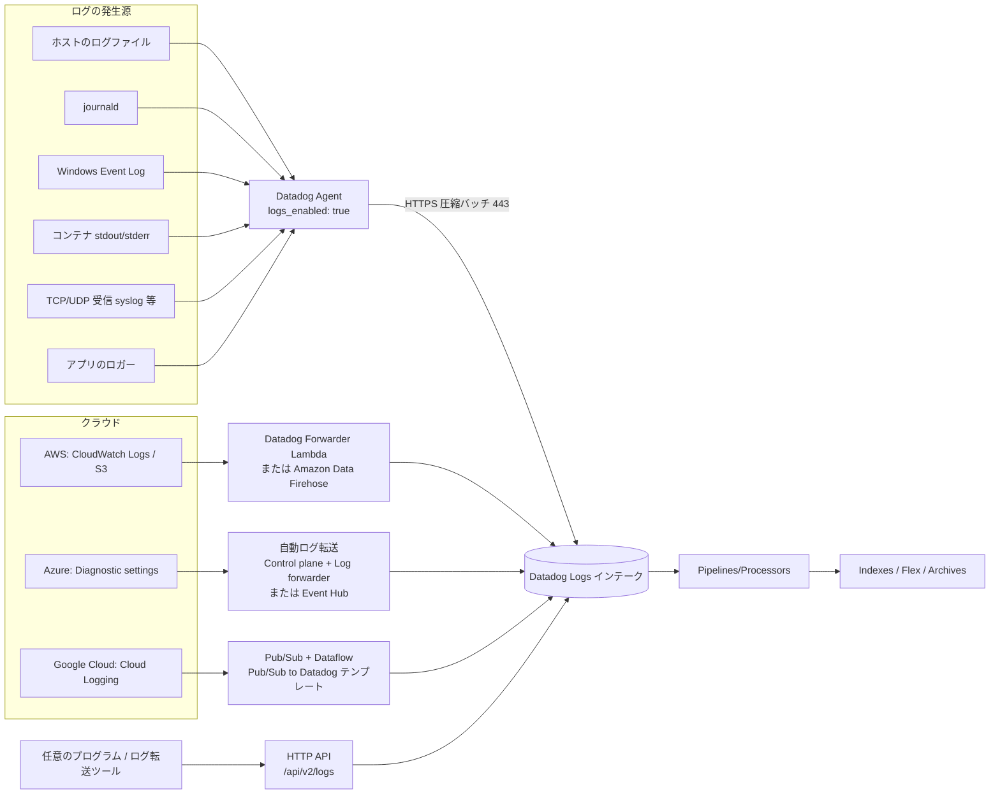
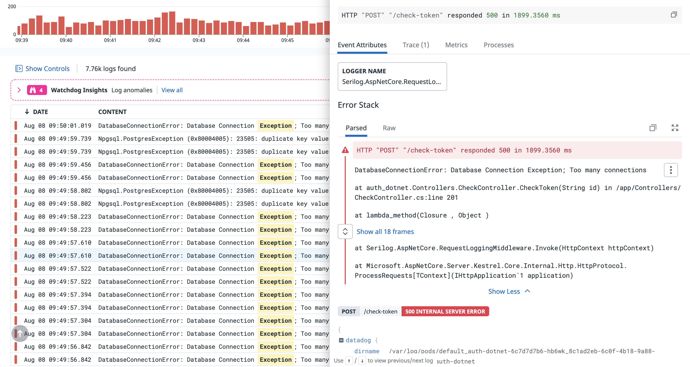
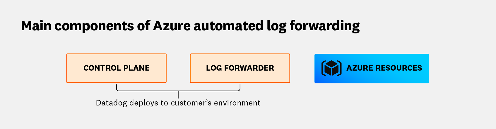
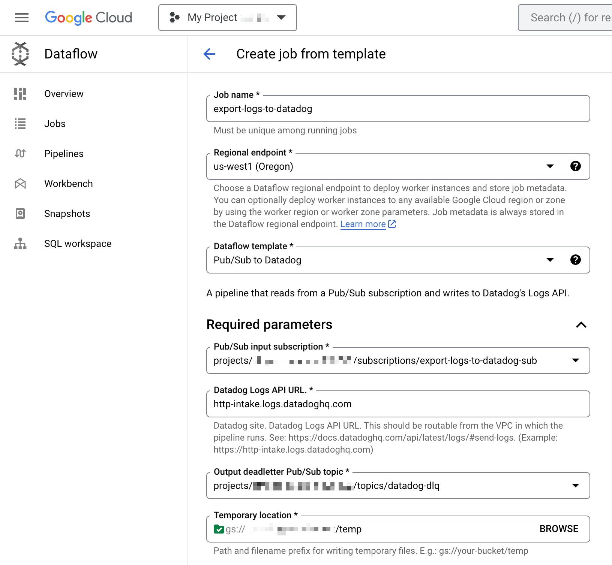

# ログ収集（Log Collection）

## 概要

Datadog Log Management（ログ管理）のログ収集（Log Collection）は、ホスト・コンテナ・アプリケーション・クラウドサービス・任意のプログラムから Datadog の Logs インテーク（取り込み口）へログを送る仕組みの総称である。本ファイルは次の問いに答える。

- どの収集方式があり、どれを選ぶべきか（Agent、クラウド転送、HTTP API など）
- Datadog Agent でファイル・journald・コンテナ・Windows Event Log・TCP/UDP からログを収集する設定キーとデフォルト値
- AWS / Azure / Google Cloud のログをどう転送するか
- HTTP API（`/api/v2/logs`）の仕様と制限値
- マルチライン（複数行）ログの集約方法（手動ルール / 自動検出）
- Agent 側でのフィルタ（除外・包含）とスクラビング（マスキング）
- ログ 1 件のサイズ、属性数、タグ数、タイムスタンプ許容範囲などの制限

取り込み後の処理（Pipelines / Processors）、保存（Indexes・保持・アーカイブ）、検索・分析は別ファイルで扱う。

| 関連トピック | ファイル |
|---|---|
| 取り込み後のパース・属性変換 | [Log Pipelines と処理](./log-pipelines-and-processing.md) |
| インデックス、除外フィルタ、保持期間、Flex Logs、アーカイブ | [Indexes・保持・アーカイブ](./log-indexes-retention-archives.md) |
| Log Explorer、ファセット、分析 | [ログ検索と分析](./log-search-and-analytics.md) |
| 送信前のログ加工・ルーティング（Datadog 外の経路） | [Observability Pipelines](./observability-pipelines.md) |
| Agent 本体・設定ファイル全般 | [Datadog Agent](../platform/agent.md)、[Agent 設定リファレンス](../platform/agent-configuration.md) |
| コンテナ/Kubernetes 向け Agent の導入 | [コンテナ/Kubernetes向けAgent](../platform/kubernetes-and-containers-agent.md) |
| クラウド連携本体 | [AWS Integration](../platform/aws-integration.md)、[Azure Integration](../platform/azure-integration.md)、[Google Cloud Integration](../platform/gcp-integration.md) |
| Lambda などサーバーレスのログ | [Serverless Monitoring](../infrastructure/serverless.md) |
| OpenTelemetry によるログ送信 | [OpenTelemetry サポート](../platform/opentelemetry.md) |
| 取り込み後の機密データ検出・マスキング | [Sensitive Data Scanner](../security/sensitive-data-scanner.md) |
| 料金の正本 | [製品別料金表](../../03_導入編/pricing-by-product.md) |
| 実務ノウハウ（設計・コスト） | [ログ管理の実践](../../04_応用編/log-management-practices.md)、[コスト最適化](../../04_応用編/cost-optimization.md) |

## 収集方式の全体像

Datadog のログ収集方式は、公式ドキュメント上で Host、Application、Container、Serverless、Cloud/Integration、Agent Check、Custom forwarding（HTTP API）に分類される。[出典](https://docs.datadoghq.com/logs/log_collection/)



| 収集方式 | 主な対象 | 方式の概要 | 本ファイルの節 |
|---|---|---|---|
| Host（Agent） | ログファイル、journald、Windows Event Log、TCP/UDP | Agent をインストールし `datadog.yaml` で `logs_enabled: true` を設定、`conf.d/<名前>.d/conf.yaml` に収集設定を書く | [Agent によるログ収集](#agent-によるログ収集) |
| Application | Java、Python、Go、Ruby、.NET、PHP、Node.js、ブラウザ/モバイル SDK 等 | 言語のロガーでファイル出力（または JSON 出力）し Agent が収集。ブラウザ/モバイルは SDK から直接送信 | [アプリケーションからの収集](#アプリケーションからの収集) |
| Container | Docker、Kubernetes、OpenShift、Amazon ECS、ECS Fargate | Agent がコンテナの stdout/stderr を収集（ロギングドライバ不要） | [コンテナからの収集](#コンテナからの収集) |
| Serverless | AWS Lambda | Datadog Forwarder（Lambda 関数）または Lambda Extension | [AWS](#aws-からの収集) |
| Cloud/Integration | AWS、Azure、Google Cloud の各サービス、各種インテグレーション | クラウド側の転送機構（Forwarder、Firehose、Dataflow 等）、またはインテグレーションの `conf.yaml` の `logs` 節を有効化 | [クラウドからの収集](#クラウドからの収集) |
| Agent Check | カスタム Agent チェック | チェックの中から `send_log` メソッドでログを送信 | [Agent Check からの送信](#agent-check-からの送信) |
| Custom forwarding | 任意のプロセス、ログ転送ツール | HTTP API（`/api/v2/logs`）へ POST | [HTTP API](#http-apiログ送信) |

[出典](https://docs.datadoghq.com/logs/log_collection/)

> **補足:** Datadog 外部で収集・加工してから Datadog やほかの宛先へ送る構成は [Observability Pipelines](./observability-pipelines.md) を、OpenTelemetry Collector / SDK 経由の送信は [OpenTelemetry サポート](../platform/opentelemetry.md) を参照。

## Agent によるログ収集

### ログ収集の有効化

Datadog Agent のログ収集は**デフォルトで無効**であり、Agent v6.0 以降で利用できる。メイン設定ファイル `datadog.yaml` で有効化する。[出典](https://docs.datadoghq.com/agent/logs/)

```yaml
# datadog.yaml
logs_enabled: true
logs_config:
  force_use_http: true          # HTTPS 固定（推奨）
  # auto_multi_line_detection: true  # Agent 7.82.0 以降はデフォルト有効
```

| 方法 | 設定 |
|---|---|
| 設定ファイル | `datadog.yaml` の `logs_enabled: true` |
| 環境変数 | `DD_LOGS_ENABLED=true` |
| Helm（Kubernetes） | `datadog.logs.enabled: true` |
| Datadog Operator | `spec.features.logCollection.enabled: true` |

設定変更後は Agent を再起動し、`datadog-agent status` の Logs Agent セクション（および Checks セクション）で収集状況を確認する。[出典](https://docs.datadoghq.com/agent/logs/)

### 設定ファイルの配置

| 対象 | 設定ファイル |
|---|---|
| ログ収集全体（グローバル設定） | `datadog.yaml` の `logs_enabled` と `logs_config` |
| カスタムログソース | `conf.d/<CUSTOM_LOG_SOURCE>.d/conf.yaml`（Agent 実行ユーザーが読み取れること） |
| journald | `conf.d/journald.d/conf.yaml` |
| Windows Event Log | `conf.d/win32_event_log.d/conf.yaml` |
| 既存インテグレーション（nginx、PostgreSQL 等） | 各インテグレーションの `conf.d/<integration>.d/conf.yaml` の `logs:` 節のコメントを外す |

Agent の設定ディレクトリの場所（Linux `/etc/datadog-agent/`、Windows `C:\ProgramData\Datadog\` など）は [Agent 設定リファレンス](../platform/agent-configuration.md) を参照。[出典](https://docs.datadoghq.com/agent/logs/)

### `logs_config`（`datadog.yaml`）の主な設定キー

以下は Agent の設定テンプレート（`datadog-agent_linux.yaml.example`、GitHub main ブランチ、2026-11-02 時点取得）と公式ドキュメントに記載された `logs_config` 配下の主要キーである。実際の既定値はインストールした Agent バージョンのテンプレートで確認すること。[出典](https://github.com/DataDog/datadog-agent/blob/main/pkg/config/example/datadog-agent_linux.yaml.example)

| キー | 環境変数 | デフォルト | 説明 |
|---|---|---|---|
| `logs_enabled`（トップレベル） | `DD_LOGS_ENABLED` | `false` | ログ収集の有効化 |
| `container_collect_all` | `DD_LOGS_CONFIG_CONTAINER_COLLECT_ALL` | `false` | 全コンテナのログを収集する |
| `use_container_timestamp` | `DD_LOGS_CONFIG_USE_CONTAINER_TIMESTAMP` | `false` | コンテナログファイルの `time` フィールド（Docker JSON ログ等）を取り込み時刻の代わりにタイムスタンプとして使う |
| `logs_dd_url` | `DD_LOGS_CONFIG_LOGS_DD_URL` | `""` | プロキシ経由で送る場合の送信先 `<ENDPOINT>:<PORT>`。Agent 7.70.0 以降はスキーム付き URL でプロキシパスを指定可能（例 `https://proxy.example.com:443/logs`） |
| `logs_no_ssl` | `DD_LOGS_CONFIG_LOGS_NO_SSL` | `false` | TLS 無効化。ローカルのプロキシへ転送する場合のみ使用 |
| `processing_rules` | `DD_LOGS_CONFIG_PROCESSING_RULES` | `[]` | 全ログに適用するグローバル処理ルール（後述） |
| `auto_multi_line_detection` | `DD_LOGS_CONFIG_AUTO_MULTI_LINE_DETECTION` | Agent 7.82.0 以降 `true`、それ未満 `false` | マルチライン自動検出（後述） |
| `force_use_http` | `DD_LOGS_CONFIG_FORCE_USE_HTTP` | `false` | HTTPS 送信を強制し TCP へフォールバックしない（推奨設定） |
| `force_use_tcp` | `DD_LOGS_CONFIG_FORCE_USE_TCP` | `false` | TCP 送信を強制。`force_use_http: true` の場合は無視される |
| `http_protocol` | `DD_LOGS_CONFIG_HTTP_PROTOCOL` | `"auto"` | HTTP のプロトコル（`auto` または `http1`） |
| `http_timeout` | `DD_LOGS_CONFIG_HTTP_TIMEOUT` | `10`（秒） | HTTP 送信のタイムアウト |
| `use_compression` | `DD_LOGS_CONFIG_USE_COMPRESSION` | `true` | HTTP 送信時に圧縮する |
| `compression_level` | `DD_LOGS_CONFIG_COMPRESSION_LEVEL` | `6` | 圧縮レベル `0`（無圧縮）〜`9`（最大） |
| `batch_wait` | `DD_LOGS_CONFIG_BATCH_WAIT` | `5`（秒） | バッチを満たすまで待つ最大秒数。1〜10 の整数 |
| `close_timeout` | `DD_LOGS_CONFIG_CLOSE_TIMEOUT` | `60`（秒） | ローテーション後のファイルを読み続ける最大秒数 |
| `open_files_limit` | `DD_LOGS_CONFIG_OPEN_FILES_LIMIT` | `500`（macOS は `200`） | 同時に tail できるファイル数の上限 |
| `file_wildcard_selection_mode` | `DD_LOGS_CONFIG_FILE_WILDCARD_SELECTION_MODE` | `"by_name"` | ワイルドカードの一致数が上限を超えたときの選択方式（`by_name` / `by_modification_time`） |
| `max_message_size_bytes` | `DD_LOGS_CONFIG_MAX_MESSAGE_SIZE_BYTES` | `900000` | 1 ログの最大バイト数。超過分は分割され `...TRUNCATED...` が付与される |
| `integrations_logs_files_max_size` | `DD_LOGS_CONFIG_INTEGRATIONS_LOGS_FILES_MAX_SIZE` | `100`（MB） | インテグレーションのログファイル 1 つあたりの最大サイズ |
| `integrations_logs_total_usage` | `DD_LOGS_CONFIG_INTEGRATIONS_LOGS_TOTAL_USAGE` | `100` | インテグレーションのログファイル合計の使用量上限 |
| `k8s_container_use_kubelet_api` | `DD_LOGS_CONFIG_K8S_CONTAINER_USE_KUBELET_API` | `false` | kubelet API 経由でコンテナログを収集（EKS Fargate 等） |
| `k8s_container_use_file` | `DD_LOGS_CONFIG_K8S_CONTAINER_USE_FILE` | 公開情報では既定値を確認できず | Kubernetes でファイル収集モードを強制（非特権実行時の Docker ランタイム等） |
| `docker_container_use_file` / `docker_container_force_use_file` | `DD_LOGS_CONFIG_DOCKER_CONTAINER_USE_FILE` / `DD_LOGS_CONFIG_DOCKER_CONTAINER_FORCE_USE_FILE` | Agent 7.33.0 以降はファイル収集がデフォルト | Docker でファイルからの収集を使う / 全コンテナに強制 |
| `enable_recursive_glob` | 公開情報では確認できず | `false` | `**` による再帰 glob を有効化（Agent 7.76.0 以降） |
| `tag_multi_line_logs` | 公開情報では確認できず | 公開情報では確認できず | 集約されたマルチラインログに `multiline` タグを付ける（デバッグ用） |
| `tag_truncated_logs` | 公開情報では確認できず | 公開情報では確認できず | 切り詰められたログに `truncated` タグを付ける（デバッグ用） |
| `use_sourcehost_tag` | 公開情報では確認できず | 公開情報では確認できず | TCP/UDP 受信ログに送信元 IP を付与する |
| `unreliable_mount.enabled` | `DD_LOGS_CONFIG_UNRELIABLE_MOUNT_ENABLED` | `false` | CIFS/SMB、Azure Files などローテーション時の挙動が不安定なマウント向けの読み取りプロファイル |

[出典](https://docs.datadoghq.com/agent/logs/advanced_log_collection/)、[出典](https://docs.datadoghq.com/agent/logs/auto_multiline_detection/)、[出典](https://docs.datadoghq.com/containers/docker/log/)、[出典](https://docs.datadoghq.com/containers/kubernetes/log/)

### カスタムログ収集の設定パラメータ（`logs:` エントリ）

カスタムログ収集は `conf.d/<CUSTOM_LOG_SOURCE>.d/conf.yaml` に `logs:` のリストとして記述する。[出典](https://docs.datadoghq.com/agent/logs/)

```yaml
# conf.d/myapp.d/conf.yaml
logs:
  - type: file
    path: /var/log/myapp/*.log
    exclude_paths:
      - /var/log/myapp/debug.log
    service: myapp
    source: python
    tags:
      - env:prod
      - team:payments
    start_position: end
    encoding: utf-16-le
    log_processing_rules:
      - type: multi_line
        name: new_log_start_with_date
        pattern: \d{4}\-(0?[1-9]|1[012])\-(0?[1-9]|[12][0-9]|3[01])
```

| パラメータ | 必須 | 説明 |
|---|---|---|
| `type` | 必須 | 入力元の種類：`file`、`tcp`、`udp`、`journald`、`windows_event`、`docker` |
| `port` | `tcp`/`udp` で必須 | 待ち受けポート |
| `path` | `file`/`journald` で必須 | 収集するファイルパス（ワイルドカード可）、journald のジャーナルパス |
| `channel_path` | `windows_event` で必須 | 収集する Windows イベントチャネル |
| `service` | 必須 | ログを出すサービス名。APM を使っている場合は APM のサービス名と一致させる |
| `source` | 必須 | ログを送るインテグレーション/技術の名前。インテグレーション名と一致させると対応する Integration Pipeline が自動適用される |
| `include_units` | 任意（journald） | 収集対象とする journald ユニット |
| `exclude_units` | 任意（journald） | 除外する journald ユニット |
| `exclude_paths` | 任意（file） | `path` にワイルドカードを使ったときに除外するファイル（Agent 6.18 以降） |
| `sourcecategory` | 任意 | ソースのカテゴリ（例：`database`、`http_web_access`） |
| `start_position` | 任意（file、journald） | 読み取り開始位置。デフォルト `end`（後述） |
| `encoding` | 任意（file） | ファイルのエンコーディング：`utf-16-le`、`utf-16-be`、`shift-jis`。それ以外は UTF-8 扱い |
| `tags` | 任意 | 収集した各ログに付与するタグ |
| `log_processing_rules` | 任意 | このソースだけに適用するフィルタ・マスク・マルチラインルール（後述） |
| `auto_multi_line_detection` | 任意 | このソースだけマルチライン自動検出を有効/無効化（グローバル設定を上書き） |

[出典](https://docs.datadoghq.com/agent/logs/)、[出典](https://docs.datadoghq.com/agent/logs/advanced_log_collection/)

> **注意:** `service` と `source` はログの検索・パース・サービス相関の基盤になる予約属性である。Unified Service Tagging（`env`、`service`、`version`）の考え方は [Tagging](../platform/tagging.md) と [タグ戦略の実践](../../04_応用編/tagging-strategy.md) を参照。

### ファイルからの収集（`type: file`）

#### ワイルドカードとディレクトリ

| 記法 | 意味 | 要件 |
|---|---|---|
| `/var/log/myapp/*.log` | 1 ディレクトリ内の一致ファイル | — |
| `/var/log/myapp/*/*.log` | 1 階層下のサブディレクトリまで | — |
| `/var/log/myapp/**/*.log` | 再帰 glob | Agent 7.76.0 以降、かつ `datadog.yaml` で `logs_config.enable_recursive_glob: true`（デフォルト無効） |

- Agent はディレクトリに対する読み取り権限と実行権限が必要である。
- `path` と `exclude_paths` は大文字・小文字を区別する。
- Windows では Agent 実行ユーザー `ddagentuser` に読み取り権限が必要である。

[出典](https://docs.datadoghq.com/agent/logs/advanced_log_collection/)、[出典](https://docs.datadoghq.com/agent/logs/)

#### 同時オープンファイル数とワイルドカード選択

| 項目 | 値 |
|---|---|
| `logs_config.open_files_limit` 既定値 | `500`（macOS は `200`） |
| `open_files_limit` が設定可能になったバージョン | 公開情報では確認できず |
| `file_wildcard_selection_mode`（`by_modification_time` での優先選択）の要件 | Agent 7.40.0 以降 |
| `file_wildcard_selection_mode: by_name`（既定） | ソースごとに一致ファイルを名前の逆辞書順に並べ、上限に達するまで選ぶ |
| `file_wildcard_selection_mode: by_modification_time` | 固定パスのソースを優先し、残りを更新日時が新しい順に上限まで選ぶ。`by_name` より性能が低くディスク I/O が増える |

[出典](https://docs.datadoghq.com/agent/logs/advanced_log_collection/)、[出典](https://github.com/DataDog/datadog-agent/blob/main/pkg/config/example/datadog-agent_linux.yaml.example)

#### 読み取り開始位置（`start_position`）

| 値 | 意味 |
|---|---|
| `end`（既定） | ファイル末尾から読む（保存済みオフセットがあればオフセット優先） |
| `beginning` | ファイル先頭から読む（保存済みオフセットがあればオフセット優先）。**ワイルドカードの `path` では使えない** |
| `forceEnd` | 保存済みオフセットを無視して末尾から |
| `forceBeginning` | 保存済みオフセットを無視して先頭から |

- file では Agent 6.19 / 7.19 以降、journald では Agent 6.38 / 7.38 以降でサポート。
- コンテナログの tail は常に `beginning` から開始する。

[出典](https://docs.datadoghq.com/agent/logs/)

#### 行末とローテーション

- 各ログ行は改行（`\n` または `\r\n`）で終わる必要がある。改行が無い最終行は Agent が待ち続け、送信されない。[出典](https://docs.datadoghq.com/agent/logs/)
- ローテーションされたファイルは `close_timeout`（既定 60 秒）まで読み続ける。[出典](https://github.com/DataDog/datadog-agent/blob/main/pkg/config/example/datadog-agent_linux.yaml.example)
- CIFS/SMB や Azure Files のようにページキャッシュ・ファイルハンドルの挙動が不安定なマウント向けに `logs_config.unreliable_mount` プロファイルがある（main ブランチのテンプレートに記載。対応 Agent バージョンは公開情報では確認できず）。[出典](https://github.com/DataDog/datadog-agent/blob/main/pkg/config/example/datadog-agent_linux.yaml.example)

#### エンコーディング（`encoding`）

| 値 | 対応 Agent |
|---|---|
| UTF-8（既定、指定不要） | — |
| `utf-16-le` | 6.23 / 7.23 以降 |
| `utf-16-be` | 6.23 / 7.23 以降 |
| `shift-jis` | 6.34 / 7.34 以降 |

- `encoding` は `type: file` のときのみ有効。未対応の値は無視され UTF-8 として読まれる。
- tail 中のファイルのエンコーディングを途中で変えると文字化けすることがある。ファイルをローテーション/置換するか、先頭から読み直す。
- 日本語環境の Windows アプリで Shift_JIS のログを出す場合は `shift-jis` を指定する。EUC-JP は公開情報では対応を確認できず。

[出典](https://docs.datadoghq.com/agent/logs/advanced_log_collection/)

### TCP / UDP での受信（`type: tcp` / `type: udp`）

Agent は指定ポートで TCP/UDP を待ち受け、syslog 等から送られたログを受信できる。

```yaml
logs:
  - type: tcp     # または udp
    port: 10518
    service: network-device
    source: syslog
```

- 対応フォーマット：生文字列、JSON、Syslog。複数ログをまとめて送る場合は改行で区切る。
- 送信元 IP をログに含めるには `datadog.yaml` に `use_sourcehost_tag: true` を追加する。
- Agent 7.31.0 以降、アイドル状態の TCP 接続は無期限に保持される。

[出典](https://docs.datadoghq.com/agent/logs/)

> **注意:** ここでの TCP/UDP は「Agent がログを**受信**する」入力であり、後述の「Agent から Datadog へ TCP で**送信**する」トランスポート（非サポート）とは別物である。

### journald からの収集（`type: journald`）

journald インテグレーションは systemd の journal からログを収集する。最低 Agent バージョンは 7.29.0。[出典](https://docs.datadoghq.com/integrations/journald/)

#### 準備

- journal ファイルは既定で `systemd-journal` グループが所有・読み取り可能。Agent ユーザーをグループに追加する：`usermod -a -G systemd-journal dd-agent`
- `datadog.yaml` で `logs_enabled: true`。
- 既定の journal の場所：`/var/log/journal` と `/run/log/journal`。別の場所は `path` で指定。

#### 設定例

```yaml
# conf.d/journald.d/conf.yaml
logs:
  - type: journald
    container_mode: true
    include_units:
      - docker.service
      - sshd.service
    exclude_matches:
      - _TRANSPORT=kernel
```

| キー | 説明 | 要件 |
|---|---|---|
| `path` | journal の場所（既定以外のとき） | — |
| `include_units` / `exclude_units` | システムユニットの包含・除外。`exclude_units` では `*` ワイルドカード可（`include_units` では不可） | — |
| `include_user_units` / `exclude_user_units` | ユーザーユニットの包含・除外 | Agent 7.37.0 以降 |
| `include_matches` / `exclude_matches` | `key=value` 形式（例 `_TRANSPORT=kernel`）で journal フィールドを条件に包含・除外 | Agent 7.39.0 以降 |
| `config_id` | 複数の journald 設定を区別する ID。ユニットごとに `source`/`service` を変えたい場合は別々の journald 設定に分け、`config_id` で一意にする | Agent 7.41.0 以降 |
| `container_mode` | `true` のとき、コンテナ由来ログの `source` を `docker` ではなくコンテナの短いイメージ名にする | Agent 7.17 以降 |
| `start_position` | 読み取り開始位置 | Agent 6.38 / 7.38 以降 |

- ユニット指定もマッチ指定もない場合は全 journal ログを収集する。
- `service` を明示しない場合、Agent は `SYSLOG_IDENTIFIER`、`_SYSTEMD_UNIT`、`_COMM` の順で最初に空でない値を用いる。systemd ユニットファイルで `SyslogIdentifier` を設定することが推奨されている。
- コンテナ化した Agent で journald を読む場合は、journal のパスと `/etc/machine-id` をマウントする。

[出典](https://docs.datadoghq.com/integrations/journald/)

### Windows Event Log からの収集（`type: windows_event`）

Windows Event Log インテグレーション（`win32_event_log`）は、Windows イベントを **Datadog Logs** として収集する方法と **Datadog Events** として収集する方法の 2 通りを持つ。ログとして収集するには `logs:` 節で `type: windows_event` を使い、`datadog.yaml` で `logs_enabled: true` にする。[出典](https://docs.datadoghq.com/integrations/win32_event_log/)

```yaml
# conf.d/win32_event_log.d/conf.yaml
logs:
  - type: windows_event
    channel_path: Security
    source: windows.events
    service: myservice
    query: "*[System[(EventID=4624 or EventID=4625)]]"
  - type: windows_event
    channel_path: System
    source: windows.events
    service: myservice
    log_processing_rules:
      - type: include_at_match
        name: include_errors
        pattern: '"level":"(Error|Critical)"'
```

| キー | 説明 |
|---|---|
| `channel_path` | チャネル名（例：`Security`、`System`、`Application`、`Microsoft-Windows-Sysmon/Operational`） |
| `source` | `windows.events` にすると Windows イベント用の自動処理パイプラインが適用される |
| `service` | サービス名タグ |
| `query` | XPath または構造化 XML のフィルタ。`log_processing_rules` より前に適用される |
| `log_processing_rules` | `include_at_match` / `exclude_at_match` による正規表現フィルタ |

- **チャネルの確認方法**：PowerShell で `Get-WinEvent -ListLog *`、件数が多い順は `Get-WinEvent -ListLog * | sort RecordCount -Descending`。イベントビューアーでは Event Log Properties の `Full Name` を使う。
- **フィルタは `query` 推奨**：除外したイベントを Agent が処理しなくて済むため、`log_processing_rules` より `query` が推奨されている。XPath / XML クエリには式の数の上限がある（具体値は公開情報では確認できず、Microsoft の仕様に依存）。
- **EventID の正規化**：Agent 7.41 以降は EventID が正規化され、`'"EventID":"(101|201|301)"'` のようなパターンがそのまま使える。それ以前の Agent で Qualifiers を持つイベントは `(?:{"value":)?` を考慮したパターンが必要。
- **Security チャネル**：Agent ユーザーを `Event Log Readers` グループに追加する。
- **既定のセキュリティログプロファイル（Agent 7.54 以降）**：`instances:` 側で `dd_security_events` を `low`（例：監査ログ消去 1102、監査ポリシー変更 4719 などの重要イベント）または `high`（例：ドメインポリシー変更 4739 などを含むより多いイベント）に設定し、`init_config` で `legacy_mode: false` とする。プロファイルは編集可能。
- **Events として収集する場合**：`instances:` に `path`、`legacy_mode`、`filters`（`source`、`type`、`id`）、`query` を指定する。`legacy_mode: true` は WMI ベースの旧方式で Agent 7.20 で非推奨。`init_config` での `legacy_mode` 指定は Agent 7.49 以降。

[出典](https://docs.datadoghq.com/integrations/win32_event_log/)

> **補足:** Windows イベントを Cloud SIEM で分析する場合はログとして収集する必要がある。SIEM 側の検知ルールは [Cloud SIEM](../security/cloud-siem.md) を参照。

## コンテナからの収集

コンテナ環境では、Agent がコンテナの stdout/stderr を収集する。ロギングドライバの変更は不要である。Agent 自体のコンテナ導入方法は [コンテナ/Kubernetes向けAgent](../platform/kubernetes-and-containers-agent.md) を参照。[出典](https://docs.datadoghq.com/logs/log_collection/)

### Docker

Linux ホストで Docker の Agent コンテナを起動するときのログ関連の指定：

| 指定 | 役割 |
|---|---|
| `-e DD_LOGS_ENABLED=true` | ログ収集を有効化 |
| `-e DD_LOGS_CONFIG_CONTAINER_COLLECT_ALL=true` | 全コンテナのログを収集 |
| `-v /var/run/docker.sock:/var/run/docker.sock:ro` | Docker デーモンに接続しコンテナを検出、stdout/stderr を取得 |
| `-v /var/lib/docker/containers:/var/lib/docker/containers:ro` | コンテナログをファイルから収集（Agent 6.27.0 / 7.27.0 以降） |
| `-v /opt/datadog-agent/run:/opt/datadog-agent/run:rw` | コンテナごとの最終読み取り位置をホストに保存（再起動時の重複・欠損防止） |
| `-e DD_CONTAINER_EXCLUDE="name:datadog-agent"` | Agent 自身のログ・メトリクスを除外（正規表現可） |

- **ファイル収集とソケット収集**：ファイル収集の方が性能が高い。Agent 6.33.0 / 7.33.0 以降はファイル収集が既定（`/var/lib/docker/containers` のマウントが必要）。`DD_LOGS_CONFIG_DOCKER_CONTAINER_FORCE_USE_FILE=true` で全コンテナを強制的にファイル収集にできるが、既存コンテナでログが重複する可能性がある。ソケット収集へ戻す場合も重複の可能性がある。
- **ラベルでの設定**：コンテナに `com.datadoghq.ad.logs` ラベル（Dockerfile の `LABEL`、Compose の `labels`、`docker run -l`）を付ける。例：`'[{"source": "nginx", "service": "webapp"}]'`。Agent 6.8 以降、`source` と `service` の既定値はイメージの短い名前。
- **ファイル型のラベル**：`"type":"file"` と `"path"` を指定するとコンテナ内のファイルを収集できる（パスは Agent から見たパスなのでボリューム共有が必要）。この場合 stdout/stderr は自動収集されないため、併せて `"type": "docker"` のエントリを加える。
- **短命コンテナ**：Agent 6.14 以降は稼働中・停止済みコンテナの両方から収集するため、削除されない限り短命コンテナのログも取得できる。Autodiscovery のラベル更新は約 1 秒ごと。
- **ステータス**：`Stderr` からのログの既定ステータスは `Error`。
- **Windows**：`\\.\pipe\docker_engine` と `c:\programdata\docker\containers` をマウント。Windows 10 では `net localgroup docker-users "ddagentuser" /ADD`。
- **macOS**：Docker Desktop のファイル共有に `/opt/datadog-agent/run` を追加し、例では `DD_LOGS_CONFIG_DOCKER_CONTAINER_USE_FILE=true` を指定。
- ロギングドライバは既定の `json-file` を前提とし、`journald` ドライバの場合は journald インテグレーションで収集する。

[出典](https://docs.datadoghq.com/containers/docker/log/)

### Kubernetes

| 方法 | 設定 |
|---|---|
| Datadog Operator | `spec.features.logCollection.enabled: true`、`spec.features.logCollection.containerCollectAll: true` |
| Helm | `datadog.logs.enabled: true`、`datadog.logs.containerCollectAll: true` |

- `containerCollectAll` の既定は `false`。`false` の場合は Autodiscovery のログ設定（アノテーション等）を書いたコンテナだけが収集される。
- Kubernetes はコンテナの stdout/stderr を `/var/log/pods` にファイルとして保存し、Agent はこれを読む（Datadog 推奨の方式）。Docker ランタイムではこれらが `/var/lib/docker/containers` へのシンボリックリンクで、root でないと辿れない。
- **非特権実行**：Operator は `override.nodeAgent.securityContext`、Helm は `datadog.securityContext` で `runAsUser` と `supplementalGroups` を設定。Docker ランタイムでは `DD_LOGS_CONFIG_K8S_CONTAINER_USE_FILE=true`（`logs_config.k8s_container_use_file`）でファイル収集モードを強制する。
- **フィルタ**：`DD_CONTAINER_EXCLUDE_LOGS` 環境変数や `ad.datadoghq.com/logs_exclude` アノテーションで除外。除外指定は明示的なログ設定より優先される。
- **タグ付け**：Collect All 有効時、`source`・`service`・`short_image` の既定値はコンテナの短いイメージ名（`gcr.io/owner/example-image:latest` → `example-image`）。Pod ラベル `tags.datadoghq.com/service` があれば Unified Service Tagging の `service` が使われる。

#### Autodiscovery アノテーション

```yaml
metadata:
  annotations:
    ad.datadoghq.com/app.logs: '[{"source":"java","service":"example-app","tags":["foo:bar"],"log_processing_rules":[{"type":"multi_line","name":"log_start_with_date","pattern":"\\d{4}-(0?[1-9]|1[012])-(0?[1-9]|[12][0-9]|3[01])"}]}]'
```

- 形式：`ad.datadoghq.com/<CONTAINER_NAME>.logs`（イメージ名ではなく**コンテナ名**に一致させる）。
- Pod 直接定義なら `metadata` に、Deployment 等なら `.spec.template.metadata` に置く。
- アノテーション内の正規表現はバックスラッシュをエスケープする（`\d` → `\\d`）。値は有効な JSON（末尾カンマ・コメント不可）でなければならない。
- そのほか `DatadogInstrumentation` CRD、Autodiscovery 設定ファイル（Operator `override.nodeAgent.extraConfd.configDataMap`、Helm `datadog.confd`、`ad_identifiers` は短いイメージ名）、キーバリューストア（Consul、etcd、Zookeeper の `/datadog/check_configs`）でも設定できる。

#### コンテナ内ファイルの収集

- アノテーションで `"type": "file"` と `"path"` を指定する。パスは Agent コンテナから見たパスなので、アプリと Agent の両方に `hostPath` 等で同じディレクトリをマウントする。
- レプリカ間の衝突を避けるため `%%kube_pod_name%%` をパスに含めることが推奨される（Downward API でアプリに Pod 名を渡す）。
- ファイル型を指定すると stdout/stderr は自動収集されないため、`{"source":"container","service":"example-service"}` を配列に追加する。
- ファイル収集ログには既定の `source` / `service` が無いので明示する。

[出典](https://docs.datadoghq.com/containers/kubernetes/log/)

> **補足:** Amazon ECS、ECS Fargate、Red Hat OpenShift の手順は公式ドキュメントの各ページを参照する。EKS Fargate など kubelet API 経由の収集は `logs_config.k8s_container_use_kubelet_api` を使う（[出典](https://github.com/DataDog/datadog-agent/blob/main/pkg/config/example/datadog-agent_linux.yaml.example)）。Kubernetes 監視全体の設計は [Kubernetes 監視の実践](../../04_応用編/kubernetes-monitoring-practices.md) を参照。

## アプリケーションからの収集

Datadog は言語ごとのロガー設定ガイドを公開している（Java、Python、Go、Ruby、.NET、PHP、Node.js、JavaScript（Browser）、React Native、Android、iOS、Flutter、Roku、Kotlin Multiplatform）。サーバー側アプリケーションでは、ロガーで **JSON 形式**のログをファイルまたは stdout に出し、Agent に収集させる構成が基本である。[出典](https://docs.datadoghq.com/logs/log_collection/)

- JSON で出力すると、後述の予約属性（`timestamp`、`level`、`message` 等）が前処理で自動的に解釈され、パース用の Grok ルールが不要になる。
- APM トレースとの相関（`dd.trace_id`、`dd.span_id` の注入）は [APM インスツルメンテーション](../apm/apm-instrumentation.md) を参照。
- ブラウザ/モバイル SDK は Agent を介さず HTTPS で直接送信する（ブラウザの送信先は `logs.` プレフィックスのエンドポイント）。RUM 側は [RUM（ブラウザ）](../dem/rum-browser.md)、[RUM（モバイル）](../dem/rum-mobile.md) を参照。

### スタックトレース用の属性

Log Explorer はスタックトレースを専用 UI で表示する。そのために次の属性名を使う。[出典](https://docs.datadoghq.com/logs/log_collection/)

| 属性 | 内容 |
|---|---|
| `logger.name` | ロガー名 |
| `logger.thread_name` | 現在のスレッド名 |
| `error.stack` | スタックトレース本体 |
| `error.message` | スタックトレースに含まれるエラーメッセージ |
| `error.kind` | エラーの種類（例：`Exception`、`OSError`） |

Integration Pipeline は既定で、一般的なロギングライブラリのパラメータをこれらの属性へリマップし、スタックトレースから `error.message` と `error.kind` を抽出しようとする。



- **キャプション:** Log Explorer でエラーログを開いたときの、スタックトレース属性の表示例。
- **画面説明:** 左側はログ件数の時系列バー（赤色）とログ一覧（DATE / CONTENT 列。`DatabaseConnectionError` などのエラー行）。上部に Watchdog Insights（Log anomalies）のバナーがある。右側はログ詳細パネルで、タブ「Event Attributes」「Trace」「Metrics」「Processes」が並ぶ。Event Attributes には「LOGGER NAME」（`logger.name`、例 `Serilog.AspNetCore.RequestLo...`）が表示され、その下の「Error Stack」に「Parsed」「Raw」の切り替えがある。Parsed ではエラーメッセージ行の下にスタックフレームが並び、「Show all 18 frames」で全フレームを展開できる。最下部に HTTP メソッド・パス・ステータス（例 `POST /check-token 500 INTERNAL SERVER ERROR`）と JSON 属性ツリーが表示される。
- **出典:** https://docs.datadoghq.com/logs/log_collection/ （画像 https://docs.dd-static.net/images/logs/log_collection/stack_trace.6d73ceca149a8c347b307d31f696cd47.png 、2026-11-02 時点取得）

### Agent Check からの送信

カスタム Agent インテグレーション（Agent Check）を開発する場合、チェック内から `send_log` メソッドでログを送信できる。メトリクス・イベント・サービスチェックと同じチェックからログを出せる。[出典](https://docs.datadoghq.com/logs/log_collection/)

## クラウドからの収集

クラウドサービスのログは Agent をインストールできないマネージドサービスから出るため、クラウド側の転送機構で Datadog へ送る。クラウドインテグレーション自体（IAM ロール、メトリクス収集）は [AWS Integration](../platform/aws-integration.md)、[Azure Integration](../platform/azure-integration.md)、[Google Cloud Integration](../platform/gcp-integration.md) を参照。

| クラウド | 方式 | 推奨・位置づけ |
|---|---|---|
| AWS | Datadog Forwarder（Lambda 関数）＋ CloudWatch Logs サブスクリプションフィルタ / S3 イベント通知 | CloudFormation での導入が推奨。トリガーは自動（Datadog 管理）または手動 |
| AWS | Amazon Data Firehose（旧称：Kinesis Data Firehose）の Datadog 宛先 | CloudWatch Logs をサブスクリプションフィルタで Firehose に流す |
| AWS Lambda の関数ログ | Datadog Lambda Extension | Lambda 監視には Forwarder より Extension が推奨（[Serverless Monitoring](../infrastructure/serverless.md)） |
| Azure | 自動ログ転送（Automated Log Forwarding：ARM テンプレート / Configure Log Forwarding フロー） | Event Hub ではなくストレージアカウントを使うためコストを抑えられる |
| Azure | Event Hub 経由（手動） | 任意の Datadog サイトで利用可能 |
| Azure | Azure Native Integration（Azure ポータルの Datadog リソース） | US3 サイト向け |
| Google Cloud | Cloud Logging シンク → Pub/Sub → Dataflow（Pub/Sub to Datadog テンプレート） | Pull サブスクリプション＋ Dataflow が推奨。Push サブスクリプションは非推奨化中 |

### AWS からの収集

#### Datadog Forwarder（Lambda）

Datadog Forwarder は AWS Lambda 関数で、CloudWatch Logs と S3 のログ、SNS・Kinesis イベント経由のログを Datadog に転送する（Kinesis データストリームのイベントは CloudWatch Logs 形式のみ対応）。[出典](https://docs.datadoghq.com/logs/guide/forwarder/)

| 項目 | 内容 |
|---|---|
| 導入方法 | CloudFormation（推奨）、Terraform、手動、マルチリージョン/マルチアカウントは StackSets |
| リージョン | ログのあるリージョンごとに Forwarder を作成する |
| ランタイム | 4.13.0 以降は Python 3.13、5.2.0 以降は Python 3.14 が必要 |
| アーキテクチャ | 4.1.0 以降は ARM64 のみ（x86_64 非対応） |
| トリガー（自動） | AWS インテグレーション画面の Log Collection タブで Datadog がトリガーを管理。アカウント/リージョンを跨ぐトリガーは作れない |
| トリガー（手動） | CloudWatch ロググループのサブスクリプションフィルタ、S3 イベント通知（EventBridge も可）を自分で設定 |
| サブスクリプションフィルタ名 | `DD_LOG_SUBSCRIPTION_FILTER_<LOG_GROUP_NAME>` |
| プライベート接続 | AWS PrivateLink を利用可能 |

[出典](https://docs.datadoghq.com/logs/guide/forwarder/)、[出典](https://docs.datadoghq.com/logs/guide/send-aws-services-logs-with-the-datadog-lambda-function/)

主な CloudFormation パラメータ：

| パラメータ | 説明 |
|---|---|
| `DdApiKey` / `DdApiKeySecretArn` / `DdApiKeySsmParameterName` | API キー（Secrets Manager 等で保管） |
| `DdSite` | 送信先 Datadog サイト |
| `DdTags` | 付与するタグ（カンマ区切り、例 `env:prod,stack:classic`） |
| `DdFetchLambdaTags` | GetResources で Lambda のタグを取得（`tag:GetResources` 権限を追加） |
| `DdForwardLog` | `false` でログ転送を止める（Lambda のメトリクス・トレースは継続） |
| `ExcludeAtMatch` / `IncludeAtMatch` | ログメッセージに対する正規表現フィルタ。両方に一致したログは除外 |
| `RedactIp` / `RedactEmail` | IP を `xxx.xxx.xxx.xxx`、メールを `xxxxx@xxxxx.com` にマスク |
| `DdScrubbingRule` / `DdScrubbingRuleReplacement` | 任意の正規表現でマスク（既定の置換文字列 `xxxxx`） |
| `DdMultilineLogRegexPattern` | S3 上のマルチラインログの新しい行の開始を検出する正規表現 |
| `DdUseCompression` / `DdCompressionLevel` | 圧縮の有無とレベル 0〜9（既定 6）。HTTP 送信時のみ有効 |
| `DdEnrichS3Tags` / `DdEnrichCloudwatchTags` | バックエンド側でのタグ付与（既定で有効、Resource Collection が必要） |
| `DdStoreFailedEvents` / `DdScheduleRetryFailedEvents` | 失敗イベントを S3 に保存し定期再送 |
| `ReservedConcurrency` | 予約同時実行数。既定 0、推奨 10 以上 |

- 5.0.0 は破壊的変更を含む：フィルタはログメッセージのみに適用、`DD_USE_TCP` と `DD_USE_PRIVATE_LINK` を削除、バックエンドのタグ付与を既定で有効化。
- 4.0.0 で `source`・`service`・`host` の決定ロジックが Datadog バックエンドへ移動。
- `DdFetchLogGroupTags`、`DdFetchS3Tags` は非推奨（上記 Enrich 系へ移行）。
- タイムスタンプが 18 時間より古いイベントは破棄される。
- S3 のファイルは 1 行が 1 イベント。JSON 配列は 1 イベント扱いになるため、改行区切り JSON（NDJSON）が推奨。
- `.*` のような非効率な正規表現は Forwarder を遅くする。
- CloudFormation が作成する IAM ポリシーには全リソースへの `KMS:Decrypt` が含まれ、AWS Security Hub のベストプラクティスに合わないため、インストール完了後に削除してよいとされている。

[出典](https://docs.datadoghq.com/logs/guide/forwarder/)、[出典](https://docs.datadoghq.com/logs/guide/send-aws-services-logs-with-the-datadog-lambda-function/)

#### 自動サブスクリプション対応サービス

Forwarder の自動トリガーに対応する AWS サービス（公式ガイド記載、2026-11-02 時点取得）：

| 対応状況 | サービス |
|---|---|
| 対応 | API Gateway、AppSync、Batch、Bedrock Agentcore、CloudFront、CloudTrail、CodeBuild、DMS、DocumentDB、ECS、EKS、Elastic Beanstalk、Elastic Load Balancing（ELB）、Glue、Lambda、Lambda@Edge、Lambda MicroVMs、MWAA、Network Firewall、RDS、Redshift、Redshift Serverless、Route 53、S3、SSM、Step Functions、Verified Access、VPC、VPN（CloudWatch ロググループのみ）、Web Application Firewall |
| 一部対応 | IoT（アカウントレベルのみ）、PCS（CloudWatch ロググループのみ） |
| 非対応 | Bedrock、FSx、OpenSearch、Transit Gateway |
| 別経路 | DynamoDB（CloudTrail 経由）、EC2（Datadog Agent）、SNS |

- 自動トリガーには AWS インテグレーション用 IAM ロールに `logs:PutSubscriptionFilter`、`logs:DeleteSubscriptionFilter`、`s3:PutBucketNotification`、`lambda:InvokeFunction`、`lambda:GetPolicy` と各サービスの `List*`/`Describe*`/`Get*` 権限が必要。
- ログソースのタグフィルタに使うリソースタグは自動で小文字化されるため、フィルタは小文字で定義する。

[出典](https://docs.datadoghq.com/logs/guide/send-aws-services-logs-with-the-datadog-lambda-function/)

#### Amazon Data Firehose

CloudWatch Logs のサブスクリプションフィルタで Amazon Data Firehose に流し、Firehose の宛先に「Datadog logs」HTTP エンドポイントを指定する方式。[出典](https://docs.datadoghq.com/logs/guide/send-aws-services-logs-with-the-datadog-kinesis-firehose-destination/)

| 項目 | 内容 |
|---|---|
| 宛先 URL | Firehose の宛先設定で自分の Datadog サイトに対応する「Datadog logs」HTTP エンドポイント URL を選択（URL の一覧は同ガイドの記載なし） |
| バッファサイズ | 2 MiB 推奨（単一行ログの場合） |
| インテーク上限 | 1 バッチあたり 65,536 イベント。ガイドには「単一の Kinesis ペイロードは 65,000 ログメッセージを超えてはならず、超過分は破棄される」とも記載 |
| リトライ | Retry duration を設定可能（既定値・推奨値の記載なし） |
| バックアップ | 失敗イベントを S3 バックアップバケットに保存可能。そこから Datadog へ送るには Forwarder を使う |
| パラメータ | Firehose の Parameters に設定した値はログのタグとして付与される |
| CloudWatch Logs の制約 | 1 つのロググループに設定できるサブスクリプションは 2 つまで。宛先はロググループと同じアカウントであること |
| IAM | `logs.amazonaws.com`（または `logs.<region>.amazonaws.com`）を信頼する IAM ロールに `firehose:PutRecord`、`firehose:PutRecordBatch`、`kinesis:PutRecord`、`kinesis:PutRecords` を付与 |

[出典](https://docs.datadoghq.com/logs/guide/send-aws-services-logs-with-the-datadog-kinesis-firehose-destination/)

> **補足:** Forwarder と Firehose の公式な比較表は公開情報では確認できず。一般に、Firehose は Lambda の運用（同時実行数、タイムアウト、ランタイム更新）が不要な一方、S3 に置かれたログ（ELB、CloudFront のアクセスログ等）は Forwarder が必要になる【経験則】。

### Azure からの収集

#### 自動ログ転送（Automated Log Forwarding）

Azure の自動ログ転送は、ARM テンプレート（または Datadog 画面の Configure Log Forwarding フロー）で、Datadog が設計した転送基盤を顧客の Azure サブスクリプションにデプロイする方式である。[出典](https://docs.datadoghq.com/logs/guide/azure-automated-log-forwarding/)



- **キャプション:** Azure 自動ログ転送の主要コンポーネント（Main components of Azure automated log forwarding）。
- **画面説明:** 左から「CONTROL PLANE」「LOG FORWARDER」の 2 つのボックスが並び、両者の下に「Datadog deploys to customer's environment（Datadog が顧客環境にデプロイする）」という括弧書きがある。右側に監視対象の「AZURE RESOURCES」が配置されている。
- **出典:** https://docs.datadoghq.com/logs/guide/azure-automated-log-forwarding/ （画像 https://docs.dd-static.net/images/logs/guide/azure_automated_logs_architecture/high_level_architecture_06-13-2025.37a95339be3a7e4ff56898ff94445c59.png 、2026-11-02 時点取得）

| コンポーネント | 内容 |
|---|---|
| Control plane | 選択したサブスクリプション・リージョンにデプロイされる Function App 群とキャッシュ用ストレージアカウント。リソースの検出、Diagnostic settings の設定、フォワーダーのスケールを担う |
| Log forwarder | Azure Container Apps ジョブとログ用ストレージアカウント。リソースが存在するサブスクリプション×リージョンごとにデプロイされ、ログ量に応じてスケール |
| 作成されるもの | 検出したリソースの Diagnostic settings、フォワーダー用リソースグループ、ロール割り当て（Monitoring Contributor：サブスクリプション、Contributor：フォワーダー RG、Website Contributor：Control plane RG） |

| 制約・特性 | 内容 |
|---|---|
| 前提権限 | 管理グループに対する権限 |
| 手動方式を選ぶ場合 | リソースに独自タグを付けたい場合 |
| Log Analytics Workspace（LAW） | 1 ワークスペースあたりデータエクスポートルール 10 個まで。フォワーダーと同じリージョンのリソースのみ。一部テーブルはエクスポート不可 |
| Diagnostic settings | 同一リージョンのストレージアカウントにのみ出力可能 |
| 遅延 | LAW のログは通常 2〜5 分で到着、初回は最大 20 分 |
| 対応クラウド | Azure 商用（パブリック）クラウドのみ。Azure Government、Azure China は非対応 |

> **サイト差異:** Azure 自動ログ転送は `app.ddog-gov.com`（US1-FED）と `us2.ddog-gov.com` では利用できない。[出典](https://docs.datadoghq.com/logs/guide/azure-automated-log-forwarding/)

#### Event Hub 経由（手動）

Azure ポータルまたは Terraform で Event Hub と転送用リソースを作成し、各ログソースの Diagnostic settings で Event Hub に送る方式。任意の Datadog サイトで利用できる。リソースは同一リージョンの Event Hub にしかストリームできない。[出典](https://docs.datadoghq.com/logs/guide/azure-event-hub-log-forwarding/)

#### Azure Native Integration

Azure ポータルの Datadog リソース（Datadog Monitor resource）から Azure のメトリクスとプラットフォームログの収集を設定する方式。前提は Datadog アカウントが **US3 サイト**にあること、Azure サブスクリプションの Owner と Datadog 組織の Admin であること。[出典](https://docs.datadoghq.com/logs/guide/azure-native-logging-guide/)

> **サイト差異:** Azure Native Integration は US3 サイト向け。`us2.ddog-gov.com` では組織によって利用可否が異なり、例外申請が必要。[出典](https://docs.datadoghq.com/logs/guide/azure-native-logging-guide/)

### Google Cloud からの収集

Google Cloud のログは、Cloud Logging のログシンク → Pub/Sub トピック → Dataflow ジョブ（Google 提供の「Pub/Sub to Datadog」テンプレート）→ Datadog Logs API の経路で転送する。[出典](https://docs.datadoghq.com/logs/guide/google-cloud-log-forwarding/)

| 設定方法 | 内容 |
|---|---|
| Quick Start（推奨） | Datadog 画面で生成されるセットアップスクリプトでリソースを作成。初回構築や CI/CD での自動化向け |
| Terraform | UI ベースのフロー、または `terraform-gcp-datadog-integration` モジュール |
| 手動 | Google Cloud コンソールで各コンポーネントを作成 |
| Pub/Sub Push サブスクリプション（レガシー） | 非推奨化の途中。Pull サブスクリプション＋ Dataflow を推奨 |

手動構築の手順：

1. Pub/Sub トピック（例 `export-logs-to-datadog`）と既定サブスクリプション、デッドレタートピックとそのサブスクリプションを作成する。
2. Dataflow ワーカー用のカスタムサービスアカウントを作成する（本番環境では Compute Engine 既定サービスアカウントではなくカスタムを推奨）。
3. Cloud Logging のログシンクを作成し、Pub/Sub トピックへルーティングする（包含・除外フィルタ可）。
4. 「Pub/Sub to Datadog」テンプレートで Dataflow ジョブを作成・実行する。



- **キャプション:** Google Cloud Dataflow の「Create job from template」画面（Pub/Sub to Datadog テンプレート）。
- **画面説明:** 左メニューは Dataflow（Overview、Jobs、Pipelines、Workbench、Snapshots、SQL workspace）。右側フォームに「Job name」（例 `export-logs-to-datadog`）、「Regional endpoint」（例 `us-west1 (Oregon)`）、「Dataflow template」で `Pub/Sub to Datadog` を選択し、「A pipeline that reads from a Pub/Sub subscription and writes to Datadog's Logs API.」という説明が表示される。「Required parameters」に「Pub/Sub input subscription」（`projects/.../subscriptions/export-logs-to-datadog-sub`）、「Datadog Logs API URL」（例 `http-intake.logs.datadoghq.com`。VPC からルーティング可能である必要がある旨の説明付き）、「Output deadletter Pub/Sub topic」（`projects/.../topics/datadog-dlq`）、「Temporary location」（`gs://.../temp`）が並ぶ。
- **出典:** https://docs.datadoghq.com/logs/guide/google-cloud-log-forwarding/ （画像 https://docs.dd-static.net/images/integrations/google_cloud_platform/dataflow_parameters.c071c6b343c8ce7492e120cd402a41c6.png 、2026-11-02 時点取得）

| Dataflow テンプレートのパラメータ | 内容 |
|---|---|
| Pub/Sub input subscription | 入力サブスクリプション |
| Datadog Logs API URL | `https://<YOUR_HTTP_ENDPOINT>`（自分のサイトの HTTP インテーク。AP1 なら `https://http-intake.logs.ap1.datadoghq.com`） |
| Output deadletter Pub/Sub topic | Datadog API に拒否されたメッセージの送り先 |
| Temporary location | Cloud Storage の一時パス |
| Include full Pub/Sub message in the payload | 任意。Pub/Sub メッセージ全体をペイロードに含める |
| Google Cloud Secret Manager ID | API キーを格納したシークレットのリソース名（推奨） |
| `apiKeySource` | `KMS`（`apiKeyKMSEncryptionKey` と暗号化済み `apiKey`）、`PLAINTEXT`（非推奨） |
| ジョブ設定 | ワーカー数・最大ワーカー数、最大並列リクエスト数、バッチサイズ、Streaming Engine、マシンタイプ（具体的な既定値・上限は同ガイドに記載なし） |

| 必要な IAM ロール | ロール |
|---|---|
| セットアップ実行ユーザー（Google Cloud） | `roles/pubsub.admin`、`roles/storage.admin`、`roles/secretmanager.admin`、`roles/resourcemanager.projectIamAdmin`、`roles/logging.configWriter`、`roles/serviceusage.serviceUsageAdmin`、`roles/dataflow.developer` |
| セットアップ実行ユーザー（Datadog） | Datadog Admin ロール、または `api_keys_read` と `api_keys_write` を持つカスタムロール |
| Dataflow ワーカーのサービスアカウント | `roles/dataflow.admin`、`roles/dataflow.worker`、`roles/pubsub.viewer`、`roles/pubsub.subscriber`、`roles/pubsub.publisher`、`roles/secretmanager.secretAccessor`、`roles/storage.objectAdmin` |

- デッドレターに入ったメッセージは内容を確認・修正後、Pub/Sub to Pub/Sub テンプレートのジョブで元トピックへ再送する。
- 手動作成の Pull サブスクリプションではデッドレター設定のチェックを外す。
- ログ量が Pub/Sub のクォータを超える場合は複数トピックに分割する。
- シンクのフィルタで量を削減できる（例：`severity="ERROR" AND sample(insertId, 0.1)` で ERROR ログの 10% のみ送る）。
- 監視推奨メトリクス：`gcp.pubsub.subscription.num_undelivered_messages`、`gcp.pubsub.subscription.oldest_unacked_message_age`。Dataflow インテグレーションの推奨モニターでバックログ増加を検知する。
- Dataflow・Pub/Sub の費用は Google Cloud 側で発生する（Google Cloud Pricing Calculator で見積もる）。

[出典](https://docs.datadoghq.com/logs/guide/google-cloud-log-forwarding/)

## HTTP API（ログ送信）

任意のプロセスやロギングライブラリは、HTTP API でログを Datadog に送れる。Agent を使わない独自転送（Custom forwarding）の標準手段である。[出典](https://docs.datadoghq.com/api/latest/logs/)

### エンドポイント（`POST /api/v2/logs`）

| Datadog サイト | 送信エンドポイント |
|---|---|
| US1（app.datadoghq.com） | `https://http-intake.logs.datadoghq.com/api/v2/logs` |
| US3（us3.datadoghq.com） | `https://http-intake.logs.us3.datadoghq.com/api/v2/logs` |
| US5（us5.datadoghq.com） | `https://http-intake.logs.us5.datadoghq.com/api/v2/logs` |
| EU1（app.datadoghq.eu） | `https://http-intake.logs.datadoghq.eu/api/v2/logs` |
| AP1（ap1.datadoghq.com） | `https://http-intake.logs.ap1.datadoghq.com/api/v2/logs` |
| AP2（ap2.datadoghq.com） | `https://http-intake.logs.ap2.datadoghq.com/api/v2/logs` |
| US1-FED（app.ddog-gov.com） | `https://http-intake.logs.ddog-gov.com/api/v2/logs` |
| us2.ddog-gov.com | `https://http-intake.logs.us2.ddog-gov.com/api/v2/logs` |
| uk1.datadoghq.com | `https://http-intake.logs.uk1.datadoghq.com/api/v2/logs` |

[出典](https://docs.datadoghq.com/api/latest/logs/)

> **サイト差異:** 公式 API リファレンス（2026-11-02 時点取得）には、本ナレッジのサイト一覧（US1、US3、US5、EU1、AP1、AP2、US1-FED）に加えて `us2.ddog-gov.com` と `uk1.datadoghq.com` のエンドポイントが掲載されている。これらのサイトの位置づけは [Datadog Sites](../platform/datadog-sites.md) を参照。

### リクエスト仕様

```bash
curl -X POST "https://http-intake.logs.ap1.datadoghq.com/api/v2/logs" \
  -H "Accept: application/json" \
  -H "Content-Type: application/json" \
  -H "Content-Encoding: gzip" \
  -H "DD-API-KEY: ${DD_API_KEY}" \
  --data-binary @logs.json.gz
# logs.json の例:
# [{"ddsource":"nginx","ddtags":"env:prod,version:1.2","hostname":"web-01","service":"payment","message":"2026-11-02T10:00:00Z INFO request done"}]
```

| 項目 | 内容 |
|---|---|
| メソッド・パス | `POST /api/v2/logs`（旧 v1 は `POST /v1/input`） |
| 認証ヘッダ | `DD-API-KEY`（API キー。Application キーは不要）。キー管理は [API とキー管理](../platform/api-and-keys.md) |
| `Content-Type` | `application/json`、`application/logplex-1`、`text/plain`（v1 の例では `application/json;simple` も） |
| `Content-Encoding` | 圧縮時に指定（例 `gzip`、`deflate`）。圧縮が推奨されている |
| クエリパラメータ | `ddtags`（`text/plain` の場合に有効）。生メッセージ送信の例では `host`、`service`、`ddsource`、`ddtags` を URL に付けられる |
| ボディ（JSON） | 単一オブジェクトまたは配列 |

| ボディの属性 | 必須 | 説明 |
|---|---|---|
| `message` | 必須 | ログ本文。全文検索用にインデックスされる |
| `ddsource` | 任意 | インテグレーション/技術名。インテグレーション名と一致すると対応するパーサー（Integration Pipeline）とファセットが適用される |
| `ddtags` | 任意 | カンマ区切りのタグ |
| `hostname` | 任意 | 送信元ホスト名 |
| `service` | 任意 | アプリケーション名。APM と同じ値を使う |
| その他の任意キー | 任意 | JSON 属性として取り込まれる |

[出典](https://docs.datadoghq.com/api/latest/logs/send-logs/)

### 制限と切り詰め

| 項目 | 上限 |
|---|---|
| 1 ペイロードの最大サイズ（非圧縮） | 5 MB |
| 1 ログの最大サイズ | 1 MB |
| 配列で送る場合の最大件数 | 1,000 件 |
| タイムスタンプ | 過去 18 時間まで |

- 単一ログのリクエストで 1 MB を超えると 1 MB で切り詰められ、API は 2xx を返す。
- 複数ログのリクエストでは全ログが処理され、1 MB 超のログだけが切り詰められ、2xx を返す。
- v1（`/v1/input`）もサイズ上限・切り詰め挙動は同じ。

[出典](https://docs.datadoghq.com/api/latest/logs/send-logs/)

### レスポンスコード

| コード | v2 の意味 | 対応 |
|---|---|---|
| 202 | 受理（ボディ `{}`）。v1 は 200 | — |
| 400 | 不正なリクエスト（ペイロードの形式不備） | 送信側を修正 |
| 401 | 認証失敗（API キーが無い） | キーを設定 |
| 403 | 権限エラー（API キーが無効） | キーを確認 |
| 408 | リクエストタイムアウト | 後で再試行 |
| 413 | ペイロード過大（非圧縮 5 MB 超） | 分割して送信 |
| 429 | リクエスト過多 | 後で再試行 |
| 500 | 内部エラー | 後で再試行 |
| 503 | サービス利用不可（過負荷） | 後で再試行 |

[出典](https://docs.datadoghq.com/api/latest/logs/send-logs/)

> **注意:** 202 は「受理」であり、パイプライン処理やインデックスへの格納の完了を意味しない。タイムスタンプが許容範囲外のログや、除外フィルタで落とされたログも 202 が返る可能性がある【推定】。API のレート制限の具体値（ログ送信）は公開情報では確認できず。

## エンドポイントと送信トランスポート

### ログ送信エンドポイント

| 用途 | プロトコル・ポート | 備考 |
|---|---|---|
| カスタムフォワーダー（HTTP API） | HTTPS 443 | `http-intake.logs.<site>` |
| Datadog Agent | HTTPS 443 | Agent 用の HTTPS エンドポイント（サイト別ホスト名は公式ページのサイトセレクタで表示） |
| Lambda 関数 | HTTPS 443 | raw、Syslog、JSON |
| Browser SDK | HTTPS 443 | `logs.` プレフィックス |
| TCP（US：`agent-intake.logs.datadoghq.com`） | 10514（TLS なし）、10516（TLS） | **非サポート**（配信・信頼性の保証なし） |
| TCP（US：`intake.logs.datadoghq.com`、`functions-intake.logs.datadoghq.com`、`lambda-intake.logs.datadoghq.com`） | 443（TLS） | 非サポート |
| TCP（EU：`agent-intake.logs.datadoghq.eu` ほか） | 443（TLS） | 非サポート |

[出典](https://docs.datadoghq.com/logs/log_collection/)

Agent のログ送信先 IP レンジは `https://ip-ranges.<site>/` の JSON の `logs` セクションで公開されている。ファイアウォール設計は [ネットワーク・接続要件](../../03_導入編/network-and-connectivity.md) を参照。

### Agent の送信トランスポート（HTTPS / TCP）

| 項目 | 内容 |
|---|---|
| 既定トランスポート | Agent 6.19 / 7.19 以降は圧縮 HTTPS。それより前は TCP |
| 起動時の判定 | 起動時に HTTPS の疎通を確認し、成功すれば HTTPS、失敗すれば TCP にフォールバック。両方失敗した場合は接続回復後に TCP を使い、次の再起動まで維持 |
| HTTPS 強制 | `logs_config.force_use_http: true`（`DD_LOGS_CONFIG_FORCE_USE_HTTP=true`、Agent 6.14 / 7.14 以降）。既定ポート 443。公式に推奨 |
| TCP 強制 | `logs_config.force_use_tcp: true`（`DD_LOGS_CONFIG_FORCE_USE_TCP=true`）。既定は TLS 付き TCP、US サイト 10516 / EU サイト 443 |
| HTTPS の信頼性 | ストレージシステムからステータス 200 が返るため HTTPS が推奨構成 |
| HTTPS バッチ上限 | バッチ最大 1 MB、1 ログ最大 900 kB、1 バッチ最大 1,000 ログ |
| 圧縮 | `compression_level`（`DD_LOGS_CONFIG_COMPRESSION_LEVEL`）0〜9、既定 6 |
| バッチ待ち時間 | `batch_wait`（`DD_LOGS_CONFIG_BATCH_WAIT`）1〜10 秒、既定 5 秒。最悪で TCP より約 5 秒の遅延が加わる |
| プロキシ | HTTPS は他データと同じプロキシ設定を使う。プロキシ経由ではトランスポートを明示的に固定する。SOCKS5 プロキシは HTTPS 圧縮に未対応のため TCP になる |
| 旧設定（6.19/7.19 より前） | `use_http: true`、`use_compression: true`、`compression_level: 6` |

[出典](https://docs.datadoghq.com/agent/logs/log_transport/)

> **サイト差異:** Agent からの TCP 送信は `app.datadoghq.com`（US1）、`app.datadoghq.eu`（EU1）、US3、US5、AP1、AP2、uk1 で**サポート対象外**（配信・信頼性の保証なし、通知なくデータが失われる可能性）。`app.ddog-gov.com`（US1-FED）と `us2.ddog-gov.com` には TCP エンドポイント自体が無い。全サイトで HTTPS（`force_use_http: true`）を使うこと。[出典](https://docs.datadoghq.com/agent/logs/log_transport/)

## マルチライン（複数行）ログ

Java のスタックトレースのように 1 イベントが複数行にわたるログは、そのままでは行ごとに別ログとして取り込まれる。Agent では「手動の `multi_line` ルール」と「自動検出（auto multi-line detection）」で集約できる。

### 手動ルール（`log_processing_rules` の `multi_line`）

```yaml
logs:
  - type: file
    path: /var/log/pg_log.log
    service: database
    source: postgresql
    log_processing_rules:
      - type: multi_line
        name: new_log_start_with_date
        pattern: \d{4}\-(0?[1-9]|1[012])\-(0?[1-9]|[12][0-9]|3[01])
```

- `pattern` に一致する行が「新しいログの開始」となり、次に一致する行が現れるまでの行が 1 つのログにまとめられる。
- パターンは**行頭**に一致する必要がある（行の途中では不可）。
- 一致しないパターンを設定するとログ行が失われる可能性がある（"A never matching pattern may cause log line losses"）。
- いずれの multi-line パターンにも一致しない非 JSON 行は 1 行ずつ処理される。
- JSON のログ行は単一行として扱われる。

| タイムスタンプ形式 | パターン例 |
|---|---|
| `14:20:15` | `\d{2}:\d{2}:\d{2}` |
| `11/10/2014` | `\d{2}\/\d{2}\/\d{4}` |
| `Thu Jun 16 08:29:03 2016` | `\w{3}\s+\w{3}\s+\d{2}\s\d{2}:\d{2}:\d{2}\s\d{4}` |
| `20180228` | `\d{8}` |
| `2020-10-27 05:10:49.657` | `\d{4}-\d{2}-\d{2}\s\d{2}:\d{2}:\d{2}\.\d{3}` |
| `{"date": "2018-01-02"` | `\{"date": "\d{4}-\d{2}-\d{2}` |

上記は公式ページのパターン例の表と同じ内容。ミリ秒より細かい精度のタイムスタンプを持つログは、パターンに一致しても送信されないと記載されている。[出典](https://docs.datadoghq.com/agent/logs/advanced_log_collection/)

### 自動検出（Auto Multi-line Detection and Aggregation、v2）

| 項目 | 内容 |
|---|---|
| 対応 Agent | 7.65.0 以降（v2 実装） |
| 既定 | Agent 7.82.0 以降は**既定で有効**。7.82.0 未満は既定で無効 |
| 無効化 | `logs_config.auto_multi_line_detection: false`（`DD_LOGS_CONFIG_AUTO_MULTI_LINE_DETECTION=false`） |
| 既定の動作 | 日時で始まる行だけが新しいログの開始となり、例外とスタックトレースは直前のログに集約される |
| ソース単位の上書き | `logs:` エントリで `auto_multi_line_detection: true/false`。各インテグレーションでも `auto_multi_line_detection_custom_samples` と `auto_multi_line` を指定可 |

[出典](https://docs.datadoghq.com/agent/logs/auto_multiline_detection/)

| 設定キー（`logs_config.` 配下） | 既定 | 説明 |
|---|---|---|
| `auto_multi_line.enable_datetime_detection` | `true` | 日時で始まる行を新しいログの開始とする。日付と時刻の両方が必要（`2021-03-28 13:45:30` は検出、`2024/05/16` は非検出） |
| `auto_multi_line.timestamp_detector_match_threshold` | `0.5` | タイムスタンプ検出のしきい値 |
| `auto_multi_line.enable_json_detection` | `true` | JSON 構造のログは集約しない |
| `auto_multi_line.enable_json_aggregation` | 有効（Agent 7.67 以降） | 整形済み（pretty-print）・複数行の JSON を 1 行に圧縮。`false` で無効化 |
| `auto_multi_line.tag_aggregated_json` | 公開情報では既定値を確認できず | 集約した JSON ログにタグ付与（`aggregated_json:true` で検索） |
| `auto_multi_line.stack_trace_parsers` | `["go"]`（Agent 7.81 以降） | スタックトレースのパーサー。`[]` で無効 |
| `auto_multi_line.tokenizer_max_input_bytes` | `60` | トークン化するバイト数 |
| `auto_multi_line_detection_custom_samples` | 空 | `sample`（サンプル行）または `regex` のリスト。任意で `label` |
| `tag_multi_line_logs` | — | `true` で集約ログに `multiline` タグ（値は `auto_multiline`、`multiline_regex` など） |
| `tag_truncated_logs` | — | `true` で切り詰めログに `truncated` タグ（`single_line` / `multi_line`） |

- カスタムサンプルはトークン単位で比較され、トークンの 75% が一致すると集約対象になる。`regex` はパターン一致で集約。サンプルと正規表現は混在可。
- ラベル：`start_group`（新しいマルチラインログを開始し、バッファ中のログを送出。同時にバッファできるのは 1 つ）、`aggregate`（現在のログに追加。他に一致しない場合の既定）、`no_aggregate`（集約しない。バッファ中のログとこの行を即時送出）。
- JSON 集約は `log_processing_rules` より**前**に実行される。圧縮後は `"key": "value"` のような空白入りパターンに一致しなくなるため、ルールの正規表現に注意。
- v1 の `auto_multi_line_extra_patterns` は v2 に自動で引き継がれる。
- 集約後の最大行数・最大サイズを個別に設定するキーは公開情報では確認できず（1 ログの上限は `max_message_size_bytes` に従う）。

[出典](https://docs.datadoghq.com/agent/logs/auto_multiline_detection/)

### レガシー自動検出（v1）

- Agent 7.37 以降・7.65.0 未満の実装。`auto_multi_line_detection: true` で全インテグレーションに対し一般的なマルチラインパターンを自動検出する。
- 追加パターン：`auto_multi_line_extra_patterns`。一致の厳しさ：`auto_multi_line_default_match_threshold`（低くすると一致が増え、高くすると減る。現在値は `agent status` で確認）。
- Agent 7.65 以降で v1 の挙動を使うには `logs_config.force_auto_multi_line_detection_v1: true`（環境変数 `LOGS_CONFIG_FORCE_AUTO_MULTI_LINE_DETECTION_V1`）。

[出典](https://docs.datadoghq.com/agent/logs/auto_multiline_detection_legacy/)

> **補足:** クラウド経由の場合、AWS Forwarder は `DdMultilineLogRegexPattern`（S3 ログ向け）で複数行を扱う。CloudWatch Logs はイベント単位で転送されるため、アプリ側で 1 イベント 1 レコード（JSON 推奨）にしておくのが確実である【経験則】。

## フィルタとスクラビング（Agent 側の処理ルール）

Agent の `log_processing_rules` は、Datadog へ送る**前**にログを除外・選別・マスキングする。送信前に落としたログは取り込み（Ingest）量に含まれない。取り込み後のフィルタ（Index の Exclusion filter）との違いは [Indexes・保持・アーカイブ](./log-indexes-retention-archives.md) を参照。

### ルールの種類

| `type` | 動作 | 要件 |
|---|---|---|
| `exclude_at_match` | `pattern` に一致するログを除外 | — |
| `include_at_match` | `pattern` に一致するログだけを送信。複数定義すると**すべて**のパターンに一致したログのみ送信（OR にしたい場合は `abc\|123` のように 1 つの式にまとめる） | — |
| `exclude_truncated` | 切り詰められたログを除外（`pattern` 不要） | Agent 7.69 以降 |
| `mask_sequences` | `pattern` に一致した部分を `replace_placeholder` で置換（スクラビング） | キャプチャグループ参照（`$1`、`${2}`）は Agent 7.17 以降 |
| `multi_line` | マルチライン集約（前節） | — |

[出典](https://docs.datadoghq.com/agent/logs/advanced_log_collection/)

```yaml
logs:
  - type: file
    path: /var/log/app/app.log
    service: app
    source: java
    log_processing_rules:
      - type: exclude_at_match
        name: exclude_healthcheck
        pattern: GET /healthz
      - type: mask_sequences
        name: mask_credit_cards
        replace_placeholder: "[masked_credit_card]"
        pattern: (?:4[0-9]{12}(?:[0-9]{3})?|[25][1-7][0-9]{14}|6(?:011|5[0-9][0-9])[0-9]{12}|3[47][0-9]{13})
      - type: mask_sequences
        name: mask_user_email
        replace_placeholder: "$1 masked_user@${2}"
        pattern: "(User email: )[^@]*@(.*)"
```

上記 `mask_user_email` は `User email: foo.bar@example.com` を `User email: masked_user@example.com` に変換する公式例である。[出典](https://docs.datadoghq.com/agent/logs/advanced_log_collection/)

### ルールの記述ルール

- 正規表現は Go の regexp 構文（RE2 系。後読み・後方参照は使えない）。
- 複数ルールは定義順に逐次適用され、各ルールは前のルールの出力に適用される。
- Docker ラベル・Kubernetes アノテーションではバックスラッシュをエスケープ（`\d` → `\\d`）し、値は有効な JSON にする。
- 長いパターンは末尾のバックスラッシュで複数行に分けられる。

[出典](https://docs.datadoghq.com/agent/logs/advanced_log_collection/)

### 設定場所

| 場所 | 記述 |
|---|---|
| 設定ファイル | `conf.d/<名前>.d/conf.yaml` の `logs:` エントリ内 `log_processing_rules` |
| Docker | コンテナラベル `com.datadoghq.ad.logs` の JSON 内 |
| Kubernetes | Pod アノテーション `ad.datadoghq.com/<CONTAINER_NAME>.logs` の JSON 内 |
| グローバル | `datadog.yaml` の `logs_config.processing_rules`（Agent 6.10 以降。`exclude_truncated` は 7.69 以降） |
| グローバル（環境変数） | `DD_LOGS_CONFIG_PROCESSING_RULES`（JSON 配列） |
| グローバル（Operator） | `spec.override.[nodeAgent\|clusterAgent\|clusterChecksRunner].env` |
| グローバル（Helm） | `datadog.env` |

- グローバルルールに書式エラーがあるとログコレクタが起動しない。`agent status` で確認する。
- インテグレーション（ソース）単位のルールを定義すると、そのソースではグローバルルールが**完全に上書き**される（マージされない）。

[出典](https://docs.datadoghq.com/agent/logs/advanced_log_collection/)

```yaml
# datadog.yaml（全ログ共通のグローバルルール）
logs_config:
  processing_rules:
    - type: exclude_at_match
      name: exclude_debug
      pattern: "level=debug"
```

```bash
# 環境変数で指定する場合
DD_LOGS_CONFIG_PROCESSING_RULES='[{"type":"mask_sequences","name":"mask_api_key","replace_placeholder":"[REDACTED]","pattern":"api_key=[a-f0-9]{32}"}]'
```

### スクラビング手段の比較

| 手段 | 処理場所 | 特徴 | 参照 |
|---|---|---|---|
| Agent `mask_sequences` | 送信元ホスト（Agent） | Datadog に機密データが届かない。正規表現を自分で管理 | 本節 |
| Forwarder `RedactIp` / `RedactEmail` / `DdScrubbingRule` | AWS Lambda（Forwarder） | クラウドログ向け | [AWS](#datadog-forwarderlambda) |
| Observability Pipelines | 顧客環境のワーカー | 送信前に宛先・加工を集中管理、Sensitive Data Scanner プロセッサあり | [Observability Pipelines](./observability-pipelines.md) |
| Sensitive Data Scanner | Datadog 側（取り込み時） | 定義済みライブラリルールで検出・マスク。取り込みスキャン量で課金 | [Sensitive Data Scanner](../security/sensitive-data-scanner.md) |
| パイプラインのプロセッサ | Datadog 側 | 属性の削除・リマップ。原文は取り込まれる | [Log Pipelines と処理](./log-pipelines-and-processing.md) |

> **補足:** 個人情報・認証情報が Datadog に一切到達してはならない要件（データ所在・規制対応）の場合は、送信元（Agent / Observability Pipelines）でのマスキングが必要になる。要件整理は [セキュリティとコンプライアンス](../../03_導入編/security-and-compliance.md) を参照。

## 予約属性と JSON 前処理

Datadog は JSON ログの一部の属性を予約属性（Reserved attributes）として特別に扱う。[出典](https://docs.datadoghq.com/logs/log_configuration/attributes_naming_convention/)

| 予約属性 | 意味 |
|---|---|
| `host` | 送信元ホスト名（メトリクスでのホスト名と同じ） |
| `source` | インテグレーション名 / ログの発生元技術 |
| `status` | ログのレベル / 重要度 |
| `service` | ログを出すアプリケーション・サービス名 |
| `trace_id` | トレースとの相関に使う Trace ID |
| `message` | ログ本文（既定で `message` 属性の値が本文になる） |

JSON ログは Pipelines に入る前に前処理（Preprocessing）され、以下の属性名が予約属性へ自動マッピングされる（既定値。組織の Pipelines 設定で変更可能）。[出典](https://docs.datadoghq.com/logs/log_configuration/pipelines/)

| 予約属性 | 既定でマッピングされる属性名 |
|---|---|
| Date（日時） | `@timestamp`、`timestamp`、`_timestamp`、`Timestamp`、`eventTime`、`date`、`published_date`、`syslog.timestamp` |
| Message | `message`、`msg`、`log` |
| Status | `status`、`severity`、`level`、`syslog.severity` |
| Service | `service`、`syslog.appname`、`dd.service` |
| Host | `host`、`hostname`、`syslog.hostname` |
| Trace ID | `dd.trace_id`、`contextMap.dd.trace_id`、`named_tags.dd.trace_id`、`trace_id` |

- 認識される日付形式：ISO8601、UNIX エポック（ミリ秒）、RFC3164。
- 公式日時が 18 時間より古いログは拒否される。
- 日時属性が無い/解釈できない場合は取り込み時刻が使われる【推定】（Date Remapper の挙動は [Log Pipelines と処理](./log-pipelines-and-processing.md) を参照）。

## 制限値・クォータ・デフォルト値

### ログイベントの制限

| 項目 | 値 | 出典 |
|---|---|---|
| 1 ログの最大サイズ（HTTPS API） | 1 MB（超過分は切り詰め） | [出典](https://docs.datadoghq.com/logs/log_collection/) |
| 推奨する 1 ログのサイズ | 25 KB（25,000 バイト）以下 | [出典](https://docs.datadoghq.com/logs/log_collection/) |
| Agent のログ分割サイズ | 900 KB（900,000 バイト、`max_message_size_bytes` 既定値）。分割時に `...TRUNCATED...` を付与 | [出典](https://docs.datadoghq.com/logs/log_collection/) |
| 1 ログあたりのタグ数 | 100 以下 | [出典](https://docs.datadoghq.com/logs/log_collection/) |
| タグ 1 つの長さ | 256 文字以下 | 同上 |
| ユニークタグ数 | 1 日あたり最大 1,000 万 | 同上 |
| 1 ログの属性数（JSON 変換後） | 2,048 未満 | 同上 |
| 属性キーの長さ | 50 文字未満 | 同上 |
| ネストの深さ | 20 階層未満 | 同上 |
| ファセット化する属性値の長さ | 1,024 文字未満 | 同上 |
| タイムスタンプの許容範囲 | 過去 18 時間まで（【Preview】で 7 日まで） | 同上 |
| null 値の属性 | 保持されない（【Preview】で保持可能） | 同上 |
| インデックス済みログのフィールド切り詰め | `message` は 75 KiB、それ以外のフィールドは 25 KiB（全文は保存され一覧では表示、グループ化クエリ等で切り詰め版が表示） | 同上 |
| 未来日時のタイムスタンプの許容範囲 | 公開情報では確認できず | — |

制限を超えたログはシステムにより変換・切り詰めされるか、時間範囲外の場合はインデックスされない。Datadog は可能な限りデータを保持しようとする。[出典](https://docs.datadoghq.com/logs/log_collection/)

### HTTP API の制限

| 項目 | 値 |
|---|---|
| 1 ペイロード（非圧縮） | 5 MB（超過は 413） |
| 1 ログ | 1 MB（超過分は切り詰め、2xx） |
| 配列の最大件数 | 1,000 件 |
| タイムスタンプ | 過去 18 時間まで |
| レート制限値 | 公開情報では確認できず（429 が返り得る） |

[出典](https://docs.datadoghq.com/api/latest/logs/send-logs/)

### Agent の既定値

| 項目 | 既定値 |
|---|---|
| `logs_enabled` | `false` |
| トランスポート | HTTPS（圧縮）、ポート 443（Agent 6.19 / 7.19 以降） |
| `compression_level` | `6`（0〜9） |
| `batch_wait` | 5 秒（1〜10） |
| HTTPS バッチ | 最大 1 MB / 1 ログ最大 900 kB / 最大 1,000 ログ |
| `http_timeout` | 10 秒 |
| `open_files_limit` | 500（macOS は 200） |
| `file_wildcard_selection_mode` | `by_name` |
| `close_timeout` | 60 秒 |
| `start_position` | `end` |
| `encoding` | UTF-8 |
| `container_collect_all` / Helm `containerCollectAll` | `false` |
| `auto_multi_line_detection` | Agent 7.82.0 以降 `true`、それ未満 `false` |
| `enable_recursive_glob` | `false` |
| `integrations_logs_files_max_size` / `integrations_logs_total_usage` | 100 MB / 100 |

[出典](https://docs.datadoghq.com/agent/logs/log_transport/)、[出典](https://github.com/DataDog/datadog-agent/blob/main/pkg/config/example/datadog-agent_linux.yaml.example)

### クラウド転送の制限

| 項目 | 値 |
|---|---|
| AWS Forwarder：タイムスタンプ | 18 時間より古いイベントは破棄 |
| AWS Forwarder：`ReservedConcurrency` | 既定 0、推奨 10 以上 |
| AWS Forwarder：圧縮レベル | 0〜9、既定 6 |
| Amazon Data Firehose：1 バッチ | 65,536 イベント（1 ペイロード 65,000 メッセージ超は破棄との記載もあり）、バッファ 2 MiB 推奨 |
| CloudWatch Logs：サブスクリプション数 | 1 ロググループあたり 2 つまで（AWS 側の制約） |
| Azure LAW：データエクスポートルール | 1 ワークスペースあたり 10 |
| Azure LAW：遅延 | 通常 2〜5 分、初回最大 20 分 |
| Google Cloud Dataflow：バッチ数・並列数の既定値 | 公開情報（Datadog ガイド）では確認できず |

[出典](https://docs.datadoghq.com/logs/guide/forwarder/)、[出典](https://docs.datadoghq.com/logs/guide/send-aws-services-logs-with-the-datadog-kinesis-firehose-destination/)、[出典](https://docs.datadoghq.com/logs/guide/azure-automated-log-forwarding/)、[出典](https://docs.datadoghq.com/logs/guide/google-cloud-log-forwarding/)

### Agent バージョン別の機能要件（ログ収集関連）

| 機能 | 最低 Agent バージョン |
|---|---|
| ログ収集 | 6.0 |
| グローバル `processing_rules` | 6.10 |
| `force_use_http` | 6.14 / 7.14 |
| 短命コンテナ（停止済みコンテナ）からの収集 | 6.14 |
| `mask_sequences` のキャプチャグループ参照 | 7.17 |
| journald `container_mode` の `source` 自動設定 | 7.17 |
| `exclude_paths` | 6.18 |
| HTTPS 既定化、file の `start_position` | 6.19 / 7.19 |
| `utf-16-le` / `utf-16-be` | 6.23 / 7.23 |
| Docker ファイル収集（設定可能） | 6.27.0 / 7.27.0 |
| journald インテグレーション最低 | 7.29.0 |
| アイドル TCP 接続の無期限保持 | 7.31.0 |
| Docker ファイル収集が既定 | 6.33.0 / 7.33.0 |
| `shift-jis` | 6.34 / 7.34 |
| journald `include_user_units` / `exclude_user_units` | 7.37.0 |
| レガシー自動マルチライン検出 | 7.37 |
| journald の `start_position` | 6.38 / 7.38 |
| journald `include_matches` / `exclude_matches` | 7.39.0 |
| `file_wildcard_selection_mode`（`by_modification_time` での優先選択） | 7.40.0 |
| journald `config_id`、Windows EventID 正規化 | 7.41 |
| Windows Event `init_config` の `legacy_mode` | 7.49 |
| Windows `dd_security_events` プロファイル | 7.54 |
| 自動マルチライン検出 v2 | 7.65.0 |
| JSON 集約（`enable_json_aggregation`） | 7.67 |
| `exclude_truncated` | 7.69 |
| `logs_dd_url` のプロキシパス | 7.70.0 |
| 再帰 glob（`**`） | 7.76.0 |
| `stack_trace_parsers` 既定 `["go"]` | 7.81 |
| 自動マルチライン検出の既定有効化 | 7.82.0 |

[出典](https://docs.datadoghq.com/agent/logs/)、[出典](https://docs.datadoghq.com/agent/logs/advanced_log_collection/)、[出典](https://docs.datadoghq.com/agent/logs/auto_multiline_detection/)、[出典](https://docs.datadoghq.com/integrations/journald/)、[出典](https://docs.datadoghq.com/integrations/win32_event_log/)、[出典](https://docs.datadoghq.com/containers/docker/log/)

## 課金への影響

Log Management の課金は「取り込み（Ingest）」と「インデックス/保存（Indexing、Flex Logs）」に分かれており、ログ収集の設計は主に**取り込み量（GB）**に影響する。

| 課金項目 | 課金単位 | 定価（年契約 / 月契約 / オンデマンド） |
|---|---|---|
| Log Ingestion（取り込み） | 取り込み GB（非圧縮）/ 月 | $0.10 / $0.10 / $0.10 |
| Indexed Log Events（標準インデックス、保持期間別） | 100 万イベント / 月 | 例：15 日保持 $1.70 / $2.04 / $2.55 |
| Observability Pipelines | 取り込み GB / 月 | $0.095 / $0.10 / $0.12 |
| Sensitive Data Scanner | スキャン GB / 月 | $0.30 / $0.36 / $0.45 |

（公式料金ページ https://www.datadoghq.com/pricing/list/ 、2026-11-02 時点取得。USD。保持期間別の全価格・Flex Logs は正本の [製品別料金表](../../03_導入編/pricing-by-product.md) を参照）

- Agent の `exclude_at_match` / `include_at_match` や Forwarder の `ExcludeAtMatch`、Google Cloud のシンクフィルタで**送信前に除外したログは取り込み課金の対象外**になる。一方、Index の Exclusion filter で除外したログは取り込み課金の対象（インデックス課金のみ回避）。
- Log Ingestion は**非圧縮の取り込み GB** あたりで課金される（Rehydration は圧縮状態でスキャンした GB あたり $0.10）。Agent や HTTP API の圧縮送信は転送量を減らすが、取り込み課金量は減らない。[出典](https://www.datadoghq.com/pricing/?product=log-management)。詳細は [課金計算の仕組み](../../03_導入編/billing-mechanics.md) を参照。
- クラウド転送では Datadog の料金とは別に、AWS Lambda / Firehose、Azure Function・Container Apps・ストレージ / Event Hub、Google Cloud Pub/Sub・Dataflow の利用料がクラウド側で発生する。
- 削減策の実践は [コスト最適化](../../04_応用編/cost-optimization.md)、[ログ管理の実践](../../04_応用編/log-management-practices.md) を参照。

## トラブルシューティングの確認ポイント

| 症状 | 確認ポイント |
|---|---|
| ログがまったく届かない | `logs_enabled: true` か、Agent 再起動したか、`datadog-agent status` の Logs Agent セクションにソースが表示されエラーが無いか、API キーとサイト（`site`）が正しいか |
| 特定ファイルだけ届かない | Agent ユーザー（`dd-agent` / `ddagentuser`）の読み取り・ディレクトリ実行権限、`path` の大文字小文字、`open_files_limit` 超過、`start_position: end` のため既存行が読まれていない |
| 最終行が届かない | 行末に改行が無い |
| ログが行ごとに分割される | マルチラインルール未設定、`multi_line` パターンが行頭に一致していない、自動検出が無効（7.82.0 未満の既定） |
| ログが欠落する | `multi_line` パターンが一切一致しない、`include_at_match` を複数定義して AND 条件になっている、タイムスタンプが 18 時間より古い |
| 文字化け | `encoding` 未指定（Shift_JIS / UTF-16 ファイル）、tail 中にエンコーディングを変更した |
| グローバルルールが効かない | ソース単位の `log_processing_rules` を定義したため上書きされている、グローバルルールの書式エラーでコレクタ未起動 |
| ログが重複する | Docker のファイル収集/ソケット収集の切り替え、`/opt/datadog-agent/run` を永続化していない |
| TCP で欠損 | TCP 送信は非サポート。`force_use_http: true` にする |
| ログが `...TRUNCATED...` 付きになる | 1 行が 900 KB 超。`tag_truncated_logs: true` で確認、`exclude_truncated` で除外可 |

[出典](https://docs.datadoghq.com/agent/logs/)、[出典](https://docs.datadoghq.com/agent/logs/advanced_log_collection/)、[出典](https://docs.datadoghq.com/agent/logs/log_transport/)

## 参照元

- Log Collection and Integrations: https://docs.datadoghq.com/logs/log_collection/
- Host Agent Log collection: https://docs.datadoghq.com/agent/logs/
- Advanced Log Collection Configurations: https://docs.datadoghq.com/agent/logs/advanced_log_collection/
- Auto Multi-line Detection and Aggregation: https://docs.datadoghq.com/agent/logs/auto_multiline_detection/
- (Legacy) Auto Multi-line Detection and Aggregation: https://docs.datadoghq.com/agent/logs/auto_multiline_detection_legacy/
- Agent Transport for Logs: https://docs.datadoghq.com/agent/logs/log_transport/
- Journald: https://docs.datadoghq.com/integrations/journald/
- Windows Event Log: https://docs.datadoghq.com/integrations/win32_event_log/
- Docker Log Collection: https://docs.datadoghq.com/containers/docker/log/
- Kubernetes Log Collection: https://docs.datadoghq.com/containers/kubernetes/log/
- Datadog Forwarder: https://docs.datadoghq.com/logs/guide/forwarder/
- Send AWS Services Logs with the Datadog Lambda Function: https://docs.datadoghq.com/logs/guide/send-aws-services-logs-with-the-datadog-lambda-function/
- Send AWS Services Logs with the Datadog Amazon Data Firehose Destination: https://docs.datadoghq.com/logs/guide/send-aws-services-logs-with-the-datadog-kinesis-firehose-destination/
- Azure Automated Log Forwarding Setup: https://docs.datadoghq.com/logs/guide/azure-automated-log-forwarding/
- Send Azure Logs to Datadog from an Event Hub: https://docs.datadoghq.com/logs/guide/azure-event-hub-log-forwarding/
- Azure Native Integration Setup & Reference: https://docs.datadoghq.com/logs/guide/azure-native-logging-guide/
- Google Cloud Log Forwarding Setup: https://docs.datadoghq.com/logs/guide/google-cloud-log-forwarding/
- Logs API（Send logs）: https://docs.datadoghq.com/api/latest/logs/ 、https://docs.datadoghq.com/api/latest/logs/send-logs/
- Log Pipelines（Preprocessing）: https://docs.datadoghq.com/logs/log_configuration/pipelines/
- Attributes and Aliasing: https://docs.datadoghq.com/logs/log_configuration/attributes_naming_convention/
- Datadog Agent 設定テンプレート（Linux）: https://github.com/DataDog/datadog-agent/blob/main/pkg/config/example/datadog-agent_linux.yaml.example
- Datadog Pricing（List）: https://www.datadoghq.com/pricing/list/
- 画像取得元（2026-11-02 時点取得）: https://docs.dd-static.net/images/logs/log_collection/stack_trace.6d73ceca149a8c347b307d31f696cd47.png 、https://docs.dd-static.net/images/logs/guide/azure_automated_logs_architecture/high_level_architecture_06-13-2025.37a95339be3a7e4ff56898ff94445c59.png 、https://docs.dd-static.net/images/integrations/google_cloud_platform/dataflow_parameters.c071c6b343c8ce7492e120cd402a41c6.png
