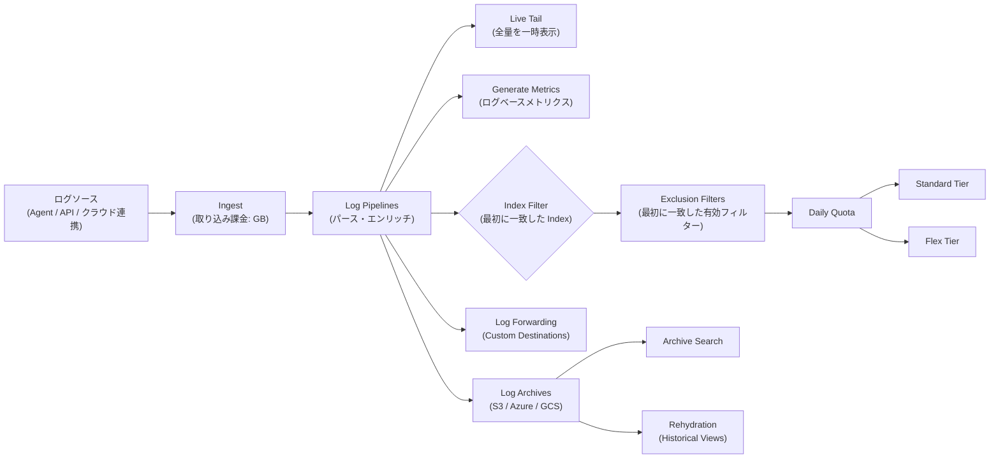
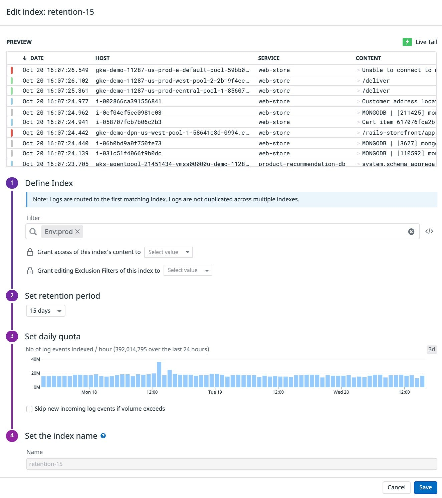
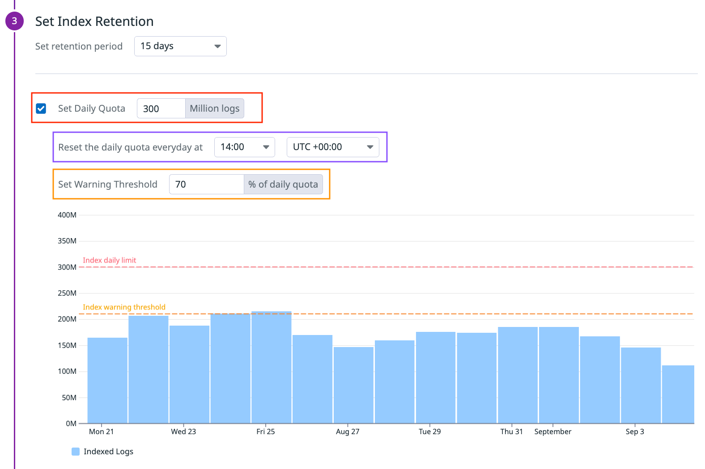
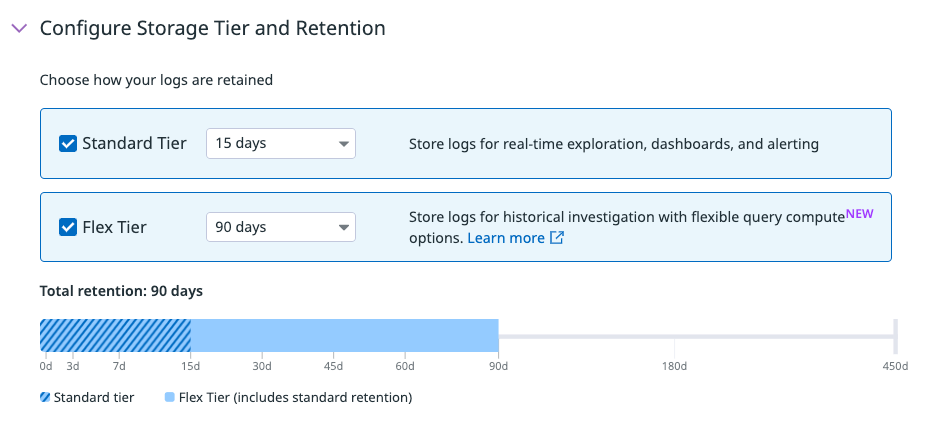
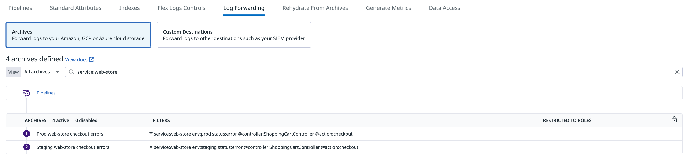
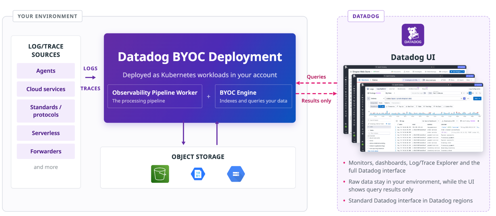

# Indexes・保持・アーカイブ

## 概要

Datadog Log Management は、ログの **取り込み（Ingest）** と **保持（Indexing / Storage）** を分けて扱う（Datadog はこの考え方を「Logging without Limits™」と呼ぶ）。取り込んだログは Log Pipelines で処理されたあと、次の行き先に振り分けられる。

| 行き先 | 役割 | 検索性 | 本ファイルの節 |
|---|---|---|---|
| Standard Indexing（Standard Tier） | 頻繁に検索・アラートするログを短〜中期保持 | 即時検索、Monitors・Watchdog 対応 | [Indexes](#indexesインデックス) |
| Flex Logs（Flex Tier） | 検索頻度は低いが即時検索が必要なログを長期保持 | 即時検索（Compute 容量に依存）、Monitors・Watchdog 非対応 | [Flex Logs](#flex-logs) |
| Flex Frozen | 複数年の長期保持（Datadog 内） | Archive Search 経由 | [Flex Frozen](#flex-frozen) |
| Log Archives | 顧客所有のクラウドストレージ（S3 / Azure Storage / GCS）へ全量保管 | Archive Search または Rehydration で検索 | [Log Archives](#log-archivesログアーカイブ) |
| Log Forwarding（Custom Destinations） | Splunk・Elasticsearch・SIEM 等の外部システムへ転送 | 転送先に依存 | [Log Forwarding](#log-forwardingcustom-destinations) |
| BYOC Logs（旧称：CloudPrem） | 顧客自身のインフラでインデックス・保管し、Datadog UI から検索 | 即時検索（顧客環境内のエンジン） | [BYOC Logs](#byoc-logs旧称cloudprem) |

本ファイルは上記の **保持・保管・転送の設定仕様** を扱う。ログの収集方法は [ログ収集](log-collection.md)、パース・加工・ログからのメトリクス生成（Generate Metrics）は [Log Pipelines と処理](log-pipelines-and-processing.md)、Log Explorer での検索・分析は [ログ検索と分析](log-search-and-analytics.md)、Datadog へ送る前の前処理・ルーティングは [Observability Pipelines](observability-pipelines.md) を参照。

- 上図のとおり、Exclusion Filters と Daily Quota は **Index への格納だけ** を制御する。除外されたログ・クォータ超過したログも Live Tail、ログベースメトリクス、アーカイブには流れる。[出典](https://docs.datadoghq.com/logs/log_configuration/indexes/)
- アーカイブ・Log Forwarding は「インデックスされたかどうかに関係なく」取り込まれたログを対象にできる。[出典](https://docs.datadoghq.com/logs/log_configuration/archives/)、[出典](https://docs.datadoghq.com/logs/log_configuration/forwarding_custom_destinations/)

### 設定画面の位置

Log Management の保持関連設定は **Logs > Configuration（Log Configuration）** 配下のタブにまとまっている。

| タブ | 内容 |
|---|---|
| Pipelines | ログ処理（[Log Pipelines と処理](log-pipelines-and-processing.md)） |
| Standard Attributes | 標準属性 |
| Indexes | Index・Exclusion Filters・Daily Quota・保持期間・Flex Tier の設定 |
| Flex Logs Controls | Flex Logs の有効化と Compute サイズ |
| Log Forwarding | Archives（クラウドストレージ）と Custom Destinations（外部転送） |
| Rehydrate From Archives | Historical Views（Rehydration） |
| Generate Metrics | ログベースメトリクス |
| Data Access | ログのアクセス制御（Restriction Queries） |

タブ構成は公式ドキュメントのスクリーンショット（Log Forwarding 画面、本ファイル後述）に基づく。UI は随時変更される。

## Indexes（インデックス）

### Indexes の基本

Log Management の Indexes は、ログを値のグループに分け、**保持期間・Daily Quota・使用量監視・課金** をグループごとに変えるための単位である。インデックス化されたログは、ファセット検索、Patterns、Analytics、Monitors の対象になる。[出典](https://docs.datadoghq.com/logs/log_configuration/indexes/)

| 項目 | 仕様 |
|---|---|
| 初期状態 | 新規アカウントには既定で **1 つの Index** があり、全ログを格納する |
| 複数 Index を推奨する場面 | 保持期間を複数使い分けたい場合、Daily Quota を複数に分けて予算を細かく管理したい場合 |
| 複数 Index の横断検索 | Log Explorer は複数 Index をまたぐクエリに対応 |
| Index の最大数 | 既定で **アカウントあたり 100**。増やす場合は Datadog サポートに連絡 |
| Index 名の規則 | 英字で始まり、英小文字・数字・`-` のみ |
| 詳細表示 | Index をダブルクリックまたは *edit* で、直近 3 日間のインデックス化件数や保持期間を表示 |

[出典](https://docs.datadoghq.com/logs/log_configuration/indexes/)

*キャプション:* Log Management の Index 編集画面（Edit index: retention-15）。
*画面説明:* 上部の **PREVIEW** にフィルター条件に一致するログ（DATE / HOST / SERVICE / CONTENT）が Live Tail で流れる。その下に 4 ステップの設定がある。(1) **Define Index**：「Logs are routed to the first matching index. Logs are not duplicated across multiple indexes.」の注記、**Filter**（例：`Env:prod`）、「Grant access of this index's content to」（Index 内容の閲覧権限を付与するロール）、「Grant editing Exclusion Filters of this index to」（この Index の Exclusion Filters 編集権限を付与するロール）。(2) **Set retention period**（例：15 days）。(3) **Set daily quota**：直近の 1 時間あたりインデックス件数の棒グラフ（表示期間 3d）と、超過時に新規ログをスキップするチェックボックス。(4) **Set the index name**。右下に Cancel / Save。画面は旧 UI の可能性があり、現行 UI では保持期間が「Configure Storage Tier and Retention」（後述）として表示される。
*出典:* https://docs.datadoghq.com/logs/log_configuration/indexes/ （画像取得日 2026-11-03、ドキュメント基準日 2026-11-02）

### Index の作成と削除

| 操作 | 手順・仕様 |
|---|---|
| 作成 | Indexes ページで **New Index** をクリック。フィルター、保持期間（Storage Tier）、Daily Quota、名前を設定 |
| 並べ替え | ドラッグ＆ドロップで Index の順序を変更（Index Filter の評価順になる） |
| 削除 | Index のアクショントレイの Delete アイコン。**`logs_delete_data`（Logs Delete Data）権限** が必要 |
| 削除後の挙動 | 新しいログを受け付けなくなり、その Index のログは検索できなくなる。保持期間を過ぎてログがすべて期限切れになると Index 一覧から消える |
| 名前の再利用 | **削除した Index と同じ名前の Index は再作成できない** |

[出典](https://docs.datadoghq.com/logs/log_configuration/indexes/)

### Index Filters（インデックスフィルター）

Index Filters は、どのログをどの Index に入れるかを決めるクエリである。

- ログは **フィルターに一致した最初の Index** に入る。複数の Index に重複して入ることはない。
- 順序は Indexes ページでドラッグ＆ドロップして変える。
- 例：先頭に `status:notice` の Index、次に `status:error` の Index、最後にフィルターなし（`*` と同等）の Index を置くと、notice と error 以外のログはすべて最後の Index に入る。
- どの Index にも一致しないログはインデックス化されない（取り込み課金の対象にはなる）。このため、公式の設計ガイドでは最下段に「キャッチオール」Index を置くことを推奨している。[出典](https://www.datadoghq.com/architecture/a-guide-to-log-management-indexing-strategies-with-datadog/)（Datadog Architecture Center、2024-10-09 公開）

[出典](https://docs.datadoghq.com/logs/log_configuration/indexes/)

### Exclusion Filters（除外フィルター）

Exclusion Filters は、Index Filter に一致したログのうち、条件に合うものをその Index に格納しない（または一部だけ格納する）ための設定である。

| 項目 | 既定値 | 仕様 |
|---|---|---|
| Exclusion Filter の有無 | なし | 既定では Index Filter に一致したログはすべてインデックス化される |
| Query（除外クエリ） | `*` | `*` のままだと Index 内の全ログが除外対象になる。ログクエリで絞り込む |
| Sampling rule（サンプリング） | 「Exclude 100% of logs」 | 除外率は **0%〜100%** で指定。個々のログ単位、または任意属性の一意な値ごとのグループ単位でサンプリングできる |
| Toggle（有効 / 無効） | 有効 | 無効にしたフィルターは新規ログに対して無視される |
| 評価順 | — | **最初に一致した「有効な」Exclusion Filter だけが処理される**。一致したログは、サンプリングで残された場合でも後続のフィルターを通らない。順序はドラッグ＆ドロップで変更 |

- 除外されたログは Index には入らないが、Live Tail・ログベースメトリクス生成・アーカイブには使える。
- ログに Trace ID がある場合、サンプリングは Trace ID を使う。このため残ったログはサンプリングされたトレースと相関しやすい。グループに「Trace ID の一意値」を選んだ場合も同じ動作になる。
- 追加手順：Log Indexes で Index を展開し、*Add an Exclusion Filter* をクリックする。

[出典](https://docs.datadoghq.com/logs/log_configuration/indexes/)

#### 公式ドキュメントの Exclusion Filter 例

| 用途 | 設定 |
|---|---|
| 必要時だけ ON / OFF | `status:DEBUG` を 100% 除外し、UI または API（Update an index）で切り替える |
| 傾向だけ残す | `source:nginx AND http.status_code:[200 TO 299]` を 95% 除外し、3xx / 4xx / 5xx はすべて残す |
| ユーザー単位サンプリング | Index Filter `env:production`、`@user.email` 単位で 90% 除外 |
| トレース単位サンプリング | Index Filter `service:my_python_app`、Trace ID 単位で 50% 除外（上流で Trace ID Remapper を設定） |

#### Index をまたいだ一貫サンプリング

複数 Index で同じ上位エンティティ（例：`request_id`）のログをまとめて残す / 捨てるには、次の 3 点を守る。

1. 各 Index に Exclusion Filter を 1 つずつ作る。
2. すべてのフィルターで **同じサンプリング率** と **同じ属性** を使う。
3. ログは最初に一致したルールだけを通るため、ルール・フィルター・順序を確認する。

公式例では、ある `request_id` のログは 50% の確率で全 Index 一括で残る / 除外される。`threat:true` や `compliance:true` のログは `request_id` に関係なく残し、2XX のアクセスログで `request_id` を持つものは 50% を残し、それ以外の 2XX ログは 90% 除外ルールに従う。

[出典](https://docs.datadoghq.com/logs/log_configuration/indexes/)

### Daily Quota（日次クォータ）

Daily Quota は、Index ごとに 1 日に格納するログ件数の上限（ハードリミット）である。

| 項目 | 既定値 | 仕様 |
|---|---|---|
| 適用タイミング | — | **Exclusion Filters の適用後** にカウント |
| 単位 | — | **100 万件（millions of logs）** 単位で指定（API の `daily_limit` はイベント件数） |
| リセット時刻 | **14:00 UTC（2:00pm UTC）** | 任意の時刻とタイムゾーン（UTC オフセット）に変更可能 |
| 警告しきい値（Warning Threshold） | 未設定 | クォータに対する % で指定。**最小 50%** |
| 変更の反映 | — | 即時反映。Index 編集時にいつでも変更可能 |
| 到達時の挙動 | — | その日はそれ以上インデックス化されない。ただし Live Tail・アーカイブ・ログベースメトリクスには引き続き流れる |
| 通知 | — | クォータまたは警告しきい値に達すると **イベント** が生成される |

[出典](https://docs.datadoghq.com/logs/log_configuration/indexes/)

*キャプション:* Index 編集画面の Daily Quota 設定部分。
*画面説明:* 「Set Index Retention」セクションで保持期間（例：15 days）を選び、その下で **Set Daily Quota** にチェックを入れて上限（例：300 Million logs）を入力する。**Reset the daily quota everyday at** でリセット時刻（例：14:00）と UTC オフセット（例：UTC +00:00）を選ぶ。**Set Warning Threshold** で警告しきい値（例：70 % of daily quota）を入力する。下部の棒グラフは日別のインデックス化件数（Indexed Logs）で、赤い破線が「Index daily limit」（300M）、オレンジの破線が「Index warning threshold」（210M）を示す。
*出典:* https://docs.datadoghq.com/logs/log_configuration/indexes/ （画像取得日 2026-11-03）

#### Daily Quota・使用量の監視

公式のベストプラクティスガイドは次の監視を推奨している。[出典](https://docs.datadoghq.com/logs/guide/best-practices-for-log-management/)

| 監視対象 | 設定 |
|---|---|
| 使用量メトリクス | `datadog.estimated_usage.logs.ingested_bytes`（取り込みバイト）、`datadog.estimated_usage.logs.ingested_events`（取り込みイベント数）。無料で 15 か月保持。タグ `datadog_index`（Index 名）、`datadog_is_excluded`（`false` でインデックス化分のみ）、`service` |
| 異常検知 | `datadog.estimated_usage.logs.ingested_events` を `datadog_is_excluded:false` で絞り、`service`、`datadog_index` ごとに集計して Anomaly Monitor を設定 |
| クォータ到達 | Event Monitor のクエリ `source:datadog datadog_index:* "daily quota reached"`、`datadog_index` でグループ化、評価期間は「当日（Index のリセット時刻開始）」、しきい値 `>= 1`。`datadog_index` タグは最初のクォータイベント発生後に現れる |
| 80% 到達 | ボリュームメトリクスで、直近 24 時間で Daily Quota の 80% に達したら通知することを推奨 |
| 月次インデックス量 | `datadog_is_excluded:false` で絞った `datadog.estimated_usage.logs.ingested_events` を累積（cumulative）評価で監視 |

Monitor の設定方法は [Monitors](../platform/monitors.md)、使用量の見方は [Usage・Usage Attribution・Cost Visibility](../platform/usage-and-cost-attribution.md) を参照。

### Index 単位のアクセス制御

Index 編集画面には「Grant access of this index's content to」「Grant editing Exclusion Filters of this index to」があり、Index 単位で閲覧権限・除外フィルター編集権限をロールに付与できる（上掲スクリーンショット）。Index 単位の閲覧権限（`logs_read_index_data`）はレガシー扱いで、現在は `logs_read_data` と Restriction Queries（Data Access）での制御が推奨されている。[出典](https://docs.datadoghq.com/account_management/rbac/permissions/) ロール設計の全体は [組織・ユーザー・権限管理](../platform/account-and-access-management.md) を参照。

### Indexes の API

| 操作 | メソッドとパス |
|---|---|
| Index 一覧 | `GET /api/v1/logs/config/indexes` |
| Index 取得 | `GET /api/v1/logs/config/indexes/{name}` |
| Index 作成 | `POST /api/v1/logs/config/indexes` |
| Index 更新 | `PUT /api/v1/logs/config/indexes/{name}` |
| Index 削除 | `DELETE /api/v1/logs/config/indexes/{name}` |
| Index 順序の取得 | `GET /api/v1/logs/config/index-order` |
| Index 順序の更新 | `PUT /api/v1/logs/config/index-order` |

API ホストはサイトごとに異なる（AP1 は `api.ap1.datadoghq.com`）。[出典](https://docs.datadoghq.com/api/latest/logs-indexes/) サイト一覧は [Datadog Sites](../platform/datadog-sites.md) を参照。

#### Index 作成リクエストの主なフィールド

| フィールド | 型 | 必須 | 説明・制約 |
|---|---|---|---|
| `name` | string | ○ | Index 名 |
| `filter.query` | string | — | Index Filter のクエリ（`filter` オブジェクト自体は必須） |
| `num_retention_days` | int64 | — | **Standard Tier** に保持する日数（経過後に Flex Tier へ移るか削除）。指定可能な値は組織の契約プランに依存 |
| `num_flex_logs_retention_days` | int64 | — | **Standard と Flex を合わせた総保持日数**。指定可能な値は契約プランに依存 |
| `daily_limit` | int64 | — | 1 日あたりのインデックス件数上限 |
| `daily_limit_reset.reset_time` | string | — | リセット時刻。`HH:00` 形式（00〜23） |
| `daily_limit_reset.reset_utc_offset` | string | — | UTC オフセット。`(-\|+)HH:00` 形式（-12〜+14） |
| `daily_limit_warning_threshold_percentage` | double | — | 警告イベントを出すクォータの割合（UI 上の最小値は 50%） |
| `exclusion_filters[]` | array | — | 配列の順に評価。最初に一致した有効なフィルターだけが効く |
| `exclusion_filters[].name` | string | ○ | Exclusion Filter 名 |
| `exclusion_filters[].is_enabled` | boolean | — | 有効 / 無効 |
| `exclusion_filters[].filter.query` | string | — | 既定 `*`（Index 内の全ログを除外） |
| `exclusion_filters[].filter.sample_rate` | double | ○ | 除外率。`1.0` で一致ログをすべて除外 |
| `exclusion_filters[].filter.sample_attribute` | string | — | サンプリングに使う属性（その属性を持つログだけがサンプリングされる） |
| `tags` | array | — | Index のタグ（`key:value` 形式） |

[出典](https://docs.datadoghq.com/api/latest/logs-indexes/create-an-index/)

Terraform では `datadog_logs_index` と `datadog_logs_index_order` リソースで同じ設定を管理できる。詳細は [Terraform と IaC](../platform/terraform-and-iac.md) を参照。

## 保持期間（Retention）の選択肢

### Standard Indexing の保持期間

Standard Indexing の保持期間は Index ごとに設定し、**アカウントの契約で許可された値** から選ぶ。公式ドキュメントは固定の選択肢一覧を示していない。

| 項目 | 内容 |
|---|---|
| 公開料金表に定価がある保持期間 | **3 日 / 7 日 / 15 日 / 30 日**（Indexed logs の品目が保持期間別に分かれる） |
| 30 日超 | 料金ページでは「Greater than 30 days」は「Contact Us for Pricing」（個別見積もり） |
| 契約外の保持期間 | Customer Success（`success@datadoghq.com`）に連絡して有効化し、有効化後に各 Index の保持期間を更新する。契約外の保持期間を使うには、管理者が組織設定でそのオプションを有効にする必要がある |
| オンデマンド顧客の既定保持期間 | **15 日**（料金ページ FAQ） |
| 保持期間の画面表示 | Configure Storage Tier and Retention のスライダー目盛りには 3d / 7d / 15d / 30d / 45d / 60d / 90d / 180d / 450d が表示される（下記スクリーンショット）。実際に選べる値は契約による |

[出典](https://docs.datadoghq.com/logs/log_configuration/indexes/)、[出典](https://www.datadoghq.com/pricing/list/)、[出典](https://www.datadoghq.com/pricing/?product=log-management)（2026-11-02 取得）

### Flex Logs の保持期間

| 区分 | 保持期間 |
|---|---|
| Flex Logs（Scalable Compute：XS / XS+ / S / M / L） | **30〜450 日** |
| Flex Starter | **3 / 6 / 12 / 15 か月** |
| Flex Storage（料金ページ記載） | 最小 1 か月〜最大 15 か月 |

> **注記:** Flex Starter の保持期間は、ドキュメントと料金ページ本文では「3 / 6 / 12 / 15 か月」、料金一覧（/pricing/list/）の品目名では「6, 12, or 15-month retention」と表記が異なる（2026-11-02 時点）。契約時に確認すること。

[出典](https://docs.datadoghq.com/logs/log_configuration/flex_logs/)、[出典](https://www.datadoghq.com/pricing/list/)

### Rehydration・Archive Search の保持期間

| 区分 | 保持期間 |
|---|---|
| Rehydration（Historical View）の既定 | **15 日** |
| Rehydration で選べる値 | 契約に依存。管理者がドロップダウンに出す値を選択（例：3 / 7 / 15 / 30 / 45 / 60 / 90 / 180 日） |
| Archive Search の結果 | 先頭 **100,000 件を 24 時間** 保持（それ以上・それ以上の期間は Rehydration） |

[出典](https://docs.datadoghq.com/logs/log_configuration/rehydrating/)、[出典](https://docs.datadoghq.com/logs/log_configuration/archive_search/)

### 保持オプションの使い分け

公式は、ログを「検索頻度」と「保持期間」で次の 3 つに分けることを示している。[出典](https://docs.datadoghq.com/logs/log_configuration/flex_logs/)

| 保持オプション | 向くログ（公式の例） | 主な特徴 |
|---|---|---|
| Standard Indexing | 頻繁に検索し短期保持するログ（アプリケーションログ等） | Monitors・Watchdog 対応、最速の検索 |
| Flex Logs | 長期保持し、ときどき緊急に検索するログ（セキュリティ、トランザクション、ネットワークログ等） | 保管と計算を分離した低単価の保管、即時検索 |
| Archiving | ほとんど検索せず長期保管するログ（監査ログ、構成ログ等） | 顧客所有ストレージ、Archive Search / Rehydration で検索 |

ログはまず Standard に入れて Flex で延長することも、一部のソースを直接 Flex に送ることもできる。

## Flex Logs

### Flex Logs の概要

Flex Logs は、ログの **保管コスト（Storage）と検索用計算資源（Compute）を分離** した長期保持層である。Compute は Flex Tier を検索するときだけ使われ、取り込みや Standard Indexing の検索には使われない。Flex Logs は Index 単位で設定し、Index Filter はその Index の Flex Logs にも適用される。[出典](https://docs.datadoghq.com/logs/log_configuration/flex_logs/)

### Compute のタイプとサイズ

Flex Logs の Compute には **Flex Starter** と **Scalable Compute（XS / XS+ / S / M / L）** がある。各サイズは前のサイズの約 2 倍の検索性能・容量を持ち、上限は「同時実行クエリ数」と「1 クエリあたりの最大スキャンログ数」で決まる（具体的な数値は公開情報では確認できず）。

| サイズ | 推奨する Flex 保存イベント累計 |
|---|---|
| Starter | 100 億件（10B）未満 |
| XS | 10B〜50B |
| XS+ | 50B〜100B |
| S | 100B〜200B |
| M | 200B〜500B |
| L | 500B〜1T |
| CSM に相談 | 1T 超 |

> **サイト差異:** US3、US5、**AP1**、AP2、US1-FED（および US2-FED）では、Compute サイズは **Starter / XS / XS+ / S のみ** 提供される（M / L は選べない）。

[出典](https://docs.datadoghq.com/logs/log_configuration/flex_logs/)

性能に影響する要因は、保存量（最大の要因）、クエリの時間範囲、クエリの複雑さ、同時ユーザー数である。Flex クエリを使うダッシュボードも Compute を消費する。

| 比較項目 | Flex Starter | Scalable Compute（XS〜L） |
|---|---|---|
| 推奨規模 | 保存ログ 10B 未満の組織（マルチ org では低ボリュームの org） | 保存ログ 10B 超（新規ログで月 20〜30 億件程度）の組織 |
| 課金 | 保管＋Compute のバンドル単価 | Compute ティアごとの定額（Storage は別） |
| 保持期間 | 3 / 6 / 12 / 15 か月 | 30〜450 日 |
| 併用 | 同じ組織で Scalable Compute と同時利用不可 | 同上 |
| サイズ変更 | Starter から Scalable への切り替えは自動ではなく、選択して Save が必要 | アップグレードはいつでも可。**ダウングレードは 15 日に 1 回まで** |

[出典](https://docs.datadoghq.com/logs/log_configuration/flex_logs/)

### Flex Logs の有効化・無効化

| 操作 | 手順・条件 |
|---|---|
| 必要な権限 | `flex_logs_config_write`（Flex Logs Configuration Write。既定では Datadog Admin Role） |
| 有効化 | 組織単位で **Flex Logs Controls** ページから Compute Type とサイズを選び、**Enable Flex Logs** をクリック。表示される選択肢は契約内容に依存し、Flex が契約にない場合でもセルフサービスで Flex Starter を選べる |
| 無効化 | (1) Flex Storage を有効にしている全 Index から Flex を外す → (2) Flex Logs Controls に戻る → (3) 歯車アイコンから **Disable Flex Logs** |
| Compute の単位 | 1 組織で同時に使えるサイズは 1 つ。Compute を組織間で共有することはできない（マルチ org では org ごとに有効化） |

[出典](https://docs.datadoghq.com/logs/log_configuration/flex_logs/)、[出典](https://docs.datadoghq.com/account_management/rbac/permissions/)

### Index での Storage Tier 設定

Index の作成・編集画面で **Configure Storage Tier and Retention** を開き、Standard Tier と Flex Tier の有無と保持期間を設定する。

*キャプション:* Index 設定内の「Configure Storage Tier and Retention」（Storage Tier と保持期間の設定）。
*画面説明:* 「Choose how your logs are retained」の下に 2 つのチェックボックスがある。**Standard Tier**（例：15 days。説明「Store logs for real-time exploration, dashboards, and alerting」）と **Flex Tier**（例：90 days。説明「Store logs for historical investigation with flexible query compute options」）。下部に **Total retention: 90 days** と横棒グラフがあり、斜線部が Standard tier（0〜15d）、水色部が Flex Tier（Standard 保持を含めて 90d まで）を示す。目盛りは 0d / 3d / 7d / 15d / 30d / 45d / 60d / 90d / 180d / 450d。
*出典:* https://docs.datadoghq.com/logs/log_configuration/flex_logs/ （画像取得日 2026-11-03）

| 構成 | 動作 |
|---|---|
| Standard + Flex | Standard の保持期間は Standard に置き、残りの期間は Flex に置く。例：Standard 3 日・Flex 90 日 → Standard 3 日 + Flex 87 日（Flex の日数は総保持期間） |
| Flex のみ | Standard Tier を外し、Flex Tier だけを選ぶ（公式は「Flex Only」という語を使っていない） |
| Standard の Index に Flex を追加 | 既存ログ・新規ログとも保持が延長される |
| Flex のみの Index に Standard を追加 | 既存の Flex ログは変わらない。新規ログは両方の Tier に入る |
| Standard を外して Flex のみにする | そのログは **Monitors と Watchdog Insights で使えなくなる** |

[出典](https://docs.datadoghq.com/logs/log_configuration/flex_logs/)

### Flex Logs の検索

| 機能 | Flex Logs での対応 |
|---|---|
| Log Explorer | 時刻選択の横の **Include Flex Logs** トグルを ON にすると Flex の結果も含まれる。ファセット検索・テキスト検索は通常どおり |
| Dashboards | 対応（Compute への影響に注意）。ダッシュボードの「Include Flex Logs」設定は [画面構成とナビゲーション](../../01_入門編/06-ui-navigation.md) を参照 |
| Monitors | **非対応**（Monitor のクエリは Flex Logs に対して実行できない） |
| Watchdog（Insights） | **非対応** |

Compute の上限に達すると、クエリは容量が空くまで再試行されて遅くなり、再試行が続くと「Flex Logs compute capacity is constrained」のエラーで失敗することがある（管理者への連絡を促す）。[出典](https://docs.datadoghq.com/logs/log_configuration/flex_logs/)

Flex のみに置いたログでもアラートが必要な場合は、取り込み時点で **ログベースメトリクス** を生成すれば、そのメトリクスでリアルタイムにアラートできる（[Log Pipelines と処理](log-pipelines-and-processing.md)）。[出典](https://www.datadoghq.com/architecture/a-guide-to-log-management-indexing-strategies-with-datadog/)（2024-10-09 公開）

### Flex に直接送る候補のログソース（公式の例）

| 分類 | 例 |
|---|---|
| アーティファクト管理 | JFrog Artifactory、Archiva、Sonatype Nexus |
| 監査ログ | Amazon CloudTrail、Kubernetes 監査ログ、Microsoft 365 監査 |
| CDN | Akamai、Cloudflare、Fastly、CloudFront |
| CI/CD | GitLab、GitHub Actions、Argo CD、Jenkins、CircleCI、TeamCity |
| DNS | Route53、Cloudflare、Akamai（Edge）、NS1 |
| ID 管理 | Cisco ISE、Okta、OneLogin、Workday User Activity Logs |
| ロードバランサー | AWS ELB / ALB / NLB（GCP・Azure 版を含む）、F5、NGINX |
| ネットワーク機器 | Cisco、Meraki、Juniper、Aruba、HPE、Palo Alto、Barracuda |
| ネットワークサービス | WAF、Amazon VPC Flow Logs、AWS ELB、pfSense、Tailscale |
| サービスメッシュ | Anthos、Istio、proxyv2、Consul、Linkerd、Kong |

[出典](https://docs.datadoghq.com/logs/log_configuration/flex_logs/)

### Flex Frozen

Flex Frozen は、Flex Logs の下に位置する **複数年保持用のストレージ層** である。

| 項目 | 内容 |
|---|---|
| 発表 | DASH 2025（2025-06-10 のプレスリリース） |
| 保持期間 | プレスリリースでは「7 年超までログ保持を延長」 |
| 検索方法 | Archive Search で Flex Frozen 内のログを検索（リハイドレート不要） |
| 利用条件 | Product Preview ページでは「Flex Logs を利用中であること」 |
| 提供状況 | プレスリリースは「launched」と記載。一方、Product Preview Program ページ（Flex Frozen & Archive Search）にも掲載されている。2026-11-02 時点で正式な GA 告知は公開情報では確認できず【Preview】の可能性あり |
| 公式ドキュメント | Flex Logs ドキュメントには Flex Frozen の記載なし。設定方法・料金は公開情報では確認できず |

[出典](https://www.datadoghq.com/about/latest-news/press-releases/datadog-expands-log-management-offering-with-new-long-term-retention-search-and-data-residency-capabilities/)（2025-06-10 公開）、[出典](https://www.datadoghq.com/product-preview/flex-frozen-archive-search/)

## Log Archives（ログアーカイブ）

### Log Archives の概要

Log Archives は、取り込んだログ（インデックス化の有無を問わない）を **顧客所有のクラウドストレージ** に転送する機能である。長期保管、コンプライアンス、監査、アドホック調査が目的で、保管したログは **Archive Search** または **Rehydration** で検索する。Datadog を経由せず顧客環境から直接アーカイブしたい場合は [Observability Pipelines](observability-pipelines.md) を使う。[出典](https://docs.datadoghq.com/logs/log_configuration/archives/)

| 項目 | 内容 |
|---|---|
| 対応先 | Amazon S3、Azure Storage、Google Cloud Storage（GCS） |
| 設定画面 | Logs > Configuration > **Log Forwarding** > **Archives** |
| 必要な権限 | 作成・変更・削除は `logs_write_archives`（Logs Write Archives。既定は Datadog Admin Role）。アーカイブの閲覧・Rehydration 利用は `logs_read_archives` |
| 監視用メトリクス | `datadog.archives.logs.bytes`、`datadog.archives.logs.count`（再試行後の成功分を含む、アーカイブ成功分） |

[出典](https://docs.datadoghq.com/logs/log_configuration/archives/)、[出典](https://docs.datadoghq.com/account_management/rbac/permissions/)

*キャプション:* Log Configuration の **Log Forwarding** タブ（Archives を選択した状態）。
*画面説明:* 上部タブは Pipelines / Standard Attributes / Indexes / Flex Logs Controls / **Log Forwarding** / Rehydrate From Archives / Generate Metrics / Data Access。Log Forwarding の中に 2 つのカードがあり、**Archives**（Forward logs to your Amazon, GCP or Azure cloud storage）と **Custom Destinations**（Forward logs to other destinations such as your SIEM provider）を切り替える。「4 archives defined」の下に View（All archives）とフィルター検索欄があり、一覧には ARCHIVES（4 active / 0 disabled）、FILTERS（例：`service:web-store env:prod status:error @controller:ShoppingCartController @action:checkout`）、RESTRICTED TO ROLES の列がある。番号（1, 2…）はアーカイブの評価順を示す。
*出典:* https://docs.datadoghq.com/logs/log_configuration/archives/ （画像取得日 2026-11-03）

### 設定手順（6 ステップ）

1. クラウドプロバイダーの Datadog インテグレーションを設定する。
2. ストレージバケット（コンテナ）を作成する。
3. アーカイブへの `read` / `write` 権限を設定する。
4. アーカイブへのログのルーティング（フィルター）を設定する。
5. 詳細設定（暗号化、ストレージクラス、タグ等）を行う。
6. 検証し、設定ミスを確認する。

[出典](https://docs.datadoghq.com/logs/log_configuration/archives/)

### クラウド別の前提と権限

#### Amazon S3

| 項目 | 内容 |
|---|---|
| 前提 | バケットを持つ AWS アカウントで AWS インテグレーションを設定（既定のロール名 `DatadogIntegrationRole`、変更可）。AWS China アカウントはロール委任の代わりにアクセスキーを使用可 |
| IAM ポリシー（書き込み＋検索） | `DatadogUploadAndRehydrateLogArchives`：`s3:PutObject`、`s3:GetObject` を `arn:aws:s3:::<BUCKET>/<OPTIONAL_PATH>/*` に許可。`DatadogRehydrateLogArchivesListBucket`：`s3:ListBucket` を `arn:aws:s3:::<BUCKET>` に許可 |
| 最小権限 | アップロードだけなら `s3:PutObject` のみで足りる。`GetObject` と `ListBucket` は Archive Search / Rehydration に必要 |
| 注意 | オブジェクト操作のリソース ARN は `/*` で終わること。バケットを公開読み取り可能にしない |
| 入力項目 | AWS アカウントとロールの組み合わせ、バケット名、任意のパス（prefix） |

> **サイト差異:** US1、US3、US5 では S3 へのリージョン間転送料金がかかる場合があり、`us-east-1` にバケットを置くと抑えられる。GovCloud（`app.ddog-gov.com`、`us2.ddog-gov.com`）では、ドット入りの S3 バケット名は仮想ホスト形式の FIPS エンドポイントで使えない。

#### Azure Storage

| 項目 | 内容 |
|---|---|
| 前提 | ストレージアカウントがあるサブスクリプションで Azure インテグレーション（アプリ登録）を設定 |
| ロール | Datadog アプリにストレージアカウントの **Storage Blob Data Contributor** を割り当てる |
| ストレージアカウント | Standard パフォーマンスまたは Block blobs Premium、アクセス層は Hot または Cool |
| 非対応・注意 | イミュータビリティポリシーを設定しない。ファイアウォールルールは非対応。Azure ChinaCloud / GermanyCloud は非対応、Azure GovCloud は【Preview】（サポートに連絡） |
| 入力項目 | Azure テナントとクライアント（Datadog アプリ）、ストレージアカウント名、コンテナ名、任意のパス |

#### Google Cloud Storage

| 項目 | 内容 |
|---|---|
| 前提 | サービスアカウントで Google Cloud インテグレーションを設定 |
| ロール | 推奨は **Storage Object Admin** |
| 最小権限（アップロード） | `storage.objects.create`、`storage.objects.get`、`storage.objects.list`、`storage.objects.delete`（書き込み再試行で上書きするため必要）。`storage.multipartUploads.*` は不要 |
| 注意 | バケットに保持ポリシー（Retention Policy）を付けない |
| 入力項目 | GCS サービスアカウント、バケット名、任意のパス |

[出典](https://docs.datadoghq.com/logs/log_configuration/archives/)。各クラウド連携の設定は [AWS Integration](../platform/aws-integration.md)、[Azure Integration](../platform/azure-integration.md)、[Google Cloud Integration](../platform/gcp-integration.md) を参照。

- バケットのネットワークアクセスを IP で制限している場合は、IP ranges 一覧の **webhooks** の IP を許可リストに追加する。[出典](https://docs.datadoghq.com/logs/log_configuration/archives/) 接続要件は [ネットワーク・接続要件](../../03_導入編/11-network-and-connectivity.md) を参照。

### アーカイブのフィルターと順序

- 新しいアーカイブは Archives タブの **Add a new archive** から作る。
- ログは **フィルターに一致した最初のアーカイブ** に入る（Index と同じく順序が重要）。
- 例：`env:prod` のアーカイブを先頭に、フィルターなし（`*`）のアーカイブを後ろに置くと、本番ログは 1 つ目、それ以外は 2 つ目のバケット / パスへ送られる。
- アーカイブ単位で閲覧可能なロールを制限できる（一覧の RESTRICTED TO ROLES 列、API の `/readers` エンドポイント）。

[出典](https://docs.datadoghq.com/logs/log_configuration/archives/)、[出典](https://docs.datadoghq.com/api/latest/logs-archives/)

### 詳細設定（Advanced Settings）

| 設定 | 既定値 | 内容 |
|---|---|---|
| Datadog Tags（タグを含める） | 新規アーカイブでは **ON** | ログのタグをすべてアーカイブに含める。アーカイブサイズは増える。Rehydrate したログに付けるタグも Restriction Queries ポリシーに沿って追加可能 |
| Maximum Scan Size | 未設定（既定値の記載なし） | Archive Search / Rehydration でスキャンする量の上限（GB）。超える見積もりの場合、ユーザーは時間範囲を短くする必要がある |
| Partition Attributes | なし | **アーカイブあたり最大 2 つ**。低カーディナリティ（数十〜数百値）の属性（例：`service`、`source`、`env`、`status`）。一致しないデータセグメントをスキップする |
| Lookup Attributes | なし | **アーカイブあたり最大 2 つ**。高カーディナリティ（数百万値）の属性（例：`trace_id`、`@usr.id`、`@http.request_id`、`@transaction_id`）。書き込み時にインデックスを作る |
| 属性の書き方 | — | タグと予約属性（`env`、`service`、`trace_id` 等）は `@` なし、それ以外の属性は `@` を付ける |
| Compression | **zstd** | zstd（`.json.zst`、高圧縮・高速展開、Archive Search 向けに推奨）または gzip（`.json.gz`、互換性重視）。変更は新しいファイルにだけ効く |
| Storage Class（S3） | — | Archive Search が対応：S3 Standard、Standard-IA、One Zone-IA、Glacier Instant Retrieval、Intelligent-Tiering（任意の非同期アーカイブアクセス層を両方とも無効にした場合のみ）。それ以外のクラスのログは、検索前に対応クラスへ移す必要がある。S3 ライフサイクル設定も使える |
| Access Tier（Azure） | — | Hot と Cool のみ |
| Storage Class（GCS） | — | Standard、Nearline、Coldline、Archive |
| S3 サーバーサイド暗号化 | **Default S3 Bucket-Level Encryption** | 既定は暗号化ヘッダーを送らずバケットの既定設定に従う。**SSE-S3**（S3 管理キー）または **SSE-KMS**（顧客管理 KMS キー、キー ARN が必要）で上書き可能 |

Partition / Lookup Attributes の効果は、設定後にアーカイブされたログにだけ及ぶ。[出典](https://docs.datadoghq.com/logs/log_configuration/archives/)、[出典](https://docs.datadoghq.com/logs/log_configuration/archive_search/)

#### SSE-KMS のキーポリシー要件

| 対象 | 許可するアクション |
|---|---|
| アカウントの root | `kms:*` |
| Datadog ロール | `kms:Encrypt`、`kms:Decrypt`、`kms:ReEncrypt*`、`kms:GenerateDataKey*`、`kms:DescribeKey` |
| Datadog ロール（条件 `kms:GrantIsForAWSResource` = true） | `kms:CreateGrant`、`kms:ListGrants`、`kms:RevokeGrant` |

[出典](https://docs.datadoghq.com/logs/log_configuration/archives/)

### アーカイブのファイル形式とパス

| 項目 | 内容 |
|---|---|
| 形式 | 圧縮 JSON（既定 zstd：`.json.zst`、または gzip：`.json.gz`） |
| ディレクトリ構造 | `<prefix>/dt=<YYYYMMDD>/hour=<HH>/archive_<HHmmss.SSSS>.<UUID>.json.gz`（zstd の場合は拡張子 `.json.zst`） |
| prefix なし | `/` 直下に保存 |
| 例 | `/my/bucket/prefix/dt=20180515/hour=14/archive_143201.1234.02aafad5-f525-4592-905e-e962d1a5b2f7.json.gz` |
| ファイルサイズ・アップロード間隔 | 公開情報では確認できず（設定変更後、アップロード開始まで数分かかり、頻度は変動すると記載） |

日付・時刻のフォルダ構造により、Athena 等での日付ベースのクエリがしやすい。[出典](https://docs.datadoghq.com/logs/log_configuration/archives/)

### 検証とエラー検知

- 設定後 **15 分** 程度でバケットを確認する。
- アーカイブが pending のままの場合は、包含フィルターが有効で、Live Tail で一致するイベントがあるかを確認する。
- 設定や権限の変更でアップロードに失敗すると、設定ページでハイライトされる。ホバーするとエラー詳細と対処方法が表示される。
- 失敗時には Events Explorer にイベントが出るので、そのイベントで Monitor を作れる。

[出典](https://docs.datadoghq.com/logs/log_configuration/archives/)

### Archives の API

| メソッド | パス | 操作 |
|---|---|---|
| GET | `/api/v2/logs/config/archives` | アーカイブ一覧 |
| POST | `/api/v2/logs/config/archives` | アーカイブ作成 |
| GET | `/api/v2/logs/config/archives/{archive_id}` | アーカイブ取得 |
| PUT | `/api/v2/logs/config/archives/{archive_id}` | アーカイブ更新 |
| DELETE | `/api/v2/logs/config/archives/{archive_id}` | アーカイブ削除 |
| GET / POST / DELETE | `/api/v2/logs/config/archives/{archive_id}/readers` | 閲覧ロールの一覧・付与・剥奪 |
| GET / PUT | `/api/v2/logs/config/archive-order` | アーカイブ順序の取得・更新 |

主な属性（`data.attributes`）：`name`、`query`（必須）、`destination`（`type` = `s3` / `azure` / `gcs`）、`include_tags`、`compression_method`（`GZIP` / `ZSTD`）、`partitioning_attributes`、`lookup_attributes`、`rehydration_max_scan_size_in_gb`、`rehydration_tags`。S3 は `storage_class`（`STANDARD` / `STANDARD_IA` / `ONEZONE_IA` / `INTELLIGENT_TIERING` / `GLACIER_IR`）と `encryption.type`（`NO_OVERRIDE` / `SSE_S3` / `SSE_KMS`）、`encryption.key`（KMS キー ARN）を持ち、`integration` には `account_id` と `role_name`、またはアクセスキー（`access_key_id`）を指定する。[出典](https://docs.datadoghq.com/api/latest/logs-archives/create-an-archive/)

> **サイト差異:** US1-FED / US2-FED では、アーカイブ先として GovCloud 環境の外にログを送れるが、環境外に出たログについて Datadog は FedRAMP・DoD IL・ITAR・輸出規制・データ所在地などの義務に責任を負わない。[出典](https://docs.datadoghq.com/logs/log_configuration/archives/)

## Archive Search

### Archive Search の概要

Archive Search は、**リハイドレートせずに** オブジェクトストレージのアーカイブを直接検索し、結果をリアルタイムにストリーミング表示する機能である。Rehydration（バックグラウンドのバッチ処理）より手軽で、公式は現在 **アーカイブへのアクセス方法として Archive Search を推奨** している。Log Management のアーカイブと Observability Pipelines のアーカイブ（S3 / Azure Storage / GCS）が対象である。[出典](https://docs.datadoghq.com/logs/log_configuration/archive_search/)、[出典](https://docs.datadoghq.com/logs/log_configuration/rehydrating/)

| 項目 | 内容 |
|---|---|
| 主な用途 | インデックス保持期間を過ぎたログの障害調査（例：`user_id` で検索）、セキュリティ分析（例：IP ごとのログイン試行）、監査・コンプライアンス |
| 提供状況 | 公式ブログ（2025-06-10）は「now generally available」と記載。一方、API リファレンスの Archive Search エンドポイントには preview 表記が残り、Product Preview ページにも掲載がある。ドキュメント本文には Preview / GA の表記なし |
| 画面 | **Logs > Archive Search > New Search** |

> **サイト差異:** 料金ページでは Archive Search は US-FED サイトで利用不可とされている。[出典](https://www.datadoghq.com/pricing/?product=log-management)（2026-11-02 取得）

### 検索モード

| モード | 必要な権限 | 結果の扱い |
|---|---|---|
| **Search** | Archive Search の権限（ドキュメント本文では `logs_archive_search`、権限一覧ページでは `logs_write_archive_search`（Logs Write Archive Search、既定は Datadog Standard Role）と表記） | 結果をストリーミング表示し、**最大 100,000 件を 24 時間** 保持。Rehydrate は不可 |
| **Search & Rehydration** | `logs_write_historical_view` | Search と同じ。加えて検索前または検索後に Rehydrate できる |

いずれも、検索するアーカイブごとに `logs_read_archives` 権限が必要である。[出典](https://docs.datadoghq.com/logs/log_configuration/archive_search/)、[出典](https://docs.datadoghq.com/account_management/rbac/permissions/)

### 検索手順

1. **Logs > Archive Search > New Search** を開く。
2. アーカイブと時間範囲を選ぶ。
3. クエリを入力する（例：`user_id:abc123`）。
4. 必要に応じて検索名を変える。
5. モード（Search / Search & Rehydration）を選ぶ。
6. **Search** をクリックする。
7. 進捗バーを確認する（いつでもキャンセル可能）。

- クエリプレビューは最大 **1,000 件** のサンプルを表示する（サンプルに一致ログが含まれない場合もある）。
- **Cancel** で実行中の検索を止めても、取得済みのログは残る。**Duplicate** で同じパラメータの新規検索を作れる。

[出典](https://docs.datadoghq.com/logs/log_configuration/archive_search/)

### 結果の保持と Rehydrate

| 方法 | 内容 |
|---|---|
| 既定 | 先頭 100,000 件を 24 時間、結果ページで参照可能。期限後は自動削除 |
| 検索前に Rehydrate | 100,000 件を超えるログを、指定した期間（例：7 / 15 / 30 日）保持 |
| 検索完了後に Rehydrate | 24 時間以内なら Rehydrate して保持を延長し、Log Explorer・Dashboards・Notebooks で使える |
| 管理者が選べる保持期間 | 3 / 7 / 15 / 30 / 45 / 60 / 90 / 180 日 |
| Rehydrate 先 | Standard Indexing。組織で Flex Logs を使っている場合は Flex Storage も選べる |
| Rehydration ボリューム上限 | 管理者が 1 検索あたりの既定上限（100 万件単位）を設定。上限到達で検索は止まり、それまでに Rehydrate したログは残る。状態は「Limit reached」 |

[出典](https://docs.datadoghq.com/logs/log_configuration/archive_search/)

### 制限事項と高速化

| 区分 | 内容 |
|---|---|
| 分析機能 | 結果に対する集計・可視化・高度な分析は不可 |
| 参照場所 | Rehydrate しない限り、結果は専用の結果ページでのみ参照可能（Log Explorer・Dashboards・Notebooks からは参照不可） |
| 公開範囲 | 結果は Archive Search にアクセスできる全ユーザーから見える。Restriction Queries（ログのアクセス制限）は全ユーザーに適用される |
| 高速化 | 時間範囲を狭める、スキャン上限を設定する（Logs Write Archives 権限を持つ管理者）、Partition / Lookup Attributes を使う、zstd 圧縮を使う |
| 同時実行数の上限 | 公開情報では確認できず |

[出典](https://docs.datadoghq.com/logs/log_configuration/archive_search/)

公式ブログによれば、Archive Search は Log Workspaces と組み合わせ、アーカイブログを RUM イベント・メトリクス・Reference Tables と並べて分析する使い方もできる。[出典](https://www.datadoghq.com/blog/archive-search/)（2025-06-10 公開）

## Rehydration（Historical Views）

### Rehydration の概要

Log Rehydration（リハイドレーション）は、顧客所有のストレージ最適化アーカイブからログを取り出し、検索最適化された Log Explorer に **Historical View（履歴ビュー）** として再インデックスする機能である。古いログや Index から除外したログを分析できる。公式は現在、まず Archive Search を使い、全機能が必要な場合に Search & Rehydration モードを使うことを推奨している。[出典](https://docs.datadoghq.com/logs/log_configuration/rehydrating/)

| 項目 | 内容 |
|---|---|
| 1 Historical View の上限 | **最大 10 億（1 billion）イベント** |
| Index の Exclusion Filters | 適用されない（Rehydrate のために除外フィルターを変える必要はない） |
| CSV ダウンロード | 直近 **90 日** 分のデータに限られる |
| 対象アーカイブ | S3（IAM ロール委任）、Azure Storage（Microsoft Entra ID・Storage Blob Data Contributor）、GCS（サービスアカウント・Storage Object Viewer）で認証されたアーカイブのみ |
| 必要な権限 | `logs_write_historical_view`（Logs Write Historical Views、既定は Datadog Standard Role）、対象アーカイブの `logs_read_archives` |

[出典](https://docs.datadoghq.com/logs/log_configuration/rehydrating/)、[出典](https://docs.datadoghq.com/account_management/rbac/permissions/)

### Historical View の作成手順

1. Rehydration ページ（Logs > Configuration > Rehydrate From Archives。ドキュメント上の表記は「Logs > Pipelines > Historical Views」）を開く。
2. **New Historical View** をクリックする。
3. 時間範囲を選ぶ。
4. アーカイブを選ぶ（ロール委任のアーカイブだけが表示される）。
5. （任意）スキャンサイズを見積もり、時間範囲内のアーカイブの圧縮後データ総量を確認する。
6. 名前を付ける（英小文字で始まり、英小文字・数字・`-` のみ）。
7. インデックス化クエリを Log Explorer の構文で指定する。タグ（例：`env:prod`）で絞る場合は、タグ付きでアーカイブしておく必要がある。
8. **ログ件数の上限** を指定する。到達すると読み込みは止まるが、Rehydrate 済みのログは参照できる。
9. **保持期間** を指定する（選択肢は契約に依存、**既定 15 日**）。
10. （任意）完了通知を `@handle` 構文でインテグレーションに送る。

[出典](https://docs.datadoghq.com/logs/log_configuration/rehydrating/)

### 状態・参照・キャンセル・削除

| 操作 | 仕様 |
|---|---|
| 状態 | 開始後は **PENDING**、準備ができると **ACTIVE**。Query 列から Log Explorer の該当ビューに移動できる |
| 参照 | Log Explorer の Index セレクターで **Historical** の Index を選ぶ |
| キャンセル | Rehydration ページから実行中ジョブを中止できる。インデックス済みログは保持期間終了まで参照可能。**スキャン済み・インデックス済みのログは課金される** |
| 削除 | 一覧右端の削除アイコンから。削除は開始から **1 日後** に確定し、それまではキャンセル可能 |
| 削除済みビューの参照 | View ドロップダウンから **最大 1 年間** 確認できる |
| 自動削除 | 保持期間を過ぎると消える |

[出典](https://docs.datadoghq.com/logs/log_configuration/rehydrating/)

### 完了通知のテンプレート変数

Rehydration の開始・完了時には Events Explorer にイベントが自動作成される。完了通知では次の変数を使える。

| 変数 | 内容 |
|---|---|
| `{{archive}}` | 使ったアーカイブ名 |
| `{{from}}` | 時間範囲の開始 |
| `{{to}}` | 時間範囲の終了 |
| `{{scan_size}}` | 処理したファイルの総サイズ |
| `{{number_of_indexed_logs}}` | Rehydrate したログの総数 |
| `{{explorer_url}}` | Rehydrate したログへのリンク |

[出典](https://docs.datadoghq.com/logs/log_configuration/rehydrating/)

### スキャンサイズとコスト

- クエリは **一致するファイルをダウンロードした後に** 適用される。このためスキャンサイズは「一致したログ」ではなく「アーカイブから取得したログの総量」になる。`service:A` で絞っても、時間範囲内の全サービスのログが取得される。
- スキャン量とクラウドのデータ転送費を抑える最も効果的な方法は **時間範囲を狭めること** である。
- 管理者（Logs Write Archives 権限）は、Historical View あたりの既定ボリューム上限（100 万件単位）と、ドロップダウンに出す保持期間（例：3 / 7 / 15 / 30 / 45 / 60 / 90 / 180 日）を設定できる。
- アーカイブごとの Maximum Scan Size（前述）でも上限を設けられる。

[出典](https://docs.datadoghq.com/logs/log_configuration/rehydrating/)

## Log Forwarding（Custom Destinations）

### Log Forwarding の概要

Log Forwarding（Custom Destinations）は、Datadog に取り込んだログ（インデックス化の有無を問わない）を、Splunk・Elasticsearch・HTTP エンドポイント・SIEM などの外部宛先に転送する機能である。ログは JSON 形式で、既定では GZIP 圧縮して送られる。Log Pipelines で一元的に処理してから転送する使い方を想定している。[出典](https://docs.datadoghq.com/logs/log_configuration/forwarding_custom_destinations/)

| 項目 | 内容 |
|---|---|
| 設定画面 | Logs > Configuration > **Log Forwarding** > **Custom Destinations** > **New Destination** |
| 必要な権限 | `logs_write_forwarding_rules`（Logs Write Forwarding Rules、既定は Datadog Admin Role） |
| フィルター | Datadog Search Syntax のクエリで転送対象を絞る |
| タグ | All tags / No tags / Specific Tags（特定タグを含める・除外する） |
| 監視用メトリクス | `datadog.forwarding.logs.bytes`、`datadog.forwarding.logs.count`（再試行後の成功分と、ドロップしたログも含めてカウント） |
| UI での状態確認 | 宛先のステータスにホバーすると、直近 1 時間でフィルター一致ログのうち転送できた割合を表示 |

### 宛先の種類と設定項目

| 宛先 | 主な設定 |
|---|---|
| HTTP | エンドポイントは `https://` で始まること。認証は Basic（ユーザー名・パスワード）または Request Header（ヘッダー名と値。例：`Authorization`）。受け側が圧縮に非対応なら GZIP を無効化可能 |
| Splunk | エンドポイントは `https://`（例：`https://<your_account>.splunkcloud.com:8088`）。`/services/collector/event` は自動付加。Splunk HEC トークンで認証。**Indexer acknowledgment は無効** にする。sourcetype は任意（既定 `_json`、「Send without sourcetype」も可） |
| Elasticsearch | エンドポイントは `https://`。宛先 Index 名、ユーザー名・パスワード。Index のローテーションは No Rotation（既定）/ Every Hour / Every Day / Every Week / Every Month |
| Microsoft Sentinel | アプリ登録（Datadog Azure インテグレーションのものを流用可）。Logs Ingestion Endpoint（DCE）、DCR の Immutable ID、Stream Declaration Name（例：`Custom-MyTable`）。DCR の IAM で Monitoring Metrics Publisher ロールを付与 |
| Google SecOps（Chronicle） | Chronicle への書き込み権限を持つ GCP サービスアカウント。Customer ID、Regional Endpoint（例：`https://us.chronicle.googleapis.com`）、Namespace、Project ID、Private Key ID、Private Key、Client Email、Client ID |

[出典](https://docs.datadoghq.com/logs/log_configuration/forwarding_custom_destinations/)

### 設定手順・再試行

1. IP ranges 一覧の **webhooks** の IP を宛先側の許可リストに追加する。
2. **Logs > Configuration > Log Forwarding** タブで **Custom Destinations** を選ぶ（公式手順上の表記：Log Archiving & Forwarding）。
3. **New Destination** をクリックする。
4. フィルタークエリを入力する。
5. 宛先の種類を選び、設定を入力する。
6. 転送するタグを選ぶ。
7. **Save** をクリックする。

| 再試行の仕様 | 値 |
|---|---|
| 再試行期間 | 失敗時、**2 時間** 指数バックオフで再試行 |
| 初回再試行 | **1 分後** |
| 最大間隔 | **8〜12 分**（10 分 ±20%） |

削除すると、その宛先への転送は止まる。[出典](https://docs.datadoghq.com/logs/log_configuration/forwarding_custom_destinations/)

> **サイト差異:** GovCloud（`app.ddog-gov.com`、`us2.ddog-gov.com`）では、Custom Destinations への転送はログを GovCloud 環境の外に出すことになり、Datadog はその後のログに責任を負わない。また、転送に使えるポートは **443 と 8088 のみ**（他のポートはサポートに連絡）。[出典](https://docs.datadoghq.com/logs/log_configuration/forwarding_custom_destinations/)

Datadog の手前でログを分岐・転送したい場合（Datadog への取り込み前に Splunk や S3 に送るなど）は [Observability Pipelines](observability-pipelines.md) を使う。Cloud SIEM のセキュリティシグナル転送は [Cloud SIEM](../security/cloud-siem.md) を参照。

## BYOC Logs（旧称：CloudPrem）

### BYOC Logs の概要

BYOC Logs（Bring Your Own Cloud Logs、製品ページ上の名称は **BYOC Log Management**、旧称：**CloudPrem**）は、ログのインデックス化と保管を **顧客自身のインフラ（クラウドアカウント）** で行い、Datadog の UI から検索・分析する Log Management の提供形態である。データ所在地、プライバシー、規制、大容量ログの要件を持つ組織を対象とする。[出典](https://docs.datadoghq.com/byoc-logs/)

| 項目 | 内容 |
|---|---|
| 発表 | DASH 2025（2025-06-10 のプレスリリース）で **CloudPrem** として発表 |
| 改称 | ドキュメント・製品ページは 2026 年に「BYOC Logs / BYOC Log Management」へ改称。ナビゲーション上の名称変更は 2026-05-09 付で観測されている【第三者情報】（[Conduct Atlas](https://conductatlas.com/platform/datadog/datadog-terms-of-use/history/)）。Helm チャート・Docker イメージ名（`datadog/cloudprem`）や画像パスには旧称が残っている |
| 提供状況 | ドキュメント・製品ページに Preview / GA の表記なし。Logs メニューに BYOC Logs が表示されない場合はアカウントチームに有効化を依頼する |
| 料金 | 製品ページは「ビジネスニーズに合わせた価格」とのみ記載。公開料金表に単価なし（公開情報では確認できず） |

[出典](https://www.datadoghq.com/about/latest-news/press-releases/datadog-expands-log-management-offering-with-new-long-term-retention-search-and-data-residency-capabilities/)（2025-06-10 公開）、[出典](https://www.datadoghq.com/product/cloudprem/)、[出典](https://docs.datadoghq.com/byoc-logs/install/)

> **サイト差異:** BYOC Logs は GovCloud サイト（`app.ddog-gov.com`、`us2.ddog-gov.com`）では提供されない。[出典](https://docs.datadoghq.com/byoc-logs/)

*キャプション:* BYOC Logs のアーキテクチャ概観図（Datadog BYOC Deployment）。
*画面説明:* 左の「YOUR ENVIRONMENT」に、ログ / トレースのソース（Agents、Cloud services、Standards / protocols、Serverless、Forwarders など）があり、LOGS / TRACES が中央の **Datadog BYOC Deployment**（「Deployed as Kubernetes workloads in your account」）に送られる。BYOC Deployment は **Observability Pipeline Worker**（処理パイプライン）と **BYOC Engine**（データのインデックス化と検索）で構成され、下の **OBJECT STORAGE**（S3、GCS、Azure Blob のアイコン）に読み書きする。右の「DATADOG」側の **Datadog UI** からは Queries が送られ、Results only（結果のみ）が返る。右下の注記は「Monitors, dashboards, Log/Trace Explorer and the full Datadog interface」「Raw data stay in your environment, while the UI shows query results only」「Standard Datadog interface in Datadog regions」。
*出典:* https://docs.datadoghq.com/byoc-logs/ （画像取得日 2026-11-03）

### アーキテクチャ

| コンポーネント | 役割 |
|---|---|
| Observability Pipelines Worker | Agent 等からログを受け取り、パイプライン処理をしてエンジンへ送る（顧客環境で動作、設定は Datadog 側） |
| Indexers | 処理済みログから「split」と呼ぶインデックスファイルを作り、オブジェクトストレージに書き、メタストアに登録 |
| Compactors | 専用ノードで split をマージして書き戻す |
| Searchers | Datadog からのクエリを実行し、メタストアとオブジェクトストレージから一致データを取得 |
| Metastore | split の位置などのメタデータを提供（PostgreSQL に永続化） |
| Control plane | Indexer へのインデックス化ジョブ（indexing pipelines）を割り当て |
| Janitor | 保持ポリシーの適用、期限切れ split のガベージコレクション、削除クエリジョブ |
| オブジェクトストレージ | split を保存。Amazon S3、Azure Blob Storage、GCS、S3 互換ストレージ |
| PostgreSQL | メタストアのメタデータを保存 |

| 接続 | 内容 |
|---|---|
| 取り込み | ログは顧客環境に留まる（「No log data leaves your environment during ingestion」） |
| クエリ | Datadog UI からのクエリを Datadog がエンジンに転送し、**一致した結果だけ** が Datadog に返る |
| 接続方式 | Reverse connection（エンジンから Datadog へのアウトバウンド接続）、または External requests（顧客が DNS エンドポイントと公開 Ingress を用意） |

[出典](https://docs.datadoghq.com/byoc-logs/introduction/architecture/)

### 導入要件

| 項目 | 要件 |
|---|---|
| Kubernetes | **1.25 以上** |
| 対応プラットフォーム | AWS EKS、Google GKE、Azure AKS。自前の Kubernetes、OpenShift、OCI は未検証・非対応 |
| ローカル評価 | Docker（機能評価用のみ） |
| メタデータ DB | PostgreSQL（RDS、Cloud SQL、Azure Database for PostgreSQL、または永続ストレージ付きの自前 PostgreSQL）。バージョン要件は公開情報では確認できず |
| オブジェクトストレージ | Amazon S3、GCS、Azure Blob Storage |
| デプロイ | Helm チャート（`datadog/cloudprem`）。リソースサイジングは公開情報（インストール要件ページ）では確認できず |
| Agent 側 | Datadog Agent を BYOC Logs へ送るよう設定する（設定は [ログ収集](log-collection.md) と公式手順を参照） |

[出典](https://docs.datadoghq.com/byoc-logs/install/)

### 対応機能・非対応機能

| 区分 | 対応 | 非対応 |
|---|---|---|
| 検索・可視化 | 全文検索、List / Timeseries / Top List / Table / Tree Map / Pie Chart / Scatter Plot、Fields・Patterns でのグループ化、count unique、ファセット、CSV ダウンロード | CIDR クエリ、Group by transactions、Calculated Fields、クエリ時 Grok 抽出 |
| プラットフォーム連携 | Dashboards、ログ Monitors、Notebooks【Preview】、メトリクス・トレース・プロセスとの相関 | Cloud SIEM、Watchdog、Federated Search、Live Tail、Log context view |
| 管理 | 複数 Index（独立した保持・ルーティング）、Restriction Queries による RBAC | — |
| 処理 | Observability Pipelines によるパイプライン処理 | — |
| AI | Bits Investigation【Preview】、MCP Server【Preview】 | — |
| その他の制限 | Fields・Patterns のグループ化は月単位の timeshift に非対応 | — |

[出典](https://docs.datadoghq.com/byoc-logs/introduction/features/)

## 権限一覧

| 権限（表示名） | API 名 | 内容 | 既定で持つロール |
|---|---|---|---|
| Logs Modify Indexes | `logs_modify_indexes` | 全 Index の閲覧・変更。Logs Read Index Data と Logs Write Exclusion Filters を他ロールに付与可能 | Datadog Standard Role |
| Logs Write Exclusion Filters | `logs_write_exclusion_filters` | Exclusion Filters の追加・変更（Index 単位でも付与可能） | Datadog Standard Role |
| Logs Delete Data | `logs_delete_data` | ログデータの削除（Index 削除を含む） | Datadog Admin Role |
| Flex Logs Configuration Write | `flex_logs_config_write` | Flex Logs の構成管理 | Datadog Admin Role |
| Logs Write Archives | `logs_write_archives` | アーカイブの追加・編集 | Datadog Admin Role |
| Logs Read Archives | `logs_read_archives` | アーカイブの場所の閲覧と Rehydration での利用 | Datadog Read Only Role |
| Logs Write Historical Views | `logs_write_historical_view` | アーカイブからの Rehydrate | Datadog Standard Role |
| Logs Write Archive Search | `logs_write_archive_search` | Archive Search の作成・編集 | Datadog Standard Role |
| Logs Write Forwarding Rules | `logs_write_forwarding_rules` | Log Forwarding の宛先・ルールの追加・編集 | Datadog Admin Role |
| Logs Read Index Data（レガシー） | `logs_read_index_data` | Index 単位のログ閲覧。`logs_read_data` に置き換え | Datadog Read Only Role |

[出典](https://docs.datadoghq.com/account_management/rbac/permissions/)

公式は、カスタムロールで Index 保持期間・パース設定・Rehydration・ログベースメトリクスの変更権限を絞り、Audit Trail で保持期間や Exclusion Filters の変更者を追跡することを推奨している（Audit Trail は別課金）。[出典](https://docs.datadoghq.com/logs/guide/best-practices-for-log-management/) 詳細は [Audit Trail](../platform/audit-trail.md) を参照。

## 制限値・クォータ・デフォルト値

| 対象 | 項目 | 値 | 出典 |
|---|---|---|---|
| Indexes | 初期 Index 数 | 1（全ログを格納） | [Indexes](https://docs.datadoghq.com/logs/log_configuration/indexes/) |
| Indexes | Index 最大数 | 既定 100 / アカウント（サポートで引き上げ可） | 同上 |
| Indexes | Index 名 | 英字始まり、英小文字・数字・`-` | 同上 |
| Indexes | 削除した Index 名の再利用 | 不可 | 同上 |
| Indexes | 振り分け | 最初に一致した 1 つの Index のみ（重複格納なし） | 同上 |
| Exclusion Filters | 既定 | なし（作成時の既定 Query は `*`、除外率 100%、有効） | 同上 |
| Exclusion Filters | 除外率 | 0%〜100% | 同上 |
| Exclusion Filters | 評価 | 最初に一致した有効なフィルターのみ | 同上 |
| Exclusion Filters | 1 Index あたりの最大数 | 公開情報では確認できず | — |
| Daily Quota | 単位 | 100 万件（UI） | 同上 |
| Daily Quota | 既定リセット時刻 | 14:00 UTC | 同上 |
| Daily Quota | 警告しきい値の最小値 | 50% | 同上 |
| Daily Quota | 既定値（上限なしか） | 既定では未設定（任意設定） | 同上 |
| Standard Indexing | 保持期間 | 契約による。定価掲載は 3 / 7 / 15 / 30 日、30 日超は要問い合わせ | [Pricing](https://www.datadoghq.com/pricing/list/) |
| Standard Indexing | オンデマンドの既定保持期間 | 15 日 | [Pricing FAQ](https://www.datadoghq.com/pricing/?product=log-management) |
| Flex Logs | 保持期間（Scalable） | 30〜450 日 | [Flex Logs](https://docs.datadoghq.com/logs/log_configuration/flex_logs/) |
| Flex Logs | 保持期間（Starter） | 3 / 6 / 12 / 15 か月 | 同上 |
| Flex Logs | Compute サイズ | Starter、XS、XS+、S、M、L（US3 / US5 / AP1 / AP2 / US1-FED / US2-FED は Starter / XS / XS+ / S のみ） | 同上 |
| Flex Logs | 組織あたりの Compute | 同時に 1 サイズ、組織間で共有不可 | 同上 |
| Flex Logs | ダウングレード頻度 | 15 日に 1 回まで | 同上 |
| Flex Logs | 同時クエリ数・1 クエリの最大スキャン件数 | 公開情報では確認できず | — |
| Flex Logs | 課金の最小期間 | 100 万件ごとに最低 30 日分（または最低 $0.05） | [Pricing FAQ](https://www.datadoghq.com/pricing/?product=log-management) |
| Flex Frozen | 保持期間 | 7 年超（プレスリリース） | [Press release](https://www.datadoghq.com/about/latest-news/press-releases/datadog-expands-log-management-offering-with-new-long-term-retention-search-and-data-residency-capabilities/) |
| Archives | 対応先 | S3、Azure Storage、GCS | [Archives](https://docs.datadoghq.com/logs/log_configuration/archives/) |
| Archives | 振り分け | 最初に一致した 1 つのアーカイブ | 同上 |
| Archives | 既定の圧縮 | zstd | 同上 |
| Archives | タグ含有 | 新規アーカイブは既定 ON | 同上 |
| Archives | Partition / Lookup Attributes | 各最大 2 / アーカイブ | 同上 |
| Archives | 初回確認の目安 | 設定後 15 分 | 同上 |
| Archives | アーカイブ数の上限・ファイルサイズ | 公開情報では確認できず | — |
| Archive Search | 結果の保持 | 100,000 件・24 時間 | [Archive Search](https://docs.datadoghq.com/logs/log_configuration/archive_search/) |
| Archive Search | プレビュー | 最大 1,000 件のサンプル | 同上 |
| Archive Search | 同時検索数 | 公開情報では確認できず | — |
| Rehydration | 1 Historical View の上限 | 10 億イベント | [Rehydrating](https://docs.datadoghq.com/logs/log_configuration/rehydrating/) |
| Rehydration | 既定保持期間 | 15 日 | 同上 |
| Rehydration | CSV ダウンロード | 直近 90 日のデータのみ | 同上 |
| Rehydration | 削除の確定 | 1 日後（それまで取り消し可） | 同上 |
| Rehydration | 削除済みビューの参照 | 最大 1 年 | 同上 |
| Rehydration | 同時実行数 | 公開情報では確認できず | — |
| Log Forwarding | 再試行 | 2 時間、初回 1 分後、最大間隔 8〜12 分 | [Forwarding](https://docs.datadoghq.com/logs/log_configuration/forwarding_custom_destinations/) |
| Log Forwarding | エンドポイント | `https://` 必須 | 同上 |
| Log Forwarding | GovCloud のポート | 443、8088 のみ | 同上 |
| Log Forwarding | 宛先数上限・ペイロード上限 | 公開情報では確認できず | — |
| BYOC Logs | Kubernetes | 1.25 以上（EKS / GKE / AKS） | [Install](https://docs.datadoghq.com/byoc-logs/install/) |
| 使用量メトリクス | `datadog.estimated_usage.logs.*` の保持 | 15 か月、無料 | [Best practices](https://docs.datadoghq.com/logs/guide/best-practices-for-log-management/) |

## 課金への影響

Log Management の保持・転送に関わる課金単位は次のとおり。料金の数値の正本は [製品別料金表](../../03_導入編/02-pricing-by-product.md) であり、本節は公式料金ページの値（**2026-11-02 時点**、USD、**US/EU1 の価格**）を引用する。課金計算の詳細は [課金計算の仕組み](../../03_導入編/03-billing-mechanics.md)、削減策は [コスト最適化](../../04_応用編/01-cost-optimization.md) と [ログ管理の実践](../../04_応用編/06-log-management-practices.md) を参照。

| 品目 | 課金単位 | US/EU1 年契約 | US/EU1 月契約 | US/EU1 オンデマンド |
|---|---|---|---|---|
| Log Ingestion（取り込み） | 取り込み GB（非圧縮）/ 月 | $0.10 | $0.10 | $0.10 |
| Indexed Logs 保持 3 日 | インデックス化 100 万件 / 月 | $1.06 | $1.27 | $1.59 |
| Indexed Logs 保持 7 日 | 同上 | $1.27 | $1.52 | $1.91 |
| Indexed Logs 保持 15 日 | 同上 | $1.70 | $2.04 | $2.55 |
| Indexed Logs 保持 30 日 | 同上 | $2.50 | $3.00 | $3.75 |
| Indexed Logs 保持 30 日超 | — | 要問い合わせ | 要問い合わせ | 要問い合わせ |
| Flex Logs Storage | 保存 100 万イベント / 月 | $0.05 | $0.06 | $0.075 |
| Flex Logs Compute（XS / S / M / L 等） | インスタンス時間 / 月 | 要問い合わせ | 要問い合わせ | 要問い合わせ |
| Flex Logs Starter | 保存 100 万イベント / 月（Compute 込み、最低保持 3 か月） | $0.60 | $0.72 | $0.90 |
| Archive Search | スキャン GB（年契約はコミット済みスキャン容量） | $0.05 | $0.06 | $0.07 |
| Log Forwarding to Custom Destinations | 転送 GB（非圧縮）/ 宛先 / 月 | $0.25 | $0.25 | $0.25 |
| Rehydration | スキャンした圧縮 GB | $0.10（料金ページ記載） | — | — |

[出典](https://www.datadoghq.com/pricing/list/)、[出典](https://www.datadoghq.com/pricing/?product=log-management)（2026-11-02 取得。Archive Search 行は [製品別料金表 §7.1](../../03_導入編/02-pricing-by-product.md) の値（2026-11-03 取得）に合わせた）

> **サイト差異:** AP1 は価格が異なる（例：Ingestion $0.125/GB、Indexed Logs 保持 15 日 $2.125、Flex Logs Storage $0.0625、Flex Logs Starter $0.75、Archive Search $0.0625/GB、Log Forwarding $0.3125/GB。いずれも年契約）。Archive Search は US-FED サイトでは提供されない。詳細は [製品別料金表 §7.1](../../03_導入編/02-pricing-by-product.md) を参照。

課金の仕組みに関する公式の注記は次のとおり。

| 項目 | 内容 |
|---|---|
| 取り込みとインデックスの二重構造 | 取り込んだログはすべて Ingestion（GB）で課金され、Index に格納された件数がさらに Indexed Logs（保持期間別、100 万件単位）で課金される。Exclusion Filters・Daily Quota で除外したログは Indexed Logs の課金対象にならないが、Ingestion の課金は発生する |
| アーカイブ | S3・GCP・Azure のアーカイブへの転送は Ingestion 単価 $0.10/GB に含まれる（ストレージ料金・API 料金・リージョン間転送料金は各クラウドから別途請求） |
| Log Forwarding | アーカイブ以外の宛先への転送は、非圧縮 GB × 宛先数で課金 |
| Rehydration | 圧縮 GB のスキャン量で課金（$0.10/GB）。Rehydrate でインデックス化したイベントは、選んだ保持期間の契約インデックス単価で課金。キャンセルしてもスキャン済み・インデックス済み分は課金 |
| Archive Search | スキャン GB 単位で課金（US/EU1 年契約 $0.05/GB、オンデマンド $0.07/GB。最小スキャン量・上限なし）。結果の 24 時間・最大 100,000 件の一時保持は追加費用なし。クラウドの egress 料金は別途クラウド事業者が課金 |
| Flex Logs | 100 万イベントごとに時間単位で計測。各 100 万件は最低 30 日分（または最低 $0.05）課金。Scalable Compute はティアごとの定額、Starter は保管＋Compute のバンドル単価（月 20 億件未満・保存累計 100 億件未満向けの Starter Compute を含む、最低保持 3 か月）。月 30 億件以上はボリューム割引を相談できる |
| コミット超過 | 月次のログコミットを超えた分は年契約単価の +50% で課金 |
| ログベースメトリクス | Custom Metrics の割り当てにカウントされる（[Custom Metrics と DogStatsD](../platform/custom-metrics-and-dogstatsd.md)） |
| BYOC Logs | 公開料金表に単価なし（公開情報では確認できず） |
| Observability Pipelines | 別製品として課金（[Observability Pipelines](observability-pipelines.md)） |

[出典](https://www.datadoghq.com/pricing/?product=log-management)、[出典](https://docs.datadoghq.com/logs/log_configuration/rehydrating/)、[出典](https://docs.datadoghq.com/logs/log_configuration/archive_search/)（2026-11-02 取得）

### コスト設計上の要点

公式の設計ガイド（Datadog Architecture Center）が示す要点を整理する。具体的な運用ノウハウは [ログ管理の実践](../../04_応用編/06-log-management-practices.md) を参照。[出典](https://www.datadoghq.com/architecture/a-guide-to-log-management-indexing-strategies-with-datadog/)（2024-10-09 公開。料金・機能はその後変わっている可能性がある）

| 観点 | 公式の推奨例 |
|---|---|
| Index 構成 | 本番エラー / 警告は 7 日、本番 info は 3 日（ソースごとにサンプリング）、非本番は 3 日（30〜75% サンプリング、debug 除外）。最下段にキャッチオール Index |
| Index 数 | 上限 100 を十分下回る数に保ち、サービスごとの Index は避ける |
| Exclusion Filters | ヘルスチェック等の低価値ログは 90% 以上除外、debug は全除外（必要時は Live Tail）、トレース相関が必要なら `trace_id` でサンプリング |
| Flex | 30 日以上の長期保持で即時検索が必要なもの（月 100 億件以上の大容量ソースで特に有効）。ライブの障害対応に使うログを直接 Flex に送らない。例：90 日の CloudTrail 用に専用 Index を作り Flex だけを有効化 |
| ログベースメトリクス | 高カーディナリティでない傾向データ（HTTP ステータス、応答時間）はメトリクス化して 15 か月保持 |
| アーカイブ | 環境（本番 / QA / テスト / 開発）ごと、またはユニットごとに本番・非本番の 2 つ。Max Scan Size を設定し、タグを含めて Rehydrate 範囲を絞れるようにする |
| ガバナンス | 使用量メトリクスに Anomaly Monitor、Index 変更権限を限定、Audit Trail で保持期間・除外フィルターの変更を通知、Sensitive Data Scanner でインデックス前にマスキング（[Sensitive Data Scanner](../security/sensitive-data-scanner.md)） |

## 関連ファイル

- [ログ収集](log-collection.md)
- [Log Pipelines と処理](log-pipelines-and-processing.md)
- [ログ検索と分析](log-search-and-analytics.md)
- [Observability Pipelines](observability-pipelines.md)
- [Usage・Usage Attribution・Cost Visibility](../platform/usage-and-cost-attribution.md)
- [組織・ユーザー・権限管理](../platform/account-and-access-management.md)
- [Datadog Sites（サイト）](../platform/datadog-sites.md)
- [製品別料金表](../../03_導入編/02-pricing-by-product.md)
- [課金計算の仕組み](../../03_導入編/03-billing-mechanics.md)
- [セキュリティとコンプライアンス](../../03_導入編/12-security-and-compliance.md)
- [ログ管理の実践](../../04_応用編/06-log-management-practices.md)
- [コスト最適化](../../04_応用編/01-cost-optimization.md)

## 参照元

公式ドキュメント（2026-11-02 取得）

- Indexes: https://docs.datadoghq.com/logs/log_configuration/indexes/
- Flex Logs: https://docs.datadoghq.com/logs/log_configuration/flex_logs/
- Log Archives: https://docs.datadoghq.com/logs/log_configuration/archives/
- Archive Search: https://docs.datadoghq.com/logs/log_configuration/archive_search/
- Rehydrating from Archives: https://docs.datadoghq.com/logs/log_configuration/rehydrating/
- Log Forwarding to Custom Destinations: https://docs.datadoghq.com/logs/log_configuration/forwarding_custom_destinations/
- BYOC Logs: https://docs.datadoghq.com/byoc-logs/
- BYOC Logs Architecture: https://docs.datadoghq.com/byoc-logs/introduction/architecture/
- BYOC Logs Supported Features: https://docs.datadoghq.com/byoc-logs/introduction/features/
- BYOC Logs Install prerequisites: https://docs.datadoghq.com/byoc-logs/install/
- Logs Indexes API: https://docs.datadoghq.com/api/latest/logs-indexes/
- Create an index API: https://docs.datadoghq.com/api/latest/logs-indexes/create-an-index/
- Logs Archives API: https://docs.datadoghq.com/api/latest/logs-archives/
- Create an archive API: https://docs.datadoghq.com/api/latest/logs-archives/create-an-archive/
- Role Permissions: https://docs.datadoghq.com/account_management/rbac/permissions/
- Best Practices for Log Management: https://docs.datadoghq.com/logs/guide/best-practices-for-log-management/

公式サイト・ブログ・料金

- Pricing list: https://www.datadoghq.com/pricing/list/ （2026-11-02 取得）
- Pricing（Log Management）: https://www.datadoghq.com/pricing/?product=log-management （2026-11-02 取得）
- A guide to Log Management Indexing Strategies with Datadog（Architecture Center）: https://www.datadoghq.com/architecture/a-guide-to-log-management-indexing-strategies-with-datadog/ （2024-10-09 公開）
- Archive Search ブログ: https://www.datadoghq.com/blog/archive-search/ （2025-06-10 公開）
- プレスリリース「Datadog Expands Log Management Offering with New Long-Term Retention, Search and Data Residency Capabilities」: https://www.datadoghq.com/about/latest-news/press-releases/datadog-expands-log-management-offering-with-new-long-term-retention-search-and-data-residency-capabilities/ （2025-06-10 公開）
- Flex Frozen & Archive Search（Product Preview）: https://www.datadoghq.com/product-preview/flex-frozen-archive-search/
- BYOC Log Management 製品ページ: https://www.datadoghq.com/product/cloudprem/

第三者情報

- Conduct Atlas（Datadog サイトの変更履歴。CloudPrem → BYOC Log Management のナビゲーション名変更）: https://conductatlas.com/platform/datadog/datadog-terms-of-use/history/ （2026-05-09 付の変更として記録）

画像（いずれも docs.datadoghq.com 掲載画像、2026-11-03 取得、Datadog, Inc. に帰属、社内参照目的）

- `assets/images/log-indexes-retention-archives/index-details.jpg`（Indexes ページ）
- `assets/images/log-indexes-retention-archives/daily-quota-config.png`（Indexes ページ）
- `assets/images/log-indexes-retention-archives/flex-configuration.png`（Flex Logs ページ）
- `assets/images/log-indexes-retention-archives/archives-tab.png`（Log Archives ページ）
- `assets/images/log-indexes-retention-archives/byoc-logs-overview.png`（BYOC Logs ページ）
