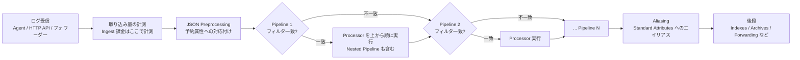
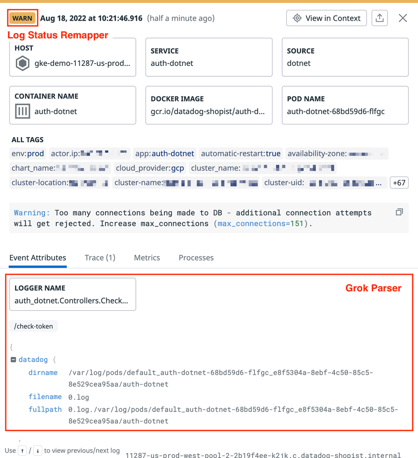
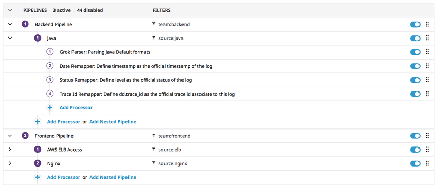
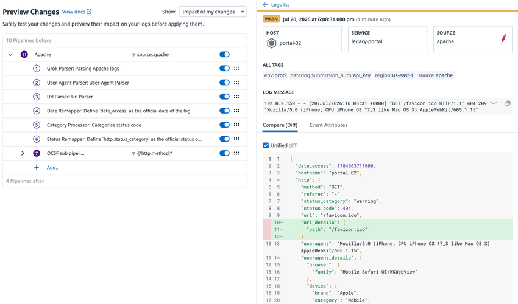
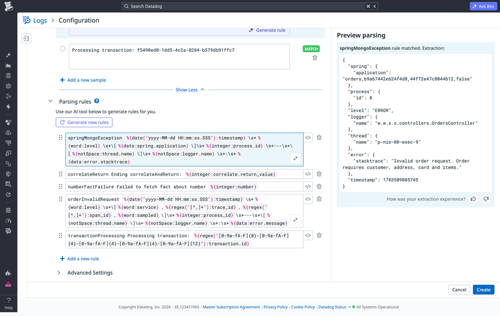
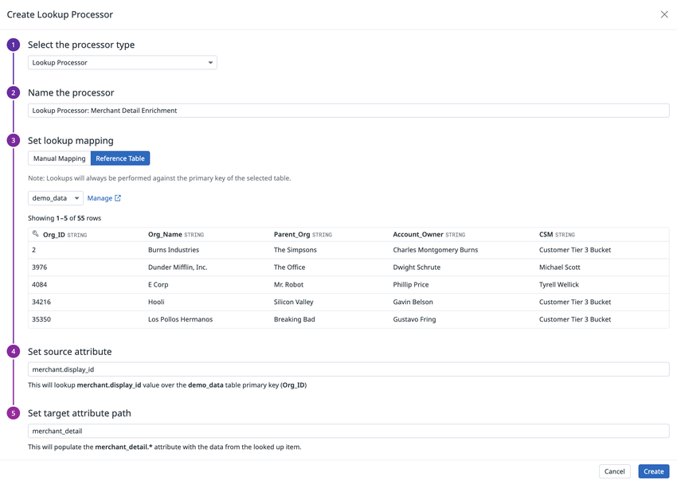
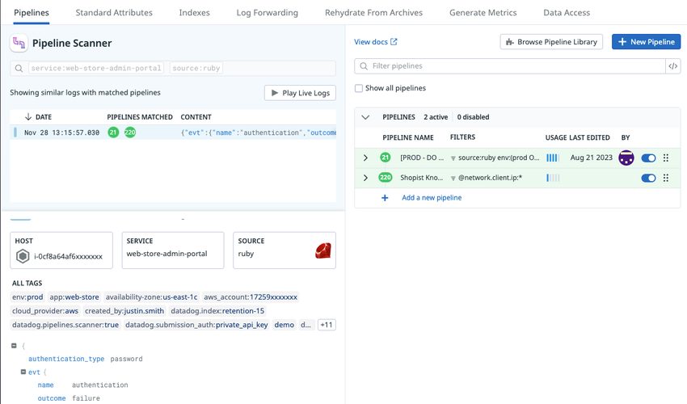

# Log Pipelines と処理

## 概要

Datadog Log Management の **Log Pipelines（ログパイプライン）** は、Datadog に取り込まれた（ingest された）ログを、Indexes（インデックス）・Archives（アーカイブ）・Log Forwarding などへ渡す前に、**クラウド側（Datadog の SaaS 上）で解析・変換・付加情報の追加を行う仕組み**である。Log Pipelines は、Pipeline（フィルタ条件付きの処理の箱）と、その中で順に実行される **Processor（プロセッサー）** から構成される。

本ファイルは以下に答える。

- ログが取り込まれてから、どの順序で何が処理されるか（JSON Preprocessing → Pipelines → Aliasing）
- Pipeline・Nested Pipeline・Integration Pipeline の仕様と操作
- Processor 全 21 種の用途、設定項目、API ペイロード、デフォルト値
- Grok Parser の構文（Matcher / Filter の全一覧、日付・key-value・CSV・XML の解析）
- 予約属性（Reserved Attributes）と Standard Attributes（標準属性）、Aliasing（エイリアス）
- 同じ属性に複数 Processor が書き込んだ場合の優先順位
- 権限（RBAC）、API、Terraform、制限値、課金上の扱い

> **対象範囲の注意:** 本ファイルの Pipelines / Processors は**クラウド側（Datadog 取り込み後）**の処理である。ログを自社環境内（オンプレミス／自社クラウド）で集約・加工・ルーティングする製品は Observability Pipelines であり、別ファイル [Observability Pipelines](./observability-pipelines.md) を参照。[出典](https://docs.datadoghq.com/logs/log_configuration/pipelines/)

関連する周辺領域は以下のファイルに分担している（本ファイルでは重複記述を避ける）。

| 内容 | 参照先 |
|---|---|
| Agent・API・各種フォワーダーからのログ収集、`source`/`service` の付与、マルチライン、Agent 側のマスキング（`mask_sequences` 等） | [ログ収集](./log-collection.md) |
| Indexes、Exclusion Filters、保持期間、Flex Logs、Archives、Rehydration、ログからのメトリクス生成 | [Indexes・保持・アーカイブ](./log-indexes-retention-archives.md) |
| Log Explorer、Facets、検索構文、Calculated Fields（クエリ時パース）、Patterns、Live Tail | [ログ検索と分析](./log-search-and-analytics.md) |
| 機密データのマスキング（Sensitive Data Scanner） | [Sensitive Data Scanner](../security/sensitive-data-scanner.md) |
| OCSF 正規化・脅威インテリジェンスを使う Cloud SIEM 側の運用 | [Cloud SIEM](../security/cloud-siem.md) |
| ログ運用のベストプラクティス | [ログ管理の実践](../../04_応用編/06-log-management-practices.md) |

## 処理全体の流れ

Datadog Log Management は、取り込んだログを次の順序で処理する。JSON 形式のログは Pipeline に入る前に **Preprocessing（前処理）** で予約属性への対応付けが行われ、その後 **すべての Pipeline のフィルタに対して順番に評価**される。フィルタに一致した Pipeline では、その中の Processor が上から順に実行され、次の Pipeline へ進む。Standard Attributes の **Aliasing は Pipeline 処理の後**に行われる。[出典](https://docs.datadoghq.com/logs/log_configuration/pipelines/) [出典](https://docs.datadoghq.com/logs/log_configuration/attributes_naming_convention/)



- 取り込み量の計測（metering）は Pipeline 処理より前に行われる。Exclude Attribute Processor の公式ドキュメントに「Metering occurs before pipeline processing」と明記されている。[出典](https://docs.datadoghq.com/logs/log_configuration/processors/exclude_attribute_processor/)
- 図中の「後段」の詳細な順序（Sensitive Data Scanner、メトリクス生成、Index の Exclusion Filter などの相対順序）は本ファイルの範囲外であり、各ファイルを参照。

### 用語

| 用語 | 説明 |
|---|---|
| Pipeline（パイプライン） | フィルタクエリと、順に実行される Processor（および Nested Pipeline）の集まり。名前は必須、説明とタグは任意。 |
| Nested Pipeline（ネストされたパイプライン／サブパイプライン） | Pipeline の中に置く Pipeline。Processor のみを含められる（Nested Pipeline の中にさらに Pipeline は置けない）。 |
| Processor（プロセッサー） | Pipeline 内でデータ構造化を行う 1 つの処理単位（パース、リマップ、付加情報追加など）。 |
| Integration Pipeline（インテグレーションパイプライン） | `source` に対応して Datadog が自動インストールする読み取り専用 Pipeline。 |
| Pipeline Library（パイプラインライブラリ） | Datadog が提供する Integration Pipeline の一覧。クローンして利用できる。 |
| Preprocessing（前処理） | JSON ログに対し、Pipeline の前に予約属性（date / message / status / service / host / trace_id / span_id / source）を決める処理。 |
| Reserved Attributes（予約属性） | `host`、`source`、`status`、`service`、`trace_id`、`message` など Datadog が特別扱いする属性。 |
| Standard Attributes（標準属性） | 組織の命名規約の基盤となる属性一覧（例：`network.client.ip`、`http.status_code`）。管理者がカスタマイズ可能。 |
| Aliasing（エイリアス） | 非標準の属性を Standard Attribute に対応付け、両方の属性を持たせる仕組み。 |

## 画面構成

Log Pipelines の設定画面は、Datadog の **Logs > Configuration（設定）** にある。上部のタブ（画面上の表記）は `Pipelines`、`Standard Attributes`、`Indexes`、`Log Forwarding`、`Rehydrate From Archives`、`Generate Metrics`、`Data Access` などで、Pipeline 関連の操作は `Pipelines` タブで行う（下記 Pipeline Scanner のスクリーンショットで確認できるタブ構成。組織の契約・権限により表示は異なる場合がある）。[出典](https://docs.datadoghq.com/logs/log_configuration/pipeline_scanner/)

| 画面要素 | 内容 |
|---|---|
| `New Pipeline` ボタン | 新しいカスタム Pipeline を作成する。 |
| `Browse Pipeline Library` ボタン | Integration Pipeline Library を開く。 |
| `Preprocessing for JSON logs` | JSON 前処理の対応付けを編集する（URL は `/logs/pipelines/remapping`）。 |
| `Pipeline Scanner` | 特定ログがどの Pipeline / Processor で変更されたかを追跡する。 |
| Pipeline 一覧 | 各 Pipeline の名前、フィルタ、推定使用量（USAGE）、最終更新日時（LAST EDITED）と更新者（BY）、有効/無効トグル、並べ替えハンドルが表示される。 |
| `Auto-Processing` タブ | 【Preview】Auto-Processing のエントリーを管理する（Preview 参加組織のみ）。 |

## JSON Preprocessing（前処理）

### 概要と目的

Log Management の JSON Preprocessing は、**JSON 形式のログが Pipeline に入る前**に実行され、予約属性（`timestamp`、`status`、`host`、`service`、`message` など）をどの JSON キーから取るかを決める処理である。デフォルト設定は標準的なログフォワーダー向けになっており、独自の属性名を使っている場合はここで対応付けを変更する。[出典](https://docs.datadoghq.com/logs/log_configuration/pipelines/#preprocessing)

設定手順：`Logs > Configuration > Pipelines` → `Preprocessing for JSON logs` を選択 → 予約属性ごとに参照する属性名を変更する。

> **重要:** JSON Preprocessing は、ログの属性を `host` として定義できる**唯一の方法**である。Attribute Remapper では `host` をリマップできない。[出典](https://docs.datadoghq.com/logs/log_configuration/pipelines/#preprocessing) [出典](https://docs.datadoghq.com/logs/log_configuration/processors/remapper/)

### 予約属性ごとのデフォルト参照属性

下表は JSON ログに含まれていた場合に、各予約属性として解釈される属性名のデフォルト一覧である（Pipelines ドキュメントの記載順）。[出典](https://docs.datadoghq.com/logs/log_configuration/pipelines/#preprocessing)

| 予約属性 | デフォルトで参照される JSON 属性 | Pipeline で後から変更する Processor |
|---|---|---|
| Source | `ddsource` | （専用 Processor なし。収集側で `source` を設定） |
| Host | `host`、`hostname`、`syslog.hostname` | （Pipeline では変更不可。Preprocessing のみ） |
| Date | `@timestamp`、`timestamp`、`_timestamp`、`Timestamp`、`eventTime`、`date`、`published_date`、`syslog.timestamp` | Log Date Remapper |
| Message | `message`、`msg`、`log` | Log Message Remapper |
| Status | `status`、`severity`、`level`、`syslog.severity` | Log Status Remapper |
| Service | `service`、`syslog.appname`、`dd.service` | Service Remapper |
| Trace ID | `dd.trace_id`、`contextMap.dd.trace_id`、`named_tags.dd.trace_id`、`trace_id` | Trace Remapper |
| Span ID | `dd.span_id`、`contextMap.dd.span_id`、`named_tags.dd.span_id`、`span_id` | Span Remapper |

補足事項：

- **Source:** JSON ログに `ddsource` 属性があると、その値がログの `source` になる。Datadog と同じ source 名を使うには Integration Pipeline Library の名称に合わせる。コンテナ環境のログで source / service の既定値を上書きするには環境変数（オートディスカバリーのラベル等）を使う必要がある（詳細は [ログ収集](./log-collection.md)）。
- **Host:** Datadog Agent 経由、または RFC5424 形式の場合は host が自動設定される。**Kubernetes で Agent が取り込んだ JSON ログに `host`、`hostname`、`syslog.hostname` キーが含まれると、その値が Agent のホスト名を上書き**し、そのログは正しいホストのホストレベルタグを継承しなくなる。Datadog はこれらの属性をログから除去することを推奨している。
- **Date:** 認識される日付形式は **ISO8601、UNIX エポックミリ秒、RFC3164**。公式日付が **18 時間より古い**ログは拒否される。どの日付属性もない場合、Datadog は受信時刻をタイムスタンプとする。
- **Message:** `message` の値はログ本文として Log Explorer に表示され、全文検索の対象としてインデックスされる。
- **Trace ID / Span ID:** Datadog の SDK（トレーシングライブラリ）はログへのトレース ID・スパン ID の自動注入に対応している（[APM インスツルメンテーション](../apm/apm-instrumentation.md)）。

> **注意（ドキュメント間の差異）:** Log Date Remapper のドキュメントでは「受信時にタイムスタンプとして使う既定属性」として `timestamp`、`date`、`_timestamp`、`Timestamp`、`eventTime`、`published_date` の 6 つのみを列挙しており、Pipelines ドキュメントの Preprocessing 一覧（`@timestamp` と `syslog.timestamp` を含む 8 つ）と一致しない。本ファイルは Preprocessing 画面の設定を説明する Pipelines ドキュメントの一覧を正とした。[出典](https://docs.datadoghq.com/logs/log_configuration/processors/log_date_remapper/)

## 予約属性（Reserved Attributes）

Log Management の予約属性は、ログとともに自動的に取り込まれ、Datadog 内で特別な意味を持つ属性である。トレースやメトリクスも収集している場合は、`env`・`service`・`version` の 3 タグによる Unified Service Tagging の設定が推奨される（[Tagging](../platform/tagging.md)）。[出典](https://docs.datadoghq.com/logs/log_configuration/attributes_naming_convention/#reserved-attributes)

| 属性 | 型 | 説明 | 変更手段 |
|---|---|---|---|
| `host` | string | 送信元ホスト名（メトリクスで定義されたものと同じ）。一致するホストのホストタグが自動でログに付与される。Agent が自動設定する。 | JSON Preprocessing のみ |
| `source` | string | ログの発生元技術（インテグレーション名）。インテグレーション名と一致すると、対応するパーサー（Integration Pipeline）と Facet が自動インストールされる。例：`nginx`、`postgresql`。 | 収集設定、JSON の `ddsource` |
| `status` | string | ログのレベル／重大度。Patterns の定義に使われ、UI で専用表示される。 | Log Status Remapper |
| `service` | string | ログを生成したアプリケーション／サービス名。Logs と APM 間の遷移に使われるため、両製品で同じ値にする。 | Service Remapper |
| `trace_id` | number | トレースの Trace ID。ログとトレースの相関に使う。 | Trace Remapper |
| `message` | string | ログ本文。Live Tail で強調表示され、全文検索用にインデックスされる。 | Log Message Remapper |

- 上記に加え、Processor のドキュメント上は `date`（Log Date Remapper）と `span_id`（Span Remapper）も専用 Remapper でしか変更できない属性として扱われる。[出典](https://docs.datadoghq.com/logs/log_configuration/processors/remapper/)
- Trace ID / Span ID は、Log Explorer の UI ではログの属性として表示されない。[出典](https://docs.datadoghq.com/logs/log_configuration/processors/trace_remapper/)
- スタックトレースを UI で専用表示させるには、`logger.name`、`logger.thread_name`、`error.stack`、`error.message`、`error.kind` の属性名を使う。Integration Pipeline は既定でロギングライブラリのパラメーターをこれらの属性にリマップし、スタックトレースから `error.message` と `error.kind` を抽出しようとする。[出典](https://docs.datadoghq.com/logs/log_collection/#attributes-for-stack-traces)

## Pipeline

### Pipeline の動作仕様

| 項目 | 仕様 |
|---|---|
| 評価方法 | 各ログは**すべての Pipeline のフィルタ**に対して評価される。一致した Pipeline では全 Processor が順に適用され、その後に次の Pipeline へ進む。 |
| 評価順序 | Pipeline 一覧の上から下への順序。順序は画面の `Move to` か API / Terraform の pipeline order で変更する。 |
| フィルタのタイミング | フィルタは**その Pipeline の Processor より前**に評価される。そのため、**同じ Pipeline 内で抽出した属性ではフィルタできない**。 |
| フィルタ構文 | Log Explorer の検索構文と同じ。ドロップダウンから選ぶか、`</>` アイコンでクエリを直接記述する。 |
| 対象ログ | Raw（テキスト）・JSON を問わずすべてのログに適用できる。サーバー側のログ設定変更は不要。 |
| 名前・説明・タグ | 名前は必須。説明とタグは任意。**Pipeline のタグはログには付与されず**、Pipelines 画面での検索・絞り込みにのみ使う。 |
| 有効/無効 | Pipeline ごとにトグルで切り替え可能。 |

[出典](https://docs.datadoghq.com/logs/log_configuration/pipelines/)

### Pipeline の作成手順

1. `Logs > Configuration > Pipelines` を開く。
2. `New Pipeline` を選択する。
3. Live Tail プレビューからログを選んでフィルタを適用するか、独自のフィルタを設定する（ドロップダウン、または `</>` でクエリ入力）。
4. Pipeline 名を入力する。
5. （任意）用途やオーナーを示す説明とタグを追加する。
6. `Create` を押す。

Processor または Nested Pipeline の追加は、Pipeline にカーソルを合わせて矢印で展開し、`Add Processor` または `Add Nested Pipeline` を選択する。[出典](https://docs.datadoghq.com/logs/log_configuration/pipelines/#create-a-pipeline)



*図: Pipeline で処理されたログの詳細パネルの例*

画面説明：Log Explorer のログ詳細パネル。上部に `WARN` のステータスバッジ（Log Status Remapper によって設定されたことを示す赤枠注記）、`HOST`・`SERVICE`（`auth-dotnet`）・`SOURCE`（`dotnet`）・`CONTAINER NAME`・`DOCKER IMAGE`・`POD NAME` のカード、`ALL TAGS` のタグ一覧、ログメッセージ本文が並ぶ。下部の `Event Attributes` タブには、Grok Parser が抽出した `LOGGER NAME` や `datadog.dirname`・`filename`・`fullpath` などの構造化属性が表示されている（赤枠注記 "Grok Parser"）。

出典: https://docs.datadoghq.com/logs/log_configuration/pipelines/ （取得日: 2026-11-02）

### Nested Pipeline（ネストされたパイプライン）

Log Management の Nested Pipeline は、Pipeline の中に置く Pipeline で、処理を 2 段階に分けるために使う。例えば 1 段目で `team:backend` のような上位フィルタで絞り、2 段目でインテグレーションやサービス単位で絞る。[出典](https://docs.datadoghq.com/logs/log_configuration/pipelines/#nested-pipelines)

| 項目 | 仕様 |
|---|---|
| 含められる要素 | トップレベル Pipeline：Nested Pipeline と Processor の両方。Nested Pipeline：**Processor のみ**。 |
| ネストの深さ | 上記の仕様により実質 2 階層（トップレベル + Nested）。 |
| 作り方 | 既存 Pipeline の `Move to` アイコン → 移動先 Pipeline を選択 → `Move`。または親 Pipeline 内で `Add Nested Pipeline`。 |
| 移動の制約 | Nested Pipeline を含む Pipeline は、別のトップレベル位置にしか移動できない（他の Pipeline の中には入れられない）。読み取り専用 Pipeline の中には移動できない。 |



*図: Nested Pipeline の構成例*

画面説明：Pipeline 一覧の画面。ヘッダーに「PIPELINES 3 active | 44 disabled」と「FILTERS」列。1 番目のトップレベル Pipeline「Backend Pipeline」（フィルタ `team:backend`）の中に Nested Pipeline「Java」（フィルタ `source:java`）があり、その中に 4 つの Processor（Grok Parser: Parsing Java Default formats、Date Remapper、Status Remapper、Trace Id Remapper）が番号付きで並ぶ。2 番目のトップレベル Pipeline「Frontend Pipeline」（`team:frontend`）の中には「AWS ELB Access」（`source:elb`）と「Nginx」（`source:nginx`）の Nested Pipeline がある。各行の右端に有効/無効トグルと並べ替えハンドル、各階層の末尾に `Add Processor` / `Add Nested Pipeline` リンクがある。

出典: https://docs.datadoghq.com/logs/log_configuration/pipelines/ （取得日: 2026-11-02）

### Pipeline 変更のプレビュー（Preview pipeline changes）

Log Management は、Pipeline や Processor を作成・編集する際に、変更を適用する前に影響をプレビューできる。プレビューは、提案中の変更で処理した Live Tail のログを使う。[出典](https://docs.datadoghq.com/logs/log_configuration/pipelines/#preview-pipeline-changes)

| 設定 | 選択肢 | 意味 |
|---|---|---|
| 比較対象 | `Your changes` | 現在デプロイ済みのバージョンと、変更後のバージョンを比較する。 |
| | `Entire pipeline` | Pipeline に入る前のログと、Pipeline 全体を通過した後のログを比較する。 |
| 絞り込み | `All logs` | Live Tail のすべてのログ。 |
| | `Impacted logs` | このセッションでの編集により変化したログのみ。 |
| | `Not impacted logs` | 編集によって変化しないログのみ。 |



*図: Pipeline 変更のプレビュー（シミュレーション）画面*

画面説明：左側に「Preview Changes」パネルがあり、`Show:` ドロップダウン（例: "Impact of my changes"）、「10 Pipelines before」、対象 Pipeline「Apache」（フィルタ `source:apache`）とその Processor 一覧（Grok Parser、User-Agent Parser、Url Parser、Date Remapper、Category Processor、Status Remapper、OCSF sub pipeline）、「4 Pipelines after」が表示される。右側には選択したログの詳細（HOST、SERVICE、SOURCE、タグ、LOG MESSAGE）と `Compare (Diff)` タブがあり、Unified diff 形式で追加された属性（例: `url_details.path`）が緑でハイライトされる。

出典: https://docs.datadoghq.com/logs/log_configuration/pipelines/ （取得日: 2026-11-02）

### Pipeline の管理

| 操作・機能 | 内容 |
|---|---|
| 変更情報 | Pipeline / Processor の最終変更日時と変更ユーザーを表示。この情報で Pipeline を絞り込める。 |
| ファセット絞り込み | 有効/無効、読み取り専用か否かなどの属性で Pipeline 一覧を絞り込める。 |
| 並べ替え | スライドするオプションパネルの `Move to` で、モーダル上の正確な位置を指定して移動する。 |
| クローン | 既存のルールと Processor を再利用するために Pipeline を複製できる。**クローンすると、クローン元の Pipeline は自動的に無効化される**（トグルで再度有効化する）。 |
| 推定使用量（Estimated usage metrics） | 各 Pipeline に、その Pipeline が取り込み・変更したログの量（volume）と件数（count）を表示する。各 Pipeline から標準の **Logs Estimated Usage Dashboard** へリンクがある。 |

[出典](https://docs.datadoghq.com/logs/log_configuration/pipelines/#manage-your-pipelines)

## Integration Pipelines と Pipeline Library

### Integration Pipeline の仕様

Log Management の Integration Pipeline（インテグレーション処理パイプライン）は、ログ収集を設定した特定のソースに対して提供される Pipeline で、そのソースに適した方法でログをパースし、対応する Facet を Log Explorer に追加する。[出典](https://docs.datadoghq.com/logs/log_configuration/pipelines/#integration-pipelines)

| 項目 | 仕様 |
|---|---|
| インストール契機 | 対応する `source` を持つ**最初のログを受信した時点で自動インストール**され、Pipeline 一覧に追加される。 |
| 推奨される使い方 | 該当インテグレーションのドキュメントに従い、ログの `source` を正しく設定する。 |
| 編集 | **読み取り専用**。編集するには**クローンしてクローン側を編集**する（クローン元は自動で無効化される）。 |
| 削除 | **削除不可。無効化のみ可能**。 |
| Facet | Integration Pipeline ごとに対応する Facet が Log Explorer に追加される。 |
| 対応インテグレーション一覧 | Integrations 一覧の「Log Collection」カテゴリ（https://docs.datadoghq.com/integrations/#cat-log-collection）。 |

### Integration Pipeline Library

Integration Pipeline Library は、Datadog が提供する Integration Pipeline の全一覧で、Datadog が各ログ形式を既定でどう処理するかを確認できる。`Browse Pipeline Library` から開き、クローンボタンで Integration Pipeline をコピーできる。ただし Datadog は、ライブラリからコピーするよりも、**ログの `source` を設定してインテグレーションとしてインストールする方法を推奨**している。[出典](https://docs.datadoghq.com/logs/log_configuration/pipelines/#integration-pipeline-library)

### Integration Pipeline 利用時の注意

- Integration Pipeline の Processor（Status Remapper、Service Remapper 等）は、後述の「書き込み優先順位」の規則に従う。例えば Log Status Remapper は「最初に適用されたものが有効」であるため、Integration Pipeline が先に status を設定した場合、その後ろのカスタム Pipeline の Status Remapper は効かない。カスタムで上書きしたい場合は、Integration Pipeline をクローンして編集するか、Pipeline の順序を見直す（公式の優先順位規則からの帰結）。[出典](https://docs.datadoghq.com/logs/log_configuration/pipelines/#attribute-precedence)
- クローンした Pipeline は Integration Pipeline の今後の更新を自動では受け取らない、という点は公開情報では明示を確認できず。【経験則】一般にクローン後はクローン側を自組織で保守する前提で運用される。

## Processor 全一覧

Log Management の Processor は、Pipeline 内で実行されるデータ構造化処理である。公式ドキュメントには以下の 21 種が掲載されている（2026-11-02 時点）。[出典](https://docs.datadoghq.com/logs/log_configuration/processors/)

| # | Processor | API の `type` | Terraform のブロック名 | 主な用途 | 同一属性への書き込み規則 |
|---|---|---|---|---|---|
| 1 | Arithmetic Processor | `arithmetic-processor` | `arithmetic_processor` | 数値属性から計算式の結果を新属性に格納 | 後勝ち |
| 2 | Array Map Processor | `array-map-processor` | `array_map_processor` | 配列の各要素にサブ Processor を適用し新配列を生成 | `override_on_conflict` 次第 |
| 3 | Array Processor | `array-processor` | `array_processor` | 配列からの値抽出・長さ算出・追加・key-value 展開 | 公開情報では明記なし |
| 4 | Attribute Remapper（Remapper） | `attribute-remapper` | `attribute_remapper` | 属性・タグを別の属性・タグへリマップ | `override_on_conflict` 次第 |
| 5 | Category Processor | `category-processor` | `category_processor` | 検索クエリに一致したログにカテゴリ値を付与 | 後勝ち |
| 6 | Decoder Processor | `decoder-processor`（※） | `decoder_processor` | Base64 / Hex（Base16）のデコード | 後勝ち |
| 7 | Exclude Attribute Processor | `exclude-attribute` | `exclude_attribute_processor` | 指定属性をログから削除 | — |
| 8 | GeoIP Parser | `geo-ip-parser` | `geo_ip_parser` | IP アドレスから大陸・国・地域・都市を抽出 | 後勝ち |
| 9 | Grok Parser | `grok-parser` | `grok_parser` | Grok ルールでメッセージ／属性をパース | 後勝ち |
| 10 | Log Date Remapper | `date-remapper` | `date_remapper` | 属性をログの公式タイムスタンプに設定 | **最後のものが有効** |
| 11 | Log Message Remapper | `message-remapper` | `message_remapper` | 属性をログの公式メッセージに設定 | 先勝ち |
| 12 | Log Status Remapper | `status-remapper` | `status_remapper` | 属性をログの公式ステータスに設定 | 先勝ち |
| 13 | Lookup Processor | `lookup-processor` | `lookup_processor`（手動マッピング）／`reference_table_lookup_processor`（Reference Table） | 属性値を対応表／Reference Table で可読な値に変換 | 後勝ち |
| 14 | OCSF Processor | `schema-processor`（※） | `schema_processor` | セキュリティログを OCSF スキーマに正規化 | 公開情報では明記なし |
| 15 | Service Remapper | `service-remapper` | `service_remapper` | 属性をログの公式サービスに設定 | 先勝ち |
| 16 | Span Remapper | `span-id-remapper` | `span_id_remapper` | 属性をスパン ID に設定 | 先勝ち |
| 17 | String Builder Processor | `string-builder-processor` | `string_builder_processor` | テンプレートで属性と文字列を連結 | 後勝ち |
| 18 | Threat Intel Processor | 公開情報では確認できず | 公開情報では確認できず | IoC テーブル照合による脅威インテリジェンス付与 | 公開情報では明記なし |
| 19 | Trace Remapper | `trace-id-remapper` | `trace_id_remapper` | 属性をトレース ID に設定 | 先勝ち |
| 20 | URL Parser | `url-parser` | `url_parser` | URL からクエリパラメーター等を抽出 | 後勝ち |
| 21 | User-Agent Parser | `user-agent-parser` | `user_agent_parser` | User-Agent から OS・ブラウザ・デバイスを抽出 | 後勝ち |

- API の `type` は各 Processor ドキュメントの API ペイロード例から転記した。※印（Decoder Processor・OCSF Processor）は Processor ドキュメントに API ペイロードの記載がないため、Datadog 公式 API クライアントの OpenAPI 定義（v1）の `LogsDecoderProcessorType`・`LogsSchemaProcessorType` から転記した。[出典](https://github.com/DataDog/datadog-api-client-go/blob/master/.generator/schemas/v1/openapi.yaml)Terraform のブロック名は `terraform-provider-datadog` の `datadog_logs_custom_pipeline` リソースのドキュメントに基づく（Nested Pipeline は `processor.pipeline` ブロック）。[出典](https://github.com/DataDog/terraform-provider-datadog/blob/master/docs/resources/logs_custom_pipeline.md)
- 書き込み規則の詳細は「[同一属性への書き込み優先順位](#同一属性への書き込み優先順位)」を参照。
- 全 Processor 共通で、API の `is_enabled` の**デフォルトは `false`**（API で作成する場合は明示的に `true` を指定しないと無効状態で作成される）。`name` は任意。

## Processor 別リファレンス

### Grok Parser

Log Management の Grok Parser は、カスタム Grok ルールで、ログの `message` 全体または特定の属性をパースして属性を抽出する Processor である。代表例は NGINX ログのメッセージから IP アドレス、ユーザー、リクエスト時刻、メソッド、URL、HTTP バージョン、ステータスコード、バイト数を抽出する用途。[出典](https://docs.datadoghq.com/logs/log_configuration/processors/grok_parser/)

**UI での設定手順**

1. Pipeline を展開し `Add…` > `Grok Parser` をクリック。
2. `Name the processor` に名前を入力。
3. `Define parsing rules > Log samples` でサンプルを確認、または `Add a new sample` で追加（**最大 10 件、各 5,000 文字**）。Datadog は Pipeline フィルタに一致するログのうち、**量の多い上位 5 つのログパターン**からサンプルを取得する。
4. `Define parsing rules > Parsing rules` で `Tap to Parse` をクリックしてサンプルに一致するルールを生成するか、手動でルールを書く。
5. （任意）`Advanced Settings` で、既定の `message` 以外の属性をパース対象にする（`Extract from`）、またはヘルパールール（`Helper Rules`）を定義する。
6. サンプルを選択し、`Preview parsing` パネルで結果を確認する。結果は `Match`（一致し属性を抽出）、`Match with a warning`（一致したが属性抽出なし）、`No Match`（どのルールにも一致しない）のいずれか。
7. `Create` をクリック。

**API パラメーター**

```json
{
  "type": "grok-parser",
  "name": "Parsing Log message",
  "is_enabled": true,
  "source": "message",
  "samples": ["sample log 1", "sample log 2"],
  "grok": {"support_rules": "<SUPPORT_RULES>", "match_rules": "<MATCH_RULES>"}
}
```

| パラメーター | 型 | 必須 | 説明・デフォルト |
|---|---|---|---|
| `type` | String | Yes | `grok-parser` |
| `name` | String | No | Processor 名 |
| `is_enabled` | Boolean | No | 既定 `false` |
| `source` | String | Yes | パース対象の属性名。既定 `message` |
| `samples` | Array of strings | No | サンプルログ（API ドキュメント上は**最大 5 件**） |
| `grok.support_rules` | String | Yes | ヘルパー（サポート）ルール |
| `grok.match_rules` | String | Yes | マッチルール |

> **注意（UI と API の差異）:** サンプル数の上限は UI 手順では「最大 10 件」、API パラメーター表では「最大 5 件」と記載されている。どちらも公式ドキュメントの記載であり、2026-11-02 時点で統一された記述は確認できない。[出典](https://docs.datadoghq.com/logs/log_configuration/processors/grok_parser/)

> **API 利用時の注意:** API ドキュメントによると、Grok ルールは JSON 出力に影響することがあり、取得したデータを別リクエストのボディに使う場合、`\s` のような正規表現を含むルールではエスケープされたスペースを `%{space}` に置き換える必要がある。[出典](https://docs.datadoghq.com/api/latest/logs-pipelines/)



*図: Grok Parser の設定画面（AI によるルール生成を含む）*

画面説明：`Logs > Configuration` 配下の Grok Parser 作成画面。上部にログサンプル入力欄（サンプルごとに `MATCH` などの判定バッジと削除アイコン、`Generate rule` ボタン、`Add a new sample` リンク）。中央の `Parsing rules` セクションには「Use our AI tool below to generate rules for you.」の説明と `Generate new rules` ボタン、複数のルール（例: `springMongoException %{date("yyyy-MM-dd HH:mm:ss.SSS"):timestamp} ...`）が並び、各ルールに並べ替えハンドル・コード表示・削除アイコンがある。下部に `Add a new rule` と `Advanced Settings`。右側の `Preview parsing` パネルに「springMongoException rule matched. Extraction:」として抽出結果の JSON が表示される。右下に `Cancel` / `Create` ボタン。

出典: https://docs.datadoghq.com/logs/log_configuration/processors/grok_parser/ （取得日: 2026-11-02）

Grok の構文詳細は「[Grok パース構文リファレンス](#grok-パース構文リファレンス)」を参照。

### Attribute Remapper（Remapper）

Log Management の Attribute Remapper は、1 つ以上のソース属性またはタグを、別のターゲット属性またはタグにリマップする Processor である。主にログ形式の正規化（Standard Attribute への寄せ）に使う。[出典](https://docs.datadoghq.com/logs/log_configuration/processors/remapper/)

| 仕様 | 内容 |
|---|---|
| 名前の制約 | 属性・タグ名の一般制約に加え、ターゲット名に `:` と `,` は使えない。 |
| 型変換 | ターゲットが属性の場合、値を `String`・`Integer`・`Double` に変換（キャスト）できる。失敗時は元の値と型を保持。`Double` の小数点は `.` である必要がある。 |
| 予約属性 | **予約属性はリマップできない**。`host` はリマップ不可。`message`/`service`/`status`/`date`/`trace_id`/`span_id` はそれぞれ専用 Remapper を使う。 |

```json
{
  "type": "attribute-remapper",
  "name": "Remap <SOURCE_ATTRIBUTE> to <TARGET_ATTRIBUTE>",
  "is_enabled": true,
  "source_type": "attribute",
  "sources": ["<SOURCE_ATTRIBUTE>"],
  "target": "<TARGET_ATTRIBUTE>",
  "target_type": "tag",
  "target_format": "integer",
  "preserve_source": false,
  "override_on_conflict": false
}
```

| パラメーター | 型 | 必須 | 説明・デフォルト |
|---|---|---|---|
| `source_type` | String | No | ソースが `attribute` か `tag` か。既定 `attribute` |
| `sources` | Array of strings | Yes | ソース属性またはタグの配列 |
| `target` | String | Yes | リマップ先の属性名またはタグ名 |
| `target_type` | String | No | ターゲットが `attribute` か `tag` か。既定 `attribute` |
| `target_format` | String | No | 型変換。`auto`（変換なし）、`string`、`integer`。既定 `auto` |
| `preserve_source` | Boolean | No | ソースを残すか。既定 `false`（ソースは削除される） |
| `override_on_conflict` | Boolean | No | ターゲットが既に存在する場合に上書きするか。既定 `false` |

> **注意:** Remapper の API 表では `target_format` の値が `auto`・`string`・`integer` の 3 つだが、同ページの概要では `Double` へのキャストも可能とされ、Array Map Processor のサブ Remapper では `double` が明記されている。`double` の指定可否はドキュメント上で表記揺れがある。[出典](https://docs.datadoghq.com/logs/log_configuration/processors/remapper/) [出典](https://docs.datadoghq.com/logs/log_configuration/processors/array_map_processor/)

### Log Date Remapper

Log Management の Log Date Remapper は、指定した属性をログの公式タイムスタンプ（`date`）に設定する Processor である。既定の日付属性以外に日付が入っている場合（例：Akamai Stream の `reqTimeMillis`）や、Grok でメッセージから抽出した日付を公式日付にする場合に使う。[出典](https://docs.datadoghq.com/logs/log_configuration/processors/log_date_remapper/)

| 仕様 | 内容 |
|---|---|
| 認識する日付形式 | ISO8601、UNIX（エポックミリ秒）、RFC3164 |
| 受け付ける時間範囲 | **過去 18 時間〜未来 2 時間**のタイムスタンプ |
| 形式が合わない場合 | Grok Parser の `date()` マッチャーでエポックミリ秒に変換して新属性に入れ、その属性を Date Remapper で指定する |
| 日付属性がない場合 | 受信時刻がタイムスタンプになる |
| 複数適用時 | Pipeline の順序で**最後の** Log Date Remapper が有効 |
| ISO 8601 の補足 | ISO 8601-1:2019 では基本形式 `T[hh][mm][ss]`、拡張形式 `T[hh]:[mm]:[ss]`。旧版では `T` を省略していた |

```json
{"type": "date-remapper", "name": "Define <SOURCE_ATTRIBUTE> as the official Date of the log", "is_enabled": false, "sources": ["<SOURCE_ATTRIBUTE_1>"]}
```

| パラメーター | 型 | 必須 | 説明・デフォルト |
|---|---|---|---|
| `sources` | Array of strings | Yes | ソース属性の配列 |

> Grok で日付をパースしただけでは公式日付にはならない。公式日付にするには後続の Log Date Remapper が必要。[出典](https://docs.datadoghq.com/logs/log_configuration/parsing/#parsing-dates)

### Log Status Remapper

Log Management の Log Status Remapper は、指定した属性をログの公式ステータス（`status`）に設定する Processor である。[出典](https://docs.datadoghq.com/logs/log_configuration/processors/log_status_remapper/)

**値のマッピング規則**（大文字小文字は区別しない）

| 入力値 | マッピング先 |
|---|---|
| 整数 0〜7 | Syslog の重大度標準に対応（0=emerg … 7=debug） |
| `emerg` または `f` で始まる文字列 | emerg (0) |
| `a` で始まる文字列 | alert (1) |
| `c` で始まる文字列 | critical (2) |
| `err` で始まる文字列 | error (3) |
| `w` で始まる文字列 | warning (4) |
| `n` で始まる文字列 | notice (5) |
| `i` で始まる文字列 | info (6) |
| `d`、`t`、`v`、`trace`、`verbose` で始まる文字列 | debug (7) |
| `o` または `s` で始まる文字列、`OK` または `Success` に一致 | OK |
| 上記以外すべて | info (6) |

| 仕様 | 内容 |
|---|---|
| 複数適用時（同一 Pipeline 内） | Pipeline の順序で**最初の** Status Remapper のみ有効 |
| 複数 Pipeline にまたがる場合 | ログに一致したすべての Pipeline の中で、**最初に出会った** Status Remapper のみ適用 |
| 典型用途 | 既定以外の属性をステータスにする、Grok でメッセージから抽出したレベルをステータスにする |

```json
{"type": "status-remapper", "name": "Define <SOURCE_ATTRIBUTE> as the official status of the log", "is_enabled": true, "sources": ["<SOURCE_ATTRIBUTE>"]}
```

> **実務上の注意:** 上記の規則上、日本語のレベル値（例：「エラー」「警告」）はどの英字の先頭文字にも一致せず `info` になる。Windows イベントログ（日本語環境）などでは、Category Processor で日本語の値を英語の区分（`error` 等）に変換した属性を作り、その属性を Status Remapper に指定する方法が紹介されている。【第三者情報】[出典](https://dev.classmethod.jp/articles/datadog-pipelines-processors-guide/)（2024-12 公開）

### Service Remapper

Log Management の Service Remapper は、1 つ以上の属性をログの公式サービス（`service`）に設定する Processor である。例：Microsoft 365 ログの `Workload` 属性をサービスにする、Grok でメッセージから抽出したサービス名を使う。[出典](https://docs.datadoghq.com/logs/log_configuration/processors/service_remapper/)

| 仕様 | 内容 |
|---|---|
| 複数適用時 | Pipeline の順序で**最初の** Service Remapper のみ有効 |
| API | `{"type": "service-remapper", "sources": ["<SOURCE_ATTRIBUTE>"], ...}`。`sources` は必須 |

### Log Message Remapper

Log Management の Log Message Remapper は、1 つ以上の属性をログの公式メッセージ（`message`）に設定する Processor である。`message` の値は Log Explorer の Content 列に表示され、検索バーでの全文検索対象になる。例：Okta ログの `displayMessage` を公式メッセージにする。[出典](https://docs.datadoghq.com/logs/log_configuration/processors/log_message_remapper/)

| 仕様 | 内容 |
|---|---|
| 複数ソース指定 | 先頭から順に存在する属性を使う（`attribute1` がなければ `attribute2`、それもなければ `attribute3`）。 |
| 複数属性を組み合わせたい場合 | 先に String Builder Processor で文字列属性を作り、それを Message Remapper で指定する。 |
| 複数適用時 | Pipeline の順序で**最初の** Message Remapper のみ有効 |
| API | `{"type": "message-remapper", "sources": ["msg"], ...}`。`sources` 必須（ドキュメント上の既定値 `msg`） |

### Trace Remapper / Span Remapper

Log Management の Trace Remapper と Span Remapper は、ログの属性をそれぞれトレース ID・スパン ID として定義し、APM のトレース／スパンとログを相関させる Processor である。トレースとログの相関には、(1) アプリケーションログにトレース ID・スパン ID を注入する方法（ログインテグレーションが残りの設定を自動で処理）と、(2) これらの Remapper を使う方法の 2 つがある。主な用途は、Grok Parser でメッセージ内から抽出した ID を指定するケース。[出典](https://docs.datadoghq.com/logs/log_configuration/processors/trace_remapper/) [出典](https://docs.datadoghq.com/logs/log_configuration/processors/span_remapper/)

| Processor | API `type` | `sources` | 既定値 | 複数適用時 |
|---|---|---|---|---|
| Trace Remapper | `trace-id-remapper` | 任意 | `dd.trace_id` | 先勝ち |
| Span Remapper | `span-id-remapper` | 任意 | `dd.span_id` | 先勝ち |

- トレース ID とスパン ID は、UI 上のログやログ属性には表示されない。
- ログとトレースの接続設定は [APM インスツルメンテーション](../apm/apm-instrumentation.md) を参照。

### Category Processor

Log Management の Category Processor は、指定した検索クエリに一致したログに、新しい属性（カテゴリ値）を追加する Processor である。URL グループ、マシングループ、環境、応答時間のバケットなど、分析用のグループ化に使う。Auth0 ログの成功/失敗の分類、IIS ログの内容に基づくステータス分類などが典型例。[出典](https://docs.datadoghq.com/logs/log_configuration/processors/category_processor/)

| 仕様 | 内容 |
|---|---|
| クエリ構文 | Log Explorer の検索バーと同じ構文。Facet か否かに関わらず任意の属性・タグを対象にでき、ワイルドカードも使用可。 |
| 評価方法 | **ログがいずれかのクエリに一致した時点で評価を停止**（上から順の先勝ち）。複数クエリに一致しうる場合は順序に注意。 |
| カテゴリ名 | 一意である必要がある。 |
| ターゲット属性名 | スペースや特殊文字を含まない名前。 |
| ステータスへの反映 | 作成したカテゴリを Log Status Remapper で公式ステータスにできる。 |

```json
{
  "type": "category-processor",
  "name": "Assign a custom value to the <TARGET_ATTRIBUTE> attribute",
  "is_enabled": true,
  "categories": [
    {"filter": {"query": "<QUERY_1>"}, "name": "<VALUE_TO_ASSIGN_1>"},
    {"filter": {"query": "<QUERY_2>"}, "name": "<VALUE_TO_ASSIGN_2>"}
  ],
  "target": "<TARGET_ATTRIBUTE>"
}
```

| パラメーター | 型 | 必須 | 説明 |
|---|---|---|---|
| `categories` | Array of Object | Yes | フィルタ（`filter.query`）と付与する値（`name`）の配列 |
| `target` | String | Yes | カテゴリ値を格納する属性名 |

> 「カテゴリ内のクエリの評価は先勝ち」と「Category Processor 同士が同じ属性に書き込む場合は後勝ち（後述の優先順位表）」は別の概念である。前者は 1 つの Processor 内のカテゴリ判定、後者は複数 Processor 間の上書き規則。

### Arithmetic Processor

Log Management の Arithmetic Processor は、数式の結果を新しい属性（スペースや特殊文字を含まない名前）としてログに追加する Processor である。単位の異なる時間属性を 1 つにそろえる、同一ログ内の属性同士を計算する、などに使う（例：Azure ログでナノ秒をミリ秒に変換）。[出典](https://docs.datadoghq.com/logs/log_configuration/processors/arithmetic_processor/)

| 仕様 | 内容 |
|---|---|
| 演算子 | `-`、`+`、`*`、`/` と括弧 |
| `-` の注意 | 属性名に `-` を含みうる（例：`start-time`）ため、**`-` の前後にスペースが必須**。例：`(end-time - start-time) / 1000` |
| 欠損属性 | 既定では属性が欠けていると計算をスキップ。`Replace missing attribute by 0` を選ぶと 0 で補完して計算する。属性が存在しない、または数値に変換できない場合に「欠損」と扱われる。 |
| 既存ターゲット | 既に存在する場合は**上書き**される。 |
| 精度 | 結果は**小数第 9 位**まで（例：`0.1234567891` → `0.123456789`）。 |
| 単位のスケーリング | 単純な倍率変換は Grok の `scale` フィルタも利用可能。 |

```json
{"type": "arithmetic-processor", "name": "<PROCESSOR_NAME>", "is_enabled": true, "expression": "<ARITHMETIC_OPERATION>", "target": "<TARGET_ATTRIBUTE>", "is_replace_missing": false}
```

| パラメーター | 型 | 必須 | 説明・デフォルト |
|---|---|---|---|
| `expression` | String | Yes | 1 つ以上の属性間の算術式 |
| `target` | String | Yes | 結果を格納する属性名 |
| `is_replace_missing` | Boolean | No | `true` で欠損属性を 0 に置換。既定 `false`（スキップ） |

### String Builder Processor

Log Management の String Builder Processor は、テンプレートの結果を新しい属性（スペースや特殊文字を含まない名前）としてログに追加する Processor である。テンプレートは生テキストと `%{attribute_path}` 形式のブロックで構成する。例：GSuite ログで `Actor %{usr.email} performed an event %{evt.name}` を組み立てる、外部アプリへ遷移しやすいよう URL を再構成する。[出典](https://docs.datadoghq.com/logs/log_configuration/processors/string_builder_processor/)

| 仕様 | 内容 |
|---|---|
| ブロックに使える値 | 値を持つ属性、または値の配列。オブジェクトやオブジェクトの配列は使えない（例：`%{http}` は失敗、`%{http.method}` は可）。 |
| 配列 | `%{array_ids}` → `123,456,789` のようにカンマ連結。オブジェクト配列の特定キー（`%{array_users.first_name}` → `John,Jack`）は可。 |
| 使えない属性の扱い | 空文字に置換するか、操作全体をスキップするかを選択。 |
| 既存ターゲット | 上書きされる。 |
| 長さ上限 | **テンプレート結果は 256 文字を超えられない**。 |

| パラメーター | 型 | 必須 | 説明・デフォルト |
|---|---|---|---|
| `template` | String | Yes | 属性と生テキストからなるテンプレート |
| `target` | String | Yes | 結果を格納する属性名 |
| `is_replace_missing` | Boolean | No | `true` で欠損属性を空文字に置換。既定 `false`（スキップ） |

### Lookup Processor

Log Management の Lookup Processor は、ログ属性の値と、人が読める値との対応を、**Processor 内のマッピング表（Manual Mapping）** または **Reference Table（リファレンステーブル）** を使って付与する Processor である。例：内部サービス ID をサービス名に変換、ユーザー ID をユーザー名に変換、接続してきた MAC アドレスが盗難端末リストに含まれるかの確認。[出典](https://docs.datadoghq.com/logs/log_configuration/processors/lookup_processor/)

**動作**

1. ログにソース属性があるか確認する。
2. ソース属性の値がマッピング表にあれば、対応する値でターゲット属性を作成する。
3. （任意・Manual Mapping）表に値がない場合、`fallbackValue`（API では `default_lookup`）に設定した既定値でターゲット属性を作成する。`source_key,target_value` の組を手入力するか、`Manual Mapping` タブで CSV をアップロードする。
4. （任意・Reference Table）`Reference Table` タブで Reference Table を選択すると、テーブルの値でターゲット属性を作成する。照合は**常に選択したテーブルの主キー（primary key）に対して**行われる。

| 仕様 | 内容 |
|---|---|
| Manual Mapping のサイズ上限 | **100KB**（ドキュメント表記は「100Kb」）。**この上限はプラットフォーム上のすべての Lookup Processor の合計に適用**される。 |
| Reference Table | より大きなサイズに対応（下表）。 |

```json
{"type": "lookup-processor", "name": "<PROCESSOR_NAME>", "is_enabled": true, "source": "<SOURCE_ATTRIBUTE>", "target": "<TARGET_ATTRIBUTE>", "lookup_table": ["key1,value1", "key2,value2"], "default_lookup": "<DEFAULT_TARGET_VALUE>"}
```

| パラメーター | 型 | 必須 | 説明・デフォルト |
|---|---|---|---|
| `is_enabled` | Boolean | Yes（ドキュメント表記） | 既定 `false` |
| `source` | String | Yes | 照合に使うソース属性 |
| `target` | String | Yes | 結果（または `default_lookup`）を格納する属性名 |
| `lookup_table` | Array of strings | Yes | `["source_key1,target_value1", ...]` 形式の対応表 |
| `default_lookup` | String | No | 表に値がない場合にターゲットに設定する値 |

Terraform では Reference Table 版を `reference_table_lookup_processor` ブロック（必須：`lookup_enrichment_table`、`source`、`target`）で定義する。[出典](https://github.com/DataDog/terraform-provider-datadog/blob/master/docs/resources/logs_custom_pipeline.md)

**Reference Table の主な制限**（Lookup Processor で使う場合に関係する値。列数〜テーブル数は [出典](https://docs.datadoghq.com/reference_tables/#reference-table-limits)、更新・削除は各行の出典）

| 項目 | 上限 |
|---|---|
| 列数 | 200 列／テーブル |
| 1 行のサイズ | 500KiB |
| ファイルサイズ（UI アップロード、クラウドバケット、インテグレーション経由） | 各 200MB |
| テーブル数 | 100 テーブル／組織 |
| テーブル名・列名 | 小文字英字、数字、`_` のみ（非対応文字は正規化される） |
| 更新反映 | CSV でデータを置き換えると upsert され、処理は非同期で完了まで最大 10 分（[出典](https://docs.datadoghq.com/reference_tables/) の「Replace data with a CSV file」） |
| 自動更新頻度 | クラウドストレージ（Amazon S3、Azure Storage、Google Cloud Storage）は 5 分ごと、インテグレーションは 1 時間ごと、CSV の手動アップロードは自動更新なし（[出典](https://docs.datadoghq.com/reference_tables/#automatic-update-frequency)） |
| 削除時 | Reference Table を削除すると、それを使う Lookup Processor のエンリッチメントは停止（停止まで最大 10 分。[出典](https://docs.datadoghq.com/reference_tables/) の「Delete a Reference Table」） |

Reference Tables 全般は [Notebooks・DDSQL・Reference Tables](../platform/notebooks-and-data-tools.md) を参照。



*図: Lookup Processor の作成画面（Reference Table を使用）*

画面説明：「Create Lookup Processor」ダイアログ。番号付きステップで ① `Select the processor type`（Lookup Processor）、② `Name the processor`（例: "Lookup Processor: Merchant Detail Enrichment"）、③ `Set lookup mapping`（`Manual Mapping` / `Reference Table` の切替タブ。Reference Table を選択し、テーブル `demo_data` と `Manage` リンク、「Lookups will always be performed against the primary key of the selected table.」の注記、テーブルの先頭 5 行のプレビュー）、④ `Set source attribute`（例: `merchant.display_id`。「This will lookup merchant.display_id value over the demo_data table primary key (Org_ID)」と表示）、⑤ `Set target attribute path`（例: `merchant_detail`。「This will populate the merchant_detail.* attribute with the data from the looked up item.」と表示）。右下に `Cancel` / `Create`。

出典: https://docs.datadoghq.com/logs/log_configuration/processors/lookup_processor/ （取得日: 2026-11-02）

### GeoIP Parser

Log Management の GeoIP Parser は、IP アドレス属性から大陸、国、第一階層の行政区画（subdivision：米国の州、フランスの県など）、都市の情報（取得できる場合）を抽出し、ターゲット属性パスに格納する Processor である。多くの要素は `name` と `iso_code`（大陸は `code`）を持つ。[出典](https://docs.datadoghq.com/logs/log_configuration/processors/geoip_parser/)

| パラメーター | 型 | 必須 | 説明・デフォルト |
|---|---|---|---|
| `type` | String | Yes | `geo-ip-parser` |
| `sources` | Array of strings | No | ソース属性。既定 `network.client.ip` |
| `target` | String | Yes | 抽出結果の親属性。既定 `network.client.geoip` |

生成される Standard Attributes：`network.client.geoip.country.name`、`.country.iso_code`、`.continent.code`、`.continent.name`、`.subdivision.name`、`.subdivision.iso_code`、`.city.name`。[出典](https://docs.datadoghq.com/standard-attributes/?product=log+management)

### URL Parser

Log Management の URL Parser は、URL からクエリパラメーターなどの主要な要素を抽出する Processor である（例：nginx ログの URL からフィルタ、クエリ、ソースを抽出）。[出典](https://docs.datadoghq.com/logs/log_configuration/processors/url_parser/)

| パラメーター | 型 | 必須 | 説明・デフォルト |
|---|---|---|---|
| `type` | String | Yes | `url-parser` |
| `sources` | Array of strings | No | 既定 `http.url` |
| `target` | String | Yes | 既定 `http.url_details` |

生成される主な属性：`http.url_details.host`、`.port`、`.path`、`.queryString`（クエリパラメーターを key/value に分解したオブジェクト）、`.scheme`。[出典](https://docs.datadoghq.com/standard-attributes/?product=log+management)

### User-Agent Parser

Log Management の User-Agent Parser は、User-Agent 属性から OS、ブラウザ、デバイスなどの情報を抽出する Processor である（例：Apache ログ）。IIS ログのように User-Agent が URL エンコードされている場合は、デコードしてからパースするよう設定する。[出典](https://docs.datadoghq.com/logs/log_configuration/processors/user_agent_parser/)

| パラメーター | 型 | 必須 | 説明・デフォルト |
|---|---|---|---|
| `type` | String | Yes | `user-agent-parser` |
| `sources` | Array of strings | No | 既定 `http.useragent` |
| `target` | String | Yes | 既定 `http.useragent_details` |
| `is_encoded` | Boolean | No | ソースが URL エンコードされているか。既定 `false` |

生成される主な属性：`http.useragent_details.os.family`、`.browser.family`、`.device.family`。

### Array Processor

Log Management の Array Processor は、ログ内の JSON 配列から値を抽出・集計・変換する Processor である。操作ごとに専用の Processor として設定する（`operation.type` で指定）。[出典](https://docs.datadoghq.com/logs/log_configuration/processors/array_processor/)

| 操作 | `operation.type` | 主なパラメーター | 動作 |
|---|---|---|---|
| Select value from matching element（条件一致要素から値を選択） | `select` | `source`（配列パス）、`filter`（要素の一致条件。例 `name:Referrer`）、`value_to_extract`（読み取るキー）、`target` | 条件に**最初に一致した要素**の値をターゲットに格納 |
| Array length（配列長） | `length` | `source`、`target` | 要素数をターゲットに格納 |
| Append to array（配列への追加） | `append` | `source`（追加する属性）、`target`（追加先配列）、`preserve_source`（既定 `false`） | 値を配列末尾に追加。追加先配列がなければ自動作成 |
| Extract key-value pairs（key-value 展開） | `key-value` | `source`、`key_to_extract`、`value_to_extract`、`target`（任意。省略時はログのルートに展開）、`override_on_conflict`（既定 `false`） | `{key, value}` 形式の配列（AWS WAF の HTTP ヘッダー等）を要素ごとの属性に展開。ログごとにキーが異なっても自動処理 |

### Array Map Processor

Log Management の Array Map Processor は、ソース配列の各要素にサブ Processor の列を適用し、ターゲット配列を生成する Processor である。[出典](https://docs.datadoghq.com/logs/log_configuration/processors/array_map_processor/)

| 仕様 | 内容 |
|---|---|
| 使えるサブ Processor | Attribute Remapper、String Builder、Arithmetic Processor、Category Processor の 4 種 |
| 処理対象要素数 | **ソース配列の先頭 50 要素まで** |
| in-place 変換 | `source` と `target` が同じ属性なら要素をその場で変換 |
| 既存ターゲット配列 | 既存要素の属性を上書き |
| 要素の参照 | `$sourceElem`（現在の入力要素）、`$targetElem`（現在の出力要素）。`$sourceElem.<field>` はオブジェクト要素のキー、`$sourceElem` 単体はプリミティブ要素（文字列・整数・double・Boolean） |
| 親ログの参照 | `$sourceElem` で始まらない属性は親ログから読む |
| ターゲット | サブ Processor のターゲットはすべて `$targetElem` で始まる必要がある |
| Category サブ Processor のクエリ | `@$sourceElem.status:critical` のように記述 |

| パラメーター | 型 | 必須 | 説明・デフォルト |
|---|---|---|---|
| `type` | String | Yes | `array-map-processor` |
| `source` | String | Yes | ソース配列属性 |
| `target` | String | Yes | ターゲット配列属性 |
| `preserve_source` | Boolean | No | ソース配列を残すか。既定 `true` |
| `processors` | Array of Objects | Yes | 各要素に順に適用するサブ Processor（1 つ以上必須） |

- サブ Processor の Attribute Remapper では `target_format` に `auto`・`string`・`double`・`integer` を指定でき、`preserve_source` の既定は `false`、`override_on_conflict` の既定は `false`。

### Decoder Processor

Log Management の Decoder Processor は、Base64 や Hex（Base16）でエンコードされた文字列フィールドを元の表現（UTF-8 文字列、ASCII コマンド、数値など）に変換する Processor である。エンコードされたコマンドや、攻撃者の回避手法の分析に有用。[出典](https://docs.datadoghq.com/logs/log_configuration/processors/decoder_processor/)

| 設定項目 | 内容 |
|---|---|
| Source attribute | エンコード文字列を含む属性パス（例：`encoded.base64`） |
| Source encoding | `base64` または `base16/hex` |
| 出力形式（Hex の場合） | 文字列（UTF-8）または整数 |
| Target attribute | デコード結果の格納先 |
| 切り詰められた文字列 | 部分的に切り詰められた Base64/Base16 文字列は、トリムやパディングで適切に処理 |
| 失敗時 | デコードに失敗（不正入力）した場合は変換をスキップし、ログは変更されない |

> **サイト差異:** Decoder Processor は **US1-FED（app.ddog-gov.com）では利用できない**。必要な場合は Datadog サポートに問い合わせる。[出典](https://docs.datadoghq.com/logs/log_configuration/processors/decoder_processor/)

API ペイロードは 2026-11-02 時点の Processor ドキュメントには記載がないが、Datadog 公式 API クライアントの OpenAPI 定義（v1）に `LogsDecoderProcessor` として定義されている（Terraform では `decoder_processor` ブロック）。[出典](https://github.com/DataDog/datadog-api-client-go/blob/master/.generator/schemas/v1/openapi.yaml)

| パラメーター | 型 | 必須 | 説明 |
|---|---|---|---|
| `type` | String | Yes | `decoder-processor` |
| `source` | String | Yes | エンコードされたデータを含む属性 |
| `target` | String | Yes | デコード結果を格納する属性 |
| `binary_to_text_encoding` | String | Yes | `base64` または `base16` |
| `input_representation` | String | Yes | 元の表現。`utf_8` または `integer` |
| `name` | String | No | Processor 名 |
| `is_enabled` | Boolean | No | 有効化するか。既定 `false` |

### Exclude Attribute Processor

Log Management の Exclude Attribute Processor は、Pipeline 処理中に指定した属性をログから削除する Processor である。Grok で一時的に抽出した中間属性や、冗長・ノイズとなる属性を、Indexes・Archives・転送先に届く前に取り除く用途。[出典](https://docs.datadoghq.com/logs/log_configuration/processors/exclude_attribute_processor/)

| 仕様 | 内容 |
|---|---|
| 課金への影響 | **取り込み（Ingest）コストは削減されない**。取り込み量の計測は Pipeline 処理の前に行われる。 |
| 削除できないもの | 予約属性（`host`、`source`、`service`、`status`、`message`、`timestamp` など）。タグは削除できない（属性のみ）。 |

```json
{"type": "exclude-attribute", "name": "<PROCESSOR_NAME>", "is_enabled": true, "attribute_to_exclude": "<ATTRIBUTE_NAME>"}
```

| パラメーター | 型 | 必須 | 説明 |
|---|---|---|---|
| `attribute_to_exclude` | String | Yes | 削除する属性名（1 Processor につき 1 属性） |

### OCSF Processor

Log Management の OCSF Processor は、セキュリティログを **OCSF（Open Cybersecurity Schema Framework）** に正規化する Processor で、ログ属性を OCSF のスキーマクラスと属性（ENUM 属性を含む）へリマップするカスタムマッピングを作成する。Cloud SIEM の共通データモデルは OCSF をベースにしている。[出典](https://docs.datadoghq.com/logs/log_configuration/processors/ocsf_processor/) [出典](https://www.datadoghq.com/blog/cloud-siem-ocsf-processor/)（公式ブログ、2025-12-30 公開）

**推奨構成（公式手順）** [出典](https://docs.datadoghq.com/security/cloud_siem/ingest_and_enrich/open_cybersecurity_schema_framework/ocsf_processor/)

1. ログソースごとに Pipeline を作成する（例：Windows、AWS CloudTrail、Okta それぞれに 1 つ）。
2. 各 Pipeline 内に、**OCSF のターゲットイベントクラスごとに Nested Pipeline（サブパイプライン）** を作る（例：Okta の Authentication [3002] 用、Detection Finding [2004] 用）。
3. 必要に応じて OCSF Processor より前に前処理用 Processor を置く（複数クラスで共通なら別 Pipeline、単一クラスのみならそのサブパイプライン内）。
4. OCSF Processor を追加し、名前、**OCSF スキーマバージョンとクラス**、（任意）プロファイルを選択する。
5. `Define Mapping (OCSF Schema Class Attributes)` で各ターゲット属性に対するソース属性を入力する（必須フィールドは入力必須、1 つのターゲットに複数ソース可、自分自身へのマッピング可、必須のルートレベル属性は削除不可）。
6. `ENUM Attribute Configuration` で、`Matching query`（例：`severity:info`）と ID（例：`severity_id` の 1=Informational）を対応付ける。兄弟の文字列属性（例：`severity`）は自動で設定される。

| エラー表示 | 意味 |
|---|---|
| `Invalid OCSF attribute` | 属性パスが OCSF スキーマに存在しない |
| `ENUM attribute` | ENUM 属性は ENUM 設定セクションで入力する必要がある |

詳細と Cloud SIEM 側の利用は [Cloud SIEM](../security/cloud-siem.md) を参照。Terraform では `schema_processor` ブロック（必須：`mappers`、`schema`）で定義する。API では `type` が `schema-processor` で、必須項目は `name`・`mappers`・`schema`・`type`（OpenAPI 定義 v1 の `LogsSchemaProcessor`。現在サポートされるスキーマは OCSF）。[出典](https://github.com/DataDog/datadog-api-client-go/blob/master/.generator/schemas/v1/openapi.yaml) OCSF Processor の利用に Cloud SIEM の契約が必要かどうかは、Processor ドキュメント上では公開情報では確認できず。

### Threat Intel Processor

Log Management の Threat Intel Processor は、IoC（Indicator of Compromise：侵害指標）キー（IP アドレスなど）を使ってログを脅威インテリジェンスのテーブルと照合し、一致した場合に関連する Threat Intelligence 属性をログに付与する Processor である。[出典](https://docs.datadoghq.com/logs/log_configuration/processors/threat_intel_processor/)

- Datadog の Threat Intelligence は、商用・OSS・自社のインテリジェンスをカテゴリと意図（intent）に整理したもので、ソースごとに少なくとも 1 日 1 回更新される。Bring Your Own Threat Intelligence（BYOTI）では Reference Tables に格納した IoC を使える。[出典](https://docs.datadoghq.com/security/threat_intelligence/)
- 設定項目・API ペイロード・利用に必要な契約（Cloud SIEM 等）は、Processor ドキュメント上では公開情報では確認できず。

> **サイト差異:** Bring Your Own Threat Intelligence は **US1-FED（app.ddog-gov.com）および us2.ddog-gov.com では非対応**。[出典](https://docs.datadoghq.com/security/threat_intelligence/)

## Grok パース構文リファレンス

### ルールの基本構文

Log Management の Grok Parser は、正規表現よりも簡単に半構造化テキストから属性を抽出するための構文で、整数、IP アドレス、ホスト名などを解析する再利用可能なパターンを備える。パーサーに渡す値は文字列である必要がある。[出典](https://docs.datadoghq.com/logs/log_configuration/parsing/)

ルールは `%{MATCHER:EXTRACT:FILTER}` 形式で記述する。

| 要素 | 必須 | 意味 |
|---|---|---|
| Matcher | 必須 | 何を期待するかを表すルール（`number`、`word`、`notSpace` など、または他のトークンルールへの参照） |
| Extract | 任意 | マッチしたテキストの格納先属性名 |
| Filter | 任意 | マッチ結果を変換する後処理 |

例：ログ `john connected on 11/08/2017` に対しルール `MyParsingRule %{word:user} connected on %{date("MM/dd/yyyy"):date}` を適用すると、`{"user": "john", "date": 1575590400000}` が得られる（公式ドキュメントの例をそのまま転記）。

### ルール記述の規則

| 規則 | 内容 |
|---|---|
| 複数ルールの評価 | 1 つの Grok Parser に複数ルールがある場合、**1 つのログに一致するのは 1 ルールのみ**。上から順に最初に一致したルールがパースする。 |
| ルール間参照 | 各ルールは、自分より**上に定義された**ルールを参照できる。 |
| ルール名 | Grok Parser 内で一意。英数字、`_`、`.` のみ使用可、英数字で始まる必要がある。 |
| 全体一致 | ルールはログの**先頭から末尾まで全体に一致**する必要がある。 |
| null / 空値 | null または空の値のプロパティは表示されない。 |
| 空白・改行 | 大きな空白や改行には `\n` と `\s+` を使う。 |
| ASCII 制御文字 | 取り込み時にシリアライズされるため、Grok 内でシリアライズ後の値を明示的にエスケープして扱う。 |
| 不要部分の破棄 | 末尾の不要テキストは `%{data:ignore}` などで受ける（例：`Usage\:\s+%{number:usage}%{data:ignore}`）。抽出不要な部分は Extract を省略すれば属性にならない。 |

### Matcher 一覧

**クエリ時（Log Explorer の Calculated Fields）と取り込み時（Grok Parser）の両方で使える Matcher** [出典](https://docs.datadoghq.com/logs/log_configuration/parsing/#matcher-and-filter)

| Matcher | 説明 |
|---|---|
| `word` | 単語境界で始まり終わる、a-z・A-Z・0-9・`_` からなる文字列（正規表現 `\b\w+\b` 相当） |
| `notSpace` | 次のスペースまでの任意の文字列 |
| `number` | 10 進浮動小数点数に一致し、倍精度数としてパース |
| `integer` | 整数に一致し、整数としてパース |
| `data` | スペース・改行を含む任意の文字列（`.*` 相当）。他に適切なものがない場合に使う |

**取り込み時（Grok Parser）のみ使える Matcher**

| Matcher | 説明 |
|---|---|
| `date("pattern"[, "timezoneId"[, "localeId"]])` | 指定パターンの日付に一致し、Unix タイムスタンプ（ミリ秒）を生成 |
| `regex("pattern")` | 正規表現に一致 |
| `boolean("truePattern", "falsePattern")` | Boolean に一致・パース（既定は大文字小文字無視の `true` / `false`） |
| `numberStr` | 10 進浮動小数点数に一致し、文字列としてパース |
| `numberExtStr` | 浮動小数点数（指数表記対応）に一致し、文字列としてパース |
| `numberExt` | 浮動小数点数（指数表記対応）に一致し、倍精度数としてパース |
| `integerStr` | 整数に一致し、文字列としてパース |
| `integerExtStr` | 整数（指数表記対応）に一致し、文字列としてパース |
| `integerExt` | 整数（指数表記対応）に一致し、整数としてパース |
| `doubleQuotedString` | ダブルクォート文字列 |
| `singleQuotedString` | シングルクォート文字列 |
| `quotedString` | ダブルまたはシングルクォート文字列 |
| `uuid` | UUID |
| `mac` | MAC アドレス |
| `ipv4` | IPv4 |
| `ipv6` | IPv6 |
| `ip` | IP（v4 または v6） |
| `hostname` | ホスト名 |
| `ipOrHost` | ホスト名または IP |
| `port` | ポート番号 |

### Filter 一覧

**クエリ時・取り込み時の両方で使える Filter**：`number`（倍精度数としてパース）、`integer`（整数としてパース）。

**取り込み時（Grok Parser）のみ使える Filter**

| Filter | 説明 |
|---|---|
| `boolean` | `true` / `false` 文字列を Boolean としてパース（大文字小文字無視） |
| `nullIf("value")` | マッチが指定値と等しければ null を返す |
| `json` | 正しい形式の JSON をパース |
| `rubyhash` | 正しい形式の Ruby ハッシュをパース（例：`{name => "John", "job" => {...}}`） |
| `useragent([decodeuricomponent:true/false])` | User-Agent をパースし、デバイス・OS・ブラウザを含む JSON オブジェクトを返す |
| `querystring` | URL クエリ文字列の key-value をすべて抽出（例：`?productId=superproduct&promotionCode=superpromo`） |
| `decodeuricomponent` | URI コンポーネントをデコード（例：`%2Fservice%2Ftest` → `/service/test`） |
| `lowercase` | 小文字化 |
| `uppercase` | 大文字化 |
| `keyvalue([separatorStr[, characterAllowList[, quotingStr[, delimiter]]]])` | key-value パターンを抽出し JSON オブジェクトを返す |
| `xml` | 正しい形式の XML をパース |
| `csv(headers[, separator[, quotingcharacter]])` | CSV / TSV 行をパース |
| `scale(factor)` | 数値に係数を掛ける |
| `array([[openCloseStr, ] separator][, subRuleOrFilter)` | トークン列を配列としてパース |
| `url` | URL をパースし、ドメイン・クエリパラメーター・ポート等を JSON オブジェクトで返す |

> **クエリ時パースとの違い:** Log Explorer の Calculated Fields（クエリ時の Grok パース）で使えるのは、Matcher が `data`・`integer`・`notSpace`・`number`・`word`、Filter が `number`・`integer` のみ。それ以外は取り込み時の Grok Parser 専用。[出典](https://docs.datadoghq.com/logs/log_configuration/parsing/#matcher-and-filter)

### Advanced Settings（詳細設定）

| 設定 | 内容 |
|---|---|
| `Extract from` | 既定の `message` ではなく、指定したテキスト属性（例：`command.line`）を Grok の対象にする |
| `Helper Rules` | パースルールで再利用するトークン（ヘルパールール）を定義。API の `grok.support_rules` に相当 |

ヘルパールールの例（公式）：ログ `john id:12345 connected on 11/08/2017 on server XYZ in production` に対し、パースルール `MyParsingRule %{user} %{connection} %{server}` と、ヘルパー `user %{word:user.name} id:%{integer:user.id}`、`connection connected on %{date("MM/dd/yyyy"):connect_date}`、`server on server %{notSpace:server.name} in %{notSpace:server.env}` を定義する。[出典](https://docs.datadoghq.com/logs/log_configuration/parsing/#advanced-settings)

### 日付のパース（`date` Matcher）

`date` Matcher はタイムスタンプを**エポック（ミリ秒）**に変換する。主な例（公式表より）：[出典](https://docs.datadoghq.com/logs/log_configuration/parsing/#parsing-dates)

| 生文字列 | ルール |
|---|---|
| `14:20:15` | `%{date("HH:mm:ss"):date}` |
| `02:20:15 PM` | `%{date("hh:mm:ss a"):date}` |
| `11/10/2014` | `%{date("dd/MM/yyyy"):date}` |
| `Thu Jun 16 08:29:03 2016` | `%{date("EEE MMM dd HH:mm:ss yyyy"):date}` |
| `06/Mar/2013:01:36:30 +0900` | `%{date("dd/MMM/yyyy:HH:mm:ss Z"):date}` |
| `2016-11-29T16:21:36.431+0000` | `%{date("yyyy-MM-dd'T'HH:mm:ss.SSSZ"):date}` |
| `2016-11-29T16:21:36.431+00:00` | `%{date("yyyy-MM-dd'T'HH:mm:ss.SSSZZ"):date}` |
| `06/Feb/2009:12:14:14.655` | `%{date("dd/MMM/yyyy:HH:mm:ss.SSS"):date}` |
| `2007-08-31 19:22:22.427 ADT` | `%{date("yyyy-MM-dd HH:mm:ss.SSS z"):date}` |
| `Thu Jun 16 08:29:03 2016`（タイムゾーン指定） | `%{date("EEE MMM dd HH:mm:ss yyyy","Europe/Paris"):date}`、`"UTC+5"`、`"+3"` |

**タイムゾーン指定**：タイムスタンプが UTC でない場合は `timezone` 引数を指定する。対応形式は次のとおり。

- `GMT`、`UTC`、`UT`、`Z`
- `+hh:mm`、`-hh:mm`、`+hhmm`、`-hhmm`（範囲 +18:00〜-18:00）
- `UTC+`、`UTC-`、`GMT+`、`GMT-`、`UT+`、`UT-` で始まる形式（範囲 +18:00〜-18:00）
- TZ データベースのタイムゾーン ID（例：`Asia/Tokyo`）

> 日本時間（JST）で出力されタイムゾーン表記のないログは、`%{date("yyyy-MM-dd HH:mm:ss","Asia/Tokyo"):timestamp}` のように明示しないと UTC として解釈され、9 時間ずれる。【経験則】（タイムゾーン指定の仕様は公式）

### key-value / logfmt（`keyvalue` Filter）

`keyvalue([separatorStr[, characterAllowList[, quotingStr[, delimiter]]]])` の引数：[出典](https://docs.datadoghq.com/logs/log_configuration/parsing/#key-value-or-logfmt)

| 引数 | 既定値 | 説明 |
|---|---|---|
| `separatorStr` | `=` | キーと値の区切り |
| `characterAllowList` | `\\w.\\-_@` | クォートなし値で追加で許可する文字 |
| `quotingStr` | `<>`、`""`、`''` を自動検出 | クォート文字の定義（指定すると既定動作を置き換え）。`""` を指定すると既定のまま |
| `delimiter` | スペース、`,`、`;` | key-value ペア間の区切り（例：`|`） |

| 生文字列 | ルール | 結果 |
|---|---|---|
| `key=valueStr` | `%{data::keyvalue}` | `{"key": "valueStr"}` |
| `key:valueStr` | `%{data::keyvalue(":")}` | `{"key": "valueStr"}` |
| `key:"/valueStr"` | `%{data::keyvalue(":", "/")}` | `{"key": "/valueStr"}` |
| `key:={valueStr}` | `%{data::keyvalue(":=", "", "{}")}` | `{"key": "valueStr"}` |
| `key1=value1\|key2=value2` | `%{data::keyvalue("=", "", "", "\|")}` | `{"key1": "value1", "key2": "value2"}` |

- 空値（`key=`）や `null`（`key=null`）は出力に含まれない。
- `data` に対する `keyvalue` が一致しない場合は空の JSON `{}` を返す。
- クォート文字を使う場合、クォート内はすべて抽出され `characterAllowList` は無視される。
- URL のように `/` や `:` を含む値は `characterAllowList` に追加する（例：`%{data::keyvalue("=","/:")}`）。

### CSV（`csv` Filter）

`csv(headers[, separator[, quotingcharacter]])`：[出典](https://docs.datadoghq.com/logs/log_configuration/parsing/#parsing-csv)

| 引数 | 既定値 | 説明 |
|---|---|---|
| `headers` | — | キー名を `,` 区切りで指定。英字で始まり、英数字と `_` を使用可 |
| `separator` | `,` | 1 文字のみ。TSV はタブを `tab` と指定 |
| `quotingcharacter` | `"` | 1 文字のみ |

- 区切り文字を含む値はクォートが必要。クォート内のクォート文字は 2 重にしてエスケープ（`""` → `"`）。
- 値の数がヘッダー数と異なる場合は先頭から対応付ける（不足分は出力されず、余剰分は無視される）。
- 整数・倍精度数は可能なら自動キャストされる。

### XML（`xml` Filter）

- XML を JSON に変換する。属性と文字列値の両方を持つタグは `value` 属性が生成される（例：`<title lang="en">Harry Potter</title>` → `{"title": {"lang": "en", "value": "Harry Potter"}}`）。
- 繰り返しタグは自動的に配列になる。[出典](https://docs.datadoghq.com/logs/log_configuration/parsing/#parsing-xml)

### その他のパターン

| パターン | 書き方 | 備考 |
|---|---|---|
| 選択（OR） | `(%{integer:user.id}|%{word:user.firstname})` | 1 属性だけ形式が異なる 2 種のログを 1 ルールで扱う |
| 任意属性 | `(%{integer:user.id} )?` | 任意部分の先頭にスペースを入れると一致しない点に注意 |
| ネストされた JSON | `%{data::json}` | テキストのプレフィックスの後ろに続く JSON をパース |
| 正規表現 | `%{regex("[a-z]*"):user.firstname}` | |
| リストを配列に | `%{data:users:array("[]",",")}`、`%{data:users:array("{}","-", uppercase)}` | `subRuleOrFilter` で要素ごとに Filter を適用可 |
| glog 形式 | `%{regex("\\w"):level}%{date("MMdd HH:mm:ss.SSSSSS"):timestamp}\s+...` | Pipeline Library の Kube Scheduler の例 |

### パースのベストプラクティス（公式ガイド）

[出典](https://docs.datadoghq.com/logs/guide/log-parsing-best-practice/)

1. 作業対象のサンプルログをルール内にコメントとして残す。
2. ルール末尾に `.*` を付け、1 属性ずつパースを確認する（"star trick"）。
3. 適切な Matcher を使う。多くのルールは `notSpace`、`data`、`word`、`integer` の 4 つで書ける。
4. key-value 形式には `keyvalue` Filter を使う。
5. 抽出不要な部分は Extract を省略する。

### Tap to Parse（AI によるルール生成）

Tap to Parse は、サンプルログを AI で解析し、安定した構造と可変値を見分けてパーサーを生成する機能で、Grok Parser の設定画面の `Tap to Parse` から利用する。Log Explorer（クエリ時の Calculated Fields）と Log Pipelines では一般提供（GA）、Observability Pipelines ではリクエストに応じて提供される。[出典](https://www.datadoghq.com/blog/tap-to-parse-logs/)（公式ブログ、2026-09-23 公開） [出典](https://docs.datadoghq.com/logs/log_configuration/processors/grok_parser/)

| 項目 | 内容 |
|---|---|
| AI Credits | Tap to Parse は AI Credits を**消費しない** |
| 適用範囲 | Log Pipelines で生成・保存したルールは、その Pipeline で処理される**以後のログ**に適用される |
| サンプル | Pipeline フィルタに一致するログから自動取得される |

> **サイト差異:** Tap to Parse は **US1-FED（app.ddog-gov.com）および us2.ddog-gov.com では利用できない**。[出典](https://docs.datadoghq.com/logs/log_configuration/processors/grok_parser/)

## 同一属性への書き込み優先順位

Log Management では、一致した複数の Pipeline 内の複数の Processor が同じ属性を設定した場合、結果は Processor の種類で決まる。[出典](https://docs.datadoghq.com/logs/log_configuration/pipelines/#attribute-precedence)

| 挙動 | 説明 | 該当 Processor |
|---|---|---|
| 後勝ち（Last write wins） | 後ろ（順序が下）の Processor の値が前の値を上書き | Grok Parser、Category Processor、Arithmetic Processor、String Builder Processor、Lookup Processor、URL Parser、User-Agent Parser、GeoIP Parser、Decoder Processor |
| `override_on_conflict` 次第 | パラメーターに従う。既定 `false` では、ターゲットが既に設定済みなら上書きしない | Remapper（Attribute Remapper）、Array Map Processor |
| 先勝ち（First write wins） | 最初の Processor のみ適用。同一 Pipeline 内では最初の Processor の値、複数の一致 Pipeline にまたがる場合は最初に出会ったもの | Log Status Remapper、Service Remapper、Log Message Remapper、Trace Remapper、Span Remapper |
| 例外 | Log Date Remapper は**最後のもの**を使用 | Log Date Remapper |

## Standard Attributes と Aliasing

### 属性の種類

Log Management の属性は Facet とタグの基になり、Log Explorer での絞り込み・検索に使われる。[出典](https://docs.datadoghq.com/logs/log_configuration/attributes_naming_convention/)

| 種類 | 説明 |
|---|---|
| Reserved attributes（予約属性） | 自動的に取り込まれる（前述）。 |
| Standard attributes（標準属性） | 組織の命名規約の基盤。既定セットがあり、組織でカスタマイズできる。Log インテグレーションは既定の Standard Attributes に依拠している。 |
| Aliasing（エイリアス） | 非標準属性を Standard Attribute に対応付け、チームの技術スタックを変えずに命名規約を実装する。例：Apache と Amazon CloudFront の混在環境で、標準の `Network Client IP` Facet と標準の `duration` を使ってレイテンシ影響の大きいクライアントを追う。 |

### Standard Attribute の作成

**Admin ユーザー**が `Logs > Configuration > Standard Attributes`（`/logs/pipelines/standard-attributes`）で管理する。`New Standard Attribute` をクリックし、以下を定義する。

| 項目 | 必須 | 内容 |
|---|---|---|
| Path | 必須 | JSON 内でのパス（例：`network.client.ip`） |
| Type | 必須 | `string`、`integer`、`double`、`boolean`。リマッピングリストの要素のキャストに使われる |
| Description | 必須 | 人が読める説明 |
| Remapping list | 任意 | Standard Attribute へリマップする非準拠属性のカンマ区切りリスト |

既定の Standard Attribute は追加・編集・削除できる。

### 既定の Standard Attributes（ログ関連の主なもの）

ドメインごとのプレフィックス：Network（`network`）、Geolocation（`network.client.geoip` / `network.destination.geoip`）、HTTP（`http`、URL 詳細は `http.url_details`）、Source code（`logger` / `error`）、Database（`db`）、Performance（`duration`）、User（`usr`）、Syslog and log shippers（`syslog`）、DNS（`dns`）、Events（`evt`）。[出典](https://docs.datadoghq.com/standard-attributes/?product=log+management)

| ドメイン | 属性 | 型 | 説明 |
|---|---|---|---|
| Network | `network.client.ip` | string | 接続を開始したクライアントの IP |
| Network | `network.destination.ip` | string | 送信先 IP |
| Network | `network.client.port` | number | クライアントのポート |
| Network | `network.destination.port` | number | 送信先ポート |
| Network | `network.bytes_read` | number | クライアント→サーバーの送信バイト数 |
| Network | `network.bytes_written` | number | サーバー→クライアントの送信バイト数 |
| Geolocation | `network.client.geoip.country.name` / `.country.iso_code` / `.continent.code` / `.continent.name` / `.subdivision.name` / `.subdivision.iso_code` / `.city.name` | string | GeoIP Parser が生成 |
| HTTP | `http.url` | string | リクエスト URL（難読化されたクエリ文字列を含む） |
| HTTP | `http.status_code` | string | HTTP レスポンスステータスコード |
| HTTP | `http.method` | string | HTTP メソッド |
| HTTP | `http.version` | string | HTTP バージョン |
| HTTP | `http.referer` | string | 参照元 |
| HTTP | `http.request_id` | string | リクエスト ID |
| HTTP | `http.useragent` | string | 受信した `User-Agent` ヘッダー |
| URL Details | `http.url_details.host` / `.port`（number）/ `.path` / `.queryString`（object）/ `.scheme` | — | URL Parser が生成 |
| User-Agent | `http.useragent_details.os.family` / `.browser.family` / `.device.family` | string | User-Agent Parser が生成 |
| Source code | `logger.name`、`logger.thread_name`、`logger.method_name`、`logger.version` | string | ロガー情報 |
| Source code / Error | `error.kind`、`error.message`、`error.stack` | string | エラー種別、メッセージ、スタックトレース |
| Database | `db.instance`、`db.statement`、`db.user`、`db.operation` | string | DB インスタンス名、ステートメント、実行ユーザー、操作名 |
| Performance | `duration` | number | **ナノ秒**単位の任意の所要時間。ログ内の所要時間はこの属性へのリマップが推奨される（トレース検索の既定 Measure として表示・利用される） |
| User | `usr.id`、`usr.name`、`usr.email` | string | ユーザー識別子、表示名、メール |
| Syslog | `syslog.hostname`、`syslog.appname`（通常 `service` にリマップ）、`syslog.severity`（number、通常 `status` にリマップ）、`syslog.timestamp`（通常 `date` にリマップ）、`syslog.env` | — | syslog / ログシッパー由来 |
| DNS | `dns.id`、`dns.question.name`、`dns.question.type`、`dns.question.class`、`dns.question.size`（number）、`dns.answer.name`、`dns.answer.type`、`dns.answer.class`、`dns.answer.size`（number）、`dns.flags.rcode` | — | DNS クエリ・応答 |
| Events | `evt.name`、`evt.outcome` | string | 同一アクティビティのイベント名、結果（`success`、`failure` 等） |

### Aliasing の仕様

Log Management の Aliasing は、ソース属性からデスティネーション（Standard）属性へのエイリアスを作成し、ログにソースとデスティネーションの両方の属性を持たせる仕組みである。利用者はどちらの Facet も使えるが、命名規約への誘導のため Standard 側の Facet の利用が推奨される。[出典](https://docs.datadoghq.com/logs/log_configuration/attributes_naming_convention/#aliasing)

| 仕様 | 内容 |
|---|---|
| 実行タイミング | **Pipeline 処理の後**。Pipeline で抽出・加工された属性もエイリアスのソースにできる。 |
| 型 | エイリアス先の型が強制される。変換できない場合はエイリアスをスキップ。 |
| 既存値 | ログが既にデスティネーション属性を持つ場合、エイリアスがその値を**上書き**する。 |
| 複数ソース | 1 つの Standard Attribute に複数属性がエイリアスされ、ログがそれらを複数持つ場合、**エイリアスされるのは 1 つのみ**。 |
| 反映範囲 | Standard Attribute の追加・更新は**新たに取り込まれるログにのみ**適用。 |
| 制約 | Standard Attribute 自体はエイリアスできない。エイリアス先は Standard Attribute のみ。JSON 構造を守るため、ある Standard Attribute を別の Standard Attribute の子にできない（例：`user` と `user.name` を両方 Standard にできない）。 |

Facet 側のエイリアス操作（Alias Facets）は [ログ検索と分析](./log-search-and-analytics.md) を参照。

## Auto-Processing 【Preview】

Log Management の Auto-Processing は、カスタムアプリケーションログをパースし、timestamp、status、service、trace ID、span ID などのコア属性を手動のパース設定なしで抽出する機能である。2026-11-02 時点で **Preview**（申込フォームによるアクセス申請が必要）。[出典](https://docs.datadoghq.com/logs/log_configuration/pipelines/#auto-processing)

| 項目 | 仕様 |
|---|---|
| 対象ログ | **既存の Integration Pipeline・カスタム Pipeline のいずれのフィルタにも一致しないログのみ**。既存 Pipeline のフィルタに一致すれば、その Pipeline がログを変更しなくても Auto-Processing は処理しない。既存 Pipeline の設定は変わらない。 |
| 仕組み | 対象ログを source と service でグループ化し、Auto-Processing エントリーを作成。新しいログパターンに合わせてエントリーを自動更新する（既存パターンのパース方法は変えない）。 |
| 設定場所 | Processing ページ（`/logs/pipelines`）の `Auto-Processing` タブ |
| 全体のオン/オフ | 組織単位のトグル |
| 新規エントリーの扱い | `Automatically enable new entries`（作成時に有効化）または `Review new entries before enabling`（作成時は無効、レビュー後に有効化） |
| レビュー | 対象の source / service で `View Transformations` → ログパターンを選び、元の属性と処理後の属性を比較 |
| 有効/無効 | エントリーごとのトグル。無効化は**以後のログのみ**に影響し、処理済みログは変わらない |
| カスタマイズ | `Switch to manual pipeline` で手動 Pipeline に切り替え。切替後の設定・更新は利用者が管理 |
| 制限 | エントリーは**組織あたり最大 100**。カバー済みの source / service でも一部の新パターンは未パースのまま残る可能性。エントリー内でのパース変更や属性名変更は不可 |

## Pipeline Scanner

Log Management の Pipeline Scanner は、ログパイプラインをリアルタイムにスキャンし、特定のログを追跡して、どの Pipeline・Processor がそのログのフィールドを変更したかを特定する機能である。未パースのログ、タグ欠落、予期しない構造変更のトラブルシュート、競合・冗長な処理ルールの特定と削除、セキュリティ・コンプライアンス要件の確認に使う。[出典](https://docs.datadoghq.com/logs/log_configuration/pipeline_scanner/) [出典](https://www.datadoghq.com/blog/log-pipeline-scanner-datadog/)（公式ブログ、2023-12-20 公開）

**使い方（Log Explorer から）**

1. Log Explorer で対象ログをクリックする。
2. パネル右上の Pipeline Scanner アイコン（ホバー時 `View pipelines for similar logs`）をクリック。または属性をクリックして `Scan pipelines for` を選ぶ。
3. Pipeline Scanner ページでクエリを調整する（**セッション開始後はクエリを変更できない**）。
4. `Launch this session` をクリック。以後 **15 分間**、クエリに一致するログに、変更した Pipeline・Processor の情報がタグ付けされる。スキャナーの Live Tail には各ログに一致した Pipeline とその数が表示される。
5. ログをクリックすると、一致した Pipeline・Processor の一覧が表示される（Live Tail は一時停止）。右側パネルで Pipeline・Processor を修正でき、`Play` で修正後に処理された新しいログを確認できる（修正は処理済みログには影響しない）。

Log Pipelines ページの `Pipeline Scanner` ボタンからも開始できる。

| 制限 | 値 |
|---|---|
| 必要な権限 | `logs_read_config` と `logs_write_pipelines` |
| 同時セッション数 | 最大 3 |
| セッション数 | 12 時間のスライディングウィンドウで最大 12 |
| セッション長 | 15 分 |



*図: Pipeline Scanner の画面*

画面説明：上部に Logs Configuration のタブ（`Pipelines`、`Standard Attributes`、`Indexes`、`Log Forwarding`、`Rehydrate From Archives`、`Generate Metrics`、`Data Access`）。左側の「Pipeline Scanner」パネルにクエリ（例: `service:web-store-admin-portal source:ruby`）、「Showing similar logs with matched pipelines」、`Play Live Logs` ボタン、DATE・PIPELINES MATCHED（一致した Pipeline 番号のバッジ）・CONTENT の列からなるログ一覧、その下に選択ログの詳細（HOST、SERVICE、SOURCE、ALL TAGS に `datadog.pipelines.scanner:true` タグ、属性ツリー）。右側には `View docs`、`Browse Pipeline Library`、`New Pipeline` ボタンと、そのログに一致した Pipeline の一覧（PIPELINE NAME、FILTERS、USAGE、LAST EDITED、BY、有効トグル）。

出典: https://docs.datadoghq.com/logs/log_configuration/pipeline_scanner/ （取得日: 2026-11-02）

## 権限（RBAC）

Log Pipelines に関係する主な権限は以下のとおり。権限全般は [組織・ユーザー・権限管理](../platform/account-and-access-management.md) を参照。[出典](https://docs.datadoghq.com/account_management/rbac/permissions/#log-management)

| 権限名 | キー | 内容 | 既定で付与されるロール |
|---|---|---|---|
| Logs Write Pipelines | `logs_write_pipelines` | Pipeline 設定の追加・変更。一部または全 Pipeline について、他ロールへ Logs Write Processors 権限を付与する能力を含む | Datadog Standard Role |
| Logs Write Processors | `logs_write_processors` | Processor 設定の追加・変更。Logs 画面や API で Pipeline 単位に限定付与できる。Roles 画面・API で付与した場合はグローバルスコープ | Datadog Standard Role |
| Logs Configuration Read | `logs_read_config` | ログ設定の閲覧 | Datadog Read Only Role |
| Logs Write Facets | `logs_write_facets` | Log Facet の作成・編集 | Datadog Standard Role |
| Reference Tables Write | `reference_tables_write` | Reference Table の行編集等（Lookup Processor で使うテーブルの保守） | 公開情報では確認できず（本ファイルの調査範囲） |

Standard Attributes のキュレーションは **Admin ユーザー**が行う（公式ドキュメントの記載）。[出典](https://docs.datadoghq.com/logs/log_configuration/attributes_naming_convention/#create-a-new-standard-attribute)

### Pipeline 単位のアクセス制御（Granular Access Control）

Log Pipelines は Granular Access Control により、**ロール、個別ユーザー、チーム**に対して Pipeline・Processor の編集権限を割り当てられる。制限のない Pipeline は「unrestricted」で、`logs_write_pipelines` を持つ任意のユーザーが Pipeline と Processor を変更できる。[出典](https://docs.datadoghq.com/logs/log_configuration/pipelines/#pipeline-permissions)

| 編集スコープ | 内容 |
|---|---|
| Editor | 指定したユーザー・チーム・ロールのみが、Pipeline の設定と Processor を編集できる |
| Processor Editor | 指定したユーザー・チーム・ロールは Processor（Nested Pipeline を含む）のみ編集できる。**誰も** Pipeline の属性（フィルタクエリやグローバル一覧内の順序）を変更できない |

- Pipeline の制限リストにユーザーを加えても、`logs_write_pipelines` や `logs_write_processors` 権限は自動付与されない。管理者が別途付与する必要がある。
- これらの権限は Restriction Policies API と Terraform で管理できる。

## API と Terraform

### Logs Pipelines API（v1）

| 操作 | メソッドとパス |
|---|---|
| Pipeline 順序の取得 | `GET /api/v1/logs/config/pipeline-order` |
| Pipeline 順序の更新 | `PUT /api/v1/logs/config/pipeline-order` |
| 全 Pipeline の取得 | `GET /api/v1/logs/config/pipelines` |
| Pipeline の作成 | `POST /api/v1/logs/config/pipelines` |
| Pipeline の取得 | `GET /api/v1/logs/config/pipelines/{pipeline_id}` |
| Pipeline の更新 | `PUT /api/v1/logs/config/pipelines/{pipeline_id}` |
| Pipeline の削除 | `DELETE /api/v1/logs/config/pipelines/{pipeline_id}` |

[出典](https://docs.datadoghq.com/api/latest/logs-pipelines/)

**サイト別 API ホスト**（公式 API ドキュメント掲載分）

| サイト | API ホスト |
|---|---|
| US1 | `api.datadoghq.com` |
| US3 | `api.us3.datadoghq.com` |
| US5 | `api.us5.datadoghq.com` |
| EU1 | `api.datadoghq.eu` |
| AP1 | `api.ap1.datadoghq.com` |
| AP2 | `api.ap2.datadoghq.com` |
| US1-FED | `api.ddog-gov.com` |
| （その他掲載） | `api.uk1.datadoghq.com`、`api.us2.ddog-gov.com` |

> **サイト差異:** API ドキュメントには本ナレッジの標準サイト一覧にない `uk1.datadoghq.com` と `us2.ddog-gov.com` も掲載されている。サイトの詳細は [Datadog Sites](../platform/datadog-sites.md) を参照。API キー・アプリケーションキーは [API とキー管理](../platform/api-and-keys.md) を参照。

### Terraform リソース

| リソース | 用途 |
|---|---|
| `datadog_logs_custom_pipeline` | カスタム Pipeline 全体（フィルタ、Processor、Nested Pipeline）を定義。Processor は `processor { grok_parser { ... } }` のようにブロックで記述。 |
| `datadog_logs_integration_pipeline` | Integration Pipeline の管理。設定できるのは `is_enabled` のみ。Pipeline 順序管理で参照するために宣言する（順序管理が不要なら宣言不要）。 |
| `datadog_logs_pipeline_order` | Pipeline の順序。新しい Pipeline を作成したら、このリソースに明示的に追加する。Pipeline 削除時はこのリソースから参照を外す。 |

[出典](https://github.com/DataDog/terraform-provider-datadog/tree/master/docs/resources)

Terraform 全般は [Terraform と IaC](../platform/terraform-and-iac.md)、運用方法は [Monitoring as Code](../../04_応用編/09-monitoring-as-code.md) を参照。

## サイト差異

| 機能 | 差異 |
|---|---|
| Decoder Processor | US1-FED（app.ddog-gov.com）では利用不可 |
| Tap to Parse | US1-FED（app.ddog-gov.com）および us2.ddog-gov.com では利用不可 |
| Bring Your Own Threat Intelligence（Threat Intel Processor 関連） | US1-FED（app.ddog-gov.com）および us2.ddog-gov.com では非対応 |
| API エンドポイント | サイトごとにホストが異なる（前節の表） |
| その他の Processor・Pipeline 機能 | 本ファイルの調査範囲では、上記以外のサイト差異は公開情報では確認できず |

> **サイト差異:** 基準サイト AP1 について、Pipeline・Processor の機能制限の記載は 2026-11-02 時点の公式ドキュメントでは確認されなかった。

## 制限値・クォータ・デフォルト値

### Pipeline / Processor

| 項目 | 値 | 種別 | 出典 |
|---|---|---|---|
| 1 Pipeline あたりの Processor 数 | **最大 20 を推奨** | 推奨値 | [Pipelines](https://docs.datadoghq.com/logs/log_configuration/pipelines/) |
| 1 Grok Parser あたりのパースルール数 | **最大 10 を推奨** | 推奨値 | [Pipelines](https://docs.datadoghq.com/logs/log_configuration/pipelines/) |
| 低パフォーマンス時の扱い | Datadog はサービス性能に影響するパースルール・Processor・Pipeline を無効化する権利を留保 | 規約 | [Pipelines](https://docs.datadoghq.com/logs/log_configuration/pipelines/) |
| 組織あたりの Pipeline 数の上限 | 公開情報では確認できず | — | — |
| ネスト階層 | トップレベル + Nested の 2 階層（Nested Pipeline は Processor のみ保持可） | 仕様 | [Pipelines](https://docs.datadoghq.com/logs/log_configuration/pipelines/) |
| `is_enabled`（API 作成時） | 既定 `false` | デフォルト | 各 Processor ドキュメント |
| Grok サンプル数 | UI：最大 10 件・各 5,000 文字。API の `samples`：最大 5 件 | 上限 | [Grok Parser](https://docs.datadoghq.com/logs/log_configuration/processors/grok_parser/) |
| Grok 自動サンプルの取得元 | Pipeline フィルタに一致する量上位 5 パターン | 仕様 | 同上 |
| Grok `source` | 既定 `message` | デフォルト | 同上 |
| Grok タイムゾーン範囲 | +18:00〜-18:00 | 上限 | [Parsing](https://docs.datadoghq.com/logs/log_configuration/parsing/) |
| String Builder の結果長 | 最大 256 文字 | 上限 | [String Builder](https://docs.datadoghq.com/logs/log_configuration/processors/string_builder_processor/) |
| Arithmetic の精度 | 小数第 9 位 | 仕様 | [Arithmetic](https://docs.datadoghq.com/logs/log_configuration/processors/arithmetic_processor/) |
| Array Map の処理要素数 | 先頭 50 要素 | 上限 | [Array Map](https://docs.datadoghq.com/logs/log_configuration/processors/array_map_processor/) |
| Array Map の `preserve_source` | 既定 `true` | デフォルト | 同上 |
| Lookup の Manual Mapping サイズ | 100KB（全 Lookup Processor 合計） | 上限 | [Lookup](https://docs.datadoghq.com/logs/log_configuration/processors/lookup_processor/) |
| Reference Table | 200 列、1 行 500KiB、ファイル 200MB、組織あたり 100 テーブル | 上限 | [Reference Tables](https://docs.datadoghq.com/reference_tables/) |
| Remapper の既定 | `source_type`/`target_type`=`attribute`、`target_format`=`auto`、`preserve_source`=`false`、`override_on_conflict`=`false` | デフォルト | [Remapper](https://docs.datadoghq.com/logs/log_configuration/processors/remapper/) |
| GeoIP Parser の既定 | `sources`=`network.client.ip`、`target`=`network.client.geoip` | デフォルト | [GeoIP](https://docs.datadoghq.com/logs/log_configuration/processors/geoip_parser/) |
| URL Parser の既定 | `sources`=`http.url`、`target`=`http.url_details` | デフォルト | [URL Parser](https://docs.datadoghq.com/logs/log_configuration/processors/url_parser/) |
| User-Agent Parser の既定 | `sources`=`http.useragent`、`target`=`http.useragent_details`、`is_encoded`=`false` | デフォルト | [User-Agent](https://docs.datadoghq.com/logs/log_configuration/processors/user_agent_parser/) |
| Trace / Span Remapper の既定 | `dd.trace_id` / `dd.span_id` | デフォルト | [Trace](https://docs.datadoghq.com/logs/log_configuration/processors/trace_remapper/) |
| Status Remapper の未一致値 | `info` | デフォルト | [Status](https://docs.datadoghq.com/logs/log_configuration/processors/log_status_remapper/) |

### タイムスタンプ・ログ形式（Pipeline 処理に関係するもの）

| 項目 | 値 | 出典 |
|---|---|---|
| 受け付けるタイムスタンプ | 過去 18 時間〜未来 2 時間（18 時間より古い公式日付のログは拒否） | [Log Date Remapper](https://docs.datadoghq.com/logs/log_configuration/processors/log_date_remapper/)、[Pipelines](https://docs.datadoghq.com/logs/log_configuration/pipelines/) |
| 認識される日付形式 | ISO8601、UNIX エポックミリ秒、RFC3164 | 同上 |
| 1 ログの属性数 | JSON 変換後 2,048 未満 | [Log Collection](https://docs.datadoghq.com/logs/log_collection/) |
| 属性キー長 | 50 文字未満 | 同上 |
| ネスト深さ | 20 階層未満 | 同上 |
| 属性値の長さ（Facet 化する場合） | 1,024 文字未満 | 同上 |
| 1 ログのタグ数 | 100 以下、各タグ 256 文字以下、ユニークタグは 1 日 1,000 万まで | 同上 |
| null 値の属性 | 保持されない（保持する機能は Preview） | 同上 |
| 1 ログのサイズ | HTTPS API で最大 1MB。推奨は 25KB 以下。Agent は 900KB で分割 | 同上 |

これらの制限を超えたログは、システムにより変換・切り詰め、または時間範囲外ならインデックスされない場合がある。収集側の詳細は [ログ収集](./log-collection.md) を参照。

### Auto-Processing / Pipeline Scanner

| 項目 | 値 |
|---|---|
| Auto-Processing エントリー数 | 組織あたり最大 100（Preview） |
| Pipeline Scanner 同時セッション | 最大 3 |
| Pipeline Scanner セッション数 | 12 時間のスライディングウィンドウで最大 12 |
| Pipeline Scanner セッション長 | 15 分 |

### API レート制限

Logs Pipelines API 固有のレート制限値は、公開情報では確認できず。API 全般のレート制限は [API とキー管理](../platform/api-and-keys.md) を参照。

## 課金への影響

Log Management における Pipeline・Processor の処理は、**Ingest（取り込み）料金に含まれ、Pipeline や Processor 単体の課金はない**。Datadog の料金ページでは、Ingest 階層について「Ingest, process, enrich, live tail, and archive all your logs」と説明されている。[出典](https://www.datadoghq.com/pricing/?product=log-management)

| 項目 | 課金単位 | US/EU1（年契約 / 月契約 / オンデマンド） | AP1（年契約 / 月契約 / オンデマンド） |
|---|---|---|---|
| Log Ingest（処理を含む） | 取り込みログ 1GB（非圧縮）/ 月 | $0.10 / $0.10 / $0.10 | $0.125 / $0.125 / $0.125 |

> **サイト差異:** Log Ingest の単価はサイトで異なる。基準サイト AP1 では $0.125/GB、US/EU1 では $0.10/GB（いずれも年契約・月契約・オンデマンド共通、2026-11-02 時点。正本は [製品別料金表](../../03_導入編/02-pricing-by-product.md) §7.1）。

- **取り込み量は Pipeline 処理の前に計測される**ため、Exclude Attribute Processor で属性を削除しても Ingest 料金は減らない。[出典](https://docs.datadoghq.com/logs/log_configuration/processors/exclude_attribute_processor/)
- Indexing（Standard Indexing / Flex Logs）はログイベント件数単位の課金であり、Pipeline で属性を増やしても件数は変わらない。Index・保持期間の課金は [Indexes・保持・アーカイブ](./log-indexes-retention-archives.md) を参照。
- Pipeline で抽出した属性からカスタムメトリクスを生成する場合は、生成したメトリクスがカスタムメトリクスとして課金対象になりうる（[Custom Metrics と DogStatsD](../platform/custom-metrics-and-dogstatsd.md)）。
- Tap to Parse は AI Credits を消費しない。[出典](https://docs.datadoghq.com/logs/log_configuration/processors/grok_parser/)
- OCSF Processor・Threat Intel Processor の利用に Cloud SIEM 等の追加ライセンスが必要かは、Processor ドキュメント上では公開情報では確認できず。
- 料金の正本は [製品別料金表](../../03_導入編/02-pricing-by-product.md)、計算方法は [課金計算の仕組み](../../03_導入編/03-billing-mechanics.md)、最適化は [コスト最適化](../../04_応用編/01-cost-optimization.md) を参照。

## 設計・運用上の注意点

| # | 注意点 | 根拠 |
|---|---|---|
| 1 | Pipeline のフィルタでは、同じ Pipeline で抽出する属性を使えない。抽出した属性で分岐したい場合は、抽出用 Pipeline の**後ろ**に別 Pipeline を置くか、Category Processor で区分属性を作る。 | 公式仕様 [出典](https://docs.datadoghq.com/logs/log_configuration/pipelines/) |
| 2 | Status / Service / Message / Trace / Span Remapper は先勝ち。Integration Pipeline や前段の Pipeline が先に設定していると、後段の Remapper は効かない。 | 公式仕様 [出典](https://docs.datadoghq.com/logs/log_configuration/pipelines/#attribute-precedence) |
| 3 | Grok で日付を抽出しても公式タイムスタンプにはならない。後続に Log Date Remapper を置く。非 UTC のログはタイムゾーン引数を指定する。 | 公式仕様 [出典](https://docs.datadoghq.com/logs/log_configuration/parsing/#parsing-dates) |
| 4 | Kubernetes で JSON ログに `host` / `hostname` が含まれると Agent のホスト名が上書きされ、ホストタグが付かない。アプリ側で出力しないか、Preprocessing の対応付けを見直す。 | 公式注記 [出典](https://docs.datadoghq.com/logs/log_configuration/pipelines/#preprocessing) |
| 5 | 1 Pipeline の Processor は 20 以下、1 Grok Parser のルールは 10 以下を目安にする。超える場合は Nested Pipeline やチーム単位の Pipeline に分割する。 | 公式推奨 [出典](https://docs.datadoghq.com/logs/log_configuration/pipelines/) |
| 6 | Integration Pipeline を直接編集できないため、カスタマイズはクローンで行う。クローン元は自動無効化される。 | 公式仕様 |
| 7 | API で Processor を作る際は `is_enabled: true` を明示する（既定 `false`）。 | 公式 API 仕様 |
| 8 | Lookup の Manual Mapping は全 Processor 合計 100KB までのため、大きな対応表は Reference Table を使う。 | 公式仕様 |
| 9 | 日本語のステータス値（「エラー」等）は Status Remapper で `info` になる。Category Processor で英語の区分に変換してからリマップする。 | 【第三者情報】[出典](https://dev.classmethod.jp/articles/datadog-pipelines-processors-guide/)（2024-12 公開） |
| 10 | 命名規約は Standard Attributes を基準とし、チームごとの属性名の揺れは Remapper（Pipeline 内）か Aliasing（Pipeline 後）で吸収する。Remapper はソースを既定で削除、Aliasing はソースとデスティネーションの両方を保持する点が異なる。 | 公式仕様の比較 [出典](https://docs.datadoghq.com/logs/log_configuration/attributes_naming_convention/) |
| 11 | パース不具合の調査は Pipeline Scanner（15 分セッション）と Preview pipeline changes を使い、どの Pipeline・Processor がログを変更したかを確認する。 | 公式機能 |

運用面の詳細な知見は [ログ管理の実践](../../04_応用編/06-log-management-practices.md)、[よくある失敗とアンチパターン](../../04_応用編/12-common-pitfalls.md) を参照。

## 関連ファイル

- [ログ収集](./log-collection.md)
- [Indexes・保持・アーカイブ](./log-indexes-retention-archives.md)
- [ログ検索と分析](./log-search-and-analytics.md)
- [Observability Pipelines](./observability-pipelines.md)
- [Sensitive Data Scanner](../security/sensitive-data-scanner.md)
- [Cloud SIEM](../security/cloud-siem.md)
- [Tagging（タグ）](../platform/tagging.md)
- [Notebooks・DDSQL・Reference Tables](../platform/notebooks-and-data-tools.md)
- [組織・ユーザー・権限管理](../platform/account-and-access-management.md)
- [Terraform と IaC](../platform/terraform-and-iac.md)
- [APM インスツルメンテーション](../apm/apm-instrumentation.md)
- [製品別料金表](../../03_導入編/02-pricing-by-product.md)
- [ログ管理の実践](../../04_応用編/06-log-management-practices.md)

## 参照元

公式ドキュメント（取得日: 2026-11-02）

- https://docs.datadoghq.com/logs/log_configuration/pipelines/
- https://docs.datadoghq.com/logs/log_configuration/processors/
- https://docs.datadoghq.com/logs/log_configuration/processors/arithmetic_processor/
- https://docs.datadoghq.com/logs/log_configuration/processors/array_map_processor/
- https://docs.datadoghq.com/logs/log_configuration/processors/array_processor/
- https://docs.datadoghq.com/logs/log_configuration/processors/remapper/
- https://docs.datadoghq.com/logs/log_configuration/processors/category_processor/
- https://docs.datadoghq.com/logs/log_configuration/processors/decoder_processor/
- https://docs.datadoghq.com/logs/log_configuration/processors/exclude_attribute_processor/
- https://docs.datadoghq.com/logs/log_configuration/processors/geoip_parser/
- https://docs.datadoghq.com/logs/log_configuration/processors/grok_parser/
- https://docs.datadoghq.com/logs/log_configuration/processors/log_date_remapper/
- https://docs.datadoghq.com/logs/log_configuration/processors/log_message_remapper/
- https://docs.datadoghq.com/logs/log_configuration/processors/log_status_remapper/
- https://docs.datadoghq.com/logs/log_configuration/processors/lookup_processor/
- https://docs.datadoghq.com/logs/log_configuration/processors/ocsf_processor/
- https://docs.datadoghq.com/logs/log_configuration/processors/service_remapper/
- https://docs.datadoghq.com/logs/log_configuration/processors/span_remapper/
- https://docs.datadoghq.com/logs/log_configuration/processors/string_builder_processor/
- https://docs.datadoghq.com/logs/log_configuration/processors/threat_intel_processor/
- https://docs.datadoghq.com/logs/log_configuration/processors/trace_remapper/
- https://docs.datadoghq.com/logs/log_configuration/processors/url_parser/
- https://docs.datadoghq.com/logs/log_configuration/processors/user_agent_parser/
- https://docs.datadoghq.com/logs/log_configuration/parsing/
- https://docs.datadoghq.com/logs/log_configuration/attributes_naming_convention/
- https://docs.datadoghq.com/logs/log_configuration/pipeline_scanner/
- https://docs.datadoghq.com/logs/guide/log-parsing-best-practice/
- https://docs.datadoghq.com/logs/log_collection/
- https://docs.datadoghq.com/standard-attributes/?product=log+management
- https://docs.datadoghq.com/reference_tables/
- https://docs.datadoghq.com/account_management/rbac/permissions/
- https://docs.datadoghq.com/api/latest/logs-pipelines/
- https://docs.datadoghq.com/security/cloud_siem/ingest_and_enrich/open_cybersecurity_schema_framework/ocsf_processor/
- https://docs.datadoghq.com/security/threat_intelligence/

公式サイト・ブログ・GitHub

- https://www.datadoghq.com/pricing/?product=log-management （料金、取得日: 2026-11-02）
- https://www.datadoghq.com/blog/tap-to-parse-logs/ （2026-09-23 公開）
- https://www.datadoghq.com/blog/cloud-siem-ocsf-processor/ （2025-12-30 公開）
- https://www.datadoghq.com/blog/log-pipeline-scanner-datadog/ （2023-12-20 公開）
- https://github.com/DataDog/terraform-provider-datadog/tree/master/docs/resources （`logs_custom_pipeline`、`logs_integration_pipeline`、`logs_pipeline_order`、取得日: 2026-11-02）
- https://github.com/DataDog/datadog-api-client-go/blob/master/.generator/schemas/v1/openapi.yaml （公式 API クライアントの OpenAPI 定義 v1。`LogsDecoderProcessor`・`LogsSchemaProcessor`、取得日: 2026-11-04）

第三者情報

- https://dev.classmethod.jp/articles/datadog-pipelines-processors-guide/ （クラスメソッド DevelopersIO、2024-12-02 公開。公開から約 2 年近く経過しており、画面や仕様が現行と異なる可能性がある）
