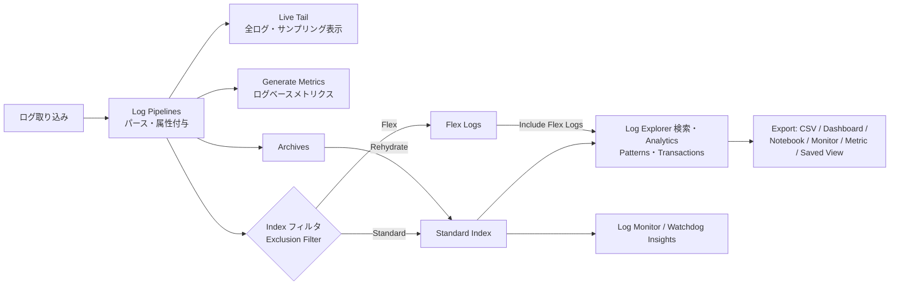
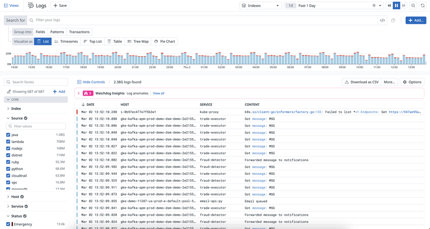
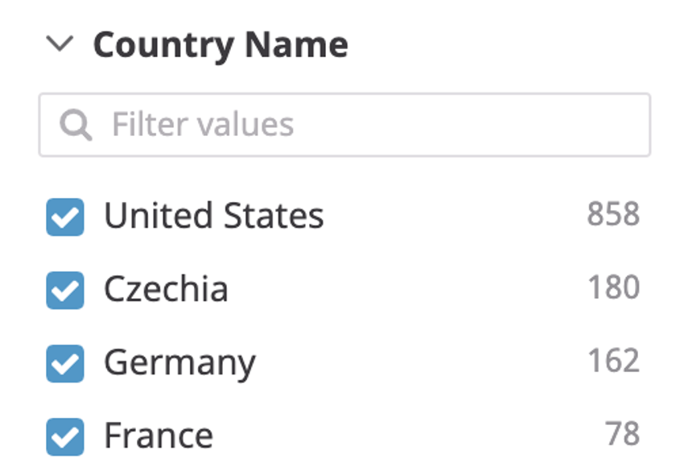
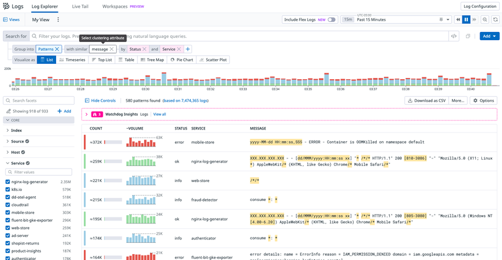
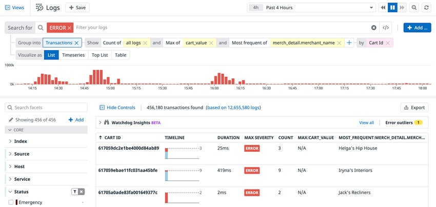
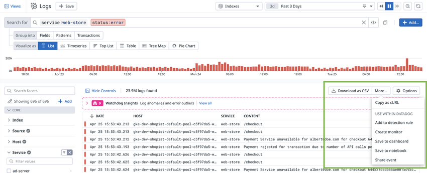

# ログ検索と分析

## 概要

Datadog Log Management の **Log Explorer（ログエクスプローラー）** は、Datadog に取り込まれたログを検索・絞り込み・集計・可視化し、ダッシュボード、モニター、メトリクスなどへ書き出すための画面である。Log Explorer は「時間範囲 + 検索クエリ」でログを絞り込み、**Group into（集約単位）** に Fields（フィールド）／Patterns（パターン）／Transactions（トランザクション）を選び、**Visualize as（可視化形式）** で List／Timeseries／Top List／Table／Tree Map／Pie Chart などを選んで分析する。[出典](https://docs.datadoghq.com/logs/explorer/)

本ファイルは以下の質問に答える。

- Log Explorer の画面構成、時間範囲の指定方法、Index / Flex Logs / Live Tail のどのデータが検索対象になるか
- 検索構文（Boolean 演算子、全文検索と自由テキスト検索、エスケープ、ワイルドカード、属性検索、数値範囲、配列、CIDR）の正確な仕様
- Facets（ファセット）と Measures（メジャー）の違い、作成・非表示・グループ化・エイリアス・削除の方法
- Calculated Fields（計算フィールド）と Advanced Search（サブクエリ、Reference Tables による絞り込み）
- Log Analytics の集計・可視化・関数・数式、Patterns、Transactions の仕様
- Live Tail、Watchdog Insights、Notebooks Analysis Features（旧称：Log Workspaces）の位置づけ
- Export（CSV の行数上限など）、Saved Views、Generate Metrics（ログベースメトリクス）、Log Monitor の仕様
- 検索・集計 API、RBAC 権限、制限値、課金への影響

> **対象範囲の注意:** ログの収集は [ログ収集](./log-collection.md)、取り込み時のパース・属性付与は [Log Pipelines と処理](./log-pipelines-and-processing.md)、Index・Exclusion Filter・保持期間・Flex Logs・Archives・Rehydration は [Indexes・保持・アーカイブ](./log-indexes-retention-archives.md) が扱う。本ファイルは「保存済みのログ（および取り込みストリーム）をどう探し、どう分析し、どう外に出すか」に絞る。

## 機能一覧

Log Management の検索・分析系機能は以下のとおり。

| 機能 | 概要 | 対象データ | 主な出典 |
|---|---|---|---|
| Log Explorer（検索） | 時間範囲と検索クエリでログを絞り込む | Index 済みログ（Standard）。トグルで Flex Logs を含められる | [出典](https://docs.datadoghq.com/logs/explorer/search/) |
| Facets / Measures | 属性・タグを分析用の次元（Facet）・数値（Measure）として定義 | Index 済みログ | [出典](https://docs.datadoghq.com/logs/explorer/facets/) |
| Calculated Fields | セッション中だけ有効な計算・抽出フィールド（`#` で参照） | Index 済みログ（既存ログにも適用可） | [出典](https://docs.datadoghq.com/logs/explorer/calculated_fields/) |
| Advanced Search | サブクエリ（IN / NOT IN）、Reference Tables による絞り込み | Log Explorer、Log Monitor | [出典](https://docs.datadoghq.com/logs/explorer/advanced_search/) |
| Log Analytics（Group into Fields） | Facet 単位で件数・ユニーク数・統計値を集計 | Index 済みログのみ | [出典](https://docs.datadoghq.com/logs/explorer/analytics/) |
| Patterns | 類似 `message` をクラスタリング | Index 済みログ（10,000 件のサンプルに基づく） | [出典](https://docs.datadoghq.com/logs/explorer/analytics/patterns/) |
| Transactions | 共通属性（例: `requestId`）で一連のログを束ねる | Index 済みログ | [出典](https://docs.datadoghq.com/logs/explorer/analytics/transactions/) |
| Live Tail | ほぼリアルタイムのログストリーム表示 | Index されないログ・Exclusion Filter で除外されたログも含む | [出典](https://docs.datadoghq.com/logs/explorer/live_tail/) |
| Watchdog Insights | 異常ログ・エラー外れ値の自動提示 | `service` タグを持つデータ。Flex Logs 非対応 | [出典](https://docs.datadoghq.com/logs/explorer/insights/) |
| Notebooks Analysis Features（旧称：Log Workspaces） | 複数データソースの結合・変換・SQL 分析 | Logs、RUM、Spans、Reference Tables など | [出典](https://docs.datadoghq.com/notebooks/advanced_analysis/) |
| Export | CSV、Dashboard / Notebook、Monitor、Metric、cURL、共有リンク | 表示中のビュー | [出典](https://docs.datadoghq.com/logs/explorer/export/) |
| Saved Views | クエリ・時間範囲・可視化・Facet 表示の保存 | Log Explorer の状態 | [出典](https://docs.datadoghq.com/logs/explorer/saved_views/) |
| Generate Metrics | 取り込みストリームからログベースメトリクスを生成 | 取り込み時点の全ログ（Index の有無に依存しない） | [出典](https://docs.datadoghq.com/logs/log_configuration/logs_to_metrics/) |
| Log Monitor | 検索結果の件数・ユニーク数・メジャーで閾値アラート | Index 済みログ（Standard Tier）のみ | [出典](https://docs.datadoghq.com/monitors/types/log/) |

### データ種別と機能の対応

Log Management では、ログが「取り込みストリーム」「Standard Index」「Flex Logs」「Archive」のどこにあるかで使える検索・分析機能が異なる。

| 機能 | 取り込みストリーム（Index 前） | Standard Index | Flex Logs | 根拠 |
|---|---|---|---|---|
| Live Tail | 対象（Index されない・除外されたログも表示） | ― | ― | [出典](https://docs.datadoghq.com/logs/explorer/live_tail/) |
| Generate Metrics | 対象（取り込み時に評価） | ― | ― | [出典](https://docs.datadoghq.com/logs/log_configuration/logs_to_metrics/) |
| Log Explorer 検索 | ― | 対象 | `Include Flex Logs` トグルで対象 | [出典](https://docs.datadoghq.com/logs/log_configuration/flex_logs/) |
| Log Analytics（集計） | ― | 対象（「Aggregations work on indexed logs only」） | ダッシュボードのクエリで利用可能と記載。Explorer での Patterns / Transactions 対応は公開情報では確認できず | [出典](https://docs.datadoghq.com/logs/explorer/analytics/)、[出典](https://docs.datadoghq.com/logs/log_configuration/flex_logs/) |
| Log Monitor | ― | 対象 | **非対応** | [出典](https://docs.datadoghq.com/monitors/types/log/) |
| Watchdog / Watchdog Insights | ― | 対象 | **非対応** | [出典](https://docs.datadoghq.com/logs/log_configuration/flex_logs/) |
| Archive 内のログ | Rehydration（Historical Views）または Archive Search で検索 | ― | ― | [Indexes・保持・アーカイブ](./log-indexes-retention-archives.md) |

- Index されていないログを集計したい場合、公式ドキュメントは「Exclusion Filter の一時無効化」「ログベースメトリクスの作成」「Archive からの Rehydration」を案内している。[出典](https://docs.datadoghq.com/logs/explorer/analytics/)

## Log Explorer の画面構成

Log Explorer はナビゲーションの **Logs > Explorer**（画面上部のタブは `Log Explorer`、`Live Tail` など）から開く。画面上部に検索バーと時間範囲セレクター、その下に Group into／Visualize as のコントロールとタイムライン（件数ヒストグラム）、左側に Facet パネル、中央に結果一覧が並ぶ。[出典](https://docs.datadoghq.com/logs/explorer/)

- キャプション：Log Explorer の全体画面（List 表示）。
- 画面の説明：左上に `Views`（Saved Views パネル）、`Logs` タイトル、`+ Save` ボタン。右上に `Indexes` ドロップダウン（検索対象 Index の選択）、時間範囲（例: `1d` / `Past 1 Day`）、一時停止・再生・前後移動ボタン。中段に `Search for`（検索バー、右側に `</>` の Raw search 切替、`+ Add...` ボタン）、`Group into`（`Fields` / `Patterns` / `Transactions`）、`Visualize as`（`List` / `Timeseries` / `Top List` / `Table` / `Tree Map` / `Pie Chart`）。その下に件数のヒストグラム。左側の Facet パネルには `Search facets`、`Showing 687 of 687`、`+ Add`、`CORE` グループ配下の `Index`、`Source`（java、lambda、nodejs など値と件数）、`Host`、`Service`、`Status`（Emergency など）。中央には `Hide Controls`、`2.38G logs found`、`Download as CSV`、`More...`、`Options`、Watchdog Insights バナー（`Log anomalies`、`View all`）、ログ一覧（DATE、HOST、SERVICE、CONTENT 列）。
- 出典：https://docs.datadoghq.com/logs/explorer/ （2026-11-03 取得）

主要な画面要素は以下のとおり。

| 領域 | 要素 | 説明 |
|---|---|---|
| 上部 | Views / Save | Saved Views の一覧表示、現在のビューの保存 |
| 上部 | Indexes | 検索対象 Index の選択（複数 Index がある場合） |
| 上部 | Include Flex Logs | Flex Tier のログを結果に含めるトグル（時間範囲セレクターの横） [出典](https://docs.datadoghq.com/logs/log_configuration/flex_logs/) |
| 上部 | 時間範囲セレクター | プリセット・カスタム時間範囲・Live Tail の選択 |
| 中段 | Search for | 検索クエリ入力。`Ask`（自然言語クエリ）、Raw search mode、`+ Add`（Calculated field、サブクエリ、Reference Table との結合） |
| 中段 | Group into | `Fields` / `Patterns` / `Transactions` |
| 中段 | Visualize as | List、Timeseries、Top List、Table、Tree Map、Pie Chart（Patterns 表示時のスクリーンショットでは Scatter Plot も表示される） |
| 左側 | Facet パネル | Facet の値と件数、Measure のスライダー |
| 中央 | 結果 | ログ一覧または集計結果。`Download as CSV`、`More...`（Export メニュー）、`Options`（列の表示設定） |
| 中央 | Watchdog Insights バナー | 異常ログ・エラー外れ値の件数と `View all` |
| 右側（クリック時） | Log Side Panel | 個別ログの詳細 |

## 時間範囲

Log Explorer の時間範囲は右上の時間範囲セレクターで設定する。プリセット（例: Past 15 Minutes、Past 1 Day）に加えて、テキストでカスタム時間範囲を入力できる。カスタム時間範囲の構文は Dashboards と共通である。[出典](https://docs.datadoghq.com/logs/explorer/search/)、[出典](https://docs.datadoghq.com/dashboards/guide/custom_time_frames/)

| 種類 | 構文例 | 意味 |
|---|---|---|
| 固定（日付） | `Jan 1`、`1/1/2019`、`1-1-2019`、`Jan 1, 2019, 1:00 pm` | 開始・終了が固定 |
| 固定（Unix 時刻） | `1577883600`（秒）、`1577883600000`（ミリ秒） | 同上 |
| 固定（範囲） | `Jan 1 - Jan 2`、`6:00 am - 1:00 pm`、`1577883600 - 1578009540` | 同上 |
| 相対 | `15m`、`2h`、`2d`、`3w`、`3mo` | 現在からさかのぼるスライディングウィンドウ。`m` は分、`mo` は月 |
| 伸長 | `Jan 1 to now`、`since 5h`、`from Jun 1` | 開始固定、終了は現在に追随 |
| カレンダー基準 | `today`、`yesterday`、`week to date`、`month to date`、`last month`、`2 weeks ago` | カレンダー境界に揃える |
| URL パラメータ | `from_ts`、`to_ts`（Unix ミリ秒）、`live=true` / `false` | 共有リンクでの時間指定 |

- 相対単位の表記ゆれ：分 `m` / `min` / `mins` / `minute` / `minutes`、時 `h` / `hr` / `hrs` / `hour` / `hours`、日 `d` / `day` / `days`、週 `w` / `week` / `weeks`、月 `mo` / `mos` / `mon` / `mons` / `month` / `months`。[出典](https://docs.datadoghq.com/dashboards/guide/custom_time_frames/)
- クエリは UTC で実行されるが、時間範囲はブラウザのタイムゾーンで選択される。[出典](https://docs.datadoghq.com/dashboards/guide/custom_time_frames/)
- 時間範囲セレクターで **Live Tail** を選ぶと Live Tail 表示に切り替わる。[出典](https://docs.datadoghq.com/logs/explorer/live_tail/)
- 検索可能な過去の範囲は Index の保持期間（または Flex Logs の保持期間）に依存する。Log Explorer 自体の最大検索期間の上限値は公開情報では確認できず。

## 検索構文（Log Search Syntax）

Log Explorer の検索構文は、Log Explorer のほか Log Monitor、ダッシュボードのログウィジェット、Notebooks、Index フィルタ、Exclusion Filter、Pipeline フィルタ、Generate Metrics のフィルタなどでも使われる（一部機能は使える場所が限られる。後述）。[出典](https://docs.datadoghq.com/logs/explorer/search_syntax/)

### 単語（Term）とシーケンス（Sequence）

| 種類 | 例 | 説明 |
|---|---|---|
| 単語 | `test` | 1 語 |
| シーケンス | `"hello world"` | 二重引用符で囲んだ語のグループ。**直線の二重引用符（`"`）のみ有効**で、曲がった引用符（“ ”）は無視される |

### Boolean 演算子

Boolean 演算子は**大文字小文字を区別する**（`AND` / `OR` は大文字で書く）。[出典](https://docs.datadoghq.com/logs/explorer/search_syntax/)

| 演算子 | 意味 | 例 |
|---|---|---|
| `AND` | 両方を含む（演算子を省略した場合の既定） | `authentication AND failure` |
| `OR` | いずれかを含む | `authentication OR password` |
| `-` | 除外 | `authentication AND -password` |
| `( )` | グループ化 | `(env:prod AND -version:beta)` |

- CIDR の否定では `NOT(...)` 形式が使われる（後述）。

### 全文検索（Full-text）と自由テキスト検索（Free-text）

Log Explorer には「自由テキスト検索」と「全文検索」の 2 種類がある。[出典](https://docs.datadoghq.com/logs/explorer/search_syntax/)

| 種類 | 構文 | 検索対象 |
|---|---|---|
| Free-text search（自由テキスト検索） | `hello` | `message`、`@title`、`@error.message`、`@error.stack` の 4 フィールドのみ |
| Full-text search（全文検索） | `*:hello`、`*:"hello world"` | メッセージを含む**すべてのログ属性** |

全文検索（`*:` 構文）が使える場所・使えない場所：

| 使える | 使えない |
|---|---|
| Log Explorer、Log Management のモニター、ダッシュボード、Notebooks のクエリ | Index フィルタ、Archive フィルタ、Pipeline フィルタ、Rehydration フィルタ、ログベースメトリクスのフィルタ、Live Tail |

[出典](https://docs.datadoghq.com/logs/explorer/search_syntax/)

### エスケープ

| 項目 | 仕様 |
|---|---|
| `\` でエスケープが必要な文字 | `-` `!` `&&` `\|\|` `>` `>=` `<` `<=` `(` `)` `{` `}` `[` `]` `"` `*` `?` `:` `\` `#`、およびスペース |
| エスケープ不要 | `/` |
| `@` | Log Explorer の検索では属性検索用に予約されており、検索文字列として使えない |
| メッセージ中の特殊文字 | 検索できない。Grok Parser で属性に抽出してから属性検索する |

[出典](https://docs.datadoghq.com/logs/explorer/search_syntax/)

### 属性検索とタグ検索

| 項目 | 構文・仕様 |
|---|---|
| 属性検索 | `@attribute:value`（例: `@url:www.datadoghq.com`） |
| 予約属性 | `@` 不要。`service:web-app`、`status:error`、`host:i-1234567890abcdef0`、`source`、`trace_id` など |
| Facet の要否 | 属性・タグの検索に Facet 定義は不要 |
| 大文字小文字 | **属性検索は大文字小文字を区別する**。区別しない検索が必要な場合は全文検索を使うか、Grok の `lowercase` フィルタで取り込み時に小文字化する |
| 特殊文字を含む値 | `@my_attribute:hello\:world` または `@my_attribute:"hello:world"` |
| 1 文字の特殊文字・スペース | `?` で 1 文字にマッチ（例: `@my_attribute:hello?world` は `hello world` にマッチ） |
| 属性の存在確認 | `@http.status_code:*`（存在する）、`-@http.status_code:*`（存在しない） |
| key:value タグ | `env:(prod OR test)`、`(env:prod AND -version:beta)` |
| key:value 形式でないタグ | `tags:<MY_TAG>` |
| Calculated Field | `#` プレフィックスで参照（例: `#latency_gap:>100`） |

[出典](https://docs.datadoghq.com/logs/explorer/search_syntax/)

### ワイルドカード

| 構文 | 意味 | 例 |
|---|---|---|
| `*` | 単語内の 0 文字以上 | `web*`、`*web`、`*web*` |
| `**` | 空白・句読点をまたいで複数語にマッチ | `waiting**time` |
| `\ `（エスケープ空白） | 複数語を連結（各語にワイルドカード可） | `waiting\ un*` |
| 属性・タグでのワイルドカード | 属性値・タグ値に使える | `service:*mongo` |

- 単一の `*` は単語境界をまたがない。[出典](https://docs.datadoghq.com/logs/explorer/search_syntax/)
- 二重引用符内のワイルドカードは無視される（`"*test*"` は `test` を検索）。
- 属性プレフィックスのない `*NETWORK*` はメッセージのみを検索する。属性まで含めるには `*:` 全文検索を使う。
- ワイルドカード検索・引用符付き検索は大量データで遅くなるため、`service` や `host` などの選択的なフィルタと組み合わせることが推奨されている。

### 単語分割（自由テキスト検索）

自由テキスト検索の単語分割は Unicode の単語境界規則に従い、区切り文字自体は検索できない。[出典](https://docs.datadoghq.com/logs/explorer/search_syntax/)

| 文字列 | 分割結果 |
|---|---|
| `my.friend` | 1 語のまま |
| `my. friend` | `my` と `friend` |
| `version.2` | `version` と `2` |
| `192.168.1.1` | 1 語のまま |
| `metric:cpu` | 1 語のまま |
| `RequestId:5` | 分割される |
| `hello_world` | 1 語のまま |
| `hello-world` | `hello` と `world` |
| `don't`（直線アポストロフィ） | 曲がったアポストロフィの `don’t` にはマッチしない。両方に一致させるには `don*` |

- 単語の一部にマッチさせるにはワイルドカードを使う（`*friend` は `my.friend` にマッチ）。

### 数値検索

| 構文 | 例 | 前提 |
|---|---|---|
| 比較 | `@http.response_time:>100`（`<`、`<=`、`>=` も可） | 属性を**数値の Facet（Measure 等）として定義**しておく |
| 範囲 | `@http.status_code:[400 TO 499]` | 同上 |

[出典](https://docs.datadoghq.com/logs/explorer/search_syntax/)

### 配列

| 目的 | 構文・仕様 |
|---|---|
| Facet 値のクリック | 属性がその値と等しい、または配列がその値を含むログを返す |
| Facet 化していない配列（JSON オブジェクトの配列を含む） | `@Event.EventData.Data.Name:ObjectServer` |
| ネストしたフィールド | `@network.ip.attributes.ip:2a02\:1810*`（配列要素のいずれかの `ip` が `2a02:1810` で始まればマッチ） |
| 複数値をすべて含む | `@user_perms:(4 6)` |
| 範囲内の値を含む | `@user_perms:[2 TO 6]` |

[出典](https://docs.datadoghq.com/logs/explorer/search_syntax/)

### CIDR 表記

| 構文 | 例 |
|---|---|
| `CIDR(@attribute, cidr_block[, cidr_block...])` | `CIDR(@network.client.ip,13.0.0.0/8)` |
| 配列・複数ブロック | `CIDR(@network.ip.list,13.0.0.0/8, 15.0.0.0/8)`（配列内のいずれかの IP がどちらかのブロックに入ればマッチ） |
| 否定 | `NOT(CIDR(@network.client.ip, 13.0.0.0/8))` |
| 組み合わせ | `source:vpc NOT(CIDR(@network.client.ip, 13.0.0.0/8)) CIDR(@network.destination.ip, 15.0.0.0/8)` |

- IPv4 と IPv6 の両方に対応し、Log Explorer、Live Tail、ダッシュボードのログウィジェット、Log Monitor、ログ設定（Configuration）で使える。[出典](https://docs.datadoghq.com/logs/explorer/search_syntax/)

### 検索構文のクイックリファレンス

| やりたいこと | クエリ例 |
|---|---|
| サービスのエラーログ | `service:payment status:error` |
| エラーのうち特定語を含む | `service:payment status:error rejected` |
| 本番以外を除く | `env:prod -version:beta` |
| HTTP 5xx | `@http.status_code:[500 TO 599]` |
| 500ms 超のリクエスト | `@duration:>500ms`（`duration` が時間単位付き Measure の場合） |
| 属性が無いログ | `-@usr.id:*` |
| 全属性から語を検索 | `*:timeout` |
| 社外 IP からのアクセス | `NOT(CIDR(@network.client.ip, 10.0.0.0/8))` |

（`duration:>20ms` のような単位付き検索は Measure の単位設定を前提とする。[出典](https://docs.datadoghq.com/logs/explorer/facets/)）

## 検索バーの機能

Log Explorer の検索バーは、構文ハイライト、エラー検証、オートコンプリート、最近の検索、自然言語クエリを備える。[出典](https://docs.datadoghq.com/logs/explorer/search/)

| 機能 | 仕様 |
|---|---|
| 構文ハイライト | キー、値、自由テキスト、制御文字を色分け。`status` 値も色分け（`error` は赤、`info` は青） |
| エラー検証 | `key:value` の値欠落、不完全な範囲指定、閉じていない括弧などを検出し修正を提案 |
| オートコンプリート | 既存のログのキーと値、最近の検索、Saved Views から候補を提示。Facet 候補は Facet パネルの並び順。`:` 入力後の値候補は**過去 15 分間のログ件数の降順** |
| 最近の検索 | **直近 100 件**の検索を保持し、入力時に候補表示 |
| Raw search mode | 検索バー右のボタンで切替。構文ハイライト・検索ピル表示・オートコンプリートを無効化 |
| キーボード操作 | CMD-A（全選択）、CMD-C（コピー）、CMD-X（切り取り）、CMD-V（貼り付け） |
| 自然言語クエリ（NLQ） | 検索欄の `Ask` をクリックして英語の自然文で記述すると構造化クエリに変換。サービス・属性・タグ・時間範囲を認識し、「Top 20 services by errors」のような可視化も生成 |

- **NLQ の無効化:** Organization Settings > Preferences のトグルで無効化でき、`org_management` 権限が必要。[出典](https://docs.datadoghq.com/logs/explorer/search/)

> **サイト差異:** 自然言語クエリ（NLQ）は `US1-FED`（app.ddog-gov.com）および us2.ddog-gov.com では利用できない（ドキュメントは選択サイトに応じて表示が変わり、ほかに非対応のサイトがあるかは公開情報では確認できず）。[出典](https://docs.datadoghq.com/logs/explorer/search/)

## Advanced Search（サブクエリと Reference Tables）

Log Explorer の Advanced Search は、別クエリの結果や Reference Tables の内容で主クエリの結果を絞り込む機能である。Advanced Search は **Log Explorer と Log Monitor** で使える。[出典](https://docs.datadoghq.com/logs/explorer/advanced_search/)

### サブクエリ

設定手順：主クエリを入力 → `+ Add` → **Add Query Filter** の `Logs` を選択。

| 項目 | 説明 |
|---|---|
| where | 相関に使う属性（主クエリのログに含まれる属性から選択） |
| from | サブクエリの検索条件 |
| Select Column | サブクエリ結果のグループ化・並べ替えに使う属性 |
| Operator | `IN`（サブクエリ結果に値が現れるログのみ残す）／`NOT IN`（値が現れるログを除外） |
| 値の上限 | 照合する属性値の数。**デフォルト 1,000、最大 1,000,000**。`top`（高頻度）または `bottom`（低頻度）を選択 |

利用例（公式ドキュメント記載）：

- 後で `status:success` ログに到達した注文を `NOT IN` で除外し、失敗したままの注文だけを抽出する。
- `service:network_directory` を主クエリにし、`device-manager` のサブクエリと `NOT IN` で既知の社内デバイスを除外する。

### Reference Table との結合（Join with Reference Table）

設定手順：クエリエディタ横の `Add` → **Join with Reference Table**。

1. Reference Table を選択
2. 結合するログ側のフィールドを選択
3. `IN` / `NOT IN` を選択
4. 結合する Reference Table 側の列を選択
5. （任意）ログを補強する Reference Table の列を選択
6. （任意）Reference Table の列データで直接絞り込む

- **100 万行（1,000,000 行）を超える Reference Table はイベントの絞り込みに使えない。** [出典](https://docs.datadoghq.com/logs/explorer/advanced_search/)
- Reference Tables の作成・管理は [Notebooks・DDSQL・Reference Tables](../platform/notebooks-and-data-tools.md) を参照。
- サブクエリのネスト可否、タイムアウト、プラン要件は公開情報では確認できず。

## Calculated Fields（計算フィールド）

Log Explorer の Calculated Fields は、検索時に属性から新しい値を計算・抽出する一時的なフィールドである。Pipeline の変更と違い、**すでに Index 済みのログにも適用できる**。[出典](https://docs.datadoghq.com/logs/explorer/calculated_fields/)

| 項目 | 仕様 |
|---|---|
| 種類 | **Formula**（既存属性から計算。文字列操作、数値演算、条件分岐）／**Extraction**（Grok または正規表現で raw メッセージや属性から抽出。Tap to Parse でパターン生成可） |
| 作成方法 | 検索バー横の `Add` > `Calculated field`、またはログ側パネルで JSON 属性を選び `Create calculated from…` |
| 参照 | `#` プレフィックス（例: `#latency_gap`） |
| 使える場所 | 検索、集計、可視化、ほかの Calculated Field の入力 |
| 表示 | 検索バー下のヘッダー行、List 表示の列、ログ側パネルの専用セクション |
| 同時利用数 | **最大 5 個** |
| 永続性 | **一時的**。Log Explorer セッションを越えて保持されない |
| 共有範囲 | **ユーザー単位**（本人のみ表示） |
| Notebooks への引き継ぎ | 「Analyze in Notebooks」で開くと Transformation セルに変換される [出典](https://docs.datadoghq.com/notebooks/advanced_analysis/) |
| 恒久化 | 継続利用するロジックは Log Pipelines に実装することが推奨されている |

例：

- Formula：`#latency_gap = @client_latency - @server_latency`
- Extraction：`%{word:first} %{word:second} %{word:third}`

### Formula の演算子（優先順位の高い順）

| 演算子 | 説明 |
|---|---|
| `()` | グループ化・関数呼び出し |
| `!`、`NOT`、`-` | 論理否定・符号反転 |
| `^`、`%` | べき乗、剰余 |
| `*`、`/` | 乗算、除算 |
| `+`、`-` | 加算、減算 |
| `<`、`<=`、`>`、`>=` | 比較 |
| `==`、`!=` | 一致、不一致 |
| `&&`、`AND` | 論理積 |
| `\|\|`、`OR` | 論理和 |

[出典](https://docs.datadoghq.com/logs/explorer/calculated_fields/formulas/)

### Formula の関数

| 分類 | 関数 |
|---|---|
| 算術 | `abs(num)`、`ceil(num)`、`floor(num)`、`max(num, ...)`、`min(num, ...)`、`round(num, int precision)`（負の precision で十の位・百の位に丸め） |
| 文字列 | `concat(str, ...)`、`left(str, int num_chars)`、`lower(str)`、`proper(str)`、`right(str, int num_chars)`、`split_before(str, str separator, int occurrence)`、`split_after(str, str separator, int occurrence)`、`substring(str, int start, int length)`、`textjoin(str delimiter, bool ignore_empty, str, ...)`、`upper(str)` |
| 論理 | `if(expr condition, expr if_true, expr if_false)`、`is_null(expr)` |
| 正規表現 | `regexp_like(str value, str pattern)`（どこかに一致すれば `true`）、`regexp_replace(str input, str pattern, str replacement, [int start, int N])`（`start` は 0 始まりで既定 `0`、`N` は置換回数で既定 `1`、`0` で全置換） |

構文上の注意：

- 参照は `@attr`（ログ属性）、`#field`（Calculated Field）、裸の名前（予約属性・タグ）。タグ中のハイフンは `ci\-job\-id` のようにエスケープする。
- 文字列リテラルは二重引用符。内部の `"` は `\"`。
- 正規表現の `\` は二重に書く（例: `"\\d"`）。置換文字列中のリテラル `$` は `"\\$"`。
- 置換文字列の後方参照は `$1`〜`$9`、名前付きグループは `${name}`。

[出典](https://docs.datadoghq.com/logs/explorer/calculated_fields/formulas/)

## Facets と Measures

Log Management の **Facet（ファセット）** は、Index 済みログのタグ・属性をユーザーが定義したもので、定性的（Qualitative）・定量的（Quantitative）な分析に使う。定量的な Facet を **Measure（メジャー）** と呼ぶ。[出典](https://docs.datadoghq.com/logs/explorer/facets/)

### Facet が必要な機能・不要な機能

| Facet が必要（または前提） | Facet が不要 |
|---|---|
| Log Patterns の集約対象、Log Analytics（集計・グループ化）、Log Monitor・ダッシュボードウィジェット・Notebooks での集計、数値の範囲検索・比較検索、Facet パネルでの絞り込み | ログ処理（Pipelines）、Live Tail、Log Explorer での検索（`key:value`）、ログベースメトリクス、Archives、Rehydration、Pipeline ルーティング、Index フィルタ、Exclusion Filter |

- オートコンプリートは Facet を使うが、取り込まれたログに一致する入力であれば Facet でなくても機能する。[出典](https://docs.datadoghq.com/logs/explorer/facets/)
- Log Monitor の Unique value count は任意の属性で使えるが、補完候補には Facet のみ表示される。[出典](https://docs.datadoghq.com/monitors/types/log/)

### Dimension（定性的 Facet）と Measure（定量的 Facet）

| 項目 | Dimension（定性的 Facet） | Measure（定量的 Facet） |
|---|---|---|
| 用途 | 相対比較（例: 5xx エラーの多い国の上位）、ユニーク値のカウント（例: 1 日あたりのユニークユーザー数）、頻繁な絞り込み（例: 環境） | 値の集計（平均・合計など）、範囲フィルタ（例: 10 秒超の処理）、値によるソート |
| 型 | String（すべての用途）、Integer（範囲フィルタ `http.status_code:[200 TO 299]` も可） | (long) Integer または Double（機能は同等） |
| Facet パネル表示 | 上位のユニーク値と件数。クリックで検索に反映、チェックボックスで追加・除外、値の検索が可能 | min/max スライダー、数値境界を直接入力可能 |
| 単位 | ― | Measure のプロパティとして設定（フィールドではなく Measure に属する） |

Measure の単位：

| 種類 | 単位 |
|---|---|
| BYTES | bit、byte、kibibyte、mebibyte、gibibyte、tebibyte、pebibyte、exbibyte |
| TIME | nanosecond、microsecond、millisecond、second、minute、hour、day、week |

- 例：あるサービスはナノ秒、別のサービスはミリ秒で `duration` を出している場合、Arithmetic Processor で `*1000000` / `*1000` を掛けてナノ秒に正規化すると、`duration:>20ms` のように両サービスを横断して検索できる。[出典](https://docs.datadoghq.com/logs/explorer/facets/)
- Arithmetic Processor は [Log Pipelines と処理](./log-pipelines-and-processing.md) を参照。

- キャプション：Facet パネル上の Dimension（定性的）Facet の表示例。
- 画面の説明：Facet 名「Country Name」の見出しの下に `Filter values`（値の検索ボックス）があり、その下にチェックボックス付きの値一覧（United States 858、Czechia 180、Germany 162、France 78 のように値と件数）が並ぶ。チェックボックスの ON/OFF で検索クエリに値が追加・除外される。
- 出典：https://docs.datadoghq.com/logs/explorer/facets/ （2026-11-03 取得）

### 標準で用意される Facet

| Facet | 説明 |
|---|---|
| `Host`、`Service` | 標準で含まれる |
| 予約属性・大半の標準属性（Standard Attributes） | 標準で含まれる |
| Index Facet | **複数の Index がある場合、または Historical View（Rehydration）が有効な場合のみ**表示 |

[出典](https://docs.datadoghq.com/logs/explorer/facets/)

### Facet の作成

| 作成場所 | 手順・仕様 |
|---|---|
| ログ側パネル | 属性をクリックして作成。**文字列フィールドは Facet のみ**、**数値フィールドは Facet と Measure のどちらも**作成可能 |
| Facet パネル | `+ Add`（add facet）。タグはタグキー、属性は `@` 付きのパスで指定 |
| JSON オブジェクトの配列 | 先に Grok Parser で属性を抽出してから Facet 化 |

- 新しい Facet は**作成後に取り込まれたログにのみ値が入る**（過去ログには遡及しない）。[出典](https://docs.datadoghq.com/logs/explorer/facets/)
- 既存の Facet（特に標準属性）を優先して使うことがチーム間連携のため推奨されている。
- **Facet 数は 1,000 以下が推奨**されている（推奨値であり、ハードリミットかどうかは公開情報では確認できず）。
- Facet の作成・編集には `logs_write_facets` 権限が必要（後述）。

### Facet の管理

| 操作 | 手順 | 影響範囲 |
|---|---|---|
| 非表示（Hide Facet） | Facet の歯車アイコン > Hide Facet | Log Explorer のみ。Facet 検索では見つかり、検索クエリでも使える。オートコンプリートと分析のドロップダウンから隠れる。Live Tail・モニター・ダッシュボードには影響しない。**個人設定**（Saved View に保存すれば共有可能） |
| グループ化 | 歯車 > Edit facet > Advanced options > Group field > Update | Facet 一覧の表示のみ。検索・分析には影響しない |
| 絞り込み | Facet 検索ボックス | 表示名とフィールド名の両方にマッチ |
| エイリアス（Facet → Facet） | `Alias to…` で標準 Facet に向ける | エイリアスされた Facet は引き続き動くが組織で非推奨扱い。`switch to alias` で標準 Facet 表示に切替 |
| エイリアス（属性 → Facet） | 属性から直接既存 Facet にエイリアス | 新しいログソースごとに Facet を増やさずに済む |
| 削除 | `Showing xx of xx` をクリック → Facet を検索 → 鉛筆アイコン → Delete | Index・モニター・ダッシュボード・Restriction Query・他チームで使われている Facet を削除すると設定が壊れる可能性がある |

[出典](https://docs.datadoghq.com/logs/explorer/facets/)

- 属性の標準化（Standard Attributes、Aliasing）の設計は [Log Pipelines と処理](./log-pipelines-and-processing.md) を参照。

## Log Side Panel（ログ詳細パネル）

Log Explorer でログをクリックすると Log Side Panel が開く。上部にインフラ・アプリのコンテキスト（ホスト、コンテナ、ログファイル、サーバーレス関数名、team / env などのタグ）、下部にログメッセージと構造化属性を表示する。[出典](https://docs.datadoghq.com/logs/explorer/side_panel/)

| 機能 | 仕様 |
|---|---|
| View in context | 選択ログの直前・直後のログ（フィルタに一致しないものも含む）を表示。`Hostname`、`Service`、`filename`、`container_id`、タグを使う |
| Metrics タブ | ログ時刻を含む **30 分間の時間枠**のインフラメトリクス（前後の内訳は公開情報では確認できず） |
| Host / Container / Serverless セクション | ホストダッシュボード、Network Analytics、コンテナページ、関数詳細ページへのリンク |
| Trace タブ | トレース ID で APM トレース全体の中のログ位置を表示。`View Trace Details` で APM へ遷移。トレースが取り込まれていない・サンプリングで落ちた場合は欠落メッセージを表示（設定エラーではない） |
| 属性操作 | JSON 属性名・値のクリックで列の追加・削除、検索への含める／除外 |
| Facet / Measure | 属性から作成・編集 |
| Calculated field | 属性から作成・編集 |
| 共有 | Copy to clipboard（Ctrl+C / Cmd+C で JSON をコピー）、Share Event（メール・Slack 等で共有）、Save to notebook |

- 前提：ファイルログは `source` 設定、コンテナログは Autodiscovery、トレース相関はログへのトレース ID 注入と Unified Service Tagging が必要。[出典](https://docs.datadoghq.com/logs/explorer/side_panel/)
- `error.stack`、`http.method`、`duration` などの標準属性は強調表示される。トレースとログの相関設定は [APM インスツルメンテーション](../apm/apm-instrumentation.md) を参照。

## Log Analytics（集計と可視化）

Log Explorer の Log Analytics は、Index 済みログを **Group into** で集約し、**Visualize as** で可視化する機能である。[出典](https://docs.datadoghq.com/logs/explorer/analytics/)

### Group into（集約単位）

| 集約単位 | 内容 | 対応する可視化 |
|---|---|---|
| Fields | Facet の値ごとにグループ化 | List（個別ログ）、Timeseries、Top List、Table、Tree Map、Pie Chart |
| Patterns | 類似メッセージのクラスタリング（後述） | List |
| Transactions | 共通属性による一連のログの束ね（後述） | List Aggregates |

- 集約単位を切り替えても、選択したフィールドは可視化・集約タイプ間で保持される。[出典](https://docs.datadoghq.com/logs/explorer/analytics/)

### Fields の集計関数

| 集計 | 説明 |
|---|---|
| Count | グループごとのログ件数 |
| Count unique | Facet のユニーク値数 |
| 統計値 | 数値（Measure）に対する `min`、`max`、`avg`、パーセンタイルなど |

- 1 件のログが複数のクエリ値に一致する場合、各集計値にそれぞれカウントされる。[出典](https://docs.datadoghq.com/logs/explorer/analytics/)
- 集計 API で指定できる集計は `count`、`cardinality`、`pc75`、`pc90`、`pc95`、`pc98`、`pc99`、`sum`、`min`、`max`（API リファレンスの列挙値）。[出典](https://docs.datadoghq.com/api/latest/logs/aggregate-events/)

### 可視化（Visualize as）

| 可視化 | 内容 | ディメンション数 | 主なオプション |
|---|---|---|---|
| List（Logs） | 個別ログのページング一覧 | ― | 列の追加・並べ替え・削除、Options で Content Height / Content Display。既定のソートはタイムスタンプ降順 |
| List（Aggregates） | Patterns・Transactions の集計一覧 | ― | Patterns はイベント件数の降順、Transactions はトランザクション ID の昇順 |
| Timeseries | 1 つの Measure（または Facet のユニーク数）の時系列 | Analytics ページでは最大 4、Visualize ページでは「最大 3 Facet で分割」と記載 | ロールアップ間隔、表示形式（Bars：件数・ユニーク数に推奨、Lines：統計集計に推奨、Areas）、カラーセット |
| Top List | Facet の上位値を Measure で順位付け | 1 | ― |
| Table（Nested Tables） | 複数 Facet の上位値を最初の Measure で順位付け。追加の Measure 表示可 | Analytics ページでは最大 4、Visualize ページでは最大 3 と記載 | 1 Measure × 1 ディメンションの Table は Top List と同等 |
| Tree Map | 入れ子の矩形で構成比を表示（大きさと色で値を表現）。複数属性で階層化 | 最大 4 | ― |
| Pie Chart | 1 つのディメンションの構成比 | 最大 4（Analytics ページ） | ― |

[出典（Analytics）](https://docs.datadoghq.com/logs/explorer/analytics/)、[出典（Visualize）](https://docs.datadoghq.com/logs/explorer/visualize/)

- 公式ドキュメント内で Timeseries / Table のディメンション上限の記載が「最大 4」（Analytics ページ）と「最大 3」（Visualize ページ）で食い違っている。実際の上限は画面で確認すること。
- 複数ディメンションの場合、上位値は第 1 ディメンションで決まり、第 2 ディメンションは第 1 の上位値の内側で決まる（以下同様）。[出典](https://docs.datadoghq.com/logs/explorer/analytics/)
- Nested Table の小計は、上位（または下位）の一部のみ表示するため、表示値の合計と一致しない場合がある。null / 空の値はサブグループとして表示されない。[出典](https://docs.datadoghq.com/logs/explorer/visualize/)
- 非 Facet 属性も List の列に追加できるが、非 Facet 属性でのソートは信頼性が低い。[出典](https://docs.datadoghq.com/logs/explorer/visualize/)
- List の列構成（テーブル設定）は Saved View に保存される。
- Log Explorer 上で表示できるグループ数の上限（Top N の既定・最大）は公開情報では確認できず。API の集計では `group_by.limit` が最大 10,000（複数 Facet の場合は limit の積が 10,000 以下）。[出典](https://docs.datadoghq.com/api/latest/logs/aggregate-events/)

### 複数クエリ・関数・数式

| 機能 | 仕様 |
|---|---|
| 複数クエリ | **Timeseries と Table** で利用可。`+ Add` でクエリ追加（直前のクエリとグループ化をコピー）。クエリ記号（A、B…）のクリックで選択・解除。新規クエリは既定で選択状態 |
| Timeline for | タイムラインに使うクエリを選択 |
| Use facets with | Facet パネルの選択をどのクエリに適用するかを選択 |
| 関数（Functions） | **全可視化で利用可**。Measure 横の Σ アイコンから適用。種類：Arithmetic、Interpolation、Timeshift、Rate、Smoothing、Rollup、Exclusion |
| 数式（Formulas） | `+ Add` で 1 つ以上のクエリにまたがる数式を作成。**数式内の全クエリは同じ値でグループ化されている必要がある**。数式にも Σ から関数を適用可能 |

[出典](https://docs.datadoghq.com/logs/explorer/analytics/)

- 関数の詳細仕様はメトリクスと共通のものが多い。[メトリクスクエリと関数](../platform/metrics-query-and-functions.md) を参照。

## Patterns（ログパターン）

Log Explorer の Patterns は、`message` が類似するログを自動でクラスタリングし、可変部分をまとめて表示する機能である。大量のノイズになっているエラーパターンの発見に使う。[出典](https://docs.datadoghq.com/logs/explorer/analytics/patterns/)

| 項目 | 仕様 |
|---|---|
| クラスタリング対象 | 既定は `message`。ほかの属性も選択可能（`with similar` の右で選択） |
| グループ化 | 既定は `Status` と `Service`。ほかの属性も選択可能 |
| サンプル数 | **10,000 件のログサンプル**に基づいてパターンを検出。特定のサブセットのパターンを見るには検索を絞り込む |
| 可視化 | List |
| ソート | イベント件数の降順 [出典](https://docs.datadoghq.com/logs/explorer/visualize/) |
| サイドパネル | パターンのログサンプル表示、パターンのフィルタを検索に追加、**Grok パースルールのたたき台**の提示 |
| Pattern Inspector | パターン内の可変部分（黄色でハイライト）の値分布を表示。影響ホスト数、リージョン・データセンターの把握に使う |
| CSV エクスポート | 最大 300 行 [出典](https://docs.datadoghq.com/logs/explorer/export/) |

Pattern Inspector の使い方：

1. Log Explorer を開く。
2. Group into で `Patterns` をクリックする。メッセージ内の集約値が黄色でハイライトされる。
3. 集約値にマウスを重ねると値分布のプレビューが表示される。
4. 値をクリックしてサイドパネルを開き、`Pattern Inspector` タブを選択する。

[出典](https://docs.datadoghq.com/logs/explorer/analytics/patterns/)

- キャプション：Log Explorer で Group into を Patterns にした画面。
- 画面の説明：上部タブに `Log Explorer`、`Live Tail`、`Workspaces`（PREVIEW 表示）、右上に `Log Configuration`。時間範囲の左に `Include Flex Logs`（NEW）トグル、時間範囲は `Past 15 Minutes`。検索バー下に `Group into: Patterns`、`with similar: message`（ツールチップ「Select clustering attribute」）、`by: Status and Service`。`Visualize as` に List / Timeseries / Top List / Table / Tree Map / Pie Chart / Scatter Plot。中央に「580 patterns found (based on 7,474,365 logs)」、表の列は COUNT（例: ≈372K）、~VOLUME（ミニ棒グラフ）、STATUS、SERVICE、MESSAGE。メッセージ内の可変部分（例: `XXX.XXX.XXX.XXX`、`[dd/MMM/yyyy:HH:mm:ss xx]`、`[810-3086]`）が黄色でハイライトされる。左に Facet パネル（Service の値と件数）。
- 出典：https://docs.datadoghq.com/logs/explorer/analytics/patterns/ （2026-11-03 取得。スクリーンショットは取得時点のもので、Workspaces の PREVIEW 表示など現在の UI と異なる場合がある）

## Transactions（トランザクション）

Log Explorer の Transactions は、ユーザーセッションやマイクロサービスをまたぐリクエストなど「一連のイベント」の単位で Index 済みログを集約する機能である。通常の Fields 集約と異なり、**クエリに一致したログだけでなく、関連するトランザクション内のすべてのログ**が結果に含まれる。[出典](https://docs.datadoghq.com/logs/explorer/analytics/transactions/)

| 項目 | 仕様 |
|---|---|
| グループ化キー | 共通属性（例: `requestId`、`orderId`） |
| 自動集計 | **Duration**（最初と最後のログの時間差）、**Maximum Severity**（トランザクション内の最高重大度） |
| Find Key Items | 文字列 Facet に対し `count unique`、`latest`、`earliest`、`most frequent` |
| Get Statistics | Measure に対し `min`、`max`、`avg`、`sum`、`median`、`pc75`、`pc90`、`pc95`、`pc99` |
| Start / End 条件 | トランザクションの開始・終了を別々のクエリで定義 |
| 可視化 | List Aggregates（ソートはトランザクション ID 昇順） |
| Transaction サイドパネル | トランザクション内の全ログ表示と、その中での検索 |
| Transaction group サイドパネル | Start / End 条件使用時。グループ内のトランザクションを順に表示し、各ログ、トランザクションごとの統計、グループの集計統計を表示 |
| CSV エクスポート | 最大 500 行 [出典](https://docs.datadoghq.com/logs/explorer/export/) |
| その他の制限値 | 公開情報では確認できず（トランザクションあたりの最大ログ数、最大期間など） |

- キャプション：Log Explorer で Group into を Transactions にした画面。
- 画面の説明：検索バーに `ERROR` ピル。`Group into: Transactions`、`Show: Count of all logs and Max of cart_value and Most frequent of merch_detail.merchant_name`、`by: Cart Id`。`Visualize as` は List / Timeseries / Top List / Table。中央に「456,180 transactions found (based on 12,655,580 logs)」、表の列は CART ID、TIMELINE（各トランザクション内ログの時間的分布）、DURATION（例: 25ms、419ms）、MAX SEVERITY（ERROR）、COUNT、MAX:CART_VALUE、MOST_FREQUENT:MERCH_DETAIL.MERCHANT_NAME。右上に `Export`、Watchdog Insights バナー（Error outliers）。
- 出典：https://docs.datadoghq.com/logs/explorer/analytics/transactions/ （2026-11-03 取得）

## Watchdog Insights（Log Explorer）

Log Explorer の Watchdog Insights は、現在の検索コンテキストとロールの制限に合わせて、ログの異常やエラーの外れ値を自動で提示する。[出典](https://docs.datadoghq.com/logs/explorer/insights/)

| 種類 | 内容 |
|---|---|
| Log Anomaly Detection | 取り込まれたログを検出パターンと `environment`、`service`、`source`、`status` で集約し、新しい warning / error ログや急増を異常として提示 |
| Error Outliers | 現在のクエリに一致するエラーの中で統計的に偏って多いタグ・属性（例: `env:staging`、`http.useragent_details.browser.family:curl`）を提示 |

| 項目 | 仕様 |
|---|---|
| 前提 | `service` タグを含むデータ |
| 重大と見なす条件 | エラーログを含む、**10 分以上継続**、有意な増加。この条件で Watchdog アラート・Watchdog logs monitor の対象になる |
| 表示 | 折りたたみバナー（要約）、展開バナー（全 Insight 概要）、`View all` で開くサイドパネル（時系列、関連タグ、ログパターン一覧） |
| Flex Logs | 非対応（Standard Tier を外し Flex のみにしたログは Watchdog Insights の対象外） [出典](https://docs.datadoghq.com/logs/log_configuration/flex_logs/) |

- Watchdog 全般は [Watchdog](../platform/watchdog.md) を参照。

## Live Tail

Log Management の Live Tail は、インフラ全体のログをほぼリアルタイムで表示する機能である。Log Explorer の時間範囲セレクターで **Live Tail** を選ぶ（画面上部の `Live Tail` タブからも開ける）。[出典](https://docs.datadoghq.com/logs/explorer/live_tail/)

| 項目 | 仕様 |
|---|---|
| 表示対象 | **Index 済み・非 Index のログの両方**。Index の Exclusion Filter で除外されたログも表示 |
| 処理 | Log Pipelines で構造化・処理・付加された状態で表示 |
| サンプリング | 一致するログが多い場合、**一様ランダムにサンプリング**して表示（スループットを統計的に代表）。すべて見るにはフィルタで絞り込む |
| 検索構文 | Log Search Syntax を使用。ただし**全文検索（`*:`）は Live Tail で使えない** [出典](https://docs.datadoghq.com/logs/explorer/search_syntax/)。CIDR は使える |
| 用途 | プロセスの起動確認、デプロイ直後の確認など |
| 料金 | Ingest 料金に含まれる（料金ページで Ingest に Live Tail が含まれると記載） [出典](https://www.datadoghq.com/pricing/?product=log-management) |
| 権限 | `logs_read_data`（旧 `logs_live_tail` はレガシー権限） [出典](https://docs.datadoghq.com/account_management/rbac/permissions/) |
| レート・表示件数の上限 | 公開情報では確認できず |

## Notebooks Analysis Features（旧称：Log Workspaces / Logs Workspaces）

**Log Workspaces（Logs Workspaces）** は、複数のデータソースのログを結合・変換・SQL で多段分析するための作業環境として提供された機能である。2025-06-10 公開の公式ブログでは、Notebooks が「以前は Logs Workspaces でのみ利用可能だった高度な分析機能」をサポートするようになったと説明されており、現在の公式ドキュメント（`/logs/workspaces/`）は Notebooks の **Analysis Features** ページの内容を表示する。[出典](https://www.datadoghq.com/blog/advanced-analysis-tools/)（2025-06-10 公開）、[出典](https://docs.datadoghq.com/logs/workspaces/)

詳細（データソース、セル種別、CSV・定期レポート、権限、移行状況）は [Notebooks・DDSQL・Reference Tables](../platform/notebooks-and-data-tools.md) にまとめており、本節はログ分析の観点での要点のみを示す。

| 項目 | 仕様 |
|---|---|
| 起動 | Log Explorer のクエリを Notebooks で開く（「Analyze in Notebooks」）。Calculated Fields は Transformation セルに変換される |
| データソースセル（`/datasource`） | Log Explorer クエリ（予約属性が自動で列になる）。ほかに Reference Tables、RUM、Spans |
| 変換セル（`/transformation`） | Parse（grok）、Group、Join、Filter、Calculate、Limit、Sort、Convert |
| 分析セル（`/sql` または `/analysis`） | DDSQL で記述 |
| 可視化セル（`/graph`） | データソースと可視化種別を選択 |
| プレビュー | データセットのプレビューは 100 行 |
| 出力 | Save to Dashboard、CSV ダウンロード、定期 CSV レポート（メール・Slack・Microsoft Teams） |
| 権限（RBAC 一覧上の名称） | `logs_read_workspaces`（Read Logs Workspaces、既定 Read Only Role）、`logs_write_workspaces`（Write Logs Workspaces、既定 Standard Role） |

[出典](https://docs.datadoghq.com/notebooks/advanced_analysis/)、[出典](https://docs.datadoghq.com/account_management/rbac/permissions/)

> **サイト差異:** Notebooks Analysis Features（旧称：Log Workspaces）は `US1-FED`（app.ddog-gov.com）および us2.ddog-gov.com では非対応。US1・US3・US5・EU1・AP1・AP2 などでは一部の Advanced Data Sources が未提供の場合がある。[出典](https://docs.datadoghq.com/notebooks/advanced_analysis/)

- 既存の Log Workspace を Notebook へ移行する公式手順、Log Workspaces 単独 UI の提供終了日は公開情報では確認できず。

## Export と共有

Log Explorer の表示内容は、右上の `Download as CSV` と `More...` メニュー（Export）からさまざまな形で書き出せる。[出典](https://docs.datadoghq.com/logs/explorer/export/)

| 書き出し先 | 内容 |
|---|---|
| Saved View | 現在の調査状態を保存（後述） |
| Dashboard / Notebook ウィジェット | ダッシュボード・ノートブックにウィジェットとして追加 |
| Monitor | 閾値でアラートする Log Monitor を作成 |
| Metric | ログベースメトリクスを作成（Analytics 表示の Export > `Generate new metric`） |
| cURL コマンド | Logs API でクエリを試すコマンドをコピー（`Copy as cURL`） |
| CSV | 個別ログ、Patterns、Transactions、Timeseries / Top List / Table を出力 |
| Share View | メール、Slack などの通知インテグレーションで現在のビューのリンクを共有 |
| Save to notebook | ログ側パネルから個別ログを Notebook に保存。**保存したログは保持期間切れ後も Notebook に残る** |
| Add to detection rule | 画面の More メニューに表示（Cloud SIEM の検知ルール作成。詳細は [Cloud SIEM](../security/cloud-siem.md)） |

CSV の行数上限：

| 対象 | 最大行数 |
|---|---|
| 個別ログ | 100,000 |
| Patterns | 300 |
| Transactions | 500 |

CSV の整形（スプレッドシート互換のためのサニタイズ）：

- 改行は空白を入れずに削除される。
- 連続する空白は 1 つにまとめられる。
- 数式文字（`=`、`+`、`-`、`@`、タブ、CR）で始まる値には先頭にシングルクォートが付く。
- 重複する列名には `message(1)` のように番号が付く。
- 値は二重引用符で囲まれ、内部の二重引用符はエスケープされる。

[出典](https://docs.datadoghq.com/logs/explorer/export/)

- 10 万件を超えるログの取得は、Logs API（1 リクエスト最大 1,000 件、ページネーションで継続）または Log Archives を使う。[出典](https://docs.datadoghq.com/logs/explorer/export/)

- キャプション：Log Explorer の Export（More...）メニュー。
- 画面の説明：検索バーに `service:web-store status:error`、時間範囲 `Past 3 Days`、「23.9M logs found」。結果一覧の右上に `Download as CSV`、`More...`、`Options` ボタンが並び（緑枠で強調）、`More...` を開くと `Copy as cURL`、`USE WITHIN DATADOG` 見出しの下に `Add to detection rule`、`Create monitor`、`Save to dashboard`、`Save to notebook`、`Share event` が表示される。
- 出典：https://docs.datadoghq.com/logs/explorer/export/ （2026-11-03 取得）

## Saved Views（保存ビュー）

Log Explorer の Saved Views は、調査コンテキストを保存して自分やチームメンバーが切り替えられるようにする機能で、Log Explorer 左上の `Views` から開く。[出典](https://docs.datadoghq.com/logs/explorer/saved_views/)

### 保存される内容

| 保存項目 | 補足 |
|---|---|
| 検索クエリと時間範囲 | Saved View はライブ（相対）時間範囲を前提とし、**固定時間範囲は保存時にライブ時間範囲に変換される** |
| 既定の可視化 | ログストリーム、ログパターン、ログ分析のいずれかと、その可視化プロパティ |
| 表示する Facet のサブセット | Facet 一覧に表示する Facet。Facet の非表示設定もここで共有できる [出典](https://docs.datadoghq.com/logs/explorer/facets/) |
| List の列構成 | テーブル設定 [出典](https://docs.datadoghq.com/logs/explorer/visualize/) |
| Calculated Fields | 保存可否は公開情報では確認できず |

### ビューの種類

| 種類 | 仕様 |
|---|---|
| Default view（既定ビュー） | 現在の Log Explorer の状態。**本人のみ表示**され組織には影響しない。UI 操作や別構成のリンクを開くと一時的に上書きされる。Views パネルから再読込・現在値で更新・Datadog 既定にリセットが可能 |
| Integration saved views | 多くの Log Management インテグレーションに同梱。**読み取り専用**でインテグレーションのロゴ付き |
| Custom saved views | ユーザーが Save ボタンで作成。作成者のアバター付き。**組織全体で共有**され、組織内の任意のユーザー（Read Only ユーザーを除く）が編集可能 |

### 操作

| 操作 | 補足 |
|---|---|
| 読込・再読込 | ― |
| 更新（Update） | 現在のビュー構成で上書き。Integration saved views は不可 |
| 名前変更・削除 | Integration saved views は不可 |
| 共有 | 短縮リンク |
| スター（お気に入り） | 一覧の上位に移動し、ナビゲーションメニューからも開ける |

- **Read Only ユーザーは Saved View の更新・名前変更・削除ができない。** [出典](https://docs.datadoghq.com/logs/explorer/saved_views/)
- Saved View の変更権限は製品横断の `saved_views_write`（Saved Views Write、既定 Standard Role）。[出典](https://docs.datadoghq.com/account_management/rbac/permissions/)
- Saved View 数の上限は公開情報では確認できず。

## Generate Metrics（ログベースメトリクス）

Log Management の Generate Metrics は、**取り込みストリーム全体**（Index されないログを含む）からメトリクスを生成する機能である。ログを Index しなくても傾向を **10 秒粒度で 15 か月間**参照できる。[出典](https://docs.datadoghq.com/logs/log_configuration/logs_to_metrics/)

カスタムメトリクスとしての扱い、命名規則、カーディナリティ設計は [Custom Metrics と DogStatsD](../platform/custom-metrics-and-dogstatsd.md) を参照。本節はログ側の仕様をまとめる。

### 作成手順

1. **Logs > Configuration（Pipelines）> Generate Metrics** で `+ New Metric` をクリックする（または Log Explorer の Analytics 表示の Export メニューで `Generate new metric` を選ぶ）。
2. **Stream filter query** を Log Explorer の検索構文で書く。このクエリは**取り込み時にログストリームに対して評価**され、Index 済みログには評価されない。クエリに Index を含めない。
3. **Field** を選ぶ。`*` で一致ログ数をカウント、または数値属性（例: `@network.bytes_written`）を指定。
4. **Group by** で属性・タグをメトリクスのタグとして追加する。タグ名は `@` を除いた元の名前になる。
5. （Distribution のみ）**Percentiles** を有効にすると p50、p75、p90、p95、p99 を生成する。
6. **Name** をカスタムメトリクスの命名規則に従って付ける。

[出典](https://docs.datadoghq.com/logs/log_configuration/logs_to_metrics/)

### 仕様

| 項目 | 仕様 |
|---|---|
| 評価タイミング | 取り込み時（Pipeline 処理後のストリーム） |
| 対象ログ | **タイムスタンプが過去 20 分以内**のログのみ集計 |
| メトリクスタイプ | **Count**（`*` または値の集計。`count`、`min`、`max`、`sum`、`avg`）、**Distribution**（数値。パーセンタイル対応） |
| データポイント間隔 | 10 秒（ダッシュボードの `count unique` は 10 秒間隔内の値で計算される） |
| 保持 | 15 か月 |
| フィルタの制限 | Log Explorer の全機能には対応せず、**全文検索（`*:search_term`）は使えない**。Explorer で結果が出るクエリでもメトリクスが空になる場合がある。空のままなら `message:"Database operation failed."` のように引用符付きフレーズに書き換える |
| 編集可能な項目 | Stream filter query、集計グループ（Group by）、パーセンタイルの選択 |
| 編集不可 | メトリクスタイプ・名前（変更するには新規作成） |
| 作成数の上限 | 公開情報では確認できず |
| 作成後の確認 | Metrics Explorer でデータポイントを確認 |

- **高カーディナリティ属性（タイムスタンプ、ユーザー ID、リクエスト ID、セッション ID など）で Group by しない**ことが推奨されている。[出典](https://docs.datadoghq.com/logs/log_configuration/logs_to_metrics/)

### 使用量メトリクス（`datadog.estimated_usage.*`）

Log Management は、使用量のほぼリアルタイムの推定値を `datadog.estimated_usage.*` メトリクスとして提供する。グラフ化やモニター化でき、コード変更による影響の評価に使える。[出典](https://docs.datadoghq.com/logs/log_configuration/logs_to_metrics/)

| タグ | 意味 |
|---|---|
| `datadog_index` | ログを Index に振り分けたルーティングクエリ |
| `datadog_is_excluded` | Exclusion クエリに一致したか |
| `service` | ログの `service` 属性 |
| `status` | `datadog.estimated_usage.logs.ingested_events` のみに付く追加タグ（例: `info`、`warning`） |

- `datadog_index` / `datadog_is_excluded` が `N/A` の場合は、取り込まれたが包含・除外いずれの条件にも一致しなかったことを意味する。
- 使用量メトリクスの一覧と活用は [Usage・Usage Attribution・Cost Visibility](../platform/usage-and-cost-attribution.md) を参照。

### API

| 操作 | メソッドとパス |
|---|---|
| 一覧取得 | `GET /api/v2/logs/config/metrics` |
| 作成 | `POST /api/v2/logs/config/metrics` |
| 取得 | `GET /api/v2/logs/config/metrics/{metric_id}` |
| 更新 | `PATCH /api/v2/logs/config/metrics/{metric_id}` |
| 削除 | `DELETE /api/v2/logs/config/metrics/{metric_id}` |

[出典](https://docs.datadoghq.com/api/latest/logs-metrics/)

- 作成には `logs_generate_metrics` 権限が必要。[出典](https://docs.datadoghq.com/account_management/rbac/permissions/)
- Terraform での管理は [Terraform と IaC](../platform/terraform-and-iac.md) を参照。

## Log Monitor（ログモニター）

Datadog の Log Monitor は、ログ検索クエリに一致するログの件数・ユニーク値数・メジャーの集計値が閾値を超えたときにアラートする。モニター共通の設定（評価遅延、No Data、通知テンプレート等）と Log Monitor の詳細表は [Monitors（モニター）](../platform/monitors.md) にまとめており、本節は検索・分析の観点の要点を示す。[出典](https://docs.datadoghq.com/monitors/types/log/)

| 項目 | 仕様 |
|---|---|
| 対象データ | **Index 済みログのみ**。**Flex Tier のログは非対応**（Standard Tier のみ） |
| クエリ | Log Explorer と同じ検索構文。Σ Modify Query で関数・数式・Advanced Search（サブクエリ、Reference Tables）を利用可能 |
| 監視値 | Log count（属性・メジャー未指定）／Facet・属性のユニーク値数／Measure（min、avg、sum、median、pc75、pc90、pc95、pc98、pc99、max のいずれか 1 つ） |
| Group by | タグ・属性、最大 4 Facet |
| アラートの単位 | Simple Alert（全体で 1 アラート）／Multi Alert（グループごと） |
| 比較演算子 | above、above or equal to、below、below or equal to、equal to、not equal to |
| 評価ウィンドウ | Rolling 最大 **2 日** |
| モニター数上限 | アカウントあたりデフォルト **1,000**（超える場合は Multi Alert の活用またはサポートに相談） |
| ログが来ないことの検知 | `below 1` を設定。ディメンション分割時は「ログがあるグループで閾値未満」または「全グループでログが無い」場合に発火 |
| 通知へのログサンプル | 構成に応じて最大 10 件のログサンプル、または最大 10 件の Facet / Measure 値。メッセージのないログは除外。回復通知には含まれない |
| 作成方法 | Monitors > New Monitor > Logs、または Log Explorer の Export > `Create monitor` |

Group by の上限：

| ディメンション数 | 各ディメンションの上位値 | 最大グループ数 |
|---|---|---|
| 1 | 1,000 | 1,000 |
| 2 | 30 | 900 |
| 3 | 10 | 1,000 |
| 4 | 5 | 625 |

- 上位値の合計は Facet 数によらず 1,000 が上限。デフォルトは各ディメンション 10、4 つ目のみ 5。[出典](https://docs.datadoghq.com/monitors/types/log/)
- 長期・高頻度の監視や Index しないログの監視には、ログベースメトリクスに対するメトリクスモニターを使う設計がある（Generate Metrics は取り込みストリームを対象とし、ログベースメトリクスは 15 か月保持されるため）。設計の実践は [アラート設計とノイズ削減](../../04_応用編/alert-design-and-noise-reduction.md) と [ログ管理の実践](../../04_応用編/log-management-practices.md) を参照。

## 検索・集計 API

Log Management の検索・集計は API からも実行できる。エンドポイントのホストはサイトごとに異なる（例: `api.datadoghq.com`、`api.ap1.datadoghq.com`）。サイト別ホストは [Datadog Sites（サイト）](../platform/datadog-sites.md) を参照。[出典](https://docs.datadoghq.com/api/latest/logs/)

| 操作 | メソッドとパス |
|---|---|
| ログ検索（v2、POST） | `POST /api/v2/logs/events/search` |
| ログ検索（v2、GET） | `GET /api/v2/logs/events` |
| ログ検索（v1） | `POST /api/v1/logs-queries/list` |
| 集計 | `POST /api/v2/logs/analytics/aggregate` |

### `POST /api/v2/logs/events/search` の主なリクエスト項目

| フィールド | 説明 |
|---|---|
| `filter.query` | 検索構文のクエリ |
| `filter.from` / `filter.to` | 時間範囲。date math（例: `now-15m`）またはミリ秒タイムスタンプ |
| `filter.indexes` | 検索する Index。既定は `['*']`（全 Index） |
| `filter.storage_tier` | `indexes`、`online-archives`、`flex` |
| `page.cursor` | 前回レスポンスのカーソル（次ページ取得） |
| `page.limit` | 返す最大ログ数（API リファレンス上の既定値・最大値の記載は確認できず。Export ドキュメントでは「1 リクエスト最大 1,000 件」） |
| `sort` | `timestamp` または `-timestamp` |
| `options.timezone`、`options.timeOffset` | 非推奨。結果に影響しないと記載 |

[出典](https://docs.datadoghq.com/api/latest/logs/search-logs-post/)、[出典](https://docs.datadoghq.com/logs/explorer/export/)

### `POST /api/v2/logs/analytics/aggregate` の主なリクエスト項目

| フィールド | 説明 |
|---|---|
| `compute[].aggregation` | `count`、`cardinality`、`pc75`、`pc90`、`pc95`、`pc98`、`pc99`、`sum`、`min`、`max` |
| `compute[].type` | `timeseries` または `total` |
| `compute[].interval` | `timeseries` 時のバケット幅。既定は約 150 点になる幅 |
| `compute[].metric` | 対象のメジャー |
| `filter` | `query`、`from`、`to`、`indexes`（既定 `['*']`）、`storage_tier`（`indexes` / `online-archives` / `flex`） |
| `group_by[].facet` | グループ化する Facet（必須） |
| `group_by[].limit` | 最大バケット数。**最大 10,000**、複数 Facet の場合は **limit の積が 10,000 以下** |
| `group_by[].histogram` | Measure のヒストグラム（`interval`、`min`、`max` 必須、**最大 100 バケット**） |
| `group_by[].missing` | Facet を持たないログに使う値 |
| `group_by[].sort` | `type`（`alphabetical` / `measure`）、`order`（`asc` / `desc`）、`aggregation`、`metric` |
| `group_by[].total` | `true` で `$facet_total` バケットを追加 |
| `page.cursor` | 次ページのカーソル（**最大 1,000 件までページング可能**） |

[出典](https://docs.datadoghq.com/api/latest/logs/aggregate-events/)

- 両エンドポイントとも `logs_read_data` 権限（OAuth アプリは `logs_read_data` スコープ）が必要。[出典](https://docs.datadoghq.com/api/latest/logs/search-logs-post/)
- レート制限の具体値は API リファレンスに記載がなく（429 応答のみ記載）、公開情報では確認できず。API 共通のレート制限ヘッダーは [API とキー管理](../platform/api-and-keys.md) を参照。
- 大量ログの一括取得には API ではなく Log Archives の利用が推奨されている。[出典](https://docs.datadoghq.com/api/latest/logs/search-logs-post/)

## 権限（RBAC）

Log Management の検索・分析に関係する主な権限は以下のとおり。[出典](https://docs.datadoghq.com/account_management/rbac/permissions/)

| 権限名（表示名） | 識別子 | 既定ロール | 本ファイルの機能との関係 |
|---|---|---|---|
| Logs Read Data | `logs_read_data` | Read Only | ログデータの読み取り（Explorer、Live Tail、API）。Restriction Query でデータ範囲を制限できる |
| Logs Read Index Data（レガシー） | `logs_read_index_data` | Read Only | Index 単位の読み取り（`logs_read_data` に置き換えられたレガシー権限） |
| Logs Live Tail（レガシー） | `logs_live_tail` | Read Only | Live Tail へのアクセス（レガシー） |
| Logs Write Facets | `logs_write_facets` | Standard | Facet の作成・編集 |
| Logs Generate Metrics | `logs_generate_metrics` | Standard | ログベースメトリクスの作成 |
| Read Logs Workspaces | `logs_read_workspaces` | Read Only | Logs Workspaces の閲覧 |
| Write Logs Workspaces | `logs_write_workspaces` | Standard | Logs Workspaces の作成・更新・削除 |
| Logs Write Historical Views | `logs_write_historical_view` | Standard | Archive からの Rehydration（Historical Views） |
| Logs Write Archive Search | `logs_write_archive_search` | Standard | Archive Search の作成・編集 |
| Logs Configuration Read | `logs_read_config` | Read Only | ログ設定の閲覧 |
| Saved Views Write | `saved_views_write` | Standard | 全製品の Saved Views の変更 |

- Restriction Query（ログデータアクセス制御）の設計、ロール設計は [組織・ユーザー・権限管理](../platform/account-and-access-management.md) を参照。
- Log Monitor の作成・編集にはモニター系の権限が必要（[Monitors（モニター）](../platform/monitors.md)）。
- 権限ドキュメントには `logs_read_data` の利用に `logs_read_index_data` も必要とする記述と、`logs_read_index_data` をレガシー権限とする記述が併存している。実環境のロール設定で確認すること。

## サイト差異

| 機能 | サイト差異 | 出典 |
|---|---|---|
| 自然言語クエリ（NLQ、`Ask`） | `US1-FED`（app.ddog-gov.com）・us2.ddog-gov.com で利用不可 | [出典](https://docs.datadoghq.com/logs/explorer/search/) |
| Notebooks Analysis Features（旧称：Log Workspaces） | `US1-FED`・us2.ddog-gov.com で非対応。その他サイトでも一部データソースは未提供 | [出典](https://docs.datadoghq.com/notebooks/advanced_analysis/) |
| Flex Logs Compute サイズ | `US3`、`US5`、`AP1`、`AP2`、`US1-FED`、`US2-FED` では Starter、XS、XS+、S のみ（Flex Logs を Explorer で検索する際の性能に影響） | [出典](https://docs.datadoghq.com/logs/log_configuration/flex_logs/) |
| Archive Search | 料金ページで US-FED では利用不可と記載 | [出典](https://www.datadoghq.com/pricing/?product=log-management) |
| API ホスト | サイトごとに異なる | [Datadog Sites（サイト）](../platform/datadog-sites.md) |

> **サイト差異:** 基準サイト AP1 では、Log Explorer の検索構文・Facets・Patterns・Transactions・Saved Views・Generate Metrics・Log Monitor に関して、AP1 固有の機能制限は公開情報では確認できず。Flex Logs の Compute サイズは上表のとおり S までに限られる。

## 制限値・クォータ・デフォルト値

| 項目 | 値 | 出典 |
|---|---|---|
| 自由テキスト検索の対象フィールド | `message`、`@title`、`@error.message`、`@error.stack` | [出典](https://docs.datadoghq.com/logs/explorer/search_syntax/) |
| Boolean 演算子の既定 | `AND`（大文字小文字を区別） | [出典](https://docs.datadoghq.com/logs/explorer/search_syntax/) |
| 属性検索の大文字小文字 | 区別する | [出典](https://docs.datadoghq.com/logs/explorer/search_syntax/) |
| 最近の検索の保持件数 | 100 件 | [出典](https://docs.datadoghq.com/logs/explorer/search/) |
| オートコンプリート値の順位付け | 過去 15 分のログ件数 | [出典](https://docs.datadoghq.com/logs/explorer/search/) |
| サブクエリの照合値数 | 既定 1,000、最大 1,000,000 | [出典](https://docs.datadoghq.com/logs/explorer/advanced_search/) |
| 絞り込みに使える Reference Table | 1,000,000 行以下 | [出典](https://docs.datadoghq.com/logs/explorer/advanced_search/) |
| Calculated Fields の同時利用数 | 最大 5 | [出典](https://docs.datadoghq.com/logs/explorer/calculated_fields/) |
| Calculated Fields の永続性 | セッション限り・ユーザー単位 | [出典](https://docs.datadoghq.com/logs/explorer/calculated_fields/) |
| Facet 数 | 1,000 以下を推奨 | [出典](https://docs.datadoghq.com/logs/explorer/facets/) |
| 新規 Facet の値 | 作成後に取り込まれたログのみ | [出典](https://docs.datadoghq.com/logs/explorer/facets/) |
| Top List のディメンション | 1 | [出典](https://docs.datadoghq.com/logs/explorer/analytics/) |
| Timeseries / Table / Tree Map / Pie Chart のディメンション | 最大 4（Visualize ページでは Timeseries・Nested Table を最大 3 と記載） | [出典](https://docs.datadoghq.com/logs/explorer/analytics/)、[出典](https://docs.datadoghq.com/logs/explorer/visualize/) |
| List の既定ソート | タイムスタンプ降順 | [出典](https://docs.datadoghq.com/logs/explorer/visualize/) |
| Patterns のサンプル数 | 10,000 件 | [出典](https://docs.datadoghq.com/logs/explorer/analytics/patterns/) |
| Patterns の既定 | クラスタリング `message`、グループ化 `Status` と `Service` | [出典](https://docs.datadoghq.com/logs/explorer/analytics/patterns/) |
| Transactions の上限（ログ数・期間） | 公開情報では確認できず | ― |
| Log Side Panel のメトリクス表示範囲 | ログ時刻を含む 30 分間の時間枠（前後の内訳は公開情報では確認できず） | [出典](https://docs.datadoghq.com/logs/explorer/side_panel/) |
| Watchdog の重大ログ異常 | エラーを含み 10 分以上継続 | [出典](https://docs.datadoghq.com/logs/explorer/insights/) |
| Live Tail のレート・表示上限 | 公開情報では確認できず（多い場合はランダムサンプリング） | [出典](https://docs.datadoghq.com/logs/explorer/live_tail/) |
| CSV エクスポート（個別ログ） | 100,000 行 | [出典](https://docs.datadoghq.com/logs/explorer/export/) |
| CSV エクスポート（Patterns） | 300 行 | [出典](https://docs.datadoghq.com/logs/explorer/export/) |
| CSV エクスポート（Transactions） | 500 行 | [出典](https://docs.datadoghq.com/logs/explorer/export/) |
| Logs API の 1 リクエスト取得件数 | 最大 1,000 件（ページネーションで継続） | [出典](https://docs.datadoghq.com/logs/explorer/export/) |
| 集計 API `group_by.limit` | 最大 10,000（複数 Facet は積で 10,000 以下） | [出典](https://docs.datadoghq.com/api/latest/logs/aggregate-events/) |
| 集計 API ヒストグラム | 最大 100 バケット | [出典](https://docs.datadoghq.com/api/latest/logs/aggregate-events/) |
| 集計 API ページング | 最大 1,000 件 | [出典](https://docs.datadoghq.com/api/latest/logs/aggregate-events/) |
| 集計 API timeseries の既定点数 | 約 150 点 | [出典](https://docs.datadoghq.com/api/latest/logs/aggregate-events/) |
| 検索・集計 API のレート制限 | 公開情報では確認できず（429 応答の記載のみ） | ― |
| Notebooks Analysis Features のデータセットプレビュー | 100 行 | [出典](https://docs.datadoghq.com/notebooks/advanced_analysis/) |
| ログベースメトリクスが集計するログ | タイムスタンプが過去 20 分以内 | [出典](https://docs.datadoghq.com/logs/log_configuration/logs_to_metrics/) |
| ログベースメトリクスの粒度・保持 | 10 秒・15 か月 | [出典](https://docs.datadoghq.com/logs/log_configuration/logs_to_metrics/) |
| ログベースメトリクスのパーセンタイル | p50、p75、p90、p95、p99（Distribution のみ） | [出典](https://docs.datadoghq.com/logs/log_configuration/logs_to_metrics/) |
| ログベースメトリクスの作成数上限 | 公開情報では確認できず | ― |
| Log Monitor の評価ウィンドウ | 最大 2 日 | [出典](https://docs.datadoghq.com/monitors/types/log/) |
| Log Monitor の数 | アカウントあたりデフォルト 1,000 | [出典](https://docs.datadoghq.com/monitors/types/log/) |
| Log Monitor の Group by | 最大 4 Facet、上位値合計 1,000（既定は各 10、4 つ目は 5） | [出典](https://docs.datadoghq.com/monitors/types/log/) |
| Log Monitor 通知のサンプル | 最大 10 件 | [出典](https://docs.datadoghq.com/monitors/types/log/) |
| Saved View 数の上限 | 公開情報では確認できず | ― |
| Saved View の時間範囲 | 固定範囲は保存時にライブ範囲へ変換 | [出典](https://docs.datadoghq.com/logs/explorer/saved_views/) |

## 課金への影響

Log Management の検索・分析機能（Log Explorer、Facets、Patterns、Transactions、Saved Views、Export、Log Monitor）には、**機能単位の個別課金項目は公式料金ページで確認できない**。課金はログの取り込み量（Ingest）と、検索対象として保存するログの件数（Standard Indexing / Flex Logs）で決まる。[出典](https://www.datadoghq.com/pricing/?product=log-management)

| 課金項目 | 課金単位 | US/EU1 の公式定価（年契約 / 月契約 / オンデマンド） | AP1 の公式定価（年契約 / 月契約 / オンデマンド） | 本ファイルの機能との関係 |
|---|---|---|---|---|
| Logs - Ingestion | 取り込み GB / 月 | $0.10 / $0.10 / $0.10 | $0.125 / $0.125 / $0.125 | Live Tail、Generate Metrics は Ingest の範囲で利用できる（料金ページで Ingest に処理・付加・Live Tail・アーカイブが含まれると記載） |
| Logs - Indexed Log Events（15 日保持） | 100 万イベント / 月 | $1.70 / $2.04 / $2.55 | $2.125 / $2.55 / $3.1875 | Log Explorer の検索・Analytics・Patterns・Transactions・Log Monitor・Watchdog Insights の対象にするための課金 |
| Flex Logs Storage | 100 万イベント保存 / 月 | $0.05 / $0.06 / $0.075 | $0.0625 / $0.075 / $0.09375 | `Include Flex Logs` で検索可能。Monitor・Watchdog は非対応 |
| Flex Logs Compute | インスタンス時間 / 月 | 料金ページは「Contact Us for Pricing」 | 同左 | Flex Logs のクエリ性能・同時実行数 |

（公式料金ページ https://www.datadoghq.com/pricing/list/ 、2026-11-03 取得。USD。料金ページの「Datadog Site」セレクタで US/EU1 と AP1 を切り替えた掲載値。3 / 7 / 30 日保持の Indexing、Flex Logs Starter などの全価格は正本の [製品別料金表](../../03_導入編/pricing-by-product.md) を参照）

- **ログベースメトリクス**は個別課金されず、**カスタムメトリクス**としてインフラプランのカスタムメトリクス割当を消費する（パーセンタイルを含む）。Group by するタグの組み合わせ数（カーディナリティ）がカスタムメトリクス数に直結する。[出典](https://docs.datadoghq.com/logs/log_configuration/logs_to_metrics/)、[出典](https://www.datadoghq.com/pricing/?product=log-management)
- **Log Monitor** は Standard Index 済みログを評価するため、Log Monitor 用に Index するログの件数が Indexing 課金に効く。Index しないログを監視するにはログベースメトリクス（カスタムメトリクス課金）との比較で設計する。
- **Rehydration（Historical Views）** で Index されたイベントは、契約した Indexing 単価（選択した保持期間）で課金される。Rehydration のスキャン自体の課金は [Indexes・保持・アーカイブ](./log-indexes-retention-archives.md) を参照。
- Notebooks の Analysis Features（旧 Log Workspaces）の独立した課金項目は公式料金ページで確認できず。
- 自然言語クエリ（NLQ）が AI 関連のクレジット等を消費するかは公開情報では確認できず。
- 課金の計算方法は [課金計算の仕組み](../../03_導入編/billing-mechanics.md)、削減策は [コスト最適化](../../04_応用編/cost-optimization.md) を参照。

## 設計・運用上の注意点

| # | 注意点 | 根拠 |
|---|---|---|
| 1 | `hello` のような自由テキスト検索は `message` など 4 フィールドしか見ない。属性値まで探すなら `*:hello`。ただし `*:` は Index フィルタ・Exclusion Filter・Pipeline フィルタ・ログベースメトリクス・Live Tail では使えない | 公式仕様 [出典](https://docs.datadoghq.com/logs/explorer/search_syntax/) |
| 2 | 属性検索は大文字小文字を区別する。値の表記ゆれがある属性は Pipeline で小文字化（Grok `lowercase`）しておく | 公式仕様 [出典](https://docs.datadoghq.com/logs/explorer/search_syntax/) |
| 3 | 数値の範囲・比較検索は数値 Facet（Measure）定義が前提。Facet は作成以降のログにしか効かないため、障害調査で必要になる前に主要属性を Facet 化しておく | 公式仕様 [出典](https://docs.datadoghq.com/logs/explorer/facets/) |
| 4 | Facet は 1,000 以下が推奨。チームごとに同義の Facet を乱立させず、Standard Attributes とエイリアスで統一する | 公式推奨 [出典](https://docs.datadoghq.com/logs/explorer/facets/) |
| 5 | Facet の削除はモニター・ダッシュボード・Restriction Query を壊す可能性がある。削除前に利用箇所を確認する | 公式注記 [出典](https://docs.datadoghq.com/logs/explorer/facets/) |
| 6 | Analytics・Patterns・Transactions・Log Monitor は Index 済みログのみが対象。Exclusion Filter やサンプリングで落としたログは集計に現れない。件数の傾向が必要なログはログベースメトリクスで取り込み時に数える | 公式仕様 [出典](https://docs.datadoghq.com/logs/explorer/analytics/) |
| 7 | Generate Metrics のフィルタは Explorer と同一に動かない場合がある（全文検索非対応）。作成後に Metrics Explorer で値を確認する | 公式注記 [出典](https://docs.datadoghq.com/logs/log_configuration/logs_to_metrics/) |
| 8 | ログベースメトリクスの Group by に ID 類・タイムスタンプなど高カーディナリティ属性を使わない（カスタムメトリクス課金が膨らむ） | 公式推奨 [出典](https://docs.datadoghq.com/logs/log_configuration/logs_to_metrics/) |
| 9 | 遅延到着ログ（タイムスタンプが 20 分より古い）はログベースメトリクスに数えられない。バッチ転送やリトライで遅れるログ源では注意する | 公式仕様 [出典](https://docs.datadoghq.com/logs/log_configuration/logs_to_metrics/) |
| 10 | Flex Logs に移したログは Log Monitor・Watchdog Insights の対象外になる。アラートに使うログは Standard Index に残すか、メトリクス化する | 公式仕様 [出典](https://docs.datadoghq.com/logs/log_configuration/flex_logs/) |
| 11 | Patterns は 10,000 件のサンプルから計算されるため、大量ログでは低頻度パターンが表れにくい。`service` や `status` で絞り込んでから見る | 公式仕様 [出典](https://docs.datadoghq.com/logs/explorer/analytics/patterns/) |
| 12 | Calculated Fields はセッション限り・個人限定。チームで使う計算ロジックは Pipeline に実装する | 公式推奨 [出典](https://docs.datadoghq.com/logs/explorer/calculated_fields/) |
| 13 | Saved View の固定時間範囲はライブ範囲に変換される。特定の障害時間帯を共有したい場合は Share View のリンクや Notebook を使う | 公式仕様 [出典](https://docs.datadoghq.com/logs/explorer/saved_views/) |
| 14 | ワイルドカード・引用符付き検索は大量データで遅い。`service` / `host` 等の選択的な条件と組み合わせる | 公式推奨 [出典](https://docs.datadoghq.com/logs/explorer/search_syntax/) |
| 15 | CSV は値がサニタイズされる（改行除去、数式文字へのクォート付与など）。原文が必要な場合は API や Archives を使う | 公式仕様 [出典](https://docs.datadoghq.com/logs/explorer/export/) |

- ログ管理全体の運用知見は [ログ管理の実践](../../04_応用編/log-management-practices.md)、よくある失敗は [よくある失敗とアンチパターン](../../04_応用編/common-pitfalls.md) を参照。

## 関連ファイル

| ファイル | 関係 |
|---|---|
| [ログ収集](./log-collection.md) | ログを Datadog に送る方法（Agent、クラウド、API） |
| [Log Pipelines と処理](./log-pipelines-and-processing.md) | 属性抽出、Standard Attributes、エイリアス（Facet の前提） |
| [Indexes・保持・アーカイブ](./log-indexes-retention-archives.md) | Index、Exclusion Filter、Flex Logs、Archives、Rehydration、Archive Search |
| [Observability Pipelines](./observability-pipelines.md) | 取り込み前の加工・削減 |
| [Monitors（モニター）](../platform/monitors.md) | Log Monitor を含むモニター全般 |
| [Custom Metrics と DogStatsD](../platform/custom-metrics-and-dogstatsd.md) | ログベースメトリクスのカスタムメトリクスとしての扱い |
| [Notebooks・DDSQL・Reference Tables](../platform/notebooks-and-data-tools.md) | Notebooks の Analysis Features（旧 Log Workspaces）、Reference Tables |
| [Dashboards（ダッシュボード）](../platform/dashboards.md) | ログウィジェット |
| [Watchdog](../platform/watchdog.md) | Watchdog 全般 |
| [組織・ユーザー・権限管理](../platform/account-and-access-management.md) | ロール、Restriction Query |
| [Cloud SIEM](../security/cloud-siem.md) | ログを使った検知ルール |
| [製品別料金表](../../03_導入編/pricing-by-product.md) | 料金の正本 |

## 参照元

- Log Explorer: https://docs.datadoghq.com/logs/explorer/
- Search Logs: https://docs.datadoghq.com/logs/explorer/search/
- Log Search Syntax: https://docs.datadoghq.com/logs/explorer/search_syntax/
- Advanced Search: https://docs.datadoghq.com/logs/explorer/advanced_search/
- Calculated Fields: https://docs.datadoghq.com/logs/explorer/calculated_fields/
- Calculated Fields Formulas: https://docs.datadoghq.com/logs/explorer/calculated_fields/formulas/
- Log Facets: https://docs.datadoghq.com/logs/explorer/facets/
- Log Side Panel: https://docs.datadoghq.com/logs/explorer/side_panel/
- Log Analytics: https://docs.datadoghq.com/logs/explorer/analytics/
- Log Visualizations: https://docs.datadoghq.com/logs/explorer/visualize/
- Patterns: https://docs.datadoghq.com/logs/explorer/analytics/patterns/
- Transactions: https://docs.datadoghq.com/logs/explorer/analytics/transactions/
- Watchdog Insights for Logs: https://docs.datadoghq.com/logs/explorer/insights/
- Live Tail: https://docs.datadoghq.com/logs/explorer/live_tail/
- Export Logs: https://docs.datadoghq.com/logs/explorer/export/
- Saved Views: https://docs.datadoghq.com/logs/explorer/saved_views/
- Notebooks Analysis Features（旧称：Log Workspaces）: https://docs.datadoghq.com/logs/workspaces/
- Notebooks Analysis Features: https://docs.datadoghq.com/notebooks/advanced_analysis/
- Generate Metrics from Ingested Logs: https://docs.datadoghq.com/logs/log_configuration/logs_to_metrics/
- Flex Logs: https://docs.datadoghq.com/logs/log_configuration/flex_logs/
- Log Monitor: https://docs.datadoghq.com/monitors/types/log/
- Custom Time Frames: https://docs.datadoghq.com/dashboards/guide/custom_time_frames/
- Logs API: https://docs.datadoghq.com/api/latest/logs/
- Search logs (POST): https://docs.datadoghq.com/api/latest/logs/search-logs-post/
- Aggregate events: https://docs.datadoghq.com/api/latest/logs/aggregate-events/
- Logs Metrics API: https://docs.datadoghq.com/api/latest/logs-metrics/
- RBAC Permissions: https://docs.datadoghq.com/account_management/rbac/permissions/
- Pricing（Log Management）: https://www.datadoghq.com/pricing/?product=log-management
- Pricing List: https://www.datadoghq.com/pricing/list/
- Datadog Blog「Explore your data with Sheets, DDSQL Editor, and Notebooks for advanced analysis」（2025-06-10 公開）: https://www.datadoghq.com/blog/advanced-analysis-tools/
