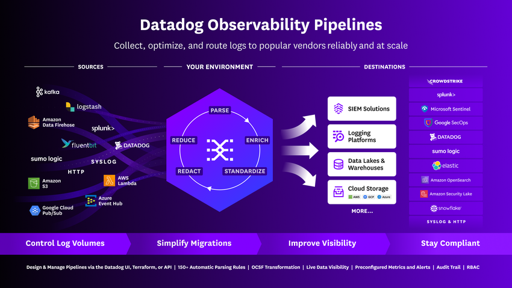
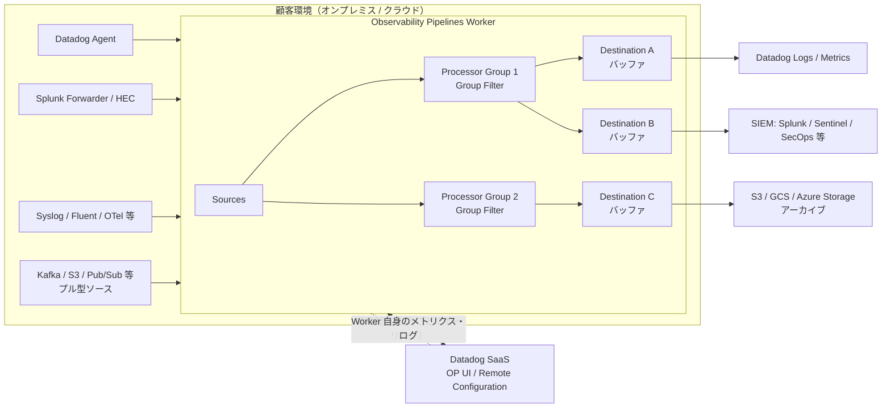
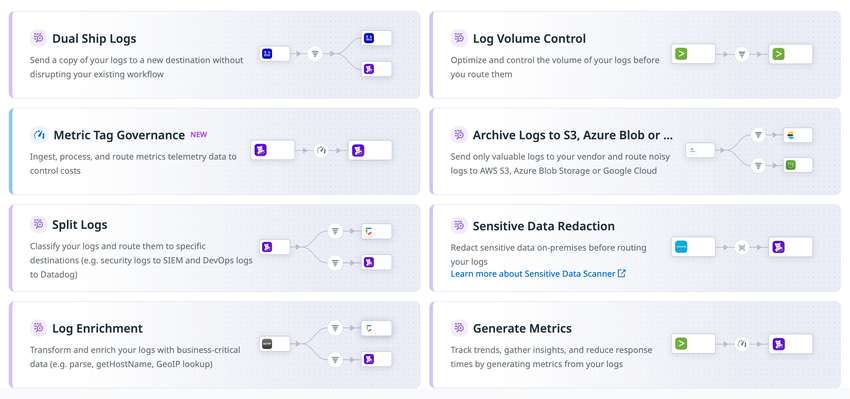
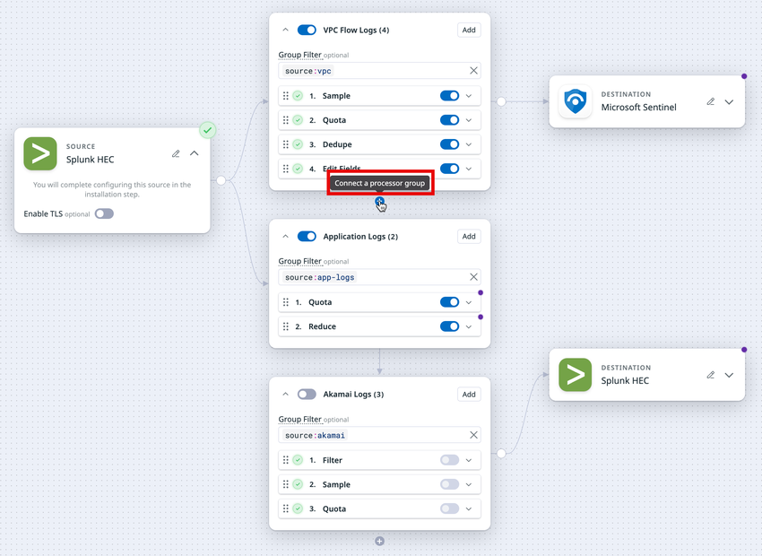
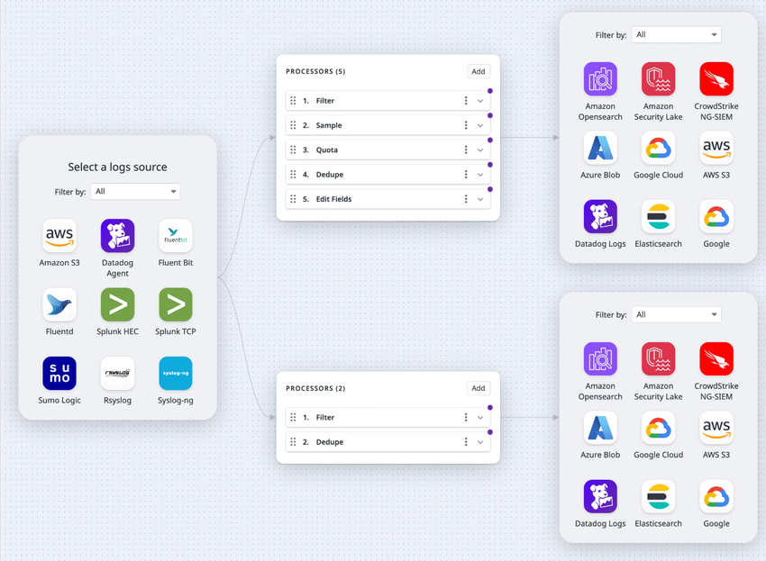
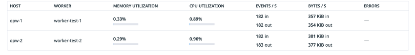

# Observability Pipelines

## 概要

Datadog Observability Pipelines（以下 OP）は、ログとメトリクスを **顧客自身のインフラ内で** 収集・加工し、Datadog・SIEM・クラウドストレージなど任意の宛先へルーティングする製品である。データが顧客環境を出る前に、フィルタリング、サンプリング、機微データのマスキング、エンリッチメント、形式変換、分岐（デュアルシップ）を行える。[出典](https://docs.datadoghq.com/observability_pipelines/)

OP は次の2つの要素で構成される。[出典](https://docs.datadoghq.com/observability_pipelines/)

| 構成要素 | 役割 | 動作場所 |
|---|---|---|
| Observability Pipelines Worker（OPW、以下 Worker） | データの受信（Sources）、加工（Processors）、送信（Destinations）を実行するデータプレーン | 顧客のインフラ（VM、コンテナ、Kubernetes 等） |
| Observability Pipelines UI | テンプレートを使ったパイプラインの構築・編集、Worker のデプロイ・管理、パイプライン健全性モニターの有効化を行うコントロールプレーン | Datadog SaaS（`https://app.datadoghq.com/observability-pipelines`） |

- OP は 2022-06-16 に一般提供（GA）が発表された。発表時点の説明では、オープンソースのテレメトリーパイプライン基盤 **Vector** をベースとしている。[出典](https://www.datadoghq.com/about/latest-news/press-releases/datadog-launches-observability-pipelines-to-help-organizations-collect-manage-and-route-observability-data/)（2022-06-16 公開。発表から2年以上経つため、現行仕様と異なる可能性がある）
- 現行の Custom Processor は Vector Remap Language（VRL）で記述する。[出典](https://docs.datadoghq.com/observability_pipelines/processors/custom_processor/)
- OP のプロセッサは「Datadog に取り込む前、顧客環境で動く」処理である。Datadog に取り込んだ後のクラウド側の処理（Log Pipelines、Processors、Logs to Metrics）は [Log Pipelines と処理](./log-pipelines-and-processing.md) を参照。[出典](https://docs.datadoghq.com/observability_pipelines/processors/)



- **キャプション:** Observability Pipelines のデータフロー概念図
- **画面の説明:** 左側にさまざまなデータソース（Agent、各種ログ転送ツール、クラウドサービスなど）が並び、中央の「Observability Pipelines Worker」（顧客環境内）でデータが集約・加工・エンリッチされる。右側に、セキュリティ（SIEM）、分析（Datadog 等）、ストレージ（アーカイブ）といった任意の宛先へルーティングされる構成が示されている。
- **出典:** https://docs.datadoghq.com/observability_pipelines/ （取得日: 2026-11-02）

### 本ファイルの範囲と関連ファイル

| トピック | 参照先 |
|---|---|
| Agent からのログ収集の基本、ログ収集経路の比較 | [ログ収集](./log-collection.md) |
| Datadog 取り込み後のパース・加工（Log Pipelines） | [Log Pipelines と処理](./log-pipelines-and-processing.md) |
| Indexes、Flex Logs、Log Archives、Rehydration、BYOC Logs（旧称：CloudPrem） | [Indexes・保持・アーカイブ](./log-indexes-retention-archives.md) |
| Datadog 側（SaaS）の Sensitive Data Scanner | [Sensitive Data Scanner](../security/sensitive-data-scanner.md) |
| Datadog Agent 本体の設定 | [Datadog Agent](../platform/agent.md)、[Agent 設定リファレンス](../platform/agent-configuration.md) |
| Remote Configuration | [Fleet Automation と Remote Configuration](../platform/fleet-automation.md) |
| Reference Tables | [Notebooks・DDSQL・Reference Tables](../platform/notebooks-and-data-tools.md) |
| OpenTelemetry | [OpenTelemetry サポート](../platform/opentelemetry.md) |
| Cloud SIEM | [Cloud SIEM](../security/cloud-siem.md) |
| 料金の正本 | [製品別料金表](../../03_導入編/02-pricing-by-product.md) |
| ログコスト削減の実践 | [ログ管理の実践](../../04_応用編/06-log-management-practices.md)、[コスト最適化](../../04_応用編/01-cost-optimization.md) |
| 他製品（Splunk 等）からの移行 | [他製品からの移行](../../03_導入編/14-migration-from-other-tools.md) |

### 世代（Worker 1.x と 2.x）

Observability Pipelines の Worker には、YAML 設定ベースの旧世代（Worker 1.8 以前、ドキュメント上「LEGACY」）と、UI / API / Terraform で構成しリモート配信する現行世代（Worker 2.x）がある。[出典](https://docs.datadoghq.com/observability_pipelines/legacy/)

| 項目 | 内容 |
|---|---|
| 旧世代 | Observability Pipelines Worker 1.8 以前。ドキュメントは「(LEGACY) Observability Pipelines」として分離されている |
| 互換性 | Worker 1.8 以前を 2.0 以上にアップグレードすると **既存パイプラインが動かなくなる**。2.x を使うには 1.8 以前のパイプラインを 2.x へ移行する必要がある |
| Datadog の推奨 | Worker 2.0 以上へ更新すること |
| 最新版（取得時点） | Worker 2.25.0（アップグレードガイド記載の最新版） |
| 更新方針 | マイナー・パッチリリースごと、少なくとも月1回の更新を推奨。最新のメジャーバージョンを使い更新し続けることが、新機能・修正・セキュリティ更新を得る唯一のサポートされた方法 |

出典：旧世代・互換性・Datadog の推奨は [(LEGACY) Observability Pipelines](https://docs.datadoghq.com/observability_pipelines/legacy/)、最新版・更新方針は [Upgrade the Worker](https://docs.datadoghq.com/observability_pipelines/guide/upgrade_worker/)

> **注意:** 本ファイルは Worker 2.x（現行世代）を前提に記述する。旧世代（1.x）の Vector 形式 YAML 設定、sources / transforms / sinks リファレンスは legacy ドキュメントを参照。

## アーキテクチャ

### パイプラインの構造

Observability Pipelines のパイプラインは、Sources（ソース）→ Processors（プロセッサ、Processor Groups に整理）→ Destinations（デスティネーション）の3種類のコンポーネントからなる順序付きの経路である。パイプラインの種類は **Logs パイプライン** と **Metrics パイプライン** の2つ。[出典](https://docs.datadoghq.com/observability_pipelines/configuration/)



- **コントロールプレーンとデータプレーンの分離:** パイプライン定義は Datadog の UI / API / Terraform で作成し、Remote Configuration で Worker に配信される。Worker は `config.<DD_SITE>` を 5 秒ごとにポーリングして設定を受け取る。[出典](https://docs.datadoghq.com/observability_pipelines/configuration/network_traffic/)
- **Worker 自身のテレメトリー:** Worker は内部パイプラインで自身のメトリクス（`pipelines.*`）とログ（`source:op_worker`）を Datadog に送る。内部パイプラインのコンポーネントの `component_id` はアンダースコア（`_`）で始まる。[出典](https://docs.datadoghq.com/observability_pipelines/monitoring_and_troubleshooting/pipeline_usage_metrics/)
- **ファンアウト:** プロセッサを通過したイベントは、パイプラインの全デスティネーションへファンアウトされる。いずれかのデスティネーションからバックプレッシャーがファンアウトに伝わると、**全デスティネーションへの送信がブロックされる**（後述「バッファリングとバックプレッシャー」）。[出典](https://docs.datadoghq.com/observability_pipelines/scaling_and_performance/buffering_and_backpressure/)
- **シェアードナッシング:** Worker は shared-nothing アーキテクチャで、リーダーノード等の協調を必要としない。各 Worker インスタンスは独立して動作する（ただし Quota プロセッサの状態は Datadog バックエンド経由で同期される）。[出典](https://docs.datadoghq.com/observability_pipelines/scaling_and_performance/best_practices_for_scaling_observability_pipelines/)

### デプロイトポロジー

Datadog は、Worker をアグリゲーター（集約層）として配置するパターンを推奨している。[出典](https://docs.datadoghq.com/observability_pipelines/scaling_and_performance/best_practices_for_scaling_observability_pipelines/)

| モデル | 構成 | 選択の目安 |
|---|---|---|
| VM ベース | ロードバランサーの背後にマネージドインスタンスグループ（オートスケーリンググループ等）として Worker を配置。プル型ソースのみならロードバランサー不要 | VM 中心の組織、Kubernetes に習熟していない組織 |
| Kubernetes ベース | Worker を StatefulSet としてデプロイし、Kubernetes Service がルーターとなる。クラスター外から送る場合は `service.type: LoadBalancer` または Ingress を使用 | ログソースが Kubernetes 内にあり分散型にしたい場合、Kubernetes に習熟している組織 |

| 配置方針 | 内容 | 留意点 |
|---|---|---|
| 分散型（decentralized、**推奨**） | データ発生源のリージョン / クラスター / データセンターごとに Worker を置く | クロスリージョン転送・転送コスト・遅延を抑えられる。管理対象は増える |
| 集中型（centralized） | 1 か所の Worker プールで複数リージョン・クラスター・アカウントのデータを受ける | 低ボリュームやネットワークピアリング済みの環境向け。リージョン間・アカウント間の大量転送コストに注意 |
| ハイブリッド | リージョンごとに専用 Kubernetes クラスターまたはインスタンスグループを置き、域内の複数クラスターから集約 | 例: 6 リージョン × 各 10 クラスター → 60 デプロイではなく 6 デプロイで済む |

## テンプレート（ユースケース）

Observability Pipelines UI でパイプラインを作成する際、ユースケース別のテンプレートを選択できる。テンプレートを選ぶと、そのユースケースに応じたプロセッサが事前に追加される。テンプレートは自由にカスタマイズ・組み合わせ可能。[出典](https://docs.datadoghq.com/observability_pipelines/configuration/explore_templates/)



- **キャプション:** パイプライン新規作成時のテンプレート選択画面（8 テンプレート）
- **画面の説明:** カード形式で 8 つのテンプレートが並ぶ。左列に Dual Ship Logs（既存のワークフローを壊さずに新しい宛先へログのコピーを送る）、Metric Tag Governance（NEW ラベル付き。メトリクスを取り込み・加工・ルーティングしてコストを制御）、Split Logs（ログを分類して特定の宛先へ。例: セキュリティログは SIEM、DevOps ログは Datadog）、Log Enrichment（パース、ホスト名取得、GeoIP ルックアップ等でエンリッチ）。右列に Log Volume Control（ログ量を最適化・制御してからルーティング）、Archive Logs to S3, Azure Blob or Google Cloud（価値の高いログだけをベンダーへ送り、ノイズの多いログは S3 / Azure Blob / GCS へ）、Sensitive Data Redaction（オンプレミスで機微データをマスキングしてからルーティング）、Generate Metrics（ログからメトリクスを生成）。各カード右側にソース→プロセッサ→宛先の簡易図がある。
- **出典:** https://docs.datadoghq.com/observability_pipelines/configuration/explore_templates/ （取得日: 2026-11-02）

### テンプレート一覧

| テンプレート | 種別 | 目的 | 主に使うプロセッサ / 宛先 |
|---|---|---|---|
| Archive Logs | Logs | ログを Amazon S3 / Google Cloud Storage / Azure Storage に **Datadog でリハイドレート可能な形式** で保管 | Datadog Archives デスティネーション |
| Dual Ship Logs | Logs | 同じログストリームを複数宛先（例: Datadog と SIEM）へ送り、ツール評価・移行を本番影響なく行う | 複数デスティネーション |
| Generate Log-based Metrics | Logs | 大量ログ（ファイアウォール、ネットワーク機器等）から COUNT / GAUGE / DISTRIBUTION のメトリクスを生成 | Generate Metrics プロセッサ |
| Log Enrichment | Logs | Reference Tables や静的マッピングでメタデータを付与し、形式を標準化 | Enrichment Table、Grok Parser 等 |
| Log Volume Control | Logs | 価値の低いログを保管前にフィルタし、インデックス対象（SIEM やログ管理製品）への送信量を予算内に収める | Filter、Sample、Quota、Dedupe、Edit Fields 等 |
| Sensitive Data Redaction | Logs | クレジットカード番号、口座番号、API キー等を **オンプレミスで** 検出・マスキング | Sensitive Data Scanner プロセッサ |
| Split Logs | Logs | ログの種類（例: セキュリティ vs アプリ）ごとに別ツールへ振り分け、宛先ごとに前処理 | 複数の Processor Group と宛先 |
| Metric Tag Governance | Metrics | 必要なメトリクスのみ残し、タグを標準化し、高カーディナリティタグを除去 | Filter、Tag Allow/Block List、Tag Cardinality Control、Edit Tags、Aggregate |

[出典](https://docs.datadoghq.com/observability_pipelines/configuration/explore_templates/)、[出典](https://docs.datadoghq.com/observability_pipelines/)

### 主要テンプレートの詳細

#### Log Volume Control（ログボリューム制御）

Log Volume Control テンプレートは、生ログのうち調査に有用なものだけをインデックス対象（SIEM、ログ管理製品）へ送り、予算内に収めるためのテンプレートである。公式ガイドが挙げるボリューム削減の戦略は次のとおり。[出典](https://docs.datadoghq.com/observability_pipelines/guide/strategies_for_reducing_log_volume/)

| 戦略 | 使用プロセッサ | 内容 |
|---|---|---|
| サンプリング | Sample | 反復的・ノイズの多いログを一定割合だけ保持 |
| フィルタリング | Filter | 非本番の debug ログなど不要ログを破棄 |
| 属性の削除 | Edit Fields | 調査に使わない属性を drop してログサイズを削減 |
| 集約（Reduce） | Reduce | 多数のログを1イベントにまとめる（連結、合計、配列化等のマージ戦略） |
| 重複排除 | Deduplicate | 上流の誤りによる重複ログを排除 |
| クォータ | Quota | フィルタ単位で日次のイベント数またはバイト数に上限を設定し、超過時に破棄・保持・オーバーフロー宛先へ送る |
| アーカイブ直送 | Datadog Archives | 自社クラウドストレージへ Datadog リハイドレート可能形式で直接送り、必要時のみリハイドレート |

公式ガイドが削減の有力候補として挙げるログソース: CDN、VPC / ネットワークフロー、Web サーバー、ロードバランサー、CI/CD、コントロールプレーン、サービスメッシュ、ファイアウォール、ネットワーク機器、DNS、debug ログ、監査ログ、非本番環境ログ。[出典](https://docs.datadoghq.com/observability_pipelines/guide/strategies_for_reducing_log_volume/)

#### Split Logs（分割）と Dual Ship Logs（デュアルシップ）

- **Split Logs:** 異なるサービス・アプリのログを、用途別（例: セキュリティログ→SIEM、DevOps ログ→Datadog）に別々の宛先へ送り、宛先ごとに別の前処理を行う。UI では、ソースの右に Processor Group と宛先のセットを追加（Processor Group 左側の「+」）し、各 Group の **Group Filter** で振り分ける。[出典](https://docs.datadoghq.com/observability_pipelines/configuration/explore_templates/)、[出典](https://docs.datadoghq.com/observability_pipelines/configuration/set_up_pipelines/)
- **Dual Ship Logs:** 同一ログを複数の宛先へ送る。新しいアーカイブ・SIEM・ログ管理製品の試行や移行で、本番ワークフローを止めずに並行運用するために使う。[出典](https://docs.datadoghq.com/observability_pipelines/configuration/explore_templates/)
- **注意:** 1 つの宛先が停止してバックプレッシャーが発生すると、ファンアウトにより全宛先がブロックされる。重要度の低い宛先には `drop_newest`（Drop Newest）バッファ設定を使うと他の宛先への配信を継続できる。[出典](https://docs.datadoghq.com/observability_pipelines/scaling_and_performance/buffering_and_backpressure/)

#### Archive Logs（アーカイブ）

- Archive Logs テンプレートは、Amazon S3 / Google Cloud Storage / Azure Storage に **Datadog リハイドレート可能形式** でログを保管する。用途例: ノイズの多い大量ログを普段はインデックスせず調査時のみ Datadog へリハイドレートしたい場合、Datadog Log Management への移行時に過去ログを保持したい場合、コンプライアンス上の保管義務はあるがインデックス不要な場合。[出典](https://docs.datadoghq.com/observability_pipelines/configuration/explore_templates/)
- 使用する Datadog Archives デスティネーションで保存したログは、Archive Search で検索でき、Rehydration で Datadog に取り込める。Amazon S3 版は事前に Datadog の AWS インテグレーションを設定して Log Archives を構成しておく必要がある。[出典](https://docs.datadoghq.com/observability_pipelines/destinations/datadog_archives/)
- JSON や Parquet 形式で S3 に保存したい場合は、Datadog Archives ではなく Amazon S3 デスティネーションを使う。[出典](https://docs.datadoghq.com/observability_pipelines/destinations/datadog_archives/)
- Datadog Archives デスティネーション（S3 / GCS / Azure Blob）は `gzip` または `zstd` の `compression` オプションに対応（Worker 2.21.0 で追加）。[出典](https://docs.datadoghq.com/observability_pipelines/guide/upgrade_worker/)
- Log Archives・Archive Search・Rehydration 自体の仕様は [Indexes・保持・アーカイブ](./log-indexes-retention-archives.md) を参照。

#### Sensitive Data Redaction（機微データ除去）

- Sensitive Data Redaction テンプレートは、Sensitive Data Scanner プロセッサを使い、クレジットカード番号、銀行のルーティング番号、API キー、メールアドレス、IP アドレス、SSH キー、アクセストークン等を **顧客環境内（オンプレミス）で** 検出しマスキングする。[出典](https://docs.datadoghq.com/observability_pipelines/configuration/explore_templates/)
- すぐに使えるスキャンルール数は、テンプレートのページでは「70 の OOTB ルール」と記載されている一方、Worker アップグレードガイドには「100 以上の OOTB ルールを追加」との記載があり、公式ドキュメント内で数値が一致していない。最新のルール一覧は Sensitive Data Scanner の Library Rules ページを参照。[出典](https://docs.datadoghq.com/observability_pipelines/configuration/explore_templates/)、[出典](https://docs.datadoghq.com/observability_pipelines/guide/upgrade_worker/)
- プロセッサの詳細設定は後述「主要プロセッサの詳細 > Sensitive Data Scanner」を参照。

## Sources（ソース）

Observability Pipelines の Sources は、データ発生源からデータを受け取るコンポーネントである。[出典](https://docs.datadoghq.com/observability_pipelines/sources/)

### Logs 用ソース（24 種）

| ソース | 方式（概要） | 主な既定の環境変数 |
|---|---|---|
| Akamai DataStream | Akamai からの受信 | 公開情報（一覧ページ）では確認できず |
| Amazon Data Firehose | Firehose からのプッシュを受信 | `DD_OP_SOURCE_AWS_DATA_FIREHOSE_ADDRESS` |
| Amazon S3 | S3 イベント通知の SQS をポーリング（プル型） | `DD_OP_SOURCE_AWS_S3_SQS_URL`、`AWS_CONFIG_FILE`、`AWS_PROFILE` |
| Azure Event Hubs | Event Hubs から取得 | 公開情報（一覧ページ）では確認できず |
| Cloudflare Logpush | Cloudflare Logpush を受信 | 公開情報（一覧ページ）では確認できず |
| Datadog Agent | Agent からのプッシュを受信（例: `<OPW_HOST>:8282`） | `DD_OP_SOURCE_DATADOG_AGENT_ADDRESS` |
| Filebeat | Filebeat からの受信 | 公開情報（一覧ページ）では確認できず |
| Fluentd and Fluent Bit | Fluent forward プロトコルで受信 | `DD_OP_SOURCE_FLUENT_ADDRESS` |
| Google Pub/Sub | Pub/Sub サブスクリプションから取得（プル型） | なし |
| HTTP Client | Worker が指定 HTTP/S エンドポイントからログを取得（プル型） | `DD_OP_SOURCE_HTTP_CLIENT_ENDPOINT_URL` |
| HTTP Server | Worker が HTTP/S サーバーとして待ち受け | `DD_OP_SOURCE_HTTP_SERVER_ADDRESS` |
| Kafka | Kafka トピックから consume（プル型） | `DD_OP_SOURCE_KAFKA_BOOTSTRAP_SERVERS` |
| Lambda Extension | Datadog Lambda Extension からの受信 | 公開情報（一覧ページ）では確認できず |
| Lambda Forwarder | Datadog Lambda Forwarder からの受信 | 公開情報（一覧ページ）では確認できず |
| Logstash | Logstash からの受信 | `DD_OP_SOURCE_LOGSTASH_ADDRESS` |
| MySQL | MySQL データベースからログを取得 | `DD_OP_SOURCE_MYSQL_CONNECTION_STRING` |
| Okta | Okta からの取得 | 公開情報（一覧ページ）では確認できず |
| OpenTelemetry | OTLP の HTTP と gRPC で受信（両方のエンドポイント指定が必要） | `DD_OP_SOURCE_OTEL_HTTP_ADDRESS`、`DD_OP_SOURCE_OTEL_GRPC_ADDRESS` |
| Socket | TCP / UDP ソケットで受信 | `DD_OP_SOURCE_SOCKET_ADDRESS` |
| Splunk HTTP Event Collector (HEC) | Splunk インデクサ宛ての HEC を受信（`/services/collector/event` が自動付与） | `DD_OP_SOURCE_SPLUNK_HEC_ADDRESS` |
| Splunk Heavy or Universal Forwarders (TCP) | Splunk Forwarder からの TCP を受信 | `DD_OP_SOURCE_SPLUNK_TCP_ADDRESS` |
| Sumo Logic Hosted Collector | Sumo Logic HTTP Source 宛てを受信（`/receiver/v1/http/` が自動付与） | `DD_OP_SOURCE_SUMO_LOGIC_ADDRESS` |
| Syslog | rsyslog / syslog-ng から受信 | `DD_OP_SOURCE_SYSLOG_ADDRESS` |
| WebSocket | Worker が WebSocket エンドポイント（例: `wss://example.com/stream`）に接続して受信。認証は `none` / `basic` / `bearer` / `custom` | `DD_OP_SOURCE_WEBSOCKET_URI` |

[出典](https://docs.datadoghq.com/observability_pipelines/sources/)、[出典](https://docs.datadoghq.com/observability_pipelines/guide/environment_variables/)、[出典](https://docs.datadoghq.com/observability_pipelines/configuration/update_existing_pipelines/)

### Metrics 用ソース（3 種）

| ソース | 主な既定の環境変数 |
|---|---|
| Datadog Agent | `DD_OP_SOURCE_DATADOG_AGENT_ADDRESS` |
| OpenTelemetry | `DD_OP_SOURCE_OTEL_HTTP_ADDRESS`、`DD_OP_SOURCE_OTEL_GRPC_ADDRESS` |
| Prometheus（Remote Write を受信） | `DD_OP_SOURCE_PROMETHEUS_REMOTE_WRITE_ADDRESS` |

[出典](https://docs.datadoghq.com/observability_pipelines/sources/)、[出典](https://docs.datadoghq.com/observability_pipelines/guide/environment_variables/)

### ソース共通の仕様

| 項目 | 仕様 |
|---|---|
| 1 パイプラインあたりのソース数 | 最大 10 |
| 同一種別のソースを複数追加する場合 | Secrets Management の使用が必須（例: HTTP Client を 2 つ使う場合、既定の `SOURCE_HTTP_CLIENT_ENDPOINT_URL` ではなくそれぞれ別のシークレット識別子が必要） |
| 付与される標準メタデータ | `hostname`、`timestamp`、`source_type`（後続のプロセッサ・宛先で変更されうる） |
| TLS | 多くのソースで TLS を有効化可能。証明書は DER / PEM / CRT 形式。パスは `/var/lib/observability-pipelines-worker/config/`（データディレクトリ配下の `config`）からの相対パスとして解釈される |
| 自己署名証明書 | 既定で拒否される。内部テスト用途に限り、Worker ホストの OS トラストストア（Kubernetes ではカスタムイメージかマウント）に追加して使用 |
| 「bytes in per second」メトリクス | エンリッチ前の、取り込んだ生イベントを計測 |

[出典](https://docs.datadoghq.com/observability_pipelines/sources/)、[出典](https://docs.datadoghq.com/observability_pipelines/sources/datadog_agent/)

### Datadog Agent ソースの接続設定

既存の Datadog Agent のログ・メトリクスを Worker 経由にするには、Agent 側で次の設定を行う。`<OPW_HOST>` は Worker ホストの IP またはロードバランサーの URL（CloudFormation の場合は出力 `LoadBalancerDNS`）。[出典](https://docs.datadoghq.com/observability_pipelines/sources/datadog_agent/)

| 対象 | `datadog.yaml` | 環境変数 |
|---|---|---|
| ログ | `observability_pipelines_worker.logs.enabled: true`、`observability_pipelines_worker.logs.url: "http://<OPW_HOST>:8282"` | `DD_OBSERVABILITY_PIPELINES_WORKER_LOGS_ENABLED`、`DD_OBSERVABILITY_PIPELINES_WORKER_LOGS_URL` |
| メトリクス | `observability_pipelines_worker.metrics.enabled`、`observability_pipelines_worker.metrics.url` | `DD_OBSERVABILITY_PIPELINES_WORKER_METRICS_ENABLED`、`DD_OBSERVABILITY_PIPELINES_WORKER_METRICS_URL` |

```yaml
# datadog.yaml（ログを Worker 経由にする例）
observability_pipelines_worker:
  logs:
    enabled: true
    url: "http://<OPW_HOST>:8282"
```

- Agent が送るログ・メトリクスの属性は `source` / `tags` ではなく **`ddsource` / `ddtags`**。プロセッサのフィルタクエリではこちらを使う。[出典](https://docs.datadoghq.com/observability_pipelines/sources/datadog_agent/)
- Agent を Docker コンテナで動かしている場合、Worker 自身のログを Agent が二重収集しないよう `DD_CONTAINER_EXCLUDE_LOGS`（Helm では `datadog.containerExcludeLogs`）で OP のログを除外する（Worker は自身のログを直接 Datadog に送るため）。[出典](https://docs.datadoghq.com/observability_pipelines/sources/datadog_agent/)
- DDOT（Datadog Distribution of OpenTelemetry）Collector で収集したログ・メトリクスを送る場合は、Datadog Agent ソースではなく OpenTelemetry ソースを使う。[出典](https://docs.datadoghq.com/observability_pipelines/sources/datadog_agent/)
- Agent のログ送信設定全般は [ログ収集](./log-collection.md) を参照。

## Processors（プロセッサ）

Observability Pipelines の Processors は、データのパース、構造化、エンリッチ、フィルタ、変換を行うコンポーネントである。テンプレートを選ぶと事前選択されたプロセッサが Processor Group に追加される。[出典](https://docs.datadoghq.com/observability_pipelines/processors/)



- **キャプション:** Processor Groups を使ったパイプラインキャンバスの例
- **画面の説明:** 左に Source「Splunk HEC」（Enable TLS トグル付き）。中央に 3 つの Processor Group が縦に並ぶ。「VPC Flow Logs (4)」グループは Group Filter `source:vpc` で、Sample → Quota → Dedupe → Edit Fields の 4 プロセッサを含み、右の Destination「Microsoft Sentinel」へ接続。「Application Logs (2)」グループは Group Filter `source:app-logs` で Quota → Reduce、「Akamai Logs (3)」グループは Group Filter `source:akamai` で Filter → Sample → Quota（グループのトグルがオフ＝無効化状態）を含み、Destination「Splunk HEC」へ接続。各グループとプロセッサに有効 / 無効のトグルがあり、グループ下部の「+」（Connect a processor group）でグループを連結できる。
- **出典:** https://docs.datadoghq.com/observability_pipelines/processors/ （取得日: 2026-11-02）

### Processor Groups と実行順序

| 項目 | 仕様 |
|---|---|
| Processor Groups の利用条件 | Worker 2.7 以降 |
| 実行順序 | Processor Group は上から下へ、Group 内のプロセッサも上から下へ実行。順序はプロセッサ左上のドラッグハンドルで変更 |
| Group Filter | 各 Group にフィルタクエリを設定でき、一致したイベントのみ Group 内のプロセッサで処理（任意） |
| プロセッサ単位のフィルタ | 各プロセッサにもフィルタクエリを設定可能。一致しないイベントは（Filter プロセッサ以外は）処理されずに次へ渡される |
| 有効 / 無効 | Group 単位・プロセッサ単位でトグル切り替え可能 |
| コピー | プロセッサのコピーアイコン → 貼り付け（`Cmd+V` / `Ctrl+V`）。Group の「…」→「Copy all processors」で Group 内の全プロセッサをコピー |
| 削除 | Processor Group を削除するには、紐づく宛先をすべて削除する（最後の宛先を削除すると Group も削除される） |
| 上限 | 1 パイプラインキャンバスあたり Processor Group 25 個、プロセッサ合計 150 個。デュアルシップ構成でも Group 25 個は全宛先の合計（例: 15 + 10） |

[出典](https://docs.datadoghq.com/observability_pipelines/processors/)、[出典](https://docs.datadoghq.com/observability_pipelines/configuration/set_up_pipelines/)

### フィルタクエリの構文

- Observability Pipelines のフィルタクエリは独自の Search Syntax を使う。Free text search（`message` フィールドを検索）と Attribute search（`key:value`、例: `url:www.datadoghq.com`）がある。[出典](https://docs.datadoghq.com/observability_pipelines/search_syntax/logs/)
- 属性の存在 / 非存在は `_exists_:service` / `_missing_:service` で判定する。ネスト属性はパス表記（`outer_key.inner_key`）、キー名にドットを含む場合は `"service.status":disabled` のように引用符で囲む。ブール演算子、ワイルドカード、配列内の検索、特殊文字のエスケープに対応。[出典](https://docs.datadoghq.com/observability_pipelines/search_syntax/logs/)
- Worker 2.11 以降は新しい検索構文に更新されており、2.11 へアップグレードした際は既存フィルタクエリの書き換えが必要な場合がある。[出典](https://docs.datadoghq.com/observability_pipelines/search_syntax/logs/)
- Metrics パイプライン用には別途 Metrics Search Syntax がある。[出典](https://docs.datadoghq.com/observability_pipelines/search_syntax/metrics/)

### Logs 用プロセッサ一覧（19 種）

| プロセッサ | 機能概要 |
|---|---|
| Add Environment Variables | 環境変数の名前と値をログに付与（読み取り可能な変数は `DD_OP_PROCESSOR_ADD_ENV_VARS_ALLOWLIST` で許可） |
| Add Hostname | ログ送信元ホスト名のフィールドを付与 |
| Custom Processor | VRL（Vector Remap Language）で任意の変換・エンリッチ（ログ・メトリクス両対応） |
| Deduplicate | 重複ログを除去 |
| Edit Fields | フィールドの追加・削除・リネーム |
| Enrichment Table | Reference Tables、ローカルファイル（CSV）、GeoIP（`.mmdb`）でエンリッチ |
| Filter | フィルタクエリに一致したイベントのみ後続へ送り、不一致は破棄 |
| Generate Metrics | ログから count / gauge / distribution メトリクスを生成 |
| Grok Parser | Grok ルール（ライブラリルール、カスタムルール、AI 生成ルール）で非構造ログをパース |
| Parse JSON | 指定フィールドの JSON 文字列をオブジェクトにパース |
| Parse XML | XML データをパース |
| Quota | 日次のイベント数 / バイト数の上限を管理し、超過時に drop / keep / オーバーフロー宛先へ |
| Reduce | 指定フィールドでグルーピングし、マージ戦略に従い複数ログを1つに集約 |
| Remap to OCSF | ログを OCSF（Open Cybersecurity Schema Framework）イベントにマッピング（パイプラインの最後に置くことを推奨） |
| Sample | 指定割合のみ保持し残りを破棄 |
| Sensitive Data Scanner | PII・PCI 等の機微データを検出し、マスキング・部分マスキング・ハッシュ化 |
| Split Array | パース済みのネスト配列を個別イベントに分割 |
| Tags | Datadog Agent 由来ログの `ddtags` 配列から特定タグを除外 / 包含 |
| Throttle | 時間ウィンドウあたりのイベント数を制限（Worker 単位） |

[出典](https://docs.datadoghq.com/observability_pipelines/processors/)

### Metrics 用プロセッサ一覧（5 種 + 両対応）

| プロセッサ | 機能概要 |
|---|---|
| Aggregate | 同一タグ値の複数メトリクスを集約モードに従い 1 サンプルにまとめる（Worker 2.22.0 でイベント時刻ベースの集約と猶予期間に対応） |
| Edit Tags | メトリクスのタグを追加・リネーム |
| Filter | フィルタクエリに一致したメトリクスのみ後続へ |
| Tag Allow/Block List | タグの許可リスト / 拒否リスト |
| Tag Cardinality Control | メトリクスごとのタグ値の数を制限し、カーディナリティの急増を防止（`tracking_mode` に `exact_fingerprint` / `probabilistic`） |

- 上記のほか、Custom Processor（メトリクス対応）と Enrichment Table（Worker 2.23.0 でメトリクスパイプラインの CSV / Reference Tables に対応）もメトリクスで使える。[出典](https://docs.datadoghq.com/observability_pipelines/processors/custom_processor/)、[出典](https://docs.datadoghq.com/observability_pipelines/guide/upgrade_worker/)

[出典](https://docs.datadoghq.com/observability_pipelines/processors/)

### 主要プロセッサの詳細

#### Filter / Sample / Deduplicate / Throttle / Quota の違い

| 項目 | Filter | Sample | Deduplicate | Throttle | Quota |
|---|---|---|---|---|---|
| フィルタに一致しないイベント | **破棄** | 後続へ送る | 後続へ送る | 後続へ送る | 後続へ送る |
| 一致したイベントの扱い | 後続へ送る | 指定割合（Retain、%）のみ保持 | 同一とみなしたものを除去 | レート超過分を破棄 | 日次上限内は後続へ、超過後は drop / keep / オーバーフロー宛先 |
| グルーピング | なし | Group By（複数フィールド可） | 一致 / 無視フィールド（最大 3） | Group By | Partition by（フィールド）+ Overrides（CSV） |
| 時間窓 | なし | なし | LRU キャッシュ（既定 5,000 件） | 任意設定 | 24 時間固定（UTC 0 時リセット） |
| Worker 間の状態共有 | 不要 | なし | **なし**（同じ Worker が処理した重複のみ除去） | **なし**（レートは Worker 単位） | **あり**（Datadog バックエンドで同期、再起動後も保持） |

[出典](https://docs.datadoghq.com/observability_pipelines/processors/filter/)、[出典](https://docs.datadoghq.com/observability_pipelines/processors/sample/)、[出典](https://docs.datadoghq.com/observability_pipelines/processors/dedupe/)、[出典](https://docs.datadoghq.com/observability_pipelines/processors/throttle/)、[出典](https://docs.datadoghq.com/observability_pipelines/processors/quota/)

#### Quota

| 設定 / 仕様 | 内容 |
|---|---|
| 計測単位 | `Events`（件数）または `Volume`（バイト） |
| 時間窓 | 24 時間固定、UTC 午前 0 時にリセット |
| 上限到達時の動作 | drop events / keep events / send events to overflow destination（Amazon S3、Azure Blob、Google Cloud のいずれか） |
| パーティション | `service`、`env`、`status` などフィールド別に個別バケットで上限を管理。Ignore when missing でフィールドがないイベントを対象外にできる |
| Overrides | パーティション値ごとに別上限（CSV でアップロード。例: `service:a` は 5,000 バイト、`service:b` は 50 件） |
| 識別 | クォータ名で複数 Worker 間の同一クォータを識別 |
| バケット上限 | 1 パイプラインあたり 1,000 バケット（増枠はサポートへ） |
| 同期対象 Worker 数 | 既定で 1 組織あたり 100 Worker（Worker 2.16 以降は 300）。超過すると同期が不正確になり上限超過後もログが流れる可能性があり、`Failed to sync quota state` エラーが出る |
| 同期頻度 | 1 分に数回。Worker 数とスループットにより上限を超過しうるため、上限は、プロセッサが受け取る見込みの 1 分あたりのログ量より 1 桁以上大きく設定することを推奨 |
| メトリクス | `pipelines.quota_reached_events_total` など |

[出典](https://docs.datadoghq.com/observability_pipelines/processors/quota/)

#### Throttle

- Throttle プロセッサは、指定した時間ウィンドウあたりのイベント数（Throttling rate）を上限とし、超過分を破棄する。レート制限は **Worker 単位** で適用されるため、Worker 数を増減した場合はレートを調整する。[出典](https://docs.datadoghq.com/observability_pipelines/processors/throttle/)
- 補充アルゴリズムは Generic Cell Rate Algorithm（GCRA）。補充レート = Throttling rate ÷ 時間ウィンドウ（秒）。例: 1,000 イベント / 60 分 → 有効化直後に 1,000 件を通過させ、その後は約 17 件 / 分（約 0.28 件 / 秒）。[出典](https://docs.datadoghq.com/observability_pipelines/processors/throttle/)
- 状態は Worker のメモリで管理されるため、Worker またはパイプラインの再デプロイで時間ウィンドウがリセットされる（Quota はバックエンドに保存され再起動後も保持）。[出典](https://docs.datadoghq.com/observability_pipelines/processors/throttle/)

#### Sample

- Retain に保持率を指定する（例: `2` → 一致イベントの 2% を保持）。Group By を指定すると、フィールド値の組み合わせごとに独立してサンプリングする（例: `env:staging` の 40% を `status` × `service` の組ごとに保持）。[出典](https://docs.datadoghq.com/observability_pipelines/processors/sample/)
- Worker 2.25.0 以降、サンプリンググループ追跡に使うメモリは 128 MiB に制限され、上限到達時は最も長く使われていないグループから追い出される。[出典](https://docs.datadoghq.com/observability_pipelines/guide/upgrade_worker/)

#### Deduplicate

- Type of deduplication で `Match`（指定フィールドがすべて同値なら重複とみなす）または `Ignore`（指定フィールド以外がすべて同値なら重複）を選ぶ。フィールドは 1〜3 個。[出典](https://docs.datadoghq.com/observability_pipelines/processors/dedupe/)
- キャッシュサイズの既定値は 5,000 メッセージ（推奨）。増やすとメモリ使用量が増える。キャッシュは Worker 間で共有されない。[出典](https://docs.datadoghq.com/observability_pipelines/processors/dedupe/)

#### Reduce

- Reduce プロセッサは、指定フィールドでログをグルーピングし、マージ戦略（連結、合計、配列化など）で 1 つのログにまとめる。既定では 10 秒間隔でグループを出力する。[出典](https://docs.datadoghq.com/observability_pipelines/processors/reduce/)
- Worker 2.25.0 以降、環境変数 `DD_OP_REDUCE_WINDOW_SECS`（1〜300 秒、既定 10 秒）で集約ウィンドウを変更できる（Worker 上の全 Reduce プロセッサに適用）。[出典](https://docs.datadoghq.com/observability_pipelines/guide/upgrade_worker/)

#### Generate Metrics（ログベースメトリクス）

| 項目 | 内容 |
|---|---|
| メトリクスタイプ | COUNT、GAUGE、DISTRIBUTION（gauge / distribution は数値フィールドを値に使用。distribution は数値配列も可） |
| Group by | 指定フィールドがメトリクスのタグになる |
| タイムスタンプ | ログの `timestamp` フィールドを使用。`timestamp` が文字列の場合は処理時刻が使われる |
| Aggregate generated metrics | 有効時、同一系列・同一タイムスタンプのポイントを結合して送信し過少カウントを防ぐ。`worker_uuid` タグを付与し、宛先側で Worker 間の値が重複排除されず集約されるようにする。既定で有効（Worker 2.24.0 以降。オプション自体は 2.22.0 で追加）。不要なら無効化する |
| 既定の宛先 | Datadog Metrics |
| 他の宛先 | Worker 2.18 以降で Datadog Metrics 以外へ送信可能。Splunk HEC / Elasticsearch / HTTP/S Client への送信は `【Preview】` |
| 課金 | Datadog に送った生成メトリクスは **カスタムメトリクス** として課金される |

[出典](https://docs.datadoghq.com/observability_pipelines/processors/generate_metrics/)

- Datadog の SaaS 側で取り込み後にメトリクスを生成する機能（Generate Metrics from logs）との違いは [Log Pipelines と処理](./log-pipelines-and-processing.md) を参照。

#### Enrichment Table

| ルックアップ種別 | 内容 |
|---|---|
| Reference Table | Datadog の Reference Tables（クラウドストレージ、Databricks、Salesforce、ServiceNow CMDB、Snowflake 等から取り込み可）を参照。サービスアカウントに紐づき `reference_tables_read` スコープに限定した Application キーが必要。既定では全カラムを付与、カラムの選択も可 |
| File | Worker ローカルの CSV ファイル（`<DD_OP_DATA_DIR>/config` からの相対パス、`observability-pipelines-worker` ユーザー / グループが読める必要あり）。シークレット（Datadog API キー、Splunk HEC トークン）をソース属性として使う機能は `【Preview】` |
| GeoIP | `.mmdb` ファイル（`<DD_OP_DATA_DIR>/config` からの相対パス） |

[出典](https://docs.datadoghq.com/observability_pipelines/processors/enrichment_table/)

#### Grok Parser

- Grok Parser プロセッサは、ライブラリルール（Apache、Airflow、MySQL 等のベンダー形式。既定で適用）、カスタムルール、AI 生成ルールでログをパースする。ライブラリルールを無効化するにはカスタムルールの作成が先に必要。[出典](https://docs.datadoghq.com/observability_pipelines/processors/grok_parser/)
- ルール単位のフィルタ（Per-rule filters）と AI によるパースルール生成は `【Preview】`（アカウントマネージャー経由で申請）。[出典](https://docs.datadoghq.com/observability_pipelines/processors/grok_parser/)

#### Sensitive Data Scanner

| 項目 | 内容 |
|---|---|
| ルール種別 | Library rules（Datadog 定義済みルール、推奨キーワード自動付与）、Custom rules（PCRE 正規表現。後方参照、再帰パターン、条件パターン、アトミックグループ等は非対応） |
| スキャン対象 | Entire Event / Specific Attributes / Exclude Attributes（パス表記 `outer_key.inner_key`） |
| キーワード辞書 | 既定では一致値の前 30 文字以内にキーワードが必要（変更可） |
| 一致時のアクション | Redact（置換文字列）、Partially Redact（指定文字数を部分置換）、Hash（UTF-8 バイト列を FarmHash の 64 ビットフィンガープリントで置換）。いずれも **不可逆** |
| タグ付与 | 一致イベントにタグを付与可能 |
| 管理方法 | UI、API、Terraform（Library rule の ID は Terraform のデータソース `sensitive_data_scanner_standard_pattern` で取得） |
| 性能 | CPU 負荷が高い。不要ルールの削除、フィルタクエリでの対象絞り込み、スキャン対象属性の限定を推奨。`pipelines.component_latency_seconds` で効果を計測 |
| 可視化 | 標準ダッシュボード「Observability Pipelines Overview」の「Sensitive data found by Observability Pipelines」セクション、プロセッサの View Scanning Rules（直近 24 時間の一致数） |

[出典](https://docs.datadoghq.com/observability_pipelines/processors/sensitive_data_scanner/)

> **補足:** OP の Sensitive Data Scanner プロセッサは顧客環境内でマスキングするため、機微データを Datadog に一切送りたくない要件に適する。Datadog SaaS 側の Sensitive Data Scanner（取り込み後にスキャン）は別製品で別課金。SaaS 側の仕様は [Sensitive Data Scanner](../security/sensitive-data-scanner.md) を参照。[出典](https://www.datadoghq.com/pricing/?product=observability-pipelines)

#### Custom Processor（VRL）

- Custom Processor は Vector Remap Language（VRL）でログ・メトリクスを変換する。配列・文字列操作、エンコード / デコード（Base64 等）、暗号化 / 復号、型変換、syslog 値の変換、エンリッチメントテーブル参照、IP 操作、haversine による距離・方位計算、grok / 正規表現 / 既定パーサー（syslog、apache、VPC フローログ等）によるパース、パス操作などの関数を提供する。[出典](https://docs.datadoghq.com/observability_pipelines/processors/custom_processor/)
- 予約属性（`host`、`source`、`service` 等）の値のリマップは Edit Fields または Custom Processor で行う。[出典](https://docs.datadoghq.com/observability_pipelines/guide/remap_reserved_attributes/)

## Destinations（デスティネーション）

Observability Pipelines の Destinations は、処理済みデータの送信先である。[出典](https://docs.datadoghq.com/observability_pipelines/destinations/)

### Logs 用デスティネーション（24 種）

| デスティネーション | 分類 | 主な既定の環境変数 |
|---|---|---|
| Amazon OpenSearch | 検索・分析 | `DD_OP_DESTINATION_AMAZON_OPENSEARCH_ENDPOINT_URL` ほか |
| Amazon S3 | オブジェクトストレージ（JSON / Parquet。Parquet は Snappy / ZSTD / GZIP / LZ4 / 非圧縮） | なし（AWS 認証は IAM） |
| Amazon Security Lake | セキュリティデータレイク | `DD_OP_DESTINATION_AMAZON_SECURITY_LAKE_KEY_PASS`（TLS 時） |
| Azure Storage | オブジェクトストレージ | 公開情報（一覧ページ）では確認できず |
| ClickHouse | 分析 DB | `DD_OP_DESTINATION_CLICKHOUSE_ENDPOINT_URL` ほか |
| CrowdStrike Next-Gen SIEM | SIEM | `DD_OP_DESTINATION_CROWDSTRIKE_NEXT_GEN_SIEM_ENDPOINT_URL`、`..._TOKEN` |
| Databricks (Zerobus) | データレイクハウス（Unity Catalog テーブル、OAuth 2.0） | `DD_OP_DESTINATION_DATABRICKS_ZEROBUS_OAUTH_CLIENT_SECRET` |
| Datadog Archives | Datadog リハイドレート可能形式のアーカイブ（S3 / GCS / Azure Blob） | Azure のみ `DD_OP_DESTINATION_DATADOG_ARCHIVES_AZURE_BLOB_CONNECTION_STRING` |
| Datadog BYOC Logs | Datadog BYOC Logs（旧称：CloudPrem） | 公開情報（一覧ページ）では確認できず |
| Datadog Logs | Datadog Log Management | なし |
| Elasticsearch | 検索・分析（data streams 対応） | `DD_OP_DESTINATION_ELASTICSEARCH_ENDPOINT_URL` ほか |
| Google Cloud Storage | オブジェクトストレージ | 公開情報（一覧ページ）では確認できず |
| Google Pub/Sub | メッセージング（既定は `https://pubsub.googleapis.com`、リージョンエンドポイント指定可） | `DD_OP_DESTINATION_GCP_PUBSUB_ENDPOINT_URL` |
| Google SecOps（旧称：Google Chronicle） | SIEM | `DD_OP_DESTINATION_GOOGLE_CHRONICLE_UNSTRUCTURED_ENDPOINT_URL` |
| HTTP Client | 任意の HTTP/S エンドポイント | `DD_OP_DESTINATION_HTTP_CLIENT_URI` |
| Kafka | メッセージング | `DD_OP_DESTINATION_KAFKA_BOOTSTRAP_SERVERS` |
| Microsoft Sentinel | SIEM（DCE / DCR 経由） | `DD_OP_DESTINATION_MICROSOFT_SENTINEL_DCE_URI`、`..._CLIENT_SECRET` |
| New Relic | 他社オブザーバビリティ | `DD_OP_DESTINATION_NEW_RELIC_ACCOUNT_ID`、`..._LICENSE_KEY` |
| OpenSearch | 検索・分析 | `DD_OP_DESTINATION_OPENSEARCH_ENDPOINT_URL` ほか |
| SentinelOne | SIEM / XDR | `DD_OP_DESTINATION_SENTINEL_ONE_TOKEN` |
| Socket | TCP / UDP | `DD_OP_DESTINATION_SOCKET_ADDRESS` |
| Splunk HTTP Event Collector (HEC) | SIEM / ログ管理（`/services/collector/event` が自動付与） | `DD_OP_DESTINATION_SPLUNK_HEC_ENDPOINT_URL`、`..._TOKEN` |
| Sumo Logic Hosted Collector | ログ管理 | `DD_OP_DESTINATION_SUMO_LOGIC_HTTP_COLLECTOR_URL` |
| Syslog | rsyslog / syslog-ng | `DD_OP_DESTINATION_SYSLOG_ENDPOINT_URL` |

[出典](https://docs.datadoghq.com/observability_pipelines/destinations/)、[出典](https://docs.datadoghq.com/observability_pipelines/guide/environment_variables/)、[出典](https://docs.datadoghq.com/observability_pipelines/configuration/update_existing_pipelines/)、[出典](https://docs.datadoghq.com/observability_pipelines/guide/upgrade_worker/)

> **補足:** Google SecOps の環境変数名に `GOOGLE_CHRONICLE` が残っており、バッチ設定表でも「Google Chronicle」と表記されている。CrowdStrike もバッチ表では「CrowdStrike」と短縮表記。[出典](https://docs.datadoghq.com/observability_pipelines/destinations/)

### Metrics 用デスティネーション（6 種）

| デスティネーション | 備考 |
|---|---|
| Datadog Metrics | `【Preview】`（ドキュメント表記）。Worker 2.10.0 で追加。2.15.0 以降は既定で series v2 エンドポイント（`/api/v2/series`）へ送信し、2.15.1 以降は API v2 / sketches エンドポイントへの送信に zstd 圧縮を使う（いずれも Upgrade the Worker ガイドの記載） |
| Elasticsearch | — |
| HTTP/S Client | — |
| OpenTelemetry | OTLP/HTTP（例: `http://localhost:4319/v1/metrics`）。環境変数 `DD_OP_DESTINATION_OTEL_HTTP_CLIENT_URI` |
| Prometheus | Remote Write。環境変数 `DD_OP_DESTINATION_PROMETHEUS_REMOTE_WRITE_ENDPOINT` |
| Splunk HEC | — |

[出典](https://docs.datadoghq.com/observability_pipelines/destinations/)、[出典](https://docs.datadoghq.com/observability_pipelines/destinations/datadog_metrics/)、[出典](https://docs.datadoghq.com/observability_pipelines/guide/upgrade_worker/)

### デスティネーション共通の仕様

| 項目 | 仕様 |
|---|---|
| 1 パイプラインあたりの宛先数 | 最大 20 |
| 最低宛先数 | 1 以上（Processor Group に宛先が 1 つしかない場合、その宛先は削除できない） |
| 同一種別の宛先を複数追加する場合 | Secrets Management の使用が必須（例: HTTP Client を 2 つ使う場合、既定の `DESTINATION_HTTP_CLIENT_URI` は使えない） |
| バッファ | 既定はメモリバッファ 500 イベント。メモリ / ディスク、サイズ、満杯時動作を設定可能（後述） |
| バッチ | 最大イベント数・最大バイト数・タイムアウトのいずれかに達するとフラッシュ |

[出典](https://docs.datadoghq.com/observability_pipelines/destinations/)、[出典](https://docs.datadoghq.com/observability_pipelines/configuration/set_up_pipelines/)

### イベントバッチ設定（宛先別）

| デスティネーション | 最大イベント数 | 最大サイズ（MB） | タイムアウト（秒） |
|---|---|---|---|
| Amazon OpenSearch | なし | 10 | 1 |
| Amazon S3（Datadog Log Archives） | なし | 100 | 900 |
| Amazon Security Lake | なし | 256 | 300 |
| Azure Storage（Datadog Log Archives） | なし | 100 | 900 |
| CrowdStrike | なし | 1 | 1 |
| Datadog BYOC Logs | 1,000 | 4.25 | 5 |
| Datadog Logs | 1,000 | 4.25 | 5 |
| Datadog Metrics | 100,000 | なし | 2 |
| Elasticsearch | なし | 10 | 1 |
| Google Chronicle（Google SecOps） | なし | 1 | 15 |
| Google Cloud Storage（Datadog Log Archives） | なし | 100 | 900 |
| Google Pub/Sub | 1,000 | 10 | 1 |
| HTTP Client | 1,000 | 1 | 1 |
| Kafka | 10,000 | 1 | 1 |
| Microsoft Sentinel | なし | 1 | 1 |
| New Relic | 100 | 1 | 1 |
| OpenSearch | なし | 10 | 1 |
| SentinelOne | なし | 1 | 1 |
| Socket | バッチしない | — | — |
| Splunk HTTP Event Collector (HEC) | なし | 1 | 1 |
| Sumo Logic Hosted Collector | なし | 10 | 1 |
| Syslog | バッチしない | — | — |

[出典](https://docs.datadoghq.com/observability_pipelines/destinations/)

> **注意:** S3 / GCS / Azure Storage 宛てはバッチタイムアウトが 900 秒のため、ボリュームが少ないと宛先への到着が最大 15 分程度遅れて見える（トラブルシューティングの「Seeing delayed logs at the destination」）。ClickHouse、Databricks、Amazon S3（非アーカイブ形式）など表にない宛先のバッチ値は公開情報（一覧ページ）では確認できず。[出典](https://docs.datadoghq.com/observability_pipelines/monitoring_and_troubleshooting/troubleshooting/)

### Datadog Logs デスティネーション

| 項目 | 仕様 |
|---|---|
| 送信先 | Datadog Log Management（Worker インストール時の API キーに紐づく組織が既定） |
| 複数組織へのルーティング | 最大 100 組織。組織ごとにフィルタクエリ、サイト、API キー識別子を設定。**どの組織のフィルタにも一致しないログは破棄**され、`Data dropped (intentional)` として計上 |
| `source_type` | Datadog Agent ソースからのログには `source_type:datadog_agent` が設定される。`datadog.pipelines:false` タグを使うインデックス・パイプライン・除外フィルターは事前に見直す |
| AWS PrivateLink | Logs（User HTTP intake）と Remote Configuration の 2 エンドポイントを設定 |
| Azure Private Link | US3 サイトで利用可（`http-intake.logs.us3.datadoghq.com`、`config.us3.datadoghq.com`） |
| Live Capture 用エンドポイント | `obpipeline-intake.<DD_SITE>` は PrivateLink / Private Link 非対応 |

[出典](https://docs.datadoghq.com/observability_pipelines/destinations/datadog_logs/)

> **サイト差異:** Datadog Logs デスティネーションの AWS PrivateLink の案内は US1（`app.datadoghq.com`）、AP1、AP2、`uk1.datadoghq.com` 向けに表示され、Azure Private Link の案内は US3 向けに表示される。[出典](https://docs.datadoghq.com/observability_pipelines/destinations/datadog_logs/)

## パイプラインの作成・更新・管理

### 作成方法

| 方法 | 内容 |
|---|---|
| Pipeline UI | テンプレート選択、または New Pipeline → Logs Pipeline / Metrics Pipeline |
| API | `POST https://api.<DD_SITE>/api/v2/remote_config/products/obs_pipelines/pipelines`（取得 GET、更新 PUT、削除 DELETE は `/pipelines/<PIPELINE_ID>`）。API キーと Application キーが必要で、API キーは Remote Configuration 有効化が必要 |
| Terraform | リソース `datadog_observability_pipeline`。Terraform Provider 3.84.0 で単独プロセッサが Processor Groups に置き換わる **破壊的変更** あり |
| エクスポート / インポート | UI で作成したドラフト / デプロイ済みパイプラインを JSON または Terraform としてエクスポート、JSON をインポート可能 |

[出典](https://docs.datadoghq.com/observability_pipelines/configuration/set_up_pipelines/)、[出典](https://docs.datadoghq.com/observability_pipelines/guide/manage_pipelines_with_terraform_and_api/)、[出典](https://docs.datadoghq.com/observability_pipelines/configuration/export_and_import_pipeline_configurations/)

- API / Terraform で作成したパイプラインは、Worker をインストールするまでデータを処理しない。[出典](https://docs.datadoghq.com/observability_pipelines/guide/manage_pipelines_with_terraform_and_api/)
- Terraform 全般は [Terraform と IaC](../platform/terraform-and-iac.md) を参照。

### UI での作成手順（Logs）

1. Observability Pipelines（`https://app.datadoghq.com/observability-pipelines`）を開く。
2. テンプレートを選ぶか、New Pipeline → Logs Pipeline を選ぶ。
3. ログソースを選択・設定する。
4. 宛先を選択・設定する。
5. Processor Group の Edit をクリックし、Pipeline Simulation でプロセッサを追加・更新・検証する。
6. Next: Install で Worker のインストール手順へ進み、プラットフォームを選んでインストールする。
7. Deploy でパイプラインを有効化する。
8. Pipelines 一覧の Monitors 列で Enable monitors をクリックし、推奨ユースケースのモニターを作成する。

[出典](https://docs.datadoghq.com/observability_pipelines/configuration/set_up_pipelines/)、[出典](https://docs.datadoghq.com/observability_pipelines/)



- **キャプション:** パイプラインキャンバスの例（1 ソースから 2 系統のプロセッサと宛先へ分岐）
- **画面の説明:** 左の「Select a logs source」パネルで Filter by を使ってソース（Amazon S3、Datadog Agent、Fluent Bit、Fluentd、Splunk HEC、Splunk TCP、Sumo Logic、Rsyslog、Syslog-ng 等）を選ぶ。中央上段の「PROCESSORS (5)」に Filter → Sample → Quota → Dedupe → Edit Fields、中央下段の「PROCESSORS (2)」に Filter → Dedupe が並び、各パネル右上に Add ボタンがある。右側の 2 つの宛先パネルでは Amazon OpenSearch、Amazon Security Lake、CrowdStrike NG-SIEM、Azure Blob、Google Cloud、AWS S3、Datadog Logs、Elasticsearch、Google（SecOps）などから宛先を選ぶ。なお、この画像は Processor Group の名前・Group Filter 表示がない画面で、現行 UI（前掲の Processor Groups 画像）とは表示が一部異なる可能性がある。
- **出典:** https://docs.datadoghq.com/observability_pipelines/configuration/ （取得日: 2026-11-02）

### 更新・複製・削除

| 操作 | 手順・注意点 |
|---|---|
| 更新 | パイプラインを選択 → Edit Pipeline → 変更 → Deploy Changes。ソース / 宛先 / シークレットの **追加・更新・削除** 時は Worker の再起動（例: `sudo systemctl restart observability-pipelines-worker`）が必要。環境変数で渡している値の変更は Worker を手動で更新する |
| 複製 | パイプライン画面右上の歯車 → Clone |
| 削除 | 歯車 → Delete。**アクティブなパイプラインは削除不可**（全 Worker を停止してから） |

[出典](https://docs.datadoghq.com/observability_pipelines/configuration/update_existing_pipelines/)、[出典](https://docs.datadoghq.com/observability_pipelines/configuration/set_up_pipelines/)

### Pipeline Simulation

- Pipeline Simulation は、デプロイ前にプロセッサ・ボリューム制御ルール・Packs がデータをどう変更するかを、データのスナップショットで検証する機能。手順は「データ取得 → シミュレーション実行 → Processor Group の入力（Entry）と出力（Exit）を確認 → 本番へデプロイ」。[出典](https://docs.datadoghq.com/observability_pipelines/configuration/pipeline_simulation/)
- 使えるデータはパイプラインの状態で異なる。Active: インポート / 保存済み / ライブデータすべて可。Inactive・Draft: インポート / 保存済みのみ（初回はインポートが必要）。ライブキャプチャの既定クエリは `*`、取得時間は最短（既定）30 秒、最長 300 秒。[出典](https://docs.datadoghq.com/observability_pipelines/configuration/pipeline_simulation/)
- 権限は Live Capture と同じ（後述）。
- Pipeline Simulation のドキュメントページは公式ドキュメントの索引（llms.txt）に掲載されておらず、提供ステータス（GA / Preview）は公開情報では確認できず。

### Live Capture

Live Capture は、ソースが受け取ったデータ、プロセッサが受け取り・送り出したデータをリアルタイムに確認する機能である（Logs / Metrics 両対応）。[出典](https://docs.datadoghq.com/observability_pipelines/configuration/live_capture/)

| 項目 | 仕様 |
|---|---|
| 表示内容 | 受信時刻、送出データと状態（`MODIFIED` / `UNMODIFIED` / `DROPPED` / `REDUCED`） |
| 操作 | ソースまたはプロセッサの歯車 → Capture and view events → Capture |
| 任意設定 | フィルタクエリ、取得時間、対象 Worker（未選択時はランダムに 1 Worker）。**全アクティブ Worker が 2.13 以降の場合のみ** |
| 取得時間 | 最短（既定）30 秒、最長 300 秒（5 分） |
| 表示までの時間 | 最大 60 秒 |
| 保存期間 | Datadog プラットフォームに 72 時間保存。閲覧権限のある全ユーザーが参照可能 |
| 最大件数 | Worker あたり 200 イベント（入力と出力の合計） |
| 必要なドメイン | `api.<DD_SITE>`、`obpipeline-intake.<DD_SITE>`、`config.<DD_SITE>` |

[出典](https://docs.datadoghq.com/observability_pipelines/configuration/live_capture/)

> **注意:** Live Capture で取得したイベントは Datadog に 72 時間保存され、閲覧権限を持つユーザー全員が見られる。機微データを含むログでは、Live Capture へのアクセスを後述の Granular access control で制限することを検討する。[出典](https://docs.datadoghq.com/observability_pipelines/configuration/live_capture/)

### Packs

Packs は、特定のログソース向けに Datadog 推奨のベストプラクティスを適用する定義済み構成である。[出典](https://docs.datadoghq.com/observability_pipelines/packs/)

| 項目 | 内容 |
|---|---|
| Pack が定義する内容 | 安全に削除できるフィールド、破棄してよいログ（重複イベント、ヘルスチェック等）、保持・パースすべきログ（エラー、セキュリティ検知等）、宛先に合わせた整形・正規化ルール |
| 適用方法 | Pipelines ページ → Packs → Pack を選択 → Add to New Pipeline（新規パイプライン作成）または Add to Existing Pipeline（既存パイプラインの **最後の Processor Group** に追加） |
| 提供数 | ドキュメント索引上 101 Pack（取得時点） |
| 主なソース | Akamai、AWS（CloudTrail、CloudFront、VPC Flow Logs、ALB / ELB / NLB、WAF、GuardDuty、Lambda 等）、Azure NSG、Cisco（ASA、FTD、IOS、Meraki、ACI）、Cloudflare、CrowdStrike FDR、Fastly、Fortinet、Palo Alto、Zscaler、Okta、Windows、Kubernetes 系（Kube Proxy、Istio、HAProxy Ingress）、OpenTelemetry Logs、Syslog など |
| 宛先特化 Pack | Google SecOps 向け（UDM スキーマへのマッピング）、Microsoft Sentinel 向け（CommonSecurityLog 等へのマッピング）、Exabeam 向け、Palo Alto XSIAM 向け、MITRE ATT&CK エンリッチメント（CloudTrail、Okta、Windows 等） |

[出典](https://docs.datadoghq.com/observability_pipelines/packs/)

### Replay

- Replay は、オブジェクトストレージ（Amazon S3、Google Cloud Storage、Azure Blob Storage）にアーカイブされたログをオンデマンドで取り出し、Observability Pipelines（Packs を含む）で処理して任意の宛先（SIEM、データレイク等）へ送る機能。期間やイベントの範囲を指定でき、ライブストリームと同じパース・エンリッチ・正規化・ルーティングが適用される。[出典](https://docs.datadoghq.com/observability_pipelines/replay/)
- Replay の詳細な設定手順、提供ステータス、課金上の扱いは公開情報では確認できず。

## デプロイ方式（Worker のインストール）

### 対応プラットフォーム

| プラットフォーム | 方式 | 補足 |
|---|---|---|
| Docker | イメージ `datadog/observability-pipelines-worker` | 既定でポート 8088 を公開。`-p 8282:8088` のように変更可 |
| Kubernetes | Helm チャート `datadog/observability-pipelines-worker`（リポジトリ `https://helm.datadoghq.com`）。StatefulSet として動作 | Amazon EKS、Azure AKS、Google GKE、Red Hat OpenShift、Rancher。`service.ports` は既定で空のため設定必須 |
| Linux（APT / RPM） | ワンライン install スクリプト（`install_script_op_worker2.sh`）または手動でパッケージ導入 | RHEL / CentOS は 8.0 以降。環境変数は `/etc/default/observability-pipelines-worker` |
| AWS CloudFormation | EC2 Auto Scaling グループ（Graviton インスタンス）+ ロードバランサー | ボリューム階層を選択（下表） |
| AWS ECS Fargate | タスク定義 + ECS サービス + ALB / NLB | ヘルスチェック用に `DD_OP_API_ENABLED`、`DD_OP_API_ADDRESS` を設定 |

[出典](https://docs.datadoghq.com/observability_pipelines/configuration/install_the_worker/)

- CPU アーキテクチャは x86 と ARM の両方に対応。[出典](https://docs.datadoghq.com/observability_pipelines/scaling_and_performance/best_practices_for_scaling_observability_pipelines/)
- Windows ホストへのネイティブインストールの手順は公開情報では確認できず（ドキュメント記載のプラットフォームは上表のみ）。

### CloudFormation のボリューム階層

| 選択肢 | プロビジョニング内容 |
|---|---|
| Unsure | 最大 2 台の汎用 `t4g.large`（ボリューム不明・テスト用） |
| 1-5 TB/day | 最大 2 台の `c6g.large` |
| 5-10 TB/day | 最小 2 台・最大 5 台の `c6g.large` |
| >10 TB/day | 最小 2 台・最大 10 台の `c6g.xlarge`（大規模本番向け推奨） |

- ボリューム選択はログ量またはメトリクス量で行う。メトリクスの選択肢は `【Preview】` と表記されている。[出典](https://docs.datadoghq.com/observability_pipelines/configuration/install_the_worker/)

### インストール時の必須環境変数とブートストラップ設定

| ブートストラップキー | 環境変数 | 既定値 / 説明 |
|---|---|---|
| `api_key` | `DD_API_KEY` | 必須。**Remote Configuration が有効な** Datadog API キー |
| `pipeline_id` | `DD_OP_PIPELINE_ID` | 必須。パイプライン ID |
| `site` | `DD_SITE` | Datadog サイト（既定 `datadoghq.com`） |
| `data_dir` | `DD_OP_DATA_DIR` | 既定 `/var/lib/observability-pipelines-worker`。1 つのデータディレクトリは 1 Worker のみが所有できる |
| `api` | `DD_OP_API_ENABLED`、`DD_OP_API_ADDRESS` | Worker API（`tap` / `top`、`/health`）。例: `address: "127.0.0.1:8686"`。コンテナでは `0.0.0.0` にバインド |
| `proxy` | `DD_PROXY_HTTP`、`DD_PROXY_HTTPS`、`DD_PROXY_NO_PROXY` | フォワードプロキシ（Worker 2.1 以降）。解決順: `DD_PROXY_HTTP(S)` → `HTTP(S)_PROXY` → `proxy`。リバースプロキシ（HAProxy、NGINX）経由は不可 |
| `secret` | なし | シークレットマネージャー接続 |
| `tags` | `DD_OP_TAGS` | 内部メトリクスに付与するタグ。Remote Configuration デプロイ時の Worker 絞り込みにも使用 |
| `threads` | `DD_OP_THREADS` | 処理スレッド数（既定は利用可能なコア数） |
| — | `VECTOR_HOSTNAME` | Worker の識別用ホスト名（Kubernetes では `POD_NAME`、`CLUSTER_NAME` で構成可） |
| — | `DD_OP_LOG_FORMAT` | Worker 自身の stdout / stderr ログ形式（既定 `text`。Worker 2.18.0 で追加） |

- ブートストラップファイル: `/etc/observability-pipelines-worker/bootstrap.yaml`（`--bootstrap-config` で指定）。環境変数ファイル: `/etc/default/observability-pipelines-worker`。ブートストラップ値と環境変数の両方を設定した場合は環境変数が優先される。[出典](https://docs.datadoghq.com/observability_pipelines/configuration/install_the_worker/advanced_worker_configurations/)
- パイプラインで指定するファイルパスはすべて `<DD_OP_DATA_DIR>/config` 配下に置く。稼働中にこの配下を変更すると悪影響が出る可能性がある。[出典](https://docs.datadoghq.com/observability_pipelines/configuration/install_the_worker/advanced_worker_configurations/)
- ソース / 宛先 / プロセッサの環境変数は `DD_OP_SOURCE_<COMPONENT>_<SETTING>`、`DD_OP_DESTINATION_<COMPONENT>_<SETTING>`、`DD_OP_PROCESSOR_<PROCESSOR>_<SETTING>` の命名規則。UI でシークレット識別子（例: `PASSWORD_1`）を入力し環境変数方式を選ぶと、`DD_OP_` が前置される（`DD_OP_PASSWORD_1`）。[出典](https://docs.datadoghq.com/observability_pipelines/guide/environment_variables/)
- Worker 自身のログは `source:op_worker` タグ付きで Datadog に送られる。UI に Worker の状態・バージョン・エラーを表示するには、これらのログを Log Management でインデックスする。[出典](https://docs.datadoghq.com/observability_pipelines/configuration/install_the_worker/)

[出典](https://docs.datadoghq.com/observability_pipelines/configuration/install_the_worker/advanced_worker_configurations/)、[出典](https://docs.datadoghq.com/observability_pipelines/configuration/install_the_worker/)、[出典](https://docs.datadoghq.com/observability_pipelines/guide/upgrade_worker/)

### Kubernetes 固有の設定

| 項目 | 内容 |
|---|---|
| 主要 Helm 値 | `datadog.apiKey`、`datadog.pipelineId`、`service.ports`、`image.tag`、`datadog.bootstrap.config`、`datadog.bootstrap.secretFileContents` |
| ローリング更新 | 既定で 1 Pod ずつ |
| プローブ | liveness / readiness プローブは既定で有効（Worker API ポートの TCP ソケットを確認） |
| ディスクバッファ | `persistence.enabled: true` で PersistentVolume を有効化。StorageClass と CSI ドライバーが前提（Helm チャートはストレージを作成しない。Amazon EKS 1.30 以降は既定の StorageClass がない） |
| `persistence.storageClassName` | 特定 StorageClass の指定 |
| `persistence.retentionPolicy` | PVC の保持ポリシー（例: `whenScaled: Delete`） |
| `podManagementPolicy` | 既定 `Parallel` を推奨。`OrderedReady` は multi-attach エラーを減らすがスケールアップが遅くなる |
| 水平オートスケール | Helm チャートで HPA を有効化可能 |

[出典](https://docs.datadoghq.com/observability_pipelines/configuration/install_the_worker/)、[出典](https://docs.datadoghq.com/observability_pipelines/scaling_and_performance/buffering_and_backpressure/)、[出典](https://docs.datadoghq.com/observability_pipelines/scaling_and_performance/best_practices_for_scaling_observability_pipelines/)

### 1 ホストで複数パイプラインを動かす

1 つの Worker プロセスは 1 つのパイプライン（`DD_OP_PIPELINE_ID`）に対応する。1 台のホストで複数パイプラインを動かすには、追加の Worker 用に systemd サービス定義ファイル、環境変数ファイル、**別のデータディレクトリ** を手動で追加する。[出典](https://docs.datadoghq.com/observability_pipelines/configuration/install_the_worker/run_multiple_pipelines_on_a_host/)、[出典](https://docs.datadoghq.com/observability_pipelines/configuration/install_the_worker/advanced_worker_configurations/)

### Secrets Management

Observability Pipelines Worker は、認証情報をシークレットマネージャーから取得できる。[出典](https://docs.datadoghq.com/observability_pipelines/configuration/secrets_management/)

| バックエンド | `backend_type` | 推奨認証 |
|---|---|---|
| AWS Secrets Manager | `aws` | EC2 インスタンスプロファイル（`aws_region`、`aws_profile`、`aws_role_arn`、`aws_external_id` 等を指定可） |
| AWS Systems Manager（Parameter Store） | `aws_parameter_store` | EC2 インスタンスプロファイル |
| Azure Key Vault | `azure`（`keyvaulturl`） | Managed Identity |
| HashiCorp Vault | `vault`（Secrets Engine v1 / v2） | AWS インスタンスプロファイル等 |
| JSON File | `json` | ファイル読み取り権限 |
| YAML File | `yaml` | ファイル読み取り権限 |

- Kubernetes Secrets を使う場合は、Secret の全キーをコンテナ環境変数として渡す方法を使う。[出典](https://docs.datadoghq.com/observability_pipelines/configuration/secrets_management/)
- シークレットは起動時と設定リロード時に解決される。ローテーション後の値は `SIGHUP`（例: `kill -HUP <worker_pid>`、Kubernetes では `kubectl exec <pod_name> -- kill -HUP 1`）で再起動せずに反映できる。不正な値だとリロードは失敗するため、1 Worker ずつ実施して健全性を確認することを推奨。[出典](https://docs.datadoghq.com/observability_pipelines/configuration/secrets_management/)

### ネットワーク要件（アウトバウンド）

Worker は Datadog と HTTPS（443）で通信し、認証情報の検証、パイプライン設定の受信、Worker 自身のログ・メトリクス送信を行う。[出典](https://docs.datadoghq.com/observability_pipelines/configuration/network_traffic/)

| ドメイン（:443） | 用途 | 対象 |
|---|---|---|
| `api.<DD_SITE>` | 起動時の API キー・パイプライン ID 検証、Live Capture ステータス | 全プラットフォーム |
| `config.<DD_SITE>` | Remote Configuration によるパイプライン設定配信（5 秒ごとにポーリング） | 全プラットフォーム |
| `http-intake.logs.<DD_SITE>` | Worker 自身の運用ログ送信 | 全プラットフォーム |
| `*.agent.<DD_SITE>` | Worker メトリクス（`pipelines.*`）送信。サブドメインが Worker バージョンごとに変わる（例: 2.15.1 → `2-15-1-observability-pipelines.agent.datadoghq.com`）ためワイルドカード必須 | 全プラットフォーム |
| `obpipeline-intake.<DD_SITE>` | Live Capture | Live Capture 利用時 |
| `install.datadoghq.com` | ワンライン install スクリプト | Linux |
| `keys.datadoghq.com` | パッケージ署名鍵 | Linux |
| `apt.datadoghq.com` / `yum.datadoghq.com` | パッケージリポジトリ | Linux |

- ワイルドカード `*.<DD_SITE>:443` で `api` / `config` / `obpipeline-intake` をまとめて許可できる。[出典](https://docs.datadoghq.com/observability_pipelines/configuration/network_traffic/)
- ネットワーク設計全般は [ネットワーク・接続要件](../../03_導入編/11-network-and-connectivity.md) を参照。

### Worker のアップグレード

| プラットフォーム | 方法 |
|---|---|
| Docker | 新タグを pull → コンテナ停止・削除 → インストールコマンド再実行 |
| Kubernetes | `image.tag` でバージョン固定、または `helm upgrade` でチャート既定イメージ |
| ECS | イメージタグ更新とタスク再起動（タグ未指定だと再起動で最新を取得） |
| CloudFormation | スタック内のイメージバージョンを更新して再デプロイ |
| Linux | `apt-get install --only-upgrade observability-pipelines-worker` / `yum install --only-upgrade observability-pipelines-worker`（特定版: `apt-get install observability-pipelines-worker=2.25.0` 等） |

[出典](https://docs.datadoghq.com/observability_pipelines/configuration/install_the_worker/)、[出典](https://docs.datadoghq.com/observability_pipelines/guide/upgrade_worker/)

- APT リポジトリの stable チャネルは `observability-pipelines-worker-2`、RPM は `https://yum.datadoghq.com/stable/observability-pipelines-worker-2/$basearch/`。Linux のアンインストールは `apt-get remove --purge observability-pipelines-worker` / `yum remove observability-pipelines-worker`。[出典](https://docs.datadoghq.com/observability_pipelines/configuration/install_the_worker/)

### 主な機能と必要 Worker バージョン

| 機能 | 必要 Worker バージョン |
|---|---|
| フォワードプロキシ設定 | 2.1 以降 |
| Processor Groups | 2.7 以降 |
| 新しいフィルタ検索構文 | 2.11 以降（既存クエリの書き換えが必要な場合あり） |
| Live Capture の任意設定（クエリ・時間・Worker 選択）、過去キャプチャ参照 | 全アクティブ Worker が 2.13 以降 |
| ソース / プロセッサのバッファメトリクス | 2.13 以降 |
| Quota 同期の Worker 上限 300 | 2.16 以降（それ以前は 100） |
| Generate Metrics の Datadog 以外の宛先、`pipeline_name` タグ、`DD_OP_LOG_FORMAT` | 2.18 以降 |
| ディスクバッファ最大 5 TB | 2.20 系以降（それ以前は 500 GB。ドキュメント内で「2.20.x より前」「2.20.x 以前」と表記揺れあり） |
| Datadog Archives の `compression`（gzip / zstd） | 2.21.0 以降 |
| Aggregate のイベント時刻集約、Generate Metrics の集約オプション（追加。既定では無効） | 2.22.0 以降 |
| Enrichment Table のメトリクス対応 | 2.23.0 以降 |
| Generate Metrics の集約オプションが既定で有効 | 2.24.0 以降 |
| `DD_OP_REDUCE_WINDOW_SECS`、Sample のメモリ上限 128 MiB | 2.25.0 以降 |

[出典](https://docs.datadoghq.com/observability_pipelines/guide/upgrade_worker/)、[出典](https://docs.datadoghq.com/observability_pipelines/processors/)、[出典](https://docs.datadoghq.com/observability_pipelines/configuration/live_capture/)、[出典](https://docs.datadoghq.com/observability_pipelines/processors/quota/)、[出典](https://docs.datadoghq.com/observability_pipelines/scaling_and_performance/buffering_and_backpressure/)

## バッファリングとバックプレッシャー

Observability Pipelines は宛先が利用不能な場合、接続が回復するか宛先がタイムアウトするまで再試行し、その間イベントはコンポーネントの内部バッファに蓄積する。最終的にソースの取り込みがブロックされる（**バックプレッシャー**）。バックプレッシャーがアプリケーションまで伝わると、アプリ側のメモリやディスクを圧迫しうるため、宛先バッファをスループットに合わせて設定することが推奨される。[出典](https://docs.datadoghq.com/observability_pipelines/scaling_and_performance/buffering_and_backpressure/)

| バッファ | 既定 | 設定可否 |
|---|---|---|
| ソースのバッファ | ワーカースレッドあたり 1,000 イベント（メモリ） | 不可 |
| プロセッサのバッファ | 100 イベント（メモリ） | 不可 |
| 宛先のバッファ | メモリ 500 イベント | 可（種類・サイズ・満杯時動作） |

| 項目 | メモリバッファ | ディスクバッファ |
|---|---|---|
| サイズ | 最小 1 MB、最大 128 GB | 最小 256 MB、最大 5 TB（Worker 2.20 系より前は 500 GB） |
| 性能 | 高い | 低い |
| 予期しない再起動・クラッシュ時 | バッファ内データはすべて失われる | 保持される（最長 500 ms ごとに fsync） |
| 正常停止時 | バッファ内データはすべて失われる | 失われない（終了前に全データをディスクへフラッシュ） |
| 特性 | スループット優先 | 耐久性優先。ページキャッシュに書いた後、最大 500 ms で fsync。データファイルは最大 128 MB。順序保証あり |

| 満杯時動作 | 内容 |
|---|---|
| Block（既定） | バッファへの書き込みをブロックしバックプレッシャーを伝播。イベントを落とさない |
| Drop Newest（`drop_newest`） | 新着イベントを破棄。バックプレッシャーをファンアウトに伝えないため、他の宛先は送信を継続できる |

- Kubernetes でディスクバッファを使う場合は PersistentVolume が必須。EBS / GCE Persistent Disk / Azure Disk などネットワークストレージはノード削除後も別 Pod に再アタッチされ保持されるが、ローカルボリュームはノード削除で失われる。[出典](https://docs.datadoghq.com/observability_pipelines/scaling_and_performance/buffering_and_backpressure/)
- 主なバッファメトリクス: `pipelines.buffer_size_events`、`pipelines.buffer_size_bytes`、`pipelines.buffer_discarded_events_total`（`intentional:true` は Drop Newest による意図的破棄、`intentional:false` はエラー）、`pipelines.source_buffer_utilization`、`pipelines.transform_buffer_utilization`。旧メトリクス `pipelines.buffer_events` / `pipelines.buffer_byte_size` は後方互換のため送出継続。[出典](https://docs.datadoghq.com/observability_pipelines/scaling_and_performance/buffering_and_backpressure/)

## サイジングとスケーリング

### サイジングの目安

| 項目 | 推奨値 |
|---|---|
| 処理能力（ベンチマーク） | 12 プロセッサを使うパイプラインで 1 vCPU あたり約 1 TB / 日 |
| 非構造ログ（約 512 バイト） | 約 10 MiB/s/vCPU（見積り用の保守的な値） |
| 構造化ログ（約 1.5 KB） | 約 25 MiB/s/vCPU（見積り用の保守的な値） |
| vCPU の定義 | 1 vCPU = ARM 物理 CPU 1 個、または Intel 物理 CPU（ハイパースレッディング）0.5 個 |
| CPU | 最新世代 Intel Xeon、8 vCPU 推奨、最低 4 vCPU |
| 最小インスタンス | AWS `c7i.xlarge`、Azure `F4s v2`、Google Cloud `c2-standard-4` |
| メモリ | vCPU あたり 2 GiB 以上。宛先が多いとバッファ・バッチでメモリ使用量が増える |
| ディスク | インストールに 500 MB（ディスクバッファ利用時は別途） |
| 料金ページ上の目安 | 月 30 TB あたり 1 vCPU |

[出典](https://docs.datadoghq.com/observability_pipelines/scaling_and_performance/best_practices_for_scaling_observability_pipelines/)、[出典](https://www.datadoghq.com/pricing/?product=observability-pipelines)

- 例: 1 日 4 TB の場合、余裕を含めて 2 コア × 3 台、または 6 コア × 1 台程度を用意する。[出典](https://docs.datadoghq.com/observability_pipelines/scaling_and_performance/best_practices_for_scaling_observability_pipelines/)
- ECS Fargate の CPU / メモリの目安はタスク全体の合計値であり、例えば 3 TB なら 1 vCPU × 3 レプリカまたは 3 vCPU × 1 レプリカのいずれでもよい。[出典](https://docs.datadoghq.com/observability_pipelines/configuration/install_the_worker/)

### スケーリング

| 方式 | 推奨事項 |
|---|---|
| 水平スケール（推奨） | プッシュ型ソースは L4 のネットワークロードバランサーの背後に Worker を並べる。プル型ソース（Kafka 等）はロードバランサー不要 |
| 垂直スケール | 追加設定なしに全 vCPU を使う。1 インスタンスが処理する量は全体の一部に抑え、高可用性のため最低 2 インスタンスを配置（上限の割合はドキュメント内で「33%」と「50%」の 2 通りの記載があり一致していない） |
| オートスケール | 平均 CPU 使用率ベース（目標 85%）、スケールアップ / ダウンとも 5 分の安定化期間。固定台数に頼らない |
| ECS の例 | 平均 CPU 使用率 70% を目標とするスケーリングポリシー |

| クラウド | 推奨ロードバランサー |
|---|---|
| AWS | Network Load Balancer（NLB） |
| Azure | Internal Azure Load Balancer |
| Google Cloud | Internal TCP/UDP Network Load Balancer |
| プライベート | HAProxy、NGINX 等 L4 対応のもの |

- ロードバランサー設定の推奨: ラウンドロビン、クロスゾーン負荷分散は偏りが大きい場合のみ有効化、ヘルスチェックは Worker の `/health`、keep-alive のアイドルタイムアウトは 1 分以内、クライアント側で接続の並列化・プーリングを有効化。クライアント側ロードバランシングは非推奨。[出典](https://docs.datadoghq.com/observability_pipelines/scaling_and_performance/best_practices_for_scaling_observability_pipelines/)
- VM 系で `/health` を公開するには `DD_OP_API_ENABLED=true`、`DD_OP_API_ADDRESS=0.0.0.0:8686` を設定する。[出典](https://docs.datadoghq.com/observability_pipelines/configuration/install_the_worker/advanced_worker_configurations/)

## 監視・トラブルシューティング

### パイプライン健全性の確認

| 画面 | 内容 |
|---|---|
| Pipelines 一覧 | パイプラインごとの受信・送信 events/s、bytes/s（15 分平均） |
| Health タブ | コンポーネントごとの使用率、受信 / 送信イベント数、宛先へのリクエスト数・エラー数、意図的 / 非意図的な破棄数、前週比 |
| Workers タブ | Worker ごとのメモリ・CPU 使用率、events/s、bytes/s、エラー |
| Latest Deployment & Setup タブ | Worker ごとのデプロイ状態・バージョン |
| コンポーネントの View details | 個別コンポーネントのヘルスグラフ。コンポーネント ID をコピーして `component_id` タグで絞り込み |
| 標準モニター | Enable monitors → 推奨ユースケース（Worker の CPU / メモリ高負荷やデータ破棄、コンポーネントのエラー、クォータ到達）から作成 |
| 標準ダッシュボード | Observability Pipelines Overview |

[出典](https://docs.datadoghq.com/observability_pipelines/monitoring_and_troubleshooting/monitoring_pipelines/)、[出典](https://docs.datadoghq.com/observability_pipelines/processors/sensitive_data_scanner/)



- **キャプション:** パイプライン詳細画面の Workers タブ
- **画面の説明:** パイプラインを選択して Workers タブを開くと、Worker ごとの行に Memory utilization（メモリ使用率）、CPU utilization（CPU 使用率）、events/s、bytes/s、errors が一覧表示される。Worker の負荷の偏りやエラーの有無を確認するために使う。
- **出典:** https://docs.datadoghq.com/observability_pipelines/monitoring_and_troubleshooting/monitoring_pipelines/ （取得日: 2026-11-02）

### 主なメトリクス

すべての `pipelines.*` メトリクスには `pipeline_id`、`worker_uuid`、`op_worker_version`、`rc_version`（パイプライン更新ごとに増える設定バージョン）、`pipeline_name`（Worker 2.18 以降）タグが付く。コンポーネント系は `component_id`、`component_type`、`component_kind`（`source` / `transform` / `sink`）で絞り込める。`_total` で終わるメトリクスはインターバルごとのカウントで、単調増加しない。[出典](https://docs.datadoghq.com/observability_pipelines/monitoring_and_troubleshooting/pipeline_usage_metrics/)

| 分類 | 代表メトリクス |
|---|---|
| 推定使用量（課金の目安） | `datadog.estimated_usage.observability_pipelines.ingested_bytes` |
| スループット | `pipelines.component_received_events_total`、`pipelines.component_received_bytes_total`、`pipelines.component_sent_events_total`、`pipelines.component_sent_bytes_total` |
| エラー・破棄 | `pipelines.component_errors_total`、`pipelines.component_discarded_events_total`、`pipelines.component_timed_out_events_total` |
| 性能 | `pipelines.utilization`、`pipelines.component_latency_seconds`、`pipelines.component_cpu_usage_ns_total`、`pipelines.source_lag_time_seconds` |
| ホスト / プロセス | `pipelines.cpu_usage_seconds_total`、`pipelines.resident_memory_used_bytes`、`pipelines.data_dir_available_bytes`、`pipelines.uptime_seconds` |
| HTTP | `pipelines.http_client_requests_sent_total`、`pipelines.http_client_errors_total`、`pipelines.http_server_requests_received_total` |
| 適応並列度 | `pipelines.adaptive_concurrency_limit`、`pipelines.adaptive_concurrency_in_flight` |

[出典](https://docs.datadoghq.com/observability_pipelines/monitoring_and_troubleshooting/pipeline_usage_metrics/)

### Worker CLI

| コマンド | 内容 |
|---|---|
| `observability-pipelines-worker run` | Worker を起動（`--log-format` 指定可） |
| `observability-pipelines-worker top` | コンポーネント一覧と入出力レート等の統計 |
| `observability-pipelines-worker tap <COMPONENT_ID>` | ソース・プロセッサの出力（`--outputs-of`）やプロセッサ・宛先の入力（`--inputs-of`）を観察。`-i` 間隔（既定 500 ms）、`-l` 間隔あたり最大件数（既定 100）、`-f` 形式（`json` / `yaml` / `logfmt`、既定 `json`）、`-d` 取得時間（ミリ秒） |

- `tap` / `top` には Worker API の有効化が必要。コンテナでは `kubectl exec -it <pod_name> -- observability-pipelines-worker <command>` / `docker exec -it <container_name> ...` で実行する。[出典](https://docs.datadoghq.com/observability_pipelines/monitoring_and_troubleshooting/worker_cli_commands/)

### よくあるトラブル

| 症状 | 確認ポイント |
|---|---|
| Worker のログが Log Explorer に出ない | `source:op_worker` のログがインデックスされているか |
| Worker のログが重複する | Agent が Worker コンテナのログも収集していないか（`DD_CONTAINER_EXCLUDE_LOGS`） |
| Remote Configuration 関連の起動失敗 | 組織と API キーで Remote Configuration が有効か |
| アーカイブ宛ての到着が遅い | バッチタイムアウト 900 秒の影響 |
| `Failed to sync quota state` | Quota 同期の Worker 数上限超過 |
| Kubernetes で multi-attach エラー | `podManagementPolicy: Parallel` での一時的な事象（自動回復） |
| 生成メトリクスの時刻が処理時刻になる | ログの `timestamp` が文字列型のまま |
| `certificate verify failed` | 自己署名証明書や信頼ストアの問題 |

[出典](https://docs.datadoghq.com/observability_pipelines/monitoring_and_troubleshooting/troubleshooting/)

## アクセス制御

### 権限

- Observability Pipelines の権限一覧と既定ロールへの付与状況は、Datadog の RBAC 権限ページ（Observability Pipelines 節）に掲載されている。[出典](https://docs.datadoghq.com/observability_pipelines/configuration/access_control/)
- Live Capture: `Observability Pipelines Live Capture Write`（キャプチャ実行）、`Observability Pipelines Live Capture Read`（取得済みイベントの閲覧のみ）。Datadog Admin は読み書き、Datadog Standard は読み取りのみが既定。[出典](https://docs.datadoghq.com/observability_pipelines/configuration/live_capture/)
- RBAC 全般は [組織・ユーザー・権限管理](../platform/account-and-access-management.md) を参照。

### Granular access control（パイプライン単位の制限）

Granular access control は、ロール・Teams・ユーザー・サービスアカウント単位でアクセスを **制限のみ** できる（権限を昇格させることはない。例: Read Only ロールのユーザーに Editor を付与しても読み取りのみ）。[出典](https://docs.datadoghq.com/observability_pipelines/configuration/access_control/)

| パイプラインアクセス | 閲覧 | 編集 | デプロイ | 削除 | アクセス制限の変更 |
|---|---|---|---|---|---|
| Editor | ○ | ○ | ○ | ○ | ○ |
| Runner | ○ | ○ | ○ | — | — |
| Contributor | ○ | ○（未デプロイのドラフトのみ） | — | — | — |
| Viewer | ○ | — | — | — | — |
| No Access | — | — | — | — | — |

| Live Capture アクセス | キャプチャ閲覧 | 新規キャプチャ実行 | アクセス制限の変更 |
|---|---|---|---|
| Editor | ○ | ○ | ○ |
| Viewer | ○ | — | — |
| No Access | — | — | — |

- 組織メンバーの既定は Viewer。設定を保存するには最低 1 人の Editor が必要。作成者自身も制限設定で締め出される可能性がある。操作はパイプライン画面の歯車 → Edit Access → Pipeline Access / Live Capture Access。[出典](https://docs.datadoghq.com/observability_pipelines/configuration/access_control/)

## 制限値・クォータ・デフォルト値

| 項目 | 値 | 出典 |
|---|---|---|
| 1 パイプラインあたりのソース数 | 最大 10 | [Sources](https://docs.datadoghq.com/observability_pipelines/sources/) |
| 1 パイプラインあたりの宛先数 | 最大 20（最低 1） | [Set Up Pipelines](https://docs.datadoghq.com/observability_pipelines/configuration/set_up_pipelines/) |
| Processor Group 数 | 1 パイプラインキャンバスあたり最大 25（全宛先合計） | [Processors](https://docs.datadoghq.com/observability_pipelines/processors/) |
| プロセッサ数 | 1 パイプラインキャンバスあたり合計 150 | [Processors](https://docs.datadoghq.com/observability_pipelines/processors/) |
| 1 組織あたりのパイプライン数 | 公開情報では確認できず | — |
| 1 パイプラインあたりの Worker 数 | 公開情報では確認できず（Quota 同期は組織あたり 100 / 300 Worker） | [Quota](https://docs.datadoghq.com/observability_pipelines/processors/quota/) |
| Quota バケット数 | 1 パイプラインあたり 1,000（増枠はサポート） | [Quota](https://docs.datadoghq.com/observability_pipelines/processors/quota/) |
| Quota 同期の Worker 数 | 組織あたり既定 100（Worker 2.16 以降 300） | [Quota](https://docs.datadoghq.com/observability_pipelines/processors/quota/) |
| Quota の時間窓 | 24 時間固定、UTC 0 時リセット | [Quota](https://docs.datadoghq.com/observability_pipelines/processors/quota/) |
| Deduplicate のフィールド数 / キャッシュ | 1〜3 フィールド / 既定 5,000 メッセージ | [Deduplicate](https://docs.datadoghq.com/observability_pipelines/processors/dedupe/) |
| Reduce の集約ウィンドウ | 既定 10 秒（2.25.0 以降 `DD_OP_REDUCE_WINDOW_SECS` で 1〜300 秒） | [Reduce](https://docs.datadoghq.com/observability_pipelines/processors/reduce/)、[Upgrade](https://docs.datadoghq.com/observability_pipelines/guide/upgrade_worker/) |
| Sample のグループ追跡メモリ | 128 MiB（2.25.0 以降） | [Upgrade](https://docs.datadoghq.com/observability_pipelines/guide/upgrade_worker/) |
| SDS キーワード近接距離 | 既定 30 文字以内 | [SDS](https://docs.datadoghq.com/observability_pipelines/processors/sensitive_data_scanner/) |
| Datadog Logs 宛ての組織ルーティング | 最大 100 組織 | [Datadog Logs](https://docs.datadoghq.com/observability_pipelines/destinations/datadog_logs/) |
| ソースバッファ | ワーカースレッドあたり 1,000 イベント（変更不可） | [Buffering](https://docs.datadoghq.com/observability_pipelines/scaling_and_performance/buffering_and_backpressure/) |
| プロセッサバッファ | 100 イベント（変更不可） | [Buffering](https://docs.datadoghq.com/observability_pipelines/scaling_and_performance/buffering_and_backpressure/) |
| 宛先バッファ既定 | メモリ 500 イベント、満杯時 Block | [Buffering](https://docs.datadoghq.com/observability_pipelines/scaling_and_performance/buffering_and_backpressure/) |
| メモリバッファ | 1 MB〜128 GB | [Buffering](https://docs.datadoghq.com/observability_pipelines/scaling_and_performance/buffering_and_backpressure/) |
| ディスクバッファ | 256 MB〜5 TB（2.20 系より前は最大 500 GB）、fsync 最長 500 ms、データファイル最大 128 MB | [Buffering](https://docs.datadoghq.com/observability_pipelines/scaling_and_performance/buffering_and_backpressure/) |
| Live Capture 取得時間 | 最短（既定）30 秒、最長 300 秒 | [Live Capture](https://docs.datadoghq.com/observability_pipelines/configuration/live_capture/) |
| Live Capture 保存期間 | 72 時間 | [Live Capture](https://docs.datadoghq.com/observability_pipelines/configuration/live_capture/) |
| Live Capture 最大件数 | Worker あたり 200 イベント（入出力合計） | [Live Capture](https://docs.datadoghq.com/observability_pipelines/configuration/live_capture/) |
| Remote Configuration ポーリング間隔 | 5 秒 | [Network Traffic](https://docs.datadoghq.com/observability_pipelines/configuration/network_traffic/) |
| パイプライン一覧のレート表示 | 15 分平均 | [Monitoring](https://docs.datadoghq.com/observability_pipelines/monitoring_and_troubleshooting/monitoring_pipelines/) |
| `tap` の既定 | 間隔 500 ms、間隔あたり最大 100 件、形式 `json` | [CLI](https://docs.datadoghq.com/observability_pipelines/monitoring_and_troubleshooting/worker_cli_commands/) |
| データディレクトリ既定 | `/var/lib/observability-pipelines-worker` | [Advanced](https://docs.datadoghq.com/observability_pipelines/configuration/install_the_worker/advanced_worker_configurations/) |
| Worker API 既定アドレス例 | `127.0.0.1:8686`（`/health`） | [Advanced](https://docs.datadoghq.com/observability_pipelines/configuration/install_the_worker/advanced_worker_configurations/) |
| Docker 既定公開ポート | 8088 | [Install](https://docs.datadoghq.com/observability_pipelines/configuration/install_the_worker/) |
| 処理スレッド数既定 | 利用可能コア数 | [Advanced](https://docs.datadoghq.com/observability_pipelines/configuration/install_the_worker/advanced_worker_configurations/) |
| インストールディスク | 500 MB | [Scaling](https://docs.datadoghq.com/observability_pipelines/scaling_and_performance/best_practices_for_scaling_observability_pipelines/) |
| Worker ログ・Live Capture データの Datadog 側保持 | Worker ログは Log Management のインデックス設定に従う。Live Capture は 72 時間 | [Install](https://docs.datadoghq.com/observability_pipelines/configuration/install_the_worker/) |
| 1 イベントの最大サイズ | 公開情報では確認できず（宛先ごとのバッチ最大サイズは前掲表） | — |
| API のレート制限 | 公開情報では確認できず | — |

## サイト差異

> **サイト差異:** Datadog の料金ページでは、Observability Pipelines は **US1-FED（GovCloud）サイトでは利用できない** と表示されている。[出典](https://www.datadoghq.com/pricing/?product=observability-pipelines)

> **サイト差異:** Worker は `DD_SITE` で接続先サイトを指定する（既定 `datadoghq.com` = US1）。AP1 の場合は `ap1.datadoghq.com` を指定し、許可ドメインも `api.ap1.datadoghq.com` 等になる。[出典](https://docs.datadoghq.com/observability_pipelines/configuration/install_the_worker/advanced_worker_configurations/)、[出典](https://docs.datadoghq.com/observability_pipelines/configuration/network_traffic/)

> **サイト差異:** プライベート接続は、AWS PrivateLink の案内が US1・AP1・AP2・`uk1.datadoghq.com` 向け、Azure Private Link の案内が US3 向けに表示される。Live Capture 用の `obpipeline-intake.<DD_SITE>` はいずれの Private Link にも対応しない。[出典](https://docs.datadoghq.com/observability_pipelines/destinations/datadog_logs/)

- サイトの概要は [Datadog Sites](../platform/datadog-sites.md) を参照。
- US1-FED 以外のサイトについて、機能の提供状況に差異があるかは公開情報では確認できず。

## 課金への影響

Observability Pipelines の課金モデルは「取り込み GB 課金」と「vCPU 課金」の 2 種類がある（2026-11-02 取得、USD 定価）。[出典](https://www.datadoghq.com/pricing/list/)、[出典](https://www.datadoghq.com/pricing/?product=observability-pipelines)

| 品目（料金ページ表記） | 課金単位 | US/EU1 年契約 | US/EU1 月契約 | US/EU1 オンデマンド |
|---|---|---|---|---|
| Observability Pipelines | 取り込み GB あたり / 月（非圧縮データ量） | $0.095 | $0.10 | $0.12 |
| Observability Pipelines Plus | vCPU あたり / 月（Worker に割り当てた vCPU） | $1,950 | $2,340 | $2,808 |

> **サイト差異:** 上表は **US/EU1 の価格**。基準サイトの AP1（日本）では価格が異なり、Observability Pipelines は年契約 $0.11875・月契約 $0.125・オンデマンド $0.15（取り込み GB あたり / 月）、Observability Pipelines Plus は年契約 $2,437.50・月契約 $2,925・オンデマンド $3,510（vCPU あたり / 月）。詳細は [製品別料金表 §7.2](../../03_導入編/02-pricing-by-product.md#72-sensitive-data-scanneraudit-trailobservability-pipelines) の AP1 列を参照。[出典](https://www.datadoghq.com/pricing/list/)

- **取り込み GB 課金:** Worker が取り込んだ **非圧縮** データ量で課金される。月 30 TB 未満の組織向けで、使用量に応じて支払えるが、ボリュームに比例して増える。[出典](https://www.datadoghq.com/pricing/?product=observability-pipelines)
- **vCPU 課金:** 月 30 TB 超の組織向け。料金ページでは「Worker に割り当てた vCPU あたり年額課金」と説明され、ボリュームのスパイクや変動を吸収でき予測可能。目安は月 30 TB あたり 1 vCPU。製品ページでは問い合わせ（Contact Us）扱い。[出典](https://www.datadoghq.com/pricing/?product=observability-pipelines)
- **ボリュームコミットの扱い:** 取り込み GB 課金でも月間ボリュームをコミットしていれば、単日のボリュームでレート制限されない。月間でコミットを超えた分のみ超過料金の対象となりうる。[出典](https://www.datadoghq.com/pricing/?product=observability-pipelines)
- **Sensitive Data Scanner:** OP の Sensitive Data Scanner プロセッサ（顧客環境内でのスキャン）は OP の通常料金に含まれ、スキャン量の上限はない。Datadog SaaS 側の Sensitive Data Scanner は別製品・別課金。[出典](https://www.datadoghq.com/pricing/?product=observability-pipelines)
- **割引:** 複数年・ボリューム割引あり（条件は非公開）。[出典](https://www.datadoghq.com/pricing/?product=observability-pipelines)
- **使用量の確認:** 推定使用量メトリクス `datadog.estimated_usage.observability_pipelines.ingested_bytes` で取り込み量を確認できる。[出典](https://docs.datadoghq.com/observability_pipelines/monitoring_and_troubleshooting/pipeline_usage_metrics/)

### 他製品の課金との関係

| 経路 | 課金への影響 |
|---|---|
| OP → Datadog Logs | OP の料金に加え、Datadog Log Management の取り込み・インデックス（または Flex Logs）料金が別途かかる。OP で削減した後の量が Log Management の課金対象になる |
| OP → Datadog Archives / 自社ストレージ | Datadog 側の取り込み料金はかからない（ストレージ・転送はクラウド事業者の料金）。後で Rehydration する場合は Log Management のリハイドレート料金の対象 |
| OP の Generate Metrics → Datadog | 生成メトリクスは **カスタムメトリクス** として課金 |
| OP → 他社製品（Splunk、Sentinel 等） | 各製品側の料金体系に従う |
| Worker 実行基盤 | VM / コンテナ / ロードバランサー / ディスクバッファ用ストレージ / ネットワーク転送は顧客のクラウド費用。Worker を Datadog Agent で監視する場合、そのホストは Infrastructure Monitoring の課金対象になりうる |
| Worker 自身のログ・メトリクス | Worker の運用ログ（`source:op_worker`）は Datadog Log Management に送られ、インデックスするとログ料金の対象となりうる。`pipelines.*` メトリクスの課金上の扱いは公開情報では確認できず |

[出典](https://docs.datadoghq.com/observability_pipelines/processors/generate_metrics/)、[出典](https://docs.datadoghq.com/observability_pipelines/configuration/install_the_worker/)

> **注意:** 上記「他製品の課金との関係」のうち、Worker 実行基盤のホストがインフラ課金対象になる点、および Worker ログが Log Management の課金対象となる点は、各製品の一般的な課金ルールからの整理であり `【推定】` を含む。正確な判定は契約内容と [課金計算の仕組み](../../03_導入編/03-billing-mechanics.md) を参照。

- 料金の正本と他製品の料金は [製品別料金表](../../03_導入編/02-pricing-by-product.md)、全体像は [料金体系の全体像](../../03_導入編/01-pricing-overview.md)、見積り方法は [コスト見積り手法](../../03_導入編/05-cost-estimation.md) を参照。
- Observability Pipelines の Free Trial の期間・条件の詳細は公開情報では確認できず（料金ページに「Start Free Trial」ボタンあり）。

## 参照元

- Observability Pipelines（概要）: https://docs.datadoghq.com/observability_pipelines/
- Configuration: https://docs.datadoghq.com/observability_pipelines/configuration/
- Explore Templates: https://docs.datadoghq.com/observability_pipelines/configuration/explore_templates/
- Set Up Pipelines: https://docs.datadoghq.com/observability_pipelines/configuration/set_up_pipelines/
- Update Existing Pipelines: https://docs.datadoghq.com/observability_pipelines/configuration/update_existing_pipelines/
- Export and Import a Pipeline Configuration: https://docs.datadoghq.com/observability_pipelines/configuration/export_and_import_pipeline_configurations/
- Install the Worker: https://docs.datadoghq.com/observability_pipelines/configuration/install_the_worker/
- Advanced Worker Configurations: https://docs.datadoghq.com/observability_pipelines/configuration/install_the_worker/advanced_worker_configurations/
- Run Multiple Pipelines on a Host: https://docs.datadoghq.com/observability_pipelines/configuration/install_the_worker/run_multiple_pipelines_on_a_host/
- Live Capture: https://docs.datadoghq.com/observability_pipelines/configuration/live_capture/
- Pipeline Simulation: https://docs.datadoghq.com/observability_pipelines/configuration/pipeline_simulation/
- Access Control: https://docs.datadoghq.com/observability_pipelines/configuration/access_control/
- Secrets Management: https://docs.datadoghq.com/observability_pipelines/configuration/secrets_management/
- Network Traffic: https://docs.datadoghq.com/observability_pipelines/configuration/network_traffic/
- Sources: https://docs.datadoghq.com/observability_pipelines/sources/
- Datadog Agent Source: https://docs.datadoghq.com/observability_pipelines/sources/datadog_agent/
- Processors: https://docs.datadoghq.com/observability_pipelines/processors/
- Filter Processor: https://docs.datadoghq.com/observability_pipelines/processors/filter/
- Sample Processor: https://docs.datadoghq.com/observability_pipelines/processors/sample/
- Deduplicate Processor: https://docs.datadoghq.com/observability_pipelines/processors/dedupe/
- Throttle Processor: https://docs.datadoghq.com/observability_pipelines/processors/throttle/
- Quota Processor: https://docs.datadoghq.com/observability_pipelines/processors/quota/
- Reduce Processor: https://docs.datadoghq.com/observability_pipelines/processors/reduce/
- Generate Log-based Metrics Processor: https://docs.datadoghq.com/observability_pipelines/processors/generate_metrics/
- Enrichment Table Processor: https://docs.datadoghq.com/observability_pipelines/processors/enrichment_table/
- Grok Parser Processor: https://docs.datadoghq.com/observability_pipelines/processors/grok_parser/
- Sensitive Data Scanner Processor: https://docs.datadoghq.com/observability_pipelines/processors/sensitive_data_scanner/
- Custom Processor: https://docs.datadoghq.com/observability_pipelines/processors/custom_processor/
- Remap Reserved Attributes: https://docs.datadoghq.com/observability_pipelines/guide/remap_reserved_attributes/
- Destinations: https://docs.datadoghq.com/observability_pipelines/destinations/
- Datadog Logs Destination: https://docs.datadoghq.com/observability_pipelines/destinations/datadog_logs/
- Datadog Archives Destination: https://docs.datadoghq.com/observability_pipelines/destinations/datadog_archives/
- Datadog Metrics Destination: https://docs.datadoghq.com/observability_pipelines/destinations/datadog_metrics/
- Packs: https://docs.datadoghq.com/observability_pipelines/packs/
- Replay: https://docs.datadoghq.com/observability_pipelines/replay/
- Best Practices for Scaling Observability Pipelines: https://docs.datadoghq.com/observability_pipelines/scaling_and_performance/best_practices_for_scaling_observability_pipelines/
- Buffering and Backpressure: https://docs.datadoghq.com/observability_pipelines/scaling_and_performance/buffering_and_backpressure/
- Monitoring Pipelines: https://docs.datadoghq.com/observability_pipelines/monitoring_and_troubleshooting/monitoring_pipelines/
- Pipelines Usage Metrics: https://docs.datadoghq.com/observability_pipelines/monitoring_and_troubleshooting/pipeline_usage_metrics/
- Worker CLI Commands: https://docs.datadoghq.com/observability_pipelines/monitoring_and_troubleshooting/worker_cli_commands/
- Troubleshooting: https://docs.datadoghq.com/observability_pipelines/monitoring_and_troubleshooting/troubleshooting/
- Environment Variables: https://docs.datadoghq.com/observability_pipelines/guide/environment_variables/
- Manage Observability Pipelines with the API or Terraform: https://docs.datadoghq.com/observability_pipelines/guide/manage_pipelines_with_terraform_and_api/
- Strategies for Reducing Log Volume: https://docs.datadoghq.com/observability_pipelines/guide/strategies_for_reducing_log_volume/
- Upgrade the Worker Guide: https://docs.datadoghq.com/observability_pipelines/guide/upgrade_worker/
- Logs Search Syntax: https://docs.datadoghq.com/observability_pipelines/search_syntax/logs/
- Metrics Search Syntax: https://docs.datadoghq.com/observability_pipelines/search_syntax/metrics/
- (LEGACY) Observability Pipelines: https://docs.datadoghq.com/observability_pipelines/legacy/
- Datadog Pricing（Observability Pipelines）: https://www.datadoghq.com/pricing/?product=observability-pipelines （2026-11-02 取得）
- Datadog Pricing List: https://www.datadoghq.com/pricing/list/ （2026-11-02 取得）
- Datadog プレスリリース「Datadog Launches Observability Pipelines」: https://www.datadoghq.com/about/latest-news/press-releases/datadog-launches-observability-pipelines-to-help-organizations-collect-manage-and-route-observability-data/ （2022-06-16 公開）
