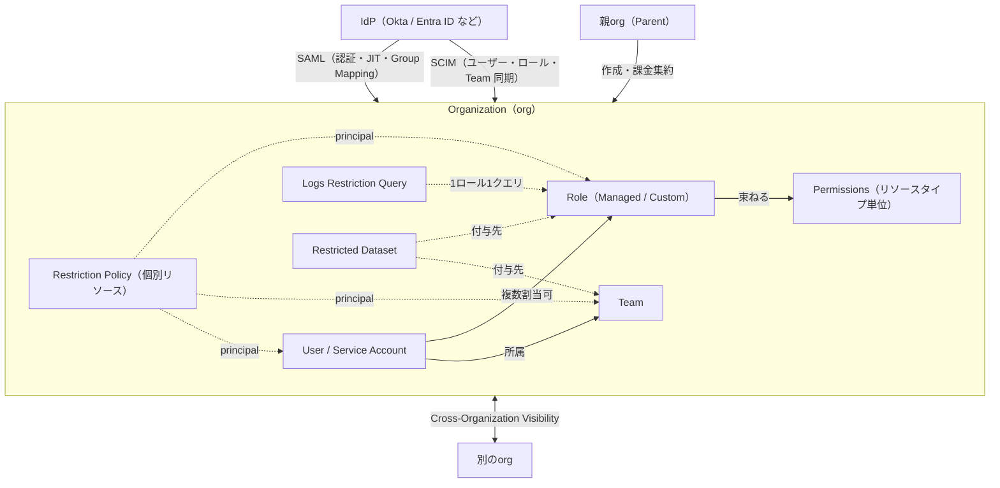
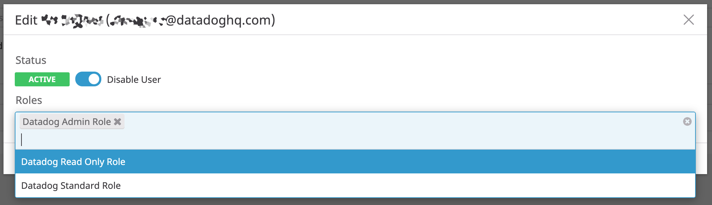
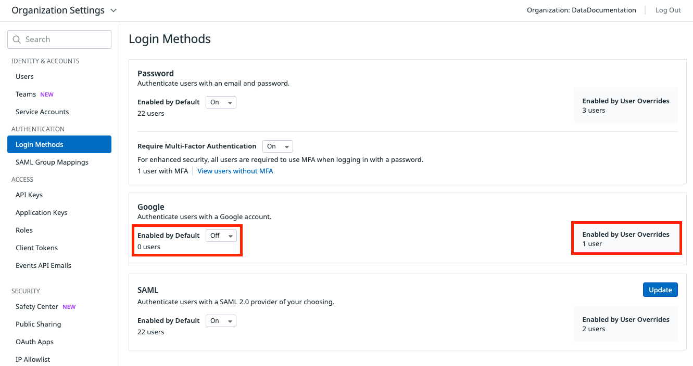
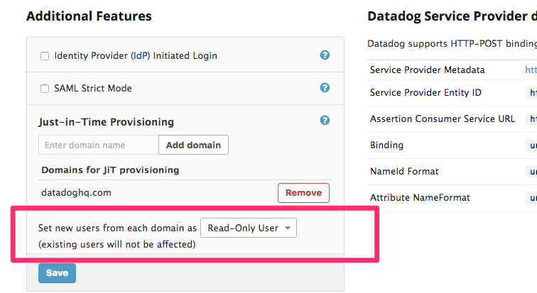
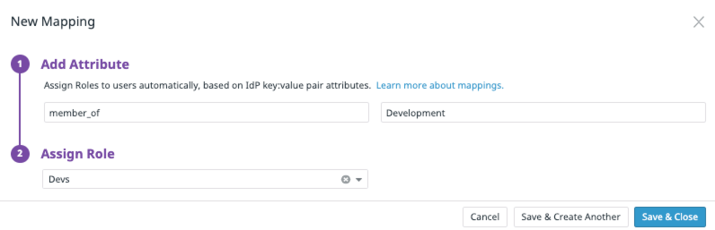
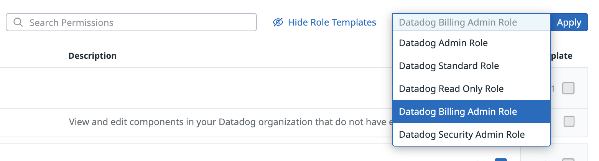
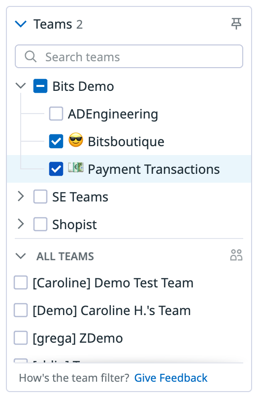
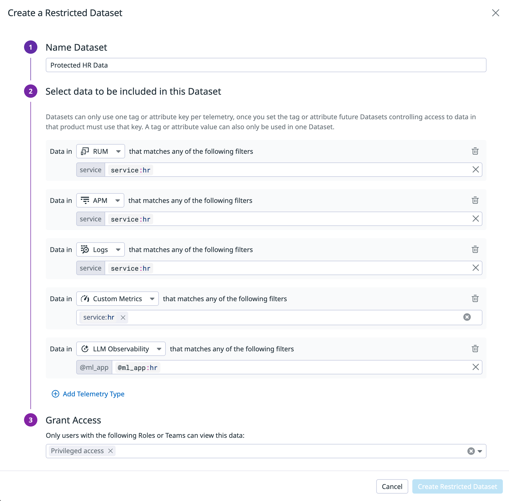

# 組織・ユーザー・権限管理

## 概要

Datadog のアクセス管理は、**Organization（組織、org）** を最上位の単位とし、その中に **User（ユーザー）**・**Service Account（サービスアカウント）**・**Role（ロール）**・**Team（チーム）** を置く構造になっている。Datadog のアクセス管理は次の 5 層で構成される。

| 層 | 仕組み | 制御の粒度 | 本書の節 |
|---|---|---|---|
| 認証（誰がログインできるか） | Login Methods（パスワード／Google／SAML）、MFA、IP Allowlist、セッション設定 | 組織・ユーザー単位 | [5](#5-認証login-methodsmfa)、[6](#6-samlsso)、[12](#12-組織レベルのセキュリティ設定) |
| プロビジョニング（ユーザーとロールの自動配布） | SAML JIT、SAML Group Mapping、SCIM | ユーザー・ロール・Team | [6](#6-samlsso)、[7](#7-scim) |
| 機能権限（何ができるか） | RBAC：Managed Roles（標準ロール）＋ Custom Roles（カスタムロール）＋ Permissions（権限） | **リソースタイプ単位**（例：全ダッシュボードの編集） | [8](#8-rbacロールと権限)、[9](#9-権限permissions一覧) |
| 個別リソースの権限（どのリソースを操作できるか） | Granular Access Control / Restriction Policies（細粒度アクセス制御） | **個々のリソース単位**（例：特定ダッシュボードの編集者） | [11](#11-granular-access-controlrestriction-policies) |
| データ権限（どのデータを見られるか） | Logs RBAC（Restriction Query・インデックス権限）、Data Access Control（Restricted Datasets） | **データ（タグ・属性）単位** | [13](#13-ログのデータアクセス制御logs-rbac)、[14](#14-data-access-controlrestricted-datasets) |

複数の組織をまたぐ構成としては、**マルチオーガニゼーション（親子org）**、**Organization Groups**（複数orgのポリシー一元管理）、**Cross-Organization Visibility**（org間のデータ参照）がある（[2](#2-組織トポロジシングルorgとマルチorg)・[3](#3-マルチオーガニゼーション親子org)）。

API キー・アプリケーションキー・PAT 等の鍵管理の詳細は [API とキー管理](./api-and-keys.md)、操作の監査ログは [Audit Trail](./audit-trail.md)、大規模・マルチorgの運用ノウハウは [大規模・マルチorg運用](../../04_応用編/large-scale-and-multi-org.md) を参照。



---

## 1. Organization（組織）

### 1.1 Organization の基本

- Datadog の **Organization（組織、org）** は、データ・ユーザー・設定・課金の境界となる単位である。1 つの org は 1 つの Datadog サイト（US1、AP1 など）に属する。サイトの詳細は [Datadog Sites](./datadog-sites.md) を参照。
- Datadog は多くのケースで **シングルorg構成を推奨**している（[2](#2-組織トポロジシングルorgとマルチorg) 参照）。[出典](https://docs.datadoghq.com/getting_started/organization_topology/)
- 1 人のユーザー（同一メールアドレス）は複数の org に所属でき、ユーザーアカウント設定メニューから org を切り替える。[出典](https://docs.datadoghq.com/account_management/multi_organization/)

### 1.2 Organization Settings（組織設定）の構成

Organization Settings は左下のユーザー名メニューから開く。Organization Settings の主な項目は以下のとおり（2026-11-02 時点の公式ドキュメントの分類）。[出典](https://docs.datadoghq.com/account_management/org_settings/)

| 区分 | 項目 | 内容 |
|---|---|---|
| Identity & Accounts | Users | ユーザーの招待・編集・無効化（[4](#4-ユーザー管理) 参照） |
| | Teams | Team の管理（[10](#10-teams) 参照） |
| | Service Accounts | 非対話型アカウント（[4.5](#45-service-accountサービスアカウント) 参照） |
| Authentication | Login Methods | Password / Google / SAML の有効・無効、MFA 必須化 |
| | SAML Group Mappings | IdP 属性 → ロール／Team のマッピング |
| Access | API Keys / Application Keys | キー管理（[API とキー管理](./api-and-keys.md)） |
| | Roles | Managed Roles・Custom Roles |
| | Remote Configuration | Datadog コンポーネントのリモート設定（[Fleet Automation と Remote Configuration](./fleet-automation.md)） |
| | Client Tokens | ブラウザ／モバイルからのログ・RUM 送信用トークン。RUM アプリに紐づくトークンを削除すると、そのアプリの送信が止まる |
| | Events API Emails | メール経由でのイベント送信 |
| | Synthetic Tests | Synthetic Monitoring 設定 |
| | MCP Server | AI ツールからの組織全体アクセス・書き込みアクセスのトグル、OAuth リダイレクト URL 設定 |
| Security | Safety Center | セキュリティアラート・警告・推奨事項 |
| | Public Sharing | 共有ダッシュボード・グラフの共有制御、招待の最大有効期間、共有中リスト。クロスorg共有の設定は Datadog サポート経由 |
| | Mobile and Third-Party Access / OAuth Apps | モバイル・サードパーティアプリの管理 |
| | IP Allowlist | UI・API へのアクセス元 IP 制限（[12.1](#121-ip-allowlist)） |
| Compliance | Audit Trail / Audit Trail Settings | 監査イベント、保持期間・アーカイブ設定（[Audit Trail](./audit-trail.md)） |
| | SMTP configuration | Status Pages の購読メールを自社ドメインから送るための SMTP 設定 |
| General | Preferences | 組織名、ホームページ、契約外ログ保持期間、セッション設定 |
| （その他） | Data Access Control | Restricted Datasets（[14](#14-data-access-controlrestricted-datasets)） |
| | Cross-Organization Visibility | org間接続（[3.6](#36-cross-organization-visibility)） |
| | Organization Groups | 複数orgのポリシー一元管理（[3.7](#37-organization-groups)） |

### 1.3 General > Preferences の設定項目

| 設定 | 内容 | 必要権限 | 値・制約 |
|---|---|---|---|
| Organization name（組織名） | Edit で変更 | Org Management（推定：公式は「Administrators」と記載） | **最大 32 文字** |
| Datadog homepage | ホーム画面を Dashboard List または特定ダッシュボードに設定 | — | — |
| Out-of-contract log retention | 契約外のログ保持期間を有効化 | `org_management` | 3 / 7 / 15 / 30 / 45 / 60 日。org単位、**オンデマンド課金**が発生 |
| Max session duration（最大セッション時間） | Web セッションの最長時間 | `org_management` | **最小 1 時間**。最大値・既定値は公開情報では確認できず（公式ページの最大値欄はプレースホルダ表示）。変更後に作成される新規 Web セッションに全ユーザー（ロール不問）で適用、モバイルアプリのセッションには非適用 |
| Idle time session timeout（アイドルタイムアウト） | 有効化すると無操作で自動サインアウト | `org_management` | 有効時 **30 分**の無操作でサインアウト。新規 Web セッションに適用、モバイルには非適用 |

[出典](https://docs.datadoghq.com/account_management/org_settings/)

- 最大セッション時間は API でも変更できる：`PUT /api/v2/login/org_configs/max_session_duration`（本文 `data.type: max_session_duration`、`data.attributes.max_session_duration` は**秒**で指定。公式例は `604800`＝7 日）。`org_management` 権限（OAuth アプリは `org_management` スコープ）が必要。[出典](https://docs.datadoghq.com/api/latest/organizations/update-the-maximum-session-duration/)
- 既定のセッション時間を「30 日」とする第三者記事がある【第三者情報】（[出典](https://www.rapdev.io/blog/four-ways-to-secure-your-datadog-organization-settings)、公開日不明）が、公式ドキュメントでは確認できない。

---

## 2. 組織トポロジ（シングルorgとマルチorg）

### 2.1 Datadog の推奨

Datadog は「**ほとんどのデプロイではシングルorgトポロジを推奨**」し、「**シングルorgでは満たせない厳格な要件がある場合にのみマルチorgを使う**」と明記している。[出典](https://docs.datadoghq.com/getting_started/organization_topology/)

シングルorg構成でも、Teams、RBAC、Data Access Control、Granular Access Control、IP Allowlist によって規制業界を含む強いデータ分離が可能とされる。ただしシングルorgでは、インフラ等の基本機能は全ユーザーに見えること、全テレメトリタイプが行レベル制限に対応しているわけではないことが制約となる。

### 2.2 マルチorgを選ぶべき 5 つのシナリオ（公式）

| シナリオ | 内容 |
|---|---|
| 規制・契約上の分離 | 物理的に別の org 境界にデータを置く必要があり、行レベル制限では不十分 |
| データレジデンシー | 地域間転送が禁止され、別サイト（US1、EU1、AP1 等）に org を置く必要がある |
| チームのファイアウォール | データの混在をゼロにする必要がある（Datadog のアクセス制御は全テレメトリ・アセットメタデータを完全には遮断しない） |
| MSP の顧客 | 外部顧客ごとに課金・データ・ユーザーを分離。親子org モデルを使う |
| 買収 | 統合期間中に被買収側 org を維持。最終的にはシングルorgへの統合（数か月規模）を目指す |

### 2.3 シングルorg と マルチorg の比較（公式）

| 機能 | シングルorg | マルチorg |
|---|---|---|
| エンドツーエンドのトレース | 完全 | org 境界をまたげない |
| ダッシュボードでのテレメトリ | 完全 | Cross-Organization Visibility で共有（メトリクス、ログ、CI データ等） |
| ダッシュボード共有 | 完全 | 招待制共有ダッシュボード |
| Monitors | 完全 | org をまたいだ評価は不可 |
| SLO | 完全 | org をまたげない |
| ユーザー管理 | SCIM 1 つ | org ごとに SCIM |
| RBAC / カスタムロール | 1 つの設定 | org ごとに重複（Organization Groups の Shared Roles で緩和可） |
| SSO / SAML | 1 つの設定（Multiple SAML で複数 IdP 可） | org ごとに SAML |
| 課金 | org 内で Usage Attribution | 親org で集約・請求 |
| 機能ロールアウト | 即時 | org ごとに有効化 |

Organization Groups はユーザー管理・RBAC・機能ロールアウトを org 横断で一元化するが、トレース・テレメトリ・ダッシュボード・Monitors・SLO・SSO・課金は変えない。[出典](https://docs.datadoghq.com/getting_started/organization_topology/)

---

## 3. マルチオーガニゼーション（親子org）

### 3.1 概要と有効化

- **Multi-Organization Account（マルチオーガニゼーション）** は、1 つの **親org（parent-organization）** から複数の **子org（child-organization）** を管理する機能である。主な想定は顧客同士のデータを分離したい MSP。[出典](https://docs.datadoghq.com/account_management/multi_organization/)
- **デフォルトでは無効**。有効化には Datadog サポートへの連絡が必要。
- 子org同士は互いのデータにアクセスできない。org横断のクエリは Cross-Organization Visibility（[3.6](#36-cross-organization-visibility)）を使う。
- 親org の設定（例：IP Allowlist）は子org に**継承されない**。SAML 設定も継承されない。
- ロールは親子 org 間で共有されない。子org の `org_management` 権限は親org には及ばない。[出典](https://docs.datadoghq.com/account_management/rbac/)

### 3.2 子org の作成手順

1. 機能有効化後、**New Organization** ページを開く。
2. 組織名を入力（**最大 32 文字**）。
3. 任意で管理者ユーザーをメールで招待する。招待されたユーザーには **Datadog Admin Role** が付与される。パスワード未設定のユーザーにはパスワード設定用の招待メールが届く。
4. 追加ユーザーは後から子org の Organization Settings で招待する。

子org のベースラインとなるダッシュボード・モニターは Datadog API や Terraform でプログラム的に展開できる（[Terraform と IaC](./terraform-and-iac.md)）。API では `POST /api/v1/org`（Create a child organization）で子org を作成できる。[出典](https://docs.datadoghq.com/api/latest/organizations/)

### 3.3 課金

- 新規子org は**親org のプランを継承**し、親org の請求アカウントに追加される。
- 子org の課金を変更するには営業担当に連絡する。
- 親org では **Plan & Usage > Usage & Cost** で全 org 合算の使用量（Overall タブ）と子org 別使用量（Individual Organizations タブ）を確認できる。Individual Organizations タブの既定 Billable ビューはトライアル等の非課金 org を除外する。
- **Usage Attribution** は Enterprise プランの機能。親org で有効化すると全 org を最大 3 つのタグキーで集計できる。子org で有効化した場合はその子org 内のみで、親には集約されない。詳細は [Usage・Usage Attribution・Cost Visibility](./usage-and-cost-attribution.md)。

[出典](https://docs.datadoghq.com/account_management/multi_organization/)

### 3.4 Custom Sub-domain（カスタムサブドメイン）

- Custom Sub-domain（`https://<custom_sub-domain_name>.`＋サイトドメイン 形式）は、アラート・通知がどの org から来たかを識別し、リンクを開いたときに該当 org へ自動で切り替えるための機能。**デフォルトでは無効**で、サポートへの依頼が必要。
- サブドメインがない場合、別 org のイベントへのリンクを開くと、表示中の org が異なるユーザーには **404** が返る。
- SAML の SP-initiated ログインでカスタムサブドメインがない場合、ワンタイムのメール確認コードが追加で要求される（[6.4](#64-ログインフローsp-initiated--idp-initiated)）。

### 3.5 子org と SAML

- SAML 設定は子org に継承されないため、子org ごとに設定する（子org 作成 → SAML ユーザーを招待 → SAML ユーザーでログインして SAML 設定）。
- **SAML Strict の親org** では、SAML ユーザーにパスワードがないため子org にアクセスできなくなることがある。対処として、親org の Organization Settings > Users で自分のプロファイルに **Override Default Login Methods** を有効化して Password にチェックし、アカウントにパスワードを設定する（必要ならサポートに連絡）。

[出典](https://docs.datadoghq.com/account_management/multi_organization/)

### 3.6 Cross-Organization Visibility

**Cross-Organization Visibility** は、同一アカウント内の **ソースorg** のデータを **宛先org（destination）** から照会・表示する機能である。[出典](https://docs.datadoghq.com/account_management/org_settings/cross_org_visibility/)

| 項目 | 内容 |
|---|---|
| 対応データ（Dashboard / Notebook ウィジェット） | メトリクス（カスタムメトリクス、トレースメトリクス、ログ生成メトリクス含む）、ログ、CI Visibility パイプライン、Test Optimization テスト、Audit Trail |
| 設定手順 | ソースorg で Organization Settings > Cross-Organization Visibility > **New Connection** → 宛先 org を選択 → Connect。接続の編集で共有データタイプを変更 |
| 前提 | ソースと宛先が**同一アカウントかつ同一サイト** |
| 接続数上限 | 非 Enterprise org は共有先最大 **5 org**。料金ページの表記では Pro 等 5 connections、Enterprise **100 connections** |
| 方向 | 1 ソース→複数宛先、1 宛先←複数ソースの双方可 |
| クエリ | 1 ウィジェットクエリは 1 org を参照。クロスorg の Formula で組み合わせ可。API では各クエリに `cross_org_uuids`（要素は**ちょうど 1 つ**、複数で 400 エラー）を指定 |
| データ・課金 | データはソースorg に残り、複製されず追加料金なし。ソースの保持期間内なら接続前のデータも照会可 |
| 権限 | `org_connections_read`（一覧閲覧、Read Only 既定）、`org_connections_write`（作成・削除、Admin 既定） |
| 細粒度制御 | 接続は Restriction Policy の対象（`cross-org-connection`）。保存時に自分のロールまたは Team を最低 1 つアクセスリストに残す必要あり |
| 作成者の影響 | 接続は**作成者のデータアクセス制限（Data Access Control / Log Restriction Query）を継承**。作成者のアカウントが無効化されると接続は削除されるため、**サービスアカウントで作成推奨** |
| 自動化 | Cross-Orgs Connections API あり。Terraform プロバイダーでは接続の作成は不可（ダッシュボードは JSON エクスポートで管理可） |
| 注意 | 宛先側はソースのデータを自 org のアクセス設定に従って使え、ソース側が禁止していても公開ダッシュボードを作れる。HIPAA 有効 org からの接続では PHI が共有され得る |

> **注意（Monitors）:** Cross-Organization Visibility の公式ページは Monitors 対応に言及していない。トポロジガイドでは「Monitors は org をまたいだ評価は不可」とされている。

### 3.7 Organization Groups

**Organization Groups** は、マルチorg構成を維持する組織が、複数の org を 1 つの単位として統制するための機能である。ロール・ポリシー・設定をグループで一度定義し、メンバー org に展開する。[出典](https://docs.datadoghq.com/account_management/organization_groups/)

| 項目 | 内容 |
|---|---|
| ステータス | 英語版ページでは明記なし。検索結果上の他言語版・関連ページでは Preview・要申請とされる。最新状況は Datadog 担当に確認（公開情報では GA 有無を確認できず） |
| Owner org | グループを作成・管理。ポリシー、適用ティア、Shared Roles を設定。階層のルート親org がグループを所有し、Owner org からのみ表示・管理 |
| Member org | グループに統制される。**1 つの org は同時に 1 グループのみ**所属 |
| ポリシー | 組織設定 × 値 × 適用ティアの組。設定可能な項目の一覧は公開ページに記載なし |
| 適用ティア | **Group managed**（全メンバーで値を固定、逸脱不可）／ **Override allowed**（ベースラインを設定し、メンバーが自 org で変更可） |
| Shared Roles | Owner org で定義したカスタムロールを全メンバーに配布。メンバーは割り当て可・編集削除不可。常に Group managed |
| 権限 | Owner org のユーザーに `org_group_read` と `org_group_write`（いずれも Admin 既定）が必要。メンバー側は追加権限不要 |
| 制約 | **単一リージョンのみ**。別リージョンの org は各リージョンで別グループ |

---

## 4. ユーザー管理


### 4.1 ユーザーの招待

Organization Settings > **Users** タブ > **Invite Users** で、メールアドレスと 1 つ以上のロールを指定して **Send Invites** を押す。[出典](https://docs.datadoghq.com/account_management/users/)

| 項目 | 仕様 |
|---|---|
| 招待できるロール | `user_access_invite`（Invite User）のみ保持：**自分が持つロール**にのみ招待可。`user_access_invite` ＋ `user_access_manage`：任意のロールに招待可 |
| 招待リンクの有効期限 | **48 時間** |
| ステータス | 初回ログインまでは `Invite Pending` |
| 招待の取消 | 初回ログイン前に Delete Invite（リスト表示）／ユーザーボックス（グリッド表示） |
| 再送 | サイドパネルまたはユーザーボックスの **Resend Invite** |
| SAML JIT | JIT が有効なら招待なしで初回ログイン時に作成され、招待メールは送られない（[6.6](#66-just-in-timejitプロビジョニング)） |
| ユーザー数上限 | 料金ページでは「Unlimited User Accounts」（ユーザー数無制限）と表記 |

### 4.2 ユーザーのロール変更

- ロール変更は `user_access_manage`（Datadog Admin Role 等）保持者のみ可能。
- ユーザーの **Edit** からロールを追加、または「X」で削除して保存する。1 ユーザーに複数ロールを付与でき、権限は全ロールの**和集合**になる。[出典](https://docs.datadoghq.com/account_management/rbac/)



*キャプション：Organization Settings > Users でユーザーの Edit を開いた画面。*
*画面説明：ダイアログ上部にユーザー名とメールアドレス、その下に **Status**（`ACTIVE` バッジと **Disable User** トグル）、**Roles** 欄に現在のロール（例：`Datadog Admin Role`）がチップ表示され、ドロップダウンから `Datadog Read Only Role`、`Datadog Standard Role` 等を追加できる。*
*出典：https://docs.datadoghq.com/account_management/users/ （2026-11-02 取得）*

### 4.3 ユーザーの無効化

| 項目 | 仕様 |
|---|---|
| 権限 | `user_access_manage`（Access Management）保持者のみ |
| 削除 | **ユーザーの完全削除は不可**（ダッシュボードやモニターの作成者である可能性があるため）。無効化（Disable）のみ |
| 無効化の影響 | ユーザーの**全アプリケーションキーと Personal Access Token（PAT）が失効**し、依存するワークフロー・連携が即時停止 |
| 推奨 | 長期稼働する連携・自動化はサービスアカウントのキーを使う |
| 一覧表示 | 無効ユーザーは既定で非表示。`Disabled` フィルタで表示し、再有効化可能 |

[出典](https://docs.datadoghq.com/account_management/users/)

### 4.4 ユーザー単位のログイン方式（Override Default Login Methods）

- org 既定のログイン方式（[5](#5-認証login-methodsmfa)）に対し、User Management の **Override Default Login Methods** でユーザー個別の方式を指定できる。
- オーバーライドで選べるのは**設定済みの方式のみ**（SAML を選ぶには SAML 設定が先に必要）。
- 典型例：全員 SAML 必須（SAML Strict）だが、緊急用に少数ユーザーのみパスワードログインを許可（ブレークグラス）。
- User Management でオーバーライド方式でのフィルタ、既定方式利用者の表示が可能。

[出典](https://docs.datadoghq.com/account_management/users/)、[出典](https://docs.datadoghq.com/account_management/login_methods/)

### 4.5 Service Account（サービスアカウント）

**Service Account（サービスアカウント）** は、アプリケーションキーやチーム間共有リソースを所有する**非対話型アカウント**である。従業員の退職でその個人キーが失効しても、自動化スクリプトを止めないために使う。[出典](https://docs.datadoghq.com/account_management/org_settings/service_accounts/)

| 項目 | 仕様 |
|---|---|
| 場所 | Organization Settings > Identity & Accounts > **Service Accounts** |
| 作成権限 | `service_account_write`（Admin 既定）。持たないユーザーは読み取り専用表示 |
| 作成時入力 | 名前、メールアドレス、ロール（1 つ以上） |
| メール | **org 内で一意である必要はない**（ユーザーのメールとは異なる） |
| 付与できるロール | 自分が持つロール・権限の部分集合。`user_access_manage` 保持者は制限なし |
| 編集 | 名前・メール・ステータス・ロール |
| 無効化 | `service_account_write` ＋ `user_access_manage` が必要。ステータスを Disabled に |
| アプリケーションキー | サイドパネルで作成。**キー値は作成直後の 1 回のみ表示**（紛失時は失効→再作成） |
| Service Access Token（SAT） | サービスアカウントからの API 認証の推奨方式。スコープ付き・長期有効化可・API キー不要。**1 サービスアカウントあたり最大 500 個** |
| 通知 | キー作成・失効、アカウント無効化時にサービスアカウントのメール宛に通知 |
| API | Service Accounts API（`/api/v2/service_accounts`） |

> **サイト差異:** `ap2.datadoghq.com`、`app.ddog-gov.com`、`us2.ddog-gov.com` ではサービスアカウントのアプリケーションキーは一度だけ読める（後から取得不可の警告が表示）。[出典](https://docs.datadoghq.com/account_management/org_settings/service_accounts/)

SAT・PAT・API キーの詳細は [API とキー管理](./api-and-keys.md) を参照。

---

## 5. 認証（Login Methods・MFA）

### 5.1 ログイン方式

Organization Settings > Authentication > **Login Methods** で設定する。変更には **Datadog Admin Role** または **`org_management`** 権限が必要。[出典](https://docs.datadoghq.com/account_management/login_methods/)

| 方式 | 内容 | 新規 org の既定 |
|---|---|---|
| Datadog Username and Password（Standard） | メールアドレス＋パスワード | 有効 |
| Sign in with Google | Google アカウント | 有効 |
| Sign in with SAML | SAML 2.0 IdP | SAML 設定後に有効化 |

- 各方式に **Enabled by Default**（On/Off）がある。既定で有効な方式は、招待されたユーザーのメールと一致すればログインに使える（ユーザーオーバーライドで拒否されていない限り）。
- **すべての方式を無効化することはできない**（最低 1 つは既定で有効が必要）。
- **パスワード要件**：8 文字以上、数字 1 文字以上、小文字 1 文字以上。
- 公式ドキュメントに Microsoft アカウント等その他のソーシャルログインの記載はない。

### 5.2 MFA（多要素認証）

- 組織管理者は、**メール＋パスワードでログインする全ユーザーに MFA を必須化**できる（Require Multi-Factor Authentication）。有効化すると対象ユーザーはアクセス前に第 2 要素の登録が必要。
- Login Methods に **View users without MFA** リンクが表示され、MFA 未登録のアクティブユーザーを確認できる。
- MFA 必須化は既定ログイン方式の設定とは独立しており、メール＋パスワードでのログインにのみ適用される。

[出典](https://docs.datadoghq.com/account_management/login_methods/)

Datadog の MFA の仕様は以下のとおり。[出典](https://docs.datadoghq.com/account_management/multi-factor_authentication/)

| 項目 | 仕様 |
|---|---|
| 対象アカウント | メールアドレス＋パスワードで直接ログインするアカウントのみ。**SSO 専用アカウント（SAML・Google）では Datadog 側の MFA は使えず、IdP 側で MFA を構成する**。SSO ユーザーには MFA 設定項目が表示されない |
| 第 2 要素 | **認証アプリ（TOTP）**。例：Microsoft Authenticator、Google Authenticator、Authy、Duo。公式ページにセキュリティキー（WebAuthn）・SMS の記載はない |
| 認証アプリの数 | **最大 1 つ** |
| リカバリーコード | 単回使用のバックアップコード。設定時に一度だけ表示され、後から再表示不可 |
| 緊急時 | 認証アプリもリカバリーコードもない場合、ログイン画面の「Don't have access to your authenticator?」からメールでワンタイムのリカバリーリンクを受け取れる |
| 有効化 | 任意：Personal Settings > Security > **Password & Authentication** > Authenticator App の **Add**。必須化：Login Methods の Require Multi-Factor Authentication |
| 管理者の確認 | Users テーブルを MFA ステータスでフィルタ可能、ユーザー詳細パネルにも表示 |
| 限界 | メールアカウントを乗っ取られた攻撃者は MFA を無効化し得る（公式注意）。ブルートフォース、クレデンシャルスタッフィング、パスワードスプレーへの防御策と位置付けられている |



*キャプション：Organization Settings > Login Methods 画面。*
*画面説明：左ナビに IDENTITY & ACCOUNTS（Users、Teams、Service Accounts）、AUTHENTICATION（Login Methods、SAML Group Mappings）、ACCESS（API Keys、Application Keys、Roles、Client Tokens、Events API Emails）、SECURITY（Safety Center、Public Sharing、OAuth Apps、IP Allowlist）が並ぶ。右側に **Password**（Enabled by Default、Require Multi-Factor Authentication、View users without MFA）、**Google**（Enabled by Default を Off にした例、右に「Enabled by User Overrides 1 user」）、**SAML**（Update ボタン、Enabled by Default）の 3 ブロックがあり、それぞれ既定で有効なユーザー数とオーバーライドで有効なユーザー数が表示される。*
*出典：https://docs.datadoghq.com/account_management/login_methods/ （2026-11-02 取得）*

---

## 6. SAML/SSO

### 6.1 概要と前提

| 項目 | 内容 |
|---|---|
| 目的 | Active Directory・LDAP 等の ID ストアの資格情報で SAML IdP 経由ログイン |
| 公式に手順がある IdP | Active Directory（ADFS）、Auth0、Google、LastPass、Microsoft Entra ID（旧称：Azure AD）、Okta、SafeNet |
| 必要権限 | Datadog Administrator、またはカスタムロールで `org_management` |
| 有効化 | 商用サイト（US1、US3、US5、EU1、AP1、AP2、UK1）では **Datadog サポートによる SAML 有効化が必要**な場合がある |
| プラン | 料金ページの機能比較表では「Single Sign-On with SAML」行に Basic / Pro / Enterprise の 3 列すべてにチェック（2026-11-02 取得） |

> **サイト差異:** Datadog for Government サイト（`app.ddog-gov.com`＝US1-FED、および `us2.ddog-gov.com`）は **SAML ログインのみ**をサポートする。[出典](https://docs.datadoghq.com/account_management/saml/)

### 6.2 設定手順

1. IdP 側のガイドに従い Datadog アプリを構成する。
2. Datadog の **Service Provider（SP）メタデータ**をダウンロードし IdP に登録する（メタデータ取得にはサインインが必要）。
3. Datadog で Organization Settings > **Login Methods** > SAML の **Configure**（既存時は Update）を押す。
4. **Add SAML** を押す。
5. IdP の表示名（ユーザーがログイン方式を選ぶ際に表示）を入力する。
6. IdP の **XML メタデータ**をアップロードする（**ASCII 文字のみ**）。
7. **Save** を押す。

[出典](https://docs.datadoghq.com/account_management/saml/configuration/)

### 6.3 プロトコル仕様

| 項目 | 仕様 |
|---|---|
| バインディング | SAML2 の **HTTP-POST** |
| NameIDPolicy | `urn:oasis:names:tc:SAML:1.1:nameid-format:emailAddress` |
| アサーション署名 | **必須** |
| アサーション暗号化 | 任意（非暗号化も受理） |
| SP メタデータ | Datadog のメタデータファイル。ADFS 等は SAML Configuration ページの **org 固有メタデータ URL** から自動更新可能 |
| 属性 `eduPersonPrincipalName` | Datadog のユーザー名（通常メールアドレス）。無い場合は Subject NameID（emailAddress 形式必須）を使用 |
| 属性 `sn` | 姓（任意）。**Microsoft Entra ID では `surname`** を使う |
| 属性 `givenName` | 名（任意）。`sn` と `givenName` を送るとプロファイル名を更新 |
| 属性 NameFormat | URI（`urn:oasis:names:tc:SAML:2.0:attrname-format:uri`、OID 名）または Basic（`urn:oasis:names:tc:SAML:2.0:attrname-format:basic`、`urn:mace:dir:attribute-def:*` 名） |
| 証明書更新 | 別ページ「Renewing SAML Certificates」で説明（本書では未調査） |
| Single Logout（SLO） | 公開情報では対応を確認できず |

[出典](https://docs.datadoghq.com/account_management/saml/)

### 6.4 ログインフロー（SP-initiated / IdP-initiated）

| フロー | 内容 | 注意点 |
|---|---|---|
| SP-initiated | SAML Configuration ページ上部に表示される **Single Sign-on URL** からログイン | カスタムサブドメインが**ない** org では、追加のセキュリティとして**ワンタイムのメール確認コード**の入力が必要 |
| IdP-initiated | IdP のアプリポータルからログイン | **Identity Provider (IdP) Initiated Login** を有効化・保存後、**更新された SP メタデータ**（org 固有の AssertionConsumerService エンドポイントを含む）を IdP に再登録する。未更新だと「`InResponseTo` が無い」エラーでログイン失敗 |

[出典](https://docs.datadoghq.com/account_management/saml/)

### 6.5 SAML Strict

- Login Methods で SAML 以外の方式を無効化すると **SAML Strict** になる。既存のユーザー名／パスワード、Google OAuth ログインは使えなくなる。
- 組織管理者はユーザー単位オーバーライドで特定ユーザーを SAML Strict の例外にできる（緊急用アカウント等）。
- マルチorg で親org を SAML Strict にした場合の子org ロックアウトに注意（[3.5](#35-子org-と-saml)）。

### 6.6 Just-in-Time（JIT）プロビジョニング

| 項目 | 仕様 |
|---|---|
| 動作 | 初回ログイン時に Datadog ユーザーを自動作成。招待メールは送られない |
| 既定ロール | **Standard**。Read-Only、Administrator、任意のカスタムロールに変更可 |
| 対象ドメイン | SAML 設定画面に「Domains for JiT provisioning」欄があり、JIT 対象のメールドメインを登録する UI がある（下図。画像は旧 UI の可能性あり） |
| Role Mapping との関係 | SAML Role Mapping が有効なら **Role Mapping が JIT の既定ロールより優先** |
| 特定ユーザーの拒否 | IdP 側でそのユーザーのアサーションを発行しないようにする |
| SCIM 併用 | SAML と SCIM を併用する場合、**JIT は無効化を強く推奨** |



*キャプション：SAML Configuration 画面の Additional Features 部分。*
*画面説明：チェックボックス「Identity Provider (IdP) Initiated Login」「SAML Strict Mode」、その下に「Just-in-Time Provisioning」欄（ドメイン入力欄と Add domain ボタン、Domains for JiT provisioning の一覧と Remove ボタン）、「Set new users from each domain as [Read-Only User ▼]（既存ユーザーには影響しない）」のドロップダウンと Save ボタンがある。右側には Datadog Service Provider details（Service Provider Metadata、Entity ID、Assertion Consumer Service URL、Binding、NameId Format、Attribute NameFormat）が表示される。*
*出典：https://docs.datadoghq.com/account_management/saml/ （2026-11-02 取得）*

### 6.7 Multiple SAML Providers（複数 IdP）

| 項目 | 仕様 |
|---|---|
| 提供 | 公式設定ページでは **Enterprise のみ、最大 3 つ**の IdP |
| 追加手順 | Login Methods > SAML の **Update** > **Add SAML** → 名前とメタデータを登録 |
| 振り分け | 全ユーザーが全 IdP を表示・利用可能。特定グループを特定 IdP に割り当てることは**不可** |
| 既定 IdP | 設定不可（分かりやすい名前を付ける） |
| マッピング | 新 IdP の属性名が既存の Role / Team マッピングと一致するか確認するか、新属性用のマッピングを追加 |

[出典](https://docs.datadoghq.com/account_management/saml/configuration/)

### 6.8 SAML Group Mapping（ロール／Team マッピング）

SAML アサーションの属性（key-value）を Datadog の **Role** と **Team** に対応付ける。IdP 側だけでユーザー権限を管理できる。[出典](https://docs.datadoghq.com/account_management/saml/mapping/)

| 項目 | Role Mappings | Team Mappings |
|---|---|---|
| 場所 | Organization Settings > SAML Group Mappings > Role Mappings タブ | 同 > Team Mappings タブ |
| 前提 | — | Team の Provisioning Source を **SAML** または **All** にする |
| 作成 | SAML の key と value（**大文字小文字を区別**）を入力し、既定／カスタムロールを選択 | key-value を入力し Team を選択して Create（Add Row で複数行） |
| 有効化 | **Enable Mappings** | **Enable Mappings** |
| ログイン時の動作 | 一致する属性を持つユーザーにロールを自動付与。属性がなくなると（他のマッピングで付与されない限り）ロールを失う | Team は**ログイン可否に影響しない**（プロビジョニング元としてのみ使用） |
| 一致しない場合 | **既存ロール（JIT で付与されたものを含む）を全て失い、SAML でログインできなくなる** | ログインは可能 |
| 上限 | org あたり **1,000 件**（超過はサポートに相談） | org あたり **1,000 件** |
| API | Federated Authentication to Role Mapping API（`/api/v2/authn_mappings`） | 同 API（Team も対象） |
| 必要権限 | `user_access_manage` | `user_access_manage` |

- IdP ごとに属性の要件が異なる（例：Azure / Entra ID はグループの **object ID**、Okta は Okta 設定でカスタム属性が必要）。マッピング作成前にアサーションの内容を検証する。
- Role Mapping を有効化すると、SAML ユーザーは現在のロールを失い、アサーションとマッピングに基づいて再割り当てされる。**有効化前に必ずマッピングを検証**すること。
- マッピングの編集・削除はマッピング自体にのみ影響し、IdP 属性やロール・Team 自体は変わらない。



*キャプション：SAML Group Mappings の New Mapping ダイアログ。*
*画面説明：手順 1「Add Attribute」で IdP の key（例：`member_of`）と value（例：`Development`）を入力し、手順 2「Assign Role」でロール（例：`Devs`）を選ぶ。下部に Cancel、Save & Create Another、Save & Close ボタン。*
*出典：https://docs.datadoghq.com/account_management/saml/mapping/ （2026-11-02 取得）*

---

## 7. SCIM

**SCIM（System for Cross-domain Identity Management）** は、IdP から Datadog へのユーザー・ロール・Team のプロビジョニングを自動化する。[出典](https://docs.datadoghq.com/account_management/scim/)

### 7.1 SCIM の仕様

| 項目 | 内容 |
|---|---|
| 公式サポート IdP | **Microsoft Entra ID**、**Okta**（その他 IdP は動作する可能性はあるが公式サポート外） |
| プラン | ドキュメント：**Infrastructure Pro、Infrastructure Enterprise、Startup** プランで利用可（SCIM 概要ページの Prerequisites 節は Pro・Enterprise のみ記載）。一方、料金ページの機能比較表（Basic / Pro / Enterprise の 3 列）では SCIM 行に 3 つのチェックが付く。記述が一致しないため契約前に Datadog に確認すること |
| 機能 | ユーザー作成、不要ユーザーの削除（無効化）、SSO（推奨）、**Managed Teams**（IdP グループから Team を作成しメンバー同期）、**ロールプロビジョニング**（IdP 属性で組み込み／カスタムロールを設定、変更はリアルタイム反映） |
| ベース URL | サイトの **API ホスト**の `/api/v2/scim`（App ホストではない）。例：AP1 は `https://api.ap1.datadoghq.com/api/v2/scim`【推定：API ホスト規則からの推定】。Entra ID は `?aadOptscim062020` を付与 |
| 認証 | Datadog **アプリケーションキー**（シークレットトークン） |
| 推奨 | **専用サービスアカウント**のアプリケーションキーを使う。個人ユーザーのキーだと退職・無効化でキーが失効し SCIM 連携が壊れる |
| サービスアカウント権限 | 最低限 `user_access_invite` と `user_access_manage` |
| SAML 併用 | SAML の **JIT を無効化**し、プロビジョニングは SCIM のみで行う |

### 7.2 ロールプロビジョニングの挙動

- 組織内のロールと一致するものだけが付与される。一致しない場合は org の既定ロール（Standard）が付与される（Okta 手順では「SAML Login Methods の Assign Role to auto-created users の設定値、空なら付与なし」、Entra 手順では「既定ロールが無ければ既存ロールを保持」と記載）。
- 一致しないロールは **Audit Trail** に記録される。SCIM のロールイベントは Audit Trail と StatsD メトリクスに記録される。
- **SCIM がロールの信頼できる情報源**であり、SAML ロールマッピングより優先される。
- ロールは RFC 7643 の複数値属性規約に従う。

### 7.3 IdP 別の設定要点

| 項目 | Okta | Microsoft Entra ID |
|---|---|---|
| URL | `/api/v2/scim`（API ホスト） | `/api/v2/scim?aadOptscim062020`（API ホスト） |
| 有効化する機能 | Provisioning to App > Edit で Create Users / Update User Attributes / Deactivate Users。保存前に Test API Credentials | — |
| 属性マッピング | 事前設定済み（同じ Datadog 値のセットへのマップのみ再マップ可） | `userPrincipalName`→`userName`、`Not([IsSoftDeleted])`→`active`、`jobTitle`→`title`、`mail`→`emails[type eq "work"].value`、`displayName`→`name.formatted`、`AppRoleAssignmentsComplex([appRoleAssignments])`→`roles` |
| ロール | `roles` 属性は既定でマップされないため手動追加（Type string、External name `roles.^[primary==true].value`、namespace `urn:ietf:params:scim:schemas:core:2.0:User`、Enum の値は**ロール UUID**）。複数ロールは `datadogRole1`、`datadogRole2` 等のスロット属性（`roles.^[type=='slotN'].value`）。文字列配列は `'roles' should be object` で拒否 | Datadog ロールごとに Entra の App Role を定義（Display name＝ロール名、**Value＝ロール UUID**） |
| Team | **Push Groups** で Team を作成（Managed として表示、反映に 1〜2 分かかることあり）。既存 Team と同期するには Okta グループ名から導出されるハンドルを既存 Team ハンドルと完全一致させる。リンク解除は「Delete the group in the target app」推奨（Team 自体は削除されない） | **SCIM による Team プロビジョニングは不可**（Microsoft のサードパーティアプリ更新凍結のため）。グループマッピング非対応。Team は SAML マッピング、Terraform、API 等で作成 |
| 注意 | Okta は属性変更を追加的に適用するため、スロットをクリアしても前ロールが残ることがある。異動・退職時はロールを確認。新ロール追加時は全スロットの Enum に追加 | — |

[出典](https://docs.datadoghq.com/account_management/scim/okta/)、[出典](https://docs.datadoghq.com/account_management/scim/entra/)

---

## 8. RBAC（ロールと権限）

### 8.1 Managed Roles（標準ロール）

Datadog には 3 つの **Managed Roles（標準ロール、既定ロール）** がある。[出典](https://docs.datadoghq.com/account_management/rbac/)

| ロール | 内容 | 典型用途 |
|---|---|---|
| **Datadog Admin Role** | 請求情報へのアクセス、API キーの失効、ユーザー管理、読み取り専用ダッシュボードの設定、Standard ユーザーの管理者昇格が可能。Standard と Read Only の全権限を含む | 少数の組織管理者 |
| **Datadog Standard Role** | ダッシュボード、モニター、イベント、ノートブック等の監視機能を閲覧・変更可能。他ユーザーの招待も可能。Read Only の全権限を含む | 大半のエンジニア |
| **Datadog Read Only Role** | Datadog 内で編集不可 | 顧客や他部門への閲覧専用共有、監査担当 |

- Managed Roles は**直接変更できない**が、**クローン**は可能。
- Managed Roles の権限は、新機能の追加や権限変更に応じて **Datadog が自動更新**する。
- ユーザーが複数ロールを持つ場合、全ロールの権限の**和集合**を得る。
- SAML IdP の属性を既定ロール・カスタムロールにマッピングできる（[6.8](#68-saml-group-mappingロールteam-マッピング)）。

### 8.2 Custom Roles（カスタムロール）

| 項目 | 内容 |
|---|---|
| 管理方法 | Datadog UI、Roles API、SAML マッピング、Terraform（`datadog_role` リソース） |
| 作成・編集権限 | `user_access_manage` |
| 有効化 | Organization Settings > Roles > 歯車アイコン > Custom Roles ポップアップで **Enable**。または Create Role API を POST すると自動的に有効化 |
| 作成 | Roles ページ > **New Role** > 名前と権限を設定 > ユーザーに割り当て |
| 更新 | 権限を編集して保存。そのロールの全ユーザーに反映 |
| クローン | ロールにホバー > clone > 名前・権限を変更し保存 |
| 削除 | ロールにホバー > delete > 確認。ロールが 0 になったユーザーは Datadog を実質的に使えないが、限定的なアクセスは残る |
| 新権限の扱い | カスタムロールは**新製品・新機能の権限を自動では受け取らない**。**Automatic Updates** 設定で Managed テンプレート（Read Only / Standard / Admin）に追従させることができる |
| 一括付与 | **Bulk Assign** で 1 つの権限を複数ロールに一括付与 |
| 適用範囲 | カスタムロールに付けた権限は**そのリソースタイプの全リソース**に適用（個別リソースは Granular Access Control で制御） |
| プラン | 公式ドキュメント・料金ページで Custom Roles のプラン条件は確認できず。第三者情報では Enterprise 向けとする記述がある【第三者情報】（[出典](https://docs.cloudposse.com/layers/monitoring/datadog/tutorials/how-to-sign-up-for-datadog/)、公開日不明）。契約前に Datadog に確認すること |
| 上限数 | 公開情報では確認できず |

[出典](https://docs.datadoghq.com/account_management/rbac/)、[出典](https://docs.datadoghq.com/getting_started/access_for_enterprises/permissions/)

### 8.3 Role Templates（ロールテンプレート）

New Role / Edit Role ページで **Show Role Templates** → テンプレートを選択 → **Apply** → 必要に応じて変更 → 保存。Roles API の `GET /api/v2/roles/templates` は Preview。



*キャプション：New Role / Edit Role 画面でロールテンプレートを選ぶドロップダウン。*
*画面説明：権限検索欄（Search Permissions）の右に「Hide Role Templates」リンクとテンプレート選択ドロップダウン、**Apply** ボタンがある。選択肢は Datadog Admin Role、Datadog Standard Role、Datadog Read Only Role、Datadog Billing Admin Role、Datadog Security Admin Role。下の表には権限ごとの説明とチェックボックスが並ぶ。*
*出典：https://docs.datadoghq.com/account_management/rbac/ （2026-11-02 取得）*

### 8.4 権限の分類・特殊な権限

| 分類 | 内容 |
|---|---|
| Sensitive permissions（機微な権限） | 組織設定、機微データへのアクセス、特権操作に関わる権限。UI 上でフラグ表示される。例：Billing、Usage、`org_management`、`user_access_manage`、`data_scanner_unmask` |
| Restricted permissions（既定付与の制限可能権限） | 全ロールに既定で付与されるが削除可能：`dashboards_read`、`monitors_read`、`apm_read`、`incident_read`、`rum_apps_read`、`notebooks_read`、`slos_read`、`ci_visibility_read`、`cd_visibility_read`、`appsec_vm_read`。UI から削除可能。API ではロール作成・更新時に `default_permissions_opt_out: true` を指定すると除外される |
| Minimal Access Roles【Preview】 | 暗黙の権限の一部を削除可能にする。対象：`built_in_features`、`metrics_read`、`timeseries_query`、`events_read`、`hosts_read`、`user_self_profile_read`、`user_self_profile_write`、`static_analysis_settings_read`、`appsec_vm_library_read`。Minimal Access Role のみのユーザーは一部ページで機能制限・エラーが起き得る。利用は Datadog 担当に申請 |
| Preview 権限 | Preview 期間（通常 **2〜4 週間**）中はアクセスを制限しない。例：`bits_settings_org_write`、`bits_settings_personal_write`、`bits_security_analyst_write`、`bits_security_analyst_config_write`、`apm_recommendations_notification_rules_read`/`_write` |
| Legacy 権限 | `logs_live_tail`、`logs_read_index_data`（`logs_read_data` に置き換え） |
| 既定ロールなし | `status_pages_public_page_publish`、`incidents_private_global_access` はどの Managed Role にも既定付与されない |

> **注意:** Terraform や API 自動化で `default_permissions_opt_out` を使う場合、明示的に付与していない Restricted permissions が削除され、意図しないアクセス喪失が起き得る（公式の警告）。[出典](https://docs.datadoghq.com/account_management/rbac/permissions/)

### 8.5 Roles / Permissions API

| メソッド | パス | 用途 |
|---|---|---|
| GET / POST | `/api/v2/roles` | ロール一覧 / 作成 |
| GET / PATCH / DELETE | `/api/v2/roles/{role_id}` | 取得 / 更新 / 削除 |
| GET / POST / DELETE | `/api/v2/roles/{role_id}/permissions` | ロールの権限一覧 / 付与 / 剥奪 |
| GET / POST / DELETE | `/api/v2/roles/{role_id}/users` | ロールのユーザー一覧 / 追加 / 削除 |
| POST | `/api/v2/roles/{role_id}/clone` | クローン |
| GET | `/api/v2/roles/templates` | ロールテンプレート一覧【Preview】 |
| GET | `/api/v2/permissions` | 権限一覧（**権限 ID はサイトごとに異なる**） |

- Roles API が扱うのはグローバル権限とロールメンバーシップ。**特定アセットに紐づく権限**（例：特定ログインデックスの読み取り）は Datadog アプリ側で設定する。[出典](https://docs.datadoghq.com/api/latest/roles/)

### 8.6 公式推奨のスターターロール

Datadog は **4〜6 個のカスタムロール**から始め、意味のある集団が異なる権限セットを必要とする場合にのみ増やすことを推奨している。[出典](https://docs.datadoghq.com/getting_started/access_for_enterprises/permissions/)

| ロール | ベース | 主な変更 | 対象 |
|---|---|---|---|
| Read Only | Read Only | 原則なし | ステークホルダー、経営層、監査人 |
| Standard User | Standard | `user_access_manage` や課金系など機微な権限を削除 | 大半の SRE・開発者 |
| Platform Admin | Admin | 課金・組織管理を別チームが担うなら削除。インフラ権限を追加 | プラットフォーム管理者 |
| Organization Admin | Admin | フルアクセス | 少数の信頼できる管理者 |
| Restricted User | Read Only | 特定製品に限定 | 委託先・外部ユーザー |

公式のロール運用指針：

- ロールは**所有（ownership）ではなく権限**を基準に設計し、所有・責任は **Teams** で表す。
- ゼロから作らず、**Managed Role をクローンして権限を削る**。
- **四半期ごとに監査**（未使用ロール、重複ロール、過剰権限ユーザー）。
- 命名規則で目的と範囲を示す（例：`team-payments-lead`、`contractor-readonly`）。
- `user_access_manage` は他者のロール管理や自己への権限付与が可能な**極めて機微な権限**のため、信頼できる管理者に限定。
- Team ベースのリソース制限は管理者にも適用されるため、**ブレークグラス用の管理者 Team**（例：「Platform Admins」）を重要リソースのアクセスリストに入れておく。

---

## 9. 権限（Permissions）一覧

以下は 2026-11-02 時点の公式権限リストの主要部分である。「既定」列は、その権限が既定で含まれる**最小の Managed Role** を示す（RO＝Read Only、Std＝Standard、Admin）。Standard は RO の全権限を、Admin は Std と RO の全権限を含む。**なし**はどの Managed Role にも既定付与されない。完全な最新リストは [公式権限ページ](https://docs.datadoghq.com/account_management/rbac/permissions/) を参照。

### 9.1 Access Management（アクセス管理）

| 権限 | 既定 | 内容 |
|---|---|---|
| `user_access_invite` | Std | ユーザーの招待 |
| `user_access_manage` | Admin | ユーザー無効化、ロール管理、SAML マッピング管理、ログ Restriction Query 管理、Team メンバー管理 |
| `service_account_write` | Admin | サービスアカウントの作成・無効化・利用 |
| `org_management` | Admin | 組織設定、認証（Login Methods、SAML 等）、その他 org レベル設定 |
| `org_connections_read` / `org_connections_write` | RO / Admin | Cross-Org 接続の閲覧 / 制御 |
| `user_self_profile_read` / `user_self_profile_write` | RO / RO | 自分のユーザー設定の閲覧 / 編集（Minimal Access 対象） |
| `governance_console_read` / `governance_console_write` | Std / Admin | Governance Console の閲覧 / 統制の適用 |
| `org_group_read` / `org_group_write` | Admin / Admin | Organization Groups とポリシーの閲覧 / 管理 |
| `telemetry_rules_read` / `telemetry_rules_create` / `telemetry_rules_activate` | RO / Std / Admin | Telemetry Rules の閲覧 / 作成 / 有効化（ブロッキング化含む） |
| `telemetry_quota_read` / `telemetry_quota_write` | RO / Std | テレメトリクォータの閲覧 / 管理 |
| `workload_identity_federation_read` / `_write` | Admin / Admin | Workload Identity Federation 設定 |

### 9.2 API・アプリケーションキー

| 権限 | 既定 | 内容 |
|---|---|---|
| `user_app_keys` | Std | 自分のアプリケーションキーの管理 |
| `org_app_keys_read` / `org_app_keys_write` | Std / Admin | org 全体のアプリケーションキー閲覧 / 管理 |
| `api_keys_read` | Std | API キーの一覧・値の閲覧 |
| `api_keys_write` / `api_keys_delete` | Admin / Admin | API キーの作成・名前変更 / 削除 |
| `client_tokens_read` / `client_tokens_write` | RO / Std | Client Token の閲覧 / 作成・編集 |

### 9.3 Billing・Usage・Compliance

| 権限 | 既定 | 内容 |
|---|---|---|
| `billing_read` / `billing_edit` | Admin | サブスクリプション・支払方法の閲覧 / 管理 |
| `usage_read` / `usage_edit` | Admin | 使用量・Usage Attribution の閲覧 / 設定 |
| `usage_notifications_read` / `_write` | Admin | 使用量通知の閲覧 / 設定 |
| `contract_read` | Admin | 契約条件・コミット・請求書の閲覧 |
| `audit_logs_read` / `audit_logs_write` | Admin | Audit Trail の閲覧 / 設定 |
| `data_scanner_read` / `data_scanner_write` | Admin | Sensitive Data Scanner の設定・結果閲覧 / 編集 |
| `data_scanner_unmask` | Admin | マスク済み機微データのアンマスク |

### 9.4 Dashboards・Notebooks・Monitors・SLO・横断機能

| 権限 | 既定 | 内容 |
|---|---|---|
| `dashboards_read` | RO | ダッシュボード閲覧（Restricted permission） |
| `dashboards_write` | Std | ダッシュボードの作成・変更 |
| `dashboards_public_share` / `dashboards_invite_share` / `dashboards_embed_share` | Std | 公開 / 招待制 / 埋め込み共有ダッシュボードの管理 |
| `generate_dashboard_reports` | Std | ダッシュボード PDF レポートのスケジュール |
| `embeddable_graphs_share` | Std | 公開グラフリンクの作成 |
| `product_dashboards_write` | Admin | プロダクトダッシュボード設定の管理 |
| `notebooks_read` / `notebooks_write` | RO / Std | ノートブック閲覧 / 作成・変更 |
| `sheets_read` / `sheets_write` | RO / Std | Sheets の閲覧 / 作成・変更 |
| `monitors_read` | RO | モニター閲覧（Restricted permission） |
| `monitors_write` | Std | モニターの編集・削除・解決 |
| `monitors_downtime` | Std | Downtime 設定・ミュート |
| `monitors_draft_write` | Std | ドラフトモニターの作成・テスト |
| `monitor_config_policy_write` | Admin | モニター設定ポリシーの管理 |
| `slos_read` / `slos_write` / `slos_corrections` | RO / Std / Std | SLO 閲覧 / 作成・編集 / Status Correction（SLO 編集権限なしでも可） |
| `timeseries_query` | RO | 製品横断のクエリ（Minimal Access 対象） |
| `hosts_read` | RO | ホストと属性の一覧 |
| `saved_views_write` | Std | Saved Views の変更 |
| `facets_write` | Std | ログ以外のファセット管理 |
| `generate_log_reports` / `manage_log_reports` | Std / Admin | CSV レポートのスケジュール / 他者分の編集 |
| `ddsql_editor_read` | RO | DDSQL Editor の利用 |
| `reference_tables_read` / `reference_tables_write` | RO / Std | Reference Tables 閲覧 / 作成・変更 |
| `mcp_read` / `mcp_write` | RO / Std | MCP Server 経由のデータ読み取り / 書き込み |
| `teams_manage` | Std | 全 Team の作成・削除・名前変更・メタデータ編集 |

### 9.5 Metrics・Events・Infrastructure・Integrations・Fleet

| 権限 | 既定 | 内容 |
|---|---|---|
| `metrics_read` | RO | カスタムメトリクス閲覧（Minimal Access 対象） |
| `metric_tags_write` | Std | カスタムメトリクスのタグ設定（Metrics without Limits™ 等） |
| `host_tags_write` | Std | ホストタグの追加・変更 |
| `metrics_metadata_write` | Std | メトリクスメタデータ編集 |
| `events_read` | RO | イベント閲覧 |
| `event_correlation_config_read` / `_write` | Std / Std | 相関ルール設定 |
| `event_config_write` / `events_write_pipelines` / `events_write_processors` | Std | イベント一般設定 / パイプライン / プロセッサ |
| `integrations_read` / `manage_integrations` | Std / Std | インテグレーション閲覧 / インストール・設定 |
| `aws_configurations_manage` / `aws_configuration_read` / `aws_configuration_edit` | Std | AWS 設定の追加削除 / 閲覧 / 編集（Azure、GCP、OCI も同構成：`azure_*`、`gcp_*`、`oci_*`） |
| `repo_info_read` / `repo_settings_write` | RO / Std | Git リポジトリ情報 / 設定 |
| `agent_flare_collection` | Std | Agent flare の収集 |
| `agent_upgrade_write` | Admin | Agent のリモートアップグレード |
| `fleet_policies_write` | Admin | Agent 設定の作成・デプロイ |
| `remote_configuration_read` | RO | Remote Configuration 設定の閲覧 |
| `cloudcraft_read` | RO | Cloudcraft ダイアグラム閲覧 |
| `infrastructure_resource_policies_read` / `_write` | RO / Std | リソースポリシー |
| `guardrails_read` / `guardrails_write` | RO / Admin | Guardrails |
| `containers_generate_image_metrics` | Std | イメージトレンドメトリクス |
| `processes_generate_metrics` / `process_tags_read` / `process_tags_write` | Std / RO / Std | プロセス関連 |
| `orchestration_custom_resource_definitions_write` | Std | CRD インデックス設定 |
| `orchestration_workload_scaling_write` / `orchestration_autoscaling_manage` | Admin | ワークロード／クラスタのオートスケーリング |
| `serverless_aws_instrumentation_read` / `_write` | RO / Admin | サーバーレス計装設定 |
| `terraform_state_file_configurations_read` / `_write` | RO / Std | Terraform state ファイル設定 |
| `cloud_cost_management_read` / `_write` | RO / Std | Cloud Cost Management 閲覧 / 設定 |
| `ccm_budget_write` / `ccm_forecast_write` / `ccm_report_write` / `generate_ccm_report_schedules` | Std | CCM 予算・予測・レポート |
| `manage_ccm_report_schedules` | Admin | 全 CCM レポートスケジュールの管理 |

### 9.6 Log Management（ログ）

| 権限 | 既定 | 内容 |
|---|---|---|
| `logs_read_data` | RO | ログデータの読み取り（Restriction Query で制限可） |
| `logs_read_index_data`（Legacy） | RO | インデックス済みログの読み取り（全体またはインデックス単位） |
| `logs_live_tail`（Legacy） | RO | Live Tail |
| `logs_read_config` | RO | ログ設定の閲覧 |
| `logs_read_archives` | RO | アーカイブ設定の閲覧・リハイドレート元の参照（アーカイブ単位で制限可） |
| `logs_read_workspaces` / `logs_write_workspaces` | RO / Std | Logs Workspaces |
| `logs_modify_indexes` | Std | 全インデックスの作成・変更、インデックス単位の権限付与 |
| `logs_write_exclusion_filters` | Std | 除外フィルタ（インデックス単位で制限可） |
| `logs_write_pipelines` | Std | パイプライン |
| `logs_write_processors` | Std | プロセッサ（パイプライン単位で制限可、旧来ユーザー向け） |
| `logs_write_archives` | Admin | アーカイブの作成・編集・削除 |
| `logs_write_historical_view` | Std | リハイドレート（Archive Search の Search & Rehydration モード） |
| `logs_write_archive_search` | Std | Archive Search の作成・編集 |
| `logs_write_facets` | Std | ログファセット |
| `logs_generate_metrics` | Std | ログからのメトリクス生成 |
| `logs_delete_data` | Admin | ログデータ・インデックスの削除 |
| `logs_write_forwarding_rules` | Admin | ログ転送先・ルール |
| `flex_logs_config_write` | Admin | Flex Logs 設定 |
| `observability_pipelines_read` / `_write` / `_delete` / `_deploy` | RO / Std / Admin / Admin | Observability Pipelines |
| `observability_pipelines_capture_read` / `_write` | RO / Std | ライブイベントキャプチャ |

### 9.7 APM・Profiler・Dynamic Instrumentation・Error Tracking・DSM・DBM

| 権限 | 既定 | 内容 |
|---|---|---|
| `apm_read` | RO | APM / Trace Analytics（Restricted permission） |
| `apm_retention_filter_read` / `_write` | RO / Admin | リテンションフィルタ |
| `apm_service_ingest_read` / `_write` | RO / Admin | サービスのインジェスト設定 |
| `apm_apdex_manage_write` / `apm_tag_management_write` / `apm_service_renaming_write` | Admin | Apdex、第 2 プライマリタグ、サービスリネーム |
| `apm_primary_operation_write` / `apm_generate_metrics` | Std | オペレーション名選択 / スパンからのメトリクス生成 |
| `apm_pipelines_read` / `_write` | RO / Admin | APM パイプライン |
| `apm_service_catalog_read` / `_write` | RO / Std | Software Catalog |
| `apm_api_catalog_read` / `_write` | RO / Std | API Catalog |
| `apm_remote_configuration_read` / `_write` | Std / Admin | APM の Remote Configuration |
| `apm_workload_selection_read` / `_write` | RO / Admin | Workload Selection ルール |
| `continuous_profiler_read` / `continuous_profiler_pgo_read` | RO | Profiler |
| `debugger_read` / `debugger_write_pre_prod` / `debugger_write` / `debugger_capture_variables` | RO / Std / Admin / Admin | Dynamic Instrumentation（本番でのプローブ作成と変数キャプチャは Admin） |
| `live_debugger_read` / `_write` / `live_debugger_redaction_write` | RO / Std / Admin | Live Debugger |
| `error_tracking_read` / `_write` | RO / Std | Error Tracking |
| `error_tracking_settings_write` / `error_tracking_exclusion_filters_write` | Admin | Error Tracking 設定・除外フィルタ |
| `data_streams_monitoring_capture_messages`、`data_streams_kafka_produce_message`、`data_streams_kafka_create_topic`、`data_streams_kafka_delete_topic` | Admin | DSM の Kafka 操作 |
| `dbm_read` / `dbm_parameterized_queries_read` | RO | Database Monitoring |
| `network_connections_read` / `network_health_insights_read` | RO | Cloud Network Monitoring |
| `ndm_devices_read` | RO | NDM データ |
| `ndm_device_profiles_edit` / `ndm_geomap_locations_write` / `ndm_device_config_read` / `ndm_device_config_write` | Admin | NDM のプロファイル・設定 |

### 9.8 DEM（RUM・Synthetics・Product Analytics）

| 権限 | 既定 | 内容 |
|---|---|---|
| `rum_apps_read` / `rum_apps_write` | RO / Std | RUM アプリ閲覧（Restricted permission）/ 作成・編集・削除 |
| `rum_session_replay_read` | RO | Session Replay 閲覧 |
| `rum_generate_metrics` / `rum_playlist_write` / `rum_retention_filters_write` | Std | RUM メトリクス生成 / プレイリスト / リテンションフィルタ |
| `rum_delete_data` / `rum_extend_retention` / `rum_settings_write` | Admin | RUM データ削除 / リプレイ保持延長 / RUM 設定 |
| `synthetics_read` / `synthetics_write` | RO / Std | テスト閲覧 / 作成・編集・削除 |
| `synthetics_private_location_read` / `_write` | Std / Admin | プライベートロケーション |
| `synthetics_global_variable_read` / `_write` | Std / Std | グローバル変数 |
| `synthetics_default_settings_read` / `_write` | Std / Std | デフォルト設定 |
| `product_analytics_settings_write`、`product_analytics_certified_metrics_write`、`product_analytics_warehouse_model_write` | Admin | Product Analytics の設定系 |

### 9.9 Security（Cloud SIEM・Cloud Security・AAP 等）

| 権限 | 既定 | 内容 |
|---|---|---|
| `security_monitoring_rules_read` / `_write` | RO / Std | 検知ルール |
| `security_monitoring_signals_read` / `_write` | RO / Std | セキュリティシグナル |
| `security_monitoring_filters_read` / `_write` | RO / Admin | セキュリティフィルタ |
| `security_monitoring_suppressions_read` / `_write` | RO / Std | 抑制ルール |
| `security_monitoring_notification_profiles_read` / `_write` | RO / Std | 通知ルール |
| `security_monitoring_cws_agent_rules_read` / `_write` / `_actions` | RO / Std / Admin | Workload Protection（旧 CWS）Agent ルール |
| `security_monitoring_findings_read` / `_write` | Std / Std | 設定ミス・アイデンティティの検出結果 / CSPM 検出結果のミュート |
| `security_pipelines_read` / `_write` | RO / Admin | セキュリティパイプライン |
| `appsec_event_rule_read` / `_write` | RO / Std | AAP（旧 ASM）イベントルール |
| `appsec_protect_read` / `_write` | RO / Std | ブロック済み攻撃者 |
| `appsec_activation_read` / `_write` | RO / Std | 1-click 有効化 |
| `appsec_vm_read` / `appsec_vm_write` | RO / Std | 脆弱性閲覧（API / SQL アクセスは制限しない）/ ステータス更新 |
| `siem_entities_read` / `siem_entities_admin` / `siem_entities_notification` | Admin | Entity Risks |
| `ai_guard_view` / `ai_guard_evaluate` / `ai_guard_write` | RO / Std / Admin | AI Guard |
| `security_testing_read` / `_write` | RO / Std | Security Testing |

### 9.10 Service Management・Automation・AI・Software Delivery

| 権限 | 既定 | 内容 |
|---|---|---|
| `incident_read` / `incident_write` | RO / Std | インシデント閲覧（Restricted permission）/ 作成・管理 |
| `incident_settings_read` / `_write`、`incident_notification_settings_read` / `_write` | Std | インシデント設定・通知設定 |
| `incident_postmortems_write` / `incident_documents_write` | Std | ポストモーテム / ドキュメントリンク |
| `incidents_private_global_access` | **なし** | 全プライベートインシデントへのアクセス |
| `cases_read` / `cases_write` / `cases_shared_settings_write` | RO / Std / Std | Work Items（Case Management） |
| `on_call_read` / `on_call_write` / `on_call_page` / `on_call_respond` / `on_call_admin` | RO / Std / Std / Std / Admin | On-Call |
| `status_pages_settings_read` / `_write`、`status_pages_incident_write`、`status_pages_internal_page_publish` | RO / Admin / Admin / Admin | Status Pages |
| `status_pages_public_page_publish` | **なし** | 公開 Status Page の公開・非公開 |
| `workflows_read` / `workflows_write` / `workflows_run` | RO / Std / Std | Workflow Automation |
| `connections_read` / `connections_write` / `connections_resolve` | RO / Std / Std | Action Connections |
| `apps_run` / `apps_write` | Std | App Builder |
| `on_prem_runner_read` / `_use` / `_write` | RO / Std / Admin | Private Action Runner |
| `execution_groups_read` / `_write` | RO / Admin | Execution Groups |
| `assistant_access` | RO | Bits Chat |
| `bits_investigations_read` / `_write`、`bits_dev_write` | RO / Std / Std | Bits AI 調査、Bits Code |
| `llm_observability_read` / `_write` | RO / Std | LLM / Agent Observability |
| `ci_visibility_read` / `cd_visibility_read` | RO | CI / CD Visibility（Restricted permission） |
| `ci_provider_settings_write` / `ci_ingestion_control_write` / `quality_gate_rules_write` / `static_analysis_settings_write` | Admin | CI 系の管理設定 |
| `test_optimization_read` / `_write` / `_settings_write` | RO / Std / Std | Test Optimization |
| `dora_metrics_read` / `dora_metrics_write` / `dora_settings_write` | RO / Std / Std | DORA Metrics |
| `deployment_gates_read` / `_write` / `_evaluate` | RO / Std / Std | Deployment Gates |
| `feature_flag_config_read` / `_write`、`feature_flag_approvals_override` | RO / Std / Admin | Feature Flags |
| `watchdog_alerts_write` | Std | Watchdog Alerts |
| `disaster_recovery_status_read` / `_write` | RO / Admin | ディザスタリカバリステータス |

[出典](https://docs.datadoghq.com/account_management/rbac/permissions/)

---

## 10. Teams

### 10.1 Teams の概要

**Teams（チーム）** は、ユーザーのグループがアセットを整理し、自分たちのアセットを優先表示するための仕組みである。ダッシュボード、サービス、モニター、インシデント等を Team に紐付けられ、Slack チャンネル、Jira ボード、GitHub リポジトリもリンクできる。ユーザーは複数の Team に所属できる。[出典](https://docs.datadoghq.com/account_management/teams/)

- Team は**ロールではない**。Team 自体は機能権限を与えないが、Restriction Policy や Restricted Dataset の**付与先（principal）**として使える。
- Team ディレクトリ：Organization Settings > Teams、または Teams メニュー。

### 10.2 作成と命名規則

| 項目 | 規則 |
|---|---|
| 作成 | **New Team** → 名前入力 → 自動生成されるハンドルを確認 → メンバーとマネージャー、説明を設定 → Create |
| Team 名 | `a-z`、`A-Z`、`0-9`、`._-:/`。スペースはアンダースコアに置換 |
| ハンドル | `a-z`、`0-9`、`._-:/`（**小文字のみ**）。末尾にアンダースコア不可 |
| ハンドルの利用 | `team:<handle>` または `teams:<handle>` タグとして利用。定義済みハンドルと一致する場合のみ Team にリンクされ、未定義ハンドルは通常タグとして扱われる |
| ハンドル対応リソース | ダッシュボード、インシデント、モニター、Resource Catalog、Catalog、SLO、Synthetic テスト、グローバル変数、プライベートロケーション |
| 通知 | Team の Settings > Notifications に Slack・Microsoft Teams 等を設定すると、`@team-<handle>` 宛てのモニター通知がそのチャンネルにルーティングされる |

### 10.3 Team の権限とメンバーシップ

| 操作 | 必要条件 |
|---|---|
| Team の作成・削除・名前変更・ハンドル変更・メタデータ編集 | `teams_manage`（Std 既定） |
| 全 Team のメンバー・マネージャーの追加・削除・昇格 | `user_access_manage` |
| Team 詳細ページの編集 | `user_access_manage` または `teams_manage`、またはメンバー／マネージャー編集を許可された Team のメンバー・マネージャー |

**Team Membership Permissions**（メンバー追加・削除できる人。制限が強い順）：

1. `user_access_manage` 保持者のみ
2. Team マネージャー（＋上記）
3. Team マネージャーとメンバー（＋上記）
4. 組織内の誰でも（オープン Team）

- 1〜3 の**招待制 Team のみアクセス制御の付与先に使える**。4（Anyone in the organization）の Team は Restriction Policy 等の付与先にできない。Data Access Control でも「誰でも変更可」の Team は使えない。
- 管理者は Team ディレクトリの **Default Settings** で既定値を設定し、Team ごとに上書きできる。

[出典](https://docs.datadoghq.com/account_management/teams/manage/)

### 10.4 Provisioning Sources（メンバーシップの管理元）

Teams Settings > **Team Provisioning Sources** で設定する。[出典](https://docs.datadoghq.com/account_management/teams/)

| 設定 | 動作 |
|---|---|
| UI and API | UI 操作と API でのみメンバー変更 |
| SAML | 「SAML strict」モデル。IdP がメンバーシップを決定。**既にメンバーがいる Team からメンバーが削除される** |
| All sources | SAML を起点に UI / API での上書きも許可。既存メンバーシップを保持 |

ソースの種類（Team 管理ページ）：

| 種類 | ソース | 動作 |
|---|---|---|
| Managing source | SCIM、SAML（SAML のみモード） | 名前・ハンドル・メンバーを排他的に管理。Team に **Managed** バッジ |
| Syncing source | GitHub、ServiceNow、SAML（唯一のソースでない場合） | 同期するが排他制御しない。複数ソースのメンバーは統合 |

- SCIM は GitHub / ServiceNow で同期済みの Team を引き継げる。
- GitHub は作成後に Team ハンドルを変更せず、管理ソースがない場合のみ名前を変更する。
- Edit Connections で GitHub team、ServiceNow assignment group と接続できる。

### 10.5 Team 階層・Team フィルタ

- Team はサブチームとして入れ子にでき、Teams map で表示される。GitHub Teams 階層、ServiceNow 親グループ、Teams API、Terraform、UI で定義する。
- **Team フィルタ**：Your teams（階層表示）、All Teams、Team tags（定義済み Team がない team タグ値）でグルーピング。各セクション最大 50 件表示。ピン留めはブラウザに保存（アカウントには保存されない）。Team クリックでサブチームも選択、Shift+クリックで「Team のみ」「サブチームのみ」を選択可。
- APM Error Tracking、Logs Error Tracking、On-Call はハンドルではなく Catalog のサービス所有でフィルタする。
- Team フィルタの検索は、ハンドルと表示名に対する大文字小文字を区別しない部分一致。ダブルクォートで囲むと完全一致になる。ダッシュボード・ノートブックでは `team` タグキーのテンプレート変数として働く。



*キャプション：一覧ページ上部の Team フィルタのドロップダウン。*
*画面説明：検索欄の下に「Your teams」（自分の所属 Team が階層表示）、「All Teams」（組織内の全 Team）、「Team tags」（Datadog Team が定義されていない `team` タグ値）の 3 セクションが並び、各 Team にチェックボックスがある。選択内容は検索バーに Team 条件として追加され、ピンアイコンでページ間に選択を持ち越せる。*
*出典：https://docs.datadoghq.com/account_management/teams/ （2026-11-02 取得）*

[出典](https://docs.datadoghq.com/account_management/teams/)

> **サイト差異:** Team 階層は `app.ddog-gov.com`（US1-FED）と `us2.ddog-gov.com` では非対応。[出典](https://docs.datadoghq.com/account_management/teams/manage/)

---

## 11. Granular Access Control（Restriction Policies）

### 11.1 概要

**Granular Access Control（細粒度アクセス制御）** は、RBAC がリソースタイプ単位であるのに対し、**個々のリソース**（特定のダッシュボード、モニター等）に対して閲覧・編集できる主体を制限する。API 上は **Restriction Policy（制限ポリシー）** と呼ばれ、リソースごとに「relation（関係）→ principals（主体）」の束縛（bindings）を定義する。[出典](https://docs.datadoghq.com/account_management/rbac/granular_access/)、[出典](https://docs.datadoghq.com/api/latest/restriction-policies/)

- 主体：**Team**、**Role**、**User / Service Account**、**org**（組織全体）。
- 公式の推奨：機能グループには Teams、ペルソナには Roles、個別ユーザーは「必要な場合のみ」。
- Restriction Policy は RBAC 権限を**さらに絞る**もので、RBAC 権限を超える権限は与えない【推定：Viewer / Editor 指定でも該当リソースタイプの read/write 権限が前提と解釈。公式に明示的な記述は確認できず】。

### 11.2 対応リソースと relation（API）

`resource_id` は `type:id` 形式。

| リソース | 識別子 | relation |
|---|---|---|
| Dashboards | `dashboard` | viewer, editor |
| Notebooks | `notebook` | viewer, editor |
| Powerpacks | `powerpack` | viewer, editor |
| Monitors | `monitor` | viewer, editor |
| Monitor Notification Rules | `monitor-notification-rule` | viewer, editor |
| Service Level Objectives | `slo` | viewer, editor |
| Security Rules | `security-rule` | viewer, editor |
| Synthetic Tests | `synthetics-test` | viewer, editor |
| Synthetic Global Variables | `synthetics-global-variable` | viewer, editor |
| Synthetic Private Locations | `synthetics-private-location` | viewer, editor |
| Reference Tables | `reference-table` | viewer, editor |
| Integration Services | `integration-service` | viewer, editor |
| Integration Webhooks | `integration-webhook` | viewer, editor |
| Workflows | `workflow` | viewer, runner, editor |
| App Builder Apps | `app-builder-app` | viewer, editor |
| Connections | `connection` | viewer, resolver, editor |
| Connection Groups | `connection-group` | viewer, editor |
| RUM Applications | `rum-application` | viewer, editor |
| Cross Org Connections | `cross-org-connection` | viewer, editor |
| Spreadsheets（Sheets） | `spreadsheet` | viewer, editor |
| On-Call Schedules | `on-call-schedule` | viewer, overrider, editor |
| On-Call Escalation Policies | `on-call-escalation-policy` | viewer, editor |
| On-Call Team Routing Rules | `on-call-team-routing-rules` | viewer, editor |
| Logs Pipelines | `logs-pipeline` | viewer, processors_editor, editor |
| Case Management Projects | `case-management-project` | viewer, contributor, manager |
| Status Pages | `status-page` | viewer, responder, manager |
| Feature Flags | `feature-flag` | viewer, contributor, editor |
| Network Path Configs | `network-path-config` | viewer, editor |

[出典](https://docs.datadoghq.com/api/latest/restriction-policies/update-a-restriction-policy.md)

> **注意（一覧の差異）:** Granular Access Control の概要ページは 31 種類の対応リソースを挙げ、上表にない AWS Accounts、Azure App Registrations、Google Service Accounts、Integration Accounts、Datastores、Dynamic Severity、Experiments、Observability Pipelines、Private Action Runner、Security suppressions を含む。逆に API 表の Status Pages、Network Path Configs 等は概要ページにない。いずれも 2026-11-02 時点の公式記載であり、最新は両ページを確認すること。[出典](https://docs.datadoghq.com/account_management/rbac/granular_access/)

### 11.3 API

| メソッド | パス | 用途 |
|---|---|---|
| POST | `/api/v2/restriction_policy/{resource_id}` | 作成・更新 |
| GET | `/api/v2/restriction_policy/{resource_id}` | 取得 |
| DELETE | `/api/v2/restriction_policy/{resource_id}` | 削除 |

- principal 形式：`role:<role_id>`、`team:<team_uuid>`、`user:<user_id>`（**サービスアカウント ID も可**）、`org:<org_id>`。org ID は `GET /api/v2/current_user` の `data.relationships.org.data.id`。
- クエリパラメータ `allow_self_lockout`（既定 `false`）：`user_access_manage` 保持者が自分のアクセスを外すことを許可する。既定では自己ロックアウトを防止。
- Terraform：`datadog_restriction_policy` リソース（`resource_id` と `bindings { relation, principals }`）。ダッシュボードの旧 `is_read_only` からの移行には Terraform Provider **v3.27.0 以上**。[出典](https://docs.datadoghq.com/dashboards/guide/how-to-use-terraform-to-restrict-dashboard-edit/)

```hcl
resource "datadog_restriction_policy" "dash" {
  resource_id = "dashboard:${datadog_dashboard.example.id}"
  bindings {
    relation   = "viewer"
    principals = ["org:<org_id>"]
  }
  bindings {
    relation   = "editor"
    principals = ["role:<role_id>", "team:<team_uuid>"]
  }
}
```

### 11.4 UI での設定（ダッシュボードの例）

1. ダッシュボード右上の **Configure**（歯車）> **Permissions** を開く。
2. **Restrict Access** を押す。
3. ドロップダウンでロール・Team・ユーザーを選び **Add**（選んだ主体に Editor 権限）。
4. **Save**。保存前に、自分が属するロールを最低 1 つ含める必要がある（自分の編集権限を保持するため）。
5. 解除は Configure > Permissions > **Restore Full Access** > Save。

- 既定では組織メンバー全員が **Viewer** アクセスを持つ。
- **閲覧（View）の制限は有料プランが必要**で、アカウントチームまたはサポートへの依頼で有効化する（ダッシュボードの場合）。
- 制限されたダッシュボードには右上にアクセスインジケーター（「Gain Edit Access」または「Request Edit Access」）が表示される。
- 非推奨の「read only」設定で作られたダッシュボードは、`user_access_manage` を持つロールが事前に入力される。

[出典](https://docs.datadoghq.com/dashboards/configure/)

> **注意（提供状況の記述の揺れ）:** Terraform プロバイダーのドキュメントや Terraform ガイドには「ダッシュボードの Restriction Policy は private beta / Preview」との記述が残る一方、Datadog 公式の Granular Access Control ページと Restriction Policies API ページは通常機能として記載している。ダッシュボードの**閲覧制限**のみ有効化依頼が必要と解釈するのが整合的【推定】。

### 11.5 Elevate Access（管理者による昇格）

- `user_access_manage` 保持者は、Team・ロール・ユーザー制限をサポートするリソースに対して、Granular Access Control モーダルの **Elevate Access** ボタンで自身のアクセスを昇格できる。
- **ロールベース制限のみ**をサポートするリソースでは昇格できない。

[出典](https://docs.datadoghq.com/account_management/rbac/granular_access/)

---

## 12. 組織レベルのセキュリティ設定

### 12.1 IP Allowlist

| 項目 | 内容 |
|---|---|
| 保護対象 | Web UI、公開 API（ドキュメント化・非公開エンドポイントとも）、iOS / Android アプリ、OAuth を使うサードパーティ連携、Datadog MCP Server（リモート AI エージェント接続含む） |
| 対象外 | メトリクス・トレース・ログ等の**データ取り込み（intake）エンドポイント**、API キー検証エンドポイント、Agent flare 送信、公開ダッシュボード、サポートによる代理操作、CDN 経由の製品設定配信、Agent テレメトリやユーザー提供 API キーを使う連携 |
| 粒度 | **org 全体のみ**（トークン・API キー・ユーザー・エンドポイント単位は不可） |
| 形式 | IPv4 / IPv6 アドレスと CIDR、エントリごとにメモ |
| 権限 | `org_management` |
| プラン | ドキュメント：Pro+ または Enterprise プランで利用可、サポートに依頼。料金ページでは「IP Allowlist」が管理機能として掲載 |
| ロックアウト防止 | 有効化・変更時、**現在の IP を含むエントリが最低 1 つ必要**。エントリは最低 1 件必要 |
| 継承 | 親子 org 間で**継承されない**（org ごとに設定） |
| 管理 | UI：Organization Settings > Security > IP Allowlist（Add IP → Confirm → バナーの Enable）。API：状態確認・切替・一覧・追加・メモ編集・削除・**全置換（API のみ）**。Terraform：`datadog_ip_allowlist` |
| エントリ上限 | 公開情報では確認できず |

[出典](https://docs.datadoghq.com/account_management/org_settings/ip_allowlist/)

### 12.2 Email Domain Allowlist

| 項目 | 内容 |
|---|---|
| 対象 | モニター、スケジュールレポート、イベントからのメール通知の宛先ドメイン |
| 動作 | 有効時、許可リスト外のドメインには対象通知が送られない（送信時に警告表示） |
| プラン | Enterprise で GA。非 Enterprise はサポートに依頼 |
| 権限 | `org_management`（閲覧・編集とも） |
| 場所 | Organization Settings > Domain Allowlist |
| 形式 | `@<DOMAIN NAME>.<TOP-LEVEL DOMAIN>`（例：`@example.com`） |
| 有効化 | 最低 1 ドメイン追加後に Enable。全ドメイン削除で自動無効化 |
| Domains Currently In Use | モニター通知で使われているドメインのみ表示 |
| API | Domain Allowlist API あり |

[出典](https://docs.datadoghq.com/account_management/org_settings/domain_allowlist/)

### 12.3 Public Sharing（公開共有）

Organization Settings > Security > Public Sharing で、共有ダッシュボード・グラフの共有制御、招待の最大有効期間、共有中のダッシュボード・グラフの一覧を管理する（OrgAdmin 権限が必要）。共有ダッシュボードは作成者の権限でデータを表示するため、Data Access Control 使用時は共有前に内容を確認する。ダッシュボード共有の詳細は [Dashboards](./dashboards.md) を参照。[出典](https://docs.datadoghq.com/account_management/org_settings/)

### 12.4 Governance Console

| 項目 | 内容 |
|---|---|
| 概要 | 複数チームを抱えるアカウント向けの Datadog 利用状況・普及状況・設定の一元ビュー。ポリシー適用と既定設定の適用が可能 |
| 画面 | Summary（製品利用概要）、Products（製品ごとの使用量・上限・クォータ）、Controls（Governance Controls：設定ドリフトを検知し責任者に通知、自動適用も可） |
| プラン | **Enterprise プランのみ**。サポートに依頼 |
| 権限 | `governance_console_read`（UI・レポート閲覧）、`governance_console_write`（統制の適用、Admin 既定）。個別製品の設定変更には各製品の権限（例：メトリクス設定は `metric_tags_write`）が必要 |

> **サイト差異:** Governance Console は `app.ddog-gov.com`（US1-FED）と `us2.ddog-gov.com` で非対応。[出典](https://docs.datadoghq.com/account_management/governance_console/)

---

## 13. ログのデータアクセス制御（Logs RBAC）

ログの**設定**（パイプライン、インデックス等）と**データ**（ログ本文）は別々の権限で制御する。インデックス・保持・アーカイブ自体の仕様は [Indexes・保持・アーカイブ](../logs/log-indexes-retention-archives.md)、パイプラインは [Log Pipelines と処理](../logs/log-pipelines-and-processing.md) を参照。

### 13.1 ログデータの読み取り：`logs_read_data` と Restriction Query

| 項目 | 仕様 |
|---|---|
| 推奨権限 | `logs_read_data`（ログデータの読み取り。Restriction Query または `logs_read_index_data` でさらに絞る） |
| Restriction Query | `team:acme` のようなクエリで、そのロールが読めるログを制限する |
| 1 ロールあたり | **Restriction Query は 1 つまで**。新しいクエリを付けると既存のものは置き換わる |
| 加算的 | 複数ロールのアクセスは**和集合**（例：ロール A＝`service:sandbox`、ロール B＝`env:prod` → 両方見える） |
| Unrestricted Access | `logs_read_data` を持ち Restriction Query のないロールは**全ログが見える**。そのロールを 1 つでも持つユーザーは制限が実質無効 |
| No Access | `logs_read_data` を持たないロール |
| 管理場所 | UI：Logs > Pipelines > **Data Access**（`/logs/pipelines/data-access`）。API：Logs Restriction Queries API（`/api/v2/logs/config/restriction_queries`）と Roles API |
| 表示上限 | Data Access ページは各セクションで Restriction Query 最大 50 件・ロール最大 50 件を表示（フィルタあり） |
| 前提 | ログが取り込み時にタグ付けされていること（例：`team:acme`） |
| 管理権限 | `user_access_manage`（Restriction Query の管理） |

[出典](https://docs.datadoghq.com/logs/guide/logs-rbac/)、[出典](https://docs.datadoghq.com/logs/guide/logs-rbac-permissions/)

公式ガイドのベストプラクティス：

- **同じ Restriction Query を複数ロールに付けない**。ユーザーに複数ロールを割り当てて組み合わせる。
- 制限対象ユーザーに追加ログを見られる権限を足さない（和集合で制限が崩れる）。
- 権限 ID はサイトごとに異なるため、Permissions API（`GET /api/v2/permissions`）で取得する。

### 13.2 インデックス・アーカイブ・パイプライン単位の権限

| 権限 | スコープ | 設定方法 |
|---|---|---|
| `logs_read_index_data`（Legacy） | 全体またはインデックス単位 | ロールから `logs_read_index_data` と `logs_modify_indexes` を外した上で、インデックスの Configuration で付与 |
| `logs_write_exclusion_filters` | 全体またはインデックス単位 | **UI のみ**。グローバル権限を外し、インデックスの「Grant editing Exclusion Filters of this index to」にロールを追加 |
| `logs_read_archives` | 全体またはアーカイブ単位 | 制限なしのアーカイブは権限保持者全員が利用可。制限付きアーカイブは登録ロールかつ権限保持者のみ |
| `logs_write_processors`（旧来ユーザーのみ） | 全体またはパイプライン単位 | パイプラインの Edit モーダルでロールを指定（Restriction Policy の `logs-pipeline` relation `processors_editor` も参照） |
| `logs_write_historical_view` | 全体（`logs_read_archives` を持つアーカイブのみ） | リハイドレートには両方が必要 |
| `logs_archive_search` | 全体（各アーカイブに `logs_read_archives` も必要） | Archive Search の Search モードのみ（結果は 24 時間保持、リハイドレート不可） |

- **リハイドレートしたログは元のタグを保持**するため、Restriction Query はリハイドレート済みログにも効く。ただし Legacy の `logs_read_index_data` を使っている場合、Historical View へのアクセスは異なる挙動になる（公式例：`service:ci-cd` ログを Prod Archive からリハイドレートした場合、Legacy 権限なしなら CI-CD メンバーが閲覧可、Legacy 権限ありなら PROD と ADMIN のみ）。
- `logs_read_data` は Legacy 権限の上に重ねて適用される（例：`service:api` に制限され、`audit` と `errors` インデックスの `logs_read_index_data` を持つユーザーは、その 2 インデックス内の `service:api` ログのみ閲覧可）。
- 旧 `logs_public_config_api` 権限は廃止され、`logs_generate_metrics`、`logs_modify_indexes`、`logs_write_archives`、`logs_write_pipelines`、`user_access_manage` で API からのログ設定を制御する。
- `logs_live_tail` は Legacy 権限で、`logs_read_index_data` に関係なく Live Tail を許可するが、Restriction Query で制限されたユーザーは Live Tail でも一致ログのみ見える。

[出典](https://docs.datadoghq.com/logs/guide/logs-rbac-permissions/)

### 13.3 公開情報で確認できなかった点

- Restriction Query の構文制約（使える属性・タグの範囲、クエリ長）、1 org あたりの Restriction Query 数上限：**公開情報では確認できず**。
- Restriction Query がダッシュボード・ログモニター・ログ生成メトリクスにどう適用されるか：Logs RBAC のページには記載がない（Data Access Control 側では「モニターはシステムユーザーとして全データで評価」と明記。[14.4](#144-適用enforcementの挙動)）。

---

## 14. Data Access Control（Restricted Datasets）

### 14.1 概要

**Data Access Control** は、クエリで定義した機微データを **Restricted Dataset（制限付きデータセット）** としてまとめ、特定の **Team または Role** にだけ閲覧を許可する製品横断のデータアクセス制御である。データセットに含まれないデータは既定で制限されない。[出典](https://docs.datadoghq.com/account_management/rbac/data_access/)

| 項目 | 内容 |
|---|---|
| 場所 | Organization Settings > **Data Access Control** > **New Restricted Dataset** |
| 必要権限 | Datadog Admin Role または `user_access_manage` |
| 構成要素 | 名前、データを選ぶクエリ（テレメトリタイプごとのタグ／属性）、アクセスを付与する Team / Role |
| 前提 | RBAC の構成、取り込みデータへのタグ付け |
| 付与先 | Team、Role（**個別ユーザーは不可**）。Team は「Anyone in the organization」以外のメンバーシップ設定が必要 |

### 14.2 対応テレメトリ

| 区分 | テレメトリ |
|---|---|
| 対応 | Agent Observability（LLM Observability：トレース、Experiments、Datasets、Annotation Queues、Evaluator configs、Managed Prompts）、APM トレース、Cloud Cost、**カスタムメトリクス**（標準メトリクスは非対応）、Error Tracking issues、ログ、RUM セッション、セキュリティシグナル（Cloud SIEM・Workload Protection）、CI Visibility パイプライン（リポジトリ情報）、Workload Protection Agent Events |
| 申請制 Preview | Database Monitoring、Hosts、Processes、Containers、セキュリティ検出結果（findings）、Serverless |

テレメトリ別の注意：

- **CI Visibility**：パイプラインのみ（Test Optimization のテストは非対応）。CI ログは Logs のデータセットで制御。使えるタグは `@git.repository_url`、`@git.repository.id`、`@git.repository.id_v2`、`@gitlab.groups`。
- **LLM Observability**：トレースは任意タグ。Experiments・Datasets・Annotation Queues はプロジェクト単位（`ml_app`）、プロジェクトに紐づかない Annotation Queue は制限不可。Prompt Management で直接作成したプロンプトは制限不可。OpenTelemetry データは APM・メトリクスにも届くため、そちらのデータセットも必要になる場合がある。
- **RUM**：RUM の Restricted Dataset を作ると、**Session Replay Extended Retention（15 か月）と Session Replay Playlists が無効化**される。

### 14.3 タグルール・制限モード

| ルール | 内容 |
|---|---|
| 1 データセット内 | 複数テレメトリタイプを含められ、タイプごとに別のタグを使える。**同一テレメトリタイプ内では単一のタグ／属性キー** |
| データセット間 | 同じテレメトリタイプは**全データセットで同じタグキー**を使う（例：RUM で `@application.id` と `env` を混在させるのは不可）。タグ値は 1 データセットでのみ使用可（画面の注記） |
| Unrestricted（既定） | どのデータセットにも含まれないデータ（未タグ付けを含む）は、権限のあるユーザーに見える |
| Restricted | データセットまたは Unrestricted アクセスで明示的に許可されたユーザーのみ見える。設定には当該タイプのデータセットが最低 1 つ必要。切替前に未カバーデータを確認（見えなくなる） |
| Unrestricted access の付与 | テレメトリタイプごとに Team / Role に全データの閲覧を付与可能（ログ Restriction Query 等の他の制御は引き続き適用） |
| Logs RBAC との関係 | **別機能**。両方使うと両方の制限が適用される。Datadog は**どちらか一方の利用を推奨** |

### 14.4 適用（Enforcement）の挙動

- 制限されたユーザーはアセット名は閲覧できるが、クエリ結果・トップタグ・ファセットは見えない。制限されたグラフは空白表示。
- ダッシュボード・ノートブックはユーザーごとに閲覧可能なデータのみ表示する（同じダッシュボードでもユーザーにより表示が異なる）。
- **共有ダッシュボードは作成者の権限**でデータを表示するため、共有前に内容を確認する。
- API は権限のないユーザーに制限付きクエリ結果を返さない。
- **Monitors はシステムユーザーとして全データで評価**される（作成者が見られないデータでも評価される）。機微データに対するモニター作成者を管理することが推奨される。
- Cross-Organization Visibility の接続は作成者の Data Access Control 制限を継承する。



*キャプション：Organization Settings > Data Access Control の Create a Restricted Dataset ダイアログ。*
*画面説明：手順 1「Name Dataset」（例：Protected HR Data）、手順 2「Select data to be included in this Dataset」で「Data in [RUM / APM / Logs / Custom Metrics / LLM Observability ▼] that matches any of the following filters」の行を追加し、それぞれタグキー（`service` や `@ml_app`）と値（`service:hr`、`@ml_app:hr`）を指定する。注記として「テレメトリごとにタグ／属性キーは 1 つのみ、以後のデータセットも同じキーを使う必要がある。タグ値は 1 つのデータセットでのみ使用可」と表示。「Add Telemetry Type」で行を追加。手順 3「Grant Access」で閲覧を許可する Roles / Teams（例：Privileged access）を選び、**Create Restricted Dataset** で作成。*
*出典：https://docs.datadoghq.com/account_management/rbac/data_access/ （2026-11-02 取得）*

---

## 15. サイト差異のまとめ

> **サイト差異:** 以下は 2026-11-02 時点の公式ドキュメントに記載されたサイト差異である。公式ドキュメントでは本ナレッジの標準サイト表記に加え `uk1.datadoghq.com`（UK1）と `us2.ddog-gov.com` も記載されている。

| 機能 | 差異 |
|---|---|
| ログイン方式 | `app.ddog-gov.com`（US1-FED）・`us2.ddog-gov.com` は **SAML ログインのみ** |
| SAML の有効化 | 商用サイト（US1、US3、US5、EU1、AP1、AP2、UK1）では Datadog サポートによる有効化が必要な場合あり |
| サービスアカウントのアプリケーションキー | AP2、US1-FED、`us2.ddog-gov.com` では一度だけ読み取り可能 |
| Team 階層 | US1-FED、`us2.ddog-gov.com` で非対応 |
| Governance Console | US1-FED、`us2.ddog-gov.com` で非対応 |
| Cross-Organization Visibility | ソース・宛先が同一サイトであることが必要 |
| Organization Groups | 単一リージョン（サイト）内のみ |
| 権限 ID | サイトごとに異なる（API 自動化時は `GET /api/v2/permissions` で取得） |
| API ホスト | Restriction Policy・Roles・SCIM 等の API はサイトの API ホスト（例：AP1 は `api.ap1.datadoghq.com`）を使う |

---

## 制限値・クォータ・デフォルト値

| 項目 | 値 | 出典 |
|---|---|---|
| 組織名の最大長 | 32 文字（子org 名も 32 文字） | [org_settings](https://docs.datadoghq.com/account_management/org_settings/)、[multi_organization](https://docs.datadoghq.com/account_management/multi_organization/) |
| 子org の最大数 | 公開情報では確認できず | — |
| ユーザー数 | 無制限（料金ページ「Unlimited User Accounts」） | [pricing](https://www.datadoghq.com/pricing/) |
| 招待リンクの有効期限 | 48 時間 | [users](https://docs.datadoghq.com/account_management/users/) |
| パスワード要件 | 8 文字以上、数字 1・小文字 1 以上 | [login_methods](https://docs.datadoghq.com/account_management/login_methods/) |
| MFA の認証アプリ数 | 1 ユーザーあたり最大 1 つ（TOTP） | [multi-factor_authentication](https://docs.datadoghq.com/account_management/multi-factor_authentication/) |
| 新規 org の既定ログイン方式 | Password と Google が有効 | 同上 |
| 最大セッション時間 | 最小 1 時間（最大値は公開情報では確認できず） | [org_settings](https://docs.datadoghq.com/account_management/org_settings/) |
| アイドルタイムアウト | 有効時 30 分 | 同上 |
| 契約外ログ保持期間の選択肢 | 3 / 7 / 15 / 30 / 45 / 60 日 | 同上 |
| SAML JIT の既定ロール | Standard | [saml](https://docs.datadoghq.com/account_management/saml/) |
| Multiple SAML Providers | 最大 3（Enterprise） | [saml/configuration](https://docs.datadoghq.com/account_management/saml/configuration/) |
| SAML Role Mapping 数 | org あたり 1,000（超過はサポート相談） | [saml/mapping](https://docs.datadoghq.com/account_management/saml/mapping/) |
| SAML Team Mapping 数 | org あたり 1,000 | 同上 |
| SCIM でマッチしないロール時 | org の既定ロール（Standard） | [scim](https://docs.datadoghq.com/account_management/scim/) |
| Managed Roles 数 | 3（Admin / Standard / Read Only） | [rbac](https://docs.datadoghq.com/account_management/rbac/) |
| カスタムロール数・1 ロールの権限数の上限 | 公開情報では確認できず | — |
| 推奨スターターカスタムロール数 | 4〜6 | [permissions guide](https://docs.datadoghq.com/getting_started/access_for_enterprises/permissions/) |
| Preview 権限の非強制期間 | 通常 2〜4 週間 | [permissions](https://docs.datadoghq.com/account_management/rbac/permissions/) |
| SAT（Service Access Token） | 1 サービスアカウントあたり最大 500 | [service_accounts](https://docs.datadoghq.com/account_management/org_settings/service_accounts/) |
| Team 数 | org あたり最大 5,000 | [teams/manage](https://docs.datadoghq.com/account_management/teams/manage/) |
| Team 階層の深さ | 最大 10 レベル | 同上 |
| Team フィルタの表示件数 | 各セクション最大 50 | [teams](https://docs.datadoghq.com/account_management/teams/) |
| Restriction Policy の既定 | 組織メンバー全員が Viewer（ダッシュボード）、`allow_self_lockout=false` | [dashboards/configure](https://docs.datadoghq.com/dashboards/configure/)、[API](https://docs.datadoghq.com/api/latest/restriction-policies/update-a-restriction-policy.md) |
| Restriction Policy の 1 リソースあたり principal 数上限 | 公開情報では確認できず | — |
| ログ Restriction Query | 1 ロールあたり 1 つ | [logs-rbac-permissions](https://docs.datadoghq.com/logs/guide/logs-rbac-permissions/) |
| Data Access ページ表示 | Restriction Query・ロール各 50 件 | 同上 |
| Archive Search（Search モード）の結果保持 | 24 時間 | 同上 |
| Restricted Datasets 数 | Enterprise 100、その他プラン 10。Enterprise でテレメトリタイプを Restricted にした場合は最大 1,000 | [data_access](https://docs.datadoghq.com/account_management/rbac/data_access/) |
| 1 データセットの principal 数 | 最大 50（Role / Team） | 同上 |
| 1 データセットの key:value ペア数 | 最大 10 | 同上 |
| Cross-Org Visibility 接続数 | 非 Enterprise：共有先最大 5 org。料金ページ表記：Basic / Pro 5 connections、Enterprise 100 connections | [cross_org_visibility](https://docs.datadoghq.com/account_management/org_settings/cross_org_visibility/)、[pricing](https://www.datadoghq.com/pricing/) |
| `cross_org_uuids` の要素数 | ちょうど 1 | [cross_org_visibility](https://docs.datadoghq.com/account_management/org_settings/cross_org_visibility/) |
| Organization Groups | 1 org は 1 グループのみ、単一リージョン | [organization_groups](https://docs.datadoghq.com/account_management/organization_groups/) |
| IP Allowlist エントリ数 | 公開情報では確認できず（最低 1 件、現在 IP を含むことが必須） | [ip_allowlist](https://docs.datadoghq.com/account_management/org_settings/ip_allowlist/) |
| Domain Allowlist ドメイン数 | 公開情報では確認できず | [domain_allowlist](https://docs.datadoghq.com/account_management/org_settings/domain_allowlist/) |
| Usage Attribution のタグキー数 | 最大 3 | [multi_organization](https://docs.datadoghq.com/account_management/multi_organization/) |
| API レート制限（Roles / Users / Restriction Policy 等） | 公開情報では個別値を確認できず（レート制限の一般仕様は [API とキー管理](./api-and-keys.md)） | — |

---

## 課金への影響

アクセス管理機能そのものはホスト等の従量課金とは別に**個別の料金項目を持たない**ものが多いが、プランにより利用可否・上限が異なる。料金の数値は [製品別料金表（料金の正本）](../../03_導入編/pricing-by-product.md) に従う。

| 機能 | 課金・プラン上の扱い（2026-11-02 時点） |
|---|---|
| ユーザー数 | 料金ページ上「Unlimited User Accounts」（ユーザー課金なし） |
| SAML SSO | 料金ページ上、Infrastructure の全プラン列で提供 |
| SCIM | ドキュメント上 Infrastructure Pro / Enterprise / Startup プラン（料金ページの比較表では Basic 列にもチェックがあり、記述が揺れている） |
| Multiple SAML Providers、Governance Console、Email Domain Allowlist | ドキュメント上 Enterprise 向け（Domain Allowlist は非 Enterprise も申請可） |
| IP Allowlist | ドキュメント上 Pro+ / Enterprise、要申請 |
| Data Access Control | データセット数：Basic / Pro 10、Enterprise 100（料金ページ）。ドキュメント上、Enterprise でテレメトリタイプを Restricted にした場合は最大 1,000 |
| Cross-Organization Visibility | 接続による追加料金なし（データは複製されない）。接続数：Basic / Pro 5、Enterprise 100（料金ページ） |
| マルチorg | 子org は親のプランを継承し、親の請求アカウントで合算請求。Usage Attribution は Enterprise 機能 |
| 契約外ログ保持期間 | 有効化するとオンデマンド料金が発生 |
| Custom Roles | 公式のプラン条件は確認できず（第三者情報では Enterprise）【第三者情報】 |
| Audit Trail（権限変更の監査） | 別製品として課金（料金ページ「Per % of spend, per month」）。詳細は [Audit Trail](./audit-trail.md) と料金正本 |

Infrastructure のプラン構成（Basic / Pro / Enterprise / DevSecOps）と価格は [エディション・プラン](../../03_導入編/editions-and-plans.md) と [製品別料金表](../../03_導入編/pricing-by-product.md) を参照。

> 注：料金ページの機能比較表はページ構造上どの列にチェックがあるかを機械的に判別しにくい項目があった（IP Allowlist、Multiple SAML Providers、Governance Console 等）。契約前に Datadog 営業・公式料金ページで確認すること。

---

## 設計・運用上の注意点

| 論点 | 推奨・注意 | 確度 |
|---|---|---|
| org の分割 | まずシングルorg ＋ Teams・RBAC・Data Access Control で分離できないか検討し、子org は最小限に | 公式推奨 |
| 親org の使い方 | マルチorg 構成では親org はテレメトリを取り込まず、中央管理と課金のみに使う | 【第三者情報】Volkswagen Group / dx.one の Datadog Ambassador による公式ブログ寄稿（[出典](https://www.datadoghq.com/blog/volkswagen-organizations/)、2025-03-14 公開） |
| 自動化 | 子org、ユーザー、SAML、ロール、ログ Restriction Query、インデックス、モニター、API 資格情報の作成を API / Terraform で自動化し、org ごとに state を管理 | 【第三者情報】同上 |
| 認証の標準化 | SAML 2.0 ＋カスタムドメインで IdP 連携し、パスワード・Google ログインを無効化（SAML Strict） | 【第三者情報】同上 |
| ブレークグラス | SAML Strict でも IdP 障害に備え、少数の管理者にパスワード＋MFA のログイン方式オーバーライドを残す | 公式ドキュメントの例（[users](https://docs.datadoghq.com/account_management/users/)）を基にした【経験則】 |
| SAML Role Mapping の有効化 | 一致しないユーザーは全ロールを失いログイン不能になるため、テストユーザーで検証後に有効化 | 公式注意 |
| SAML と SCIM の併用 | JIT を無効化し、ロールの正は SCIM に一本化（SCIM は SAML マッピングより優先） | 公式推奨 |
| 自動化用アカウント | SCIM、Terraform、CI/CD、Cross-Org 接続はサービスアカウント（＋ SAT / アプリケーションキー）で運用。個人ユーザー無効化でキーが失効するため | 公式推奨 |
| カスタムロールの陳腐化 | 新機能の権限は自動付与されないため、Automatic Updates の設定か、リリースノート監視＋ Bulk Assign | 公式推奨 |
| `default_permissions_opt_out` | Terraform / API で使う場合、明示付与していない Restricted permissions が外れる | 公式警告 |
| ログのアクセス制御方式 | Logs RBAC（Restriction Query）と Data Access Control の併用は両方の制限が掛かり複雑化するため、どちらか一方に寄せる | 公式推奨 |
| 「誰でも参加可」の Team | アクセス制御の付与先に使えないため、権限付与に使う Team は招待制にする | 公式仕様 |
| モニターと機微データ | Data Access Control 下でもモニターは全データで評価されるため、機微データに対するモニター作成権限を管理 | 公式推奨 |

実践的な権限設計・定着の進め方は [セキュリティとコンプライアンス](../../03_導入編/security-and-compliance.md)、[運用設計](../../03_導入編/operations-design.md)、[大規模・マルチorg運用](../../04_応用編/large-scale-and-multi-org.md)、[組織への定着](../../04_応用編/organizational-adoption.md)、[Monitoring as Code](../../04_応用編/monitoring-as-code.md) を参照。

---

## 関連ファイル

- [Datadog とは](../../01_入門編/what-is-datadog.md) / [必須概念](../../01_入門編/core-concepts.md) / [画面構成とナビゲーション](../../01_入門編/ui-navigation.md)
- [API とキー管理](./api-and-keys.md)（API キー、アプリケーションキー、PAT、SAT、スコープ）
- [Audit Trail](./audit-trail.md)（ロール・ユーザー変更の監査）
- [Terraform と IaC](./terraform-and-iac.md)（`datadog_role`、`datadog_team`、`datadog_restriction_policy` 等）
- [Datadog Sites](./datadog-sites.md)
- [Usage・Usage Attribution・Cost Visibility](./usage-and-cost-attribution.md)
- [Tagging](./tagging.md)（`team` タグ、Restriction Query・Restricted Dataset の前提となるタグ付け）
- [Dashboards](./dashboards.md) / [Monitors](./monitors.md) / [Notifications と Downtime](./notifications-and-downtimes.md)
- [Indexes・保持・アーカイブ](../logs/log-indexes-retention-archives.md) / [Log Pipelines と処理](../logs/log-pipelines-and-processing.md)
- [Sensitive Data Scanner](../security/sensitive-data-scanner.md)
- [On-Call](../service-management/on-call.md) / [Incident Management](../service-management/incident-management.md)
- [エディション・プラン](../../03_導入編/editions-and-plans.md) / [製品別料金表](../../03_導入編/pricing-by-product.md)
- [セキュリティとコンプライアンス](../../03_導入編/security-and-compliance.md) / [大規模・マルチorg運用](../../04_応用編/large-scale-and-multi-org.md)

---

## 参照元

- Access Control（RBAC）: https://docs.datadoghq.com/account_management/rbac/
- Datadog Role Permissions: https://docs.datadoghq.com/account_management/rbac/permissions/
- Granular Access Control: https://docs.datadoghq.com/account_management/rbac/granular_access/
- Data Access Control: https://docs.datadoghq.com/account_management/rbac/data_access/
- User Management: https://docs.datadoghq.com/account_management/users/
- Organization Settings: https://docs.datadoghq.com/account_management/org_settings/
- Service Accounts: https://docs.datadoghq.com/account_management/org_settings/service_accounts/
- IP Allowlist: https://docs.datadoghq.com/account_management/org_settings/ip_allowlist/
- Domain Allowlist: https://docs.datadoghq.com/account_management/org_settings/domain_allowlist/
- Cross-Organization Visibility: https://docs.datadoghq.com/account_management/org_settings/cross_org_visibility/
- Login Methods: https://docs.datadoghq.com/account_management/login_methods/
- Multi-Factor Authentication: https://docs.datadoghq.com/account_management/multi-factor_authentication/
- Update the maximum session duration（API）: https://docs.datadoghq.com/api/latest/organizations/update-the-maximum-session-duration/
- 【第三者情報】RapDev「Four Ways to Secure Your Datadog Organization Settings」（公開日不明）: https://www.rapdev.io/blog/four-ways-to-secure-your-datadog-organization-settings
- Single Sign On With SAML: https://docs.datadoghq.com/account_management/saml/
- Configuring Single Sign-On With SAML: https://docs.datadoghq.com/account_management/saml/configuration/
- SAML Group Mapping: https://docs.datadoghq.com/account_management/saml/mapping/
- SCIM: https://docs.datadoghq.com/account_management/scim/
- SCIM with Okta: https://docs.datadoghq.com/account_management/scim/okta/
- SCIM with Microsoft Entra ID: https://docs.datadoghq.com/account_management/scim/entra/
- Teams: https://docs.datadoghq.com/account_management/teams/
- Team Management: https://docs.datadoghq.com/account_management/teams/manage/
- Managing Multiple-Organization Accounts: https://docs.datadoghq.com/account_management/multi_organization/
- Organization Groups: https://docs.datadoghq.com/account_management/organization_groups/
- Governance Console: https://docs.datadoghq.com/account_management/governance_console/
- Organization Topology: https://docs.datadoghq.com/getting_started/organization_topology/
- Access for Enterprises – Permissions: https://docs.datadoghq.com/getting_started/access_for_enterprises/permissions/
- How to Set Up RBAC for Logs: https://docs.datadoghq.com/logs/guide/logs-rbac/
- Logs RBAC Permissions: https://docs.datadoghq.com/logs/guide/logs-rbac-permissions/
- Roles API: https://docs.datadoghq.com/api/latest/roles/
- Restriction Policies API: https://docs.datadoghq.com/api/latest/restriction-policies/
- Update a Restriction Policy: https://docs.datadoghq.com/api/latest/restriction-policies/update-a-restriction-policy.md
- Organizations API: https://docs.datadoghq.com/api/latest/organizations/
- Dashboards – Configure（Permissions）: https://docs.datadoghq.com/dashboards/configure/
- How to use Terraform to restrict the editing of a dashboard: https://docs.datadoghq.com/dashboards/guide/how-to-use-terraform-to-restrict-dashboard-edit/
- Terraform provider `datadog_restriction_policy`: https://github.com/DataDog/terraform-provider-datadog/blob/master/docs/resources/restriction_policy.md
- Datadog Pricing: https://www.datadoghq.com/pricing/ 、https://www.datadoghq.com/pricing/list/ （2026-11-02 取得）
- Best practices for managing Datadog organizations at scale（Datadog Blog、2025-03-14 公開）: https://www.datadoghq.com/blog/volkswagen-organizations/
- 【第三者情報】Cloud Posse「How to Sign Up for Datadog」（公開日不明）: https://docs.cloudposse.com/layers/monitoring/datadog/tutorials/how-to-sign-up-for-datadog/
