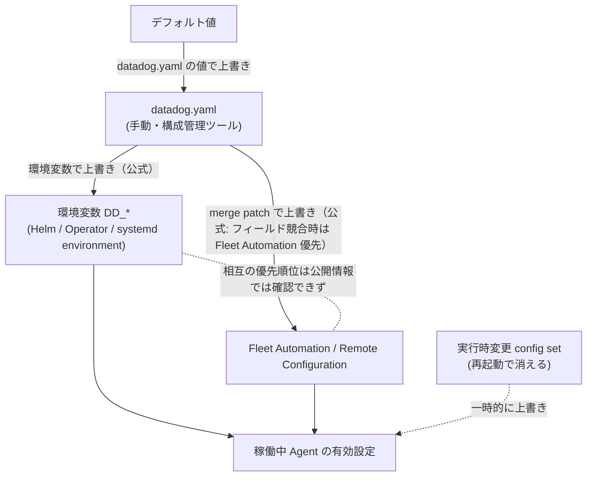
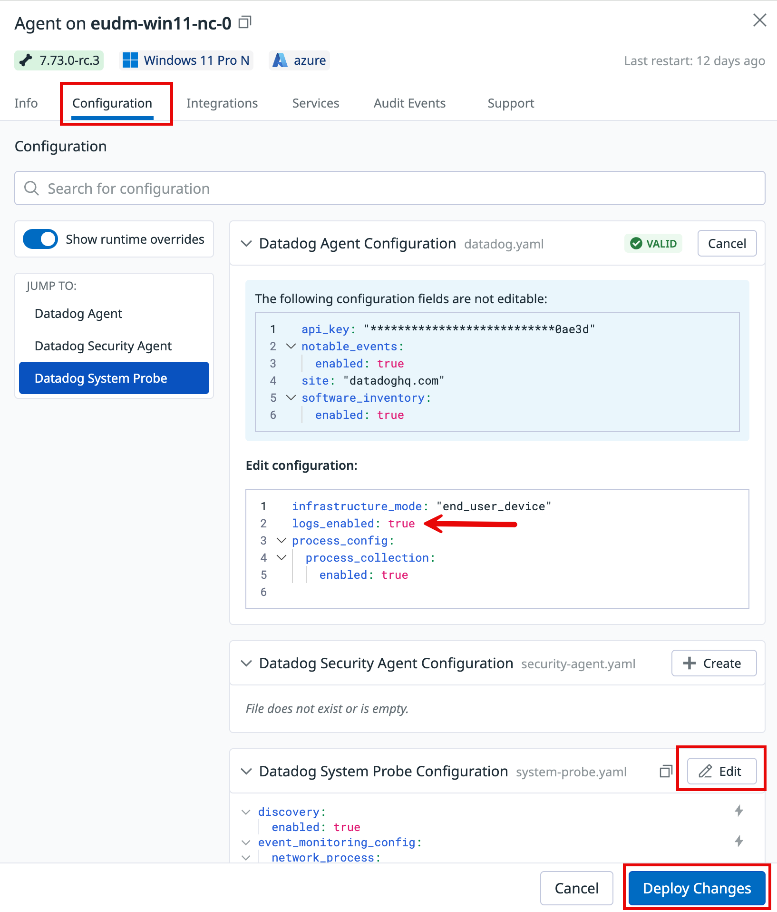
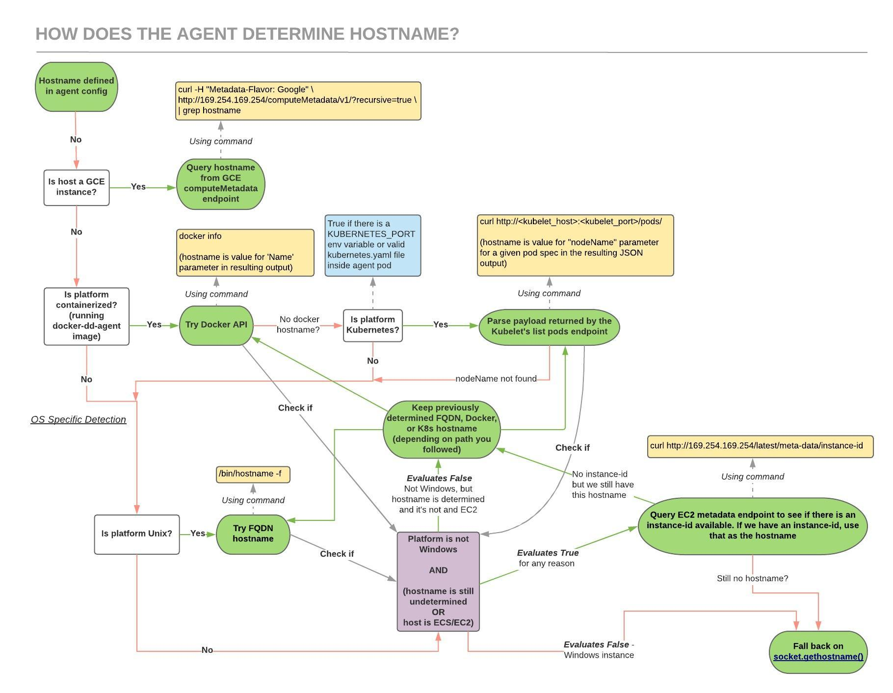
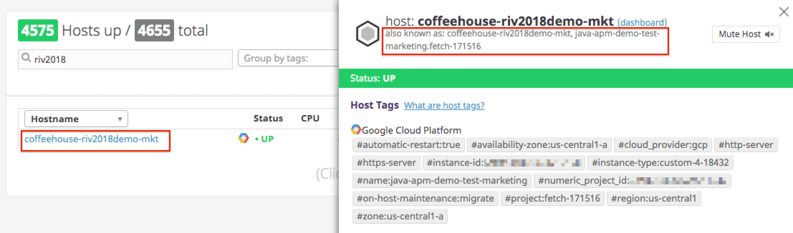

# Agent 設定リファレンス

## 概要

本ファイルは Datadog Agent（v7 系）の**設定方法と設定値**をまとめたリファレンスである。Datadog Agent の設定は、主設定ファイル `datadog.yaml`、インテグレーション（チェック）ごとの設定ディレクトリ `conf.d/`、補助設定ファイル（`system-probe.yaml`、`security-agent.yaml`）、環境変数（`DD_` で始まる変数）、および Remote Configuration / Fleet Automation によるリモート適用、の組み合わせで決まる。

本ファイルが扱う範囲:

| 範囲 | 節 |
|---|---|
| 設定ソースの種類と優先順位、実行時の設定変更 | [設定ソースと優先順位](#設定ソースと優先順位) |
| 設定ファイルの配置（OS 別パス） | [設定ファイルの配置](#設定ファイルの配置) |
| `datadog.yaml` の主要設定キーとデフォルト値 | [datadog.yaml の主要設定項目](#datadogyaml-の主要設定項目) |
| 環境変数の命名規則と主要環境変数 | [環境変数](#環境変数) |
| `conf.d` のチェック設定（`init_config` / `instances` / `logs`） | [conf.d のチェック設定](#confd-のチェック設定) |
| Secrets Management（`ENC[]`） | [Secrets Management](#secrets-managementシークレット管理) |
| プロキシ設定 | [プロキシ設定](#プロキシ設定) |
| Agent 自身のログとログレベル | [ログレベルと Agent ログ](#ログレベルと-agent-ログ) |
| ホスト名の決定ロジック | [ホスト名解決](#ホスト名解決) |
| 設定確認・検証コマンド | [設定の確認・検証コマンド](#設定の確認検証コマンド) |
| デフォルト値の一覧 | [制限値・クォータ・デフォルト値](#制限値クォータデフォルト値) |

関連ファイル（重複を避けるため詳細は各ファイルを参照）:

- Agent の構成要素・インストール・対応 OS: [Datadog Agent](./agent.md)
- コンテナ/Kubernetes での設定（Helm、Datadog Operator、Autodiscovery アノテーション）: [コンテナ/Kubernetes向けAgent](./kubernetes-and-containers-agent.md)
- リモートからの設定変更・アップグレード: [Fleet Automation と Remote Configuration](./fleet-automation.md)
- 個別インテグレーションの設定: [Integrations](./integrations.md)
- サイトとエンドポイント: [Datadog Sites](./datadog-sites.md)
- ログ収集設定の詳細（`logs_config`、ログ処理ルール）: [ログ収集](../logs/log-collection.md)
- DogStatsD の詳細: [Custom Metrics と DogStatsD](./custom-metrics-and-dogstatsd.md)
- APM の Agent 側設定・サンプリング: [APM の概念とインジェスト制御](../apm/apm-concepts-and-ingestion.md)
- 通信要件・FW 開放: [ネットワーク・接続要件](../../03_導入編/11-network-and-connectivity.md)
- 展開方式の設計: [Agent 展開設計](../../03_導入編/10-agent-rollout-design.md)

> **基準バージョンについて:** 本ファイルのデフォルト値は、2026-11-02 時点の最新リリース **Agent 7.85.0**（リリースノート記載のリリース日 2026-10-30。GitHub Releases への公開は 2026-10-29）に同梱される設定テンプレート `datadog-agent_linux.yaml.example`（GitHub `DataDog/datadog-agent` リポジトリの `pkg/config/example/`）を一次資料としている。デフォルト値は Agent バージョンで変わることがあるため、厳密な値は利用中バージョンの `datadog.yaml.example`（Linux では `/etc/datadog-agent/datadog.yaml.example`）を確認すること。[出典](https://github.com/DataDog/datadog-agent/blob/7.85.0/pkg/config/example/datadog-agent_linux.yaml.example)

---

## 設定ソースと優先順位

### Agent 設定ソースの種類

Datadog Agent の設定値は、次のソースから与えられる。

| ソース | 内容 | 反映タイミング |
|---|---|---|
| デフォルト値 | Agent に組み込まれた既定値（`datadog.yaml.example` に記載） | — |
| `datadog.yaml`（ローカルファイル） | 主設定ファイル。手動編集または Ansible/Chef/Puppet 等の構成管理ツールで配布 | Agent 再起動後 |
| 環境変数（`DD_*`） | コンテナ、Helm、Operator、systemd の environment ファイル等で設定 | プロセス起動時 |
| Remote Configuration / Fleet Automation | Datadog UI/API からリモートで適用（Agent 7.73 以降で Agent 設定に対応） | 適用時（下記参照） |
| 実行時変更（`config set`） | 稼働中 Agent に対する一時変更（Agent 6.19+/7.19+） | 即時。**再起動で消える** |

### 優先順位

公式ドキュメントは、すべての設定ソースを通した固定の優先順位を示していない。公式に確認できるルールは次のとおりである。

- 同じプロパティが `datadog.yaml` と環境変数の両方にある場合、**環境変数が優先**される（入れ子オプションの扱いは下記。`proxy` は例外）。どちらにも指定がなければデフォルト値が使われる。[出典](https://docs.datadoghq.com/agent/guide/environment-variables/)
- **入れ子（nested）オプションを環境変数で設定すると、その親オプション配下の入れ子オプションすべてが上書きされる**（例外は `proxy`）。つまり `datadog.yaml` 側で親オプション配下に書いた他の子キーが効かなくなることがある。[出典](https://docs.datadoghq.com/agent/guide/environment-variables/)
- Fleet Automation による `datadog.yaml` の変更は **merge patch** として適用され、指定したフィールドだけが変わる。フィールド単位で競合した場合は Fleet Automation の値がローカル値より優先される。インテグレーション設定・カスタムログ設定は、新規ファイルとして配布するか既存ファイルに merge patch を当てる。merge patch なしで既存ファイル名を指定すると、そのファイルは**全体が上書き**される。[出典](https://docs.datadoghq.com/agent/fleet_automation/configure_agents/)
- Fleet Automation のドキュメントは「変更元（Fleet Automation、構成管理ツール、ホスト上での直接編集）にかかわらず、最新の変更がアクティブな設定になる」とも記述している。構成管理ツールと Fleet Automation を併用する場合は、どちらで管理するキーかを分担しておくのが安全である。【経験則】 [出典](https://docs.datadoghq.com/agent/fleet_automation/configure_agents/)
- Remote Configuration / Fleet Automation で適用した値と環境変数（`DD_*`）が競合した場合にどちらが優先されるか、またリモート適用した変更がローカルの `datadog.yaml` ファイルに書き込まれるかどうかは、公開情報では確認できず。



### Remote Configuration / Fleet Automation 関連の設定キー

| キー | 環境変数 | デフォルト | 説明 |
|---|---|---|---|
| `remote_configuration.enabled` | `DD_REMOTE_CONFIGURATION_ENABLED` | `true`（Agent 7.47.0 以降） | Remote Configuration の有効化。GovCloud 向け・FIPS モードの Agent では明示的に `true` が必要 |
| `remote_updates` | `DD_REMOTE_UPDATES` | `true`（Agent 7.73.0 以降） | リモートからの Agent アップグレード・設定変更を有効化。`remote_updates` だけを有効にしても Remote Configuration は有効にならない |

[出典](https://docs.datadoghq.com/agent/guide/setup_remote_config/)

Fleet Automation から変更できない項目: `api_key`、`site`、`notable_events`（UI）。API からも `site`、`api_key`、その他の認証パラメータは管理できない。また、編集できるのは `datadog.yaml` のフィールドのうちサポート対象のサブセットのみ。対応バージョンは Agent 設定・OTel Collector 設定が 7.73+、インテグレーションとシークレットが 7.76+。[出典](https://docs.datadoghq.com/agent/fleet_automation/configure_agents/)。詳細は [Fleet Automation と Remote Configuration](./fleet-automation.md) を参照。

> **サイト差異:** Remote Configuration は組織単位で通常デフォルト有効だが、**US1-FED / US2-FED では組織でデフォルト無効**。[出典](https://docs.datadoghq.com/remote_configuration/)



**キャプション:** Fleet Automation で個別 Agent の設定を表示・編集する画面（Agent 詳細パネルの Configuration タブ）。

**画面の説明:** Fleet Automation の Agent 一覧から特定ホストの Agent（例: `Agent on eudm-win11-nc-0`、Agent 7.73.0-rc.3、Windows 11、azure）を開いたパネル。上部にタブ `Info` / `Configuration` / `Integrations` / `Services` / `Audit Events` / `Support` が並ぶ。`Configuration` タブには設定検索ボックス、`Show runtime overrides` トグル、左側の `JUMP TO:`（Datadog Agent / Datadog Security Agent / Datadog System Probe）がある。右側には `Datadog Agent Configuration datadog.yaml` セクションがあり、「The following configuration fields are not editable」として `api_key`（マスク表示）、`notable_events`、`site`、`software_inventory` が表示され、その下の `Edit configuration:` 欄に `infrastructure_mode: "end_user_device"`、`logs_enabled: true`、`process_config.process_collection.enabled: true` などを入力している。下部に `security-agent.yaml`（File does not exist or is empty、`Create` ボタン）、`system-probe.yaml`（`Edit` ボタン）のセクションがあり、最下部に `Cancel` と `Deploy Changes` ボタンがある。

出典: https://docs.datadoghq.com/agent/fleet_automation/configure_agents/ （取得日: 2026-11-02）

### 実行時の設定変更（runtime configuration）

Datadog Agent 6.19+/7.19+ では、一部の設定を再起動せずに変更できる。**動的に変更した値は永続化されず、Agent を再起動すると失われる。**[出典](https://docs.datadoghq.com/agent/troubleshooting/config/)

| 操作 | コマンド（Linux の例） |
|---|---|
| 実行時に変更可能な設定の一覧 | `sudo datadog-agent config list-runtime` |
| 値の設定 | `sudo datadog-agent config set log_level debug` |
| 値の取得 | `sudo datadog-agent config get log_level` |
| 有効な全設定（実行時設定）の表示 | `sudo datadog-agent config` |

プラットフォーム別のコマンド接頭辞: Docker は `docker exec datadog-agent agent`、Kubernetes は `kubectl exec <POD_NAME> agent`、macOS/ソースインストールは `datadog-agent`、CentOS/Debian/Fedora/Red Hat/SUSE は `sudo datadog-agent`。公式ページで実行時変更可能と明記されている設定は `log_level` のみで、その他は `config list-runtime` の出力で確認する。[出典](https://docs.datadoghq.com/agent/troubleshooting/config/)

---

## 設定ファイルの配置

### 主設定ファイル `datadog.yaml`

| OS | パス |
|---|---|
| Linux | `/etc/datadog-agent/datadog.yaml` |
| AIX | `/etc/datadog-agent/datadog.yaml` |
| macOS | `/opt/datadog-agent/etc/datadog.yaml` |
| Windows | `%ProgramData%\Datadog\datadog.yaml` |

[出典](https://docs.datadoghq.com/agent/configuration/agent-configuration-files/)

インストール時には同じディレクトリに全設定項目をコメントで説明した `datadog.yaml.example` が配置される（Agent v7 ではテンプレートの `@param` 記法で型・必須/任意・既定値が記載されている）。[出典](https://github.com/DataDog/datadog-agent/blob/7.85.0/pkg/config/example/datadog-agent_linux.yaml.example)

### チェック設定ディレクトリ `conf.d`

| OS | パス |
|---|---|
| Linux（AIX、CentOS、Debian、Fedora、Red Hat、SUSE、Ubuntu、ソース） | `/etc/datadog-agent/conf.d/` |
| macOS | `/opt/datadog-agent/etc/conf.d/` |
| Windows | `%ProgramData%\Datadog\conf.d` |

[出典](https://docs.datadoghq.com/agent/configuration/agent-configuration-files/)

`conf.d` の場所は `confd_path`（`DD_CONFD_PATH`）で、カスタムチェックの Python コードを置く `checks.d` の場所は `additional_checksd`（`DD_ADDITIONAL_CHECKSD`）で変更できる。

| キー | Linux 既定値 | macOS 既定値 | Windows 既定値 |
|---|---|---|---|
| `confd_path` | `/etc/datadog-agent/conf.d` | `/opt/datadog-agent/etc/conf.d` | `c:\programdata\datadog\conf.d` |
| `additional_checksd` | `/etc/datadog-agent/checks.d` | `/opt/datadog-agent/etc/checks.d` | `c:\programdata\datadog\checks.d` |

[出典（Linux）](https://github.com/DataDog/datadog-agent/blob/7.85.0/pkg/config/example/datadog-agent_linux.yaml.example)、[出典（Windows）](https://github.com/DataDog/datadog-agent/blob/7.85.0/pkg/config/example/datadog-agent_windows.yaml.example)、[出典（macOS）](https://github.com/DataDog/datadog-agent/blob/7.85.0/pkg/config/example/datadog-agent_darwin.yaml.example)

### `conf.d` 内のファイル種別

| ファイル | 意味 |
|---|---|
| `<CHECK_NAME>.d/conf.yaml.example` | そのチェックの全オプションを記載したサンプル。`conf.yaml` にリネームするとチェックが有効になる |
| `<CHECK_NAME>.d/conf.yaml`（および任意名の `*.yaml`） | チェック設定。ディレクトリ内の**有効な YAML はすべて読み込まれる**ため、`http_check.d/backend.yaml` と `frontend.yaml` のように分割できる |
| `<CHECK_NAME>.d/conf.yaml.default` | 既定で読み込まれるコアチェック（CPU、メモリ、uptime など）の設定。**同じチェックに他の設定があれば無視される**。既定チェックを無効化するにはこのファイルを削除する |
| `<CHECK_NAME>.d/auto_conf.yaml` | Autodiscovery 用テンプレート（例: `redisdb.d/auto_conf.yaml`） |
| `<CHECK_NAME>.d/metrics.yaml` | JMX 系チェックのみ。既定で収集する Bean の一覧。Docker ラベル/Kubernetes アノテーションで設定する際に Bean を列挙しなくて済む |
| サイズ 0 のファイル | Agent に無視される |

ログ収集で複数の YAML ファイルが同じログソースを指す場合、**アルファベット順で最初のファイルだけ**が使われる（重複ログ防止）。[出典](https://docs.datadoghq.com/agent/configuration/agent-configuration-files/)

### その他の設定ファイル

| ファイル | 用途 | Linux の配置 |
|---|---|---|
| `system-probe.yaml` | System Probe（eBPF ベース。Cloud Network Monitoring、Universal Service Monitoring、Workload Protection のイベント監視など）の設定 | `/etc/datadog-agent/system-probe.yaml` |
| `security-agent.yaml` | Security Agent（Workload Protection のランタイムセキュリティ、コンプライアンス）の設定 | `/etc/datadog-agent/security-agent.yaml` |
| `environment` | systemd の `datadog-agent.service` が読み込む環境変数ファイル（Agent 7.45 以降） | `/etc/datadog-agent/environment` |

- `system-probe.yaml` / `security-agent.yaml` の Linux パスは、Agent パッケージが同ディレクトリに配置する `*.yaml.example` の慣例に基づく記載である。両ファイルの配置パスを明記した公式ページは本調査では確認できず、OS 別パス（macOS/Windows）も公開情報では確認できず。Fleet Automation の画面ではこれら 3 ファイル（`datadog.yaml`、`security-agent.yaml`、`system-probe.yaml`）が並んで編集対象として表示される。
- `system-probe.yaml` の主なキーと既定値（Linux テンプレート）: `system_probe_config.sysprobe_socket`=`/opt/datadog-agent/run/sysprobe.sock`、`system_probe_config.log_file`=`/var/log/datadog/system-probe.log`、`network_config.enabled`=`false`、`service_monitoring_config.enabled`=`false`、`runtime_security_config.enabled`=`false`、`runtime_security_config.fim_enabled`=`false`、`runtime_security_config.policies.dir`=`/etc/datadog-agent/runtime-security.d`。[出典](https://github.com/DataDog/datadog-agent/blob/7.85.0/pkg/config/example/system-probe_linux.yaml.example)
- `security-agent.yaml` の主なキー: `runtime_security_config.enabled`（既定 `false`）、`compliance_config.enabled`（既定 `false`）。[出典](https://github.com/DataDog/datadog-agent/blob/7.85.0/pkg/config/example/security-agent.yaml.example)
- 各機能の有効化手順は [Cloud Network Monitoring](../infrastructure/cloud-network-monitoring.md)、[Universal Service Monitoring](../apm/universal-service-monitoring.md)、[Workload Protection](../security/workload-protection.md) を参照。

---

## datadog.yaml の主要設定項目

`datadog.yaml` は YAML 形式で、キーは小文字のスネークケース、入れ子はインデントで表す。以下の表の「既定値」は Agent 7.85.0 の Linux 向け設定テンプレートの値であり、OS で異なるものは注記した。[出典](https://github.com/DataDog/datadog-agent/blob/7.85.0/pkg/config/example/datadog-agent_linux.yaml.example)

最小構成の例:

```yaml
api_key: <DATADOG_API_KEY>
site: ap1.datadoghq.com
tags:
  - env:prod
  - team:infra
logs_enabled: true
```

### 基本設定（認証・送信先）

| キー | 環境変数 | 型 | 既定値 | 説明 |
|---|---|---|---|---|
| `api_key` | `DD_API_KEY` | string | （必須） | Agent がデータ送信に使う API キー。キーの管理は [API とキー管理](./api-and-keys.md) |
| `app_key` | `DD_APP_KEY` | string | `""` | Datadog のプログラム API 用アプリケーションキー（通常の Agent 送信には不要） |
| `site` | `DD_SITE` | string | `datadoghq.com` | 送信先サイト。Remote Configuration を使うには設定が必要 |
| `dd_url` | `DD_DD_URL` / `DD_URL` | string | `https://app.datadoghq.com` | メトリクス送信先 URL を独自に指定する場合のみ使用し、`site` を上書きする。APM、Logs、Remote Configuration、Live Process の送信先には影響しない（それぞれ `*_dd_url` を持つ）。`DD_DD_URL` と `DD_URL` が両方あれば `DD_DD_URL` が優先 |
| `infrastructure_mode` | `DD_INFRASTRUCTURE_MODE` | string | `full` | 収集するインテグレーション/メタデータの範囲。`full`（既定、全チェック許可）、`basic`（ホストレベルの最小メトリクスのみ）、`end_user_device`（エンドユーザー端末向け）、`cloud_cost_only`（Cloud Cost Management 用の軽量タグ付け）、`none`（インフラチェック無効） |
| `env` | `DD_ENV` | string | `""` | Agent が送るすべてのメトリクス、イベント、ログ、トレース、サービスチェックに付く環境名 |

`site` に指定する値（サイトパラメータ）:

| サイト | `site` の値 |
|---|---|
| US1 | `datadoghq.com` |
| US3 | `us3.datadoghq.com` |
| US5 | `us5.datadoghq.com` |
| EU1 | `datadoghq.eu` |
| AP1（日本） | `ap1.datadoghq.com` |
| AP2 | `ap2.datadoghq.com` |
| US1-FED | `ddog-gov.com` |
| US2-FED | `us2.ddog-gov.com` |
| UK1 | `uk1.datadoghq.com` |

[出典](https://docs.datadoghq.com/getting_started/site/)

> **サイト差異:** `site` の既定値は US1（`datadoghq.com`）である。AP1 の組織に送る場合は必ず `site: ap1.datadoghq.com`（または `DD_SITE=ap1.datadoghq.com`）を設定する。設定漏れのまま US1 に送信すると API キーが無効として拒否される。【経験則】 サイトの詳細（US2-FED、UK1 を含む）は [Datadog Sites](./datadog-sites.md) を参照。

Agent 7.67.0 以降は、サイトのドメインを末尾ドット付きの FQDN に変換して名前解決する。この変換は Agent 7.72.0 以降、`convert_dd_site_fqdn.enabled: false`（`DD_CONVERT_DD_SITE_FQDN_ENABLED=false`）で無効化できる。[出典](https://docs.datadoghq.com/agent/configuration/network/)

### タグ関連

| キー | 環境変数 | 型 | 既定値 | 説明 |
|---|---|---|---|---|
| `tags` | `DD_TAGS` | list | `[]` | ホストタグ。Agent が送るすべてのメトリクス、イベント、ログ、トレース、サービスチェックに付与される |
| `extra_tags` | `DD_EXTRA_TAGS` | list | `[]` | `tags` とマージされる追加タグ。ファイルで `tags`、環境変数で `DD_EXTRA_TAGS` を足す用途 |
| `tag_value_split_separator` | `DD_TAG_VALUE_SPLIT_SEPARATOR` | map（JSON） | `{}` | 指定区切り文字でタグ値を分割（例: `foo:1;2;3` → `foo:1`、`foo:2`、`foo:3`）。ホストタグとコンテナ系インテグレーションのタグのみ対象 |
| `checks_tag_cardinality` | `DD_CHECKS_TAG_CARDINALITY` | string | `low` | チェックのメトリクス/イベントに付けるタグの粒度。`low`（クラスタ、ホスト、デプロイ、イメージ等）、`orchestrator`（Pod/タスク単位）、`high`（コンテナ単位等）。**上げるとカスタムメトリクス課金に影響しうる** |
| `dogstatsd_tag_cardinality` | `DD_DOGSTATSD_TAG_CARDINALITY` | string | `low` | DogStatsD メトリクスに付けるタグの粒度（同上） |
| `cluster_name` | `DD_CLUSTER_NAME` | string | `""` | Kubernetes クラスタ名 |

タグ設計の考え方は [Tagging](./tagging.md) と [タグ戦略の実践](../../04_応用編/02-tagging-strategy.md) を参照。

### ホスト名関連

| キー | 環境変数 | 型 | 既定値 | 説明 |
|---|---|---|---|---|
| `hostname` | `DD_HOSTNAME` | string | `""`（自動検出） | ホスト名を強制指定 |
| `hostname_file` | `DD_HOSTNAME_FILE` | string | `""` | ホスト名を記載したファイルのパス（例: `/var/lib/cloud/data/instance-id`）。`hostname` が設定されていれば無視 |
| `hostname_fqdn` | `DD_HOSTNAME_FQDN` | boolean | `false` | OS からホスト名を取得する際、短縮名ではなく FQDN を使う。テンプレート上の推奨値は `true` |
| `hostname_trust_uts_namespace` | `DD_HOSTNAME_TRUST_UTS_NAMESPACE` | boolean | `false` | 非 root の UTS 名前空間（コンテナ等）で得たホスト名を信頼する（Linux のみ） |
| `host_aliases` | `DD_HOST_ALIASES` | list | `[]` | クラウドプロバイダから自動収集されるエイリアスに加えて報告するホストエイリアス |
| `ec2_prioritize_instance_id_as_hostname` | `DD_EC2_PRIORITIZE_INSTANCE_ID_AS_HOSTNAME` | boolean | `false` | EC2 でインスタンス ID をホスト名として優先 |
| `azure_hostname_style` | `DD_AZURE_HOSTNAME_STYLE` | string | `os` | Azure でのホスト名の形式 |

詳細は [ホスト名解決](#ホスト名解決) を参照。

### 通信・TLS・プロキシ

| キー | 環境変数 | 型 | 既定値 | 説明 |
|---|---|---|---|---|
| `proxy.https` | `DD_PROXY_HTTPS` | string | `""` | HTTPS リクエスト用プロキシ |
| `proxy.http` | `DD_PROXY_HTTP` | string | `""` | HTTP リクエスト用プロキシ |
| `proxy.no_proxy` | `DD_PROXY_NO_PROXY`（スペース区切り） | list | `[]` | プロキシを使わないホスト |
| `no_proxy_nonexact_match` | `DD_NO_PROXY_NONEXACT_MATCH` | boolean | `false` | `no_proxy` をドメイン/CIDR 一致で評価（推奨 `true`） |
| `use_proxy_for_cloud_metadata` | `DD_USE_PROXY_FOR_CLOUD_METADATA` | boolean | `false` | クラウドメタデータエンドポイントへのアクセスにもプロキシを使う |
| `skip_ssl_validation` | `DD_SKIP_SSL_VALIDATION` | boolean | `false` | TLS 証明書検証をスキップ（非推奨） |
| `min_tls_version` | `DD_MIN_TLS_VERSION` | string | `tlsv1.2` | Datadog への送信時の最小 TLS バージョン。`tlsv1.0`〜`tlsv1.3` |
| `sslkeylogfile` | `DD_SSLKEYLOGFILE` | string | `""` | TLS マスターシークレットを NSS key log 形式で出力（デバッグ専用。セキュリティを損なう） |
| `fips.enabled` | `DD_FIPS_ENABLED` | boolean | `false` | FIPS プロキシ経由の送信 |

詳細は [プロキシ設定](#プロキシ設定) を参照。

### Forwarder（送信キュー・リトライ）

| キー | 環境変数 | 既定値 | 説明 |
|---|---|---|---|
| `forwarder_timeout` | `DD_FORWARDER_TIMEOUT` | `20`（秒） | 送信リクエストのタイムアウト |
| `forwarder_num_workers` | `DD_FORWARDER_NUM_WORKERS` | `1` | Forwarder のワーカー数 |
| `forwarder_retry_queue_payloads_max_size` | `DD_FORWARDER_RETRY_QUEUE_PAYLOADS_MAX_SIZE` | `15728640`（バイト = 15 MiB） | 送信失敗時のメモリ上リトライキューの上限。超過分のメトリクスは破棄 |
| `forwarder_storage_max_size_in_bytes` | `DD_FORWARDER_STORAGE_MAX_SIZE_IN_BYTES` | `0`（無効） | 正の値でディスクへのリトライ保存を有効化（Agent 7.27.0 以降） |
| `forwarder_storage_max_disk_ratio` | `DD_FORWARDER_STORAGE_MAX_DISK_RATIO` | `0.8` | 保存先ディスク使用率がこの比率を超えるとディスク保存しない |
| `forwarder_outdated_file_in_days` | `DD_FORWARDER_OUTDATED_FILE_IN_DAYS` | `10`（日） | 古い保存ファイルを削除するまでの日数 |
| `forwarder_max_concurrent_requests` | `DD_FORWARDER_MAX_CONCURRENT_REQUESTS` | `10` | 同時送信リクエスト数 |
| `forwarder_http_protocol` | `DD_FORWARDER_HTTP_PROTOCOL` | `auto` | 送信に使う HTTP プロトコル |
| `forwarder_backoff_base` / `forwarder_backoff_max` | `DD_FORWARDER_BACKOFF_BASE` / `DD_FORWARDER_BACKOFF_MAX` | `2` / `64` | リトライのバックオフ係数と上限（秒） |
| `forwarder_stop_timeout` | `DD_FORWARDER_STOP_TIMEOUT` | `2`（秒） | 停止時の待機時間 |

ディスク保存先 `forwarder_storage_path` の既定値は Unix で `/opt/datadog-agent/run/transactions_to_retry`、Windows で `C:\ProgramData\Datadog\run\transactions_to_retry`。[出典](https://docs.datadoghq.com/agent/configuration/network/)

### メトリクス集計（Aggregator・Histogram）

| キー | 環境変数 | 既定値 | 説明 |
|---|---|---|---|
| `histogram_aggregates` | `DD_HISTOGRAM_AGGREGATES` | `["max", "median", "avg", "count"]` | Histogram から生成する集計値 |
| `histogram_percentiles` | `DD_HISTOGRAM_PERCENTILES` | `["0.95"]` | Histogram から生成するパーセンタイル |
| `histogram_copy_to_distribution` | `DD_HISTOGRAM_COPY_TO_DISTRIBUTION` | `false` | Histogram の値を Distribution にもコピー（カスタムメトリクス数が増える） |
| `histogram_copy_to_distribution_prefix` | `DD_HISTOGRAM_COPY_TO_DISTRIBUTION_PREFIX` | `""` | コピー先メトリクス名の接頭辞 |
| `aggregator_stop_timeout` | `DD_AGGREGATOR_STOP_TIMEOUT` | `2`（秒） | 停止時に Aggregator がフラッシュを待つ時間 |
| `aggregator_buffer_size` | `DD_AGGREGATOR_BUFFER_SIZE` | `100` | Aggregator の入力バッファ |

> 既定設定では 1 つの Histogram メトリクスから `max`・`median`・`avg`・`count` と `95percentile` の 5 系列が生成される。`histogram_aggregates` / `histogram_percentiles` を増やすと、タグの組み合わせごとにカスタムメトリクスが増える。詳細は [Custom Metrics と DogStatsD](./custom-metrics-and-dogstatsd.md)。

### クラウドメタデータ・ホストタグ収集

| キー | 環境変数 | 既定値 | 説明 |
|---|---|---|---|
| `cloud_provider_metadata` | `DD_CLOUD_PROVIDER_METADATA` | `["aws", "gcp", "azure", "alibaba", "oracle", "ibm"]` | 照会するクラウドメタデータの種類 |
| `collect_ec2_tags` | `DD_COLLECT_EC2_TAGS` | `false` | EC2 タグを Agent から収集（AWS インテグレーション経由とは別） |
| `collect_ec2_tags_use_imds` | `DD_COLLECT_EC2_TAGS_USE_IMDS` | `false` | EC2 タグを IMDS から取得 |
| `collect_ec2_instance_info` | `DD_COLLECT_EC2_INSTANCE_INFO` | `false` | EC2 インスタンス情報の収集 |
| `exclude_ec2_tags` | `DD_EXCLUDE_EC2_TAGS` | `[]` | 除外する EC2 タグ |
| `ec2_metadata_timeout` | `DD_EC2_METADATA_TIMEOUT` | `300`（ミリ秒） | EC2 メタデータ照会のタイムアウト |
| `ec2_prefer_imdsv2` | `DD_EC2_PREFER_IMDSV2` | `false` | IMDSv2 を優先 |
| `collect_gce_tags` | `DD_COLLECT_GCE_TAGS` | `true` | GCE のタグ収集 |
| `gce_send_project_id_tag` | `DD_GCE_SEND_PROJECT_ID_TAG` | `false` | `project_id` タグを付与 |
| `gce_metadata_timeout` | `DD_GCE_METADATA_TIMEOUT` | `1000`（ミリ秒） | GCE メタデータ照会のタイムアウト |
| `azure_metadata_timeout` | `DD_AZURE_METADATA_TIMEOUT` | `300`（ミリ秒） | Azure メタデータ照会のタイムアウト |
| `collect_gpu_tags` | `DD_COLLECT_GPU_TAGS` | `true` | GPU タグの収集 |

クラウド側のインテグレーション設定は [AWS Integration](./aws-integration.md)、[Azure Integration](./azure-integration.md)、[Google Cloud Integration](./gcp-integration.md) を参照。

### Agent 内部ポート・プロセス

| キー | 環境変数 | 既定値 | 説明 |
|---|---|---|---|
| `cmd_port` | `DD_CMD_PORT` | `5001` | IPC API ポート（ローカルのみ） |
| `expvar_port` | `DD_EXPVAR_PORT` | `5000` | go_expvar サーバーポート |
| `GUI_port` | `DD_GUI_PORT` | テンプレート上 `-1`（Windows・macOS は `5002`、Linux は `-1`） | ブラウザ GUI のポート。`-1` で GUI 無効 |
| `GUI_session_expiration` | `DD_GUI_SESSION_EXPIRATION` | `0` | GUI セッションの有効期限 |
| `health_port` | `DD_HEALTH_PORT` | `0`（無効） | ヘルスチェック用 HTTP ポート（Kubernetes の liveness probe 等で利用） |
| `check_runners` | `DD_CHECK_RUNNERS` | `4` | チェックインスタンスを並行実行するランナー数。`1` で逐次実行。**通常は変更非推奨**（メモリ・CPU に影響） |
| `server_timeout` | `DD_SERVER_TIMEOUT` | `30`（秒） | IPC サーバーのタイムアウト |
| `enable_metadata_collection` | `DD_ENABLE_METADATA_COLLECTION` | `true` | ホストメタデータの収集 |
| `enable_gohai` | `DD_ENABLE_GOHAI` | `true` | gohai によるシステム情報収集 |
| `inventories_configuration_enabled` | `DD_INVENTORIES_CONFIGURATION_ENABLED` | `true` | Agent 設定のインベントリ送信（Fleet Automation で設定内容を表示するために使われる） |
| `procfs_path` | `DD_PROCFS_PATH` | `""` | procfs のパス（コンテナでホストの `/proc` をマウントする場合など） |
| `auto_exit.noprocess.enabled` | `DD_AUTO_EXIT_NOPROCESS_ENABLED` | `false` | 監視対象プロセスがなくなったら Agent を自動終了（サイドカー用途） |

Agent が使う受信ポート（ローカルホストのみ）の公式一覧: 5000（go_expvar）、5001（IPC API）、5002（GUI）、5012（APM の go_expvar）、6062（Process Agent デバッグ）、6162（Process Agent ランタイム）、8125/UDP（DogStatsD）、8126/TCP（APM レシーバー）。[出典](https://docs.datadoghq.com/agent/configuration/network/)

### ログ収集（`logs_enabled` / `logs_config`）

| キー | 環境変数 | 既定値 | 説明 |
|---|---|---|---|
| `logs_enabled` | `DD_LOGS_ENABLED` | `false` | ログ収集の有効化 |
| `logs_config.container_collect_all` | `DD_LOGS_CONFIG_CONTAINER_COLLECT_ALL` | `false` | 全コンテナのログを収集 |
| `logs_config.logs_dd_url` | `DD_LOGS_CONFIG_LOGS_DD_URL` | `""` | ログ送信先を変更（プロキシや Observability Pipelines 経由時） |
| `logs_config.logs_no_ssl` | `DD_LOGS_CONFIG_LOGS_NO_SSL` | `false` | ログ送信の TLS を無効化（ローカルプロキシ向け） |
| `logs_config.processing_rules` | `DD_LOGS_CONFIG_PROCESSING_RULES`（JSON） | `[]` | 全ログに適用するグローバル処理ルール（除外・マスク等） |
| `logs_config.auto_multi_line_detection` | `DD_LOGS_CONFIG_AUTO_MULTI_LINE_DETECTION` | `true` | 複数行ログの自動検出 |
| `logs_config.force_use_http` | `DD_LOGS_CONFIG_FORCE_USE_HTTP` | `false` | HTTPS 送信を強制（Agent 6.14+/7.14+） |
| `logs_config.force_use_tcp` | `DD_LOGS_CONFIG_FORCE_USE_TCP` | `false` | TCP 送信を強制 |
| `logs_config.use_compression` | `DD_LOGS_CONFIG_USE_COMPRESSION` | `true` | 送信時の圧縮 |
| `logs_config.compression_level` | `DD_LOGS_CONFIG_COMPRESSION_LEVEL` | `6` | 圧縮レベル（0=なし〜9=最大） |
| `logs_config.batch_wait` | `DD_LOGS_CONFIG_BATCH_WAIT` | `5`（秒） | バッチを満たすまで待つ最大時間（1〜10 の整数） |
| `logs_config.http_timeout` | `DD_LOGS_CONFIG_HTTP_TIMEOUT` | `10`（秒） | HTTP 送信タイムアウト |
| `logs_config.open_files_limit` | `DD_LOGS_CONFIG_OPEN_FILES_LIMIT` | `500` | 同時に tail するファイル数の上限 |
| `logs_config.file_wildcard_selection_mode` | `DD_LOGS_CONFIG_FILE_WILDCARD_SELECTION_MODE` | `by_name` | ワイルドカード指定時に上限超過した場合のファイル選択方式 |
| `logs_config.max_message_size_bytes` | `DD_LOGS_CONFIG_MAX_MESSAGE_SIZE_BYTES` | `900000` | 1 メッセージの最大サイズ（バイト） |
| `logs_config.close_timeout` | `DD_LOGS_CONFIG_CLOSE_TIMEOUT` | `60`（秒） | ローテーション後に旧ファイルを読み続ける時間 |
| `logs_config.use_container_timestamp` | `DD_LOGS_CONFIG_USE_CONTAINER_TIMESTAMP` | `false` | コンテナランタイムのタイムスタンプを使用 |
| `logs_config.k8s_container_use_kubelet_api` | `DD_LOGS_CONFIG_K8S_CONTAINER_USE_KUBELET_API` | `false` | Kubelet API 経由でコンテナログを取得 |
| `logs_config.integrations_logs_files_max_size` | `DD_LOGS_CONFIG_INTEGRATIONS_LOGS_FILES_MAX_SIZE` | `100`（MB） | インテグレーションログファイル 1 つの最大サイズ |
| `logs_config.integrations_logs_total_usage` | `DD_LOGS_CONFIG_INTEGRATIONS_LOGS_TOTAL_USAGE` | `100`（MB） | インテグレーションログの合計ディスク使用量 |

ログ送信のトランスポート:

- Agent 6.19+/7.19+ の既定は**圧縮 HTTPS**（ポート 443）。
- **TCP によるログ収集は US1（app.datadoghq.com）、EU1（app.datadoghq.eu）、US3、US5、AP1、AP2、UK1 の各サイトおよび ddog-gov サイト（US1-FED / US2-FED）でサポートされない**。これらのサイトでは HTTPS を使う（`logs_config.force_use_http: true` で明示的に固定することを推奨）。また TCP には配信・信頼性の保証がない。
- HTTPS 送信のバッチ上限: 1 バッチ 1 MB、1 ログ 900 kB、1 バッチ 1,000 ログ。
- 【レガシー】公式ドキュメントには、起動時の HTTPS 疎通テストに失敗すると TCP にフォールバックする挙動（テストは起動時のみ）と、TCP 送信用ポート（US サイト 10516、EU サイト 443）の記載も残っている。ただし上記のとおり主要サイトでは TCP が非サポートのため、これらのサイトでは TCP フォールバックやこれらのポートに依存した構成はとれない。フォールバックを避けるためにも `force_use_http: true` を設定する。
- 【レガシー】SOCKS5 プロキシを使うと TCP が強制される（SOCKS5 は HTTPS 圧縮に未対応）。TCP 非サポートのサイトでは、ログ送信に SOCKS5 プロキシは使えないと考えるべきである（HTTP(S) プロキシを使う）。【推定】
- プロキシ経由でログを転送する場合は、トランスポートを明示的に強制することが推奨される。

[出典](https://docs.datadoghq.com/agent/logs/log_transport/)

ログ収集の設定詳細（ファイル tail、コンテナ、処理ルールの書式）は [ログ収集](../logs/log-collection.md) を参照。

### APM（`apm_config`）

| キー | 環境変数 | 既定値 | 説明 |
|---|---|---|---|
| `apm_config.enabled` | `DD_APM_ENABLED` | `true` | Trace Agent の有効化 |
| `apm_config.env` | `DD_APM_ENV` | `""` | トレースの `env` |
| `apm_config.receiver_port` | `DD_APM_RECEIVER_PORT` / `DD_RECEIVER_PORT` | `8126` | トレース受信ポート。`0` で HTTP レシーバー無効 |
| `apm_config.receiver_socket` | `DD_APM_RECEIVER_SOCKET` | Linux: `/var/run/datadog/apm.socket`、Windows/macOS: `""` | Unix ドメインソケット |
| `apm_config.apm_non_local_traffic` | `DD_APM_NON_LOCAL_TRAFFIC` | `false` | ローカル以外からのトレース受信を許可（コンテナ環境で必要） |
| `apm_config.apm_dd_url` | `DD_APM_DD_URL` | `""` | トレース送信先の変更 |
| `apm_config.target_traces_per_second` | `DD_APM_TARGET_TPS` | `10` | ヘッドベースサンプリングの目標トレース数/秒 |
| `apm_config.max_traces_per_second` | `DD_APM_MAX_TPS` / `DD_MAX_TPS` | `10` | 非推奨（`target_traces_per_second` を使う）。7.35.0 以降、`0` にするとサンプリング無効ではなくトレースを一切送らない |
| `apm_config.errors_per_second` | `DD_APM_ERROR_TPS` | `10` | エラーサンプラーの目標値 |
| `apm_config.max_events_per_second` | `DD_APM_MAX_EPS` | `200` | APM イベントの上限 |
| `apm_config.max_memory` | `DD_APM_MAX_MEMORY` | `500000000`（バイト） | Trace Agent のメモリ上限 |
| `apm_config.max_cpu_percent` | `DD_APM_MAX_CPU_PERCENT` | `50` | Trace Agent の CPU 上限（%） |
| `apm_config.connection_limit` | — | `2000` | 接続数上限 |
| `apm_config.compute_stats_by_span_kind` | — | `true` | span.kind に基づく統計計算 |
| `apm_config.peer_tags_aggregation` | — | `true` | ピアタグによる集計 |
| `apm_config.error_tracking_standalone.enabled` | `DD_APM_ERROR_TRACKING_STANDALONE_ENABLED` | `false` | Error Tracking 単体モード |
| `apm_config.debug.port` | — | `5012` | APM の go_expvar ポート |

（「—」は本調査の抽出範囲で環境変数名を確認していないもの。命名規則上は `DD_APM_` 接頭辞になるが、APM には例外があるため設定テンプレートで確認すること）

サンプリング・難読化（`obfuscation`）・タグフィルタ（`filter_tags`）の詳細は [APM の概念とインジェスト制御](../apm/apm-concepts-and-ingestion.md) と [APM インスツルメンテーション](../apm/apm-instrumentation.md) を参照。

### Process Agent（`process_config`）

| キー | 環境変数 | 既定値 | 説明 |
|---|---|---|---|
| `process_config.process_collection.enabled` | `DD_PROCESS_CONFIG_PROCESS_COLLECTION_ENABLED` | `false` | Live Processes の収集 |
| `process_config.container_collection.enabled` | `DD_PROCESS_CONFIG_CONTAINER_COLLECTION_ENABLED` | `true` | Live Containers の収集 |
| `process_config.process_discovery.enabled` | — | `true` | プロセスディスカバリー（インテグレーション候補の検出） |
| `process_config.process_discovery.interval` | — | `4h0m0s` | ディスカバリー間隔 |
| `process_config.scrub_args` | `DD_PROCESS_CONFIG_SCRUB_ARGS` | `true` | コマンドライン引数中の機密語（password 等）をマスク |
| `process_config.custom_sensitive_words` | `DD_PROCESS_CONFIG_CUSTOM_SENSITIVE_WORDS` | `[]` | 追加でマスクする語 |
| `process_config.intervals.process` / `container` | — | `10`（秒） | 収集間隔 |
| `process_config.intervals.process_realtime` / `container_realtime` | — | `2`（秒） | リアルタイム表示時の収集間隔 |
| `process_config.expvar_port` | — | `6062` | Process Agent デバッグポート |
| `process_config.cmd_port` | — | `6162` | Process Agent ランタイムポート |
| `process_config.log_file` | — | Linux: `/var/log/datadog/process-agent.log` | Process Agent のログ |

公式ドキュメントでは、Live Process のエンドポイント指定 `process_config.process_dd_url` の環境変数は `DD_PROCESS_DD_URL` ではなく `DD_PROCESS_AGENT_URL` であると例示されており、Live Process 有効化の例として `DD_PROCESS_AGENT_PROCESS_COLLECTION_ENABLED=true` が示されている。設定テンプレート（7.85.0）では `DD_PROCESS_CONFIG_PROCESS_COLLECTION_ENABLED` が記載されている。[出典（環境変数）](https://docs.datadoghq.com/agent/guide/environment-variables/)、[出典（テンプレート）](https://github.com/DataDog/datadog-agent/blob/7.85.0/pkg/config/example/datadog-agent_linux.yaml.example)

### DogStatsD

| キー | 環境変数 | 既定値 | 説明 |
|---|---|---|---|
| `use_dogstatsd` | `DD_USE_DOGSTATSD` | `true` | DogStatsD サーバーの有効化 |
| `dogstatsd_port` | `DD_DOGSTATSD_PORT` | `8125` | UDP ポート |
| `bind_host` | `DD_BIND_HOST` | `""` | DogStatsD と APM がリッスンするホスト |
| `dogstatsd_non_local_traffic` | `DD_DOGSTATSD_NON_LOCAL_TRAFFIC` | `false` | 127.0.0.1 以外からの受信を許可 |
| `dogstatsd_socket` | `DD_DOGSTATSD_SOCKET` | Linux: `/var/run/datadog/dsd.socket`、Windows/macOS: `""` | Unix ドメインソケット（データグラム） |
| `dogstatsd_stream_socket` | — | `""` | Unix ドメインソケット（ストリーム） |
| `dogstatsd_origin_detection` | `DD_DOGSTATSD_ORIGIN_DETECTION` | `false` | UDS での送信元コンテナ検出 |
| `dogstatsd_buffer_size` | `DD_DOGSTATSD_BUFFER_SIZE` | `8192`（バイト） | 受信バッファ |
| `dogstatsd_queue_size` | — | `1024` | 受信キュー |
| `dogstatsd_so_rcvbuf` | — | `0`（OS 既定） | ソケット受信バッファ |
| `dogstatsd_stats_enable` | — | `false` | 内部統計の公開 |
| `dogstatsd_metrics_stats_enable` | — | `false` | メトリクス別統計 |
| `dogstatsd_logging_enabled` | — | `true` | DogStatsD 専用ログ（`dogstatsd.log`、Agent 7.46.0 以降）の出力 |
| `dogstatsd_log_file_max_size` | — | `10Mb` | DogStatsD ログの最大サイズ |
| `dogstatsd_tags` | — | `[]` | DogStatsD メトリクスに付ける追加タグ |
| `dogstatsd_mapper_profiles` | — | `[]` | メトリクス名マッピング |
| `dogstatsd_mapper_cache_size` | — | `1000` | マッパーキャッシュ |
| `statsd_metric_namespace` | `DD_STATSD_METRIC_NAMESPACE` | `""` | メトリクス名の接頭辞 |
| `statsd_forward_host` / `statsd_forward_port` | — | `""` / `0` | 受信パケットを別 StatsD へ転送 |

DogStatsD の使い方は [Custom Metrics と DogStatsD](./custom-metrics-and-dogstatsd.md) を参照。

### Autodiscovery・コンテナ関連（抜粋）

| キー | 環境変数 | 既定値 | 説明 |
|---|---|---|---|
| `autoconf_template_dir` | `DD_AUTOCONF_TEMPLATE_DIR` | `/datadog/check_configs` | ファイルベースの Autodiscovery テンプレート置き場 |
| `config_providers` / `extra_config_providers` | — | `[]` | 設定プロバイダ（kubelet、docker、etcd、consul 等） |
| `listeners` / `extra_listeners` | — | `[]` | Autodiscovery リスナー |
| `ac_include` / `ac_exclude` | `DD_AC_INCLUDE` / `DD_AC_EXCLUDE` | `[]` | 名前/イメージでコンテナをメトリクスと Autodiscovery の対象に含める/除外（現行は `container_include` / `container_exclude` 系の利用が案内されている） |
| `exclude_pause_container` | — | `true` | Kubernetes/OpenShift の pause コンテナを除外 |
| `container_env_as_tags` / `container_labels_as_tags` | — | `{}` | コンテナの環境変数/ラベルをタグ化 |
| `kubernetes_pod_labels_as_tags` / `kubernetes_pod_annotations_as_tags` | — | `{}` | Pod ラベル/アノテーションをタグ化 |
| `kubernetes_node_labels_as_tags` | — | `{}` | ノードラベルをタグ化 |
| `kubernetes_https_kubelet_port` / `kubernetes_http_kubelet_port` | — | `10250` / `10255` | Kubelet ポート |
| `kubelet_tls_verify` | — | `true` | Kubelet の TLS 検証 |
| `collect_kubernetes_events` | — | `false` | Kubernetes イベントの収集 |
| `leader_election` | — | `false` | リーダー選出 |
| `ad_config_poll_interval` | — | `10`（秒） | Autodiscovery のポーリング間隔 |

コンテナ・Kubernetes 環境の設定（Helm の `datadog.*` 値、Operator の `DatadogAgent` リソース、`DD_CONTAINER_INCLUDE` 等の書式）は [コンテナ/Kubernetes向けAgent](./kubernetes-and-containers-agent.md) を参照。

### その他の主要セクション（概要のみ）

| セクション | 主なキーと既定値 | 詳細 |
|---|---|---|
| OTLP 受信（`otlp_config`） | `otlp_config.receiver.protocols.grpc.endpoint`=`localhost:4317`、`...http.endpoint`=`localhost:4318`、`otlp_config.metrics.enabled`=`true`、ヒストグラム `mode`=`distributions` | [OpenTelemetry サポート](./opentelemetry.md) |
| SBOM（`sbom`） | `sbom.enabled`=`false`、`sbom.host.enabled`=`false`、`sbom.container_image.enabled`=`false` | [Cloud Security](../security/cloud-security.md) |
| コンプライアンス（`compliance_config`） | `enabled`=`false`、`dir`=`/etc/datadog-agent/compliance.d`、`check_interval`=`20m0s` | [Cloud Security](../security/cloud-security.md) |
| Observability Pipelines Worker 連携（`observability_pipelines_worker`） | `metrics/logs/traces.enabled`=`false`、`url`=`""` | [Observability Pipelines](../logs/observability-pipelines.md) |
| ネットワーク機器（`network_devices`） | `namespace`=`default`、SNMP 自動検出 `workers`=`2`、`discovery_interval`=`3600`、SNMP Traps `port`=`9162`、NetFlow `enabled`=`false` | [Network Device Monitoring](../infrastructure/network-device-monitoring.md) |
| Network Path（`network_path`） | `connections_monitoring.enabled`=`false`、`collector.workers`=`4` | [Cloud Network Monitoring](../infrastructure/cloud-network-monitoring.md) |
| HA Agent（`ha_agent`） | `ha_agent.enabled`=`false`、`ha_agent.config_id`=`""` | [Network Device Monitoring](../infrastructure/network-device-monitoring.md) |
| ログのスクラビング（`scrubber`） | `scrubber.additional_keys`=`[]`（Agent が出力する設定・ログ・flare 中の機密値をマスクする対象キーを追加） | — |
| JMXFetch | `jmx_check_period`=`15000`（ms）、`jmx_thread_pool_size`=`3`、`jmx_collection_timeout`=`60`、`jmx_max_restarts`=`3`、`jmx_log_file`=`/var/log/datadog/jmxfetch.log` | [Integrations](./integrations.md) |

---

## 環境変数

### 命名規則（`datadog.yaml` キー → 環境変数）

Datadog Agent の環境変数は、`datadog.yaml` のキーを次の規則で変換したものである。[出典](https://docs.datadoghq.com/agent/guide/environment-variables/)

| 規則 | `datadog.yaml` | 環境変数 |
|---|---|---|
| 大文字化し `DD_` を前置 | `hostname: myhost` | `DD_HOSTNAME=myhost` |
| リストはスペース区切り（include ルールは正規表現可） | `container_include: [image:cp-kafka, image:k8szk]` | `DD_CONTAINER_INCLUDE="image:cp-kafka image:k8szk"` |
| 定義済み名の入れ子はアンダースコアで連結 | `cluster_agent.cmd_port: 5005` | `DD_CLUSTER_AGENT_CMD_PORT=5005` |
| ユーザー定義名の入れ子（マップ）は JSON | `container_env_as_tags: {ENVVAR_NAME: tag_name}` | `DD_CONTAINER_ENV_AS_TAGS='{"ENVVAR_NAME": "tag_name"}'` |
| コンポーネント固有の例外 | `process_config.process_dd_url` | `DD_PROCESS_AGENT_URL`（`DD_PROCESS_DD_URL` ではない） |

注意点:

- **すべての `datadog.yaml` オプションに環境変数があるわけではない**。Agent ソースの `core_schema.yaml` で `no-env` が付いた設定は環境変数非対応。一方で `core_schema.yaml` に載っていないコンポーネント固有の変数（APM、Live Process、OTLP Ingest、System Probe、Private Action Runner、Multi-Region Failover）も存在し、Agent 7.51〜7.83 は `*_settings.go`、7.50 以前は `config.go` に定義されている。[出典](https://docs.datadoghq.com/agent/guide/environment-variables/)
- 一部のキーは複数の環境変数名を受け付ける（例: `dd_url` は `DD_DD_URL` と `DD_URL`、`apm_config.receiver_port` は `DD_APM_RECEIVER_PORT` と `DD_RECEIVER_PORT`）。[出典](https://github.com/DataDog/datadog-agent/blob/7.85.0/pkg/config/example/datadog-agent_linux.yaml.example)
- 設定テンプレート `datadog.yaml.example` には各キーの直下に `## @env DD_XXX - <型> - ...` の形で対応する環境変数が記載されているため、確認にはこれを参照するのが確実である。
- 環境変数で入れ子オプションを指定すると、`datadog.yaml` 側の同じ親オプション配下の設定がすべて上書きされる（`proxy` を除く）。

### 主要環境変数一覧

| 環境変数 | 対応キー | 用途 |
|---|---|---|
| `DD_API_KEY` | `api_key` | API キー（必須） |
| `DD_SITE` | `site` | 送信先サイト（AP1 は `ap1.datadoghq.com`） |
| `DD_HOSTNAME` | `hostname` | ホスト名の強制指定 |
| `DD_TAGS` / `DD_EXTRA_TAGS` | `tags` / `extra_tags` | ホストタグ（スペース区切り。例: `env:dev service:foo`） |
| `DD_ENV` | `env` | 環境名 |
| `DD_LOG_LEVEL` | `log_level` | Agent 自身のログレベル |
| `DD_LOGS_ENABLED` | `logs_enabled` | ログ収集の有効化 |
| `DD_LOGS_CONFIG_CONTAINER_COLLECT_ALL` | `logs_config.container_collect_all` | 全コンテナログの収集 |
| `DD_APM_ENABLED` | `apm_config.enabled` | APM の有効化 |
| `DD_APM_NON_LOCAL_TRAFFIC` | `apm_config.apm_non_local_traffic` | 外部からのトレース受信 |
| `DD_PROCESS_AGENT_PROCESS_COLLECTION_ENABLED` / `DD_PROCESS_CONFIG_PROCESS_COLLECTION_ENABLED` | `process_config.process_collection.enabled` | Live Processes |
| `DD_DOGSTATSD_NON_LOCAL_TRAFFIC` | `dogstatsd_non_local_traffic` | 外部からの DogStatsD 受信 |
| `DD_PROXY_HTTP` / `DD_PROXY_HTTPS` / `DD_PROXY_NO_PROXY` | `proxy.*` | プロキシ |
| `DD_SECRET_BACKEND_COMMAND` / `DD_SECRET_BACKEND_TYPE` | `secret_backend_*` | シークレット管理 |
| `DD_REMOTE_CONFIGURATION_ENABLED` / `DD_REMOTE_UPDATES` | `remote_configuration.enabled` / `remote_updates` | リモート設定・更新 |
| `DD_CLUSTER_NAME` | `cluster_name` | Kubernetes クラスタ名 |
| `DD_INFRASTRUCTURE_MODE` | `infrastructure_mode` | 収集範囲モード |

### 環境変数の設定場所

| 環境 | 設定方法 |
|---|---|
| Linux（systemd） | Agent 7.45 以降、`datadog-agent.service` は `<ETC_DIR>/environment`（通常 `/etc/datadog-agent/environment`）から環境変数を読み込む。ファイルがなければ作成し、1 行 1 変数（例: `DD_HOSTNAME=myhost.local`、`DD_TAGS=env:dev service:foo`）で書いて Agent を再起動する。Agent 以外の Go ランタイム設定（例: `GODEBUG=x509ignoreCN=0,x509sha1=1`）も記載できる |
| Docker | `docker run -e DD_API_KEY=... -e DD_SITE=...` |
| Kubernetes（Helm） | `values.yaml` の `datadog.*` 値、または `datadog.env` に環境変数を追加 |
| Kubernetes（Datadog Operator） | `DatadogAgent` リソースの `spec.global.*`、または `spec.global.env` |

[出典（systemd）](https://docs.datadoghq.com/agent/guide/environment-variables/)、[出典（Helm/Operator のプロキシ例）](https://docs.datadoghq.com/agent/configuration/proxy/)

Agent v5 の環境変数は別体系（Docker Agent の GitHub リポジトリ）で、本ファイルの対象外。[出典](https://docs.datadoghq.com/agent/guide/environment-variables/)

---

## conf.d のチェック設定

### チェック設定ファイルの構造

Datadog Agent のチェック（インテグレーション）設定ファイル `conf.d/<INTEGRATION_NAME>.d/conf.yaml` は、`init_config`、`instances`、および任意の `logs` の 3 セクションで構成される。[出典](https://docs.datadoghq.com/getting_started/integrations/)

| セクション | 内容 |
|---|---|
| `init_config` | 全インスタンスに共通の設定（`service`、タグ関連、プロキシ、タイムアウト等） |
| `instances` | 監視対象ごとの設定のリスト。各要素は**独立してスケジュール**される。複数対象を監視するには要素を追加する |
| `logs` | そのインテグレーションのログソースのリスト（`type`、`path`、`source` 等） |

設定例（NGINX）:

```yaml
init_config:
  # service: <SERVICE>        # 全インスタンス・ログソースの既定 service

instances:
  - nginx_status_url: http://localhost:81/nginx_status/
    tags:
      - env:prod
    min_collection_interval: 15

logs:
  - type: file
    path: /var/log/nginx/access.log
    source: nginx
```

有効化手順: `conf.yaml.example` を `conf.yaml` にリネーム（またはコピー）→ 必須パラメータを設定 → Agent を再起動 → `datadog-agent status` の Checks 節で読み込みを確認。[出典](https://docs.datadoghq.com/getting_started/integrations/)

### `@param` 記法

`conf.yaml.example` と `datadog.yaml.example` は共通の `@param` 記法で書かれている。[出典](https://docs.datadoghq.com/developers/integrations/check_references/)

```text
## @param <name> - <type> - required|optional - default: <defval>
```

- `required` のパラメータはコメントアウトされていない。`optional` のパラメータは既定でコメントアウトされている。
- `datadog.yaml.example` では続く行に `## @env DD_XXX` で対応環境変数が書かれる。

### 共通パラメータ（多くのチェックで使用可能）

以下は HTTP 系チェック（例: NGINX）の `conf.yaml.example` に現れる共通パラメータである。チェックによって対応範囲は異なるため、個別の `conf.yaml.example` で確認すること。[出典](https://github.com/DataDog/integrations-core/blob/master/nginx/datadog_checks/nginx/data/conf.yaml.example)

| パラメータ | 配置 | 型 | 既定値 | 説明 |
|---|---|---|---|---|
| `min_collection_interval` | instances | number | `15`（秒） | チェックの収集間隔 |
| `tags` | instances | list | — | このインスタンスのメトリクス・サービスチェックに付けるタグ |
| `service` | init_config / instances | string | — | `service:<SERVICE>` タグを付与。instances 側が init_config 側を上書き。ログソースの既定 service にもなる |
| `empty_default_hostname` | instances | boolean | `false` | ホスト名なしでメトリクスを送信（クラスタレベルのチェック向け） |
| `metric_patterns` | instances | mapping | — | `include` / `exclude` の正規表現でメトリクスを絞り込み（重複時は `exclude` 優先） |
| `disable_generic_tags` | instances | boolean | `false` | `cluster` のような汎用タグ名を `nginx_cluster` のようなインテグレーション固有名に置き換え、他インテグレーションのタグとの混同を防ぐ（サービスチェックのみが対象。NGINX のテンプレートでは `true` が推奨されている） |
| `timeout` | init_config / instances | number | `10`（秒） | 接続タイムアウト |
| `proxy` | init_config / instances | mapping | — | チェック単位のプロキシ。`socks5://`（DNS はクライアント側）と `socks5h://`（DNS はプロキシ側）も利用可 |
| `skip_proxy` | init_config / instances | boolean | `false` | プロキシ設定を無視して直接接続 |
| `tls_verify` | instances | boolean | `true` | TLS 証明書の検証 |
| `tls_ca_cert` / `tls_cert` / `tls_private_key` | instances | string | — | TLS の CA・クライアント証明書 |
| `username` / `password` / `auth_type` | instances | string | `auth_type: basic` | 認証 |
| `headers` / `extra_headers` | instances | mapping | — | HTTP ヘッダー |
| `allow_redirects` | instances | boolean | `true` | リダイレクト追従 |

`init_config` で使える追加パラメータ（公式「Getting Started with Integrations」より）:

| パラメータ | 説明 |
|---|---|
| `ignore_autodiscovery_tags` | `true` で Autodiscovery 由来のタグをこのチェックのメトリクスに付与しない |
| `check_tag_cardinality` | このチェックのタグ粒度（`low` / `orchestrator` / `high`）。Agent 全体の設定を上書き |

`datadog.yaml` で定義したホストタグはすべてのインテグレーションに適用される。[出典](https://docs.datadoghq.com/getting_started/integrations/)

### `logs` セクションのパラメータ

| パラメータ | 必須 | 説明 |
|---|---|---|
| `type` | 必須 | 入力種別（`tcp` / `udp` / `file` / `windows_event`） |
| `port` / `path` / `channel_path` | 必須（type に応じて） | `tcp`/`udp` は `port`、`file` は `path`、`windows_event` は `channel_path` |
| `source` | 必須 | どのインテグレーションのログかを示す属性（パイプライン選択に使われる） |
| `encoding` | 任意 | `file` の文字コード。既定 `utf-8`、ほかに `utf-16-le`、`utf-16-be` |
| `service` | 任意 | ログを生成したサービス名（`init_config` の `service` を上書き） |
| `tags` | 任意 | ログに付けるタグ |

[出典](https://github.com/DataDog/integrations-core/blob/master/nginx/datadog_checks/nginx/data/conf.yaml.example)。`log_processing_rules` 等の詳細は [ログ収集](../logs/log-collection.md) を参照。

### 設定の分割・既定チェック・Autodiscovery

- 同じ `<CHECK_NAME>.d/` 内の有効な YAML はすべて読み込まれるので、用途別にファイルを分けられる。
- `*.default` ファイルは他の設定が存在すると無視される。
- コンテナ環境では `conf.d` ファイルの代わりに、Docker ラベル・Kubernetes アノテーション・`auto_conf.yaml` で Autodiscovery テンプレートを与えるのが一般的。詳細は [コンテナ/Kubernetes向けAgent](./kubernetes-and-containers-agent.md)。
- クラスタレベルのチェック（Cluster Checks）は Cluster Agent 経由で配布する。詳細は同上。

[出典](https://docs.datadoghq.com/agent/configuration/agent-configuration-files/)

---

## Secrets Management（シークレット管理）

### 概要と書式

Datadog Agent の Secrets Management は、設定ファイルにパスワードや API キーを平文で書かずに、`ENC[<secret_id>]` という**ハンドル**で参照し、実行時に外部のシークレットストアから値を取得する仕組みである。取得した値はメモリ上にのみ保持され、**ディスクへの書き込みや Datadog への送信は行われない**。`ENC[]` は `datadog.yaml` とチェック設定の両方で使えるが、`secret_backend_command` などの `secret_*` 設定自体には使えない。[出典](https://docs.datadoghq.com/agent/configuration/secrets-management/)

```yaml
# conf.d/postgres.d/conf.yaml
instances:
  - host: localhost
    username: datadog
    password: ENC[db_prod_password]
```

### 3 つの方式

| 方式 | 設定 | 対応 Agent | ハンドル書式 |
|---|---|---|---|
| ネイティブバックエンド（単一） | `secret_backend_type` + `secret_backend_config` | 7.70+ | `ENC[<secret_id>]` |
| 複数バックエンド | `multi_secret_backends`（名前付きエントリ） | 7.80+ | `ENC[<backend_name>;<secret_key>]`（最初のセミコロンのみが区切り） |
| カスタム実行ファイル | `secret_backend_command`（自作バイナリ/スクリプト） | 従来から | `ENC[<任意のID>]` |

複数が設定された場合の優先順位: `secret_backend_command` > `secret_backend_type` > `multi_secret_backends`。低い方は警告付きで無視される。[出典](https://docs.datadoghq.com/agent/configuration/secrets-management/)

### ネイティブバックエンド一覧（`secret_backend_type`）

| `secret_backend_type` | 対象サービス | 主な設定・備考 |
|---|---|---|
| `aws.secrets` | AWS Secrets Manager | `aws_session` |
| `aws.ssm` | AWS Systems Manager Parameter Store | `aws_session` |
| `azure.keyvault` | Azure Key Vault | `keyvaulturl`、`azure_session`。未指定時は Default Azure Credential |
| `gcp.secretmanager` | Google Cloud Secret Manager | Agent 7.74+。`gcp_session.project_id`。バージョン既定は `latest` |
| `hashicorp.vault` | HashiCorp Vault（KV v1/v2） | `vault_address`、`vault_session`、`vault_tls_config`。`aws_region` 既定 `us-east-1`、`vault_kubernetes_jwt_path` 既定 `/var/run/secrets/kubernetes.io/serviceaccount/token` |
| `k8s.secrets` | Kubernetes Secrets | Agent 7.75+。`token_path`、`ca_path`、`api_server`。ハンドルは `ENC[namespace/secret-name;key]` |
| `docker.secrets` | Docker Secrets | Agent 7.75+。`secrets_path`（既定マウント先: Linux `/run/secrets`、Windows `C:\ProgramData\Docker\secrets`） |
| `file.json` | JSON ファイル | 1 階層のみ。`file_path` |
| `file.yaml` | YAML ファイル | 1 階層のみ。`file_path` |
| `file.text` | テキストファイル（1 ファイル 1 シークレット） | Agent 7.75+。`secrets_path` |
| `windows.regkey` | Windows レジストリ | Agent 7.82+、Windows のみ。`root_key` 既定 `HKLM` |

その他のバージョン注記: ネイティブ対応は 7.70 から、FIPS 版 Agent は 7.76 から対応、コンテナ版 Cluster Agent は 7.77+ が必要。[出典](https://docs.datadoghq.com/agent/configuration/secrets-management/)

設定例（AWS Secrets Manager）:

```yaml
secret_backend_type: aws.secrets
secret_backend_config:
  aws_session:
    aws_region: ap-northeast-1
```

### カスタム実行ファイル（`secret_backend_command`）

- Agent は標準入力に JSON（`version: "1.0"` と `secrets` のハンドル一覧）を渡し、実行ファイルは標準出力にハンドルごとの `value` と `error` を JSON で返す。
- 取得したシークレットは **Agent の稼働中キャッシュ**されるため、ローテーション後は再起動（または下記のリフレッシュ機能）が必要。
- 権限要件:
  - Linux: 実行ファイルの所有者が Agent 実行ユーザー（`dd-agent`、コンテナでは `root`）で、group/other の権限がなく、所有者に実行権限があること。
  - Windows: `ddagentuser` が読み取り/実行でき、権限を持つのは Administrators、Local System、Agent ユーザーのみであること。有効な Win32 アプリケーションである必要があり、**PowerShell や Python のスクリプトは直接指定できない**。
- 行末の改行を除去するには `secret_backend_remove_trailing_line_break: true`（`DD_SECRET_BACKEND_REMOVE_TRAILING_LINE_BREAK`）。

[出典](https://docs.datadoghq.com/agent/configuration/secrets-management/)

### 同梱ヘルパースクリプト（コンテナ向け）

Agent 7.32+ のコンテナイメージには `/readsecret_multiple_providers.sh` が同梱され、次のハンドルを扱える。

| ハンドル | 取得元 |
|---|---|
| `ENC[file@/path/to/file]` | マウントされたファイル |
| `ENC[k8s_secret@namespace/secret-name/key]` | Kubernetes Secret |

有効化は Helm の `secretBackend.command`、Operator の `spec.global.secretBackend.command`、DaemonSet の `DD_SECRET_BACKEND_COMMAND`。スクリプトはアクセス可能なサブフォルダ（サービスアカウントトークンを含む）をすべて読めるため、`/var/run/secrets` ではなく専用のマウントフォルダを使うことが推奨される。他 namespace の Secret を読むには RBAC（`secrets` への `get` を許可する Role と RoleBinding）が必要。ネイティブの `secretBackend` 設定フィールドの要件はバックエンドで異なる: Kubernetes Secrets・ファイルバックエンドは Datadog Operator v1.25.0+、AWS（Secrets Manager / SSM）・Azure Key Vault・GCP Secret Manager・HashiCorp Vault は Datadog Operator v1.29.0+、Helm の Kubernetes Secrets のカスタムパス・カスタム API サーバー設定は Helm chart v3.171.0+。[出典](https://docs.datadoghq.com/agent/configuration/secrets-management/)

### Secrets Management の設定キーと既定値

| キー | 環境変数 | 既定値 | 説明 |
|---|---|---|---|
| `secret_backend_type` | `DD_SECRET_BACKEND_TYPE` | `""` | ネイティブバックエンド種別 |
| `secret_backend_config` | `DD_SECRET_BACKEND_CONFIG`（JSON） | `{}` | バックエンド設定 |
| `multi_secret_backends` | `DD_MULTI_SECRET_BACKENDS`（JSON） | `{}` | 複数バックエンド定義 |
| `secret_backend_command` | `DD_SECRET_BACKEND_COMMAND` | `""` | カスタム実行ファイルのパス |
| `secret_backend_arguments` | `DD_SECRET_BACKEND_ARGUMENTS` | `[]` | 実行ファイルへの引数 |
| `secret_backend_timeout` | `DD_SECRET_BACKEND_TIMEOUT` | `30`（秒） | 実行ファイルのタイムアウト |
| `secret_backend_output_max_size` | `DD_SECRET_BACKEND_OUTPUT_MAX_SIZE` | `1048576`（バイト = 1 MiB） | 実行ファイル出力の最大サイズ |
| `secret_backend_skip_checks` | `DD_SECRET_BACKEND_SKIP_CHECKS` | `false` | 実行ファイルの権限チェックをスキップ |
| `secret_backend_remove_trailing_line_break` | `DD_SECRET_BACKEND_REMOVE_TRAILING_LINE_BREAK` | `false` | 末尾改行の除去 |
| `secret_refresh_interval` | `DD_SECRET_REFRESH_INTERVAL` | `0`（無効） | シークレット再取得間隔（秒、Agent 7.67+） |
| `secret_refresh_scatter` | `DD_SECRET_REFRESH_SCATTER` | `true` | 初回リフレッシュ時刻を間隔内でランダム化 |
| `secret_refresh_on_api_key_failure_interval` | `DD_SECRET_REFRESH_ON_API_KEY_FAILURE_INTERVAL` | `0`（無効） | API キー失敗時のリフレッシュ最小間隔（分、Agent 7.74+） |
| `secret_scope_integration_to_their_k8s_namespace` | `DD_SECRET_SCOPE_INTEGRATION_TO_THEIR_K8S_NAMESPACE` | `false` | インテグレーションが参照できる Secret を同じ namespace に制限 |
| `secret_allowed_k8s_namespace` | `DD_SECRET_ALLOWED_K8S_NAMESPACE` | `[]` | 参照を許可する namespace |
| `secret_image_to_handle` | `DD_SECRET_IMAGE_TO_HANDLE`（JSON） | `{}` | イメージ単位で参照可能なハンドルを制限 |

[出典（テンプレート）](https://github.com/DataDog/datadog-agent/blob/7.85.0/pkg/config/example/datadog-agent_linux.yaml.example)、[出典（ドキュメント）](https://docs.datadoghq.com/agent/configuration/secrets-management/)

### リフレッシュとトラブルシュート

| 項目 | 内容 |
|---|---|
| 定期リフレッシュ | `secret_refresh_interval`（例: `3600`）。Autodiscovery 経由のチェックの `ENC[]` も同じ周期で更新（Agent 7.76+） |
| 手動リフレッシュ | `datadog-agent secret refresh` |
| DDOT Collector | `agent_ipc` に `port: 5051` と `config_refresh_interval: 3600` が必要 |
| 状態確認 | `datadog-agent secret`（実行ファイルの権限、復号したシークレット数、各ハンドルの使用箇所を表示） |
| 注入後の設定確認 | `datadog-agent configcheck` |
| Linux での単体テスト | `dd-agent` ユーザーで実行ファイルに JSON をパイプして実行 |
| Windows での単体テスト | `secrets_tester.ps1` スクリプト |

[出典](https://docs.datadoghq.com/agent/configuration/secrets-management/)

---

## プロキシ設定

### datadog.yaml での設定

Datadog Agent が HTTP(S) プロキシ経由で送信する場合、`datadog.yaml` の `proxy` セクションを設定する。Datadog へのトラフィックの大半は HTTPS である。[出典](https://docs.datadoghq.com/agent/configuration/proxy/)

```yaml
proxy:
  http: http://<USER>:<PASSWORD>@<PROXY_HOST>:<PROXY_PORT>
  https: http://<USER>:<PASSWORD>@<PROXY_HOST>:<PROXY_PORT>
  no_proxy:
    - 169.254.169.254
    - 10.0.0.0/8
no_proxy_nonexact_match: true   # 推奨

logs_config:
  force_use_http: true          # 推奨（ログを HTTPS で送信）
```

- ユーザー名・パスワードは任意。
- 設定後は Agent を再起動する。
- 環境変数では `DD_PROXY_HTTP`、`DD_PROXY_HTTPS`、`DD_PROXY_NO_PROXY`（スペース区切り）、`DD_NO_PROXY_NONEXACT_MATCH=true`、`DD_LOGS_CONFIG_FORCE_USE_HTTP=true`。環境変数は設定ファイルより優先される。
- Kubernetes では Helm の `datadog.env`、Operator の `spec.global.env` に上記環境変数を追加する。

[出典](https://docs.datadoghq.com/agent/configuration/proxy/)

### `no_proxy` のマッチング規則

既定では、Agent 本体の HTTP(S) リクエストに対する `no_proxy` は**完全一致**で評価される（インテグレーションのリクエストを除く）。`no_proxy_nonexact_match: true` にすると、Agent 全体がインテグレーションと同じ次の規則で評価する（Datadog 推奨）。[出典](https://docs.datadoghq.com/agent/configuration/proxy/)

| 指定 | マッチ対象 | 例 |
|---|---|---|
| ドメイン | そのドメイン自身とすべてのサブドメイン | `datadoghq.com` は `app.agent.datadoghq.com` に一致、`www.notdatadoghq.com` には不一致 |
| 先頭ドット付きドメイン | サブドメインのみ | `.datadoghq.com` は `datadoghq.com` に不一致 |
| ドットなしの名前 | その名前で終わるホスト | `datadoghq` は `frontend.datadoghq` に一致、`www.datadoghq.com` には不一致 |
| CIDR | サブネット内の IP | `192.168.1.0/24` |
| IP / ホスト名 | 完全一致 | `169.254.169.254`、`webserver1` |

### プロキシサーバーの選択肢

| プロキシ | 公式の位置付け |
|---|---|
| Squid（フォワードプロキシ） | **推奨**。Agent の HTTP/HTTPS 送信をすべて透過的に中継できる |
| HAProxy / NGINX（リバースプロキシ型） | **非推奨**。Datadog のエンドポイント一覧を常に最新に保つ必要があり、怠るとデータ欠損のリスクがある。TLS を終端したい・独自証明書を使いたい（Deep Packet Inspection が必要）場合のみ検討 |

[出典](https://docs.datadoghq.com/agent/configuration/proxy/)

関連する補足:

- チェック（インテグレーション）単位のプロキシは `conf.yaml` の `proxy` / `skip_proxy` で指定でき、SOCKS5（`socks5://`、`socks5h://`）も使える。[出典](https://github.com/DataDog/integrations-core/blob/master/nginx/datadog_checks/nginx/data/conf.yaml.example)
- クラウドメタデータ（169.254.169.254 等）へのアクセスは既定でプロキシを使わない（`use_proxy_for_cloud_metadata: false`）。
- ログを SOCKS5 プロキシ経由にすると TCP 送信が強制される。ただし TCP ログ収集は US1、EU1、US3、US5、AP1、AP2、UK1、ddog-gov の各サイトで非サポートのため、これらのサイトではログ送信に SOCKS5 プロキシは使えないと考えるべきである（本ファイル「ログ収集」節のログ送信のトランスポートを参照）。【推定】 [出典](https://docs.datadoghq.com/agent/logs/log_transport/)
- 確認方法: `datadog-agent status` を実行し、`agent.log`・`trace-agent.log` 等で接続エラーがないか確認する。

> **サイト差異:** FIPS プロキシ（`fips.enabled`）は **US1-FED のみ**で利用でき、通常のプロキシとは併用できない。[出典](https://docs.datadoghq.com/agent/configuration/proxy/)

パスワードに記号を含む場合の URL エンコード要否、標準環境変数 `HTTP_PROXY` / `HTTPS_PROXY` / `NO_PROXY` を Agent が解釈するかは、現行の公式プロキシページでは確認できず。FW/プロキシの設計は [ネットワーク・接続要件](../../03_導入編/11-network-and-connectivity.md) を参照。

---

## ログレベルと Agent ログ

### ログレベル

Datadog Agent 自身のログレベルは `log_level`（`DD_LOG_LEVEL`）で設定し、既定値は `info`。[出典](https://docs.datadoghq.com/agent/troubleshooting/debug_mode/)

| 値 | 出力される内容 |
|---|---|
| `trace` | 最も詳細 |
| `debug` | デバッグ情報（トラブルシュート時に使用） |
| `info` | 既定 |
| `warn` | 警告以上 |
| `error` | エラー以上 |
| `critical` | 致命的エラーのみ |
| `off` | 出力しない（設定ファイルでは引用符が必須: `log_level: "off"`） |

各レベルは上位レベルのログを含む（例: `warn` は critical、error、warn を出力）。値は大文字・小文字どちらでも記載例がある。[出典](https://docs.datadoghq.com/agent/troubleshooting/debug_mode/)

変更方法:

| 方法 | 手順 |
|---|---|
| `datadog.yaml` | `log_level: debug` を設定して再起動 |
| 環境変数 | `DD_LOG_LEVEL=debug` で起動 |
| 実行時（6.19+/7.19+） | `agent config set log_level debug`（再起動で元に戻る） |
| Helm | `datadog-values.yaml` の `logLevel: INFO` を `DEBUG` にして再デプロイ |

コンテナ環境では、メイン Agent コンテナは実行時変更できるが、**専用の trace-agent コンテナは実行時変更できず**、`DD_LOG_LEVEL=debug` を設定して再デプロイする必要がある。**debug モードはインデックスされるログ量を増やす**ため、限定的な期間だけ有効にし、終了後は `info` に戻す。[出典](https://docs.datadoghq.com/agent/troubleshooting/debug_mode/)

### Agent ログの出力設定

| キー | 環境変数 | 既定値 | 説明 |
|---|---|---|---|
| `log_file` | `DD_LOG_FILE` | Linux: `/var/log/datadog/agent.log`、macOS: `/opt/datadog-agent/logs/agent.log`、Windows: `c:\programdata\datadog\logs\agent.log` | ログファイルのパス |
| `log_file_max_size` | `DD_LOG_FILE_MAX_SIZE` | `10Mb`（10485760 バイト） | 1 ファイルの最大サイズ |
| `log_file_max_rolls` | `DD_LOG_FILE_MAX_ROLLS` | `1` | 保持する旧ファイル数（`0` で無制限） |
| `log_format_json` | `DD_LOG_FORMAT_JSON` | `false` | JSON 形式で出力 |
| `log_to_console` | `DD_LOG_TO_CONSOLE` | `true` | 標準出力へ出力 |
| `disable_file_logging` | `DD_DISABLE_FILE_LOGGING` | `false` | ファイル出力を無効化 |
| `log_to_syslog` | `DD_LOG_TO_SYSLOG` | `false` | syslog へ出力 |
| `syslog_uri` | `DD_SYSLOG_URI` | `""` | リモート syslog の URI（空ならローカルのドメインソケット） |
| `syslog_rfc` | `DD_SYSLOG_RFC` | `false` | RFC 形式の syslog |
| `log_format_rfc3339` | `DD_LOG_FORMAT_RFC3339` | `false` | タイムスタンプを RFC3339 形式に |

[出典（Linux）](https://github.com/DataDog/datadog-agent/blob/7.85.0/pkg/config/example/datadog-agent_linux.yaml.example)、[出典（Windows）](https://github.com/DataDog/datadog-agent/blob/7.85.0/pkg/config/example/datadog-agent_windows.yaml.example)、[出典（macOS）](https://github.com/DataDog/datadog-agent/blob/7.85.0/pkg/config/example/datadog-agent_darwin.yaml.example)

ローテーション: 既定では 10 MB で `agent.log.1` にロールし、バックアップは 1 世代のみ（次のロールで上書き）。[出典](https://docs.datadoghq.com/agent/configuration/agent-log-files/)

### Agent ログファイルの場所

| OS | ディレクトリ |
|---|---|
| Linux | `/var/log/datadog/` |
| macOS（Agent 7.28+/6.28+） | `/opt/datadog-agent/logs` |
| macOS（6.28.0/7.28.0 より前） | `/var/log/datadog` |
| Windows | `C:\ProgramData\Datadog\logs` |

| ファイル | 内容 |
|---|---|
| `agent.log` | Core Agent |
| `process-agent.log` | Process Agent |
| `trace-agent.log` | Trace Agent（APM） |
| `system-probe.log` | System Probe |
| `jmxfetch.log` | JMXFetch（Agent 7.24.0+/6.24.0+） |
| `dogstatsd.log` | DogStatsD（Agent 7.46.0+） |

インストールログ: Linux は `$(pwd)/ddagent-install.log`、macOS は `/tmp/dd_agent.log`、Windows は `%TEMP%\MSI*.LOG`。[出典](https://docs.datadoghq.com/agent/configuration/agent-log-files/)

---

## ホスト名解決

### Datadog Agent のホスト名候補と正規ホスト名

Datadog Agent はホスト名の候補を複数検出し、そのうち 1 つを**正規ホスト名（canonical hostname）**として採用する。残りの候補はエイリアス候補として送信される。`datadog-agent status` の出力で、検出された候補（`hostname`、`agent-hostname`、`ec2-hostname`、`instance-id`、`socket-hostname`、`socket-fqdn`）を確認できる。[出典](https://docs.datadoghq.com/agent/faq/how-datadog-agent-determines-the-hostname/)

正規ホスト名の決定規則（上から順に、最初に該当したものを採用）:

| 順位 | 候補 | 条件 |
|---|---|---|
| 1 | `agent-hostname` | Agent 設定（`hostname` / `DD_HOSTNAME`）で指定され、`ip-` または `domu` で始まらない |
| 2 | `hostname`（Linux では `hostname -f`） | DNS ホスト名が EC2 の既定名（例: `ip-192-0-0-1`）でない |
| 3 | `instance-id` | ホストから EC2 メタデータエンドポイントに到達できる |
| 4 | `hostname` | EC2 既定名であっても DNS ホスト名にフォールバック |

`localhost.localdomain` のような一般的で一意でない名前はその規則で不採用となり、次の規則に進む。[出典](https://docs.datadoghq.com/agent/faq/how-datadog-agent-determines-the-hostname/)



**キャプション:** 「HOW DOES THE AGENT DETERMINE HOSTNAME?」— Agent のホスト名決定フローチャート（公式 FAQ 掲載）。

**画面の説明:** フローは「Hostname defined in agent config（設定でホスト名定義済みか）」から始まり、No の場合「Is host a GCE instance?」→ Yes なら GCE の computeMetadata エンドポイント（`http://169.254.169.254/computeMetadata/v1/?recursive=true`、ヘッダー `Metadata-Flavor: Google`）からホスト名を取得する。GCE でなければ「Is platform containerized?」→ Yes なら Docker API（`docker info` の `Name`）を試し、得られなければ「Is platform Kubernetes?」（`KUBERNETES_PORT` 環境変数等で判定）→ Kubelet の pods 一覧から `nodeName` を取得する。いずれでもなければ OS 固有の検出として「Is platform Unix?」→ Yes なら FQDN（`/bin/hostname -f`）を試す。次に「Platform is not Windows AND（ホスト名が未決定 OR ECS/EC2 ホスト）」が真なら EC2 メタデータ（`http://169.254.169.254/latest/meta-data/instance-id`）からインスタンス ID を取得して使う。最後まで決まらなければ `socket.gethostname()` にフォールバックする。図中の「docker-dd-agent image」は旧 Agent v5 のコンテナイメージ名であり、図自体は旧世代の Agent を前提に描かれている可能性がある。

出典: https://docs.datadoghq.com/agent/faq/how-datadog-agent-determines-the-hostname/ （取得日: 2026-11-02）

### ホストエイリアス

Agent が収集した他の名前は正規ホスト名のエイリアスとして登録される。エイリアスは Infrastructure List のホスト行で Inspect をクリックした詳細パネルに表示されるが、**エイリアスでは検索・フィルタできない**。追加のエイリアスは `host_aliases`（`DD_HOST_ALIASES`）で指定できる。[出典](https://docs.datadoghq.com/agent/faq/how-datadog-agent-determines-the-hostname/)



**キャプション:** Infrastructure List でホストを Inspect したときのホスト詳細パネル（ホストエイリアスの表示例）。

**画面の説明:** 左側は Infrastructure List（「4575 Hosts up / 4655 total」、検索欄に `riv2018`）で、Hostname 列に `coffeehouse-riv2018demo-mkt` が表示されている。右側の詳細パネル上部に `host: coffeehouse-riv2018demo-mkt` と表示され、その下に「also known as: coffeehouse-riv2018demo-mkt, java-apm-demo-test-marketing.fetch-171516」としてエイリアスが列挙されている（赤枠）。その下に Status: UP、Host Tags（Google Cloud Platform 由来の `#availability-zone:us-central1-a`、`#cloud_provider:gcp`、`#instance-type:...`、`#project:...`、`#zone:us-central1-a` など）が表示される。

出典: https://docs.datadoghq.com/agent/faq/how-datadog-agent-determines-the-hostname/ （取得日: 2026-11-02）

AWS API 由来の属性: `aws_id`（インスタンス ID、なければホスト）、`aws_name`（クラウドの `providername` タグ）、`display_name`（正規ホスト名）。[出典](https://docs.datadoghq.com/agent/faq/how-datadog-agent-determines-the-hostname/)

### OS・バージョンによる違い（`hostname_fqdn`）

| 環境 | 挙動 |
|---|---|
| Linux / macOS | Agent v5 は `hostname -f`（FQDN）、Agent v6 以降は Go の `os.Hostname()` を使うため、v5 から移行すると `sub.domain.tld` が `sub` に変わることがある。`hostname_fqdn`（v6.3 で導入、既定 `false`）を `true` にすると v5 相当の FQDN になる。Datadog は可能なら `true` を推奨 |
| Windows | v5・v6 とも既定は非修飾ホスト名。Windows Agent は v6.5 以降 `hostname_fqdn: true` で FQDN を報告 |
| GCE | GCE が提供するインスタンスホスト名を使う |
| コンテナ | Docker/Kubernetes API にアクセスできる場合はそこから取得 |

影響を受けないケース: GCE 上、`hostname` を設定ファイルまたは `DD_HOSTNAME` で指定済み、Docker/Kubernetes API にアクセスできるコンテナ内、`cat /proc/sys/kernel/hostname` と `hostname -f` が一致する場合。[出典](https://docs.datadoghq.com/agent/faq/how-datadog-agent-determines-the-hostname/)

### ホスト名に関する実務上の注意

- ホスト名が変わると Datadog 上では**別ホストとして扱われ**、旧ホストはしばらく残るため、ホスト数ベースの課金やモニターに影響することがある。【経験則】 OS イメージのテンプレート化やクローンでホスト名が重複しないよう注意する。
- 実際に使われるホスト名は `datadog-agent hostname` で確認できる。[出典](https://docs.datadoghq.com/agent/configuration/agent-commands/)
- コンテナ内の Agent では `hostname_trust_uts_namespace`（既定 `false`）により非 root UTS 名前空間のホスト名は信頼されない（Linux）。

---

## 設定の確認・検証コマンド

Datadog Agent の設定を確認・検証するサブコマンド（`<AGENT_BINARY> <SUB_COMMAND>`。Linux は `sudo datadog-agent`、コンテナは `agent`）。[出典](https://docs.datadoghq.com/agent/configuration/agent-commands/)

| サブコマンド | 用途 |
|---|---|
| `status` | Agent の状態、読み込まれたチェック、ホスト名候補、送信状況 |
| `config` | 実行時設定の管理（`list-runtime` / `get` / `set`） |
| `configcheck` | 稼働中 Agent が読み込み・解決した全チェック設定を表示（Autodiscovery・`ENC[]` 解決後） |
| `check <CHECK_NAME>` | 指定チェックを 1 回実行して結果を表示 |
| `diagnose` | 接続性の診断 |
| `health` | Agent のヘルス |
| `hostname` | Agent が使用するホスト名 |
| `secret` | シークレット管理の状態（Secrets Management ページに記載） |
| `stream-logs` | 稼働中 Agent が処理しているログをストリーム表示 |
| `flare` | 設定・ログを収集して Datadog サポートへ送信（機密値はスクラブされる） |
| `import` | 旧バージョンの設定ファイルを変換して取り込み |
| `jmx` | JMX のトラブルシュート |
| `launch-gui` | ブラウザ GUI を起動 |
| `version` | バージョン表示 |
| `start-service` / `stopservice` / `restart-service` | Windows のサービス制御 |

---

## 制限値・クォータ・デフォルト値

### 主要設定のデフォルト値一覧（Agent 7.85.0、Linux テンプレート基準）

| 分類 | キー | 既定値 |
|---|---|---|
| 基本 | `site` | `datadoghq.com` |
| 基本 | `infrastructure_mode` | `full` |
| 基本 | `remote_configuration.enabled` | `true`（7.47.0+） |
| 基本 | `remote_updates` | `true`（7.73.0+） |
| タグ | `checks_tag_cardinality` / `dogstatsd_tag_cardinality` | `low` / `low` |
| ホスト名 | `hostname_fqdn` | `false` |
| 通信 | `min_tls_version` | `tlsv1.2` |
| 通信 | `skip_ssl_validation` | `false` |
| 通信 | `no_proxy_nonexact_match` | `false` |
| Forwarder | `forwarder_timeout` | `20` 秒 |
| Forwarder | `forwarder_retry_queue_payloads_max_size` | `15728640` バイト（15 MiB） |
| Forwarder | `forwarder_storage_max_size_in_bytes` | `0`（ディスク保存無効） |
| Forwarder | `forwarder_storage_max_disk_ratio` | `0.8` |
| 集計 | `histogram_aggregates` | `max, median, avg, count` |
| 集計 | `histogram_percentiles` | `0.95` |
| 実行 | `check_runners` | `4` |
| チェック | `min_collection_interval`（チェック設定） | `15` 秒 |
| ポート | `cmd_port` / `expvar_port` | `5001` / `5000` |
| ポート | `GUI_port` | Linux `-1`（無効）、Windows・macOS `5002` |
| ポート | `dogstatsd_port` | `8125`（UDP） |
| ポート | `apm_config.receiver_port` | `8126` |
| ポート | OTLP gRPC / HTTP | `localhost:4317` / `localhost:4318` |
| ログ収集 | `logs_enabled` | `false` |
| ログ収集 | `logs_config.container_collect_all` | `false` |
| ログ収集 | `logs_config.use_compression` / `compression_level` | `true` / `6` |
| ログ収集 | `logs_config.batch_wait` | `5` 秒（1〜10） |
| ログ収集 | `logs_config.open_files_limit` | `500` |
| ログ収集 | `logs_config.max_message_size_bytes` | `900000` |
| ログ収集 | `logs_config.auto_multi_line_detection` | `true` |
| APM | `apm_config.enabled` | `true` |
| APM | `apm_config.target_traces_per_second` | `10` |
| APM | `apm_config.errors_per_second` | `10` |
| APM | `apm_config.max_events_per_second` | `200` |
| APM | `apm_config.max_memory` / `max_cpu_percent` | `500000000` バイト / `50`% |
| Process | `process_config.process_collection.enabled` | `false` |
| Process | `process_config.container_collection.enabled` | `true` |
| Process | `process_config.scrub_args` | `true` |
| DogStatsD | `use_dogstatsd` | `true` |
| DogStatsD | `dogstatsd_non_local_traffic` | `false` |
| DogStatsD | `dogstatsd_buffer_size` | `8192` バイト |
| Agent ログ | `log_level` | `info` |
| Agent ログ | `log_file_max_size` / `log_file_max_rolls` | `10Mb` / `1` |
| Secrets | `secret_backend_timeout` | `30` 秒 |
| Secrets | `secret_backend_output_max_size` | `1048576` バイト（1 MiB） |
| Secrets | `secret_refresh_interval` | `0`（無効） |
| セキュリティ | `sbom.enabled` / `compliance_config.enabled` | `false` / `false` |
| System Probe | `network_config.enabled` / `service_monitoring_config.enabled` | `false` / `false` |

[出典](https://github.com/DataDog/datadog-agent/blob/7.85.0/pkg/config/example/datadog-agent_linux.yaml.example)

### 制限値

| 項目 | 値 | 出典 |
|---|---|---|
| ログ HTTPS 送信 1 バッチの最大サイズ | 1 MB | [log_transport](https://docs.datadoghq.com/agent/logs/log_transport/) |
| ログ 1 件の最大サイズ（送信時） | 900 kB | 同上 |
| ログ 1 バッチの最大件数 | 1,000 件 | 同上 |
| `logs_config.batch_wait` の範囲 | 1〜10 秒（整数） | 同上 |
| `logs_config.compression_level` の範囲 | 0〜9 | 同上 |
| メトリクスのメモリ上リトライキュー | 既定 15 MiB（超過分は破棄） | [network](https://docs.datadoghq.com/agent/configuration/network/) |
| ディスクリトライ保存のディスク使用率上限 | 既定 80% | 同上 |
| シークレット実行ファイルの出力上限 | 既定 1 MiB | [datadog-agent_linux.yaml.example](https://github.com/DataDog/datadog-agent/blob/7.85.0/pkg/config/example/datadog-agent_linux.yaml.example) |
| `file.json` / `file.yaml` バックエンドの階層 | 1 階層のみ | [secrets-management](https://docs.datadoghq.com/agent/configuration/secrets-management/) |
| 実行時設定変更の永続性 | なし（再起動で消失） | [troubleshooting/config](https://docs.datadoghq.com/agent/troubleshooting/config/) |
| Agent ログのバックアップ世代 | 既定 1 世代 | [agent-log-files](https://docs.datadoghq.com/agent/configuration/agent-log-files/) |
| `datadog.yaml` で設定できるタグ数の上限 | 公開情報では確認できず | — |
| `conf.d` 内のチェック設定ファイル数・インスタンス数の上限 | 公開情報では確認できず | — |

### 機能別の最低 Agent バージョン（本ファイル記載分）

| 機能 | 最低バージョン |
|---|---|
| `hostname_fqdn` | 6.3（Windows で有効になるのは 6.5） |
| 実行時設定変更（`config set`） | 6.19 / 7.19 |
| ログの既定 HTTPS 圧縮送信 | 6.19 / 7.19 |
| `jmxfetch.log` | 7.24.0 / 6.24.0 |
| ディスクへのリトライ保存 | 7.27.0 |
| コンテナ用シークレットヘルパー `/readsecret_multiple_providers.sh` | 7.32 |
| `dogstatsd.log` | 7.46.0 |
| systemd `environment` ファイル | 7.45 |
| Remote Configuration 既定有効 | 7.47.0 |
| `secret_refresh_interval` | 7.67 |
| サイト FQDN 変換（7.72.0 で無効化オプション） | 7.67.0 |
| ネイティブシークレットバックエンド（`secret_backend_type`） | 7.70 |
| Fleet Automation による Agent 設定 / `remote_updates` 既定有効 | 7.73 / 7.73.0 |
| `gcp.secretmanager`、`secret_refresh_on_api_key_failure_interval` | 7.74 |
| `k8s.secrets`、`docker.secrets`、`file.text` | 7.75 |
| Fleet Automation によるインテグレーション・シークレット設定、FIPS 版 Agent のシークレット対応 | 7.76 |
| `multi_secret_backends` | 7.80 |
| `windows.regkey` | 7.82 |
| Operator のネイティブ `secretBackend` フィールド（Kubernetes Secrets・ファイル） | Datadog Operator v1.25.0 |
| Operator のネイティブ `secretBackend` フィールド（AWS・Azure・GCP・HashiCorp） | Datadog Operator v1.29.0 |
| Helm のネイティブ `secretBackend` フィールド（Kubernetes Secrets のカスタムパス・API サーバー） | Helm chart v3.171.0 |

---

## 課金への影響

Datadog Agent の設定そのものに料金は発生しないが、以下の設定は課金対象データの量や課金単位に直接影響する。料金の数値は [製品別料金表](../../03_導入編/02-pricing-by-product.md)、計算方法は [課金計算の仕組み](../../03_導入編/03-billing-mechanics.md) を参照。

| 設定 | 影響する課金 | 内容 |
|---|---|---|
| Agent のインストール・`hostname` | Infrastructure（ホスト単位） | Agent を入れたホストが課金ホストになる。ホスト名の変化・重複はホスト数の見え方に影響しうる【経験則】 |
| `infrastructure_mode` | Infrastructure | `end_user_device`、`cloud_cost_only` 等のモードは製品の提供形態と関係する。モードと課金の対応は公開情報では確認できず |
| `checks_tag_cardinality` / `dogstatsd_tag_cardinality` | カスタムメトリクス | `orchestrator` / `high` にするとタグの組み合わせが増え、カスタムメトリクス数が増える（テンプレートに課金影響の警告あり） |
| `histogram_aggregates` / `histogram_percentiles` / `histogram_copy_to_distribution` | カスタムメトリクス | 生成される系列数が増える |
| `logs_enabled` / `logs_config.container_collect_all` | Log Management（取り込み・インデックス） | 有効化でログが取り込まれる。全コンテナ収集は量が急増しやすい |
| `log_level: debug`（Agent 自身のログを収集している場合） | Log Management | 公式ドキュメントが「debug はインデックスされるログ量を増やす」と注意喚起 |
| `apm_config.*`（`target_traces_per_second` 等） | APM（ホスト・取り込みスパン） | 取り込むトレース量に影響 |
| `process_config.process_collection.enabled` | Infrastructure（Process 機能） | Live Processes の有効化。エディション/オプションとの関係は料金ファイル参照 |
| `network_config.enabled`、`service_monitoring_config.enabled` | Cloud Network Monitoring、Universal Service Monitoring | 各製品の有効化 |
| `runtime_security_config.enabled`、`compliance_config.enabled`、`sbom.enabled` | Workload Protection、Cloud Security | 各製品の有効化 |

コスト抑制の実践は [コスト最適化](../../04_応用編/01-cost-optimization.md) を参照。

---

## 参照元

- Agent Configuration Files: https://docs.datadoghq.com/agent/configuration/agent-configuration-files/
- Agent Environment Variables: https://docs.datadoghq.com/agent/guide/environment-variables/
- Secrets Management: https://docs.datadoghq.com/agent/configuration/secrets-management/
- Agent Proxy Configuration: https://docs.datadoghq.com/agent/configuration/proxy/
- How does Datadog determine the Agent hostname?: https://docs.datadoghq.com/agent/faq/how-datadog-agent-determines-the-hostname/
- Debug Mode: https://docs.datadoghq.com/agent/troubleshooting/debug_mode/
- Agent Log Files: https://docs.datadoghq.com/agent/configuration/agent-log-files/
- Agent Runtime Configuration Management: https://docs.datadoghq.com/agent/troubleshooting/config/
- Agent Commands: https://docs.datadoghq.com/agent/configuration/agent-commands/
- Network Traffic: https://docs.datadoghq.com/agent/configuration/network/
- Agent Transport for Logs: https://docs.datadoghq.com/agent/logs/log_transport/
- Remote Configuration（Agent セットアップ）: https://docs.datadoghq.com/agent/guide/setup_remote_config/
- How Remote Configuration Works: https://docs.datadoghq.com/agent/guide/how_remote_config_works/
- Remote Configuration: https://docs.datadoghq.com/remote_configuration/
- Fleet Automation — Configure Agents: https://docs.datadoghq.com/agent/fleet_automation/configure_agents/
- Getting Started with Integrations: https://docs.datadoghq.com/getting_started/integrations/
- Integration assets reference（`@param` 記法）: https://docs.datadoghq.com/developers/integrations/check_references/
- Getting Started with Datadog Sites: https://docs.datadoghq.com/getting_started/site/
- datadog.yaml 設定テンプレート（Agent 7.85.0、Linux）: https://github.com/DataDog/datadog-agent/blob/7.85.0/pkg/config/example/datadog-agent_linux.yaml.example
- datadog.yaml 設定テンプレート（Agent 7.85.0、Windows）: https://github.com/DataDog/datadog-agent/blob/7.85.0/pkg/config/example/datadog-agent_windows.yaml.example
- datadog.yaml 設定テンプレート（Agent 7.85.0、macOS）: https://github.com/DataDog/datadog-agent/blob/7.85.0/pkg/config/example/datadog-agent_darwin.yaml.example
- system-probe.yaml 設定テンプレート（Agent 7.85.0）: https://github.com/DataDog/datadog-agent/blob/7.85.0/pkg/config/example/system-probe_linux.yaml.example
- security-agent.yaml 設定テンプレート（Agent 7.85.0）: https://github.com/DataDog/datadog-agent/blob/7.85.0/pkg/config/example/security-agent.yaml.example
- NGINX チェック設定例（共通パラメータの参照用）: https://github.com/DataDog/integrations-core/blob/master/nginx/datadog_checks/nginx/data/conf.yaml.example
- Datadog Agent リリース 7.85.0（2026-10-29）: https://github.com/DataDog/datadog-agent/releases/tag/7.85.0
