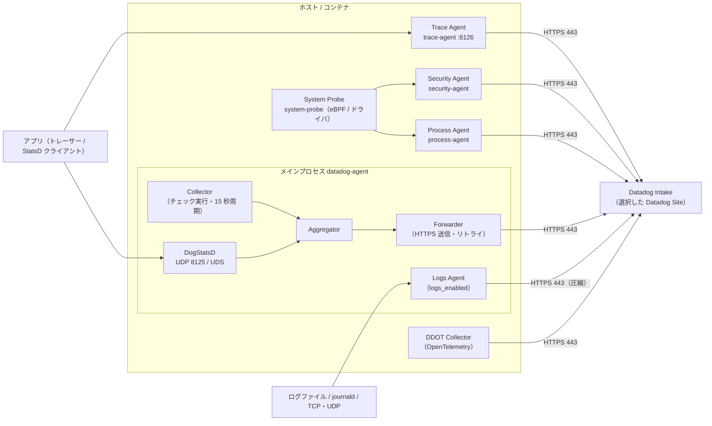
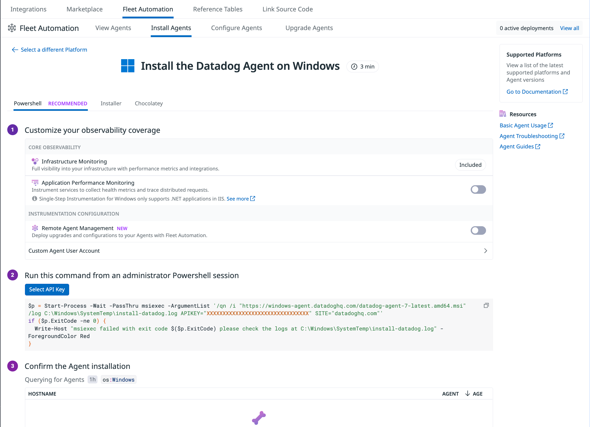
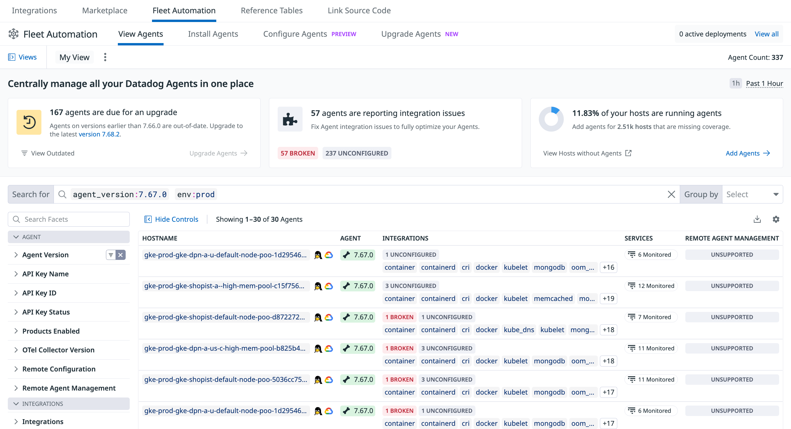
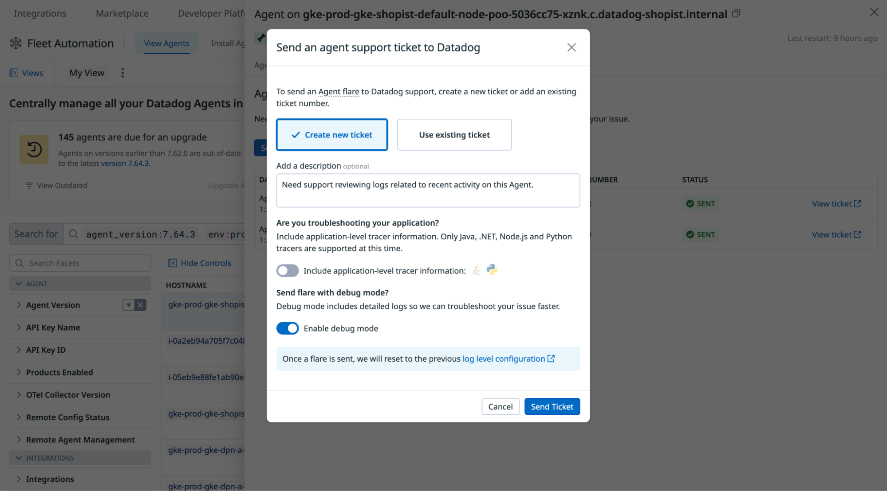

# Datadog Agent

## 概要

Datadog Agent（Datadog エージェント）は、ホスト（物理サーバー・VM）やコンテナ上で動作し、メトリクス・ログ・トレース・プロセス情報・ネットワーク情報・セキュリティイベントなどを収集して Datadog の Intake（取り込み口）へ送信するソフトウェアである。Datadog Agent のソースコードは GitHub（`github.com/DataDog/datadog-agent`）で公開されているオープンソースである。[出典](https://docs.datadoghq.com/agent/) [出典](https://github.com/DataDog/datadog-agent)

- 現行のメジャーバージョンは **Agent v7**。Agent v7 は v6 と同じ Go 実装のアーキテクチャを持ち、インテグレーションとカスタムチェックの実行環境として **Python 3 のみ**をサポートする。[出典](https://docs.datadoghq.com/agent/versions/)
- Agent v6 は v5 を Go で全面的に書き直したもので、v5 の 3 プロセス（Forwarder、Collector、DogStatsD）を 1 つの Agent プロセスに統合した。[出典](https://docs.datadoghq.com/agent/versions/)
- 2026-11-02 時点で GitHub Releases 上の最新 Agent 7 は **7.85.0**（リリースノート記載のリリース日 2026-10-30）。[出典](https://github.com/DataDog/datadog-agent/releases)
- 通信は常に Agent 側から Datadog へ開始する HTTPS（主にポート 443）で、Datadog 側から Agent へ接続することはない。[出典](https://docs.datadoghq.com/agent/configuration/network/)

本ファイルは Agent そのもの（構成要素、対応 OS、インストール、バージョン、コマンド、トラブルシューティング）を扱う。関連する詳細は以下を参照。

| 関連トピック | 参照先 |
|---|---|
| `datadog.yaml` の設定項目（プロキシ、ホスト名、タグ、シークレット管理など） | [Agent 設定リファレンス](./agent-configuration.md) |
| Docker / Kubernetes / ECS / Cluster Agent / Datadog Operator | [コンテナ/Kubernetes向けAgent](./kubernetes-and-containers-agent.md) |
| リモートでの Agent 管理・アップグレード・設定配布 | [Fleet Automation と Remote Configuration](./fleet-automation.md) |
| インテグレーション（チェック）の設定 | [Integrations（インテグレーション）](./integrations.md) |
| DogStatsD の詳細とカスタムメトリクス | [Custom Metrics と DogStatsD](./custom-metrics-and-dogstatsd.md) |
| OTLP 取り込み・DDOT Collector | [OpenTelemetry サポート](./opentelemetry.md) |
| ログ収集設定 | [ログ収集](../logs/log-collection.md) |
| 送信先エンドポイント・ファイアウォール設計 | [ネットワーク・接続要件](../../03_導入編/11-network-and-connectivity.md) |
| 大規模展開の設計 | [Agent 展開設計](../../03_導入編/10-agent-rollout-design.md) |
| 全体のデータフロー | [Datadogのアーキテクチャ概観](../../01_入門編/03-architecture-overview.md) |

---

## 1. アーキテクチャ

### 1.1 プロセス構成（Agent v6 / v7）

Datadog Agent v6 / v7 は「メインプロセス（`datadog-agent`、コア Agent）」と、`datadog.yaml` 等の設定に応じて起動される「子プロセス（別バイナリ）」で構成される。[出典](https://docs.datadoghq.com/agent/architecture/)



> 図は公式ドキュメント（Architecture、Network Traffic、各機能ページ）の記述を本ナレッジで再構成したもの。Aggregator を独立のボックスとして描いているのは説明のためであり、公式アーキテクチャページは Collector / Forwarder / DogStatsD の 3 要素で説明している。

### 1.2 コンポーネント一覧

| コンポーネント | 実体 | 役割 | 既定状態 | 主な設定 | 出典 |
|---|---|---|---|---|---|
| Collector（コレクター） | メインプロセス内 | チェック（インテグレーション、カスタムチェック）を実行しメトリクスを収集。標準メトリクスは **15 秒ごと**に収集 | 有効 | `conf.d/<CHECK>.d/*.yaml` | [出典](https://docs.datadoghq.com/agent/architecture/) |
| Forwarder（フォワーダー） | メインプロセス内 | メトリクス等を HTTPS で Datadog へ送信。送信できない間はメモリにバッファし、上限超過で古いものから破棄。Agent 7.27.0 以降はディスク退避も可能 | 有効 | `forwarder_retry_queue_payloads_max_size`、`forwarder_storage_max_size_in_bytes` | [出典](https://docs.datadoghq.com/agent/architecture/) [出典](https://docs.datadoghq.com/agent/configuration/network/) |
| DogStatsD | メインプロセス内 | Etsy StatsD の Go 実装。UDP または UNIX ドメインソケット（UDS）でカスタムメトリクス・イベント・サービスチェックを受信し集約 | 有効（UDP 8125、既定は `127.0.0.1` にバインド） | `dogstatsd_port`、`dogstatsd_non_local_traffic` | [出典](https://docs.datadoghq.com/agent/architecture/) [出典](https://docs.datadoghq.com/agent/configuration/network/) |
| Logs Agent | メインプロセス内 | ファイル tail、TCP/UDP、journald、コンテナ標準出力などからログを収集し送信。Agent 6.19 / 7.19 以降は既定で圧縮 HTTPS | **無効**（`logs_enabled: true` で有効） | `logs_enabled`、`logs_config.*` | [出典](https://docs.datadoghq.com/agent/logs/log_transport/) |
| APM Agent（Trace Agent、`trace-agent`） | 子プロセス | トレーシングライブラリからトレース・プロファイルを受信（既定 TCP 8126）し、サンプリング・統計計算・送信 | 有効（ホスト版。コンテナ版は `DD_APM_ENABLED` 既定 `true`） | `apm_config.enabled`、`apm_config.receiver_port`、`apm_config.apm_non_local_traffic` | [出典](https://docs.datadoghq.com/agent/architecture/) [出典](https://docs.datadoghq.com/containers/docker/apm/) |
| Process Agent（`process-agent`） | 子プロセス | Live Processes / Live Containers の情報収集。Linux では Agent 7.65.0 以降、プロセス・コンテナ収集は既定でコア Agent 内で実行され、Process Agent は CNM 用途などで引き続き使用 | 既定では利用可能なコンテナ情報のみ収集。プロセス収集は無効 | `process_config.process_collection.enabled` | [出典](https://docs.datadoghq.com/agent/architecture/) [出典](https://docs.datadoghq.com/infrastructure/process/) |
| System Probe（`system-probe`） | 子プロセス（特権で動作） | Linux では eBPF、Windows ではカーネルドライバでカーネルレベルのデータを収集。CNM、USM、Workload Protection、プロセス I/O 統計、Service Discovery、Privileged Logs 等の基盤 | **無効**（`system-probe.yaml` で機能ごとに有効化） | `system-probe.yaml`（`network_config.enabled` 等） | [出典](https://docs.datadoghq.com/network_monitoring/cloud_network_monitoring/setup/) [出典](https://docs.datadoghq.com/infrastructure/process/) [出典](https://github.com/DataDog/agent-linux-install-script) |
| Security Agent（`security-agent`） | 子プロセス | Workload Protection（旧称：Cloud Workload Security / CWS）の脅威検知と、Cloud Security（旧称：CSM）の Misconfigurations（CIS ベンチマーク等のコンプライアンスチェック） | **無効** | `security-agent.yaml`（`runtime_security_config.enabled`、`compliance_config.enabled`） | [出典](https://docs.datadoghq.com/security/workload_protection/setup/agent/linux/) |
| DDOT Collector | Agent に組み込み | Datadog Distribution of OpenTelemetry。OpenTelemetry Collector のコンポーネント群（OTLP / Prometheus / filelog / hostmetrics レシーバ等）を Agent に同梱 | 無効（インストール時 `DD_OTELCOLLECTOR_ENABLED` 等で有効化） | `otelcollector.enabled` 等（詳細は OpenTelemetry ファイル） | [出典](https://docs.datadoghq.com/opentelemetry/setup/ddot_collector/) [出典](https://github.com/DataDog/agent-linux-install-script) |
| JMXFetch | Java 子プロセス | JMX ベースのチェック（Kafka、Tomcat、JVM 等）を実行 | JMX チェック設定時のみ | `conf.d/<jmx_check>.d/` | [出典](https://docs.datadoghq.com/agent/configuration/agent-log-files/) [出典](https://docs.datadoghq.com/agent/faq/agent_v6_changes/) |

補足:

- Agent v6 は Python 2.7 インタプリタを内蔵してインテグレーション・カスタムチェックを実行していた。Agent v7 は Python 3 のみ。埋め込み Python は Linux では `/opt/datadog-agent/embedded/`（`python` と `pip` は `/opt/datadog-agent/embedded/bin/`）にある。[出典](https://docs.datadoghq.com/agent/architecture/) [出典](https://docs.datadoghq.com/agent/basic_agent_usage/linux/)
- インストールスクリプトの `DD_NO_SECURITY_AGENT_INSTALL` を指定すると、CWS / CSPM を Security Agent ではなく System Probe 内で実行できる。[出典](https://github.com/DataDog/agent-linux-install-script)
- OTLP 取り込み（Agent の OTLP レシーバ）は既定で無効。有効化するとトレースとメトリクスの取り込みが有効になり、ログ取り込みは別途 `otlp_config.logs.enabled` で有効化する。ポートは gRPC `4317`、HTTP `4318`。最低バージョンはトレース・メトリクスが 6.32.0 / 7.32.0、ログが 6.48.0 / 7.48.0。詳細は [OpenTelemetry サポート](./opentelemetry.md)。[出典](https://docs.datadoghq.com/opentelemetry/setup/otlp_ingest_in_the_agent/)

### 1.3 System Probe と Security Agent が必要な機能

System Probe / Security Agent は、カーネルレベルの情報を扱う機能を有効化した場合にのみ必要になる。主な機能と要件は次のとおり（各機能の詳細は該当ファイルを参照）。

| 機能 | 必要コンポーネント | 主な要件 | 詳細 |
|---|---|---|---|
| Cloud Network Monitoring（旧称：Network Performance Monitoring / NPM） | System Probe（+ Process Agent） | Agent v6.14 以上。Linux カーネル 4.4.0 以上（または eBPF バックポート、CentOS/RHEL 7.6 以上は例外として可）。Windows は Agent 7.27.1 以上・Windows 2012 R2 以降。macOS 非対応 | [Cloud Network Monitoring](../infrastructure/cloud-network-monitoring.md) |
| Universal Service Monitoring | System Probe | インストール時 `DD_SYSTEM_PROBE_SERVICE_MONITORING_ENABLED` で設定ファイル生成可 | [Universal Service Monitoring](../apm/universal-service-monitoring.md) |
| Workload Protection（旧称：CWS） | Security Agent + System Probe | Linux ホストでは Agent 7.46 以上。`security-agent.yaml` と `system-probe.yaml` の両方で `runtime_security_config.enabled: true`。既定は無効 | [Workload Protection](../security/workload-protection.md) |
| Cloud Security Misconfigurations（ホストベンチマーク） | Security Agent | `compliance_config.enabled: true`、`compliance_config.host_benchmarks.enabled: true` | [Cloud Security](../security/cloud-security.md) |
| プロセスの I/O・オープンファイル統計 | System Probe | `system_probe_config.process_config.enabled: true` | [Infrastructure Monitoring](../infrastructure/infrastructure-monitoring.md) |

[出典](https://docs.datadoghq.com/network_monitoring/cloud_network_monitoring/setup/) [出典](https://docs.datadoghq.com/security/workload_protection/setup/agent/linux/) [出典](https://docs.datadoghq.com/infrastructure/process/) [出典](https://github.com/DataDog/agent-linux-install-script)

- Agent 6.18 / 7.18 より古いバージョンでは `datadog-agent-sysprobe` サービスを手動で起動する必要があった。現行バージョンでは System Probe は自動起動される。[出典](https://docs.datadoghq.com/network_monitoring/cloud_network_monitoring/setup/)
- Agent 7.24.1 より古いバージョンでは `system-probe.yaml` のキーが `network_config` ではなく `system_probe_config` 配下だった。[出典](https://docs.datadoghq.com/network_monitoring/cloud_network_monitoring/setup/)
- `security-agent.yaml` / `system-probe.yaml` を `.example` からコピーする際は、パーミッション `640`、グループ `dd-agent` に設定する。[出典](https://docs.datadoghq.com/security/workload_protection/setup/agent/linux/)

### 1.4 Agent のフレーバー（パッケージ種別）

Linux インストールスクリプトの `DD_AGENT_FLAVOR` で指定できるパッケージ（フレーバー）は次のとおり。[出典](https://github.com/DataDog/agent-linux-install-script)

| フレーバー | 内容 | 主な用途 |
|---|---|---|
| `datadog-agent` | 標準 Agent（既定） | 一般のホスト |
| `datadog-iot-agent` | IoT Agent（Python・同梱インテグレーションなしの軽量版） | IoT・組み込み機器（本ファイル §8） |
| `datadog-dogstatsd` | スタンドアロン DogStatsD | DogStatsD のみ必要な環境 |
| `datadog-fips-agent` | FIPS Agent（Agent 7.65.0 以降） | US1-FED / US2-FED の FIPS 要件環境 |
| `datadog-fips-proxy` | FIPS プロキシ（`DD_FIPS_MODE` で Agent 通信をローカル FIPS プロキシ経由にする。Agent 自体を FIPS 準拠にはしない） | 旧来の FIPS 対応方式 |
| `datadog-heroku-agent` | Heroku 用 | Heroku buildpack |

このほか、AIX 向けには標準 Agent とは別実装の **Datadog UNIX Agent**（リポジトリ `DataDog/datadog-unix-agent`）が提供される。UNIX Agent は特定のシステムアーキテクチャ向けに開発されたもので、Windows / Linux / macOS の Agent と同一ではない。[出典](https://docs.datadoghq.com/agent/supported_platforms/) [出典](https://docs.datadoghq.com/agent/configuration/agent-configuration-files/)

### 1.5 FIPS Agent

| 項目 | 内容 |
|---|---|
| 概要 | FIPS 対応の Agent フレーバー。準拠の根拠は FIPS 140-2 検証済み暗号モジュール（Cryptographic Module - Certificate #4282） |
| 最低バージョン | Agent 7.65.0 |
| 対応サイト | **US1-FED / US2-FED のみ**。US1、US3、US5、EU1、AP1、AP2、UK1 では非対応 |
| 対応プラットフォーム | RHEL 7+、Debian 8+、Ubuntu 14.04+、SUSE 12+、Windows Server 2016+、Windows 10+、Amazon ECS、AWS EKS（Helm）、Docker |
| 対応製品 | Metrics、Logs、APM traces、APM profiles、Processes、Orchestrator Explorer、Runtime Security、Serverless Monitoring、DDOT Collector |
| 制限 | Cluster Agent と Node Agent 間の通信は非対応。外向き通信は GovCloud のみ。urllib3 ≤ 1.26.20 の一部 Linux ディストリビューションで FIPS 暗号化に失敗する可能性。CIS / DISA STIG 評価は未実施。Agent を再ビルド・改変した場合は準拠を保証しない |

[出典](https://docs.datadoghq.com/agent/configuration/fips-compliance/)

> **サイト差異:** FIPS Agent は US1-FED（`app.ddog-gov.com`）/ US2-FED（`us2.ddog-gov.com`）専用。AP1（日本）を含む商用サイトでは利用できない。

---

## 2. 対応 OS（Supported Platforms）

対応 OS 表で、`yes` は全マイナー・パッチバージョン対応、`<= x.y.z` はそのバージョンが当該 OS で最後にサポートされる Agent、`>= x.y.z` は最低バージョンを意味する。[出典](https://docs.datadoghq.com/agent/supported_platforms/)

> 注: 公式ページの表は一部の行で列の対応が崩れて表示されている（特に Agent 5 列、Debian SysVinit 行、RHEL 7 行）。下表は Agent 6 / 7 列を中心に、本ナレッジで整理したもの。疑義がある場合は公式ページを確認すること。

### 2.1 Linux（64-bit x86）

| OS | OS バージョン | Agent 6 | Agent 7 |
|---|---|---|---|
| Amazon Linux | 2 | 対応 | 対応 |
| Amazon Linux | 2022 / 2023 | >= 6.40.0 | >= 7.40.0 |
| Debian（systemd） | 7.0（wheezy） | <= 6.35.2 | <= 7.35.2 |
| Debian（systemd） | >= 8.0（jessie） | 対応 | 対応 |
| Debian（SysVinit） | 7.0（wheezy） | 6.6.0 - 6.35.2 | <= 7.35.2 |
| Debian（SysVinit） | >= 8.0（jessie） | 対応 | 対応（公式表の列ずれのため不確定） |
| Ubuntu | >= 14.04 | 対応 | 対応 |
| RedHat / CentOS / Oracle Linux | 6.x | <= 6.51.1 | <= 7.51.1 |
| RedHat / CentOS / Oracle Linux | >= 7.0 | 対応 | 対応 |
| AlmaLinux / Rocky | >= 8.0 | >= 6.33.0 | >= 7.33.0 |
| SUSE Enterprise Linux（systemd） | 11 SP4 | <= 6.32.4 | <= 7.32.4 |
| SUSE Enterprise Linux（systemd） | >= 12.0 | 対応 | 対応 |
| SUSE Enterprise Linux（SysVinit） | 11 SP4 | 6.16.0 - 6.33.0 | 7.16.0 - 7.33.0 |
| OpenSUSE（systemd） | >= 15.0 | 対応 | 対応 |
| Fedora | >= 26 | 対応 | 対応 |

- Ubuntu 12.04、RedHat / CentOS 5.0 は Agent 5 のみ対応。[出典](https://docs.datadoghq.com/agent/supported_platforms/)
- CentOS / RHEL 6 では 7.51.1（2024-02）以降の新バージョンは提供されず、OS を更新できない場合は 6.51.1 / 7.51.1 以前に固定することが案内されていた。`【第三者情報】`（Datadog 通知の第三者ミラー）[出典](https://support.skax.co.kr/en/support/solutions/articles/42000106561--datadog-datadog-support-discontinued-due-to-centos-rhel-6-service-discontinuation)（公開日は公開情報では確認できず）

### 2.2 Linux（64-bit ARM v8 / aarch64）

| OS | OS バージョン | Agent 6 | Agent 7 |
|---|---|---|---|
| Amazon Linux | 2 | >= 6.16.0 | >= 7.16.0 |
| Amazon Linux | 2022 / 2023 | >= 6.40.0 | >= 7.40.0 |
| Debian（systemd） | >= 9.0（stretch） | >= 6.16.0 | >= 7.16.0 |
| Ubuntu | >= 16.04 | >= 6.16.0 | >= 7.16.0 |
| RedHat / CentOS / Oracle Linux | >= 8.0 | >= 6.16.0 | >= 7.16.0 |
| AlmaLinux / Rocky | >= 8.0 | >= 6.33.0 | >= 7.33.0 |
| Fedora | >= 27 | >= 6.16.0 | >= 7.16.0 |

[出典](https://docs.datadoghq.com/agent/supported_platforms/)

### 2.3 Windows

| OS | バージョン | Agent 6 | Agent 7 | 備考 |
|---|---|---|---|---|
| Windows Server | 2008 R2 | <= 6.45.1 | <= 7.45.1 | Go のクロックドリフトの既知の問題あり |
| Windows Server | 2012 / 2012 R2 | <= 6.46.0 | <= 7.46.0 | |
| Windows Server | 2016 / 2019 / 2022 / 2025 | 対応 | 対応 | |
| Windows | 8.1 | <= 6.46.0 | <= 7.46.0 | |
| Windows | 10 / 11 | 対応 | 対応 | |

- Windows 7 は Agent 5 のみの対応と読めるが、公式表の列ずれにより断定できない。
- 32-bit Windows では Datadog Agent Manager GUI はサポートされない。[出典](https://docs.datadoghq.com/agent/)
- 特定バージョンの Windows インストーラー一覧は `https://ddagent-windows-stable.s3.amazonaws.com/installers_v2.json`（JSON）で公開されている。[出典](https://docs.datadoghq.com/agent/versions/upgrade_to_agent_v7/)

[出典](https://docs.datadoghq.com/agent/supported_platforms/)

### 2.4 macOS

| macOS バージョン | Agent 5 | Agent 6 | Agent 7（x86_64） | Agent 7（Apple ARM64 ネイティブ） |
|---|---|---|---|---|
| 10.10 - 10.11 | <= 5.11.3 | - | - | - |
| 10.12 | - | <= 6.34.0 | <= 7.34.0 | - |
| 10.13 | - | <= 6.38.2 | <= 7.38.2 | - |
| 10.14 | - | - | 7.39.0 - 7.61.0 | - |
| 11 | - | - | 7.39.0 - 7.74.1 | 7.70.0 - 7.74.1 |
| >= 12.0 | - | - | >= 7.39.0 | >= 7.70.0 |

- Apple ARM64 では、ネイティブ版より前の x86_64 版を Rosetta 2 エミュレーションで利用できる。[出典](https://docs.datadoghq.com/agent/supported_platforms/)

### 2.5 AIX（UNIX Agent）

AIX 6.1 TL9 SP6、7.1 TL5 SP3、7.2 TL3 SP0、7.3 TL3 SP0 をサポートする。AIX のサービス管理は SRC（`startsrc` / `stopsrc` / `lssrc`）。[出典](https://docs.datadoghq.com/agent/supported_platforms/) [出典](https://docs.datadoghq.com/agent/configuration/agent-commands/)

### 2.6 コンテナ・クラウド

| Agent | Docker | Kubernetes | Azure Stack HCI OS |
|---|---|---|---|
| 5 | >= 1.14 | 1.3 - 1.8 | - |
| 6 | >= 1.14 | >= 1.3 | 全バージョン |
| 7 | >= 1.14 | >= 1.3 | 全バージョン |

- Agent 6 / 7 のコンテナイメージは ARM v8 と x86 の両方に対応。[出典](https://docs.datadoghq.com/agent/supported_platforms/)
- そのほか公式にインストール手順が用意されている環境: Google Cloud Run（サイドカー）、Amazon ECS、AWS Fargate、Heroku、AWS Lambda（Extension）、Cloud Foundry。コンテナ系は [コンテナ/Kubernetes向けAgent](./kubernetes-and-containers-agent.md)、サーバーレスは [Serverless Monitoring](../infrastructure/serverless.md) を参照。[出典](https://docs.datadoghq.com/agent/)
- スタンドアロン DogStatsD パッケージは Amazon Linux、CentOS、Debian、Fedora、Red Hat、SUSE、Ubuntu 向けに提供される。[出典](https://docs.datadoghq.com/agent/)

---

## 3. インストール方法

### 3.1 インストール経路の一覧

| 方法 | 概要 | 対象 |
|---|---|---|
| Fleet Automation のアプリ内ガイド（推奨） | `Integrations > Fleet Automation > Install Agents` でプラットフォームを選び、生成されたコマンドを実行。大規模なインストール・アップグレード・設定・トラブルシューティングに推奨 | Linux / Windows / macOS / コンテナ等 |
| インストールスクリプト | `install_script_agent7.sh`（Linux）、`install_mac_os.sh`（macOS） | Linux / macOS |
| MSI インストーラー | `datadog-agent-7-latest.amd64.msi` を GUI または `msiexec` で実行。アプリ内ガイドでは PowerShell（推奨）、Installer、Chocolatey の 3 タブがある | Windows |
| パッケージリポジトリ手動 | APT（`apt.datadoghq.com`）/ YUM（`yum.datadoghq.com`）リポジトリを手動登録 | Linux |
| 構成管理ツール | Ansible、Chef、Puppet、SaltStack、SCCM | 各種 |
| コンテナ | Datadog Operator、Helm、DaemonSet、`docker run` 等 | Docker / Kubernetes / ECS |

[出典](https://docs.datadoghq.com/agent/) [出典](https://docs.datadoghq.com/agent/basic_agent_usage/linux/) [出典](https://docs.datadoghq.com/agent/basic_agent_usage/windows/) [出典](https://docs.datadoghq.com/agent/iot/)



*キャプション: Fleet Automation の「Install Agents」画面で Windows を選択したときのアプリ内インストールガイド。*
画面説明: 上部ナビゲーションは `Integrations` / `Marketplace` / `Fleet Automation` / `Reference Tables` / `Link Source Code`。Fleet Automation のサブタブは `View Agents`、`Install Agents`（選択中）、`Configure Agents`、`Upgrade Agents`。見出し「Install the Datadog Agent on Windows」の下に `Powershell`（RECOMMENDED）/ `Installer` / `Chocolatey` のタブがある。手順 1「Customize your observability coverage」で Infrastructure Monitoring（Included）、Application Performance Monitoring（トグル。Windows の Single-Step Instrumentation は IIS 上の .NET のみ対応と注記）、Remote Agent Management（NEW、トグル）、Custom Agent User Account を選ぶ。手順 2 で「Select API Key」を押して API キーを選ぶと、管理者 PowerShell 用の `Start-Process -Wait -PassThru msiexec -ArgumentList '/qn /i "https://windows-agent.datadoghq.com/datadog-agent-7-latest.amd64.msi" /log C:\Windows\SystemTemp\install-datadog.log APIKEY="..." SITE="datadoghq.com"'` 形式のコマンドが生成される。手順 3「Confirm the Agent installation」で `os:Windows` の Agent が表示されるのを待つ。右側に Supported Platforms へのリンクと Resources（Basic Agent Usage、Agent Troubleshooting、Agent Guides）がある。
出典: https://docs.datadoghq.com/agent/basic_agent_usage/windows/ （画像取得日 2026-11-02）

### 3.2 Linux

Linux の標準的なインストールは、アプリ内ガイドが生成するスクリプト実行コマンドである。

```shell
DD_API_KEY="<DATADOG_API_KEY>" DD_SITE="ap1.datadoghq.com" \
  bash -c "$(curl -L https://install.datadoghq.com/scripts/install_script_agent7.sh)"
```

[出典](https://docs.datadoghq.com/agent/versions/upgrade_to_agent_v7/) [出典](https://github.com/DataDog/agent-linux-install-script)

> **サイト差異:** `DD_SITE` には組織のサイトを指定する（AP1 は `ap1.datadoghq.com`、US1 は `datadoghq.com`、EU1 は `datadoghq.eu` など）。`site` の既定値は `datadoghq.com`（US1）なので、AP1 の組織で指定を忘れると US1 に送信されデータが表示されない。サイト一覧は [Datadog Sites（サイト）](./datadog-sites.md)。[出典](https://docs.datadoghq.com/agent/)

#### インストールスクリプトの主な環境変数（Agent 設定系）

インストールスクリプトはこれらの変数を**初回インストール時にのみ**読み、既存の設定ファイルは上書きしない。[出典](https://github.com/DataDog/agent-linux-install-script)

| 変数 | 説明 | 既定値 |
|---|---|---|
| `DD_API_KEY` | API キー。`DD_UPGRADE` 指定時以外は必須 | なし（必須） |
| `DD_SITE` | 送信先 Datadog サイト | 指定なし（Agent の既定は `datadoghq.com`） |
| `DD_URL` | メトリクスのカスタム Intake ホスト。`DD_SITE` より優先。APM・Logs・Live Process には影響しない | 指定なし |
| `DD_AGENT_FLAVOR` | インストールするフレーバー（§1.4） | `datadog-agent` |
| `DD_UPGRADE` | Agent 5 からアップグレードし `/etc/dd-agent/datadog.conf` をインポート。`datadog-dogstatsd` とは併用不可 | 未設定 |
| `DD_HOSTNAME` | ホスト名を固定 | 指定なし |
| `DD_TAGS` | ホストタグ（カンマ区切り `key:value`。例 `team:infra,env:prod`） | なし |
| `DD_HOST_TAGS` | 非推奨（`DD_TAGS` を使用） | なし |
| `DD_ENV` | 全データに付与する環境名 | 指定なし |
| `DD_INSTALL_ONLY` | インストールのみ行い Agent を起動しない | 未設定（起動する） |
| `DD_NO_AGENT_INSTALL` | Agent をインストールせず署名鍵と設定ファイルのみ作成 | 未設定 |
| `DD_INFRASTRUCTURE_MODE` | 監視モード（利用可能な機能を決定）。取りうる値は公開情報では確認できず | 指定なし |
| `DD_FIPS_MODE` | 全通信をローカル FIPS プロキシ経由にする（`DD_SITE`・`DD_URL` を無視）。Agent 自体は FIPS 準拠にならない | 未設定 |
| `DD_APM_INSTRUMENTATION_ENABLED` | インストール時に Single Step Instrumentation を有効化（`host` / `docker` / `all`）。Agent v7 のみ。SUSE 非対応 | 未設定 |
| `DD_APM_INSTRUMENTATION_LIBRARIES` | 導入する APM ライブラリ（`all`、`java`、`js`、`python`、`dotnet`、`ruby`） | 有効化時は全ライブラリ |
| `DD_APM_INSTRUMENTATION_STRICT` | SSI を導入できない場合スクリプトを失敗させる（`host` / `docker` / `all`）。`DD_APM_INSTRUMENTATION_ENABLED` より優先 | 未設定 |
| `DD_SYSTEM_PROBE_ENSURE_CONFIG` | System Probe 設定ファイルが無ければテンプレートから作成 | 未設定 |
| `DD_RUNTIME_SECURITY_CONFIG_ENABLED` | Security Agent / System Probe の設定を作成し CWS を有効化 | 未設定 |
| `DD_COMPLIANCE_CONFIG_ENABLED` | Security Agent の設定を作成し CSPM を有効化 | 未設定 |
| `DD_NO_SECURITY_AGENT_INSTALL` | CWS / CSPM を Security Agent ではなく System Probe で実行 | 未設定 |
| `DD_DISCOVERY_ENABLED` | Service Discovery を有効化 | 未設定 |
| `DD_PRIVILEGED_LOGS_ENABLED` | Privileged Logs を有効化 | 未設定 |
| `DD_SYSTEM_PROBE_SERVICE_MONITORING_ENABLED` | Universal Service Monitoring を有効化 | 未設定 |
| `DD_SYSTEM_PROBE_NETWORK_ENABLED` | Cloud Network Monitoring を有効化 | 未設定 |
| `DD_OTELCOLLECTOR_ENABLED` | DDOT Collector をインストール・有効化 | 未設定 |
| `DD_LOGS_CONFIG_PROCESS_COLLECT_ALL` | プロセスログ収集を有効化 | 未設定 |

#### インストールスクリプト自体の変数

| 変数 | 説明 | 既定値 |
|---|---|---|
| `DD_AGENT_MAJOR_VERSION` | メジャーバージョン（`6` または `7`） | `install_script.sh` は `6`、`install_script_agent7.sh` は `7` |
| `DD_AGENT_MINOR_VERSION` | マイナーバージョン（完全指定または部分指定。部分指定は最新パッチに解決。不正値でスクリプト停止） | 指定なし（最新） |
| `DD_AGENT_DIST_CHANNEL` | パッケージチャネル（`stable` / `beta`） | 指定なし |
| `DD_DDOT_DIST_CHANNEL` | DDOT のチャネル | 指定なし |
| `DD_REPO_URL` | パッケージバケットのドメイン（旧 `REPO_URL` は非推奨） | `datadoghq.com` |
| `DD_RPM_REPO_GPGCHECK` | RPM の `repo_gpgcheck`（`0` / `1`） | `DD_REPO_URL` 指定時は無効 |
| `DD_INSTRUMENTATION_TELEMETRY_ENABLED` | スクリプト失敗時のテレメトリ送信 | `true` |

[出典](https://github.com/DataDog/agent-linux-install-script)

#### Linux のファイル配置・サービス

| 項目 | パス・コマンド |
|---|---|
| メイン設定 | `/etc/datadog-agent/datadog.yaml`（全項目の例は `datadog.yaml.example`） |
| チェック設定 | `/etc/datadog-agent/conf.d/<INTEGRATION>.d/conf.yaml` |
| System Probe / Security Agent 設定 | `/etc/datadog-agent/system-probe.yaml`、`/etc/datadog-agent/security-agent.yaml` |
| バイナリ・埋め込み Python | `/opt/datadog-agent/`、`/opt/datadog-agent/embedded/bin/` |
| ログ | `/var/log/datadog/` |
| 実行ユーザー | `dd-agent`（System Probe は特権で実行） |
| 起動 / 停止 / 再起動 / 状態（systemd） | `sudo systemctl start datadog-agent`（`stop` / `restart` / `status` も同形式） |
| Upstart 系（CentOS/RHEL 6、SUSE 11 等） | `sudo start datadog-agent` 等（`systemctl` を付けない） |
| サービスログ（systemd） | `sudo journalctl -u datadog-agent.service`（`-r` で逆順） |

[出典](https://docs.datadoghq.com/agent/basic_agent_usage/linux/) [出典](https://docs.datadoghq.com/agent/configuration/agent-configuration-files/) [出典](https://docs.datadoghq.com/agent/troubleshooting/agent_check_status/)

#### Linux のアンインストール

| ディストリビューション | コマンド |
|---|---|
| CentOS / Rocky / AlmaLinux / Amazon Linux / Oracle Linux / Red Hat | `sudo yum remove datadog-agent` |
| Debian / Ubuntu | `sudo apt-get remove datadog-agent -y`（残存物も消す場合 `sudo apt-get remove --purge datadog-agent -y`） |
| SUSE | `sudo zypper remove datadog-agent` |

上記コマンドでは設定ファイル、ユーザー作成ファイル、`dd-agent` ユーザー、ログが残る。完全削除する場合は `sudo userdel dd-agent && sudo rm -rf /opt/datadog-agent/ /etc/datadog-agent/ /var/log/datadog/` を実行する。Single Step APM Instrumentation を導入している場合は別途削除手順がある。[出典](https://docs.datadoghq.com/agent/basic_agent_usage/linux/)

### 3.3 Windows

#### MSI のコマンドラインインストール

```powershell
Start-Process -Wait msiexec -ArgumentList '/qn /i datadog-agent-7-latest.amd64.msi APIKEY="<API_KEY>" SITE="ap1.datadoghq.com" /log C:\Windows\Temp\install-datadog.log'
```

- `/qn` はサイレントインストール。外すと GUI プロンプトが表示される。
- `REBOOT=ReallySuppress` を付けると強制再起動を抑止できる（一部バージョンで強制再起動が発生しうると記載）。
- 一部コンポーネント（CNM 等）はカーネルドライバを必要とする。
- 既存の有効な `datadog.yaml` がある場合、コマンドラインオプションより `datadog.yaml` が優先される。
- `/log` を省略した場合のインストールログは `%TEMP%\MSI*.LOG`。

[出典](https://docs.datadoghq.com/agent/basic_agent_usage/windows/)

#### msiexec プロパティ

| プロパティ | 用途 | 既定値・注記 |
|---|---|---|
| `APIKEY` | API キーを設定ファイルに書き込む | なし |
| `SITE` | 送信先サイト（例 `datadoghq.com`、`ap1.datadoghq.com`） | なし（Agent の既定は `datadoghq.com`） |
| `TAGS` | ホストタグ（カンマ区切り） | なし |
| `HOSTNAME` | 実行時に算出されるホスト名を上書き | なし |
| `DDAGENTUSER_NAME` | サービスアカウント名の上書き | `ddagentuser`（6.11.0 以降） |
| `DDAGENTUSER_PASSWORD` | `ddagentuser` のパスワード | 自動生成。ドメインサーバーでは必須（6.11.0 以降） |
| `APPLICATIONDATADIRECTORY` | 設定ディレクトリ | `C:\ProgramData\Datadog`。初回インストール時のみ有効（6.11.0 以降） |
| `PROJECTLOCATION` | バイナリディレクトリ | `%ProgramFiles%\Datadog\Datadog Agent`。初回のみ（6.11.0 以降）。カスタムパスには `Datadog` サブディレクトリを含める |
| `LOGS_ENABLED` | ログ収集を有効化 | `false` |
| `APM_ENABLED` | APM を有効化 | `true` |
| `PROCESS_ENABLED` | Process Agent を有効化 | `false` |
| `HOSTNAME_FQDN_ENABLED` | FQDN をホスト名に使用 | `false`（6.20.0 以降） |
| `CMD_PORT` | コマンド API のポート | `5001`（0〜65534） |
| `PROXY_HOST` / `PROXY_PORT` / `PROXY_USER` / `PROXY_PASSWORD` | プロキシ設定 | なし |
| `EC2_USE_WINDOWS_PREFIX_DETECTION` | EC2 上の Windows でインスタンス ID をホスト名に使う | Boolean（7.28.0 以降） |

[出典](https://docs.datadoghq.com/agent/basic_agent_usage/windows/)

#### Windows のサービス・ファイル配置

| 項目 | 値 |
|---|---|
| サービス名 | `DatadogAgent`（メイン）、`datadog-trace-agent`、`datadog-process-agent` |
| プロセス | `agent.exe`（タスクマネージャー表示名 *Datadog Metrics Agent*） |
| 実行アカウント | `ddagentuser` |
| サービスの開始種別 | Automatic-Delayed（再起動直後はメトリクスがやや遅れる） |
| メイン設定 | `C:\ProgramData\Datadog\datadog.yaml`（`ProgramData` は隠しフォルダ） |
| チェック設定 | `C:\ProgramData\Datadog\conf.d\<INTEGRATION>.d\conf.yaml` |
| System Probe 設定 | `C:\ProgramData\Datadog\system-probe.yaml` |
| ログ | `C:\ProgramData\Datadog\logs\`（例 `agent.log`） |
| バイナリ | `%ProgramFiles%\Datadog\Datadog Agent\bin\agent.exe` |
| コマンド実行例 | `& "$env:ProgramFiles\Datadog\Datadog Agent\bin\agent.exe" status`（管理者権限の PowerShell） |
| 再起動例 | `restart-service -f datadogagent` |

[出典](https://docs.datadoghq.com/agent/architecture/) [出典](https://docs.datadoghq.com/agent/basic_agent_usage/windows/) [出典](https://docs.datadoghq.com/agent/faq/agent_v6_changes/) [出典](https://docs.datadoghq.com/network_monitoring/cloud_network_monitoring/setup/)

- Agent 6.11 以前では `agent.exe` のパスが `embedded\agent.exe` だった。[出典](https://docs.datadoghq.com/agent/troubleshooting/agent_check_status/)
- アンインストールは「アプリと機能（Add or remove programs）」または PowerShell で製品コードを取得して `msiexec /x` を実行する。いずれも `C:\ProgramData\Datadog` は残る。[出典](https://docs.datadoghq.com/agent/basic_agent_usage/windows/)

### 3.4 macOS

| 項目 | 値 |
|---|---|
| インストール | アプリ内ガイドのスクリプト（例: `DD_AGENT_MAJOR_VERSION=7 DD_API_KEY="<KEY>" bash -c "$(curl -L https://install.datadoghq.com/scripts/install_mac_os.sh)"`） |
| サービス | `launchctl` の `system/com.datadoghq.agent` |
| 起動 / 停止 / 再起動 / 状態 | `sudo launchctl kickstart system/com.datadoghq.agent` / `sudo launchctl kill SIGTERM system/com.datadoghq.agent` / `sudo launchctl kickstart -k system/com.datadoghq.agent` / `sudo launchctl print system/com.datadoghq.agent` |
| Agent ユーザー | `_dd-agent` |
| メイン設定 | `/opt/datadog-agent/etc/datadog.yaml` |
| チェック設定 | `/opt/datadog-agent/etc/conf.d/<INTEGRATION>.d/conf.yaml` |
| ログ | `/opt/datadog-agent/logs`（Agent 6.28 / 7.28 以降。それより前は `/var/log/datadog`） |
| GUI | systray アプリと Web GUI（status 表示・flare 送信） |
| アンインストール | `curl -L https://install.datadoghq.com/scripts/uninstall_mac_os.sh \| bash` |

[出典](https://docs.datadoghq.com/agent/basic_agent_usage/osx/) [出典](https://docs.datadoghq.com/agent/versions/upgrade_to_agent_v7/) [出典](https://docs.datadoghq.com/agent/configuration/agent-configuration-files/) [出典](https://docs.datadoghq.com/agent/configuration/agent-log-files/)

### 3.5 Datadog Agent Manager GUI

| 項目 | 内容 |
|---|---|
| 起動 | `datadog-agent launch-gui` |
| ポート | `5002`（`GUI_port`）。Windows / macOS は既定で有効、Linux は既定で無効（`-1`） |
| アクセス | ローカルからのみ |
| 対応外 | 32-bit Windows |
| 主な機能 | status 表示、設定ファイル編集、flare 送信 |

[出典](https://docs.datadoghq.com/agent/) [出典](https://docs.datadoghq.com/agent/configuration/network/)

---

## 4. ポート・ファイル・ログ

### 4.1 ポート一覧

Agent が使用するポートは「外向き（Agent → Datadog）」と「内向き（ローカルのみ）」に分かれる。内向きのサービスは信頼できる送信元以外からファイアウォールで保護する。[出典](https://docs.datadoghq.com/agent/configuration/network/)

**外向き（Agent → Datadog）**

| ポート | プロトコル | 用途 |
|---|---|---|
| 443 | TCP | Agent データの大半（メトリクス、APM、ログ、コンテナ、ライブプロセス、CNM、USM 等） |
| 8443 | TCP | Custom Agent Autoscaling（記載は `app.datadoghq.com` と `app.datadoghq.eu` のみ） |
| 8042 | TCP | Remote Configuration の接続テスト（Remote Configuration 有効時のみ。記載は `app.datadoghq.com` と `app.datadoghq.eu` のみ） |
| 123 | UDP | NTP |
| サイト別 | TCP（非推奨） | TCP によるログ送信。サポート対象外でデータ損失の可能性あり |

**内向き（ローカル）**

| ポート | プロトコル | 用途 | 設定キー |
|---|---|---|---|
| 5000 | TCP | go_expvar サーバー（Agent ランタイムメトリクス） | `expvar_port` |
| 5001 | TCP | IPC API（CLI・GUI のコマンド） | `cmd_port` |
| 5002 | TCP | Agent GUI | `GUI_port`（Linux 既定 `-1`） |
| 5012 | TCP | APM の go_expvar サーバー | 公開情報では確認できず |
| 6062 | TCP | Process Agent デバッグ | 公開情報では確認できず |
| 6162 | TCP | Process Agent ランタイム | 公開情報では確認できず |
| 8125 | UDP | DogStatsD（`dogstatsd_non_local_traffic: true` でない限り `127.0.0.1` にバインド） | `dogstatsd_port` |
| 8126 | TCP | APM レシーバ（トレース・プロファイラ）。`0` で HTTP レシーバ無効 | `apm_config.receiver_port` |
| 4317 / 4318 | TCP | OTLP（gRPC / HTTP）。OTLP 取り込み有効時のみ | `otlp_config.receiver.protocols.*.endpoint` |

[出典](https://docs.datadoghq.com/agent/configuration/network/) [出典](https://docs.datadoghq.com/agent/architecture/) [出典](https://docs.datadoghq.com/opentelemetry/setup/otlp_ingest_in_the_agent/)

- Linux では既定で 3 ポート（5000、5001、8125）、Windows / macOS では GUI を含め 4 ポートをバインドする。[出典](https://docs.datadoghq.com/agent/architecture/)
- トレースは UDS でも受信できる（`DD_APM_RECEIVER_SOCKET` 指定時はホスト名・ポート設定より優先。`/var/run/datadog/apm.socket` は例として記載）。[出典](https://docs.datadoghq.com/containers/docker/apm/)

### 4.2 送信先エンドポイント（AP1 の例）

| データ | AP1 のホスト名 |
|---|---|
| メトリクス・イベント・サービスチェック | `<VERSION>-app.agent.ap1.datadoghq.com`（例 `7-31-0-app.agent.ap1.datadoghq.com`）。Agent 7.18.0 / 6.18.0 以降は重要度の低い API クエリを `api.ap1.datadoghq.com` に送る |
| APM | `trace.agent.ap1.datadoghq.com`、`instrumentation-telemetry-intake.ap1.datadoghq.com` |
| ライブプロセス・コンテナ・CNM・USM | `process.ap1.datadoghq.com` |
| Remote Configuration | `config.ap1.datadoghq.com` |
| Agent flare | `<VERSION>-flare.agent.ap1.datadoghq.com` |
| プロファイリング | `intake.profile.ap1.datadoghq.com` |
| IP レンジ | `ip-ranges.ap1.datadoghq.com` |
| パッケージ配布（サイト共通） | `install.datadoghq.com`、`yum.datadoghq.com`、`apt.datadoghq.com`、`keys.datadoghq.com`、`windows-agent.datadoghq.com` |

- ログの送信先は別ページ（ログのエンドポイント一覧）に記載されている。
- Agent 7.67.0 以降、サイトのホスト名は末尾にドットを付けた FQDN 形式で解決される（DNS クエリ削減のため）。7.72.0 以降は `convert_dd_site_fqdn.enabled: false` で無効化できる。
- 全エンドポイント（DBM、NDM、Network Path、SBOM、Synthetics Private Location 等）とファイアウォール設計は [ネットワーク・接続要件](../../03_導入編/11-network-and-connectivity.md) を参照。

[出典](https://docs.datadoghq.com/agent/configuration/network/)

### 4.3 設定ファイルの場所

| プラットフォーム | メイン設定（`datadog.yaml`） | `conf.d` |
|---|---|---|
| Linux / AIX | `/etc/datadog-agent/datadog.yaml` | `/etc/datadog-agent/conf.d/` |
| macOS | `/opt/datadog-agent/etc/datadog.yaml` | `/opt/datadog-agent/etc/conf.d/` |
| Windows | `%ProgramData%\Datadog\datadog.yaml` | `%ProgramData%\Datadog\conf.d` |

`conf.d` のルール:

- チェックごとに `<CHECK_NAME>.d/` フォルダを置き、その中の複数 YAML がすべて読み込まれる（例 `http_check.d/backend.yaml` と `frontend.yaml`）。サブディレクトリは読み込まれない。
- `conf.yaml.example` を `conf.yaml` にリネームして有効化する。
- `.default` サフィックスのファイルは既定で読み込まれるが、同じチェックに他の設定があれば無視される。
- Autodiscovery テンプレートは `auto_conf.yaml`（例 `redisdb.d/auto_conf.yaml`）。
- サイズ 0 のファイルは無視される。
- ログ収集で複数の YAML が同じログソースを指す場合は、アルファベット順で最初のファイルが使われる。

[出典](https://docs.datadoghq.com/agent/configuration/agent-configuration-files/) [出典](https://docs.datadoghq.com/agent/faq/agent_v6_changes/)

`datadog.yaml` の個別項目は [Agent 設定リファレンス](./agent-configuration.md) を参照。

### 4.4 Agent のログファイル

| プラットフォーム | ディレクトリ |
|---|---|
| Linux | `/var/log/datadog/` |
| macOS（Agent 6.28 / 7.28 以降） | `/opt/datadog-agent/logs` |
| macOS（それより前） | `/var/log/datadog` |
| Windows | `C:\ProgramData\Datadog\logs` |

| ファイル | 内容 | 備考 |
|---|---|---|
| `agent.log` | コア Agent | v5 は `collector.log`、`forwarder.log`、`dogstatsd.log` 等に分かれていたが v6 以降は `agent.log` に集約 |
| `process-agent.log` | Process Agent | |
| `trace-agent.log` | Trace Agent | |
| `system-probe.log` | System Probe | |
| `jmxfetch.log` | JMXFetch | Agent 7.24.0 / 6.24.0 以降 |
| `dogstatsd.log` | DogStatsD | Agent 7.46.0 以降 |

| インストールログ | 場所 |
|---|---|
| Linux | `$(pwd)/ddagent-install.log` |
| macOS | `/tmp/dd_agent.log` |
| Windows | `%TEMP%\MSI*.LOG`（`/log` 指定時はそのパス） |

ログローテーションは `log_file_max_size`（既定 10 MB = 10485760 バイト）と `log_file_max_rolls`（既定 1、`agent.log.1`）で制御し、ロールオーバー時は既存のバックアップが上書きされる。[出典](https://docs.datadoghq.com/agent/configuration/agent-log-files/) [出典](https://docs.datadoghq.com/agent/faq/agent_v6_changes/)

---

## 5. バージョン体系とライフサイクル

### 5.1 バージョン体系

| 項目 | 内容 |
|---|---|
| 番号体系 | SemVer（`<MAJOR>.<MINOR>.<PATCH>`、例 7.85.0） |
| 現行メジャー | 7（Python 3 のみ） |
| 最新版（2026-11-02 時点） | 7.85.0（GitHub Releases のリリースノート記載日 2026-10-30） |
| マイナーリリース間隔 | 公式な周期の明記は確認できず。直近は 7.84.0（2026-09-30）、7.85.0（2026-10-29〜30）と概ね月 1 回 `【推定】` |
| パッチリリース | 7.84 系では 7.84.1〜7.84.6 が 2026-10 中に順次公開 |
| 推奨更新頻度 | マイナー・パッチごと、少なくとも月 1 回。メジャーリリースを待つことは非推奨 |
| サポートされる唯一の方法 | 最新メジャーへアップグレードし最新を維持すること（最新機能・修正を得る唯一のサポート方法） |
| Agent 6 系 | GitHub Releases 上では 6.53.x 系のリリース（6.53.0、6.53.1、6.53.2）が確認できるが、各リリースの日付表示はヘッダとノートで食い違いがある。正式な EOL 日は公開情報では確認できず |

[出典](https://docs.datadoghq.com/agent/versions/) [出典](https://docs.datadoghq.com/agent/) [出典](https://github.com/DataDog/datadog-agent/releases)

### 5.2 アップグレード方法

| 種類 | 方法 |
|---|---|
| マイナー間（ホスト） | プラットフォームのインストールコマンドを再実行（アプリ内ガイド `Fleet Automation > Install Agents` で生成）。特定マイナーに固定する場合は `DD_AGENT_MINOR_VERSION=<TARGET_MINOR>` を指定 |
| マイナー間（リモート） | Fleet Automation の Upgrade Agents（Linux / Windows の VM のみ） |
| v6 → v7（Linux） | `DD_API_KEY="<KEY>" bash -c "$(curl -L https://install.datadoghq.com/scripts/install_script_agent7.sh)"` |
| v6 → v7（Windows） | `datadog-agent-7-latest.amd64.msi` を管理者で実行 |
| v6 → v7（macOS） | `DD_AGENT_MAJOR_VERSION=7 DD_API_KEY="<KEY>" bash -c "$(curl -L https://install.datadoghq.com/scripts/install_mac_os.sh)"` |
| v5 → v6/v7 | インストールスクリプトの `DD_UPGRADE` で `datadog.conf` をインポート、または `datadog-agent import` を実行（§9.2） |

- v7 へ上げる前に、カスタムチェックが Python 3 互換か確認する（Agent 6.14 以降なら Python 3 ランタイムを有効化して v6 上で事前テストできる）。互換性チェックには `python2 -m pylint -sn --py3k CHECK`、`2to3`、Fleet Automation の `custom_check` フィルタが使える。
- v5 からのアップグレードではカスタムチェックは自動移行されない。

[出典](https://docs.datadoghq.com/agent/versions/upgrade_between_agent_minor_versions/) [出典](https://docs.datadoghq.com/agent/versions/upgrade_to_agent_v7/) [出典](https://docs.datadoghq.com/agent/guide/python-3/)

### 5.3 Fleet Automation によるリモートアップグレード

| 項目 | 内容 |
|---|---|
| 最低 Agent バージョン | Linux 7.69.0、Windows 7.71.1 |
| 対象 | Linux / Windows の VM。**コンテナ化された Agent は非対応** |
| 前提 | 組織と Agent の API キーで Remote Configuration を有効化し、各 Agent で `remote_updates: true` |
| ディスク要件 | 初回インストール用 2 GB + アップグレード用 2 GB。アップグレード自体は `/opt/datadog-packages`（Linux）/ `C:\ProgramData\Datadog\Installer\packages`（Windows）に 1.3 GB を使用 |
| 所要時間 | 約 5 分（アップグレード約 2 分 + 安定性監視）。Agent 再起動で 5〜30 秒のダウンタイム |
| 実行方式 | 即時、メンテナンスウィンドウでのスケジュール、API、Terraform |
| 設定ファイル | 変更しない |
| ロールバック | 失敗時は自動で旧バージョンに戻る |
| 新バージョンの反映 | 新リリースがアップグレード対象として現れるまで最大 24 時間 |
| 注意 | 7.66 より前にリモート管理用にセットアップした Agent は Datadog Installer が非互換の場合があり、インストールスクリプト再実行で解消。構成管理ツールと併用すると `DD_AGENT_MINOR_VERSION` の版に戻される可能性があるため、どちらか一方を使う |

[出典](https://docs.datadoghq.com/agent/fleet_automation/upgrade_agents/)

> **サイト差異:** Fleet Automation の Agent リモートアップグレード、Configure Agents、SDK のアップグレードは US1-FED（`app.ddog-gov.com`）/ US2-FED（`us2.ddog-gov.com`）では非対応。これらのサイトでは Fleet View 自体が【Preview】。[出典](https://docs.datadoghq.com/agent/fleet_automation/) [出典](https://docs.datadoghq.com/agent/fleet_automation/upgrade_agents/)

Fleet Automation の詳細は [Fleet Automation と Remote Configuration](./fleet-automation.md) を参照。



*キャプション: Fleet Automation の「View Agents」画面（Agent 一覧と健全性サマリ）。*
画面説明: `Integrations > Fleet Automation` の `View Agents` タブ。上部に「Centrally manage all your Datadog Agents in one place」と 3 枚のサマリカードがあり、①アップグレードが必要な Agent 数（例「167 agents are due for an upgrade」、Upgrade Agents へのリンク）、②インテグレーションに問題がある Agent 数（BROKEN / UNCONFIGURED の件数）、③Agent が入っているホストの割合（Agent 未導入ホストの表示と Add Agents）を示す。その下に検索バー（例 `agent_version:7.67.0 env:prod`）と Group by、左側にファセット（Agent Version、API Key Name、API Key ID、API Key Status、Products Enabled、OTel Collector Version、Remote Configuration、Remote Agent Management、Integrations）。一覧の列は HOSTNAME、AGENT（バージョン）、INTEGRATIONS（BROKEN / UNCONFIGURED 件数と導入済みインテグレーション名）、SERVICES、REMOTE AGENT MANAGEMENT（例 UNSUPPORTED）。右上に Agent Count が表示される。
出典: https://docs.datadoghq.com/agent/ （画像取得日 2026-11-02）

### 5.4 Agent のライフサイクル（運用の流れ）

| 段階 | 主な作業 | 主なコマンド・機能 |
|---|---|---|
| 導入 | API キーとサイトを指定してインストール | インストールスクリプト / MSI / 構成管理 / Helm・Operator |
| 設定 | `datadog.yaml`、`conf.d`、`system-probe.yaml` 等を編集し再起動 | `configcheck`、`config`、Fleet Automation の Configure Agents |
| 稼働確認 | status、チェック実行、接続診断 | `status`、`check`、`diagnose`、`health` |
| 更新 | 月 1 回目安でマイナー更新 | インストールコマンド再実行、Fleet Automation Upgrade Agents |
| 障害対応 | debug ログ取得、flare 送信 | `config set log_level debug`、`flare` |
| 撤去 | アンインストールと残存ファイル削除 | `yum remove` / `apt-get remove --purge` / msiexec `/x` |

[出典](https://docs.datadoghq.com/agent/) [出典](https://docs.datadoghq.com/agent/configuration/agent-commands/)

---

## 6. Agent コマンド

### 6.1 サブコマンド一覧

Agent v6 以降の CLI はサブコマンド形式（`<AGENT_BINARY> <SUB_COMMAND> <OPTIONS>`）。詳細は `--help` で確認する。[出典](https://docs.datadoghq.com/agent/configuration/agent-commands/)

| サブコマンド | 説明 |
|---|---|
| `check` | 指定したチェックを実行（`--check-rate` でレート系メトリクスも算出） |
| `config` | ランタイム設定の管理（例 `config set log_level debug`。Agent 6.19 / 7.19 以降） |
| `configcheck` | 稼働中 Agent が読み込み・解決した全設定を表示 |
| `diagnose` | 接続性の診断を実行 |
| `flare` | flare を収集し Datadog に送信 |
| `health` | Agent の現在のヘルスを表示 |
| `help` | ヘルプ表示 |
| `hostname` | Agent が使用するホスト名を表示 |
| `import` | 旧バージョン（v5）の設定ファイルをインポート・変換 |
| `jmx` | JMX のトラブルシューティング（`list matching` / `list limited` / `list collected` / `list not-matching` / `list everything` / `collect`。6.2.0 以降） |
| `launch-gui` | Agent GUI を起動 |
| `restart-service` / `start-service` / `stopservice` | サービスコントロールマネージャーでの再起動 / 開始 / 停止（**Windows のみ**） |
| `run` | Agent を起動（Windows の一覧に記載。`start` は非推奨） |
| `status` | 現在のステータスを表示 |
| `stream-logs` | 稼働中 Agent が処理しているログをストリーム表示 |
| `version` | バージョン情報を表示 |

[出典](https://docs.datadoghq.com/agent/configuration/agent-commands/) [出典](https://docs.datadoghq.com/agent/basic_agent_usage/windows/) [出典](https://docs.datadoghq.com/agent/troubleshooting/debug_mode/) [出典](https://docs.datadoghq.com/agent/faq/agent_v6_changes/) [出典](https://docs.datadoghq.com/agent/troubleshooting/agent_check_status/)

### 6.2 プラットフォーム別のコマンド

| 操作 | Linux（systemd） | Windows（PowerShell 管理者） | macOS | Docker | Kubernetes | AIX |
|---|---|---|---|---|---|---|
| 起動 | `sudo systemctl start datadog-agent` | `& "$env:ProgramFiles\Datadog\Datadog Agent\bin\agent.exe" start-service` | `sudo launchctl kickstart system/com.datadoghq.agent` | インストールコマンドで起動 | `kubectl create -f datadog-agent.yaml` 等 | `startsrc -s datadog-agent` |
| 停止 | `sudo systemctl stop datadog-agent` | `... agent.exe stopservice` | `sudo launchctl kill SIGTERM system/com.datadoghq.agent` | `docker exec -it <CONTAINER> agent stop` | `kubectl delete pod <POD>`（自動で再スケジュール） | `stopsrc -s datadog-agent` |
| 再起動 | `sudo systemctl restart datadog-agent` | `... agent.exe restart-service` | `sudo launchctl kickstart -k system/com.datadoghq.agent` | コンテナ再作成 | `kubectl delete pod <POD>` | - |
| サービス状態 | `sudo systemctl status datadog-agent` | サービス `DatadogAgent` を確認 | `sudo launchctl print system/com.datadoghq.agent` | `docker exec -it <CONTAINER> s6-svstat /var/run/s6/services/agent/` | `kubectl exec -it <POD> -- s6-svstat /var/run/s6/services/agent/` | `lssrc -s datadog-agent` |
| Agent status | `sudo datadog-agent status` | `... agent.exe status` | `sudo datadog-agent status` / Web GUI | `docker exec -it <CONTAINER> agent status` | `kubectl exec -it <POD> -- agent status` | `datadog-agent status` |
| チェック実行 | `sudo -u dd-agent -- datadog-agent check <CHECK>` | `... agent.exe check <CHECK>` | `sudo datadog-agent check <CHECK>` | `docker exec -it <CONTAINER> agent check <CHECK>` | `kubectl exec -it <POD> -- agent check <CHECK>` | - |

- Cluster Agent の状態は `datadog-cluster-agent status`。
- ソースからインストールした場合の再起動はサポートされない（`sudo service datadog-agent start|stop|status` は可）。

[出典](https://docs.datadoghq.com/agent/configuration/agent-commands/) [出典](https://docs.datadoghq.com/agent/basic_agent_usage/linux/) [出典](https://docs.datadoghq.com/agent/basic_agent_usage/windows/) [出典](https://docs.datadoghq.com/agent/basic_agent_usage/osx/)

> 注: Docker / Kubernetes の `check` 実行例は本ナレッジで `agent status` と同形式に当てはめた例であり、公式のコマンド表には個別記載がない。

---

## 7. トラブルシューティング（status / flare / debug）

### 7.1 基本チェックリスト

Datadog 公式のトラブルシューティング手順は次のとおり。

1. コンテナ版 Agent が起動直後に停止していないか（ホスト名検出の問題の可能性）。
2. ホストがインターネット（直接またはプロキシ経由）に到達できるか。
3. プロキシ利用時、Agent にプロキシが設定されているか。
4. `datadog.yaml` の API キーが自分の Datadog 組織のものか。
5. `datadog.yaml` の `site` が組織のサイトと一致しているか。
6. ホスト上で Datadog Agent が 1 つだけ稼働しているか。
7. YAML 編集後に Agent を再起動したか。

上記で解決しない場合は `status` コマンドで Agent とインテグレーションの状態を確認し、Agent のログ、debug モードを確認する。それでも解決しなければ flare を添えてサポートに連絡する。[出典](https://docs.datadoghq.com/agent/troubleshooting/)

### 7.2 status

`datadog-agent status` は Agent の稼働状態を表示する。正しく設定されたインテグレーションは **Running Checks** セクションに警告・エラーなしで表示される。[出典](https://docs.datadoghq.com/agent/configuration/agent-commands/)

status 出力には一般に、Agent 情報（バージョン、ホスト名、設定ファイルパス）、Collector（Running Checks）、Forwarder、Endpoints、Logs Agent、Process Component、APM Agent、DogStatsD、Remote Configuration、JMXFetch、OTLP などのセクションが含まれる `【経験則】`。Agent 7.65.0 以降の Linux でコア Agent 内のプロセス収集を使う場合、その状態は `Process Component` セクションに表示される。[出典](https://docs.datadoghq.com/infrastructure/process/)

### 7.3 flare

flare は、Agent の設定ファイルとログをアーカイブにまとめて Datadog サポートへ送るトラブルシューティング機能である。[出典](https://docs.datadoghq.com/agent/troubleshooting/send_a_flare/)

| 項目 | 内容 |
|---|---|
| 内容 | Agent の設定ファイルとログ。APM 有効時は可能ならトレーサーの debug ログも含む |
| 機微情報の除去 | パスワード、API キー、プロキシ認証情報、SNMP コミュニティ文字列を除去（スクラビング）。処理コードは `datadog-agent` リポジトリの `pkg/flare` で確認可能 |
| ケース ID | `<CASE_ID>` にサポートケース ID を指定。ケース ID が無い場合は Datadog ログイン用メールアドレスを入力すると新規ケースが作成される |
| 送信確認 | アップロード前に確認プロンプトが出る |
| 送信できない場合 | アーカイブはまずローカルの `/tmp` に作成されるため、手動で取得してサポートへ送る（Kubernetes 例: `kubectl cp datadog-<pod-name>:tmp/datadog-agent-<date>.zip flare.zip -c agent`） |
| 送信先 | `<VERSION>-flare.agent.<SITE>`（例 AP1 は `<VERSION>-flare.agent.ap1.datadoghq.com`） |
| アーカイブサイズ上限 | 公開情報では確認できず |

[出典](https://docs.datadoghq.com/agent/troubleshooting/send_a_flare/) [出典](https://docs.datadoghq.com/agent/configuration/network/)

**プラットフォーム別の flare コマンド**

| プラットフォーム | コマンド |
|---|---|
| CentOS / Debian / Fedora / RedHat / SUSE / ソース | `sudo datadog-agent flare <CASE_ID>` |
| AIX | `datadog-agent flare <CASE_ID>` |
| macOS | `datadog-agent flare <CASE_ID>` または Web GUI |
| Windows | `& "$env:ProgramFiles\Datadog\Datadog Agent\bin\agent.exe" flare <CASE_ID>` |
| Docker | `docker exec -it dd-agent agent flare <CASE_ID>` |
| Kubernetes | `kubectl exec -it <AGENT_POD_NAME> -- agent flare <CASE_ID>` |
| Kubernetes（Agent 7.19 以降の個別コンテナ構成：Process Agent） | `kubectl exec -it <POD> -c process-agent -- agent flare <CASE_ID> --local` |
| 同（Trace Agent） | `kubectl exec -it <POD> -c trace-agent -- agent flare <CASE_ID> --local` |
| 同（Security Agent） | `kubectl exec -it <POD> -c security-agent -- security-agent flare <CASE_ID>` |
| 同（System Probe） | flare 不可。`kubectl logs <POD> -c system-probe > system-probe.log` でログを取得 |
| Cluster Agent | `kubectl exec -n <NAMESPACE> -it <CLUSTER_POD> -- datadog-cluster-agent flare <CASE_ID>` |
| ECS Fargate | Fleet Automation からの送信を推奨（Task ARN で特定）。代替は ECS Exec（platform v1.4.0）で `aws ecs execute-command ... --container datadog-agent --interactive --command "agent flare <CASE_ID>"` |
| PCF | `sudo /var/vcap/jobs/dd-agent/packages/dd-agent/bin/agent/agent flare <CASE_ID>` |

[出典](https://docs.datadoghq.com/agent/troubleshooting/send_a_flare/)

> **サイト差異:** 上表の `flare` サブコマンドによる送信は US1-FED（`app.ddog-gov.com`）と US2-FED（`us2.ddog-gov.com`）では使えない。これらのサイトでは手動送信を使う（後述のサイト差異注記を参照）。[出典](https://docs.datadoghq.com/agent/troubleshooting/send_a_flare/)

**Datadog 画面からの flare 送信（リモート flare）**

- 前提: Agent で Fleet Automation と Remote Configuration が有効であること。
- 手順: Fleet Automation で対象 Agent を選択 → **Support** → **Send Support Ticket** → 既存の Zendesk チケット番号を入力（無ければ新規作成）→ 任意で **Debug mode** を有効化（flare 送信後にログレベルは元に戻る）→ 必要に応じてアプリケーションのトレーサーログを含める → **Send Ticket**。
- リモート flare の最低 Agent バージョンは公開情報では確認できず。

[出典](https://docs.datadoghq.com/agent/troubleshooting/send_a_flare/)

> **サイト差異:** US1-FED（`app.ddog-gov.com`）と US2-FED（`us2.ddog-gov.com`）では、Fleet Automation からの送信も `flare` サブコマンドによる送信も使えない。代わりに手動送信（Manual flare submission）を使い、ローカルに作成された flare アーカイブを自分で取り出してサポートへ渡す（Kubernetes では `kubectl cp` で Pod からコピーする）。[出典](https://docs.datadoghq.com/agent/troubleshooting/send_a_flare/)



*キャプション: Fleet Automation で Agent を選択し「Send Support Ticket」を押したときに表示される「Send an agent support ticket to Datadog」ダイアログ。*
画面説明: 背景は Fleet Automation の View Agents 画面と、選択した Agent の詳細パネル（「Agent on <ホスト名>」、Last restart 表示、送信済みチケットの一覧と STATUS: SENT / View ticket リンク）。ダイアログ上部で「Create new ticket」または「Use existing ticket」を選択し、任意の説明（Add a description）を入力する。「Are you troubleshooting your application?」でアプリケーションレベルのトレーサー情報を含めるトグルがあり、対応トレーサーは Java、.NET、Node.js、Python と記載されている。「Send flare with debug mode?」の「Enable debug mode」トグルを有効にすると詳細ログが含まれ、flare 送信後は以前のログレベル設定に戻る旨が表示される。右下に Cancel と Send Ticket ボタン。
出典: https://docs.datadoghq.com/agent/troubleshooting/send_a_flare/ （画像取得日 2026-11-02）

### 7.4 debug モード（ログレベル）

| 方法 | 手順 |
|---|---|
| ホスト（設定ファイル） | `datadog.yaml` の `# log_level: INFO` を `log_level: DEBUG` に変更し再起動、数分待つ |
| ランタイム変更（Agent 6.19 / 7.19 以降） | `agent config set log_level debug`（再起動不要） |
| コンテナ | `DD_LOG_LEVEL=debug` を設定して起動。trace-agent コンテナはランタイム変更不可のため再デプロイが必要 |
| Helm | `datadog-values.yaml` の `logLevel: INFO` を `logLevel: DEBUG` にして再デプロイ |

| ログレベル（`log_level` / `DD_LOG_LEVEL`） | 出力される範囲 |
|---|---|
| `'OFF'` | 出力なし（設定ファイルではクォート必須） |
| `'CRITICAL'` | critical |
| `'ERROR'` | critical + error |
| `'WARN'` | critical + error + warn |
| `'INFO'`（既定） | critical〜info |
| `'DEBUG'` | critical〜debug |
| `'TRACE'` | 全レベル |

debug モードはデバッグ目的に限定し、終わったら `INFO` に戻す。Agent のログを Datadog に収集している場合はインデックスされるログ量が増えるため注意する。[出典](https://docs.datadoghq.com/agent/troubleshooting/debug_mode/)

---

## 8. IoT Agent

IoT Agent は、IoT デバイスや組み込みアプリケーションなどリソース制約のある環境向けに最適化された Datadog Agent である。[出典](https://docs.datadoghq.com/agent/iot/)

### 8.1 機能範囲

| 区分 | 内容 |
|---|---|
| 含まれるシステムチェック | System（CPU、IO、load、memory、swap、uptime）、Disk、Network、Systemd、NTP |
| その他の対応機能 | 内蔵 DogStatsD によるカスタムメトリクス、ログ収集（ファイル tail、TCP/UDP、journald） |
| 含まれないもの | Python インタプリタと標準 Agent 同梱のインテグレーション、APM トレーシング、ライブプロセス監視、Cloud Network Monitoring |
| 対応プラットフォーム | Linux の DEB / RPM パッケージ。x64、arm64（ARMv8）、ARMv7 |
| 設定ファイル | `/etc/datadog-agent/datadog.yaml`（`api_key`、`site`。`site` 既定は `datadoghq.com`） |
| CLI | 標準 Agent と同じコマンドをサポート。再起動は `sudo systemctl restart datadog-agent.service` |

[出典](https://docs.datadoghq.com/agent/iot/)

### 8.2 インストール

```shell
DD_API_KEY=<YOUR_DD_API_KEY> DD_SITE="<YOUR_DATADOG_SITE>" DD_AGENT_FLAVOR=datadog-iot-agent \
  bash -c "$(curl -L https://install.datadoghq.com/scripts/install_script_agent7.sh)"
```

- 手動（DEB）: `apt-transport-https`、`curl`、`gnupg` を導入 → `stable 7` の Datadog APT リポジトリと署名鍵（`/usr/share/keyrings/datadog-archive-keyring.gpg`）を追加（Ubuntu 14 以前 / Debian 8 以前は `/etc/apt/trusted.gpg.d` にもコピー）→ `datadog-iot-agent` と `datadog-signing-keys` をインストール → 設定ファイルを作成し API キー・サイトを設定 → 再起動。
- 手動（RPM）: `/etc/yum.repos.d/datadog.repo` を作成し、`baseurl` を `https://yum.datadoghq.com/stable/7/` 配下のアーキテクチャ（`x86_64`、`aarch64`、`armv7hl`）に設定（RHEL/CentOS 8.1 は dnf の不具合のため `repo_gpgcheck=0`）→ `yum makecache` → `yum install datadog-iot-agent`。
- アンインストール: `sudo apt-get remove datadog-iot-agent -y`（完全削除は `--purge`）。purge しない場合 `datadog.yaml`、`/etc/datadog-agent` と `/opt/datadog-agent` のユーザー作成ファイル、`dd-agent` ユーザーが残る。

[出典](https://docs.datadoghq.com/agent/iot/)

### 8.3 リソース使用量（標準 Agent との比較）

| 項目 | IoT Agent（v7.20、2 vCPU Xeon の VM） | 標準 Agent（7.34.0、EC2 c5.xlarge 4 vCPU / 8 GB） |
|---|---|---|
| CPU | 0.5% | 平均約 0.08% |
| メモリ | 36 MB | 約 130 MB（RSS） |
| ネットワーク | 237 bps 上り / 79 bps 下り | 約 800 B/s 上り / 約 140 B/s 下り |
| ディスク | 63 MB | Linux 830〜880 MB（ディストリビューションにより異なる）、Windows 870 MB |

測定条件が異なるため単純比較はできない（実際の要件は使い方に依存）。[出典](https://docs.datadoghq.com/agent/iot/) [出典](https://docs.datadoghq.com/agent/)

---

## 9. Agent v5 / v6 / v7 の差分

### 9.1 世代別の概要

| 項目 | Agent v5 | Agent v6 | Agent v7 |
|---|---|---|---|
| 実装 | Python。Forwarder・Collector・DogStatsD が別プロセス | Go で全面書き直し。3 プロセスを 1 つの Agent プロセスに統合。CPU・メモリ・ファイルディスクリプタ使用量が減少 | v6 と同じアーキテクチャ |
| チェック実行の Python | Python 2 | Python 2.7（6.14 以降は Python 3 ランタイムも選択可） | **Python 3 のみ** |
| メイン設定 | `/etc/dd-agent/datadog.conf`（INI 形式） | `/etc/datadog-agent/datadog.yaml`（YAML） | 同左 |
| チェック設定 | `conf.d/<CHECK>.yaml` | `conf.d/<CHECK>.d/*.yaml`（旧形式も互換で読める） | 同左 |
| ログ | `collector.log`、`forwarder.log`、`dogstatsd.log` など複数 | `agent.log` に集約 | 同左（コンポーネント別ファイルあり） |
| CLI | `service datadog-agent info` 等、`dd-agent` コマンド | サブコマンド形式 `datadog-agent <cmd>`（`info` → `status`） | 同左 |
| SysV init スクリプト | あり（`/etc/init.d/datadog-agent`） | 同梱しない | 同梱しない |
| Windows GUI | 専用 GUI（`ddagent.exe`） | ブラウザベースの Agent Manager（`agent.exe`） | 同左 |
| 主な追加機能 | - | Distribution メトリクス（サーバー側でグローバルパーセンタイル算出）、DogStatsD over UDS、Windows の Live Process、Prometheus / OpenMetrics のネイティブ対応、ログ収集 | Python 3 化 |
| 対応 OS（例） | Ubuntu 12.04、RHEL 5、macOS 10.10〜10.11 など旧 OS | §2 参照 | §2 参照 |

[出典](https://docs.datadoghq.com/agent/versions/) [出典](https://docs.datadoghq.com/agent/faq/agent_v6_changes/) [出典](https://docs.datadoghq.com/agent/versions/upgrade_to_agent_v6/) [出典](https://docs.datadoghq.com/agent/architecture/)

### 9.2 v5 → v6 で変わった主な設定・コマンド

| 区分 | v5 | v6 以降 |
|---|---|---|
| ステータス | `service datadog-agent info` | `datadog-agent status` |
| flare | `service datadog-agent flare` | `datadog-agent flare` |
| 使い方表示 | `service datadog-agent` | `datadog-agent --help` |
| チェック実行 | `dd-agent check <CHECK>`（`dd-agent` ユーザー） | `datadog-agent check <CHECK>`（`dd-agent` ユーザー） |
| macOS の起動・停止 | `datadog-agent start` / `stop` | `launchctl` または systray |
| プロキシ | `proxy_host`、`proxy_port`、`proxy_user`、`proxy_password` | `proxy`（URI のリスト）に統合。6.4.0 以降は `DD_PROXY_HTTP` / `DD_PROXY_HTTPS` / `DD_PROXY_NO_PROXY` で上書き可 |
| メタデータ収集 | `collect_instance_metadata` | `enable_metadata_collection` |
| ログファイル指定 | `collector_log_file`、`forwarder_log_file`、`dogstatsd_log_file`、`jmxfetch_log_file` | `log_file` に統合 |
| 非ローカル受信 | `non_local_traffic` | `dogstatsd_non_local_traffic`（DogStatsD）と `apm_config.apm_non_local_traffic`（Trace Agent）に分割 |
| ログ収集 | `dogstreams` | Logs Agent |
| 環境変数 `DD_TAGS` | カンマ区切り | スペース区切り（※） |
| Autodiscovery テンプレートキー | `docker_images` | `ad_identifiers`。Kubernetes のアノテーション接頭辞は `ad.datadoghq.com/`（旧 `service-discovery.datadoghq.com/` は非推奨） |
| Docker チェック | Python の `docker_daemon` | Go で書き直し |
| カスタムチェック | 同名の公式チェックより優先されうる | 公式チェックが優先されるため、同名のカスタムチェックは改名が必要。`datadog_checks` 名前空間から import。多くの同梱 Python パッケージが削除 |
| 廃止された設定例 | `use_curl_http_client`、`check_freq`、`developer_mode`、`autorestart` 等 | - |

※ `DD_TAGS` の区切り文字は、v5→v6 変更ページでは「v6 でスペース区切り」と記載されている一方、現行の Linux インストールスクリプトの `DD_TAGS` はカンマ区切り（`team:infra,env:prod`）と記載されている。前者は Agent 本体の環境変数、後者はインストールスクリプトの入力であり、対象が異なる点に注意する。

v5 の設定を変換するには `datadog-agent import` を使う（Linux: `sudo -u dd-agent -- datadog-agent import /etc/dd-agent/ /etc/datadog-agent/`、macOS: `datadog-agent import /opt/datadog-agent/etc/ /opt/datadog-agent/etc/`、Windows: `datadog-agent import <旧ディレクトリ> <新ディレクトリ>`）。このコマンドは `datadog.conf` を解析して `datadog.yaml` に変換し、有効なチェックの設定ファイルをコピーするが、カスタムチェックは移行しない。[出典](https://docs.datadoghq.com/agent/faq/agent_v6_changes/) [出典](https://docs.datadoghq.com/agent/versions/upgrade_to_agent_v6/) [出典](https://github.com/DataDog/agent-linux-install-script)

### 9.3 Agent v5 の 2026 年ルート証明書変更（Sectigo）

| 項目 | 内容 |
|---|---|
| 変更日 | **2026-04-20** に Datadog が新しいルート証明書（Sectigo）で署名された SSL 証明書を展開。対応猶予期間は 2025-12-01〜2026-04-19 |
| 影響対象 | Agent v5 の **5.32.7 未満**（埋め込み証明書バンドルが欠落・不完全な場合に古い Tornado 証明書ストアにフォールバックし、新 Sectigo Root CA を持たない） |
| 影響なし | Datadog 提供の証明書バンドルを使う Agent（通常 5.32.7 以上）、OS 証明書ストアを使う設定（`use_curl_http_client: true`）、Agent v6 |
| 影響 | TLS 検証に失敗し、メトリクス・ログ・トレースを送信できなくなる |
| 推奨対応 | Agent v7 へのアップグレード（強く推奨）。代替として v6 |
| 暫定対応 | 提供スクリプト（Linux / Windows。Windows は PowerShell v3 以上）または手動で証明書バンドルを更新し `datadog.conf` に `use_curl_http_client: true` を設定して再起動。Windows の v5.32.3 未満は OS 証明書ストアのフォールバックが使えない。スクリプトは `raw.githubusercontent.com` への HTTPS が必要 |
| Agent v5 のサポート | 正式なサポート終了日の記載は無いが、v5 は Python 2 など EOL の上流コンポーネントに依存しており、v7 への移行が推奨されている |

[出典](https://docs.datadoghq.com/agent/faq/agent-5-sectigo-root-ca-rotation/)

---

## 10. Agent のリソース消費（オーバーヘッド）

| 条件 | CPU | メモリ | ネットワーク | ディスク |
|---|---|---|---|---|
| 標準 Agent 7.34.0、EC2 c5.xlarge（4 vCPU / 8 GB） | 平均約 0.08% | 約 130 MB（RSS） | 約 140 B/s 下り、約 800 B/s 上り | Linux 830〜880 MB、Windows 870 MB |
| ログ 110 KB/s 収集（Agent 6.15.0、HTTP、圧縮レベル 6） | 約 1.5% | 約 95 MB | 約 14 KB/s 上り | - |
| 同（圧縮レベル 1） | 約 1% | 約 95 MB | 約 20 KB/s 上り | - |
| 同（非圧縮） | 約 0.7% | 約 90 MB（RSS） | 約 200 KB/s 上り | - |

インテグレーション、JMX チェック、Trace Agent・Process Agent を有効にするとリソース使用量は増える。[出典](https://docs.datadoghq.com/agent/)

---

## 制限値・クォータ・デフォルト値

| 項目 | 値 | 出典 |
|---|---|---|
| 標準メトリクスの収集間隔（Collector） | 15 秒 | [出典](https://docs.datadoghq.com/agent/architecture/) |
| ライブプロセスの収集解像度 | 通常 10 秒。Live Processes 画面表示中は 2 秒（30 分で停止） | [出典](https://docs.datadoghq.com/infrastructure/process/) |
| `site` の既定値 | `datadoghq.com`（US1） | [出典](https://docs.datadoghq.com/agent/) |
| `logs_enabled` の既定値 | `false`（Windows MSI の `LOGS_ENABLED` も `false`） | [出典](https://docs.datadoghq.com/agent/basic_agent_usage/windows/) |
| APM（Trace Agent）の既定 | 有効（MSI `APM_ENABLED=true`、コンテナ `DD_APM_ENABLED=true`）、非ローカル受信は無効 | [出典](https://docs.datadoghq.com/containers/docker/apm/) |
| プロセス収集の既定 | 無効（コンテナ情報のみ収集） | [出典](https://docs.datadoghq.com/agent/architecture/) |
| Security Agent / Runtime Security の既定 | 無効 | [出典](https://docs.datadoghq.com/security/workload_protection/setup/agent/linux/) |
| OTLP 取り込みの既定 | 無効（有効化時もログは別途有効化） | [出典](https://docs.datadoghq.com/opentelemetry/setup/otlp_ingest_in_the_agent/) |
| 既定ポート | DogStatsD 8125/UDP、APM 8126/TCP、expvar 5000、IPC 5001、GUI 5002（Linux 無効）、OTLP 4317/4318 | [出典](https://docs.datadoghq.com/agent/configuration/network/) |
| `CMD_PORT` の範囲 | 0〜65534 | [出典](https://docs.datadoghq.com/agent/basic_agent_usage/windows/) |
| ログ送信のバッチ | 最大 1 MB / バッチ、1 ログ最大 900 kB、最大 1,000 ログ / バッチ、`batch_wait` 既定 5 秒（1〜10） | [出典](https://docs.datadoghq.com/agent/logs/log_transport/) |
| ログ送信の圧縮レベル | 既定 6（0〜9） | [出典](https://docs.datadoghq.com/agent/logs/log_transport/) |
| ログの既定トランスポート | Agent 6.19 / 7.19 以降は圧縮 HTTPS（起動時の HTTPS 接続テスト失敗時は TCP にフォールバック）。SOCKS5 プロキシ利用時は TCP | [出典](https://docs.datadoghq.com/agent/logs/log_transport/) |
| Forwarder のメモリ再送キュー | `forwarder_retry_queue_payloads_max_size` で上限設定、超過時は破棄。既定値は公開情報では確認できず | [出典](https://docs.datadoghq.com/agent/configuration/network/) |
| Forwarder のディスク退避 | Agent 7.27.0 以降。`forwarder_storage_max_size_in_bytes` に正の値を設定して有効化。ディスク使用率 80%（`forwarder_storage_max_disk_ratio`）で停止。保存先既定は `/opt/datadog-agent/run/transactions_to_retry`（Unix）/ `C:\ProgramData\Datadog\run\transactions_to_retry`（Windows） | [出典](https://docs.datadoghq.com/agent/configuration/network/) |
| 再送間隔 | 公開情報では確認できず | - |
| Agent ログのローテーション | `log_file_max_size` 10 MB、`log_file_max_rolls` 1 | [出典](https://docs.datadoghq.com/agent/configuration/agent-log-files/) |
| リモートアップグレードのディスク要件 | 初回 2 GB + アップグレード 2 GB（作業領域 1.3 GB） | [出典](https://docs.datadoghq.com/agent/fleet_automation/upgrade_agents/) |
| リモートアップグレードの最低バージョン | Linux 7.69.0、Windows 7.71.1 | [出典](https://docs.datadoghq.com/agent/fleet_automation/upgrade_agents/) |
| 新バージョンが Fleet Automation に現れるまで | 最大 24 時間 | [出典](https://docs.datadoghq.com/agent/fleet_automation/upgrade_agents/) |
| リモートアップグレード時のダウンタイム | 5〜30 秒（全体約 5 分） | [出典](https://docs.datadoghq.com/agent/fleet_automation/upgrade_agents/) |
| FIPS Agent の最低バージョン | 7.65.0 | [出典](https://docs.datadoghq.com/agent/configuration/fips-compliance/) |
| CNM の最低要件 | Agent 6.14 以上、Linux カーネル 4.4.0 以上（例外あり）、Windows は 7.27.1 以上 | [出典](https://docs.datadoghq.com/network_monitoring/cloud_network_monitoring/setup/) |
| flare アーカイブのサイズ上限 | 公開情報では確認できず | - |
| 1 ホストあたりの Agent 数 | 1 つのみ稼働させる（複数稼働はトラブルの原因として確認項目に挙げられている） | [出典](https://docs.datadoghq.com/agent/troubleshooting/) |

---

## 課金への影響

Datadog Agent のソフトウェア自体に料金はかからない。課金は Agent が送るデータや監視対象に対して、製品ごとの単位で発生する。[出典](https://docs.datadoghq.com/account_management/billing/pricing/)

| 製品 | 課金単位 | Agent との関係 |
|---|---|---|
| Infrastructure Monitoring | インフラホスト（物理または仮想の OS インスタンス）。毎時のユニークホスト数を記録し、HWMP（High Water Mark Plan）では上位 1% を除いた最大値（99 パーセンタイル）で課金。MHP（Hybrid Monthly/Hourly Plan）では月間コミット超過分を時間課金 | Agent を入れたホストが課金対象ホストになる |
| APM | APM ホスト（トレースを生成・送信するアプリが動くホスト） | Trace Agent 経由でトレースを送ると APM ホストとして計上 |
| カスタムメトリクス | カスタムメトリクス数 | DogStatsD・カスタムチェック等で送信したメトリクス |
| ログ | 取り込み量・インデックス件数 | Logs Agent で送信したログ |
| CNM、USM、Workload Protection 等 | 製品ごとの単位 | System Probe / Security Agent の機能を有効化した場合 |
| IoT デバイス | デバイス（1 台以上のシングルボードコンピュータで構成される物理センサー）。Infrastructure Monitoring で同時監視しているデバイス数・ホスト数を記録・課金 | IoT Agent 導入機器。料金ページ上の対応する価格項目名は公開情報では確認できず |

[出典](https://docs.datadoghq.com/account_management/billing/pricing/)

参考: Infrastructure Monitoring の定価は Pro が $15 / ホスト / 月（年契約）、$18（月契約・オンデマンド）、Enterprise が $23（年契約）、$27（月契約・オンデマンド）（2026-11-02 時点、公式料金ページ）。[出典](https://www.datadoghq.com/pricing/list/) 料金の正本は [製品別料金表](../../03_導入編/02-pricing-by-product.md)、計算方法は [課金計算の仕組み](../../03_導入編/03-billing-mechanics.md) を参照。

> **サイト差異:** 上記の金額は US（US1 / US3 / US5）と EU1 の価格。AP1（日本）はサイト別の価格で、Pro が $18.75（年契約）/ $22.50（月契約・オンデマンド）、Enterprise が $28.75（年契約）/ $33.75（月契約・オンデマンド）。ほかのサイトの価格は [製品別料金表](../../03_導入編/02-pricing-by-product.md) の §1 / §2 を参照。[出典](https://www.datadoghq.com/pricing/list/)

- Agent の debug モードを有効にしたまま Agent 自身のログを Datadog に収集すると、インデックスされるログ量が増える。[出典](https://docs.datadoghq.com/agent/troubleshooting/debug_mode/)
- Live Processes は Enterprise プランが必要と公式ドキュメントに記載されている。[出典](https://docs.datadoghq.com/infrastructure/process/)

---

## 参照元

- Datadog Agent（概要・対応プラットフォーム一覧・オーバーヘッド） https://docs.datadoghq.com/agent/
- Agent Architecture https://docs.datadoghq.com/agent/architecture/
- Supported Platforms https://docs.datadoghq.com/agent/supported_platforms/
- Agent Commands https://docs.datadoghq.com/agent/configuration/agent-commands/
- Agent Configuration Files https://docs.datadoghq.com/agent/configuration/agent-configuration-files/
- Agent Log Files https://docs.datadoghq.com/agent/configuration/agent-log-files/
- Network Traffic https://docs.datadoghq.com/agent/configuration/network/
- Agent Troubleshooting https://docs.datadoghq.com/agent/troubleshooting/
- Send a Flare https://docs.datadoghq.com/agent/troubleshooting/send_a_flare/
- Debug Mode https://docs.datadoghq.com/agent/troubleshooting/debug_mode/
- Agent Check Status https://docs.datadoghq.com/agent/troubleshooting/agent_check_status/
- Basic Agent Usage for Linux https://docs.datadoghq.com/agent/basic_agent_usage/linux/
- Basic Agent Usage for Windows https://docs.datadoghq.com/agent/basic_agent_usage/windows/
- Basic Agent Usage for macOS https://docs.datadoghq.com/agent/basic_agent_usage/osx/
- IoT Agent https://docs.datadoghq.com/agent/iot/
- Agent Versions https://docs.datadoghq.com/agent/versions/
- Upgrade to Agent v7 https://docs.datadoghq.com/agent/versions/upgrade_to_agent_v7/
- Upgrade to Agent v6 https://docs.datadoghq.com/agent/versions/upgrade_to_agent_v6/
- Upgrade Between Agent Minor Versions https://docs.datadoghq.com/agent/versions/upgrade_between_agent_minor_versions/
- Agent v6 Changes https://docs.datadoghq.com/agent/faq/agent_v6_changes/
- Agent v5 Sectigo Root CA Rotation https://docs.datadoghq.com/agent/faq/agent-5-sectigo-root-ca-rotation/
- Python 3 Custom Check Migration https://docs.datadoghq.com/agent/guide/python-3/
- Fleet Automation https://docs.datadoghq.com/agent/fleet_automation/
- Upgrade Agents（Fleet Automation） https://docs.datadoghq.com/agent/fleet_automation/upgrade_agents/
- FIPS Compliance https://docs.datadoghq.com/agent/configuration/fips-compliance/
- Agent Transport for Logs https://docs.datadoghq.com/agent/logs/log_transport/
- Live Processes https://docs.datadoghq.com/infrastructure/process/
- Cloud Network Monitoring Setup https://docs.datadoghq.com/network_monitoring/cloud_network_monitoring/setup/
- Workload Protection Agent Setup（Linux） https://docs.datadoghq.com/security/workload_protection/setup/agent/linux/
- DDOT Collector https://docs.datadoghq.com/opentelemetry/setup/ddot_collector/
- OTLP Ingestion by the Datadog Agent https://docs.datadoghq.com/opentelemetry/setup/otlp_ingest_in_the_agent/
- Tracing Docker Applications https://docs.datadoghq.com/containers/docker/apm/
- Billing / Pricing https://docs.datadoghq.com/account_management/billing/pricing/
- Datadog Pricing List https://www.datadoghq.com/pricing/list/ （2026-11-02 取得）
- GitHub: DataDog/datadog-agent https://github.com/DataDog/datadog-agent
- GitHub: datadog-agent Releases https://github.com/DataDog/datadog-agent/releases （2026-11-02 取得）
- GitHub: DataDog/agent-linux-install-script https://github.com/DataDog/agent-linux-install-script
- 【第三者情報】CentOS/RHEL 6 サポート終了に関する Datadog 通知の第三者ミラー https://support.skax.co.kr/en/support/solutions/articles/42000106561--datadog-datadog-support-discontinued-due-to-centos-rhel-6-service-discontinuation （公開日は確認できず）
