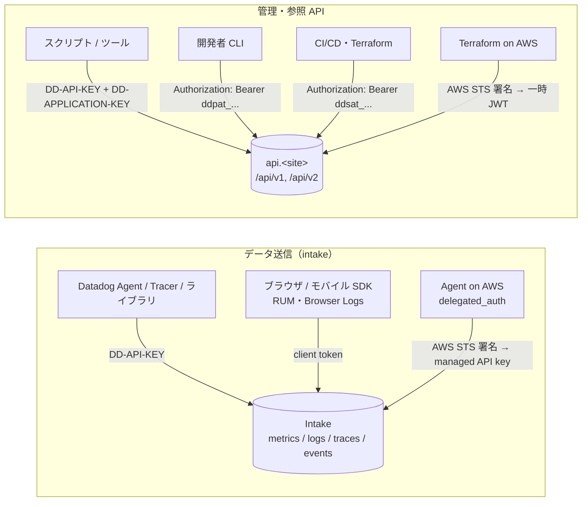
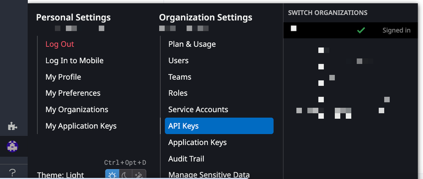
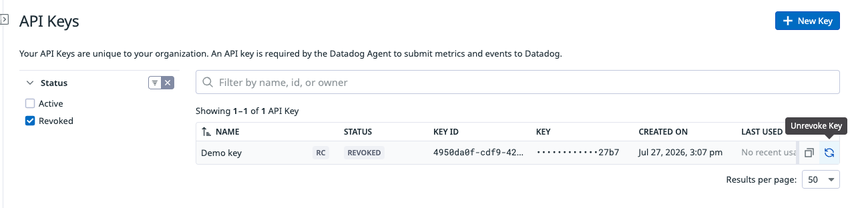
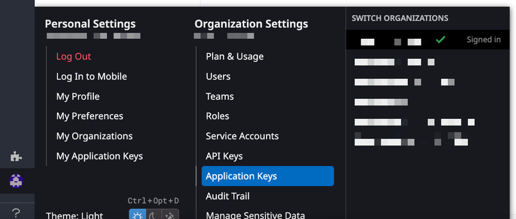
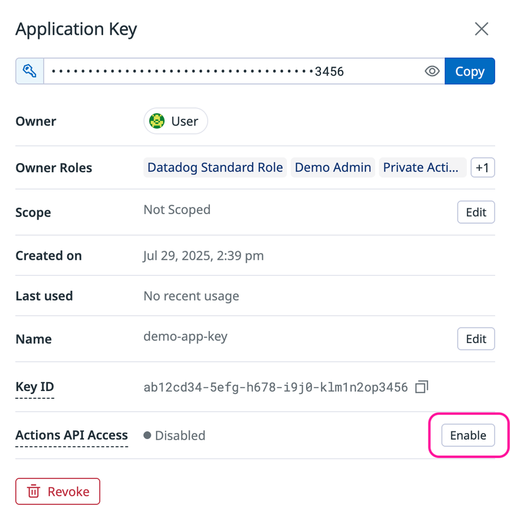
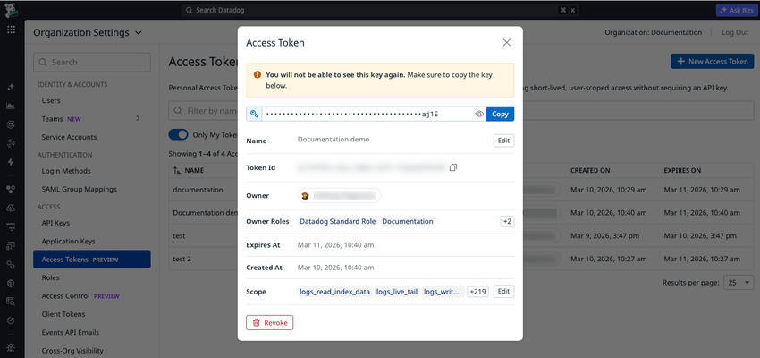
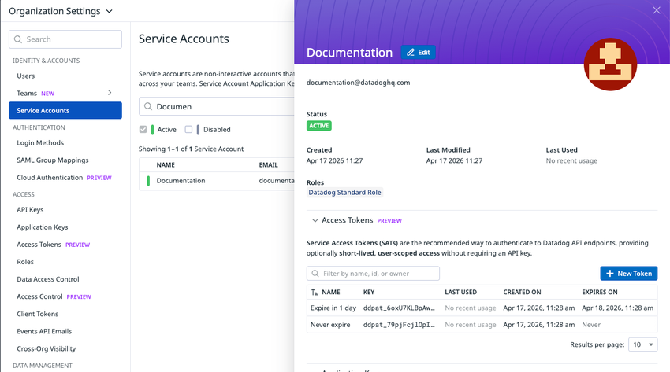

# API とキー管理

## 概要

Datadog の API とキー管理は、「Datadog にデータを送る（intake）」「Datadog の設定・データを API で読み書きする（management / query API）」ための**認証情報**と、**REST API の利用仕様**から構成される。本ファイルは次の問いに答える。

- API キー、アプリケーションキー、クライアントトークン、Personal Access Token（PAT）、Service Access Token（SAT）はそれぞれ何に使い、何が違うのか
- キーの作成・失効・復元・スコープ設定の手順と必要な権限、上限数
- サービスアカウント（Service Account）を使う理由と運用方法
- Workload Identity Federation（WIF）による「静的キーを持たない」認証
- REST API（v1 / v2）の認証ヘッダー、サイト別ベース URL、ペイロード上限
- API レート制限（ヘッダー、429 応答、可視化メトリクス、上限緩和の申請方法）
- 公式クライアントライブラリ（6 言語）と CLI（Pup CLI、datadog-ci、Dogshell）

2026 年の認証モデル刷新の要点（2026-11-02 時点）:

| 変化 | 内容 | 出典 |
|---|---|---|
| PAT / SAT の導入 | API キーと組み合わせずに単独で API 認証できる、スコープ必須のトークン。PAT はユーザー、SAT はサービスアカウントに紐づく | [PAT](https://docs.datadoghq.com/account_management/personal-access-tokens/)、[SAT](https://docs.datadoghq.com/account_management/service-access-tokens/) |
| アプリケーションキーの位置づけ | Datadog 公式ブログ（2026-06-09 公開）は、アプリケーションキーは 2026 年 Q3 以降も動作し続けるが**レガシー扱いとなり新機能は追加されない**、強制移行はないが早期移行を推奨と説明 | [公式ブログ](https://www.datadoghq.com/blog/datadog-api-authentication/)（2026-06-09 公開） |
| API キー（テレメトリ送信用） | 同ブログは「テレメトリ取り込みに使う API キーは変わらない」と明言 | 同上 |
| Workload Identity Federation | AWS の認証情報で Terraform provider と Agent を認証（静的キー不要）。AWS のみ GA | [WIF](https://docs.datadoghq.com/account_management/workload_identity_federation/) |
| One-Time Read（OTR）モード | アプリケーションキーのシークレットを作成時のみ表示。2025-08-20 より後（after August 20th, 2025）に作成された新規親 org では既定で恒久有効 | [API and Application Keys](https://docs.datadoghq.com/account_management/api-app-keys/) |
| CLI | Dogshell（`dog`）は非推奨となり、Pup CLI が後継 | [Dogshell](https://docs.datadoghq.com/extend/guide/dogshell/)、[Pup CLI](https://docs.datadoghq.com/cli/) |

関連ファイル:
- 組織・ユーザー・ロール・権限・IP Allowlist の詳細は [組織・ユーザー・権限管理](./account-and-access-management.md)
- サイト（リージョン）とエンドポイント一覧は [Datadog Sites（サイト）](./datadog-sites.md)
- Terraform provider の認証・リソースは [Terraform と IaC](./terraform-and-iac.md)
- キー操作・API 呼び出しの監査は [Audit Trail](./audit-trail.md)
- Agent への API キー設定・シークレット管理は [Agent 設定リファレンス](./agent-configuration.md)
- Remote Configuration は [Fleet Automation と Remote Configuration](./fleet-automation.md)

---

## 1. 認証情報の種類と使い分け

### 1.1 認証情報の一覧

Datadog の認証情報は 2026-11-02 時点で次の 6 種類（OAuth クライアントを含めると 7 種類）がある。

| 認証情報 | 主な用途 | 紐づく主体 | 単独で API 認証可能か | スコープ | 有効期限 | 識別プレフィックス |
|---|---|---|---|---|---|---|
| **API キー**（API key） | Agent・ライブラリ・API からの**データ送信**（メトリクス、ログ、イベント等）。管理系 API 呼び出し時の組織識別 | 組織（org） | 送信系 API は単独で可。読み取り・管理系 API はアプリケーションキー等と組み合わせ | なし | なし（失効させるまで有効） | 公開情報では確認できず |
| **アプリケーションキー**（Application key） | API キーと組み合わせて**管理・参照系 API** を呼ぶ | ユーザーまたはサービスアカウント | 不可（API キーが必要） | 任意（既定はスコープなし＝作成者の全権限） | なし | `ddapp_`（新形式） |
| **クライアントトークン**（Client token） | ブラウザ・モバイル・TV アプリなど**エンドユーザー側で動くクライアント**からのデータ送信（RUM、ブラウザログ等） | 組織 | 送信のみ | なし | なし | 公開情報では確認できず |
| **Personal Access Token（PAT）** | 開発者のスクリプト・CLI など、個人に紐づく API 呼び出し | ユーザー | 可 | **必須** | **必須**（24 時間〜1 年） | `ddpat_` |
| **Service Access Token（SAT）** | CI/CD、Terraform、自律型 AI エージェントなどの自動化 | サービスアカウント | 可 | **必須** | 任意（1 日 / 1 か月 / 1 年 / Never / Custom） | `ddsat_` |
| **Workload Identity Federation** | AWS 上の Terraform・Agent が AWS 認証情報で Datadog に認証 | AWS の IAM ロール → Datadog ユーザー / サービスアカウント | 可（一時トークン / 自動ローテーションされる managed API キーを発行） | マッピング先アカウントの権限 | 一時的（具体的な期間は公開情報では確認できず） | — |
| OAuth クライアント | Datadog Apps / パートナー連携の委任アクセス | ユーザー（同意に基づく） | 可（アクセストークン） | OAuth 用スコープ（限定セット） | 短命（具体値は公開情報では確認できず） | — |

[出典](https://docs.datadoghq.com/account_management/api-app-keys/)、[出典](https://docs.datadoghq.com/account_management/personal-access-tokens/)、[出典](https://docs.datadoghq.com/account_management/service-access-tokens/)、[出典](https://docs.datadoghq.com/account_management/workload_identity_federation/)、[出典](https://www.datadoghq.com/blog/datadog-api-authentication/)（2026-06-09 公開）

### 1.2 公式推奨の使い分け

Datadog 公式ブログ（2026-06-09 公開）が示すユースケース別の推奨は次の通り。

| ユースケース | 推奨する認証情報 |
|---|---|
| メトリクス・ログ・トレースの送信 | API キー（変更なし） |
| 開発者のスクリプト、CLI ツール | PAT |
| CI/CD パイプライン、Terraform | SAT |
| 自律型 AI エージェント（ユーザーの関与なし） | 現時点では SAT、将来は M2M OAuth（開発中） |
| AWS 上の Datadog Agent / Terraform | Workload Identity Federation |
| Datadog ファーストパーティクライアント（Pup CLI、MCP Server など） | OAuth クライアント |
| ユーザーに代わって動作する AI エージェント | OAuth クライアント（2026 年後半提供予定と記載） |

[出典](https://www.datadoghq.com/blog/datadog-api-authentication/)（2026-06-09 公開）

上表はブログの用途別表に基づく。以下はブログ表にない執筆者の補足である。

- ブラウザ / モバイル / TV アプリからの RUM・ログ送信にはクライアントトークンを使う。[出典](https://docs.datadoghq.com/account_management/api-app-keys/)
- AWS 上で動く CI/CD パイプラインや Terraform では、SAT の代わりに WIF も選択肢になる（ブログは WIF を「AWS 上の Datadog Agent / Terraform」に割り当てている）。
- 既存の連携（パートナー製品など）の中には、当面アプリケーションキーを必要とするものもある（アプリケーションキーはレガシー扱いだが引き続き動作する）。

### 1.3 PAT・SAT・アプリケーションキーの比較（公式表をもとに整理）

| 項目 | Personal Access Token | Service Access Token | Application key |
|---|---|---|---|
| 所有者 | 個人ユーザー | サービスアカウント | 個人ユーザーまたはサービスアカウント |
| 単独認証 | 可（API キー不要） | 可（API キー不要） | 不可（API キーが必要） |
| スコープ | 必須 | 必須 | 任意（既定はスコープなし） |
| TTL（有効期限） | 必須：24 時間〜1 年 | 任意：1 日 / 1 か月 / 1 年 / Never / Custom | 有効期限なし |
| プレフィックス | `ddpat_` | `ddsat_` | `ddapp_`（新） |
| 表示場所 | Personal Settings > Access Tokens、Organization Settings > Access Tokens | サービスアカウント詳細、Organization Settings > Access Tokens | Personal Settings > Application Keys、Organization Settings > Application Keys |
| 1 主体あたり上限 ※ | 500 / ユーザー | 500 / サービスアカウント | 公開情報では確認できず |

[出典](https://docs.datadoghq.com/account_management/service-access-tokens/)、[出典](https://docs.datadoghq.com/account_management/personal-access-tokens/)

※「1 主体あたり上限」の行は公式の比較表にはなく、執筆者が各ページの本文から追加した（PAT ページ「Each user can have up to 500 PATs」、SAT ページ「Each service account can have up to 500 SATs」）。

### 1.4 認証フロー図



---

## 2. API キー（API key）

### 2.1 API キーの仕様

Datadog の API キーは組織（org）に固有の認証情報で、Datadog Agent がメトリクスやイベントを Datadog に送信するために必須である。[出典](https://docs.datadoghq.com/account_management/api-app-keys/)

| 項目 | 仕様 |
|---|---|
| 所属 | 組織（ユーザーには紐づかない） |
| 用途 | Agent・トレーサー・ライブラリ・HTTP API によるデータ送信。API 呼び出し時の `DD-API-KEY` ヘッダー |
| 上限数 | **既定で 1 org あたり最大 50 個**。最低 1 個は必要。増枠はサポートに依頼 |
| Managed API キー | Datadog のインテグレーションやサービスが作成・管理するキー。Name 列に **Managed** ラベルが付き、**50 個の上限に数えられない**。存在確認と失効は可能だが、値の閲覧・名前変更は不可 |
| 名前 | 組織内で一意である必要がある |
| 有効期限 | なし（長期有効）。ローテーションは利用者が行う |
| 失効後の復元 | 失効（Revoke）後 **7 日間**は Revoked 状態で一覧に残り、復元（Unrevoke）可能。7 日経過後は完全削除され復元不可 |
| 復元方法 | **UI のみ**（Unrevoke の公開 API エンドポイントはない） |
| 作成ユーザー無効化時 | API キーは削除されず**有効なまま** |
| 値の閲覧 | `api_keys_read` 権限で一覧・値の取得が可能（OTR モードの対象はアプリケーションキーで、API キーではない） |
| Remote Configuration | API キー単位で Remote Configuration の読み取りを有効化する属性 `remote_config_read_enabled` がある。UI の一覧では **RC** バッジで表示される（下記スクリーンショット参照） |
| 文字列形式 | 公式ドキュメントでは確認できず（32 文字の 16 進文字列であることが一般に知られる【経験則】） |

[出典](https://docs.datadoghq.com/account_management/api-app-keys/)、[出典](https://docs.datadoghq.com/api/latest/key-management/)

### 2.2 API キーの作成手順（UI）

1. **Organization Settings** を開き、**API Keys** タブをクリックする。
2. **New Key** をクリックする。
3. キー名を入力する（組織内で一意）。
4. **Create API Key** をクリックする。

必要な権限は `api_keys_write`（Datadog Admin Role の既定権限）。[出典](https://docs.datadoghq.com/account_management/api-app-keys/)、[出典](https://docs.datadoghq.com/account_management/rbac/permissions/)



- **キャプション:** アカウントメニューから Organization Settings > API Keys を開く画面。
- **画面説明:** 左下のアカウントアイコンにマウスを合わせると、左列に **Personal Settings**（Log Out、Log In to Mobile、My Profile、My Preferences、My Organizations、My Application Keys）、中央列に **Organization Settings**（Plan & Usage、Users、Teams、Roles、Service Accounts、**API Keys**（選択中）、Application Keys、Audit Trail、Manage Sensitive Data など）、右列に **SWITCH ORGANIZATIONS**（組織切り替え）が表示される。
- **出典:** https://docs.datadoghq.com/account_management/api-app-keys/ （2026-11-02 取得）

### 2.3 API キーの失効と復元（Unrevoke）

- **失効:** API キー一覧で対象キーの横の Revoke アイコンをクリックする。必要な権限は `api_keys_delete`（Datadog Admin Role）。
- **復元:** 失効から 7 日以内であれば次の手順で復元できる。復元されたキーは**元の名前・ID・値のまま Active に戻る**。
  1. Organization Settings > **API Keys** タブを開く。
  2. **Status** フィルターで **Revoked** を選ぶ。
  3. 復元したいキーを見つける。
  4. キー横の **Unrevoke** アイコンをクリックする。

[出典](https://docs.datadoghq.com/account_management/api-app-keys/)



- **キャプション:** API Keys ページで Status を Revoked に絞り込み、Unrevoke Key アイコンを表示した画面。
- **画面説明:** ページ上部に「Your API Keys are unique to your organization. An API key is required by the Datadog Agent to submit metrics and events to Datadog.」の説明と右上に **+ New Key** ボタン。左の Status フィルターで Active / **Revoked** のチェックボックスを選択でき、一覧には NAME（例：Demo key と **RC** バッジ）、STATUS（**REVOKED**）、KEY ID、KEY（末尾 4 文字のみ表示）、CREATED ON、LAST USED の列があり、行の右端にコピーアイコンと **Unrevoke Key** アイコンが並ぶ。
- **出典:** https://docs.datadoghq.com/account_management/api-app-keys/ （2026-11-02 取得）

### 2.4 複数 API キーの運用

Datadog は組織で複数の API キーを使い分けることを推奨している。公式の例は「AWS 上の Kubernetes に Agent を展開する用」「オンプレで Chef により展開する用」「ダッシュボードやモニターを自動化する Terraform 用」「開発者のローカル展開用」で分ける構成である。用途別に分けることで、セキュリティ運用としてのローテーションや、漏洩時・利用停止時に**特定のキーだけを失効**させられる。50 個を超える必要がある場合はサポートに増枠を相談する。[出典](https://docs.datadoghq.com/account_management/api-app-keys/)

> 補足【経験則】: API キー名にチーム・環境・展開方法を含めておくと、`datadog.apis.rate_limit.usage.per_api_key_*` メトリクスや Audit Trail で発生源を特定しやすい。Agent のデュアルシッピング（`additional_endpoints`）など Agent 側の API キー設定は [Agent 設定リファレンス](./agent-configuration.md) を参照。

### 2.5 API キー管理 API

| メソッド | パス | 説明 | 必要権限 |
|---|---|---|---|
| GET | `/api/v2/api_keys` | API キー一覧 | `api_keys_read` |
| POST | `/api/v2/api_keys` | API キー作成（`name` 必須、任意で `category`、`remote_config_read_enabled`） | `api_keys_write` |
| GET | `/api/v2/api_keys/{api_key_id}` | API キー取得 | `api_keys_read` |
| PATCH | `/api/v2/api_keys/{api_key_id}` | API キー編集（名前等） | `api_keys_write` |
| DELETE | `/api/v2/api_keys/{api_key_id}` | API キー削除（失効） | `api_keys_delete`（権限表に基づく） |
| GET | `/api/v1/validate` | API キーの有効性確認 | API キーのみ |
| GET | `/api/v2/validate` | API キーの有効性確認（v2、**preview** 表記） | API キーのみ |
| GET | `/api/v2/validate_keys` | API キーとアプリケーションキーの組み合わせ確認 | API キー + アプリケーションキー |

一覧 API の主なクエリパラメータ: `page[size]`（**最大 100**）、`page[number]`、`sort`（`created_at` / `last4` / `modified_at` / `name`、先頭に `-` で降順）、`filter`、`filter[created_at][start|end]`、`filter[modified_at][start|end]`、`filter[remote_config_read_enabled]`、`filter[category]`。応答属性には `last4`（キー末尾 4 文字）、`date_last_used`（最終使用日時）などが含まれる。

[出典](https://docs.datadoghq.com/api/latest/key-management/)

---

## 3. アプリケーションキー（Application key）

### 3.1 アプリケーションキーの仕様

アプリケーションキーは、組織の API キーと組み合わせて Datadog のプログラマブル API にアクセスするための認証情報である。作成したユーザーアカウント（またはサービスアカウント）に紐づき、既定では**作成者と同じ権限**を持つ。[出典](https://docs.datadoghq.com/account_management/api-app-keys/)

| 項目 | 仕様 |
|---|---|
| 紐づく主体 | 作成したユーザー、またはサービスアカウント |
| 既定の権限 | 作成者の権限すべて（スコープ未指定時） |
| スコープ | 任意で指定可能（3.3 節） |
| ヘッダー | `DD-APPLICATION-KEY`（API キーの `DD-API-KEY` と併用） |
| 有効期限 | なし |
| 名前 | 空欄不可 |
| 失効 | **恒久的**（API キーのような 7 日間の復元猶予はない） |
| 作成者無効化時 | 無効化されたユーザーが作成したアプリケーションキーは**すべて失効**する |
| 譲渡 | セキュリティ上の理由で**ユーザー間の譲渡は不可**。共有が必要ならサービスアカウントを使う |
| 新形式プレフィックス | `ddapp_`（"new" と表記。旧形式キーとの関係・移行は公開情報では確認できず） |
| Last used | 最終使用タイムスタンプは全顧客が閲覧可能。Audit Trail を有効化すると遡れる期間が延びる |

[出典](https://docs.datadoghq.com/account_management/api-app-keys/)、[出典](https://docs.datadoghq.com/account_management/service-access-tokens/)

### 3.2 作成・失効の手順と権限

- **作成:** **Organization Settings > Application Keys** を開き、作成権限があれば **New Key** をクリックする（自分用は Personal Settings > Application Keys でも管理可能）。
- **失効:** 同画面で自分のキーの **Revoke** をクリック。組織全体のキーを管理する権限があれば、他者のキーも検索して失効できる。

| 権限 | 内容 | 既定で付与されるロール |
|---|---|---|
| `user_app_keys` | 自分が所有するアプリケーションキー（および PAT）の閲覧・管理 | Datadog Standard Role |
| `org_app_keys_read` | 組織内全ユーザーのアプリケーションキー（および PAT / SAT）の閲覧 | Datadog Standard Role |
| `org_app_keys_write` | 組織内全ユーザーのアプリケーションキー（および PAT / SAT）の管理 | Datadog Admin Role |
| `service_account_write` | サービスアカウントの作成・無効化・利用、そのキー / SAT の作成 | Datadog Admin Role |

> 注: 管理ロール（Managed Role）は下位ロールの権限をすべて含む（Admin ⊃ Standard ⊃ Read Only）。[出典](https://docs.datadoghq.com/account_management/rbac/permissions/)



- **キャプション:** アカウントメニューから Organization Settings > Application Keys を開く画面。
- **画面説明:** 2.2 節と同じアカウントメニューで、中央列 **Organization Settings** の **Application Keys** が選択（青色ハイライト）されている。左列の Personal Settings には個人のキーを管理する **My Application Keys** がある。
- **出典:** https://docs.datadoghq.com/account_management/api-app-keys/ （2026-11-02 取得）

### 3.3 スコープ付きアプリケーションキー（Scoped application keys）

アプリケーションキーには認可スコープ（authorization scopes）を指定でき、アプリケーションが必要とする最小限の権限だけを付与できる（最小権限の原則）。例えば、ダッシュボードを読むだけのアプリケーションにユーザー管理やデータ削除の権限は不要である。[出典](https://docs.datadoghq.com/account_management/api-app-keys/)

| 項目 | 仕様 |
|---|---|
| 指定方法 | UI（アプリケーションキーの作成・編集画面の Scope 欄）または API（`scopes` 属性） |
| 指定できる値 | **Datadog の任意の権限名**（例：`dashboards_read`、`monitors_read`、`timeseries_query`）。OAuth クライアント用の限定スコープ一覧とは異なる |
| 既定 | 未指定ならスコープなし＝作成者と同じ全権限 |
| 大文字小文字 | スコープ名は**大文字小文字を区別**する |
| 変更 | いつでも変更可能（既存機能への影響に注意） |
| 所有者の権限変更時 | 所有者のロールや権限が変わっても、キーに設定したスコープは**変わらない** |
| 所有者が持たない権限 | 所有者が持たない権限をスコープに指定しても、その権限は行使できない（必要権限が欠けているとアプリケーションを認可できない） |
| エラー | 権限不足は `403 Forbidden` |
| スコープ設定に必要な権限 | 自分のキー：`user_app_keys`／他ユーザーのキー：`org_app_keys_write`／サービスアカウントのキー：`service_account_write` |

[出典](https://docs.datadoghq.com/account_management/api-app-keys/)、[出典](https://docs.datadoghq.com/api/latest/scopes/)

スコープとして使われる代表的な権限名（権限一覧より抜粋）:

| 権限名 | 内容 | 既定ロール |
|---|---|---|
| `dashboards_read` / `dashboards_write` | ダッシュボードの閲覧 / 作成・変更 | Read Only / Standard |
| `monitors_read` / `monitors_write` | モニターの閲覧 / 編集・削除・解決 | Read Only / Standard |
| `monitors_downtime` | Downtime 設定、モニターのミュート | Standard |
| `timeseries_query` | 複数製品横断の時系列クエリ（`/api/v1/query` 等で必要） | Read Only |
| `metrics_read` | カスタムメトリクスの閲覧 | Read Only |
| `events_read` | イベントの読み取り | Read Only |
| `logs_read_data` + `logs_read_index_data` | ログデータの読み取り（両方必要） | Read Only |
| `apm_read` | APM・Trace Analytics の読み取り・クエリ | Read Only |
| `synthetics_read` / `synthetics_write` | Synthetic テストの閲覧 / 作成・編集・削除 | Read Only / Standard |
| `incident_read` | インシデントの閲覧 | Read Only |
| `usage_read` | 使用量・Usage Attribution の閲覧 | Admin |
| `workflows_run` / `apps_run` | ワークフロー実行 / App Builder アプリの実行 | Standard |

[出典](https://docs.datadoghq.com/account_management/rbac/permissions/)。権限一覧の全体は [組織・ユーザー・権限管理](./account-and-access-management.md) を参照。

> 補足: 各 API エンドポイントのリファレンスには「This endpoint requires the `xxx` permission」と必要権限が記載される（例：`/api/v1/query` は `timeseries_query`）。スコープ設計時はこの記載を参照する。[出典](https://docs.datadoghq.com/api/latest/metrics/)

### 3.4 Actions API access

App Builder、Actions Connections、Workflow Automation の各 API（Action APIs）は、アプリケーションキー側で **Actions API access** を有効化しない限り利用できない（既定は無効）。有効化は UI（Application Keys の詳細パネル）または Action Connection API（Register a new app key）で行う。[出典](https://docs.datadoghq.com/account_management/api-app-keys/)



- **キャプション:** Application Key の詳細パネル（Actions API Access の **Enable** ボタンを強調表示）。
- **画面説明:** パネル上部にキー値（マスク表示、末尾 4 文字のみ表示）と目のアイコン・**Copy** ボタン。以下、**Owner**（所有者）、**Owner Roles**（例：Datadog Standard Role ほか）、**Scope**（例：Not Scoped と **Edit** ボタン）、**Created on**、**Last used**（例：No recent usage）、**Name**（**Edit** ボタン）、**Key ID**（UUID 形式とコピーアイコン）、**Actions API Access**（Disabled と **Enable** ボタン）の各行が並び、最下部に赤枠の **Revoke** ボタンがある。
- **出典:** https://docs.datadoghq.com/account_management/api-app-keys/ （2026-11-02 取得）

### 3.5 One-Time Read（OTR）モード

OTR モードは、アプリケーションキーのシークレットを**作成時の 1 回だけ表示**し、以後 UI・API のいずれからも取得できなくするセキュリティ機能である。[出典](https://docs.datadoghq.com/account_management/api-app-keys/)

| 対象 | 挙動 |
|---|---|
| 2025-08-20 より後（after August 20th, 2025）に作成された新規の親 org（とその子 org） | 全アプリケーションキーで OTR が既定で有効。**恒久的で変更不可** |
| 既存 org | 管理者が **Organization Settings > Application Keys** で有効化・無効化できる。有効化後 **3 か月間**はトグル可能、**3 か月連続で有効**だと恒久化されトグルが消える |
| トグルに必要な権限 | `org_app_keys_write` **と** `org_management` の両方 |

> **サイト差異:** `ap2.datadoghq.com`（AP2）、`app.ddog-gov.com`（US1-FED）、`us2.ddog-gov.com` では、アプリケーションキーのシークレットは作成後に取得できない（OTR 設定にかかわらず作成直後に保管が必要）。`app.datadoghq.com`（US1）、`us3`、`us5`、`app.datadoghq.eu`（EU1）、`ap1.datadoghq.com`（AP1）では、OTR が有効な org の場合のみ作成後に取得できなくなる。[出典](https://docs.datadoghq.com/account_management/api-app-keys/)

### 3.6 アプリケーションキー管理 API

| メソッド | パス | 説明 | 必要権限（記載があるもの） |
|---|---|---|---|
| GET | `/api/v2/application_keys` | 組織の全アプリケーションキー一覧 | 公開情報では確認できず（権限定義上は `org_app_keys_read`） |
| GET / PATCH / DELETE | `/api/v2/application_keys/{app_key_id}` | 取得 / 編集 / 削除 | 同上（編集・削除は `org_app_keys_write`） |
| GET / POST | `/api/v2/current_user/application_keys` | 自分のキー一覧 / 作成（`name`、`scopes`） | 作成は `user_app_keys` |
| GET / PATCH / DELETE | `/api/v2/current_user/application_keys/{app_key_id}` | 自分のキーの取得 / 編集 / 削除 | `user_app_keys` |
| POST | `/api/v1/application_key` | アプリケーションキー作成（v1） | 公開情報では確認できず |
| GET / POST | `/api/v2/service_accounts/{service_account_id}/application_keys` | サービスアカウントのキー一覧 / 作成 | `service_account_write`（作成） |
| GET / PATCH / DELETE | `/api/v2/service_accounts/{service_account_id}/application_keys/{app_key_id}` | 取得 / 編集 / 削除 | 同上 |

[出典](https://docs.datadoghq.com/api/latest/key-management/)、[出典](https://docs.datadoghq.com/api/latest/service-accounts/)

---

## 4. クライアントトークン（Client token）

### 4.1 クライアントトークンの仕様

API キーはクライアント側に露出するため、ブラウザ・モバイル・TV アプリからのデータ送信には使えない。代わりにエンドユーザー向けアプリケーションは**クライアントトークン**を使って Datadog にデータを送信する。[出典](https://docs.datadoghq.com/account_management/api-app-keys/)

| 項目 | 仕様 |
|---|---|
| 所属 | 組織に固有 |
| 用途 | Web ブラウザ、Android、iOS、React Native、Flutter、Roku のログコレクター（ログ送信）、Real User Monitoring アプリケーション（イベント・ログ送信） |
| 管理画面 | Organization Settings > **Client Tokens** タブ |
| 作成 | Client Tokens タブで **New Client Token** → 名前入力 → **Create Client Token** |
| 削除 | 一覧で Delete アイコン。**削除後は復元不可**（API キーの 7 日間猶予はない） |
| 作成者無効化時 | クライアントトークンは**有効なまま** |
| 権限 | `client_tokens_read`（Read Only Role）、`client_tokens_write`（Standard Role） |
| 露出の前提 | 権限定義の説明文で「API キーと異なり、Web ブラウザ等のクライアント側 JavaScript に露出してよい」と明記 |
| 上限数 | 公開情報では確認できず |
| 管理 API | 公開情報では確認できず（Key Management API にクライアントトークンのエンドポイントは掲載されていない） |
| Origin 制限等 | 公開情報では確認できず |

[出典](https://docs.datadoghq.com/account_management/api-app-keys/)、[出典](https://docs.datadoghq.com/account_management/rbac/permissions/)

RUM SDK・ブラウザログ SDK でのクライアントトークンの設定方法は [RUM（ブラウザ）](../dem/rum-browser.md)、[RUM（モバイル）](../dem/rum-mobile.md)、[ログ収集](../logs/log-collection.md) を参照。

> 補足【経験則】: クライアントトークンは露出前提のため、悪意ある第三者がトークンを流用して偽データを送り込むリスクはゼロにできない。RUM のセッション数・ログ量の異常増加をモニターで監視し、問題があればトークンを新規発行して差し替える運用が一般的である。

---

## 5. Personal Access Token（PAT）

### 5.1 PAT の仕様

Personal Access Token（PAT）は Datadog の API 呼び出しを認証する認証情報で、アプリケーションキーと違い **API キーとの組み合わせが不要**である。**短命かつ既定でスコープ付き**で、各トークンのアクセス範囲と有効期間を厳密に制御できる。公式は「API キーはテレメトリ送信（Agent、ログ、メトリクス）専用とし、その他の Web API 呼び出しは PAT を使う」という責務分離を挙げている。[出典](https://docs.datadoghq.com/account_management/personal-access-tokens/)

| 項目 | 仕様 |
|---|---|
| 紐づく主体 | 個人ユーザー |
| スコープ | **必須**（最低 1 つ）。作成後も名前とスコープは編集可能 |
| TTL | **必須**。最短 24 時間、最長作成から 1 年。期限切れトークンは自動失効 |
| TTL 変更 | 不可（失効して作り直す） |
| 上限 | **1 ユーザーあたり 500 個** |
| シークレット表示 | 作成時の 1 回のみ |
| 失効 | 数秒以内に反映 |
| ユーザーの組織アクセス喪失時 | 失効する（公式ブログ） |
| 必要権限 | 自分の PAT：`user_app_keys`／全ユーザーの PAT 閲覧：`org_app_keys_read`／編集・失効：`org_app_keys_write` |
| 管理画面 | Personal Settings > **Access Tokens**（自分）、Organization Settings > **Access Tokens**（管理者） |
| Audit Trail | 作成・使用・失効を記録。Audit Trail で **Personal Access Token** 認証方式でフィルタ可能 |

[出典](https://docs.datadoghq.com/account_management/personal-access-tokens/)、[出典](https://www.datadoghq.com/blog/datadog-api-authentication/)（2026-06-09 公開）

> 提供ステータス: 公式ドキュメント本文には Preview / GA の明記がない。ただし同ページのスクリーンショット（2026-03 撮影と見られる）では Organization Settings の **Access Tokens** メニューに **PREVIEW** ラベルが表示されている。2026-11-02 時点の正式ステータスは公開情報では確認できず。

### 5.2 PAT の作成手順

1. **Personal Settings > Access Tokens** を開く。
2. **+ New Access Token** をクリックする。
3. **Name** を入力する。
4. **Expiration Date** を選ぶ（最短 24 時間、最長 1 年）。
5. **Select Scopes** で必要なスコープを選び（最低 1 つ）、**Save** をクリックする。
6. 表示されたシークレットを直ちに安全な場所に保管する（再表示不可）。

[出典](https://docs.datadoghq.com/account_management/personal-access-tokens/)



- **キャプション:** Organization Settings > Access Tokens 画面上で、作成直後の PAT 詳細パネル（モーダル）を表示した状態。
- **画面説明:** 背景の左ナビゲーションには IDENTITY & ACCOUNTS（Users、Teams、Service Accounts）、AUTHENTICATION（Login Methods、SAML Group Mappings）、ACCESS（API Keys、Application Keys、**Access Tokens（PREVIEW）**、Roles、Access Control（PREVIEW）、Client Tokens、Events API Emails、Cross-Org Visibility）が並ぶ。中央のモーダル「Access Token」上部に黄色の警告「You will not be able to see this key again. Make sure to copy the key below.」とマスクされたトークン値・**Copy** ボタン、その下に **Name**、**Token Id**、**Owner**、**Owner Roles**、**Expires At**、**Created At**、**Scope**（例：`logs_read_index_data`、`logs_live_tail` ほか +219）と **Edit** ボタン、最下部に **Revoke** ボタン。背景の一覧には NAME、CREATED ON、EXPIRES ON 列と「Only My Tokens」トグル、右上に **+ New Access Token** ボタンがある。
- **出典:** https://docs.datadoghq.com/account_management/personal-access-tokens/ （2026-11-02 取得）

### 5.3 PAT の使い方（認証ヘッダー）

| 方式 | ヘッダー | 特徴 |
|---|---|---|
| Authorization ヘッダー（**推奨**） | `Authorization: Bearer <PAT>` | API キー不要 |
| アプリケーションキーヘッダー | `dd-application-key: <PAT>` | 既存連携の移行用。有効な PAT がこのヘッダーにあれば PAT のみで認証され、`dd-api-key` は任意（値は評価されない） |

```bash
curl -X GET "https://api.ap1.datadoghq.com/api/v2/users" \
  -H "Authorization: Bearer ${DD_PAT}"
```

[出典](https://docs.datadoghq.com/account_management/personal-access-tokens/)

### 5.4 PAT で認証された呼び出しの制限（権限昇格防止）

| 制限 | 内容 |
|---|---|
| アプリケーションキー | PAT で認証した呼び出しはアプリケーションキーを**作成・更新できない**（失効は可） |
| 新トークンのスコープ | PAT で PAT / SAT を作成・更新する場合、新トークンのスコープは**自身のスコープの部分集合**でなければならない |
| 新トークンの TTL | 自身の有効期限を超える TTL の PAT / SAT は作成できない |
| 違反時 | `403 Forbidden` |

[出典](https://docs.datadoghq.com/account_management/personal-access-tokens/)

### 5.5 PAT のトークン形式

```
ddpat_<ALIAS>_<SECRET><CHECKSUM>
```

| 構成要素 | 説明 |
|---|---|
| `ddpat_` | PAT であることを示すプレフィックス |
| `<ALIAS>` | トークン UUID から導出した Base62 エンコードの識別子 |
| `<SECRET>` | 32 バイトのランダム生成シークレット |
| `<CHECKSUM>` | GitHub のチェックサム標準に従う CRC32 チェックサム |

識別可能なプレフィックスとチェックサムにより、GitHub secret scanning、Sensitive Data Scanner、GitGuardian などのシークレットスキャンで自動検出できる。[出典](https://docs.datadoghq.com/account_management/personal-access-tokens/)。Sensitive Data Scanner の詳細は [Sensitive Data Scanner](../security/sensitive-data-scanner.md) を参照。

### 5.6 PAT 管理 API

| メソッド | パス | 説明 |
|---|---|---|
| GET | `/api/v2/personal_access_tokens` | PAT と SAT をまとめて一覧 |
| POST | `/api/v2/personal_access_tokens` | PAT 作成 |
| GET | `/api/v2/personal_access_tokens/{token_id}` | PAT 取得 |
| PATCH | `/api/v2/personal_access_tokens/{token_id}` | PAT 更新（名前・スコープ） |
| DELETE | `/api/v2/personal_access_tokens/{token_id}` | PAT 失効 |

[出典](https://docs.datadoghq.com/account_management/personal-access-tokens/)、[出典](https://docs.datadoghq.com/api/latest/key-management/)

---

## 6. サービスアカウント（Service Account）と Service Access Token（SAT）

### 6.1 サービスアカウントの仕様

サービスアカウントは、チーム間で共有するアプリケーションキーやその他のリソースを所有するための**非対話型アカウント**である。公式の典型例: 従業員が個人のアプリケーションキーで自動化スクリプトを作り、その従業員の退職でアカウントを無効化するとキーも失効しスクリプトが止まる。サービスアカウントのキーを使えばこの問題を避けられる。[出典](https://docs.datadoghq.com/account_management/org_settings/service_accounts/)

| 項目 | 仕様 |
|---|---|
| 画面 | Organization Settings > Accounts（IDENTITY & ACCOUNTS）> **Service Accounts** |
| 作成権限 | `service_account_write`（Datadog Admin Role に含まれる）。権限がないユーザーは読み取り専用表示 |
| 無効化権限 | `service_account_write` に加えて User Manage Access（`user_access_manage`） |
| 付与できるロール | 作成者が持つロール・権限の部分集合。`user_access_manage` を持つユーザーは制限なし |
| メールアドレス | ユーザーと異なり**組織内で一意である必要はない** |
| 一覧表示 | 既定は Active のみ。**Disabled** を選ぶと無効化済みも表示。検索は名前・メール・ロールが対象 |
| 詳細パネル | ステータス、作成日・最終更新日、ロール、アプリケーションキー、権限（Access Tokens 欄も表示） |
| メール通知 | アプリケーションキーの作成・失効、サービスアカウントの無効化時に、サービスアカウントのメールアドレスへ通知 |
| アプリケーションキーの閲覧 | **作成した本人が作成直後に 1 回だけ**閲覧可能。紛失時は失効して再作成 |
| 推奨認証方式 | **SAT**（スコープ付き、長期有効も可、API キー不要） |

[出典](https://docs.datadoghq.com/account_management/org_settings/service_accounts/)、[出典](https://docs.datadoghq.com/account_management/rbac/permissions/)

> **サイト差異:** `ap2.datadoghq.com`（AP2）、`app.ddog-gov.com`（US1-FED）、`us2.ddog-gov.com` では、サービスアカウントのアプリケーションキーは一度だけ読み取り可能（作成直後に保管が必要）である旨が警告として明記されている。挙動（作成直後に 1 回だけ閲覧可能）は全サイト共通で、これらのサイトで異なるのは警告が表示される点のみ。[出典](https://docs.datadoghq.com/account_management/org_settings/service_accounts/)

サービスアカウントの作成手順:

1. **New Service Account** をクリックする。
2. 名前とメールアドレスを入力する。
3. **Assign Roles** ドロップダウンで 1 つ以上のロールを選ぶ。
4. **Create Service Account** をクリックする。

サービスアカウントのアプリケーションキー作成: 一覧からアカウントを選択 → サイドパネルで **New Key** → 名前入力 → **Create Key** → 表示されたキーをコピー（ダイアログを閉じると再取得不可）。失効はサイドパネルでキーにマウスを合わせてゴミ箱アイコン → **Confirm**。[出典](https://docs.datadoghq.com/account_management/org_settings/service_accounts/)

ユーザー・ロール管理全般は [組織・ユーザー・権限管理](./account-and-access-management.md) を参照。

### 6.2 Service Access Token（SAT）の仕様

SAT はサービスアカウントの代理で Datadog API 呼び出しを認証する認証情報である。PAT と違って個人ではなくサービスアカウントに属するため、メンバーの入退社の影響を受けない。[出典](https://docs.datadoghq.com/account_management/service-access-tokens/)

| 項目 | 仕様 |
|---|---|
| 紐づく主体 | サービスアカウント |
| スコープ | **必須** |
| TTL | **1 day / 1 month / 1 year / Never / Custom** から選択（Never で無期限）。Custom の上限・既定値は公開情報では確認できず |
| TTL 変更 | 不可（失効して作り直す）。名前とスコープは編集可能 |
| 上限 | **1 サービスアカウントあたり 500 個** |
| プレフィックス | `ddsat_` |
| シークレット表示 | 作成時の 1 回のみ |
| 失効 | サービスアカウントのパネルまたは Organization Settings > Access Tokens から。数秒以内に反映 |
| 必要権限 | 自分が管理するサービスアカウントの SAT 作成：`service_account_write`／全サービスアカウントの SAT 閲覧：`org_app_keys_read`／作成・編集・失効：`org_app_keys_write` |
| 監査 | SAT による API 呼び出しは**所有サービスアカウントに帰属**して Audit Trail に記録 |
| 長期 SAT の保管 | 長期・Never の場合は AWS Secrets Manager、HashiCorp Vault、Azure Key Vault などのシークレットマネージャーに保管（AWS Secrets Manager は Datadog のサービスアカウント認証情報のマネージドローテーションをサポート） |

[出典](https://docs.datadoghq.com/account_management/service-access-tokens/)

認証ヘッダーは PAT と同じ（`Authorization: Bearer <SAT>` が推奨、`dd-application-key: <SAT>` も可で、その場合 `dd-api-key` は評価されない）。SAT による呼び出しにも PAT と同じ制限（アプリケーションキーの作成・更新不可、新トークンのスコープは部分集合のみ、自身の有効期限を超える TTL 不可、違反時 `403`）が適用される。[出典](https://docs.datadoghq.com/account_management/service-access-tokens/)

SAT の作成手順:

1. **Organization Settings > Service Accounts** でサービスアカウントをクリックする。
2. 詳細パネルの **Access Tokens** で **+ New Token** をクリックする。
3. **Name** を入力する。
4. **Expiration Date** を選ぶ（1 day / 1 month / 1 year / Never / Custom）。
5. **Select Scopes** でスコープを選び **Save** をクリックする。
6. 表示されたシークレット、名前、Token ID、所有者、所有者ロール、有効期限、スコープを確認し、シークレットを保管する。

[出典](https://docs.datadoghq.com/account_management/service-access-tokens/)



- **キャプション:** Organization Settings > Service Accounts でサービスアカウントを選択し、詳細パネルの **Access Tokens（PREVIEW）** セクションを表示した画面。
- **画面説明:** 左ナビゲーションの AUTHENTICATION に **Cloud Authentication（PREVIEW）**、ACCESS に API Keys、Application Keys、**Access Tokens（PREVIEW）**、Roles、Data Access Control、Access Control（PREVIEW）、Client Tokens などが並ぶ。右側の詳細パネルにはアカウント名と **Edit** ボタン、メールアドレス、**Status（ACTIVE）**、Created、Last Modified、Last Used、Roles（例：Datadog Standard Role）。その下の **Access Tokens** セクションに「Service Access Tokens (SATs) are the recommended way to authenticate to Datadog API endpoints…」の説明、検索ボックス、**+ New Token** ボタン、一覧（NAME、KEY、LAST USED、CREATED ON、EXPIRES ON。例：「Expire in 1 day」「Never expire」）が表示される。なお、このスクリーンショットではキー列の値が `ddpat_` で始まって見えるが、ドキュメント本文では SAT のプレフィックスは `ddsat_` と記載されている（本文を正とする）。
- **出典:** https://docs.datadoghq.com/account_management/service-access-tokens/ （2026-11-02 取得）

### 6.3 サービスアカウント関連 API

| メソッド | パス | 説明 |
|---|---|---|
| POST | `/api/v2/service_accounts` | サービスアカウント作成 |
| GET / POST | `/api/v2/service_accounts/{service_account_id}/application_keys` | アプリケーションキー一覧 / 作成 |
| GET / PATCH / DELETE | `/api/v2/service_accounts/{service_account_id}/application_keys/{app_key_id}` | アプリケーションキー取得 / 編集 / 削除 |
| GET / POST | `/api/v2/service_accounts/{service_account_id}/access_tokens` | SAT 一覧 / 作成 |
| GET / PATCH / DELETE | `/api/v2/service_accounts/{service_account_id}/access_tokens/{token_id}` | SAT 取得 / 更新 / 失効 |

サービスアカウントの一覧取得・無効化を行う専用エンドポイントは Service Accounts API ページには掲載されていない（ユーザー API 側での扱いは [組織・ユーザー・権限管理](./account-and-access-management.md) を参照）。[出典](https://docs.datadoghq.com/api/latest/service-accounts/)

---

## 7. Workload Identity Federation（WIF）

### 7.1 WIF の仕様

Workload Identity Federation は、Datadog Terraform provider と Datadog Agent を、静的な API キー・アプリケーションキーではなく**クラウドの認証情報**で認証する仕組みである。2026-11-02 時点で対応クラウドは **AWS のみ**（Azure、Google Cloud、汎用 OIDC は非対応）。[出典](https://docs.datadoghq.com/account_management/workload_identity_federation/)

| 項目 | Terraform provider | Datadog Agent |
|---|---|---|
| 仕組み | provider が AWS 認証情報で STS `GetCallerIdentity` リクエストに署名 → Datadog が AWS STS で検証し、返された ARN を Datadog のユーザー / サービスアカウントにマッピング → **一時的な JWT** を発行 | Agent が環境内の AWS 認証情報で署名付き STS リクエストを作成 → Datadog が AWS と Intake Mapping で検証 → **Datadog が自動ローテーションする managed API キー**を発行 |
| Datadog 側設定 | Identity Mapping（Organization Settings > Workload Identity Federation > Identity Mappings、または `/api/v2/cloud_auth/aws/persona_mapping`） | Intake Mapping（同画面 Intake Mappings タブ、または `/api/v2/cloud_auth/aws/intake_mapping`） |
| クライアント側設定 | provider v3.70 以降。`api_key` / `app_key` の代わりに `org_uuid` と `cloud_provider_type = "aws"` | `datadog.yaml` に `delegated_auth:` と `org_uuid` を追加（任意で `provider: aws`、`aws.region`） |
| 前提 | AWS アカウントが Datadog の AWS インテグレーションで連携済み | 同左。対応 Agent バージョン・認証情報取得方式（下表） |
| 推奨 | マッピング先はユーザーよりサービスアカウント | 既存の `api_key` を残し、委任認証失敗時のフォールバックにする |
| 提供 | 全顧客が利用可能 | 対応サイトで利用可能（Agent バージョン・認証方式に依存） |

[出典](https://docs.datadoghq.com/account_management/workload_identity_federation/)。公式ブログでは AWS 向け WIF は GA、他クラウドは計画中と記載されている。[出典](https://www.datadoghq.com/blog/datadog-api-authentication/)（2026-06-09 公開）

Agent 設定例:

```yaml
# datadog.yaml
api_key: <既存のAPIキー>   # フォールバック用に残す
delegated_auth:
  org_uuid: <YOUR_ORG_UUID>
```

- `org_uuid` は Organization Settings > Workload Identity Federation 画面、または `/api/v2/current_user` で取得できる。
- 製品ごとの制御として `logs_config` などの製品セクションに `delegated_auth.org_uuid` を書ける（製品セクションでは `org_uuid` のみ。`provider` と `aws` はグローバルの `delegated_auth` でのみ設定可能）。

[出典](https://docs.datadoghq.com/account_management/workload_identity_federation/)

### 7.2 Agent の対応バージョンと AWS 認証情報の取得方式

| Agent が AWS 認証情報を得る方法 | Agent 7.78〜7.81 | Agent 7.82 | Agent 7.83 以降 |
|---|---|---|---|
| 環境変数（`AWS_ACCESS_KEY_ID`、`AWS_SECRET_ACCESS_KEY`） | 全 Agent | 全 Agent | 全 Agent |
| EC2 インスタンスメタデータ（IMDS）ロール | Core Agent のみ | Core Agent のみ | 全 Agent |
| EKS IRSA（`AWS_ROLE_ARN`、`AWS_WEB_IDENTITY_TOKEN_FILE`） | 非対応 | Core Agent のみ | 全 Agent |
| ECS タスクロール / EKS Pod Identity（`AWS_CONTAINER_CREDENTIALS_*`） | 非対応 | Core Agent のみ | 全 Agent |

- **Core Agent:** Agent、Cluster Agent、Process Agent、Security Agent、System Probe、installer。
- **全 Agent:** Core Agent に加え Trace Agent、スタンドアロン DogStatsD、Private Action Runner、IoT Agent、Heroku Agent。
- OpenTelemetry Collector（`otel-agent`）は WIF 非対応。

[出典](https://docs.datadoghq.com/account_management/workload_identity_federation/)

### 7.3 WIF のマッピング制約・権限

| 項目 | 内容 |
|---|---|
| ARN のワイルドカード | `*` はリソース ARN の**最後の部分のみ**、特定リソースの後ろに置ける。途中には置けない |
| ソースパターン | IAM ロール ARN ではなく **assumed-role ARN 形式**で指定 |
| 必要権限 | WIF ドキュメントでは `workload_identity_federation_config_read` / `workload_identity_federation_config_write` と記載。一方、権限一覧ページでは `workload_identity_federation_read` / `workload_identity_federation_write`（いずれも Datadog Admin Role）と記載されており、**表記が一致していない**（2026-11-02 時点）。実環境のロール画面で確認すること |
| レート制限・クォータ | 公開情報では確認できず |

[出典](https://docs.datadoghq.com/account_management/workload_identity_federation/)、[出典](https://docs.datadoghq.com/account_management/rbac/permissions/)

> **サイト差異:** WIF は `app.datadoghq.com`（US1）、`us3`、`us5`、`app.datadoghq.eu`（EU1）、`ap1.datadoghq.com`（AP1）、`ap2.datadoghq.com`（AP2）で利用可能。`app.ddog-gov.com`（US1-FED）と `us2.ddog-gov.com` では**利用不可**。[出典](https://docs.datadoghq.com/account_management/workload_identity_federation/)

Terraform provider 側の設定の詳細は [Terraform と IaC](./terraform-and-iac.md)、AWS インテグレーションは [AWS Integration](./aws-integration.md) を参照。

---

## 8. OAuth2（Datadog Apps / パートナー連携）

Datadog は Datadog Apps（パートナー連携）向けに OAuth2 クライアントを提供している。

| 項目 | 内容 |
|---|---|
| 作成場所 | Developer Platform（Datadog Partner Sandbox Account 上で作成・設定） |
| クライアント種別 | ガイドは confidential クライアントを前提 |
| グラントタイプ | Authorization Code + **PKCE**（`code_challenge` は base64url、方式は SHA-256） |
| エンドポイント | 認可：`<site>/oauth2/v1/authorize`、トークン：`https://api.<domain>/oauth2/v1/token` |
| スコープ | OAuth クライアントには**限定されたスコープセット**のみ割り当て可能（スコープ付きアプリケーションキーは任意の権限を指定できる点と異なる） |
| API キー作成 | ユーザーの代理で API キーを作成するには `API_KEYS_WRITE` スコープが必要。作成された API キーは 1 回のみ表示 |
| サイト判定 | `onboarding_url` へのリダイレクトで渡る `site`、`redirect_uri` へのリダイレクトで渡る `domain` を使う。タイル外から開始する場合は US1（`app.datadoghq.com`）に誘導してリージョンを選ばせることを推奨 |
| トークン有効期間 | 公開情報では確認できず |

[出典](https://docs.datadoghq.com/extend/authorization/oauth2_in_datadog/)、[出典](https://docs.datadoghq.com/api/latest/scopes/)

> 補足: 公式ブログ（2026-06-09 公開）は、AI エージェント向けの委任アクセスとしての OAuth クライアントを 2026 年後半に提供予定、M2M（machine-to-machine）OAuth は開発中と記載している。2026-11-02 時点の提供状況は公開情報では確認できず。[出典](https://www.datadoghq.com/blog/datadog-api-authentication/)

---

## 9. キーのライフサイクル運用

### 9.1 伝播遅延と結果整合性

Datadog の API キー・アプリケーションキー・PAT は**結果整合性（eventual consistency）**モデルで、作成・失効の反映に**数秒**かかることがある。

- 作成直後のキーを重要なワークフローですぐ使わない（数秒待つ）。
- 伝播中の一時的なエラーには、短い指数バックオフでのリトライで対処する。
- 伝播前に使うと一時的に `403 Forbidden` や `401 Unauthorized` が返ることがある。
- 有効性確認: API キーは `GET /api/v1/validate`、アプリケーションキーは `GET /api/v2/validate_keys`（キーペアで確認）。

[出典](https://docs.datadoghq.com/account_management/api-app-keys/)、[出典](https://docs.datadoghq.com/account_management/personal-access-tokens/)

```bash
# API キーの有効性確認（AP1 の例）
curl -s "https://api.ap1.datadoghq.com/api/v1/validate" \
  -H "DD-API-KEY: ${DD_API_KEY}"
# 応答例: {"valid":true}
```

### 9.2 保管とローテーション

| 項目 | 公式の推奨・仕様 |
|---|---|
| 保管場所 | API キー・アプリケーションキーは長期有効で期限がないため、ソースコードや環境ファイルではなく **AWS Secrets Manager、HashiCorp Vault、Azure Key Vault** 等のシークレットマネージャーに保管 |
| マネージドローテーション | **AWS Secrets Manager** が Datadog API キー・アプリケーションキー（およびサービスアカウント認証情報）のマネージドローテーションをサポート（AWS の 2026-05 発表） |
| 用途別キー | 展開方法ごとに API キーを分け、個別にローテーション・失効できるようにする |
| 短命化 | 管理系 API は TTL 付きの PAT / SAT への移行で漏洩時の影響範囲を限定 |
| 静的キー排除 | AWS 上では WIF により静的キーを不要化（Agent は自動ローテーションされる managed API キーを利用） |

[出典](https://docs.datadoghq.com/account_management/api-app-keys/)、[出典](https://docs.datadoghq.com/account_management/service-access-tokens/)、[出典](https://aws.amazon.com/about-aws/whats-new/2026/05/secrets-manager-managed-external-secrets-datadog-snowflake/)

> Agent の `datadog.yaml` でシークレットを外部から取得する仕組み（Secrets Management、`ENC[]` 記法）は [Agent 設定リファレンス](./agent-configuration.md) を参照。

推奨ローテーション手順【経験則】（API キーの例。公式手順の組み合わせ）:

1. 新しい API キーを作成し、数秒の伝播を待って `/api/v1/validate` で確認する。
2. 利用側（Agent、CI シークレット、Terraform 変数等）を新キーに切り替える。
3. API キー一覧の Last used、`datadog.apis.rate_limit.usage.per_api_key_*` メトリクス、Audit Trail で旧キーの利用が止まったことを確認する。
4. 旧キーを失効する（API キーなら 7 日以内は復元可能なので、想定外の利用元が見つかった場合の切り戻しに使える）。

### 9.3 キー漏洩時の対応（公式手順）

公開リポジトリ等からキーを含むファイルを削除しても、既に第三者に取得されていないことは保証されない。公式の対応手順は以下の通り。

1. 影響を受けたキーを失効する。
2. 公開ファイルからキーを含むコードを除去する（サニタイズ済みファイルを公開し、コミット履歴からも機密データを削除）。
3. 新しいキーを作成する。
4. 影響を受けるサービスを新しいキーに更新する。
5. 不正アクセスがないかアカウントを確認する（最近追加されたユーザー、新規リソース、ロール・権限の変更）。

> 注意: アクティブなキーの失効はサービスに影響しうる。利用範囲が大きい、または不明な場合は、失効（手順 1）の**前に**手順 2〜5 を検討する。異常が見つかった場合や支援が必要な場合は Datadog サポートに連絡する。

[出典](https://docs.datadoghq.com/account_management/api-app-keys/)

### 9.4 ユーザー無効化・退職時の影響

| 認証情報 | ユーザー（作成者）無効化時の挙動 |
|---|---|
| API キー | 削除されず**有効なまま** |
| アプリケーションキー（ユーザー所有） | **失効** |
| PAT | 失効（ユーザーが組織へのアクセスを失うと失効） |
| クライアントトークン | **有効なまま** |
| サービスアカウントのアプリケーションキー / SAT | 個人の無効化の影響を受けない（サービスアカウントが無効化された場合の SAT の扱いは公開情報では確認できず） |

[出典](https://docs.datadoghq.com/account_management/api-app-keys/)、[出典](https://www.datadoghq.com/blog/datadog-api-authentication/)（2026-06-09 公開）

---

## 10. REST API（v1 / v2）

### 10.1 Datadog API の基本

Datadog API は HTTP REST API で、リソース指向の URL を使い、全リクエストで JSON を返し、成功・失敗を標準 HTTP ステータスコードで示す。データ送信、可視化（ダッシュボード、モニター、SLO 等）、アカウント管理（ユーザー、ロール、組織、キー、使用量計測、IP レンジ等）をプログラムから操作できる。[出典](https://docs.datadoghq.com/api/latest/)、[出典](https://docs.datadoghq.com/api/latest/using-the-api/)

| 項目 | 仕様 |
|---|---|
| 認証（従来方式） | `DD-API-KEY` ヘッダー（API キー）。一部エンドポイントは加えて `DD-APPLICATION-KEY`（アプリケーションキー） |
| 認証（新方式） | `Authorization: Bearer <PAT または SAT>`（API キー不要） |
| 認証の原則 | 書き込み（データ送信）は API キー、読み取り（データ参照）は API キー + アプリケーションキー（相当の認証情報）が必要 |
| レスポンス形式 | JSON |
| Postman | 公式 Postman コレクションあり（Collection variables に API キー・アプリケーションキーを設定） |
| cURL 例の前提 | Bash と GNU coreutils（macOS は `brew install coreutils`） |
| 機械可読ドキュメント | ドキュメントの各ページは `.md` 版を提供し、索引として `https://docs.datadoghq.com/llms.txt` がある |

[出典](https://docs.datadoghq.com/api/latest/)、[出典](https://docs.datadoghq.com/api/latest/authentication/)

### 10.2 v1 と v2 の関係

Datadog API には `/api/v1/...` と `/api/v2/...` の 2 系統があり、**エンドポイント単位でバージョンが決まる**（同一製品でも v1 と v2 が並存する）。公式クライアントライブラリは v1 / v2 のモジュールを切り替えて使う（例：Java は `com.datadog.api.v1` / `v2`、Go は `datadogV1` / `datadogV2`）。[出典](https://docs.datadoghq.com/api/latest/)

| 観点 | v1 | v2 |
|---|---|---|
| 位置づけ | 従来からのエンドポイント群 | 新しいエンドポイント群。新機能は v2 で提供されることが多い【経験則】 |
| リクエスト / レスポンス形式 | エンドポイント固有の JSON | 多くが JSON:API 形式（`data` / `type` / `attributes` / `relationships`）。例：API キー作成は `{"data":{"type":"api_keys","attributes":{"name":"..."}}}` |
| 代表例 | `/api/v1/validate`、`/api/v1/query`（時系列クエリ）、`/api/v1/series`（メトリクス送信）、`/api/v1/application_key` | `/api/v2/api_keys`、`/api/v2/series`、`/api/v2/query/timeseries`、`/api/v2/logs`、`/api/v2/users`、`/api/v2/service_accounts` |
| 移行推奨の例 | `/api/v1/query` は v2 `/api/v2/query/timeseries` の利用が推奨されている | — |
| 非推奨の例 | v1 イベント投稿は非推奨で、過去に利用していた org のみ利用可能 | v2 イベント投稿は `https://event-management-intake.{site}/api/v2/events` に移行（旧 `https://api.{site}/api/v2/events` は非推奨。2025-07-01 以降リリースのクライアントライブラリが必要） |

[出典](https://docs.datadoghq.com/api/latest/key-management/)、[出典](https://docs.datadoghq.com/api/latest/metrics/)、[出典](https://docs.datadoghq.com/api/latest/events/)

### 10.3 サイト別 API ベース URL

API の呼び出し先はサイトごとに異なる。公式クライアントライブラリは既定で US1（`api.datadoghq.com`）を向くため、他サイトでは明示的に設定が必要である。[出典](https://docs.datadoghq.com/api/latest/authentication/)

| サイト | Web UI | API ベース URL | ログ HTTP intake（v2） |
|---|---|---|---|
| US1 | `app.datadoghq.com` | `https://api.datadoghq.com` | `https://http-intake.logs.datadoghq.com/api/v2/logs` |
| US3 | `us3.datadoghq.com` | `https://api.us3.datadoghq.com` | `https://http-intake.logs.us3.datadoghq.com/api/v2/logs` |
| US5 | `us5.datadoghq.com` | `https://api.us5.datadoghq.com` | `https://http-intake.logs.us5.datadoghq.com/api/v2/logs` |
| EU1 | `app.datadoghq.eu` | `https://api.datadoghq.eu` | `https://http-intake.logs.datadoghq.eu/api/v2/logs` |
| **AP1** | `ap1.datadoghq.com` | `https://api.ap1.datadoghq.com` | `https://http-intake.logs.ap1.datadoghq.com/api/v2/logs` |
| AP2 | `ap2.datadoghq.com` | `https://api.ap2.datadoghq.com` | `https://http-intake.logs.ap2.datadoghq.com/api/v2/logs` |
| US1-FED | `app.ddog-gov.com` | `https://api.ddog-gov.com` | `https://http-intake.logs.ddog-gov.com/api/v2/logs` |

> **サイト差異:** 2026-11-02 時点の API リファレンスには、本ナレッジの標準サイト表記に加えて `uk1.datadoghq.com`（API：`https://api.uk1.datadoghq.com`）と `us2.ddog-gov.com`（API：`https://api.us2.ddog-gov.com`）も掲載されている。サイトの詳細・その他の intake エンドポイントは [Datadog Sites（サイト）](./datadog-sites.md) を参照。[出典](https://docs.datadoghq.com/api/latest/key-management/)、[出典](https://docs.datadoghq.com/api/latest/logs/)

### 10.4 主な送信系 API のペイロード上限

| API | エンドポイント | 上限・仕様 |
|---|---|---|
| メトリクス送信 v2 | `POST /api/v2/series` | 最大ペイロード **500 KB（512,000 バイト）**。圧縮時は展開後 **5 MB（5,242,880 バイト）未満** |
| メトリクス送信 v1 | `POST /api/v1/series` | 最大ペイロード **3.2 MB（3,200,000 バイト）**。圧縮時は展開後 **62 MB（62,914,560 バイト）未満** |
| ログ送信 v2 | `POST https://http-intake.logs.<site>/api/v2/logs` | 1 リクエストあたり非圧縮 **5 MB**、1 ログ **1 MB**（超過分は切り詰めて 2xx を返す）、配列 **1,000 件**。`Content-Encoding: gzip` での圧縮送信を推奨。タイムスタンプは過去 **18 時間**まで |
| イベント送信 | `POST https://event-management-intake.<site>/api/v2/events` | カテゴリは `change` と `alert`。レート制限は 250,000 イベント/分/org（11 章） |

ログ送信 API の主なステータスコード: `202`（受理）、`400`（ペイロード形式不正）、`401`（API キー欠落）、`403`（無効な API キー）、`408`（タイムアウト、再試行）、`413`（5 MB 超）、`429`（過多、再試行）、`500` / `503`（再試行）。[出典](https://docs.datadoghq.com/api/latest/logs/)、[出典](https://docs.datadoghq.com/api/latest/metrics/)、[出典](https://docs.datadoghq.com/api/latest/events/)

メトリクス・ログ・イベントの各製品仕様は [Metrics](./metrics.md)、[Custom Metrics と DogStatsD](./custom-metrics-and-dogstatsd.md)、[ログ収集](../logs/log-collection.md)、[Event Management](./event-management.md) を参照。

### 10.5 API 呼び出し例

```bash
# 従来方式: API キー + アプリケーションキーでモニター一覧を取得（AP1）
curl -s "https://api.ap1.datadoghq.com/api/v1/monitor" \
  -H "DD-API-KEY: ${DD_API_KEY}" \
  -H "DD-APPLICATION-KEY: ${DD_APP_KEY}"

# 新方式: SAT でユーザー一覧を取得（API キー不要）
curl -s "https://api.ap1.datadoghq.com/api/v2/users" \
  -H "Authorization: Bearer ${DD_SAT}"

# API キー作成（v2, JSON:API 形式, api_keys_write 権限が必要）
curl -s -X POST "https://api.ap1.datadoghq.com/api/v2/api_keys" \
  -H "Content-Type: application/json" \
  -H "DD-API-KEY: ${DD_API_KEY}" \
  -H "DD-APPLICATION-KEY: ${DD_APP_KEY}" \
  -d '{"data":{"type":"api_keys","attributes":{"name":"k8s-aws-prod"}}}'
```

[出典](https://docs.datadoghq.com/api/latest/key-management/)、[出典](https://docs.datadoghq.com/account_management/service-access-tokens/)

---

## 11. API レート制限（Rate Limits）

### 11.1 レート制限のポリシー

多くの API エンドポイントにはレート制限があり、一定期間のリクエスト数を超えると `429` が返る。[出典](https://docs.datadoghq.com/api/latest/rate-limits/)

| 対象 | レート制限 |
|---|---|
| メトリクス（データポイント）送信 | **レート制限なし**。ただし契約上のカスタムメトリクス数に応じた制約がある |
| ログ送信 API | **レート制限なし** |
| イベント送信 | **250,000 イベント/分/org** |
| その他のエンドポイント | エンドポイントごとに異なり、レスポンスヘッダーで通知される。オンデマンドで拡張可能 |
| 一覧の網羅性 | 公式は「上記は Datadog API の全レート制限を網羅していない」と明記。エンドポイント別の既定値は**公開されていない** |

[出典](https://docs.datadoghq.com/api/latest/rate-limits/)

### 11.2 レート制限ヘッダー

| ヘッダー | 内容 |
|---|---|
| `X-RateLimit-Limit` | 期間内に許可されるリクエスト数 |
| `X-RateLimit-Period` | リセット周期の長さ（秒、カレンダー境界に整列） |
| `X-RateLimit-Remaining` | 現在の期間で残っているリクエスト数 |
| `X-RateLimit-Reset` | 次のリセットまでの秒数 |
| `X-RateLimit-Name` | レート制限の名前（増枠申請時に使う） |

`429` を受けた場合は、`X-RateLimit-Period` が示す時間待ってから再試行するか、`X-RateLimit-Limit` / `X-RateLimit-Period` よりわずかに低い頻度で呼び出すように調整する。API はリソースによって個別のバケットを持つ場合と、**複数エンドポイントで 1 つのバケットを共有する**場合がある（同じ `limit_name` を持つ）。[出典](https://docs.datadoghq.com/api/latest/rate-limits/)

### 11.3 レート制限の可視化（API usage metrics）

Datadog は API のレート制限消費をセルフサービスで監査できるメトリクスとダッシュボードを提供している（メトリクス・ログ・イベント**送信**エンドポイントは対象外）。プリセットのダッシュボードは **Datadog API Rate Limit Visibility**。[出典](https://docs.datadoghq.com/api/latest/rate-limits/)

| スコープ | 許可されたリクエスト | ブロックされたリクエスト | 利用率 | 設定上限（gauge） |
|---|---|---|---|---|
| 組織 | `datadog.apis.rate_limit.usage.per_org_count` | `datadog.apis.rate_limit.usage.per_org_blocked_count` | `datadog.apis.rate_limit.usage.per_org_pct` | `datadog.apis.rate_limit.usage.per_org_limit_count` |
| ユーザー | `datadog.apis.rate_limit.usage.per_user_count` | `datadog.apis.rate_limit.usage.per_user_blocked_count` | `datadog.apis.rate_limit.usage.per_user_pct` | `datadog.apis.rate_limit.usage.per_user_limit_count` |
| API キー | `datadog.apis.rate_limit.usage.per_api_key_count` | `datadog.apis.rate_limit.usage.per_api_key_blocked_count` | `datadog.apis.rate_limit.usage.per_api_key_pct` | `datadog.apis.rate_limit.usage.per_api_key_limit_count` |

- `*_pct` は（許可＋ブロック）の試行数を設定上限に対する百分率で示し、`100` が上限到達、`100` 超はブロック発生を意味する。
- ダッシュボードでは、許可・ブロック数は分単位の `sum(60s)` ロールアップ、利用率は区間の最大値を使い、`+` で結合する場合は各項を `default_zero()` で囲む。

利用可能なタグ:

| タグ | 内容 | 付与対象 |
|---|---|---|
| `app_key_id` | リクエストに使われたアプリケーションキー ID（未使用時は空値で存在） | count / blocked count / 利用率 |
| `user_uuid` | リクエストに関連するユーザーの UUID | count / blocked count / 利用率 |
| `limit_name` | レート制限名（複数エンドポイントで同名あり） | 全メトリクス |
| `org_scope` | `current_org`（自 org のトラフィック）または `child_org`（親 org に送られる子 org のコピー） | 全メトリクス |
| `child_org_name` | 子 org の表示名 | `org_scope:child_org` のメトリクス |

クエリ例（rate limit 名ごとのブロック数）:

```
default_zero(sum:datadog.apis.rate_limit.usage.per_org_blocked_count{*} by {limit_name})
+ default_zero(sum:datadog.apis.rate_limit.usage.per_user_blocked_count{*} by {limit_name})
+ default_zero(sum:datadog.apis.rate_limit.usage.per_api_key_blocked_count{*} by {limit_name})
```

[出典](https://docs.datadoghq.com/api/latest/rate-limits/)

### 11.4 旧メトリクス（`datadog.apis.usage.*`）からの移行

`datadog.apis.rate_limit.usage.*` は旧 `datadog.apis.usage.*` を置き換える。ダッシュボード・モニターは次のように置換する。

| 旧メトリクス | 置換先 |
|---|---|
| `datadog.apis.usage.per_org` | `datadog.apis.rate_limit.usage.per_org_count` |
| `datadog.apis.usage.per_org_ratio` | `datadog.apis.rate_limit.usage.per_org_pct` |
| `datadog.apis.usage.per_user` | `datadog.apis.rate_limit.usage.per_user_count` |
| `datadog.apis.usage.per_user_ratio` | `datadog.apis.rate_limit.usage.per_user_pct` |
| `datadog.apis.usage.per_api_key` | `datadog.apis.rate_limit.usage.per_api_key_count` |
| `datadog.apis.usage.per_api_key_ratio` | `datadog.apis.rate_limit.usage.per_api_key_pct` |

主な差異:
- 旧メトリクスは `rate_limit_status` タグで許可 / ブロックを区別していたが、新メトリクスは別メトリクスに分離。旧メトリクスを `rate_limit_status` で絞らずに使っていた場合（許可＋ブロックの合計）は、`*_count` に対応する `*_blocked_count` を加算する。
- 旧 `child_org` タグは `org_scope` と `child_org_name` に置き換え。
- 旧 `limit_count` / `limit_period` タグは廃止。上限は `*_limit_count` gauge、周期はレスポンスヘッダー `X-RateLimit-Period` で確認する。

[出典](https://docs.datadoghq.com/api/latest/rate-limits/)

### 11.5 レート制限の引き上げ申請

**Help > New Support Ticket** から、以下を記載してサポートチケットを作成する。

| 記載項目 | 内容 |
|---|---|
| タイトル | `Request to increase rate limit on endpoint: X` |
| 対象エンドポイント | 増枠したい API エンドポイント（`X-RateLimit-Name` も有用） |
| 利用例 | cURL または URL とペイロードの例 |
| 動機 | 例：デプロイ前にコンテナをライトサイジングするため X 時間ごと / 1 日 Y 回呼ぶ |
| 希望する上限 | 具体的な上限値または増加率（審査が早まる） |

サポートエンジニアリングがケースバイケースで審査し、必要に応じて社内エンジニアリングと実現性を確認する。SaaS の性質上**引き上げには上限があり**、ユースケースやエンジニアリングの判断で**却下される場合もある**。[出典](https://docs.datadoghq.com/api/latest/rate-limits/)

### 11.6 Audit Trail による詳細調査

レート制限メトリクスより詳細な API 利用状況は Audit Trail で確認できる: 送信元 IP アドレスと地理情報、アクター種別（サービスアカウントかユーザーか）、API キー / アプリケーションキー認証の区別、同時刻の関連イベント（設定変更、セキュリティ操作）。[出典](https://docs.datadoghq.com/api/latest/rate-limits/)。詳細は [Audit Trail](./audit-trail.md) を参照。

---

## 12. 公式クライアントライブラリ

### 12.1 API クライアントライブラリ（OpenAPI 生成系）

Datadog の API ドキュメントは既定で cURL 例を表示し、各エンドポイントで公式クライアントライブラリの言語を選ぶとそのコード例を表示する。現行の公式 API クライアントは 6 言語で、すべて v1 / v2 の両 API を扱う。[出典](https://docs.datadoghq.com/api/latest/)

| 言語 | パッケージ | インストール | リポジトリ |
|---|---|---|---|
| Java | `com.datadoghq:datadog-api-client` | Maven / Gradle（ドキュメント例は `2.62.0`） | [datadog-api-client-java](https://github.com/DataDog/datadog-api-client-java) |
| Python | `datadog-api-client` | `pip3 install datadog-api-client`（非同期は `datadog-api-client[async]`） | [datadog-api-client-python](https://github.com/DataDog/datadog-api-client-python) |
| Ruby | `datadog_api_client` | `gem install datadog_api_client`（ドキュメント例は `2.61.0`） | [datadog-api-client-ruby](https://github.com/DataDog/datadog-api-client-ruby) |
| Go | `github.com/DataDog/datadog-api-client-go/v2` | `go get github.com/DataDog/datadog-api-client-go/v2/api/datadog` | [datadog-api-client-go](https://github.com/DataDog/datadog-api-client-go) |
| TypeScript / Node.js | `@datadog/datadog-api-client` | `npm install @datadog/datadog-api-client` / `yarn add` | [datadog-api-client-typescript](https://github.com/DataDog/datadog-api-client-typescript) |
| Rust | `datadog-api-client` | `cargo add datadog-api-client` | [datadog-api-client-rust](https://github.com/DataDog/datadog-api-client-rust) |

[出典](https://docs.datadoghq.com/api/latest/)

> 補足: API ドキュメントには従来ライブラリ `datadog`（Python、`pip install datadog`＝datadogpy）と `dogapi`（Ruby）も掲載されている。datadogpy は API と DogStatsD の両方を扱う公式ライブラリで、全エンドポイントを扱うには生成ライブラリ `datadog-api-client-python` が案内されている。[出典](https://docs.datadoghq.com/extend/community/libraries/)、[出典](https://github.com/DataDog/datadogpy)

### 12.2 クライアントライブラリの共通機能（Python / Go の例）

| 機能 | Python（`datadog-api-client`） | Go（`datadog-api-client-go`） |
|---|---|---|
| 認証情報 | 環境変数 `DD_API_KEY` / `DD_APP_KEY`、または `configuration.api_key["apiKeyAuth"]` / `["appKeyAuth"]` | 環境変数 `DD_CLIENT_API_KEY` / `DD_CLIENT_APP_KEY`、またはコンテキスト `datadog.ContextAPIKeys` |
| サイト切替 | `configuration.server_variables["site"] = "ap1.datadoghq.com"` | `datadog.ContextServerVariables`（`"site"`） |
| 不安定（unstable）操作 | `configuration.unstable_operations["<operation>"] = True` で個別に有効化。破壊的変更の可能性あり | `configuration.SetUnstableOperationEnabled("v2.ListIncidents", true)` |
| リトライ | `enable_retry = True` で 429 時に再試行。`max_retries` 既定 3 | `RetryConfiguration.EnableRetry = true`（429 と 5xx）。`MaxRetries` 既定 3。429 時は `X-Ratelimit-Reset` で待機を延長 |
| ページネーション | `*_with_pagination()` メソッド | `...WithPagination` メソッド |
| 圧縮 | レスポンスは既定で GZIP。`configuration.compress = False` で無効化 | 既定で GZIP。`configuration.Compress = false` |
| その他 | プロキシ設定 `configuration.proxy`、非同期 `AsyncApiClient` | `HTTPRetryTimeout`、`RetryJitter` |
| ランタイム要件 | Python 3.10 以降 | Go 1.22 以降 |

[出典](https://github.com/DataDog/datadog-api-client-python)、[出典](https://github.com/DataDog/datadog-api-client-go)

> 注意: API の Authentication ページは「全 Datadog API クライアントは既定で US サイトの API を使う。EU サイトでは `DATADOG_HOST` を `https://api.datadoghq.eu` に設定するかクライアント作成時に上書きする」と記載している。AP1 等でも同様にサイト設定が必要である。[出典](https://docs.datadoghq.com/api/latest/authentication/)

PAT / SAT（`Authorization: Bearer`）を各クライアントライブラリでどう設定するかは、ドキュメント上で `dd-application-key` ヘッダーへの指定（既存の appKeyAuth 設定に PAT/SAT を入れる方式）が移行手段として案内されている。ライブラリ別の Bearer 設定方法は公開情報では確認できず。[出典](https://docs.datadoghq.com/account_management/personal-access-tokens/)

### 12.3 DogStatsD クライアントライブラリ

DogStatsD クライアント（Agent 経由のカスタムメトリクス送信）は API キーを直接扱わず、ローカルの Agent に送信する。公式ライブラリは C#/.NET（dogstatsd-csharp-client）、Go（datadog-go）、Java（java-dogstatsd-client）、PHP（php-datadogstatsd）、Python（datadogpy）、Ruby（dogstatsd-ruby）、Swift（Swift-Dogstatsd）。詳細は [Custom Metrics と DogStatsD](./custom-metrics-and-dogstatsd.md) を参照。[出典](https://docs.datadoghq.com/extend/community/libraries/)

### 12.4 Infrastructure as Code

Terraform provider（公式）、Pulumi などの IaC ツールからの API 利用・認証方式（API キー + アプリケーションキー、WIF）は [Terraform と IaC](./terraform-and-iac.md)、運用ノウハウは [Monitoring as Code](../../04_応用編/09-monitoring-as-code.md) を参照。

---

## 13. Datadog CLI

Datadog が提供する主な CLI は用途別に 3 系統ある。

| CLI | 用途 | 状態（2026-11-02 時点） | 認証 |
|---|---|---|---|
| **Pup CLI**（`pup`） | Datadog API 全般の操作。AI エージェント・自動化パイプライン向け | 公式ドキュメント（docs.datadoghq.com/cli）あり。Dogshell の後継 | OAuth2 + PKCE（推奨）、`DD_API_KEY` / `DD_APP_KEY`、`DD_ACCESS_TOKEN`（Bearer） |
| **datadog-ci** | CI/CD パイプラインからの Datadog 連携（Synthetics 実行、JUnit / SARIF / SBOM アップロード、ソースマップ、サーバーレス計装など） | 現行（v5 系） | `DD_API_KEY`、`DD_APP_KEY` |
| **Dogshell**（`dog`） | datadogpy 付属の API ラッパー CLI | **非推奨**（Pup CLI に置き換え） | `~/.dogrc`（`apikey`、`appkey`、`api_host`） |

### 13.1 Pup CLI

Pup CLI は、AI エージェントから Datadog の可観測性プラットフォームにアクセスするための、AI エージェント対応の包括的な CLI である。Datadog の API サーフェスを AI エージェントのワークフローや自動化パイプラインで使えるように公開する。[出典](https://docs.datadoghq.com/cli/)

| 項目 | 内容 |
|---|---|
| 実装 | Rust 製の単一バイナリ。ライセンスは Apache License 2.0 |
| 規模 | 公式ブログ（2026-06-05 公開）では「33 以上の製品ドメイン、200 以上のコマンド」 |
| インストール | Homebrew：`brew tap datadog-labs/pack` → `brew install datadog-labs/pack/pup`／npm：`npm install -g @datadog/pup`（`npx @datadog/pup <COMMAND>` も可）／ソースビルド：`cargo build --release`／GitHub Releases のビルド済みバイナリ／インストールスクリプト |
| 認証 | `pup auth login`（ブラウザで OAuth2 + PKCE、**推奨**。サイト側で Dynamic Client Registration が必要）。OAuth2 が使えない場合は `DD_API_KEY` / `DD_APP_KEY` にフォールバック。`DD_ACCESS_TOKEN` は Bearer トークンによるステートレス認証（README では最優先） |
| 出力 | JSON（既定）/ table / YAML |
| エージェントモード | 対応する AI コーディングエージェントから起動されると自動で構造化 JSON 応答のエージェントモードになり、確認プロンプトを自動承認。`--agent` または `FORCE_AGENT_MODE=1` で明示、`--no-agent` で無効化 |
| 追加機能 | `pup runbooks`（YAML 定義の手順をローカル実行）、`pup skills install`（AI アシスタントへのスキル導入）、`pup setup`（アプリの計装と Datadog アカウント作成。Node.js 22 以降が必要）、`pup acp serve`（Bits AI に接続するローカル ACP / OpenAI 互換サーバー）、`pup agent schema`（コマンドツリーを JSON 出力） |
| 非対応（README 記載） | Profiling（Datadog MCP Server を案内）、Powerpacks、IP Allowlist |

[出典](https://docs.datadoghq.com/cli/)、[出典](https://github.com/DataDog/pup)、[出典](https://www.datadoghq.com/blog/give-your-ai-agents-live-datadog-access-from-the-command-line/)（2026-06-05 公開）

グローバルフラグ:

| フラグ | 内容 |
|---|---|
| `-o, --output` | 出力形式（`json` / `table` / `yaml`、既定 `json`） |
| `-y, --yes` | 破壊的操作の確認プロンプトをスキップ |
| `--agent` / `--no-agent` | エージェントモードの有効化 / 無効化 |
| `--read-only` | 全書き込み操作（作成・更新・削除）をブロック |
| `--org <org>` | 名前付き org プロファイルを使用（`pup auth login --org` で設定） |
| `-h, --help` | ヘルプ |

環境変数:

| 変数 | 内容 |
|---|---|
| `DD_ACCESS_TOKEN` | ステートレス認証用の Bearer トークン |
| `DD_API_KEY` / `DD_APP_KEY` | API キー / アプリケーションキー（OAuth2 または `DD_ACCESS_TOKEN` 使用時は任意） |
| `DD_SITE` | Datadog サイト（既定 `datadoghq.com`。AP1 は `ap1.datadoghq.com`） |
| `DD_AUTO_APPROVE` | 破壊的操作の自動承認（`true` / `false`） |
| `DD_TOKEN_STORAGE` | トークン保存先（`keychain` / `file`、既定は自動判定） |

[出典](https://docs.datadoghq.com/cli/)

コマンド例:

```bash
pup auth login
pup monitors list --tags="team:api-platform"
pup logs search --query="status:error" --from="1h"
pup metrics query --query="avg:system.cpu.user{*}" --from="1h"
pup dashboards get <DASHBOARD_ID>
pup dashboards delete <DASHBOARD_ID> --yes
```

対応製品領域（公式ドキュメントの分類）: Core Observability（メトリクス、ログ、イベント、RUM、APM、トレース）、Monitoring and Alerting（モニター、ダッシュボード、SLO、Synthetics、Downtime、ワークフロー）、Security and Compliance、Infrastructure and Cloud、Incident and Operations、CI/CD and Development、Organization and Access（ユーザー、API キー、アプリケーションキー、組織）、Platform and Configuration。正確なコマンド一覧は `pup --help`、`pup agent schema`、リポジトリの `docs/COMMANDS.md` を参照。[出典](https://docs.datadoghq.com/cli/)

> 補足【第三者情報】: 2026-02 公開のクラスメソッドの記事では Pup CLI がプレビュー版として紹介されていた。現行の公式ドキュメント・README ではプロジェクト全体に Preview 表記はなく、個別機能（例：Fleet Automation）にのみ Preview / Experimental 表記がある。[出典](https://dev.classmethod.jp/articles/datadog-pup-cli/)（2026-02 公開）、[出典](https://github.com/DataDog/pup)

### 13.2 datadog-ci

datadog-ci は CI/CD パイプラインから Datadog を利用するための公式 CLI（"Use Datadog from your CI"）である。[出典](https://github.com/DataDog/datadog-ci)

| 項目 | 内容 |
|---|---|
| インストール | npm / Yarn の `@datadog/datadog-ci`（バージョン固定を推奨）、スタンドアロンバイナリ（linux-x64/arm64、alpine-x64/arm64、darwin-x64/arm64、win-x64）、Docker イメージ `datadog/ci` |
| 認証 | `DD_API_KEY`、`DD_APP_KEY`（コマンドにより必要なキーが異なる） |
| ランタイム | Node.js 20 以降（README のバッジ表記） |
| その他の環境変数 | `DATADOG_FIPS` / `DATADOG_FIPS_IGNORE_ERROR`（FIPS）、`DD_BETA_COMMANDS_ENABLED=1`（ベータコマンド有効化）、`DISABLE_PLUGIN_AUTO_INSTALL` 等 |

主なコマンド:

| コマンド | 用途 |
|---|---|
| `synthetics run-tests` / `upload-application` | CI からの Synthetic テスト実行、モバイルアプリのアップロード |
| `junit upload`、`coverage upload` | テスト結果・コードカバレッジのアップロード（Test Optimization / Code Coverage） |
| `sarif upload`、`sbom upload` | 静的解析結果・SBOM のアップロード（Code Security） |
| `sourcemaps upload`、`dsyms upload`、`flutter-symbols upload`、`react-native upload` 等 | RUM / Error Tracking 向けシンボルファイル |
| `git-metadata upload` | Git メタデータのアップロード |
| `lambda`、`cloud-run`、`aas`、`container-app`、`stepfunctions` の `instrument` / `uninstrument` | サーバーレス環境の計装 |
| `dora deployment` | DORA Metrics のデプロイイベント送信 |
| `tag`、`measure`、`trace` | CI パイプラインスパンへのタグ・メジャー付与、コマンドのトレース |
| `gate evaluate` | Quality Gates 評価（PR Gates への移行に伴い**非推奨**） |
| `terraform upload` | Terraform 関連データのアップロード |

[出典](https://github.com/DataDog/datadog-ci)。CI 製品の詳細は [CI Visibility](../software-delivery/ci-visibility.md)、[Test Optimization](../software-delivery/test-optimization.md)、[Synthetic Monitoring](../dem/synthetic-monitoring.md)、[Serverless Monitoring](../infrastructure/serverless.md) を参照。

### 13.3 Dogshell（非推奨）

Dogshell は datadogpy（`pip install datadog`）に同梱される `dog` コマンドで、`~/.dogrc` に `[Connection]` セクションとして `apikey`、`appkey`、`api_host` を書いて使う（`--config` で別ファイル指定可）。サブコマンドは `dog metric`、`dog event`、`dog service_check`、`dog monitor`、`dog downtime`、`dog timeboard`、`dog screenboard`、`dog dashboard`、`dog host`、`dog tag`、`dog search`、`dog comment`。**Dogshell は非推奨で、Pup CLI に置き換えられた**。[出典](https://docs.datadoghq.com/extend/guide/dogshell/)

---

## 14. 制限値・クォータ・デフォルト値

| 項目 | 値 | 出典 |
|---|---|---|
| API キー数 | 既定で **1 org あたり最大 50 個**（最低 1 個必要）。サポートで増枠可。Managed API キーは数えない | [API and Application Keys](https://docs.datadoghq.com/account_management/api-app-keys/) |
| API キーの失効後復元期間 | **7 日間**（UI のみ） | 同上 |
| API キー / アプリケーションキーの有効期限 | なし | 同上 |
| アプリケーションキー数の上限 | 公開情報では確認できず | — |
| アプリケーションキーの既定スコープ | なし（作成者の全権限） | 同上 |
| アプリケーションキーの Actions API access | 既定で**無効** | 同上 |
| OTR モード | 2025-08-20 より後に作成された新規親 org は既定で恒久有効。既存 org は有効化後 3 か月でトグル消滅・恒久化 | 同上 |
| クライアントトークン数の上限 | 公開情報では確認できず | — |
| PAT 数 | **1 ユーザーあたり 500 個** | [PAT](https://docs.datadoghq.com/account_management/personal-access-tokens/) |
| PAT の TTL | 最短 **24 時間**〜最長 **1 年**（必須、変更不可） | 同上 |
| PAT のスコープ | 最低 1 つ必須 | 同上 |
| SAT 数 | **1 サービスアカウントあたり 500 個** | [SAT](https://docs.datadoghq.com/account_management/service-access-tokens/) |
| SAT の TTL | 1 day / 1 month / 1 year / Never / Custom（変更不可）。Custom の範囲は公開情報では確認できず | 同上 |
| キー作成・失効の伝播 | 数秒（結果整合性） | [API and Application Keys](https://docs.datadoghq.com/account_management/api-app-keys/) |
| PAT / SAT の失効反映 | 数秒以内 | [PAT](https://docs.datadoghq.com/account_management/personal-access-tokens/) |
| サービスアカウント数の上限 | 公開情報では確認できず | — |
| WIF 対応クラウド | AWS のみ | [WIF](https://docs.datadoghq.com/account_management/workload_identity_federation/) |
| WIF の Agent 最低バージョン | 7.78（認証方式により 7.82 / 7.83 以降） | 同上 |
| WIF の Terraform provider 最低バージョン | 3.70 | 同上 |
| API キー一覧のページサイズ | `page[size]` 最大 **100** | [Key Management API](https://docs.datadoghq.com/api/latest/key-management/) |
| イベント送信レート制限 | **250,000 イベント/分/org** | [Rate Limits](https://docs.datadoghq.com/api/latest/rate-limits/) |
| メトリクス送信・ログ送信のレート制限 | なし（メトリクスは契約上のカスタムメトリクス数に依存） | 同上 |
| その他 API のレート制限既定値 | エンドポイント別の値は非公開。`X-RateLimit-*` ヘッダーと `*_limit_count` メトリクスで確認 | 同上 |
| レート制限の増枠 | サポート申請。上限あり、却下の可能性あり | 同上 |
| メトリクス送信 v2 ペイロード | 500 KB（512,000 バイト）、展開後 5 MB 未満 | [Metrics API](https://docs.datadoghq.com/api/latest/metrics/) |
| メトリクス送信 v1 ペイロード | 3.2 MB（3,200,000 バイト）、展開後 62 MB 未満 | 同上 |
| ログ送信ペイロード | 非圧縮 5 MB / 1 ログ 1 MB（超過は切り詰め）/ 配列 1,000 件 / 過去 18 時間まで | [Logs API](https://docs.datadoghq.com/api/latest/logs/) |
| クライアントライブラリの既定サイト | US1（`api.datadoghq.com`） | [Authentication](https://docs.datadoghq.com/api/latest/authentication/) |
| クライアントライブラリのリトライ | 既定は無効。有効化時の最大リトライ既定 3 回（Python / Go） | [Python client](https://github.com/DataDog/datadog-api-client-python)、[Go client](https://github.com/DataDog/datadog-api-client-go) |
| Pup CLI の既定サイト / 出力 | `datadoghq.com` / `json` | [Pup CLI](https://docs.datadoghq.com/cli/) |

---

## 15. サイト差異のまとめ

> **サイト差異:** 2026-11-02 時点の公式ドキュメントに記載されたキー管理関連のサイト差異は次の通り。

| 項目 | US1 / US3 / US5 / EU1 / AP1 | AP2 | US1-FED（`app.ddog-gov.com`）/ `us2.ddog-gov.com` |
|---|---|---|---|
| アプリケーションキーのシークレット再取得 | OTR 無効の org では可、OTR 有効の org では不可 | 不可（作成直後のみ） | 不可（作成直後のみ） |
| サービスアカウントのアプリケーションキー | 全サイト共通：作成者が作成直後に 1 回のみ閲覧 | 同左（明示的な警告が表示される） | 同左（明示的な警告が表示される） |
| Workload Identity Federation | 利用可能 | 利用可能 | **利用不可** |
| API ベース URL | 10.3 節参照 | `https://api.ap2.datadoghq.com` | `https://api.ddog-gov.com` / `https://api.us2.ddog-gov.com` |

[出典](https://docs.datadoghq.com/account_management/api-app-keys/)、[出典](https://docs.datadoghq.com/account_management/org_settings/service_accounts/)、[出典](https://docs.datadoghq.com/account_management/workload_identity_federation/)

---

## 16. 課金への影響

- API キー、アプリケーションキー、クライアントトークン、PAT、SAT、サービスアカウント、WIF、REST API の利用自体に**個別の課金単位は公式料金ページで確認できない**（公開情報では確認できず）。
- 課金は API で送信・生成したデータに対して、各製品の課金単位で発生する。例：API で送ったメトリクスは**カスタムメトリクス**、ログ送信 API で送ったログは **Log Management の取り込み / インデックス**、RUM SDK（クライアントトークン）のデータは **RUM のセッション**、datadog-ci でアップロードしたテスト結果は **Test Optimization** の課金対象となる。
- API 呼び出しの監査を長期間保持する場合は **Audit Trail** の保持期間設定に応じた課金が発生する。
- 単価・課金計算の詳細は [製品別料金表（料金の正本）](../../03_導入編/02-pricing-by-product.md)、[課金計算の仕組み](../../03_導入編/03-billing-mechanics.md)、使用量の把握は [Usage・Usage Attribution・Cost Visibility](./usage-and-cost-attribution.md) を参照。

> 補足【経験則】: 漏洩した API キーやクライアントトークンを悪用されると、意図しないカスタムメトリクスやログの大量送信で**課金が急増**する可能性がある。用途別キーの分離と、使用量・`datadog.estimated_usage.*` 系メトリクスのモニタリングがコスト面でも重要である。

---

## 17. 設計上の推奨事項（まとめ）

| 観点 | 推奨 | 根拠 |
|---|---|---|
| 送信と管理の分離 | API キーはテレメトリ送信専用、管理・参照 API は PAT / SAT | 公式 PAT ドキュメント |
| 自動化の主体 | 個人キーではなくサービスアカウント（SAT またはサービスアカウントのアプリケーションキー） | 公式 Service Accounts ドキュメント |
| 最小権限 | アプリケーションキーはスコープ付き、PAT / SAT は必要最小限のスコープ | 公式 API and Application Keys ドキュメント |
| 有効期限 | 人が使うトークンは短い TTL（PAT は必須） | 公式 PAT ドキュメント |
| 静的キー排除 | AWS 上の Agent / Terraform は WIF を検討 | 公式 WIF ドキュメント |
| 保管 | シークレットマネージャーに保管。コード・環境ファイルに直書きしない | 公式 API and Application Keys ドキュメント |
| 漏洩検知 | `ddpat_` 等の識別可能プレフィックスを活かしたシークレットスキャン（GitHub、Sensitive Data Scanner 等） | 公式 PAT ドキュメント |
| 監視 | Datadog API Rate Limit Visibility ダッシュボード、`*_pct` メトリクスへのモニター、Audit Trail | 公式 Rate Limits ドキュメント |
| ネットワーク制御 | 管理 API へのアクセス元を IP Allowlist で制限（intake は対象外） | [組織・ユーザー・権限管理](./account-and-access-management.md) |

運用面の実践は [セキュリティとコンプライアンス](../../03_導入編/12-security-and-compliance.md)、[運用設計](../../03_導入編/13-operations-design.md)、[大規模・マルチorg運用](../../04_応用編/15-large-scale-and-multi-org.md)、[よくある失敗とアンチパターン](../../04_応用編/12-common-pitfalls.md) を参照。

---

## 参照元

公式ドキュメント（2026-11-02 取得）:
- API and Application Keys: https://docs.datadoghq.com/account_management/api-app-keys/
- Personal Access Tokens: https://docs.datadoghq.com/account_management/personal-access-tokens/
- Service Access Tokens: https://docs.datadoghq.com/account_management/service-access-tokens/
- Service Accounts: https://docs.datadoghq.com/account_management/org_settings/service_accounts/
- Workload Identity Federation: https://docs.datadoghq.com/account_management/workload_identity_federation/
- Datadog Role Permissions: https://docs.datadoghq.com/account_management/rbac/permissions/
- API Reference: https://docs.datadoghq.com/api/latest/
- Using the API: https://docs.datadoghq.com/api/latest/using-the-api/
- Authentication API: https://docs.datadoghq.com/api/latest/authentication/
- Key Management API: https://docs.datadoghq.com/api/latest/key-management/
- Service Accounts API: https://docs.datadoghq.com/api/latest/service-accounts/
- Authorization Scopes: https://docs.datadoghq.com/api/latest/scopes/
- Rate Limits: https://docs.datadoghq.com/api/latest/rate-limits/
- Metrics API: https://docs.datadoghq.com/api/latest/metrics/
- Logs API: https://docs.datadoghq.com/api/latest/logs/
- Events API: https://docs.datadoghq.com/api/latest/events/
- Libraries: https://docs.datadoghq.com/extend/community/libraries/
- OAuth2 in Datadog: https://docs.datadoghq.com/extend/authorization/oauth2_in_datadog/
- Dogshell: https://docs.datadoghq.com/extend/guide/dogshell/
- Pup CLI: https://docs.datadoghq.com/cli/

公式ブログ:
- Modernize Datadog API authentication with scoped credentials（2026-06-09 公開）: https://www.datadoghq.com/blog/datadog-api-authentication/
- Give your AI agents live Datadog access from the command line（2026-06-05 公開）: https://www.datadoghq.com/blog/give-your-ai-agents-live-datadog-access-from-the-command-line/

公式 GitHub（2026-11-02 参照）:
- https://github.com/DataDog/pup
- https://github.com/DataDog/datadog-ci
- https://github.com/DataDog/datadog-api-client-python
- https://github.com/DataDog/datadog-api-client-go
- https://github.com/DataDog/datadog-api-client-java
- https://github.com/DataDog/datadog-api-client-ruby
- https://github.com/DataDog/datadog-api-client-typescript
- https://github.com/DataDog/datadog-api-client-rust
- https://github.com/DataDog/datadogpy

その他:
- AWS What's New: Secrets Manager managed external secrets for Datadog and Snowflake（2026-05）: https://aws.amazon.com/about-aws/whats-new/2026/05/secrets-manager-managed-external-secrets-datadog-snowflake/
- 【第三者情報】クラスメソッド「Datadog 公式 CLI ツール『Pup CLI』を試してみた」（2026-02 公開）: https://dev.classmethod.jp/articles/datadog-pup-cli/

画像（`assets/images/api-and-keys/`、いずれも 2026-11-02 取得、著作権は Datadog, Inc.）:
- api-key.png、app-key.png、unrevoke-api-key.png、enable-actions-api-access.png: https://docs.datadoghq.com/account_management/api-app-keys/
- pat-details.png: https://docs.datadoghq.com/account_management/personal-access-tokens/
- sat-service-account-panel.png: https://docs.datadoghq.com/account_management/service-access-tokens/
