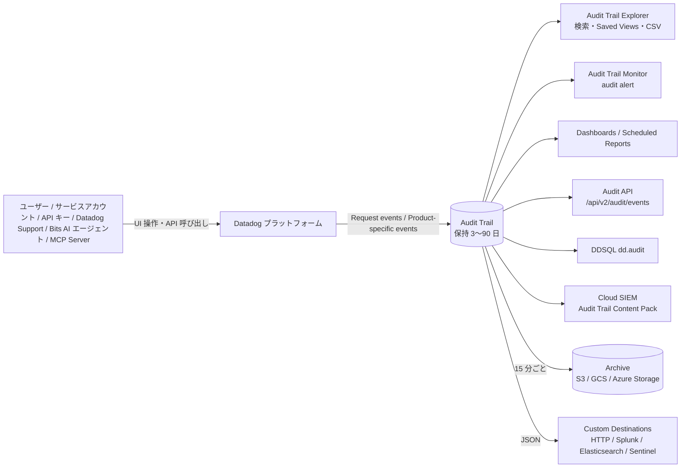
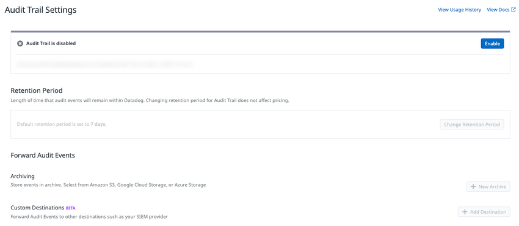
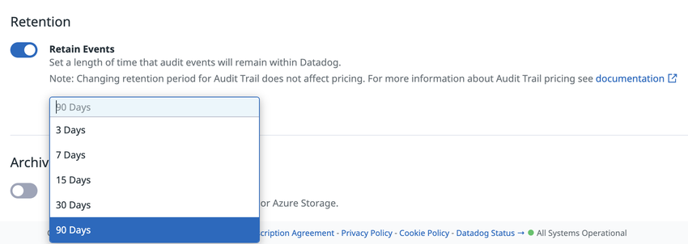
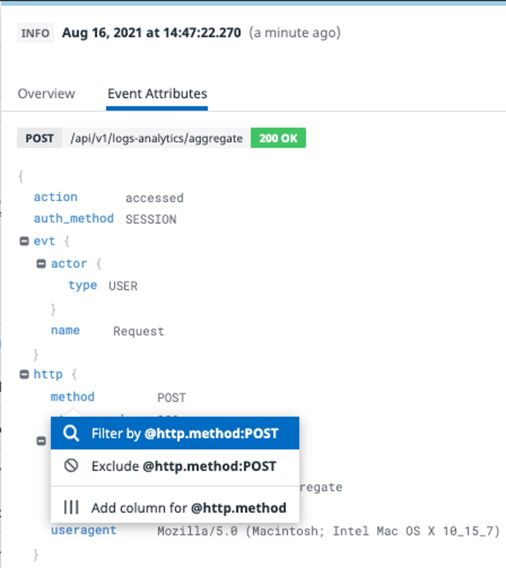
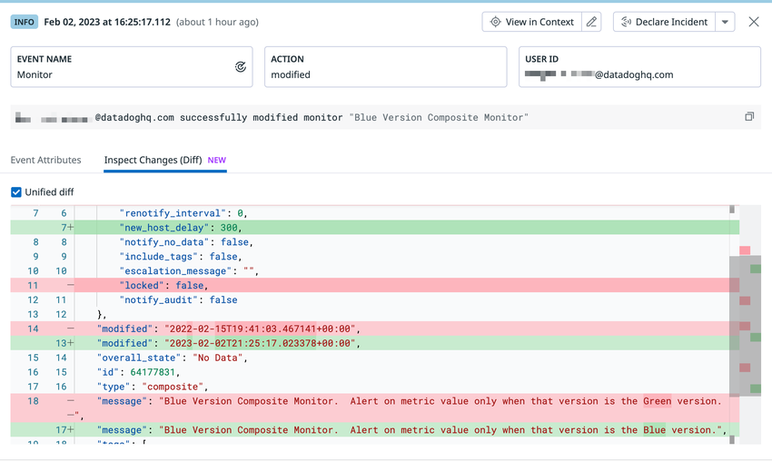
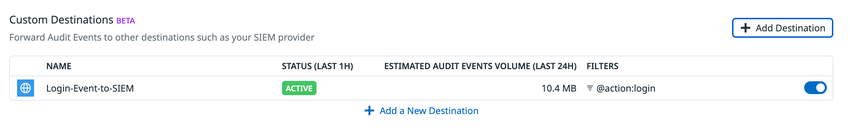

# Audit Trail（監査証跡）

## 概要

Datadog Audit Trail（監査証跡）は、**誰が、いつ、どの認証手段で、Datadog 上の何を操作したか**を記録し、検索・可視化・アラート・保管・外部転送できる製品である。管理者やセキュリティチームは組織全体の利用状況を確認できる。個々のユーザーは自分の操作履歴を見られる。[出典](https://docs.datadoghq.com/account_management/audit_trail/)

Audit Trail が記録するイベントは次の 2 種類である。[出典](https://docs.datadoghq.com/account_management/audit_trail/)

| 種類 | 内容 | 例 |
|---|---|---|
| Request events（リクエストイベント） | Datadog API へのすべてのリクエストを顧客向けの記録に変換したもの | `POST /api/v1/logs-analytics/aggregate` の呼び出し、ダッシュボードやモニターへの `GET` アクセス |
| Product-specific events（製品固有イベント） | 製品ごとの設定変更・操作 | ログ Index の保持期間変更、Pipeline の変更、ダッシュボード削除、ロール変更、ログイン |

Datadog Audit Trail の主な用途は次のとおり。[出典](https://docs.datadoghq.com/account_management/audit_trail/)

- **コスト変動の原因調査**: ログ Index の保持期間や Exclusion Filter を誰が変えたか（請求額の増減、ログが見つからない原因）。
- **障害・破損の原因調査**: Processor や Pipeline を誰がいつ変更したか（ダッシュボードやモニターが壊れたとき）。
- **コンプライアンス・セキュリティ**: 重要なダッシュボード・モニター等の更新や削除、ユーザーログイン、アカウントやロールの変更の記録。
- **脅威検知**: Audit Trail のイベントを [Cloud SIEM](../security/cloud-siem.md) で分析し、セキュリティシグナルを生成する。

Datadog のツールとポリシーは PCI v4.0 に準拠している。[出典](https://docs.datadoghq.com/account_management/audit_trail/)

| 項目 | 内容 |
|---|---|
| 提供状況 | GA（2022-06-23 に一般提供を発表）[出典](https://www.datadoghq.com/ja/about/latest-news/press-releases/datadog-launches-audit-trail-to-help-businesses-achieve-their-compliance-and-governance-objectives/) |
| 画面の場所 | Organization Settings > COMPLIANCE > **Audit Trail Settings**（設定）、**Audit Trail**（Explorer、`https://app.datadoghq.com/audit-trail`） |
| 記録対象 | 100 種類を超える監査イベント（68 の製品カテゴリ。2026-11-02 時点） |
| 保持期間 | 有効時は既定 90 日。3 / 7 / 15 / 30 / 90 日から選択 |
| 外部保管・連携 | アーカイブ（Amazon S3 / Google Cloud Storage / Azure Storage）、Custom Destinations への転送（HTTP / Splunk / Elasticsearch / Microsoft Sentinel【Preview】） |
| 課金 | 料金ページ上の単位は「Per % of spend, per month」（支出に対する %）。詳細は「課金への影響」節を参照 |

### 関連ファイル

| 関連トピック | ファイル |
|---|---|
| ロール・権限・ユーザー管理（監査対象の多くはここでの操作） | [組織・ユーザー・権限管理](./account-and-access-management.md) |
| API キー・アプリケーションキー・PAT・SAT の管理と監査 | [API とキー管理](./api-and-keys.md) |
| モニター全般（Audit Trail Monitor の共通仕様） | [Monitors（モニター）](./monitors.md)、[通知と Downtime](./notifications-and-downtimes.md) |
| ダッシュボード（バージョン履歴の保持期間と Audit Trail の関係） | [Dashboards（ダッシュボード）](./dashboards.md) |
| DDSQL・Reference Tables | [Notebooks・DDSQL・Reference Tables](./notebooks-and-data-tools.md) |
| Events Explorer（監査用途ではない） | [Event Management](./event-management.md) |
| Cloud SIEM での検知 | [Cloud SIEM](../security/cloud-siem.md) |
| ログ検索構文（Audit Trail と共通） | [ログ検索と分析](../logs/log-search-and-analytics.md) |
| ログのアーカイブ・転送（Audit Trail とは別設定） | [Indexes・保持・アーカイブ](../logs/log-indexes-retention-archives.md) |
| サイトごとの差異 | [Datadog Sites（サイト）](./datadog-sites.md) |
| 使用量の確認 | [Usage・Usage Attribution・Cost Visibility](./usage-and-cost-attribution.md) |
| コンプライアンス設計 | [セキュリティとコンプライアンス](../../03_導入編/security-and-compliance.md) |
| 料金の正本 | [製品別料金表](../../03_導入編/pricing-by-product.md) |
| マルチ org 運用 | [大規模・マルチorg運用](../../04_応用編/large-scale-and-multi-org.md) |

## データフロー

Datadog Audit Trail のデータの流れは次のとおり。Explorer・Monitor・Dashboard・API・DDSQL はいずれも Datadog 内に保持されたイベントを読む。アーカイブと Custom Destinations は Datadog の外へイベントを書き出す。

## 有効化とセットアップ

### 有効化の手順

Datadog Audit Trail の有効化手順は次のとおり。[出典](https://docs.datadoghq.com/account_management/audit_trail/)

1. [Organization Settings](https://app.datadoghq.com/organization-settings/) を開く。
2. **COMPLIANCE** 配下の **Audit Trail Settings** を選ぶ。
3. **Enable** ボタンをクリックする。

有効化/無効化には `Audit Trail Write` 権限が必要である（「権限」節を参照）。

- **キャプション:** Audit Trail Settings 画面（Audit Trail が無効の状態）
- **画面の説明:** 画面上部に「Audit Trail is disabled」と表示され、右側に青い **Enable** ボタンがある。右上には **View Usage History** と **View Docs** のリンクがある。中段の **Retention Period** には「Length of time that audit events will remain within Datadog. Changing retention period for Audit Trail does not affect pricing.」という説明があり、無効時は「Default retention period is set to 7 days.」と表示され、**Change Retention Period** ボタンはグレーアウトしている。下段の **Forward Audit Events** には **Archiving**（Amazon S3、Google Cloud Storage、Azure Storage から選ぶ。**+ New Archive** ボタン）と **Custom Destinations**（SIEM などへの転送。**+ Add Destination** ボタン）がある。なお、この画像では Custom Destinations に「BETA」と表示されているが、2026-11-02 時点の公式ドキュメントでは Microsoft Sentinel 宛てだけが Preview と記載されている。
- **出典:** https://docs.datadoghq.com/account_management/audit_trail/ （取得日 2026-11-02）

### 有効化した人の確認

Datadog Audit Trail を最後に有効化したユーザーは、Events Explorer で確認できる。[出典](https://docs.datadoghq.com/account_management/audit_trail/)

1. [Events Explorer](https://app.datadoghq.com/event/explorer) を開く。
2. 検索バーに `Datadog Audit Trail was enabled by` と入力する。必要に応じて時間範囲を広げる。
3. 「A user enabled Datadog Audit Trail」というタイトルの最新イベントに、最後に有効化したユーザーが表示される。

Audit Trail の設定変更（保持期間など）そのものは、Audit Trail の `@evt.name:"Organization Management" @asset.type:audit_logs_settings` で追跡できる（「監査対象イベント一覧」を参照）。

## 権限

Datadog Audit Trail の権限は、RBAC の **Compliance** セクションにある 2 つである。[出典](https://docs.datadoghq.com/account_management/rbac/permissions/)

| 表示名 | 識別子 | 説明 | 既定で付与されるロール |
|---|---|---|---|
| Audit Trail Read | `audit_logs_read` | 組織の Audit Trail を閲覧する。Audit Explorer でのイベント閲覧と Audit API（検索・一覧）に必要 | Datadog Admin Role |
| Audit Trail Write | `audit_logs_write` | 組織の Audit Trail を設定する。有効化/無効化、保持期間、アーカイブ、転送先の設定に必要 | Datadog Admin Role |

補足:

- Audit Event Forwarding の公式ページでは、転送先の作成・編集・削除に必要な権限を `audit_trail_write` と記載している。一方、RBAC 権限一覧の識別子は `audit_logs_write` である。表記揺れとみられるが、権限一覧ではこれ以外に `audit_trail` を含む識別子を確認できない。[出典](https://docs.datadoghq.com/account_management/audit_trail/forwarding_audit_events/)
- 既定の Standard Role と Read Only Role には上の 2 権限は付かない。Admin 以外のユーザー（監査担当者など）に閲覧させる場合は、カスタムロールに `audit_logs_read` を付ける。ロール設計の詳細は [組織・ユーザー・権限管理](./account-and-access-management.md) を参照。
- 公式製品ページの FAQ では、Audit Trail は Datadog の RBAC と完全に統合されており、どのロール・ユーザーがアクセスできるかを制御できると説明している。[出典](https://www.datadoghq.com/pricing/?product=audit-trail)

## 保持期間（Retention）

Datadog Audit Trail の保持期間は、Audit Trail Settings の **Retention**（Retention Period）セクションで **Change retention period** をクリックして変更する。[出典](https://docs.datadoghq.com/account_management/audit_trail/)

| 状態 | 保持期間 |
|---|---|
| Audit Trail 有効時の既定値 | **90 日** |
| 選択可能な値 | **3 / 7 / 15 / 30 / 90 日** |
| Audit Trail を無効にしたとき | 既定の **7 日**に戻る |
| 90 日を超える保持 | Datadog 内では選べない。長期保管にはアーカイブを使う |

- 設定画面には「Changing retention period for Audit Trail does not affect pricing.」（保持期間を変えても料金は変わらない）と表示される（画面上の記載。下の画像を参照）。
- Audit Trail を有効にすると、他製品の履歴の保持期間も延びる場合がある。例として、ダッシュボードの Version History は既定 30 日だが、Audit Trail を有効にすると 90 日になる。[出典](https://docs.datadoghq.com/dashboards/guide/version_history/) 詳細は [Dashboards](./dashboards.md) を参照。

- **キャプション:** Audit Trail Settings の Retention セクション（保持期間の選択）
- **画面の説明:** **Retain Events** トグルがオンになっており、「Set a length of time that audit events will remain within Datadog.」「Note: Changing retention period for Audit Trail does not affect pricing.」と説明がある。ドロップダウンを開くと **3 Days / 7 Days / 15 Days / 30 Days / 90 Days** が並び、90 Days が選ばれている。下には **Archiving** のトグルがある。
- **出典:** https://docs.datadoghq.com/account_management/audit_trail/ （取得日 2026-11-02）

## イベントのデータモデル（主要属性）

Datadog Audit Trail のイベントはログと同じ JSON 構造で、`@` 付きの属性で検索する。主な属性は次のとおり。公式 DDSQL データセット `dd.audit` の列定義、Explorer の画面、ガイドに登場するクエリをもとにまとめた。[出典](https://docs.datadoghq.com/ddsql_reference/data_directory/dd/dd.audit.dataset/) [出典](https://docs.datadoghq.com/account_management/audit_trail/)

| 属性 | 意味 | 値の例 |
|---|---|---|
| `@evt.name` | イベントの製品カテゴリ（Event Name） | `Dashboard`、`Monitor`、`"Log Management"`、`Authentication`、`Request` |
| `@asset.type` | 操作対象のリソース種別 | `dashboard`、`monitor`、`index`、`role`、`api_key` |
| `@asset.id` / `@asset.name` | 操作対象の ID / 名前（UI のファセット名は Asset ID / Asset Name） | モニター ID、ダッシュボード名 |
| `@asset.new_value` / `@asset.prev_value` 等 | 変更後 / 変更前の値（変更前後を記録するイベントで使われる） | `@asset.new_value.enabled:false` |
| `@action` | 操作の種類 | `created`、`modified`、`deleted`、`accessed`、`login`、`executed`、`resolved` |
| `@evt.actor.type` | 操作主体の種別 | `USER`、`SUPPORT_USER`（Datadog Support による操作） |
| `@auth_method` | 認証方式 | `SESSION`（画面上の例） |
| `@usr.id` / `@usr.uuid` / `@usr.email` / `@usr.name` | 操作したユーザー（AI エージェントが操作した場合はエージェント側の情報が入る） | — |
| `@delegator.*` | AI エージェントが代理で操作したときの、委任元ユーザー | `@delegator.id` |
| `@evt.actor.mode` | AI エージェントの動作モード | `interactive` / `autonomous` |
| `is_mcp_call` | Datadog MCP Server 経由の操作 | `true` |
| `@http.method` / `@http.status_code` / `@http.url_details.path` / `@http.useragent` | Request events の HTTP 情報 | `GET`、`200`、`/api/v1/dashboard/<id>` |
| `@network.client.ip` / `@network.client.geoip.*` | 送信元 IP と GeoIP（国・都市・AS など） | `@network.client.geoip.country.name` |
| `@metadata.api_key.id` / `@metadata.application_key.id` / `@metadata.app_key.id` / `@metadata.pat.id` / `@metadata.oauth_client.name` | 使われた API キー、アプリケーションキー、PAT、OAuth クライアント | — |
| `@org.uuid` / `@org.name` | 組織 | — |
| `status` | ステータス | `Error` / `Warn` / `Info` |
| `is_notable_event` | Notable Event かどうか | `true` |

- **キャプション:** 監査イベント詳細の Event Attributes タブ
- **画面の説明:** イベント詳細パネルの上部にステータス（`INFO`）とタイムスタンプがあり、**Overview** と **Event Attributes** の 2 タブがある。Event Attributes タブには `POST /api/v1/logs-analytics/aggregate 200 OK` のリクエスト概要と、`action: accessed`、`auth_method: SESSION`、`evt.actor.type: USER`、`evt.name: Request`、`http.method: POST`、`http.useragent` などの JSON 属性が表示されている。属性をクリックすると **Filter by @http.method:POST**、**Exclude @http.method:POST**、**Add column for @http.method** のメニューが出る。
- **出典:** https://docs.datadoghq.com/account_management/audit_trail/ （取得日 2026-11-02）

## Audit Trail Explorer（検索と分析）

Datadog Audit Trail のイベントは、**Audit Trail**（`https://app.datadoghq.com/audit-trail`。Organization Settings からも開ける）で探索する。Audit Trail のイベントは [Log Explorer](../logs/log-search-and-analytics.md) のログと同じ機能を持つ。[出典](https://docs.datadoghq.com/account_management/audit_trail/)

### 検索とファセット

| 機能 | 内容 |
|---|---|
| 検索構文 | Log Explorer と同じ[検索構文](https://docs.datadoghq.com/logs/explorer/search_syntax/) |
| 主なファセット | Event Names（Dashboards、Monitors、Authentication など）、Authentication Attributes（Actor、API Key ID、User email など）、`Status`（`Error` / `Warn` / `Info`）、Method（`POST` / `GET` / `DELETE`） |
| 属性からの絞り込み | イベントを選び、Event Attributes タブで属性（`http.method`、`usr.email`、`client.ip` など）を選んで、フィルタまたは除外に加える |
| 可視化 | Group into fields（例: `User Email` で集計）、Visualize as（例: Top List） |
| 時間範囲 | 右上のタイムフレームセレクター |

[出典](https://docs.datadoghq.com/account_management/audit_trail/) [出典](https://docs.datadoghq.com/account_management/audit_trail/guides/track_dashboard_access_and_configuration_changes/)

### Natural Language Queries（自然言語クエリ）

Datadog Audit Trail の Natural Language Queries（NLQ）は、英語の自然文を構造化クエリに変換する機能である。ユーザー、操作、リソース、時間範囲などの文脈を理解し、関連フィールドを自動で特定する。例:「Who modified the payment dashboard last week」「Show all role changes in the past 24 hours」。[出典](https://docs.datadoghq.com/account_management/audit_trail/)

> **サイト差異:** NLQ は `app.ddog-gov.com`（US1-FED）と `us2.ddog-gov.com` では使えない。[出典](https://docs.datadoghq.com/account_management/audit_trail/)

### Saved Views（保存ビュー）

Datadog Audit Trail の Saved Views は Explorer の左上にあり、クエリ・可視化・ファセットの組み合わせを保存・共有する。[出典](https://docs.datadoghq.com/account_management/audit_trail/)

| 種類 | 内容 | 編集 |
|---|---|---|
| Integration saved views | Audit Trail に最初から用意されたビュー。Datadog ロゴ付き | 読み取り専用（Update / Rename / Delete 不可） |
| Custom saved views | ユーザーが **Save** ボタンで作るビュー。作成者のアバター付き。組織全体に共有される | Read Only ユーザー以外の全ユーザーが編集可能 |
| Default view | Explorer を開いたときの個人用の既定ビュー。本人だけが見られ、組織には影響しない | 本人が Update / Reset できる |

Views パネルで Saved View に対してできる操作は次のとおり。

- 読み込み / 再読み込み
- 現在のビュー構成で更新
- 名前変更 / 削除
- 短縮リンクで共有
- スター（お気に入り）を付け、一覧の先頭とナビゲーションメニューに表示する

Default view は、UI で何か操作するか、別の構成を埋め込んだ Explorer リンクを開くと**一時的に**上書きされる。Views パネルから再読み込み・現在のパラメータでの更新・Datadog 既定値へのリセットができる。

### Notable Events（注目イベント）

Datadog Audit Trail の Notable Events は、監査イベントのうち、**課金やセキュリティに影響しうる重要な設定変更**として Datadog が選んだもののサブセットである。すべてのイベント種別を知らなくても、管理者が重要な変更に絞り込める。全件は `is_notable_event:true` で取得できる。[出典](https://docs.datadoghq.com/account_management/audit_trail/)

| 監査イベントの内容 | Audit Explorer のクエリ |
|---|---|
| ログベースメトリクスの変更 | `@evt.name:"Log Management" @asset.type:"custom_metrics"` |
| Log Management Index の Exclusion Filter の変更 | `@evt.name:"Log Management" @asset.type:"exclusion_filter"` |
| Log Management Index の変更 | `@evt.name:"Log Management" @asset.type:index` |
| APM Retention Filter の変更 | `@evt.name:APM @asset.type:retention_filter` |
| APM カスタムメトリクスの変更 | `@evt.name:APM @asset.type:custom_metrics` |
| メトリクスタグの変更 | `@evt.name:Metrics @asset.type:metric @action:(created OR modified)` |
| RUM アプリケーションの作成・削除 | `@evt.name:"Real User Monitoring" @asset.type:rum_application @action:(created OR deleted)` |
| Sensitive Data Scanner の Scanning Group の変更 | `@evt.name:"Sensitive Data Scanner" @asset.type:sensitive_data_scanner_scanning_group` |
| Synthetic テストの作成・削除 | `@evt.name:"Synthetics Monitoring" @asset.type:synthetics_test @action:(created OR deleted)` |
| Product Analytics の有効化・無効化・変更 | `@evt.name:"Product Analytics" @asset.type:product_analytics @action:(enabled OR disabled OR modified)` |

> 注意: 公式ドキュメントでは、Notable Events 表とイベント一覧表で同じ対象の `@asset.type` 表記が一致しない箇所がある。たとえば Exclusion Filter は Notable 表で `"exclusion_filter"`、イベント一覧で `"exclusion filter"`（空白区切り）、Log ベースのカスタムメトリクスは Notable 表で `"custom_metrics"`、イベント一覧で `"custom metric"` と書かれている。RUM アプリケーションも Notable 表は `rum_application`、イベント一覧は `real_user_monitoring_application` である。どちらの値で記録されているかは、実環境でファセット値を確認すること（公開情報では正しい表記を確認できず）。

### Inspect Changes（Diff）

Datadog Audit Trail のイベント詳細パネルにある **Inspect Changes (Diff)** タブは、変更後の設定を変更前と並べて比べる機能である。対象は **ダッシュボード、ノートブック、モニター**の設定（JSON オブジェクト）である。[出典](https://docs.datadoghq.com/account_management/audit_trail/)

- **キャプション:** 監査イベント詳細の Inspect Changes (Diff) タブ（Composite Monitor の変更）
- **画面の説明:** 上部に **EVENT NAME**（Monitor）、**ACTION**（modified）、**USER ID**（メールアドレス）のカードと、「<ユーザー> successfully modified monitor "Blue Version Composite Monitor"」というサマリがある。右上に **View in Context** と **Declare Incident** ボタンがある。**Event Attributes** と **Inspect Changes (Diff)** の 2 タブがあり、Diff タブでは **Unified diff** チェックボックスがオンで、変更前後の JSON が行番号付きで表示される。追加行（例: `"new_host_delay": 300`）は緑、削除行（例: `"locked": false`）は赤で強調され、`message` の文言変更（Green → Blue）も確認できる。
- **出典:** https://docs.datadoghq.com/account_management/audit_trail/ （取得日 2026-11-02）

### Reference Tables による絞り込み

Datadog Audit Trail では、[Reference Tables](./notebooks-and-data-tools.md) のメタデータを監査イベントと結合し、ルックアップクエリで絞り込める。手順は、クエリエディタ横の **+ Add** から **Join with Reference Table** を選ぶ。公式の例は、許可されていない IP アドレスからアクセスしたユーザーが変更したダッシュボードを探すものである。**100 万行を超える Reference Table はフィルタに使えない。**[出典](https://docs.datadoghq.com/account_management/audit_trail/)

### CSV ダウンロード

Datadog Audit Trail は、**最大 10 万件（100K）**の監査イベントを CSV でローカルにダウンロードできる。手順は次のとおり。[出典](https://docs.datadoghq.com/account_management/audit_trail/)

1. 対象イベントを取得する検索クエリを実行する。
2. CSV に含めたいイベントフィールドをビューの列に追加する。
3. **Download as CSV** をクリックする。
4. エクスポート件数を選んで CSV を出力する。

CSV のダウンロード自体も監査イベントとして記録される（`@evt.name:"Audit Trail" @asset.type:audit_events_csv`）。

### API キーの使用状況の監査

Log Management を使っている場合、収集されたログには `datadog.api_key_uuid` タグが付き、そのログの収集に使われた API キーの UUID が入る。これを使うと、API キーが組織内やテレメトリーソース間でどう使われているかを把握でき、キーのローテーションや管理に役立つ。[出典](https://docs.datadoghq.com/account_management/audit_trail/) キー管理の詳細は [API とキー管理](./api-and-keys.md) を参照。

## AI エージェント・MCP Server による操作の追跡

Datadog Audit Trail は、Datadog の AI エージェント（Bits SRE、Bits Chat、Bits Security Analyst、Bits Agent Builder など）が行った操作を、実行したエージェントと、該当する場合は委任したユーザーに帰属させて記録する。[出典](https://docs.datadoghq.com/account_management/audit_trail/guides/track_agentic_usage_in_your_organization/)

### アクターと委任のフィールド

| フィールド | 内容 |
|---|---|
| `@evt.actor.mode` | AI エージェントの動作モード。`interactive`（ユーザーが在席して操作を承認）または `autonomous`（ユーザー不在でシステムのトリガーにより動作） |
| `@delegator.actor` | AI エージェントが代理で操作したときの委任元ユーザー。エージェントが代理で操作すると `@evt.actor` はエージェントになり、ユーザーは `@delegator.actor` に移る |
| `is_mcp_call` | Datadog MCP Server 経由の操作で `true` |

[出典](https://docs.datadoghq.com/account_management/audit_trail/events/)

### クエリ

| 目的 | Audit Explorer のクエリ |
|---|---|
| Datadog AI エージェントによる全操作 | `@evt.actor.mode:*` |
| Datadog MCP Server 経由の全操作 | `is_mcp_call:true` |
| ユーザーが直接行った操作のみ | `@usr.id:<USER_ID>` |
| AI エージェントの代理操作を含め、そのユーザーに帰属する全操作 | `(@usr.id:<USER_ID> OR @delegator.id:<USER_ID>)` |

- `@usr.id` だけで検索すると、AI エージェントが代理で行った操作は含まれない。
- `@delegator.name` と `@usr.name` はメールアドレスではなく氏名である。特定ユーザーで絞り込む場合は `@delegator.id` と `@usr.id` を使う。
- エージェント操作のイベントには、エージェント名とアバター（例: Bits Chat）と委任ユーザーが「Co-authored by user + agent」として表示され、開かなくても人間の操作と区別できる。
- MCP Server 経由のイベントを開くと、MCP Server 設定へのリンクと、同じ MCP セッションの他のイベントへのリンクが表示される。

[出典](https://docs.datadoghq.com/account_management/audit_trail/guides/track_agentic_usage_in_your_organization/)

### エージェントごとの対応状況

| エージェント | 状況 | 補足 |
|---|---|---|
| Bits SRE | Tracked | ほとんどの操作に `@evt.actor.mode` と `@delegator.*` が付く。一部のツール呼び出しや調査の操作にはまだ付かない |
| Bits Chat | Partially tracked | Bits Chat の全画面ページからの操作は `interactive` モードで、依頼ユーザーが `@delegator.*` に入る。インラインチャットパネル（`Cmd`/`Ctrl` + `I`）からの操作には、まだこれらのフィールドが付かない |
| Bits Security Analyst | Tracked | `autonomous` モードで動作。人が介在しないため委任ユーザーはいない |
| Bits Agent Builder | Not yet tracked | `@evt.actor.mode` と `@delegator.*` はまだ付かない |
| Datadog MCP Server 経由の操作 | Tracked | `is_mcp_call` で識別 |
| サードパーティ製・顧客自作のエージェント | Not tracked | API キー、アプリケーションキー、PAT、SAT の通常の利用と区別されない |

- 対応済みエージェントでも、まだ対応していない操作種別がある。`@evt.actor.mode:*` が全操作を返すとは限らない。
- Datadog 管理の AI エージェント機能は GovCloud 環境では提供されない。

[出典](https://docs.datadoghq.com/account_management/audit_trail/guides/track_agentic_usage_in_your_organization/) [出典](https://docs.datadoghq.com/account_management/audit_trail/events/)

AI 機能そのものについては [Bits AI と AI 機能](../ai/bits-ai.md) を参照。

## 監査対象イベント一覧

Datadog Audit Trail は、Datadog プラットフォーム全体から **100 種類を超える監査イベント**を記録し、製品カテゴリ（Event Name、`@evt.name`）ごとに分類する。以下は公式の Audit Trail Events ページ（2026-11-02 取得）の全カテゴリ・全イベントを日本語にしたものである。クエリは公式のままである。[出典](https://docs.datadoghq.com/account_management/audit_trail/events/)

> 注意: カテゴリの見出し名と `@evt.name` の値は一致しないことがある（例: Audit Trail カテゴリの「Audit Trail settings」は `@evt.name:"Organization Management"`、Actions Datastore は `"Apps Datastore"`、Work Management は `"Case Management"`、Quality Gates は `"CI Visibility"`、Action Platform の一部は `"Private Action Runners"`）。検索ではクエリ列の値を使う。

### カテゴリの区分（Platform Events / Product-Specific Events）

公式ドキュメントは、カテゴリを次の 2 区分に分けて掲載している。[出典](https://docs.datadoghq.com/account_management/audit_trail/events/)

| 区分 | カテゴリ |
|---|---|
| Platform Events（16） | Access Management、Action Platform、Actions Datastore、Authentication、Dashboard、Datadog Agent、Flare、Integration、MCP Server、Monitor、Notebook、OAuth、Organization Management、Remote Configuration、Teams Management、Test Optimization |
| Product-Specific Events（52） | Agent Builder、AI Guard、AI Platform、App and API Protection (AAP)、App Builder、Application Performance Monitoring (APM)、Archive Search、Audit Trail、Bits AI Security Analyst、Bits AI SRE、Bits Dev、CI Visibility、CI/CD、Cloud Cost Management、Cloud Security Platform、Data Streams Monitoring、DDSQL Editor、Deployment Gates、DORA Metrics、Dynamic Instrumentation、Email Delivery、Error Tracking、Event Management、Exception Replay、Feature Flags、Fleet Automation、Forms、Governance、High Availability Agent、Incident Management、Infrastructure Monitoring、Internal Developer Portal、Kubernetes Actions、Kubernetes Autoscaling、Live Debugger、LLM Observability、Log Management、Metrics、Network Device Monitoring、Observability Pipelines、On-Call、Quality Gates、Real User Monitoring、Reference Tables、Security Finding Update、Security Notification、Sensitive Data Scanner、Service Level Objectives、Sheets、Synthetic Monitoring、Work Management、Workflows |

### Platform Events

#### Access Management（アクセス管理）

| イベント | 内容 | クエリ |
|---|---|---|
| Password | ユーザーがパスワードを変更した。パスワード認証が設定されていない org でも、そのユーザーが所属する全 org に届く | `@evt.name:"Access Management" @asset.type:password @action:modified` |
| Role modified (Support) | Datadog Support がロールを変更した（変更前後の権限を含む） | `@evt.name:"Access Management" @evt.actor.type:SUPPORT_USER @asset.type:role @action:modified` |
| IP Allowlist Modified (Support) | Datadog Support が org の IP Allowlist に新しい IP を追加した | `@evt.name:"Access Management" @evt.actor.type:SUPPORT_USER @asset.type:ip_allowlist @action:modified` |
| Application Key (Service Account User) | サービスアカウントのアプリケーションキーの作成・変更・削除 | `@evt.name:"Access Management" @asset.type:application_key` |
| Authentication Methods (Org) | org で許可する認証方式の変更（変更前後の値を含む） | `@evt.name:"Access Management" @asset.type:identity_provider` |
| User's role (Support) | Datadog Support がユーザーをロールに追加・削除した | `@evt.name:"Access Management" @evt.actor.type:SUPPORT_USER @asset.type:role @action:modified` |
| Email | アカウントのユーザーとしてメールアドレスが追加・無効化・検証された | `@evt.name:"Access Management" @asset.type:user` |
| Role modified | ロールの変更（変更前後の権限を含む） | `@evt.name:"Access Management" @asset.type:role @action:modified` |
| Role created or deleted | ロールの作成・削除 | `@evt.name:"Access Management" @asset.type:role @action:(created OR deleted)` |
| Role access request | ロールへのアクセスリクエストの作成・応答・削除（リクエストの値を含む） | `@evt.name:"Access Management" @asset.type:role_request` |
| User's role | ユーザーのロールへの追加・削除 | `@evt.name:"Access Management" @asset.type:role @action:modified` |
| User invite (Support) | Datadog Support がユーザーを org に招待した | `@evt.name:"Access Management" @evt.actor.type:SUPPORT_USER @asset.type:user @action:created` |
| Restriction policy | リソースの Restriction Policy の変更 | `@evt.name:"Access Management" @asset.type:restriction_policy @action:(modified OR deleted)` |
| Email update (Support) | Datadog Support がユーザーのメールアドレスを更新した | `@evt.name:"Access Management" @evt.actor.type:SUPPORT_USER @asset.type:user @action:modified` |

> 補足: 公式の表では「Role modified (Support)」と「User's role (Support)」、「Role modified」と「User's role」がそれぞれ同じクエリになっている。区別するにはイベント本文や変更内容を確認する。

#### Action Platform

| イベント | 内容 | クエリ |
|---|---|---|
| Action Platform resource | Connection Group、Execution Policy、Execution Group の作成・変更・削除、Action Platform 用アプリケーションキーの登録・解除、Execution Policy の実効権限の計算、アクション実行の入出力ペイロードへのアクセス | `@evt.name:"Action Platform" @asset.type:(connection_group OR execution_policy OR execution_group OR app_key_registration OR effective_permissions OR action_execution_payload)` |
| Runner enrollment token | Runner 登録トークンの作成、Runner の登録完了 | `@evt.name:"Private Action Runners" @asset.type:runner_enrollment @action:(completed OR created)` |
| Query intent | Query Intent の作成、Runner による Query Intent の検証 | `@evt.name:"Private Action Runners" @asset.type:query_intent @action:(validated OR created)` |
| Private action runner | Runner へのアクセス・作成・削除・変更、Runner の Connection への紐付け | `@evt.name:"Private Action Runners" @asset.type:private_action_runner @action:(accessed OR created OR deleted OR modified OR attached)` |

#### Actions Datastore

| イベント | 内容 | クエリ |
|---|---|---|
| Datastore item | Datastore アイテムの作成・変更・削除・クエリ | `@evt.name:"Apps Datastore" @asset.type:(item OR item_query) @action:(created OR deleted OR modified OR queried)` |
| Datastore | Datastore の作成・削除・クエリ・一覧取得 | `@evt.name:"Apps Datastore" @asset.type:(datastore OR datastore_list) @action:(queried OR created OR deleted)` |

#### Authentication（認証）

| イベント | 内容 | クエリ |
|---|---|---|
| API key (Org settings) | Organization Settings での API キーのアクセス・一覧・作成・削除 | `@evt.name:Authentication @asset.type:api_key` |
| Public API key (Org settings) | Organization Settings での Public API キーのアクセス・一覧・作成・削除 | `@evt.name:Authentication @asset.type:public_api_key` |
| Application key (Org settings) | Organization Settings でのアプリケーションキーのアクセス・一覧・作成・削除 | `@evt.name:Authentication @asset.type:application_key` |
| MFA | ユーザーによる多要素認証の有効化・無効化、リカバリーコードの生成。Datadog Support による MFA リセットも記録される。同じログインを共有する他 org にも記録されることがある | `@evt.name:Authentication @asset.type:user_mfa` |
| User login | ユーザーのログインと使用した認証方式 | `@evt.name:Authentication @action:login` |

#### Dashboard（ダッシュボード）

| イベント | 内容 | クエリ |
|---|---|---|
| Dashboard created | ダッシュボードの作成（新しい JSON を含む） | `@evt.name:Dashboard @asset.type:dashboard @action:created` |
| Dashboard deleted | ダッシュボードの削除（削除前の JSON を含む） | `@evt.name:Dashboard @asset.type:dashboard @action:deleted` |
| Dashboard user(s) deleted | ダッシュボードにアクセスできるユーザー ID の削除（削除した ID の一覧を含む） | `@evt.name:Dashboard @asset.type:dashboard_share_acl @action:deleted` |
| Public URL accessed | 公開ダッシュボード URL へのアクセス | `@evt.name:Dashboard @asset.type:dashboard @action:accessed` |
| Public URL generated or deleted | ダッシュボード公開 URL の生成・削除 | `@evt.name:Dashboard @asset.type:dashboard_share_link` |
| Dashboard modified | ダッシュボードの変更（変更前後の JSON を含む） | `@evt.name:Dashboard @asset.type:dashboard @action:modified` |
| Dashboard embedded (Roadie) | Datadog ダッシュボードがサードパーティ（Roadie）に埋め込まれた | `@evt.name:Dashboard @asset.type:embed @action:accessed` |
| Dashboard user(s) added | ダッシュボードにアクセスできるユーザー ID の追加（新しい ID の一覧を含む） | `@evt.name:Dashboard @asset.type:dashboard_share_acl @action:created` |

#### Datadog Agent

| イベント | 内容 | クエリ |
|---|---|---|
| Agent upgrade skipped | 対象バージョンにすでに達していたため、リモートアップグレードがスキップされた | `@evt.name:"Datadog Agent" @metadata.event_name:"Agent Upgrade Skipped"` |
| Agent upgrade failed | リモートアップグレードが失敗した | `@evt.name:"Datadog Agent" @metadata.event_name:"Agent Upgrade Failed"` |
| Agent upgrade succeeded | Agent のアップグレードが成功した | `@evt.name:"Datadog Agent" @metadata.event_name:"Agent Upgrade Succeeded"` |
| Agent API key updated | Agent の API キーが変更された | `@evt.name:"Datadog Agent" @metadata.event_name:"Agent API Key Updated"` |
| Agent enabled | 新しい Agent が有効化された | `@evt.name:"Datadog Agent" @action:created` |
| Agent configuration updated | Agent の設定が更新された | `@evt.name:"Datadog Agent" @action:modified` |
| Agent flare created | サポートチケット用の Agent Flare が作成された | `@evt.name:"Datadog Agent" @action:created @asset.type:agent_flare` |

Agent のリモート操作については [Fleet Automation と Remote Configuration](./fleet-automation.md) を参照。

#### Flare

| イベント | 内容 | クエリ |
|---|---|---|
| Flare collected | Agent、トレーサー、Remote Config リクエスト、Datadog Support リクエスト、Fleet Admin リクエスト、Synthetics、サーバーレス関数、Datadog CLI から Flare を受信した（成否を問わない）。Datadog Support が顧客に代わってホストで Flare を作成した場合も含む。Flare エンドポイントへの到達確認用の認証付き HEAD リクエストでも発生する | `@evt.name:Flare` |

#### Integration（インテグレーション）

| イベント | 内容 | クエリ |
|---|---|---|
| Resource | インテグレーションのリソース（チャネル、サービス、Webhook、アカウント、インスタンスなど）の追加・変更・削除（変更前後の値を含む） | `@evt.name:Integration @asset.type:integration` |
| Repository deleted | Source Code Integration からリポジトリが削除された | `@evt.name:Integration @asset.type:source_code_integration_repository @action:deleted` |

#### MCP Server

| イベント | 内容 | クエリ |
|---|---|---|
| MCP server operation | Datadog MCP Server への接続の初期化、ツール呼び出し、リソース読み取り、プロンプト取得が成功した | `@evt.name:"MCP Server" @asset.type:mcp @action:executed` |

#### Monitor（モニター）

| イベント | 内容 | クエリ |
|---|---|---|
| Monitor deleted | モニターの削除（削除前の JSON を含む） | `@evt.name:Monitor @asset.type:monitor @action:deleted` |
| Monitor created | モニターの作成（新しい JSON を含む） | `@evt.name:Monitor @asset.type:monitor @action:created` |
| Monitor resolved | モニターが Resolve された | `@evt.name:Monitor @asset.type:monitor @action:resolved` |
| Monitor modified | モニターの変更（変更前後の JSON を含む） | `@evt.name:Monitor @asset.type:monitor @action:modified` |

#### Notebook（ノートブック）

| イベント | 内容 | クエリ |
|---|---|---|
| Notebook deleted | ノートブックの削除（削除前の JSON を含む） | `@evt.name:Notebook @asset.type:notebook @action:deleted` |
| Notebook modified | ノートブックの変更（変更前後の JSON を含む） | `@evt.name:Notebook @asset.type:notebook @action:modified` |
| Notebook created | ノートブックの作成（新しい JSON を含む） | `@evt.name:Notebook @asset.type:notebook @action:created` |

#### OAuth

| イベント | 内容 | クエリ |
|---|---|---|
| OAuth client | OAuth クライアントの作成・変更・削除（変更前後の値を含む） | `@evt.name:OAuth @asset.type:oauth_client` |

#### Organization Management（組織管理）

| イベント | 内容 | クエリ |
|---|---|---|
| Audit Trail settings | Audit Trail 設定の変更（変更前後の設定を含む） | `@evt.name:"Organization Management" @asset.type:audit_logs_settings` |
| Org renamed | 組織名の変更 | `@evt.name:"Organization Management" @asset.type:organization @action:modified` |
| Child org created | 既存の org に子 org を作成した | `@evt.name:"Organization Management" @asset.type:organization @action:created` |
| Product Activation | ユーザーまたは Datadog Support による製品・使用タイプの有効化/無効化の要求（拒否・失敗した試行を含む） | `@evt.name:"Organization Management" @asset.type:product_activation` |

#### Remote Configuration

| イベント | 内容 | クエリ |
|---|---|---|
| Remote Configuration | org レベルの Remote Configuration の有効化・無効化・変更、特定製品・機能グループ単位の Remote Configuration の有効化・無効化（成否を問わない） | `@evt.name:"Remote Configuration" @asset.type:(remote_configuration OR remote_configuration_granular_product_enablement_update)` |

#### Teams Management

| イベント | 内容 | クエリ |
|---|---|---|
| Teams Management | チームまたはチームの関連付けの作成・削除・変更 | `@evt.name:"Teams Management" @action:(created OR deleted OR modified)` |

#### Test Optimization

| イベント | 内容 | クエリ |
|---|---|---|
| Test Optimization settings | リポジトリまたはサービスの設定の変更・削除 | `@evt.name:"Test Optimization" @asset.type:test_optimization_settings (@action:modified OR @action:deleted)` |
| Flaky test status | Flaky テストのステータス変更 | `@evt.name:"Test Optimization" @asset.type:"test_optimization_management" @action:modified` |
| Test optimization default settings | 既定設定の変更・削除 | `@evt.name:"Test Optimization" @asset.type:test_optimization_default_settings (@action:modified OR @action:deleted)` |

### Product-Specific Events

#### Agent Builder

| イベント | 内容 | クエリ |
|---|---|---|
| Custom Agent | カスタムエージェントの作成・変更・削除、カスタムエージェントとの会話の実行 | `@evt.name:"Agent Builder" @asset.type:custom_agent @action:(created OR modified OR deleted OR executed)` |

#### AI Guard

| イベント | 内容 | クエリ |
|---|---|---|
| AI Guard Tool Blocking | ツールブロックルールの変更・削除 | `@evt.name:"AI Guard" @asset.type:"AI Guard Tool Blocking" @action:(modified OR deleted)` |
| AI Guard Tool Allowlist | ツール Allowlist エントリの変更・削除 | `@evt.name:"AI Guard" @asset.type:"AI Guard Tool Allowlist" @action:(modified OR deleted)` |
| AI Guard Evaluation Sensitivity | 評価感度しきい値の変更・削除 | `@evt.name:"AI Guard" @asset.type:"AI Guard Evaluation Sensitivity" @action:(modified OR deleted)` |
| AI Guard Static Rules | AI Guard ポリシー内のカスタム静的ルール（正規表現・キーワードリスト）の変更・削除 | `@evt.name:"AI Guard" @asset.type:"AI Guard Static Rules" @action:(modified OR deleted)` |
| AI Guard Tool Policies | ツール呼び出しに適用するツールポリシー（pass / block / evaluate）の変更・削除 | `@evt.name:"AI Guard" @asset.type:"AI Guard Tool Policies" @action:(modified OR deleted)` |
| AI Guard Customer Context | 評価で使うアプリケーション説明（Customer Context）の変更・削除 | `@evt.name:"AI Guard" @asset.type:"AI Guard Customer Context" @action:(modified OR deleted)` |
| AI Guard Service Configuration | サービス設定（ブロックの有効化、Sensitive Data Scanner 設定を含む）の作成・変更 | `@evt.name:"AI Guard" @asset.type:"AI Guard Service Configuration" @action:(modified OR deleted)` |
| AI Guard Activation | org で AI Guard を有効化した | `@evt.name:"AI Guard" @asset.type:"AI Guard Activation" @action:created` |

#### AI Platform

| イベント | 内容 | クエリ |
|---|---|---|
| AI Gateway model group | AI Gateway モデルグループのアクセス制限の作成・変更・削除 | `@evt.name:"AI Platform" @asset.type:ai_gateway_model_group @action:(created OR modified OR deleted)` |

#### App and API Protection（AAP、旧称：Application Security Management / ASM）

| イベント | 内容 | クエリ |
|---|---|---|
| One-click Activation | サービスでの AAP の有効化・無効化 | `@evt.name:"Application Security" @asset.type:compatible_services` |
| Automated User Tracking mode | サービスの自動ユーザートラッキングモードの変更 | `@evt.name:"Application Security" @asset.type:"auto_user_instrum.mode"` |
| Denylist | IP アドレスまたはユーザー ID のブロック、ブロック解除、ブロック期間の延長 | `@evt.name:"Application Security" @asset.type:ip_user_denylist` |
| Protection | In-App WAF のブロック保護、または IP/ユーザー Denylist 保護の有効化・無効化 | `@evt.name:"Application Security" @asset.type:blocking_configuration` |
| API Security sampling rate | API Security のリクエストサンプリング率の変更 | `@evt.name:"Application Security" @asset.type:"api_security.request_sample_rate"` |
| ASM Action | ASM アクションの作成・変更・削除 | `@evt.name:"Application Security" @asset.type:action` |
| ASM Scanner | ASM スキャナーの作成・変更・削除 | `@evt.name:"Application Security" @asset.type:scanner` |
| In-App WAF Custom Rule | In-App WAF カスタムルールの検証・作成・変更・削除 | `@evt.name:"Application Security" @asset.type:waf_custom_rule` |
| In-App WAF Policy | In-App WAF ポリシーの作成・変更・削除 | `@evt.name:"Application Security" @asset.type:policy_entry` |
| Passlist | Passlist エントリの追加・変更・削除 | `@evt.name:"Application Security" @asset.type:passlist_entry` |

製品の詳細は [App and API Protection](../security/app-and-api-protection.md) を参照。

#### App Builder

| イベント | 内容 | クエリ |
|---|---|---|
| Query started | クエリの開始 | `@evt.name:"App Builder" @asset.type:query @action:started` |
| Embedded App placement | Datadog の製品画面への埋め込みアプリ配置の作成・変更・削除の試行 | `@evt.name:"App Builder" @asset.type:embedded_app_placement @action:(created OR modified OR deleted)` |
| Query executed | クエリの実行 | `@evt.name:"App Builder" @asset.type:query @action:executed` |
| API Request | Datadog プラットフォーム全体での API リクエスト（Request events） | `@evt.name:Request @action:accessed` |
| App | アプリへのアクセス・作成・変更・公開・削除・リバート・非公開化 | `@evt.name:"App Builder" @asset.type:app @action:(accessed OR created OR modified OR published OR deleted OR reverted OR unpublished)` |

> 補足: 「API Request」は公式ページでは App Builder の表に載っているが、クエリ（`@evt.name:Request`）が示すとおり、プラットフォーム全体の Request events を指す。

#### Application Performance Monitoring（APM）

| イベント | 内容 | クエリ |
|---|---|---|
| Facet | ファセットの作成・変更・削除（設定の変更前後の値を含む） | `@evt.name:APM @asset.type:facet` |
| Retention filter | Retention Filter の作成・変更・削除（変更前後の値を含む） | `@evt.name:APM @asset.type:retention_filter` |
| Span-based metric | スパンベースメトリクスの作成・変更・削除（変更前後の値を含む） | `@evt.name:APM @asset.type:custom_metrics` |
| Custom metrics | カスタムメトリクスの作成・変更・削除 | `@evt.name:APM @action:(created OR modified OR deleted) @asset.type:custom_metrics` |
| Saved view | Saved View の作成・変更・削除 | `@evt.name:APM @action:(created OR modified OR deleted) @asset.type:saved_view` |
| Workload selection policy | APM Workload Selection Policy の作成・変更・削除 | `@evt.name:APM @asset.type:apm_wls_policy` |
| Sampling rates remotely configured | APM サンプリング率のリモート設定 | `@evt.name:APM @asset.type:samplerconfig` |
| Second primary tag | Second Primary Tag の追加・変更・削除（変更前後の値を含む） | `@evt.name:APM @asset.type:second_primary_tag` |
| Primary operation name | サービスの Primary Operation Name の作成・変更・削除（変更前後の値を含む） | `@evt.name:APM @asset.type:service_operation_name` |

#### Archive Search

| イベント | 内容 | クエリ |
|---|---|---|
| Archive search | Archive Search の作成・変更・中止（クエリ、時間範囲、保持設定を含む） | `@evt.name:"Archive Search" @asset.type:archive_search @action:(created OR modified OR aborted)` |

#### Audit Trail

| イベント | 内容 | クエリ |
|---|---|---|
| Audit Trail settings | Audit Trail 設定の変更（変更前後の設定を含む） | `@evt.name:"Organization Management" @asset.type:audit_logs_settings` |
| Download as CSV | 監査イベント一覧の CSV エクスポート | `@evt.name:"Audit Trail" @asset.type:audit_events_csv` |

#### Bits AI SRE

| イベント | 内容 | クエリ |
|---|---|---|
| Monitor Rate Limit | 自動調査のモニターレート制限の変更 | `@evt.name:"Bits AI SRE" @asset.type:monitor_rate_limit @action:(modified)` |
| Automatic Investigations Monitor Toggle | モニター単位の自動調査の有効化・無効化 | `@evt.name:"Bits AI SRE" @asset.type:automatic_investigations_monitor_toggle @action:(enabled OR disabled)` |
| Tool Call | 手動調査でツール呼び出しが実行された | `@evt.name:"Bits AI SRE" @asset.type:tool_call @action:created` |
| Manual Investigation | 手動調査の開始・完了 | `@evt.name:"Bits AI SRE" @asset.type:investigation @action:(started OR completed)` |

#### Bits AI Security Analyst

| イベント | 内容 | クエリ |
|---|---|---|
| Investigation Verdict Change | ユーザーへのヒアリング後に調査の判定が変わった | `@evt.name:"Bits AI Security Analyst" @asset.type:investigation @action:modified` |

#### Bits Dev

| イベント | 内容 | クエリ |
|---|---|---|
| Code Session | Bits Dev のコードセッションの開始・変更 | `@evt.name:"Bits Dev" @asset.type:(code_session OR session OR chat) @action:(created OR modified OR enabled OR disabled OR messaged OR linked OR unlinked)` |

#### CI Visibility

| イベント | 内容 | クエリ |
|---|---|---|
| GitHub account settings | GitHub アカウント設定の変更 | `@evt.name:"CI Visibility" @asset.type:github_opt_ins (@action:modified OR @action:deleted)` |
| Test service settings | テストサービス設定の作成・変更 | `@evt.name:"CI Visibility" @asset.type:ci_app_test_service_settings (@action:created OR @action:modified)` |
| Repository default branch | リポジトリの既定ブランチの変更 | `@evt.name:"CI Visibility" @asset.type:ci_app_repository @action:modified` |
| Exclusion filters | Exclusion Filter の変更 | `@evt.name:"CI Visibility" @asset.type:ci_app_exclusion_filters @action:modified` |

#### CI/CD

| イベント | 内容 | クエリ |
|---|---|---|
| Skippable Tests | Test Impact Analysis でコミットのスキップ可能テスト一覧を要求した | `@evt.name:"CI/CD" @action:accessed` |
| CICD bulk settings | 複数リポジトリの設定の一括変更 | `@evt.name:"CI/CD" @asset.type:cicd_bulk_settings` |
| CICD settings | リポジトリまたはサービスの CI/CD 設定の変更・削除 | `@evt.name:"CI/CD" @asset.type:cicd_settings` |

#### Cloud Cost Management

| イベント | 内容 | クエリ |
|---|---|---|
| Cloud Cost Management onboarding status | CCM オンボーディングの有効化・無効化 | `@evt.name:"Cloud Cost Management" @asset.type:cloud_cost_management_onboarding_status` |
| Cloud Cost Management account | コスト取り込み用の AWS / GCP / Azure アカウントの接続・変更・削除、CCM アカウントフィルターの変更 | `@evt.name:"Cloud Cost Management" @asset.type:cloud_cost_management_account` |

#### Cloud Security Platform

| イベント | 内容 | クエリ |
|---|---|---|
| Risk Insights Notification Rule | Risk Insights 通知ルールの作成・更新・削除 | `@evt.name:"Cloud Security Platform" @asset.type:risk_insights_notification_rule` |
| CWS Agent Rule | CWS Agent ルールへのアクセス（取得） | `@evt.name:"Cloud Security Platform" @asset.type:cws_agent_rule @action:accessed` |
| Notification Profile | 通知プロファイルの作成・更新・削除 | `@evt.name:"Cloud Security Platform" @asset.type:notification_profile` |
| Security Rule | セキュリティルールの検証・更新・削除・作成（変更前後の値を含む） | `@evt.name:"Cloud Security Platform" @asset.type:security_rule` |
| Security Signal | シグナルの状態変更・担当者割り当て（変更前後の値を含む） | `@evt.name:"Cloud Security Platform" @asset.type:security_signal @action:modified` |
| Report Subscription | K9 メールレポートの購読・購読解除 | `@evt.name:"Cloud Security Platform" @asset.type:report_subscription` |

Datadog Security 製品のイベント（Cloud Security Platform と AAP の一部）は、Security ドキュメントの「Datadog Security イベントの監査」ページにもまとめられている。[出典](https://docs.datadoghq.com/security/audit_trail/)

#### Data Streams Monitoring

| イベント | 内容 | クエリ |
|---|---|---|
| DSM Kafka topic created | DSM 経由の Kafka トピック作成 | `@evt.name:"Data Streams Monitoring" @asset.type:dsm_kafka_topic @action:created` |
| DSM Kafka messages read | DSM 経由の Kafka メッセージ読み取り | `@evt.name:"Data Streams Monitoring" @asset.type:dsm_kafka_message @action:accessed` |
| DSM Kafka message produced | DSM 経由の Kafka メッセージ送信 | `@evt.name:"Data Streams Monitoring" @asset.type:dsm_kafka_message @action:created` |
| DSM Kafka topic deleted | DSM 経由の Kafka トピック削除 | `@evt.name:"Data Streams Monitoring" @asset.type:dsm_kafka_topic @action:deleted` |

#### DDSQL Editor

| イベント | 内容 | クエリ |
|---|---|---|
| DDSQL published analysis | 公開済み DDSQL 分析の作成・変更・削除 | `@evt.name:"DDSQL Editor" @asset.type:published_dataset @action:(created OR modified OR deleted)` |

#### Deployment Gates

| イベント | 内容 | クエリ |
|---|---|---|
| Deployment gate | Deployment Gate の作成・変更・削除 | `@evt.name:"Deployment Gates" @asset.type:ci_app_deployment_gate (@action:created OR @action:modified OR @action:deleted)` |
| Deployment gate rule | Deployment Gate ルールの作成・変更・削除 | `@evt.name:"Deployment Gates" @asset.type:ci_app_deployment_gate_rule (@action:created OR @action:modified OR @action:deleted)` |

#### DORA Metrics

| イベント | 内容 | クエリ |
|---|---|---|
| DORA settings | DORA Metrics 設定（デプロイソース、インシデントソース、ロールバック/ロールフォワード設定、カスタム Bot ユーザー、カスタムレビューエージェント、カスタム PR ラベル、AI 影響の帰属）の作成・変更 | `@evt.name:"DORA Metrics" @asset.type:sw_dora_settings @action:(created OR modified)` |

#### Dynamic Instrumentation

| イベント | 内容 | クエリ |
|---|---|---|
| Metrics Probe | メトリクスプローブの作成・変更・削除 | `@evt.name:"Dynamic Instrumentation" @action:(created OR modified OR deleted) @asset.type:span_probe` |
| Spans Probe | スパンプローブの作成・変更・削除 | `@evt.name:"Dynamic Instrumentation" @action:(created OR modified OR deleted) @asset.type:metric_probe` |
| Logs Probe | ログプローブの作成・変更・削除 | `@evt.name:"Dynamic Instrumentation" @action:(created OR modified OR deleted) @asset.type:log_probe` |

> 注意: 公式の表では Metrics Probe のクエリが `span_probe`、Spans Probe のクエリが `metric_probe` になっており、名称と `@asset.type` が逆に見える。公式ドキュメントの誤記の可能性がある。実環境のファセット値で確認すること。

#### Email Delivery

| イベント | 内容 | クエリ |
|---|---|---|
| Email delivery event | ユーザーに送ったメール通知の配信状況（配信済み・破棄・バウンス） | `@evt.name:"Email Delivery" @action:(email_delivered OR email_dropped OR email_bounced)` |

#### Error Tracking

| イベント | 内容 | クエリ |
|---|---|---|
| Create or modify inclusion filter | Inclusion Filter の追加・変更 | `@evt.name:"Error Tracking" @asset.type:error_tracking_inclusion_filter` |
| Error Tracking for Logs activation | ログ向け Error Tracking の有効化・無効化 | `@evt.name:"Error Tracking" @action:(created OR deleted) @asset.type:error_tracking_logs` |

#### Event Management

| イベント | 内容 | クエリ |
|---|---|---|
| Custom metrics | カスタムメトリクスの作成・変更・削除 | `@evt.name:"Event Management" @asset.type:custom_metrics` |
| Correlation pattern | 相関パターンの作成 | `@evt.name:"Event Management" @asset.type:event_correlation` |

#### Exception Replay

| イベント | 内容 | クエリ |
|---|---|---|
| Exception Replay Redaction Settings | Exception Replay のマスキング（Redaction）設定の作成・変更・削除 | `@evt.name:"Exception Replay" @action:(created OR modified OR deleted) @asset.type:redaction_settings` |

#### Feature Flags

| イベント | 内容 | クエリ |
|---|---|---|
| Feature flag | フィーチャーフラグのロールアウトの作成・変更・削除・アーカイブ・アーカイブ解除・スケジュール・開始・一時停止・再開・中止、およびバリアント、ターゲティングルール、ロールアウト率、環境ステータス、既定/オーバーライドバリアント、陳腐化ステータスの更新 | `@evt.name:"Feature Flags" @asset.type:(feature_flag OR feature_flag_variant OR feature_flag_targeting_rules OR feature_flag_rollout OR feature_flag_environment_status OR feature_flag_default_variant OR feature_flag_override_variant OR feature_flag_staleness_status)` |

#### Fleet Automation

| イベント | 内容 | クエリ |
|---|---|---|
| Fleet Automation job | パッケージアップグレードや設定更新ジョブの開始・スケジュール・キャンセル、設定更新のドライラン検証、アップグレードスケジュールの作成・変更・削除（成否を問わない） | `@evt.name:"Fleet Automation" @asset.type:(fleet_upgrade OR fleet_schedule OR fleet_upgrade_dry_run)` |

#### Forms

| イベント | 内容 | クエリ |
|---|---|---|
| Form | フォームの作成・変更・リバート・公開・削除・クエリ・回答、メールまたは許可ドメインでの共有、PDF からのインポート、フォーム通知の受信 | `@evt.name:"Forms" @asset.type:(form OR form_list OR form_version_list OR form_sharing OR form_sharing_domain OR form_sharing_email OR form_definition_schema OR form_notification OR form_pdf_import)` |

#### Governance

| イベント | 内容 | クエリ |
|---|---|---|
| Governance detection | ユーザーまたは Governance Console ジョブによる検出の変更、緩和策のキュー投入、Governance 通知からのアクション実行 | `@evt.name:Governance @asset.type:"Governance Detection" @action:(modified OR enqueued OR executed)` |
| Tag policy | タグガバナンスポリシーの作成・変更・削除 | `@evt.name:Governance @asset.type:tag_policy` |
| Governance Control Notification Settings | ガバナンスコントロールの通知設定の変更 | `@evt.name:"Governance" @asset.type:"Governance Control Notification Settings" @action:modified` |
| Governance control | Governance Console のコントロールの変更（変更前後の値を含む） | `@evt.name:Governance @asset.type:"Governance Control" @action:modified` |

#### High Availability Agent

| イベント | 内容 | クエリ |
|---|---|---|
| High Availability Agent configuration | High Availability Agent 設定の作成・変更・削除 | `@evt.name:"High Availability Agent" @asset.type:ha_agent_config` |

#### Incident Management

| イベント | 内容 | クエリ |
|---|---|---|
| Incident | インシデントの作成 | `@evt.name:"Incident Management" @asset.type:incident @action:created` |

#### Infrastructure Monitoring

| イベント | 内容 | クエリ |
|---|---|---|
| Disable Container Image Trends | Container Image Trends の無効化 | `@evt.name:"Infrastructure Monitoring" @asset.type:configure_container_image_trends @action:disabled` |
| Enable Container Image Trends | Container Image Trends の有効化 | `@evt.name:"Infrastructure Monitoring" @asset.type:configure_container_image_trends @action:enabled` |

#### Internal Developer Portal

| イベント | 内容 | クエリ |
|---|---|---|
| Service naming rule | IDP のサービスカタログでのサービス命名ルール・タグ付与ルールの作成・変更・削除・並べ替え、サービスオーバーライド設定の変更 | `@evt.name:"Internal Developer Portal" @asset.type:(idp_service_remapping_rule OR idp_service_remapping_rule_reorder OR idp_service_override_removal OR idp_service_tags_enrichment_rule OR idp_service_tags_enrichment_rule_reorder)` |

#### Kubernetes Actions

| イベント | 内容 | クエリ |
|---|---|---|
| Kubernetes Action | Kubernetes リソースへのアクセス・削除・再起動・パッチ・ロールバック | `@evt.name:"Kubernetes Actions"` |

#### Kubernetes Autoscaling

| イベント | 内容 | クエリ |
|---|---|---|
| Kubernetes Autoscaling configuration | クラスターの Workload Autoscaling / Cluster Autoscaling の有効化・無効化 | `@evt.name:"Kubernetes Autoscaling" @action:modified` |

#### Live Debugger

| イベント | 内容 | クエリ |
|---|---|---|
| Live Debugger Redaction Settings | Live Debugger のマスキング設定の作成・変更・削除 | `@evt.name:"Live Debugger" @action:(created OR modified OR deleted) @asset.type:redaction_settings` |

#### LLM Observability

| イベント | 内容 | クエリ |
|---|---|---|
| Evaluation Metrics | アプリケーションの標準評価メトリクスの有効化・無効化・設定変更（サンプルレートなど） | `@evt.name:"LLM Observability" @action:(enabled OR modified OR disabled) @asset.type:evaluations` |

#### Log Management（ログ管理）

| イベント | 内容 | クエリ |
|---|---|---|
| Log forwarding | ログ転送の Custom Destination の作成・変更・削除 | `@evt.name:"Log Management" @action:(created OR modified OR deleted) @asset.type:log_forwarding` |
| Saved view | Log Explorer の Saved View の作成・変更・削除 | `@evt.name:"Log Management" @action:(created OR modified OR deleted) @asset.type:saved_view` |
| Exclusion filter configuration | Exclusion Filter 設定の作成・変更・削除（変更前後の値を含む） | `@evt.name:"Log Management" @asset.type:"exclusion filter"` |
| Index configuration | Index 設定の作成・変更・削除（変更前後の値を含む） | `@evt.name:"Log Management" @asset.type:index` |
| Processor | Pipeline 内 Processor の作成・変更・削除（変更前後の値を含む） | `@evt.name:"Log Management" @asset.type:pipeline_processor` |
| Archiving order modified | アーカイブの順序変更 | `@evt.name:"Log Management" @action:modified @asset.type:archive_list` |
| Rehydration Settings | ログ Rehydration 設定の変更 | `@evt.name:"Log Management" @asset.type:rehydration_settings @action:(modified)` |
| Query（Public Beta） | Log Explorer、ダッシュボード、Public API で Log Management の List クエリを実行した | `@evt.name:"Log Management" @asset.type:logs_query` |
| Custom metric | ログのカスタムメトリクスの作成・変更・削除（変更前後の値を含む） | `@evt.name:"Log Management" @asset.type:"custom metric"` |
| Historical view | ログの Historical View の作成・変更・中止・削除（変更前後の値を含む） | `@evt.name:"Log Management" @asset.type:historical_view` |
| Download as CSV | ログ一覧の CSV エクスポート | `@evt.name:"Log Management" @asset.type:logs_csv` |
| Archive configuration | アーカイブ設定の作成・変更・削除（変更前後の値を含む） | `@evt.name:"Log Management" @asset.type:archive` |
| Log pipeline | Pipeline またはネストした Pipeline の作成・変更・削除（変更前後の値を含む） | `@evt.name:"Log Management" @asset.type:pipeline` |
| Restriction query configuration | ログの Restriction Query 設定の作成・変更・削除（変更前後の値を含む） | `@evt.name:"Log Management" @asset.type:restriction_query` |
| Index order modified | Index の順序変更 | `@evt.name:"Log Management" @action:modified @asset.type:index_list` |
| Facet | Log Explorer のファセットの作成・変更・削除（変更前後の値を含む） | `@evt.name:"Log Management" @asset.type:facet` |
| Standard attribute configuration | ログの Standard Attribute 設定の作成・変更・削除（変更前後の値を含む） | `@evt.name:"Log Management" @asset.type:standard_attribute` |

ログの Index・アーカイブ・転送の仕様は [Indexes・保持・アーカイブ](../logs/log-indexes-retention-archives.md) と [Log Pipelines と処理](../logs/log-pipelines-and-processing.md) を参照。

#### Metrics（メトリクス）

| イベント | 内容 | クエリ |
|---|---|---|
| Custom metric created | カスタムメトリクスの作成（新しい設定値を含む） | `@evt.name:Metrics @asset.type:metric @action:created` |
| Custom metric deleted | カスタムメトリクスの削除（削除前の設定値を含む） | `@evt.name:Metrics @asset.type:metric @action:deleted` |
| Custom metric modified | カスタムメトリクスの変更（変更前後の値を含む） | `@evt.name:Metrics @asset.type:metric @action:modified` |

#### Network Device Monitoring

| イベント | 内容 | クエリ |
|---|---|---|
| Access network interfaces | ネットワークインターフェースへのアクセス | `@evt.name:"Network Device Monitoring" @asset.type:network_device @action:accessed` |
| Access network device profiles | デバイスプロファイルへのアクセス | `@evt.name:"Network Device Monitoring" @asset.type:network_device @action:accessed` |
| Access network device groups | デバイスグループへのアクセス | `@evt.name:"Network Device Monitoring" @asset.type:network_device @action:accessed` |
| Access network device facets | デバイスファセットへのアクセス | `@evt.name:"Network Device Monitoring" @asset.type:network_device @action:accessed` |
| Modify network interface tags | インターフェースタグの変更 | `@evt.name:"Network Device Monitoring" @asset.type:network_device_tags @action:modified` |
| Access network devices list | デバイス一覧へのアクセス | `@evt.name:"Network Device Monitoring" @asset.type:network_device @action:accessed` |
| Modify network device tags | デバイスタグの変更 | `@evt.name:"Network Device Monitoring" @asset.type:network_device_tags @action:modified` |
| Access network interface tags | インターフェースタグへのアクセス | `@evt.name:"Network Device Monitoring" @asset.type:network_device_tags @action:accessed` |
| Access network device details | デバイス詳細へのアクセス | `@evt.name:"Network Device Monitoring" @asset.type:network_device @action:accessed` |
| Access network MIB leaves | MIB リーフへのアクセス | `@evt.name:"Network Device Monitoring" @asset.type:network_device @action:accessed` |
| Delete Netflow port mappings | NetFlow ポートマッピングの削除 | `@evt.name:"Network Device Monitoring" @asset.type:netflow_port_mappings @action:deleted` |
| Access network device tags | デバイスタグへのアクセス | `@evt.name:"Network Device Monitoring" @asset.type:network_device_tags @action:accessed` |
| Modify Netflow port mappings | NetFlow ポートマッピングの変更 | `@evt.name:"Network Device Monitoring" @asset.type:netflow_port_mappings @action:modified` |

#### Observability Pipelines

| イベント | 内容 | クエリ |
|---|---|---|
| Delete pipeline | パイプラインの削除 | `@evt.name:"Observability Pipelines" @asset.type:pipelines_configuration @action:deleted` |
| Access version hash list | パイプラインのバージョンハッシュ一覧へのアクセス | `@evt.name:"Observability Pipelines" @asset.type:pipeline @action:accessed @asset.name:"version hash list"` |
| Modify draft pipeline | ドラフトパイプラインの変更 | `@evt.name:"Observability Pipelines" @asset.type:pipelines_draft @action:modified` |
| Access Pipeline configuration | ID 指定でのパイプライン設定へのアクセス | `@evt.name:"Observability Pipelines" @asset.type:pipelines_configuration @action:accessed` |
| Modify pipeline | 既存パイプライン設定の変更 | `@evt.name:"Observability Pipelines" @asset.type:pipelines_configuration @action:modified` |
| Create pipeline | パイプラインの作成 | `@evt.name:"Observability Pipelines" @asset.type:pipelines_configuration @action:created` |
| Access Pipeline configuration list | パイプライン設定一覧へのアクセス | `@evt.name:"Observability Pipelines" @asset.type:pipelines_configuration_list @action:accessed` |
| Access Pipeline | パイプラインへのアクセス | `@evt.name:"Observability Pipelines" @asset.type:obs_pipelines @action:accessed` |
| Access worker version list | Worker バージョン一覧へのアクセス | `@evt.name:"Observability Pipelines" @asset.type:pipeline @action:accessed @asset.name:"worker versions list"` |
| Access configuration count | パイプラインの設定数へのアクセス | `@evt.name:"Observability Pipelines" @asset.type:pipeline @action:accessed @asset.name:"configuration count"` |
| Access pipeline list | パイプライン一覧へのアクセス | `@evt.name:"Observability Pipelines" @asset.type:pipeline @action:accessed @asset.name:"pipeline list"` |
| Access pipeline by ID | ID 指定でのパイプラインへのアクセス | `@evt.name:"Observability Pipelines" @asset.type:pipeline @action:accessed @asset.name:"pipeline"` |
| Validate worker configuration component | Worker 設定コンポーネントの検証成功 | `@evt.name:"Observability Pipelines" @asset.type:pipeline @action:accessed @asset.name:"worker configuration component"` |
| Create draft pipeline | ドラフトパイプラインの作成 | `@evt.name:"Observability Pipelines" @asset.type:pipelines_draft @action:created` |
| Access worker component list | パイプラインの Worker コンポーネント一覧へのアクセス | `@evt.name:"Observability Pipelines" @asset.type:pipeline @action:accessed @asset.name:"worker component list"` |
| Access deployment list | パイプラインのデプロイ一覧へのアクセス | `@evt.name:"Observability Pipelines" @asset.type:deployment` |
| Access pipeline draft | パイプラインドラフトへのアクセス | `@evt.name:"Observability Pipelines" @asset.type:draft` |

#### On-Call

| イベント | 内容 | クエリ |
|---|---|---|
| Delete a schedule | スケジュールの削除 | `@evt.name:"On-Call" @asset.type:schedule @action:deleted` |
| Modify a schedule | スケジュールの変更 | `@evt.name:"On-Call" @asset.type:schedule @action:modified` |
| Create a schedule override | スケジュールオーバーライドの作成 | `@evt.name:"On-Call" @asset.type:override @action:created` |
| Modify a schedule override | スケジュールオーバーライドの変更 | `@evt.name:"On-Call" @asset.type:override @action:modified` |
| Delete a schedule override | スケジュールオーバーライドの削除 | `@evt.name:"On-Call" @asset.type:override @action:deleted` |
| Create team rules | チームルールの作成 | `@evt.name:"On-Call" @asset.type:team_rules @action:created` |
| Create a schedule | スケジュールの作成 | `@evt.name:"On-Call" @asset.type:schedule @action:created` |
| Delete an escalation policy | エスカレーションポリシーの削除 | `@evt.name:"On-Call" @asset.type:escalation_policy @action:deleted` |
| Modify an escalation policy | エスカレーションポリシーの変更 | `@evt.name:"On-Call" @asset.type:escalation_policy @action:modified` |
| Modify team rules | チームルールの変更 | `@evt.name:"On-Call" @asset.type:team_rules @action:modified` |
| Create an escalation policy | エスカレーションポリシーの作成 | `@evt.name:"On-Call" @asset.type:escalation_policy @action:created` |

#### Quality Gates

| イベント | 内容 | クエリ |
|---|---|---|
| Quality gates rule | Quality Gate ルールの作成・変更・削除 | `@evt.name:"CI Visibility" @asset.type:ci_app_quality_gates (@action:created OR @action:modified OR @action:deleted)` |

#### Real User Monitoring（RUM）

| イベント | 内容 | クエリ |
|---|---|---|
| Session replay public share accessed | 匿名の閲覧者が公開共有リンクから Session Replay にアクセスした（試行を含む） | `@evt.name:"Real User Monitoring" @asset.type:session_replay @action:accessed @metadata.access_type:public_share` |
| Session replay viewed | ユーザーが Session Replay を閲覧した | `@evt.name:"Real User Monitoring" @asset.type:session_replay @action:accessed -@metadata.access_type:public_share` |
| RUM application modified | RUM アプリケーションの変更（新しい値と、Browser / Flutter / iOS / React Native / Android の種別を含む） | `@evt.name:"Real User Monitoring" @asset.type:real_user_monitoring_application @action:modified` |
| RUM application created | RUM アプリケーションの作成・削除（種別を含む） | `@evt.name:"Real User Monitoring" @asset.type:real_user_monitoring_application @action:(created OR deleted)` |

#### Reference Tables

| イベント | 内容 | クエリ |
|---|---|---|
| Reference Table File | Reference Table 用ファイルのアップロード、またはクラウドプロバイダーからのインポート | `@evt.name:"Reference Tables" @asset.type:reference_table_file @action:(uploaded OR imported)` |
| Reference Table | Reference Table の作成・削除・変更 | `@evt.name:"Reference Tables" @asset.type:reference_table @action:(created OR deleted OR modified)` |

#### Security Finding Update

| イベント | 内容 | クエリ |
|---|---|---|
| Security finding triage | セキュリティ Finding の重大度・担当者の変更、Finding に対する Case または Jira / Linear / ServiceNow チケットの作成、既存 Case・チケットへの Finding の追加・削除 | `@evt.name:"Security Finding Update"` |

#### Security Notification（セキュリティ通知）

Datadog が検出したアカウント上のリスクを記録するカテゴリである。

| イベント | 内容 | クエリ |
|---|---|---|
| User invited with throwaway email | 無料または使い捨てメールプロバイダーのアドレスを持つユーザーが org に招待された | `@evt.name:"Security Notification" @asset.type:user_invite @action:notification` |
| Token leaked | 失効させるべき Datadog API キーまたはアプリケーションキーの漏洩を検出した | `@evt.name:"Security Notification" @asset.type:(api_key OR application_key) @action:notification @metadata.key_leak.detected_at:*` |
| Unusual login | 通常と異なるログインを検出した | `@evt.name:"Security Notification" @asset.type:unusual_login @action:notification` |
| Automatic password reset | 既知の認証情報漏洩にパスワードが含まれていたため、パスワードを自動リセットした | `@evt.name:"Security Notification" @asset.type:password @action:notification @metadata.automatic_password_reset_reason:*` |
| Dormant application key used | 長期間使われていなかったアプリケーションキーが使われた | `@evt.name:"Security Notification" @asset.type:application_key @action:notification @metadata.dormant_key_age:*` |
| Login method override | org の既定とは異なるログイン方式のオーバーライドがユーザーに設定された | `@evt.name:"Security Notification" @asset.type:user @action:notification` |

#### Sensitive Data Scanner

| イベント | 内容 | クエリ |
|---|---|---|
| Scanning rule | Scanning Group 内の Scanning Rule の作成・変更・削除（変更前後の値を含む） | `@evt.name:"Sensitive Data Scanner" @asset.type:sensitive_data_scanner_scanning_rule` |
| Scanning group order modified | Scanning Group の順序変更 | `@evt.name:"Sensitive Data Scanner" @asset.type:sensitive_data_scanner_scanning_group_list` |
| Scanning group | Scanning Group の作成・変更・削除（変更前後の値を含む） | `@evt.name:"Sensitive Data Scanner" @asset.type:sensitive_data_scanner_scanning_group` |

#### Service Level Objectives（SLO）

| イベント | 内容 | クエリ |
|---|---|---|
| SLO | SLO の作成・変更・削除（変更前後の値を含む） | `@evt.name:SLO @asset.type:slo` |
| SLO correction | SLO Correction の作成・変更・削除（変更前後の値を含む） | `@evt.name:SLO @asset.type:slo_correction` |

#### Sheets

| イベント | 内容 | クエリ |
|---|---|---|
| Pivot | スプレッドシート内のピボットの作成・変更・削除 | `@evt.name:Sheets @asset.type:pivot @action:(created OR modified OR deleted)` |
| Table | スプレッドシート内のテーブルの作成・変更・削除 | `@evt.name:Sheets @asset.type:table @action:(created OR modified OR deleted)` |
| Spreadsheet | スプレッドシートの作成・変更・削除・アクセス | `@evt.name:Sheets @asset.type:spreadsheet @action:(created OR modified OR deleted OR accessed)` |

#### Synthetic Monitoring

| イベント | 内容 | クエリ |
|---|---|---|
| Synthetic variable | Synthetic 変数の作成・変更・削除 | `@evt.name:"Synthetics Monitoring" @asset.type:synthetics_variable` |
| Synthetic test modified | Synthetic テストの変更（変更前後の値を含む） | `@evt.name:"Synthetics Monitoring" @asset.type:synthetics_test @action:modified` |
| Private location | Synthetic テスト用 Private Location の作成・削除 | `@evt.name:"Synthetics Monitoring" @asset.type:synthetics_private_location` |
| Synthetic settings | Synthetic 設定（クォータ、Private Location のアクセス）の変更（変更前後の値を含む） | `@evt.name:"Synthetics Monitoring" @asset.type:synthetics_settings @action:modified` |
| Synthetic test created or deleted | Synthetic テストの作成・削除 | `@evt.name:"Synthetics Monitoring" @asset.type:synthetics_test @action:(created OR deleted)` |

#### Work Management

| イベント | 内容 | クエリ |
|---|---|---|
| Notification rule created | 通知ルールの作成 | `@evt.name:"Case Management" @asset.type:notification_rule @action:created` |
| Notification rule deleted | 通知ルールの削除 | `@evt.name:"Case Management" @asset.type:notification_rule @action:deleted` |
| Notification rule modified | 通知ルールの変更 | `@evt.name:"Case Management" @asset.type:notification_rule @action:modified` |
| Automation rule deleted | 自動化ルールの削除 | `@evt.name:"Case Management" @asset.type:automation_rule @action:deleted` |
| Project created | プロジェクトの作成 | `@evt.name:"Case Management" @asset.type:project @action:created` |
| Automation rule modified | 自動化ルールの変更 | `@evt.name:"Case Management" @asset.type:automation_rule @action:modified` |
| Automation rule created | 自動化ルールの作成 | `@evt.name:"Case Management" @asset.type:automation_rule @action:created` |
| Project deleted | プロジェクトの削除 | `@evt.name:"Case Management" @asset.type:project @action:deleted` |
| Project modified | プロジェクトの変更 | `@evt.name:"Case Management" @asset.type:project @action:modified` |

#### Workflows（Workflow Automation）

| イベント | 内容 | クエリ |
|---|---|---|
| Workflow Schedule | ワークフローのスケジュールの作成・削除・変更 | `@evt.name:"Workflows" @asset.type:workflow_schedule @action:(created OR deleted OR modified)` |
| Workflow | ワークフローの作成・削除・変更、ワークフローの実行 | `@evt.name:"Workflows" @asset.type:workflow @action:(created OR deleted OR modified OR executed)` |
| Step completed | ステップの完了 | `@evt.name:Workflows @action:completed @asset.type:step` |
| Workflow Action | ワークフロー実行中の Slack プロンプトへの応答 | `@evt.name:"Workflows" @asset.type:workflow_action @action:(responded)` |
| Notifications | ワークフローの通知設定の作成・変更・削除 | `@evt.name:Workflows @action:(created OR modified OR deleted) @asset.type:workflow_notifications` |
| Custom Connection | Connection の作成・削除・変更 | `@evt.name:"Custom Connections" @asset.type:custom_connection @action:(created OR deleted OR modified)` |

## よく使う調査クエリ

### 特定のダッシュボード / モニターを誰が見たか

Datadog Audit Trail では、ダッシュボードやモニターの閲覧を、Request events（API への `GET`）として調べる。[出典](https://docs.datadoghq.com/account_management/audit_trail/guides/track_dashboard_access_and_configuration_changes/) [出典](https://docs.datadoghq.com/account_management/audit_trail/guides/track_monitor_access_and_configuration_changes/)

| 目的 | 手順・クエリ |
|---|---|
| ダッシュボード ID の取得 | ダッシュボード URL の `/dashboard/` の後ろ（例: `https://app.datadoghq.com/dashboard/pte-tos-7kc/escalations-report` の `pte-tos-7kc`） |
| ダッシュボードの閲覧者 | `@http.status_code:200 @http.method:GET @http.url_details.path:/api/v1/dashboard/<dashboard_id>` |
| モニター ID の取得 | モニター URL の `/monitors/` の後ろの数値 |
| モニターの閲覧者 | `@http.status_code:200 @http.method:GET @http.url_details.path:/api/v1/monitor/<monitor_id>` |
| 集計 | Group into fields で `User Email` を選び、Visualize as で **Top List** を選ぶと、最もアクセスしたユーザーが分かる |

`@http.status_code:200` は成功したリクエストに絞るための条件である。左のファセットパネルからも同じクエリを組み立てられる。

### 最近の設定変更

| 目的 | クエリ |
|---|---|
| ダッシュボードの作成 / 変更 / 削除 | `@evt.name:Dashboard @asset.type:dashboard @action:created` / `modified` / `deleted` |
| モニターの作成 / 変更 / 削除 / Resolve | `@evt.name:Monitor @asset.type:monitor @action:created` / `modified` / `deleted` / `resolved` |
| 特定リソースへの絞り込み | ファセットパネルの **Asset ID** または **Asset Name** |
| 変更内容の確認 | 行をクリックし、**Inspect Changes (Diff)** タブを開く |

各行には、最後に変更したユーザーのメールアドレスと操作の要約が表示される。

### その他の代表的なクエリ

| 目的 | クエリ | 出典 |
|---|---|---|
| ログインの一覧 | `@evt.name:Authentication @action:login` | [Events](https://docs.datadoghq.com/account_management/audit_trail/events/) |
| Datadog Support による操作 | `@evt.actor.type:SUPPORT_USER` | 同上（Access Management の各クエリで使用） |
| ロール・権限の変更 | `@evt.name:"Access Management" @asset.type:role` | 同上 |
| API キー / アプリケーションキーの操作 | `@evt.name:Authentication @asset.type:(api_key OR application_key)` | 同上 |
| 課金・セキュリティに影響する変更 | `is_notable_event:true` | [Audit Trail](https://docs.datadoghq.com/account_management/audit_trail/) |
| Datadog が検出したセキュリティ上の通知 | `@evt.name:"Security Notification"` | [Events](https://docs.datadoghq.com/account_management/audit_trail/events/) |
| 公開ダッシュボード URL の生成・削除 | `@evt.name:Dashboard @asset.type:dashboard_share_link` | 同上 |
| Audit Trail 設定の変更 | `@evt.name:"Organization Management" @asset.type:audit_logs_settings` | 同上 |

## アラート（Audit Trail Monitor）

Datadog の Audit Trail Monitor は、指定した種類の監査イベントが、一定期間内にユーザー定義のしきい値を超えたときにアラートする。例: 特定ユーザーのログイン、ダッシュボードの削除。[出典](https://docs.datadoghq.com/monitors/types/audit_trail/) [出典](https://docs.datadoghq.com/account_management/audit_trail/)

### 作成手順と設定項目

作成場所は **Monitors > New Monitor > Audit Trail**（`https://app.datadoghq.com/monitors/create/audit`）。

| 手順 | 設定 | 内容・例 |
|---|---|---|
| 1. Define the search query | 検索クエリ | Log Explorer と同じ検索構文。例: 特定 API キーのリクエスト数を見る場合は `count by` に `@metadata.api_key.id` を指定し、`@usr.id` や `@usr.email` で group by すると、どのユーザーのリクエストか通知に出る |
| 2. Set alert conditions | Alert / Warning しきい値 | 例: API リクエスト数が 15 以上で通知するなら `Alert threshold > 15`。Warning にはそれより小さい値を設定する |
| | 自動 Resolve | **Never**（既定）から **After 24 Hours** の間で選ぶ |
| 3. Say what's happening | 通知名・メッセージ | 例: `API requests threshold met for {{[@usr.id].name}}`。テンプレート変数でユーザー名やメールを差し込める |
| | 再通知 | **Never** から **Every 24 Hours** の間で選ぶ。タグと優先度も設定できる |
| 4. Configure notifications and automations | 通知先 | PagerDuty、Slack、メールなど。**Do Not Notify** ドロップダウンで、アラート変更時の通知有無を選ぶ |

[出典](https://docs.datadoghq.com/monitors/types/audit_trail/)

### API / Terraform での定義

| 項目 | 値 |
|---|---|
| Monitor `type` | `audit alert` |
| クエリ形式 | `audits(query).rollup(rollup_method[, measure]).last(time_window) operator #` |
| `rollup_method` | `count`、`avg`、`cardinality`（`avg` と `cardinality` は `measure` にメジャーまたはファセット名を指定） |
| `time_window` | `#m`（1〜2880）または `#h`（1〜48） |
| `operator` | `<`、`<=`、`>`、`>=`、`==`、`!=` |
| `group_retention_duration` | データが来なくなったグループを状態から外すまでの時間。最小 1 時間、最大 72 時間（例: `"60m"`、`"1h"`、`"2d"`）。Audit Trail モニターで使える |
| 複数クエリ形式の `data_source` | `audit` |
| Terraform | `datadog_monitor` リソースの `type` に `audit alert` を指定できる |

[出典](https://docs.datadoghq.com/api/latest/monitors/) [出典](https://registry.terraform.io/providers/DataDog/datadog/latest/docs/resources/monitor)

> 注意: モニター数には既定でアカウントあたり 1,000 件の上限がある（Audit Trail Monitor のドキュメントの記載）。上限に近づいたら Multi Alert を使うか、サポートに連絡する。[出典](https://docs.datadoghq.com/monitors/types/audit_trail/) モニター共通の仕様は [Monitors](./monitors.md) を参照。

### アラート設計の例

| 監視対象 | クエリの考え方 | 根拠 |
|---|---|---|
| API キー削除の急増 | `@evt.name:Authentication @asset.type:api_key @action:deleted` の件数が短時間でしきい値を超えたら通知 | 公式ブログが「API キー削除数が短時間でしきい値を超えたらアラート」を例示 [出典](https://www.datadoghq.com/blog/audit-trail-best-practices/)（2022-09-20 公開） |
| ログ保持設定の変更・新機能の有効化 | `@evt.name:"Log Management" @asset.type:index`、`@evt.name:"Organization Management" @asset.type:product_activation` | 同上 |
| ダッシュボード削除 | `@evt.name:Dashboard @asset.type:dashboard @action:deleted` が 1 件以上 | 公式ドキュメントの例 [出典](https://docs.datadoghq.com/account_management/audit_trail/) |
| 特定ユーザーのログイン | `@evt.name:Authentication @action:login @usr.email:<email>` が 1 件以上 | 同上 |
| 漏洩キーの検出 | `@evt.name:"Security Notification" @asset.type:(api_key OR application_key)` が 1 件以上 | イベント定義 [出典](https://docs.datadoghq.com/account_management/audit_trail/events/) |
| Audit Trail の無効化 | `@asset.type:audit_trail_state @asset.new_value.enabled:false` が 1 件以上（Cloud SIEM の OOTB ルール「Datadog audit trail disabled」と同じ条件。OOTB ルールをそのまま使ってもよい） | OOTB ルールの検知ロジック [出典](https://docs.datadoghq.com/security/default_rules/def-000-atd/) |
| Audit Trail 設定（保持期間など）の変更 | `@evt.name:"Organization Management" @asset.type:audit_logs_settings` が 1 件以上 | イベント定義 [出典](https://docs.datadoghq.com/account_management/audit_trail/events/)。無効化がこのイベントとしても記録されるかは公開情報では確認できず |

> 公式ブログ（2022-09-20 公開）はアラートの考え方を示しているが、具体的なクエリは書いていない。上表のクエリは、公式イベント一覧のクエリ（無効化の行は Cloud SIEM の OOTB ルールの検知条件）を当てはめた例である。

## ダッシュボード・スケジュールレポート・DDSQL

### ダッシュボードでの可視化

Datadog Audit Trail のイベントはダッシュボードで可視化できる。手順は次のとおり。[出典](https://docs.datadoghq.com/account_management/audit_trail/)

1. 新しい[ダッシュボード](./dashboards.md)を作る。
2. 可視化を選ぶ。Audit events は **Top List**、**Timeseries**、**List** で表示できる。
3. 編集画面でデータソースに **Audit Events** を選び、クエリを作る。Audit events は件数（count）で集計し、ファセットでグループ化できる。ファセットと表示件数（limit）を選ぶ。
4. 表示設定とタイトルを決め、**Save** で保存する。

### すぐ使えるダッシュボード

Datadog Audit Trail には **Datadog Audit Trail Overview**（integration dashboard、ID `30691`）が用意されている。Index の保持期間変更、ログ Pipeline の変更、ダッシュボードの変更などの監査イベントを表示する。クエリや可視化を変えたい場合はクローンして使う。[出典](https://docs.datadoghq.com/account_management/audit_trail/) 公式ブログは、このダッシュボードの「Changes made to Pipelines」と「Changes made to Pipeline Processors」の表でパイプラインの変更を確認する使い方を紹介している。[出典](https://www.datadoghq.com/blog/audit-trail-best-practices/)（2022-09-20 公開）

### スケジュールレポート

Datadog Audit Trail のクエリをダッシュボードに保存すれば、スケジュールレポートとして定期的に送れる。例: 国別のユニークログインユーザー数を毎週メールで送り、異常なログインや利用状況を把握する。手順は次のとおり。[出典](https://docs.datadoghq.com/account_management/audit_trail/)

1. [Audit Trail](https://app.datadoghq.com/audit-trail) でクエリを入力する。
2. **More** > **Save to dashboard** を選び、既存または新規のダッシュボードに保存する。
3. ダッシュボードで **Share** > **Schedule report** を選ぶ。
4. [Schedule a Report](https://docs.datadoghq.com/dashboards/sharing/scheduled_reports/) の手順で設定する。

### DDSQL（`dd.audit` データセット）

Datadog の DDSQL では、監査イベントを `dd.audit` データセットとして SQL で検索できる。`dd.audit` はポリモーフィックなテーブル関数で、使い方は次のとおり。[出典](https://docs.datadoghq.com/ddsql_reference/data_directory/dd/dd.audit.dataset/)

| 項目 | 内容 |
|---|---|
| 必須パラメータ | `columns` |
| 任意パラメータ | `filter`、`from_timestamp`、`to_timestamp`（時間を省略するとクエリコンテキストの既定値が使われる） |
| 出力列 | `AS (...)` 句で列名と型を定義する |
| 主な列 | `timestamp`、`message`、`status`、`id`、`@evt.name`、`@action`、`@asset.type`、`@usr.email`、`@http.method`、`@network.client.geoip.country.name` など |
| 補足 | 取り込み遅延があると `discovery_timestamp` が `timestamp` と異なる場合がある。`tiebreaker` は同じタイムスタンプのイベントの並び順を決める。`random_draw`（0.0〜1.0）はクエリ間で一貫したサンプリングに使える |

DDSQL の詳細は [Notebooks・DDSQL・Reference Tables](./notebooks-and-data-tools.md) を参照。

## アーカイブ（Archiving）

Datadog Audit Trail のアーカイブは任意の機能で、監査イベントを **Amazon S3、Google Cloud Storage、Azure Storage** に書き出す。書き出したイベントは SIEM などから読み込める。90 日を超えて監査イベントを残したい場合はこの機能を使う。[出典](https://docs.datadoghq.com/account_management/audit_trail/)

| 項目 | 内容 |
|---|---|
| 設定場所 | Organization Settings > Compliance > Audit Trail Settings > **Archiving** で **Store Events** トグルをオンにする（画面上は **+ New Archive** ボタン） |
| 保存先 | Amazon S3 / Google Cloud Storage / Azure Storage |
| アップロード間隔 | **15 分ごと** |
| 設定反映 | アーカイブ設定を作成・更新してから、次のアップロードが試行されるまで数分かかることがある。15 分後にバケットを確認し、アップロードされているか確かめる |
| 必要な権限 | `Audit Trail Write`（Audit Trail の設定変更にあたるため） |
| ファイル形式・パス構成 | 公開情報では確認できず（Audit Trail のドキュメントに記載なし） |
| Datadog への再取り込み（Rehydration）可否 | 公開情報では確認できず |
| アーカイブ数の上限 | 公開情報では確認できず |

> 補足: Audit Trail のアーカイブは、Log Management の Log Archives とは別の設定である（Log Archives の設定変更そのものは、Audit Trail の `@evt.name:"Log Management" @asset.type:archive` で記録される）。Log Archives の仕様は [Indexes・保持・アーカイブ](../logs/log-indexes-retention-archives.md) を参照。

## 外部転送（Audit Event Forwarding / Custom Destinations）

Datadog の Audit Event Forwarding は、監査イベントを Splunk、Elasticsearch、HTTP エンドポイントなどの Custom Destinations へ **JSON 形式**で転送する機能である。[出典](https://docs.datadoghq.com/account_management/audit_trail/forwarding_audit_events/)

> **サイト差異:** Audit Event Forwarding は `app.ddog-gov.com`（US1-FED）と `us2.ddog-gov.com` では提供されない。[出典](https://docs.datadoghq.com/account_management/audit_trail/forwarding_audit_events/)

| 項目 | 内容 |
|---|---|
| 転送先数の上限 | **1 org あたり 3 つまで** |
| 無償の転送量 | Audit Trail には **1 org あたり月 5 億（500 million）イベント**までの転送が含まれる。超過分は追加課金の対象になる場合がある |
| 形式 | JSON |
| 必要な権限 | 公式ページでは `audit_trail_write`（RBAC の識別子は `audit_logs_write`。「権限」節を参照） |
| フィルタ | 転送するイベントを検索クエリで絞り込む（例: `@action:login` でログインイベントのみ） |
| ネットワーク | 必要に応じて、[IP ranges list](https://ip-ranges.datadoghq.com/) の webhooks の IP を転送先の許可リストに追加する |

### 設定手順

1. 必要に応じて、Webhook の IP を転送先の許可リストに追加する。
2. [Audit Trail Settings](https://app.datadoghq.com/organization-settings/audit-trail-settings) を開く。
3. **Audit Event Forwarding** セクションの **Add Destination** をクリックする。
4. 転送対象を絞るクエリを入力する（例: `@action:login`）。
5. **Destination Type** を選び、下表の項目を入力して **Save** をクリックする。

| Destination Type | 設定項目 | 注意点 |
|---|---|---|
| HTTP | 名前、エンドポイント（`https://` で始まる必要あり）、認証（**Basic Authentication**：ユーザー名・パスワード、または **Request Header**：ヘッダー名と値） | Request Header の例: ヘッダー名 `Authorization`、値 `Basic <base64(username:password)>`。Sumo Logic の HTTP Source URL などを指定できる |
| Splunk | 名前、エンドポイント（`https://` で始まる。例 `https://<your_account>.splunkcloud.com:8088`）、Splunk HEC トークン | `/services/collector/event` が自動で付く。Splunk 側の **indexer acknowledgment は無効**にする必要がある |
| Elasticsearch | 名前、エンドポイント（`https://` で始まる。例 `https://<your_account>.us-central1.gcp.cloud.es.io`）、転送先 Index 名、Index ローテーション（任意）、ユーザー名・パスワード | ローテーションは `No Rotation`（既定）、`Every Hour`、`Every Day`、`Every Week`、`Every Month` |
| Microsoft Sentinel【Preview】 | 名前、Logs Ingestion Endpoint（DCE の「Logs Ingestion」）、Immutable ID（DCR の Immutable Id）、Stream Declaration Name（DCR の `streamDeclarations` 内の名前） | 認証には Datadog Azure Integration での App Registration の設定が必要。DCR の IAM 設定で Monitoring Metrics Publisher ロールの割り当てが必要 |

[出典](https://docs.datadoghq.com/account_management/audit_trail/forwarding_audit_events/)

- **キャプション:** Audit Trail Settings の Custom Destinations セクション
- **画面の説明:** 見出し **Custom Destinations** の下に「Forward Audit Events to other destinations such as your SIEM provider」とあり、右上に **+ Add Destination** ボタンがある。一覧の列は **NAME**、**STATUS (LAST 1H)**、**ESTIMATED AUDIT EVENTS VOLUME (LAST 24H)**、**FILTERS** で、例として「Login-Event-to-SIEM」が **ACTIVE**、直近 24 時間の推定量 10.4 MB、フィルタ `@action:login` で、右端の有効化トグルがオンになっている。一覧の下に **+ Add a New Destination** リンクがある。画像では見出しに「BETA」と表示されているが、取得時点の公式ドキュメント本文では Microsoft Sentinel 宛てだけが Preview と記載されている。
- **出典:** https://docs.datadoghq.com/account_management/audit_trail/forwarding_audit_events/ （取得日 2026-11-02）

> 補足: Audit Event Forwarding は、Log Management のログ転送（Custom Destinations for logs）とは別の機能である。ログ側の転送設定の変更は `@evt.name:"Log Management" @asset.type:log_forwarding` で記録される。

## Cloud SIEM との連携

Datadog の Cloud SIEM は、Audit Trail のイベントを分析してセキュリティシグナルを生成できる。Content Packs を有効化・設定すると、OOTB 検知ルールがログ、Audit Trail イベント、Event Management のイベントを自動で分析し始める。[出典](https://docs.datadoghq.com/account_management/audit_trail/) [出典](https://docs.datadoghq.com/security/cloud_siem/ingest_and_enrich/content_packs/)

| 項目 | 内容 |
|---|---|
| Content Pack | **Datadog Audit Trail**（Authentication カテゴリ）。Datadog 全体のユーザー操作と設定変更を可視化し、不正な変更を検知して、コンプライアンスとガバナンスを支える |
| Content Pack の内容 | 検知ルール（OOTB Rules の Audit 区分）、インタラクティブダッシュボード、設定ガイド（Audit Trail のドキュメント） |
| OOTB ルール（Audit 区分） | Datadog admin role assigned to user / Datadog audit trail disabled / Datadog dashboard made publicly accessible / Datadog organization login method changed / Datadog security notification rule modified or deleted / Datadog suspicious login |

[出典](https://docs.datadoghq.com/security/cloud_siem/ingest_and_enrich/content_packs/) [出典](https://docs.datadoghq.com/security/default_rules/)

例として、OOTB ルール **Datadog audit trail disabled** は次のとおり。[出典](https://docs.datadoghq.com/security/default_rules/def-000-atd/)

| 項目 | 内容 |
|---|---|
| 目的 | Datadog の Audit Trail が無効化されたことを検知する |
| MITRE ATT&CK | TA0005（Defense Evasion）、T1562（Impair Defenses） |
| 検知ロジック | `@asset.type` が `audit_trail_state` で、`@asset.new_value.enabled` が `false` に変わったイベント |
| 対応手順 | 無効化したユーザーが変更管理上許可されていたか確認する。無効だった期間と再有効化の有無を確認する。その前後のユーザーの管理操作・設定変更を調べる。不審な認証（普段と違う場所・時刻）を確認する。同じ時間帯に検知ルール、通知プロファイル、ログ転送など他の統制が変わっていないか確認する。無効期間中のユーザー・ロール変更を調べる |

Cloud SIEM の仕様と料金は [Cloud SIEM](../security/cloud-siem.md) を参照。

## API

Datadog Audit Trail の監査イベントは、Audit API（v2）で取得できる。どちらのエンドポイントも `audit_logs_read` 権限が必要で、結果はページネーションされる。[出典](https://docs.datadoghq.com/api/latest/audit/)

| 操作 | メソッドとパス | 用途 |
|---|---|---|
| Search Audit Logs events | `POST /api/v2/audit/events/search` | 複雑なフィルタ・検索 |
| Get a list of Audit Logs events | `GET /api/v2/audit/events` | 最新イベントの取得 |

### リクエストパラメータ

| パラメータ（GET クエリ文字列） | パラメータ（POST ボディ） | 型 | 内容 |
|---|---|---|---|
| `filter[query]` | `filter.query` | string | Audit Logs の検索構文によるクエリ |
| `filter[from]` | `filter.from` | string | 開始時刻。POST は日付、日付演算（例 `now-15m`）、ミリ秒タイムスタンプに対応 |
| `filter[to]` | `filter.to` | string | 終了時刻 |
| `sort` | `sort` | enum | `timestamp` / `-timestamp` |
| `page[cursor]` | `page.cursor` | string | 前回レスポンスのカーソルで続きを取得 |
| `page[limit]` | `page.limit` | int32 | レスポンスの最大件数（公式のコード例では `25`） |
| — | `options.timezone` / `options.time_offset` | string / int64 | タイムゾーン（GMT、UTC、UTC+1、`America/New_York` など）または秒単位のオフセット。両方を指定するとクエリは失敗する |

[出典](https://docs.datadoghq.com/api/latest/audit/)

### レスポンス

| フィールド | 内容 |
|---|---|
| `data[].id` / `data[].type` | イベント ID / 種別（`audit`） |
| `data[].attributes` | `attributes`（監査イベントの属性 JSON）、`message`、`service`、`tags`、`timestamp` |
| `links.next` | 次ページのリンク |
| `meta.page.after` | 次ページ取得用のカーソル（次のリクエストで `page[cursor]` に指定する） |
| `meta.elapsed` / `meta.request_id` / `meta.status` | 処理時間（ms）/ リクエスト ID / `done` または `timeout` |
| `meta.warnings` | 警告（致命的でないエラー）。警告があると結果が一部だけ返る場合がある |
| HTTP ステータス | `200` OK、`400` Bad Request、`403` Not Authorized、`429` Too many requests |

[出典](https://docs.datadoghq.com/api/latest/audit/)

### サイト別エンドポイント

| サイト | Search エンドポイント |
|---|---|
| US1（`app.datadoghq.com`） | `https://api.datadoghq.com/api/v2/audit/events/search` |
| US3 | `https://api.us3.datadoghq.com/api/v2/audit/events/search` |
| US5 | `https://api.us5.datadoghq.com/api/v2/audit/events/search` |
| EU1（`app.datadoghq.eu`） | `https://api.datadoghq.eu/api/v2/audit/events/search` |
| AP1 | `https://api.ap1.datadoghq.com/api/v2/audit/events/search` |
| AP2 | `https://api.ap2.datadoghq.com/api/v2/audit/events/search` |
| US1-FED（`app.ddog-gov.com`） | `https://api.ddog-gov.com/api/v2/audit/events/search` |
| `us2.ddog-gov.com` | `https://api.us2.ddog-gov.com/api/v2/audit/events/search` |
| `uk1.datadoghq.com` | `https://api.uk1.datadoghq.com/api/v2/audit/events/search` |

List エンドポイント（`GET /api/v2/audit/events`）も同じホストで提供される。`us2.ddog-gov.com` と `uk1.datadoghq.com` は本ナレッジの標準サイト一覧（US1/US3/US5/EU1/AP1/AP2/US1-FED）にないが、公式 API リファレンスに載っているため併記した。サイトの詳細は [Datadog Sites](./datadog-sites.md) を参照。[出典](https://docs.datadoghq.com/api/latest/audit/)

### 使用量 API

Datadog の Usage Metering API には、Audit Trail に関する次のフィールドがある。[出典](https://docs.datadoghq.com/api/latest/usage-metering/)

| フィールド | 内容 |
|---|---|
| `audit_trail_enabled_hwm` | その日に Audit Trail が有効だったか（org 単位）/ 有効だった org 数 |
| `audit_trail_enabled_hwm_sum` | 指定した月数のあいだに Audit Trail が有効だった org の合計数 |
| `audit_trail_event_forwarding_events_sum` | その日の Audit Trail イベント転送数の合計 |
| `audit_trail_event_forwarding_events_agg_sum` | 当月の全 org の Audit Trail イベント転送数の合計 |
| `audit_logs_lines_indexed_sum` / `audit_logs_lines_indexed_agg_sum` | **非推奨**（2024-10-01 に廃止予定と記載）。監査ログのインデックス行数 |
| `GET /api/v1/usage/audit_logs` | **非推奨**。監査ログの時間別使用量（`lines_indexed`）。`usage_read` 権限が必要 |

## Terraform / IaC

| 対象 | Terraform での管理 |
|---|---|
| Audit Trail Monitor | `datadog_monitor` の `type = "audit alert"` で管理できる |
| ダッシュボードの Audit データソース | `datadog_dashboard` のウィジェットクエリで `data_source = "audit"` を指定できる（Terraform Provider のドキュメントに `audit` が登場する） |
| Audit Trail の有効化・保持期間・アーカイブ・Custom Destinations | 公式 Terraform Provider（`DataDog/terraform-provider-datadog`）の `docs/resources` に Audit Trail 設定用のリソースは見当たらない（2026-11-02 時点）。公開 API リファレンスにも Audit Trail 設定用のエンドポイントは見当たらず、UI で設定する前提とみられる |

[出典](https://github.com/DataDog/terraform-provider-datadog/tree/master/docs/resources) IaC 全般は [Terraform と IaC](./terraform-and-iac.md) を参照。

> 補足: `datadog_logs_custom_destination` はログ（Log Management）転送用のリソースで、Audit Event Forwarding とは別物である。

## サイト差異

> **サイト差異:** Audit Trail の主な機能のサイト別の提供状況は次のとおり。

| 機能 | US1 / US3 / US5 / EU1 / AP1 / AP2 | US1-FED（`app.ddog-gov.com`）/ `us2.ddog-gov.com` | 出典 |
|---|---|---|---|
| Audit Trail 本体（記録・Explorer・保持・アーカイブ・Monitor） | 提供 | Audit API のエンドポイントは掲載あり。それ以外の機能ごとの制約は、下記を除き公開情報では確認できず | [API](https://docs.datadoghq.com/api/latest/audit/) |
| Natural Language Queries | 提供 | **非対応** | [Audit Trail](https://docs.datadoghq.com/account_management/audit_trail/) |
| Audit Event Forwarding（Custom Destinations） | 提供 | **非対応** | [Forwarding](https://docs.datadoghq.com/account_management/audit_trail/forwarding_audit_events/) |
| Datadog 管理の AI エージェントの操作記録 | 提供（エージェントにより対応範囲が異なる） | AI エージェント機能自体が GovCloud 環境では提供されない | [Events](https://docs.datadoghq.com/account_management/audit_trail/events/) |
| 料金（% of spend） | US / EU / AP1 / AP2 / UK1 で同じ | US-FED も同じ値 | [料金ページ](https://www.datadoghq.com/pricing/list/) |

- 公式料金ページの FAQ には「Datadog Audit Trail は EU と US でホストされるすべてのアカウントで利用できる」とある。一方、料金表のデータでは AP1・AP2・UK1・US-FED にも同じ価格が設定されている。FAQ が古いまま更新されていない可能性がある。AP1 での提供は、API エンドポイントと料金表から確認できる。[出典](https://www.datadoghq.com/pricing/?product=audit-trail)
- データの保存場所は、組織が属する Datadog サイトに従う（サイト全般の仕様。詳細は [Datadog Sites](./datadog-sites.md)）。

## 制限値・クォータ・デフォルト値

| 項目 | 値 | 出典 |
|---|---|---|
| 監査イベントの種類 | 100 種類超 | [Events](https://docs.datadoghq.com/account_management/audit_trail/events/) |
| 保持期間（有効時の既定値） | 90 日 | [Audit Trail](https://docs.datadoghq.com/account_management/audit_trail/) |
| 保持期間の選択肢 | 3 / 7 / 15 / 30 / 90 日 | 同上 |
| 無効化したときの保持期間 | 既定の 7 日に戻る | 同上 |
| 90 日を超える Datadog 内保持 | 不可（アーカイブを使う） | 同上 |
| アーカイブのアップロード間隔 | 15 分ごと | 同上 |
| アーカイブの保存先 | Amazon S3 / Google Cloud Storage / Azure Storage | 同上 |
| CSV ダウンロードの上限 | 10 万件（100K） | 同上 |
| Reference Table 結合の上限 | 100 万行を超えるテーブルはフィルタに使えない | 同上 |
| Custom Destinations の数 | 1 org あたり最大 3 | [Forwarding](https://docs.datadoghq.com/account_management/audit_trail/forwarding_audit_events/) |
| 無償の転送量 | 1 org あたり月 5 億イベント（超過は追加課金の可能性あり） | 同上 |
| 転送先エンドポイント | `https://` で始まる必要あり | 同上 |
| Elasticsearch の Index ローテーション（既定値） | `No Rotation` | 同上 |
| Monitor の自動 Resolve（既定値） | Never（最大 After 24 Hours） | [Audit Trail Monitor](https://docs.datadoghq.com/monitors/types/audit_trail/) |
| Monitor の再通知 | Never 〜 Every 24 Hours | 同上 |
| Monitor の評価期間（`time_window`） | 1〜2880 分、または 1〜48 時間 | [Monitors API](https://docs.datadoghq.com/api/latest/monitors/) |
| Monitor の `group_retention_duration` | 1〜72 時間 | 同上 |
| モニター数の既定上限 | アカウントあたり 1,000（Audit Trail Monitor のドキュメントの記載） | [Audit Trail Monitor](https://docs.datadoghq.com/monitors/types/audit_trail/) |
| Audit API の `page[limit]` の既定値・最大値 | 公開情報では確認できず（公式コード例は 25） | [Audit API](https://docs.datadoghq.com/api/latest/audit/) |
| Audit API のレート制限値 | 公開情報では確認できず（`429 Too many requests` は定義あり） | 同上 |
| 監査イベントが記録されるまでの遅延 | 公開情報では確認できず（DDSQL では取り込み遅延で `discovery_timestamp` が `timestamp` と異なる場合があると記載） | [dd.audit](https://docs.datadoghq.com/ddsql_reference/data_directory/dd/dd.audit.dataset/) |
| Saved View 数の上限 | 公開情報では確認できず | — |
| アーカイブのファイル形式 | 公開情報では確認できず | — |
| Dashboard Version History の保持 | 既定 30 日、Audit Trail 有効時は 90 日 | [Version History](https://docs.datadoghq.com/dashboards/guide/version_history/)、[Dashboards](./dashboards.md) |

## 課金への影響

Datadog Audit Trail の課金単位は、公式料金ページで **「Per % of spend, per month」**（月ごとの支出に対する %）である。料金の正本は [製品別料金表](../../03_導入編/pricing-by-product.md)。

| 契約形態 | 料金（2026-11-02 時点、公式定価） |
|---|---|
| Billed annually（年契約） | 支出の **2%** |
| Billed month-to-month（月契約） | 支出の **3%** |
| Billed on-demand（オンデマンド） | 支出の **3%** |

[出典](https://www.datadoghq.com/pricing/list/)

- 料金表のデータでは、US・EU・AP1・AP2・US-FED・UK1 のどの地域も同じ値（2% / 3% / 3%）である。[出典](https://www.datadoghq.com/pricing/list/)
- **% の基準になる「支出」の範囲**（Datadog 全製品の請求額か、特定製品か、割引前か後か）は、公式料金ページでは確認できない。公式 FAQ は、ほかの課金オプションについてはカスタマーサクセス担当に問い合わせるよう案内している。[出典](https://www.datadoghq.com/pricing/?product=audit-trail)
- 公式 FAQ によると、Audit Trail を使うには他の Datadog 製品の購入が必要である（「Do I need to purchase other Datadog products to use Datadog Audit Trail? Yes.」）。[出典](https://www.datadoghq.com/pricing/?product=audit-trail)
- **保持期間を変えても料金は変わらない**（Audit Trail Settings 画面の記載）。
- **転送**: 1 org あたり月 5 億イベントまでの転送が含まれ、超過分は追加課金の対象になる場合がある。超過時の単価は公開情報では確認できず。[出典](https://docs.datadoghq.com/account_management/audit_trail/forwarding_audit_events/)
- **アーカイブ**: アーカイブ先（S3 / GCS / Azure Storage）のストレージ料金とリクエスト料金は、クラウド事業者から別途請求される【経験則】。
- **使用量の確認**: Audit Trail Settings 画面の **View Usage History**、Usage Metering API の `audit_trail_enabled_hwm`、`audit_trail_event_forwarding_events_sum` で確認できる。[出典](https://docs.datadoghq.com/api/latest/usage-metering/)
- 公式ブログには 14 日間の無償トライアルの案内がある。[出典](https://www.datadoghq.com/blog/compliance-governance-transparency-with-datadog-audit-trail/)（2022-06-09 公開。現行の条件は要確認）
- Audit Trail が監査する設定（ログ Index の保持期間、Exclusion Filter、APM Retention Filter、カスタムメトリクスなど）は他製品の課金に直結する。これらは Notable Events として抽出できる。コスト管理の観点は [課金計算の仕組み](../../03_導入編/billing-mechanics.md) と [コスト最適化](../../04_応用編/cost-optimization.md) を参照。

> 補足: Usage Metering API に残る非推奨フィールド `audit_logs_lines_indexed_sum`（監査ログのインデックス行数）は、2024-10-01 に廃止予定と記載されている。現行の課金単位（% of spend）とは別のものである。[出典](https://docs.datadoghq.com/api/latest/usage-metering/)

## 運用上の注意・ベストプラクティス

### 公式が推奨する監視対象

公式ブログ（2022-09-20 公開）は、Audit Trail で監視すべき資産と設定として次を挙げている。[出典](https://www.datadoghq.com/blog/audit-trail-best-practices/) 公開から 2 年以上たっているため、UI 名などは現行仕様と異なる可能性がある。

| 対象 | 理由・方法 |
|---|---|
| ダッシュボード | クエリや関数の追加・削除で、障害対応に必要な可視性が失われる。`Event Name:Dashboard` と `Action:modified` で検索する |
| ログ Pipeline と Processor | Grok ルールの設定ミスなどを検知する。Audit Trail Overview ダッシュボードの表で確認する |
| カスタムメトリクスとタグ | メトリクスやタグの変更・削除は、分析や経営向けダッシュボードを壊す |
| API キー・アプリケーションキー | 作成・削除・変更を追い、誰がアカウントにアクセスできるかを把握する |
| 機能の利用状況 | 機能ごとのユニークユーザー数を出し、利用が少ない製品のチームを支援する |
| ログ保持設定と機能の有効化 | コストに直結する変更として監視する |

公式ブログ（2022-06-09 公開）は、主な用途としてコンプライアンス（HIPAA、GDPR、FedRAMP、CCPA などの基準への対応）、ガバナンス、コスト管理、アクセスの確認、セキュリティ調査を挙げている。また、Audit Trail は Log Management がなくても使え、Cloud SIEM、RBAC、Sensitive Data Scanner と連携すると説明している。[出典](https://www.datadoghq.com/blog/compliance-governance-transparency-with-datadog-audit-trail/)

### 設計時の注意

- **Audit Trail は Events Explorer の代わりではなく、その逆も同じである。** Events Explorer は包括的な監査ツールとして設計されていないため、監査・コンプライアンス用途には Audit Trail を使う。[出典](https://docs.datadoghq.com/events/explorer/) 詳細は [Event Management](./event-management.md) を参照。
- **保持期間 90 日を超える証跡要件**（例: 1 年以上の保管を求める社内規程や業界基準）がある場合は、アーカイブを最初から設定する【経験則】。Datadog 内の保持は最大 90 日である。
- **Audit Trail 自体の改ざん・無効化対策**: Audit Trail の無効化は `@asset.type:audit_trail_state @asset.new_value.enabled:false` のイベント（Cloud SIEM の「Datadog audit trail disabled」ルールと同じ条件）で検知できる [出典](https://docs.datadoghq.com/security/default_rules/def-000-atd/)。保持期間などの設定変更は `@asset.type:audit_logs_settings` で追う。`audit_logs_write` 権限は少数の管理者に限る【経験則】。
- **閲覧権限の最小化**: 監査イベントには利用者のメールアドレス、送信元 IP、GeoIP などの個人に関わる情報が含まれる。`audit_logs_read` は監査・セキュリティ担当に限る【経験則】。
- **AI エージェントの操作**: 人の行動を網羅して追うには、`@usr.id` だけでなく `@delegator.id` も検索に含める。サードパーティ製エージェントは区別されないため、専用のサービスアカウントとキーを割り当て、キー単位で追跡できるようにする【経験則】。
- **マルチ org**: Audit Trail の設定（有効化・保持・アーカイブ・転送先）とイベントは org 単位である（Usage API も org 単位で `audit_trail_enabled_hwm` を返す）。子 org を作ったら、それぞれで設定が必要かを確認する。親 org から子 org のイベントをまとめて見られるかは公開情報では確認できず。運用は [大規模・マルチorg運用](../../04_応用編/large-scale-and-multi-org.md) を参照。
- **データ削除との関係**: Datadog からのデータ削除の手順は公式の [Delete data from Datadog](https://docs.datadoghq.com/account_management/delete_data/) を参照。Audit Trail のドキュメントの Further Reading にもこのページへのリンクがある。

## 参照元

- Datadog Audit Trail: https://docs.datadoghq.com/account_management/audit_trail/
- Audit Trail Events: https://docs.datadoghq.com/account_management/audit_trail/events/
- Forwarding Audit Events to Custom Destinations: https://docs.datadoghq.com/account_management/audit_trail/forwarding_audit_events/
- Track Agentic Usage in Your Organization: https://docs.datadoghq.com/account_management/audit_trail/guides/track_agentic_usage_in_your_organization/
- Track Dashboard Access and Configuration Changes: https://docs.datadoghq.com/account_management/audit_trail/guides/track_dashboard_access_and_configuration_changes/
- Track Monitor Access and Configuration Changes: https://docs.datadoghq.com/account_management/audit_trail/guides/track_monitor_access_and_configuration_changes/
- Audit Trail Monitor: https://docs.datadoghq.com/monitors/types/audit_trail/
- Audit API: https://docs.datadoghq.com/api/latest/audit/
- Monitors API（Audit Alert Query）: https://docs.datadoghq.com/api/latest/monitors/
- Usage Metering API: https://docs.datadoghq.com/api/latest/usage-metering/
- RBAC Permissions: https://docs.datadoghq.com/account_management/rbac/permissions/
- Datadog Security イベントの監査: https://docs.datadoghq.com/security/audit_trail/
- Cloud SIEM Content Packs: https://docs.datadoghq.com/security/cloud_siem/ingest_and_enrich/content_packs/
- OOTB Rules: https://docs.datadoghq.com/security/default_rules/
- Datadog audit trail disabled（OOTB ルール）: https://docs.datadoghq.com/security/default_rules/def-000-atd/
- DDSQL dd.audit dataset: https://docs.datadoghq.com/ddsql_reference/data_directory/dd/dd.audit.dataset/
- Events Explorer: https://docs.datadoghq.com/events/explorer/
- Dashboard Version History: https://docs.datadoghq.com/dashboards/guide/version_history/
- Delete data from Datadog: https://docs.datadoghq.com/account_management/delete_data/
- Datadog Pricing List（Audit Trail）: https://www.datadoghq.com/pricing/list/ （2026-11-02 取得）
- Datadog Pricing（Audit Trail FAQ）: https://www.datadoghq.com/pricing/?product=audit-trail （2026-11-02 取得）
- Audit Trail 製品ページ: https://www.datadoghq.com/product/audit-trail/
- プレスリリース「Datadog、企業のコンプライアンスとガバナンスの目標達成を支援する監査証跡製品の提供を開始」（2022-06-23）: https://www.datadoghq.com/ja/about/latest-news/press-releases/datadog-launches-audit-trail-to-help-businesses-achieve-their-compliance-and-governance-objectives/
- Blog: Build compliance, governance, and transparency across your teams with Datadog Audit Trail（2022-06-09 公開）: https://www.datadoghq.com/blog/compliance-governance-transparency-with-datadog-audit-trail/
- Blog: Monitor critical Datadog assets and configurations with Audit Trail（2022-09-20 公開）: https://www.datadoghq.com/blog/audit-trail-best-practices/
- Terraform Provider（resources 一覧）: https://github.com/DataDog/terraform-provider-datadog/tree/master/docs/resources
- Terraform datadog_monitor: https://registry.terraform.io/providers/DataDog/datadog/latest/docs/resources/monitor
