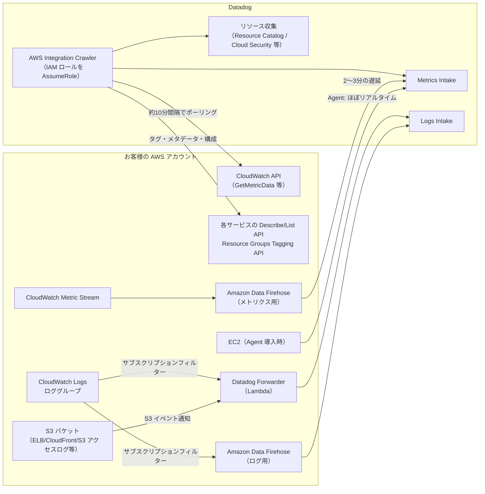
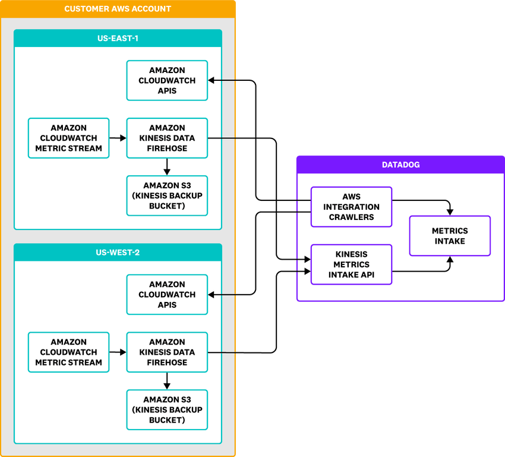
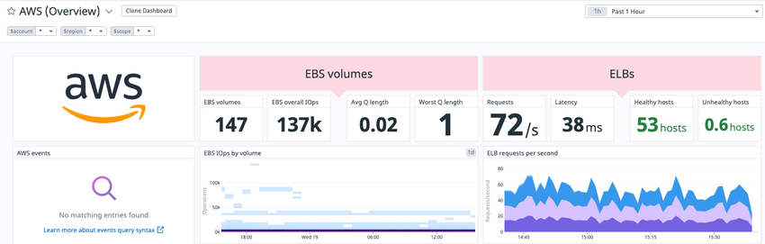
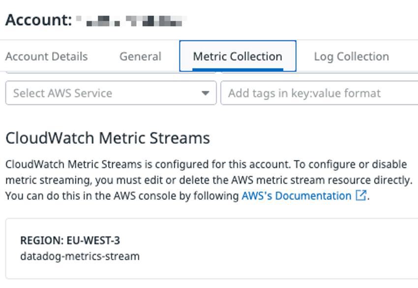
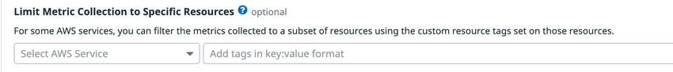
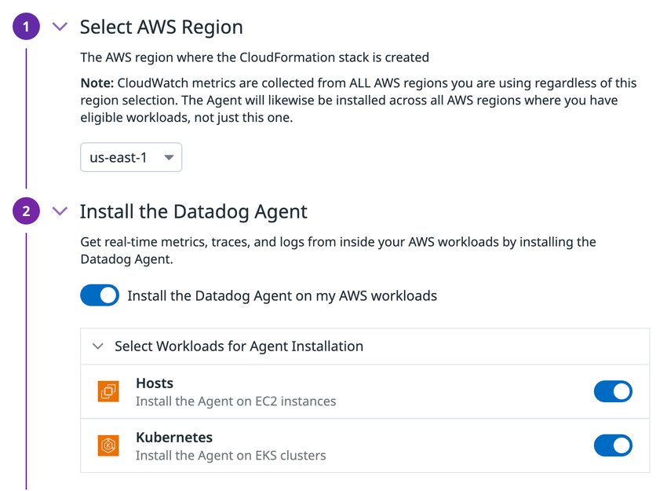

# AWS Integration（AWS インテグレーション）

## 概要

Datadog の AWS Integration（Amazon Web Services インテグレーション）は、Datadog の AWS アカウントからお客様の AWS アカウントの API を呼び出し、**Agent をインストールせずに** Amazon CloudWatch のメトリクス、イベント、タグ、リソース構成情報を収集する仕組みである。ログは別途 Datadog Forwarder（Lambda 関数）または Amazon Data Firehose で送る。[出典](https://docs.datadoghq.com/integrations/amazon_web_services/)

AWS Integration でできることは次のとおり（公式ドキュメントの Overview より）。[出典](https://docs.datadoghq.com/integrations/amazon_web_services/)

- AWS のステータス更新を Events Explorer で自動表示する
- Agent なしで EC2 ホストの CloudWatch メトリクスを取得する
- EC2 ホストに EC2 固有の情報（インスタンスタイプ、AZ など）をタグとして付与する
- EC2 の定期メンテナンスイベントをイベントとして表示する
- **90 以上の AWS サービス**の CloudWatch メトリクスとイベントを収集する
- CloudWatch アラームを Events Explorer で表示する
- （オプション）AWS Integration 経由で EC2 に Datadog Agent をインストールする、Lambda に Datadog の Lambda 拡張を追加する

AWS Integration は「データの入口」の役割に特化しており、関連する製品の詳細は次のファイルを参照する。

| 関連トピック | 参照先 |
|---|---|
| インテグレーション全般（タイル、自動インストール、サブインテグレーションの概念） | [Integrations](./integrations.md) |
| Datadog Agent 本体（EC2 にインストールする場合） | [Datadog Agent](./agent.md)、[Agent 設定リファレンス](./agent-configuration.md) |
| ECS / EKS / Fargate の監視 | [コンテナ/Kubernetes向けAgent](./kubernetes-and-containers-agent.md)、[コンテナ・Kubernetes 監視](../infrastructure/container-and-kubernetes-monitoring.md) |
| Lambda の監視（Lambda 拡張、トレース、拡張メトリクス） | [Serverless Monitoring](../infrastructure/serverless.md) |
| ログの取り込み後の処理・保持 | [ログ収集](../logs/log-collection.md)、[Log Pipelines と処理](../logs/log-pipelines-and-processing.md)、[Indexes・保持・アーカイブ](../logs/log-indexes-retention-archives.md) |
| AWS コスト（CUR）の可視化 | [Cloud Cost Management](../infrastructure/cloud-cost-management.md) |
| 構成ミス検出（リソース収集の利用先） | [Cloud Security（旧 CSM）](../security/cloud-security.md) |
| Azure / Google Cloud の同等機能 | [Azure Integration](./azure-integration.md)、[Google Cloud Integration](./gcp-integration.md) |
| タグの基礎 | [Tagging](./tagging.md) |
| Terraform による管理全般 | [Terraform と IaC](./terraform-and-iac.md) |
| サイト（リージョン）の基礎 | [Datadog Sites](./datadog-sites.md) |

> **名称について:** AWS は 2024 年 2 月に Amazon Kinesis Data Firehose を **Amazon Data Firehose** に改称した。Datadog ドキュメントの URL やパラメータ名には旧称「kinesis-firehose」が残っている。本ファイルでは「Amazon Data Firehose（旧称：Kinesis Data Firehose）」と表記する。【第三者情報】改称時期は AWS の発表による。

## 全体アーキテクチャ（データフロー）

AWS Integration のデータ経路は「Datadog から AWS へのプル型（ポーリング）」と「AWS から Datadog へのプッシュ型（Metric Streams / Firehose / Forwarder）」の 2 系統がある。

- Datadog は自社の AWS アカウントからお客様アカウントの IAM ロールを `sts:AssumeRole` で引き受け（External ID 付き）、API を呼び出す。[出典](https://docs.datadoghq.com/integrations/guide/aws-manual-setup/)
- Metric Streams を使う場合も、カスタムタグやメタデータの収集には API ポーリングが引き続き使われる。[出典](https://docs.datadoghq.com/integrations/guide/aws-cloudwatch-metric-streams-with-kinesis-data-firehose/)

**図: CloudWatch Metric Streams を使った場合のメトリクスの流れ（公式ドキュメントの構成図）**
左側の「CUSTOMER AWS ACCOUNT」枠内に `US-EAST-1` と `US-WEST-2` の 2 リージョンがあり、それぞれ「Amazon CloudWatch Metric Stream → Amazon Kinesis Data Firehose → Amazon S3（Kinesis Backup Bucket）」の流れと「Amazon CloudWatch APIs」が描かれている。右側の「DATADOG」枠内では、Firehose からのデータを「Kinesis Metrics Intake API」が受け、「AWS Integration Crawlers」が各リージョンの CloudWatch API を呼び出し、両者が「Metrics Intake」に合流する。つまり Metric Streams はリージョンごとに作成し、ポーリング（Crawler）と併用される構成である。
出典: https://docs.datadoghq.com/integrations/guide/aws-cloudwatch-metric-streams-with-kinesis-data-firehose/ （取得日 2026-11-02）

## 設定方式の一覧

AWS Integration の接続方式は「自動」と「手動」に分かれる。[出典](https://docs.datadoghq.com/integrations/amazon_web_services/)

| 区分 | 方式 | 向いているケース | 備考 |
|---|---|---|---|
| 自動 | **CloudFormation**（クイックスタート） | 1 アカウントずつ素早く始める | 公式が「Best for quickly getting started」と記載。IAM ロール・ポリシー、（任意で）Forwarder を 1 スタックで作成 |
| 自動 | **Terraform** | IaC で管理する | IAM ロール、ポリシー、`datadog_integration_aws_account` を 1 回の `terraform apply` で作成 |
| 自動 | **Control Tower**（Account Factory Customization） | Control Tower で新規アカウントを払い出すたびに連携 | AWS Marketplace ブログのガイドを参照 |
| 自動 | **AWS Organizations マルチアカウント**（CloudFormation StackSet） | Organization / OU 配下の多数アカウントを一括連携 | 新規アカウントへの自動展開が可能。ログ転送は設定しない |
| 手動 | **Role delegation（ロール委任）** | 手作業で IAM ロールを作る | AWS 商用アカウントは全サイトで利用可。GovCloud アカウントは Datadog for Government サイトでのみ利用可 |
| 手動 | **Access keys（アクセスキー）** | AWS China、または商用サイトから GovCloud を連携する場合 | **`aws-us-gov` と `aws-cn` パーティションでのみサポート**。商用（`aws`）パーティションはロール委任を使う |

- セットアップ後、収集対象リージョンやサービスなどの設定は Datadog の AWS インテグレーションページ（`/integrations/amazon-web-services`）で行う。[出典](https://docs.datadoghq.com/integrations/amazon_web_services/)
- 中国本土での利用は Datadog の「Restricted Service Locations」の免責事項の対象となる。[出典](https://docs.datadoghq.com/integrations/amazon_web_services/)
- **既存アカウントのアクセス方式の変更（例：アクセスキー → ロール委任）は破壊的操作**であり、アカウントを削除して再追加する必要がある。メトリクス収集フィルター、ログ収集設定、タグのカスタマイズなどアカウント単位の設定は引き継がれない。[出典](https://docs.datadoghq.com/integrations/guide/aws-manual-setup/)
- ロール委任とアクセスキーは同じ AWS API でメトリクスを収集する。アクセス方式は認証方法の違いであり、収集できるデータの範囲は付与した IAM 権限で決まる。[出典](https://docs.datadoghq.com/integrations/amazon_web_services/)

### AWS パーティション別の対応

| AWS パーティション | ロール委任 | アクセスキー | リソース収集 | Agent / Lambda 自動インストール |
|---|---|---|---|---|
| `aws`（商用） | 全サイトで可 | 不可（ロール委任を使う） | 可 | 可 |
| `aws-us-gov`（GovCloud） | US1-FED / US2-FED（Datadog for Government）でのみ可 | 商用サイトから連携する場合は必須 | 公開情報では確認できず | 不可 |
| `aws-cn`（中国） | 不可 | 必須 | **不可**（China アカウントはサポート外） | 不可 |

出典: [AWS Integration](https://docs.datadoghq.com/integrations/amazon_web_services/)、[AWS Manual Setup Guide](https://docs.datadoghq.com/integrations/guide/aws-manual-setup/)、[Agent installation](https://docs.datadoghq.com/integrations/guide/aws-agent-installation/)

- GovCloud アカウントを Datadog サイトに接続する前に、組織の認可境界とデータ取り扱い要件（FedRAMP、ITAR、IL4、IL5 等）を満たすかをコンプライアンス部門に確認するよう公式ドキュメントが注意喚起している。[出典](https://docs.datadoghq.com/integrations/guide/aws-manual-setup/)

## CloudFormation によるセットアップ（クイックスタート）

AWS Integration の CloudFormation セットアップは、Datadog 画面のフォームで選択した値を事前入力した CloudFormation テンプレートを AWS コンソールで起動する方式である。[出典](https://docs.datadoghq.com/getting_started/integrations/aws/)

### 手順

1. Datadog の AWS インテグレーション設定ページで **Add AWS Account** をクリックする。
2. **Automatically using CloudFormation** で次を設定する。
   - 連携する AWS リージョンを選択
   - Datadog の API キーを指定
   - （任意）ログ等を送る [Datadog Forwarder Lambda](#datadog-forwarder-lambda) を有効化
   - （任意）**Cloud Security Misconfigurations**（クラウド環境・ホスト・コンテナの構成ミス／セキュリティリスクのスキャン）を有効化
   - （任意・トライアル顧客向け）Agent / Lambda 拡張の自動インストールを有効化（後述）
3. **Launch CloudFormation Template** をクリックすると AWS コンソールが開き、パラメータが事前入力されたスタックが読み込まれる。`DatadogAppKey` パラメータは、スタックが Datadog API を呼び出してこの AWS アカウントの Datadog 側設定を追加・編集するためのもので、自動生成され Datadog アカウントに紐付く。
4. AWS 側の確認チェックボックスにチェックを入れ **Create stack**。Datadog スタック本体と **3 つのネストスタック**が作成される（数分かかる）。
5. スタック作成完了後、Datadog の AWS タイルに戻り **Ready!** をクリックする。
6. データ収集開始まで**最大 10 分**待ち、標準の **AWS (Overview)** ダッシュボードで確認する。

出典: [Getting Started with AWS](https://docs.datadoghq.com/getting_started/integrations/aws/)

- 複数アカウントを一度に設定する場合は API、AWS CLI、Terraform を使う。[出典](https://docs.datadoghq.com/getting_started/integrations/aws/)
- Datadog の CloudFormation テンプレートは**定義済みリソースの作成と削除のみ**をサポートする。スタックの更新は AWS の「スタックテンプレートの更新」手順に従う。[出典](https://docs.datadoghq.com/getting_started/integrations/aws/)

### CloudFormation 実行ユーザーに必要な AWS 権限

CloudFormation テンプレートを実行する AWS ユーザーには、次のサービスの権限が必要である（公式ドキュメントの一覧を集計すると 10 サービス・57 アクション）。[出典](https://docs.datadoghq.com/getting_started/integrations/aws/)

| サービス | アクション |
|---|---|
| `cloudformation` | `CreateStack`, `CreateUploadBucket`, `DeleteStack`, `DescribeStacks`, `DescribeStackEvents`, `GetStackPolicy`, `GetTemplateSummary`, `ListStacks`, `ListStackResources` |
| `ec2` | `DescribeSecurityGroups`, `DescribeSubnets`, `DescribeVpcs` |
| `iam` | `AttachRolePolicy`, `CreatePolicy`, `CreateRole`, `DeleteRole`, `DeleteRolePolicy`, `DetachRolePolicy`, `GetRole`, `GetRolePolicy`, `PassRole`, `PutRolePolicy`, `TagRole`, `UpdateAssumeRolePolicy` |
| `kms` | `Decrypt` |
| `lambda` | `AddPermission`, `CreateFunction`, `DeleteFunction`, `GetCodeSigningConfig`, `GetFunction`, `GetFunctionCodeSigningConfig`, `GetLayerVersion`, `InvokeFunction`, `PutFunctionConcurrency`, `RemovePermission`, `TagResource` |
| `logs` | `CreateLogGroup`, `DeleteLogGroup`, `DescribeLogGroups`, `PutRetentionPolicy` |
| `oam` | `ListSinks`, `ListAttachedLinks` |
| `s3` | `CreateBucket`, `DeleteBucket`, `DeleteBucketPolicy`, `GetEncryptionConfiguration`, `GetObject`, `GetObjectVersion`, `PutBucketPolicy`, `PutBucketPublicAccessBlock`, `PutEncryptionConfiguration`, `PutLifecycleConfiguration` |
| `secretsmanager` | `CreateSecret`, `DeleteSecret`, `GetSecretValue`, `PutSecretValue` |
| `serverlessrepo` | `CreateCloudFormationTemplate` |

### セットアップ後にデータが見えるまでの目安

| データ | 目安 | 備考 |
|---|---|---|
| メトリクス（API ポーリング） | 約 10 分 | サービスにより報告間隔が異なるため、最初の 1 時間はダッシュボードが部分的にしか埋まらないのが正常 |
| メトリクス（Metric Streams） | 2〜3 分 | 別途セットアップが必要 |
| タグ | 15 分〜数時間 | AWS 側のタグ変更の反映も同様 |
| リソース | 次回のリソースクロール時 | — |
| ログ | 別途設定が必要 | Forwarder または Firehose |
| 過去データ | **バックフィルされない** | 連携が成功した時点以降のメトリクスのみ |

出典: [Getting Started with AWS](https://docs.datadoghq.com/getting_started/integrations/aws/)

**図: 標準の AWS (Overview) ダッシュボード**
画面上部にダッシュボード名「AWS (Overview)」と **Clone Dashboard** ボタン、テンプレート変数 `$account`、`$region`、`$scope`、右上にタイムレンジ（Past 1 Hour）がある。左に AWS ロゴと「AWS events」ウィジェット（例では「No matching entries found」）、中央に「EBS volumes」グループ（EBS volumes 数、EBS overall IOPs、Avg Q length、Worst Q length、EBS IOPs by volume のヒートマップ）、右に「ELBs」グループ（Requests、Latency、Healthy hosts、Unhealthy hosts、ELB requests per second の時系列）が並ぶ。セットアップ直後の動作確認に使う。
出典: https://docs.datadoghq.com/getting_started/integrations/aws/ （取得日 2026-11-02）

## 手動セットアップ（ロール委任）と IAM ロール

### ロール委任の仕組み

ロール委任（Role Delegation）では、お客様の AWS アカウントに IAM ロールを作成し、信頼ポリシーで「Datadog の AWS アカウント」を信頼し、Datadog が生成した **AWS External ID（外部 ID）** を条件として要求する。Datadog は自社 AWS アカウントからこのロールを引き受けて API を呼び出す。[出典](https://docs.datadoghq.com/integrations/guide/aws-manual-setup/)

### 手順

1. **External ID の生成**: AWS インテグレーションページで **Add AWS Account(s)** → **Manually** を選び、AWS パーティション（`aws` / `aws-cn` / `aws-us-gov`）を選択、アクセス種別に **Role Delegation** を選び、**AWS External ID** をコピーする。External ID は、ユーザーが明示的に変更するか別の AWS アカウントを追加しない限り、**48 時間は再生成されない**。
2. **IAM ロールの作成**: IAM コンソールで **Create role** → 信頼されたエンティティに **AWS account** → **Another AWS account** を選び、サイトに応じた **Datadog の AWS アカウント ID** を入力する。**Require external ID** を選んで External ID を貼り付け、**Require MFA は無効のまま**にする。リソース収集を使う場合は AWS 管理ポリシー `SecurityAudit` もアタッチする。ロール名の例は `DatadogIntegrationRole`。
3. **インラインポリシーの作成**: ロールに **Create inline policy** で、公式ドキュメントの JSON（AWS integration IAM policy）を貼り付ける。ポリシー名の例は `DatadogIntegrationPolicy`。リージョン制限などの `Condition` 要素を追加してもよい。
4. **Datadog 側の完了**: 「I confirm that the Datadog IAM Role has been added to the AWS Account」にチェックし、**Account ID をハイフンなし**（例 `123456789012`）で入力、**AWS Role Name** にロール名（**大文字小文字を区別し AWS 側と完全一致**）を入力して **Save**。最大 10 分でデータ収集が始まる。

出典: [AWS Manual Setup Guide](https://docs.datadoghq.com/integrations/guide/aws-manual-setup/)

> **ロール名の表記ゆれ:** 手動セットアップと Terraform の例ではロール名を `DatadogIntegrationRole`、トラブルシューティングガイドでは `DatadogAWSIntegrationRole` と記載している。ロール名は任意で、Datadog 側に入力した名前と AWS 側のロール名が一致していればよい。[出典](https://docs.datadoghq.com/integrations/guide/aws-manual-setup/) [出典](https://docs.datadoghq.com/integrations/guide/aws-integration-troubleshooting/)

### サイト別の Datadog AWS アカウント ID（信頼ポリシーのプリンシパル）

信頼ポリシーに指定する Datadog 側の AWS アカウント ID は、Datadog サイトごとに異なる。以下は Terraform セットアップガイドの信頼ポリシー例（`arn:aws:iam::<ID>:root`）から抽出した値である。[出典](https://docs.datadoghq.com/integrations/guide/aws-terraform-setup/)

| Datadog サイト | ホスト | 商用 AWS アカウント連携時の ID | GovCloud アカウント連携時の ID |
|---|---|---|---|
| US1 / US3 / US5 / EU1 | `app.datadoghq.com` / `us3.datadoghq.com` / `us5.datadoghq.com` / `app.datadoghq.eu` | `464622532012` | —（GovCloud はロール委任不可） |
| AP1（日本） | `ap1.datadoghq.com` | `417141415827` | — |
| AP2 | `ap2.datadoghq.com` | `412381753143` | — |
| UK1 | `uk1.datadoghq.com` | `117348461845` | — |
| US1-FED | `app.ddog-gov.com` | `392588925713` | `065115117704`（`arn:aws-us-gov:iam::…`） |
| US2-FED | `us2.ddog-gov.com` | `382742775718` | `486737091498`（`arn:aws-us-gov:iam::…`） |

> **サイト差異:** AP1（日本）サイトでは、信頼ポリシーのプリンシパルを `arn:aws:iam::417141415827:root` にする必要がある。US1 用の `464622532012` を使うと `sts:AssumeRole` エラーになる。公式手順書はサイトセレクターの設定に応じて ID を表示するため、コピー前に**ドキュメント右側の DATADOG SITE セレクターを自分のサイトに合わせる**よう注意書きがある。[出典](https://docs.datadoghq.com/integrations/guide/aws-manual-setup/)

> **サイト差異:** US1-FED / US2-FED では、商用 AWS アカウントのロールを Datadog for Government が運用する専用アカウントから引き受ける。この ID は商用サイトで使う ID とは異なる。[出典](https://docs.datadoghq.com/integrations/guide/aws-manual-setup/)

> **サイト差異:** `UK1`（`uk1.datadoghq.com`）と `US2-FED`（`us2.ddog-gov.com`）は、本ナレッジの規約にあるサイト一覧（US1/US3/US5/EU1/AP1/AP2/US1-FED）にはないが、2026-11-02 時点の公式ドキュメントに登場する。US2-FED では AWS Integration が組織で有効でない場合があり、例外申請は `support@ddog-gov.com` 宛てとされている。[出典](https://docs.datadoghq.com/integrations/amazon_web_services/) サイトの一覧は [Datadog Sites](./datadog-sites.md) を参照。

### 必要な IAM ポリシーの構成

Datadog AWS Integration の IAM ロール（「Datadog AWS Integration IAM Role」）には次のポリシーを付与する。[出典](https://docs.datadoghq.com/integrations/amazon_web_services/)

| ポリシー | 用途 | 内容 |
|---|---|---|
| **AWS integration IAM policy**（Datadog 提供 JSON） | メトリクス、タグ、EventBridge イベント等の収集 | `"Effect": "Allow"`、`"Resource": "*"` の 1 ステートメント。手動セットアップガイド掲載版はおよそ 120 アクション（`ec2:Describe*`、`cloudwatch:Get*`、`s3:GetObject` などを含む）。新サービス追加に伴い変わる可能性がある |
| **`SecurityAudit`**（AWS 管理ポリシー） | リソース収集（Cloud Security、Resource Catalog 等） | `arn:aws:iam::aws:policy/SecurityAudit` |
| リソース収集の追加権限 | 製品ごとのリソースタイプ収集 | `SecurityAudit` に含まれない権限を、製品別（CCM、Cloudcraft、Cloud Security、CNM、Resource Catalog、Storage Management）の表に従って追加 |
| ログ自動サブスクリプション用権限 | Forwarder のトリガー自動設定 | 後述の「トリガーの自動設定に必要な権限」 |
| Agent インストール用権限 | EC2 への Agent／Lambda への拡張の導入 | CloudFormation スタックが対象ワークロードに限定して自動付与（手動適用不要） |

- 公式の権限一覧は API `GET /api/v2/integration/aws/iam_permissions`（標準：`/iam_permissions/standard`、リソース収集：`/iam_permissions/resource_collection`）でも取得できる。[出典](https://docs.datadoghq.com/api/latest/aws-integration/)
- Terraform 例では、データソース `datadog_integration_aws_iam_permissions` で権限一覧を取得し、IAM 管理ポリシーのサイズ上限（`max_policy_size = 6144` 文字）を超えないよう約 5,900 文字ごとに分割して `DatadogAWSIntegrationPolicy-1`、`-2`… として作成している。[出典](https://docs.datadoghq.com/integrations/guide/aws-terraform-setup/)
- IAM ポリシーを更新したら、AWS IAM の反映時間と、Datadog が以前に失敗したクロールを再実行する時間を待ってから再検証する。[出典](https://docs.datadoghq.com/integrations/amazon_web_services/)

### 権限まわりの注意点

| 事象 | 内容 |
|---|---|
| SCP（Service Control Policies） | IAM ポリシーと信頼ポリシーが正しくても、AWS Organizations の SCP が `AssumeRole` などをブロックすることがある |
| Permissions boundary（アクセス許可の境界） | 実効権限は「ロールのポリシー ∩ 境界ポリシー」。境界に必要なアクションがなければ `AccessDenied` になる。確認は IAM コンソールの **Permissions boundary** タブ、または `aws iam get-role --role-name <ROLE> --query 'Role.{PermissionsBoundary:PermissionsBoundary,RoleName:RoleName}'` |
| Issues タブ | AWS インテグレーションページの **Issues** タブに、収集中に検出した不足権限と認証失敗が表示される |
| Resolve All AWS Permissions Issues | CloudFormation スタックを起動し、`datadog-aws-integration-iam-permissions-` で始まるポリシーを作成してロールにアタッチする。`SecurityAudit` がなければそれもアタッチする。**認証の問題（ロール名、External ID、信頼ポリシー）は直せず、SCP の明示的拒否も上書きできない**。再実行すると前回作成した同接頭辞のポリシーを削除してから作り直す。ユーザーが自分でアタッチしたポリシーには触れない |
| External ID の期限 | 未使用の External ID は 48 時間で再生成される。信頼ポリシーの External ID は画面に表示される値と一致させる |

出典: [AWS Integration](https://docs.datadoghq.com/integrations/amazon_web_services/)、[AWS Manual Setup Guide](https://docs.datadoghq.com/integrations/guide/aws-manual-setup/)、[AWS Integration Troubleshooting](https://docs.datadoghq.com/integrations/guide/aws-integration-troubleshooting/)

### アクセスキー方式の手順

1. AWS コンソールで Datadog 連携用の IAM ユーザーを作成し、必要な権限を付与する。
2. そのユーザーのアクセスキーとシークレットキーを発行する。
3. Datadog の AWS タイルで **Add AWS Account** → **Manually** → **Access Keys** タブを選び、パーティションを選択する。
4. 「I confirm that the IAM User for the Datadog Integration has been added to the AWS Account」にチェックし、`Account ID`、`AWS Access Key`、`AWS Secret Key` を入力して **Save**。最大 10 分でデータ収集が始まる。

出典: [AWS Manual Setup Guide](https://docs.datadoghq.com/integrations/guide/aws-manual-setup/)

> **サイト差異:** US1-FED / US2-FED では、ロール委任を使った S3 ログアーカイブの設定が【Limited Availability】であり、Datadog サポートへの申請が必要。[出典](https://docs.datadoghq.com/integrations/guide/aws-manual-setup/)

## Terraform によるセットアップ

Terraform では、Datadog Terraform Provider の `datadog_integration_aws_account` リソースと AWS Provider の IAM リソースを組み合わせ、IAM ロール、ポリシー、Datadog 側の連携設定を 1 回の `terraform apply` で作成できる。[出典](https://docs.datadoghq.com/integrations/guide/aws-terraform-setup/)

- Datadog Terraform Provider **3.50.0** で、`datadog_integration_aws_account` が旧リソース `datadog_integration_aws` を置き換えた。旧リソースからの移行手順は Terraform Registry に記載されている。[出典](https://docs.datadoghq.com/integrations/guide/aws-terraform-setup/)
- 信頼ポリシーの `sts:ExternalId` 条件には `datadog_integration_aws_account.<name>.auth_config.aws_auth_config_role.external_id` を参照させる。External ID は Datadog が生成したものでなければならない（省略時は自動生成）。[出典](https://github.com/DataDog/terraform-provider-datadog/blob/master/docs/resources/integration_aws_account.md)
- 公式例の既定では Cloud Security は無効。有効化するには `resources_config` で `cloud_security_posture_management_collection = true` にする。[出典](https://docs.datadoghq.com/integrations/guide/aws-terraform-setup/)

### `datadog_integration_aws_account` の主要項目とデフォルト値

| ブロック / 属性 | 必須 | デフォルト | 説明 |
|---|---|---|---|
| `aws_account_id` | 必須 | — | ハイフンなしの AWS アカウント ID |
| `aws_partition` | 必須 | — | `aws` / `aws-cn` / `aws-us-gov` |
| `auth_config.aws_auth_config_role.role_name` | ロール委任時に必須 | — | IAM ロール名 |
| `auth_config.aws_auth_config_role.external_id` | 任意 | 省略時は生成 | Datadog が生成した External ID |
| `auth_config.aws_auth_config_keys` | アクセスキー時 | — | `access_key_id`、`secret_access_key`（write-only、ドリフト検出なし） |
| `aws_regions.include_all` | 任意 | `true` | 全リージョン収集 |
| `aws_regions.include_only` | 任意 | — | 指定リージョンのみ |
| `account_tags` | 任意 | `[]` | このアカウントの全メトリクスに付与するタグ |
| `metrics_config.enabled` | 任意 | `true` | メトリクス収集の有効化 |
| `metrics_config.automute_enabled` | 任意 | `true` | EC2 automute |
| `metrics_config.collect_cloudwatch_alarms` | 任意 | `false` | CloudWatch アラームの収集 |
| `metrics_config.collect_custom_metrics` | 任意 | `false` | CloudWatch カスタムメトリクスの収集 |
| `metrics_config.collect_service_quotas` | 任意 | `false` | Service Quotas の収集。CloudWatch `GetMetricData` 料金が発生。`resources_config.extended_collection = true` と `servicequotas:ListServices` / `ListServiceQuotas` / `ListRequestedServiceQuotaChangeHistory` 権限が必要 |
| `metrics_config.namespace_filters.exclude_only` | 任意 | `["AWS/SQS", "AWS/ElasticMapReduce", "AWS/Usage"]` | `GetMetricData` による CloudWatch コストを抑えるため既定で除外 |
| `metrics_config.namespace_filters.include_only` | 任意 | — | 指定ネームスペースのみ収集 |
| `metrics_config.metric_name_filters` | 任意 | — | ネームスペースごとに `include_only` か `exclude_only` のどちらか 1 つ |
| `metrics_config.tag_filters` | 任意 | `tags = []` | `namespace` ごとのリソースタグフィルター。`?`、`*`、`!` 対応 |
| `logs_config.lambda_forwarder.lambdas` | 任意 | `[]` | Forwarder の ARN 一覧 |
| `logs_config.lambda_forwarder.sources` | 任意 | — | ログ自動サブスクリプションを有効にするサービス ID |
| `logs_config.lambda_forwarder.log_source_config.tag_filters` | 任意 | — | ログソースごとのタグフィルター |
| `resources_config.extended_collection` | 任意 | `true` | リソースの追加属性・構成情報の収集（Cloud Security の前提） |
| `resources_config.cloud_security_posture_management_collection` | 任意 | `false` | Cloud Security のリソーススキャン |
| `traces_config.xray_services` | 必須ブロック（空可） | `include_only = []` | AWS X-Ray トレースを収集するサービス |

出典: [Terraform Registry: datadog_integration_aws_account](https://github.com/DataDog/terraform-provider-datadog/blob/master/docs/resources/integration_aws_account.md)

> Datadog UI で新規作成した場合の既定値（例：ネームスペースの既定除外）が Terraform の既定値と同じかどうかは、公開情報では確認できず。

## AWS Organizations でのマルチアカウント設定（StackSet）

Datadog の CloudFormation StackSet テンプレートは、Organization または OU 配下の全アカウントに IAM ロールとポリシーを作成し、Datadog 側のアカウント設定までを自動で行う。[出典](https://docs.datadoghq.com/integrations/guide/aws-organizations-setup/)

### StackSet が行うこと

1. Organization / OU 配下の全アカウントに Datadog AWS CloudFormation スタックを展開する
2. 必要な IAM ロールとポリシーを作成する
3. CloudWatch メトリクスとイベントの取り込みを開始する
4. （任意）AWS インフラのメトリクス収集を無効化する（Cloud Cost Management や Cloud Security Misconfigurations 専用の用途向け）
5. （任意）Cloud Security Misconfigurations を構成する

**StackSet はログ転送を設定しない。** ログは別途設定する。[出典](https://docs.datadoghq.com/integrations/guide/aws-organizations-setup/)

### 前提条件と手順の要点

| 項目 | 内容 |
|---|---|
| 前提 | 管理アカウントにアクセスできること。StackSets と AWS Organizations の信頼されたアクセスが有効であること（サービスマネージド権限で展開するため） |
| 起動 | **Add AWS Account(s)** → **Add Multiple AWS Accounts** → **CloudFormation StackSet** → **Launch CloudFormation StackSet**。AWS 側は `Service-managed permissions` のまま |
| パラメータ | `DatadogApiKey`、`DatadogAppKey`（Datadog 画面で選択）。任意で Cloud Security Misconfigurations の有効化、メトリクス収集の無効化 |
| 実行設定 | **Execution configuration** は `Inactive`（1 回に 1 操作） |
| 展開先 | Organization 全体または 1 つ以上の OU。**Automatic deployment** を有効のままにすると、新規追加アカウントにも自動展開される |
| リージョン | **1 リージョンのみ選択**。グローバルな IAM リソースを作るため、複数リージョンを選ぶと展開が失敗する |
| デプロイオプション | 逐次（sequential）にする |
| 完了 | スタック作成後、Datadog 画面で **Done** |
| 管理アカウント | サービスマネージド権限の制約で**管理アカウントには展開されない**。個別に CloudFormation で連携する |
| 既存連携との関係 | 個別に連携済みのアカウントを StackSet の対象にすると、**既存のアカウント連携は削除される**（上書き展開はサポート外） |
| アンインストール | 先に全 StackInstance を削除し、その後 StackSet を削除する |

出典: [AWS Integration Multi-Account setup for AWS Organizations](https://docs.datadoghq.com/integrations/guide/aws-organizations-setup/)

100 以上のアカウントの連携に関する公式のアーキテクチャガイド「A Guide to Integrating 100+ AWS Accounts with Datadog」もある。[出典](https://www.datadoghq.com/architecture/a-guide-to-integrating-100-aws-accounts-with-datadog/) マルチアカウント・マルチ org の運用設計は [大規模・マルチorg運用](../../04_応用編/large-scale-and-multi-org.md) を参照。

## AWS インテグレーションページの構成

Datadog の AWS インテグレーションページ（`/integrations/amazon-web-services`）では、AWS アカウントを選ぶとアカウント単位の設定タブが表示される。公式ドキュメントと画面例に現れるタブは次のとおり。

| タブ | 主な設定 |
|---|---|
| **Account Details** | アカウント ID、アクセス方式（ロール名など） |
| **General** | 収集対象 AWS リージョン（メトリクス、CloudWatch イベント、リソース） |
| **Metric Collection** | サービス（ネームスペース）単位の有効化、メトリクス名フィルター、リソースタグによる収集対象の限定（Limit Metric Collection to Specific Resources）、カスタムメトリクス収集、CloudWatch Metric Streams の状態表示、Billing 等 |
| **Log Collection** | Datadog Forwarder Lambda の ARN 登録、Log Autosubscription（サービス別トグル）、Log Source Tag Filters |
| **Resource Collection** | リソース収集、Cloud Security の有効化 |
| **Issues** | 不足権限、認証失敗の一覧 |

出典: [AWS Integration](https://docs.datadoghq.com/integrations/amazon_web_services/)、[Getting Started with AWS](https://docs.datadoghq.com/getting_started/integrations/aws/)、[Send AWS Services Logs With The Datadog Lambda Function](https://docs.datadoghq.com/logs/guide/send-aws-services-logs-with-the-datadog-lambda-function/)

## メトリクス収集

### 2 つの方式

AWS Integration のメトリクス収集には「API ポーリング」と「CloudWatch Metric Streams」の 2 方式がある。[出典](https://docs.datadoghq.com/integrations/amazon_web_services/)

| 項目 | API ポーリング（既定） | CloudWatch Metric Streams |
|---|---|---|
| 方式 | Datadog の Crawler が CloudWatch API をメトリクスごとに呼び出して取得（プル型） | AWS 側の Metric Stream が Amazon Data Firehose 経由で Datadog に送信（プッシュ型） |
| 典型的な遅延 | 約 10 分 | 2〜3 分 |
| セットアップ | AWS Integration に標準で含まれる | 別途 CloudFormation またはコンソールで設定（アカウント×リージョンごと） |
| AWS 側のコスト | `GetMetricData` などの API 呼び出し料金 | Metric Streams のメトリクス更新数 + Firehose のデータ量の料金 |
| Datadog 側の追加料金 | なし | **なし** |
| タグ・メタデータ | ポーリングで取得 | **引き続きポーリングで取得**（AWS Integration の設定を変えないこと） |
| 2 時間超遅れて報告されるメトリクス | 取得可 | 送れないためポーリングで継続取得（例 `aws.s3.bucket_size_bytes`、`aws.billing.estimated_charges`） |
| タグフィルター（AWS タイル） | 適用 | **適用される** |

出典: [AWS Integration and CloudWatch FAQ](https://docs.datadoghq.com/integrations/guide/aws-integration-and-cloudwatch-faq/)、[Metric Streams ガイド](https://docs.datadoghq.com/integrations/guide/aws-cloudwatch-metric-streams-with-kinesis-data-firehose/)

### API ポーリングの詳細

- AWS Integration の Crawler は、インストール済みの AWS サブインテグレーションごとに**10 分間隔**でメトリクスを収集する。例外として **RDS メトリクスは 3 分間隔**。[出典](https://docs.datadoghq.com/integrations/guide/cloud-metric-delay/)
- 主に使う API は `GetMetricData`（生メトリクスの取得）。そのほかの CloudWatch API は、カスタムタグ、リソースの健全性（automute を含む）、ログストリームなどの情報付加に使う。[出典](https://docs.datadoghq.com/integrations/guide/aws-integration-and-cloudwatch-faq/)
- ポーリング間隔の短縮は Datadog サポートへの依頼が必要。AWS についてはネームスペース単位の Crawler もある。[出典](https://docs.datadoghq.com/integrations/guide/cloud-metric-delay/)

#### 遅延の内訳

| CloudWatch の粒度 | 想定合計遅延 | 内訳 |
|---|---|---|
| 5 分粒度（基本モニタリング） | 約 15〜20 分 | CloudWatch 側の公開遅延 5〜10 分 + Datadog のポーリング間隔 10 分（RDS は 3 分）。キューイングや CloudWatch API 制限でさらに最大 5 分 |
| 1 分粒度（詳細モニタリング等） | 約 10〜12 分 | CloudWatch 側の公開遅延 約 2 分 + ポーリング間隔 |
| Metric Streams | 2〜3 分 | — |
| Datadog Agent | ほぼリアルタイム | — |

出典: [Cloud Metric Delay](https://docs.datadoghq.com/integrations/guide/cloud-metric-delay/)、[AWS Integration Troubleshooting](https://docs.datadoghq.com/integrations/guide/aws-integration-troubleshooting/)

- サービス固有の遅延もある。S3 の日次ストレージメトリクス（Storage Lens を含む）は 1 日 1 回、AWS 請求メトリクスは数時間遅れる。EC2 の詳細モニタリング（1 分粒度）はインスタンスごとに AWS 側で有効化する。[出典](https://docs.datadoghq.com/integrations/guide/aws-integration-troubleshooting/)
- 遅延のあるメトリクスでモニターを作成すると警告が表示され、評価期間の延長と評価遅延（evaluation delay）の設定が推奨される。AWS ベースのメトリクスモニターでは Edit 画面に推奨評価遅延（多くは **900 秒**）が表示されるが、**Save するまで保存されない**。保存済みの値はモニターの JSON の `evaluation_delay` で確認する。[出典](https://docs.datadoghq.com/integrations/guide/cloud-metric-delay/) モニター設定の詳細は [Monitors](./monitors.md) を参照。

### CloudWatch Metric Streams の詳細

#### 仕組みと前提

- AWS アカウント × リージョンごとに CloudWatch Metric Stream を作成する。ストリーム対象のネームスペース／メトリクスは任意に限定できる。作成直後から Datadog は受信を開始する。[出典](https://docs.datadoghq.com/integrations/guide/aws-cloudwatch-metric-streams-with-kinesis-data-firehose/)
- **AWS アカウントのメトリクス収集が AWS タイルで有効になっていること**が前提。無効だと、ストリームされたメトリクスが正しく処理されないか、アクティブな Metric Stream を検出できない場合がある。[出典](https://docs.datadoghq.com/integrations/guide/aws-cloudwatch-metric-streams-with-kinesis-data-firehose/)
- 出力形式は **OpenTelemetry 形式のみ**。最新は **v1.0**。v0.7 もサポートされるがメトリクスが欠落する可能性がある。[出典](https://docs.datadoghq.com/integrations/guide/aws-cloudwatch-metric-streams-with-kinesis-data-firehose/)

#### セットアップ方法

| 方法 | 手順の要点 |
|---|---|
| CloudFormation（推奨、複数リージョン向け） | AWS インテグレーションページ → 対象アカウント → **Metric Collection** → **Automatically Using CloudFormation**。必須パラメータ `ApiKey`、`DdSite`、`Regions`（カンマ区切り）。任意で `FilterMethod`（`Include` / `Exclude`）と First / Second / Third Namespace（AWS の名称と完全一致、例 `AWS/EC2`）。IAM リソース作成の確認にチェックし **Create Stack** |
| AWS コンソール | リージョンごとに CloudWatch Metric Stream を作成し、**Quick AWS Partner Setup** で宛先に **Datadog** を選ぶ。Datadog サイトと API キーを入力し、全メトリクス／特定ネームスペースの包含／除外を選ぶ。**Add additional statistics** でパーセンタイル統計を追加できる |
| 確認 | 5 分待ってから AWS インテグレーションページの **Metric Collection** タブで有効化されたリージョンを確認 |

出典: [Metric Streams ガイド](https://docs.datadoghq.com/integrations/guide/aws-cloudwatch-metric-streams-with-kinesis-data-firehose/)

**図: AWS インテグレーションページの Metric Collection タブ（Metric Streams が有効なアカウント）**
画面上部に「Account:」（アカウント ID はマスク）とタブ **Account Details / General / Metric Collection / Log Collection** が並び、**Metric Collection** タブが選択されている。上部に「Select AWS Service」ドロップダウンと「Add tags in key:value format」入力欄（リソースタグによる収集限定）があり、その下の **CloudWatch Metric Streams** セクションには「CloudWatch Metric Streams is configured for this account. To configure or disable metric streaming, you must edit or delete the AWS metric stream resource directly.」という説明と、有効なリージョン（例 `REGION: EU-WEST-3`、ストリーム名 `datadog-metrics-stream`）が表示される。Metric Streams の設定・削除は Datadog 画面ではなく AWS 側で行うことが分かる。
出典: https://docs.datadoghq.com/integrations/guide/aws-cloudwatch-metric-streams-with-kinesis-data-firehose/ （取得日 2026-11-02）

#### ポーリングとストリームの切り替え

| 状況 | 挙動 |
|---|---|
| ポーリング中のネームスペースをストリームし始めた | Datadog が自動検出し、そのネームスペースのポーリングを停止する。検出には**最大 5 分**かかるが、実際の重複期間は稼働中の Crawler のタイミングによってそれより長くなる場合がある |
| 移行中 | 両方式が同じメトリクスを送るため、**値が一時的に 2 倍に見える**ことがある |
| ストリームを停止した | AWS Integration の設定に基づき自動でポーリングを再開する |
| 推奨手順 | ① ストリームを有効化 → ② 検出を待つ → ③ Metric Collection タブで有効リージョンを確認 → ④ 移行中は AWS Integration の設定を変更しない |

出典: [Metric Streams ガイド](https://docs.datadoghq.com/integrations/guide/aws-cloudwatch-metric-streams-with-kinesis-data-firehose/)

#### クロスアカウントストリーミング

- CloudWatch のクロスアカウントオブザーバビリティを使い、**監視アカウント**で 1 本のストリームから同一リージョン内の複数アカウントのメトリクスを送れる。
- 必要権限：`oam:ListSinks`、`oam:ListAttachedLinks`。
- タグやメタデータを得るには、ソースアカウントも Datadog と連携しておく必要がある。

出典: [Metric Streams ガイド](https://docs.datadoghq.com/integrations/guide/aws-cloudwatch-metric-streams-with-kinesis-data-firehose/)

#### ストリームの健全性監視と障害時の注意

- `datadog.aws_metric_streams.data_received` は、データ受信時に値 `1` を報告する（受信がなければ報告しない）。タグは `stream_arn`、`stream_name`、`aws_account`、`region`。クロスアカウントストリームでは `aws_account` は監視アカウントになる。`stream_arn` でグループ化し、データ欠損（missing data）通知を有効にしたメトリクスモニターを作成することが推奨されている。報告頻度は Firehose のバッファ設定に左右される。
- Firehose の宛先エラーがあっても、ストリームの状態が `running` のまま配信が止まっている場合がある。Firehose の配信エラーログ（例 `HttpEndpoint.DestinationException`、`S3.AccessDenied`）、Firehose の CloudWatch メトリクス、S3 バックアップを確認し、`UpdateDestination` API で宛先を更新する。
- 配信を再開しても、停止中に失われたレコードは**バックフィルされず**、S3 バックアップ内のレコードも Datadog に自動取り込みされない。

出典: [Metric Streams ガイド](https://docs.datadoghq.com/integrations/guide/aws-cloudwatch-metric-streams-with-kinesis-data-firehose/)

#### 無効化

- CloudFormation で作成した場合：スタックを削除する。
- コンソールで作成した場合：Metric Stream を削除し、関連リソース（Firehose、S3、IAM ロール等）を削除する。
- 5 分待って、Metric Collection タブから該当リージョンが消えたことを確認する。

出典: [Metric Streams ガイド](https://docs.datadoghq.com/integrations/guide/aws-cloudwatch-metric-streams-with-kinesis-data-firehose/)

### 収集対象の絞り込み

AWS Integration のメトリクス収集は、次の 4 つの粒度で絞り込める。

| 粒度 | 設定場所 | 内容 |
|---|---|---|
| リージョン | **General** タブ / Terraform `aws_regions` | 収集するリージョンを限定する |
| サービス（ネームスペース） | **Metric Collection** タブ / `namespace_filters` | AWS サービス単位で有効・無効を切り替える |
| メトリクス名 | **Metric Collection** タブのネームスペース展開 / `metric_name_filters` / API | ネームスペースごとに **Include** または **Exclude**（同時にはどちらか 1 つ）。パターンには英小文字、数字、`.`、`_`、`*` を使える（例 `aws.ec2.network_*`）。保存前に一致数がプレビューされる |
| リソースタグ | **Metric Collection** タブの「Limit Metric Collection to Specific Resources」/ `tag_filters` / API | EC2、Lambda、ELB、Application ELB、Network ELB、RDS、SQS、Step Functions、CloudWatch カスタムメトリクスを、AWS リソースタグで限定する |

出典: [Getting Started with AWS](https://docs.datadoghq.com/getting_started/integrations/aws/)、[AWS Integration Billing](https://docs.datadoghq.com/account_management/billing/aws/)

- メトリクス名フィルターでも **`aws.ec2.cpuutilization` と `aws.lambda.invocations` は除外できない**（常に収集される必須メトリクス）。[出典](https://docs.datadoghq.com/getting_started/integrations/aws/)
- タグフィルターの記法：`key:value` 形式で、ワイルドカード `?`（1 文字）と `*`（任意文字列）、先頭 `!` による除外が使える。例：`datadog:monitored,env:production,instance-type:c1.*,!region:us-east-1` は、先頭 3 条件に一致し、かつ `region:us-east-1` タグを持たない EC2 のみを収集する。`!datadog:no` は `datadog:no` タグの付いたインスタンスを除外する。[出典](https://docs.datadoghq.com/account_management/billing/aws/)
- 除外記法（`!`）を使う場合、対象リソースがそのタグを持っていないことを確認する。[出典](https://docs.datadoghq.com/account_management/billing/aws/)
- Datadog はタグを小文字化し、空白をアンダースコアに置換する（例 `Team:Frontend App` → `team:frontend_app`）。フィルターも小文字で定義する。[出典](https://docs.datadoghq.com/account_management/billing/aws/)
- EC2 のフィルターは EC2 インスタンスとアタッチされた EBS ボリュームの両方に適用される。既存アカウントにフィルターを追加すると、それまでに検出されたインスタンスが Infrastructure List に**最大 2 時間**、ステータス `???` のまま残ることがあるが、課金対象にはならない。ただし **Agent が動いているホストは引き続き課金される**。[出典](https://docs.datadoghq.com/account_management/billing/aws/)
- v1 API のタグフィルター（`/api/v1/integration/aws/filtering`）は非推奨。v2 のアカウント設定（`metrics_config.tag_filters`）を使う。[出典](https://docs.datadoghq.com/api/latest/aws-integration/)

**図: Metric Collection タブの「Limit Metric Collection to Specific Resources」**
見出し「Limit Metric Collection to Specific Resources（optional）」の下に「For some AWS services, you can filter the metrics collected to a subset of resources using the custom resource tags set on those resources.」という説明があり、左に **Select AWS Service**（サービス選択ドロップダウン）、右に **Add tags in key:value format**（タグ入力欄）が並ぶ。サービスを選び、`env:prod` や `!datadog:no` のようなタグ条件を入力して収集対象を限定する。
出典: https://docs.datadoghq.com/account_management/billing/aws/ （取得日 2026-11-02）

### カスタムメトリクスと追加セットアップが必要なメトリクス

| 対象 | 必要な設定 |
|---|---|
| CloudWatch カスタムメトリクス（独自ネームスペース） | Metric Collection タブで **Collect Custom Metrics** を有効化。Datadog に公式インテグレーションがない `AWS/<namespace>` のメトリクスも、このカスタム枠で収集される。タグフィルター API で絞り込み可能 |
| カスタムメトリクスの統計 | 既定では**平均（Average）のみ**。Min / Max / Sum / SampleCount はサポートに依頼 |
| RDS の OS レベルメトリクス | RDS の Enhanced Monitoring を有効化 |
| S3 Storage Lens | Storage Lens を構成 |
| Billing（請求） | Metric Collection タブで Billing を有効化し、`budgets:ViewBudget` 権限を付与し、AWS 側で請求メトリクスを有効化 |
| EC2 詳細モニタリング（1 分粒度） | EC2 コンソールでインスタンスごとに有効化 |

出典: [AWS Integration and CloudWatch FAQ](https://docs.datadoghq.com/integrations/guide/aws-integration-and-cloudwatch-faq/)

### CloudWatch と値が異なる理由

| 原因 | 説明 | 対処 |
|---|---|---|
| 統計の違い | Datadog は 1 メトリクスにつき CloudWatch の 1 つの統計を収集する。CloudWatch の `Sum` と Datadog の `Average` を比べると一致しない。別統計は別メトリクス名で提供される（例 `aws.elb.latency` と `aws.elb.latency.maximum`） | 同じ統計同士で比較する |
| 時間正規化 | CloudWatch はカウンターを 1 分あたりの合計で表示し、Datadog は 1 秒あたりに正規化する | Datadog の値を 60 倍して比較。`rollup(sum, 60)` では変わらない（AWS が 1 分 1 点のため） |
| 空間集約 | Datadog の `min` / `max` / `avg` は複数系列の結合方法（space aggregation）であり、AWS のレイテンシ統計ではない | クエリの集約方法を理解する |
| ディメンションの重複 | クロスゾーン負荷分散時、`aws.elb.healthy_host_count` を AZ 合計すると過大になる | `_deduped` 版を使うか、1 つの AZ に絞る |
| 照合時の条件 | ディメンション／タグ、リージョン、ネームスペース、メトリクス名を合わせ、CloudWatch の期間を 1 分にし、同じタイムスタンプで比較する | — |

出典: [AWS Integration and CloudWatch FAQ](https://docs.datadoghq.com/integrations/guide/aws-integration-and-cloudwatch-faq/)、[AWS Integration Troubleshooting](https://docs.datadoghq.com/integrations/guide/aws-integration-troubleshooting/)

クエリ関数の詳細は [メトリクスクエリと関数](./metrics-query-and-functions.md) を参照。

## ログ収集

AWS サービスのログを Datadog に送る方法は 2 つある。[出典](https://docs.datadoghq.com/integrations/amazon_web_services/)

| 方式 | 推奨される用途 | 特徴 |
|---|---|---|
| **Amazon Data Firehose の Datadog 宛先** | **非常に大量の CloudWatch Logs** | AWS フルマネージドで、転送用のインフラ保守が不要 |
| **Datadog Forwarder（Lambda 関数）** | **S3 のログ**や、Firehose に直接ストリームできないリソース。Lambda のトレース、拡張メトリクス、カスタムメトリクスを Forwarder 経由で送る場合 | S3 バケットや CloudWatch ロググループをトリガーにして起動。トリガーの自動設定（Log Autosubscription）が可能 |

出典: [AWS Integration](https://docs.datadoghq.com/integrations/amazon_web_services/)、[Getting Started with AWS](https://docs.datadoghq.com/getting_started/integrations/aws/)

- EC2 上のアプリケーションログは Forwarder ではなく Datadog Agent で送る。DynamoDB は独自ログを持たず CloudTrail で API 操作を取得する。SNS は SNS を通過するメッセージを処理する方式。[出典](https://docs.datadoghq.com/logs/guide/send-aws-services-logs-with-the-datadog-lambda-function/)
- 受信後は Log Explorer で `source` または `service` ファセットで確認する。[出典](https://docs.datadoghq.com/getting_started/integrations/aws/)
- Lambda 関数自体のテレメトリ（メトリクス・トレース・ログ）は、Forwarder ではなく **Datadog Lambda Extension** が推奨。Forwarder は引き続き利用できるが「最新機能をサポートするための更新は行われない」とされている。[出典](https://docs.datadoghq.com/logs/guide/forwarder/) 詳細は [Serverless Monitoring](../infrastructure/serverless.md) を参照。

### Datadog Forwarder（Lambda）

Datadog Forwarder は、AWS からログを Datadog に送る Lambda 関数である。対応するログソースは CloudWatch Logs、S3、SNS、Kinesis（Kinesis データストリーム経由は CloudWatch Logs のみ）。S3 イベント通知は EventBridge 経由でも受け取れる（`Object Created` イベントのみ）。[出典](https://docs.datadoghq.com/logs/guide/forwarder/)

#### バージョンと実行環境

| 項目 | 値 |
|---|---|
| 最新リリース（2026-11-02 時点） | `aws-dd-forwarder-5.4.18`（GitHub Releases の公開日 2026-10-30）[出典](https://github.com/DataDog/datadog-serverless-functions/releases) |
| ランタイム | 公式 `template.yaml` では `python3.14`。ドキュメントの履歴では 5.2.0 以降が Python 3.14 [出典](https://github.com/DataDog/datadog-serverless-functions/blob/master/aws/logs_monitoring/template.yaml) |
| アーキテクチャ | `arm64`。**v4.1.0 以降は x86_64 非対応**（x86_64 利用者は ARM64 への移行が必要） |
| コードの配置 | v3.33.0 以降は Lambda レイヤーで提供（`InstallAsLayer` 既定 `true`） |
| 署名 | Datadog が署名。検証には手動インストールと、Datadog の署名プロファイル ARN を使った Code Signing Configuration が必要 |

出典: [Datadog Forwarder](https://docs.datadoghq.com/logs/guide/forwarder/)

> 公式ドキュメント内の記述の食い違い：Python ランタイムの履歴は「5.2.0 以降は 3.14」とする一方、手動インストール節は「Python 3.13 の Lambda を作成」と記載している。CloudFormation テンプレートの実体は `python3.14` である（2026-11-02 時点）。[出典](https://docs.datadoghq.com/logs/guide/forwarder/) [出典](https://github.com/DataDog/datadog-serverless-functions/blob/master/aws/logs_monitoring/template.yaml)

#### インストール方法

| 方法 | 要点 |
|---|---|
| CloudFormation（推奨） | 必須は `DdApiKey`（または後述の代替）と `DdSite`。スタックの Resources タブで論理 ID `Forwarder` の関数を確認。**使用するリージョンごとに繰り返す** |
| CloudFormation StackSets | 単一アカウント・複数リージョン、または Organizations の管理アカウントからサービスマネージド権限で複数アカウントへ展開。**展開後にトリガー設定が別途必要** |
| Terraform | モジュール `DataDog/log-lambda-forwarder-datadog/aws`（`~> 1.0`）、`dd_api_key` と `dd_site` を指定。複数リージョン・複数アカウント対応 |
| 手動 | `aws-dd-forwarder-<VERSION>.zip` から Lambda を作成。`DD_API_KEY_SECRET_ARN` を設定し、実行ロールに `secretsmanager:GetSecretValue`（S3 から転送する場合は `s3:GetObject`）を付与。`DD_ENHANCED_METRICS=false`、キャッシュ用 S3 バケットを作り `DD_S3_BUCKET_NAME` を設定。パラメータ名はパスカルケースをスクリーミングスネークケースに変換（`DdApiKey` → `DD_API_KEY`） |

出典: [Datadog Forwarder](https://docs.datadoghq.com/logs/guide/forwarder/)

- AWS Integration の CloudFormation クイックスタートで Forwarder を同時に作成することもできる。[出典](https://docs.datadoghq.com/getting_started/integrations/aws/)
- CloudFormation が作る IAM ポリシーには全リソース対象の `KMS:Decrypt` が含まれ、AWS Security Hub のベストプラクティスに沿わない。これはインストール時に KMS 暗号化 S3 バケットのオブジェクトを復号するためで、**インストール完了後に削除してよい**。[出典](https://docs.datadoghq.com/logs/guide/send-aws-services-logs-with-the-datadog-lambda-function/)

#### 主要パラメータとデフォルト値

| パラメータ | デフォルト | 説明 |
|---|---|---|
| `DdApiKey` / `DdApiKeySecretArn` / `DdApiKeySsmParameterName` | — | いずれかで API キーを渡す。`DdApiKey` は Secrets Manager に保存される。`DdApiKeySecretArn` はプレーンテキスト、`DD_API_KEY` を含む JSON、または `DatadogApiKey` 型の管理ローテーションシークレットに対応。`DdApiKeySsmParameterName` を指定すると他の 2 つは無視される |
| `DdSite` | — | Datadog サイト（例 `ap1.datadoghq.com`） |
| `FunctionName` | `DatadogForwarder` | **既存スタック更新時に変更しないこと**（関数が置き換わりトリガーが失われる） |
| `MemorySize` | `1024`（MB、範囲 128〜3008） | Lambda のメモリ |
| `Timeout` | `120`（秒） | Lambda のタイムアウト |
| `ReservedConcurrency` | 空（未予約のアカウント同時実行数を使用） | **10 以上を推奨**。ドキュメントは「既定は 0」と表現。未予約のままだと他の Lambda を圧迫する可能性 |
| `LogRetentionInDays` | `90` | Forwarder 自身のログの保持日数 |
| `TagsCacheTTLSeconds` | `300` | タグキャッシュの TTL（秒） |
| `DdTags` | — | 付与するタグ（例 `env:prod,stack:classic`） |
| `DdSource` | — | 全ログの `ddsource` を上書き。`source_overridden:true` タグが付く |
| `DdMultilineLogRegexPattern` | — | S3 の複数行ログの分割パターン |
| `DdUseCompression` / `DdCompressionLevel` | — / `6`（0〜9） | 圧縮。レベルを上げると送信量は減るが実行時間が増える |
| `DdForwardLog` | `true` | `false` でログ転送のみ停止（他のテレメトリは転送） |
| `RedactIp` / `RedactEmail` | — | IPv4 を `xxx.xxx.xxx.xxx`、メールを `xxxxx@xxxxx.com` に置換 |
| `DdScrubbingRule` / `DdScrubbingRuleReplacement` | — / `xxxxx` | 正規表現によるマスキング。関数が付加したメタデータを含む JSON 全体に、一致がなくなるまで繰り返し適用。`.*` のような非効率な正規表現は処理を遅くする |
| `ExcludeAtMatch` / `IncludeAtMatch` | — | 正規表現によるフィルタリング。両方に一致した場合は除外。**v5.0.0 以降はログメッセージのみ**に照合（JSON 全体ではない） |
| `DdEnrichS3Tags` / `DdEnrichCloudwatchTags` | `true` / `true` | Datadog バックエンド側でのタグ付与（Forwarder の負荷・コストを削減）。**AWS Integration のリソース収集が前提** |
| `DdFetchLambdaTags` | `true`（テンプレート既定） | `tag:GetResources` で Lambda タグを取得 |
| `DdFetchLogGroupTags` / `DdFetchS3Tags` | — | **非推奨**。それぞれ `DdEnrichCloudwatchTags` / `DdEnrichS3Tags` を使う |
| `DdStepFunctionsTraceEnabled` | — | Step Functions のログからトレースを生成 |
| `DdStoreFailedEvents` | `false` | 送信失敗イベントを S3 に保存 |
| `DdScheduleRetryFailedEvents` / `DdScheduleRetryInterval` | — / `6`（時間） | EventBridge による定期リトライ |
| `AdditionalTargetLambdaArns` | — | 同じイベントを他の Lambda にも非同期で渡す。Lambda 同士で転送し合うと無限ループになるため `ExcludeAtMatch` で防ぐ |
| `DdUseVPC` / `VPCSecurityGroupIds` / `VPCSubnetIds` | — | VPC 内実行と PrivateLink 利用 |
| `DdHttpProxyURL` / `DdNoProxy` | — | Web プロキシ経由の送信 |
| `PermissionsBoundaryArn` | — | 作成するロールに境界ポリシーを付与 |
| `InstallAsLayer` / `LayerARN` | `true` / 空 | レイヤー方式（空の `LayerARN` は公開レイヤーを使用） |

出典: [Datadog Forwarder](https://docs.datadoghq.com/logs/guide/forwarder/)、[template.yaml](https://github.com/DataDog/datadog-serverless-functions/blob/master/aws/logs_monitoring/template.yaml)

#### Forwarder の IAM ロール

| ロール | 権限 |
|---|---|
| `ForwarderRole` | `logs:CreateLogGroup`、`logs:CreateLogStream`、`logs:PutLogEvents`、`s3:GetObject`、API キーのシークレットに対する `secretsmanager:GetSecretValue` |
| `ForwarderZipCopierRole` | ZIP 格納バケットへの `s3:ListBucket`、`s3:PutObject`、`s3:DeleteObject` と CloudWatch Logs 書き込み |
| キャッシュ用バケット（手動インストール時） | `s3:GetObject`、`s3:PutObject`、`s3:ListBucket`、`s3:DeleteObject` |
| タグ取得 | `DdFetchLambdaTags` で `tag:GetResources`、`DdFetchLogGroupTags` で `logs:ListTagsForResource` が追加 |
| デプロイ実行者 | CloudFormation、Secrets Manager、S3、IAM、Lambda、CloudWatch Logs の作成権限。スタックには `CAPABILITY_AUTO_EXPAND` と `CAPABILITY_IAM` または `CAPABILITY_NAMED_IAM` が必要 |

出典: [Datadog Forwarder](https://docs.datadoghq.com/logs/guide/forwarder/)

#### `service` タグの決定順序（優先度の高い順）

1. ログメッセージ内の `ddtags` の `service`
2. Lambda タグキャッシュ（`DdFetchLambdaTags`、Lambda ログのみ）
3. Forwarder の環境変数 `ddtags` の `service`
4. CloudWatch ロググループタグキャッシュ（`DdFetchLogGroupTags`、CloudWatch ログのみ）
5. 既定値：`source` の値

出典: [Datadog Forwarder](https://docs.datadoghq.com/logs/guide/forwarder/)

#### バージョン間の主な変更

| バージョン | 変更 |
|---|---|
| v3.0.0 | CloudFormation 管理に移行。新しい Forwarder を入れ、トリガーを少しずつ移し、旧関数の呼び出しがゼロになってから削除する |
| v3.106.0 | S3 キャッシュのファイル名に接頭辞が付き、1 バケットを複数関数で共用可能。S3 バケットのカスタムタグを既定でログに付与 |
| v3.107.0 | 失敗イベント保存（`DD_STORE_FAILED_EVENTS`）を追加 |
| v4.0.0 | `source` / `service` / `host` の判定を Forwarder から Datadog バックエンドへ移行（最初は RDS）。破壊的変更ではない |
| v4.1.0 | x86_64 非対応 |
| v4.3.0 | サポートする Python バージョンが 1 つ（3.12）に |
| **v5.0.0（破壊的変更）** | `IncludeAtMatch` / `ExcludeAtMatch` がログメッセージのみに照合。`DD_USE_TCP` 削除（HTTP/HTTPS のみ）。`DD_USE_PRIVATE_LINK` 削除（PrivateLink は `DdUseVPC` で継続）。バックエンドでのタグ付与が既定で有効 |

出典: [Datadog Forwarder](https://docs.datadoghq.com/logs/guide/forwarder/)

- アップグレードは、ロールバック用に `dd_forwarder_version` タグを控え、`latest.yaml` または特定バージョン（例 `3.73.0.yaml`）でスタックを更新する。ネストスタックの場合はルートではなく Forwarder のネストスタックを更新する。[出典](https://docs.datadoghq.com/logs/guide/forwarder/)

#### PrivateLink とプロキシ

- Forwarder は VPC のプライベートサブネットで動かし、AWS PrivateLink 経由で送信できる。**PrivateLink は AWS 上でホストされる Datadog サイトでのみ利用でき、`datadoghq.eu`（EU1）では使えない**。必要な Datadog エンドポイントは `api`、`http-logs.intake`、`trace.agent`、AWS 側は Secrets Manager と S3。タグ取得を有効にする場合は Resource Groups Tagging API（`DdFetchLambdaTags` / `DdFetchS3Tags`）や CloudWatch Logs（`DdFetchLogGroupTags`）のエンドポイントも必要。[出典](https://docs.datadoghq.com/logs/guide/forwarder/)
- PrivateLink が使えない場合（EU サイト等）は、HAProxy / NGINX のプロキシ（API 用ポート `3834`、トレース用 `3835`、ログ用 `3837`）や Web プロキシ（`DdHttpProxyURL`）を使う。Resource Groups Tagging API には VPC エンドポイントがないため、この構成では `DdFetchLambdaTags` と `DdFetchS3Tags` を無効にする。`DdHttpProxyURL` と PrivateLink は併用しない。[出典](https://docs.datadoghq.com/logs/guide/forwarder/)

> **サイト差異:** Forwarder の PrivateLink 送信は EU1（`datadoghq.eu`）では利用不可。AP1 など AWS 上でホストされるサイトでの PrivateLink の詳細（対応リージョン等）は [ネットワーク・接続要件](../../03_導入編/network-and-connectivity.md) を参照。

#### 失敗時の保存とリトライ

- `DdStoreFailedEvents` を有効にすると、送信に失敗したイベントを S3 に保存する。定期リトライを設定しない場合は、関数を `{"retry":true}` で手動起動して再送する。成功すると保存済みイベントは削除される。[出典](https://docs.datadoghq.com/logs/guide/forwarder/)
- **ログは過去 18 時間以内のタイムスタンプでしか送信できない**。それより古いイベントは破棄される。[出典](https://docs.datadoghq.com/logs/guide/forwarder/)

### Forwarder のトリガー設定

Forwarder を起動するトリガー（S3 バケット通知、CloudWatch Logs のサブスクリプションフィルター）の設定方法は「自動」と「手動」の 2 つである。[出典](https://docs.datadoghq.com/logs/guide/send-aws-services-logs-with-the-datadog-lambda-function/)

#### 自動設定（Log Autosubscription）の手順

1. Forwarder をインストールする。
2. AWS Integration の IAM ロールに、トリガー自動設定用の権限（下記）を付与する。
3. AWS インテグレーションページで対象アカウントの **Log Collection** タブを開く。
4. **Datadog Forwarder Lambda** セクションで Forwarder の ARN を入力して **Add**。関数名、バージョン、リージョンが表に表示される。
5. **Log Autosubscription** の **Log Sources** で、収集したいサービスをトグルでオンにする（オフで停止）。
6. （任意）**Log Source Tag Filters** で、ログソースごとにリソースタグ（`key:value`）で対象を絞る。リソースタグは自動で小文字化されるため、フィルターも小文字で定義する。
7. 複数リージョンにログがある場合は、各リージョンに Forwarder を作成して同じセクションに追加する。
8. 特定の Forwarder からの収集をすべて止めるには、表の該当行の削除アイコンをクリックする（その関数のトリガーがすべて削除される）。

出典: [Send AWS Services Logs With The Datadog Lambda Function](https://docs.datadoghq.com/logs/guide/send-aws-services-logs-with-the-datadog-lambda-function/)

- **自動サブスクリプションは、異なる AWS アカウントやリージョンをまたぐトリガーを作成できない**。別アカウントの S3 バケットにログが出る場合は、バケットと同じアカウントで手動でトリガーを作成する。[出典](https://docs.datadoghq.com/logs/guide/send-aws-services-logs-with-the-datadog-lambda-function/)
- Forwarder が自動作成する CloudWatch Logs のサブスクリプションフィルターの名前は `DD_LOG_SUBSCRIPTION_FILTER_<LOG_GROUP_NAME>` 形式。[出典](https://docs.datadoghq.com/logs/guide/send-aws-services-logs-with-the-datadog-lambda-function/)
- 一部のアカウントでは、CloudWatch ロググループが Forwarder を起動するためのリソースベースポリシーが自動作成されない。[出典](https://docs.datadoghq.com/logs/guide/forwarder/)

#### トリガーの自動設定に必要な権限

AWS Integration の IAM ロールに次の権限が必要である（公式一覧そのまま）。[出典](https://docs.datadoghq.com/logs/guide/send-aws-services-logs-with-the-datadog-lambda-function/)

| サービス | 権限 |
|---|---|
| MWAA | `airflow:GetEnvironment`, `airflow:ListEnvironments` |
| AppSync / Batch | `appsync:ListGraphqlApis`, `batch:DescribeJobDefinitions` |
| CloudFront | `cloudfront:GetDistributionConfig`, `cloudfront:ListDistributions` |
| CloudTrail | `cloudtrail:GetTrail`, `cloudtrail:ListTrails` |
| CodeBuild / DMS | `codebuild:BatchGetProjects`, `codebuild:ListProjects`, `dms:DescribeReplicationInstances` |
| EC2（VPC Flow Logs、Verified Access、VPN） | `ec2:DescribeFlowLogs`, `ec2:DescribeVerifiedAccessInstanceLoggingConfigurations`, `ec2:DescribeVpnConnections` |
| ECS / EKS / Elastic Beanstalk | `ecs:DescribeTaskDefinition`, `ecs:ListTaskDefinitionFamilies`, `eks:DescribeCluster`, `eks:ListClusters`, `elasticbeanstalk:DescribeEnvironments` |
| ELB | `elasticloadbalancing:DescribeLoadBalancerAttributes`, `elasticloadbalancing:DescribeLoadBalancers` |
| Glue | `glue:BatchGetJobs`, `glue:GetJobs`, `glue:GetJob`, `glue:ListJobs` |
| IoT | `iot:GetV2LoggingOptions` |
| Lambda | `lambda:GetMicrovmImageVersion`, `lambda:GetPolicy`, `lambda:InvokeFunction`, `lambda:List*` |
| CloudWatch Logs | `logs:DeleteSubscriptionFilter`, `logs:DescribeDeliveries`, `logs:DescribeDeliverySources`, `logs:DescribeLogGroups`, `logs:DescribeSubscriptionFilters`, `logs:GetDeliveryDestination`, `logs:PutSubscriptionFilter` |
| Network Firewall | `network-firewall:DescribeLoggingConfiguration`, `network-firewall:ListFirewalls` |
| RDS / Redshift | `rds:DescribeDBClusters`, `rds:DescribeDBInstances`, `redshift-serverless:ListNamespaces`, `redshift:DescribeClusters`, `redshift:DescribeLoggingStatus` |
| Route 53 | `route53:ListQueryLoggingConfigs`, `route53resolver:ListResolverQueryLogConfigs` |
| S3 | `s3:GetBucketLocation`, `s3:GetBucketLogging`, `s3:GetBucketNotification`, `s3:ListAllMyBuckets`, `s3:PutBucketNotification` |
| SSM / Step Functions / WAF | `ssm:GetServiceSetting`, `ssm:ListCommands`, `states:DescribeStateMachine`, `states:ListStateMachines`, `wafv2:ListLoggingConfigurations` |

#### Forwarder が対応する AWS サービスのログ

| AWS サービス | `source` タグ | 格納先 | 自動収集 |
|---|---|---|---|
| API Gateway | `apigateway` | CloudWatch, S3 | Yes |
| AppSync | `appsync` | CloudWatch | Yes |
| Batch | `batch` | CloudWatch | Yes |
| Bedrock | `bedrock` | CloudWatch, S3 | No |
| Bedrock AgentCore | `bedrock-agentcore` | CloudWatch, S3 | Yes |
| CloudFront | `cloudfront` | CloudWatch, S3 | Yes |
| CloudTrail | `cloudtrail` | CloudWatch, S3 | Yes |
| CodeBuild | `codebuild` | CloudWatch, S3 | Yes |
| DMS | `dms` | CloudWatch, S3 | Yes |
| DocumentDB | `docdb` | CloudWatch, S3 | Yes |
| ECS | `ecs` | CloudWatch | Yes |
| EKS | `eks`（コントロールプレーンは `kubernetes.audit`、`kube-scheduler`、`kube-apiserver`、`kube-controller-manager`、`aws-iam-authenticator` も） | CloudWatch | Yes |
| Elastic Beanstalk | （サービス固有の source なし） | CloudWatch | Yes |
| ELB | `elb` | CloudWatch, S3 | Yes |
| FSx | `aws.fsx` | CloudWatch, S3 | No |
| Glue | `glue` | CloudWatch, S3 | Yes |
| IoT | `iot` | CloudWatch | Partial（アカウントレベルのみ） |
| Lambda / Lambda@Edge / Lambda MicroVMs | `lambda` | CloudWatch | Yes |
| MWAA | `mwaa` | CloudWatch | Yes |
| Network Firewall | `network-firewall` | CloudWatch, S3 | Yes |
| OpenSearch | `opensearch` | CloudWatch | No |
| PCS | （サービス固有の source なし） | CloudWatch | Partial（CloudWatch ロググループのみ） |
| RDS | `rds`（エンジンログは `postgresql`、`mariadb`、`mysql` も） | CloudWatch | Yes |
| Redshift | `redshift` | CloudWatch, S3 | Yes |
| Redshift Serverless | `redshift-serverless` | CloudWatch | Yes |
| Route 53（DNS クエリログ・Resolver クエリログ） | `route53` | CloudWatch | Yes |
| S3（アクセスログ） | `s3` | S3 | Yes |
| SSM | `ssm` | CloudWatch | Yes |
| Step Functions | `stepfunction` | CloudWatch | Yes |
| Transit Gateway | `transitgateway` | CloudWatch, S3 | No |
| Verified Access | `verified-access` | CloudWatch, S3 | Yes |
| VPC（Flow Logs） | `vpc` | CloudWatch, S3 | Yes |
| VPN | （サービス固有の source なし） | CloudWatch, S3 | Yes（CloudWatch ロググループのみ。S3 は手動） |
| WAF | `waf` | S3 | Yes |

出典: [Send AWS Services Logs With The Datadog Lambda Function](https://docs.datadoghq.com/logs/guide/send-aws-services-logs-with-the-datadog-lambda-function/)

- S3 のファイルは行単位で読み込まれる。1 ファイルに JSON 配列を入れると 1 イベントとして取り込まれるため NDJSON にする。S3 トリガーで「サフィックスの重複（overlapping suffix）」エラーが出る場合は、AWS のファンアウト構成で回避する。[出典](https://docs.datadoghq.com/logs/guide/forwarder/)

### Amazon Data Firehose（旧称：Kinesis Data Firehose）によるログ送信

Amazon Data Firehose では、CloudWatch ロググループのログを（任意で Kinesis Data Stream を経由して）Firehose ストリームに送り、Firehose の標準宛先の 1 つである **Datadog** に配信する。[出典](https://docs.datadoghq.com/logs/guide/send-aws-services-logs-with-the-datadog-kinesis-firehose-destination/)

#### Firehose ストリームの設定項目

| 項目 | 設定値 |
|---|---|
| ソース | `Amazon Kinesis Data Streams`（Kinesis 経由）または `Direct PUT`（ロググループから直接） |
| 宛先 | `Datadog` |
| HTTP エンドポイント URL | Datadog サイトに対応する `Datadog logs` を選択 |
| 認証 | API キーを直接入力、または Secrets Manager（値は `{"api_key":"<YOUR_API_KEY>"}` の JSON 形式） |
| Content encoding | `GZIP` または `Disabled`（AWS 側の設定項目） |
| Retry duration | 任意。期限を超えた失敗イベントは S3 バックアップへ。`0` でリトライなし（AWS 側の仕様） |
| Buffer | **2 MiB を推奨**（単一行ログの場合） |
| Parameters | 任意。キー／値はログのタグとして付与される |
| Backup settings | 失敗イベント用の S3 バケット。そのバケットを Forwarder で Datadog に送る構成が推奨されている |
| CloudFormation | Datadog 提供の Kinesis 用 CloudFormation テンプレートをカスタマイズして使用可 |

出典: [Datadog Amazon Data Firehose Destination](https://docs.datadoghq.com/logs/guide/send-aws-services-logs-with-the-datadog-kinesis-firehose-destination/)、[AWS: Configure destination settings for Datadog](https://docs.aws.amazon.com/firehose/latest/dev/create-destination.html)

- Datadog 以外にも配信先がある場合は、入力として Kinesis Data Stream を使うことが推奨される。Datadog だけが宛先なら Kinesis Data Stream は省略できる。[出典](https://docs.datadoghq.com/logs/guide/send-aws-services-logs-with-the-datadog-kinesis-firehose-destination/)
- AWS 側の Firehose コンソールでは、Datadog 宛先のエンドポイントとして次の選択肢が提示される：`Datadog logs - US1 / US3 / US5 / AP1 / EU / GOV`、`Datadog metrics - US / US5 / AP1 / EU`、`Datadog configurations - US1 / US3 / US5 / AP1 / EU / US GOV`。[出典](https://docs.aws.amazon.com/firehose/latest/dev/create-destination.html)

> **サイト差異:** AWS のドキュメントに掲載された Firehose の Datadog 宛先一覧（2026-11-02 時点）には AP2 と UK1 がない。AP2 / UK1 で Firehose を使う場合のエンドポイントは公開情報では確認できず。AP1（日本）は logs / metrics / configurations のすべてが選択肢にある。

#### CloudWatch Logs から Firehose へ送るための設定

1. CloudWatch Logs が Kinesis / Firehose に書き込むための IAM ロールを作成する。信頼関係のサービスプリンシパルは `logs.amazonaws.com` または `logs.<region>.amazonaws.com`。
2. 権限ポリシーで `firehose:PutRecord`、`firehose:PutRecordBatch`、`kinesis:PutRecord`、`kinesis:PutRecords` を許可し、`Resource` に Kinesis Data Stream の ARN（Kinesis を使わない場合は Firehose ストリームの ARN）を指定する。
3. ロググループにサブスクリプションフィルターを作成する（CLI 例：`aws logs put-subscription-filter --log-group-name ... --filter-name ... --filter-pattern "" --destination-arn ... --role-arn ...`、またはコンソールの **Subscription filters** タブ）。
4. ロググループの **Subscription filters** タブで登録を確認し、Datadog の Log Explorer で `@aws.firehose.arn:"<ARN>"` を検索する。

出典: [Datadog Amazon Data Firehose Destination](https://docs.datadoghq.com/logs/guide/send-aws-services-logs-with-the-datadog-kinesis-firehose-destination/)

#### source / service / タグの決まり方（Firehose）

| 項目 | 決まり方 |
|---|---|
| `source` | ロググループ名から判定（例 `/aws/lambda/my-function` → `lambda`、`/aws/rds/...` → `rds`）。一致しない場合はロググループ名をそのまま使う |
| `service` | 既定は `source` と同じ。Lambda の場合は関数名 |
| 自動付与タグ | `region`、`aws_account`、`sourcecategory:aws` など |
| 上書き | Firehose の Parameters（共通属性）が自動判定より優先。本文の予約フィールド（`ddsource`、`service`、`ddtags`）が最優先だが**既定では無効**で、有効化は Datadog サポートに依頼 |

出典: [Send AWS Services Logs with the Datadog Amazon Data Firehose Destination](https://docs.datadoghq.com/logs/guide/send-aws-services-logs-with-the-datadog-kinesis-firehose-destination/)

### Forwarder と Firehose の比較

| 観点 | Datadog Forwarder（Lambda） | Amazon Data Firehose |
|---|---|---|
| 推奨ケース | S3 のログ、Firehose に直接送れないソース | 大量の CloudWatch Logs |
| 運用 | Lambda のバージョン管理・同時実行数の調整が必要 | AWS フルマネージド |
| S3 ソース | 対応 | 非対応（CloudWatch Logs 経由のみ） |
| トリガー自動設定 | あり（Log Autosubscription） | なし（サブスクリプションフィルターは自分で作成） |
| クロスアカウント | 自動設定は同一アカウント・同一リージョンのみ | サブスクリプションフィルターの宛先はロググループと同じアカウントであること |
| フィルタリング・マスキング | `IncludeAtMatch`、`ExcludeAtMatch`、`DdScrubbingRule` など | Firehose 側の機能。Datadog 側では取り込み後のパイプラインで処理 |
| 失敗時 | S3 保存 + 再送（`DdStoreFailedEvents`） | S3 バックアップ（Datadog への自動再送はない） |
| AWS 側コスト | Lambda の実行時間・呼び出し数、S3 | Firehose の取り込み量 |

出典: [AWS Integration](https://docs.datadoghq.com/integrations/amazon_web_services/)、[Datadog Forwarder](https://docs.datadoghq.com/logs/guide/forwarder/)、[Firehose Destination](https://docs.datadoghq.com/logs/guide/send-aws-services-logs-with-the-datadog-kinesis-firehose-destination/)

- **CloudWatch ロググループごとのサブスクリプションフィルターは 2 つまで**。Forwarder と Firehose の併用や他ツールとの共存では、この上限を考慮する。[出典](https://docs.datadoghq.com/logs/guide/send-aws-services-logs-with-the-datadog-kinesis-firehose-destination/)
- ログの取り込み後の処理は [Log Pipelines と処理](../logs/log-pipelines-and-processing.md)、量の制御とコストは [ログ管理の実践](../../04_応用編/log-management-practices.md) を参照。

## リソース収集

### 概要

リソース収集（Resource Collection）は、AWS リソースの構成情報（S3 バケット、RDS スナップショット、CloudFront ディストリビューションなど）を**読み取り専用の API 呼び出し**で取得する機能である。Cloud Security、Resource Catalog、Cloud Network Monitoring、Cloud Cost Management、Cloudcraft、Storage Management などがこの情報を使う。[出典](https://docs.datadoghq.com/integrations/amazon_web_services/)

### 要件と注意点

| 項目 | 内容 |
|---|---|
| 必要なポリシー | AWS 管理ポリシー **`SecurityAudit`** を Datadog の IAM ロールにアタッチ。未アタッチでリソース収集を有効にすると AWS タイルに警告が表示される |
| 追加権限 | `SecurityAudit` に含まれない権限を、製品別のリソースタイプ表に従って既存ポリシーに追加 |
| アカウント管理リソース | `account.GetAlternateContact`、`account.GetContactInformation` を収集するには、AWS Organizations で AWS アカウント管理の信頼されたアクセスを有効化 |
| 対応外 | **AWS China アカウントは非対応** |
| Cloud Security の前提 | AWS Integration が**ロール委任**で設定されていること |
| 今後追加予定の権限 | 公式ドキュメントに「今後 30 日以内に追加予定」のリソースの権限一覧欄がある（2026-11-02 時点は「There are no future permissions currently」） |
| 更新の高速化 | **AWS CloudTrail インテグレーション**を導入すると、CloudTrail イベントを使って変更時にリソース状態を更新するため、次回の定期ポーリングを待たずに済む |

出典: [AWS Integration](https://docs.datadoghq.com/integrations/amazon_web_services/)

### 製品別に必要なリソースタイプ権限（抜粋）

| 製品 | リソースタイプと権限の例 |
|---|---|
| Cloud Cost Management | `aws:ec2:availabilityzone`（`ec2:DescribeAvailabilityZones`）、`aws:ec2:instance`（`ec2:DescribeInstances`） |
| Cloud Network Monitoring | `aws:ec2:transitgateway`（`ec2:DescribeTransitGateways`）、`aws:ec2:vpcnatgateway`（`ec2:DescribeNatGateways`）、`aws:ec2:vpcpeeringconnection`、`aws:ec2:vpngateway`、`aws:network-firewall:firewall` など |
| Resource Catalog | `aws:acm:acm`（`acm:DescribeCertificate`, `acm:ListCertificates`）、`aws:autoscaling:group`、`aws:cloudformation:stack`、`aws:cloudfront:distribution`、`aws:cloudtrail:trail` など |
| Storage Management | `aws:s3:bucket`（S3 Inventory の有効化とレポート読み取りのため `s3:GetInventoryConfiguration`、`s3:PutBucketNotification`、`s3:GetObject`、`s3:ListBucket` など。`GetObject` / `ListBucket` は宛先バケットとプレフィックスに限定可） |
| Cloud Security、Cloudcraft | 多数のリソースタイプ（API Gateway、Bedrock、CloudFormation、DynamoDB、ECS など）。全量は公式ドキュメントの表を参照 |

出典: [AWS Integration（Resource types and permissions）](https://docs.datadoghq.com/integrations/amazon_web_services/)

### Cloud Security の有効化手順（既存連携に追加する場合）

1. Datadog の IAM ロールに AWS 管理ポリシー `SecurityAudit` をアタッチする。
2. AWS インテグレーションページで対象アカウントを選ぶ（または API「Update an AWS Integration」を使う）。
3. **Resource collection** タブで Cloud Security の **Enable** をクリックすると Cloud Security Setup ページに移り、設定ダイアログが開く。
4. **Enable Resource Scanning** をオンにし、**Done** をクリックする。

出典: [AWS Integration（Cloud Security）](https://docs.datadoghq.com/integrations/amazon_web_services/)

Cloud Security（旧称：Cloud Security Management / CSM）の機能・料金は [Cloud Security](../security/cloud-security.md) を参照。

## アラーム、イベント、サービスチェック、タグ

### CloudWatch アラームの取り込み

| 方式 | 仕組み | Events Explorer での source | 注意 |
|---|---|---|---|
| アラームポーリング | AWS Integration に標準で含まれ、`DescribeAlarmHistory` API でメトリクスアラームを取得 | `Amazon Web Services` | **複合アラーム（composite alarm）は収集しない**。Terraform の `collect_cloudwatch_alarms` の既定は `false` |
| SNS トピック | アラームを SNS トピックに通知し、SNS メッセージを Datadog に転送 | `Amazon SNS` | SNS の Webhook URL に `oncall_team` クエリパラメータを付けると、Datadog On-Call の特定チームを呼び出せる |

出典: [AWS Integration（Alarm collection）](https://docs.datadoghq.com/integrations/amazon_web_services/)

### イベントとサービスチェック

- AWS からのイベントはサービスごとに収集される（各サブインテグレーションのドキュメントを参照）。[出典](https://docs.datadoghq.com/integrations/amazon_web_services/)
- サービスチェック `aws.status`：1 つ以上の AWS リージョンで問題が発生していれば `CRITICAL`、それ以外は `OK`。[出典](https://docs.datadoghq.com/integrations/amazon_web_services/)
- EventBridge のイベントソースは API `/api/v2/integration/aws/event_bridge` で管理する。[出典](https://docs.datadoghq.com/api/latest/aws-integration/)

### EC2 automute

EC2 automute は、手動での EC2 停止や Auto Scaling によるインスタンス終了など、CloudWatch API から得られるホストステータスに基づく「想定内の停止」について、関連するモニターを自動でミュートする機能である。AWS インテグレーションページのチェックボックス（Terraform では `metrics_config.automute_enabled`、既定 `true`）で制御する。自動ミュートされたホストは、Downtime 画面で「Show automatically muted hosts」を有効にすると表示される。[出典](https://docs.datadoghq.com/integrations/amazon_ec2/) [出典](https://github.com/DataDog/terraform-provider-datadog/blob/master/docs/resources/integration_aws_account.md)

ダウンタイムの詳細は [通知と Downtime](./notifications-and-downtimes.md) を参照。

### 自動付与されるタグ

AWS Integration が付与するタグのキーは次のとおり（一部のタグは特定のメトリクスにのみ付く）。全サービス共通で `region` が付く。[出典](https://docs.datadoghq.com/integrations/amazon_web_services/)

| サービス | タグキー |
|---|---|
| 全サービス | `region` |
| API Gateway | `apiid`, `apiname`, `method`, `resource`, `stage` |
| App Runner | `instance`, `serviceid`, `servicename` |
| Auto Scaling | `autoscalinggroupname`, `autoscaling_group` |
| Billing | `account_id`, `budget_name`, `budget_type`, `currency`, `servicename`, `time_unit` |
| CloudFront | `distributionid` |
| CodeBuild | `project_name` |
| CodeDeploy | `application`, `creator`, `deployment_config`, `deployment_group`, `deployment_option`, `deployment_type`, `status` |
| DirectConnect | `connectionid` |
| DynamoDB | `globalsecondaryindexname`, `operation`, `streamlabel`, `tablename` |
| EBS | `volumeid`, `volume-name`, `volume-type` |
| EC2 | `autoscaling_group`, `availability-zone`, `image`, `instance-id`, `instance-type`, `kernel`, `name`, `security_group_name` |
| ECS | `clustername`, `servicename`, `instance_id` |
| EFS | `filesystemid` |
| ElastiCache | `cachenodeid`, `cache_node_type`, `cacheclusterid`, `cluster_name`, `engine`, `engine_version`, `preferred_availability-zone`, `replication_group` |
| Elastic Beanstalk | `environmentname`, `enviromentid`（公式表記のまま） |
| ELB | `availability-zone`, `hostname`, `loadbalancername`, `name`, `targetgroup` |
| EMR | `cluster_name`, `jobflowid` |
| ES（OpenSearch） | `dedicated_master_enabled`, `ebs_enabled`, `elasticsearch_version`, `instance_type`, `zone_awareness_enabled` |
| Firehose | `deliverystreamname` |
| FSx | `filesystemid`, `filesystemtype` |
| Health | `event_category`, `status`, `service` |
| IoT | `actiontype`, `protocol`, `rulename` |
| Kinesis | `streamname`, `name`, `state` |
| KMS | `keyid` |
| Lambda | `functionname`, `resource`, `executedversion`, `memorysize`, `runtime` |
| Machine Learning | `mlmodelid`, `requestmode` |
| MQ | `broker`, `queue`, `topic` |
| Polly | `operation` |
| RDS | `auto_minor_version_upgrade`, `dbinstanceclass`, `dbclusteridentifier`, `dbinstanceidentifier`, `dbname`, `engine`, `engineversion`, `hostname`, `name`, `publicly_accessible`, `secondary_availability-zone` |
| RDS Proxy | `proxyname`, `target`, `targetgroup`, `targetrole` |
| Redshift | `clusteridentifier`, `latency`, `nodeid`, `service_class`, `stage`, `wlmid` |
| Route 53 | `healthcheckid` |
| S3 | `bucketname`, `filterid`, `storagetype` |
| SES | タグキーは AWS 側で独自設定 |
| SNS | `topicname` |
| SQS | `queuename` |
| VPC | `nategatewayid`, `vpnid`, `tunnelipaddress` |
| WorkSpaces | `directoryid`, `workspaceid` |

- AWS リソースに付けたカスタムタグも収集される（Resource Groups Tagging API を使うため `tag:GetResources` などの権限が必要で、対象リソースタイプが同 API に対応している必要がある）。[出典](https://docs.datadoghq.com/integrations/guide/aws-integration-troubleshooting/)
- Terraform の `account_tags` で、アカウント単位の共通タグを全メトリクスに付与できる。[出典](https://github.com/DataDog/terraform-provider-datadog/blob/master/docs/resources/integration_aws_account.md)
- インテグレーションを削除しても、Agent が動いている限り AWS 由来のホストタグは残る（想定どおりの動作）。削除するには Remove host tags API または `remove_lingering_aws_host_tags.py` を使う。[出典](https://docs.datadoghq.com/integrations/guide/aws-integration-troubleshooting/)

タグ設計の考え方は [Tagging](./tagging.md) と [タグ戦略の実践](../../04_応用編/tagging-strategy.md) を参照。

## 対応サービス

AWS Integration は CloudWatch から **90 以上の AWS サービス**のメトリクスを収集する。各サービスは「サブインテグレーション」として Integrations ページの AWS カテゴリに個別タイルがあり、**多くは AWS アカウントからデータを受信した時点で自動的にインストールされる**。[出典](https://docs.datadoghq.com/integrations/amazon_web_services/) [出典](https://docs.datadoghq.com/integrations/guide/aws-organizations-setup/)

主要サービスと、AWS Integration で取得できるデータの種類を整理すると次のとおり（メトリクスは CloudWatch 由来、ログは前述の Forwarder 対応表、タグは前述のタグ表に基づく）。

| 分類 | 主なサービス |
|---|---|
| コンピュート | EC2、EBS、Auto Scaling、Lambda（Lambda@Edge 含む）、ECS、EKS、Fargate、App Runner、Batch、Elastic Beanstalk |
| ネットワーク・配信 | ELB（CLB / ALB / NLB）、CloudFront、Route 53、VPC（NAT Gateway、VPN、Flow Logs）、Transit Gateway、Direct Connect、Network Firewall、API Gateway、Verified Access |
| データベース | RDS、RDS Proxy、Aurora（RDS 経由）、DynamoDB、ElastiCache、DocumentDB、Redshift / Redshift Serverless、OpenSearch（ES） |
| ストレージ | S3（Storage Lens 含む）、EFS、FSx |
| メッセージング・ストリーム | SQS、SNS、Kinesis、Amazon Data Firehose、MQ |
| 分析・ML・AI | EMR、Glue、MWAA、Machine Learning、Polly、Bedrock、Bedrock AgentCore |
| 管理・セキュリティ | CloudTrail、Health、KMS、Billing（Budgets）、Usage（`AWS/Usage`）、Service Quotas、SSM、WAF、Step Functions |
| 開発者ツール | CodeBuild、CodeDeploy |
| その他 | IoT、WorkSpaces、SES、DMS、PCS、AppSync |

- 全サービスの一覧と各サービスの個別手順は、公式の Integrations ページ（AWS カテゴリ）を参照する。[出典](https://docs.datadoghq.com/integrations/#cat-aws)
- CloudWatch Logs 自体の運用メトリクス（`aws.logs.incoming_bytes`、`aws.logs.forwarded_log_events`、`aws.logs.delivery_errors`、`aws.logs.delivery_throttling` 等）や、`aws.usage.*`（API 呼び出し数・リソース数・スロットリング数）、`aws.servicequota.percentage_used` も収集できる。サブスクリプションの配信エラーやスロットリングの監視に使える。[出典](https://docs.datadoghq.com/integrations/amazon_web_services/)
- AWS X-Ray のトレース収集は `traces_config.xray_services` で対象サービスを指定する（既定は空）。[出典](https://github.com/DataDog/terraform-provider-datadog/blob/master/docs/resources/integration_aws_account.md)
- Fargate、EKS、ECS などのコンテナ環境では、AWS Integration の CloudWatch メトリクスに加え Agent の導入が推奨される（ECS on Fargate は Agent 6.1.1 以上、EKS on Fargate は Agent 7.17 以上をサイドカーで実行）。[出典](https://docs.datadoghq.com/getting_started/integrations/aws/) 詳細は [コンテナ/Kubernetes向けAgent](./kubernetes-and-containers-agent.md) を参照。

## AWS Integration 経由の Agent / Lambda 計装のインストール

AWS Integration から、EC2 には Datadog Agent を、Lambda には Datadog Lambda 拡張（対応ランタイムではトレーシングレイヤーも）を、ホストへのログインや関数の再デプロイなしで導入できる。[出典](https://docs.datadoghq.com/integrations/guide/aws-agent-installation/)

> **提供範囲:** 公式ドキュメントでは「この機能はトライアル中の顧客、およびトライアル中に有効化した顧客のみが利用できる。AWS Integration のセットアップと Fleet Automation の両方に適用される」と記載されている（2026-11-02 時点）。【Preview】や【Limited Availability】の正式表記はないが、提供対象が限定されている点に注意する。[出典](https://docs.datadoghq.com/integrations/guide/aws-agent-installation/)

### 対象と前提条件

| 項目 | EC2 | Lambda |
|---|---|---|
| 導入されるもの | Datadog Agent | Datadog Lambda 拡張 +（対応ランタイムでは）トレーシングレイヤー |
| 導入方法 | AWS Systems Manager（SSM）経由 | 関数設定にレイヤーと環境変数を追加 |
| 前提 | **SSM Agent が導入済み**（Datadog は SSM Agent を入れられない。カスタム AMI で SSM Agent がないものは対象外） | **リソース収集が有効**（関数一覧の取得とプレビューに使用） |
| 対応プラットフォーム | Linux（x86_64 / arm64）、Windows（x86_64）。macOS と Windows on arm64 は非対応 | Zip パッケージのみ（コンテナイメージは不可）、単一アーキテクチャ（`x86_64` か `arm64`）、Lambda@Edge は対象外 |
| パーティション | 商用 `aws` のみ（GovCloud / China 不可） | 商用 `aws` のみ（Workload Identity Federation が他パーティション非対応のため） |
| 認証 | 各インスタンスが自身の IAM ロールで Secrets Manager の API キーを読む（`arn:aws:secretsmanager:*:<ACCOUNT_ID>:secret:/datadog/ec2-instrumenter/*`）。インターネット接続がない場合は Secrets Manager の VPC エンドポイントが必要 | **Workload Identity Federation**。関数に Datadog API キーを書き込まない |
| その他制約 | ECS コンテナインスタンスはスキップ（クラスターレベルで扱う） | AWS のレイヤー上限 **5 つ**に対し Datadog が **2 つ**（OS-only ランタイムは 1 つ）追加するため空きが必要。独自の `AWS_LAMBDA_EXEC_WRAPPER` がある Java / .NET 関数はスキップ |
| Datadog 側の権限 | 閲覧は **Hosts Read**、ルールの作成・編集・削除は **Agent Install** | 同左 |
| EKS | **非対応**（セットアップ画面に EKS Clusters が表示されるが選択できない） | — |

Lambda の対応ランタイム：Node.js 16.x / 18.x / 20.x / 22.x / 24.x / 26.x、Python 3.8〜3.14、Ruby 3.2 / 3.3 / 3.4 / 4.0、Java 8（`java8`、`java8.al2`）/ 11 / 17 / 21 / 25、.NET 6 / 8 / 10、OS-only（`provided.al2`、`provided.al2023`。拡張レイヤーのみでトレーシングレイヤーなし）。[出典](https://docs.datadoghq.com/integrations/guide/aws-agent-installation/)

### 仕組み

- **インストールルール**（AWS アカウントに保存された「Scope to」の選択）で対象を決める。クエリで記述する、個別に選ぶ、全対象を追加する、のいずれか。Datadog はルールを継続的に評価し、後からルールに一致したリソースも自動で計装し、欠落した計装は再導入する。
- **ルールに一致しなくなったリソースからは計装が削除される**。AWS 側のタグ変更だけで、Datadog のルールを誰も編集しないまま監視が外れることがある。
- AWS アカウントごとにリソースタイプ単位で 1 つのルールを持ち、編集のたびに対象全体が再評価される。
- CloudFormation スタックの承認は初回の 1 回のみ。書き込み操作はすべて、お客様アカウント内で CloudFormation が作成したロールを通じて実行され、**Datadog は永続的な書き込み資格情報を保持しない**。リソース変更への追従には EventBridge（`datadog-eventbridge-cross-region-role`）を使う。
- 最も強い権限は `iam:CreateRole`（`datadog-ec2-instrumenter/datadog-ssm-*` のロール名に限定）と `iam:PassRole`（EC2 サービスに限定）。

出典: [Install Datadog Instrumentation through the AWS Integration](https://docs.datadoghq.com/integrations/guide/aws-agent-installation/)

### Lambda のリモート計装（Remote instrumentation）との違い

| 観点 | AWS Integration 経由の計装 | Remote instrumentation |
|---|---|---|
| 対象 | EC2 と Lambda | Lambda のみ |
| アカウント内で動くもの | Datadog のコンピュートなし（IAM ロールで AWS API を呼ぶ） | 計装用 Lambda 関数 `datadog-remote-instrumenter` |
| セットアップ範囲 | AWS アカウントごとに 1 スタック | アカウント × リージョンごとに 1 スタック（CloudTrail 証跡も作成） |
| レイヤーバージョン | Datadog が選択・更新 | 利用者が固定 |
| 認証 | Workload Identity Federation | Remote Configuration を有効にした API キー |
| Datadog 側の権限 | Hosts Read、Agent Install | Serverless AWS Instrumentation Read / Write |

- 1 つの Lambda 関数を管理できる Datadog の計装製品は 1 つだけ。Remote instrumentation 管理下の関数や、自分で計装した関数はスキップされる。[出典](https://docs.datadoghq.com/integrations/guide/aws-agent-installation/)

**図: AWS Integration セットアップ画面の「Install the Datadog Agent」ステップ**
ステップ 1「Select AWS Region」では CloudFormation スタックを作成するリージョン（例 `us-east-1`）を選ぶ。画面の注記には「CloudWatch メトリクスはこの選択に関係なく利用中のすべての AWS リージョンから収集され、Agent も対象ワークロードのある全リージョンにインストールされる」とある。ステップ 2「Install the Datadog Agent」には「Install the Datadog Agent on my AWS workloads」トグルと、「Select Workloads for Agent Installation」の下に **Hosts**（Install the Agent on EC2 instances）と **Kubernetes**（Install the Agent on EKS clusters）のトグルが表示されている。ただし本文では、EKS は 2026-11-02 時点で選択できないとされている。画像は旧 UI の可能性がある。
出典: https://docs.datadoghq.com/integrations/guide/aws-agent-installation/ （取得日 2026-11-02）

Agent を手動で入れる場合やバージョン管理は [Datadog Agent](./agent.md)、[Fleet Automation と Remote Configuration](./fleet-automation.md)、展開設計は [Agent 展開設計](../../03_導入編/agent-rollout-design.md) を参照。

## API

AWS Integration の設定は Datadog API（v2）で管理できる。パスはサイト固有のホストを除いたもので、すべての Datadog サイトで利用できる。[出典](https://docs.datadoghq.com/api/latest/aws-integration/)

| 操作 | メソッド / パス | 状態 |
|---|---|---|
| AWS 連携の一覧 / 作成 | `GET` / `POST /api/v2/integration/aws/accounts` | GA |
| AWS 連携の取得 / 更新 / 削除 | `GET` / `PATCH` / `DELETE /api/v2/integration/aws/accounts/{aws_account_config_id}` | GA |
| External ID の新規生成 | `POST /api/v2/integration/aws/generate_new_external_id` | GA |
| 利用可能なネームスペース一覧 | `GET /api/v2/integration/aws/available_namespaces` | GA |
| IAM 権限一覧（全体 / 標準 / リソース収集） | `GET /api/v2/integration/aws/iam_permissions`（`/standard`、`/resource_collection`） | GA |
| EventBridge ソースの一覧 / 作成 / 削除 | `GET` / `POST` / `DELETE /api/v2/integration/aws/event_bridge` | GA |
| メトリクス名フィルターのプレビュー | `GET` / `POST /api/v2/integration/aws/accounts/{id}/metric_name_filter_preview` | 【Preview】 |
| CCM 設定（取得 / 作成 / 更新 / 削除 / 検証） | `/api/v2/integration/aws/accounts/{id}/ccm_config`、`POST /api/v2/integration/aws/validate_ccm_config` | 【Preview】 |
| タグフィルター（v1） | `GET` / `POST` / `DELETE /api/v1/integration/aws/filtering` | **非推奨** |
| ネームスペースルール一覧（v1） | `GET /api/v1/integration/aws/available_namespace_rules` | **非推奨** |

出典: [AWS Integration API](https://docs.datadoghq.com/api/latest/aws-integration/)

- ログ関連（ログ対応サービスの一覧など）は別の「AWS Logs Integration」API で扱う。[出典](https://github.com/DataDog/terraform-provider-datadog/blob/master/docs/resources/integration_aws_account.md)
- API キー・アプリケーションキーの扱いは [API とキー管理](./api-and-keys.md) を参照。

## トラブルシューティング

| 症状 | 確認・対処 |
|---|---|
| `Datadog is not authorized to perform sts:AssumeRole` | 信頼ポリシーのプリンシパル（**サイトに合った Datadog の AWS アカウント ID**）、External ID の一致（未使用なら 48 時間で再生成）、ロール ARN の大文字小文字、SCP を確認 |
| メトリクスが来ない | ① IAM 権限 ② General タブで対象リージョンを選択済みか ③ CloudWatch にデータ点があるか（アイドル・未アタッチのリソースは報告しない） ④ サービス側の追加設定が必要か ⑤ 少なくとも 1 回の収集サイクル（約 10 分）を待つ ⑥ Organization / OU の SCP ⑦ 境界ポリシー |
| グローバルサービスのメトリクス | IAM、CloudFront、Route 53 などは通常 `us-east-1` に現れる |
| オプトインリージョン | `af-south-1`、`ap-east-1`、`me-south-1` などは AWS と Datadog の両方で有効化が必要 |
| IAM 変更が反映されない | 反映に数分かかるため **5 分以上**待って再検証。UI の権限エラー表示は反映後も**数時間**残ることがある |
| タグが反映されない | 15 分〜数時間かかる。最低 1 クロールサイクル（約 10 分）待つ。`tag:GetResources` 権限とリソースタイプの対応を確認 |
| ホストが重複する | Agent 設定でホスト名を手動指定すると数時間重複することがある。自然に解消し、課金に影響しない |
| EC2 のホスト名が `aws` でなく `os` になる | Agent 7.64.0 未満は `ec2_prefer_imdsv2: true`（既定 `false`）。7.64.0 以降は IMDSv2 を既定で使い IMDSv1 にフォールバック（戻すには `ec2_imdsv2_transition_payload_enabled: false`） |
| コンテナから IMDSv2 に届かない | IMDSv2 のホップ制限の既定は 1。2 以上に上げる、`providers.eks.ec2.useHostnameFromFile: true`、`agents.useHostNetwork: true` のいずれか。Kube2IAM / kiam がメタデータエンドポイントを遮る場合もある |

出典: [AWS Integration Troubleshooting](https://docs.datadoghq.com/integrations/guide/aws-integration-troubleshooting/)、[AWS Manual Setup Guide](https://docs.datadoghq.com/integrations/guide/aws-manual-setup/)

- Forwarder の調査では、一時的に `DD_LOG_LEVEL=debug` にしてイベントとペイロードを確認する。サポートへの問い合わせにはデバッグログが必要。[出典](https://docs.datadoghq.com/logs/guide/forwarder/)

## 制限値・クォータ・デフォルト値

| 項目 | 値 | 出典 |
|---|---|---|
| 対応 AWS サービス数 | 90 以上 | [AWS Integration](https://docs.datadoghq.com/integrations/amazon_web_services/) |
| API ポーリング間隔 | 10 分（RDS は 3 分） | [Cloud Metric Delay](https://docs.datadoghq.com/integrations/guide/cloud-metric-delay/) |
| ポーリング時の想定遅延 | 5 分粒度：約 15〜20 分（+最大 5 分）、1 分粒度：約 10〜12 分 | 同上 |
| Metric Streams の遅延 | 2〜3 分 | [Metric Streams ガイド](https://docs.datadoghq.com/integrations/guide/aws-cloudwatch-metric-streams-with-kinesis-data-firehose/) |
| ポーリング → ストリーム切替の検出 | 最大 5 分（実際の重複はそれより長くなる場合あり） | 同上 |
| Metric Streams 出力形式 | OpenTelemetry v1.0（v0.7 も可だが欠落の可能性） | 同上 |
| Metric Streams で送れないメトリクス | 2 時間超遅延するもの（`aws.s3.bucket_size_bytes`、`aws.billing.estimated_charges` など）→ ポーリングで継続取得 | 同上 |
| 推奨評価遅延（AWS メトリクスのモニター） | 多くは 900 秒（保存しないと反映されない） | [Cloud Metric Delay](https://docs.datadoghq.com/integrations/guide/cloud-metric-delay/) |
| 過去データのバックフィル | なし | [AWS Integration](https://docs.datadoghq.com/integrations/amazon_web_services/) |
| セットアップ後のデータ表示 | 最大 10 分 | [Getting Started with AWS](https://docs.datadoghq.com/getting_started/integrations/aws/) |
| タグ反映 | 15 分〜数時間 | 同上 |
| External ID の有効期間 | 48 時間（未使用時は再生成） | [AWS Manual Setup Guide](https://docs.datadoghq.com/integrations/guide/aws-manual-setup/) |
| IAM 変更後の再検証までの待機 | 5 分以上（UI のエラー表示は数時間残る場合あり） | [Troubleshooting](https://docs.datadoghq.com/integrations/guide/aws-integration-troubleshooting/) |
| IAM 管理ポリシーのサイズ | 6,144 文字（Terraform 例では 5,900 文字単位で分割） | [Terraform setup](https://docs.datadoghq.com/integrations/guide/aws-terraform-setup/) |
| CloudFormation で作成されるネストスタック | 3 つ | [Getting Started with AWS](https://docs.datadoghq.com/getting_started/integrations/aws/) |
| StackSet の展開リージョン | 1 リージョンのみ（複数選択で失敗） | [AWS Organizations setup](https://docs.datadoghq.com/integrations/guide/aws-organizations-setup/) |
| 常に収集され除外できないメトリクス | `aws.ec2.cpuutilization`、`aws.lambda.invocations` | [Getting Started with AWS](https://docs.datadoghq.com/getting_started/integrations/aws/) |
| メトリクス名フィルターの文字種 | 英小文字、数字、`.`、`_`、`*`。ネームスペースごとに Include か Exclude のどちらか 1 つ | 同上 |
| 既定で除外されるネームスペース（Terraform） | `AWS/SQS`、`AWS/ElasticMapReduce`、`AWS/Usage` | [Terraform resource](https://github.com/DataDog/terraform-provider-datadog/blob/master/docs/resources/integration_aws_account.md) |
| CloudWatch カスタムメトリクスの統計 | 既定は Average のみ（他はサポートに依頼） | [FAQ](https://docs.datadoghq.com/integrations/guide/aws-integration-and-cloudwatch-faq/) |
| EC2 フィルター追加後に `???` で残る期間 | 最大 2 時間（課金対象外） | [AWS Integration Billing](https://docs.datadoghq.com/account_management/billing/aws/) |
| CloudWatch ロググループあたりのサブスクリプション数 | 2 | [Firehose Destination](https://docs.datadoghq.com/logs/guide/send-aws-services-logs-with-the-datadog-kinesis-firehose-destination/) |
| Firehose：1 バッチあたりの取り込み上限 | 65,536 イベント | 同上 |
| Firehose：1 Kinesis ペイロードあたりのログ数 | 65,000 メッセージを超えた分は破棄 | [Firehose Destination](https://docs.datadoghq.com/logs/guide/send-aws-services-logs-with-the-datadog-kinesis-firehose-destination/) |
| Firehose：推奨バッファサイズ | 2 MiB | 同上 |
| Forwarder：受け付けるログのタイムスタンプ | 過去 18 時間以内 | [Datadog Forwarder](https://docs.datadoghq.com/logs/guide/forwarder/) |
| Forwarder：メモリ / タイムアウト | 1024 MB（128〜3008）/ 120 秒 | [template.yaml](https://github.com/DataDog/datadog-serverless-functions/blob/master/aws/logs_monitoring/template.yaml) |
| Forwarder：予約同時実行数 | 既定は未予約（ドキュメント上は「0」）、推奨 10 以上 | 同上、[Datadog Forwarder](https://docs.datadoghq.com/logs/guide/forwarder/) |
| Forwarder：自身のログ保持 | 90 日 | [template.yaml](https://github.com/DataDog/datadog-serverless-functions/blob/master/aws/logs_monitoring/template.yaml) |
| Forwarder：タグキャッシュ TTL | 300 秒 | 同上 |
| Forwarder：圧縮レベル | 0〜9、既定 6 | [Datadog Forwarder](https://docs.datadoghq.com/logs/guide/forwarder/) |
| Forwarder：定期リトライ間隔 | 6 時間 | 同上 |
| Forwarder：アーキテクチャ | arm64（v4.1.0 以降 x86_64 非対応） | 同上 |
| Lambda 計装：レイヤー数 | AWS 上限 5 に対し Datadog が 2（OS-only は 1）を使用 | [Agent installation](https://docs.datadoghq.com/integrations/guide/aws-agent-installation/) |
| CloudWatch API のレート制限 | 認証情報、リージョン、サービスの組み合わせで変わる（具体値は公開情報では確認できず） | [Cloud Metric Delay](https://docs.datadoghq.com/integrations/guide/cloud-metric-delay/) |
| 1 Datadog org に登録できる AWS アカウント数の上限 | 公開情報では確認できず | — |
| リソース収集のクロール間隔 | 公開情報では確認できず（CloudTrail 連携で変更時に更新） | [AWS Integration](https://docs.datadoghq.com/integrations/amazon_web_services/) |
| AWS Integration API のレート制限 | 公開情報では確認できず | [AWS Integration API](https://docs.datadoghq.com/api/latest/aws-integration/) |

## 課金への影響

### Datadog 側の課金

AWS Integration そのものに追加料金はかからない。Datadog が課金するのは、AWS Integration で取り込んだデータのうち次の対象である。[出典](https://docs.datadoghq.com/account_management/billing/aws/)

| 課金対象 | 内容 | 課金単位（定価は公式料金ページ、2026-11-02 時点） |
|---|---|---|
| **EC2（ホスト）** | AWS Integration が検出した**すべての EC2 インスタンス**と、Agent が動くホスト。両方に該当しても**二重課金されない** | Infrastructure Monitoring のホスト単価（Pro：年契約 $15、月契約 / オンデマンド $18、Enterprise：年契約 $23、月契約 / オンデマンド $27。いずれも 1 ホスト / 月） |
| **Lambda（アクティブ関数）** | Lambda サブインテグレーションで監視する関数 | Serverless のアクティブ関数単価（年契約 $5、月契約 $6、オンデマンド $7.20。1 アクティブ関数 / 月） |
| **CloudWatch カスタムメトリクス** | Collect Custom Metrics で取り込んだメトリクス | Custom Metrics（100 カスタムメトリクスあたり月 $5） |
| **コンテナ** | Fargate 等のコンテナ（Fargate / Lambda タイルの設定は請求に影響） | コンテナ課金（詳細は料金ファイル） |
| **ログ** | Forwarder / Firehose で送ったログ | Log Management の取り込み（1 GB あたり $0.10）とインデックス（料金ファイル参照） |
| **リソース収集の利用製品** | Cloud Security、Cloud Cost Management など | 各製品の課金単位（各リファレンスと料金ファイル参照） |

出典: [AWS Integration Billing](https://docs.datadoghq.com/account_management/billing/aws/)、[Datadog Pricing List](https://www.datadoghq.com/pricing/list/)

- **ELB、RDS、DynamoDB など他の AWS リソースは月額インフラ課金の対象外**で、それらのメトリクスに Datadog の料金はかからない（リソース除外設定は課金に関係しない）。[出典](https://docs.datadoghq.com/account_management/billing/aws/)
- Datadog は EC2 インスタンスメタデータで重複課金を防ぐ。IMDSv2 必須（IMDSv1 無効）の環境では、Agent 7.64.0 以上を使うか、Agent 設定で `ec2_prefer_imdsv2: true` にする。そうしないと Agent ホストと AWS 由来ホストが別物として数えられるおそれがある。[出典](https://docs.datadoghq.com/account_management/billing/aws/)
- EC2 のタグフィルターで課金対象ホストを減らせるが、**Agent が動いているホストは課金が続く**。[出典](https://docs.datadoghq.com/account_management/billing/aws/)
- Metric Streams 自体に Datadog の追加料金はない。ただし、ストリームに EC2 や Lambda のメトリクスが含まれ、それらが AWS Integration や Agent でまだ監視されていない場合、**課金対象ホスト数や Lambda 呼び出し数が増える可能性がある**。[出典](https://docs.datadoghq.com/integrations/guide/aws-cloudwatch-metric-streams-with-kinesis-data-firehose/)
- 課金上の扱いの確認：Infrastructure List で AWS ロゴのみのホスト（メトリクスが `aws.*` のみ）は AWS Integration だけで監視されている。Agent ロゴのホスト（`datadog.*` や `system.*` がある）は Agent で監視されている。[出典](https://docs.datadoghq.com/account_management/billing/aws/)

料金の数値は `03_導入編/pricing-by-product.md` を正本とする（上表の値は 2026-11-02 時点で公式料金ページから取得したもの）。詳細は [製品別料金表](../../03_導入編/pricing-by-product.md)、[課金計算の仕組み](../../03_導入編/billing-mechanics.md)、[Usage・Usage Attribution・Cost Visibility](./usage-and-cost-attribution.md) を参照。

### AWS 側で発生する費用

AWS Integration を有効にすると、**お客様の AWS 請求**にも費用が発生する。

| 費用の発生源 | 内容 | 抑え方 |
|---|---|---|
| CloudWatch API（`GetMetricData` 等） | ポーリングによる API 呼び出し。SQS、ELB、DynamoDB、カスタムメトリクスなど、1 サブインテグレーションのリソース数が多いと増える | リージョン・ネームスペース・タグで収集対象を絞る。AWS Billing インテグレーションで CloudWatch API の使用量を監視 |
| `AWS/Usage` メトリクス | リソース収集を有効にすると CloudWatch のコストに影響しうる | Metric Collection タブで **Usage**（`AWS/Usage`）を無効化 |
| Service Quotas 収集 | `GetMetricData` の料金が発生 | 必要な場合のみ有効化（既定 `false`） |
| CloudWatch Metric Streams | メトリクス更新数と Firehose へのデータ量の料金。AWS の料金例では us-east-1 で **1,000 メトリクス更新あたり $0.003**、Firehose 取り込みは最初の 500 TB / 月まで 1 GB あたり $0.029（AWS 公式料金ページ、2026-11-02 時点） | 低遅延が必要なメトリクス・サービス・リージョン・アカウントだけストリームし、残りはポーリングにする（Datadog 推奨） |
| CloudTrail / GuardDuty | リソース収集の定期的な API 呼び出しで CloudTrail のログ量（S3 保存費用）が増え、GuardDuty の分析量も増えうる | 収集リージョンを必要な範囲に限定する |
| Forwarder（Lambda） | Lambda の実行時間・呼び出し数、キャッシュ／失敗イベント用 S3 | バックエンドでのタグ付与（`DdEnrichS3Tags` / `DdEnrichCloudwatchTags`）が Forwarder の負荷とコストを下げる。圧縮レベルを上げすぎると実行時間が延びる |
| Firehose（ログ） | Firehose の取り込み料金、S3 バックアップ | バッファ設定とフィルター |

出典: [AWS Integration and CloudWatch FAQ](https://docs.datadoghq.com/integrations/guide/aws-integration-and-cloudwatch-faq/)、[AWS Integration](https://docs.datadoghq.com/integrations/amazon_web_services/)、[Metric Streams ガイド](https://docs.datadoghq.com/integrations/guide/aws-cloudwatch-metric-streams-with-kinesis-data-firehose/)、[Terraform resource](https://github.com/DataDog/terraform-provider-datadog/blob/master/docs/resources/integration_aws_account.md)、[Datadog Forwarder](https://docs.datadoghq.com/logs/guide/forwarder/)、[Amazon CloudWatch Pricing](https://aws.amazon.com/cloudwatch/pricing/)

> `GetMetricData` の単価は AWS の CloudWatch 料金ページで確認すること（本ファイルでは数値を記載しない）。

#### 実務事例（第三者情報）

- 【第三者情報】サーバーワークスのブログ（2025-09-26 公開）は、Datadog の AWS Integration で**リージョンを絞らなかった**ため、全リージョンから CloudWatch メトリクスが取得され、CloudTrail のイベント量の増加と、それを分析する GuardDuty の費用増加が重なって AWS 利用料が大きく増えた事例を紹介している。対策は、**General タブで必要なリージョンだけに絞ること**と、**Metric Collection タブで対象サービスとタグフィルター（例：Lambda に `monitor:true` を付けて限定）を設定すること**。記事は、新規 Datadog org では全リージョンがチェック済みになっていると述べている。[出典](https://blog.serverworks.co.jp/2025/09/26/134325)（2025-09 公開）
- 【第三者情報】SMG Swiss Marketplace Group のテックブログでは、CloudWatch 費用の 65% 超が `GetMetricData` によるもので、原因は Datadog AWS Integration が既定で全リージョン・全サービスからメトリクスを収集していたことだった。未使用のリージョンとサービスを無効にした結果、**CloudWatch 費用が 78% 減少**した（未使用リージョン 1 つあたり月 $9〜10.50、合計月 $142）。[出典](https://swissmarketplace.group/fr/tech-blog/aws-cloudwatch-cost-fs24/)（公開日の明記なし。画像の格納フォルダから 2025-06 頃と【推定】）

コスト削減の実践は [コスト最適化](../../04_応用編/cost-optimization.md)、[よくある失敗とアンチパターン](../../04_応用編/common-pitfalls.md) を参照。

## 設計時のチェックリスト

AWS Integration を設計するときに決めておく事項を、公式ドキュメントの記述に基づいて整理する。

| 観点 | 決める内容 | 根拠 |
|---|---|---|
| 接続方式 | 単一アカウントは CloudFormation、IaC 管理なら Terraform、Organization 全体なら StackSet | [AWS Integration](https://docs.datadoghq.com/integrations/amazon_web_services/) |
| サイトとアカウント ID | 信頼ポリシーのプリンシパルを自分のサイト（AP1 なら `417141415827`）に合わせる | [Terraform setup](https://docs.datadoghq.com/integrations/guide/aws-terraform-setup/) |
| リージョン | 利用中のリージョンのみに限定（AWS のコストにも影響） | [Getting Started with AWS](https://docs.datadoghq.com/getting_started/integrations/aws/) |
| ネームスペース・タグ | 必要なサービスだけを有効にし、EC2 / Lambda はタグで限定（Datadog の課金対象を制御） | [AWS Integration Billing](https://docs.datadoghq.com/account_management/billing/aws/) |
| メトリクス遅延 | アラートに 2〜3 分の鮮度が必要なネームスペースだけ Metric Streams を使う。モニターに評価遅延を設定する | [Metric Streams ガイド](https://docs.datadoghq.com/integrations/guide/aws-cloudwatch-metric-streams-with-kinesis-data-firehose/) |
| ログ経路 | 大量の CloudWatch Logs は Firehose、S3 ログは Forwarder。ロググループのサブスクリプション上限（2）を考慮 | [Firehose Destination](https://docs.datadoghq.com/logs/guide/send-aws-services-logs-with-the-datadog-kinesis-firehose-destination/) |
| リージョン別 Forwarder | ログがあるリージョンごとに Forwarder を配置 | [Lambda function logs](https://docs.datadoghq.com/logs/guide/send-aws-services-logs-with-the-datadog-lambda-function/) |
| 閉域網 | Forwarder の PrivateLink（EU1 不可）またはプロキシ | [Datadog Forwarder](https://docs.datadoghq.com/logs/guide/forwarder/) |
| セキュリティ | `SecurityAudit` の付与範囲、SCP・境界ポリシーとの整合、Forwarder の `KMS:Decrypt` の事後削除 | [AWS Integration](https://docs.datadoghq.com/integrations/amazon_web_services/) |
| Agent 併用 | ホストレベルのメトリクス、APM、プロセス、詳細ログが必要な EC2 に Agent を入れる（二重課金はない） | [AWS Integration Billing](https://docs.datadoghq.com/account_management/billing/aws/) |

要件定義やネットワーク設計の全体像は [要件定義とアーキテクチャ設計](../../03_導入編/requirements-and-architecture-design.md)、[ネットワーク・接続要件](../../03_導入編/network-and-connectivity.md)、[セキュリティとコンプライアンス](../../03_導入編/security-and-compliance.md) を参照。

## 参照元

### Datadog 公式ドキュメント（取得日 2026-11-02）

- https://docs.datadoghq.com/integrations/amazon_web_services/
- https://docs.datadoghq.com/getting_started/integrations/aws/
- https://docs.datadoghq.com/integrations/guide/aws-manual-setup/
- https://docs.datadoghq.com/integrations/guide/aws-terraform-setup/
- https://docs.datadoghq.com/integrations/guide/aws-organizations-setup/
- https://docs.datadoghq.com/integrations/guide/aws-cloudwatch-metric-streams-with-kinesis-data-firehose/
- https://docs.datadoghq.com/integrations/guide/aws-integration-and-cloudwatch-faq/
- https://docs.datadoghq.com/integrations/guide/aws-integration-troubleshooting/
- https://docs.datadoghq.com/integrations/guide/cloud-metric-delay/
- https://docs.datadoghq.com/integrations/guide/aws-agent-installation/
- https://docs.datadoghq.com/integrations/amazon_ec2/
- https://docs.datadoghq.com/integrations/#cat-aws
- https://docs.datadoghq.com/logs/guide/forwarder/
- https://docs.datadoghq.com/logs/guide/send-aws-services-logs-with-the-datadog-lambda-function/
- https://docs.datadoghq.com/logs/guide/send-aws-services-logs-with-the-datadog-kinesis-firehose-destination/
- https://docs.datadoghq.com/account_management/billing/aws/
- https://docs.datadoghq.com/api/latest/aws-integration/

### Datadog 公式サイト・アーキテクチャセンター

- https://www.datadoghq.com/pricing/list/ （料金、取得日 2026-11-02）
- https://www.datadoghq.com/architecture/a-guide-to-integrating-100-aws-accounts-with-datadog/

### Datadog 公式 GitHub / Terraform Registry

- https://registry.terraform.io/providers/DataDog/datadog/latest/docs/resources/integration_aws_account
- https://github.com/DataDog/terraform-provider-datadog/blob/master/docs/resources/integration_aws_account.md
- https://github.com/DataDog/datadog-serverless-functions/blob/master/aws/logs_monitoring/template.yaml
- https://github.com/DataDog/datadog-serverless-functions/releases

### AWS 公式

- https://docs.aws.amazon.com/firehose/latest/dev/create-destination.html
- https://aws.amazon.com/cloudwatch/pricing/

### 第三者情報

- https://blog.serverworks.co.jp/2025/09/26/134325 （サーバーワークス エンジニアブログ、2025-09-26 公開）
- https://swissmarketplace.group/fr/tech-blog/aws-cloudwatch-cost-fs24/ （SMG Swiss Marketplace Group Tech Blog、公開日の明記なし）

### 画像（取得日 2026-11-02、Datadog, Inc. の著作物。社内参照目的に限り利用）

- `assets/images/aws-integration/metric-streams-diagram.png` … https://docs.datadoghq.com/integrations/guide/aws-cloudwatch-metric-streams-with-kinesis-data-firehose/
- `assets/images/aws-integration/aws-overview-dashboard.png` … https://docs.datadoghq.com/getting_started/integrations/aws/
- `assets/images/aws-integration/metric-streams-active-region.png` … https://docs.datadoghq.com/integrations/guide/aws-cloudwatch-metric-streams-with-kinesis-data-firehose/
- `assets/images/aws-integration/metric-collection-resource-filter.png` … https://docs.datadoghq.com/account_management/billing/aws/
- `assets/images/aws-integration/agent-installation-setup-toggle.png` … https://docs.datadoghq.com/integrations/guide/aws-agent-installation/
