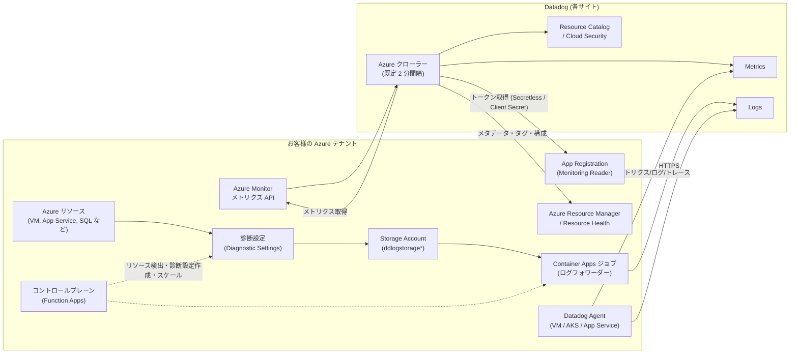
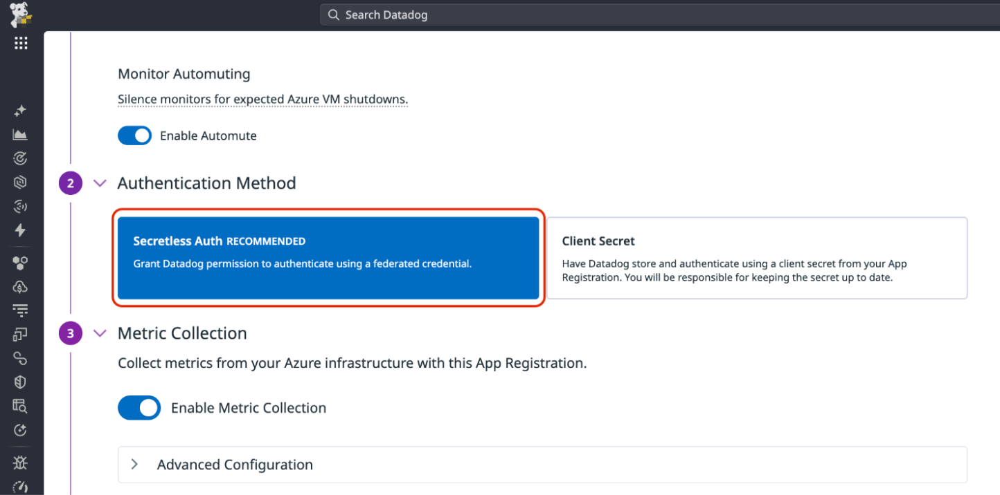
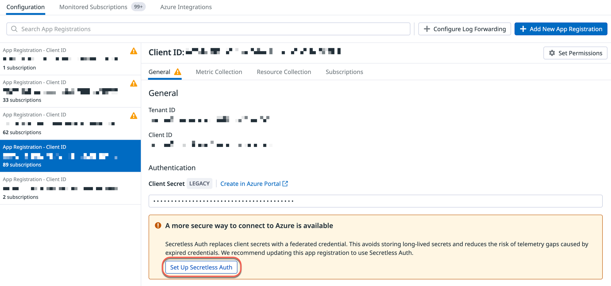
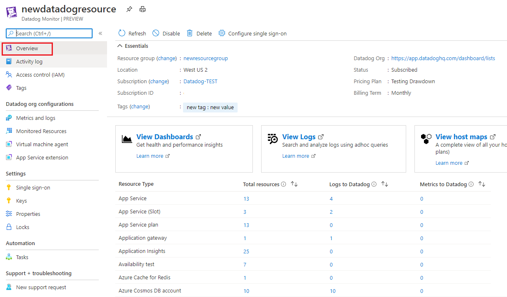
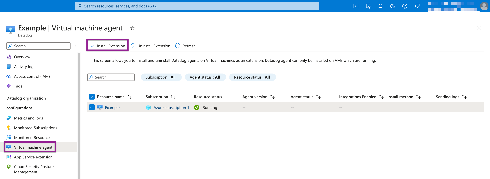
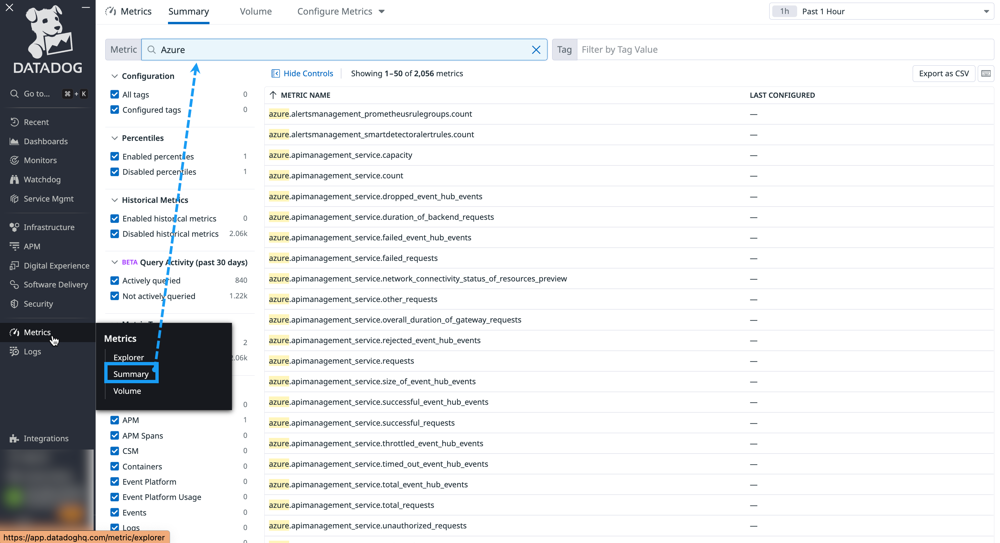

# Azure Integration（Microsoft Azure インテグレーション）

## 概要

Datadog の Azure Integration（Microsoft Azure インテグレーション）は、お客様の Azure テナントに登録したアプリケーション（App Registration、アプリ登録）の資格情報を Datadog に設定し、Datadog がその権限で **Azure Monitor のメトリクス、リソースのメタデータ（タグ・構成情報）を API 経由で収集する**仕組みである。Agent をインストールしなくても、Azure Monitor が対応するリソースのメトリクスを取り込める。ログは別途、Datadog が用意する自動ログ転送（Automated Log Forwarding）などで Datadog に送る。[出典](https://docs.datadoghq.com/integrations/azure/)

Azure Integration で利用できる主な機能は次のとおり。[出典](https://docs.datadoghq.com/integrations/azure/)

| 機能 | 内容 | 本ファイルの節 |
|---|---|---|
| メトリクス収集 | Azure Monitor のすべてのメトリクスを収集する設計。専用サブインテグレーションがないリソースでも Azure Monitor が対応していれば取り込める | [メトリクス収集](#メトリクス収集) |
| ログ収集 | 診断設定（Diagnostic Settings）経由のリソースログ、Activity Log、Entra ID ログ、Log Analytics Workspace のテーブル | [ログ収集](#ログ収集) |
| リソース収集 | リソースの構成情報を収集し、Resource Catalog や Cloud Security などで利用 | [リソース収集](#リソース収集と連携製品) |
| Agent の導入支援 | VM 拡張機能、AKS Cluster Extension、App Service 拡張機能 | [Agent のインストール](#azure-上への-agent-のインストール) |
| アクション | Workflow Automation / App Builder から Azure のアクションを実行して修復などを行う | [Workflow Automation](../service-management/workflow-automation.md) |
| コスト | Cloud Cost Management で Azure のコストを可視化（App Registration 方式が必要） | [Cloud Cost Management](../infrastructure/cloud-cost-management.md) |

接続方式は 2 系統ある。

| 方式 | 概要 | 利用できるサイト |
|---|---|---|
| **App Registration 方式**（標準） | Azure にアプリ登録を作り、その資格情報（Secretless Auth または Client Secret）を Datadog に設定する | **全サイト**（US1、US3、US5、EU1、AP1、AP2、US1-FED など） |
| **Azure Native Integration**（Datadog リソース） | Azure ポータル上で Azure リソース `Microsoft.Datadog/monitors`（製品名：Datadog - An Azure Native ISV Service）を作成し、Datadog 組織とリンクする。Azure Marketplace 経由の課金も可能 | **US3 のみ** |

出典: [Getting Started with Azure](https://docs.datadoghq.com/getting_started/integrations/azure/)、[Azure Native Integration](https://docs.datadoghq.com/integrations/guide/azure-native-integration/)

> **サイト差異:** 基準サイトの AP1（日本）では Azure Native Integration は使えず、**App Registration 方式を使う**。Azure Native Integration（Azure ポータルの Datadog リソース）は US3（`us3.datadoghq.com`）の組織専用である。[出典](https://docs.datadoghq.com/integrations/guide/azure-native-integration/)

関連ファイル：インテグレーション全般は [Integrations](./integrations.md)、AWS 版は [AWS Integration](./aws-integration.md)、Google Cloud 版は [Google Cloud Integration](./gcp-integration.md)、ログの取り込み全般は [ログ収集](../logs/log-collection.md) を参照。

## 全体アーキテクチャ（データフロー）

Azure Integration のデータの流れは、メトリクス・リソース情報（Datadog から Azure API を呼ぶ「プル型」）と、ログ（Azure 側から Datadog に送る「プッシュ型」）で異なる。



出典: [Azure Advanced Configuration](https://docs.datadoghq.com/integrations/guide/azure-advanced-configuration/)、[Azure Automated Log Forwarding Architecture](https://docs.datadoghq.com/logs/guide/azure-automated-logs-architecture/)

- Datadog は App Registration を使って Azure Active Directory（現 Microsoft Entra ID）からトークンを取得し、スコープ内のすべてのサブスクリプションのリソースを検出・監視する。[出典](https://docs.datadoghq.com/integrations/guide/azure-advanced-configuration/)
- Datadog はメトリクス定義を自動更新し、Azure Monitor のメトリクスをすべて収集する。カスタム Azure タグを含むメタデータはタグとしてメトリクスに付与される。[出典](https://docs.datadoghq.com/integrations/guide/azure-advanced-configuration/)
- ログは Azure の診断設定（Diagnostic Settings）を起点に、Storage Account（自動転送の場合）または Event Hub（旧来の方式）を経由して Datadog の Log intake に送られる。[出典](https://docs.datadoghq.com/logs/guide/azure-automated-logs-architecture/)

## 接続方式の比較

### App Registration 方式と Azure Native Integration の比較

| 項目 | App Registration 方式 | Azure Native Integration |
|---|---|---|
| 対象サイト | 全サイト | US3 のみ |
| 作成場所 | Datadog の Azure インテグレーションタイル（または Terraform） | Azure ポータル / Azure CLI / Terraform（`azurerm_datadog_monitor`） |
| 認証 | Secretless Auth（推奨）または Client Secret | Datadog リソースのマネージド ID に Monitoring Reader を付与 |
| メトリクスのフィルター | リソースプロバイダー、タグ、ホスト、App Service Plan、Container Apps 単位で可 | VM、VM Scale Sets、App Service Plan のみタグで包含/除外。他のリソース種別は絞り込み不可 |
| ログ収集 | 自動ログ転送（Configure Log Forwarding / ARM テンプレート）、Container App、Event Hub など | トグルで Activity Log・リソースログを送信（診断設定を自動作成）。Entra ID は手動 |
| Agent 導入 | Azure ポータルの VM 拡張機能・AKS Cluster Extension を個別に使う | Datadog リソース画面から VM 拡張機能・App Service 拡張機能を一括管理 |
| SSO | Datadog 側の SAML 設定 | Entra ID のエンタープライズアプリで SAML SSO を構成可能 |
| 課金 | Datadog と直接契約（Marketplace 購入も別途可能） | Azure Marketplace 経由で Azure の請求書に統合可能（MACC に算入可） |
| Cloud Cost Management | 対応 | **非対応**（別途 App Registration が必要） |
| Log Archives（Azure Blob） | 対応 | **非対応**（別途 App Registration が必要） |
| リソース単位のメトリクスフィルター | 対応 | 非対応 |

出典: [Azure Native Integration](https://docs.datadoghq.com/integrations/guide/azure-native-integration/)、[Getting Started with Azure](https://docs.datadoghq.com/getting_started/integrations/azure/)、[Microsoft Learn: Datadog overview](https://learn.microsoft.com/en-us/azure/partner-solutions/datadog/overview)（2026-10-30 更新）

> **サイト差異:** US3 で Azure Native Integration を使っている組織が Cloud Cost Management や Log Archives を使う場合、追加で App Registration を作成する必要がある。同じサブスクリプションが両方式で接続されると Azure タイルに「冗長（redundancy）」警告が出るが、Cloud Cost Management と Log Archives の用途であれば無視してよい。[出典](https://docs.datadoghq.com/getting_started/integrations/azure/)

### サイト・Azure クラウド別の対応状況

| 環境 | App Registration（Secretless Auth） | App Registration（Client Secret） | Azure Native | 自動ログ転送 |
|---|---|---|---|---|
| US1 / US5 / EU1 / AP1 / AP2 | 可 | 可 | 不可 | 可 |
| US3 | 可 | 可 | 可 | 可 |
| US1-FED（`app.ddog-gov.com`） | **不可** | 可 | 不可 | **不可** |
| US2-FED（`us2.ddog-gov.com`） | **不可** | 可（Azure インテグレーション自体の利用可否が組織により異なる。下記注記参照） | 不可（US3 のみ） | **不可** |
| Azure 商用（パブリック）クラウド | 可 | 可 | 可（US3） | 可 |
| Azure Government / Azure China（21Vianet 運営） | **不可** | 可 | 公開情報では確認できず | **不可** |

出典: [Getting Started with Azure](https://docs.datadoghq.com/getting_started/integrations/azure/)、[Azure Automated Log Forwarding](https://docs.datadoghq.com/logs/guide/azure-automated-log-forwarding/)、[Azure Integration](https://docs.datadoghq.com/integrations/azure/)

- `us2.ddog-gov.com` では、Azure インテグレーション（App Registration 方式）が使えるかどうかは組織によって異なる（Azure Native Integration は US3 専用のため US2-FED では使えない）。Integrations ページで確認するか管理者に問い合わせ、例外申請は `support@ddog-gov.com` に送る。[出典](https://docs.datadoghq.com/integrations/azure/)
- 中国本土での Datadog サービスの利用は、Datadog Web サイトの「Restricted Service Locations」の免責事項に従う。[出典](https://docs.datadoghq.com/integrations/azure/)
- サイトの詳細は [Datadog Sites](./datadog-sites.md) を参照。

## 前提条件と必要な権限（App Registration 方式）

### Azure 側の権限

App Registration 方式のセットアップ（Quickstart / Terraform）を実行するユーザーには、次の権限が必要である。[出典](https://docs.datadoghq.com/getting_started/integrations/azure/)

| 目的 | 必要な権限（いずれか） |
|---|---|
| アプリ登録の作成 | テナント設定「Users can register applications」が `Yes`、または **Application Developer** ロール |
| 監視対象サブスクリプションへのロール割り当て | **Owner**、または **Contributor** と **User Access Admin** の両方 |
| Graph API 権限の追加・同意 | **Privileged Role Administrator** ロール（必要な権限を含む） |

作成される App Registration 自体に必要なロールは次のとおり。

| App Registration の用途 | 必要な Azure ロール |
|---|---|
| メトリクス・リソース収集（監視対象スコープ：サブスクリプションまたは管理グループ） | **Monitoring Reader** |
| Log Archives（Azure Blob Storage へのアーカイブ）専用 | Monitoring Reader は不要（アーカイブ先ストレージへの書き込み権限は [Indexes・保持・アーカイブ](../logs/log-indexes-retention-archives.md) を参照） |

出典: [Azure Manual Setup](https://docs.datadoghq.com/integrations/guide/azure-manual-setup/)、[Azure Automated Log Forwarding](https://docs.datadoghq.com/logs/guide/azure-automated-log-forwarding/)

### Datadog 側の権限

- **Datadog Admin Role**、または `azure_configurations_manage` 権限を持つロールが必要。[出典](https://docs.datadoghq.com/getting_started/integrations/azure/)
- ロールと権限の詳細は [組織・ユーザー・権限管理](./account-and-access-management.md) を参照。

## 認証方式（Secretless Auth と Client Secret）

App Registration 方式では、Datadog が Azure に認証する方法を 2 つから選ぶ。[出典](https://docs.datadoghq.com/getting_started/integrations/azure/)

| 認証方式 | 仕組み | 利用者の管理作業 | 制約 |
|---|---|---|---|
| **Secretless Auth**（推奨） | App Registration に Azure のフェデレーション資格情報（federated credential）を設定し、OpenID Connect（OIDC）のワークロード ID フェデレーションで Datadog の OIDC 発行者を信頼する。Datadog はシークレットを保存しない | ローテーション・更新は不要 | US1-FED / US2-FED サイト、および Azure Government・Azure China（21Vianet）などのソブリンクラウドでは使えない |
| **Client Secret** | App Registration のクライアントシークレットを Datadog が保存して認証する | シークレットの有効期限が切れる前に更新し続ける必要がある | なし（全環境で使用可） |

- Datadog ブログ「Avoid Azure secret rotation with secretless authentication」（2026-08-12 公開）によると、Secretless Auth では Datadog は短期間有効なアクセストークンを取得し、長期間有効なシークレットを保持しない。既存の Client Secret 方式の App Registration は、作り直さずに移行できる。[出典](https://www.datadoghq.com/blog/azure-secretless-authentication/)（2026-08 公開）
- Client Secret が失効するとデータ収集が止まり、メトリクスが欠損する。失効は「インテグレーションエラー」としてイベント化されるため、モニターで検知できる（[インテグレーションの状態監視](#インテグレーションの状態監視) を参照）。[出典](https://docs.datadoghq.com/integrations/guide/azure-manual-setup/)



- **キャプション:** Datadog の Azure インテグレーションで App Registration を設定する画面の「Authentication Method」セクション。
- **画面説明:** 縦に番号付きのステップが並ぶ。上部に「Monitor Automuting」（Azure VM の予定された停止時にモニターをミュートする）と「Enable Automute」トグル。ステップ 2「Authentication Method」に 2 枚のカードがあり、左が「Secretless Auth RECOMMENDED（フェデレーション資格情報で Datadog に認証を許可）」、右が「Client Secret（App Registration のクライアントシークレットを Datadog が保存して認証。シークレットの更新は利用者の責任）」。ステップ 3「Metric Collection」に「Enable Metric Collection」トグルと折りたたみ式の「Advanced Configuration」がある。
- **出典:** https://docs.datadoghq.com/getting_started/integrations/azure/ （画像取得日 2026-11-02）

## App Registration 方式のセットアップ

Datadog のメニュー **Integrations > Azure**（Azure インテグレーションタイル）から設定する。セットアップ方法は 3 つある。[出典](https://docs.datadoghq.com/getting_started/integrations/azure/)

| 方法 | 向いているケース | 概要 |
|---|---|---|
| **Quickstart**（推奨） | 初回セットアップ、UI 中心の作業、スクリプト化 / CI/CD での自動化 | Datadog が生成するスクリプトを Azure Cloud Shell で実行し、App Registration の作成・ロール割り当てを自動化 |
| **Terraform** | IaC、複数テナント・サブスクリプション、監査可能なデプロイ | 新規 App Registration を Terraform で作成、または既存 App Registration を `datadog_integration_azure` リソースで登録 |
| **既存の App Registration を使う**（Add Existing） | Monitoring Reader を持つ既存アプリを再利用し、新しいリソースを作りたくない場合 | Tenant ID、Client ID、Client Secret Value を入力 |

### Quickstart の手順

1. Azure インテグレーションタイルで **+ Add New App Registration** をクリックし、**Quickstart** を選ぶ。
2. 表示されたセットアップスクリプトをコピーし、Azure Cloud Shell で実行する。
3. Datadog に戻り、ステータスが **CONNECTED** になったことを確認する。
4. 監視するサブスクリプションと管理グループ（Management Group）を選ぶ。
5. 認証方式（Secretless Auth / Client Secret）を選ぶ。
6. メトリクス収集を設定する（任意でオフにするか、**Advanced Configuration** でリソースプロバイダー、タグ、ホスト、App Service Plan、Container Apps による絞り込み、Application Insights のカスタムメトリクスの有効化、Usage メトリクスの無効化、リソース構成収集のオフを行う）。
7. ログ収集を有効にする場合は、ログフォワーダーを設定する。テナント内に既存のフォワーダーがあれば、新しく選んだサブスクリプション・管理グループを含むよう変更される。新規作成の場合は、コントロールプレーンのリソースグループ名、コントロールプレーン用サブスクリプション、コントロールプレーンのリージョンを入力する（[自動ログ転送](#自動ログ転送automated-log-forwarding) を参照）。
8. 任意で **Log filtering options** を開き、タグによる絞り込みや、正規表現による機密情報（PII など）の除去を設定する。
9. **Confirm** をクリックしてセットアップを完了する。

出典: [Getting Started with Azure](https://docs.datadoghq.com/getting_started/integrations/azure/)

### Terraform の手順

**新しい App Registration を作る場合**

1. **+ Add New App Registration** で **Terraform** を選ぶ。
2. サブスクリプション、認証方式などのオプションを設定する。
3. 「Initialize and apply the Terraform」に表示されたコマンドを実行する。
4. `terraform apply` 後、データ収集が始まるまで**最大 10 分**待つ。

**既存の App Registration を使う場合**

- Datadog Terraform プロバイダーを設定し、`datadog_integration_azure` リソースに `tenant_name`、`client_id`、`secretless_auth_enabled = true` を設定する。
- Client Secret 認証にする場合は `secretless_auth_enabled` を外し、`client_secret` を設定する。
- Secretless Auth には App Registration 側にフェデレーション資格情報が必要。
- 複数のサブスクリプションやテナントは、エイリアス付きのプロバイダーブロックで管理できる。

出典: [Getting Started with Azure](https://docs.datadoghq.com/getting_started/integrations/azure/)。Terraform の項目一覧は [Terraform / API](#terraform-と-api) を参照。

### 既存の App Registration を登録する手順（Add Existing）

1. Azure インテグレーションタイルで **Add Existing** を選ぶ。
2. Directory（tenant）ID、Application（client）ID、Client Secret Value を貼り付ける。
3. 必要に応じて **Monitor Automuting** トグルをオフにし、メトリクス収集・リソース収集を調整する。
4. **Create Configuration** をクリックする。

出典: [Getting Started with Azure](https://docs.datadoghq.com/getting_started/integrations/azure/)

- 既存の App Registration には、監視対象スコープに対する **Monitoring Reader** ロールが割り当てられている必要がある。[出典](https://docs.datadoghq.com/integrations/guide/azure-manual-setup/)
- Azure ポータルでの App Registration・クライアントシークレットの作成手順そのものは、Datadog の現行ドキュメントには記載されていない（Microsoft のドキュメントに従う）。

### Client Secret から Secretless Auth への移行

既存の Client Secret 方式の App Registration は、作り直さずにその場で Secretless Auth に移行できる。[出典](https://docs.datadoghq.com/getting_started/integrations/azure/)

1. Azure インテグレーションタイルの **Configuration** タブで対象の App Registration を選ぶ。
2. **General** タブの「Authentication」で **Set Up Secretless Auth** をクリックする。
3. 表示されたダイアログで、次のいずれかの方法でフェデレーション資格情報を作成する。

| 方法 | 手順 |
|---|---|
| **Azure CLI** | ダイアログに表示される `az ad app federated-credential create` コマンドを端末（または Azure Cloud Shell）で実行し、**Verify Credential** → **Confirm**。成功するとクライアントシークレットは Datadog から削除される |
| **Terraform** | `azuread` プロバイダー **3.7.0 以降**が必要。ダイアログの `issuer` と `subject` で `azuread_application_federated_identity_credential` リソースを追加し、インテグレーションの依存関係に加える。`datadog_integration_azure` の `client_secret` を `secretless_auth_enabled = true` に置き換えて apply |
| **Azure ポータル** | App Registration の **Certificates & secrets > Federated credentials > Add credential** で **Other issuer** を選び、ダイアログに表示された Issuer、Subject、Audience を正確に入力。Datadog 側で検証して確定 |

出典: [Getting Started with Azure](https://docs.datadoghq.com/getting_started/integrations/azure/)、[Azure Manual Setup](https://docs.datadoghq.com/integrations/guide/azure-manual-setup/)



- **キャプション:** Azure インテグレーションタイルの Configuration タブで、Client Secret 方式の App Registration を開いた画面。
- **画面説明:** 上部に「Configuration」「Monitored Subscriptions」「Azure Integrations」の 3 タブ。右上に「Configure Log Forwarding」と「+ Add New App Registration」ボタン。左ペインに App Registration（Client ID と監視サブスクリプション数）の一覧があり、警告アイコン付きのものもある。右ペインには選択した App Registration の Client ID、「Set Permissions」ボタン、サブタブ「General」「Metric Collection」「Resource Collection」「Subscriptions」が並ぶ。General タブには Tenant ID、Client ID、「Authentication」欄に「Client Secret LEGACY」と「Create in Azure Portal」リンク、その下に「A more secure way to connect to Azure is available」という Secretless Auth への移行を勧める注意枠と **Set Up Secretless Auth** ボタンがある。
- **出典:** https://docs.datadoghq.com/getting_started/integrations/azure/ （画像取得日 2026-11-02）

### Azure インテグレーションタイルの画面構成

| 場所 | 内容 |
|---|---|
| **Configuration** タブ | App Registration の一覧と詳細。各 App Registration にサブタブ **General**（Tenant ID、Client ID、認証方式）、**Metric Collection**、**Resource Collection**、**Subscriptions** |
| **Monitored Subscriptions** タブ | 監視中のサブスクリプション一覧 |
| **Azure Integrations** タブ | サービス別サブインテグレーションの一覧 |
| **Configure Log Forwarding** ボタン | 自動ログ転送の新規設定・変更（サブスクリプションの追加・削除、ログフィルターの変更） |
| **+ Add New App Registration** ボタン | Quickstart / Terraform / Add Existing の選択 |
| **Set Permissions** ボタン | App Registration の権限設定 |

出典: 上記スクリーンショット（[Getting Started with Azure](https://docs.datadoghq.com/getting_started/integrations/azure/)）、[Azure Automated Log Forwarding](https://docs.datadoghq.com/logs/guide/azure-automated-log-forwarding/)

## App Registration の設定項目

App Registration ごとに設定できる項目は次のとおり（UI 名称と Terraform の引数を対応させた）。

| UI の設定 | 内容 | Terraform 引数 | デフォルト |
|---|---|---|---|
| Monitor Automuting（Enable Automute） | Azure VM の予定された停止（シャットダウン）時にモニターを自動ミュートする | `automute` | Terraform: `false`（UI では有効の状態で表示される例あり。下記注記参照） |
| Enable Metric Collection | Azure メトリクス収集全体のオン/オフ | `metrics_enabled` | `true` |
| リソースプロバイダー別のメトリクス有効化（Advanced Configuration） | 特定のリソースプロバイダー（名前空間）ごとにメトリクス収集をオン/オフ | `resource_provider_configs`（`namespace`、`metrics_enabled`） | 個別設定なし |
| 個別設定のないプロバイダーの扱い | 個別設定がないリソースプロバイダーのメトリクスを収集するか | `metrics_enabled_default` | `true` |
| タグによるリソースの絞り込み（メトリクス） | `key:value` のタグフィルター（構文は後述） | 公開情報では Terraform 引数との対応を確認できず | 空（全リソース） |
| ホスト（VM）の絞り込み | タグで取り込む VM を限定 | `host_filters` | `""`（全 VM） |
| App Service Plan の絞り込み | タグで App Service Plan（とその上の Apps / Functions）を限定 | `app_service_plan_filters` | `""` |
| Container Apps の絞り込み | タグで Azure Container Apps を限定 | `container_app_filters` | `""` |
| Application Insights のカスタムメトリクス | スコープ内のすべての Application Insights インスタンスに書き込まれたカスタムメトリクスを収集 | `custom_metrics_enabled` | `false` |
| Usage メトリクス | `azure.usage.*`（使用量・クォータ）メトリクスの収集 | `usage_metrics_enabled` | `true` |
| Resource Collection | Azure リソースの構成情報の収集 | `resource_collection_enabled` | 公開情報では Terraform の既定値を確認できず |
| Cloud Security（CSPM）スキャン | Cloud Security（旧称：Cloud Security Management / CSM）の構成ミス検出。リソース収集が前提 | `cspm_enabled` | `false` |

出典: [Getting Started with Azure](https://docs.datadoghq.com/getting_started/integrations/azure/)、[Terraform `datadog_integration_azure`](https://github.com/DataDog/terraform-provider-datadog/blob/master/docs/resources/integration_azure.md)

- Monitor Automuting の UI 上の既定状態は、公式ドキュメントでは「必要に応じてトグルをオフにする」と記載されており、UI では有効状態が既定である可能性が高いが、明記はない。Terraform の `automute` は既定 `false`。両者の既定が異なる可能性があるため、Terraform 管理時は明示的に指定すること。[出典](https://docs.datadoghq.com/getting_started/integrations/azure/)
- **複数の App Registration で同じサブスクリプションを監視する構成は推奨されない**。インテグレーションの不具合の原因となり、Azure Monitor のコスト増加につながる可能性がある。[出典](https://docs.datadoghq.com/integrations/guide/azure-troubleshooting/)

## Azure Native Integration（Azure ポータルの Datadog リソース）

### 概要

Azure Native Integration は、Microsoft と Datadog が共同で開発・管理する Azure Native ISV Service（製品名：**Datadog - An Azure Native ISV Service**）で、Azure ポータル上で Datadog を Azure リソース（`Microsoft.Datadog/monitors`）として作成・管理できる。Datadog リソースは、Datadog 組織の作成またはリンク、診断設定の自動構成、Monitoring Reader の割り当て、Agent の拡張機能デプロイ、Entra ID によるシングルサインオン、課金を担うコントロールプレーンである。[出典](https://learn.microsoft.com/en-us/azure/partner-solutions/datadog/overview)（2026-10-30 更新）

- **US3 サイトの組織でのみ利用できる**。Datadog リソースのロケーション（Azure デプロイリージョン）は **West US 2**（US3 のホスト先）だが、監視できる Azure リージョンは制限されない。[出典](https://docs.datadoghq.com/integrations/guide/azure-native-integration/)
- Azure Marketplace のオファーは「Datadog – An Azure Native ISV Service」として公開されている。Microsoft Learn の本文はオファー ID を `dd_liftr_v2` と記載しているが、同ページの Marketplace へのリンク先は `datadog1591740804488.dd_liftr_v3_decoupled` であり、記載が一致しない。購入時は Marketplace で製品名から検索するか、Microsoft Learn のリンクから開くとよい。[出典](https://learn.microsoft.com/en-us/azure/partner-solutions/datadog/overview)
- Datadog リソースは、Azure ポータル、Azure CLI、IaC（Terraform、Bicep、ARM テンプレート）で管理できる。[出典](https://learn.microsoft.com/en-us/azure/partner-solutions/datadog/overview)

### 前提条件

| 項目 | 条件 |
|---|---|
| Datadog サイト | US3 |
| Azure 権限 | リンクする各 Azure サブスクリプションの **Owner** |
| Datadog 権限 | リンク先 Datadog 組織の **Admin** |
| Marketplace | Azure Marketplace での購入が許可されたサブスクリプション（無料サブスクリプション、Marketplace 購入が無効な EA などは不可） |

出典: [Azure Native Integration](https://docs.datadoghq.com/integrations/guide/azure-native-integration/)、[Microsoft Learn: Troubleshooting](https://learn.microsoft.com/en-us/azure/partner-solutions/datadog/troubleshoot)（2026-01-29 改訂）

### 作成手順

Azure ポータルの Datadog サービスページで Datadog リソースを作成する。作成フローは 2 種類ある。[出典](https://docs.datadoghq.com/integrations/guide/azure-native-integration/)

| フロー | 用途 | 内容 |
|---|---|---|
| **既存組織にリンク**（一般的） | 既に US3 の Datadog 組織がある場合 | OAuth でサインインした後に組織を選ぶ。**課金プランは変わらない** |
| **新しい組織を作成** | 新規顧客 | 組織を作成し、Marketplace プランを選び、サブスクリプションをリンク。組織名はリソース名になる |

主な入力項目：

| 項目 | 内容 |
|---|---|
| Location | West US 2 |
| リソース名（リンクの場合） | 推奨形式は `subscription_name-datadog_org_name` |
| Organization | リンク：OAuth サインイン後に選択。作成：リソース名が組織名になる |

- **Azure の作成フローでは無料トライアルは使えない**。トライアルを使う場合は、先に US3 でトライアル組織を作り、それをリンクする。[出典](https://docs.datadoghq.com/integrations/guide/azure-native-integration/)
- **Terraform**：`azurerm_datadog_monitor` リソースを `sku_name = "Linked"`、システム割り当てマネージド ID（SystemAssigned）で作成し、その Principal ID にサブスクリプションスコープで **Monitoring Reader** を割り当ててから `terraform apply` する。[出典](https://docs.datadoghq.com/integrations/guide/azure-native-integration/)



- **キャプション:** Azure ポータルで Datadog リソースを開いたときの Overview（概要）画面。
- **画面説明:** 左メニューに「Overview」「Activity log」「Access control (IAM)」「Tags」、見出し「Datadog org configurations」の下に「Metrics and logs」「Monitored Resources」「Virtual machine agent」「App Service extension」、「Settings」の下に「Single sign-on」「Keys」「Properties」「Locks」がある。上部に「Refresh」「Disable」「Delete」「Configure single sign-on」ボタン。Essentials 欄にリソースグループ、Location（West US 2）、サブスクリプション、タグ、Datadog Org のリンク、Status（Subscribed）、Pricing Plan、Billing Term（Monthly）。中央に「View Dashboards」「View Logs」「View host maps」のリンクカード、下部に Resource Type ごとの「Total resources」「Logs to Datadog」「Metrics to Datadog」の件数表（App Service、App Service plan、Application gateway、Application Insights、Azure Cache for Redis、Azure Cosmos DB account など）がある。画像は旧版（PREVIEW 表記）のため、現行画面とはメニュー名が一部異なる可能性がある。
- **出典:** https://docs.datadoghq.com/integrations/guide/azure-native-integration/ （画像取得日 2026-11-02）

### Datadog リソースでの設定・操作

| 操作 | 内容 |
|---|---|
| Overview | リソースグループ、ロケーション、サブスクリプション、タグ、組織リンク、状態、プラン、課金期間、ダッシュボード/ログ/ホストマップへのリンク、ログ・メトリクスを送信しているリソース種別ごとの件数 |
| Disable / Enable | Disable にすると、リンクしたサブスクリプションからのメトリクス・ログ送信が止まる。Agent や拡張機能が直接送るデータは影響を受けない |
| Delete | `yes` と入力して削除。Marketplace 課金の組織で、その組織にリンクされた唯一のリソースを削除すると、**全データ送信と課金が止まり**、Datadog サポートから連絡がある。それ以外の場合は当該サブスクリプションの連携のみ削除される |
| Change Plan | 利用可能なプラン（プライベートオファーを含む）に変更 |
| Keys | API キーの管理。Agent インストールには **Default Key** の指定が必要 |
| Single sign-on | Entra ID を使った SAML SSO の構成 |

出典: [Azure Native Integration](https://docs.datadoghq.com/integrations/guide/azure-native-integration/)、[Microsoft Learn: Troubleshooting](https://learn.microsoft.com/en-us/azure/partner-solutions/datadog/troubleshoot)

### メトリクス・ログ設定（Azure Native）

| 対象 | 既定 | 設定方法 |
|---|---|---|
| メトリクス | リンクしたサブスクリプションの**全リソース**を収集 | VM、VM Scale Sets、App Service Plan のみタグルールで `include`（送信）/ `exclude`（除外）を指定可。競合時は除外が優先。他の種別は絞り込み不可 |
| Activity Log（サブスクリプションのアクティビティログ） | 任意 | 「Send subscription activity logs」を有効化 |
| Azure リソースログ | 任意 | 「Send Azure resource logs for all defined resources」を有効化（新規リソースも対象）。タグルールで包含/除外（除外優先） |
| Microsoft Entra ID ログ | 手動 | Entra ID の Diagnostic Settings で設定を追加し、カテゴリ（Datadog は全カテゴリを推奨）を選び、「Send to a partner solution」で Datadog リソースを選択。テナントごとに 1 回でよい |
| Application Insights のカスタムメトリクス | 任意 | Microsoft のドキュメントでは収集可能と記載 |

出典: [Azure Native Integration](https://docs.datadoghq.com/integrations/guide/azure-native-integration/)、[Microsoft Learn: Datadog overview](https://learn.microsoft.com/en-us/azure/partner-solutions/datadog/overview)

- ログ収集を有効にすると、Datadog リソースが App Service のログ設定を変更するため、**App Service が再起動される**。[出典](https://docs.datadoghq.com/integrations/guide/azure-native-integration/)
- Azure Native のログ転送は、診断設定の「パートナーソリューション」宛先を使う。Azure Monitor の診断設定はパートナーソリューションへのメトリクスのエクスポートに対応していないため、メトリクスはプラットフォームメトリクスとして収集される。[出典](https://learn.microsoft.com/en-us/azure/partner-solutions/datadog/troubleshoot)
- タグルールで作成された診断設定のログカテゴリは手動で変えられない（変更しても、タグルールに基づく既定値に戻る）。宛先を手動変更すると元の設定の診断設定が再作成される。[出典](https://learn.microsoft.com/en-us/azure/partner-solutions/datadog/troubleshoot)

### Agent のインストール（Azure Native）

| 対象 | 操作 | 条件・注意 |
|---|---|---|
| VM（VM 拡張機能） | **Virtual machine agent** 画面で VM を選び **Install Extension** → OK。状態は `Installing` から `Installed` に変わる | **実行中の VM にのみ**インストール可。**Uninstall Agent** は拡張機能で入れた Agent にのみ有効 |
| AKS（AKS Cluster Extension） | AKS クラスターの **Extensions + applications** で「Datadog AKS Cluster Extension」を選び **Create**、Datadog の資格情報とサイトを入力 | アンインストールは拡張機能（種類 `Datadog.AKSExtension`）を選んで **Uninstall** |
| App Service（App Service 拡張機能） | アプリを選んで **Install Extension**。アプリは再起動され、`DD_API_KEY` と `DD_SITE`（`us3.datadoghq.com`）が設定される | アプリが実行中で、ランタイムが対応している必要がある。Datadog リソースはランタイムでアプリを絞り込まない。削除は **Uninstall Extension** |
| Azure Arc 対応マシン | Arc 拡張機能としてインストール（Microsoft のドキュメントに記載） | 手順の詳細は Datadog ドキュメントでは確認できず |

出典: [Azure Native Integration](https://docs.datadoghq.com/integrations/guide/azure-native-integration/)、[Microsoft Learn: Datadog overview](https://learn.microsoft.com/en-us/azure/partner-solutions/datadog/overview)



- **キャプション:** Azure ポータルの Datadog リソースで「Virtual machine agent」を開いた画面。
- **画面説明:** 左メニューの「Datadog organization configurations」に「Metrics and logs」「Monitored Subscriptions」「Monitored Resources」「Virtual machine agent」（選択中）「App Service extension」「Cloud Security Posture Management」が並ぶ。上部に「Install Extension」（強調表示）「Uninstall Extension」「Refresh」ボタン。説明文「Datadog agent can only be installed on VMs which are running」。フィルター（Subscription / Agent status / Resource status）の下に、VM ごとの Resource name、Subscription、Resource status（Running）、Agent version、Agent status、Integrations Enabled、Install method、Sending logs の列を持つ表がある。
- **出典:** https://docs.datadoghq.com/integrations/guide/azure-native-integration/ （画像取得日 2026-11-02）

### シングルサインオン（Azure Native）

- SSO は任意で、組織作成時にも後からでも設定できる。作成時に設定する場合は、事前に Azure で Datadog のエンタープライズギャラリーアプリを作成しておく。[出典](https://docs.datadoghq.com/integrations/guide/azure-native-integration/)
- SSO は Entra ID エンタープライズアプリケーション経由の SAML 2.0。SSO を有効にすると、組織リンクは SAML リンクになる。Marketplace で作成した組織は、初回にそのリンクを使うときにパスワードを設定する。[出典](https://learn.microsoft.com/en-us/azure/partner-solutions/datadog/overview)
- エンタープライズアプリの SAML 設定値（US3）は、Identifier URL が `https://us3.datadoghq.com/account/saml/metadata.xml`、Reply URL が `https://us3.datadoghq.com/account/saml/assertion`。[出典](https://learn.microsoft.com/en-us/azure/partner-solutions/datadog/troubleshoot)
- ゲストユーザーを招待するときは、ホームテナントの UPN（User Principal Name）を使う。[出典](https://learn.microsoft.com/en-us/azure/partner-solutions/datadog/troubleshoot)

### Azure Native Integration で使えない機能

| 非対応の機能 | 代替 |
|---|---|
| リソース単位のメトリクスフィルター | App Registration 方式 |
| Cloud Cost Management | App Registration を追加作成 |
| Log Archives（Azure Blob） | App Registration を追加作成 |
| Storage Management | App Registration 方式 |
| Azure の作成フローでのトライアル | US3 でトライアル組織を作ってリンク |

出典: [Azure Native Integration](https://docs.datadoghq.com/integrations/guide/azure-native-integration/)

### Azure Native Integration のトラブルシューティング

| 症状 | 主な原因 | 対処 |
|---|---|---|
| Datadog リソースを作成できない | サブスクリプションの Owner ロールがない | IAM の「View my access」で確認し、Owner を付与してもらう |
| Marketplace 購入が失敗する | `Microsoft.SaaS` リソースプロバイダー未登録、無料サブスクリプション、支払い方法なし、EA で Marketplace 購入無効、プライベートマーケットプレースの制限など | リソースプロバイダー登録、EA 設定変更、別サブスクリプションの利用 |
| ログが届かない | リソース種別がログのエクスポートに非対応、**診断設定の上限（1 リソースあたり最大 5 件）**到達、タグルールで除外 | 不要な診断設定を削除、タグルールを修正 |
| メトリクスが届かない | Datadog リソースに Monitoring Reader が割り当てられていない | IAM で確認。欠落していればリソースを削除して再作成 |
| SSO 設定を保存できない | 別のエンタープライズアプリが同じ SAML 識別子を使っている | 他のアプリを無効化するか、そのアプリで SSO を構成 |
| Agent インストールが失敗する | API キーの **Default Key** が未指定 | **Settings > Keys** で Default Key を指定。誤ったキーで入った場合は再インストール |
| 無効化後も診断設定が残る | リソースまたはリソースグループの**削除ロック** | ロックを解除。リソース削除後に解除した場合は診断設定を手動で削除 |

出典: [Microsoft Learn: Troubleshooting for Datadog](https://learn.microsoft.com/en-us/azure/partner-solutions/datadog/troubleshoot)（2026-01-29 改訂）

## メトリクス収集

### 収集の仕組みとタイミング

Azure Integration のメトリクス収集は、Datadog のクローラーが Azure Monitor の API を定期的に呼び出すポーリング方式である。

| 項目 | 値 | 出典 |
|---|---|---|
| クローラーの実行間隔（既定） | **2 分ごと**（サポートに依頼すれば短縮できる場合がある） | [Cloud Metric Delay](https://docs.datadoghq.com/integrations/guide/cloud-metric-delay/) |
| Azure がメトリクスを出す粒度 | **1 分** | [Cloud Metric Delay](https://docs.datadoghq.com/integrations/guide/cloud-metric-delay/) |
| 典型的な遅延 | **約 4〜5 分** | [Cloud Metric Delay](https://docs.datadoghq.com/integrations/guide/cloud-metric-delay/) |
| セットアップ後に VM などのメトリクスが届くまで | 約 15 分 | [Azure Advanced Configuration](https://docs.datadoghq.com/integrations/guide/azure-advanced-configuration/) |
| `azure.*.count` メトリクスが出るまで | 5〜10 分 | [Azure Advanced Configuration](https://docs.datadoghq.com/integrations/guide/azure-advanced-configuration/) |
| Terraform 適用後にデータ収集が始まるまで | 最大 10 分 | [Getting Started with Azure](https://docs.datadoghq.com/getting_started/integrations/azure/) |

- Azure メトリクスに対してモニターを作ると、Datadog は遅延についての警告を表示する。評価期間を長めにし、評価の遅延（evaluation delay）を設定することが推奨される。[出典](https://docs.datadoghq.com/integrations/guide/cloud-metric-delay/) モニター設定は [Monitors](./monitors.md) を参照。
- システムレベルのメトリクスをほぼ遅延なく取りたい場合は、Azure のホストに Datadog Agent を入れる。[出典](https://docs.datadoghq.com/integrations/guide/cloud-metric-delay/)
- Datadog ブログ「Enable monitoring for enterprise-scale Azure environments in minutes with Datadog」（2023-05-19 公開）によると、Datadog は Azure と協力して Azure Monitor Metrics Data plane API の開発・テストを行った。この API は照会上限が引き上げられており、Datadog は Azure メトリクスをより効率的に取り込める。[出典](https://www.datadoghq.com/blog/monitor-enterprise-azure-environments-with-datadog/)
- Azure Monitor Metrics Data plane API は 2024-01-31 に一般提供（GA）となった。[出典](https://azure.microsoft.com/updates/generalavailabilityofazuremonitormetricsdataplaneapi/) バッチ呼び出し（`metrics:getBatch`）は、1 回の呼び出しで最大 50 の一意なリソース ID を指定できる。対象リソースはすべて同一サブスクリプション・同一リージョン・同一リソース種別である必要があり、カスタムメトリクスは照会できない。[出典](https://learn.microsoft.com/en-us/azure/azure-monitor/metrics/migrate-to-batch-api)

### Azure と Datadog で値が異なる理由

| 要因 | 内容 |
|---|---|
| 時間集計 | Datadog は Azure 側で選んだ時間枠にかかわらず、**1 秒あたり（per-second）の値**で表示する |
| 空間集計 | Datadog は Azure の Metric Definitions API が返す `primaryAggregationType` を使う |
| 補間 | 補間（interpolation）でリソースが二重カウントされたように見えることがある。`.fill(null)` で回避できる |
| 突き合わせ方 | 両ツールでディメンション、集計方法、時間枠を揃えて比較する |

出典: [Azure Troubleshooting](https://docs.datadoghq.com/integrations/guide/azure-troubleshooting/)、[Azure Advanced Configuration](https://docs.datadoghq.com/integrations/guide/azure-advanced-configuration/)。関数の詳細は [メトリクスクエリと関数](./metrics-query-and-functions.md) を参照。

### メトリクス名と名前空間

- Azure Integration のメトリクスは `azure.` で始まり、リソースプロバイダーとリソース種別を `_` でつないだ名前空間を持つ（例：`azure.compute_virtualmachines.*`、`azure.apimanagement_service.*`、`azure.app_jobs.*`、`azure.cognitiveservices_accounts_projects.*`）。[出典](https://docs.datadoghq.com/integrations/azure/)
- Datadog で **Metrics > Summary** を開き「Azure」で検索すると、取り込まれている Azure メトリクスを確認できる。[出典](https://docs.datadoghq.com/getting_started/integrations/azure/)
- VM のメトリクスは、クラシック VM なら `azure.vm`、ARM の VM なら `azure.compute_virtualmachines` 名前空間を確認する。[出典](https://docs.datadoghq.com/integrations/guide/azure-troubleshooting/)
- Azure Monitor のディメンションは Datadog のタグに対応付けられる。[出典](https://docs.datadoghq.com/integrations/guide/azure-troubleshooting/)

代表的な名前空間の例（公式メトリクス一覧から抜粋。完全な一覧は [Azure Integration の Metrics](https://docs.datadoghq.com/integrations/azure/) を参照）：

| 名前空間 | 対象 |
|---|---|
| `azure.compute_virtualmachines.*` | 仮想マシン（ARM） |
| `azure.compute_virtualmachinescalesets_virtualmachines.*` | VM Scale Sets のインスタンス（CPU クレジット、ディスク、ネットワーク、フローなど） |
| `azure.compute_cloudservices.*` / `azure.compute_cloudservices_roles.*` | Cloud Services |
| `azure.apimanagement_service.*` / `azure.apimanagement_gateways.*` | API Management |
| `azure.app_jobs.*` / `azure.app_managedenvironments.*` / `azure.app_sessionpools.*` | Container Apps ジョブ / 環境 / セッションプール |
| `azure.avs_privateclouds.*` | Azure VMware Solution |
| `azure.cognitiveservices_accounts_projects.*` | AI エージェント・モデルのトークン、レイテンシ、利用率 |
| `azure.communication_communicationservices.*` | Communication Services |
| `azure.usage.*` | 使用量とクォータ |
| `azure.<種別>.count` | Datadog が Resource Health から生成するリソース数（後述） |

### `azure.*.count` とリソースの状態

| メトリクス | 内容 |
|---|---|
| `azure.*.count` | Datadog が Azure Resource Health から生成するリソース数。`status` タグが付く。値は `Running`、`Unavailable`、`Unknown`、`Degraded`、`Failed`（VM はさらに `Stopped_deallocated`、`Stopped`）。同じ名前空間の他メトリクスと同じメタデータタグを持つ |
| `status:query_failed` | Azure で Resource Health プロバイダー（`Microsoft.ResourceHealth`）が登録されていないことを示す |
| `azure.vm.status` | VM の状態（`status:running`、`status:not_running`、`status:unknown`）。`azure.*.status` 系は**非推奨**で、`azure.*.count` に置き換えられている |

出典: [Azure Advanced Configuration](https://docs.datadoghq.com/integrations/guide/azure-advanced-configuration/)、[Azure Troubleshooting](https://docs.datadoghq.com/integrations/guide/azure-troubleshooting/)、[Azure Integrations 一覧](https://docs.datadoghq.com/integrations/guide/azure-integrations/)

### タグ

- Azure Integration は、一般的なメタデータとリソース固有のメタデータ（**カスタム Azure タグを含む**）を、対応するリソースのメトリクスにタグとして付与する。[出典](https://docs.datadoghq.com/integrations/guide/azure-advanced-configuration/)
- 自動付与されるタグのキーは公式の Azure Integrations ページに一覧があり、次のとおり。カスタム Azure タグはこれに加えて付与される。実際のタグは Metrics Summary や Resource Catalog でも確認できる。[出典](https://docs.datadoghq.com/integrations/guide/azure-integrations/)

| 対象（名前空間） | 自動付与されるタグキー |
|---|---|
| すべての Azure インテグレーション | `cloud_provider`、`region`、`kind`、`type`、`name`、`resource_group`、`tenant_name`、`subscription_name`、`subscription_id`、`status`（該当する場合） |
| Azure VM（`azure.vm.*`） | `host`、`size`、`operating_system`、`availability_zone` |
| App Service Plan（`azure.web_serverfarms.*`） | `per_site_scaling`、`plan_size`、`plan_tier`、`operating_system` |
| App Services の Web Apps と Functions（`azure.app_services.*`、`azure.functions.*`） | `operating_system`、`server_farm_id`、`reserved`、`usage_state`、`fx_version`（Linux の Web アプリのみ）、`php_version`、`dot_net_framework_version`、`java_version`、`node_version`、`python_version` |
| SQL DB（`azure.sql_servers_databases.*`） | `license_type`、`max_size_mb`、`server_name`、`role`、`zone_redundant`。レプリケーションリンクのみ：`state`、`primary_server_name`、`primary_server_region`、`secondary_server_name`、`secondary_server_region` |
| Load Balancer（`azure.network_loadbalancers.*`） | `sku_name` |
| Usage and Quota（`azure.usage.*`） | `usage_category`、`usage_name` |

出典: [Azure Integrations](https://docs.datadoghq.com/integrations/guide/azure-integrations/)
- タグ設計は [Tagging](./tagging.md) と [タグ戦略の実践](../../04_応用編/02-tagging-strategy.md) を参照。

### 収集対象の絞り込み（タグフィルター構文）

App Registration 方式では、メトリクス・ログともにリソースタグで収集対象を絞り込める。[出典](https://docs.datadoghq.com/getting_started/integrations/azure/)

| ルール | 内容 |
|---|---|
| 形式 | カンマ区切りの `key:value` |
| 包含条件 | いずれか 1 つのタグに一致すれば対象（OR） |
| ワイルドカード | `?` は 1 文字、`*` は複数文字に一致 |
| 除外 | 先頭に `!` を付ける。**除外は包含より優先** |
| 未設定時 | 全リソースを収集 |
| 例 | `datadog:monitored,env:production,!plan_tier:basic,instance-type:c1.*` |

Advanced Configuration では、次の単位でメトリクス収集を絞り込める。[出典](https://docs.datadoghq.com/getting_started/integrations/azure/)

| 絞り込み単位 | 説明 |
|---|---|
| リソースプロバイダー | 特定のリソースプロバイダーのメトリクス収集をオン/オフ |
| タグ | 上記のタグフィルター |
| ホスト | VM をタグで限定（課金対象ホスト数に影響。[課金への影響](#課金への影響) 参照） |
| App Service Plan | App Service Plan をタグで限定。その Plan 上のすべての Apps / Functions のメトリクスが対象になる |
| Container Apps | Container Apps をタグで限定 |

- 既存テナントに絞り込みを追加した場合、それまでに検出済みの VM が最大 2 時間ほどインフラ一覧に残り、状態が「???」と表示されることがある。この表示は課金対象にならない。[出典](https://docs.datadoghq.com/account_management/billing/azure/)

### Application Insights のカスタムメトリクスと Usage メトリクス

| 設定 | 内容 | 注意 |
|---|---|---|
| Application Insights のカスタムメトリクス収集 | インテグレーションのスコープ内の**すべての Application Insights インスタンス**に書き込まれたカスタムメトリクスを収集 | Datadog では**カスタムメトリクス**扱いとなり、費用に影響する可能性がある |
| Usage メトリクス（`azure.usage.*`） | Azure の使用量・クォータのメトリクス | 不要なら無効化できる |

出典: [Azure Integration Billing](https://docs.datadoghq.com/account_management/billing/azure/)、[Getting Started with Azure](https://docs.datadoghq.com/getting_started/integrations/azure/)。カスタムメトリクスの数え方は [Custom Metrics と DogStatsD](./custom-metrics-and-dogstatsd.md) を参照。



- **キャプション:** Datadog の Metrics > Summary で「Azure」を検索し、取り込まれた Azure メトリクスの一覧を表示した画面。
- **画面説明:** 左のナビゲーションで **Metrics** にカーソルを合わせると「Explorer」「Summary」「Volume」のサブメニューが出る（Summary を選択）。画面上部に「Summary」「Volume」「Configure Metrics」タブ、Metric 検索欄（「Azure」と入力）と Tag フィルター欄。左側にファセット（Configuration、Percentiles、Historical Metrics、Query Activity (past 30 days) の Actively queried / Not actively queried など）。右側の表には「Showing 1-50 of 2,056 metrics」と表示され、`azure.alertsmanagement_prometheusrulegroups.count`、`azure.apimanagement_service.capacity`、`azure.apimanagement_service.requests` などのメトリクス名と LAST CONFIGURED 列が並ぶ。
- **出典:** https://docs.datadoghq.com/getting_started/integrations/azure/ （画像取得日 2026-11-02）

## ログ収集

### ログ収集方式の比較

Datadog は、可能な場合は **Agent（VM）または DaemonSet（AKS）** でログを送ることを推奨し、直接送れない Azure プラットフォームログには自動ログ転送（Automated Log Forwarding）を推奨する。[出典](https://docs.datadoghq.com/getting_started/integrations/azure/)

| 方式 | 対象ログ | 構成要素 | 推奨度・用途 | 対応環境 |
|---|---|---|---|---|
| **Datadog Agent / DaemonSet** | VM・AKS 上のアプリケーションログ、ファイルログ | Agent | 推奨（直接送れる場合） | 全サイト |
| **自動ログ転送（Automated Log Forwarding、LFO）** | 診断設定経由のリソースログ、Activity Log、Log Analytics Workspace のテーブル | コントロールプレーン（Function Apps）＋リージョンごとのフォワーダー（Container Apps ジョブ＋Storage Account） | 推奨（プラットフォームログ） | Azure 商用クラウドのみ。US1-FED / US2-FED 不可 |
| **Container App ログ転送（手動）** | 診断設定経由のリソースログ | ポータルデプロイの Container App フォワーダー＋Storage Account。診断設定は手動 | 診断設定を自分で管理したい場合、リソースにカスタムタグを付けたい場合 | 公開情報では対応サイトの個別記載を確認できず |
| **Event Hub ＋ Azure Function**（旧来方式） | 診断設定経由のリソースログ、Activity Log | Event Hub 名前空間、Event Hub、Function App（Node.js） | 既存環境での利用。新規は自動ログ転送が推奨 | テンプレートの `datadogSite` で全商用サイトと `ddog-gov.com` を選択可 |
| **Blob Storage ＋ Azure Function** | Blob に出力されたログ | Blob トリガーの Function | 特定用途 | — |
| **Azure Native（US3）** | Activity Log、リソースログ、Entra ID ログ | 診断設定のパートナーソリューション宛先 | US3 の Azure Native 利用時 | US3 のみ |

出典: [Getting Started with Azure](https://docs.datadoghq.com/getting_started/integrations/azure/)、[Azure Automated Log Forwarding](https://docs.datadoghq.com/logs/guide/azure-automated-log-forwarding/)、[Azure Event Hub Log Forwarding](https://docs.datadoghq.com/logs/guide/azure-event-hub-log-forwarding/)、[datadog-serverless-functions/azure](https://github.com/DataDog/datadog-serverless-functions/tree/master/azure)、[Azure Native Integration](https://docs.datadoghq.com/integrations/guide/azure-native-integration/)

- 自動ログ転送が手動方式より優れる点として、Datadog は「Azure ポータルでのデプロイの自動化」「宣言的テンプレートでのインフラ管理」「アクセス・タグ・課金の一元管理」「一貫した順序での再デプロイ」「Event Hub ではなく Storage Account を使うことによるコスト削減」を挙げている。リソースに**カスタムタグを適用したい場合は手動方式のみ**が選択肢となる。[出典](https://docs.datadoghq.com/logs/guide/azure-automated-log-forwarding/)
- Azure Integration で送ったログは Datadog のログ取り込み・インデックスとして通常どおり課金され、日次のインデックスクォータの対象となる。[出典](https://docs.datadoghq.com/logs/guide/azure-event-hub-log-forwarding/)

### 自動ログ転送（Automated Log Forwarding）

#### アーキテクチャ

| コンポーネント | 配置 | 役割 |
|---|---|---|
| **コントロールプレーン** | デプロイごとに 1 つ。選択したサブスクリプション・リージョンに配置。Azure Function Apps 群と、キャッシュ用 Storage Account で構成 | 診断設定でログを出せるリソースの検出、診断設定の構成（フォワーダーが監視する Storage Account へ出力）、リソースがあるリージョンでのフォワーダーのスケール |
| **ログフォワーダー** | 選択した各サブスクリプションの、診断設定対象リソースがある**リージョンごと**に配置。Azure Container Apps ジョブと Storage Account で構成。数はログ量に応じて増減 | 診断設定からのログを一時保管し、処理して Datadog に送信。処理済みログを追跡 |
| **Storage Account** | フォワーダー用（名前は通常 `ddlogstorage` で始まる）とコントロールプレーンのキャッシュ用 | ログと、少量のメタデータキャッシュ（サブスクリプション ID、リソース ID、リージョン）を保管 |

出典: [Azure Automated Log Forwarding Architecture](https://docs.datadoghq.com/logs/guide/azure-automated-logs-architecture/)

- 診断設定は**同じリージョンの Storage Account にしか出力できない**ため、フォワーダーはリージョンごとに作られる。[出典](https://docs.datadoghq.com/logs/guide/azure-automated-log-forwarding/)
- Storage Account のコンテナー名は、LAW のエクスポートが `am-`、診断設定が `insights-` で始まる。[出典](https://docs.datadoghq.com/logs/guide/azure-automated-log-forwarding/)
- リソースに関する情報は外部にエクスポートされず、出力は Datadog に送るログのみ。[出典](https://docs.datadoghq.com/logs/guide/azure-automated-log-forwarding/)
- コントロールプレーンの Function App や Container App に `DD_TELEMETRY=true` を設定すると、自身のヘルスメトリクス・ログ・イベントを Datadog に送る（任意）。[出典](https://docs.datadoghq.com/logs/guide/azure-automated-log-forwarding/)
- スケールの閾値、フォワーダー数の上限、ストレージ上のログ保持期間（ライフサイクル）は、公開情報では確認できず。

#### 自動ログ転送に必要な権限

| 権限 | スコープ | 用途 |
|---|---|---|
| デプロイ実行者の管理グループに対する権限 | 管理グループ | ARM テンプレートが管理グループを使って選択サブスクリプションに権限を付与する |
| **Monitoring Contributor** | 選択したサブスクリプション | リソースの検出と、ストレージへのログ出力（診断設定）の有効化 |
| **Contributor** | フォワーダーのリソースグループ | フォワーダー用 Storage Account と Container Apps ジョブの作成・削除 |
| **Website Contributor** | コントロールプレーンのリソースグループ | コントロールプレーンの Function App の更新 |

出典: [Azure Automated Log Forwarding](https://docs.datadoghq.com/logs/guide/azure-automated-log-forwarding/)

#### セットアップ方法

| 方法 | 手順 |
|---|---|
| **Configure Log Forwarding**（推奨） | Datadog の **Integrations > Azure** で **Configure Log Forwarding** をクリック → 表示されたコマンドを Azure Cloud Shell に貼り付けて実行 → サブスクリプションを選択 → 必要ならログフィルターを追加・削除 → **Confirm**。新規フォワーダーの場合はリソースグループ名、コントロールプレーン（LFO）用サブスクリプション、リージョンを入力（新規作成時のみ表示される） |
| **ARM テンプレート** | Azure ポータルで Automated Log Forwarding の ARM テンプレートをデプロイ。**Basics**（管理グループ〔必須〕、コントロールプレーンのリージョン、ログを転送するサブスクリプション、コントロールプレーン用サブスクリプション、リソースグループ名〔新規の未使用グループを推奨〕）→ **Datadog Configuration**（API キー、Datadog サイト）→ **Deployment**（デプロイ時の注意事項の確認）→ **Review + create** |

出典: [Azure Automated Log Forwarding](https://docs.datadoghq.com/logs/guide/azure-automated-log-forwarding/)、[Getting Started with Azure](https://docs.datadoghq.com/getting_started/integrations/azure/)

- テナント内に既存のフォワーダーがある場合、Configure Log Forwarding は既存のフォワーダーのスコープを拡張する形で変更する。変更は既存と新規に選んだサブスクリプション・管理グループの両方に適用される。[出典](https://docs.datadoghq.com/getting_started/integrations/azure/)
- **ARM テンプレートでデプロイした場合、後からサブスクリプションを追加するにはテンプレートの再デプロイが必要**。[出典](https://docs.datadoghq.com/logs/guide/azure-automated-log-forwarding/)
- ログフィルターは、リソースタグ（メトリクスと同じ構文）または正規表現（PII のマスキングなど機密情報のフィルター）で設定できる。[出典](https://docs.datadoghq.com/getting_started/integrations/azure/)
- Entra ID の診断設定は自動化されないため、手動で設定する。[出典](https://docs.datadoghq.com/integrations/guide/azure-troubleshooting/)

#### Log Analytics Workspace（LAW）のログ転送

自動ログ転送は、従来の診断設定ログに加えて、**LAW のデータエクスポートルール**で LAW のテーブルを転送できる。[出典](https://docs.datadoghq.com/logs/guide/azure-automated-log-forwarding/)

| 項目 | 内容 |
|---|---|
| 手順 | フォワーダーを作成・更新 → Azure ポータルで LAW を開く → **Data export** でルール作成 → テーブルを選択 → 宛先に `ddlogstorage` の Storage Account を指定 → 作成 |
| リージョン制約 | フォワーダーと**同じリージョンの LAW のみ** |
| ルール数上限 | **1 つの LAW あたりデータエクスポートルール最大 10 件** |
| エクスポート不可のテーブル | 一部のテーブルはエクスポートできない（Microsoft が一覧を公開） |
| 遅延 | 通常 **2〜5 分**、初回表示まで**最大 20 分** |
| トラブルシュート | ルールが有効か、宛先が `ddlogstorage` か、`am-` コンテナーが存在するか、LAW が過去 2 時間にログを収集しているかを確認。`insights-` コンテナーしかない場合はエクスポートルールの設定ミスの可能性 |

出典: [Azure Automated Log Forwarding](https://docs.datadoghq.com/logs/guide/azure-automated-log-forwarding/)、[Azure Automated Log Forwarding Architecture](https://docs.datadoghq.com/logs/guide/azure-automated-logs-architecture/)

#### 自動ログ転送のアンインストール

1. Azure Cloud Shell を開き、**Bash（Azure CLI）モード**であることを確認する（PowerShell は不可）。
2. スクリプトをダウンロードする：`wget https://ddazurelfo.blob.core.windows.net/uninstall/uninstall.py`
3. 実行する：`python uninstall.py`
4. スクリプトが各サブスクリプションのインスタンスを検出し、削除対象の選択と削除の確認を求める。削除完了まで待つ。

出典: [Azure Automated Log Forwarding](https://docs.datadoghq.com/logs/guide/azure-automated-log-forwarding/)

### Container App ログ転送（手動）

- 診断設定を自分で構成したい場合の方式。ポータルのデプロイボタンからフォームを入力すると、必要なリソースがデプロイされる。[出典](https://docs.datadoghq.com/getting_started/integrations/azure/)
- デプロイ後、ログを送りたい各リソースの診断設定で、デプロイ時に作成された Storage Account にプラットフォームログを送るよう設定する。リソースは**同じリージョンの Storage Account にしか出力できない**。[出典](https://docs.datadoghq.com/getting_started/integrations/azure/)

### Event Hub によるログ転送（旧来方式）

Event Hub 方式は、診断設定でログを Event Hub に送り、Event Hub トリガーの Azure Function（Datadog 提供の Node.js コード）が Datadog に転送する方式である。Datadog のドキュメントでは、Azure ポータルのデプロイボタン（ARM テンプレート）と Terraform（Azure-Samples の `terraform-azure-datadog-log-forwarder`）が案内されている。[出典](https://docs.datadoghq.com/logs/guide/azure-event-hub-log-forwarding/)

ARM テンプレート（`eventhub_log_forwarder/parent_template.json`）のパラメーターと既定値：

| パラメーター | 既定値 | 説明 |
|---|---|---|
| `datadogSite` | `datadoghq.com` | 許可値：`datadoghq.com`、`us3.datadoghq.com`、`us5.datadoghq.com`、`datadoghq.eu`、`ddog-gov.com`、`ap1.datadoghq.com`、`ap2.datadoghq.com` |
| `apiKey` | （必須） | Datadog API キー |
| `sendActivityLogs` | `false` | `true` でサブスクリプションの診断設定を作り Activity Log を転送 |
| `datadogTags` | `""` | すべてのログに付けるカンマ区切りタグ |
| `eventhubName` | `datadog-eventhub` | Event Hub 名 |
| `eventhubPartitionCount` | `32` | Event Hub のパーティション数 |

作成されるリソースと主な設定：

| リソース | 設定 |
|---|---|
| Event Hub 名前空間 | 名前 `datadog-ns-<一意文字列>`、SKU **Standard**（容量 1）、TLS 1.2 以上 |
| Function App | 名前 `datadog-functionapp-<一意文字列>`、`FUNCTIONS_EXTENSION_VERSION=~4`、`FUNCTIONS_WORKER_RUNTIME=node`、`WEBSITE_NODE_DEFAULT_VERSION=~20` |
| Storage Account | StorageV2、Standard_LRS、TLS 1.2、HTTPS のみ、Blob のパブリックアクセス無効 |
| 診断設定（任意） | `sendActivityLogs=true` のとき Activity Log 用の診断設定 |

出典: [datadog-serverless-functions/azure/eventhub_log_forwarder](https://github.com/DataDog/datadog-serverless-functions/tree/master/azure/eventhub_log_forwarder)（2026-11-02 取得のテンプレート）

フォワーダー関数（`activity_logs_monitoring/index.js`）の主な環境変数：

| 環境変数 | 既定値 | 説明 |
|---|---|---|
| `DD_API_KEY` | — | Datadog API キー |
| `DD_SITE` | `datadoghq.com` | 送信先サイト（送信先は `http-intake.logs.<DD_SITE>`） |
| `DD_URL` / `DD_PORT` | `http-intake.logs.<DD_SITE>` / `443` | 送信先の上書き（プロキシなど） |
| `DD_TAGS` | `""` | 付与するタグ |
| `DD_SERVICE` | `azure` | `service` 属性 |
| `DD_SOURCE` / `DD_SOURCE_CATEGORY` | `azure` / `azure` | `source` 属性など |
| `DD_PARSE_DEFENDER_LOGS` | 未設定時は有効 | Microsoft Defender for Cloud ログの専用パース。`false` で無効 |
| `DD_LOG_SPLITTING_CONFIG` | なし | 特定ソース（例：`azure.datafactory`）のログ配列を分割する設定（JSON） |
| `EVENTHUB_NAME` | `datadog-eventhub` | Event Hub 名 |

出典: [datadog-serverless-functions/azure/activity_logs_monitoring/index.js](https://github.com/DataDog/datadog-serverless-functions/tree/master/azure)（2026-11-02 取得）

- 関数コードには IP アドレスやメールアドレスを伏せる PII スクラブ規則の例（既定はコメントアウト）があり、HTTP 送信は最大 4 回リトライ（初回 250 ミリ秒、以後倍増）、リクエストタイムアウトは 10,000 ミリ秒である。[出典](https://github.com/DataDog/datadog-serverless-functions/tree/master/azure)
- 関数コードは Azure Functions V4 プログラミングモデルのため、ポータル上で直接編集できない。[出典](https://docs.datadoghq.com/integrations/guide/azure-troubleshooting/)

Event Hub 方式の制約：

| 制約 | 内容 |
|---|---|
| リージョン | リソースは**同じ Azure リージョンの Event Hub にしか**出力できない。同一テナント内の複数サブスクリプションは、同じリージョンの Event Hub とフォワーダーを共有できる |
| パーティション | 最大 **32**。既存 Event Hub のパーティションをその場で増やすには Premium または Dedicated ティアが必要。それ以外は新しい Event Hub を作る。フォワーダーを複数パイプラインに分割する方法もある |
| 古いログ | **18 時間より古いログは破棄**される（遅延が続くとデータ欠損） |
| ボトルネックの兆候 | 受信メッセージの増加と送信メッセージの減少。`azure.eventhub_namespaces.throttled_requests`、`azure.eventhub_namespaces.server_errors` を確認 |
| 名前の衝突 | 同一サブスクリプション内で同名リソースは作れない。既定名を一意な名前に変える。再実行する場合はリソースグループごと削除して再デプロイ |
| プロバイダー未登録 | `az provider register --namespace Microsoft.EventHub` を実行 |
| 反映待ち | スクリプト実行後、Logs Explorer で確認するまで少なくとも 5 分待つ |

出典: [Azure Event Hub Log Forwarding](https://docs.datadoghq.com/logs/guide/azure-event-hub-log-forwarding/)、[Azure Troubleshooting](https://docs.datadoghq.com/integrations/guide/azure-troubleshooting/)、[Azure Advanced Configuration](https://docs.datadoghq.com/integrations/guide/azure-advanced-configuration/)

### Blob Storage によるログ転送

| 項目 | 内容 |
|---|---|
| 仕組み | Blob トリガーの Azure Function が Blob の内容を Datadog に送る |
| 注意 | Blob が更新されると、**追加分だけでなくファイル全体が再送される** |
| ランタイム | Windows では Node.js 22 LTS 以降が必要（古いフォワーダーは更新する） |
| トリガー設定 | バインディング種別 `Azure Blob Storage`、Blob パラメーター名 `blobContent` |
| 確認用メトリクス | Blob Storage の `ingress`、`egress`、`transactions`、関数の `bytes_received`、`bytes_sent`、`http2xx`、`http4xx`、`http5xx` |

出典: [Azure Troubleshooting](https://docs.datadoghq.com/integrations/guide/azure-troubleshooting/)、[Azure Advanced Configuration](https://docs.datadoghq.com/integrations/guide/azure-advanced-configuration/)

### Activity Log と Entra ID ログ

| ログ | 送り方 | Datadog での検索 |
|---|---|---|
| Activity Log（アクティビティログ） | 自動ログ転送、Event Hub テンプレートの `sendActivityLogs=true`、Azure Native の「Send subscription activity logs」 | 公開情報では専用 `source` 値を確認できず |
| Microsoft Entra ID（旧称：Azure Active Directory）ログ | Entra ID の診断設定を**手動**で構成（自動ログ転送でも自動化されない） | `source:azure.activedirectory` |

出典: [Azure Troubleshooting](https://docs.datadoghq.com/integrations/guide/azure-troubleshooting/)、[Azure Native Integration](https://docs.datadoghq.com/integrations/guide/azure-native-integration/)

### Log Archives（Azure Blob Storage へのアーカイブ）

- Datadog のログを Azure Blob Storage にアーカイブするには **App Registration** が必要（自動・手動いずれのセットアップで作ってもよい）。アーカイブ専用の App Registration に Monitoring Reader は不要。[出典](https://docs.datadoghq.com/logs/guide/azure-automated-log-forwarding/)
- アーカイブ先バケットが Azure Native で監視されているサブスクリプションにある場合の冗長警告は、アーカイブ用途であれば無視してよい。[出典](https://docs.datadoghq.com/logs/guide/azure-automated-log-forwarding/)
- アーカイブの設定と再取り込み（Rehydration）は [Indexes・保持・アーカイブ](../logs/log-indexes-retention-archives.md) を参照。

### ログが届かないときの確認点

| 確認点 | 内容 |
|---|---|
| 日次クォータ | インデックスの日次クォータを超えていないか |
| 除外フィルター | インデックスの除外フィルターでドロップされていないか |
| 検索構文 | 例：Entra ID ログは `source:azure.activedirectory` |
| 診断設定 | リソース、Activity Log、Entra ID の診断設定があるか。診断設定の上限（1 リソース 5 件）やリソースロックで自動追加が失敗していないか |
| 自動ログ転送の設定値 | `DD_SITE`・`DD_API_KEY` の誤り（Settings > Deployments で確認して再デプロイ）、Storage Account のコンテナーにログがあるか、`containerAppConsole` ログのフォワーダーエラー |
| Azure Native | リソースログのタグルールとリソースのタグが一致しているか。正しければテナント ID、サブスクリプション ID、Datadog リソース ID、対象リソース ID を添えてサポートへ |

出典: [Azure Troubleshooting](https://docs.datadoghq.com/integrations/guide/azure-troubleshooting/)

## リソース収集と連携製品

### リソース収集（Resource Collection）

- Resource Collection は、Azure リソースの構成情報（種別、タグ、構成）を収集する機能で、App Registration の **Resource Collection** タブ（トグル）でオン/オフする。[出典](https://docs.datadoghq.com/getting_started/integrations/azure/)
- Azure Native Integration では、Datadog リソース作成時に**リソース収集が既定で有効**で、Resource Catalog などの Datadog 製品に Azure のコンテキストを提供する（Microsoft のドキュメントでは「追加の Datadog 料金なし」と記載）。[出典](https://learn.microsoft.com/en-us/azure/partner-solutions/datadog/overview)

### Cloud Security（CSPM）

- Cloud Security（旧称：Cloud Security Management / CSM）の構成ミス検出（CSPM）は、Terraform では `cspm_enabled`（既定 `false`）で有効にし、`resource_collection_enabled` が前提となる。[出典](https://github.com/DataDog/terraform-provider-datadog/blob/master/docs/resources/integration_azure.md)
- Azure Native Integration でも CSPM は任意かつ既定オフで、リソース収集が有効な場合のみ有効化できる。CIS、PCI DSS、SOC 2、HIPAA などのベンチマークに対して評価する。[出典](https://learn.microsoft.com/en-us/azure/partner-solutions/datadog/overview)
- 機能と課金の詳細は [Cloud Security](../security/cloud-security.md) を参照。

### Cloud Cost Management

- Azure のコストを Datadog に取り込む Cloud Cost Management は、**App Registration 方式が必要**（Azure Native Integration は非対応）。設定手順は [Cloud Cost Management](../infrastructure/cloud-cost-management.md) を参照。[出典](https://docs.datadoghq.com/integrations/guide/azure-native-integration/)

### その他の連携

| 製品 | Azure との関係 | 参照 |
|---|---|---|
| Workflow Automation / App Builder | Azure アクションで修復などを実行 | [Workflow Automation](../service-management/workflow-automation.md)、[App Builder](../service-management/app-builder.md) |
| Serverless Monitoring | Azure App Service、Azure Functions、Azure Container Apps の APM・カスタムメトリクス | [Serverless Monitoring](../infrastructure/serverless.md) |
| CI Visibility | Azure Pipelines の監視 | [CI Visibility](../software-delivery/ci-visibility.md) |
| Agent Observability（旧称：LLM Observability） | Azure OpenAI の監視 | [Agent Observability](../ai/llm-observability.md) |

出典: [Azure Integration](https://docs.datadoghq.com/integrations/azure/)、[Azure App Service](https://docs.datadoghq.com/serverless/azure_app_service/)

## Azure 上への Agent のインストール

Azure Integration（API 経由）だけでは、OS のプロセス情報、アプリケーションの健全性、システムレベルの詳細メトリクスは取れない。これらは Agent で補う（Agent には DogStatsD によるカスタムメトリクス送信機能も含まれる）。[出典](https://docs.datadoghq.com/getting_started/integrations/azure/) Agent そのものは [Datadog Agent](./agent.md)、コンテナ環境は [コンテナ/Kubernetes向けAgent](./kubernetes-and-containers-agent.md) を参照。

| 方法 | 対象 | 手順 | 注意 |
|---|---|---|---|
| **VM 拡張機能**（Datadog Agent extension） | Windows VM、Linux x64 VM、Linux ARM VM | Azure ポータルで VM の **Settings > Extensions + applications** → Datadog Agent 拡張機能を追加 → API キーとサイトを入力 → OK | **ドメインコントローラーは非対応** |
| **AKS Cluster Extension** | AKS クラスター | クラスターの **Extensions + applications** → Datadog AKS Cluster Extension → **Create** → 資格情報とサイトを入力 | — |
| **App Service 拡張機能 / 計装** | App Service | Azure Native の App Service extension、または Serverless の各手順 | 詳細は [Serverless Monitoring](../infrastructure/serverless.md) |
| 通常の Agent インストール | その他の OS、CI/CD での配布 | Agent のインストール手順に従う | [Agent 展開設計](../../03_導入編/10-agent-rollout-design.md) |

出典: [Getting Started with Azure](https://docs.datadoghq.com/getting_started/integrations/azure/)、[Azure Manual Setup](https://docs.datadoghq.com/integrations/guide/azure-manual-setup/)

VM 拡張機能（CLI / PowerShell / Azure Arc からの設定）の主な設定値：

| 設定 | 内容 |
|---|---|
| バージョン | Windows は `TypeHandlerVersion` `"7.0"`、Linux は `--version 7.0` |
| `site` | Datadog サイト |
| `agentVersion` | `x.y.z` 形式または `latest` |
| `agentConfiguration`（任意） | Agent 設定を **ZIP 化して格納した Azure Blob の URI**（単体の `datadog.yaml` の URI ではない）。`.blob.core.windows.net` ドメインのみ |
| `agentConfigurationChecksum` | その ZIP ファイルの SHA256 チェックサム。`agentConfiguration` 指定時は必須 |
| `api_key`（保護設定） | API キー。`agentConfiguration` にも API キーがある場合は**設定ファイル側が優先** |
| ダウングレード | **非対応** |
| Azure Arc | Windows / Linux の Arc 対応マシン向けコマンドも公式ドキュメントに記載あり |

出典: [Azure Advanced Configuration](https://docs.datadoghq.com/integrations/guide/azure-advanced-configuration/)

- Azure Advanced Configuration には「Agent バージョン 7 以降のインストールには Python 3.9 以上が必要」との記載がある（VM 拡張機能のインストール処理の要件と読める）。[出典](https://docs.datadoghq.com/integrations/guide/azure-advanced-configuration/)
- Agent と Azure Integration の両方で検出された VM は、同じホストとして扱われ二重課金されない（[課金への影響](#課金への影響) を参照）。

## 対応サービス

Azure Integration を設定すると、次の**サービス別サブインテグレーション（44 種）**も自動で導入され、サービスごとのメトリクス、サービスチェック、イベント、すぐに使えるダッシュボード・モニターが提供される。ただし Datadog は Azure Monitor の**すべてのメトリクス**を収集する設計で、この一覧にないサービスでも Azure Monitor が対応していればメトリクスは取り込まれる。一覧は Azure の新サービス・新メトリクスの追加に遅れることがある。[出典](https://docs.datadoghq.com/integrations/guide/azure-integrations/)、[出典](https://docs.datadoghq.com/getting_started/integrations/azure/)

| 分類 | サービス |
|---|---|
| コンピュート | Virtual Machine、Virtual Machine Scale Set、Batch Service、Container Instances、Container Service、Functions、App Service、App Service Environment、App Service Plan |
| データベース・データ | SQL Database、SQL Database Elastic Pool、Cosmos DB、Database for MariaDB、Redis Cache、Data Explorer、Data Factory、Data Lake Analytics、Data Lake Store、Synapse Analytics、HDInsights、Stream Analytics、Analysis Services |
| ストレージ | Storage（Blob、Files、Queues、Tables）、Recovery Service Vault |
| ネットワーク | Application Gateway、Load Balancer、Firewall、ExpressRoute、Virtual Network、Network Interfaces、Public IP Address |
| 統合・メッセージング | Event Hub、Event Grid、Notification Hubs、Relay、Logic App、API Management、IOT Hub |
| AI・分析 | Cognitive Services、Machine Learning、Customer Insights |
| 管理・セキュリティ | Automation、Key Vault、Usage and Quotas |

出典: [Azure Integrations 一覧](https://docs.datadoghq.com/integrations/guide/azure-integrations/)

- 上記以外にも、公式メトリクス一覧には Azure VMware Solution（`azure.avs_privateclouds.*`）、Container Apps（`azure.app_jobs.*` など）、Azure AI Foundry 系（`azure.cognitiveservices_accounts_projects.*`）、Communication Services、IoT Hub のエラスティックプールなど多数の名前空間が含まれる。[出典](https://docs.datadoghq.com/integrations/azure/)
- 個別のインテグレーションタイル（例：Azure App Service Environment）の詳細は Integrations ページを参照。インテグレーション全般は [Integrations](./integrations.md)。

## Terraform と API

### Terraform：`datadog_integration_azure`

| 引数 | 必須 | 既定値 | 説明 |
|---|---|---|---|
| `tenant_name` | 必須 | — | Azure Active Directory（Entra ID）のテナント ID |
| `client_id` | 必須 | — | Azure の Web アプリケーション（App Registration）ID |
| `client_secret` | 条件付き | — | クライアントシークレット（機密値）。Secretless Auth を使わない場合に必要 |
| `secretless_auth_enabled` | 任意 | `false` | フェデレーション資格情報（ワークロード ID フェデレーション）で認証。有効時は `client_secret` を省略 |
| `host_filters` | 任意 | `""` | 取り込む Azure ホスト（VM）を絞るタグフィルター（`key:value`） |
| `app_service_plan_filters` | 任意 | `""` | App Service Plan とその上の Apps / Functions を絞るタグフィルター |
| `container_app_filters` | 任意 | `""` | Azure Container Apps を絞るタグフィルター |
| `automute` | 任意 | `false` | Azure VM の予定された停止時にモニターをミュート |
| `cspm_enabled` | 任意 | `false` | Cloud Security の構成スキャン。`resource_collection_enabled` が前提 |
| `resource_collection_enabled` | 任意 | 公開情報では確認できず | リソースのメタデータ・構成の収集 |
| `custom_metrics_enabled` | 任意 | `false` | Application Insights のカスタムメトリクス収集 |
| `metrics_enabled` | 任意 | `true` | Azure メトリクス収集全体 |
| `metrics_enabled_default` | 任意 | `true` | 個別設定のないリソースプロバイダーのメトリクスを収集 |
| `usage_metrics_enabled` | 任意 | `true` | `azure.usage.*` の収集 |
| `resource_provider_configs` | 任意 | — | `namespace`（文字列）と `metrics_enabled`（真偽値）の組のリスト |

出典: [Terraform `datadog_integration_azure`](https://github.com/DataDog/terraform-provider-datadog/blob/master/docs/resources/integration_azure.md)

- インポート形式は `tenant_name:client_id` で、クライアントシークレットは環境変数 `CLIENT_SECRET` で渡す。[出典](https://github.com/DataDog/terraform-provider-datadog/blob/master/docs/resources/integration_azure.md)
- Secretless Auth のフェデレーション資格情報を Terraform で作る場合は、`azuread` プロバイダー 3.7.0 以降の `azuread_application_federated_identity_credential` を使う。[出典](https://docs.datadoghq.com/getting_started/integrations/azure/)
- Azure Native の Datadog リソースは AzureRM プロバイダーの `azurerm_datadog_monitor`。[出典](https://docs.datadoghq.com/integrations/guide/azure-native-integration/)

設定例（Secretless Auth、本ナレッジでの記述例。値は環境に合わせる）：

```hcl
resource "datadog_integration_azure" "main" {
  tenant_name               = "<TENANT_ID>"
  client_id                 = "<CLIENT_ID>"
  secretless_auth_enabled   = true
  host_filters              = "datadog:monitored"
  app_service_plan_filters  = "env:production"
  automute                  = true
  resource_collection_enabled = true
  cspm_enabled              = false
  custom_metrics_enabled    = false
}
```

Terraform 運用全般は [Terraform と IaC](./terraform-and-iac.md) と [Monitoring as Code](../../04_応用編/09-monitoring-as-code.md) を参照。

### API（v1）

| メソッド | パス | 用途 |
|---|---|---|
| GET | `/api/v1/integration/azure` | Azure インテグレーションの一覧 |
| POST | `/api/v1/integration/azure` | 作成 |
| PUT | `/api/v1/integration/azure` | 更新 |
| DELETE | `/api/v1/integration/azure` | 削除 |
| POST | `/api/v1/integration/azure/host_filters` | ホストフィルターの更新 |

出典: [Azure Integration API](https://docs.datadoghq.com/api/latest/azure-integration/)

- ベース URL はサイトごとに異なる（例：US1 は `https://api.datadoghq.com`、AP1 は `https://api.ap1.datadoghq.com`）。キーとエンドポイントは [API とキー管理](./api-and-keys.md) を参照。
- API の必要権限は API リファレンス上に明記がなく、公開情報では確認できず（UI 設定には `azure_configurations_manage` が必要）。

## インテグレーションの状態監視

- Azure Integration は Azure API を継続的に呼び出しており、資格情報の失効などのエラーでデータ収集が止まることがある。**重大なエラーは Events Explorer にイベントとして出力され、5 分ごとに再発行される**。[出典](https://docs.datadoghq.com/getting_started/integrations/azure/)
- Monitors の **Browse Templates** で「**[Azure] Integration Errors**」テンプレートを使うと、エラーを通知できる。既定では新しいエラーで発報し、**15 分間エラーが検出されなければ回復**する。通知にはスコープ、エラー応答、修復手順が自動で含まれる。[出典](https://docs.datadoghq.com/getting_started/integrations/azure/)
- 「Unable to log in」系のエラーは Datadog サポートに問い合わせる。[出典](https://docs.datadoghq.com/integrations/guide/azure-advanced-configuration/)
- 通知先の設定は [通知と Downtime](./notifications-and-downtimes.md) を参照。

## トラブルシューティング（App Registration 方式）

| 症状 | 確認・対処 |
|---|---|
| メトリクスが一切届かない | App Registration が監視対象サブスクリプションに対して読み取り権限（Monitoring Reader）を持っているか |
| VM のメトリクスがない | ARM の VM で Diagnostics（Basic metrics と Boot diagnostics）が有効か、VM が実行中か。`azure.vm`（クラシック）/ `azure.compute_virtualmachines`（ARM）名前空間を確認 |
| `azure.*.count` がない、`status:query_failed` | `Microsoft.ResourceHealth` リソースプロバイダーを登録（5〜10 分で反映） |
| 値が Azure ポータルと違う | per-second 表示、`primaryAggregationType`、補間（`.fill(null)`）を確認し、ディメンション・集計・時間枠を揃える |
| その他の欠損 | ディメンション、リソースグループ、リソース名、サブスクリプションと、Azure Monitor の 1 分粒度データのスクリーンショットを添えてサポートへ |
| 停止した VM が一覧に残る | 電源オフの VM は `azure.vm.status` を報告し続けインフラ一覧に残る（課金対象外）。削除した VM は **3 時間以内**に一覧から消える |
| 同じサブスクリプションを複数 App Registration で監視 | 非推奨。競合と Azure Monitor コスト増の原因 |

出典: [Azure Troubleshooting](https://docs.datadoghq.com/integrations/guide/azure-troubleshooting/)、[Azure Advanced Configuration](https://docs.datadoghq.com/integrations/guide/azure-advanced-configuration/)

## 制限値・クォータ・デフォルト値

### メトリクス・リソース

| 項目 | 値 | 出典 |
|---|---|---|
| クローラーの実行間隔 | 既定 2 分 | [Cloud Metric Delay](https://docs.datadoghq.com/integrations/guide/cloud-metric-delay/) |
| Azure メトリクスの粒度 | 1 分 | 同上 |
| 典型的なメトリクス遅延 | 約 4〜5 分 | 同上 |
| セットアップ後のメトリクス到着 | 約 15 分（VM など） | [Azure Advanced Configuration](https://docs.datadoghq.com/integrations/guide/azure-advanced-configuration/) |
| `azure.*.count` の到着 | 5〜10 分 | 同上 |
| Terraform 適用後の収集開始 | 最大 10 分 | [Getting Started with Azure](https://docs.datadoghq.com/getting_started/integrations/azure/) |
| 削除した VM がインフラ一覧から消えるまで | 3 時間以内 | [Azure Advanced Configuration](https://docs.datadoghq.com/integrations/guide/azure-advanced-configuration/) |
| フィルター追加後に既存 VM が残る期間 | 最大 2 時間（「???」表示、課金対象外） | [Azure Integration Billing](https://docs.datadoghq.com/account_management/billing/azure/) |
| メトリクスのタグフィルター未設定時 | 全リソースを収集 | [Getting Started with Azure](https://docs.datadoghq.com/getting_started/integrations/azure/) |
| `metrics_enabled` / `metrics_enabled_default` / `usage_metrics_enabled` | `true` / `true` / `true` | [Terraform](https://github.com/DataDog/terraform-provider-datadog/blob/master/docs/resources/integration_azure.md) |
| `custom_metrics_enabled` / `cspm_enabled` / `automute`（Terraform） | `false` / `false` / `false` | 同上 |
| サブインテグレーション数 | 44（公式一覧） | [Azure Integrations](https://docs.datadoghq.com/integrations/guide/azure-integrations/) |
| 1 つの App Registration で監視できるサブスクリプション数の上限 | 公開情報では確認できず | — |
| 収集できるメトリクス数・リソース数の上限 | 公開情報では確認できず | — |
| Azure API のスロットリングに関する Datadog 側の制御値 | 公開情報では確認できず | — |

### 認証・イベント

| 項目 | 値 | 出典 |
|---|---|---|
| Secretless Auth が使えない環境 | US1-FED、US2-FED、Azure Government、Azure China（21Vianet） | [Getting Started with Azure](https://docs.datadoghq.com/getting_started/integrations/azure/) |
| Secretless 移行の Terraform 要件 | `azuread` プロバイダー 3.7.0 以降 | 同上 |
| インテグレーションエラーイベントの再発行間隔 | 5 分 | 同上 |
| [Azure] Integration Errors テンプレートの回復条件 | 15 分間エラーが検出されない | 同上 |

### ログ

| 項目 | 値 | 出典 |
|---|---|---|
| 自動ログ転送の対応クラウド | Azure 商用（パブリック）クラウドのみ | [Azure Automated Log Forwarding](https://docs.datadoghq.com/logs/guide/azure-automated-log-forwarding/) |
| 自動ログ転送の非対応サイト | `app.ddog-gov.com`、`us2.ddog-gov.com` | 同上 |
| 診断設定の出力先リージョン | リソースと同じリージョンの Storage Account / Event Hub のみ | 同上、[Event Hub](https://docs.datadoghq.com/logs/guide/azure-event-hub-log-forwarding/) |
| LAW のデータエクスポートルール | 1 LAW あたり最大 10 件 | [Azure Automated Log Forwarding](https://docs.datadoghq.com/logs/guide/azure-automated-log-forwarding/) |
| LAW ログの遅延 | 通常 2〜5 分、初回最大 20 分 | 同上 |
| 診断設定の数 | 1 リソースあたり最大 5 件（Azure の制約） | [Microsoft Learn](https://learn.microsoft.com/en-us/azure/partner-solutions/datadog/troubleshoot) |
| Event Hub のパーティション | 最大 32（テンプレート既定 32） | [Azure Troubleshooting](https://docs.datadoghq.com/integrations/guide/azure-troubleshooting/)、[テンプレート](https://github.com/DataDog/datadog-serverless-functions/tree/master/azure/eventhub_log_forwarder) |
| Event Hub 方式で破棄されるログ | 18 時間より古いログ | [Azure Troubleshooting](https://docs.datadoghq.com/integrations/guide/azure-troubleshooting/) |
| Event Hub テンプレートの Event Hub SKU | Standard（容量 1） | [テンプレート](https://github.com/DataDog/datadog-serverless-functions/tree/master/azure/eventhub_log_forwarder) |
| Event Hub フォワーダー関数のランタイム | Node.js（`~20`）、Functions `~4` | 同上 |
| フォワーダー関数の HTTP リトライ / タイムアウト | 最大 4 回（250 ミリ秒から倍増）/ 10,000 ミリ秒 | [index.js](https://github.com/DataDog/datadog-serverless-functions/tree/master/azure) |
| 自動ログ転送のスケール閾値・フォワーダー上限・Storage 上のログ保持期間 | 公開情報では確認できず | — |
| 1 ログあたりの最大サイズ | Datadog のログ取り込み全般の制限に従う（[ログ収集](../logs/log-collection.md) 参照）。Azure 固有の値は公開情報では確認できず | — |

### Azure Native Integration

| 項目 | 値 | 出典 |
|---|---|---|
| 利用サイト | US3 のみ | [Azure Native Integration](https://docs.datadoghq.com/integrations/guide/azure-native-integration/) |
| Datadog リソースのロケーション | West US 2 | 同上 |
| 必要な Azure ロール | リンクする各サブスクリプションの Owner | 同上 |
| メトリクスのフィルター対象 | VM、VM Scale Sets、App Service Plan のみ | 同上 |
| 課金期間（Marketplace） | 月次 | 同上 |
| Entra ID ログの設定 | テナントごとに 1 回（手動） | 同上 |
| 1 つの Datadog リソースでリンクできるサブスクリプション数の上限 | 公開情報では確認できず（複数サブスクリプションの監視は可能） | [Microsoft Learn](https://learn.microsoft.com/en-us/azure/partner-solutions/datadog/overview) |

## 課金への影響

### Datadog 側の課金

Azure Integration そのものに追加料金はかからない。Datadog が課金するのは、Azure Integration で取り込んだデータのうち次の対象である。[出典](https://docs.datadoghq.com/account_management/billing/azure/)

| 課金対象 | 内容 | 課金単位（定価は **US/EU1 サイトの価格**。公式料金ページ、2026-11-02 時点。AP1 は表の下のサイト差異を参照） |
|---|---|---|
| **Azure VM（ホスト）** | Datadog で監視される**すべての Azure VM**（Agent の有無にかかわらず）。Agent が動く VM が Azure Integration でも検出されても**二重課金されない** | Infrastructure Monitoring のホスト単価（Pro：年契約 $15、月契約 / オンデマンド $18、Enterprise：年契約 $23、月契約 / オンデマンド $27。いずれも 1 ホスト / 月） |
| **App Service Plan のノード** | App Service Plan 内のノードを**課金対象ホスト**として数える。Shared、Dynamic、Free ティアの Plan はノード数がないため課金に影響しない | 同上（ホスト単価） |
| **Application Insights のカスタムメトリクス** | カスタムメトリクス収集を有効にした場合、スコープ内の全 Application Insights のカスタムメトリクス | Custom Metrics（100 カスタムメトリクスあたり月 $5） |
| **ログ** | 自動ログ転送・Event Hub・Azure Native などで送ったログ | Log Management の取り込み（1 GB あたり $0.10）とインデックス（料金ファイル参照） |
| **Serverless（App Service / Functions / Container Apps の計装）** | Serverless Monitoring で計装したアプリケーション | Serverless Application Monitoring：アクティブなアプリケーションインスタンスあたり月 $3（年契約）/ $4（月契約）/ $4.32（オンデマンド）、Serverless Application APM：トレースされたアプリケーションインスタンスあたり月 $6 / $7.20 / $9。インスタンス数は 5 分間隔の平均 |
| **リソース収集の利用製品** | Cloud Security、Cloud Cost Management など | 各製品の課金単位（各リファレンスと料金ファイル参照） |

出典: [Azure Integration Billing](https://docs.datadoghq.com/account_management/billing/azure/)、[Datadog Pricing List](https://www.datadoghq.com/pricing/list/)、[Serverless Monitoring Pricing](https://www.datadoghq.com/pricing/?product=serverless-monitoring#products)

> **サイト差異:** 上表の金額は US/EU1 サイトの定価である。基準サイトの AP1（日本）では価格が異なり、上表の項目は次のとおり（US の約 1.25 倍。見積りでは比率ではなく掲載値を使う）。Infrastructure Pro：年契約 $18.75、月契約 / オンデマンド $22.50。Infrastructure Enterprise：年契約 $28.75、月契約 / オンデマンド $33.75。Custom Metrics：100 個あたり月 $6.25。Logs の取り込み：1 GB あたり $0.125。Serverless Application Monitoring：$3.75（年）/ $5（月）/ $5.40（オンデマンド）。Serverless Application APM：$7.50 / $9 / $11.25。詳細は [製品別料金表](../../03_導入編/02-pricing-by-product.md) の [§2 Infrastructure Monitoring](../../03_導入編/02-pricing-by-product.md#2-infrastructure-monitoringインフラ監視)、[§4 Serverless Monitoring](../../03_導入編/02-pricing-by-product.md#4-serverless-monitoringサーバーレス監視)、[§7 Log Management](../../03_導入編/02-pricing-by-product.md#7-log-management-と関連製品) を参照。[出典](https://www.datadoghq.com/pricing/list/)

- **Azure SQL Database や Azure Cache for Redis など VM・App Service Plan 以外のリソースのメトリクスは、月額料金に影響しない**。[出典](https://docs.datadoghq.com/account_management/billing/azure/)
- **ホスト数の削減**：Metric Collection タブの「Optionally limit metrics collection to hosts with tag:」で VM を絞り込める。ただし**Agent が動いている VM は引き続き表示・課金される**ため、この絞り込みが効くのは Agent のない VM だけである。App Service Plan は、課金ドキュメントでは **Configuration** タブの「Optionally limit metrics collection to App Service Plans with tag:」で絞り込めると記載されている（現行 UI では App Registration の Metric Collection の Advanced Configuration にも App Service Plan の絞り込みがある。UI の世代によって配置が異なる可能性がある）。[出典](https://docs.datadoghq.com/account_management/billing/azure/)
- **停止中の VM**：電源オフの VM は `azure.vm.status` だけを報告してインフラ一覧に残るが、このメトリクスしか報告しない VM は課金対象ホスト数に数えられない。停止・割り当て解除された VM はパフォーマンスメトリクスを収集しない。[出典](https://docs.datadoghq.com/integrations/guide/azure-advanced-configuration/)
- **App Service Plan のホスト課金と Serverless 課金の関係**：Azure Integration で検出した App Service Plan ノードのホスト課金と、Serverless Application Monitoring（App Service の計装）のアプリケーションインスタンス課金がどのように重複排除されるかは、公開情報では確認できず。見積り時は Datadog に確認すること。
- **Azure Native（Marketplace 課金）**：Azure で作成した組織の利用料は Azure の請求書に計上され、MACC（Microsoft Azure Consumption Commitment）に算入できる場合がある。課金期間は月次で、プラン変更は **Change Plan** から行う。既存組織にリンクした場合は課金プランは変わらない。[出典](https://docs.datadoghq.com/integrations/guide/azure-native-integration/)、[出典](https://learn.microsoft.com/en-us/azure/partner-solutions/datadog/overview)
- 課金の問い合わせは担当の Customer Success Manager、技術的な問い合わせは Datadog サポートへ。[出典](https://docs.datadoghq.com/account_management/billing/azure/)

料金の数値は `03_導入編/02-pricing-by-product.md` を正本とする（上表の値は 2026-11-02 時点で公式料金ページから取得したもの）。詳細は [製品別料金表](../../03_導入編/02-pricing-by-product.md)、[課金計算の仕組み](../../03_導入編/03-billing-mechanics.md)、[購入経路と契約](../../03_導入編/06-procurement-and-contracts.md)（Azure Marketplace 経由の購入）、[Usage・Usage Attribution・Cost Visibility](./usage-and-cost-attribution.md) を参照。

### Azure 側で発生する費用

Datadog との連携に伴い、Azure の請求に次の費用が発生しうる。Azure の料金は Microsoft の価格ページで確認する（2026-11-02 時点で、Azure Monitor の価格ページは金額をリージョン・通貨選択に応じて動的表示するため、本ファイルでは単価を記載しない）。

| 費用項目 | 内容 | 出典 |
|---|---|---|
| Azure Monitor のメトリクス照会 API | プラットフォームメトリクスの照会は月 100 万 API 呼び出しまで含まれ、超過分は 1,000 呼び出し単位で課金。Metrics Data plane API もサブスクリプションごとに月 100 万呼び出しが無料で、バッチ呼び出しは同一種別・同一リージョン・同一サブスクリプションの最大 50 リソース ID を 1 回で照会できる | [Azure Monitor pricing](https://azure.microsoft.com/en-us/pricing/details/monitor/) |
| 診断設定によるプラットフォームログのエクスポート | Storage / Event Hub への出力、パートナーソリューション（Azure Native）への出力は GB 単位で課金（一部のログは無料）。2022-02-01 から課金開始。サイズはエクスポートされた JSON のバイト数（1 GB = 10^9 バイト） | 同上 |
| Activity Log | 90 日間は無料で保持。Event Hubs へのルーティングでは Event Hubs の料金がかかる | 同上 |
| 自動ログ転送のリソース | Function Apps、Container Apps ジョブ、Storage Account の利用料 | [Azure Automated Log Forwarding](https://docs.datadoghq.com/logs/guide/azure-automated-log-forwarding/) |
| Event Hub 方式のリソース | Event Hubs（Standard）、Function App、Storage Account の利用料 | [テンプレート](https://github.com/DataDog/datadog-serverless-functions/tree/master/azure/eventhub_log_forwarder) |
| Application Insights・LAW | LAW のデータ取り込み、データエクスポートの料金 | [Azure Monitor pricing](https://azure.microsoft.com/en-us/pricing/details/monitor/) |
| ネットワーク送信 | Azure から Datadog へのデータ送信（インターネット Egress） | 公開情報では Datadog 連携に特化した記載を確認できず |

- Datadog が Azure Monitor API をどのくらいの頻度・回数で呼び出すかは公開されておらず、Azure Monitor の照会コストを事前に正確に見積もることはできない（公開情報では確認できず）。
- 【推定】Datadog の API 呼び出しはお客様のサブスクリプション内の App Registration の権限で行われるため、Azure Monitor の照会料金が発生する場合はお客様の Azure 請求に計上されると考えられる。
- Datadog は、自動ログ転送が Event Hub ではなく Storage Account を使うことでコストを削減できると説明している。[出典](https://docs.datadoghq.com/logs/guide/azure-automated-log-forwarding/)
- 同じサブスクリプションを複数の App Registration で監視すると、Azure Monitor のコストが増える可能性がある。[出典](https://docs.datadoghq.com/integrations/guide/azure-troubleshooting/)

コスト削減の実践は [コスト最適化](../../04_応用編/01-cost-optimization.md) を参照。

## 設計時のチェックリスト

| 観点 | 確認事項 |
|---|---|
| 接続方式 | 組織のサイトが US3 か（US3 以外は App Registration 方式のみ）。Azure Marketplace 課金や MACC 消化が必要か |
| 認証 | Secretless Auth を使えるか（FED サイト・ソブリンクラウドは不可）。Client Secret の場合は期限管理と [Azure] Integration Errors モニターを用意 |
| スコープ | 管理グループ単位かサブスクリプション単位か。同じサブスクリプションを複数 App Registration で重複監視していないか |
| 課金 | VM と App Service Plan（Basic 以上）のノード数を見積もり、ホストのタグフィルターを設計。Agent を入れる VM は絞り込みの効果がない点に注意 |
| カスタムメトリクス | Application Insights のカスタムメトリクス収集を有効にするか（カスタムメトリクス課金） |
| ログ | Agent で送れるものは Agent、プラットフォームログは自動ログ転送。リージョンごとのフォワーダー配置、診断設定の上限（5 件）、Entra ID の手動設定、LAW のルール上限（10 件） |
| ログのコスト | Datadog 側の取り込み・インデックス量と、Azure 側の診断設定エクスポート料金 |
| Cloud Cost / アーカイブ | Cloud Cost Management と Log Archives は App Registration が必要 |
| 運用 | Terraform で管理するか（`automute` などの既定値差に注意）、インテグレーションエラーの通知先 |

本チェックリストは本ファイル内の公式情報を整理したもの。導入設計の全体像は [要件定義とアーキテクチャ設計](../../03_導入編/09-requirements-and-architecture-design.md)、[ネットワーク・接続要件](../../03_導入編/11-network-and-connectivity.md)、[セキュリティとコンプライアンス](../../03_導入編/12-security-and-compliance.md) を参照。

## 参照元

### Datadog 公式ドキュメント（取得日 2026-11-02）

- Azure Integration: https://docs.datadoghq.com/integrations/azure/
- Getting Started with Azure: https://docs.datadoghq.com/getting_started/integrations/azure/
- Azure Manual Setup Guide: https://docs.datadoghq.com/integrations/guide/azure-manual-setup/
- Azure Native Integration Setup & Reference: https://docs.datadoghq.com/integrations/guide/azure-native-integration/
- Azure Advanced Configuration: https://docs.datadoghq.com/integrations/guide/azure-advanced-configuration/
- Azure Troubleshooting: https://docs.datadoghq.com/integrations/guide/azure-troubleshooting/
- Azure Integrations（サブインテグレーション一覧）: https://docs.datadoghq.com/integrations/guide/azure-integrations/
- Cloud Metric Delay: https://docs.datadoghq.com/integrations/guide/cloud-metric-delay/
- Azure Automated Log Forwarding Setup: https://docs.datadoghq.com/logs/guide/azure-automated-log-forwarding/
- Azure Automated Log Forwarding Architecture: https://docs.datadoghq.com/logs/guide/azure-automated-logs-architecture/
- Azure Event Hub Log Forwarding: https://docs.datadoghq.com/logs/guide/azure-event-hub-log-forwarding/
- Azure Integration Billing: https://docs.datadoghq.com/account_management/billing/azure/
- Azure App Service（Serverless）: https://docs.datadoghq.com/serverless/azure_app_service/
- Azure Integration API: https://docs.datadoghq.com/api/latest/azure-integration/

### Datadog 公式サイト・ブログ

- Datadog Pricing List（2026-11-02 取得）: https://www.datadoghq.com/pricing/list/
- Serverless Monitoring Pricing（2026-11-02 取得）: https://www.datadoghq.com/pricing/?product=serverless-monitoring#products
- Avoid Azure secret rotation with secretless authentication（2026-08-12 公開）: https://www.datadoghq.com/blog/azure-secretless-authentication/
- Send Azure logs to Datadog faster and more easily with automated log forwarding: https://www.datadoghq.com/blog/azure-log-forwarding/
- Enable monitoring for enterprise-scale Azure environments in minutes with Datadog（2023-05-19 公開）: https://www.datadoghq.com/blog/monitor-enterprise-azure-environments-with-datadog/

### Datadog 公式 GitHub / Terraform Registry（2026-11-02 取得）

- Terraform `datadog_integration_azure`: https://github.com/DataDog/terraform-provider-datadog/blob/master/docs/resources/integration_azure.md
- datadog-serverless-functions（Azure フォワーダー、Event Hub テンプレート）: https://github.com/DataDog/datadog-serverless-functions/tree/master/azure

### Microsoft 公式

- Datadog overview - Azure Native Integrations（2026-10-30 更新）: https://learn.microsoft.com/en-us/azure/partner-solutions/datadog/overview
- Troubleshooting for Datadog - Azure Native Integrations（2026-01-29 改訂、2026-10-30 更新）: https://learn.microsoft.com/en-us/azure/partner-solutions/datadog/troubleshoot
- Azure Monitor pricing: https://azure.microsoft.com/en-us/pricing/details/monitor/
- Migrate from the metrics API to the getBatch API - Azure Monitor（2026-10-13 更新）: https://learn.microsoft.com/en-us/azure/azure-monitor/metrics/migrate-to-batch-api
- Announcing General Availability of Azure Monitor Metrics Data Plane API（Azure Updates、2024-01-31）: https://azure.microsoft.com/updates/generalavailabilityofazuremonitormetricsdataplaneapi/

### 画像（取得日 2026-11-02、Datadog, Inc. の著作物。社内参照目的に限り利用）

- `assets/images/azure-integration/authentication-method.png` … https://docs.datadoghq.com/getting_started/integrations/azure/
- `assets/images/azure-integration/secretless-migration.png` … https://docs.datadoghq.com/getting_started/integrations/azure/
- `assets/images/azure-integration/metric-explorer.png` … https://docs.datadoghq.com/getting_started/integrations/azure/
- `assets/images/azure-integration/native-resource-overview.png` … https://docs.datadoghq.com/integrations/guide/azure-native-integration/
- `assets/images/azure-integration/native-vm-extension.png` … https://docs.datadoghq.com/integrations/guide/azure-native-integration/
