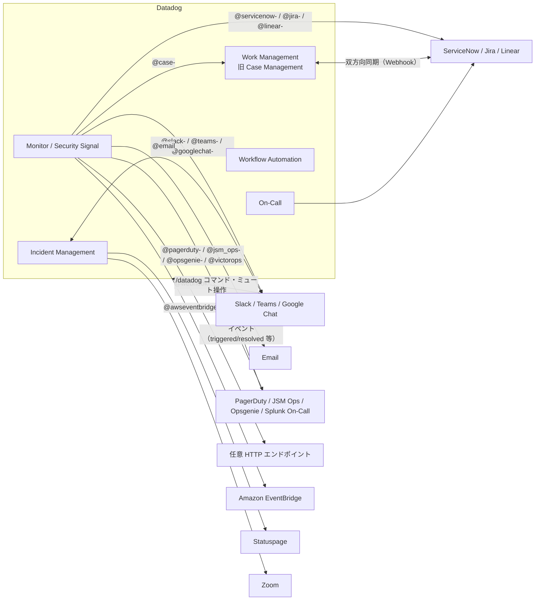
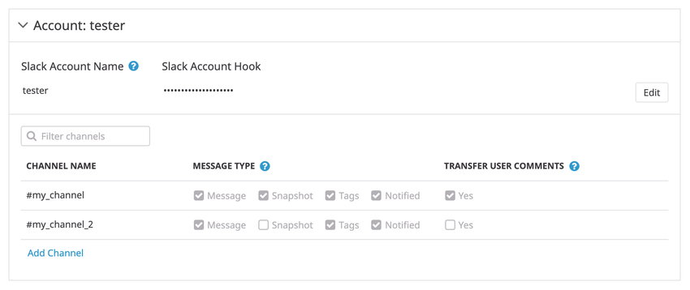
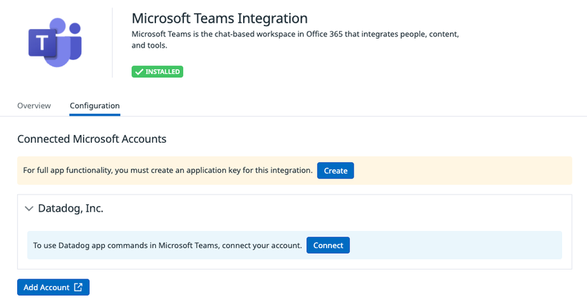
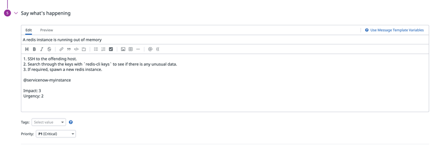
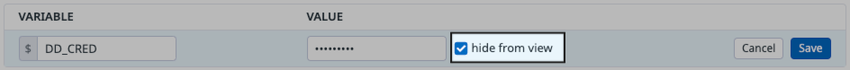

# 通知・コラボレーション連携

## 概要

Datadog の通知・コラボレーション連携は、Monitor（モニター）のアラート、Incident Management（インシデント管理）、On-Call、Work Management（旧称: Case Management、ケース管理）、Security Signal などで発生した情報を、チャットツール（Slack、Microsoft Teams、Google Chat）、メール、オンコール／ページングツール（PagerDuty、Opsgenie / Jira Service Management Ops、Splunk On-Call（旧 VictorOps））、ITSM・チケット管理（ServiceNow、Jira、Linear）、任意の HTTP エンドポイント（Webhooks）、ステータスページ（Atlassian Statuspage）、会議ツール（Zoom）、イベントバス（Amazon EventBridge）へ届けるための Integrations（インテグレーション）群である。これらの多くは Datadog の SaaS 側で認証情報を登録して動作する「認証（クローラー）ベース」のインテグレーションで、Agent のインストールは不要。[出典](https://docs.datadoghq.com/monitors/notify/) [出典](https://docs.datadoghq.com/integrations/slack/)

Datadog の通知連携は、モニターのメッセージ本文に `@<インテグレーション名>-<値>` 形式の **Notification handle（通知ハンドル）** を書くことで宛先を指定するのが基本である（例: `@slack-ops-alerts`、`@pagerduty-Payments`、`@webhook-my-endpoint`）。[出典](https://docs.datadoghq.com/monitors/notify/)

本ファイルは、上記ツールそれぞれの連携方法・ハンドル構文・権限・制約・サイト差異と、AWS / Azure / Google Cloud 以外のクラウド（Oracle Cloud Infrastructure、Alibaba Cloud、IBM Cloud（Marketplace））との連携仕様を扱う。

| 関連トピック | 参照先 |
|---|---|
| インテグレーション全般（種類、カタログ、Marketplace） | [Integrations（インテグレーション）](./integrations.md) |
| モニター本体（種類、評価、しきい値） | [Monitors（モニター）](./monitors.md) |
| 通知メッセージ・テンプレート変数・通知ルール・Downtime の詳細 | [通知と Downtime](./notifications-and-downtimes.md) |
| AWS / Azure / Google Cloud のクラウド連携 | [AWS Integration](./aws-integration.md)、[Azure Integration](./azure-integration.md)、[Google Cloud Integration](./gcp-integration.md) |
| インシデント宣言・Slack / Teams チャンネル運用 | [Incident Management](../service-management/incident-management.md) |
| ページング・エスカレーション（Datadog ネイティブ） | [On-Call](../service-management/on-call.md) |
| Work Management（旧 Case Management）本体 | [Case Management](../service-management/case-management.md) |
| Slack / Teams / Jira 等へのアクションを含むワークフロー | [Workflow Automation](../service-management/workflow-automation.md) |
| イベントの取り込み・相関 | [Event Management](./event-management.md) |
| API キー・アプリケーションキー | [API とキー管理](./api-and-keys.md) |
| Terraform による構成管理 | [Terraform と IaC](./terraform-and-iac.md) |
| サイトごとの URL・機能差 | [Datadog Sites（サイト）](./datadog-sites.md) |
| アラート設計・通知ノイズ削減の実践 | [アラート設計とノイズ削減](../../04_応用編/alert-design-and-noise-reduction.md) |
| 料金の正本 | [製品別料金表](../../03_導入編/pricing-by-product.md) |

---

## 1. 連携先の全体像

### 1.1 連携先と通知ハンドル一覧

Datadog の主要な通知・コラボレーション連携と、そのハンドル接頭辞・方向・主用途は次のとおり。

| 連携先 | ハンドル形式 | データの方向 | 主な用途 | 出典 |
|---|---|---|---|---|
| Slack | `@slack-<チャンネル>` / `@slack-<アカウント>-<チャンネル>` | 双方向（通知、`/datadog` コマンド、インシデント、リンク展開） | チャット通知、インシデント協働、Bits Chat | [出典](https://docs.datadoghq.com/integrations/slack/) |
| Microsoft Teams | `@teams-<ハンドル名>` | 双方向（Datadog app 利用時） | チャット通知、ミュート操作、インシデント | [出典](https://docs.datadoghq.com/integrations/microsoft_teams/) |
| Google Chat | `@googlechat-<ハンドル名>`（旧 `@hangouts` も有効） | 双方向（Datadog app） | チャット通知、インシデント用スペース作成 | [出典](https://docs.datadoghq.com/integrations/google_hangouts_chat/) |
| Email | `@<メールアドレス>` | Datadog → メール（受信側は Events API emails で逆方向も可） | Datadog ユーザー／外部宛のメール通知 | [出典](https://docs.datadoghq.com/monitors/notify/) |
| Team（Datadog Teams） | `@team-<team handle>` | Datadog 内 | Team に設定された通知チャンネルへルーティング | [出典](https://docs.datadoghq.com/monitors/notify/) |
| PagerDuty | `@pagerduty-<サービス名>` | 双方向（通知、自動解決、PagerDuty イベント取り込み） | オンコール呼び出し | [出典](https://docs.datadoghq.com/integrations/pagerduty/) |
| Opsgenie | `@opsgenie-<サービス名>` | 双方向 | オンコール呼び出し（新規導入は非推奨） | [出典](https://docs.datadoghq.com/integrations/opsgenie/) |
| Jira Service Management Ops | `@jsm_ops-<Response team>` | 双方向（Webhook で JSM Ops → Datadog） | Opsgenie の後継先 | [出典](https://docs.datadoghq.com/integrations/jira-service-management-ops/) |
| Splunk On-Call（VictorOps） | `@victorops`（ルーティングキーを含む詳細構文は公開情報では確認できず） | Datadog → Splunk On-Call | オンコール呼び出し | [出典](https://docs.datadoghq.com/integrations/victorops/) |
| ServiceNow | `@servicenow-<テンプレート名>`（レガシー: `@servicenow-<インスタンス名>`） | 双方向（ITSM のみ） | インシデント／イベント起票、CMDB 連携 | [出典](https://docs.datadoghq.com/integrations/guide/servicenow-itom-itsm-setup/) |
| Jira | `@jira-<Issue template 名>` | 双方向（Work Management の同期は Jira Cloud のみ） | Issue 起票、ケース同期 | [出典](https://docs.datadoghq.com/integrations/jira/) |
| Linear | `@linear-<テンプレート名>` | 双方向 | Issue 起票、ケース同期 | [出典](https://docs.datadoghq.com/integrations/linear/) |
| Webhooks | `@webhook-<Webhook 名>` | Datadog → 任意 HTTP エンドポイント | 任意システム連携（SMS、自社 API 等） | [出典](https://docs.datadoghq.com/integrations/webhooks/) |
| Work Management（旧 Case Management） | `@case-<project handle>` | Datadog 内 | モニターからケース（Work item）自動作成 | [出典](https://docs.datadoghq.com/service_management/case_management/settings/) |
| Amazon EventBridge | `@awseventbridge-<イベントバス名>` | Datadog → AWS | 自動修復（Lambda 等の起動） | [出典](https://docs.datadoghq.com/integrations/amazon_event_bridge/) |
| Atlassian Statuspage | —（ハンドルなし） | 双方向（インシデント連携、外部ステータスページのイベント取り込み） | 公開ステータスページ更新・相関 | [出典](https://docs.datadoghq.com/integrations/statuspage/) |
| Zoom | —（ハンドルなし） | Datadog → Zoom | インシデント会議の作成・要約 | [出典](https://docs.datadoghq.com/integrations/zoom_incident_management/) |

- モニター通知のドキュメントは、インテグレーションのハンドル形式を `@<INTEGRATION_NAME>-<VALUES>` とし、Jira（`@jira`）、PagerDuty（`@pagerduty`）、Slack（`@slack`）、Webhooks（`@webhook`）、Microsoft Teams（`@teams`）、ServiceNow（`@servicenow`）を代表例として挙げている。[出典](https://docs.datadoghq.com/monitors/notify/)
- インシデントは「Add Incident」から `@incident-` 系の宛先として追加できる（`@incident-` はインシデント設定で管理者が作成）。[出典](https://docs.datadoghq.com/monitors/notify/)
- Workflow Automation のワークフローは「+ Add Workflow」から追加でき、`@workflow-<名前>`（入力パラメータがある場合は `@workflow-<名前>(param="")`）の形式でメッセージに入る。選択肢に出るのは Monitor trigger を持つワークフローのみ（ワークフロー側で Monitor trigger を追加して公開しておく）。[出典](https://docs.datadoghq.com/service_management/workflows/trigger/)
- Datadog ネイティブのページング製品 On-Call の詳細は [On-Call](../service-management/on-call.md) を参照。

### 1.2 データフロー



---

## 2. 共通仕様

### 2.1 通知ハンドルの記述ルール

Datadog のモニター通知ハンドルには、次の共通ルールがある。

| ルール | 内容 | 出典 |
|---|---|---|
| 形式 | `@<INTEGRATION_NAME>-<VALUES>` | [出典](https://docs.datadoghq.com/monitors/notify/) |
| 括弧 | 括弧 `()` を含むハンドルはサポートされず、解析されないためアラートが作成されない | [出典](https://docs.datadoghq.com/monitors/notify/) |
| オートコンプリート | メッセージ欄に `@slack`、`@googlechat` などと入力すると、設定済みの宛先が候補表示される | [出典](https://docs.datadoghq.com/integrations/slack/) [出典](https://docs.datadoghq.com/integrations/google_hangouts_chat/) |
| テンプレート変数による動的ハンドル | `@slack-{{owner.name}}`、`@slack-{{host.name}}` のようにタグ値からハンドルを組み立てられる。メールも `@team-{{team.name}}@company.com` の形で可 | [出典](https://docs.datadoghq.com/integrations/slack/) |
| Slack チャンネル名末尾の特殊文字 | 末尾に特殊文字があるチャンネル名は @ 通知非対応（`@----critical_alerts` は可、`@--critical_alerts--` は不可） | [出典](https://docs.datadoghq.com/integrations/slack/) |
| Markdown の描画 | チャンネルにより Markdown サポートが異なる。Slack は見出し・表を描画しない。Email は太字・斜体・インラインコード・リンクに対応し、表はプレーンテキストになる | [出典](https://docs.datadoghq.com/monitors/notify/) |

### 2.2 状態遷移に応じた宛先の出し分け

モニター通知の条件変数（conditional variables）を使うと、状態遷移ごとに宛先を変えられる。条件ブロックの外に書いたテキスト・ハンドルはすべての状態遷移で送られ、条件ブロック内のものは条件が一致した遷移でのみ送られる。[出典](https://docs.datadoghq.com/monitors/notify/variables/)

| 条件変数 | 意味 |
|---|---|
| `{{#is_alert}}` / `{{^is_alert}}` | ALERT のとき / ALERT でないとき |
| `{{#is_warning}}` | WARNING のとき |
| `{{#is_recovery}}` | ALERT・WARNING・UNKNOWN・NO DATA から回復したとき |
| `{{#is_no_data}}` | No Data で発報したとき |
| `{{#is_renotify}}` | 再通知のとき |
| `{{#is_alert_to_warning}}` | ALERT から WARNING へ遷移したとき |
| `{{#is_priority 'P1'}}` | モニターの Priority が指定値（P1〜P5）のとき |
| `{{#is_match "tag.name" "substring"}}` | コンテキストが部分文字列を含むとき |
| `{{#is_exact_match "tag.name" "string"}}` | コンテキストが完全一致するとき |
| その他 | `is_unknown`、`is_alert_recovery`、`is_warning_recovery`、`is_no_data_recovery` |

[出典](https://docs.datadoghq.com/monitors/notify/variables/)

- Datadog は、ハンドルを含む alert / warning ブロックには対応する recovery ブロックを組み合わせることを推奨している。PagerDuty の自動解決は、ハンドルが `{{#is_alert}}` 内にしかない場合は動作しない（後述 7 章）。[出典](https://docs.datadoghq.com/monitors/notify/variables/) [出典](https://docs.datadoghq.com/integrations/pagerduty/)
- テンプレート変数の全一覧は [通知と Downtime](./notifications-and-downtimes.md) を参照。

### 2.3 Notification rules（通知ルール）と Slack スレッド化

Datadog は、モニターごとに宛先を書くより **Notification rules（通知ルール）** の利用を推奨している。通知ルールはモニターのタグに基づいて宛先を自動付与する。通知ルールでは Slack の **Thread Notifications** を有効化でき、1 つのアラートサイクルの通知を 1 スレッドにまとめられる（ベストエフォートで、失敗したメッセージは個別に送られる）。[出典](https://docs.datadoghq.com/monitors/notify/) [出典](https://docs.datadoghq.com/integrations/slack/)

通知ルールの詳細仕様は [通知と Downtime](./notifications-and-downtimes.md) を参照。

### 2.4 編集権限の制限（Granular Access Control）

Slack、Microsoft Teams、Opsgenie、OCI などのインテグレーションでは、既定で**全ユーザーが接続済みワークスペース／テナント／サービスを編集できる**。Granular Access Control で編集者を絞り込める。[出典](https://docs.datadoghq.com/integrations/slack/) [出典](https://docs.datadoghq.com/integrations/microsoft_teams/) [出典](https://docs.datadoghq.com/integrations/opsgenie/)

| 項目 | 内容 |
|---|---|
| 設定方法 | 対象（Slack ワークスペース、Teams テナント、Opsgenie サービス等）の歯車アイコン → **Permissions**（Opsgenie は **Set Permissions**）→ **Restrict Access** |
| 既定ロール | 制限後、組織メンバーは **Viewer**。ロール・Team・ユーザーを **Editor** として追加 |
| 注意 | 自分が属するロールを最低 1 つ含めないと、自分の編集権限を失う |
| 解除 | **Restore Full Access** → **Save** |
| API | Restriction Policies API。Teams Workflows ハンドルはリソース種別 `integration-webhook`、ID `microsoft-teams:<workflows_webhook_id>`。Opsgenie はリソース種別 `integration-service`、ID `opsgenie:<service_id>` |
| Slack の補足 | 制限中でも、アプリを招待したチャンネルはタイルへ自動追加される |

[出典](https://docs.datadoghq.com/integrations/slack/) [出典](https://docs.datadoghq.com/integrations/microsoft_teams/) [出典](https://docs.datadoghq.com/integrations/opsgenie/)

- インテグレーション自体の管理権限（`manage_integrations` 等）は [組織・ユーザー・権限管理](./account-and-access-management.md) を参照。

### 2.5 送信元 IP（ファイアウォール許可）

Datadog から外部（Webhook 先、Jira Data Center 等）へ送られる通知は、IP レンジ API の `webhooks` キーに記載された IP プレフィックスから送信される。Jira のドキュメントは、IP 制限をかけた Jira Data Center について「お使いのリージョンの Datadog Webhooks IP プレフィックス」を許可するよう案内している。[出典](https://docs.datadoghq.com/integrations/jira/) [出典](https://docs.datadoghq.com/api/latest/ip-ranges/)

| サイト | IP レンジ取得 URL |
|---|---|
| US1 | `https://ip-ranges.datadoghq.com/` |
| US3 | `https://ip-ranges.us3.datadoghq.com/` |
| US5 | `https://ip-ranges.us5.datadoghq.com/` |
| EU1 | `https://ip-ranges.datadoghq.eu/` |
| AP1 | `https://ip-ranges.ap1.datadoghq.com/` |
| AP2 | `https://ip-ranges.ap2.datadoghq.com/` |
| UK1 | `https://ip-ranges.uk1.datadoghq.com/` |
| US1-FED | `https://ip-ranges.ddog-gov.com/` |
| US2-FED | `https://ip-ranges.us2.ddog-gov.com/` |

[出典](https://docs.datadoghq.com/api/latest/ip-ranges/)

- AP1 の IP レンジ JSON（`version: 11`、`modified: 2026-08-12T00:00:00`、2026-11-02 取得）には `agents`、`api`、`apm`、`global`、`logs`、`orchestrator`、`process`、`remote-configuration`、`synthetics`、`synthetics-private-locations`、`webhooks` のキーがあり、`webhooks` には IPv4 プレフィックス 8 個と IPv6 プレフィックス 1 個が含まれていた。IP は変更されうるため、ファイアウォール設定は固定値の転記ではなく定期的に JSON を参照すること。[出典](https://ip-ranges.ap1.datadoghq.com/)
- ネットワーク要件の全体像は [ネットワーク・接続要件](../../03_導入編/network-and-connectivity.md) を参照。

> **サイト差異:** Datadog の公式サイト一覧には、本ナレッジ規約の 7 サイトに加え **UK1**（`uk1.datadoghq.com`、英国）と **US2-FED**（`us2.ddog-gov.com`、IL5 認可取得手続中）が掲載されている。多くの通知インテグレーションは US2-FED では「組織によっては無効。例外申請は support@ddog-gov.com」と案内されている。[出典](https://docs.datadoghq.com/getting_started/site/)

---

## 3. Slack

### 3.1 機能

Datadog の Slack インテグレーションで利用できる機能は次のとおり。[出典](https://docs.datadoghq.com/integrations/slack/)

| 機能 | 内容 |
|---|---|
| 通知受信 | モニター等の通知をチャンネルへ投稿 |
| Incident Management | Slack 上でインシデントの宣言・協働・解決。宣言すると `#incident-(一意の番号)` チャンネルが作成され、告知投稿とトピック更新が行われる。**Datadog アカウントがない Slack ユーザーもインシデントを宣言できる** |
| ダッシュボード共有 | ウィジェットのリンクを `CMD/CTRL + C` でコピーして貼り付け、または `/datadog dashboard` → **Share Dashboard Widget**。対応ウィジェットは Scheduled Reports と同じ |
| リンク展開（Unfurl） | Datadog のリンクを貼るとグラフやログサンプルで展開 |
| Home タブ | スター付きのダッシュボード・ノートブック・サービスと、過去 24 時間にトリガーされたモニターを表示 |
| Workflow Automation | `/datadog workflow` で Slack からワークフローを実行。メッセージ送信や意思決定プロンプトも可能 |
| Bits Chat | `@Datadog` をメンションして調査を依頼、コードチャンネルでコード変更も可能 |
| Enterprise Grid 監査ログ | Slack の Enterprise Grid 監査ログを Cloud SIEM で監視 |
| スラッシュコマンド | `/datadog`（別名 `/dd`）。`/datadog help` で一覧 |

- Slack インテグレーションはメトリクス・イベント・サービスチェックを収集しない。[出典](https://docs.datadoghq.com/integrations/slack/)
- インシデント運用の詳細は [Incident Management](../service-management/incident-management.md)、Bits AI の詳細は [Bits AI と AI 機能](../ai/bits-ai.md) を参照。

### 3.2 セットアップ方式

Slack 連携には「Datadog for Slack（アプリ、推奨）」と「Slack Webhook（レガシー）」の 2 方式がある。[出典](https://docs.datadoghq.com/integrations/slack/)

**方式 1: Datadog for Slack（推奨）** — 対象サイト: US1、US3、US5、EU1、AP1、AP2、UK1

1. Slack インテグレーションタイルで **Configure** → **Add a workspace**。
2. **Allow** をクリック（Slack ワークスペース管理者の承認が必要な場合がある）。
3. 通知先チャンネルで `/invite @Datadog` を実行してアプリを招待する。**チャンネルはインテグレーションタイルに表示されていないと通知を受け取れない**。パブリックチャンネルは **Add Channel** → **Save** でも追加でき、その場合アプリは `channels:join` 権限で参加する。
4. 任意のチャンネルで `/datadog` または `/dd` を使用できる。

[出典](https://docs.datadoghq.com/integrations/slack/)

> **サイト差異:** US1-FED（`app.ddog-gov.com`）と US2-FED（`us2.ddog-gov.com`）では **Datadog for Government** アプリを使う。商用 Slack ワークスペース（**Add commercial workspace**）と GovSlack ワークスペース（**Add government workspace**）の両方に対応し、招待は `/invite @Datadog for Government`、コマンドは `/datadog-gov`（別名 `/dd-gov`）。US2-FED では組織によって本インテグレーションが無効な場合があり、例外申請は support@ddog-gov.com。Workflow 実行（`/datadog workflow`）は商用サイトの記載のみ。[出典](https://docs.datadoghq.com/integrations/slack/)

**方式 2: Slack Webhook（レガシー）**

1. Slack 側で Datadog (Legacy) アプリを開き **Install** → **Add Integration**、**Webhook URL** をコピー。
2. Datadog のタイルで **Configuration** → **Add Account**。
3. Slack Account Name を入力し、**Slack Account Hook** に Webhook URL を貼り付けて **Save**。
4. **Channels to post to** に投稿先チャンネルを追加。

[出典](https://docs.datadoghq.com/integrations/slack/)



- **キャプション:** Slack インテグレーションタイルのアカウント設定（レガシー Webhook 方式の例）。
- **画面の説明:** 上部の「Account: tester」見出しの下に「Slack Account Name」（値 `tester`）と「Slack Account Hook」（伏字表示）、右端に **Edit** ボタンがある。その下に「Filter channels」検索欄と、`CHANNEL NAME`・`MESSAGE TYPE`・`TRANSFER USER COMMENTS` の 3 列の表がある。`#my_channel` 行は Message / Snapshot / Tags / Notified と Yes のチェックがすべてオン、`#my_channel_2` 行は Snapshot と Yes がオフ。表の下に **Add Channel** リンクがある。チャンネルごとに通知へ含める要素を選べることを示している。
- **出典:** https://docs.datadoghq.com/integrations/slack/ （取得日 2026-11-02）

**レガシー Webhook からの移行**

| 方法 | 手順 |
|---|---|
| 一括アップグレード | 各 Slack アカウント設定の上部にある **Install** をクリックし、レガシー Webhook と同じワークスペースを選ぶ |
| 個別アップグレード | 新しい構成にチャンネルを手動で追加し、必要に応じて重複したチャンネル参照を削除する |

[出典](https://docs.datadoghq.com/integrations/slack/)

**Delegated user（チャンネル作成用の委任ユーザー）**: ワークスペースが一般メンバーのチャンネル作成を制限していて、Incident Management などチャンネルを作成する機能を使う場合のみ必要。パブリック／プライベートチャンネルを作成できるサービスアカウント（名前は「Datadog」などを推奨）を作り、タイルの **Configure** → **Channels** → ワークスペースの歯車 → サービスアカウントで Slack にサインインした状態で **Connect delegated user for workspace** を実行する。[出典](https://docs.datadoghq.com/integrations/slack/)

### 3.3 モニターからの通知とメンション構文

| 対象 | 構文 | 備考 |
|---|---|---|
| チャンネル | `@slack-SLACK_CHANNEL` または `@slack-SLACK_ACCOUNT-SLACK_CHANNEL` | 事前に `/invite @Datadog` が必要 |
| ユーザー | `<@username>` | Slack のアカウント設定にあるユーザー名 |
| @here | `<!here>` | オンラインのメンバー |
| @channel | `<!channel>` | チャンネル全員 |
| ユーザーグループ | `<!subteam^GROUP_ID>` | ID は **More** → **Your organization** → **People** → **User groups**、または `usergroups.list` API で確認 |

[出典](https://docs.datadoghq.com/integrations/slack/)

公式ドキュメントの例（再通知時のみユーザーグループをメンション）:

```text
CPU usage has exceeded {{warn_threshold}} on {{ @machine_id.name }}.
{{#is_renotify}}
Notifying @slack-infrastructure <!subteam^12345>
{{/is_renotify}}
```

[出典](https://docs.datadoghq.com/integrations/slack/)

**チャンネルごとのアラート内容オプション**

| オプション | 内容 |
|---|---|
| Message | モニターの通知本文 |
| Snapshot | トリガーしたクエリのグラフ |
| Related tags | モニタークエリのタグ |
| Recipient handles | 通知されたユーザー・グループ |
| Monitor actions | ミュート等のボタン |

[出典](https://docs.datadoghq.com/integrations/slack/)

### 3.4 OAuth スコープ

Datadog for Slack アプリが要求する Slack の OAuth スコープは次のとおり。[出典](https://docs.datadoghq.com/integrations/slack/)

| 区分 | スコープ | 用途 |
|---|---|---|
| 必須 Bot | `app_mentions:read` | `@Datadog` メンション（Bits Chat） |
| 必須 Bot | `channels:join` | 設定したパブリックチャンネルへの参加 |
| 必須 Bot | `channels:manage` | インシデント用・コード用チャンネルの作成 |
| 必須 Bot | `channels:read` / `groups:read` | パブリック / プライベートチャンネルのオートコンプリート |
| 必須 Bot | `chat:write` | アラート、インシデント更新、Bits Chat 返信の投稿 |
| 必須 Bot | `commands` | `/datadog`、`/dd` |
| 必須 Bot | `im:history`、`im:read`、`im:write` | DM とオンボーディング |
| 必須 Bot | `links:read`、`links:write` | リンク展開 |
| 必須 Bot | `mpim:read` | グループ DM でのコマンド |
| 必須 Bot | `reactions:write` | タイムラインショートカットの絵文字リアクション |
| 必須 Bot | `remote_files:read`、`remote_files:share`、`remote_files:write` | ダッシュボード等の PDF レポート共有 |
| 必須 Bot | `team:read` | タイルとワークスペースの同期 |
| 必須 Bot | `users:read`、`users:read.email` | ユーザー紐付け、インシデントメッセージ |
| 任意 Bot | `bookmarks:read`、`bookmarks:write` | インシデントチャンネルのブックマーク |
| 任意 Bot | `calls:write` | 会議通知 |
| 任意 Bot | `channels:history` | タイムライン同期、Bits Chat の読み取り |
| 任意 Bot | `chat:write.customize` | Bits AI 用の表示カスタマイズ |
| 任意 Bot | `files:read` | 画像をインシデントタイムラインへ同期 |
| 任意 Bot | `groups:history` | プライベートチャンネル履歴（Bits AI、プライベートコードチャンネル） |
| 任意 Bot | `groups:write` | プライベートインシデントチャンネル |
| 任意 Bot | `pins:read`、`pins:write` | インシデントリンクのピン留め |
| 任意 Bot | `reactions:read` | リアクションのタイムライン同期 |
| 任意 Bot | `usergroups:read`、`usergroups:write` | On-Call に基づくユーザーグループ更新 |
| User | `openid` | Datadog アカウントと Slack 操作の紐付け |
| 任意 User | `auditlogs:read` | Enterprise Grid 監査ログ収集 |

### 3.5 Enterprise Grid 監査ログ

| 項目 | 内容 |
|---|---|
| 要件 | Slack の Enterprise Grid または Enterprise Select プラン。ユーザートークンを使うため **Organization Owner** の承認が必要 |
| 設定 | タイルの **Audit Logs** タブ → **Connect Enterprise Grid** |
| 収集イベント | ユーザー管理、ワークスペース・チャンネル変更、ファイル・アプリ管理、セキュリティ・ログイン、管理者操作、外部共有・ゲスト活動（各イベントに action、actor、entity、context） |
| 活用先 | [Cloud SIEM](../security/cloud-siem.md) |

[出典](https://docs.datadoghq.com/integrations/slack/)

---

## 4. Microsoft Teams

### 4.1 機能

Datadog の Microsoft Teams インテグレーションは、Teams での Datadog アラート・イベント受信、Teams からのトリガー済みモニターのミュート、Teams からのインシデント管理（US-FED サイトは非対応）を提供する。メトリクス・イベント・サービスチェックは収集しない。[出典](https://docs.datadoghq.com/integrations/microsoft_teams/)

### 4.2 セットアップ方式の比較

| 方式 | 状態 | 概要 | 主な制約 |
|---|---|---|---|
| Datadog app（テナントベース） | **推奨** | **Integrations > Microsoft Teams** で Microsoft テナントを接続し、Teams の **Apps** から対象チームへ Datadog アプリを追加。テナント配下で **Add Handle** し、チームとチャンネルを選んでハンドルを作成 | プライベートチャンネル対応には Microsoft のパブリックプレビューを Teams で有効化する必要あり |
| Microsoft Workflows Webhooks | 代替 | Datadog アプリを導入できない場合、またはプライベートチャンネルへ投稿する場合に使用。Microsoft の「Post to a channel when a webhook request is received」テンプレートでフローを作り、Webhook URL を Datadog のハンドルに登録 | 下表参照 |
| Connectors（Office 365 コネクタ） | **廃止済み** | チャンネルの `...` → **Connectors** → Datadog → **Configure** で Webhook URL を取得する旧方式 | 2026-11-02 時点ではすべてのコネクタが停止済み（4.5 参照） |

[出典](https://docs.datadoghq.com/integrations/microsoft_teams/)

**Datadog app でのプライベート／共有チャンネル**: チャンネルを含むチームにアプリを追加したうえで、チャンネルの **Manage channel > Apps** タブから Datadog アプリを追加する。[出典](https://docs.datadoghq.com/integrations/microsoft_teams/)



- **キャプション:** Microsoft Teams インテグレーションタイル（Configuration タブ）で接続済み Microsoft アカウント（テナント）を表示している画面。
- **画面の説明:** 上部に Teams のロゴと「Microsoft Teams Integration」の見出し、緑色の **INSTALLED** ラベル。タブは **Overview** と **Configuration**（選択中）。「Connected Microsoft Accounts」の下に黄色の帯で「For full app functionality, you must create an application key for this integration.」と **Create** ボタン、その下にテナント「Datadog, Inc.」の折りたたみ領域があり「To use Datadog app commands in Microsoft Teams, connect your account.」と **Connect** ボタンが表示される。最下部に **Add Account**（外部リンクアイコン付き）ボタンがある。
- **出典:** https://docs.datadoghq.com/integrations/microsoft_teams/ （取得日 2026-11-02）

### 4.3 Microsoft Workflows Webhooks の手順と制約

**前提**: ワークフローを所有する Microsoft アカウントと、通知を投稿する別アカウント（サービスアカウント推奨）を用意する。投稿アカウントはチームのメンバーであり、プライベートチャンネルの場合はそのチャンネルのメンバーでもある必要がある。[出典](https://docs.datadoghq.com/integrations/microsoft_teams/)

**主な手順**:

1. チームに Workflows アプリを追加。
2. テンプレート「Post to a channel when a webhook request is received」からワークフローを作成。
3. 詳細（advanced）モードに切り替え、「Post card in a chat or channel」アクションを構成。
4. **Post as** を **Flow bot** または **User** に設定し、チームとチャンネルを選択。
5. 保存し、**Anyone** がフローを起動できる設定で Webhook URL をコピー。ワークフローがオンになっていることを確認。
6. Datadog のタイルで Webhook URL をハンドルとして追加。

プライベートチャンネルでは **Post as** を **User** にし、**Change connection** で投稿アカウントを選ぶ。[出典](https://docs.datadoghq.com/integrations/microsoft_teams/)

| 制約 | 内容 |
|---|---|
| 自動停止 | Microsoft 365 では、ワークフローは **90 日間成功トリガーがないと自動的にオフ**になる。期限前に所有者へメールが届き、テスト実行でタイマーがリセットされる |
| 作成者表記 | テンプレート由来のワークフローは作成者名とテンプレートへのリンクの行が付く。**Save As** でコピーすると除去できる |
| 対話機能 | Teams からのミュート等の対話機能は使えない |
| 共有チャンネル | 非対応 |
| ユーザーメンション | **User** として投稿する場合は不可（Flow bot を使う） |

[出典](https://docs.datadoghq.com/integrations/microsoft_teams/)

- Workflows（Power Automate）の Webhook は旧 Incoming Webhook とペイロード形式が異なり、Adaptive Card を `attachments` 配列に入れる形式が必要になる、という実務報告がある（Datadog 以外の自作送信を移行する場合の注意）。【第三者情報】[出典](https://zenn.dev/blackmax/articles/c9c052e0c14358)（2024-07 公開。2 年以上前の情報のため、現行仕様と食い違う可能性あり）

### 4.4 通知・メンション・ミュート

| 操作 | 構文・手順 |
|---|---|
| チャンネルへ通知 | モニター通知に `@teams-<HANDLE>` |
| ユーザーメンション | `<at>{User Principal Name}</at>`（例: `@teams-CHANNEL_NAME <at>user@microsoft.com</at>`） |
| UPN の調べ方 | ①連絡先カードの Chat 欄のメール（UPN と一致する場合のみ有効）②Azure Portal の **Microsoft Entra ID > Manage > Users** の **User principal name** |
| モニターのミュート | Teams 通知の **Mute Monitor** → **Mute Duration** を選択 → **Mute**（Datadog app 方式のみ） |
| ダッシュボード共有 | ウィジェットを `CMD + C` / `CTRL + C`、または共有メニューの **Copy** でコピーして Teams に貼り付け |

[出典](https://docs.datadoghq.com/integrations/microsoft_teams/)

### 4.5 Office 365 コネクタの廃止と移行

Microsoft による Office 365 コネクタ廃止に伴い、Datadog の Teams コネクタ方式は利用できなくなった。

| 日付 | 内容 | 出典 |
|---|---|---|
| 2025-01-31 | Datadog Connectors、および URL を更新していない Incoming Webhook Connectors が停止 | [出典](https://docs.datadoghq.com/integrations/microsoft_teams/) |
| 2026-04-30 | 「All connectors stop working」（移行ガイドの記載） | [出典](https://docs.datadoghq.com/integrations/guide/microsoft_teams_migrate_legacy_connectors/) |
| 2026-05-18 | 「All connectors stop working」（インテグレーション本体ページの記載。以前は 2024-10-01 とされていた） | [出典](https://docs.datadoghq.com/integrations/microsoft_teams/) |

- 全コネクタの停止日は公式ドキュメント内で **2026-04-30（移行ガイド）と 2026-05-18（本体ページ）の 2 通り**の記載があるが、いずれも基準日 2026-11-02 より前であり、**基準日時点ではコネクタ方式は使用できない**。

**移行手順**（どちらも新ハンドルを**旧ハンドルと同じ名前**で作ると、旧ハンドルを上書きするため、モニター側の `@teams-<HANDLE>` を書き換えずに済む）:

| 移行先 | 手順 |
|---|---|
| テナントベース（推奨） | ①テナントを Datadog に接続 ②旧コネクタがあった全チームに Datadog アプリを追加 ③テナント配下で旧ハンドルと同名（例 `channel-123`）のハンドルを作り、同じチーム・チャンネルを選んで保存 |
| Workflows Webhooks | 対象チャンネルの Workflows Webhook ハンドルを、旧ハンドルと同名で作成 |

[出典](https://docs.datadoghq.com/integrations/guide/microsoft_teams_migrate_legacy_connectors/)

### 4.6 Teams からのインシデント管理

> **サイト差異:** Teams からの Incident Management は US1-FED・US2-FED では非対応。US1、US3、US5、EU1、AP1、AP2、UK1 で利用できる。[出典](https://docs.datadoghq.com/integrations/microsoft_teams/)

| 区分 | コマンド | 内容 |
|---|---|---|
| グローバル | `@Datadog list incidents` | オープン中のインシデント一覧 |
| グローバル | `@Datadog incident` | インシデント宣言 |
| グローバル | `@Datadog help` | コマンド一覧 |
| グローバル | `@Datadog page` | ページ（呼び出し）を発行 |
| Bot との DM | `@Datadog shifts` | 今後の On-Call シフト一覧 |
| Bot との DM | `@Datadog accounts` | Datadog アカウント一覧 |
| チャンネルのみ | `@Datadog sync` | 現在のチームのチャンネルを Datadog に同期 |

[出典](https://docs.datadoghq.com/integrations/microsoft_teams/)

**管理者同意と委任ユーザー**:

- テナント全体の同意を付与できるユーザー（例: *Global Admin*）が Incident Management の権限を承認する。そのユーザーは Datadog アカウントが必要だが、メールアドレスが一致している必要はない。
- **Application permissions**: テナントの歯車 → **Grant application permissions**。
- **Delegated permissions**: **Grant delegated permissions** の後、Office 365 のサービスアカウント（名前は「Datadog」を推奨）を作り、Teams ライセンスを割り当て、関係するチームに追加し、チャンネルの作成・更新・削除とタブ管理のチーム権限を有効化して、そのアカウントでサインインし **Connect delegated user** を実行する（この最後の手順にテナント全体の管理者同意は不要）。
- 委任トークンは **90 日間未使用で失効**し、パスワード変更やアカウント無効化でも無効になる。その場合はサービスアカウントを再接続する。
- ユーザーのアカウント接続には Datadog の `Integrations Manage` 権限が必要（ないと「Access Denied」）。Teams で Datadog bot とのチャットで「accounts」と入力するか、Datadog のタイルから接続し、その後アプリケーションキーを作成する。

[出典](https://docs.datadoghq.com/integrations/microsoft_teams/)

### 4.7 Teams アプリ・Graph 権限

| 区分 | 権限 |
|---|---|
| Teams アプリ（全サイト） | メッセージの送受信（個人チャット、チャンネル／チャット）、プロフィール情報（名前、メール、会社、言語）、チーム・チャット情報（チャンネル一覧、名簿の名前とメール） |
| Graph（Application / Delegated 両方） | `Channel.Create`、`Channel.Delete.All`、`ChannelMessage.Read.All`、`ChannelSettings.ReadWrite.All`、`TeamsTab.Create`、`Application.Read.All` |
| Graph（Application のみ） | `Directory.Read.All`、`GroupMember.Read.All`（オートコンプリート） |
| Graph（Delegated のみ） | `OnlineMeetings.ReadWrite`、`TeamsAppInstallation.ReadWriteSelfForTeam`、`TeamsTab.Read.All`、`User.Read`、`User.Read.All`、`Team.ReadBasic.All`、`Chat.Read` |

Graph 権限は Incident Management 用で、US1、US3、US5、EU1、AP1、AP2、UK1 に適用される。Delegated 権限のみで構成する場合は、Application のみの 2 権限（`Directory.Read.All`、`GroupMember.Read.All`）を除く 13 権限をすべて Delegated として付与する。[出典](https://docs.datadoghq.com/integrations/microsoft_teams/)

> **サイト差異:** US1-FED / US2-FED では、Datadog アカウントは安全な環境でホストされるが、Teams 側のセキュリティは利用者の管理となる。US2-FED では組織によって利用可否が異なる（例外申請は support@ddog-gov.com）。Microsoft 365 の GCC / GCC High 環境への対応は公開情報では確認できず。[出典](https://docs.datadoghq.com/integrations/microsoft_teams/)

---

## 5. Google Chat

Datadog の Google Chat インテグレーション（旧称: Google Hangouts Chat）は、Google Chat スペースへのアラート通知、グラフ共有、インシデント用スペースの自動作成を提供する。メトリクス・イベント・サービスチェックは収集しない。Datadog は Google Chat API から得たデータを汎用 AI/ML モデルの開発・学習に保持・使用しないと明記している。[出典](https://docs.datadoghq.com/integrations/google_hangouts_chat/)

| 項目 | 内容 |
|---|---|
| 前提 | Google Workspace 管理者が Admin Console で Datadog アプリを**最上位組織部門（top-level OU）で許可リスト登録**し、ユーザーが最上位 OU で Google Chat にアクセスできること |
| アプリ導入 | メッセージ入力欄で `@Datadog` → Datadog アプリを選択 → 送信 |
| Google 組織の接続（対話機能用） | スペースで `/dd_accounts` → Datadog サイト選択 → **Connect Organization** → Datadog 組織を選択。タイルの **Configure > Organizations** に表示 |
| 通知先の登録（組織接続あり） | **Add Handle** → ハンドル名とスペースを選択 → **Save** |
| 通知先の登録（組織接続なし） | スペースに `@Datadog install` を投稿（既定 `app.datadoghq.com` 以外は `@Datadog install mydomain.datadoghq.eu` のようにドメインを付与）→ Datadog にサインイン。タイルの **Configure > Spaces** に表示 |
| ハンドル | `@googlechat-<HANDLE>`。旧接頭辞 `@hangouts` は `@googlechat` に移行済みだが両方サポート |
| 委任ユーザー | Google Chat が有効なライセンスを持つサービスアカウント（「Datadog」等）を作り、**Configure > Organizations** → 歯車 → **Connect delegated user for organization** |
| Target Audience | 対応する Google Workspace エディションで、Datadog が作るスペース（インシデント用等）を閲覧できるユーザーを制御 |
| インシデント | 委任ユーザーが必要。宣言時に Chat スペースを自動作成し対応者を招待 |

[出典](https://docs.datadoghq.com/integrations/google_hangouts_chat/)

| アプリコマンド | 内容 |
|---|---|
| `@Datadog install (domain)` | スペースを通知用に接続するフローを開始 |
| `@Datadog list installed accounts` | このスペースに接続済みの Datadog 組織一覧 |
| `@Datadog remove account` | 選択した組織からこのスペースを外す |

| 委任ユーザー権限 | 用途 |
|---|---|
| `chat.spaces.create` | インシデント宣言時にスペースを自動作成 |
| `chat.memberships` | 対応者をインシデントスペースへ招待 |

[出典](https://docs.datadoghq.com/integrations/google_hangouts_chat/)

> **サイト差異:** Google Chat インテグレーションは US1-FED・US2-FED では非対応。委任ユーザー権限（インシデント機能）の記載は US1、EU1、US3、US5、AP1、AP2 のみ。スペースの切断方法は US1 では 3 通り（`@Datadog remove account`、タイルの **Configure > Spaces** から削除、スペースからアプリを削除）、AP1・AP2・US3・US5・EU1 ではタイルからの削除のみが案内されている。UK1 の扱いは公開情報では確認できず。[出典](https://docs.datadoghq.com/integrations/google_hangouts_chat/)

---

## 6. Email

### 6.1 モニター等からのメール通知

| 項目 | 内容 | 出典 |
|---|---|---|
| Datadog ユーザー宛 | `@<DD_USER_EMAIL_ADDRESS>` | [出典](https://docs.datadoghq.com/monitors/notify/) |
| Datadog ユーザー以外宛 | `@<EMAIL>` | [出典](https://docs.datadoghq.com/monitors/notify/) |
| 非対応アドレス | スラッシュ `/` を含むアドレス | [出典](https://docs.datadoghq.com/monitors/notify/) |
| 非アクティブ扱い | 招待保留中または無効化された Datadog ユーザーに紐づくアドレスは通知を受信しない | [出典](https://docs.datadoghq.com/monitors/notify/) |
| 配信阻害要因 | ブロックリスト、IP / ドメインフィルタ、スパムフィルタ、メールセキュリティ製品 | [出典](https://docs.datadoghq.com/monitors/notify/) |
| Markdown | 太字・斜体・インラインコード・リンクに対応。表はプレーンテキスト | [出典](https://docs.datadoghq.com/monitors/notify/) |
| 送信元アドレス・ドメイン | 公開情報では確認できず | — |
| 本文の文字数上限 | 公開情報では確認できず | — |

### 6.2 Domain Allowlist（メール宛先ドメインの制限）

Datadog の Domain Allowlist は、モニター、Scheduled Reports（スケジュールレポート）、イベントの通知を受け取れるメールドメインを制限する機能である。[出典](https://docs.datadoghq.com/account_management/org_settings/domain_allowlist/)

| 項目 | 内容 |
|---|---|
| 設定場所 | Organization Settings → Domain Allowlist の **Enable** / **Disable** |
| 有効化条件 | 最低 1 ドメインを追加してから有効化可能。全ドメインを削除すると自動的に無効化 |
| ドメイン形式 | `@<DOMAIN NAME>.<TOP-LEVEL DOMAIN>`（例 `@gmail.com`） |
| 非許可ドメインへの通知 | 設定自体は可能だが警告が表示され、有効化中は配信されない |
| Domains Currently In Use | モニター通知に含まれるメールドメインのみを一覧（他種別は含まない） |
| 必要権限 | **Org Management** |
| 提供 | Enterprise プランは GA。その他はサポート経由で申請 |
| API | Domain Allowlist API あり |

[出典](https://docs.datadoghq.com/account_management/org_settings/domain_allowlist/)

### 6.3 Events with Email（メールからイベントを取り込む）

Datadog は、インテグレーションのないアプリケーションから**メール送信でイベントを登録**するための専用アドレスを発行できる（通知とは逆方向）。[出典](https://docs.datadoghq.com/events/guides/email/)

| 項目 | 内容 |
|---|---|
| 作成場所 | **Organization Settings** → **Events API emails** タブ → **Format** 選択 → **Create Email** |
| 形式 | **Plain text**、**JSON v2**（推奨）。旧 JSON（Events API v1 形式）は新規作成不可・既存は継続動作 |
| 属性 | Description、Tags（1 アドレスあたり **20 個**まで）、Recipients（`@` なしの通知ハンドル、**10 個**まで）、Alert Type（Plain text と旧 JSON のみ。JSON v2 は非対応） |
| Plain text の変換 | 件名 → イベントタイトル、本文 → メッセージ。HTML は Markdown に変換・サニタイズ。スレッドは最新メッセージのみ保持。本文中の `#` でタグ付与 |
| Plain text の上限 | タイトル **600 文字**、メッセージ **4000 文字**、タグ **200 個**（超過分は切り詰め） |
| JSON / JSON v2 | 件名は使われず本文の title が使われる。JSON が不正なら無視。メールクライアントの HTML 変換で JSON が壊れる点に注意 |
| メールサイズ上限 | **20MB**（添付含む）。超過メールは無視 |
| 利用状況 | **Last Used** 列に最終処理日（未使用は「No data」） |

[出典](https://docs.datadoghq.com/events/guides/email/)

> **サイト差異:** Events with Email は US1-FED / US2-FED 向けの注意書きがあり、一部のデータセンターで非対応とされるが、公式ページのアラート文言がプレースホルダのままで、非対応サイトの特定は公開情報では確認できず。[出典](https://docs.datadoghq.com/events/guides/email/)

イベントの扱い（Event Management）の詳細は [Event Management](./event-management.md) を参照。

---

## 7. PagerDuty

Datadog の PagerDuty インテグレーションは、モニターアラートを PagerDuty サービスへ送り、回復時に自動解決し、PagerDuty の triggered / resolved イベントを Datadog の Events Explorer に取り込む。メトリクス・サービスチェックは収集しない。[出典](https://docs.datadoghq.com/integrations/pagerduty/)

### 7.1 セットアップ

1. PagerDuty でサービスを作成し、生成される **Integration key** を控える。
2. Datadog の Integrations で PagerDuty を開き、サービスごとに **サービス名** と **Integration key** を登録して保存する。
3. サービス名がそのままルーティング用ハンドル `@pagerduty-[serviceName]` になる。

[出典](https://docs.datadoghq.com/integrations/pagerduty/)

### 7.2 モニター通知の仕様

| 項目 | 内容 |
|---|---|
| ハンドル | `@pagerduty-[serviceName]`（**Configure notifications & automations** 欄でオートコンプリート） |
| サービス名を省略した `@pagerduty` | **最初に設定されたサービスに通知される可能性がある**ため、必ずサービス名を付ける |
| 文字数上限 | PagerDuty へ送る通知は **1024 文字**に制限され、説明文が切り詰められる場合がある |
| 自動解決 | ハンドルが回復メッセージにも含まれる場合に動作。`{{#is_alert}}` 内にしかない場合は動作しない |
| 送信順序 | Webhook 基盤上、PagerDuty では「Acknowledge」ペイロードが常に「Resolution」より先に送られ、Acknowledge が失敗すると Resolution はその後ろにキューイングされる |

[出典](https://docs.datadoghq.com/integrations/pagerduty/) [出典](https://docs.datadoghq.com/integrations/webhooks/)

**重大度（Severity）マッピング**（自動、変更不可）:

| モニター状態 | PagerDuty インシデントの severity |
|---|---|
| ALERT | `error` |
| NODATA | `error` |
| WARNING | `warning` |
| OK その他 | `info` |

[出典](https://docs.datadoghq.com/integrations/pagerduty/)

### 7.3 Incident Management との連携

| 機能 | 内容 |
|---|---|
| 手動ページ | Datadog インシデントからユーザー・チームを直接呼び出し。インシデントの **Pages** タブに送信履歴 |
| 通知ルール | **Incident Management > Settings > Notifications** で PagerDuty サービスを宛先にしたルールを作成（宣言時、属性更新時などの条件） |
| Automations | インシデントの Automations のアクションに PagerDuty ハンドルを使用可能 |
| Slack | インシデントチャンネルのアクショントレイ「Page on call」は、Incident Settings で PagerDuty がページングプロバイダーの場合 PagerDuty 経由。`/datadog page`・`/dd page` による PagerDuty ページングは**サポート終了** |

[出典](https://docs.datadoghq.com/integrations/pagerduty/)

> **サイト差異:** US2-FED では利用できない場合がある（例外申請は support@ddog-gov.com）。US1-FED・US2-FED はサポートが限定的で、Service Catalog（現 Software Catalog）連携、および Incident Management・Workflow Automation からの自動解決は非対応。[出典](https://docs.datadoghq.com/integrations/pagerduty/)

- PagerDuty Events API v2 の使い分け、urgency（緊急度）のマッピング、PagerDuty 側インシデントの Datadog への取り込み範囲（triggered / resolved 以外）は、公開情報では確認できず。
- Datadog ネイティブのページング製品と比較する場合は [On-Call](../service-management/on-call.md) を参照。

---

## 8. Opsgenie と Jira Service Management Ops

### 8.1 Opsgenie

> **重要:** Atlassian は Opsgenie の新規セットアップのサポートを停止し、Jira Service Management へ統合している。Opsgenie のサポート終了（end of support）は **2027-04-05**。Datadog は**新規導入では Jira Service Management Ops インテグレーションの利用**を推奨している。[出典](https://docs.datadoghq.com/integrations/opsgenie/)

Datadog の Opsgenie インテグレーションは、モニターイベントから Opsgenie アラートを作成・確認（acknowledge）・クローズし、オンコールスケジュールとオープン中インシデントを Datadog で表示し、Opsgenie のイベントを Datadog に送る。[出典](https://docs.datadoghq.com/integrations/opsgenie/)

| 手順 | 内容 |
|---|---|
| Opsgenie 側 | Integrations ページ（`app.opsgenie.com/settings/integration/integration-list`）で Datadog を選び、Integration Name（任意で Assignee Team）を入力 → **Submit** → 生成された **API Key** を保存 |
| Datadog 側 | Opsgenie タイル → **Configuration** タブ → **New Integration Service** → **Opsgenie API Key** と **Service Name** を入力 → **Region**（United States / Europe）を選択 → **Save** |
| Service Name の制約 | 一意。英数字・ダッシュ・アンダースコア・ピリオドのみ、**スペース不可** |
| ハンドル | `@opsgenie-{service-name}`。複数は `@opsgenie-{service-name} @opsgenie-{service-name-2}` |
| 自動解決 | モニター回復時に Opsgenie 側も自動解決 |
| テスト | モニター編集画面の **Test Notifications** |
| Terraform | `datadog_integration_opsgenie_service_object` |

[出典](https://docs.datadoghq.com/integrations/opsgenie/) [出典](https://github.com/DataDog/terraform-provider-datadog/tree/master/docs/resources)

- 優先度（priority）マッピング、レート制限は公開情報では確認できず。

> **サイト差異:** Opsgenie インテグレーションは US2-FED では既定で利用できない（例外申請は support@ddog-gov.com）。[出典](https://docs.datadoghq.com/integrations/opsgenie/)

### 8.2 Jira Service Management Ops（JSM Ops）

Datadog の Jira Service Management Ops インテグレーションは、JSM Ops のオンコールアラートを作成・クローズし、オンコールの Response Team を自動で取り込む。[出典](https://docs.datadoghq.com/integrations/jira-service-management-ops/)

| 項目 | 内容 |
|---|---|
| 接続 | タイルの **Add Account** → OAuth 2.0 フローを完了 → Response Team が自動取り込み |
| ハンドル | `@jsm_ops-<response_team>` |
| Opsgenie からの移行 | JSM Ops のセットアップ後、既存モニターの `@opsgenie` ハンドルを `@jsm_ops` へ一括編集で置換 |
| Webhook（任意） | JSM Ops の **General configuration** → Integrations で Webhook インテグレーション（名前「Datadog Webhook」、担当チーム None）を追加し、Datadog タイルの Webhook URL を「Authenticate with a Webhook account」で登録。「Add alert description to payload」「Add alert details to payload」を有効化し、全アラートアクションを選択。アラート・スケジュール・チームの更新が Internal Developer Portal にリアルタイム反映 |
| アンインストール | すべての JSM アカウントを削除 |

[出典](https://docs.datadoghq.com/integrations/jira-service-management-ops/)

> **サイト差異:** JSM Ops インテグレーションは US1-FED・US2-FED で非対応。[出典](https://docs.datadoghq.com/integrations/jira-service-management-ops/)

---

## 9. Splunk On-Call（旧 VictorOps）

Datadog の VictorOps インテグレーション（現在の製品名は Splunk On-Call。Datadog のドキュメント上は VictorOps 表記）は、Datadog のアラートを VictorOps に送ってルーティング・エスカレーションを制御し、モニター回復時にアラートを自動クローズできる。メトリクス・イベント・サービスチェックは収集しない。[出典](https://docs.datadoghq.com/integrations/victorops/)

| 項目 | 内容 |
|---|---|
| セットアップ | VictorOps の設定 → Integrations → Datadog → **Enable Integration** → 表示されたキーを Datadog タイルに貼り付け |
| ハンドル | `@victorops`（イベントストリーム、スナップショット、メトリクスアラートから利用） |
| 制約 | **1 つのモニター通知本文につきルーティングキーは 1 つのみ**。複数の VictorOps ハンドルを書いても最初のものにしか送られない |

[出典](https://docs.datadoghq.com/integrations/victorops/)

> **サイト差異:** US2-FED では組織によって利用可否が異なる（例外申請は support@ddog-gov.com）。[出典](https://docs.datadoghq.com/integrations/victorops/)

---

## 10. ServiceNow

### 10.1 機能の全体像

Datadog の ServiceNow インテグレーション（タイル v1.1.0）は ITSM / ITOM の両領域をカバーする。[出典](https://docs.datadoghq.com/integrations/servicenow/)

| 機能 | 内容 |
|---|---|
| ITOM / ITSM | Datadog のアラート・ケース・インシデントを ServiceNow の Incident または Event テーブルのレコードとして送信し、Datadog から管理 |
| CMDB Enrichment | ServiceNow の CI のビジネスメタデータを Datadog のホスト・サービス・ネットワークデバイスに付与。CMDB の Reference Tables でログ・イベントも拡充 |
| Service Graph Connector | Datadog の Hosts API からサーバー・データベースの CI を ServiceNow CMDB に登録 |
| ServiceNow Performance Monitoring | インスタンスのヘルスとモジュール利用状況のログ・メトリクスを収集 |
| Change request イベント転送 | ServiceNow の変更要求イベントを Datadog の Event Management Explorer に送信 |
| Bits AI | ServiceNow のインシデント・ナレッジ・変更要求・CMDB を調査に利用 |
| CMDB Health ダッシュボード | CMDB の CI を詳細分析 |

[出典](https://docs.datadoghq.com/integrations/servicenow/)

- 対応する ServiceNow リリースは「End of Life でないリリース」とされ、具体的なリリース名はインテグレーションページに記載がない。[出典](https://docs.datadoghq.com/integrations/servicenow/)

### 10.2 インスタンス登録と認証

| 項目 | 内容 |
|---|---|
| 登録 | タイル → **Add New Instance** → 認証方式を選択 → インスタンス名（`<INSTANCE_NAME>.service-now.com` のサブドメイン部分、カスタムドメインは専用欄）→ 収集するデータ種別（ITSM、ITAM、CMDB Health、Security Incident Response、Vulnerability Response）を選択 |
| 認証（推奨） | **OAuth 2.0 Client Credentials**。ServiceNow で Client Credentials グラントの OAuth アプリを登録し、Client ID / Client Secret を入力。OAuth Application User に必要権限を付与 |
| 認証（レガシー） | Basic 認証（ユーザー名・パスワード） |
| 連携ユーザーの必須ロール | `x_datad_datadog.user`、`import_set_loader`、`import_transformer` |
| Bits AI 用の追加ロール | `itil`（インシデント・変更要求・CMDB CI の REST 読み取り）。ナレッジ記事は各ナレッジベースの **Can Read** ユーザー条件への追加も必要 |

[出典](https://docs.datadoghq.com/integrations/servicenow/)

> **サイト差異:** US1-FED ではインスタンス名に `<INSTANCE_NAME>.servicenowservices.com` を使い、このカスタムドメインは Datadog サポートによる有効化が必要。[出典](https://docs.datadoghq.com/integrations/servicenow/)

**Performance Monitoring のモジュール別要件**:

| モジュール | データ | ロール | プラグイン |
|---|---|---|---|
| ITSM | logs | `itil` | なし |
| ITAM | logs | `asset` | なし |
| CMDB Health | logs, metrics | `cmdb_dedup_admin` | なし |
| Vulnerability Response | logs, metrics | `sn_sec_analytics.read`、`sn_vul.app_read_all`、`sn_vul.read_all`、`sn_vul_container.read_all` | Vulnerability Response and Configuration Compliance for Containers、Vulnerability Response |
| Security Incident Response | logs | `sn_si.read` | Security Incident Response |

[出典](https://docs.datadoghq.com/integrations/servicenow/)

収集メトリクスの系統: `servicenow_performance.cmdb_health_scorecard.*`（監査・完全性・正確性・重複・孤立・関係・陳腐化などのスコアと失敗数、% 表示）、`servicenow_performance.cmdb_health_result_rel_all.rel_allrules.relations_count`、`servicenow_performance.sn_sec_analytics_health_dashboard_data_updates.*`（60 超のスコア）、`servicenow_performance.sn_sec_analytics_health_dashboard_updates.*`。[出典](https://docs.datadoghq.com/integrations/servicenow/)

### 10.3 ITOM / ITSM Integration for Datadog（ServiceNow 側アプリ）

ServiceNow 側には **ITOM/ITSM Integration for Datadog** を ServiceNow Store からインストールする（推奨）。手動の場合は Update Set `Datadog-Snow_Update_Set_v2.9.3.xml` をアップロードする。[出典](https://docs.datadoghq.com/integrations/guide/servicenow-itom-itsm-setup/)

| 機能 | 必要な ITOM/ITSM アプリのバージョン |
|---|---|
| テンプレート化されたモニター通知 | 2.6.0 以上 |
| 相関アラートデータの変換 | 2.7.0 以上 |
| Datadog On-Call 連携 | 2.9.3 以上 |

[出典](https://docs.datadoghq.com/integrations/guide/servicenow-itom-itsm-setup/)

- ServiceNow Store の掲載情報では、本アプリは「ServiceNow Vancouver 以降」および ITSM または ITOM モジュールが必要とされている（検索結果の掲載情報に基づく。最新要件は Store で確認のこと）。【第三者情報】[出典](https://store.servicenow.com/store/app/e0e963a21b246a50a85b16db234bcb67)

**構成の流れ**: ①ServiceNow タイルの構成 → ②ITOM/ITSM アプリのインストール → ③テンプレート化モニター通知・Work Management・Incident Management・On-Call の各構成 → ④Transform map によるデータのカスタマイズ。[出典](https://docs.datadoghq.com/integrations/guide/servicenow-itom-itsm-setup/)

### 10.4 モニター通知（テンプレート方式とレガシー方式）

| 項目 | テンプレート方式（推奨） | レガシー方式 |
|---|---|---|
| ハンドル | `@servicenow-<TEMPLATE_NAME>` | `@servicenow-<INSTANCE_NAME>` |
| 作成 | **Configure > ITOM/ITSM > Monitors** → **Templates** の **+ New**。Name、Instance、Target Table（必須）、Assignment Group / Business Service / User（任意。グループとユーザー両方指定時はユーザーがそのグループの所属者であること）、**Customize notification payload** で追加フィールド | **Manage Legacy Monitor Notifications** でインスタンスとターゲットテーブルを選択 |
| Impact / Urgency | **Instance Priority Mapping for Templates** で **Use Instance Priority Mapping** をオンにし、ServiceNow の Urgency・Impact を Datadog モニターの Priority に対応付け。既定では impact / urgency を送らない | モニター本文に `Impact:` / `Urgency:` を記述（レガシーのみ有効） |
| 動作 | アラート時にレコード作成、回復時に Resolved に設定 | 生データを中間テーブル（interim table）に入れ、指定テーブルに転送 |

[出典](https://docs.datadoghq.com/integrations/guide/servicenow-itom-itsm-setup/)

- ServiceNow のインシデントの `priority` フィールドは読み取り専用で、Priority lookup rules でのみ更新できる。[出典](https://docs.datadoghq.com/integrations/guide/servicenow-itom-itsm-setup/)
- 同じインシデントが再オープンされ続けるモニターは、メトリクスタグで group by した **multi-alert** モニターに変換すると、グループごとに別インシデントになる。[出典](https://docs.datadoghq.com/integrations/guide/servicenow-itom-itsm-setup/)



- **キャプション:** レガシー方式の ServiceNow 通知で Impact / Urgency を本文に書いたモニター編集画面の例。
- **画面の説明:** モニター作成画面の手順「5 Say what's happening」で、タイトル欄に「A redis instance is running out of memory」、本文に対応手順 3 行（SSH、`redis-cli keys` の確認、必要ならインスタンス追加）と `@servicenow-myinstance`、`Impact: 3`、`Urgency: 2` が書かれている。本文欄の上には Edit / Preview タブと書式ツールバー、右上に「Use Message Template Variables」リンクがある。下部に Tags 選択欄と Priority 欄（「P1 (Critical)」選択）がある。
- **出典:** https://docs.datadoghq.com/integrations/guide/servicenow-itom-itsm-setup/ （取得日 2026-11-02）

**テンプレート方式の主なフィールドと変換先**:

| フィールド | 型 | 変換先（ITSM / ITOM） |
|---|---|---|
| `action` | String | `create`、`update`、`acknowledge`、`resolve` |
| `alert_transition` | String | ITSM スクリプト → `state`（`Triggered`、`Warn`、`Recovered`） |
| `assignment_group_sys_id` | Reference | ITSM → `assignment_group` |
| `business_service_sys_id` | Reference | ITSM → `business_service` |
| `user_sys_id` | Reference | ITSM → `assigned_to` |
| `description` | String | ITSM・ITOM → `description` |
| `event_title` | String | ITSM → `short_description` |
| `event_details` | String | ITSM → `work_notes` |
| `hostname` | String | ITSM → `cmdb_ci`、ITOM → `node` |
| `impact` / `urgency` | Integer | ITSM → `impact` / `urgency`（Priority マッピングから） |
| `monitor_priority` | Integer | ITOM → `severity` |
| `sys_created_by` | String | ITSM → `caller_id` |
| `ticket_state` | String | ITSM → `state`・`close_code`・`close_notes`、ITOM → `resolution_notes`（値 `new` / `resolved`） |
| `u_correlation_id` | String | ITSM → `correlation_id`、ITOM → `message_key` |
| `additional_information` | String | ITOM → `additional_info` |
| `alert_metric` | String | ITOM → `metric_name` |
| `event_type` | String | ITOM → `type` |

変換なしのフィールド: `aggreg_key`、`alert_cycle_key`、`alert_id`、`alert_query`、`alert_scope`、`alert_status`、`alert_title`、`custom_fields`、`datadog_tags`、`event_id`、`event_link`、`event_msg`、`logs_sample`、`org_name`。[出典](https://docs.datadoghq.com/integrations/guide/servicenow-itom-itsm-setup/)

### 10.5 Work Management・Incident Management・On-Call との連携

| 連携 | 内容 | 制約 |
|---|---|---|
| Work Management（旧 Case Management） | **Configure > ITOM/ITSM > Work Management** → **Sync ServiceNow with Work Management** で **Case Table** に **Datadog Cases ITSM** を設定 → Work Management の Settings でプロジェクトごとに ServiceNow 連携を設定 | ITOM は非対応（ITSM のみ）。双方向同期は ITSM のみ。設定ユーザーに `x_datad_datadog.user` と `admin` が必要。US2-FED 非対応 |
| Incident Management | Datadog インシデントから ServiceNow インシデントを作成し、状態・重大度・ステータスを双方向同期 | Integration Settings の **ServiceNow** タイルで構成 |
| On-Call | Datadog On-Call の Page 発火時に ServiceNow インシデントを作成。**Incident Response > On-Call > Settings > Integrations** → **ServiceNow** → **Add Connection** → チームのルーティングルールを追加 | ITOM/ITSM 2.9.3 以上 |
| ServiceNow → On-Call Page | ServiceNow のビジネスルールから `PublishOnCallPage` を呼ぶ。引数: ターゲット種別（`team_handle` / `team_id` / `user_id`）、識別子、緊急度（`high` / `low`、既定 `high`） | スコープ付きアプリケーションキーには `on_call_page` と `built_in_features` スコープが必要 |

[出典](https://docs.datadoghq.com/integrations/guide/servicenow-itom-itsm-setup/)

**双方向同期の設定**（ServiceNow 側）:

1. Datadog で**サービスアカウントのアプリケーションキー**を作成（個人キーより推奨）。
2. ServiceNow で **Application Scope** を **ITOM/ITSM Integration for Datadog** に切り替え。
3. **Configuration** で **Datadog Data Center**、**Datadog API Key**、**Service Account Application Key** を入力し、**Enabled** にチェックして **Save**。

> **重要:** ServiceNow 側の変更が Datadog に同期されるのは、**連携用に設定したユーザー以外の ITIL ロールを持つユーザー**が変更した場合のみ。[出典](https://docs.datadoghq.com/integrations/guide/servicenow-itom-itsm-setup/)

### 10.6 Change request・Service Graph Connector・Bits AI

| 機能 | 手順 |
|---|---|
| Change request イベント転送 | タイルの **Configure** → **Change Request Events** → Datadog API キーを選択／作成して ServiceNow のシステムプロパティに保存 → Datadog 提供スクリプトでビジネスルールを作成（Events API に送信、変更番号・CI・状態・優先度などをタグ付け） |
| Service Graph Connector | ServiceNow Store アプリ **Service Graph Connector for Observability - Datadog**（v1.2.1）。ServiceNow 上で動作し Datadog の Hosts API を呼ぶ。タイルの **Configure** → **Service Graph Connector** で API キーとアプリケーションキーを作成 |
| Bits AI | タイルの Bits AI 欄で **Enable account access** をオン → 任意で **Access incidents** / **Access knowledge articles** / **Access change requests** / **Access items in CMDB** をオン → **Update** → Bits.md の **Third-Party Integration Context** を記入 |

[出典](https://docs.datadoghq.com/integrations/servicenow/)

### 10.7 Transform map とトラブルシューティング

- データは Datadog → **中間テーブル（interim table）** → Transform map → ServiceNow レコードの順に流れる。中間テーブルのレコード下部から Transform map を開き、**Field Maps** の **New** でソース／ターゲットフィールドを対応付ける（**Use source script** でスクリプト変換も可）。[出典](https://docs.datadoghq.com/integrations/guide/servicenow-itom-itsm-setup/)
- 相関アラートは Datadog Cases の Transform map に onBefore スクリプトを追加し、**EM Correlated Alert** 列を `case_id` 単位でまとめる。[出典](https://docs.datadoghq.com/integrations/guide/servicenow-itom-itsm-setup/)
- `x_datad_datadog_import_host` テーブルには Table Cleaner の自動削除ルールがあり、既定で**直近 24 時間分**を保持する（`sys_auto_flush_list.do` の `Age in seconds` で変更）。[出典](https://docs.datadoghq.com/integrations/guide/servicenow-itom-itsm-setup/)

| 症状 | 対処 |
|---|---|
| タイルでエラー、または「Error while trying to post to your ServiceNow instance」 | インスタンス名はサブドメインのみを入力。ユーザーの権限・ユーザー名・パスワードを確認 |
| チケットが作成されない | 中間テーブルにデータがあるか確認。あれば **Transform Errors** でマッピング・スクリプトを確認。タイルに表示された中間テーブルを使っているか確認 |
| ServiceNow から Datadog へ更新が戻らない（ITOM） | 仕様。Work Management との双方向同期は ITSM のみ |

| ロール要件まとめ | ロール |
|---|---|
| Work Management の設定 | `x_datad_datadog.user`、`admin` |
| 中間（import）テーブル | `rest_service`、`x_datad_datadog.user` |
| レガシーの直接通知 | `itil`、`evt_mgmt_integration` |

[出典](https://docs.datadoghq.com/integrations/guide/servicenow-itom-itsm-setup/)

---

## 11. Jira

### 11.1 機能

Datadog の Jira インテグレーションは Jira および Jira Service Management と連携し、次の機能を提供する。[出典](https://docs.datadoghq.com/integrations/jira/)

- モニター通知の `@jira` メンションで Issue を作成・更新。
- 新しい Jira Issue が作成されるたびに Datadog イベントを受信（作成された Issue はすべて Datadog イベントとして表示）。
- Jira Issue の手動作成。
- 新規／既存の Jira Issue を Datadog のインシデントやケースにリンク。
- Issue 作成の自動化とインシデント属性の送信、ケース属性と Jira 属性の同期。
- メトリクス・サービスチェックは収集しない。

Datadog は、安定した結果のため**個人ではない専用の Jira アカウント**の使用を推奨している。[出典](https://docs.datadoghq.com/integrations/jira/)

> **サイト差異:** Jira インテグレーションは Atlassian Government Cloud 非対応。US2-FED（`us2.ddog-gov.com`）は、Atlassian アプリが IL5 認可を持たないため有効化できない。OAuth 2.0 方式は US1、US3、US5、EU1、AP1、AP2、US1-FED で案内されている。[出典](https://docs.datadoghq.com/integrations/jira/)

### 11.2 接続方式

| 方式 | 対象 | 手順の要点 |
|---|---|---|
| OAuth 2.0 | Jira Cloud | タイルの **Add Account > OAuth 2.0 Account** → Jira インスタンス URL を入力 → **Authenticate with Atlassian**（同じインスタンスを選択）→ **Accept**。Datadog の検証が済むまで「Pending」、完了で「Active」 |
| Legacy OAuth 1.0（アプリケーションリンク） | Jira Cloud（旧方式）、Jira Data Center | Jira の歯車 → **Jira Apps**（Data Center は **Applications**）→ **Application links** → **Create link** → **Direct application link** に `https://` を入力（「No response」警告は無視）→ Generic Application、**Create incoming link** にチェック → Consumer Key（例 `datadog`）、Consumer Name `Datadog`、Datadog タイルの Public Key を入力 → Datadog で **Add Account > Legacy OAuth 1.0 Account** に URL と Consumer Key を入力し **Connect** |
| 移行 | Legacy OAuth 1.0 → OAuth 2.0 | 対象アカウントに「Migrate to OAuth 2.0」ボタン。**元に戻せない**ため正しい Atlassian アカウントを選ぶ |

[出典](https://docs.datadoghq.com/integrations/jira/)

**Jira Data Center の注意**:

| 項目 | 内容 |
|---|---|
| FIPS | Jira Data Center の OAuth 1.0a 実装は FIPS 140-2 非準拠（FedRAMP 環境で問題になりうる） |
| ユーザー一覧 | Data Center 9 以降は Assignee / Reporter フィールド用のユーザー一覧を取得できない |
| IP 制限 | IP 制限がある場合、リージョンの Datadog Webhooks IP プレフィックスを許可（2.5 参照） |
| Jira Server | 公開情報では言及なし（確認できず） |

[出典](https://docs.datadoghq.com/integrations/jira/)

**1 つの Jira に複数の Datadog 組織を接続する場合**: OAuth 2.0 では Datadog 組織ごとに別の Atlassian 管理者アカウントを使い、認可時にそのアカウントでログインしておく。Legacy OAuth 1.0 では Datadog 組織ごとに一意の Consumer Key で別のアプリケーションリンクを作る。[出典](https://docs.datadoghq.com/integrations/jira/)

### 11.3 Issue template とモニター通知

1. Datadog のタイルの **Connect Jira to Monitor Notifications** で **New Issue Template**。
2. テンプレート名を付ける（`jira-` が前置され、`@jira-my-issue-template-name` のようなハンドルになる）。
3. Jira アカウント、プロジェクト、Issue type（Story、Epic、Task、Bug）を選択。
4. 設定可能なフィールドを入力して **Save**。フィールドには `${EVENT_TITLE}` などのテンプレート変数を使える（変数一覧は Webhooks と共通、13.4 参照）。

モニターの **Notify your team** または **Say what's happening** に `@jira-my-issue-template` を書くと、モニターのトリガー時に Issue が作成される。[出典](https://docs.datadoghq.com/integrations/jira/)

- 公式ドキュメントには「モニターが解決されるまで新しい Issue は作成されない」旨の記述もあり、同一アラートサイクル中の重複起票抑止を指すと読めるが、正確な挙動は公開情報からは確定できない。導入時に検証を推奨。

### 11.4 Work Management（ケース）同期用 Webhook

1. Jira の歯車 → **System** → Advanced の **Webhooks** → **Create a Webhook**（名前 `Datadog Webhook`、Enabled のまま）。
2. Datadog の Jira タイルの **Case Management** タブから Webhook URL をコピーして URL 欄に貼り付け。
3. Issue 関連イベントを有効化（JQL で対象プロジェクトを絞り込み可能。例: プロジェクト AB と CD）。
4. プロジェクト関連の `deleted` イベントを有効化。
5. その他のイベントはオフのまま **Create**。

[出典](https://docs.datadoghq.com/integrations/jira/)

- Jira 連携の構成管理用 API は `/api/v2/integration/jira/accounts`、`/api/v2/integration/jira/issue-templates`（16 章参照）。

---

## 12. Linear

Datadog の Linear インテグレーションは、モニター通知の `@linear` ハンドルによる Linear Issue の作成・更新、Issue の手動作成、ケースへのリンク、Webhook によるケースと Linear 属性の双方向同期を提供する。作成された Issue は Datadog イベントとして表示され、メトリクス・サービスチェックは収集しない。[出典](https://docs.datadoghq.com/integrations/linear/)

| 項目 | 内容 |
|---|---|
| 接続 | タイルの **Add Account** → Linear で認可 |
| ハンドル | Issue template 名に `linear-` が前置される（例 `@linear-my-template`）。Linear アカウントとチームを選択 |
| ケース同期 | Linear で Webhook を作成（URL はタイルの Accounts タブ）、データ変更イベントを有効化し、署名シークレットを Datadog のアカウントの **Webhook signing secret** に登録 |

> **サイト差異:** Linear インテグレーションは US1-FED・US2-FED で非対応。[出典](https://docs.datadoghq.com/integrations/linear/)

---

## 13. Webhooks

### 13.1 設定項目

Datadog の Webhooks インテグレーションは、通知を任意の HTTP エンドポイントへ送る汎用連携である。モニター等の本文に `@webhook-<WEBHOOK_NAME>` を書くと、Datadog がその URL に JSON ペイロードで POST リクエストを送る。[出典](https://docs.datadoghq.com/integrations/webhooks/)

| 項目 | 内容 |
|---|---|
| Name | Webhook 名（ハンドル `@webhook-<NAME>` になる） |
| URL | 送信先 URL。Basic 認証は `https://<USERNAME>:<PASSWORD>@my.service.example.com` 形式 |
| Payload | 送信フィールドを独自定義（13.4 の変数を使用） |
| Custom Headers | **JSON 形式**で記述 |
| Encode as form | チェックするとペイロードを URL エンコード（ペイロード自体は JSON で記述） |
| Custom variables | タイルで独自変数を作成し、URL・ペイロード・ヘッダーで使用（認証情報の保管が典型）。**hide from view** で値をマスク |
| Auth Methods | **Auth Methods** タブ → **New Auth Method** で OAuth 2.0 Client Credentials を定義し、**Configuration** タブで Webhook に適用 |

[出典](https://docs.datadoghq.com/integrations/webhooks/)



- **キャプション:** Webhooks インテグレーションのカスタム変数編集行。
- **画面の説明:** 左から「VARIABLE」列（`$` に続けて変数名 `DD_CRED`）、「VALUE」列（伏字で表示された値）、チェック済みの **hide from view** チェックボックス（強調枠付き）、右端に **Cancel** と **Save** ボタンが並ぶ。hide from view をオンにすると値がマスクされることを示している。
- **出典:** https://docs.datadoghq.com/integrations/webhooks/ （取得日 2026-11-02）

### 13.2 OAuth 2.0 Client Credentials

| フィールド | 必須 |
|---|---|
| Access Token URL | 必須 |
| Client ID | 必須 |
| Client Secret | 必須 |
| Scope | 任意 |
| Audience | 任意 |

Datadog は `Content-Type: application/x-www-form-urlencoded` で `client_id`、`client_secret`、`grant_type` を POST し、レスポンスの `body.access_token` を Bearer トークンとして Webhook リクエストに付与する。トークンは必要に応じて自動更新される。[出典](https://docs.datadoghq.com/integrations/webhooks/)

### 13.3 リトライ・タイムアウト・制約

| 項目 | 値・内容 |
|---|---|
| リクエストタイムアウト | **15 秒** |
| リトライ条件 | 内部エラー（不正な通知メッセージ）またはエンドポイントからの **5XX** 応答のみ |
| 接続失敗時のリトライ回数 | **5 回** |
| 複数 Webhook | 2 つ以上の Webhook に通知する場合、サービスごとにキューが作られ、1 つのリトライが他に影響しない |
| セキュリティ通知 | HIPAA 制限により、Datadog はセキュリティ通知を Webhook で送らない。Finding や Security Signal を参照する通知の **Notify the following recipients** には `@webhook...` を使えない。HIPAA 有効アカウントではセキュリティアラートを Webhook へ送らない（例外はアカウントチームに相談） |
| 送信元 IP | IP レンジ API の `webhooks`（2.5 参照） |
| ペイロードサイズ上限・レート制限 | 公開情報では確認できず |
| 既定のペイロード構造 | 公開情報（本ページ）では確認できず |

[出典](https://docs.datadoghq.com/integrations/webhooks/)

> **サイト差異:** US2-FED では組織によって利用可否が異なる（例外申請は support@ddog-gov.com）。[出典](https://docs.datadoghq.com/integrations/webhooks/)

### 13.4 ペイロード変数

**アラート・モニター**

| 変数 | 内容（例） |
|---|---|
| `$ALERT_ID` | アラートしたモニターの ID（`1234`） |
| `$ALERT_TITLE` | アラートタイトル（`[Triggered on {host:ip-012345}] Host is Down`） |
| `$ALERT_TRANSITION` | 通知種別（Recovered、Triggered / Re-Triggered、No Data / Re-No Data、Warn / Re-Warn、Renotify） |
| `$ALERT_TYPE` | `error`、`warning`、`success`、`info` |
| `$ALERT_STATUS` | アラート状態の要約。**Logs Monitor では Webhook タイルで手動追加が必要** |
| `$ALERT_METRIC` | メトリクス名（`system.load.1`） |
| `$ALERT_PRIORITY` | モニターの Priority（P1、P2） |
| `$ALERT_QUERY` | モニタークエリ |
| `$ALERT_SCOPE` | トリガーしたタグ（カンマ区切り） |
| `$ALERT_CYCLE_KEY` | トリガーから解決までのイベントを紐づけるキー |
| `$AGGREG_KEY` | 関連イベント集約用 ID |
| `$METRIC_NAMESPACE` | メトリクスの名前空間 |

**イベント**

| 変数 | 内容（例） |
|---|---|
| `$ID` | イベント ID |
| `$EVENT_TITLE` | イベントタイトル（`[Triggered] [Memory Alert]`） |
| `$EVENT_MSG` | イベント本文 |
| `$EVENT_TYPE` | イベント種別（下表） |
| `$TEXT_ONLY_MSG` | Markdown を除いた本文 |
| `$LINK` | イベント URL |
| `$PRIORITY` | イベント優先度（normal、low） |
| `$SNAPSHOT` | スナップショット画像 URL |
| `$TAGS` / `$TAGS[key]` | タグ一覧（カンマ区切り）／ `key` タグの値（なければ空文字） |
| `$DATE` / `$DATE_POSIX` | イベント時刻（エポックミリ秒／POSIX 秒） |
| `$LAST_UPDATED` / `$LAST_UPDATED_POSIX` | 最終更新（エポックミリ秒／POSIX 秒） |
| `$HOSTNAME` | 関連サーバーのホスト名 |
| `$USER` / `$USERNAME` / `$EMAIL` | イベント投稿者 |

**ログ・Synthetics・組織**

| 変数 | 内容 |
|---|---|
| `$LOGS_SAMPLE` | ログモニターアラートのログサンプル（JSON）。サンプルメッセージは **500 文字**で切り詰め |
| `$SYNTHETICS_TEST_NAME` | Synthetics テスト名 |
| `$SYNTHETICS_FIRST_FAILING_STEP_NAME` | 最初に失敗したステップ名 |
| `$SYNTHETICS_SUMMARY` | result_id、test_type、test_name、date、test_url、result_url、location、browser、device、failing_steps 等を含む JSON |
| `$ORG_ID` / `$ORG_NAME` | 組織 ID / 組織名 |

**ケース（Work Management）・インシデント・セキュリティ**

| 区分 | 変数 |
|---|---|
| ケース | `$CASE_ID`（例 `OPS-123`）、`$CASE_PRIORITY`、`$CASE_STATUS`、`$CASE_TYPE`（Standard / Security）、`$CASE_ATTRIBUTES`、`$CASE_ASSIGNEE_ID`、`$CASE_ASSIGNEE_NAME`、`$CASE_ASSIGNEE_EMAIL`、`$CASE_CORRELATED_ALERTS` |
| インシデント | `$INCIDENT_PUBLIC_ID`、`$INCIDENT_UUID`、`$INCIDENT_TITLE`、`$INCIDENT_STATUS`、`$INCIDENT_SEVERITY`、`$INCIDENT_URL`、`$INCIDENT_MSG`、`$INCIDENT_COMMANDER`、`$INCIDENT_CUSTOMER_IMPACT`、`$INCIDENT_FIELDS`、`$INCIDENT_ATTACHMENTS`、`$INCIDENT_INTEGRATIONS`、`$INCIDENT_TODOS` |
| セキュリティ | `$FINDING_ID`、`$SECURITY_SIGNAL_ID`、`$SECURITY_SIGNAL_SEVERITY`、`$SECURITY_SIGNAL_TITLE`、`$SECURITY_SIGNAL_MSG`、`$SECURITY_SIGNAL_ATTRIBUTES`、`$SECURITY_RULE_NAME`、`$SECURITY_RULE_ID`、`$SECURITY_RULE_TYPE`、`$SECURITY_RULE_MATCHED_QUERIES`、`$SECURITY_RULE_GROUP_BY_FIELDS` |

[出典](https://docs.datadoghq.com/integrations/webhooks/)

**`$EVENT_TYPE` の値**

| Event Type | 対応するモニター |
|---|---|
| `ci_pipelines_alert` | CI Pipelines |
| `ci_tests_alert` | CI Tests |
| `composite_monitor` | Composite |
| `error_tracking_alert` | Error Tracking |
| `event_alert` | Event（V1 エンドポイント） |
| `event_v2_alert` | Event（V2 エンドポイント） |
| `log_alert` | Logs |
| `monitor_slo_alert` | Monitor ベース SLO |
| `metric_slo_alert` | Metric ベース SLO |
| `outlier_monitor` | Outlier |
| `process_alert` | Process |
| `query_alert_monitor` | Metric、Anomaly、Forecast |
| `rum_alert` | RUM |
| `service_check` | Host、Service Check |
| `synthetics_alert` | Synthetics |
| `trace_analytics_alert` | Trace Analytics |

[出典](https://docs.datadoghq.com/integrations/webhooks/)

### 13.5 公式の設定例

| 例 | URL | ペイロード | Encode as form |
|---|---|---|---|
| Twilio（SMS） | `https://<ACCOUNT_ID>:<AUTH_TOKEN>@api.twilio.com/2010-04-01/Accounts/<ACCOUNT_ID>/Messages.json` | `To`（自分の番号）、`From`（Twilio 番号）、`Body` に `$EVENT_TITLE` と `$SNAPSHOT` | **オン** |
| Jira（Issue 作成） | `https://<JIRA_USER_NAME>:<JIRA_PASSWORD>@<YOUR_DOMAIN>.atlassian.net/rest/api/2/issue` | project key、issue type `Task`、`description` に `$SNAPSHOT` と `$LINK`、`summary` に `$EVENT_TITLE` | **オフ** |

[出典](https://docs.datadoghq.com/integrations/webhooks/)

- Jira 連携は現在、専用の Jira インテグレーション（11 章）が提供されている。Webhook による Jira 起票は公式の例として残っているが、パスワードを URL に含めるため、新規構成では Jira インテグレーションまたは OAuth 2.0 Auth Method の利用を検討すること。【経験則】

---

## 14. その他のコラボレーション連携

### 14.1 Atlassian Statuspage

Datadog の Statuspage インテグレーションは 2 つの用途を持つ。メトリクス・サービスチェックは収集しない。[出典](https://docs.datadoghq.com/integrations/statuspage/)

| 用途 | 設定 | 内容 |
|---|---|---|
| Incident Management 連携 | Statuspage のアバターメニュー → **API info** → **Organization API keys** でキーを作成／コピーし、タイルの API key 欄に入力 | Datadog インシデントから Statuspage インシデントを作成・更新・リンクし、対応関係を表示 |
| イベント相関（Statuspage アカウント不要） | タイルの **Statuspage URLs** に監視したいステータスページの URL を入力（任意でカスタムタグ） | 設定したステータスページからイベントを取り込み、メトリクスと相関、またはイベントモニターでアラート |

- URL は `http://` と `https://` の両方が動作するが、コンプライアンス要件を満たすのは TLS 検証済みの `https://` のみ。[出典](https://docs.datadoghq.com/integrations/statuspage/)
- 取り込みのポーリング間隔は公開情報では確認できず。

> **サイト差異:** US2-FED では組織によって利用できない場合がある。Incident Management 連携は US1-FED・US2-FED で非対応。[出典](https://docs.datadoghq.com/integrations/statuspage/)

**Datadog Status Pages との違い:** Datadog には Incident Response スイート（On-Call、Incident Management と並ぶ）の一部として自社製の **Status Pages** もあり、Atlassian Statuspage 連携とは別物である。[出典](https://docs.datadoghq.com/incident_response/status_pages/)

| 項目 | Datadog Status Pages | Atlassian Statuspage 連携 |
|---|---|---|
| 位置付け | Datadog 内でステータスページ自体を作成・ホスト | 外部の Statuspage サービスを Datadog から更新／イベント取り込み |
| 公開範囲 | 公開（リンクを知る誰でも閲覧可）／内部（組織の認証ユーザーのみ） | Statuspage 側の設定に依存 |
| 告知 | ページの **Publish Notice** で Degradation（Investigating / Identified / Monitoring / Resolved）とメンテナンスウィンドウを告知 | Datadog インシデントから Statuspage インシデントを作成・更新 |
| 購読通知 | Email（ダブルオプトイン）、Slack（Datadog Status Pages アプリ）、Microsoft Teams（Power Automate Workflows の Webhook URL） | Statuspage 側の機能 |
| カスタムドメイン | 対応（CNAME / A レコード、SSL 証明書を自動発行） | Statuspage 側の機能 |
| 上限 | 1 ページあたり未解決 Degradation 最大 100 件、予定・進行中メンテナンス最大 100 件 | — |
| サイト | US1-FED（app.ddog-gov.com）・US2-FED では非対応 | 上記サイト差異のとおり |
| 課金 | 料金ページの Incident Management に「Unlimited number of status pages with custom domains」として含まれる（ページ単位の追加料金の記載なし） | 連携自体の個別料金の記載なし（Statuspage 側の契約は別途） |

[出典](https://docs.datadoghq.com/incident_response/status_pages/)、[出典](https://www.datadoghq.com/pricing/)

既に Atlassian Statuspage を対外告知の正としている場合は連携を、インシデント対応と告知を Datadog 内で完結させたい場合は Status Pages を選ぶ、という使い分けになる（設計上の判断）。Incident Management のシート課金は [製品別料金](../../03_導入編/pricing-by-product.md)、運用の詳細は [Incident Management](../service-management/incident-management.md) を参照。

### 14.2 Zoom（Incident Management）

| 項目 | 内容 |
|---|---|
| 接続 | Zoom Incident Management タイル → **Configure** → **Authorize** → Zoom 管理者アカウントでログインし権限を承認 |
| 制約 | 1 つの Zoom アカウントは同時に 1 つの Datadog 組織にのみ接続可能 |
| ワンクリック会議 | Incident Integration Settings の「Enable Zoom meeting creation」をオン → インシデントヘッダーの **Create Zoom Meeting** |
| 自動会議 | インシデント条件で自動作成。Incident Commander のメールアドレスをホストに使用。見つからない場合のフォールバックユーザーを指定可能 |
| Slack ブックマーク | インシデントの Slack チャンネルのブックマークに会議リンクを追加 |
| 会議要約 | AI によるライブ／会議後要約をタイムラインとチャットに投稿（Zoom の字幕有効化と組織の AI 機能有効化が必要） |
| OAuth スコープ | `meeting:write:meeting:admin` |

> **サイト差異:** US2-FED では組織によって利用可否が異なる。会議要約は US1-FED・US2-FED で非対応。[出典](https://docs.datadoghq.com/integrations/zoom_incident_management/)

### 14.3 Amazon EventBridge（通知の送出先）

Datadog の Amazon EventBridge インテグレーション（v1.0.0）は、Datadog のアラート通知を EventBridge のイベントバスに送り、Lambda や Kinesis などをトリガーして自動修復・Runbook 実行・分析を行うための連携である。[出典](https://docs.datadoghq.com/integrations/amazon_event_bridge/)

| 項目 | 内容 |
|---|---|
| 前提 | 通知を受ける各 AWS アカウントで AWS インテグレーションを導入（EventBridge インテグレーションは AWS インテグレーションと同時に自動導入） |
| 必要 IAM 権限 | Datadog の AWS ロールポリシーに `events:CreateEventBus` と `events:PutPartnerEvents` |
| 手順 | タイルで AWS アカウントを選び、名前とリージョンを指定してイベントバスを作成 → 通知に `@awseventbridge-<MY_EVENT_BUS>` → AWS コンソールでルール作成（**Event Pattern** → **Predefined by service** → **Service partners** → **Datadog**）→ ターゲット（Lambda、Kinesis 等）を接続 |
| 切断 | タイルでバスにカーソルを当ててゴミ箱アイコン（AWS 側のバスは削除されない） |
| 備考 | EventBridge のルールはアクティブかつ一度トリガーされた後に Datadog に表示される。API・Terraform でも設定可能 |

> **サイト差異:** AWS GovCloud 非対応。Datadog の US1-FED・US2-FED でも非対応。[出典](https://docs.datadoghq.com/integrations/amazon_event_bridge/)

AWS インテグレーション本体は [AWS Integration](./aws-integration.md) を参照。

---

## 15. Work Management（旧 Case Management）・Incident との連携マトリクス

### 15.1 Work Management の通知・チケット連携

Datadog の Case Management は、公式ドキュメント上 **Work Management** と表記されるようになっている（モニターハンドル `@case-` の名称は旧名 Case Management の名残と明記）。改称時期は公開情報では確認できず。製品本体の仕様は [Case Management](../service-management/case-management.md) を参照。[出典](https://docs.datadoghq.com/service_management/case_management/settings/)

| 連携 | 内容 |
|---|---|
| モニター → ケース | Project Settings → Integrations → **Datadog Monitors** をオンにすると `@case-<project_handle>` が得られ、モニター本文に書くと Work item を自動作成（プロジェクトのアクセス設定にかかわらず作成可能） |
| ビュー単位の通知 | Email、Slack、Microsoft Teams、PagerDuty、Webhooks |
| 通知ルール（Project Settings） | 宛先: Email、Slack、Microsoft Teams、PagerDuty、Webhook。トリガー: 作成、ステータス遷移、優先度変更、担当者変更、新規アラート相関 |
| Slack スレッドミラーリング | 既定で有効。**Slack → Work item の一方向**（逆方向なし）。添付ファイル非対応 |

[出典](https://docs.datadoghq.com/service_management/case_management/settings/) [出典](https://docs.datadoghq.com/service_management/case_management/notifications_integrations/)

| チケット連携 | 同期方向の選択肢 | 同期フィールド | 制約 |
|---|---|---|---|
| Jira | 作成時に 1 回 / 双方向 / 同期しない（フィールドごと） | タイトル、説明、担当者、コメント、ステータス、優先度 | Issue 作成は Jira Cloud と Data Center、**フィールド同期は Jira Cloud のみ**。双方向は Webhook が必要。同期ステータスは Open / In Progress / Closed のコアのみ |
| ServiceNow | 全更新を ServiceNow へ（一方向）/ 双方向 / 作成時に 1 回 / 同期しない | ステータス、コメントのみ | ITOM/ITSM の設定が必要。コアステータスのみ |
| Linear | 作成時に 1 回 / 双方向 / 同期しない（一方向なし） | タイトル、説明、担当者、コメント、ステータス、優先度 | 双方向は Webhook が必要。コアステータスのみ |

- **Jira と ServiceNow は、自動作成・同期を同時に有効化できない**。また、1 つの Work item はプロジェクトごとに同時に 1 つの外部リソースとしか同期できない。[出典](https://docs.datadoghq.com/service_management/case_management/notifications_integrations/)

### 15.2 Incident Management の連携一覧

Datadog Incident Management の連携は **Incidents > Settings > Integrations**（Incident Settings）で構成する。[出典](https://docs.datadoghq.com/service_management/incident_management/integrations/)

| 連携 | 用途 |
|---|---|
| Slack、Microsoft Teams | 通知、チケット作成、協働の自動化（専用チャンネル作成等） |
| Google Chat、Google Meet | セットアップ対象として掲載（Google Chat はスペース自動作成、5 章） |
| Jira | Datadog インシデントからの Jira チケット作成など |
| ServiceNow | インシデントの作成と双方向同期（10.5） |
| Status Pages、Atlassian Statuspage | インシデントからステータスページを更新（Status Pages は Datadog 自社製品、Atlassian Statuspage は外部サービス連携。違いは 14.1 参照） |
| PagerDuty、Opsgenie | オンコールエンジニアへの通知 |
| Webhooks | 通知の送出（例: Twilio で SMS） |
| Zoom | インシデント用会議の作成（14.2） |

[出典](https://docs.datadoghq.com/service_management/incident_management/integrations/)

インシデント運用の詳細は [Incident Management](../service-management/incident-management.md) を参照。

---

## 16. API・Terraform による構成管理

### 16.1 インテグレーション設定用 API

主な通知インテグレーションには構成用の API がある（パスはサイト共通、ホストは `https://api.<サイト>/`）。[出典](https://docs.datadoghq.com/api/latest/)

| インテグレーション | 主なエンドポイント |
|---|---|
| Slack | `GET/POST /api/v1/integration/slack/configuration/accounts/{account_name}/channels`、`GET/PATCH/DELETE .../channels/{channel_name}`、`GET /api/v2/integration/slack/user-bindings` |
| Microsoft Teams | `/api/v2/integration/ms-teams/configuration/tenant-based-handles`（GET/POST、`/{handle_id}` で GET/PATCH/DELETE）、`/api/v2/integration/ms-teams/configuration/workflows-webhook-handles`（同）、`GET .../channel/{tenant_name}/{team_name}/{channel_name}` |
| PagerDuty | `POST /api/v1/integration/pagerduty/configuration/services`、`GET/PUT/DELETE .../services/{service_name}` |
| Webhooks | `/api/v1/integration/webhooks/configuration/webhooks`（POST、`/{webhook_name}` で GET/PUT/DELETE）、`/api/v1/integration/webhooks/configuration/custom-variables`（同）、`/api/v2/integration/webhooks/configuration/auth-method/oauth2-client-credentials`（POST、`/{auth_method_id}` で GET/PATCH/DELETE） |
| Opsgenie | `/api/v2/integration/opsgenie/services`、`/api/v2/integration/opsgenie/accounts`（GET/POST、個別 ID で GET/PATCH/DELETE） |
| ServiceNow | `GET /api/v2/integration/servicenow/instances`、`/api/v2/integration/servicenow/handles`（テンプレート。GET/POST、`/{template_id}` で GET/PUT/DELETE）、`GET .../assignment_groups/{instance_id}`、`GET .../business_services/{instance_id}`、`GET .../users/{instance_id}` |
| Jira | `GET /api/v2/integration/jira/accounts`、`DELETE .../accounts/{account_id}`、`/api/v2/integration/jira/issue-templates`（GET/POST、`/{issue_template_id}` で GET/PATCH/DELETE） |
| IP レンジ | `GET https://ip-ranges.<サイト>/` |

[出典](https://docs.datadoghq.com/api/latest/slack-integration/) [出典](https://docs.datadoghq.com/api/latest/microsoft-teams-integration/) [出典](https://docs.datadoghq.com/api/latest/pagerduty-integration/) [出典](https://docs.datadoghq.com/api/latest/webhooks-integration/) [出典](https://docs.datadoghq.com/api/latest/opsgenie-integration/) [出典](https://docs.datadoghq.com/api/latest/servicenow-integration/) [出典](https://docs.datadoghq.com/api/latest/jira-integration/)

- Slack のワークスペース（アプリ）接続自体は OAuth による UI 操作が前提で、API はチャンネル設定が中心。API キー・アプリケーションキーの扱いは [API とキー管理](./api-and-keys.md) を参照。

### 16.2 Terraform リソース

Datadog Terraform Provider（`DataDog/terraform-provider-datadog`）のリソースドキュメントで確認できた、通知連携関連のリソースは次のとおり（2026-11-02 時点）。[出典](https://github.com/DataDog/terraform-provider-datadog/tree/master/docs/resources)

| リソース | 対象 |
|---|---|
| `datadog_integration_slack_channel` | Slack チャンネル設定 |
| `datadog_integration_ms_teams_tenant_based_handle` | Teams テナントベースハンドル |
| `datadog_integration_ms_teams_workflows_webhook_handle` | Teams Workflows Webhook ハンドル |
| `datadog_integration_pagerduty`、`datadog_integration_pagerduty_service_object` | PagerDuty 設定・サービス |
| `datadog_integration_opsgenie_service_object` | Opsgenie サービス |
| `datadog_webhook`、`datadog_webhook_custom_variable`、`datadog_webhook_oauth2_client_credentials` | Webhook、カスタム変数、OAuth2 認証方式 |
| `datadog_incident_notification_rule`、`datadog_incident_notification_template` | インシデントの通知ルール・テンプレート |
| `datadog_on_call_*`（escalation policy、schedule、team routing rules、user notification channel / rule） | On-Call |

- ServiceNow テンプレート、Jira Issue template、Google Chat、Linear、OCI の Terraform リソースは、上記リポジトリのリソースドキュメント一覧では確認できなかった（2026-11-02 時点）。
- IaC の全体像は [Terraform と IaC](./terraform-and-iac.md)、[Monitoring as Code](../../04_応用編/monitoring-as-code.md) を参照。

---

## 17. その他クラウドとの連携（OCI・Alibaba Cloud・IBM Cloud）

AWS・Azure・Google Cloud はそれぞれの専用ファイル（[AWS](./aws-integration.md)、[Azure](./azure-integration.md)、[Google Cloud](./gcp-integration.md)）を参照。本章はそれ以外のクラウドのクローラー型インテグレーションを扱う。

### 17.1 Oracle Cloud Infrastructure（OCI）

Datadog の OCI インテグレーション（v1.2.0）は、OCI のメトリクス・ログ・イベント・リソース情報を Datadog に取り込む。[出典](https://docs.datadoghq.com/integrations/oracle_cloud_infrastructure/)

**セットアップ方式**

| 方式 | 内容 |
|---|---|
| QuickStart（推奨） | UI 主導で Oracle Resource Manager（ORM）スタックをデプロイし、転送基盤を作成。新しいリソース・コンパートメントを自動検出 |
| Terraform | `github.com/DataDog/oracle-cloud-integration//datadog-terraform-onboarding` モジュール。Terraform 1.x、Datadog API キー、OCI 設定ファイル（`~/.oci/config`：`user`、`fingerprint`、`tenancy`、`region`（ホームリージョン）、`key_file`）が必要 |

どちらも **Oracle Service Connector Hub** でデータを転送する。必要な Service Connector Hub 数の目安は「テナンシー内のコンパートメント数 ÷ 5」で、Datadog はセットアップ前のサービス制限引き上げ申請を推奨している。[出典](https://docs.datadoghq.com/integrations/oracle_cloud_infrastructure/)

**作成されるリソース（リージョンごと）**

| 種別 | 名前 |
|---|---|
| Function アプリ / 関数 | `dd-function-app`、`dd-metrics-forwarder`、`dd-logs-forwarder` |
| ネットワーク | VCN `dd-vcn`、プライベートサブネット `dd-vcn-private-subnet`、NAT Gateway `dd-vcn-natgateway`、Service Gateway `dd-vcn-servicegateway` |
| シークレット | KMS Vault `datadog-vault`（Datadog API キーを保管） |
| コンパートメント | `Datadog`（全リソースに `ownedby = "datadog"` タグ） |
| IAM | サービスユーザー `dd-svc`（グループ `dd-svc-admin`、RSA 鍵と OCI API キー）、動的グループ `dd-dynamic-group-connectorhubs`・`dd-dynamic-group-function`、ポリシー `dd-svc-policy`・`dd-dynamic-group-policy` |

- `dd-svc-admin` はテナンシー全体の読み取り、タグ名前空間の使用、Datadog コンパートメント内の Service Connector・関数・`dd-*` バケットの管理、`DatadogManaged` タグ付きのイベントルール・ストリームの管理ができる。動的グループはログ内容・メトリクスの読み取り、関数・ストリームの使用、Datadog コンパートメントのシークレット読み取りができる。購読リージョンごとに `objectstorage-<REGION>` のサービス文（例 `objectstorage-us-ashburn-1`）を 1 回追加する。
- **連携リソースの名前を変更してはならない**（Datadog は OCID ではなく名前で識別し、関数イメージ更新等を行う）。

[出典](https://docs.datadoghq.com/integrations/oracle_cloud_infrastructure/)

**前提条件**

| 項目 | 内容 |
|---|---|
| 権限 | **Identity Domain Administrator** ロール。Identity Domain でユーザー・グループ・動的グループを作成でき、**ルートコンパートメント**でポリシーを作成できること |
| ログイン | 対象テナンシーに**ホームリージョン**を選択してログイン |
| 既存 VCN を使う場合 | NAT Gateway 経由の HTTP egress、「All Services In Oracle Services Network」対応の Service Gateway、両ゲートウェイへのルート、HTTP を許可するセキュリティルール。サブネット OCID は `ocid1.subnet.oc[0-9].*` 形式、**OCI リージョンあたり最大 1 サブネット** |

[出典](https://docs.datadoghq.com/integrations/oracle_cloud_infrastructure/)

**収集とフィルタ**

| データ | 仕様 |
|---|---|
| メトリクス | サービス、コンパートメントタグ、リソースタグでフィルタ（評価順: 選択サービス → コンパートメントタグ → リソースタグ）。サービスを無効化するとタグに関係なく収集停止。`oci.*` メトリクス |
| サービスクォータ | タイルで有効化すると `oci.servicequota.*`（テナンシー・リージョン・スコープ別の上限と使用量） |
| ログ | 既定で有効（セットアップ時にオプトアウト可）。Service Connector Hub とログ転送関数経由。サービス単位で有効／無効 |
| イベント | 既定で有効。OCI Events Service の全イベントを Events Explorer へ（`source:oci_events_service`）。旧来の構成では **Enable Resource Changes Collection** トグルで全 OCI イベントを制御 |
| リソース | **Resource Collection** タブの **Enable Resource Collection** で Resource Catalog に表示 |
| タグ | Account Tags（`key:value` のカンマ区切りで全データに付与）。タグフィルタは肯定のみ・否定（`!`）のみは OR、混在は AND。タグキーは小文字の snake_case に正規化（`deploymentType` → `deployment_type`）。コンパートメントタグは子コンパートメントに継承されない。QuickStart の defined tag は `namespace.key:value` を 1 行 1 つ |

[出典](https://docs.datadoghq.com/integrations/oracle_cloud_infrastructure/)

**主なメトリクス名前空間**（抜粋）: API Gateway `oci_apigateway`、Autonomous Database `oci_autonomous_database`、Block Storage `oci_blockstore`、Compute `oci_computeagent`、Database `oci_database`、FastConnect `oci_fastconnect`、Functions【Preview】`oci_faas`、Container Instances【Preview】`oci_computecontainerinstance`、Generative AI `oci_generativeai`、GoldenGate `oci_goldengate`、HeatWave MySQL `oci_mysql_database`、Kubernetes Engine `oci_oke`、Load Balancer `oci_lbaas` / `oci_nlb`、Object Storage `oci_objectstorage`、Oracle Fusion `oci_fusion`、Oracle Integration `oci_integration`、PostgreSQL `oci_postgresql`、Queue `oci_queue`、VCN `oci_vcn`、VPN `oci_vpn`、WAF `oci_waf` など 40 以上のサービスに対応。[出典](https://docs.datadoghq.com/integrations/oracle_cloud_infrastructure/)

**リージョン・テナンシーの制約**

| 項目 | 内容 |
|---|---|
| 対応リージョン | **2026-08-26 時点で存在した**全 OCI Commercial（OC1）、Government（OC2）、DoD（OC3）リージョン。それ以降に追加されたリージョンは非対応 |
| リージョン追加 | QuickStart 後に新規購読したリージョンは、初回 ORM スタックを再適用するとタイルに表示 |
| リージョン選択 | メトリクス・ログともテナンシー全体に適用 |
| テナンシーあたりの連携数 | **1 つ**。1 テナンシーから複数 Datadog 組織への送信は不可。親子テナンシーは別々の連携が必要。複数テナンシーから同一組織への送信は可 |
| QuickStart スタック | **テナンシーあたり 1 回のみ**デプロイ。デプロイは**最大 30 分** |
| Vault | 2026-08 より前に導入した顧客はホームリージョンに単一の `datadog-vault`。リージョン別 Vault は v1.1.17 以降で `enable_regional_vaults` を true。Vault クォータ不足のリージョンはホームリージョンのシークレットにフォールバック |
| 反映遅延 | OCI のタグ変更は**最大 15 分**、サービスのオン／オフは**最大 5 分**、セットアップ後の警告解消は**最大 15 分** |
| 更新 | ORM スタックの再適用、または `terraform init -upgrade && terraform apply`。関数イメージの自動更新は `datadog-integration-v1.1.10` 以降（カスタムイメージは対象外）。`logs_enabled`・`events_collection_enabled` は初期設定時のみ有効で、以降はタイルで制御 |
| 権限制御 | 既定で全ユーザーが編集可。Custom sharing で組織を **Viewer** にし、特定ロール・Team・ユーザーに **editor** を付与 |

[出典](https://docs.datadoghq.com/integrations/oracle_cloud_infrastructure/)

**アンインストールと旧方式からの移行**

- アンインストール: Datadog タイルで **Delete Configuration** → OCI で QuickStart の ORM スタックに Destroy ジョブを実行（全リージョンを削除）または `terraform destroy`。アプリケーションキーが失効していると destroy が失敗する。失敗時は `DataDog/oracle-cloud-integration` リポジトリの `oci-integration-cleanup` スクリプト（まず dry run）。
- 2025-06 より前の手動セットアップからの移行: 各リージョンの旧スタック（`datadog-oci-orm-metrics-setup.zip-<NUMBER>`、`datadog-oci-orm-policy-setup.zip-<NUMBER>`）を削除し、手動ログ転送を構成していた場合はアプリケーション・関数・Service Connector Hub を削除（ログ重複防止）。削除から QuickStart 完了までは収集の空白が生じる。

[出典](https://docs.datadoghq.com/integrations/oracle_cloud_infrastructure/)

**OCI の Cloud Cost Management**

| 項目 | 内容 |
|---|---|
| 前提 | OCI テナンシーと OCI インテグレーション（QuickStart 方式。手動作成の場合は QuickStart への移行が必要） |
| 有効化 | 親テナンシーの OCI インテグレーション作成後、Cloud Cost Management のトグルをオン |
| 履歴データ | Oracle はコストレポートを **1 年**保持。Datadog は有効化時に利用可能な履歴を最大 15 か月分取り込むが、実質は Oracle の保持期間が上限。それ以前のバックフィル手段なし |
| メトリクス | `oci.cost.amortized`（割引適用後の償却コスト）、`oci.cost.ondemand`（割引前の公開オンデマンドコスト） |
| タグ | FOCUS コストエクスポート由来の 28 タグ（`region`、`servicename`、`skuid`、`chargecategory` など）、相関タグ（Compute は `host`、Object Storage は `name`）、共通タグ（`compartment_id`、`compartment_name`、`tenancy_ocid`、`tenancy_name`、`resource_id`、`resource_type`、`dd_resource_key`） |
| 制約 | **OCI ではコンテナコスト配分は利用不可** |

[出典](https://docs.datadoghq.com/cloud_cost_management/setup/oracle/)

詳細は [Cloud Cost Management](../infrastructure/cloud-cost-management.md) を参照。

> **サイト差異:** OCI インテグレーションは US2-FED 向けの注意書きがあり、利用可否は Integrations ページで確認し、例外申請は support@ddog-gov.com。[出典](https://docs.datadoghq.com/integrations/oracle_cloud_infrastructure/)

### 17.2 Alibaba Cloud

Datadog の Alibaba Cloud インテグレーションは、Alibaba Cloud の各サービスのメトリクスとログを収集する。中国本土での利用は Datadog の Restricted Service Locations の免責事項の対象となる。[出典](https://docs.datadoghq.com/integrations/alibaba_cloud/)

**セットアップ手順**

1. Alibaba Cloud アカウントで **Resource Center** を有効化。
2. RAM（Resource Access Management）でユーザーを作成（User Login Name / Display Name とも `Datadog`）。
3. **Permanent AccessKey** を選び、AccessKey ID と AccessKey secret を Datadog のフォームに入力。
4. システムポリシー `ReadOnlyAccess` をアタッチ。
5. （任意）Managed Service for Prometheus 経由で ACK のメトリクスを取得する場合、`*` に対する `cs:InstallClusterAddons` を許可するカスタムポリシーを追加（Datadog がクラスターに `ack-arms-prometheus` アドオンを導入できるようにする）。
6. **Update**。メトリクスは約 **15 分**後に Metrics Explorer に表示。

[出典](https://docs.datadoghq.com/integrations/alibaba_cloud/)

| 設定 | 内容 |
|---|---|
| Account name | Datadog 上のラベル（Alibaba Cloud のアカウント ID と一致不要） |
| Account tags | 全メトリクス・ログに付与する `key:value` |
| Collect metrics | 既定で有効。Host filters（いずれかのタグに一致するホストのみ取り込み）、Cluster filters |
| Collect logs（SLS） | Simple Log Service から収集、Log Explorer で source `alibaba-cloud`。既定は取得可能な全ログ。Project タグフィルタ → Logstore タグフィルタの順に適用（プロジェクト除外でその全 Logstore を除外） |
| Collect service quota usage | トグル後に Alibaba Cloud Service Quota インテグレーションを導入すると `alibabacloud.servicequota.*` |
| タグ | カスタムリソースタグ、および kvstore/redis DescribeInstances、ECS DescribeInstances、DescribeDBInstances、DescribeLoadBalancers が返すタグ |
| イベント | サービス単位で収集（詳細記載なし） |

[出典](https://docs.datadoghq.com/integrations/alibaba_cloud/)

**対応サービスと名前空間**（すべて `alibabacloud.` 接頭辞）: ALB `alb`、AnalyticDB for MySQL `analyticdb_for_mysql`、CDN `cdn`、Container Service（ACK）`container_service`、DCDN `dcdn`、EBS `ebs`、ECS `ecs`、EIP `eip`、Elasticsearch `elasticsearch`、ESA `esa`、Auto Scaling `ess`、EventBridge `eventbridge`、Express Connect `express_connect`、Flink `flink`、Function Compute `function_compute`、IPAM `ipam`、ApsaraMQ for Kafka `kafka`、KMS `kms`、Memcache `memcache`、MongoDB `mongodb`、NAS `nas`、NAT Gateway `nat_gateway`、NLB `nlb`、OceanBase `oceanbase`、OSS `oss`、PolarDB `polardb`、RDS `rds`、Tair（Redis OSS 互換）`redis`、RocketMQ `rocketmq`、Service Quota `servicequota`、SLB `slb`、SMQ `smq`、Tair `tair`、VPC `vpc`、VPN Gateway `vpn_gateway`、WAF `waf`（計 36）。[出典](https://docs.datadoghq.com/integrations/alibaba_cloud/)

> **サイト差異:** Alibaba Cloud インテグレーションは US1-FED・US2-FED で非対応。[出典](https://docs.datadoghq.com/integrations/alibaba_cloud/)

### 17.3 IBM Cloud（Marketplace）ほか

- IBM Cloud 向けには、Datadog 公式ではなく Technology Partner の RapDev.io が提供する **Marketplace インテグレーション**（v2.0.0）がある。対応 API は Kubernetes API、VPC API、Transit Gateways、Code Engine、Direct Link Provider、Secrets Manager、Cloud Object Storage、Event Streams Admin、Container Registry。サポート窓口は RapDev.io（support@rapdev.io）。価格はタイルの購入リンクから確認（ドキュメントページには記載なし）。[出典](https://docs.datadoghq.com/integrations/rapdev_ibm_cloud/)
- Tencent Cloud など上記以外のクラウドについて、Datadog 公式のクローラー型インテグレーションは公開情報では確認できず。Agent ベースの監視（VM への Agent 導入）や OpenTelemetry での取り込みは、クラウドを問わず利用できる。[Datadog Agent](./agent.md)、[OpenTelemetry サポート](./opentelemetry.md) を参照。
- Marketplace の課金・サポート体系は [Integrations](./integrations.md) の Marketplace 節を参照。

---

## 18. サイト差異のまとめ

| 連携 | US1 / US3 / US5 / EU1 / AP1 / AP2 / UK1 | US1-FED（`app.ddog-gov.com`） | US2-FED（`us2.ddog-gov.com`） |
|---|---|---|---|
| Slack | Datadog for Slack | Datadog for Government（商用 Slack / GovSlack） | Datadog for Government。組織により無効、例外申請可 |
| Microsoft Teams | 全機能（Incident Management 含む） | 対応（Incident Management は非対応） | 組織により異なる。Incident Management 非対応 |
| Google Chat | 対応（UK1 の記載なし） | 非対応 | 非対応 |
| PagerDuty | 対応 | 限定サポート（Service Catalog 連携、IM / Workflow からの自動解決は非対応） | 利用不可の場合あり＋同左の制限 |
| Opsgenie | 対応 | 公開情報で制限の記載なし | 既定で利用不可（例外申請可） |
| JSM Ops | 対応 | 非対応 | 非対応 |
| Splunk On-Call | 対応 | 公開情報で制限の記載なし | 組織により異なる |
| ServiceNow | 対応 | インスタンス名は `*.servicenowservices.com`（サポートによる有効化が必要） | Work Management 連携は非対応 |
| Jira | OAuth 2.0 対応（UK1 は OAuth 2.0 の対象サイト一覧に記載なし） | OAuth 2.0 対応 | **有効化不可**（IL5 認可なし） |
| Linear | 対応 | 非対応 | 非対応 |
| Webhooks | 対応 | 公開情報で制限の記載なし | 組織により異なる |
| Statuspage | 対応 | IM 連携は非対応 | 利用不可の場合あり、IM 連携は非対応 |
| Zoom | 対応 | 会議要約は非対応 | 組織により異なる、会議要約は非対応 |
| Amazon EventBridge | 対応（AWS GovCloud は非対応） | 非対応 | 非対応 |
| OCI | 対応 | 公開情報で制限の記載なし | 注意書きあり（例外申請可） |
| Alibaba Cloud | 対応 | 非対応 | 非対応 |

[出典](https://docs.datadoghq.com/integrations/slack/) [出典](https://docs.datadoghq.com/integrations/microsoft_teams/) [出典](https://docs.datadoghq.com/integrations/google_hangouts_chat/) [出典](https://docs.datadoghq.com/integrations/pagerduty/) [出典](https://docs.datadoghq.com/integrations/opsgenie/) [出典](https://docs.datadoghq.com/integrations/jira-service-management-ops/) [出典](https://docs.datadoghq.com/integrations/victorops/) [出典](https://docs.datadoghq.com/integrations/servicenow/) [出典](https://docs.datadoghq.com/integrations/jira/) [出典](https://docs.datadoghq.com/integrations/linear/) [出典](https://docs.datadoghq.com/integrations/webhooks/) [出典](https://docs.datadoghq.com/integrations/statuspage/) [出典](https://docs.datadoghq.com/integrations/zoom_incident_management/) [出典](https://docs.datadoghq.com/integrations/amazon_event_bridge/) [出典](https://docs.datadoghq.com/integrations/oracle_cloud_infrastructure/) [出典](https://docs.datadoghq.com/integrations/alibaba_cloud/)

- 表中の「公開情報で制限の記載なし」は、各インテグレーションページに当該サイト固有の制限記載がないことを意味し、利用可能性を保証するものではない。AP1（日本）は商用サイトとして各インテグレーションの標準機能が案内されている。

---

## 19. 設計上の留意点

| 観点 | 留意点 | 根拠 |
|---|---|---|
| 宛先の一元管理 | モニター個別に宛先を書くより、タグベースの Notification rules で宛先を付与する方が管理しやすい（Datadog 推奨） | [出典](https://docs.datadoghq.com/monitors/notify/) |
| 回復通知 | ページング系（PagerDuty 等）のハンドルは回復時にも届く位置（条件ブロック外、または `is_recovery` ブロック）に置かないと自動解決しない | [出典](https://docs.datadoghq.com/integrations/pagerduty/) |
| サービスアカウント | Jira（専用アカウント推奨）、Slack・Teams・Google Chat の委任ユーザー、ServiceNow の連携ユーザー、ServiceNow 双方向同期のアプリケーションキーは、個人アカウントではなくサービスアカウントで用意する | [出典](https://docs.datadoghq.com/integrations/jira/) [出典](https://docs.datadoghq.com/integrations/guide/servicenow-itom-itsm-setup/) |
| トークン・フローの失効 | Teams の委任トークン（90 日未使用で失効）、Teams Workflows（90 日成功トリガーなしで停止）、OCI のアプリケーションキー失効（destroy 失敗）など、時間経過で止まる要素を運用監視に組み込む | [出典](https://docs.datadoghq.com/integrations/microsoft_teams/) [出典](https://docs.datadoghq.com/integrations/oracle_cloud_infrastructure/) |
| 製品のライフサイクル | Opsgenie は 2027-04-05 にサポート終了、Teams の Office 365 コネクタは停止済み。新規構成は JSM Ops、Teams の Datadog app / Workflows を選ぶ | [出典](https://docs.datadoghq.com/integrations/opsgenie/) [出典](https://docs.datadoghq.com/integrations/microsoft_teams/) |
| 編集権限 | 既定で全ユーザーが通知先を編集できるため、本番の通知先は Granular Access Control で Editor を限定する | [出典](https://docs.datadoghq.com/integrations/slack/) |
| 外部メール | 社外ドメインへの誤送信防止には Domain Allowlist（Enterprise は GA） | [出典](https://docs.datadoghq.com/account_management/org_settings/domain_allowlist/) |
| 通知ノイズ | 通知量の削減・エスカレーション設計は [アラート設計とノイズ削減](../../04_応用編/alert-design-and-noise-reduction.md)、運用ルールは [運用設計](../../03_導入編/operations-design.md) を参照 | — |

---

## 制限値・クォータ・デフォルト値

| 項目 | 値 | 出典 |
|---|---|---|
| 通知ハンドルの括弧 | `()` を含むハンドルは非対応（アラート作成されない） | [出典](https://docs.datadoghq.com/monitors/notify/) |
| メールアドレス | `/` を含むアドレスは非対応 | [出典](https://docs.datadoghq.com/monitors/notify/) |
| Slack Home タブのモニター表示 | 過去 24 時間にトリガーされたもの | [出典](https://docs.datadoghq.com/integrations/slack/) |
| Slack チャンネル名 | 末尾に特殊文字を含む名前は @ 通知非対応 | [出典](https://docs.datadoghq.com/integrations/slack/) |
| Slack スレッド通知 | ベストエフォート（失敗時は個別送信） | [出典](https://docs.datadoghq.com/integrations/slack/) |
| Slack / Teams / Opsgenie の編集権限 | 既定は全ユーザーが編集可 | [出典](https://docs.datadoghq.com/integrations/slack/) |
| Teams Workflows | 90 日間成功トリガーなしで自動オフ | [出典](https://docs.datadoghq.com/integrations/microsoft_teams/) |
| Teams 委任トークン | 90 日間未使用で失効 | [出典](https://docs.datadoghq.com/integrations/microsoft_teams/) |
| Teams Office 365 コネクタ | 停止済み（全停止日は 2026-04-30 / 2026-05-18 の 2 通りの記載） | [出典](https://docs.datadoghq.com/integrations/microsoft_teams/) [出典](https://docs.datadoghq.com/integrations/guide/microsoft_teams_migrate_legacy_connectors/) |
| PagerDuty 通知の文字数 | 1024 文字（超過分は切り詰め） | [出典](https://docs.datadoghq.com/integrations/pagerduty/) |
| PagerDuty severity | ALERT / NODATA → error、WARNING → warning、その他 → info（変更不可） | [出典](https://docs.datadoghq.com/integrations/pagerduty/) |
| Opsgenie サポート終了 | 2027-04-05 | [出典](https://docs.datadoghq.com/integrations/opsgenie/) |
| Opsgenie リージョン | United States / Europe | [出典](https://docs.datadoghq.com/integrations/opsgenie/) |
| Opsgenie Service Name | 英数字・`-`・`_`・`.` のみ、スペース不可、一意 | [出典](https://docs.datadoghq.com/integrations/opsgenie/) |
| Splunk On-Call | 1 通知本文につきルーティングキー 1 つ（最初のハンドルのみ） | [出典](https://docs.datadoghq.com/integrations/victorops/) |
| Webhook タイムアウト | 15 秒 | [出典](https://docs.datadoghq.com/integrations/webhooks/) |
| Webhook リトライ | 接続失敗時 5 回（5XX または内部エラーのみ） | [出典](https://docs.datadoghq.com/integrations/webhooks/) |
| `$LOGS_SAMPLE` | サンプルメッセージ 500 文字で切り詰め | [出典](https://docs.datadoghq.com/integrations/webhooks/) |
| Webhook ペイロードサイズ・レート制限 | 公開情報では確認できず | — |
| Events API emails（Plain text） | タイトル 600 文字、メッセージ 4000 文字、タグ 200 個 | [出典](https://docs.datadoghq.com/events/guides/email/) |
| Events API emails の属性 | Tags 20 個 / アドレス、Recipients 10 個 / アドレス | [出典](https://docs.datadoghq.com/events/guides/email/) |
| Events API emails のサイズ | 20MB（添付含む、超過は無視） | [出典](https://docs.datadoghq.com/events/guides/email/) |
| モニター通知メールの本文上限 | 公開情報では確認できず | — |
| Domain Allowlist の有効化 | 最低 1 ドメイン必要、Org Management 権限 | [出典](https://docs.datadoghq.com/account_management/org_settings/domain_allowlist/) |
| ServiceNow ITOM/ITSM アプリ | テンプレート通知 2.6.0+、相関アラート変換 2.7.0+、On-Call 2.9.3+ | [出典](https://docs.datadoghq.com/integrations/guide/servicenow-itom-itsm-setup/) |
| ServiceNow `x_datad_datadog_import_host` | 既定 24 時間保持（Table Cleaner） | [出典](https://docs.datadoghq.com/integrations/guide/servicenow-itom-itsm-setup/) |
| ServiceNow → On-Call Page の緊急度 | 既定 `high` | [出典](https://docs.datadoghq.com/integrations/guide/servicenow-itom-itsm-setup/) |
| ServiceNow Service Graph Connector | v1.2.1 | [出典](https://docs.datadoghq.com/integrations/servicenow/) |
| Jira Data Center 9 以降 | Assignee / Reporter のユーザー一覧取得不可 | [出典](https://docs.datadoghq.com/integrations/jira/) |
| Work Management の外部同期 | 1 Work item あたりプロジェクトごとに 1 外部リソース。Jira と ServiceNow の同時有効化不可。コアステータス（Open / In Progress / Closed）のみ | [出典](https://docs.datadoghq.com/service_management/case_management/notifications_integrations/) |
| Zoom | 1 Zoom アカウント = 同時に 1 Datadog 組織 | [出典](https://docs.datadoghq.com/integrations/zoom_incident_management/) |
| OCI テナンシー | 1 テナンシーにつき連携 1 つ・送信先組織 1 つ | [出典](https://docs.datadoghq.com/integrations/oracle_cloud_infrastructure/) |
| OCI QuickStart | テナンシーあたり 1 回、デプロイ最大 30 分 | [出典](https://docs.datadoghq.com/integrations/oracle_cloud_infrastructure/) |
| OCI Service Connector Hub 数 | コンパートメント数 ÷ 5 | [出典](https://docs.datadoghq.com/integrations/oracle_cloud_infrastructure/) |
| OCI 既存 VCN のサブネット | リージョンあたり最大 1 | [出典](https://docs.datadoghq.com/integrations/oracle_cloud_infrastructure/) |
| OCI 対応リージョン | 2026-08-26 時点で存在した OC1 / OC2 / OC3 リージョン | [出典](https://docs.datadoghq.com/integrations/oracle_cloud_infrastructure/) |
| OCI 反映遅延 | タグ変更 最大 15 分、サービス切替 最大 5 分 | [出典](https://docs.datadoghq.com/integrations/oracle_cloud_infrastructure/) |
| OCI ログ・イベント収集 | 既定で有効 | [出典](https://docs.datadoghq.com/integrations/oracle_cloud_infrastructure/) |
| OCI コスト履歴 | Oracle の保持 1 年が実質上限（Datadog は最大 15 か月を取り込み） | [出典](https://docs.datadoghq.com/cloud_cost_management/setup/oracle/) |
| Alibaba Cloud メトリクス表示 | 設定後約 15 分 | [出典](https://docs.datadoghq.com/integrations/alibaba_cloud/) |
| Alibaba Cloud メトリクス収集 | 既定で有効、ログ（SLS）は既定で全ログ（有効化時） | [出典](https://docs.datadoghq.com/integrations/alibaba_cloud/) |
| クラウド連携のメトリクス取得間隔（OCI / Alibaba Cloud） | 公開情報では確認できず | — |
| 各チャットツールの通知レート制限 | 公開情報では確認できず | — |

---

## 課金への影響

Datadog の通知・コラボレーション連携（Slack、Teams、Google Chat、Email、PagerDuty、Opsgenie、JSM Ops、Splunk On-Call、ServiceNow、Jira、Linear、Webhooks、Statuspage、Zoom、EventBridge）について、**インテグレーションの利用自体に個別料金を設定した記載は公式料金ページでは確認できない**。インテグレーションは Infrastructure Pro / Enterprise では「1,000+ Integrations」、Basic では「Limited」と表記される（Free tier での扱いは料金ページに記載なし）。[出典](https://www.datadoghq.com/pricing/)

| 要因 | 課金への影響 | 参照 |
|---|---|---|
| 通知の送出（モニター、Webhook 等） | 通知の件数に対する課金の記載は公開情報では確認できず | [出典](https://www.datadoghq.com/pricing/) |
| Incident Management / On-Call / Work Management | 連携先ではなく各製品側の料金体系（席数等）で課金 | [Incident Management](../service-management/incident-management.md)、[On-Call](../service-management/on-call.md)、[製品別料金表](../../03_導入編/pricing-by-product.md) |
| Workflow Automation 経由の Slack / Teams / Jira アクション | Workflow Automation の課金単位に従う | [Workflow Automation](../service-management/workflow-automation.md) |
| Slack Enterprise Grid 監査ログ → Cloud SIEM | Cloud SIEM の分析対象ログとして課金 | [Cloud SIEM](../security/cloud-siem.md) |
| ServiceNow Performance Monitoring・Change request イベント | 取り込むログ・メトリクス・イベント量に応じて Log Management 等の課金対象になりうる | [ログ収集](../logs/log-collection.md) |
| OCI / Alibaba Cloud のログ | Log Management の取り込み・インデックスとして課金 | [Indexes・保持・アーカイブ](../logs/log-indexes-retention-archives.md) |
| OCI / Alibaba Cloud のホスト | Datadog の課金ドキュメントはインテグレーション監視で課金対象ホストになるものとして Amazon EC2、Google Cloud、Azure、vSphere の VM を挙げており、OCI Compute・Alibaba ECS の扱いは公開情報では確認できず | [出典](https://docs.datadoghq.com/account_management/billing/) |
| OCI のコストデータ | Cloud Cost Management の課金対象 | [Cloud Cost Management](../infrastructure/cloud-cost-management.md) |
| OCI 側・Alibaba Cloud 側の費用 | Service Connector Hub、Functions、NAT Gateway、Vault 等（OCI）、SLS 等（Alibaba Cloud）のクラウド側料金が別途発生しうる（Datadog の課金ではない）【経験則】 | — |
| IBM Cloud（RapDev） | Marketplace アプリとして別途有償（価格はタイルで確認） | [出典](https://docs.datadoghq.com/integrations/rapdev_ibm_cloud/) |

- 料金の数値（USD）の正本は [製品別料金表](../../03_導入編/pricing-by-product.md)、課金計算の仕組みは [課金計算の仕組み](../../03_導入編/billing-mechanics.md) を参照。

---

## 参照元

- Notifications（モニター通知）: https://docs.datadoghq.com/monitors/notify/
- Template Variables（条件変数）: https://docs.datadoghq.com/monitors/notify/variables/
- Slack Integration: https://docs.datadoghq.com/integrations/slack/
- Microsoft Teams Integration: https://docs.datadoghq.com/integrations/microsoft_teams/
- Migrate legacy Microsoft Teams connectors: https://docs.datadoghq.com/integrations/guide/microsoft_teams_migrate_legacy_connectors/
- Google Chat Integration: https://docs.datadoghq.com/integrations/google_hangouts_chat/
- Domain Allowlist: https://docs.datadoghq.com/account_management/org_settings/domain_allowlist/
- Events with Email: https://docs.datadoghq.com/events/guides/email/
- PagerDuty Integration: https://docs.datadoghq.com/integrations/pagerduty/
- Opsgenie Integration: https://docs.datadoghq.com/integrations/opsgenie/
- Jira Service Management Ops Integration: https://docs.datadoghq.com/integrations/jira-service-management-ops/
- VictorOps（Splunk On-Call）Integration: https://docs.datadoghq.com/integrations/victorops/
- ServiceNow Integration: https://docs.datadoghq.com/integrations/servicenow/
- Set up ServiceNow ITOM and ITSM: https://docs.datadoghq.com/integrations/guide/servicenow-itom-itsm-setup/
- ServiceNow Store（ITOM/ITSM Integration for Datadog）: https://store.servicenow.com/store/app/e0e963a21b246a50a85b16db234bcb67
- Jira Integration: https://docs.datadoghq.com/integrations/jira/
- Linear Integration: https://docs.datadoghq.com/integrations/linear/
- Webhooks Integration: https://docs.datadoghq.com/integrations/webhooks/
- Statuspage Integration: https://docs.datadoghq.com/integrations/statuspage/
- Datadog Status Pages: https://docs.datadoghq.com/incident_response/status_pages/
- Trigger a workflow from a monitor: https://docs.datadoghq.com/service_management/workflows/trigger/
- Zoom Incident Management: https://docs.datadoghq.com/integrations/zoom_incident_management/
- Amazon EventBridge Integration: https://docs.datadoghq.com/integrations/amazon_event_bridge/
- Work Management（Case Management）Settings: https://docs.datadoghq.com/service_management/case_management/settings/
- Work Management Notifications and Integrations: https://docs.datadoghq.com/service_management/case_management/notifications_integrations/
- Incident Management Integrations: https://docs.datadoghq.com/service_management/incident_management/integrations/
- Oracle Cloud Infrastructure Integration: https://docs.datadoghq.com/integrations/oracle_cloud_infrastructure/
- Cloud Cost Management for Oracle: https://docs.datadoghq.com/cloud_cost_management/setup/oracle/
- Alibaba Cloud Integration: https://docs.datadoghq.com/integrations/alibaba_cloud/
- RapDev IBM Cloud（Marketplace）: https://docs.datadoghq.com/integrations/rapdev_ibm_cloud/
- IP Ranges API: https://docs.datadoghq.com/api/latest/ip-ranges/
- API Reference: https://docs.datadoghq.com/api/latest/
- IP Ranges（AP1、取得 2026-11-02）: https://ip-ranges.ap1.datadoghq.com/
- Datadog Sites: https://docs.datadoghq.com/getting_started/site/
- Billing: https://docs.datadoghq.com/account_management/billing/
- Slack Integration API: https://docs.datadoghq.com/api/latest/slack-integration/
- Microsoft Teams Integration API: https://docs.datadoghq.com/api/latest/microsoft-teams-integration/
- PagerDuty Integration API: https://docs.datadoghq.com/api/latest/pagerduty-integration/
- Webhooks Integration API: https://docs.datadoghq.com/api/latest/webhooks-integration/
- Opsgenie Integration API: https://docs.datadoghq.com/api/latest/opsgenie-integration/
- ServiceNow Integration API: https://docs.datadoghq.com/api/latest/servicenow-integration/
- Jira Integration API: https://docs.datadoghq.com/api/latest/jira-integration/
- Terraform Provider resources: https://github.com/DataDog/terraform-provider-datadog/tree/master/docs/resources
- Pricing: https://www.datadoghq.com/pricing/
- 【第三者情報】office365コネクタ(Teams Webhookなど)の廃止（Zenn、2024-07-10 公開）: https://zenn.dev/blackmax/articles/c9c052e0c14358
