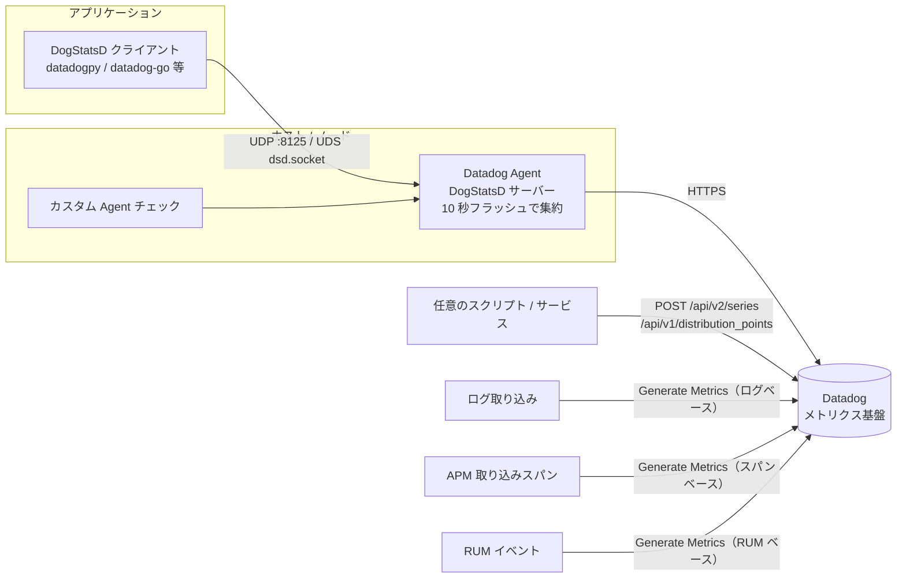
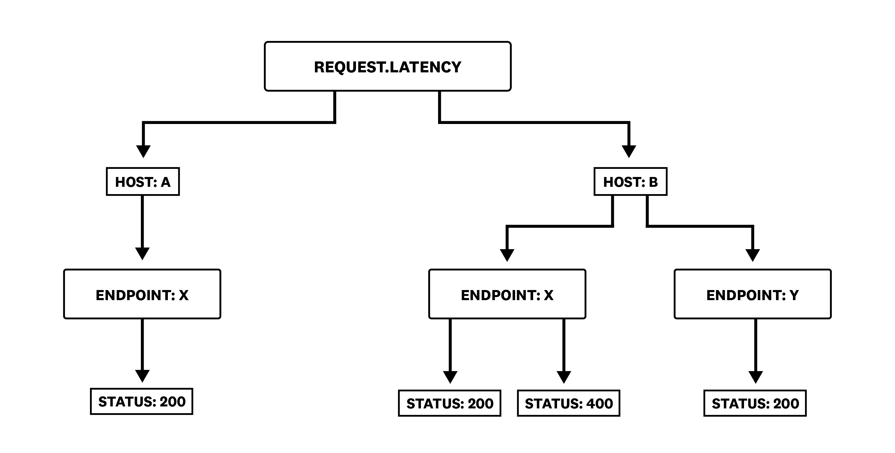
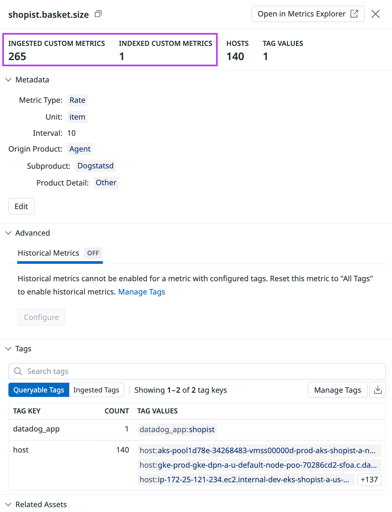
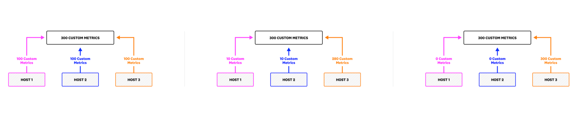
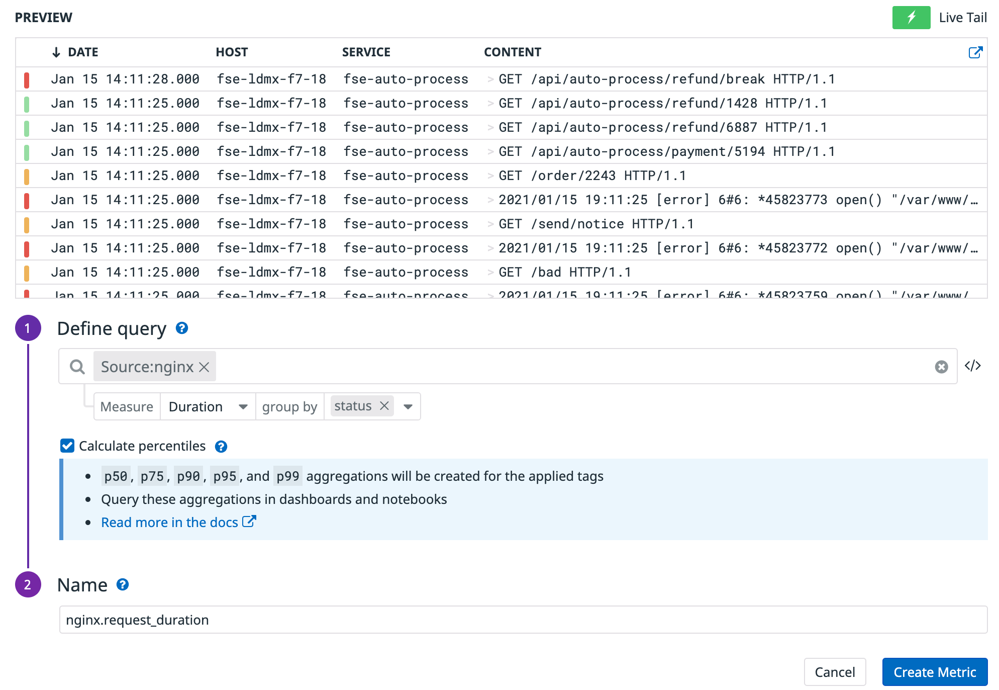
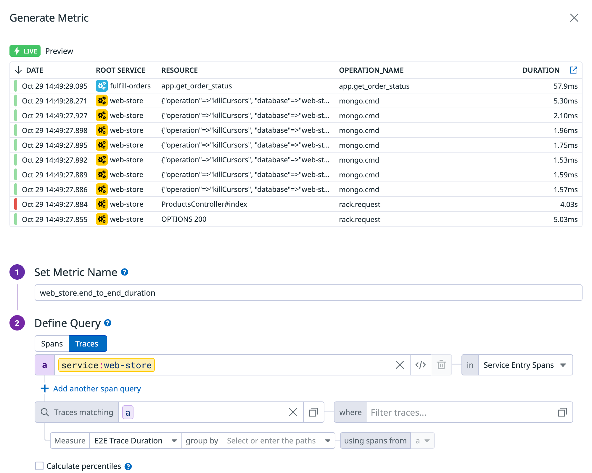

# Custom Metrics と DogStatsD

## 概要

Datadog の **Custom Metrics（カスタムメトリクス）** は、Datadog の 1,000 以上の標準インテグレーション以外から送られるメトリクスであり、アプリケーションの KPI（注文数、レイテンシ、キュー長など）を計測するために使う。カスタムメトリクスは「**メトリクス名とタグ値（host タグを含む）の一意な組み合わせ**」で識別され、この組み合わせの数（＝時系列数、カーディナリティ）が課金単位になる。[出典](https://docs.datadoghq.com/metrics/custom_metrics/)

**DogStatsD** は Datadog Agent に同梱されたメトリクス集約サービスで、StatsD プロトコルを実装し、Datadog 独自拡張（HISTOGRAM 型、DISTRIBUTION 型、タグ、Service Check、Event）を加えたもの。アプリケーションは UDP（既定ポート 8125）または Unix Domain Socket（UDS）で Agent にデータを投げ、Agent が 10 秒のフラッシュ間隔で集約して Datadog に送る。[出典](https://docs.datadoghq.com/developers/dogstatsd/)

本ファイルが扱う範囲と、関連ファイルの分担は以下のとおり。

| トピック | 本ファイル | 詳細ファイル |
|---|---|---|
| カスタムメトリクスの定義・課金カウント方法 | ○（詳細） | 料金の数値は [製品別料金表](../../03_導入編/pricing-by-product.md)、課金計算の一般論は [課金計算の仕組み](../../03_導入編/billing-mechanics.md) |
| メトリクス種別（COUNT / RATE / GAUGE / SET / HISTOGRAM / DISTRIBUTION）の意味、ロールアップ、Metrics Summary、Metrics without Limits の画面操作、Historical Metrics Ingestion | 要点のみ | [Metrics（メトリクス）](./metrics.md) |
| DogStatsD プロトコル・設定・クライアント・Origin Detection・サンプリング | ○（詳細） | — |
| Agent 本体・`datadog.yaml` の全般設定 | 要点のみ | [Datadog Agent](./agent.md)、[Agent 設定リファレンス](./agent-configuration.md) |
| Kubernetes / コンテナでの Agent 配置 | 要点のみ | [コンテナ/Kubernetes向けAgent](./kubernetes-and-containers-agent.md) |
| HTTP API での送信 | ○ | API キー管理は [API とキー管理](./api-and-keys.md) |
| ログ／スパン／RUM からのメトリクス生成 | ○（メトリクス観点） | [Log Pipelines と処理](../logs/log-pipelines-and-processing.md)、[APM の概念とインジェスト制御](../apm/apm-concepts-and-ingestion.md)、[RUM（ブラウザ）](../dem/rum-browser.md) |
| OpenTelemetry 由来のメトリクス | リンクのみ | [OpenTelemetry サポート](./opentelemetry.md) |
| タグ設計・コスト最適化の実践 | リンクのみ | [タグ戦略の実践](../../04_応用編/tagging-strategy.md)、[コスト最適化](../../04_応用編/cost-optimization.md) |

### 全体のデータフロー



## カスタムメトリクスの定義

### カスタムメトリクスに該当するもの

Datadog の Custom Metrics に該当するのは以下である。[出典](https://docs.datadoghq.com/metrics/custom_metrics/)、[出典](https://docs.datadoghq.com/account_management/billing/custom_metrics/)

| 区分 | 内容 |
|---|---|
| DogStatsD で送信したメトリクス | すべてカスタムメトリクス |
| カスタム Agent チェックで送信したメトリクス | すべてカスタムメトリクス |
| Marketplace インテグレーションのメトリクス | カスタムメトリクス扱い |
| 1,000 以上の Datadog 標準インテグレーションに含まれないインテグレーションのメトリクス | カスタムメトリクス扱い |
| 一部の標準インテグレーションが出すメトリクス | 下表参照 |
| HTTP API（`/api/v2/series` 等）、PowerShell、AWS Lambda、クライアントライブラリで送ったメトリクス | カスタムメトリクス（送信手段一覧として公式に列挙） |
| ログ／APM スパン／RUM イベント／Live Processes から生成したメトリクス | カスタムメトリクス |

### カスタムメトリクスを出しうる標準インテグレーション

| 分類 | インテグレーション |
|---|---|
| 既定で 350 カスタムメトリクスに制限 | ActiveMQ XML、Go-Expvar、Java-JMX |
| 既定の収集上限なし | Nagios、PDH Check、OpenMetrics、Windows performance counters、WMI、Prometheus |
| 設定によりカスタムメトリクスを収集可能 | MySQL、Oracle、Postgres、SQL Server |
| クラウド連携由来のカスタムメトリクス | AWS |

[出典](https://docs.datadoghq.com/metrics/custom_metrics/)

> 補足：OpenMetrics / Prometheus のスクレイプは既定の上限がないため、エンドポイントが公開する全メトリクスを取り込むとカスタムメトリクスが急増しうる。取り込むメトリクスを明示的に絞る設計が必要（設定は [Integrations](./integrations.md) を参照）。【経験則】

### カスタムメトリクスのプロパティ

| プロパティ | 説明 |
|---|---|
| `<METRIC_NAME>` | メトリクス名 |
| `<METRIC_VALUE>` | 値。**32 ビット**で表現できる値であること。日付やタイムスタンプを値にすべきではない |
| `<TIMESTAMP>` | タイムスタンプ。**未来 10 分以内、過去 1 時間以内**であること（それ以前の過去データは Historical Metrics Ingestion が必要） |
| `<TAGS>` | メトリクスに付くタグの集合 |
| `<METRIC_TYPE>` | メトリクス種別（[Metrics](./metrics.md#メトリクス種別metric-types) 参照） |
| `<INTERVAL>` | RATE / COUNT 型でのみ意味を持つ間隔（秒） |

[出典](https://docs.datadoghq.com/metrics/custom_metrics/)

> 注：値を「32 ビット」とする custom_metrics ページの記述に対し、HTTP API リファレンスでは点の値を 64 ビット浮動小数（double）としている。API スキーマは double だが、カスタムメトリクスの値として扱える範囲は公式に 32 ビットと案内されている、と理解しておくのが安全。

### 命名規則

| 規則 | 内容 |
|---|---|
| 先頭文字 | 英字で始まる |
| 使用可能文字 | ASCII 英数字、アンダースコア `_`、ピリオド `.` のみ。それ以外の文字（スペース含む）は `_` に変換される。Unicode は非対応 |
| 長さ | 最大 200 文字（UI 表示上 100 文字未満を推奨） |
| 大文字小文字 | 区別される（`Request.Latency` と `request.latency` は別メトリクス） |
| 単位 | Metrics Summary で設定、またはグラフエディタの Unit override で上書き |

[出典](https://docs.datadoghq.com/metrics/custom_metrics/)

生成メトリクス固有の命名制約：スパンベースメトリクスは `trace.*` で始まる名前を使えない。RUM ベースメトリクスは `datadog.estimated_usage` で始まる名前を使えない。[出典](https://docs.datadoghq.com/tracing/trace_pipeline/generate_metrics/)、[出典](https://docs.datadoghq.com/real_user_monitoring/platform/generate_metrics/)

### 送信手段の一覧

| 送信手段 | 経路 | 主な用途 | 本ファイルの該当節 |
|---|---|---|---|
| DogStatsD | アプリ → Agent（UDP / UDS） → Datadog | アプリ内計測（最も一般的） | [DogStatsD](#dogstatsd) |
| カスタム Agent チェック | Agent 上の Python チェック | 外部システムの定期ポーリング | [カスタム Agent チェック](#カスタム-agent-チェックからの送信) |
| HTTP API | 任意のクライアント → Datadog API | Agent を置けない環境、バッチ処理 | [HTTP API による送信](#http-api-による送信) |
| ログベースメトリクス | ログ取り込みストリーム → メトリクス | ログを索引せずに傾向を残す | [ログ／スパン／RUM からのメトリクス生成](#ログスパンrum-からのメトリクス生成) |
| スパンベースメトリクス | APM 取り込みスパン → メトリクス | 特定条件のレイテンシ・件数 | 同上 |
| RUM ベースメトリクス | RUM イベント → メトリクス | フロントエンド KPI | 同上 |
| Live Processes ベース | プロセスデータ → メトリクス | プロセス単位の監視 | 公式に送信手段として列挙（詳細は [Infrastructure Monitoring](../infrastructure/infrastructure-monitoring.md)） |
| AWS Lambda | Lambda 拡張 / Forwarder | サーバーレス | [Serverless Monitoring](../infrastructure/serverless.md) |
| OpenTelemetry | OTLP 受信 / Datadog Exporter | OTel 計装 | [OpenTelemetry サポート](./opentelemetry.md) |

[出典](https://docs.datadoghq.com/metrics/custom_metrics/)

## 課金カウント方法（カーディナリティ課金）

Datadog のカスタムメトリクス課金には **2 つのモデル**がある。

| モデル | 課金単位 | 適用 |
|---|---|---|
| カーディナリティ課金（Timeseries SKU） | 一意な時系列（メトリクス名＋タグ値組み合わせ）の 1 時間あたり数の月平均 | 標準。公式料金ページの「Custom Metrics」はこのモデル |
| Metric Name Pricing | 一意なメトリクス名数＋データポイント数 | オプトインした組織（契約で SKU を選択）。Timeseries SKU とは**相互排他** |

[出典](https://docs.datadoghq.com/account_management/billing/custom_metrics/)、[出典](https://docs.datadoghq.com/account_management/billing/metric_name_pricing/)

本節はカーディナリティ課金の数え方を説明する。Metric Name Pricing は [後述](#metric-name-pricing-の数え方)。

### 基本ルール：メトリクス名 × タグ値の一意な組み合わせ

カーディナリティ課金のカスタムメトリクスは、メトリクス名とタグ値（**host タグを含む**）の一意な組み合わせごとに 1 つと数える。公式の例は以下のとおり。[出典](https://docs.datadoghq.com/account_management/billing/custom_metrics/)

`request.Latency` を host A と host B から送信し、タグ `endpoint`（X / Y）と `status`（200 / 400）を付ける。エンドポイント X は両ホストで動くが失敗（400）は host B だけで起き、エンドポイント Y は host B だけで動き常に成功する。このとき実際に出現する組み合わせは次の 4 つで、**カスタムメトリクスは 4**。

| # | host | endpoint | status |
|---|---|---|---|
| 1 | A | X | 200 |
| 2 | B | X | 200 |
| 3 | B | X | 400 |
| 4 | B | Y | 200 |

ポイントは「理論上の全組み合わせ（2×2×2=8）」ではなく「**実際に送られた組み合わせ**」だけが数えられること。



- キャプション：`request.Latency` を 2 ホストから送信した場合のタグ組み合わせの図解（公式課金ドキュメントの図）。
- 画面説明：最上段の `REQUEST.LATENCY` から HOST: A と HOST: B に分岐する木構造の図。HOST: A の下は ENDPOINT: X → STATUS: 200 の 1 本。HOST: B の下は ENDPOINT: X（STATUS: 200 と STATUS: 400 に分岐）と ENDPOINT: Y（STATUS: 200）に分かれる。葉の数（4）が一意な組み合わせ数＝カスタムメトリクス数であることを示す。UI 画面ではなく概念図。
- 出典：https://docs.datadoghq.com/account_management/billing/custom_metrics/ （取得日 2026-11-02）

### タグ追加・タグ順序の影響

| ケース | カウントへの影響 | 公式例 |
|---|---|---|
| より細かい粒度のタグを追加 | 最も細かいタグの粒度に応じて増える | `temperature` を `country`・`region` で送ると 2（USA/Northeast、USA/Southeast）。`city`（NYC、Miami、Orlando）を追加すると 3 に増える |
| 既存タグに従属する（粒度を増やさない）タグを追加 | 増えない | 上記に `state` を追加しても、`city` が既に州より細かいので 3 のまま |
| タグの並び順を変える | 増えない | `endpoint:X,status:200` と `status:200,endpoint:X` は同一 |
| 値の異なる host タグ | 増える | host 単位で別の時系列になる |

[出典](https://docs.datadoghq.com/account_management/billing/custom_metrics/)

> 実務上の注意：`user_id`、`request_id`、`session_id`、タイムスタンプなど**無制限に値が増える（unbounded）タグ**はカスタムメトリクス数を爆発させる。生成メトリクス（ログ／スパン／RUM）の公式ドキュメントも、これらを group by に使わないよう明示的に警告している。[出典](https://docs.datadoghq.com/logs/log_configuration/logs_to_metrics/)

### メトリクス種別ごとのカウント

| 種別（送信タイプ） | タグ組み合わせ 1 つあたりのカスタムメトリクス数 | 公式例（組み合わせ 4 の場合） | 備考 |
|---|---|---|---|
| COUNT | 1 | 4 | RATE と同じ数え方 |
| RATE | 1 | 4 | — |
| GAUGE | 1 | 4 | — |
| SET（DogStatsD のみ） | 1 | — | in-app type は GAUGE になる（公式課金ページに SET 専用の記述はないため、GAUGE として 1 と扱うのが妥当【推定】） |
| HISTOGRAM（TIMER 含む） | 既定 **5**（`max`、`median`、`avg`、`95percentile`、`count`） | 4 × 5 = **20** | 集約・パーセンタイルを増減すると比例して増減 |
| DISTRIBUTION | 既定 **5**（`count`、`sum`、`min`、`max`、`avg`） | 4 × 5 = **20** | パーセンタイル（p50 / p75 / p90 / p95 / p99）を有効化すると **さらに 5 増えて 10** |
| DISTRIBUTION（パーセンタイル有効） | **10** | 2 × 5 × 4 = **40** | 計算式：2 × 5 ×（タグ値組み合わせ数） |

[出典](https://docs.datadoghq.com/account_management/billing/custom_metrics/)

HISTOGRAM の出力は Agent 側の `datadog.yaml` で変えられる。

| 設定キー | 既定値 | 選択肢 | 課金影響 |
|---|---|---|---|
| `histogram_aggregates` | `max`、`median`、`avg`、`count` | 上記に加え `sum`、`min` | 1 つ追加するごとに組み合わせ数分増える |
| `histogram_percentiles` | `0.95`（95 パーセンタイルのみ） | 任意のパーセンタイル | 同上 |

[出典](https://docs.datadoghq.com/account_management/billing/custom_metrics/)、[出典](https://docs.datadoghq.com/metrics/types/)

> HISTOGRAM は Agent ごとに集約されるため、パーセンタイルはホスト単位でしか正確でない。複数ホストを跨いだ正確なパーセンタイルが必要なら DISTRIBUTION を使う（種別比較は [Metrics](./metrics.md#histogram-と-distribution-の比較) 参照）。

### Metrics without Limits™ を使う場合（ingested と indexed）

Metrics without Limits™（MWL）は「取り込み（ingestion）」と「索引（indexing）」を分離し、全タグで送ったデータのうち**クエリ可能にするタグを許可リストで指定**する機能である。カーディナリティ課金では次の 2 種類の量が生じる。[出典](https://docs.datadoghq.com/account_management/billing/custom_metrics/)

| 量 | 定義 | 対象 |
|---|---|---|
| Ingested custom metrics（取り込み） | 送信された全タグに基づく元の量 | **MWL を構成したメトリクスのみ** |
| Indexed custom metrics（索引） | MWL 構成後にクエリ可能として残る量 | 全カスタムメトリクス（MWL 未構成のメトリクスは indexed のみで課金） |

公式例（前述の 4 組み合わせ、`endpoint` と `status` のみを残す構成）：

| 種別 | Indexed | Ingested |
|---|---|---|
| COUNT / RATE / GAUGE | 3（host を除くと X-200、X-400、Y-200 の 3 組み合わせ） | 4 |
| DISTRIBUTION（既定集約） | 15（5 × 3） | 20 |

- GAUGE を MWL で構成した場合、既定でクエリ可能な集約（space aggregation × time rollup の組み合わせ）が用意されており、**有効化した集約の数が増えても indexed カスタムメトリクス数は増えない**。[出典](https://docs.datadoghq.com/account_management/billing/custom_metrics/)
- MWL の構成手順・API・効果検証は [Metrics の Metrics without Limits™ 節](./metrics.md#metrics-without-limits) を参照。



- キャプション：Metrics Summary でメトリクス名をクリックしたときの詳細サイドパネル（例：`shopist.basket.size`）。
- 画面説明：パネル上部に **INGESTED CUSTOM METRICS**（例 265）と **INDEXED CUSTOM METRICS**（例 1）、HOSTS（140）、TAG VALUES（1）が並ぶ。その下の **Metadata** に Metric Type（Rate）、Unit（item）、Interval（10）、Origin Product（Agent）、Subproduct（Dogstatsd）、Product Detail が表示され、**Edit** で編集できる。**Advanced** の Historical Metrics タブ（OFF）には「タグを構成済みのメトリクスでは Historical Metrics を有効化できない（All Tags に戻す必要がある）」旨が表示される。**Tags** セクションでは Queryable Tags / Ingested Tags を切り替え、タグキーごとの値数（例：`datadog_app` 1、`host` 140）を確認でき、**Manage Tags** から MWL のタグ構成を行う。Origin Product = Agent / Subproduct = Dogstatsd で DogStatsD 由来のメトリクスであることが分かる。
- 出典：https://docs.datadoghq.com/account_management/billing/custom_metrics/ （取得日 2026-11-02）

### 月次の算出方法（時間平均）

カーディナリティ課金では、**月の各時間について一意なカスタムメトリクス（時系列）の数を数え、その合計を月の時間数で割った月平均**を課金量とする。送信頻度（1 秒ごとでも 1 分ごとでも）やクエリ回数は課金量に影響しない。[出典](https://docs.datadoghq.com/account_management/billing/custom_metrics/)

| 例 | 計算 |
|---|---|
| 1 時間だけ 10,000 時系列を送り、残り 719 時間は 0（30 日月 = 720 時間） | 10,000 ÷ 720 ≒ 13.9 |
| 毎時 1,000 時系列を継続送信 | 1,000 × 720 ÷ 720 = 1,000 |

（上表の計算例は公式の算出式を当てはめたもの）

> 含意：短時間だけ高カーディナリティになる事象（デプロイ時の一時的なタグ、障害時の大量 `pod_name` 等）は月平均では薄まるが、恒常的に続く高カーディナリティタグは満額で効く。【経験則】

### ホストあたりの割当（アロケーション）

Infrastructure Monitoring のプランに応じて、ホストごとにカスタムメトリクスの割当が付き、**アカウント全体でプール**される（ホスト単位で消費されるわけではない）。[出典](https://docs.datadoghq.com/account_management/billing/custom_metrics/)、[出典](https://www.datadoghq.com/pricing/?product=infrastructure)

| プラン | 割当（ホストあたり） |
|---|---|
| Infrastructure Pro | 100 ingested ＋ 100 indexed |
| Infrastructure Enterprise | 200 ingested ＋ 200 indexed |
| Free / Basic ホスト | 0（料金表で Basic ホストのカスタムメトリクスは 0） |



- キャプション：Pro プラン 3 ホストの場合のカスタムメトリクス割当（300）のプール例。
- 画面説明：3 つのパターンが横に並ぶ。いずれも HOST 1〜3 から上部の「300 CUSTOM METRICS」に矢印が向かう。左は各ホスト 100 ずつ、中央は 10 / 10 / 280、右は 0 / 0 / 300。ホスト間で配分が偏っても合計 300 以内なら割当内であることを示す概念図。
- 出典：https://docs.datadoghq.com/account_management/billing/custom_metrics/ （取得日 2026-11-02）

> 既存顧客の割当は最新の契約書（billing agreement）に従う、と料金ページに注記がある。[出典](https://www.datadoghq.com/pricing/list/)
> ログベースメトリクスとスパンベースメトリクスも、このカスタムメトリクス割当を消費する。[出典](https://www.datadoghq.com/pricing/?product=infrastructure)

### 使用量の確認方法

| 手段 | 内容 | 必要権限 |
|---|---|---|
| Plan & Usage（Usage ページ） | 1 時間あたりの ingested / indexed カスタムメトリクスの月平均。Usage details で上位 5,000 カスタムメトリクス（平均 indexed 数）を確認 | Datadog Admin ロール、または `usage_read` 権限 |
| Metrics Summary のサイドパネル | メトリクス名ごとのリアルタイムの ingested / indexed 数 | 閲覧可能なユーザー |
| Metrics Volume Management | 量の推移・上位メトリクス・急増の把握 | [Metrics](./metrics.md#metrics-volume-management) 参照 |
| 推定使用量メトリクス | 下表 | — |

[出典](https://docs.datadoghq.com/metrics/custom_metrics/)、[出典](https://docs.datadoghq.com/account_management/billing/custom_metrics/)

カスタムメトリクス関連の推定使用量メトリクス（Estimated Usage Metrics）：

| メトリクス | 内容 | 期間 |
|---|---|---|
| `datadog.estimated_usage.metrics.custom` | 一意な indexed カスタムメトリクス数 | 直近 1 時間 |
| `datadog.estimated_usage.metrics.custom.by_metric` | 同、メトリクス名別 | 直近 1 時間 |
| `datadog.estimated_usage.metrics.custom.by_tag` | 同、タグ別（Usage Attribution でタグ設定が必要） | 直近 1 時間 |
| `datadog.estimated_usage.metrics.custom.ingested` | 一意な ingested カスタムメトリクス数 | 直近 1 時間 |
| `datadog.estimated_usage.metrics.custom.ingested.by_metric` | 同、メトリクス名別 | 直近 1 時間 |
| `datadog.estimated_usage.metrics.custom.ingested.by_tag` | 同、タグ別 | 直近 1 時間 |
| `datadog.estimated_usage.metrics.points.indexed` 等【Preview】 | indexed / ingested データポイント数（`.hourly`、`.by_tag` あり） | — |
| `datadog.estimated_usage.billable.metrics`【Preview】 | Metric Name Pricing の課金対象メトリクス名数（indexed 100 点超） | 月初来 |
| `datadog.estimated_usage.billable.points`【Preview】 | Metric Name Pricing の 10M 点/名 超過分 | 月初来 |
| `datadog.estimated_usage.metrics.points.ratio`【Preview】 | ingested / indexed 点数の比 | — |

注意点：推定値と実請求には**平均 10〜20% の差**があり、使用量が小さいほど誤差は大きい。複数の時系列に分割されているため、合計を見るときは空間集約に **`sum`** を使う（`sum by`）。`by_tag` 系は Usage Attribution ページでのタグ設定が必要で、変更は次の 00:00 UTC から反映される。[出典](https://docs.datadoghq.com/account_management/billing/usage_metrics/)

### Metric Name Pricing の数え方

Metric Name Pricing は、カスタムメトリクスを「一意なメトリクス名の数」と「それらが生むデータポイント量」で課金するモデルで、オプトインした組織のカーディナリティ課金を置き換える。Timeseries（カーディナリティ）SKU とは相互排他。[出典](https://docs.datadoghq.com/account_management/billing/metric_name_pricing/)

| SKU / 概念 | 定義 |
|---|---|
| Metric-Name | 月内に indexed データポイントが **100 を超えた**一意なメトリクス名ごとに課金。メトリクス名は月 1 回だけ数える |
| Indexed Points | メトリクス名あたり **1,000 万（10M）点**のベースラインを超えた indexed データポイント。超過分は全メトリクスで 1 つの月次バケットに合算 |
| Ingested Points | indexed 量の **5 倍**を超えた ingested データポイント（5 倍までは無料） |
| DISTRIBUTION の乗数 | 既定 5 倍（count / sum / min / max / avg）、パーセンタイル有効時 10 倍。例：100 点 → 500 点 / 1,000 点。MWL 構成の有無にかかわらず適用（構成済みメトリクスでは ingested 量のみに乗数） |
| MWL との関係 | 全 ingested 点が MWL に関係なく取り込み量に数えられ、既定では全 ingested 点が indexed にもなる。MWL は indexed 量を減らす手段 |
| Historical Metrics Ingestion | 元のタイムスタンプではなく**取り込み時刻**基準で数える。HMI の点は ingested と indexed の両方に加算 |
| 料金体系 | メトリクス名・indexed 点ともに 5 段階の限界（marginal）ボリューム価格。ドル単価は公式ドキュメントに記載なし（契約で決定）。年契約を基準に Month-to-Month は +20%、On-Demand は +40% |
| 集計・請求 | 時間単位で集計し、契約により時間単位または月単位で請求（総額は同じ）。期末にカウンタをリセット |
| コミット | メトリクス名とデータポイントを別々にコミット可能。コミット量はその量が属する段階の単価で一律課金 |
| Usage Attribution | 初期段階では indexed 点のみ対応（ingested は非対応）。メトリクス名のコストは各グループのデータポイント比率で按分 |

[出典](https://docs.datadoghq.com/account_management/billing/metric_name_pricing/)

> カーディナリティ課金と Metric Name Pricing の比較・どちらが有利かの判断は [課金計算の仕組み](../../03_導入編/billing-mechanics.md) と [コスト見積り手法](../../03_導入編/cost-estimation.md) を参照。

## DogStatsD

### DogStatsD の仕組み

| 項目 | 内容 |
|---|---|
| 実体 | Datadog Agent に同梱（Agent v6 以降は既定で有効）。単体コンテナイメージ `dogstatsd` もある |
| プロトコル | StatsD 互換 + Datadog 拡張（HISTOGRAM、DISTRIBUTION、タグ、Service Check、Event） |
| 受信方式 | UDP（既定 `8125`）、Unix Domain Socket（UDS、Linux 系のみ） |
| 送信モデル | UDP は fire-and-forget。アプリは応答を待たず、DogStatsD が停止してもアプリは止まらない |
| 集約 | **10 秒のフラッシュ間隔**で、同じメトリクス名・同じタグの値を 1 つにまとめて Datadog API へ送る |
| タイムスタンプ | StatsD クライアントはタイムスタンプを送らない（v1.3 拡張を除く）。サーバーがフラッシュ時に付与し、10:00:00〜10:00:10 に受け取ったデータは 10:00:00 の 1 点になる |
| TIMER | ネイティブ型としては実装せず、HISTOGRAM で代替（`ms` 型も HISTOGRAM と同じ扱い） |
| 標準 StatsD クライアント | 任意の StatsD 準拠クライアントで送信可能だが、Datadog 固有機能（タグ等）は使えない |

[出典](https://docs.datadoghq.com/developers/dogstatsd/)、[出典](https://docs.datadoghq.com/developers/dogstatsd/data_aggregation/)

単体 DogStatsD コンテナイメージの配布先：

| レジストリ | イメージ |
|---|---|
| Datadog Container Registry | `registry.datadoghq.com/dogstatsd` |
| Google Artifact Registry | `gcr.io/datadoghq/dogstatsd` |
| Amazon ECR | `public.ecr.aws/datadog/dogstatsd` |
| Azure ACR | `datadoghq.azurecr.io/dogstatsd` |
| Docker Hub | `datadog/dogstatsd`（プル回数制限あり。Docker Hub 契約者以外は他レジストリを推奨） |

[出典](https://docs.datadoghq.com/developers/dogstatsd/)

### フラッシュ時に送られる値（種別ごと）

| 種別 | フラッシュ間隔ごとに Datadog に送られる値 | Datadog での保存型（in-app type） |
|---|---|---|
| GAUGE（`g`） | 最後に受信した値 | GAUGE |
| COUNT（`c`） | 受信値の合計（時間正規化され 1 秒あたりの値になる） | **RATE** |
| SET（`s`） | 受信した値のうち一意な値の個数 | GAUGE |
| HISTOGRAM（`h`）/ TIMER（`ms`） | 集約値（既定 `.max`、`.median`、`.avg`、`.95percentile`、`.count`） | `.count` は RATE、他は GAUGE |
| DISTRIBUTION（`d`） | グローバル分布として Datadog 側で集約 | DISTRIBUTION |

[出典](https://docs.datadoghq.com/developers/dogstatsd/data_aggregation/)、[出典](https://docs.datadoghq.com/metrics/custom_metrics/dogstatsd_metrics_submission/)、[出典](https://docs.datadoghq.com/metrics/types/)

- DogStatsD の COUNT は RATE として保存されるため小数で表示されることがある。生の件数を見るには Cumulative Sum や Integral 関数を使う。[出典](https://docs.datadoghq.com/metrics/custom_metrics/dogstatsd_metrics_submission/)
- DogStatsD で RATE を得たい場合は COUNT か HISTOGRAM を送る（RATE を直接送る関数はない）。

## DogStatsD データグラム形式（プロトコル）

DogStatsD のデータグラムは UTF-8 でエンコードされたテキスト。独自クライアントを書く場合やシェルから送る場合に使う。[出典](https://docs.datadoghq.com/developers/dogstatsd/datagram_shell/)

### メトリクス

```text
<METRIC_NAME>:<VALUE>|<TYPE>|@<SAMPLE_RATE>|#<TAG_KEY_1>:<TAG_VALUE_1>,<TAG_2>
```

| フィールド | 必須 | 説明 |
|---|---|---|
| `<METRIC_NAME>` | 必須 | ASCII 英数字、`_`、`.` のみ |
| `<VALUE>` | 必須 | 整数または浮動小数 |
| `<TYPE>` | 必須 | `c`（COUNT）、`g`（GAUGE）、`ms`（TIMER）、`h`（HISTOGRAM）、`s`（SET）、`d`（DISTRIBUTION） |
| `@<SAMPLE_RATE>` | 任意 | 0〜1 の浮動小数（両端含む）。COUNT、HISTOGRAM、DISTRIBUTION、TIMER でのみ機能。既定 `1` |
| `#<TAGS>` | 任意 | カンマ区切り。`key:value` 形式を推奨（値なしタグも可） |

例：

```text
page.views:1|c
fuel.level:0.5|g
song.length:240|h|@0.5
users.uniques:1234|s
users.online:1|c|#country:china
users.online:1|c|@0.5|#country:china
```

### プロトコル拡張（バージョン）

| バージョン | 必要 Agent | 構文 | 用途 |
|---|---|---|---|
| v1.1（値のパッキング） | v6.25.0 以上 v7.0.0 未満、または v7.25.0 以上 | `<METRIC_NAME>:<VALUE1>:<VALUE2>:<VALUE3>\|<TYPE>\|...` | 1 データグラムに複数値。SET 以外の全型。型・サンプルレート・タグは共通 |
| v1.2（コンテナ ID） | v6.35.0 以上 v7.0.0 未満、または v7.35.0 以上 | `...\|#<tags>\|c:<CONTAINER_ID>` | コンテナタグによるエンリッチ（Origin Detection）。Agent 側で `dogstatsd_origin_detection_client: true`（`DD_DOGSTATSD_ORIGIN_DETECTION_CLIENT=true`）が必要 |
| v1.3（タイムスタンプ） | v6.40.0 以上、または v7.40.0 以上 | `...\|#<tags>\|T<UNIX_TIMESTAMP>` | 事前集約済みの点を過去の UTC 時刻で送る。**Agent は集約しない**。GAUGE と COUNT のみ |
| v1.4（inode フォールバック） | v7.51.0 以上 | `...\|c:ci-<CONTAINER_ID>` または `...\|c:in-<CGROUP_INODE>` | コンテナ ID が取れないとき cgroup inode を使う。素の `c:<CONTAINER_ID>` 形式は非推奨（動作はする） |
| v1.5（外部データ） | v7.57.0 以上 | `...\|e:<EXTERNAL_DATA>` | コンテナ ID が取れないとき Admission Controller が供給する情報。形式 `it-<BOOL>,cn-<CONTAINER_NAME>,pu-<POD_UID>` |
| v1.6（カーディナリティ） | v7.64.0 以上 | `...\|card:<CARDINALITY>` | コンテナタグ付与のカーディナリティを指定。`none` / `low` / `orchestrator` / `high` |

例：

```text
page.views:1:2:32|d
song.length:240:234|h|@0.5
page.views:1|g|#env:dev|c:<CONTAINER_ID>
page.views:15|c|#env:dev|T1656581400
page.views:1|c|#env:dev|e:it-false,cn-nginx-webserver,pu-75a2b6d5-3949-4afb-ad0d-92ff0674e759
```

[出典](https://docs.datadoghq.com/developers/dogstatsd/datagram_shell/)

> v1.3 のタイムスタンプ付き送信も、カスタムメトリクスの一般的なタイムスタンプ制約（過去 1 時間以内）の対象になると考えられるが、DogStatsD のページ自体には許容範囲の記載はない（公開情報では確認できず）。より古いデータの取り込みは [Historical Metrics Ingestion](./metrics.md#historical-metrics-ingestion履歴メトリクス取り込み) を使う。

### Event

```text
_e{<TITLE_UTF8_LENGTH>,<TEXT_UTF8_LENGTH>}:<TITLE>|<TEXT>|d:<TIMESTAMP>|h:<HOSTNAME>|p:<PRIORITY>|t:<ALERT_TYPE>|#<TAG_KEY_1>:<TAG_VALUE_1>,<TAG_2>
```

| フィールド | 必須 | 説明 |
|---|---|---|
| `_e` | 必須 | データグラムの先頭 |
| `<TITLE>` / `<TEXT>` | 必須 | 本文の改行は `\\n` でエスケープ |
| `<TITLE_UTF8_LENGTH>` / `<TEXT_UTF8_LENGTH>` | 必須 | UTF-8 でのバイト長 |
| `d:` | 任意 | Unix タイムスタンプ。既定は現在時刻 |
| `h:` | 任意 | ホスト名。既定は Agent のホスト |
| `k:` | 任意 | イベントをグループ化する集約キー |
| `p:` | 任意 | `normal` / `low`。既定 `normal` |
| `s:` | 任意 | ソースタイプ名 |
| `t:` | 任意 | `error` / `warning` / `info` / `success`。既定 `info` |
| `#` | 任意 | タグ |

例：`_e{21,36}:An exception occurred|Cannot parse CSV file from 10.0.0.17|t:warning|#err_type:bad_file`

Event の扱い（Event Explorer 等）は [Event Management](./event-management.md) を参照。

### Service Check

```text
_sc|<NAME>|<STATUS>|d:<TIMESTAMP>|h:<HOSTNAME>|#<TAG_KEY_1>:<TAG_VALUE_1>,<TAG_2>|m:<SERVICE_CHECK_MESSAGE>
```

| フィールド | 必須 | 説明 |
|---|---|---|
| `_sc` | 必須 | データグラムの先頭 |
| `<NAME>` | 必須 | Service Check 名 |
| `<STATUS>` | 必須 | `0` OK、`1` WARNING、`2` CRITICAL、`3` UNKNOWN |
| `d:` | 任意 | Unix タイムスタンプ。既定は現在時刻 |
| `h:` | 任意 | ホスト名 |
| `#` | 任意 | タグ |
| `m:` | 任意 | ステータスメッセージ。**最後のメタデータフィールド**でなければならない |

例：`_sc|Redis connection|2|#env:dev|m:Redis connection timed out after 10s`

[出典](https://docs.datadoghq.com/developers/dogstatsd/datagram_shell/)

### シェルからの送信

Agent は既定で `127.0.0.1` の UDP `8125` で待ち受ける。

```shell
# Linux（bash の /dev/udp）
echo -n "custom_metric:60|g|#shell" >/dev/udp/localhost/8125
# netcat
echo -n "custom_metric:60|g|#shell" | nc -4u -w0 127.0.0.1 8125
# Event
title="Event from the shell"
text="This was sent from Bash!"
echo "_e{${#title},${#text}}:$title|$text|#shell,bash" >/dev/udp/localhost/8125
# Service Check
echo -n "_sc|Redis connection|2|#env:dev|m:Redis connection timed out after 10s" >/dev/udp/localhost/8125
# UDS 経由
echo -n "custom.metric.name:1|c" | nc -U -u -w1 /var/run/datadog/dsd.socket
```

Windows ではコミュニティの `send-statsd.ps1` スクリプトを PowerShell から使う（例：`.\send-statsd.ps1 "custom_metric:123|g|#shell"`）。[出典](https://docs.datadoghq.com/developers/dogstatsd/datagram_shell/)、[出典](https://docs.datadoghq.com/developers/dogstatsd/unix_socket/)

## DogStatsD のセットアップ

### 環境別の設定

| 環境 | 既定 / 設定方法 |
|---|---|
| ホスト Agent | DogStatsD は既定で UDP `8125` で有効。ポート変更は `datadog.yaml` の `dogstatsd_port` を設定し Agent を再起動 |
| コンテナ Agent（Docker） | `-p 8125:8125/udp` でポート公開。他コンテナ等 localhost 以外から受けるには `DD_DOGSTATSD_NON_LOCAL_TRAFFIC=true`。ポート変更は `DD_DOGSTATSD_PORT` |
| Datadog Operator（Kubernetes） | **既定で UDS で StatsD 収集が有効**。UDP で受けるには `datadog-agent.yaml` で `features.dogstatsd.hostPortConfig.enabled: true` を設定し `kubectl apply`（ホストポート 8125 が開くためファイアウォールで制限すること）。ネットワークプラグインが hostPort 非対応なら `hostNetwork: true`（ポート衝突に注意） |
| Helm（Kubernetes） | `datadog-values.yaml` で `dogstatsd.port: 8125`、`dogstatsd.useHostPort: true`、`dogstatsd.nonLocalTraffic: true` を設定し `helm upgrade`。hostPort には CNI 準拠のネットワークプロバイダ（Calico、Canal、Flannel 等）が必要 |
| Kubernetes のアプリ Pod（UDP） | `DD_AGENT_HOST` を Downward API の `status.hostIP` から設定（Kubernetes 1.7 以降）し、`$DD_AGENT_HOST:8125` に送信 |

[出典](https://docs.datadoghq.com/developers/dogstatsd/)

アプリ Pod 側の UDP 設定例：

```yaml
env:
  - name: DD_AGENT_HOST
    valueFrom:
      fieldRef:
        fieldPath: status.hostIP
  - name: DD_ENTITY_ID          # UDP での Origin Detection 用
    valueFrom:
      fieldRef:
        fieldPath: metadata.uid
```

Agent の Kubernetes 配置全般は [コンテナ/Kubernetes向けAgent](./kubernetes-and-containers-agent.md) を参照。Unified Service Tagging（`env`、`service`、`version` タグ）の付与が推奨される（[Tagging](./tagging.md)）。

### Unix Domain Socket（UDS）

DogStatsD over UDS は、`IP:port` の代わりにソケットファイルで通信する方式で、データグラム形式は UDP と同じ。[出典](https://docs.datadoghq.com/developers/dogstatsd/unix_socket/)

| 項目 | 内容 |
|---|---|
| 必要 Agent | v6.0 以降 |
| 対応 OS | Linux 系。**Windows は非対応** |
| 制約 | ホストローカル通信のため、メトリクスを送る全ホストで Agent が動いている必要がある |
| UDP に対する利点 | ネットワークスタックを迂回して高負荷時に高性能／ドロップや接続エラーを検知できる（非ブロッキングのまま）／送信元コンテナを検出してタグ付けできる／Agent コンテナの IP に依存しない |
| 既定ソケットパス | `/var/run/datadog/dsd.socket`（ホストのインストールスクリプトが適切な権限で作成） |
| Agent 設定（ホスト） | `use_dogstatsd: true`、`dogstatsd_socket: /var/run/datadog/dsd.socket` |
| Agent 設定（コンテナ） | 環境変数 `DD_DOGSTATSD_SOCKET` |
| Agent 再起動時 | ソケットが作り直され、クライアントライブラリは新しいソケットに再接続する |

ホストでの手順：

```shell
sudo mkdir -p /var/run/datadog/
sudo chown dd-agent:dd-agent /var/run/datadog/
# datadog.yaml に use_dogstatsd: true と dogstatsd_socket: /var/run/datadog/dsd.socket を設定して Agent を再起動
```

| 環境 | ソケット共有方法 |
|---|---|
| Docker | Agent コンテナに `-v /var/run/datadog:/var/run/datadog`（読み書き）、アプリコンテナに `:ro` でマウント。親ディレクトリをマウントすることで DogStatsD 再起動後も通信が継続する |
| ECS Fargate | 共有ボリューム `dsdsocket` を定義し、Agent とアプリの両コンテナで `/var/run/datadog` にマウント |
| Kubernetes | Agent に `hostPath` `/var/run/datadog/` をマウントし、アプリ Pod にもマウント（書き込み不要なら `readOnly: true`） |
| EKS Fargate | `hostPath` ではなく Agent とアプリで共有する `emptyDir` ボリュームを使う |

- 公式クライアント（Go、Java、Python、Ruby、PHP、C#）はネイティブに UDS をサポートし、UDS 利用時はクライアント側バッファリングの有効化が推奨される。UDS 非対応クライアントは `socat` で UDP 8125 をソケットへ転送できる。[出典](https://docs.datadoghq.com/developers/dogstatsd/unix_socket/)
- Windows での名前付きパイプ（named pipe）による DogStatsD 受信は、公式 DogStatsD ドキュメントでは確認できない。公式 GitHub の Go クライアント README は `\\.\pipe\<name>` 形式のアドレスに言及しているが、Agent 側の設定キーと対応バージョンは公開情報では確認できず。[出典](https://github.com/DataDog/datadog-go)

## Origin Detection（送信元検出）とタグカーディナリティ

### Origin Detection の概要

Origin Detection は、DogStatsD が受け取ったメトリクスに**送信元コンテナ／Pod のタグ**（Autodiscovery で付くものと同じタグ）を自動付与する機能。Agent v6.10.0 以降で UDP にも対応。[出典](https://docs.datadoghq.com/developers/dogstatsd/)

| 側 | 既定 | 設定 |
|---|---|---|
| クライアント側 | **有効**（全公式 DogStatsD クライアント） | 無効化は `DD_ORIGIN_DETECTION_ENABLED=false` またはクライアント設定 |
| Agent 側（UDP / 全般） | **無効** | `DD_DOGSTATSD_ORIGIN_DETECTION_CLIENT=true`（`datadog.yaml` では `dogstatsd_origin_detection_client: true`） |
| Agent 側（UDS） | 無効 | ホスト：`dogstatsd_origin_detection: true`、コンテナ：`DD_DOGSTATSD_ORIGIN_DETECTION=true` |

[出典](https://docs.datadoghq.com/developers/dogstatsd/)、[出典](https://docs.datadoghq.com/developers/dogstatsd/unix_socket/)、[出典](https://docs.datadoghq.com/developers/dogstatsd/datagram_shell/)

> UDP 経路と UDS 経路で有効化キーの名前が異なる（`..._ORIGIN_DETECTION_CLIENT` と `..._ORIGIN_DETECTION`）。Datadog Operator のソースでも両者が別定数として定義されている。構成時は使用するトランスポートに合わせて設定すること。

### 送信元の検出方式

| 方式 | 仕組み | 設定 |
|---|---|---|
| cgroup | クライアントが Linux の `/proc/self/cgroup` または `/proc/self/mountinfo` からコンテナ ID を取得しデータグラムに付与（`c:` フィールド）。cgroup v2 ではディレクトリの inode を使う（v1.4 拡張） | 既定で有効 |
| UDP + `DD_ENTITY_ID` | `DD_ENTITY_ID` を `metadata.uid`（Pod UID）から設定すると、クライアントが `entity_id` タグを付ける | 環境変数を Pod に設定 |
| `DD_EXTERNAL_ENV` | Pod にラベル `admission.datadoghq.com/enabled: "true"` を付けると Admission Controller が変数を注入し、クライアントが `e:` フィールドで送る（v1.5 拡張） | Admission Controller 有効化 |
| UDS + 認証情報 | UDS のソケット資格情報から送信元プロセスを特定。信頼性のためにホスト PID 名前空間アクセスが必要 | Docker：`--pid=host`、ECS：タスク定義の `pidMode`、Kubernetes：`hostPID: true`、EKS Fargate：`shareProcessNamespace: true` |

[出典](https://docs.datadoghq.com/developers/dogstatsd/)、[出典](https://docs.datadoghq.com/developers/dogstatsd/unix_socket/)

- EKS Fargate では Pod spec に `shareProcessNamespace: true` を設定する。[出典](https://docs.datadoghq.com/developers/dogstatsd/)
- UDP 経由では、カスタムメトリクスの増加を避けるため **`pod_name` タグは既定で付与されない**。UDS 経由でも `container_id`、`container_name`、`pod_name` は既定で付与されない。[出典](https://docs.datadoghq.com/developers/dogstatsd/)、[出典](https://docs.datadoghq.com/developers/dogstatsd/unix_socket/)

### タグカーディナリティ

Origin Detection で付与するコンテナタグの粒度は「カーディナリティ」で制御する。カーディナリティを上げるほど時系列が分割され、**カスタムメトリクス数（課金）が増える**。[出典](https://docs.datadoghq.com/getting_started/tagging/assigning_tags/)

| レベル | 付与されるタグの例 | 説明 |
|---|---|---|
| `none` | なし | コンテナタグを付与しない（クライアント／データグラムの指定値として存在） |
| `low`（既定） | `kube_namespace` などクラスタレベルのタグ | 既定値 |
| `orchestrator` | `pod_name`（ECS / Fargate では `task_arn`） | Pod 単位 |
| `high` | `container_id` などコンテナレベルのタグ | コンテナ単位 |

| 設定方法 | キー |
|---|---|
| Agent 全体（DogStatsD） | `dogstatsd_tag_cardinality` / `DD_DOGSTATSD_TAG_CARDINALITY`（既定 `low`） |
| Agent 全体（チェック） | `DD_CHECKS_TAG_CARDINALITY`（既定 `low`）。DogStatsD は課金体系が異なるため別設定になっている |
| クライアント全体 | 環境変数 `DD_CARDINALITY`、またはクライアントのコンストラクタ引数 `cardinality` |
| メトリクス単位 | 各送信関数の `cardinality` 引数（データグラムでは `card:`、v1.6・Agent v7.64.0 以降） |

[出典](https://docs.datadoghq.com/developers/dogstatsd/)、[出典](https://docs.datadoghq.com/developers/dogstatsd/unix_socket/)、[出典](https://docs.datadoghq.com/getting_started/tagging/assigning_tags/)

- 公式は、DogStatsD メトリクスにコンテナタグを付けると「ホストごとに 1 つ」ではなく「**コンテナごとに 1 つ**」の時系列になり、カスタムメトリクス課金に影響しうると注意している。一方、タイムスタンプは秒に丸められるため、カーディナリティを上げることで同一時系列内での点の上書きを防げる場合がある。[出典](https://docs.datadoghq.com/getting_started/tagging/assigning_tags/)
- 各レベルで付くタグの完全な一覧は Kubernetes / Docker のタグ抽出ドキュメントにある（[コンテナ/Kubernetes向けAgent](./kubernetes-and-containers-agent.md) 参照）。

## クライアントライブラリ

### 公式 DogStatsD クライアント

| 言語 | ライブラリ | インストール |
|---|---|---|
| Python | `datadogpy`（API クライアントも兼ねる） | `pip install datadog` |
| Ruby | `dogstatsd-ruby` | `gem install dogstatsd-ruby` |
| Go | `datadog-go` | `go get github.com/DataDog/datadog-go/v5/statsd` |
| Java | `java-dogstatsd-client` | Maven `com.datadoghq:java-dogstatsd-client`（公式ページ記載版 4.2.1） |
| PHP | `php-datadogstatsd` | Composer `datadog/php-datadogstatsd`（公式ページ記載 1.6.*） |
| .NET（C#） | `DogStatsD-CSharp-Client` | `dotnet add package DogStatsD-CSharp-Client` |
| Swift | `Swift-Dogstatsd`（Vapor アプリ向け） | ライブラリ一覧に公式として掲載 |

[出典](https://docs.datadoghq.com/developers/dogstatsd/)、[出典](https://docs.datadoghq.com/developers/community/libraries/)

### コミュニティ DogStatsD クライアント（抜粋）

| 言語 | ライブラリ |
|---|---|
| Node.js | `hot-shots`、`node-dogstatsd` |
| C++ | `cpp-datadogstatsd`、DogFood（ヘッダオンリー） |
| Rust | `cadence`、`metrics-exporter-statsd` |
| Elixir / Erlang | `statix`、`dogstatsde`、`mtx` |
| Scala | `datadog4s` |
| Java | `metrics-datadog`（API 兼用） |
| その他 | Arduino、Clojure、Crystal、Delphi、Haskell、Lua（APISIX プラグイン）、Perl、PHP（`dog-statsd`）、Racket、.NET（`DatadogStatsD`）、Go（`xstats`） |

[出典](https://docs.datadoghq.com/developers/community/libraries/)

> Node.js には公式 DogStatsD クライアントがなく、コミュニティの `hot-shots` が一般的に使われる。なお、Datadog の APM トレーサ（`dd-trace`）にはメトリクス送信用の DogStatsD クライアントを内蔵するものがある（詳細は [APM インスツルメンテーション](../apm/apm-instrumentation.md)）。【経験則】

### クライアントの主なパラメータ

| 言語 | 接続先（既定） | 主なパラメータ |
|---|---|---|
| Python | `statsd_host`（`localhost`）、`statsd_port`（`8125`） | `statsd_socket_path`、`statsd_constant_tags`、`statsd_namespace`。クライアントインスタンスはプロセス間で共有不可（プロセスごとに作るか `disable_buffering=True`） |
| Ruby | `host`、`port`（`8125`） | `socket_path`、`tags`、`namespace`、`single_thread`（既定 `false`） |
| Go | `statsd.New("<host>:<port>")` | `WithNamespace()`、`WithTags()`、`WithoutTelemetry()` 等のオプション |
| Java | `hostname`（`localhost`）、`port`（`8125`） | `prefix`、`constantTags`、`blocking`（`false`）、`socketBufferSize`、`enableTelemetry`、`entityID`、`errorHandler`、`maxPacketSizeBytes`（UDS 8192 / UDP 1432）、`processorWorkers`（1）、`senderWorkers`（1）、`poolSize`（512）、`queueSize`（4096）、`timeout`（100 ms、UDS のみ） |
| PHP | `host`、`port`（`8125`） | `socket_path`、`global_tags`、`origin_detection`（既定 `True`）、`container_id`。未指定時は `DD_AGENT_HOST`、`DD_DOGSTATSD_PORT`、`DD_DOGSTATSD_URL` を参照 |
| .NET | `StatsdServerName`（`localhost`）、`StatsdPort`（`8125`） | `Prefix`、`ConstantTags`、`OriginDetection`（既定 `True`）、`ContainerID` |

[出典](https://docs.datadoghq.com/developers/dogstatsd/)

### クライアントが参照する主な環境変数

| 環境変数 | 用途 |
|---|---|
| `DD_AGENT_HOST` | Agent のホスト（Kubernetes では `status.hostIP`） |
| `DD_DOGSTATSD_PORT` | DogStatsD ポート |
| `DD_DOGSTATSD_URL` | ホスト・ポート・ソケットの指定（PHP 等のフォールバック） |
| `DD_DOGSTATSD_SOCKET` | UDS パス（Agent 側設定、クライアントでも参照するものあり） |
| `DD_ENTITY_ID` | Pod UID（UDP の Origin Detection）。PHP は `@dd.internal.entity_id` としてグローバルタグに追加 |
| `DD_EXTERNAL_ENV` | Admission Controller が注入する外部データ |
| `DD_ORIGIN_DETECTION_ENABLED` | `false` でクライアント側 Origin Detection を無効化 |
| `DD_CARDINALITY` | クライアント全体のタグカーディナリティ |
| `DD_ENV` / `DD_SERVICE` / `DD_VERSION` | Unified Service Tagging。DogStatsD ページには直接記載がないが、公式クライアントは `env` / `service` / `version` タグとして付与する実装が多い【経験則】（[Tagging](./tagging.md) 参照） |

[出典](https://docs.datadoghq.com/developers/dogstatsd/)

### 送信関数（種別ごと）

| 種別 | 関数 | 保存型 |
|---|---|---|
| COUNT | `increment()`、`decrement()`、`count()` | RATE |
| GAUGE | `gauge()` | GAUGE |
| SET | `set()` | GAUGE |
| HISTOGRAM | `histogram()` | GAUGE / RATE |
| TIMER | `timed()`（Python ではデコレータ／コンテキストマネージャー） | HISTOGRAM と同じ |
| DISTRIBUTION | `distribution()` | DISTRIBUTION |

共通引数：メトリクス名（必須）、値（必須、double）、`sample_rate`（任意、0〜1）、`tags`（任意、文字列リスト）、`cardinality`（任意）。[出典](https://docs.datadoghq.com/metrics/custom_metrics/dogstatsd_metrics_submission/)

Python の例（公式ドキュメントの例を簡略化）：

```python
from datadog import initialize, statsd

initialize(statsd_host="127.0.0.1", statsd_port=8125)

statsd.increment("example_metric.increment", tags=["environment:dev"])
statsd.gauge("example_metric.gauge", 42, tags=["environment:dev"], cardinality="low")
statsd.histogram("example_metric.histogram", 12, tags=["environment:dev"])
statsd.distribution("example_metric.distribution", 12, tags=["environment:dev"])
statsd.increment("loop.count", sample_rate=0.5)  # 約 50% の確率で送信

statsd.flush()  # 送信は非同期（バッファリング）なので終了前に flush する
```

[出典](https://docs.datadoghq.com/metrics/custom_metrics/dogstatsd_metrics_submission/)

### host タグの扱い

- DogStatsD のメトリクスには、Agent が集約時に **host タグを自動付与**する。
- 送信時に host タグを明示すると、Agent が収集・設定したホスト名を**上書き**する。Agent のホスト名と一致しない host タグを付けると、元のホストとの関連付けが失われる。
- host タグを付与させない方法は、DogStatsD 送信ページには記載がない（公開情報では確認できず）。

[出典](https://docs.datadoghq.com/metrics/custom_metrics/dogstatsd_metrics_submission/)

> 課金面の含意：host タグは一意な組み合わせに含まれるため、同じメトリクス・同じタグを 100 ホストから送ると最低 100 カスタムメトリクスになる。ホストに依存しない値（例：ビジネス KPI）は、HTTP API で host なしに送る、または MWL で host タグを索引から外す、といった設計が検討される。【経験則】

## サンプリング（Sample Rate）

DogStatsD のサンプリングは、クライアントが `sample_rate` の確率でのみ送信し、Agent／Datadog 側で値を補正する仕組み。UDP トラフィックを減らす代わりに精度が下がる（例：0.5 で UDP パケット数は半分）。[出典](https://docs.datadoghq.com/metrics/custom_metrics/dogstatsd_metrics_submission/)、[出典](https://docs.datadoghq.com/developers/dogstatsd/high_throughput/)

| 値 | 意味 |
|---|---|
| `1` | 100% 送信（既定） |
| `0.5` | 約 50% 送信 |
| `0` | 送信しない |

| 種別 | 補正方法 |
|---|---|
| COUNT | 値に `1/<SAMPLE_RATE>` を掛ける（受信 1 点がその数のイベントを代表するとみなす） |
| HISTOGRAM | `histogram.count` のみ COUNT として補正。他の集約（avg、max 等）は補正しない |
| DISTRIBUTION | 各値を `1/<SAMPLE_RATE>` 回分として数える |
| GAUGE / SET | 補正しない |

[出典](https://docs.datadoghq.com/metrics/custom_metrics/dogstatsd_metrics_submission/)

- データグラム仕様では、サンプルレートが機能するのは COUNT、HISTOGRAM、DISTRIBUTION、TIMER のみ。[出典](https://docs.datadoghq.com/developers/dogstatsd/datagram_shell/)
- 公式ドキュメントの `distribution()` の関数シグネチャにはサンプルレート引数がない一方、補正表には DISTRIBUTION が含まれる。クライアントによってはサンプルレートを指定でき、その場合は上表の補正が適用される。使用クライアントのバージョンで確認すること。
- **サンプリングは課金を減らさない**：カーディナリティ課金は一意な時系列数で決まり、送信頻度に依存しないため、サンプリングで減るのはネットワーク／Agent 負荷のみ。[出典](https://docs.datadoghq.com/account_management/billing/custom_metrics/)

## 高スループット環境での設定

### クライアント側

| 項目 | 内容 |
|---|---|
| バッファリング | 1 データグラム 1 メトリクスはオーバーヘッドが大きいためバッファリングを有効化する。Go は既定で有効。Python は `disable_buffering=False`（クライアント v0.43.0 以降）で、パケットサイズ上限到達時と既定 300ms ごとにフラッシュ。Ruby、Java、PHP（`BatchedDogStatsd`）にもバッファリングあり |
| 最大データグラムサイズ | Agent の `dogstatsd_buffer_size`（既定 8KB）とネットワーク／OS の上限を超えないこと |
| 推奨パケットサイズ | UDP：**1472 バイト以下**（MTU 1500 から IP / UDP ヘッダを引いた値、断片化防止）。UDS：**8192 バイト** |
| クライアント側集約 | Go：v5.0.0 から（既定で有効）。Java：v2.11.0 から、v3.0.0 で既定有効（GAUGE、COUNT、SET）。.NET：v7.0.0 から既定有効（GAUGE、COUNT、SET） |
| キューサイズ | ドロップ削減のためクライアントのキューを 8192 に増やす（RAM 増） |
| サンプリング | 前節参照 |

[出典](https://docs.datadoghq.com/developers/dogstatsd/high_throughput/)

> 注：Java クライアントの `maxPacketSizeBytes` 既定値（UDP 1432）は、高スループットガイドの推奨上限（UDP 1472）より小さい値。いずれも上限内であり矛盾ではない。

### Agent 側

| 設定キー | 既定値 | 説明 |
|---|---|---|
| `dogstatsd_buffer_size` | 8KB（8192） | 受信バッファ。パケットはこれを超えてはならない |
| `dogstatsd_queue_size` | 1024 | 受信パケットのキュー。既定で最大約 768MB のメモリを使いうる。512 にすると約 384MB（下げるとドロップ増の可能性） |
| `dogstatsd_so_rcvbuf` | 公開情報では既定値の明記なし | ソケット受信バッファ。カーネルの `rmem_max`（UDS では `wmem_max`）に合わせる |
| `dogstatsd_pipeline_autoadjust` | 公開情報では既定値の明記なし | `true` で複数コアを使って処理（CPU 増、ドロップ減） |
| `dogstatsd_stats_enable` | 公開情報では既定値の明記なし | 統計モードとバースト検出（性能低下の可能性） |
| `dogstatsd_port` | `8125` | UDP ポート |
| `dogstatsd_socket` | 既定値の明記なし（ホストインストールでは `/var/run/datadog/dsd.socket` を案内） | UDS パス |
| `dogstatsd_non_local_traffic` | 既定値の明記なし（公式はコンテナで localhost 以外から受ける場合に `DD_DOGSTATSD_NON_LOCAL_TRAFFIC=true` を設定するよう案内しており、既定では localhost のみ受信と読める） | localhost 以外からの受信 |

[出典](https://docs.datadoghq.com/developers/dogstatsd/high_throughput/)、[出典](https://docs.datadoghq.com/developers/dogstatsd/)、[出典](https://docs.datadoghq.com/developers/dogstatsd/unix_socket/)

### カーネル設定（Linux）

| 対象 | パラメータ | 既定 | 推奨例 |
|---|---|---|---|
| UDP | `net.core.rmem_max` | 212992（208 KiB） | 26214400（25 MiB）。`dogstatsd_so_rcvbuf` も合わせる |
| UDS | `net.unix.max_dgram_qlen` | — | 512 未満なら 512 に |
| UDS | `net.core.wmem_max` | — | 4194304（4 MiB）。`dogstatsd_so_rcvbuf` を 4194304 に |
| Kubernetes | sysctl をコンテナ単位で設定（`net.*` が名前空間化されていれば Pod 単位） | — | — |

[出典](https://docs.datadoghq.com/developers/dogstatsd/high_throughput/)

### ドロップの診断（クライアントテレメトリ）

公式クライアントは既定でテレメトリメトリクス（タグ `client`、`client_version`、`client_transport`）を送る。UDP ではクライアントがネットワークエラーを検知できないため、実際のドロップを反映しない場合がある。[出典](https://docs.datadoghq.com/developers/dogstatsd/high_throughput/)

| メトリクス | 内容 |
|---|---|
| `datadog.dogstatsd.client.packets_dropped` / `bytes_dropped` | ドロップしたパケット／バイト |
| `datadog.dogstatsd.client.packets_dropped_queue` | キュー溢れによるドロップ（Java、.NET、Go。Go は `bytes_dropped_queue` も） |
| `datadog.dogstatsd.client.packets_dropped_writer` / `bytes_dropped_writer` | 書き込み時のドロップ（Go） |
| `datadog.dogstatsd.client.metric_dropped_on_receive` | チャネルモードでの受信時ドロップ（Go） |
| `datadog.dogstatsd.client.metrics` / `packets_sent` / `bytes_sent` | 送信量 |

テレメトリの無効化：Python `statsd.disable_telemetry()`、Ruby `disable_telemetry: true`、Go `WithoutTelemetry()`、Java `enableTelemetry(false)`、PHP `disable_telemetry`（`BatchedDogStatsd` は既定有効、`DogStatsd` は既定無効）、.NET `TelemetryFlushInterval = null`。

> テレメトリメトリクスが課金対象のカスタムメトリクスに数えられるかは公開情報では確認できず。

その他の運用ツール：

- `datadog-agent dogstatsd-stats` で、受信メトリクスを量順に一覧できる（`dogstatsd_stats_enable` が必要）。
- バーストを検知すると Agent ログに「A burst of metrics has been detected by DogStatsD」の警告が出る。
- 複数処理パイプラインは CPU に余裕がある場合のみ使い、クライアントでドロップが出ている場合でも 2 CPU を超えないようにする。

[出典](https://docs.datadoghq.com/developers/dogstatsd/high_throughput/)

## DogStatsD Mapper

DogStatsD Mapper は、メトリクス名の一部をタグに変換する機能（Agent v7.17 以降）。例えば `airflow.job.duration.<JOB_TYPE>.<JOB_NAME>` を、メトリクス `airflow.job.duration` ＋タグ `job_type:<JOB_TYPE>`、`job_name:<JOB_NAME>` に変換できる。名前にディメンションを埋め込む旧来の StatsD 流儀のアプリを Datadog のタグモデルに合わせるのに使う。[出典](https://docs.datadoghq.com/developers/dogstatsd/dogstatsd_mapper/)

| フィールド | 必須 | 説明 |
|---|---|---|
| `name`（プロファイル） | 必須 | プロファイル名 |
| `prefix` | 必須 | 対象とするメトリクス名の接頭辞 |
| `mappings` | 必須 | マッピングルールのリスト |
| `match` | 必須 | マッチさせるパターン |
| `match_type` | 任意（既定 `wildcard`） | `wildcard` または `regex` |
| `name`（マッピング） | 必須 | 変換後のメトリクス名（`$1` 等のグループ参照可） |
| `tags` | 任意 | タグキーと値（値にグループ参照可） |

| マッチ種別 | ルール |
|---|---|
| `wildcard` | `*` はドット区切りの 1 セグメントに一致。グループは `$n` / `${n}` で参照 |
| `regex` | Go の正規表現（RE2）。キャプチャグループはドットを含んでもよい |

```yaml
# datadog.yaml
dogstatsd_mapper_profiles:
  - name: my_custom_metric_profile
    prefix: custom_metric.
    mappings:
      - match: custom_metric.process.*.*
        match_type: wildcard
        name: custom_metric.process
        tags:
          tag_key_1: $1
          tag_key_2: $2
```

この設定で `custom_metric.process.value_1.value_2` は `custom_metric.process`（タグ `tag_key_1:value_1`、`tag_key_2:value_2`）として送られる。[出典](https://docs.datadoghq.com/developers/dogstatsd/dogstatsd_mapper/)

> 課金面では、名前に埋め込まれていたディメンションがタグになるだけで、一意な組み合わせ数は通常変わらない。ただしメトリクス名の数が減るため、Metric Name Pricing の組織では課金対象メトリクス名数の削減につながりうる。【推定】

## カスタム Agent チェックからの送信

カスタム Agent チェック（Python）からは以下の関数でメトリクスを送る。チェックの作成・配置は [Agent 設定リファレンス](./agent-configuration.md) を参照。[出典](https://docs.datadoghq.com/metrics/custom_metrics/agent_metrics_submission/)

| 関数 | 動作 | 保存型 |
|---|---|---|
| `self.count()` | チェック間隔中のイベント数。複数回呼ぶと加算 | COUNT |
| `self.monotonic_count()` | 単調増加カウンタの生値を送ると、Agent が前回との差分を送る（値の減少はリセットとして無視） | COUNT（時間正規化なし） |
| `self.gauge()` | その時点の値。1 回の実行で複数回呼ぶと最後の値 | GAUGE |
| `self.rate()` | 生値を送ると Agent が時間正規化した差分に変換。1 チェックで 1 回呼ぶ | GAUGE |
| `self.histogram()` | 分布のサンプルを追加 | `.count` は RATE、他は GAUGE |

共通パラメータ：`name`（必須）、`value`（必須、float）、`tags`（任意）、`hostname`（任意、既定は現在のホスト）、`device_name`（非推奨、`device:<DEVICE_NAME>` タグを使う）。

## HTTP API による送信

Agent を経由せず、HTTP API で Datadog に直接メトリクスを送れる。API キー（`DD-API-KEY` ヘッダ）が必要。キーの管理は [API とキー管理](./api-and-keys.md) を参照。[出典](https://docs.datadoghq.com/api/latest/metrics/submit-metrics.md)

### エンドポイント

| 用途 | エンドポイント |
|---|---|
| メトリクス送信（v2、推奨） | `POST https://api.<site>/api/v2/series` |
| メトリクス送信（v1） | `POST https://api.<site>/api/v1/series` |
| Distribution 送信 | `POST https://api.<site>/api/v1/distribution_points` |

> **サイト差異:** `<site>` は組織のサイトに合わせる（例：US1 は `api.datadoghq.com`、EU1 は `api.datadoghq.eu`、AP1 は `api.ap1.datadoghq.com`）。サイト一覧は [Datadog Sites](./datadog-sites.md) を参照。

### ペイロード制限とタイムスタンプ

| 項目 | v2 `/api/v2/series` | v1 `/api/v1/series` |
|---|---|---|
| 最大ペイロード（圧縮後） | **500 KB（512,000 バイト）** | **3.2 MB（3,200,000 バイト）** |
| 解凍後の上限 | **5 MB（5,242,880 バイト）** | **62 MB（62,914,560 バイト）** |
| 圧縮（`Content-Encoding`） | 任意。SDK 例では `zstd1`、ほか `deflate` 等 | 任意。例では `deflate` |
| 点の形式 | `{"timestamp": <int64>, "value": <double>}` | `[<timestamp>, <value>]` |
| type | `0` unspecified、`1` count、`2` rate、`3` gauge | `""`、`count`、`gauge`、`rate` |
| host 指定 | `resources: [{"name": "<host>", "type": "host"}]` | `host` フィールド |
| 成功応答 | `202` `{"errors": []}` | `202` `{"status": "ok"}` |

共通：タイムスタンプは POSIX 秒で、**未来 10 分以内・過去 1 時間以内**。値は数値（文字列不可）。Agent を経由しない送信はペイロードあたり約 100 バイトと見積もられている。エラー応答は 400（不正リクエスト）、403（認証失敗）、408（タイムアウト）、413（ペイロード過大）、429（レート制限）。[出典](https://docs.datadoghq.com/api/latest/metrics/submit-metrics.md)

### v2 リクエストボディのフィールド

| フィールド | 必須 | 説明 |
|---|---|---|
| `series` | 必須 | 時系列のリスト |
| `series[].metric` | 必須 | メトリクス名 |
| `series[].points` | 必須 | `timestamp`（int64）と `value`（double）のリスト |
| `series[].type` | 任意 | `0`〜`3`（上表） |
| `series[].interval` | 任意 | rate / count 型の間隔（秒） |
| `series[].resources` | 任意 | `name` と `type` の組のリスト（host 等） |
| `series[].tags` | 任意 | タグ文字列のリスト |
| `series[].unit` | 任意 | 単位 |
| `series[].source_type_name` | 任意 | ソースタイプ名 |
| `series[].metadata.origin` | 任意 | `metric_type`、`product`、`service`（int32 コード） |

```bash
curl -X POST "https://api.ap1.datadoghq.com/api/v2/series" \
  -H "Accept: application/json" \
  -H "Content-Type: application/json" \
  -H "DD-API-KEY: ${DD_API_KEY}" \
  -d '{"series":[{"metric":"orders.completed","type":1,"interval":60,
       "points":[{"timestamp":'"$(date +%s)"',"value":42}],
       "tags":["env:prod","service:checkout"]}]}'
```

（公式例のエンドポイントを AP1 に、メトリクス名・タグを説明用に置き換えたもの）

### Distribution の送信

`POST /api/v1/distribution_points` は DISTRIBUTION 用。`series[].points` は「POSIX 秒のタイムスタンプ」と「値のリスト」の組（例：`[[1636629071, [1.0, 2.0]]]`）。`series[].type` は `distribution` のみ。`host`、`tags` を任意指定できる。`Content-Encoding: deflate`（zlib 圧縮 JSON）に対応。数値のペイロード上限は公式ページに記載がない（413 応答の存在のみ記載）。[出典](https://docs.datadoghq.com/api/latest/metrics/submit-distribution-points.md)

### API 送信時の注意

| 観点 | 内容 |
|---|---|
| 集約 | Agent／DogStatsD と違い、API は送った点をそのまま保存する。高頻度で細かい点を送ると点数が増える（Metric Name Pricing では datapoint 課金に直結） |
| host タグ | 指定しなければ host は付かない。Agent 経由と異なり host 単位で時系列が分かれないため、ホスト非依存 KPI の送信に向く【経験則】 |
| レート制限 | 429 応答はあるが、送信 API の具体的なレート制限値は公開情報では確認できず。custom_metrics ページは「送信に固定のレート制限は課していない」としている |
| 過去データ | 1 時間より古い点は Historical Metrics Ingestion の有効化が必要（[Metrics](./metrics.md#historical-metrics-ingestion履歴メトリクス取り込み)） |

[出典](https://docs.datadoghq.com/metrics/custom_metrics/)、[出典](https://docs.datadoghq.com/api/latest/metrics/submit-metrics.md)

### カスタムメトリクス管理用 API（抜粋）

| 用途 | エンドポイント |
|---|---|
| タグ構成（MWL）の作成・取得・更新・削除 | `POST` / `GET` / `PATCH` / `DELETE /api/v2/metrics/{metric_name}/tags`（変更系は「Manage Tags for Metrics」権限が必要） |
| タグ構成による量の見積り | `GET /api/v2/metrics/{metric_name}/estimate` |
| ingested / indexed ボリューム | `GET /api/v2/metrics/{metric_name}/volumes` |
| 実際に使われているタグ・集約 | `GET /api/v2/metrics/{metric_name}/active-configurations` |
| タグキーごとのカーディナリティ | `GET /api/v2/metrics/{metric_name}/tag-cardinalities` |
| メタデータ（型・単位・説明）の取得・編集 | `GET` / `PUT /api/v1/metrics/{metric_name}` |

[出典](https://docs.datadoghq.com/api/latest/metrics/)

API 全体の一覧は [Metrics の API 節](./metrics.md#メトリクス関連-api-エンドポイント) を参照。

## ログ／スパン／RUM からのメトリクス生成

Datadog は、取り込んだログ・APM スパン・RUM イベントから**カスタムメトリクスを生成**できる。生成メトリクスは 15 か月保持され、10 秒粒度で、**カスタムメトリクスとして課金**される（パーセンタイルは追加のカスタムメトリクスになる）。[出典](https://docs.datadoghq.com/logs/log_configuration/logs_to_metrics/)、[出典](https://docs.datadoghq.com/tracing/trace_pipeline/generate_metrics/)、[出典](https://docs.datadoghq.com/real_user_monitoring/platform/generate_metrics/)

### 比較表

| 項目 | ログベース | スパンベース | RUM ベース |
|---|---|---|---|
| 画面 | Logs > Configuration > Generate Metrics（`/logs/pipelines/generate-metrics`）、または Log Explorer の Analytics から Export > Generate new metric | APM > Generate Metrics > New Metric | Digital Experience > Application Management > Generate Metrics、または RUM Explorer の Export |
| 対象データ | **取り込みストリーム全体**（Index のフィルタ・Exclusion Filter で索引されないログも含む） | **取り込まれたスパン**（Retention Filter で索引されるかに関係なく。サンプリングで取り込まれなかったスパンは対象外） | 取り込まれた RUM トラフィックの 100%（RUM without Limits の Retention Filter に関係なく） |
| 種類 | Count / Distribution | Spans（個々のスパン）/ Traces（完全なトレース） | Count / Distribution。対象イベント：Sessions、Views、Actions、Errors、Resources、Long Tasks |
| 集計対象 | `*`（件数）または属性（count / min / max / sum / avg） | `*` または数値属性（count / min / max / sum / パーセンタイル） | `*` または属性 |
| group by | 属性・タグ（`@` を除いた名前がタグ名）。既定ではタグなし | スパン属性・タグ。既定ではタグなし | 属性・タグ。既定ではタグなし |
| パーセンタイル | 任意（p50 / p75 / p90 / p95 / p99、Distribution のみ） | 数値属性の集計時に任意 | 任意（Distribution） |
| 時間的制約 | タイムスタンプが**過去 20 分以内**のログのみ集計 | トレース型はトレース完了後に出力（例：45 分のトレースは完了時に出力） | 過去データからは点を生成しない |
| 命名制約 | カスタムメトリクス命名規則 | `trace.*` で始まる名前は不可 | `datadog.estimated_usage` で始まる名前は不可 |
| 作成後に変更可能 | フィルタクエリ、group by、パーセンタイル | フィルタクエリ、group by | フィルタクエリ、group by、パーセンタイル |
| 変更不可（再作成が必要） | 種類、名前 | 種類、名前 | 名前 |
| API / IaC | `/api/v2/logs/config/metrics`（Logs Metrics API） | Terraform `datadog_spans_metric`（API は `/api/v2/apm/config/metrics`） | 公式ページに API / Terraform の記載なし（公開情報では確認できず） |

[出典](https://docs.datadoghq.com/logs/log_configuration/logs_to_metrics/)、[出典](https://docs.datadoghq.com/tracing/trace_pipeline/generate_metrics/)、[出典](https://docs.datadoghq.com/real_user_monitoring/platform/generate_metrics/)、[出典](https://docs.datadoghq.com/api/latest/logs-metrics/)

### ログベースメトリクス

Log Management のログベースメトリクス（logs-to-metrics）は、ログを索引（Index）に保存しなくても傾向をメトリクスとして 15 か月残せる仕組みで、ログのコスト最適化（索引を減らしメトリクスで監視）でよく使われる。設定項目は以下。[出典](https://docs.datadoghq.com/logs/log_configuration/logs_to_metrics/)

| ステップ | 内容 |
|---|---|
| 1. クエリ | Log Explorer の検索構文。**Index 指定は含めない**。取り込み時にログストリームに対して評価される。全文検索（`*:search_term`）は非対応 |
| 2. 追跡するフィールド | `*` で一致ログ件数、属性（例：`@network.bytes_written`）で count / min / max / sum / avg。Measure ファセットなら属性値がメトリクス値 |
| 3. group by | 属性・タグ。タグ名は `@` を除いた名前 |
| 4. パーセンタイル | Distribution で p50 / p75 / p90 / p95 / p99 を任意追加 |
| 5. 名前 | カスタムメトリクス命名規則に従う |

- Log Explorer では一致するのにメトリクスが空の場合、検索語を引用符付きフレーズ（例：`message:"Database operation failed."`）に書き換える。
- ダッシュボードの `count unique` は各 10 秒間隔内の値で計算される。
- ログの取り込み量そのものは推定使用量メトリクス `datadog.estimated_usage.logs.ingested_events`（タグ `datadog_index`、`datadog_is_excluded`、`service`、`status`）で把握できる。



- キャプション：ログベースメトリクス（Generate Metrics）の新規作成画面。
- 画面説明：上部の **PREVIEW** に、クエリに一致するログ（DATE、HOST、SERVICE、CONTENT 列）がライブで表示され、右上に **Live Tail** ボタンがある。下部の **1. Define query** で検索クエリ（例：`Source:nginx`）を入力し、その下で **Measure**（例：Duration）と **group by**（例：status）を選ぶ。**Calculate percentiles** をチェックすると「p50、p75、p90、p95、p99 の集約が適用タグに対して作られる」旨が表示される。**2. Name** にメトリクス名（例：`nginx.request_duration`）を入力し、右下の **Create Metric** で作成する。
- 出典：https://docs.datadoghq.com/logs/log_configuration/logs_to_metrics/ （取得日 2026-11-02）

ログの取り込み・処理全般は [Log Pipelines と処理](../logs/log-pipelines-and-processing.md)、[Indexes・保持・アーカイブ](../logs/log-indexes-retention-archives.md) を参照。

### スパンベースメトリクス

APM のスパンベースメトリクスは、取り込まれたスパンまたは完全なトレースから生成するカスタムメトリクス。Datadog は別途、アプリケーショントラフィックの 100% から **Trace Metrics**（リクエスト数、エラー率、レイテンシ分布）を自動生成しており、これは標準のトレースメトリクスでありスパンベースメトリクスとは別物。[出典](https://docs.datadoghq.com/tracing/trace_pipeline/generate_metrics/)

| 種類 | 用途例 |
|---|---|
| Spans | 個々のスパンのレイテンシ、エラー率、特定タグごとの性能 |
| Traces | トレース全体の所要時間、トレースあたりの操作数（N+1 クエリやファンアウトの検出） |

作成手順：APM > Generate Metrics > New Metric → 名前 → Spans / Traces を選択 → クエリ（APM Search and Analytics 構文）→ 集計値 → group by → ライブプレビューを確認して Create Metric。[出典](https://docs.datadoghq.com/tracing/trace_pipeline/generate_metrics/)

> トレース型メトリクスはトレース完了後に出力されるため、モニターではこの遅延を考慮しないと誤検知の原因になる。[出典](https://docs.datadoghq.com/tracing/trace_pipeline/generate_metrics/)



- キャプション：APM の Generate Metric（スパンベースメトリクス作成）ダイアログ。
- 画面説明：上部の **LIVE Preview** に一致するスパン（DATE、ROOT SERVICE、RESOURCE、OPERATION_NAME、DURATION 列）が表示される。**1. Set Metric Name** にメトリクス名（例：`web_store.end_to_end_duration`）を入力。**2. Define Query** で **Spans / Traces** のタブを切り替え（例では Traces を選択）、スパンクエリ（例：`service:web-store`）と対象（例：in Service Entry Spans）を指定し、「Add another span query」で複数クエリを追加できる。「Traces matching a」と「where（Filter traces…）」でトレース条件を絞り、**Measure**（例：E2E Trace Duration）、**group by**（パス指定）、**using spans from** を選ぶ。最下部に **Calculate percentiles** のチェックボックスがある。
- 出典：https://docs.datadoghq.com/tracing/trace_pipeline/generate_metrics/ （取得日 2026-11-02）

APM の取り込み制御（どのスパンが取り込まれるか）は [APM の概念とインジェスト制御](../apm/apm-concepts-and-ingestion.md) を参照。

### RUM ベースメトリクス

RUM ベースメトリクスは、Sessions / Views について「クエリに最初に一致した時点で数える」か「非アクティブ化・完了時に数える」かを選べる。生成メトリクスはダッシュボード、異常検知・予測モニター、メトリクスベース SLO に使える。メトリクスを削除すると点の生成と課金が止まる。[出典](https://docs.datadoghq.com/real_user_monitoring/platform/generate_metrics/)

詳細は [RUM（ブラウザ）](../dem/rum-browser.md) を参照。

## 制限値・クォータ・デフォルト値

| 項目 | 値 | 出典 |
|---|---|---|
| メトリクス名の長さ | 最大 200 文字（100 未満推奨） | [custom_metrics](https://docs.datadoghq.com/metrics/custom_metrics/) |
| メトリクス名の文字 | 英字始まり、ASCII 英数字・`_`・`.`。他は `_` に変換、Unicode 非対応、大文字小文字区別 | 同上 |
| メトリクス値 | 32 ビット（API スキーマ上は double） | 同上、[submit-metrics](https://docs.datadoghq.com/api/latest/metrics/submit-metrics.md) |
| タイムスタンプ許容範囲 | 未来 10 分以内、過去 1 時間以内 | 同上 |
| 送信レート制限 | 固定のレート制限なし（割当超過分は課金）。API は 429 応答あり | [custom_metrics](https://docs.datadoghq.com/metrics/custom_metrics/) |
| 標準インテグレーションの既定上限 | ActiveMQ XML / Go-Expvar / Java-JMX：350 カスタムメトリクス | 同上 |
| ホストあたり割当 | Pro：100 ingested ＋ 100 indexed、Enterprise：200 ingested ＋ 200 indexed（アカウント全体でプール） | [billing/custom_metrics](https://docs.datadoghq.com/account_management/billing/custom_metrics/) |
| HISTOGRAM の既定出力 | 5（max、median、avg、95percentile、count） | 同上 |
| DISTRIBUTION の既定出力 | 5（count、sum、min、max、avg）、パーセンタイル有効時 10 | 同上 |
| Usage details の上位表示 | 上位 5,000 カスタムメトリクス | [custom_metrics](https://docs.datadoghq.com/metrics/custom_metrics/) |
| 推定使用量と請求の差 | 平均 10〜20% | [usage_metrics](https://docs.datadoghq.com/account_management/billing/usage_metrics/) |
| Metric Name Pricing：課金対象メトリクス名 | 月内 indexed 100 点超 | [metric_name_pricing](https://docs.datadoghq.com/account_management/billing/metric_name_pricing/) |
| Metric Name Pricing：名あたり含まれる indexed 点 | 1,000 万点 | 同上 |
| Metric Name Pricing：無料の ingested 点 | indexed 量の 5 倍まで | 同上 |
| DogStatsD 既定ポート | UDP 8125 | [dogstatsd](https://docs.datadoghq.com/developers/dogstatsd/) |
| DogStatsD フラッシュ間隔 | 10 秒 | 同上 |
| DogStatsD 既定 UDS パス | `/var/run/datadog/dsd.socket` | [unix_socket](https://docs.datadoghq.com/developers/dogstatsd/unix_socket/) |
| UDS 必要 Agent / OS | v6.0 以降 / Windows 非対応 | 同上 |
| Origin Detection（UDP）必要 Agent | v6.10.0 以降 | [dogstatsd](https://docs.datadoghq.com/developers/dogstatsd/) |
| Origin Detection 既定 | クライアント側：有効、Agent 側：無効 | 同上 |
| DogStatsD タグカーディナリティ既定 | `low` | [assigning_tags](https://docs.datadoghq.com/getting_started/tagging/assigning_tags/) |
| `dogstatsd_buffer_size` 既定 | 8KB | [high_throughput](https://docs.datadoghq.com/developers/dogstatsd/high_throughput/) |
| `dogstatsd_queue_size` 既定 | 1024（最大約 768MB） | 同上 |
| 推奨パケットサイズ | UDP 1472 バイト以下、UDS 8192 バイト | 同上 |
| Linux `net.core.rmem_max` 既定 | 212992（208 KiB）、推奨 25 MiB | 同上 |
| Python クライアントのバッファフラッシュ間隔 | 300ms（v0.43.0 以降でバッファリング可） | 同上 |
| データグラム拡張の必要 Agent | v1.1：7.25.0、v1.2：7.35.0、v1.3：7.40.0、v1.4：7.51.0、v1.5：7.57.0、v1.6：7.64.0 | [datagram_shell](https://docs.datadoghq.com/developers/dogstatsd/datagram_shell/) |
| DogStatsD Mapper 必要 Agent | v7.17 以降 | [dogstatsd_mapper](https://docs.datadoghq.com/developers/dogstatsd/dogstatsd_mapper/) |
| サンプルレート範囲 / 既定 | 0〜1 / 1 | [datagram_shell](https://docs.datadoghq.com/developers/dogstatsd/datagram_shell/) |
| API v2 `/api/v2/series` | 500 KB（圧縮後）/ 解凍後 5 MB | [submit-metrics](https://docs.datadoghq.com/api/latest/metrics/submit-metrics.md) |
| API v1 `/api/v1/series` | 3.2 MB / 解凍後 62 MB | 同上 |
| `/api/v1/distribution_points` のペイロード上限 | 公開情報では確認できず | [submit-distribution-points](https://docs.datadoghq.com/api/latest/metrics/submit-distribution-points.md) |
| 生成メトリクスの保持 / 粒度 | 15 か月 / 10 秒 | [logs_to_metrics](https://docs.datadoghq.com/logs/log_configuration/logs_to_metrics/) |
| ログベースメトリクスが集計するログ | タイムスタンプが過去 20 分以内 | 同上 |
| ログ／スパン／RUM ベースメトリクスの作成数上限 | 公開情報では確認できず | — |
| カスタムメトリクスのタグ数上限（1 メトリクスあたり） | 公開情報では確認できず（タグ自体の制限は [Tagging](./tagging.md) 参照） | — |

## 課金への影響

| 課金対象 | 課金単位 | 公式定価（2026-11-02 時点） |
|---|---|---|
| Custom Metrics（indexed、カーディナリティ課金） | 100 カスタムメトリクスあたり / 月（ホスト割当超過分） | **$5**（年契約・月契約・オンデマンドとも） |
| Ingested Custom Metrics（MWL 構成メトリクスのみ） | 100 ingested カスタムメトリクスあたり / 月 | **$0.10**（年契約・月契約・オンデマンドとも） |
| Metric Name Pricing | メトリクス名数＋indexed / ingested データポイント（5 段階の限界価格） | 公式料金ページ・ドキュメントにドル単価の記載なし（契約で決定）。月契約は年契約比 +20%、オンデマンドは +40% |

[出典](https://www.datadoghq.com/pricing/list/)、[出典](https://docs.datadoghq.com/account_management/billing/custom_metrics/)、[出典](https://docs.datadoghq.com/account_management/billing/metric_name_pricing/)

- 料金の正本は [製品別料金表](../../03_導入編/pricing-by-product.md)。数値に差異がある場合はそちらを優先する。
- 課金ドキュメント上、indexed 超過分の単価は「契約で指定された額」と記載されており、上表の $5 は公式料金ページ（list）の掲載定価。既存顧客の割当・単価は最新の契約に従う。
- カスタムメトリクス数を左右する主な要因：

| 要因 | 影響 | 対策の方向性（詳細は応用編） |
|---|---|---|
| 高カーディナリティタグ（user_id、request_id、pod_name、container_id 等） | 組み合わせ数が直接増える | タグ設計、MWL で索引タグを絞る |
| host タグ | ホスト数倍になる | ホスト非依存 KPI は API 送信や MWL で host を外す【経験則】 |
| HISTOGRAM の集約・パーセンタイル追加 | 1 組み合わせあたり 5 → 増加 | 必要な集約のみ |
| DISTRIBUTION のパーセンタイル有効化 | 5 → 10 | 必要なメトリクスのみ有効化 |
| Origin Detection のカーディナリティ `orchestrator` / `high` | Pod / コンテナ単位に分割 | 既定 `low` を維持し必要なメトリクスだけ上げる |
| OpenMetrics / Prometheus の無制限収集 | 大量のメトリクス名と時系列 | 収集メトリクスを明示 |
| 生成メトリクスの group by | 組み合わせ数が増える | unbounded 属性を使わない |
| サンプリング・送信頻度 | カーディナリティ課金には影響しない（Metric Name Pricing では API 経由の点数に影響しうる） | — |

コスト削減の実践は [コスト最適化](../../04_応用編/cost-optimization.md)、[タグ戦略の実践](../../04_応用編/tagging-strategy.md)、失敗例は [よくある失敗とアンチパターン](../../04_応用編/common-pitfalls.md) を参照。チーム別のコスト按分は [Usage・Usage Attribution・Cost Visibility](./usage-and-cost-attribution.md) を参照。

## 参照元

- Custom Metrics：https://docs.datadoghq.com/metrics/custom_metrics/
- Custom Metrics Billing：https://docs.datadoghq.com/account_management/billing/custom_metrics/
- Metric Name Pricing for Custom Metrics：https://docs.datadoghq.com/account_management/billing/metric_name_pricing/
- Estimated Usage Metrics：https://docs.datadoghq.com/account_management/billing/usage_metrics/
- Metric Types：https://docs.datadoghq.com/metrics/types/
- Metric Submission: DogStatsD：https://docs.datadoghq.com/metrics/custom_metrics/dogstatsd_metrics_submission/
- Metric Submission: Custom Agent Check：https://docs.datadoghq.com/metrics/custom_metrics/agent_metrics_submission/
- DogStatsD：https://docs.datadoghq.com/developers/dogstatsd/
- Datagram Format and Shell Usage：https://docs.datadoghq.com/developers/dogstatsd/datagram_shell/
- DogStatsD over Unix Domain Socket：https://docs.datadoghq.com/developers/dogstatsd/unix_socket/
- Sending Large Volumes of Metrics（High Throughput）：https://docs.datadoghq.com/developers/dogstatsd/high_throughput/
- Data Aggregation with DogStatsD：https://docs.datadoghq.com/developers/dogstatsd/data_aggregation/
- DogStatsD Mapper：https://docs.datadoghq.com/developers/dogstatsd/dogstatsd_mapper/
- Libraries（公式・コミュニティ）：https://docs.datadoghq.com/developers/community/libraries/
- Assigning Tags（タグカーディナリティ）：https://docs.datadoghq.com/getting_started/tagging/assigning_tags/
- Metrics API：https://docs.datadoghq.com/api/latest/metrics/
- Submit metrics API：https://docs.datadoghq.com/api/latest/metrics/submit-metrics.md
- Submit distribution points API：https://docs.datadoghq.com/api/latest/metrics/submit-distribution-points.md
- Logs Metrics API：https://docs.datadoghq.com/api/latest/logs-metrics/
- Generate Metrics from Ingested Logs：https://docs.datadoghq.com/logs/log_configuration/logs_to_metrics/
- Generate Metrics from Spans and Traces：https://docs.datadoghq.com/tracing/trace_pipeline/generate_metrics/
- Generate Custom Metrics From RUM Events：https://docs.datadoghq.com/real_user_monitoring/platform/generate_metrics/
- Datadog Pricing List：https://www.datadoghq.com/pricing/list/
- Datadog Pricing（Infrastructure）：https://www.datadoghq.com/pricing/?product=infrastructure
- datadog-go（公式 GitHub、Windows named pipe アドレスの記載）：https://github.com/DataDog/datadog-go
- 画像出典：上記 docs.datadoghq.com 各ページ（画像配信 docs.dd-static.net、取得日 2026-11-02、著作権 Datadog, Inc.）
