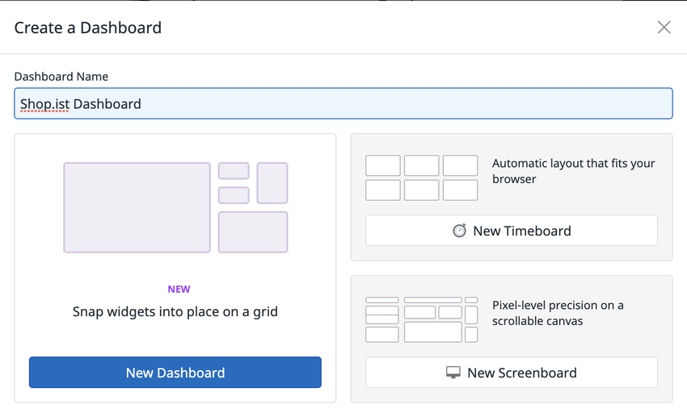
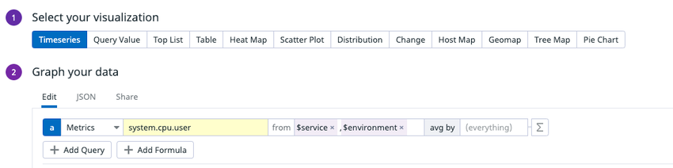
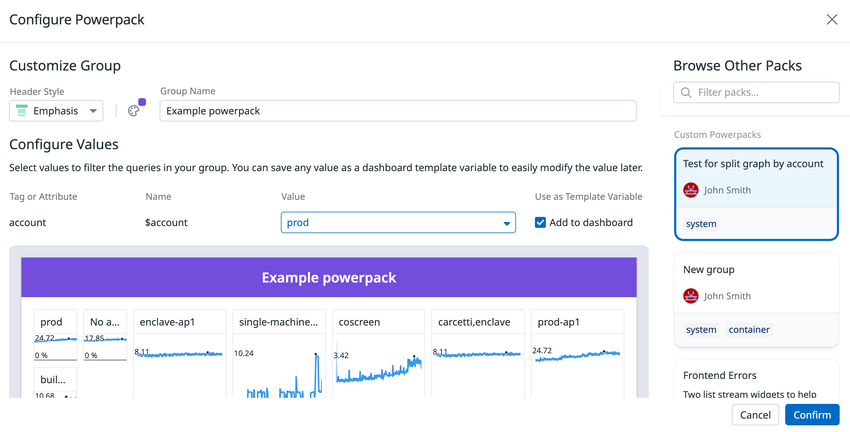
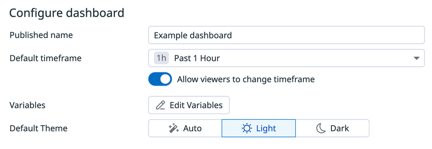
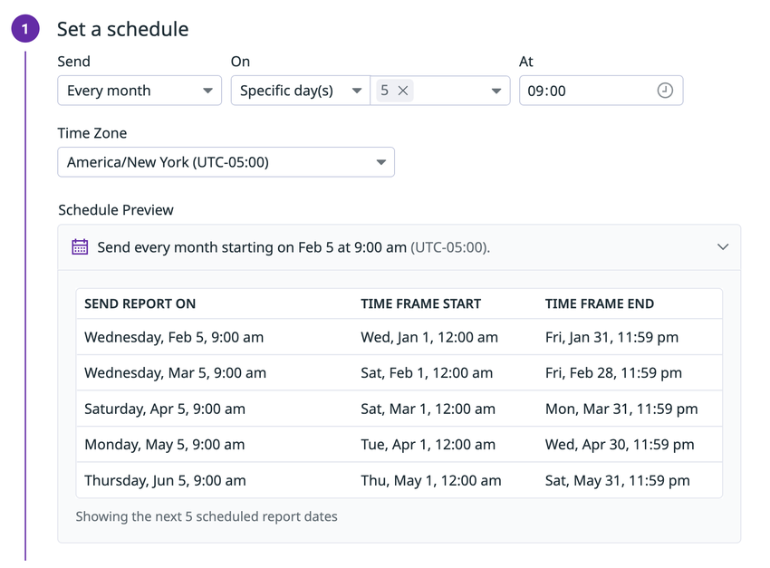
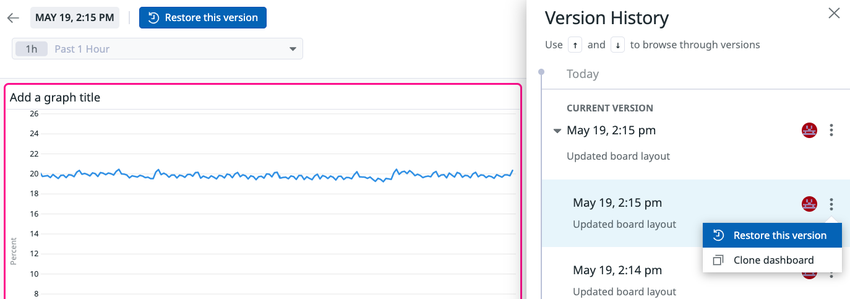

# Dashboards（ダッシュボード）

## 概要

Datadog の Dashboards（ダッシュボード）は、メトリクス・ログ・トレース・RUM・イベント・コストなど Datadog に集めたあらゆるデータを、Widget（ウィジェット）と呼ぶ可視化部品を並べて一画面で表示する機能である。Datadog Dashboards は、KPI の追跡、異常の発見、根本原因の調査、信頼性目標の確認に使われる。[出典](https://docs.datadoghq.com/dashboards/)

Datadog Dashboards の主な構成要素は次のとおり。

| 構成要素 | 内容 | 本ファイルの節 |
|---|---|---|
| レイアウト | Dashboards（グリッド）/ Timeboards（自動レイアウト）/ Screenboards（自由配置）の 3 種 | [ダッシュボードの種類とレイアウト](#ダッシュボードの種類とレイアウト) |
| Widget（ウィジェット） | グラフ、表、リスト、テキスト、アーキテクチャ図などの表示部品。公式の Widget Types ページで 9 カテゴリ・40 種類 | [ウィジェット全一覧](#ウィジェット全一覧) |
| Template Variables（テンプレート変数） | タグや属性でダッシュボード全体を動的にフィルタ／グループ化する変数 | [テンプレート変数](#テンプレート変数template-variables) |
| Powerpacks（パワーパック） | 再利用可能なウィジェットグループ。更新が全インスタンスに同期 | [Powerpacks](#powerpacksパワーパック) |
| 共有 | 公開 URL、招待制、埋め込み（Basic / Secure）、グラフ埋め込み、Widget Share URLs | [共有](#共有sharing) |
| Scheduled Reports | ダッシュボードを PDF にして定期送信（メール / Slack / Microsoft Teams） | [Scheduled Reports](#scheduled-reportsスケジュールレポート) |
| Version History | 変更履歴の閲覧・復元・クローン | [バージョン履歴](#バージョン履歴version-history) |

ダッシュボードの作成・編集はブラウザの Datadog UI で行う。Datadog Mobile App（iOS / Android）ではダッシュボードをモバイル向け表示で閲覧でき、ホーム画面ウィジェットも提供されるが、ダッシュボードの作成・編集はできない。[出典](https://docs.datadoghq.com/dashboards/)

### 本ファイルの範囲と関連ファイル

本ファイルはダッシュボード機能そのものの仕様を扱う。クエリ構文や関数、他の可視化ツールは以下の関連ファイルを参照する。

| トピック | 参照先 |
|---|---|
| メトリクスクエリの構文、集約、関数（`rollup`、`timeshift` など）、数式 | [メトリクスクエリと関数](metrics-query-and-functions.md) |
| メトリクスの種類・保持・単位 | [Metrics（メトリクス）](metrics.md) |
| タグの付け方（テンプレート変数の前提） | [Tagging（タグ）](tagging.md) |
| Notebooks、DDSQL Editor、Reference Tables | [Notebooks・DDSQL・Reference Tables](notebooks-and-data-tools.md) |
| SLO ウィジェットの元になる SLO | [Service Level Objectives（SLO）](slo.md) |
| Monitor Summary / Alert Graph の元になる Monitor | [Monitors（モニター）](monitors.md) |
| Slack / Microsoft Teams 連携（Scheduled Reports の前提） | [通知・コラボレーション連携](collaboration-integrations.md) |
| RBAC、ロール、チーム | [組織・ユーザー・権限管理](account-and-access-management.md) |
| API キー / アプリケーションキー | [API とキー管理](api-and-keys.md) |
| Terraform によるダッシュボード管理 | [Terraform と IaC](terraform-and-iac.md)、[Monitoring as Code](../../04_応用編/monitoring-as-code.md) |
| ダッシュボード変更の監査ログ | [Audit Trail](audit-trail.md) |
| ダッシュボード設計のベストプラクティス | [ダッシュボード設計の実践](../../04_応用編/dashboard-design-practices.md) |
| 画面の基本操作 | [画面構成とナビゲーション](../../01_入門編/ui-navigation.md) |

## 用語

| 用語 | 説明 |
|---|---|
| Dashboard（ダッシュボード） | ウィジェットを配置した画面の総称。レイアウト種別としての「Dashboards（グリッドレイアウト）」と区別が必要な場合は「グリッド型ダッシュボード」と表記する |
| Timeboard（タイムボード） | ダッシュボード全体が 1 つの時刻範囲で動く自動レイアウト型ダッシュボード |
| Screenboard（スクリーンボード） | ピクセル単位で自由配置できるキャンバス型ダッシュボード |
| Widget（ウィジェット） | ダッシュボード上の可視化部品（Timeseries、Query Value、Table など） |
| Group（グループ） | 複数ウィジェットを見出し付きでまとめる入れ物。折りたたみ可能 |
| Tab（タブ） | 1 つのダッシュボード内でウィジェットを名前付きセクションに分ける機能 |
| Template Variable（テンプレート変数） | タグキーまたは属性に基づく、ダッシュボード全体のフィルタ／グループ化用変数 |
| Saved View（保存ビュー） | テンプレート変数の選択値の組を名前を付けて保存したもの |
| Powerpack（パワーパック） | 再利用可能なウィジェットグループのテンプレート。Preset（Datadog 提供）と Custom（ユーザー作成）がある |
| Shared Dashboard（共有ダッシュボード） | Datadog にログインしない外部ユーザー向けに公開したダッシュボード。Public / Invite-only / Embed の 3 種 |
| Global Time（グローバル時刻） | ダッシュボード上部の時刻セレクタで指定する、ウィジェット共通の表示期間 |
| Context Links（コンテキストリンク） | ウィジェットのデータ点をクリックしたときのメニューに出るリンク（Datadog 内外へ遷移） |
| Datadog Clipboard | ユーザー個人のクリップボード。コピーしたグラフやリンクを最大 20 件保持し、ダッシュボード・ノートブック・インシデントへ書き出せる |

## ダッシュボードの種類とレイアウト

### 3 種類のレイアウト

新規作成時（Dashboard List の **+ New Dashboard**、またはナビゲーションメニューの **New Dashboard**）に、ダッシュボード名を入力してレイアウトを選ぶ。[出典](https://docs.datadoghq.com/dashboards/)

| 項目 | Dashboards（グリッド） | Timeboards | Screenboards |
|---|---|---|---|
| レイアウト | グリッドベース。最大幅 12 グリッド（12 列） | 自動レイアウト（ブラウザ幅に合わせて並ぶ） | 自由配置（ピクセル単位、スクロール可能なキャンバス） |
| 時刻 | 全体の Global Time に加え、ウィジェットごとに別期間も可 | ダッシュボード全体で単一の時点（固定またはリアルタイム） | リアルタイム表示、または過去の固定時点 |
| 主な用途（公式） | ステータスボード、ストーリーテリング、デバッグ | トラブルシューティング、相関分析、データ探索 | ステータスボード、ストーリーテリング |
| 画像・ログ等の配置 | 可 | 公開情報では個別の記載なし | 可 |
| Group ウィジェット | 可 | 可 | **不可**（Screenboard のウィジェットはグループ化できない） |
| Powerpack | 可 | 可（ただしレイアウト編集は不可） | **不可** |
| Split Graph ウィジェット | 可 | 可 | **不可** |
| Scheduled Reports | 可 | 可 | 公開情報では明記なし（公式は「dashboard or timeboard」から作成と記載） |

[出典](https://docs.datadoghq.com/dashboards/)、[Group](https://docs.datadoghq.com/dashboards/widgets/group/)、[Powerpack](https://docs.datadoghq.com/dashboards/widgets/powerpack/)、[Split Graph](https://docs.datadoghq.com/dashboards/widgets/split_graph/)、[Scheduled Reports](https://docs.datadoghq.com/dashboards/sharing/scheduled_reports/)

グリッド型の Dashboards は 2021 年 5 月に「新しいダッシュボード体験」として導入されたレイアウトで、Timeboards と Screenboards の長所を 1 つの編集体験にまとめたものと公式ブログで説明されている。グリッド上のウィジェットはスナップして配置され、ドラッグで入れ替えでき、「Row」オプションで選択ウィジェットをグリッド幅に揃えられる。[出典](https://www.datadoghq.com/blog/datadog-dashboards/)（2021-05-20 公開。5 年以上前の記事のため、UI の細部は現行仕様と異なる可能性がある）

API 上のダッシュボードは `layout_type` が `ordered` または `free` のいずれかである。`reflow_type`（`auto` / `fixed`）は「new dashboard layout」用の設定で、`layout_type: ordered` のときだけ指定でき、`fixed` では全ウィジェットに `layout`（位置・サイズ）が必要、`auto` ではウィジェットに `layout` を持たせない。[出典](https://docs.datadoghq.com/api/latest/dashboards/)
`ordered` がグリッド型 Dashboards と Timeboards、`free` が Screenboards に対応すると解釈できる【推定】（Dashboard List の検索フィルタも `custom_timeboard` / `custom_screenboard` の 2 種のみで、グリッド型の独立した type 値はない）。[出典](https://docs.datadoghq.com/dashboards/list/)

#### 画面例: ダッシュボード作成ダイアログ

- **キャプション:** 新規ダッシュボード作成ダイアログ（Create a Dashboard）。
- **画面説明:** 上部に **Dashboard Name** 入力欄（例: Shop.ist Dashboard）。下に 3 つの選択肢が並ぶ。左の大きいカードは「NEW」バッジ付きの **New Dashboard**（説明文「Snap widgets into place on a grid」＝グリッドにウィジェットをスナップ配置）。右上は **New Timeboard**（「Automatic layout that fits your browser」＝ブラウザに合わせた自動レイアウト）、右下は **New Screenboard**（「Pixel-level precision on a scrollable canvas」＝スクロール可能なキャンバス上でピクセル単位の配置）。
- **出典:** https://docs.datadoghq.com/dashboards/ （画像取得日 2026-11-02）

### レイアウト機能

| 機能 | 仕様 | 出典 |
|---|---|---|
| 12 列グリッド | グリッド型 Dashboards の最大幅は 12 グリッド。TV Mode も 12 列グリッドに従う | [Dashboards](https://docs.datadoghq.com/dashboards/)、[TV mode](https://docs.datadoghq.com/dashboards/guide/tv_mode/) |
| High Density Mode（高密度モード） | グループウィジェットを横に並べて表示し、ウィジェット密度を上げる。グループウィジェットを使うダッシュボードでは大画面で既定 ON。高密度モードではダッシュボードが 12 列のグリッド 2 つに分割され、ウィジェットが増えると縦に伸びる | [Configure](https://docs.datadoghq.com/dashboards/configure/)、[TV mode](https://docs.datadoghq.com/dashboards/guide/tv_mode/) |
| Group（グループ） | 複数ウィジェットを Shift＋クリックまたはドラッグ選択して **Group** を選ぶ。各グループはカスタム見出しを持ち、折りたたみ可能。鉛筆アイコンで名前とスタイルを設定 | [Group](https://docs.datadoghq.com/dashboards/widgets/group/) |
| Tabs（タブ） | **Add Widgets** の横の矢印 → **Add New Tab** で作成。以降はタブバーの **+**。1 ダッシュボード最大 100 タブ、タブ名は最大 100 文字。既定名は「Tab 1」「Tab 2」…。ダブルクリックまたは ⋮ メニューで名前変更、ドラッグで並べ替え、⋮ → **Delete** で削除 | [Configure](https://docs.datadoghq.com/dashboards/configure/) |
| ウィジェットのタブ移動 | 編集モードでウィジェットの共有メニュー → **Move to tab**。グループを移動すると中のウィジェットも一緒に移動。グループ内のウィジェットを単独で移動すると移動先ではトップレベルのウィジェットになる。移動先の次の空き位置に置かれる | [Configure](https://docs.datadoghq.com/dashboards/configure/) |
| TV Mode | 大画面・TV にスクロールなしで全ウィジェットを表示。縦横比が固定されるため、ダッシュボードの縦横比が TV と合わないと余白が出る。全幅を使いたい場合は Screenboard を検討するよう公式ガイドが案内 | [TV mode](https://docs.datadoghq.com/dashboards/guide/tv_mode/) |

API では `tabs` 配列（各要素に `id`〔UUID〕、`name`、`widget_ids`）でタブを定義する。`widget_ids` には Terraform などの宣言的ツール向けに `@N`（1 始まりの位置参照）形式も指定できる。[出典](https://docs.datadoghq.com/api/latest/dashboards/)

### リフレッシュレート（自動更新間隔）

ログインユーザーが見る（非公開の）ダッシュボードの自動更新間隔は、表示している期間が短いほど短い。[出典](https://docs.datadoghq.com/dashboards/)

| 表示期間 | 更新間隔 |
|---|---|
| 1 分 / 2 分 / 5 分 / 10 分 | 10 秒 |
| 30 分 / 1 時間 | 20 秒 |
| 3 時間 / 4 時間 | 1 分 |
| 1 日 | 3 分 |
| 2 日 | 10 分 |
| 1 週間 / 1 か月 / 3 か月 / 6 か月 / 1 年 | 1 時間 |

> **注意（公式ドキュメント間の食い違い）:** 共有ダッシュボードの更新間隔について、Dashboards 概要ページは「公開共有ダッシュボードは選択期間に関係なく 30 秒ごとに更新」と記載し、Shared Dashboards ページは「約 60 秒ごとに更新され、変更不可」と記載している（いずれも 2026-11-02 確認）。より詳細な Shared Dashboards ページの「約 60 秒」を優先して扱うのが無難である【推定】。[出典1](https://docs.datadoghq.com/dashboards/)、[出典2](https://docs.datadoghq.com/dashboards/sharing/shared_dashboards/)

**Pause Auto-Refresh**（後述の Configure メニュー）を有効にすると、相対期間（例: Past 1 Hour）のダッシュボードで自動更新を既定で停止できる。この設定はダッシュボードを見る全ユーザーに適用される。[出典](https://docs.datadoghq.com/dashboards/configure/)

## ダッシュボードの構成と管理

### ダッシュボード詳細

ダッシュボードのタイトルにマウスを重ねると詳細パネルが開き、タイトルと作成者が表示される。[出典](https://docs.datadoghq.com/dashboards/configure/)

| 項目 | 仕様 |
|---|---|
| タイトル | パネル内でクリックして編集し、チェックボタンで確定 |
| 説明（Description） | Markdown 対応 |
| Teams | 1 ダッシュボードに最大 5 チームを関連付け可能 |
| おすすめダッシュボード | 説明文に `[[suggested_dashboards]]` を書くと、組織内のユーザー行動（このダッシュボードから他のダッシュボードへ移動する頻度）に基づくおすすめ一覧が表示される |

### Configure メニュー（設定アクション）

ダッシュボード右上の **Configure**（歯車）から開く。[出典](https://docs.datadoghq.com/dashboards/configure/)

| 設定 | 内容 | 適用範囲 |
|---|---|---|
| Clone dashboard | ダッシュボード全体を新しいダッシュボードに複製（名前を入力） | — |
| Display UTC time | UTC とユーザーの既定タイムゾーンを切り替え | 公開情報では明記なし |
| Include Flex Logs | Flex 設定済みウィジェットで Flex Logs を含める。OFF の場合は Standard Indexed ログを使用 | ユーザー単位（このダッシュボードについてセッションをまたいで保持） |
| Default timeframe | ダッシュボードの既定表示期間 | 全ユーザー |
| Increase density | 高密度モード（グループを横並び表示） | 公開情報では明記なし |
| Keyboard shortcuts | ショートカット一覧を表示 | — |
| Pause Auto-Refresh | 相対期間のダッシュボードで自動更新を既定で停止（計算リソースとバックグラウンド処理の削減目的） | 全ユーザー |
| TV Mode | 大画面向け表示 | — |
| Version history | 過去バージョンのプレビュー・復元・クローン | — |
| View audit events | このダッシュボードを誰が使っているかを表示（Audit Trail）。個人は自分の操作履歴を見られる | — |

API の `default_timeframe` は `type: live`（`unit` が `minute` / `hour` / `day` / `week` / `month` / `year`、`value` が数値）または `type: fixed`（`from` / `to` はエポックミリ秒）で指定し、`null` でクリアする。[出典](https://docs.datadoghq.com/api/latest/dashboards/)

### 変更通知（Notifications）

組織内の任意のユーザーが、管理者権限の有無に関係なく、自分宛てのダッシュボード変更通知を有効化できる。有効化すると、テキスト変更・ウィジェット変更・クローン・削除のたびに、操作者名を含むイベントが Events Explorer に作成される。特定ダッシュボードの変更イベントは `tags:(audit AND dash) <DASHBOARD_NAME>` で検索できる。API では `notify_list`（変更時に通知するユーザーハンドルのリスト）で指定する。[出典](https://docs.datadoghq.com/dashboards/configure/)、[API](https://docs.datadoghq.com/api/latest/dashboards/)

### JSON のコピー・インポート・エクスポート

| 操作 | 内容 |
|---|---|
| Copy dashboard JSON | ダッシュボードの JSON をクリップボードへコピー |
| Import dashboard JSON | JSON を貼り付け／読み込み。**ダッシュボードの全内容を上書きする**。JSON がクリップボードにあれば `Ctrl+V`（Mac は `Cmd+V`）でも可 |
| Export dashboard JSON | JSON ファイルをダウンロード |

コピーとエクスポートは右上の Share アイコンからも実行できる。[出典](https://docs.datadoghq.com/dashboards/configure/)

### 削除と復元

- ダッシュボードは**スター（お気に入り）を外してからでないと削除できない**。[出典](https://docs.datadoghq.com/dashboards/configure/)
- 削除したダッシュボードは Dashboard List のプリセットリスト **Recently Deleted** に入り、**30 日後に完全削除**される。Recently Deleted で対象を選び **Restore to** で特定リストまたは All Custom に復元できる。[出典](https://docs.datadoghq.com/dashboards/list/)
- 一括削除・一括復元は API（`DELETE /api/v1/dashboard`、`PATCH /api/v1/dashboard`〔Restore deleted dashboards〕）でも可能。[出典](https://docs.datadoghq.com/api/latest/dashboards/)
- 削除できるのは Custom ダッシュボードのみ（Integration 等の標準ダッシュボードは対象外）。[出典](https://docs.datadoghq.com/dashboards/guide/maintain-relevant-dashboards/)

### Dashboard List（ダッシュボード一覧）

Dashboard List ページ（US1 の場合 `https://app.datadoghq.com/dashboard/lists`。他サイトはドメインを読み替え）で、ダッシュボードの検索・作成・リスト管理・一括操作を行う。[出典](https://docs.datadoghq.com/dashboards/list/)

**All Dashboards テーブルの列**（Name / Modified / Popularity で並べ替え可能）

| 列 | 内容 |
|---|---|
| Star | 現在のユーザーがスターを付けたもの |
| Name | Custom またはプリセットのダッシュボード名 |
| Author | 作成者のプロフィールアイコン |
| Teams | 割り当てられた Teams |
| Modified | Custom ダッシュボードの最終更新日 |
| Popularity | 組織内での相対的な人気度 |
| Icon | 種別（Timeboard / Screenboard）を示すアイコン |

**Popularity（人気度）** は組織内で最も人気のダッシュボードを 5 本のバーとし、他はそれに対する相対値で表示する。トラフィック量に基づき**毎日更新**され、新規ダッシュボードは最長 24 時間バー 0 本になる。公開 URL へのアクセスは人気度に数えない。[出典](https://docs.datadoghq.com/dashboards/list/)

**プリセットリスト**

| リスト | 内容 |
|---|---|
| All Custom | 組織内の誰かが作成した Custom ダッシュボード |
| All Hosts | ホスト追加時に Datadog が自動作成するダッシュボード |
| All Integrations | インテグレーションのインストール時に自動作成されるダッシュボード |
| All Shared | 認証付きまたは公開リンク共有が有効なダッシュボード |
| Created By You | 現在のユーザーが作成した Custom ダッシュボード |
| Recently Deleted | 過去 30 日以内に削除されたダッシュボード（ここから復元） |
| Security and Compliance | Security 製品の標準ダッシュボード |

カスタムリストは **+ New List** で作成し（既定名は「<ユーザーの名>'s list」）、テーブルでダッシュボードを選んで **Add to** で追加する。スターを付けたリストは Favorite Lists に表示される（スター付きリストがなければ Favorite Lists 区分は非表示）。複数ダッシュボードを選択して **Edit Teams** で Teams を一括割り当てできる。[出典](https://docs.datadoghq.com/dashboards/list/)

**検索構文【Preview】**

Dashboard List の検索バーは、フリーテキスト・`key:value` フィルタ・ブール演算子・範囲比較に対応する（検索構文は Preview）。[出典](https://docs.datadoghq.com/dashboards/list/)

| 種類 | 構文と例 |
|---|---|
| フリーテキスト | `redis`（タイトル・説明・作成者・タグ・ウィジェット内容を検索）、`redis postgres`（= `redis AND postgres`）、`"web latency"`（完全一致）、`elastic*`（ワイルドカード） |
| フィールド | `author:`、`title:`、`description:`、`team:`、`favorites:true`、`type:`（`custom` / `integration` / `custom_timeboard` / `custom_screenboard` / `integration_timeboard` / `integration_screenboard`）、`is_shared:true`、`popularity:`（0〜1）、`widgets.count:`、`widgets.title:`、`widgets.type:`（例 `widgets.type:geomap`）、`widgets.metrics:`（例 `widgets.metrics:system.cpu.user`）、`template_variables.name:`、`template_variables.prefix:`、`template_variables.defaults:`、`template_variables.available_values:` |
| ブール演算子 | `AND`、`OR`、`NOT`（大文字小文字を区別）。`-` と `!` は `NOT` と同じ。`team:(backend OR frontend)` のようにフィールド内 OR も可 |
| 範囲 | `<`、`>`、`<=`、`>=`（例: `widgets.count:>=10`、`popularity:>=0.2`） |

## ウィジェット全一覧

Datadog の公式ドキュメント「Widget Types」ページは、ウィジェットを次のカテゴリに分類している（2026-11-02 時点）。「API type」列はダッシュボード JSON の `definition.type` の値で、API リファレンス（Create a new dashboard）の enum から対応を取った。[出典](https://docs.datadoghq.com/dashboards/widgets/types/)、[API](https://docs.datadoghq.com/api/latest/dashboards/)

### Graphs（汎用グラフ）

| ウィジェット | 用途（公式説明の要約） | API type |
|---|---|---|
| Bar Chart | 集約値を縦または横の棒で表示し、カテゴリ間を比較 | `bar_chart` |
| Change | 指定期間前（1 時間前 / 1 日前 / 1 週間前 / 1 か月前）との変化量（絶対値または %）を表示 | `change` |
| Distribution | 1 つ以上のタグで集約したメトリクス分布を表示（外れ値検出は不可） | `distribution` |
| Geomap | 地域の塗り分けまたはポイントで位置情報を可視化。Points レイヤーは一度に最大 100,000 イベント | `geomap` |
| Heatmap | メトリクスの時間方向のヒートマップ | `heatmap` |
| Heatgrid | タググループごとに 1 行の色分けで時系列を比較（グループ数が多くても比較しやすい）。色の段階は 2〜6 個 | `heatgrid` |
| Pie Chart | 1 つ以上のデータセットの構成比 | `sunburst` |
| Point Plot | 個々のイベントを集約せずに 1 点ずつ時系列にプロット（Logs、RUM、Traces、Spans、Database Monitoring、Agent Observability に対応） | `point_plot` |
| Query Value | クエリの集約値を 1 つの数値で表示 | `query_value` |
| Scatter Plot | 2 つのメトリクスを軸にしたスコープ別散布図、または生イベントのプロット | `scatterplot` |
| Table | 列・行・並べ替えを持つ表形式 | `query_table` |
| Treemap | 1 つ以上のデータセットの構成比を入れ子の長方形で表示 | `treemap` |
| Timeseries | メトリクス・ログイベント・Indexed Spans・プロセスメトリクスの時間推移 | `timeseries` |
| Top List | 上位／下位の値をランキング表示 | `toplist` |
| Wildcard | Vega-Lite 文法で独自の可視化を構築 | `wildcard` |

### Groups（グループ）

| ウィジェット | 用途 | API type |
|---|---|---|
| Group | 関連ウィジェットを見出し付きでまとめる（Screenboard では使用不可） | `group` |
| Powerpack | 再利用可能なウィジェットグループのインスタンス（Screenboard では使用不可） | `powerpack` |
| Split Graph | 1 つのクエリをタグ値ごとの複数グラフに分割（Screenboard と共有ダッシュボードでは非対応） | `split_group` |

### Cloud Cost Management

| ウィジェット | 用途 | API type |
|---|---|---|
| Budget Summary | Cloud Cost Management の Budget（予算）と実績支出を表示。表示期間は Budget の設定範囲に制限される | 公開情報では確認できず |
| Cost Summary | 選択期間のクラウド支出総額・期間比較・支出コンテキストをまとめて表示。表示形式は既定の Bar Chart のほか Line Chart、Cumulative Area Chart、Pie Chart、Treemap | 公開情報では確認できず |

Cloud Cost Management の詳細は [Cloud Cost Management](../infrastructure/cloud-cost-management.md) を参照。

### Product Analytics

| ウィジェット | 用途 | API type |
|---|---|---|
| Sankey | 画面（状態）間のユーザー遷移フロー | `sankey` |
| Funnel | 連続するステップのコンバージョン率とボトルネック | `funnel` |
| Retention | コホート分析によるユーザー継続率。【Preview】（Product Analytics 顧客向け、申請制） | `retention_curve`【推定】 |

> **サイト差異:** Sankey ウィジェットと Retention ウィジェットは `app.ddog-gov.com`（US1-FED）および `us2.ddog-gov.com` では利用できない。[Sankey](https://docs.datadoghq.com/dashboards/widgets/sankey/)、[Retention](https://docs.datadoghq.com/dashboards/widgets/retention/)

Product Analytics の詳細は [Session Replay と Product Analytics](../dem/session-replay-and-product-analytics.md) を参照。

### Architecture（アーキテクチャ）

| ウィジェット | 用途 | API type |
|---|---|---|
| Cloudcraft Diagram | AWS / Azure / GCP のライブ構成図。オーバーレイは Infrastructure、Observability（Agent 導入ホストの表示）、Security、Cost（AWS と Azure のみ）、APM（AWS のみ、Preview） | 公開情報では確認できず |
| Hostmap | インフラのホスト（またはコンテナ）の健全性を色と大きさで俯瞰 | `hostmap` |
| Topology Map | データソースとその関係を表示。データソースは Service Map（サービスの上流・下流）、Data Streams（パイプラインのデータフロー）、Network Path（ネットワーク経路のホップ） | `topology_map`（旧 Service Map ウィジェットは `servicemap`） |
| Service Summary | 選択したサービス（`env` と `service`）の標準グラフ（Hits、Errors、Latency、Breakdown、Distribution、Resource〔Resource は大サイズ時のみ〕） | `trace_service` |

### Annotations and embeds（注釈・埋め込み）

| ウィジェット | 用途 | API type |
|---|---|---|
| Free Text | 見出しなどのテキストを配置 | `free_text` |
| Iframe | 外部 Web コンテンツを埋め込み | `iframe` |
| Image | 画像または GIF を表示 | `image` |
| Notes and Links | Markdown のメモとリンク。テンプレート変数（`$var`、`$var.key`、`$var.value`）を表示可能 | `note` |

### Lists and streams（リスト）

| ウィジェット | 用途 | API type |
|---|---|---|
| List | 複数ソースのイベントや課題を一覧表示（列選択、並べ替え、検索クエリ） | `list_stream` |

List ウィジェットのデータソース（組織で有効な製品により表示が変わる。*Preview* は組織で使えない場合あり）。[出典](https://docs.datadoghq.com/dashboards/widgets/list/)

| データソース | 必要な製品 | 状態 |
|---|---|---|
| Audit Trail | Audit Trail | GA |
| Cases | Case Management | GA |
| CD Deployments | CD Visibility | 【Preview】 |
| CI Pipeline | CI Pipeline Visibility | GA |
| CI Test | Test Optimization | GA |
| Data Observability | Data Observability | 【Preview】 |
| Database Recommendations | Database Monitoring | 【Preview】 |
| DDSQL Editor | なし | GA |
| Detection Rules | Cloud SIEM または Cloud Security | 【Preview】 |
| Developer Portal | Internal Developer Portal | 【Preview】 |
| Events | なし | GA |
| Incidents | Incident Management | GA |
| Infrastructure Resources | Infrastructure Monitoring | 【Preview】 |
| Issues | Error Tracking | GA |
| Agent Observability | Agent Observability | GA |
| Logs（パターン・トランザクションでのグループ化も可） | Log Management | GA |
| Notebook | Notebooks | GA |
| On-Call | Datadog On-Call | GA |
| Product Analytics | Product Analytics | 【Preview】 |
| Recommendations（Cloud Cost Management の推奨事項のみ。APM の推奨は不可） | Cloud Cost Management | GA |
| Reference Tables | Reference Tables | GA |
| RUM | Real User Monitoring | GA |
| Security Signals | Cloud SIEM | 【Preview】 |
| Spans | APM | GA |
| Watchdog Alerts | なし | GA |
| Workload Protection Agent | Workload Protection | 【Preview】 |

Recommendations データソースを Cloud Cost Management 未設定の組織で使うと `Not Accessible` と表示される（権限不足ではなく製品未設定の意味）。[出典](https://docs.datadoghq.com/dashboards/widgets/list/)

### Alerting and response（アラート・対応）

| ウィジェット | 用途 | API type |
|---|---|---|
| Alert Graph | 定義済み Monitor の現在の状態をグラフ表示 | `alert_graph` |
| Alert Value | simple-alert のメトリクス Monitor の現在値を表示 | `alert_value` |
| Check Status | サービスチェックの現在の状態または結果件数 | `check_status` |
| Monitor Summary | 全 Monitor またはクエリで絞った Monitor の状態サマリー | `manage_status` |
| Run Workflow | ダッシュボードから Workflow Automation のワークフローを実行。テンプレート変数をワークフローの入力パラメータにマッピング可能 | `run_workflow` |

Monitor の詳細は [Monitors](monitors.md)、ワークフローは [Workflow Automation](../service-management/workflow-automation.md) を参照。

### Performance and reliability（パフォーマンス・信頼性）

| ウィジェット | 用途 | API type |
|---|---|---|
| Profiling Flame Graph | Continuous Profiler のスタックトレースをフレームグラフで表示 | 公開情報では確認できず |
| Service Level Objective（SLO）Summary | SLO のステータスとエラーバジェット | `slo` |
| Service Level Objective（SLO）List | SLO の一覧（既定の最大表示数 100） | `slo_list` |

SLO ウィジェットの期間設定や制約は [SLO](slo.md) を、プロファイラは [Continuous Profiler](../apm/continuous-profiler.md) を参照。Profiling Flame Graph を Notebook で固定の Custom time 範囲にした場合、フレームグラフのデータは 1 年保持されるが、作成時点で範囲が 8 日のプロファイリングデータ保持期間内にある必要がある。[出典](https://docs.datadoghq.com/dashboards/widgets/profiling_flame_graph/)

### Widget Types ページ外の API type

API の enum には上表以外に `cohort`、`embedded_app`（App Builder のアプリ埋め込みと推定【推定】）、`event_stream`、`event_timeline`、`log_stream` が存在する。[出典](https://docs.datadoghq.com/api/latest/dashboards/)
App Builder の詳細は [App Builder](../service-management/app-builder.md) を参照。

### 旧ウィジェット（後継への置き換え）

| 旧ウィジェット | 現在の扱い | 出典 |
|---|---|---|
| Event Stream | List ウィジェット（Events データソース）で代替 | [Event Stream](https://docs.datadoghq.com/dashboards/widgets/event_stream/) |
| Event Timeline | Timeseries ウィジェットで代替 | [Event Timeline](https://docs.datadoghq.com/dashboards/widgets/event_timeline/) |
| Log Stream | List ウィジェット（Logs データソース）で代替 | [Log Stream](https://docs.datadoghq.com/dashboards/widgets/log_stream/) |
| Service Map | Topology Map ウィジェット（Service Map データソース）。旧 URL は Topology Map ページへ統合 | [Topology Map](https://docs.datadoghq.com/dashboards/widgets/topology_map/) |

### 機能別のウィジェット対応表

| 対象 | 対応状況 | 出典 |
|---|---|---|
| 共有ダッシュボードで表示できるウィジェット | Timeseries、Bar Chart、Distribution、Heatmap、Scatter Plot、Sankey、Query Value、Change、Top List、Alert Value、Alert Graph、Service Summary、Table、Treemap、Pie Chart、Funnel、Retention、Geomap、Host Map、Monitor Summary、Check Status、SLO、SLO List、Notes and Links、Free Text、Image、Iframe、Event Timeline、Wildcard。**これ以外はデータなしで表示**（共有時にエラーは出ず、API も拒否しない） | [Shared Dashboards](https://docs.datadoghq.com/dashboards/sharing/shared_dashboards/) |
| Scheduled Reports で空表示になるウィジェット | Iframe、Image、Hostmap、Run Workflow | [Scheduled Reports](https://docs.datadoghq.com/dashboards/sharing/scheduled_reports/) |
| CSV ダウンロード対応 | Bar Chart、List、Pie Chart、Scatter Plot、Table、Timeseries、Top List、Treemap | [Widget Configuration](https://docs.datadoghq.com/dashboards/widgets/configuration/) |
| Screenboard で使えないもの | Group、Powerpack、Split Graph | 前掲 |
| Split Graph | 共有ダッシュボードでも非対応 | [Split Graph](https://docs.datadoghq.com/dashboards/widgets/split_graph/) |

## ウィジェットの共通設定

### ウィジェットの追加と構成

ウィジェットは **Add Widgets** でウィジェットトレイを開いてドラッグで追加する。ウィジェットごとに次を設定する。[出典](https://docs.datadoghq.com/dashboards/widgets/)

| 設定領域 | 内容 |
|---|---|
| データソース | メトリクス、ログ、トレース（Spans）、RUM など |
| 可視化 | 表示形式、単位、期間 |
| コンテキスト | カスタムリンク、条件付き書式、グループ化 |

### 主な共通オプション

| オプション | 仕様 | 出典 |
|---|---|---|
| Full screen（全画面） | 多くのウィジェットで右上ボタンから表示。期間変更、期間単位での前後移動、一時停止／ライブ表示、期間リセット、ダッシュボードやノートブックへのエクスポート、クエリのコピー、CSV ダウンロードが可能。Timeseries ではさらにクイック関数の適用、Y 軸スケール変更、変更保存、新規グラフとして保存が可能 | [Configuration](https://docs.datadoghq.com/dashboards/widgets/configuration/)、[Timeseries](https://docs.datadoghq.com/dashboards/widgets/timeseries/) |
| Data Preview / Join | グラフエディタで複数データソースを結合（Join）し、結合前に列名・キー・結果を確認。結合可能なソースは Logs、Metrics、RUM、Cloud Cost Recommendations、Netflow、APM Spans、APM Traces、Profiles、Synthetics CI Batches、Synthetics Run、Static Analysis、CI Tests、Compliance Findings、Product Analytics、Reference Tables など | [Configuration](https://docs.datadoghq.com/dashboards/widgets/configuration/) |
| Custom links / Context Links | データ値を Datadog 内ページや AWS コンソール等の URL へつなぐ。汎用ウィジェットでは Context Links が既定で有効 | [Configuration](https://docs.datadoghq.com/dashboards/widgets/configuration/) |
| Description | グラフエディタの **Description** に入力。ウィジェット左上アイコンのホバーで表示 | 同上 |
| Metrics info | メトリクスグラフの ⋮ メニュー → **Metrics Info** でメトリクスの説明を表示。メトリクス名クリックで Metric Summary へ | 同上 |
| Unit override | 「Unit override」（単位ファミリー指定、自動スケール。例 MB→GB）、「Unit and scale override」（スケール固定）、「Custom units」（任意単位、例 "tests"）。データ自体への単位付与（Metrics Units、ログ facet の単位）の代わりにはならない | 同上 |
| Global Time | 新規ウィジェットの既定。ダッシュボード上部の期間（移動ウィンドウまたは固定期間）を共有。**時間ベースのウィジェットのうち少なくとも 1 つは Global Time を使う必要がある**。Global Time に連動しないウィジェットは、グローバル期間の終端を基準に自身のローカル期間を表示 | 同上 |
| ローカル期間 | Screenboard と Notebook では、ウィジェットごとに Custom timeframe か Global timeframe かを選べる（List、Funnel、Top List、Retention 等のページに記載） | [List](https://docs.datadoghq.com/dashboards/widgets/list/) |

### グラフメニュー

| メニュー | 項目 |
|---|---|
| Export アイコン | **Share**: Copy、Share snapshot ／ **Within Datadog**: Declare incident、Add to incident、Create case、Save to notebook、Link to widget ／ **External**: Download as PNG、SVG、CSV |
| 鉛筆アイコン | Edit |
| ⋮（コンテキストメニュー） | Edit、Clone、Split graph、Create custom links、Create monitor、Metrics info（メトリクスグラフのみ）、Delete |

[出典](https://docs.datadoghq.com/dashboards/widgets/configuration/)

**CSV エクスポート**は 1 ウィジェットずつで、複数ウィジェットのデータを 1 ファイルにまとめることはできない。CSV エクスポートは既定で有効で、無効化は Datadog サポートに依頼して組織単位で行い、UI では変更できない。[出典](https://docs.datadoghq.com/dashboards/widgets/configuration/)

### コピー＆ペーストと Datadog Clipboard

| 項目 | 仕様 |
|---|---|
| コピー／ペースト | `Ctrl/Cmd+C` でコピー、`Ctrl/Cmd+V` で貼り付け。ダッシュボードではカーソル位置に、Notebook では末尾の新規セルとして貼り付く。APM の Service ページ・Resource ページからもコピー可能 |
| グループのコピー | Timeboard のグループはコピー可能。Screenboard や Notebook に貼ると個々のウィジェットとして貼り付く。Screenboard の編集モードでは Shift＋クリックで複数選択。グループのコピーは Datadog 内のみで、プレビュー画像は生成されない |
| Datadog Clipboard | ユーザー個人のクリップボード。コピーしたグラフと保存したリンクを保持し、最大 **20 件**。超えると最も古いもの（左端）から自動削除。`Cmd/Ctrl+Shift+K` で開閉。ダッシュボード・ノートブック・インシデントへ書き出し可能（Notebook へは対応グラフのみ）。クエリ文字列やイベント JSON などのテキストは自動コピーしない |

[出典](https://docs.datadoghq.com/dashboards/widgets/configuration/)、[Clipboard](https://docs.datadoghq.com/dashboards/guide/datadog_clipboard/)

チャットアプリにウィジェットを貼ったときのリンクプレビュー挙動は、組織の **Widget Share URLs** 設定に依存する（後述「[Widget Share URLs](#widget-share-urls)」）。

### 主要ウィジェットの個別仕様（抜粋）

| ウィジェット | 主な仕様 | 出典 |
|---|---|---|
| Timeseries | 表示形式は lines / areas / bars。最後の未完了区間は「partial data」として網掛け。線のスタイル（Solid / dashed / dotted）と太さ（Normal / thin / thick）。自動ラベルはシリーズあたり最大 3 個、シリーズが 6 本を超えるとラベル非表示。パレットは Classic と Consistent（16 色、タググループごとに全ウィジェットで同じ色）。Event Overlay（全データソース対応、例 `sources:jenkins`、`tags:$<TEMPLATE_VARIABLE>`）、Markers（線または範囲）、Dual Y 軸、Y 軸の Min / Max / Scale（linear〔既定〕/ log / pow / sqrt）/ Always include zero（既定 ON）。log スケールは全値が同符号でないと空グラフ。凡例は Screenboard で Automatic（既定）/ Compact / Expanded / None、Timeboard ではサイズ L / XL のとき自動表示。Compare Time タブで過去期間と比較 | [Timeseries](https://docs.datadoghq.com/dashboards/widgets/timeseries/) |
| Change | 比較期間は 1 時間前 / 1 日前 / 1 週間前 / 1 か月前。relative（%）または absolute。並び順は change / name / present value / past value | [Change](https://docs.datadoghq.com/dashboards/widgets/change/) |
| Top List | Relative 表示（合計に対する %）は count データ（count メトリクス、ログイベント等）のみ | [Top List](https://docs.datadoghq.com/dashboards/widgets/top_list/) |
| Heatgrid | 行の並び順は average / max / min / sum / label の昇順・降順。色は Continuous Gradient または Discrete Conditions、段階は 2〜6 | [Heatgrid](https://docs.datadoghq.com/dashboards/widgets/heatgrid/) |
| Geomap | Points レイヤーは一度に最大 100,000 イベント | [Geomap](https://docs.datadoghq.com/dashboards/widgets/geomap/) |
| SLO（Summary） | Monitor-based SLO は過去 3 か月まで表示可能。グループ付き単一 Monitor-based SLO は特定グループ選択時に最大 20 グループ表示。5,000 グループを超える SLO は計算対象だが UI にグループを表示しない | [SLO widget](https://docs.datadoghq.com/dashboards/widgets/slo/) |
| SLO List | 表示する SLO の最大数は既定 100。並び順はステータスまたはエラーバジェット | [SLO List](https://docs.datadoghq.com/dashboards/widgets/slo_list/) |
| Split Graph | 表示するグラフ数の上限（Limit to）、並び順、グラフサイズ（4 段階）、Y 軸の統一を設定。既定では平均値が高い値を動的に選択 | [Split Graph](https://docs.datadoghq.com/dashboards/widgets/split_graph/) |
| Wildcard | Vega-Lite 仕様で独自可視化。リクエストタイプは Scalar / Timeseries。公式はまず既存ウィジェットの利用を推奨。既知の制約: 1 リクエストあたり 5,000 行を超える高カーディナリティ、ネットワーク・階層構造、物理レイアウト、高度な地図、3D は不向き | [Wildcard](https://docs.datadoghq.com/dashboards/widgets/wildcard/) |
| Service Summary | 表示項目は Hits、Errors、Latency、Breakdown、Distribution、Resource（大サイズのみ）。列数を指定可能 | [Service Summary](https://docs.datadoghq.com/dashboards/widgets/service_summary/) |
| Run Workflow | ワークフローを選択し、テンプレート変数を入力パラメータにマッピング。実行時は未マッピングのパラメータを入力して **Run** | [Run Workflow](https://docs.datadoghq.com/dashboards/widgets/run_workflow/) |

### グラフのデータ点とロールアップ

| 項目 | 値 | 出典 |
|---|---|---|
| 1 シリーズあたりの最大点数 | 1,500 点（超える場合は既定 `avg` で自動ロールアップ） | [Rollup](https://docs.datadoghq.com/dashboards/functions/rollup/) |
| カスタム `.rollup()` | 1,500 点の上限内で任意間隔を指定可能（1 日を 1 分間隔で表示可能） | 同上 |
| Query Value ウィジェット | 150 点を目標にロールアップ（Line / Bar の 1,500 点より粗い） | 同上 |
| 画面上の表示点数 | 1 グラフあたり常時約 300 点を表示（公式の説明例） | [Querying](https://docs.datadoghq.com/dashboards/querying/) |

クエリ構文と関数の詳細は [メトリクスクエリと関数](metrics-query-and-functions.md) を参照。

### Change Overlays（変更オーバーレイ）

ダッシュボード右上の **Show Overlays** で Change Tracking のタイムラインを表示し、Timeseries ウィジェットにデプロイや Feature Flag などの変更を重ねる機能。サービス検索欄には、ダッシュボードのクエリで最も多く参照されるサービス（Most Relevant）が自動選択され、手動で変更できる。**Show On** でオーバーレイ対象のウィジェットを限定できる。APM のデプロイには `env` の指定が必要で、ダッシュボードに `env` または `datacenter` のテンプレート変数があればその選択値で絞り込み、なければ `env` は `prod` が既定になる。[出典](https://docs.datadoghq.com/dashboards/change_overlays/)

## テンプレート変数（Template Variables）

### 定義

Datadog Dashboards のテンプレート変数は、ダッシュボード内のウィジェットを動的にフィルタまたはグループ化する変数である。[出典](https://docs.datadoghq.com/dashboards/template_variables/)

| 要素 | 内容 | 既定値 |
|---|---|---|
| Tag または Attribute | Tag: `<KEY>:<VALUE>` 形式タグの `<KEY>`。Attribute: facet または measure（ログ・APM・RUM 用、`@` で始まる。例 `@http.status_code`） | — |
| Name | クエリ内で使う一意の名前。タグ／属性名から自動命名 | タグ／属性名 |
| Default Value | ダッシュボード読み込み時の値 | `*` |
| Available Values | ドロップダウンで選択可能な値の制限 | `(all)`（一覧には常に `*` を含む） |

API の `template_variables` は `name`（必須）、`prefix`（このプレフィックスのタグだけをドロップダウンに表示）、`available_values`、`defaults`（複数指定時は `OR` で結合。旧 `default` は非推奨で併用不可）、`type`（フィルタ変数かグループ化変数かの区別）を持つ。[出典](https://docs.datadoghq.com/api/latest/dashboards/)

### 値の取得範囲

テンプレート変数のドロップダウン候補は、ダッシュボードのウィジェットが使っているデータソースから取得される（ログだけのダッシュボードならログの値のみ）。[出典](https://docs.datadoghq.com/dashboards/template_variables/)

| データソース | 候補値の取得期間 |
|---|---|
| Metrics | 現在から 48 時間前まで |
| Cloud cost | 現在から 48 時間前まで |
| その他すべて | ダッシュボードの表示期間（例: 過去 15 分なら過去 15 分の値のみ） |

最近送信されていないタグ・属性は候補に出ないことがある。候補取得もデータ保持期間に従う。[出典](https://docs.datadoghq.com/dashboards/template_variables/)

### 追加・編集

1. **Add Variable**（既存変数がある場合は **+**）をクリック。
2. 推奨変数から選ぶか、タグを検索。
3. 適用するウィジェットを選択（Select All / Deselect All あり）。
4. **Save**。

サイドパネルでは、ウィジェットへの適用・解除、フィルタとグループ化の切り替え、表示名の変更、既定値の選択、候補値のプレビューと検索クエリによる絞り込みができる。既存変数はヘッダーの変数にホバー → **Edit** で編集する。ヘッダーには変数の一部だけが表示され、**+ N** で残りを表示、**Expand template variables** で全変数をスクロール中も表示できる。[出典](https://docs.datadoghq.com/dashboards/template_variables/)

### 構文と使い方

| 構文 | 意味（例: 変数 `env`、タグキー `environment`、値 `dev`） |
|---|---|
| `$env` | `environment:dev`（キーと値） |
| `$env.key` | `environment` |
| `$env.value` | `dev` |
| `env:staging-$service.value` | クエリ内で値を文字列の一部として埋め込む |

- ウィジェット編集時、フィルタ用の変数は `from` 欄、グループ化用の変数は `by` 欄の後に候補として表示される。[出典](https://docs.datadoghq.com/dashboards/template_variables/)
- 変数の値を変えると URL に `&tpl_var_<変数名>=<値>` が付く（例: `&tpl_var_env=prod`）。この URL を共有すれば同じ絞り込み状態を開ける。[出典](https://docs.datadoghq.com/dashboards/template_variables/)
- テキスト系ウィジェットでは `$<NAME>`、`$<NAME>.key`、`$<NAME>.value` を表示できる。直後にワイルドカードは使えない（`$env*` は `dev*` という完全一致値を探す）。[出典](https://docs.datadoghq.com/dashboards/template_variables/)
- ログ・APM・RUM ウィジェットでは値の途中のワイルドカード（例 `eng*@example.com`）や複数ワイルドカード（例 `*prod*`）が使える。ログ・APM・RUM 用変数で **Add to all** を使うと全ログ・APM・RUM ウィジェットに追加される。[出典](https://docs.datadoghq.com/dashboards/template_variables/)
- 変数フィールドにホバーすると、その変数を使うウィジェットがハイライトされる。[出典](https://docs.datadoghq.com/dashboards/template_variables/)

### Associated Template Variables（関連値）

ある変数の値を選ぶと、ページ上で他に選択済みの変数値から計算された関連値が候補の上部に表示される。設定は不要。[出典](https://docs.datadoghq.com/dashboards/template_variables/)

### Team フィルタ

タグキーが `team` のテンプレート変数は、通常の値セレクタではなく **Team フィルタ**として表示される（Dashboards と Notebooks の両方）。[出典](https://docs.datadoghq.com/dashboards/template_variables/)

| 機能 | 内容 |
|---|---|
| 一覧 | Datadog Teams と、対応する Team がない `team` タグ値を 1 つのリストに表示 |
| 階層選択 | 親チームを選ぶと配下のチームも選択。Shift＋クリックで親だけ、または配下だけを選択 |
| 検索 | チームのハンドルと表示名の両方 |
| Available Values | `team` 変数では制限ではなく、全チームのリストへの**追加**として働く |

データのチーム情報が `team_attribution` など別のタグキーにある場合は、テンプレート変数は `team` キーで定義し、各クエリで `<そのタグキー>:$team.value` と書く。複数チームを選ぶと `OR` で展開される（例: `attributes.team:(payments-platform OR payments-fraud)`）。[出典](https://docs.datadoghq.com/dashboards/template_variables/)

### Saved Views（保存ビュー）

| 操作 | 手順 |
|---|---|
| 作成 | テンプレート変数の左の Saved Views ドロップダウン → **Save selections as view** → 一意の名前（説明は任意）→ **Save**。変数の値を変えても自動ではビューに保存されない |
| 変更 | ビューを選択 → 変数を変更 → ドロップダウンを再度開き **Save Changes** |
| Default ビューの変更 | 変数の既定値を変更することでのみ編集（変数にホバー → **Edit** → **Done**） |
| 名前・説明の変更 | ビューにホバー → **Edit** → 変更 → **Save** |
| 削除 | ビューにホバー → **Delete View** |

API では `template_variable_presets`（`name` と `template_variables[]`。値は `values` 配列で複数指定時 `OR`）として保持される。[出典](https://docs.datadoghq.com/dashboards/template_variables/)、[API](https://docs.datadoghq.com/api/latest/dashboards/)

### イベントオーバーレイでの利用

- ダッシュボードのイベント検索: `<TAG_KEY>:$<TEMPLATE_VARIABLE_NAME>.value`（例 `region:$region.value`）。複数はカンマ区切り（例 `role:$role.value,env:$env.value`）。該当イベントはグラフ上にピンクのバーで表示される。
- ウィジェットのイベントオーバーレイ: 検索欄に `$<TEMPLATE_VARIABLE_NAME>`（例 `$region`）。
- テンプレート変数はイベントのタグではなく**メトリクスのタグ**である必要がある。

[出典](https://docs.datadoghq.com/dashboards/template_variables/)

#### 画面例: ウィジェットでのテンプレート変数の利用

- **キャプション:** ウィジェットのグラフエディタで、クエリの `from` 欄にテンプレート変数を指定した例。
- **画面説明:** 「1 Select your visualization」に可視化の種類のタブ（Timeseries〔選択中〕、Query Value、Top List、Table、Heat Map、Scatter Plot、Distribution、Change、Host Map、Geomap、Tree Map、Pie Chart）が並ぶ。「2 Graph your data」には Edit / JSON / Share タブがあり、クエリ行 a は データソース **Metrics**、メトリクス `system.cpu.user`、**from** 欄に `$service` と `$environment` の 2 つの変数、**avg by** 欄は (everything)、右端に関数追加（Σ）ボタン。下に **Add Query** と **Add Formula** ボタン。
- **出典:** https://docs.datadoghq.com/dashboards/template_variables/ （画像取得日 2026-11-02）

## Powerpacks（パワーパック）

### 概要

Powerpacks は、グラフ作成の知見を再利用可能な部品として組織に広げるための、テンプレート化されたウィジェットグループである。Powerpack には Preset（Datadog が作成し全顧客が利用可能。例 `RUM Page Views`、`Hosts Overview`、`System Resource Utilization`）と Custom（ユーザーが作成し、その組織内でのみ利用可能）がある。**Powerpack ウィジェットは Screenboard では使えない**。[出典](https://docs.datadoghq.com/dashboards/widgets/powerpack/)、[ベストプラクティス](https://docs.datadoghq.com/dashboards/guide/powerpacks-best-practices/)

### 作成・更新・利用

| 操作 | 手順・仕様 |
|---|---|
| 作成 | ダッシュボードのグループ見出しの **Save as Powerpack** アイコン → 詳細を入力 → **Add Search Categories** で検索用タグを付与 → 利用者が設定できるフィルタ（設定変数）を選択。作成後、元のグループは Powerpack のインスタンスに置き換わる。ダッシュボード書き込み権限があれば誰でも Custom Powerpack を作成可能 |
| レイアウト更新 | 見出しの ⋮ → **Edit Powerpack Layout** → 変更 → **Confirm Changes**。**変更は Powerpack を使う全ダッシュボードに同期**。複数ダッシュボードで使用中の場合、影響を受けるインスタンスを確認するプロンプトが出る。**Timeboard ではレイアウト編集不可** |
| 詳細更新 | ⋮ → **Edit Powerpack Details** → 情報・検索カテゴリ・フィルタ設定を変更 → **Update Powerpack** |
| インスタンス追加 | **Add Widgets** → **Powerpacks** タブ（テキストまたはタグで検索。タグ検索は `tag:search_string`）→ Powerpack を選択 → フィルタ値と制御方法を選ぶ → **Confirm** |
| フィルタの制御方法 | **Powerpack filters**: 選んだ値がインスタンス内のウィジェットに適用 ／ **Dashboard filters**: ダッシュボードのテンプレート変数で制御（「Add to dashboard」にチェック） |
| インスタンスのカスタマイズ | ⋮ → Edit Display Options（見出しスタイル・色・名前）／ Detach Instance（元 Powerpack とのリンク解除）／ Remove from Dashboard ／ Edit Powerpack Layout ／ Edit Powerpack Details。**インスタンスへの変更は他ダッシュボードのインスタンスには反映されない** |
| 削除 | **作成者のみ削除可能**。削除後も既存インスタンスは残るが「Powerpack が削除された」警告が出る。警告を消すにはインスタンスを Detach して通常のウィジェットグループに変換 |
| 権限 | 編集権限は既定で作成者に限定。⋮ → **Modify Permissions**（ウィジェットトレイまたはインスタンス見出しから）で編集可能ユーザーを変更。更新や権限変更には編集権限が必要 |

[出典](https://docs.datadoghq.com/dashboards/widgets/powerpack/)、[ベストプラクティス](https://docs.datadoghq.com/dashboards/guide/powerpacks-best-practices/)

### Powerpack の制限値と推奨

| 項目 | 値 |
|---|---|
| 説明（Description）の長さ | 80 文字まで |
| タグの長さ | 80 文字まで。`key:value` 形式ではなくプレーン文字列（例 `aws`、`k8s`）を推奨 |
| 検索対象フィールド | タイトル、説明、タグ |

公式ベストプラクティスは、自己説明的なタイトル、Note ウィジェットによる補足、Horizontal Markers による閾値表示、設定変数による各チームの文脈へのカスタマイズを推奨している。[出典](https://docs.datadoghq.com/dashboards/guide/powerpacks-best-practices/)

### API

Powerpack 本体は Powerpack API（`/api/v2/powerpacks`）、ダッシュボード上のインスタンスは Dashboards API のウィジェット（`type: powerpack`）で扱う。インスタンスの主なフィールドは `powerpack_id`（必須、UUID）、`show_title`（既定 `true`）、`background_color`、`banner_img`、`title`、`template_variables.controlled_by_powerpack[]` / `controlled_externally[]`（各要素に `name`、`prefix`、`values`）。[出典](https://docs.datadoghq.com/dashboards/widgets/powerpack/)、[Powerpack API](https://docs.datadoghq.com/api/latest/powerpack/)

#### 画面例: Powerpack インスタンスの設定

- **キャプション:** ダッシュボードに Powerpack を追加するときの **Configure Powerpack** ダイアログ。
- **画面説明:** 左側の **Customize Group** で Header Style（例: Emphasis）、色パレット、Group Name（例: Example powerpack）を設定。**Configure Values** では「Tag or Attribute（例 account）」「Name（`$account`）」「Value（例 prod）」「Use as Template Variable（Add to dashboard チェックボックス）」の列でフィルタ値を設定する。その下にプレビュー（紫の見出し「Example powerpack」と複数の小さなグラフ）。右側の **Browse Other Packs** には検索欄と Custom Powerpacks の一覧（パック名、作成者、`system` や `container` などのタグ）。右下に **Cancel** と **Confirm**。
- **出典:** https://docs.datadoghq.com/dashboards/widgets/powerpack/ （画像取得日 2026-11-02）

## 共有（Sharing）

### 共有手段の一覧

| 手段 | 内容 | 閲覧者に Datadog アカウントが必要か | 必要な権限 |
|---|---|---|---|
| Shared Dashboard（Public） | URL を知る誰でも閲覧可能 | 不要 | `dashboards_public_share` |
| Shared Dashboard（Invite-only） | 指定メールアドレスまたはメールドメインのみ | 不要（メールのアクセスリンクで認証） | `dashboards_invite_share` |
| Shared Dashboard（Embed: Basic / Secure） | iFrame で Web サイトに埋め込み | 不要 | `dashboards_embed_share` |
| Shared Graphs（埋め込みグラフ） | 個別グラフの埋め込みコードを生成 | 不要 | `embeddable_graphs_share` |
| Widget Share URLs | ウィジェットを画像としてコピーし共有 URL を生成 | Public モードでは画像閲覧に不要 | 公開情報では専用権限の記載なし（組織設定で制御） |
| Scheduled Reports | PDF を定期送信 | 不要（受信者） | `generate_dashboard_reports` |
| URL 共有（通常） | ダッシュボード URL（`tpl_var_` 付き）を組織内で共有 | 必要 | `dashboards_read` |

[出典](https://docs.datadoghq.com/dashboards/sharing/)、[権限](https://docs.datadoghq.com/account_management/rbac/permissions/)

### Shared Dashboards の共通仕様

- **Share → Share dashboard** で作成、**Share → Manage shared dashboards** で既存の共有を確認・編集する。1 つのダッシュボードから設定の異なる複数の共有ダッシュボードを作成できる。[出典](https://docs.datadoghq.com/dashboards/sharing/shared_dashboards/)
- **閲覧者は共有者（作成者）の権限に基づくデータを見る**。Restricted Datasets（データアクセス制御）を使う組織でも、共有ダッシュボードの閲覧者には作成者が見られるデータがそのまま表示されるため、共有前に機微データがないか確認が必要。[出典](https://docs.datadoghq.com/account_management/rbac/data_access/)
- ダッシュボードの内容・レイアウトの変更は**即座に共有版へ反映**される。共有設定（期間・変数・テーマ等）の変更の反映には最大 5 分かかる。[出典](https://docs.datadoghq.com/dashboards/sharing/shared_dashboards/)
- 組織で共有ダッシュボード機能を無効にすると、Active 状態のものも含めて公開アクセスできなくなる（設定自体は閲覧・編集可能）。[出典](https://docs.datadoghq.com/dashboards/sharing/shared_dashboards/)

| 状態 | 内容 |
|---|---|
| Active | 固有の URL が割り当てられ、設定された閲覧者がアクセス可能 |
| Paused | 招待済みでもアクセス不可。URL は維持され、Active に戻すと以前のアクセスが復活 |
| Unshare（共有解除） | 共有 URL と全共有設定を削除。再共有しても以前の URL・設定は戻らない |

### 共有ダッシュボードの設定項目（Configure Dashboard）

| 項目 | 内容 |
|---|---|
| Published Name | 共有ダッシュボード上でダッシュボードタイトルの代わりに表示する名前。Shared Dashboards 一覧での表示名にもなる |
| Default Timeframe | 閲覧者向けの既定期間。「Allow viewers to change the timeframe」OFF ならこの期間のみ。ON でも固定の選択肢から選ぶだけで、**カスタム期間とタイムフレームのスクラブ（ドラッグでの範囲指定）は非対応** |
| Variables | 閲覧者が使えるテンプレート変数を指定。既定値と選択可能値を同じにすると閲覧者は変更不可（`*` でも同様）。既定では共有者の現在の選択値・選択可能値を継承 |
| Default Theme | Light / Dark（画面上は Auto も選択肢にある）。閲覧者はいつでも切り替え可能 |

[出典](https://docs.datadoghq.com/dashboards/sharing/shared_dashboards/)

#### 画面例: 共有ダッシュボードの設定

- **キャプション:** 共有ダッシュボード作成時の **Configure dashboard** セクション。
- **画面説明:** **Published name**（例: Example dashboard）、**Default timeframe**（例: 1h Past 1 Hour のドロップダウン）とその下の「**Allow viewers to change timeframe**」トグル（ON）、**Variables** の **Edit Variables** ボタン、**Default Theme** の 3 択ボタン（Auto / Light〔選択中〕/ Dark）が並ぶ。
- **出典:** https://docs.datadoghq.com/dashboards/sharing/shared_dashboards/ （画像取得日 2026-11-02）

### Public（公開）

1. **Share** → **Share Dashboard**。
2. **Select a Share Type** で **Public** を選び、リンクを知る誰でもアクセスできることを承認。
3. **Configure Dashboard** で期間・変数・テーマを設定。
4. **Share Dashboard** で共有 URL を作成。

公開ダッシュボードは**既定で 1 年後に期限切れとなり Paused 状態**に移る。有効期限は Select a Share Type ステップで変更またはオフにできる。[出典](https://docs.datadoghq.com/dashboards/sharing/shared_dashboards/)

### Invite-only（招待制）

| 項目 | 仕様 |
|---|---|
| 招待対象 | 個別メールアドレス、またはメールドメイン。ドメインを追加すると公開アクセスを防ぎ、そのドメインのアドレスを持つ人に限定 |
| 招待メール | 個別アドレスにのみ送信。ドメイン指定の場合はメールが送られないため、リンクを手動で配布 |
| 招待ごとの有効期限 | 招待ごとに設定。期限日の現地時刻 0:00（12:00 a.m.）にアクセスを失う |
| 既定の有効期限 | なし（無期限）。組織管理者が **Maximum Access Period** を有効にすると最大日数を強制。API では `null` で無効、UI では `0` で無効（値は `null` になる）。期限は厳密なタイムスタンプで適用（例: 最大 1 日なら 1/1 11:00 作成の招待は 1/2 11:00 まで） |
| アクセスリンク | メールのリンクは **1 時間以内**にクリックが必要 |
| セッション | クリック後、同じコンピュータとブラウザで **30 日間**アクセス可能。有効な受信者でダッシュボードが Active なら更新を繰り返せる |
| 新しいリンク | 有効な受信者は共有者の承認なしでいつでもメールアドレスを入力して再取得可能 |
| 取り消し | 受信者リストからメールを削除して保存。削除された受信者はアクセスもリンク再取得もできない。**共有者自身は削除できない** |

[出典](https://docs.datadoghq.com/dashboards/sharing/shared_dashboards/)

### Embed（埋め込み）: Basic と Secure

| 項目 | Basic embed | Secure embed |
|---|---|---|
| 認証方式 | 許可リストに登録したリファラー（HTTP `Referer` ヘッダー）で検証 | バックエンドで生成するトークン（HMAC-SHA256 署名）でページ読み込みごとに認証 |
| Safari | **非対応** | 対応（サードパーティ Cookie をブロックするブラウザでも動作） |
| 資格情報 | なし | 作成時に **base URL** と **credential** を表示。credential は**作成時に 1 回だけ表示**され、以後マスク。API キー同様に扱う |
| URL 形式 | 共有 URL | `<BASE_URL>?token=<LOGIN_TOKEN>&nonce=<NONCE>&ts=<TIMESTAMP>`（`LOGIN_TOKEN` は `NONCE|TIMESTAMP` を credential で HMAC-SHA256 した 16 進ダイジェスト、`TIMESTAMP` は UNIX 秒） |
| トークン有効期間 | — | タイムスタンプから **30 分**有効、**1 回のみ**使用可能。検証成功後、ブラウザは **30 日間**埋め込みダッシュボードにアクセス可能 |
| 常時表示（TV・キオスク） | — | 署名 URL は使い捨てのため、**30 分ごと**に新しい署名 URL で iFrame の `src` を差し替えるよう公式が推奨 |
| マルチテナント | — | テナントごとに Secure embed を作成し、`selectable_template_vars` の `default_values` をテナントのリソースに絞る |
| 制約 | — | credential のローテーション不可（漏えい時は削除して再作成）、セッション単位の取り消し不可（共有ダッシュボード削除で全セッション無効）、既存共有の種別を Secure embed へ（から）変更不可 |
| 前提 | — | 組織設定で Embed 共有が有効、Embed 共有権限を持つロール、credential を保管し URL を生成するバックエンドサーバー |

[出典](https://docs.datadoghq.com/dashboards/sharing/shared_dashboards/)、[Secure Embedded Dashboards](https://docs.datadoghq.com/dashboards/sharing/secure_embedded_dashboards/)

Basic embed でリファラー検証に失敗する場合、多くはブラウザコンソールで `window.location.origin` を実行した値が期待されるリファラーだが、ブラウザのプライバシー設定などでヘッダーが変わる場合は実際のネットワークリクエストを確認する。Secure embed をクライアントサイドで描画する場合、`credentials: 'include'` 付きの fetch では `Access-Control-Allow-Origin` にワイルドカード `*` を使えず、要求元オリジンと `Access-Control-Allow-Credentials: true` を返す必要がある。[出典](https://docs.datadoghq.com/dashboards/sharing/secure_embedded_dashboards/)

Secure embed の管理 API（`/api/v2/dashboard/{dashboard_id}/shared/secure-embed`）は 2026-11-02 時点で API リファレンス上 **preview** 表記である。[出典](https://docs.datadoghq.com/api/latest/dashboard-secure-embed/)

### 共有ダッシュボードの制約

| 制約 | 内容 |
|---|---|
| 共有者の無効化 | 共有者が無効化（deactivate）されると、組織内の有効なユーザーが所有権を引き継ぐ（claim）まで**データを表示しない**。URL と設定は保持 |
| 対応ウィジェット | 前掲「[機能別のウィジェット対応表](#機能別のウィジェット対応表)」以外はデータなし表示 |
| 期間 | 選択肢が限定され、スクラブとカスタム期間は不可 |
| 更新間隔 | 約 60 秒（変更不可）。概要ページの「30 秒」記載との食い違いは前述 |
| IP 制限 | Datadog サポートに依頼して IP 許可リストを有効化後、管理者が Public Sharing Settings で管理 |

[出典](https://docs.datadoghq.com/dashboards/sharing/shared_dashboards/)

組織内の全共有ダッシュボードは **Shared Dashboards** ページ（US1 の場合 `https://app.datadoghq.com/dashboard/shared`）で、共有種別・最終アクセス・共有者などで検索・絞り込み・並べ替えでき、所有者のいない共有ダッシュボードを見つけて引き継ぐ（claim）こともできる。[出典](https://docs.datadoghq.com/dashboards/sharing/shared_dashboards/)

### Shared Graphs（グラフの埋め込み）

1. 共有したいグラフの鉛筆アイコンをクリック。
2. **Graph your data** の **Share** タブを選択。
3. 期間、グラフサイズ、凡例の有無を選ぶ。
4. **Generate embed code** で埋め込みコードを取得。

共有グラフは **Organization Settings > Public Sharing > Shared Graphs** に一覧され、個別に **Revoke**（取り消し）するか、全共有グラフを無効化できる。API は Embeddable Graphs API（`GET/POST /api/v1/graph/embed`、`GET /api/v1/graph/embed/{embed_id}`、`.../enable`、`.../revoke`）。[出典](https://docs.datadoghq.com/dashboards/sharing/graphs/)、[API](https://docs.datadoghq.com/api/latest/embeddable-graphs/)

### Widget Share URLs

ダッシュボードでウィジェットを `Cmd/Ctrl+C`（または共有アイコン → **Copy**）でコピーすると、Datadog がウィジェットの画像と共有 URL を生成する。URL の挙動は組織設定 **Organization Settings > Public Sharing > Settings** の **Widget Share URLs** モードで決まる。[出典](https://docs.datadoghq.com/dashboards/sharing/widget_public_urls/)

| モード | 挙動 |
|---|---|
| Public | 共有 URL を知る誰でも Datadog アカウントなしでウィジェット画像を閲覧可能。Slack や Microsoft Teams などのリンクプレビューでサムネイル表示。ライブデータの元ウィジェットを見るにはアカウントが必要 |
| Private | 同じ Datadog 組織の認証済みユーザーのみ。公開画像 URL は配信停止。プライベートなプレビュー展開は **Slack のみ**（同じ Datadog 組織に接続された Slack ワークスペースに限る） |
| Disabled | 新規 URL を生成不可。既存の共有 URL と画像エンドポイントも無効化中は利用不可。Public / Private に戻すと既存 URL は選択モードに従って復活 |

モード変更は既存の共有 URL に即時適用される。Widget Share URLs は Datadog Clipboard（Datadog 内でのコピー）とも、Snapshots API（`GET /api/v1/graph/snapshot`、メトリクスグラフのスナップショットをプログラムで取得）とも別機能である。[出典](https://docs.datadoghq.com/dashboards/sharing/widget_public_urls/)

### 組織の Public Sharing 設定

**Organization Settings > Public Sharing** タブには、共有に関する組織全体の設定と、共有ダッシュボード・共有グラフの一覧がある。共有機能を種別ごとに有効化／無効化でき、招待の最大期間（Maximum Access Period）などのセキュリティ設定もここで行う。閲覧と管理には OrgAdmin 権限が必要。全子組織に一括適用したい場合は Datadog サポートに依頼する。[出典](https://docs.datadoghq.com/account_management/org_settings/)

## Scheduled Reports（スケジュールレポート）

### 概要

Scheduled Reports は、ダッシュボードを**高密度の PDF**として定期送信する機能である。送信先はメールアドレス、Slack チャンネル、Microsoft Teams チャンネル。メールでは PDF がサイズに応じて添付またはリンクとして送られる（閾値は公開情報では確認できず）。[出典](https://docs.datadoghq.com/dashboards/sharing/scheduled_reports/)

### 作成手順

前提: 対象のダッシュボード（または Timeboard）に対応ウィジェットが 1 つ以上あること。

1. ダッシュボード上部の **Share** → **Schedule report**。PDF は**縦向き 8.5 × 11 インチ**（US Letter）で生成される。
2. **Set a schedule**: 送信のタイミングと頻度を設定。Schedule Preview に次の 5 回分の送信日時が表示される。
3. **Configure report**: レポートのタイトルと期間（Time frame）を設定。レポートの期間はダッシュボードの表示期間と別に設定できる。期間を変えると Schedule Preview も更新される。**Edit Variables** でレポート送信時のフィルタ（テンプレート変数）を変更でき、ダッシュボードの既定値には影響しない。
4. **受信者を追加**（下表）。
5. 保存。スケジュールはいつでも一時停止できる。

[出典](https://docs.datadoghq.com/dashboards/sharing/scheduled_reports/)

| 受信者 | 前提・仕様 |
|---|---|
| Email | 自分のアカウントのメールが自動追加（ゴミ箱アイコンで削除可）。**組織外の宛先に送れるのは Enterprise と Pro アカウント**。**Send Test Email** で事前確認 |
| Slack | Datadog の Slack インテグレーションが必要。ワークスペースとチャンネルを選択。公開チャンネルは自動で一覧表示、プライベートチャンネルは Datadog Slack ボットを招待。**Send Test Message** で確認 |
| Microsoft Teams | Microsoft Teams インテグレーションのインストールと、対象 Team への Datadog アプリ追加が必要。**Microsoft Teams** タブで Tenant / Team / Channel を選択。**Send Test Message** で確認 |

#### 画面例: スケジュールの設定

- **キャプション:** Scheduled Report 作成モーダルの「1 Set a schedule」セクション。
- **画面説明:** **Send**（例: Every month）、**On**（例: Specific day(s) で「5」日を選択）、**At**（例: 09:00）の 3 つの入力欄と、**Time Zone**（例: America/New York (UTC-05:00)）のドロップダウン。下の **Schedule Preview** に「Send every month starting on Feb 5 at 9:00 am (UTC-05:00).」と表示され、表に SEND REPORT ON（送信日時）、TIME FRAME START、TIME FRAME END の 3 列で次の 5 回分（例: 2/5 送信分は 1/1 0:00〜1/31 23:59 のデータ）が並ぶ。最下部に「Showing the next 5 scheduled report dates」。画面から、頻度・曜日／日付・時刻・タイムゾーンを指定できることが読み取れるが、頻度の選択肢の全一覧は公開情報では確認できず。
- **出典:** https://docs.datadoghq.com/dashboards/sharing/scheduled_reports/ （画像取得日 2026-11-02）

### 管理と権限

| 項目 | 仕様 |
|---|---|
| 複数レポート | 1 つのダッシュボードに設定の異なる複数のレポートを作成可能（関係者グループごとに送り分け） |
| 管理画面 | **Share** → **Configure Reports**。一覧（タイトル、タグ、受信者、頻度、ON/OFF トグル）から一時停止・新規作成、**Edit** で詳細表示・編集・削除 |
| 作成・編集権限 | **Dashboards Report Write**（`generate_dashboard_reports`。Datadog Standard Role に含まれる）。**User Access Manage** 権限を持つユーザーが付与可能 |
| 組織での機能 ON/OFF | **Org Management** 権限を持つユーザーが Organization Settings > Public Sharing > Settings の **Report Management** で切り替え |
| Slack / Teams 送信の ON/OFF | 同じく Org Management 権限で、Settings タブの **Send to Slack** 設定、および Microsoft Teams 受信者の設定で切り替え |
| 非対応ウィジェット | Iframe、Image、Hostmap、Run Workflow はレポートで空表示 |

[出典](https://docs.datadoghq.com/dashboards/sharing/scheduled_reports/)、[権限](https://docs.datadoghq.com/account_management/rbac/permissions/)

## バージョン履歴（Version History）

Version History は、ダッシュボードへの変更を自動で記録し、誰が何を変えたかの確認、任意のバージョンへの復元、過去バージョンからのクローン作成を可能にする機能である。[出典](https://docs.datadoghq.com/dashboards/guide/version_history/)

| 項目 | 仕様 |
|---|---|
| 保持期間 | **既定 30 日**。**Audit Trail を有効にすると 90 日**に延長され、有効化後は全既存ダッシュボードで 30〜90 日前の編集も見られる |
| 開き方 | **Configure** → **Version History**。保持期間内に編集がない場合はメニューが無効（グレーアウト） |
| 表示内容 | 変更したユーザー、日時、変更の概要と直前バージョンとの詳細差分 |
| プレビュー | バージョンをクリックすると、その時点の見た目をプレビューし、変更箇所のウィジェットにスクロールしてハイライト。プレビューは保存されず他ユーザーにも影響しない |
| 復元 | バージョンの ⋮ → **Restore this version**、またはページ上部の **Restore this version** ボタン。全ユーザーに対しダッシュボードが更新され、復元操作自体が新しい履歴として追加される（既存履歴は上書きされない） |
| クローン | バージョンの ⋮ → **Clone** で、その時点の内容から新しいダッシュボードを作成 |

[出典](https://docs.datadoghq.com/dashboards/guide/version_history/)

Audit Trail の詳細は [Audit Trail](audit-trail.md) を参照。

#### 画面例: Version History サイドパネル

- **キャプション:** ダッシュボードの Version History サイドパネルと復元メニュー。
- **画面説明:** 左側はプレビュー中のダッシュボード（上部に選択バージョンの日時「MAY 19, 2:15 PM」と青い **Restore this version** ボタン、期間セレクタ「1h Past 1 Hour」、変更箇所のウィジェットがピンク枠でハイライト）。右側の **Version History** パネルには「Use ↑ and ↓ to browse through versions」の案内、Today の見出し、CURRENT VERSION（May 19, 2:15 pm「Updated board layout」）以下に過去バージョンが時系列で並び、各行にユーザーアイコンと ⋮ メニュー。⋮ メニューには **Restore this version** と **Clone dashboard** が表示されている。
- **出典:** https://docs.datadoghq.com/dashboards/guide/version_history/ （画像取得日 2026-11-02）

## 権限とアクセス制御

### ロール権限（RBAC）

| 権限名（表示名） | 権限キー | 内容 | 含まれる既定ロール |
|---|---|---|---|
| Dashboards Read | `dashboards_read` | ダッシュボードの閲覧 | Datadog Read Only Role |
| Dashboards Write | `dashboards_write` | ダッシュボードの作成・変更 | Datadog Standard Role |
| Shared Dashboards Public Write | `dashboards_public_share` | 共有種別 Public の共有ダッシュボードの作成・変更・削除 | Datadog Standard Role |
| Shared Dashboards Invite-only Write | `dashboards_invite_share` | 共有種別 Invite-only の作成・変更・削除 | Datadog Standard Role |
| Shared Dashboards Embed Write | `dashboards_embed_share` | 共有種別 Embed の作成・変更・削除 | Datadog Standard Role |
| Dashboards Report Write | `generate_dashboard_reports` | ダッシュボードからの PDF レポートのスケジュール | Datadog Standard Role |
| Shared Graphs Write | `embeddable_graphs_share` | 埋め込みグラフの公開リンク生成 | Datadog Standard Role |
| Product Dashboards Write | `product_dashboards_write` | 製品内に埋め込まれたキュレーション済みランディングページ（Product dashboards）の設定の作成・変更・削除 | Datadog Admin Role |
| Cloud Cost Management Read | `cloud_cost_management_read` | Cloud Cost ページとダッシュボード・ノートブックの cloud cost データソースの閲覧 | Datadog Read Only Role |

既定ロールの包含関係（Admin ⊃ Standard ⊃ Read Only）上、表の「含まれる既定ロール」は付与される最小の既定ロールを示す。[出典](https://docs.datadoghq.com/account_management/rbac/permissions/)
ロール設計の詳細は [組織・ユーザー・権限管理](account-and-access-management.md) を参照。

### ダッシュボード単位のアクセス制限（Restrict Access）

| 項目 | 仕様 |
|---|---|
| 編集の制限 | **Configure** → **Permissions** → **Restrict Access** → ロール・チーム・ユーザーを選んで **Add**（Editor 権限）→ **Save**。既定では組織メンバーは Viewer。保存前に**自分が所属するロールを少なくとも 1 つ含める必要がある**（自分の編集権を失わないため） |
| 制限の解除 | **Configure** → **Permissions** → **Restore Full Access** → **Save** |
| 閲覧（View）の制限 | 有償プランの顧客が**リクエストすれば利用可能**（アカウントチームまたはサポートに依頼） |
| 旧「read only」設定 | 非推奨の read only 設定で作成されたダッシュボードは、Access Management（`user_access_manage`）権限を持つロールがアクセス制御リストに事前設定される。API の `is_read_only` は非推奨で、Restriction Policies API を使う |
| アクセス表示 | 編集制限付きダッシュボードの右上に **Gain Edit Access** または **Request Edit Access** が表示される |
| API | Restriction Policies API（`/api/v2/restriction_policy/dashboard:<ID>`）。Dashboards と Powerpacks の relation は `viewer` / `editor`。API の `restricted_roles` フィールドでも編集可能ロールを指定可能 |
| Terraform | 最新の Datadog Terraform provider で編集可能ロールを制御可能（公式ガイドあり） |

[出典](https://docs.datadoghq.com/dashboards/configure/)、[Restriction Policies](https://docs.datadoghq.com/api/latest/restriction-policies/)、[API](https://docs.datadoghq.com/api/latest/dashboards/)

### Restricted Datasets との関係

Restricted Datasets（データアクセス制御）を有効にした組織では、ダッシュボードは閲覧ユーザーがアクセスできるデータだけを表示する。同じダッシュボードを同時に見ても、ユーザーごとに表示データが異なりうる。ただし**共有ダッシュボードの閲覧者は作成者の権限でデータを見る**点に注意する。[出典](https://docs.datadoghq.com/account_management/rbac/data_access/)

## API と Terraform

### Dashboards API

以下は US1 のエンドポイント。他サイトは `api.<サイトドメイン>` に読み替える（例: AP1 は `https://api.ap1.datadoghq.com`）。[出典](https://docs.datadoghq.com/api/latest/dashboards/)

| 操作 | メソッドとパス | 備考 |
|---|---|---|
| ダッシュボード作成 | `POST /api/v1/dashboard` | `dashboards_write` 権限（OAuth アプリは `dashboards_write` スコープ）が必要 |
| 全ダッシュボード取得 | `GET /api/v1/dashboard` | |
| ダッシュボード取得 | `GET /api/v1/dashboard/{dashboard_id}` | |
| 更新 | `PUT /api/v1/dashboard/{dashboard_id}` | |
| 削除 | `DELETE /api/v1/dashboard/{dashboard_id}` | |
| 一括削除 | `DELETE /api/v1/dashboard` | |
| 削除済みの復元 | `PATCH /api/v1/dashboard` | |
| 全ダッシュボードの利用統計 | `GET /api/v2/dashboards/usage` | 【Preview】 |
| ダッシュボードの利用統計 | `GET /api/v2/dashboards/{dashboard_id}/usage` | 【Preview】 |
| 共有ダッシュボード作成 | `POST /api/v1/dashboard/public` | |
| 共有ダッシュボード取得 / 更新 / URL 取り消し | `GET` / `PUT` / `DELETE /api/v1/dashboard/public/{token}` | |
| 招待メール送信 / 招待一覧 / 招待取り消し | `POST` / `GET` / `DELETE /api/v1/dashboard/public/{token}/invitation` | |

**関連 API**

| API | エンドポイント（US1） | 出典 |
|---|---|---|
| Dashboard Lists | `GET/POST /api/v1/dashboard/lists/manual`、`GET/PUT/DELETE /api/v1/dashboard/lists/manual/{list_id}`、`GET/POST/PUT/DELETE /api/v2/dashboard/lists/manual/{dashboard_list_id}/dashboards` | [Dashboard Lists](https://docs.datadoghq.com/api/latest/dashboard-lists/) |
| Secure Embed【Preview】 | `POST /api/v2/dashboard/{dashboard_id}/shared/secure-embed`、`GET/PATCH/DELETE .../secure-embed/{token}` | [Secure Embed](https://docs.datadoghq.com/api/latest/dashboard-secure-embed/) |
| Powerpacks | `GET/POST /api/v2/powerpacks`、`GET/PATCH/DELETE /api/v2/powerpacks/{powerpack_id}` | [Powerpack](https://docs.datadoghq.com/api/latest/powerpack/) |
| Embeddable Graphs | `GET/POST /api/v1/graph/embed`、`GET /api/v1/graph/embed/{embed_id}`、`GET .../enable`、`GET .../revoke` | [Embeddable Graphs](https://docs.datadoghq.com/api/latest/embeddable-graphs/) |
| Snapshots | `GET /api/v1/graph/snapshot` | [Snapshots](https://docs.datadoghq.com/api/latest/snapshots/) |
| Restriction Policies | `POST /api/v2/restriction_policy/{resource_id}`（例 `dashboard:abc-def-ghi`） | [Restriction Policies](https://docs.datadoghq.com/api/latest/restriction-policies/) |

### ダッシュボード JSON の主なトップレベルフィールド

| フィールド | 型 | 内容 |
|---|---|---|
| `title`（必須） | string | タイトル |
| `layout_type`（必須） | enum | `ordered` / `free` |
| `widgets`（必須） | object[] | ウィジェット定義の配列 |
| `reflow_type` | enum | `auto` / `fixed`（`ordered` のときのみ） |
| `description` | string | 説明 |
| `template_variables` | object[] | テンプレート変数 |
| `template_variable_presets` | object[] | Saved Views |
| `tabs` | object[] | タブ定義 |
| `default_timeframe` | object | 既定期間（`live` / `fixed`、`null` でクリア） |
| `notify_list` | string[] | 変更通知先ユーザーハンドル |
| `restricted_roles` | string[] | 作成者以外で編集できるロール ID |
| `tags` | string[] | 所有チームを表すチーム名のリスト |
| `experience_type` | enum | `default` / `product_analytics` |
| `is_read_only` | boolean | **非推奨**。Restriction Policies API を使う |
| `id`、`url`、`author_handle`、`author_name`、`created_at`、`modified_at` | — | 読み取り専用のメタデータ |

[出典](https://docs.datadoghq.com/api/latest/dashboards/)

ウィジェットの JSON 定義に `as_count()` / `as_rate()` を付けるべきクエリがある点に注意するよう、API リファレンスが案内している。[出典](https://docs.datadoghq.com/api/latest/dashboards/)

### Terraform

Datadog Terraform provider では、ダッシュボードを HCL で定義する `datadog_dashboard`、JSON をそのまま渡す `datadog_dashboard_json`、ダッシュボードリストの `datadog_dashboard_list`、Powerpack の `datadog_powerpack`、アクセス制御の `datadog_restriction_policy` などのリソースで管理できる。リソースの詳細と運用パターンは [Terraform と IaC](terraform-and-iac.md) と [Monitoring as Code](../../04_応用編/monitoring-as-code.md) を参照。[出典](https://registry.terraform.io/providers/DataDog/datadog/latest/docs)

## サイト差異

> **サイト差異:** Sankey ウィジェットと Retention ウィジェットは `app.ddog-gov.com`（US1-FED）と `us2.ddog-gov.com` で利用できない。[Sankey](https://docs.datadoghq.com/dashboards/widgets/sankey/)、[Retention](https://docs.datadoghq.com/dashboards/widgets/retention/)

> **サイト差異:** Dashboards API は US1（`api.datadoghq.com`）、US3、US5、EU1（`api.datadoghq.eu`）、AP1（`api.ap1.datadoghq.com`）、AP2、US1-FED（`api.ddog-gov.com`）に加え、API リファレンス上 `uk1.datadoghq.com` と `us2.ddog-gov.com` のエンドポイントも掲載されている（2026-11-02 確認）。サイトの全体像は [Datadog Sites](datadog-sites.md) を参照。[出典](https://docs.datadoghq.com/api/latest/dashboards/)

Shared Dashboards、Scheduled Reports、Powerpacks、Version History についてサイトによる提供差異は公式ページに記載がない（公開情報では確認できず）。Cloudcraft Diagram の APM オーバーレイは AWS のみ、Cost オーバーレイは AWS と Azure のみ（クラウドプロバイダー差異）。[出典](https://docs.datadoghq.com/dashboards/widgets/cloudcraft_diagram/)

## 制限値・クォータ・デフォルト値

| 項目 | 値 | 出典 |
|---|---|---|
| グリッド型ダッシュボードの最大幅 | 12 グリッド（12 列）。高密度モードでは 12 列グリッド × 2 | [Dashboards](https://docs.datadoghq.com/dashboards/)、[TV mode](https://docs.datadoghq.com/dashboards/guide/tv_mode/) |
| 1 ダッシュボードあたりのタブ数 | 最大 100 | [Configure](https://docs.datadoghq.com/dashboards/configure/) |
| タブ名の長さ | 最大 100 文字 | 同上 |
| 1 ダッシュボードに関連付けられる Teams | 最大 5 | 同上 |
| 1 ダッシュボードあたりのウィジェット数上限 | 公開情報では確認できず | — |
| 組織あたりのダッシュボード数上限 | 公開情報では確認できず | — |
| 1 ダッシュボードあたりのテンプレート変数数上限 | 公開情報では確認できず | — |
| 削除済みダッシュボードの保持 | 30 日（Recently Deleted から復元可能、その後完全削除） | [List](https://docs.datadoghq.com/dashboards/list/) |
| バージョン履歴の保持 | 30 日（Audit Trail 有効時 90 日） | [Version History](https://docs.datadoghq.com/dashboards/guide/version_history/) |
| Popularity の更新 | 毎日。新規は最長 24 時間 0 本 | [List](https://docs.datadoghq.com/dashboards/list/) |
| 非公開ダッシュボードの更新間隔 | 10 秒（≤10 分表示）〜1 時間（≥1 週間表示）。前掲表参照 | [Dashboards](https://docs.datadoghq.com/dashboards/) |
| 共有ダッシュボードの更新間隔 | 約 60 秒、変更不可（概要ページは 30 秒と記載。食い違いあり） | [Shared Dashboards](https://docs.datadoghq.com/dashboards/sharing/shared_dashboards/) |
| 共有設定変更の反映 | 最大 5 分 | 同上 |
| 公開（Public）共有の既定有効期限 | 1 年（その後 Paused）。変更・無効化可能 | 同上 |
| Invite-only 招待の既定有効期限 | なし（Maximum Access Period で上限設定可能） | 同上 |
| Invite-only アクセスリンクの有効時間 | 1 時間 | 同上 |
| Invite-only のセッション | 同じブラウザで 30 日（更新可能） | 同上 |
| Secure embed トークン | 30 分有効・1 回限り。認証後のブラウザアクセスは 30 日 | [Secure Embedded](https://docs.datadoghq.com/dashboards/sharing/secure_embedded_dashboards/) |
| Secure embed の署名 URL 再生成間隔（常時表示時の推奨） | 30 分ごと | 同上 |
| Secure embed credential の表示 | 作成時 1 回のみ | 同上 |
| 共有ダッシュボード数 / 招待者数 / 許可ドメイン数の上限 | 公開情報では確認できず | — |
| Scheduled Reports の PDF | 縦向き 8.5 × 11 インチ、高密度 | [Scheduled Reports](https://docs.datadoghq.com/dashboards/sharing/scheduled_reports/) |
| Scheduled Reports のプレビュー | 次の 5 回分を表示 | 同上 |
| Scheduled Reports の 1 ダッシュボードあたり件数 / 受信者数の上限 | 公開情報では確認できず（複数作成可能とのみ記載） | 同上 |
| メール添付とリンクの切り替えサイズ | 公開情報では確認できず | 同上 |
| Datadog Clipboard | 最大 20 件（超過時は古いものから自動削除） | [Clipboard](https://docs.datadoghq.com/dashboards/guide/datadog_clipboard/) |
| 1 シリーズあたりのグラフ点数 | 最大 1,500 点（Query Value は 150 点目標） | [Rollup](https://docs.datadoghq.com/dashboards/functions/rollup/) |
| テンプレート変数の候補取得期間 | Metrics / Cloud cost: 過去 48 時間、その他: ダッシュボード表示期間 | [Template Variables](https://docs.datadoghq.com/dashboards/template_variables/) |
| テンプレート変数の既定値 / 選択可能値 | `*` / `(all)` | 同上 |
| Timeseries の自動ラベル | シリーズあたり最大 3、6 シリーズ超で非表示 | [Timeseries](https://docs.datadoghq.com/dashboards/widgets/timeseries/) |
| Timeseries Consistent パレット | 16 色 | 同上 |
| Geomap Points レイヤー | 最大 100,000 イベント | [Geomap](https://docs.datadoghq.com/dashboards/widgets/geomap/) |
| Heatgrid の色段階 | 2〜6 | [Heatgrid](https://docs.datadoghq.com/dashboards/widgets/heatgrid/) |
| Wildcard の推奨上限 | 1 リクエスト 5,000 行以下（超える場合は事前集約） | [Wildcard](https://docs.datadoghq.com/dashboards/widgets/wildcard/) |
| SLO List の表示数 | 既定 100 | [SLO List](https://docs.datadoghq.com/dashboards/widgets/slo_list/) |
| SLO ウィジェット | Monitor-based は過去 3 か月まで。グループ表示は特定グループ選択時最大 20、5,000 グループ超は UI 非表示 | [SLO widget](https://docs.datadoghq.com/dashboards/widgets/slo/) |
| Powerpack の説明 / タグ | 各 80 文字まで | [Powerpacks best practices](https://docs.datadoghq.com/dashboards/guide/powerpacks-best-practices/) |
| CSV エクスポート | 既定で有効、1 ウィジェットずつ。無効化はサポート経由（組織単位） | [Configuration](https://docs.datadoghq.com/dashboards/widgets/configuration/) |
| Dashboards API のレート制限 | 公開情報では確認できず（API 全般のレート制限は [API とキー管理](api-and-keys.md) を参照） | — |

## 課金への影響

Datadog Dashboards の作成・閲覧・共有・Scheduled Reports・Powerpacks について、独立した課金単位（SKU）は公式料金ページで確認できない（公開情報では確認できず）。ダッシュボードに表示されるデータは、それぞれのデータを生む製品（Infrastructure のホスト、カスタムメトリクス、インデックス済みログ、APM ホスト、RUM セッションなど）の課金単位で課金される。[出典](https://www.datadoghq.com/pricing/)（2026-11-02 取得）

課金に関わる注意点は次のとおり。

| 観点 | 内容 |
|---|---|
| 表示するデータの課金 | ダッシュボード表示用に新たなカスタムメトリクスやログ由来メトリクスを作ると、それぞれの製品の課金対象になる。詳細は [Custom Metrics と DogStatsD](custom-metrics-and-dogstatsd.md)、[製品別料金表](../../03_導入編/pricing-by-product.md) |
| Flex Logs | **Include Flex Logs** を ON にするとウィジェットが Flex Logs を参照する。Flex Logs のクエリに伴う課金・制約は [Indexes・保持・アーカイブ](../logs/log-indexes-retention-archives.md) を参照 |
| プランによる差 | Scheduled Reports で組織外の宛先にメール送信できるのは Enterprise と Pro アカウントのみ。[出典](https://docs.datadoghq.com/dashboards/sharing/scheduled_reports/) |
| ダッシュボード単位の閲覧制限 | 有償プランの顧客がリクエストすると利用可能。[出典](https://docs.datadoghq.com/dashboards/configure/) |
| 標準ダッシュボード | 公式料金ページ（Infrastructure）では「Out-of-the-Box Dashboards」が各プランの機能として記載されている（2026-11-02 取得）。[出典](https://www.datadoghq.com/pricing/) |

料金体系の全体像は [料金体系の全体像](../../03_導入編/pricing-overview.md)、料金の数値は正本の [製品別料金表](../../03_導入編/pricing-by-product.md) を参照。

## 注意点と運用上のポイント

| 注意点 | 内容 | 根拠 |
|---|---|---|
| 共有ダッシュボードは作成者権限で表示 | 閲覧者は作成者が見られるデータを見る。Restricted Datasets を使っていても回避されるため、共有前に内容を確認 | [公式](https://docs.datadoghq.com/account_management/rbac/data_access/) |
| 編集は共有版に即時反映 | 共有中のダッシュボードにウィジェットを追加すると、外部閲覧者にもすぐ見える | [公式](https://docs.datadoghq.com/dashboards/sharing/shared_dashboards/) |
| 共有者の退職 | 共有者が無効化されると共有ダッシュボードはデータを表示しなくなる。Shared Dashboards ページで所有権を引き継ぐ | 同上 |
| JSON インポートは全上書き | Import dashboard JSON は既存内容をすべて上書きする。必要ならバージョン履歴（30 日 / 90 日）から復元 | [公式](https://docs.datadoghq.com/dashboards/configure/) |
| 削除前のスター解除 | スター付きダッシュボードは削除できない | 同上 |
| 不要ダッシュボードの整理 | 公式ガイドは、人気度が低く 3 か月以上更新されていないもの、既定タイトル（「's timeboard」「's screenboard」「's dashboard」）、「test」「cloned」を含むものを候補として、Recently Deleted で復元可能な状態で一括削除する方法を紹介。共有中（SHARED 表示）のものは削除を避ける | [公式](https://docs.datadoghq.com/dashboards/guide/maintain-relevant-dashboards/) |
| Wildcard ウィジェットの多用 | ネイティブウィジェットの性能最適化が効かないため、まず既存ウィジェットで要件を満たせないか確認 | [公式](https://docs.datadoghq.com/dashboards/widgets/wildcard/) |

設計面のベストプラクティス（情報設計、役割別ダッシュボード、色・閾値の使い方など）は [ダッシュボード設計の実践](../../04_応用編/dashboard-design-practices.md) を参照。

## 参照元

- Dashboards 概要: https://docs.datadoghq.com/dashboards/
- Configure: https://docs.datadoghq.com/dashboards/configure/
- Dashboard List: https://docs.datadoghq.com/dashboards/list/
- Widgets: https://docs.datadoghq.com/dashboards/widgets/
- Widget Types: https://docs.datadoghq.com/dashboards/widgets/types/
- Widget Configuration: https://docs.datadoghq.com/dashboards/widgets/configuration/
- Timeseries Widget: https://docs.datadoghq.com/dashboards/widgets/timeseries/
- Change Widget: https://docs.datadoghq.com/dashboards/widgets/change/
- Top List Widget: https://docs.datadoghq.com/dashboards/widgets/top_list/
- Heatgrid Widget: https://docs.datadoghq.com/dashboards/widgets/heatgrid/
- Point Plot Widget: https://docs.datadoghq.com/dashboards/widgets/point_plot/
- Geomap Widget: https://docs.datadoghq.com/dashboards/widgets/geomap/
- Wildcard Widget: https://docs.datadoghq.com/dashboards/widgets/wildcard/
- List Widget: https://docs.datadoghq.com/dashboards/widgets/list/
- Group Widget: https://docs.datadoghq.com/dashboards/widgets/group/
- Split Graph Widget: https://docs.datadoghq.com/dashboards/widgets/split_graph/
- Budget Summary Widget: https://docs.datadoghq.com/dashboards/widgets/budget_summary/
- Cost Summary Widget: https://docs.datadoghq.com/dashboards/widgets/cost_summary/
- Sankey Widget: https://docs.datadoghq.com/dashboards/widgets/sankey/
- Funnel Widget: https://docs.datadoghq.com/dashboards/widgets/funnel/
- Retention Widget: https://docs.datadoghq.com/dashboards/widgets/retention/
- Cloudcraft Diagram Widget: https://docs.datadoghq.com/dashboards/widgets/cloudcraft_diagram/
- Topology Map Widget: https://docs.datadoghq.com/dashboards/widgets/topology_map/
- Service Summary Widget: https://docs.datadoghq.com/dashboards/widgets/service_summary/
- Run Workflow Widget: https://docs.datadoghq.com/dashboards/widgets/run_workflow/
- Profiling Flame Graph Widget: https://docs.datadoghq.com/dashboards/widgets/profiling_flame_graph/
- SLO Widget: https://docs.datadoghq.com/dashboards/widgets/slo/
- SLO List Widget: https://docs.datadoghq.com/dashboards/widgets/slo_list/
- Event Stream Widget: https://docs.datadoghq.com/dashboards/widgets/event_stream/
- Event Timeline Widget: https://docs.datadoghq.com/dashboards/widgets/event_timeline/
- Log Stream Widget: https://docs.datadoghq.com/dashboards/widgets/log_stream/
- Template Variables: https://docs.datadoghq.com/dashboards/template_variables/
- Powerpack Widget: https://docs.datadoghq.com/dashboards/widgets/powerpack/
- Scale Graphing Expertise with Powerpacks: https://docs.datadoghq.com/dashboards/guide/powerpacks-best-practices/
- Sharing: https://docs.datadoghq.com/dashboards/sharing/
- Shared Dashboards: https://docs.datadoghq.com/dashboards/sharing/shared_dashboards/
- Secure Embedded Dashboards: https://docs.datadoghq.com/dashboards/sharing/secure_embedded_dashboards/
- Share Graphs: https://docs.datadoghq.com/dashboards/sharing/graphs/
- Widget Share URLs: https://docs.datadoghq.com/dashboards/sharing/widget_public_urls/
- Scheduled Reports: https://docs.datadoghq.com/dashboards/sharing/scheduled_reports/
- Version History: https://docs.datadoghq.com/dashboards/guide/version_history/
- TV Mode: https://docs.datadoghq.com/dashboards/guide/tv_mode/
- Datadog Clipboard: https://docs.datadoghq.com/dashboards/guide/datadog_clipboard/
- Maintain relevant dashboards: https://docs.datadoghq.com/dashboards/guide/maintain-relevant-dashboards/
- Change Overlays: https://docs.datadoghq.com/dashboards/change_overlays/
- Querying: https://docs.datadoghq.com/dashboards/querying/
- Rollup: https://docs.datadoghq.com/dashboards/functions/rollup/
- RBAC Permissions: https://docs.datadoghq.com/account_management/rbac/permissions/
- Data Access Control: https://docs.datadoghq.com/account_management/rbac/data_access/
- Organization Settings: https://docs.datadoghq.com/account_management/org_settings/
- API – Dashboards: https://docs.datadoghq.com/api/latest/dashboards/
- API – Dashboard Lists: https://docs.datadoghq.com/api/latest/dashboard-lists/
- API – Dashboard Secure Embed: https://docs.datadoghq.com/api/latest/dashboard-secure-embed/
- API – Powerpack: https://docs.datadoghq.com/api/latest/powerpack/
- API – Embeddable Graphs: https://docs.datadoghq.com/api/latest/embeddable-graphs/
- API – Snapshots: https://docs.datadoghq.com/api/latest/snapshots/
- API – Restriction Policies: https://docs.datadoghq.com/api/latest/restriction-policies/
- Terraform Datadog Provider: https://registry.terraform.io/providers/DataDog/datadog/latest/docs
- Datadog Pricing: https://www.datadoghq.com/pricing/ （2026-11-02 取得）
- Datadog Blog「The new Datadog dashboards experience」: https://www.datadoghq.com/blog/datadog-dashboards/ （2021-05-20 公開）
- Datadog Blog「Share dashboards securely with anyone outside of your organization」: https://www.datadoghq.com/blog/dashboard-sharing/ （2020-12-22 公開）
