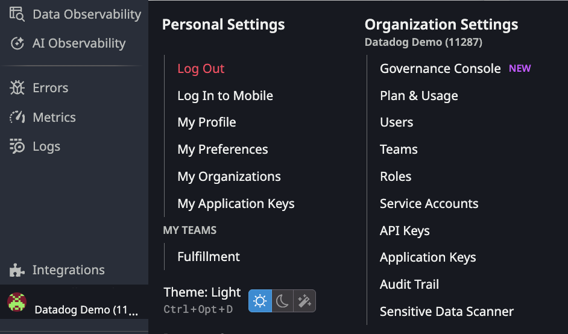
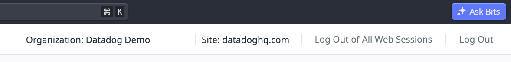
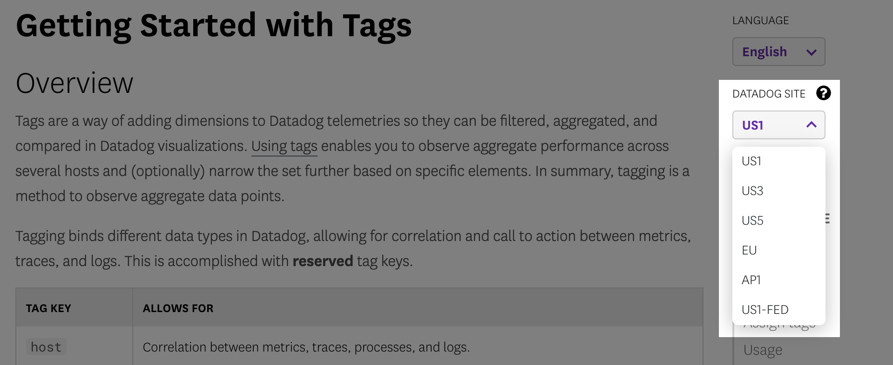
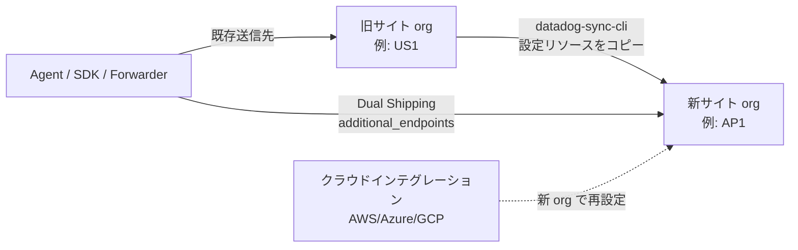

# Datadog Sites（サイト）

## 概要

Datadog Site（サイト。データセンター／リージョンに相当）は、Datadog が世界各地で運用している**互いに完全に独立した** SaaS インスタンスである。Datadog の Organization（組織、org）は必ずどれか 1 つのサイト上に作成され、その org のテレメトリ（メトリクス・ログ・トレースなど）と設定はそのサイトに保存される。公式ドキュメントは「各サイトは完全に独立しており、サイト間でデータを共有することはできない」と明記している。サイトを分ける目的は、政府向けセキュリティ規制への対応や、データを特定の国・地域に保存すること（データレジデンシー）である。[出典](https://docs.datadoghq.com/getting_started/site/)

このファイルが答える主な問いは以下のとおり。

- どのサイトがあり、URL と `site` パラメータ（`DD_SITE`）は何か
- 各サイトはどのクラウド・どの地域でホストされているか
- サイトごとのエンドポイント（API、Agent インテーク、ログ、RUM、OTLP、IP レンジ、ステータスページ）の命名規則
- サイトによって使えない機能・価格差・接続方式（PrivateLink 等）の違い
- 後からサイトを変更・移行できるか、その代替手段は何か

> **本ナレッジの基準サイト:** 本ナレッジの基準サイトは AP1（日本）である（[_CONVENTIONS.md](../../_CONVENTIONS.md)）。

> **サイト一覧の更新について:** 執筆規約では 7 サイト（US1/US3/US5/EU1/AP1/AP2/US1-FED）を挙げているが、2026-11-02 時点の公式サイト一覧には **UK1（英国）** と **US2-FED（米国政府向け第 2 サイト）** も載っており、全 9 サイトである。本ファイルでは 9 サイトすべてを扱う。[出典](https://docs.datadoghq.com/getting_started/site/)

Datadog 全体のアーキテクチャ（Agent → インテーク → バックエンドという流れ）は [Datadogのアーキテクチャ概観](../../01_入門編/architecture-overview.md) を参照。ネットワーク設計（プロキシ、FW 許可リスト、PrivateLink 設計）の詳細は [ネットワーク・接続要件](../../03_導入編/network-and-connectivity.md)、サイト選定の判断プロセスは [要件定義とアーキテクチャ設計](../../03_導入編/requirements-and-architecture-design.md) を参照。

---

## サイト一覧

### 公式サイト一覧（URL・site パラメータ・所在地）

Datadog 公式ドキュメント「Getting Started with Datadog Sites」に載っているサイト一覧（2026-11-02 時点）。[出典](https://docs.datadoghq.com/getting_started/site/)

| サイト | サイト URL（Web UI） | Site Parameter（`site` / `DD_SITE`） | 所在地（公式表記） | 用途 |
|---|---|---|---|---|
| US1 | `https://app.datadoghq.com` | `datadoghq.com` | US | 商用（デフォルト） |
| US3 | `https://us3.datadoghq.com` | `us3.datadoghq.com` | US | 商用 |
| US5 | `https://us5.datadoghq.com` | `us5.datadoghq.com` | US | 商用 |
| EU1 | `https://app.datadoghq.eu` | `datadoghq.eu` | EU（Germany） | 商用 |
| AP1 | `https://ap1.datadoghq.com` | `ap1.datadoghq.com` | Japan | 商用 |
| AP2 | `https://ap2.datadoghq.com` | `ap2.datadoghq.com` | Australia | 商用 |
| UK1 | `https://uk1.datadoghq.com` | `uk1.datadoghq.com` | UK | 商用 |
| US1-FED | `https://app.ddog-gov.com` | `ddog-gov.com` | US | 米国政府向け（Datadog for Government） |
| US2-FED | `https://us2.ddog-gov.com` | `us2.ddog-gov.com` | US | 米国政府向け（Datadog for Government） |

- 公式ドキュメントのサイト選択プルダウン上では、EU1 は「EU」と表示される。
- 商用サイトのドメインは `datadoghq.com` / `datadoghq.eu`、政府向けサイトのドメインは `ddog-gov.com` である。
- `demo.datadoghq.com` のようなカスタムサブドメインを使っている org では、URL からサイトが分からないことがある。その場合は「My Preferences」ページ上部でサイトを確認する（後述「自分のサイトを確認する方法」）。[出典](https://docs.datadoghq.com/getting_started/site/)

### ホスティング先クラウドと地域

公式のサイト一覧には国名レベルの所在地しか載っていない。一方、各サイト向けのプライベート接続（AWS PrivateLink / Google Cloud Private Service Connect / Azure Private Link）の公式手順には、Datadog 側エンドポイントのクラウドとリージョンが明記されている。下表はそれらの公式情報をまとめたもの。

| サイト | クラウド | リージョン（判明分） | 根拠（公式情報） |
|---|---|---|---|
| US1 | AWS | `us-east-1`（米国東部・バージニア北部） | AWS PrivateLink のサービス名が `com.amazonaws.vpce.us-east-1.vpce-svc-...`。[出典](https://docs.datadoghq.com/agent/guide/private-link/?site=us) |
| US3 | Microsoft Azure | `westus2`（米国西部 2） | Azure Private Link のサービスエイリアスが `*.westus2.azure.privatelinkservice`。Azure Native Integration は US3 の org でのみ使える。[出典](https://docs.datadoghq.com/agent/guide/azure-private-link/?site=us3) |
| US5 | Google Cloud | `us-central1`（アイオワ） | Private Service Connect のサービスアタッチメントが `projects/datadog-prod-us5/regions/us-central1/...`。[出典](https://docs.datadoghq.com/agent/guide/gcp-private-service-connect/?site=us5) |
| EU1 | Google Cloud | `europe-west3`（フランクフルト） | Private Service Connect のサービスアタッチメントが `projects/datadog-prod/regions/europe-west3/...`。[出典](https://docs.datadoghq.com/agent/guide/gcp-private-service-connect/?site=eu) |
| AP1 | AWS | `ap-northeast-1`（東京） | AWS PrivateLink のサービス名が `com.amazonaws.vpce.ap-northeast-1...`。プレスリリースでは東京所在。[出典](https://docs.datadoghq.com/agent/guide/private-link/?site=ap1) |
| AP2 | AWS | `ap-southeast-2`（シドニー） | AWS PrivateLink のサービス名が `com.amazonaws.vpce.ap-southeast-2...`。AWS シドニーリージョン上での提供が発表されている。[出典](https://docs.datadoghq.com/agent/guide/private-link/?site=ap2) |
| UK1 | AWS | `eu-west-2`（ロンドン） | AWS PrivateLink のサービス名が `com.amazonaws.vpce.eu-west-2...`。AWS Europe (London) リージョン上での提供が発表されている（2026-07-16）。[出典](https://docs.datadoghq.com/agent/guide/private-link/?site=uk1) |
| US1-FED | AWS GovCloud (US) | 公開情報では確認できず | Datadog for Government は AWS GovCloud (US) でホストされると、Datadog の政府向けソリューションページに記載がある。[出典](https://www.datadoghq.com/solutions/government/) |
| US2-FED | 公開情報では確認できず | 公開情報では確認できず | 公式ドキュメントは「IL5 認可の審査中（In Process）」とだけ記載している。 |

補足:

- Datadog のサブプロセッサー一覧（2026-10-16 更新）では、インフラ提供者として AWS（米国・オーストラリア・イタリア・日本・英国）、Google（米国・ドイツ）、Microsoft Azure（米国）が挙がっている。サイトとの対応関係は一覧には書かれていない。[出典](https://www.datadoghq.com/legal/subprocessors/)
- 上表のリージョンは「プライベート接続エンドポイントを提供しているリージョン」である。保存データ・バックアップ・DR 用の複製が置かれる正確な場所は公開情報では確認できず。データ保存場所の厳密な要件がある場合は、DPA（データ処理契約）とサブプロセッサー一覧を確認し、Datadog に問い合わせること。
- UK1 について、Datadog 公式ブログは「中核となる観測データ（ログ・メトリクス・トレース・セキュリティシグナル）は英国内に保存され、主に英国内で処理されるが、一部の機能では英国外のサブプロセッサーで処理されることがある」と説明している。[出典](https://www.datadoghq.com/blog/observability-data-hosting-uk-aws/)（2026-04-21 公開）

> **サイト差異:** クラウドネイティブ統合の一部は、ホスティング先クラウドに合わせて特定サイトでしか使えない。例として、Azure Portal から Datadog リソースを作成・管理する **Azure Native Integration**（Datadog - An Azure Native ISV Service）は、US3 サイトの org でしか利用できない。[出典](https://docs.datadoghq.com/integrations/guide/azure-native-integration/)

### 開設時期（判明分）

| サイト | 開設・発表時期 | 出典 |
|---|---|---|
| AP1 | 2023-04-19 に東京データセンターの開設を発表（アジア初）。当時は既存のすべての製品を AP1 で提供するとしていた。 | [プレスリリース](https://www.datadoghq.com/ja/about/latest-news/press-releases/datadog-launches-new-data-center-in-japan/) |
| AP2 | 2025-04-02 に計画を発表し、2025-07-16 に AWS シドニーリージョンでの提供開始を発表。 | [AP2 ページ](https://www.datadoghq.com/ap2/)、[発表記事](https://investors.datadoghq.com/news-releases/news-release-details/datadog-partners-aws-launch-australia-and-new-zealand-regions) |
| UK1 | 2026-03-09 に計画を発表し、2026-04-21 に AWS との提携をブログで告知。2026-07-16 に AWS Europe (London) リージョンでの提供開始をプレスリリースで発表。 | [プレスリリース](https://www.datadoghq.com/about/latest-news/press-releases/datadog-expands-uk-data-hosting-capabilities-on-aws-europe-london-region/) |
| US1-FED | 2022 年時点で FedRAMP Moderate 認可を取得済み（公式ブログ）。現在は FedRAMP High 認定サイトとされている。 | [公式ブログ](https://www.datadoghq.com/blog/monitor-aws-govcloud-datadog/)、[サイト一覧](https://docs.datadoghq.com/getting_started/site/) |
| US2-FED | 開設時期は公開情報では確認できず（IL5 認可の審査中）。 | [サイト一覧](https://docs.datadoghq.com/getting_started/site/) |
| US1 / US3 / US5 / EU1 | 開設時期は公開情報では確認できず（本調査の範囲では一次情報が見つからなかった）。 | — |

- 注: 2026-11-02 時点でも、`https://www.datadoghq.com/uk1/` のランディングページには「Coming soon」という表記が残っている。ただし、公式ドキュメントのサイト一覧・API エンドポイント表・RUM エンドポイント表にはすでに UK1 が載っており、2026-07-16 のプレスリリースでも提供開始が発表されている。

---

## 政府向けサイト（Datadog for Government）

| 項目 | US1-FED | US2-FED |
|---|---|---|
| URL | `https://app.ddog-gov.com` | `https://us2.ddog-gov.com` |
| 認可状況（公式表記） | FedRAMP High Certified | IL5 認可の審査中（In Process for IL5 Authorization） |
| 想定利用者 | 米国政府機関とそのパートナー | 米国政府機関とそのパートナー |
| 申し込み | `fed-sales@datadoghq.com` に連絡 | 同左 |
| 料金ページ上の扱い | 料金ページのリージョン選択に「US1-FED」がある | 料金ページのリージョン選択には無い（公開情報では確認できず） |
| FIPS Agent | 利用可（FIPS Agent は政府向けサイト専用） | 利用可 |

[出典](https://docs.datadoghq.com/getting_started/site/)、[FIPS 出典](https://docs.datadoghq.com/agent/configuration/fips-compliance/)

- **FIPS Agent:** FIPS Agent は FIPS 140-2 検証済み暗号モジュール（Certificate #4282）を使う Datadog Agent の一種である。公式ドキュメントでは、US1/US3/US5/EU1/AP1/AP2/UK1 について「not supported for your selected Datadog site」と表示される。つまり FIPS Agent は政府向けサイト専用であり、対応製品（Metrics・Logs・APM traces・APM profiles・Processes など）には Agent 7.65.0 以降が必要である。[出典](https://docs.datadoghq.com/agent/configuration/fips-compliance/)
- **ログアーカイブの注意:** Log Archives（ログアーカイブ）でログを顧客側のストレージへ送ると、そのログは Datadog GovCloud 環境の外に出る。公式ドキュメントは「GovCloud 環境の外に出たログについて Datadog は責任を負わない」と警告している。また S3 の FIPS エンドポイントを使う場合、ドット（`.`）を含むバケット名は使えない。[出典](https://docs.datadoghq.com/logs/log_configuration/archives/)
- **AWS インテグレーション:** US1-FED / US2-FED では、Datadog は専用アカウントから商用 AWS アカウントの IAM ロールを引き受ける。GovCloud アカウントと商用アカウントでは、入力する Datadog 側のアカウント ID が異なる。US2-FED では AWS / Azure などのインテグレーションが org で有効になっていないことがあり、その場合は `support@ddog-gov.com` に例外申請する。[出典](https://docs.datadoghq.com/integrations/guide/aws-manual-setup/)
- 認証・コンプライアンス全般（FedRAMP・ISO・SOC 2・HIPAA・PCI など）は [セキュリティとコンプライアンス](../../03_導入編/security-and-compliance.md) を参照。

---

## 自分のサイトを確認する方法

### UI で確認する（My Preferences）

自分の org がどのサイトにあるかは、ブラウザのアドレスバーにある URL（例: `https://ap1.datadoghq.com/...`）で分かる。カスタムサブドメインを使っている場合は「My Preferences」ページ上部に表示される `Site:` で確認する。手順は以下のとおり。[出典](https://docs.datadoghq.com/getting_started/site/)

1. 左下ナビゲーションのプロフィールアバター（org 名）をクリックする。
2. 表示されたメニューの **Personal Settings** 列から **My Preferences** を選ぶ。
3. ページ上部に `Organization: <org 名>` と `Site: <site パラメータ>` が表示される。



*キャプション: 左下のプロフィールアバターから開くアカウントメニュー*

画面の説明: 左ナビゲーション最下部の org 名（例: 「Datadog Demo (11…)」）をクリックすると、2 列のメニューが開く。左列 **Personal Settings** には Log Out、Log In to Mobile、My Profile、**My Preferences**、My Organizations、My Application Keys が並び、その下に MY TEAMS とテーマ切替（Light / Dark / 自動）がある。右列 **Organization Settings** には org 名と org ID、Governance Console、Plan & Usage、Users、Teams、Roles、Service Accounts、API Keys、Application Keys、Audit Trail、Sensitive Data Scanner が並ぶ。サイトを確認するには左列の My Preferences を開く。
出典: https://docs.datadoghq.com/getting_started/site/ （画像取得日: 2026-11-03）



*キャプション: My Preferences ページ上部の org 名とサイト表示*

画面の説明: My Preferences ページの上部バーに、左から「Organization: Datadog Demo」「Site: datadoghq.com」「Log Out of All Web Sessions」「Log Out」が並ぶ。`Site:` の値が、Agent の `site` 設定や `DD_SITE` に指定する Site Parameter である（この例は US1 の `datadoghq.com`。AP1 なら `ap1.datadoghq.com` と表示される）。右上には「Ask Bits」ボタンがある。
出典: https://docs.datadoghq.com/getting_started/site/ （画像取得日: 2026-11-03）

### 公式ドキュメントをサイト別に表示する（サイトセレクター）

サイトによって使える機能やエンドポイントが違うため、Datadog 公式ドキュメントの内容もサイトごとに変わる。各ページ右側の **DATADOG SITE** プルダウンでサイトを選ぶと、エンドポイント・手順・注記がそのサイト用に切り替わる。例として、政府向けサイトの情報を見るには US1-FED または US2-FED を選ぶ。[出典](https://docs.datadoghq.com/getting_started/site/)



*キャプション: docs.datadoghq.com のページ右側にある DATADOG SITE セレクター*

画面の説明: 「Getting Started with Tags」ページの右側に LANGUAGE（English）プルダウンと **DATADOG SITE** プルダウンがある。DATADOG SITE を開くと、US1、US3、US5、EU、AP1、US1-FED などのサイト候補が一覧表示される（この画像は旧版のため AP2・UK1・US2-FED が写っていない。2026-11-02 時点の選択肢は US1/US3/US5/EU/AP1/AP2/UK1/US1-FED/US2-FED の 9 つ）。選んだサイトに応じて、本文中のエンドポイント（例: `trace.agent.<site>`）や「This product is not supported for your selected Datadog site」といった注記が切り替わる。
出典: https://docs.datadoghq.com/getting_started/site/ （画像取得日: 2026-11-03）

> **実務上の注意:** 公式ドキュメントを読むときや、AI がドキュメントを引用するときは、サイトセレクターが自社のサイト（本ナレッジでは AP1）になっているかを確認すること。デフォルト表示は US1 なので、US1 のエンドポイントや機能提供状況をそのまま AP1 に当てはめると誤りになることがある。【経験則】

---

## URL・エンドポイント

### エンドポイントの命名規則

Datadog の各種エンドポイントは「`<サービス接頭辞>.<site パラメータ>`」という形で組み立てる。US1 の site パラメータは `datadoghq.com`、AP1 は `ap1.datadoghq.com` なので、たとえば APM のインテークは US1 が `trace.agent.datadoghq.com`、AP1 が `trace.agent.ap1.datadoghq.com` になる。[出典](https://docs.datadoghq.com/agent/configuration/network/)

ただし、RUM / Browser SDK のインテークはサブドメインではなく、ハイフンでつないだ別ドメイン（例: `browser-intake-ap1-datadoghq.com`）を使う。命名規則の例外なので注意する（後述）。

### 主要エンドポイント一覧（AP1 と US1 の比較）

下表は、AP1 と US1 向けの AWS PrivateLink 公式ホスト名一覧と、ネットワークトラフィックの公式ページをもとにまとめたもの。他のサイトでも `<site>` 部分を置き換えれば同じ形になる（例外は RUM）。[出典](https://docs.datadoghq.com/agent/guide/private-link/?site=ap1)、[出典](https://docs.datadoghq.com/agent/configuration/network/)

| 用途 | AP1 | US1 | 備考 |
|---|---|---|---|
| Web UI | `ap1.datadoghq.com` | `app.datadoghq.com` | US1 と EU1 だけ `app.` が付く |
| API | `api.ap1.datadoghq.com` | `api.datadoghq.com` | REST API のベース URL は `https://api.<site>` |
| メトリクス・サービスチェック・イベント（Agent） | `<VERSION>-app.agent.ap1.datadoghq.com` | `<VERSION>-app.agent.datadoghq.com` | 例: Agent v7.31.0 は `7-31-0-app.agent.<site>`。FW では `*.agent.<site>` を許可する |
| Agent flare | `<VERSION>-flare.agent.ap1.datadoghq.com` | `<VERSION>-flare.agent.datadoghq.com` | 同上 |
| APM トレース | `trace.agent.ap1.datadoghq.com` | `trace.agent.datadoghq.com` | |
| Continuous Profiler | `intake.profile.ap1.datadoghq.com` | `intake.profile.datadoghq.com` | |
| Live Process / Containers / CNM / USM | `process.ap1.datadoghq.com` | `process.datadoghq.com` | |
| Orchestrator（Kubernetes リソース） | `orchestrator.ap1.datadoghq.com` | `orchestrator.datadoghq.com` | `contlcycle-intake.<site>` も使う |
| ログ（Agent） | `agent-http-intake.logs.ap1.datadoghq.com` | `agent-http-intake.logs.datadoghq.com` | HTTPS 443 |
| ログ（HTTP API・カスタムフォワーダー） | `http-intake.logs.ap1.datadoghq.com` | `http-intake.logs.datadoghq.com` | HTTPS 443 |
| ログ（Lambda Forwarder） | `lambda-http-intake.logs.ap1.datadoghq.com` | `lambda-http-intake.logs.datadoghq.com` | |
| Remote Configuration | `config.ap1.datadoghq.com` | `config.datadoghq.com` | |
| Database Monitoring | `dbm-metrics-intake.ap1.datadoghq.com`、`dbquery-intake.ap1.datadoghq.com` | `dbm-metrics-intake.datadoghq.com`、`dbquery-intake.datadoghq.com` | |
| Network Device Monitoring | `ndm-intake.<site>`、`snmp-traps-intake.<site>`、`ndmflow-intake.<site>` | 同左 | |
| Network Path | `netpath-intake.ap1.datadoghq.com` | `netpath-intake.datadoghq.com` | |
| LLM Observability | `llmobs-intake.ap1.datadoghq.com` | `llmobs-intake.datadoghq.com` | |
| Cloud Security 脆弱性（SBOM） | `sbom-intake.ap1.datadoghq.com` | `sbom-intake.datadoghq.com` | |
| CI Visibility / Test Optimization | `ci-intake.<site>`、`citestcycle-intake.<site>`、`citestcov-intake.<site>` | 同左 | |
| Synthetics Private Location | `intake.synthetics.ap1.datadoghq.com` | `intake.synthetics.datadoghq.com` | Worker v1.5.0 以降はこれだけ設定すればよい |
| OTLP インテーク（Agent/Collector を介さない直接送信） | `otlp.ap1.datadoghq.com` | `otlp.datadoghq.com` | パス `/v1/metrics`・`/v1/logs`・`/v1/traces` |
| Instrumentation Telemetry | `instrumentation-telemetry-intake.ap1.datadoghq.com` | `instrumentation-telemetry-intake.datadoghq.com` | |
| 静的 IP レンジ | `https://ip-ranges.ap1.datadoghq.com` | `https://ip-ranges.datadoghq.com` | JSON 形式。後述 |
| ステータスページ | `https://status.ap1.datadoghq.com` | `https://status.datadoghq.com` | サイトごとに別ページ |

- Agent 7.67.0 以降は、Datadog サイトを FQDN（末尾にドットを付けた形、例: `trace.agent.datadoghq.com.`）に変換して DNS 問い合わせ回数を減らす。Agent 7.72.0 以降では `convert_dd_site_fqdn.enabled: false` または `DD_CONVERT_DD_SITE_FQDN_ENABLED=false` でこの動作を無効にできる。[出典](https://docs.datadoghq.com/agent/configuration/network/)
- Agent のインストール用ドメイン（`install.datadoghq.com`、`yum.datadoghq.com`、`apt.datadoghq.com`、`keys.datadoghq.com`、`windows-agent.datadoghq.com`）はサイトに関係なく共通である。[出典](https://docs.datadoghq.com/agent/configuration/network/)
- エンドポイントのより詳しい一覧とポート要件は [Agent 設定リファレンス](agent-configuration.md) と [ネットワーク・接続要件](../../03_導入編/network-and-connectivity.md) を参照。

### API エンドポイント（全サイト）

公式 API リファレンスには、サイトごとの API ベース URL が明記されている。[出典](https://docs.datadoghq.com/api/latest/org-groups/)

| サイト | API ベース URL |
|---|---|
| US1 | `https://api.datadoghq.com` |
| US3 | `https://api.us3.datadoghq.com` |
| US5 | `https://api.us5.datadoghq.com` |
| EU1 | `https://api.datadoghq.eu` |
| AP1 | `https://api.ap1.datadoghq.com` |
| AP2 | `https://api.ap2.datadoghq.com` |
| UK1 | `https://api.uk1.datadoghq.com` |
| US1-FED | `https://api.ddog-gov.com` |
| US2-FED | `https://api.us2.ddog-gov.com` |

- API キーとアプリケーションキーは **org 単位、つまりサイト単位**で発行される。AP1 の org で作ったキーを US1 の API に送っても認証は通らない。キー管理の詳細は [API とキー管理](api-and-keys.md) を参照。
- Terraform Provider では `api_url` 引数（環境変数 `DD_HOST`）で API URL を指定する。デフォルトは `https://api.datadoghq.com`（US1）なので、AP1 では `https://api.ap1.datadoghq.com/` を指定する必要がある。URL の末尾に `/api/` を付けてはいけない。[出典](https://registry.terraform.io/providers/DataDog/datadog/latest/docs)（[GitHub](https://github.com/DataDog/terraform-provider-datadog/blob/master/docs/index.md)）。IaC 全般は [Terraform と IaC](terraform-and-iac.md) を参照。

### RUM / Browser SDK のインテーク（全サイト）

RUM・Browser Logs などの SDK は、サブドメイン形式ではなく次の専用ドメインに SSL（443）で送信する。[出典](https://docs.datadoghq.com/real_user_monitoring/)

| サイト | SDK インテーク | Browser Profiling 用 quota API | CDN 版 RUM SDK（v7） |
|---|---|---|---|
| US1 | `https://browser-intake-datadoghq.com` | `https://quota.browser-intake-datadoghq.com` | `https://www.datadoghq-browser-agent.com/us1/v7/datadog-rum.js` |
| US3 | `https://browser-intake-us3-datadoghq.com` | `https://quota.browser-intake-us3-datadoghq.com` | `.../us3/v7/datadog-rum.js` |
| US5 | `https://browser-intake-us5-datadoghq.com` | `https://quota.browser-intake-us5-datadoghq.com` | `.../us5/v7/datadog-rum.js` |
| EU1 | `https://browser-intake-datadoghq.eu` | `https://quota.browser-intake-datadoghq.eu` | `.../eu1/v7/datadog-rum.js` |
| AP1 | `https://browser-intake-ap1-datadoghq.com` | `https://quota.browser-intake-ap1-datadoghq.com` | `.../ap1/v7/datadog-rum.js` |
| AP2 | `https://browser-intake-ap2-datadoghq.com` | `https://quota.browser-intake-ap2-datadoghq.com` | `.../ap2/v7/datadog-rum.js` |
| UK1 | `https://browser-intake-uk1-datadoghq.com` | `https://quota.browser-intake-uk1-datadoghq.com` | `.../uk1/v7/datadog-rum.js` |
| US1-FED | `https://browser-intake-ddog-gov.com` | `https://quota.browser-intake-ddog-gov.com` | `https://www.datadoghq-browser-agent.com/datadog-rum-v7.js`（サイト別パスなし） |
| US2-FED | `https://browser-intake-us2-ddog-gov.com` | `https://quota.browser-intake-us2-ddog-gov.com` | 同上 |

[CDN 出典](https://docs.datadoghq.com/real_user_monitoring/browser/setup/client/)、[プロキシ出典](https://docs.datadoghq.com/real_user_monitoring/guide/proxy-rum-data/)

- SDK の初期化パラメータ `site` には Site Parameter（例: `ap1.datadoghq.com`）を指定する。RUM の設定項目は [RUM（ブラウザ）](../dem/rum-browser.md)、[RUM（モバイル）](../dem/rum-mobile.md) を参照。

### ログの TCP エンドポイント（非推奨）

ログの TCP 収集は**サポート対象外（非推奨）**であり、Datadog は TCP 経由の配送や信頼性を保証しない。公式の TCP エンドポイント表には US と EU の行しかない。たとえば US の `agent-intake.logs.datadoghq.com:10516`（TLS）や、EU の `agent-intake.logs.datadoghq.eu:443` などである。AP1 を含むその他のサイトについては、TCP エンドポイントは公式表に載っていない。新規構築では HTTPS インテーク（`http-intake.logs.<site>` / `agent-http-intake.logs.<site>`）を使う。[出典](https://docs.datadoghq.com/logs/log_collection/)

### 静的 IP レンジ（`ip-ranges.<site>`）

Datadog のインテーク用ドメインはどれも、一連の静的 IP アドレスを指す CNAME レコードである。IP 一覧は `https://ip-ranges.<site>` から JSON で取得できる（例: `https://ip-ranges.ap1.datadoghq.com`、`https://ip-ranges.datadoghq.eu`、`https://ip-ranges.ddog-gov.com`）。[出典](https://docs.datadoghq.com/agent/configuration/network/)

| JSON キー | 内容 |
|---|---|
| `version` / `modified` | 変更のたびに増えるバージョン番号と、最終更新タイムスタンプ |
| `agents` | Agent がメトリクス送信に使う宛先 IP（`prefixes_ipv4` / `prefixes_ipv6`） |
| `api` | Agent の補助機能（API 問い合わせ）が使う宛先 IP |
| `apm` / `logs` / `process` / `orchestrator` / `remote-configuration` | 各データ種別の宛先 IP |
| `synthetics` | Synthetic のマネージドロケーションが使う**送信元** IP（Agent は使わない） |
| `synthetics-private-locations` | Synthetics Private Location の Worker が送信に使う宛先 IP |
| `webhooks` | Datadog が Webhook などで外部へ HTTP 接続するときの**送信元** IP |

- データ種別ごとに個別のエンドポイントもある（例: `https://ip-ranges.<site>/apm.json`、`https://ip-ranges.<site>/logs.json`）。
- 公式ドキュメントは、常に一部の IP しか使われていない場合でも、IP レンジは**全件**を許可リストに入れるよう推奨している。
- 2026-11-03 に、全 9 サイトの `ip-ranges.<site>` と `status.<site>`（US1 は `status.datadoghq.com`、US1-FED は `status.ddog-gov.com`）が HTTP 200 を返すことを確認した（執筆者による疎通確認）。

---

## プライベート接続（サイト別の対応方式）

Datadog へインターネットを経由せずに送信する方式は、サイトのホスティング先クラウドによって決まる。

| サイト | AWS PrivateLink | Google Cloud Private Service Connect | Azure Private Link |
|---|---|---|---|
| US1 | ○（`us-east-1`） | × | × |
| US3 | × | × | ○（`westus2`） |
| US5 | × | ○（`us-central1`） | × |
| EU1 | × | ○（`europe-west3`） | × |
| AP1 | ○（`ap-northeast-1`） | × | × |
| AP2 | ○（`ap-southeast-2`） | × | × |
| UK1 | ○（`eu-west-2`） | × | × |
| US1-FED | ×（公式に「not supported」と記載） | × | × |
| US2-FED | ×（同上） | × | × |

[AWS 出典](https://docs.datadoghq.com/agent/guide/private-link/)、[GCP 出典](https://docs.datadoghq.com/agent/guide/gcp-private-service-connect/)、[Azure 出典](https://docs.datadoghq.com/agent/guide/azure-private-link/)

- **AWS PrivateLink（US1/AP1/AP2/UK1）:** VPC エンドポイントをサイトと同じリージョンに作る方法と、別リージョンから接続する方法がある。別リージョンからの場合は、クロスリージョン PrivateLink エンドポイント（推奨）か、VPC ピアリング + Route 53 プライベートホストゾーンの関連付けを使う。クロスリージョン PrivateLink は CloudWatch メトリクスを出力しない。[出典](https://docs.datadoghq.com/agent/guide/private-link/)
- **GCP Private Service Connect（US5/EU1）:** Datadog はプロデューサー側エンドポイントを US5 では `us-central1`、EU1 では `europe-west3` で公開している。グローバルアクセスに対応しているので、他リージョンの VM からも接続できる。ただし転送ルール（forwarding rule）は上記リージョンに作る必要がある。[出典](https://docs.datadoghq.com/agent/guide/gcp-private-service-connect/)
- **Azure Private Link（US3）:** `westus2` の Private Link Service に、Logs・API・Metrics・Containers・Process・Profiling・Traces・Remote Configuration・Database Monitoring のエンドポイントがある。[出典](https://docs.datadoghq.com/agent/guide/azure-private-link/)
- 日本の AWS（東京リージョン）から AP1 を使う場合は、同一リージョンの PrivateLink を構成できる。Classmethod の記事は、インターネット経由（$0.09/GB）と PrivateLink 経由（$0.01/GB）で AWS 側のデータ転送料が約 89% 違うと試算している。この金額は記事執筆時点の AWS 料金に基づく。【第三者情報】[出典](https://dev.classmethod.jp/articles/how-to-choose-datadog-site/)（2025-07-07 公開）

PrivateLink の設計（DNS、Transit Gateway、クロスリージョン）の詳細は [ネットワーク・接続要件](../../03_導入編/network-and-connectivity.md) を参照。

---

## Agent・SDK・ツールでのサイト指定

### Agent

Agent はデフォルトで US1（`datadoghq.com`）に送信する。US1 以外のサイトを使う場合は、`datadog.yaml` の `site` パラメータを設定するか、環境変数 `DD_SITE` を設定しなければならない。[出典](https://docs.datadoghq.com/agent/troubleshooting/site/)

```yaml
## @param site - string - optional - default: datadoghq.com
## The site of the Datadog intake to send Agent data to.
site: ap1.datadoghq.com
```

| 設定方法 | AP1 の設定例 |
|---|---|
| `datadog.yaml` | `site: ap1.datadoghq.com` |
| 環境変数 | `DD_SITE=ap1.datadoghq.com` |
| インストールスクリプト | `DD_SITE="ap1.datadoghq.com" DD_API_KEY=<KEY> bash -c "$(curl -L https://install.datadoghq.com/scripts/install_script_agent7.sh)"`（形式は公式インストール手順を参照） |
| Helm（datadog チャート） | `datadog.site: ap1.datadoghq.com` |
| Datadog Operator | `spec.global.site: ap1.datadoghq.com` |

- `DD_SITE` を設定しないと、Agent は US1 に送信しようとする。AP1 の API キーは US1 では無効なので、データは届かない。Agent の status 出力や flare で API キーのエラーとして現れる。Terraform・Helm values・コンテナイメージの環境変数で設定し忘れやすいので注意する。【経験則】[出典](https://dev.classmethod.jp/articles/how-to-choose-datadog-site/)（2025-07-07 公開）
- 設定キーの網羅的な一覧は [Agent 設定リファレンス](agent-configuration.md)、Kubernetes での設定は [コンテナ/Kubernetes向けAgent](kubernetes-and-containers-agent.md) を参照。

### その他のツール・SDK

| ツール | サイトの指定方法 | 出典 |
|---|---|---|
| Terraform Provider | `api_url`（環境変数 `DD_HOST`）。例: `https://api.ap1.datadoghq.com/` | [出典](https://github.com/DataDog/terraform-provider-datadog/blob/master/docs/index.md) |
| RUM Browser / Mobile SDK | 初期化パラメータ `site`（例: `ap1.datadoghq.com`） | [出典](https://docs.datadoghq.com/real_user_monitoring/browser/setup/client/) |
| APM トレーシングライブラリ（Agent 経由） | 送信先は Agent 側の `site` で決まる（ライブラリはローカルの Agent に送る） | [出典](https://docs.datadoghq.com/agent/configuration/network/) |
| Agentless 送信（Lambda Extension、OTLP 直接送信など） | 各製品の `DD_SITE` またはエンドポイント設定 | [OTLP 出典](https://docs.datadoghq.com/opentelemetry/setup/otlp_ingest/) |
| datadog-sync-cli | 送信元と送信先の API URL を指定（例: `https://api.ap1.datadoghq.com`） | [出典](https://github.com/DataDog/datadog-sync-cli) |
| クラウドインテグレーション（AWS/Azure/GCP） | org がどのサイトにあるかで決まる。Datadog 側が org のサイトからクラウド API をクロールする | [AWS Integration](aws-integration.md) を参照 |

OpenTelemetry Collector の Datadog Exporter や OTLP 直接送信での指定方法は [OpenTelemetry サポート](opentelemetry.md) を参照。

---

## サイト別の機能提供差異

Datadog は「サイトのセキュリティ要件によって、サイトごとに使える機能が異なる場合がある」としている。[出典](https://docs.datadoghq.com/getting_started/site/) サイト別の機能対応を一覧にした公式ページは無い。そのため以下は、各製品の公式ドキュメント（`.md` 版）に書かれている「Important note for users on the following Datadog sites」注記を、2026-11-03 に収集・確認した結果である。ここに載っていない製品は「サイト制限の注記を確認できなかった」という意味であり、全サイトで利用可能だと保証するものではない。

### 商用サイト間（US1/US3/US5/EU1/AP1/AP2/UK1）の差異

商用 7 サイトの間では、製品単位で「not supported」となっている注記は、本調査の範囲では見つからなかった。確認できた差異は次のとおり。

| 項目 | 差異の内容 | 出典 |
|---|---|---|
| Flex Logs のコンピュートサイズ | US3、US5、AP1、AP2、US1-FED、US2-FED で選べるのは **Starter、XS、XS+、S のみ**。M（Medium）と L（Large）は、これらのサイトでは選べない（この注記の対象外なのは US1、EU1、UK1）。 | [出典](https://docs.datadoghq.com/logs/log_configuration/flex_logs/) |
| プライベート接続 | US1/AP1/AP2/UK1 は AWS PrivateLink、US3 は Azure Private Link、US5/EU1 は GCP PSC のみ（前述）。 | 前述 |
| Azure Native Integration | US3 のみ。Azure Native Integration を使っている US3 の org では、Cloud Cost Management と Log Archives の設定に別途 App Registration が必要。 | [出典](https://docs.datadoghq.com/integrations/guide/azure-native-integration/)、[出典](https://docs.datadoghq.com/getting_started/integrations/azure/) |
| Log Archives（US3） | US3 では、Azure Storage のファイアウォールルールに対応していない。 | [出典](https://docs.datadoghq.com/logs/log_configuration/archives/) |
| ログの TCP エンドポイント | 公式表には US と EU しか載っていない（TCP 自体が非推奨）。 | [出典](https://docs.datadoghq.com/logs/log_collection/) |
| 新機能の提供順 | 新しいベータ機能は、まず US1 で提供されることがある。 | 【第三者情報】[出典](https://dev.classmethod.jp/articles/how-to-choose-datadog-site/)（2025-07-07 公開） |
| 料金 | 料金表のリージョン別単価が異なる（後述「課金への影響」）。 | [出典](https://www.datadoghq.com/pricing/) |

> **サイト差異:** プレビュー（Preview）や限定提供（Limited Availability）の機能は、サイトごとに提供範囲が違うことがある。AP1 で使えるかどうかは、公式ドキュメントのサイトセレクターを AP1 にして確認するか、Datadog のアカウントチームに確認する。【経験則】

### 政府向けサイト（US1-FED / US2-FED）で利用できない製品・機能

公式ドキュメントで、US1-FED と US2-FED の**両方**について「This product (feature) is not supported for your selected Datadog site」と表示されるもの（2026-11-03 確認）。

| 区分 | 製品・機能 | 参照先（本ナレッジ） | 出典 |
|---|---|---|---|
| AI | Bits AI | [Bits AI と AI 機能](../ai/bits-ai.md) | [出典](https://docs.datadoghq.com/bits_ai/) |
| AI | Datadog MCP Server | [Bits AI と AI 機能](../ai/bits-ai.md) | [出典](https://docs.datadoghq.com/bits_ai/mcp_server/) |
| AI | LLM Observability | [LLM Observability](../ai/llm-observability.md) | [出典](https://docs.datadoghq.com/llm_observability/) |
| APM | Data Streams Monitoring | [Data Streams Monitoring](../apm/data-streams-monitoring.md) | [出典](https://docs.datadoghq.com/data_streams/) |
| APM | Dynamic Instrumentation | [Dynamic Instrumentation と Live Debugger](../apm/dynamic-instrumentation.md) | [出典](https://docs.datadoghq.com/dynamic_instrumentation/) |
| APM | Universal Service Monitoring | [Universal Service Monitoring](../apm/universal-service-monitoring.md) | [出典](https://docs.datadoghq.com/universal_service_monitoring/) |
| Data | Data Jobs Monitoring | [Data Jobs Monitoring](../data/data-jobs-monitoring.md) | [出典](https://docs.datadoghq.com/data_jobs/) |
| Data | Data Observability | [Data Observability](../data/data-observability.md) | [出典](https://docs.datadoghq.com/data_observability/) |
| DEM | Product Analytics | [Session Replay と Product Analytics](../dem/session-replay-and-product-analytics.md) | [出典](https://docs.datadoghq.com/product_analytics/) |
| DEM | Session Replay の AI サマリー／スマートチャプター、コメント機能 | 同上 | [出典](https://docs.datadoghq.com/session_replay/) |
| DEM | Mobile App Testing | [Synthetic Monitoring](../dem/synthetic-monitoring.md) | [出典](https://docs.datadoghq.com/mobile_app_testing/) |
| Software Delivery | CI Visibility | [CI Visibility](../software-delivery/ci-visibility.md) | [出典](https://docs.datadoghq.com/continuous_integration/) |
| Software Delivery | Test Optimization（旧称: Test Visibility） | [Test Optimization](../software-delivery/test-optimization.md) | [出典](https://docs.datadoghq.com/tests/) |
| Software Delivery | DORA Metrics | [DORA Metrics・Quality Gates・Code Coverage](../software-delivery/software-delivery-insights.md) | [出典](https://docs.datadoghq.com/dora_metrics/) |
| Software Delivery | Feature Flags | — | [出典](https://docs.datadoghq.com/feature_flags/) |
| Security | Code Security | [Code Security](../security/code-security.md) | [出典](https://docs.datadoghq.com/security/code_security/) |
| Security | Cloud Security の Agentless Scanning、Resource Catalog | [Cloud Security（旧 CSM）](../security/cloud-security.md) | [出典](https://docs.datadoghq.com/security/cloud_security_management/) |
| Infrastructure | Storage Management | — | [出典](https://docs.datadoghq.com/infrastructure/storage_management/) |
| Logs | CloudPrem（Bring Your Own Cloud Log Management） | [Indexes・保持・アーカイブ](../logs/log-indexes-retention-archives.md) | [出典](https://docs.datadoghq.com/cloudprem/) |
| Platform | Governance Console | [組織・ユーザー・権限管理](account-and-access-management.md) | [出典](https://docs.datadoghq.com/account_management/governance_console/) |
| Platform | Safety Center | 同上 | [出典](https://docs.datadoghq.com/account_management/safety_center/) |
| Platform | Audit Trail の自然言語クエリ（Natural language queries） | [Audit Trail](audit-trail.md) | [出典](https://docs.datadoghq.com/account_management/audit_trail/) |
| Platform | Datadog Disaster Recovery（DDR） | 後述「サイト障害への備え」 | [出典](https://docs.datadoghq.com/disaster_recovery/) |

### US2-FED のみで制限があるもの

| 製品・機能 | US2-FED での状況 | 出典 |
|---|---|---|
| App and API Protection（旧称: Application Security Management / ASM） | not supported | [出典](https://docs.datadoghq.com/security/application_security/) |
| On-Call | not supported | [出典](https://docs.datadoghq.com/service_management/on-call/) |
| Workflow Automation | Preview | [出典](https://docs.datadoghq.com/actions/workflows/) |
| AWS / Azure などのインテグレーション | org で有効になっていない場合があり、`support@ddog-gov.com` に例外申請する | [出典](https://docs.datadoghq.com/integrations/amazon_web_services/) |

### 政府向けサイトで動作が異なるもの

| 項目 | 内容 | 出典 |
|---|---|---|
| AWS PrivateLink | 政府向けサイトは非対応 | [出典](https://docs.datadoghq.com/agent/guide/private-link/) |
| FIPS Agent | 政府向けサイトでのみ利用できる | [出典](https://docs.datadoghq.com/agent/configuration/fips-compliance/) |
| Synthetics Private Location | FIPS が必要な場合は FIPS 対応イメージ（`datadog/synthetics-private-location-worker-fips`）を使う | [出典](https://docs.datadoghq.com/synthetics/platform/private_locations/) |
| Cloud Cost Management（AWS） | CUR の検証に使うエンドポイントは FIPS 検証済みではない | [出典](https://docs.datadoghq.com/cloud_cost_management/setup/aws/) |
| Log Archives | アーカイブしたログは GovCloud 環境の外に出る（Datadog の責任範囲外） | [出典](https://docs.datadoghq.com/logs/log_configuration/archives/) |
| 料金ページで提供されている製品 | 料金ページで US1-FED を選ぶと、表示される製品が絞り込まれる。表示されるのは Log Management、Infrastructure Monitoring、APM、Workload Protection、App Builder、Incident Response、Workflow Automation、Error Tracking、Edge Device Monitoring、Managed Platform OTLP、Serverless Monitoring、RUM、Synthetic Monitoring、Network Monitoring、Sensitive Data Scanner、Cloud SIEM、Audit Trail、Cloud Security、Cloud Cost Management、Database Monitoring、App and API Protection、Jobs Monitoring | [出典](https://www.datadoghq.com/pricing/)（ページ内スクリプトの `fedProducts` 定義、2026-11-03 取得） |

---

## サイト間の独立性と制約

| 項目 | 仕様 | 出典 |
|---|---|---|
| データ共有 | サイト間でデータは共有できない（各サイトは完全に独立） | [出典](https://docs.datadoghq.com/getting_started/site/) |
| ログイン | ユーザーアカウントはサイトごとに別。AP1 の org には US1 の URL からログインできない | [出典](https://dev.classmethod.jp/articles/how-to-choose-datadog-site/)【第三者情報】（2025-07-07 公開） |
| Cross-Organization Visibility | 接続元と接続先の org は、**同じアカウント**かつ**同じサイト**でなければならない。別サイトの org 間ではメトリクスなどを横断クエリできない | [出典](https://docs.datadoghq.com/account_management/org_settings/cross_org_visibility/) |
| Multi-org（親子 org） | 子 org は親 org のプランを引き継ぎ、親の請求アカウントに追加される。IP 許可リストと SAML 設定は子 org に継承されない | [出典](https://docs.datadoghq.com/account_management/multi_organization/) |
| 異なるサイトへの子 org 作成 | 親 org と異なるサイトに子 org を作成できるかどうかは、公開情報では確認できず | — |
| API キー・アプリケーションキー | org（＝サイト）単位。他サイトでは無効 | [出典](https://docs.datadoghq.com/account_management/api-app-keys/) |

マルチ org 運用の設計は [大規模・マルチorg運用](../../04_応用編/large-scale-and-multi-org.md) を参照。

---

## サイト移行の可否

### 結論

| 問い | 回答 | 確度 |
|---|---|---|
| 既存 org のサイトを後から変更できるか | **変更できない**。サイトはアカウント（org）作成時に選び、後から変える機能は公式ドキュメントに無い。 | 公式ドキュメントにサイト変更機能の記載が無いことによる。「作成後は変更不可」という明示は第三者情報【第三者情報】（[出典](https://dev.classmethod.jp/articles/how-to-choose-datadog-site/)、2025-07-07 公開） |
| 取り込み済みのテレメトリ（過去のメトリクス・ログ・トレース）を別サイトへ移せるか | **公式の移行手段は無い**。datadog-sync-cli の README も「取り込み済み（ingested）のログやメトリクスなどの移行は対象外で、意図もしていない」と明記している。 | 公式（GitHub）[出典](https://github.com/DataDog/datadog-sync-cli) |
| ダッシュボードやモニターなどの設定を別サイトへ移せるか | **移せる**。新しいサイトに org を作り、datadog-sync-cli で設定リソースをコピーする。 | 公式（GitHub）[出典](https://github.com/DataDog/datadog-sync-cli) |
| 移行期間中に両方のサイトへ同時に送れるか | **送れる**。Agent の Dual Shipping（`additional_endpoints`）で新旧両方のサイトに送信できる。 | 公式 [出典](https://docs.datadoghq.com/agent/configuration/dual-shipping/) |

> **AP1 選定時の注意:** 日本拠点の企業が US1 で始めて、後から「データを国内に置く必要がある」と分かった場合は、AP1 に新しい org を作って移行プロジェクトを実施することになる（過去データは引き継げない）。サイトは導入初期の要件定義で決めておくべき項目である。【経験則】判断基準は [要件定義とアーキテクチャ設計](../../03_導入編/requirements-and-architecture-design.md) を参照。

### サイト移行の進め方（新サイトに org を作り直す方式）



| ステップ | 作業内容 | 使う機能・ツール |
|---|---|---|
| 1. 新 org の作成 | 移行先サイトで新しい org を作成する（契約・プランは Datadog の営業担当と調整） | サインアップ／アカウントチーム |
| 2. 認証・ユーザー | SAML／SSO の設定、ロール、ユーザー、チームを用意する | datadog-sync-cli（`roles`、`users`、`teams`、`authn_mappings`）、SAML 設定 |
| 3. 設定リソースのコピー | ダッシュボード、モニター、SLO、ノートブック、ログパイプライン／インデックス、Synthetic テストなどをコピーする | datadog-sync-cli（`import` → `sync`）。Terraform で管理しているなら `api_url` を変えて apply する |
| 4. インテグレーション再設定 | AWS/Azure/GCP のクラウドインテグレーションと、Slack などの通知連携を新 org で設定し直す | 各インテグレーション（認証情報は自動では移らない） |
| 5. 並行送信 | Agent などから新旧両方のサイトへ送り、データ量やモニターの挙動を比べる | Dual Shipping（`additional_endpoints`、`DD_ADDITIONAL_ENDPOINTS` など） |
| 6. 切り替え | `site`／`DD_SITE`・API キー・SDK の `site` を新しいサイトに切り替え、旧サイトへの送信を止める | Agent 設定、Fleet Automation など |
| 7. 旧 org の扱い | 過去データの参照期間（保持期間が終わるまで）と旧 org の解約時期を決める | 契約調整 |

**datadog-sync-cli が同期できる主なリソース**（README の Supported resources より抜粋）: `dashboards`、`dashboard_lists`、`monitors`、`service_level_objectives`、`slo_corrections`、`downtime_schedules`、`notebooks`、`powerpacks`、`synthetics_tests`、`synthetics_global_variables`、`synthetics_private_locations`、`logs_pipelines`、`logs_pipelines_order`、`logs_indexes`、`logs_indexes_order`、`logs_archives`、`logs_metrics`、`logs_restriction_queries`、`spans_metrics`、`metric_tag_configurations`、`metric_percentiles`、`metrics_metadata`、`host_tags`、`roles`、`users`、`teams`、`team_memberships`、`authn_mappings`、`restriction_policies`、`sensitive_data_scanner_groups`、`sensitive_data_scanner_rules` など。送信元と送信先の API URL として、`https://api.datadoghq.com`、`https://api.datadoghq.eu`、`https://api.us5.datadoghq.com`、`https://api.us3.datadoghq.com`、`https://api.ddog-gov.com`、`https://api.ap1.datadoghq.com` が例示されている。[出典](https://github.com/DataDog/datadog-sync-cli)

**Dual Shipping の対象データ種別**: Metrics・サービスチェック、APM、Continuous Profiler（追加エンドポイントへの送信はベストエフォート）、Live Processes、Cluster Agent メトリクス、Orchestrator、CI Visibility、Logs、Database Monitoring、Network Devices、Network Path、Cloud Security Misconfigurations、Workload Protection など。公式ドキュメントは「複数の org にデータを送ると課金に影響し得る」と注意している。ログを複数の宛先に分けて送るなら Observability Pipelines の利用を勧めている。[出典](https://docs.datadoghq.com/agent/configuration/dual-shipping/)

**事例（第三者）:** Wolt は Datadog の US サイトから EU サイトへの移行を公開している。DogMover と datadog-sync-cli で 500 件超のアラート、160 のダッシュボード、20 のインテグレーションを移し、Agent の Dual Shipping と Terraform を組み合わせた。教訓として、取り込んでいるデータとインテグレーションの事前棚卸し、両サイトでのダッシュボード比較、No Data アラートの設定を挙げている。過去データを移したかどうかは記事に書かれていない。【第三者情報】[出典](https://careers.wolt.com/blog/tech/datadog-migration-wolt)（2022-09-14 公開。2 年以上前の記事のため、ツールや仕様が現在と違う可能性がある）

他社製品から Datadog への移行は [他製品からの移行](../../03_導入編/migration-from-other-tools.md) を参照。

---

## サイト障害への備え（Datadog Disaster Recovery）

Datadog Disaster Recovery（DDR）は、クラウドプロバイダーのリージョンやその中の Datadog サービスが止まったときに観測を続けるための機能である。**別のリージョン（サイト）に副 org をあらかじめ作り**、リソースを複製しておく。DDR は商用サイトでは **【Limited Availability】**（アカウントチームに提供可否を確認）であり、US1-FED / US2-FED では提供されていない。[出典](https://docs.datadoghq.com/disaster_recovery/)

| 項目 | 内容 |
|---|---|
| 構成 | アクティブ／パッシブ方式。副 org は同期されるがパッシブのまま。フェイルオーバーは自動ではなく、顧客が判断して実行する |
| 副 org の要件 | 主 org とは**別リージョン・別データセンター**のサイトに作る。どの org の子でもない独立 org にする |
| org 同期 | Datadog が datadog-sync-cli を使って、ダッシュボード・モニター・ユーザー・ノートブックなどを定期的に複製する（同期用のサービスアカウントを副 org に作る） |
| トラフィックのフェイルオーバー | 顧客が起点となる DNS フェイルオーバーを推奨。`<CUSTOMER>.mrf.datadoghq.com` → CNAME → `datadog.<顧客ドメイン>` → CNAME → `mrf.<DATA_CENTER>.datadoghq.com` という 2 段の委任を使う |
| 対応テレメトリ | APM トレース、ログ、メトリクス、プロセス、プロファイリング、Synthetic Monitoring（RUM などは非対応） |
| 非対応の設定 | Cloud SIEM の検出ルールとシグナル設定、Observability Pipelines の設定。インテグレーションの設定と認証情報も自動では同期されない |
| Agent の最低バージョン | Logs と Metrics は v7.54 以降、Traces は v7.68 以降 |
| クラウドインテグレーション | 主 org と副 org の両方に設定しておく。フェイルオーバー中は主 org でのクラウドインテグレーション収集が止まる |
| 組織の紐付け | 主 org のアプリケーションキーに `disaster_recovery_status_write` スコープを付け、`/api/v2/hamr` に POST する（セキュリティ上の理由で Datadog は代行しない） |

[出典](https://docs.datadoghq.com/disaster_recovery/)

- DDR は「サイトの移行」機能ではなく、障害時に切り替えるための仕組みである。ただし設定の同期とトラフィック切り替えの仕組みは、サイト移行と共通点が多い。
- DNS フェイルオーバーで推奨される設定（DNS キャッシュ TTL、接続の再利用）は [Recommended Settings for DNS Failover](https://docs.datadoghq.com/disaster_recovery/recommended_settings/) を参照。

---

## サイト選定の観点

サイト選定の主な観点を下表にまとめる。詳しい判断プロセスは [要件定義とアーキテクチャ設計](../../03_導入編/requirements-and-architecture-design.md) を参照。

| 観点 | 確認内容 | 補足 |
|---|---|---|
| データレジデンシー／規制 | 法令・業界規制・社内規程で、データの保存国が決まっているか | 日本国内保存なら AP1、ドイツ／EU なら EU1、英国なら UK1、豪州なら AP2、米国政府なら US1-FED / US2-FED |
| 主なワークロードの場所 | 監視対象の主なクラウドリージョン | 同じクラウド・同じリージョンなら PrivateLink などで転送コストと遅延を抑えやすい。例: AWS 東京なら AP1 |
| クラウドネイティブ統合 | Azure Native Integration（US3 のみ）などを使いたいか | Azure 中心なら US3 も候補 |
| 必要な機能 | 使いたい製品がそのサイトで提供されているか（特に政府向けサイト） | 本ファイルの「サイト別の機能提供差異」を参照 |
| 料金 | リージョン別単価の違い | AP1 は US 比で高い単価が設定されている（後述） |
| 既存 org との関係 | 既存の org や子 org と横断クエリ（Cross-Organization Visibility）をしたいか | 横断できるのは同じサイトの org 同士だけ |
| 将来の変更 | 後からサイトを変えられないこと | 移行は「新 org ＋設定コピー」になり、過去データは移らない |

Classmethod の記事は、選定順序として「① GDPR などの規制の有無 → ② 社内ポリシーで国内保存が必要か → ③ 主に使う AWS リージョンが東京か → ④ コストを重視するか」を提案している。【第三者情報】[出典](https://dev.classmethod.jp/articles/how-to-choose-datadog-site/)（2025-07-07 公開）

---

## 制限値・クォータ・デフォルト値

| 項目 | 値 | 出典 |
|---|---|---|
| サイト数（2026-11-02 時点） | 9 サイト（商用 7: US1/US3/US5/EU1/AP1/AP2/UK1、政府向け 2: US1-FED/US2-FED） | [出典](https://docs.datadoghq.com/getting_started/site/) |
| Agent の `site` のデフォルト値 | `datadoghq.com`（US1） | [出典](https://docs.datadoghq.com/agent/troubleshooting/site/) |
| Terraform Provider の `api_url` のデフォルト値 | `https://api.datadoghq.com`（US1） | [出典](https://github.com/DataDog/terraform-provider-datadog/blob/master/docs/index.md) |
| 1 つの org が属するサイト数 | 1（サイト間のデータ共有は不可） | [出典](https://docs.datadoghq.com/getting_started/site/) |
| 既存 org のサイト変更 | 不可（公式に変更機能の記載なし） | 前述「サイト移行の可否」 |
| 過去データのサイト間移行 | 公式ツールなし（datadog-sync-cli の対象外） | [出典](https://github.com/DataDog/datadog-sync-cli) |
| Cross-Organization Visibility の条件 | 同じアカウントかつ同じサイト | [出典](https://docs.datadoghq.com/account_management/org_settings/cross_org_visibility/) |
| 子 org 名の最大長 | 32 文字 | [出典](https://docs.datadoghq.com/account_management/multi_organization/) |
| Agent の送信ポート | 大半のデータは TCP 443（アウトバウンド）。NTP は UDP 123 | [出典](https://docs.datadoghq.com/agent/configuration/network/) |
| Agent の FQDN 変換 | 7.67.0 以降でデフォルト有効。7.72.0 以降は `convert_dd_site_fqdn.enabled: false` で無効化できる | [出典](https://docs.datadoghq.com/agent/configuration/network/) |
| ネットワーク断の間のバッファ | メモリ上限は `forwarder_retry_queue_payloads_max_size`。Agent 7.27.0 以降は `forwarder_storage_max_size_in_bytes`（正の値）でディスク退避を有効にでき、ディスク使用率が `forwarder_storage_max_disk_ratio`（デフォルト 80%）未満の場合のみ書き込む | [出典](https://docs.datadoghq.com/agent/configuration/network/) |
| OTLP 直接インテークのペイロード上限 | Metrics 512 KiB（圧縮後）、Logs 5.1 MiB（非圧縮）、Traces 15 MiB（非圧縮）。超えると HTTP 413 | [出典](https://docs.datadoghq.com/opentelemetry/setup/otlp_ingest/) |
| Flex Logs のコンピュートサイズ | US3/US5/AP1/AP2/US1-FED/US2-FED は Starter・XS・XS+・S まで。M・L はそれ以外のサイト | [出典](https://docs.datadoghq.com/logs/log_configuration/flex_logs/) |
| DDR の Agent 要件 | Logs・Metrics は v7.54 以降、Traces は v7.68 以降 | [出典](https://docs.datadoghq.com/disaster_recovery/) |
| FIPS Agent の要件 | Agent 7.65.0 以降（政府向けサイト専用） | [出典](https://docs.datadoghq.com/agent/configuration/fips-compliance/) |
| サイト別のデータ保持期間の違い | 公開情報では確認できず（データ保持期間の公式ページにサイト別の記載はない） | [出典](https://docs.datadoghq.com/data_security/data_retention_periods/) |
| サイト別の API レート制限の違い | 公開情報では確認できず | — |
| サイト別の SLA の違い | 公開情報では確認できず | — |

---

## 課金への影響

Datadog の公式料金ページには**リージョン（サイト）選択**があり、選んだサイトによって表示される単価が変わる。選択肢は「US (US1, US3, US5)」「US1-FED」「EU1」「AP1」「AP2」「UK1」の 6 つで、US2-FED は選択肢に無い。US1・US3・US5 は同じ単価、EU1 も US と同じ単価である。[出典](https://www.datadoghq.com/pricing/)

代表的な SKU の公式定価（2026-11-03 取得。単位 USD。「年契約」は年間契約の月額換算、「月契約」は month-to-month、「オンデマンド」は on-demand）:

| SKU（課金単位） | US（US1/US3/US5）・EU1 | AP1 | US1-FED | AP2・UK1 |
|---|---|---|---|---|
| Infrastructure Pro（ホスト/月） | 年 $15 / 月 $18 / OD $18 | 年 $18.75 / 月 $22.50 / OD $22.50 | 年 $18.75 / 月 $22.50 / OD $22.50 | 年 $18 / 月 $21.60 / OD $21.60 |
| Infrastructure Enterprise（ホスト/月） | 年 $23 / 月 $27 / OD $27 | 年 $28.75 / 月 $33.75 / OD $33.75 | 年 $28.75 / 月 $33.75 / OD $33.75 | 年 $27.60 / 月 $32.40 / OD $32.40 |
| APM Pro（ホスト/月） | 年 $35 / 月 $42 / OD $42 | 年 $43.75 / 月 $52.50 / OD $52.50 | 年 $42 / 月 $50.40 / OD $50.40 | 年 $42 / 月 $50.40 / OD $50.40 |
| APM Enterprise（ホスト/月） | 年 $40 / 月 $48 / OD $48 | 年 $50 / 月 $60 / OD $60 | 年 $50 / 月 $60 / OD $60 | 年 $48 / 月 $57.60 / OD $57.60 |
| Log ingest（GB あたり） | $0.10 | $0.125 | $0.125 | $0.12 |
| Log 標準インデックス 15 日保持（100 万イベント/月） | 年 $1.70 / 月 $2.04 / OD $2.55 | 年 $2.125 / 月 $2.55 / OD $3.1875 | 年 $2.125 / 月 $2.55 / OD $3.1875 | 年 $2.04 / 月 $2.448 / OD $3.06 |
| Flex Logs 保存（100 万イベント/月） | 年 $0.05 / 月 $0.06 / OD $0.075 | 年 $0.0625 / 月 $0.075 / OD $0.09375 | 年 $0.0625 / 月 $0.075 / OD $0.09375 | 年 $0.06 / 月 $0.072 / OD $0.09 |
| APM 追加 Ingested Spans（GB あたり） | $0.10 | $0.125 | $0.125 | $0.12 |
| Database Monitoring（ホスト/月） | 年 $70 / 月 $84 / OD $84 | 年 $87.50 / 月 $105 / OD $105 | 年 $87.50 / 月 $105 / OD $105 | 年 $84 / 月 $100.80 / OD $100.80 |
| Synthetic API Testing（1 万テスト実行/月） | 年 $5 / 月 $6 / OD $7.20 | 年 $6.25 / 月 $7.50 / OD $9 | 年 $6.25 / 月 $7.50 / OD $9 | 年 $6 / 月 $7.20 / OD $8.64 |
| RUM Measure（1,000 セッション/月） | 年 $0.15 / 月 $0.18 / OD $0.22 | 年 $0.1875 / 月 $0.225 / OD $0.275 | 年 $0.1875 / 月 $0.225 / OD $0.275 | 年 $0.18 / 月 $0.216 / OD $0.264 |
| Cloud SIEM（分析 GB/月） | 年 $5 / 月 $6 / OD $7.50 | 年 $6.25 / 月 $7.50 / OD $9.375 | 年 $6.25 / 月 $7.50 / OD $9.375 | 年 $6 / 月 $7.20 / OD $9 |
| On-Call Standalone（シート/月） | 年 $20 / 月 $24 / OD $29 | 年 $25 / 月 $30 / OD $36.25 | 年 $25 / 月 $30 / OD $36.25 | 年 $24 / 月 $28.80 / OD $34.80 |

[出典](https://www.datadoghq.com/pricing/)（料金ページ内のリージョン別価格データ、2026-11-03 取得）

- 上表から読み取れる傾向として、**AP1 は US／EU1 のおおむね 1.25 倍、AP2 と UK1 はおおむね 1.2 倍**の単価設定である。US1-FED は多くの SKU で AP1 と同じ単価だが、APM Pro（年 $42）のように 1.2 倍の SKU もあり、一律の倍率ではない。Audit Trail（利用額の 2%〜）のように、サイトに関係なく同じ料金体系の SKU もある。
- AP1 と US1 の Infrastructure Pro の差（年契約 $18.75 と $15）は、Classmethod の記事（2025-07-07 公開）でも指摘されている。
- 料金の数値の正本は [製品別料金表](../../03_導入編/pricing-by-product.md) である。本ファイルの数値はサイト間の比較のために引用したもので、正本と食い違う場合は正本と公式料金ページを優先する。料金体系の全体像は [料金体系の全体像](../../03_導入編/pricing-overview.md)、契約形態の違いは [購入経路と契約](../../03_導入編/procurement-and-contracts.md) を参照。
- **Dual Shipping とコスト:** 移行や DR のために複数の org（サイト）へ送ると、それぞれの org で使用量が計上され、課金に影響する可能性がある。公式ドキュメントは影響について Datadog サポートに問い合わせるよう案内している。[出典](https://docs.datadoghq.com/agent/configuration/dual-shipping/)
- **クラウド側の転送料金:** 監視対象とサイトのリージョンが離れていると、クラウド事業者側でインターネット向け転送料金がかかる。同じリージョンでプライベート接続を使えば削減できる場合がある（前述「プライベート接続」）。
- 値引き率や Enterprise 契約の条件がサイトごとに違うかどうかは、公開情報では確認できず。

---

## 参照元

公式ドキュメント（docs.datadoghq.com）:

- Getting Started with Datadog Sites: https://docs.datadoghq.com/getting_started/site/
- Network Traffic（Agent の送信先・ポート・IP レンジ）: https://docs.datadoghq.com/agent/configuration/network/
- Agent Site Issues: https://docs.datadoghq.com/agent/troubleshooting/site/
- Connect to Datadog over AWS PrivateLink: https://docs.datadoghq.com/agent/guide/private-link/
- Connect to Datadog over Google Cloud Private Service Connect: https://docs.datadoghq.com/agent/guide/gcp-private-service-connect/
- Connect to Datadog over Azure Private Link: https://docs.datadoghq.com/agent/guide/azure-private-link/
- Real User Monitoring（Supported endpoints for SDK domains）: https://docs.datadoghq.com/real_user_monitoring/
- RUM Browser Monitoring Client-Side Setup: https://docs.datadoghq.com/real_user_monitoring/browser/setup/client/
- Proxy Your Browser RUM Data: https://docs.datadoghq.com/real_user_monitoring/guide/proxy-rum-data/
- Log Collection and Integrations（Logging endpoints）: https://docs.datadoghq.com/logs/log_collection/
- Log Archives: https://docs.datadoghq.com/logs/log_configuration/archives/
- Flex Logs: https://docs.datadoghq.com/logs/log_configuration/flex_logs/
- Dual Shipping: https://docs.datadoghq.com/agent/configuration/dual-shipping/
- Datadog Disaster Recovery: https://docs.datadoghq.com/disaster_recovery/
- Recommended Settings for DNS Failover: https://docs.datadoghq.com/disaster_recovery/recommended_settings/
- Cross-Organization Visibility: https://docs.datadoghq.com/account_management/org_settings/cross_org_visibility/
- Managing Multiple-Organization Accounts: https://docs.datadoghq.com/account_management/multi_organization/
- API and Application Keys: https://docs.datadoghq.com/account_management/api-app-keys/
- API Reference（Org Groups、サイト別 API エンドポイント表）: https://docs.datadoghq.com/api/latest/org-groups/
- Datadog FIPS Compliance: https://docs.datadoghq.com/agent/configuration/fips-compliance/
- Datadog OTLP Intake Endpoint: https://docs.datadoghq.com/opentelemetry/setup/otlp_ingest/
- Azure Native Integration Setup & Reference: https://docs.datadoghq.com/integrations/guide/azure-native-integration/
- Getting Started with Azure: https://docs.datadoghq.com/getting_started/integrations/azure/
- AWS Integration Manual Setup: https://docs.datadoghq.com/integrations/guide/aws-manual-setup/
- Amazon Web Services Integration: https://docs.datadoghq.com/integrations/amazon_web_services/
- Synthetics Private Locations: https://docs.datadoghq.com/synthetics/platform/private_locations/
- Cloud Cost Management - AWS: https://docs.datadoghq.com/cloud_cost_management/setup/aws/
- Data Retention Periods: https://docs.datadoghq.com/data_security/data_retention_periods/
- 機能提供差異の確認に使った製品ページ（2026-11-03 確認）: https://docs.datadoghq.com/bits_ai/ 、https://docs.datadoghq.com/bits_ai/mcp_server/ 、https://docs.datadoghq.com/llm_observability/ 、https://docs.datadoghq.com/data_streams/ 、https://docs.datadoghq.com/dynamic_instrumentation/ 、https://docs.datadoghq.com/universal_service_monitoring/ 、https://docs.datadoghq.com/data_jobs/ 、https://docs.datadoghq.com/data_observability/ 、https://docs.datadoghq.com/product_analytics/ 、https://docs.datadoghq.com/session_replay/ 、https://docs.datadoghq.com/mobile_app_testing/ 、https://docs.datadoghq.com/continuous_integration/ 、https://docs.datadoghq.com/tests/ 、https://docs.datadoghq.com/dora_metrics/ 、https://docs.datadoghq.com/feature_flags/ 、https://docs.datadoghq.com/security/code_security/ 、https://docs.datadoghq.com/security/cloud_security_management/ 、https://docs.datadoghq.com/infrastructure/storage_management/ 、https://docs.datadoghq.com/cloudprem/ 、https://docs.datadoghq.com/account_management/governance_console/ 、https://docs.datadoghq.com/account_management/safety_center/ 、https://docs.datadoghq.com/account_management/audit_trail/ 、https://docs.datadoghq.com/security/application_security/ 、https://docs.datadoghq.com/service_management/on-call/ 、https://docs.datadoghq.com/actions/workflows/

公式サイト・公式ブログ・プレスリリース（datadoghq.com）:

- Pricing（リージョン別価格、2026-11-03 取得）: https://www.datadoghq.com/pricing/
- Subprocessors（2026-10-16 更新）: https://www.datadoghq.com/legal/subprocessors/
- Government Monitoring Solutions: https://www.datadoghq.com/solutions/government/
- Datadog Launches New Data Center in Japan（2023-04-19）: https://www.datadoghq.com/ja/about/latest-news/press-releases/datadog-launches-new-data-center-in-japan/
- Now Live: Datadog's New Availability Zone in Australia: https://www.datadoghq.com/ap2/
- Datadog Partners with AWS to Launch Australia and New Zealand Regions（2025-07-16）: https://investors.datadoghq.com/news-releases/news-release-details/datadog-partners-aws-launch-australia-and-new-zealand-regions
- Bringing observability data hosting to the UK on AWS（2026-04-21）: https://www.datadoghq.com/blog/observability-data-hosting-uk-aws/
- Datadog Expands UK Data Hosting Capabilities on AWS Europe (London) Region（2026-07-16）: https://www.datadoghq.com/about/latest-news/press-releases/datadog-expands-uk-data-hosting-capabilities-on-aws-europe-london-region/
- UK1 ランディングページ: https://www.datadoghq.com/uk1/
- Monitor AWS GovCloud (US) with Datadog: https://www.datadoghq.com/blog/monitor-aws-govcloud-datadog/

公式 GitHub:

- datadog-sync-cli: https://github.com/DataDog/datadog-sync-cli
- terraform-provider-datadog（docs/index.md）: https://github.com/DataDog/terraform-provider-datadog/blob/master/docs/index.md

第三者情報:

- Classmethod「Datadog のサイト選択」（2025-07-07 公開）: https://dev.classmethod.jp/articles/how-to-choose-datadog-site/
- Wolt「Datadog region migration」（2022-09-14 公開）: https://careers.wolt.com/blog/tech/datadog-migration-wolt

画像（いずれも docs.datadoghq.com の Getting Started with Datadog Sites より取得。取得日 2026-11-03。著作権は Datadog, Inc. に帰属）:

- `assets/images/datadog-sites/my-preferences-menu.png`
- `assets/images/datadog-sites/site-in-preferences.png`
- `assets/images/datadog-sites/site-selector-gs-with-tags.png`
