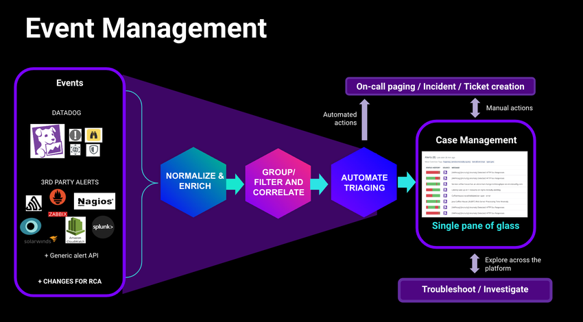
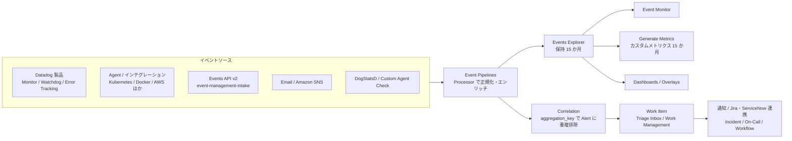
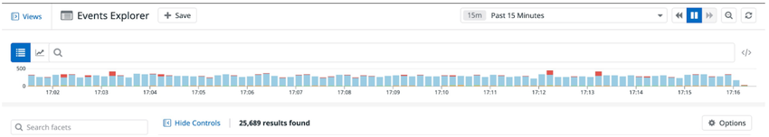
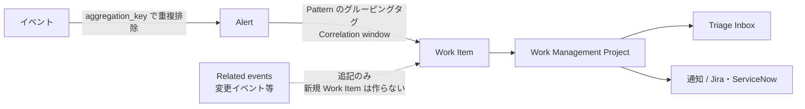
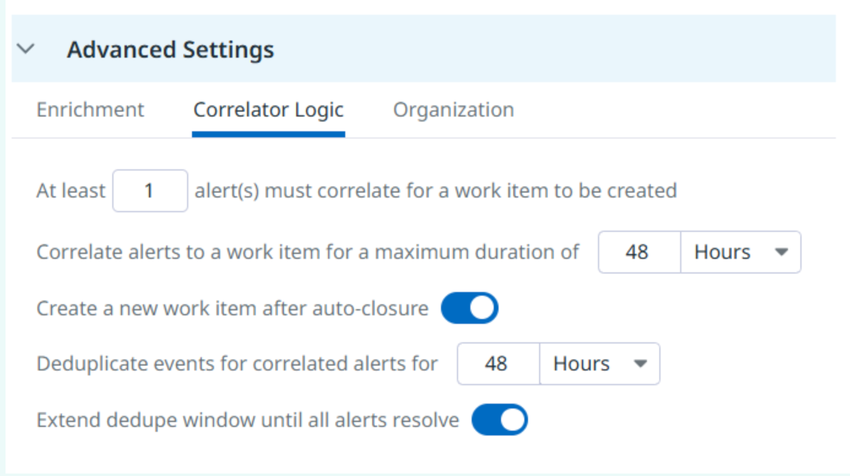
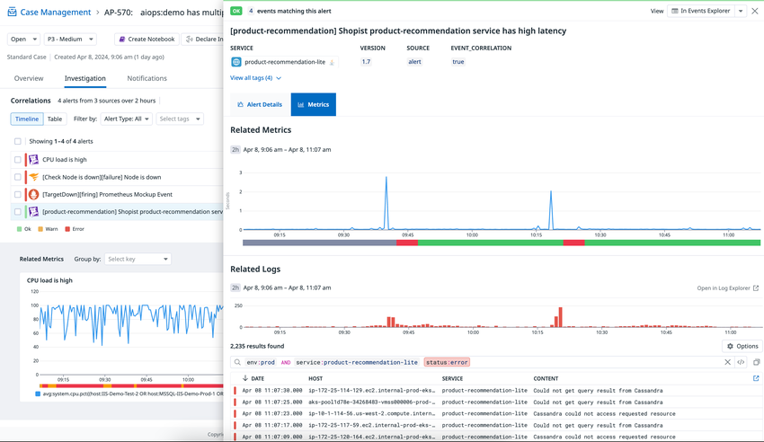
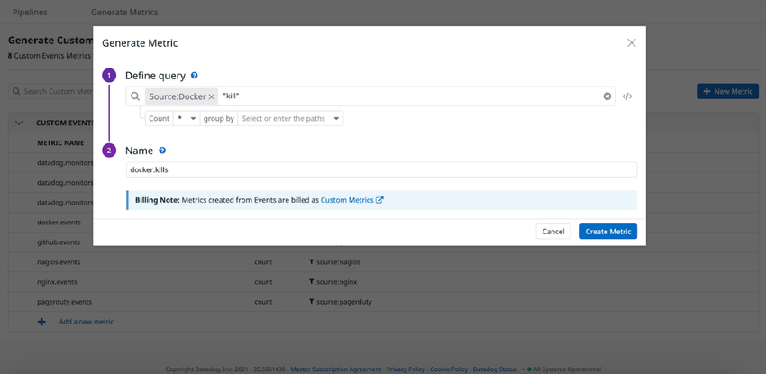

# Event Management（イベント管理）

## 概要

Datadog の **Event Management（イベント管理）** は、あらゆるソースのイベントを取り込み（Ingest）、正規化・エンリッチし（Pipelines）、相関させて（Correlation）、対応可能な単位（Work Item）にまとめる機能群である。Datadog は Monitor、Watchdog、Error Tracking などの製品から自動でイベントを作り、Agent とインストール済みインテグレーションが生成するイベントも収集する。サードパーティのアラート、変更要求（Change Request）、デプロイ、構成変更などのイベントも取り込める。イベント収集に対応するインテグレーションは 100 以上ある（Kubernetes、Docker、Jenkins、Chef、Puppet、Amazon ECS、Auto Scaling、Sentry、Nagios など）。[出典](https://docs.datadoghq.com/events/)

Event Management は次の要素で構成される。

| 構成要素 | 役割 | 本ファイルの節 |
|---|---|---|
| Ingest（イベント送信） | インテグレーション、Agent、Events API、Email、DogStatsD、Custom Agent Check、Amazon SNS、Amazon EventBridge からイベントを受け取る | [イベント送信](#イベント送信ingest) |
| Events Explorer | イベントの検索、Facet での絞り込み、Analytics、Saved Views | [Events Explorer](#events-explorerイベントエクスプローラー) |
| Pipelines and Processors | イベントのエンリッチ、タグ正規化、Grok/VRL による解析 | [Event Pipelines](#event-pipelinesイベントパイプラインと-processor) |
| Correlation（相関） | イベントを Alert に重複排除し、Alert を Work Item にまとめる。Pattern-based と Intelligent の 2 種類 | [Event Correlation](#event-correlationイベント相関) |
| Triage Inbox | 相関で作られた Work Item のトリアージ、調査、エスカレーション | [Triage Inbox と Work Item](#triage-inbox-と-work-item) |
| Event Monitor / Generate Metrics / Dashboards | イベントへのアラート、イベントからのメトリクス生成、ダッシュボードでの可視化 | [イベントの活用](#イベントの活用monitordashboardmetrics) |

画面への入り方：グローバル検索（`Cmd`/`Ctrl` + `K`）で `event explorer` と検索する。[出典](https://docs.datadoghq.com/events/) 主な画面の URL パスは、Events Explorer が `/event/explorer`、Correlation / Triage Inbox が `/event/correlation`、Pipelines が `/event/settings/pipelines`、Generate Metrics が `/event/configuration/generate-metrics`、Maintenance Windows が `/event/settings/maintenance-windows` である（公式ドキュメント内のリンク先）。

> **重要な変更（2025-03-01）:** Datadog の Monitor イベントの `aggregation_key` は、2025-03-01 から Monitor ID と Monitor Group の組み合わせごとに一意になった（それまでは Monitor ID ごとに一意）。ダッシュボードのクエリや Event API で Monitor イベントの `aggregation_key` を使っている場合は、`@monitor.id` に移行する必要がある。[出典](https://docs.datadoghq.com/api/latest/events/)

関連ファイル：

- モニター全般（Event Monitor 以外のタイプ、評価設定）：[Monitors](./monitors.md)
- 通知チャネルと Downtime：[通知と Downtime](./notifications-and-downtimes.md)、[通知・コラボレーション連携](./collaboration-integrations.md)
- Work Item（旧 Case）の管理：[Case Management](../service-management/case-management.md)
- インシデント宣言とオンコール：[Incident Management](../service-management/incident-management.md)、[On-Call](../service-management/on-call.md)
- 自動化：[Workflow Automation](../service-management/workflow-automation.md)
- DogStatsD の全般：[Custom Metrics と DogStatsD](./custom-metrics-and-dogstatsd.md)
- 監査用途（API 操作・設定変更の追跡）：[Audit Trail](./audit-trail.md)
- アラート設計の実践：[アラート設計とノイズ削減](../../04_応用編/alert-design-and-noise-reduction.md)

### 全体像



- **キャプション:** Event Management の概念図（公式ドキュメントのトップ画像）。
- **画面の説明:** 左端の「Events」枠に、Datadog 製品が生成するイベントと、サードパーティのアラート（Nagios、Zabbix、Prometheus、SolarWinds、Amazon CloudWatch、Splunk など）、「+ Generic alert API」「+ CHANGES FOR RCA」（根本原因分析のための変更イベント）が並ぶ。中央に「NORMALIZE & ENRICH」→「GROUP/FILTER AND CORRELATE」→「AUTOMATE TRIAGING」の 3 段階が矢印でつながる。右端は「Case Management（Single pane of glass）」で、上方向に自動アクション（On-call paging / Incident / Ticket creation）、下方向に「Troubleshoot / Investigate」（プラットフォーム全体の探索）がある。図中の Case Management は現在の Work Management にあたる。
- **出典:** https://docs.datadoghq.com/events/ （取得日 2026-11-02）



---

## 用語

| 用語 | 意味 |
|---|---|
| Event（イベント） | ある時点に発生した出来事の記録。タイトル、本文（message/text）、タグ、属性、タイムスタンプを持つ |
| Standard events | Agent とインストール済みインテグレーションが自動で集めるイベント。追加設定は不要 [出典](https://docs.datadoghq.com/events/ingest/) |
| Custom events | API、Custom Agent Check、DogStatsD、Email などでユーザーが送るイベント [出典](https://docs.datadoghq.com/events/ingest/) |
| Event category（v2） | Events API v2 のイベント種別。`alert`（アラートイベント）と `change`（変更イベント）がある [出典](https://docs.datadoghq.com/api/latest/events/post-an-event/) |
| `aggregation_key` | 相関時にイベントを Alert へ重複排除するためのキー（最大 100 文字） |
| Alert（相関における） | 同じ `aggregation_key` を持つイベントを重複排除してまとめた単位 |
| Work Item（旧称：Case） | 相関した Alert をまとめた対応単位。Work Management（旧称：Case Management）で管理する [出典](https://docs.datadoghq.com/incident_response/work_management/) |
| Pattern | Pattern-based Correlation のルール（ソース、フィルター、グルーピングタグ、時間ウィンドウなど） |
| Project | Work Item の送り先となる Work Management のプロジェクト |
| Reserved attributes | `host`、`source`、`status`、`service`、`message` の予約属性 |

> **改称:** Case Management は **Work Management** に改称された（旧称：Case Management）。API エンドポイントと権限名には引き続き `case` の語が使われる。Event Management のドキュメントでは「case」と「work item」の両方の表記が混在している（Intelligent Correlation のページは「cases」、Pattern-based / Triage のページは「work items」）。本ファイルでは Work Item と表記する。改称時期は公開情報では確認できず。[出典](https://docs.datadoghq.com/incident_response/work_management/)

---

## イベント送信（Ingest）

### 送信方法の一覧

Datadog の Event Management にイベントを送る方法は次のとおり。[出典](https://docs.datadoghq.com/events/ingest/)

| 方法 | 種別 | 主な用途 | 詳細 |
|---|---|---|---|
| インテグレーション | Standard | Kubernetes、Docker、AWS、Jenkins、Chef、Puppet、Sentry、Nagios など 100 以上 | [Integrations](./integrations.md) |
| Datadog Agent | Standard | Agent の起動/再起動イベント、Kubernetes イベントなど | [Datadog Agent](./agent.md) |
| Events API v2（`POST /api/v2/events`） | Custom | 任意システムからのアラート・変更イベント送信（推奨） | 本節 |
| Events API v1（`POST /api/v1/events`） | Custom | **非推奨**。過去に利用した組織のみ利用可 | 本節 |
| Email（Events API emails） | Custom | インテグレーションがなく、Agent check も書きたくない場合 | 本節 |
| Custom Agent Check | Custom | Agent 上の Python チェックから `self.event()` で送信 | 本節 |
| DogStatsD | Custom | アプリケーションから UDP/UDS で送信 | 本節 |
| Amazon SNS emails | Custom | SNS トピックのメール購読先に Datadog の Events API email を指定 | 本節 |
| Amazon EventBridge API Destinations | Custom | EventBridge から Datadog へイベント/ログを送信 | [AWS Integration](./aws-integration.md) |

### Events API v2（推奨）

Datadog の Events API v2 の「Post an event」は、イベントを公開するエンドポイントである。サポートされるイベントカテゴリは `change` と `alert` である。[出典](https://docs.datadoghq.com/api/latest/events/post-an-event/)

> **注意:** クライアントライブラリでこのエンドポイントを使うには、2025-07-01 以降にリリースされた最新版が必要である。古いライブラリは非推奨のエンドポイント `https://api.{site}/api/v2/events` に送信する。新しいエンドポイントは `https://event-management-intake.{site}/api/v2/events` である。[出典](https://docs.datadoghq.com/api/latest/events/post-an-event/)

#### エンドポイント（サイト別）

| Datadog サイト | 送信（POST） | 取得・検索（GET / POST search） |
|---|---|---|
| US1（app.datadoghq.com） | `https://event-management-intake.datadoghq.com/api/v2/events` | `https://api.datadoghq.com/api/v2/events` |
| US3（us3.datadoghq.com） | `https://event-management-intake.us3.datadoghq.com/api/v2/events` | `https://api.us3.datadoghq.com/api/v2/events` |
| US5（us5.datadoghq.com） | `https://event-management-intake.us5.datadoghq.com/api/v2/events` | `https://api.us5.datadoghq.com/api/v2/events` |
| EU1（app.datadoghq.eu） | `https://event-management-intake.datadoghq.eu/api/v2/events` | `https://api.datadoghq.eu/api/v2/events` |
| **AP1（ap1.datadoghq.com）** | `https://event-management-intake.ap1.datadoghq.com/api/v2/events` | `https://api.ap1.datadoghq.com/api/v2/events` |
| AP2（ap2.datadoghq.com） | `https://event-management-intake.ap2.datadoghq.com/api/v2/events` | `https://api.ap2.datadoghq.com/api/v2/events` |
| US1-FED（app.ddog-gov.com） | `https://event-management-intake.ddog-gov.com/api/v2/events` | `https://api.ddog-gov.com/api/v2/events` |

[出典](https://docs.datadoghq.com/api/latest/events/)

> **サイト差異:** API リファレンスには上記のほか `us2.ddog-gov.com` と `uk1.datadoghq.com` のエンドポイントも載っている（例：`https://event-management-intake.uk1.datadoghq.com/api/v2/events`）。サイトの全体像は [Datadog Sites](./datadog-sites.md) を参照。[出典](https://docs.datadoghq.com/api/latest/events/)

#### リクエストボディ（v2）

| フィールド（`data.attributes.` 配下） | 必須 | 型 | 説明・制限 |
|---|---|---|---|
| `title` | 必須 | string | イベントのタイトル。**最大 500 文字** |
| `category` | 必須 | enum | `change` または `alert` |
| `attributes` | 必須 | object | カテゴリごとの属性（下表） |
| `message` | 任意 | string | 自由形式の本文。**最大 4,000 文字**。構造化データは `attributes.custom` を推奨 |
| `tags` | 任意 | string[] | タグ。**最大 100 個** |
| `aggregation_key` | 任意 | string | 相関時の重複排除キー。**最大 100 文字**。指定するとこのキーでイベントが Alert に重複排除される |
| `host` | 任意 | string | 関連付けるホスト名（最大 255 文字）。そのホストのタグもイベントに付く |
| `timestamp` | 任意 | string | ISO 8601 形式（例 `2017-01-15T01:30:15.010000Z`）。省略時は受信時刻。**18 時間より古い値は不可** |
| `integration_id` | 任意 | enum | 許可値は `custom-events` |
| `data.type` | 必須 | enum | `event` |

`category: alert` の属性（`data.attributes.attributes`）：

| フィールド | 必須 | 説明・制限 |
|---|---|---|
| `status` | 必須 | `warn`、`error`、`ok` |
| `priority` | 任意 | `1`〜`5`（`1` が最高） |
| `custom` | 任意 | 任意の JSON。1 オブジェクトあたり最大 100 プロパティ、ネスト最大 10 階層 |
| `links` | 任意 | 関連リンク。最大 20 件。`category`（`runbook`、`documentation`、`dashboard`、`resource`）、`url`（最大 2,048 文字、必須）、`title`（最大 300 文字） |

`category: change` の属性（`data.attributes.attributes`）：

| フィールド | 必須 | 説明・制限 |
|---|---|---|
| `changed_resource` | 必須 | 変更されたリソース。`name`（最大 128 文字）と `type`（`feature_flag`、`configuration`） |
| `impacted_resources` | 任意（推奨） | 影響を受けるリソース。`type` は `service` のみ。最大 100 件。指定すると変更イベントが正しい場所に表示される |
| `author` | 任意 | 変更者。`name`（最大 128 文字）と `type`（`user`、`system`、`api`、`automation`） |
| `change_metadata` | 任意 | 任意の JSON。最大 100 プロパティ、ネスト最大 10 階層 |
| `prev_value` / `new_value` | 任意 | 変更前後の状態（任意の JSON） |

[出典](https://docs.datadoghq.com/api/latest/events/post-an-event/)

変更イベントは Change Tracking にも使われる。Change Tracking は Monitor Status 画面やダッシュボードの Change Overlays で変更を時系列に重ねて表示する。[出典](https://docs.datadoghq.com/dashboards/change_overlays/)

#### レスポンス

| HTTP ステータス | 意味 |
|---|---|
| `202` | 受理。`data.attributes.attributes.evt.uid` にイベントの一意 ID が入る（`evt.id` は非推奨で将来削除予定） |
| `400` | Bad Request（必須属性の欠落など） |
| `403` | Forbidden |
| `429` | Too many requests（レート制限超過） |

[出典](https://docs.datadoghq.com/api/latest/events/post-an-event/)

#### 送信例（アラートイベント、AP1）

```bash
curl -X POST "https://event-management-intake.ap1.datadoghq.com/api/v2/events" \
  -H "Accept: application/json" \
  -H "Content-Type: application/json" \
  -H "DD-API-KEY: ${DD_API_KEY}" \
  -H "DD-APPLICATION-KEY: ${DD_APP_KEY}" \
  -d @- << EOF
{
  "data": {
    "type": "event",
    "attributes": {
      "category": "alert",
      "title": "My Alerting Event",
      "message": "Something is broken!",
      "aggregation_key": "deduplication_key_here",
      "tags": ["service:my-test-service", "env:prod"],
      "attributes": {
        "status": "error",
        "priority": "1",
        "links": [{"category": "runbook", "title": "Runbook", "url": "https://example.com/runbook"}],
        "custom": {"region": "ap-northeast-1"}
      }
    }
  }
}
EOF
```

公式のコード例は `DD-API-KEY` と `DD-APPLICATION-KEY` の両ヘッダーを付けている。キーの種類と管理は [API とキー管理](./api-and-keys.md) を参照。[出典](https://docs.datadoghq.com/api/latest/events/post-an-event/)

### Events API v1（非推奨）

Datadog の Events API v1 の `POST /api/v1/events` は**非推奨**で、過去に利用した組織だけが使える。新規実装は v2 を使う。[出典](https://docs.datadoghq.com/api/latest/events/post-an-event/)

| フィールド | 必須 | 説明・制限 |
|---|---|---|
| `title` | 必須 | タイトル |
| `text` | 必須 | 本文。**最大 4,000 文字**。Markdown を使うときは `%%% \n` で始め `\n %%%` で終える |
| `aggregation_key` | 任意 | 最大 100 文字 |
| `alert_type` | 任意 | `error`、`warning`、`info`、`success`、`user_update`、`recommendation`、`snapshot` |
| `date_happened` | 任意 | POSIX 秒（整数）。18 時間より古いイベントは不可 |
| `priority` | 任意 | `normal`、`low` |
| `host`、`device_name`、`tags`、`source_type_name`、`related_event_id` | 任意 | ホスト、デバイス、タグ、ソース種別（例 `nagios`、`jenkins`、`my_apps`）、親イベント ID |

[出典](https://docs.datadoghq.com/api/latest/events/post-an-event/)

### イベントの取得・検索 API

| 操作 | メソッド・パス | 主なパラメーター | 必要権限 |
|---|---|---|---|
| Get a list of events | `GET /api/v2/events` | `filter[query]`、`filter[from]`、`filter[to]`（ミリ秒）、`sort`（`timestamp` / `-timestamp`）、`page[cursor]`、`page[limit]` | `events_read` |
| Search events | `POST /api/v2/events/search` | `filter.query/from/to`（日付計算式も可）、`options.timezone` または `options.timeOffset`（併用不可）、`page`、`sort` | `events_read` |
| Get an event | `GET /api/v2/events/{event_id}` | `event_id` | `events_read` |
| Get a list of events（v1） | `GET /api/v1/events` | `start`、`end`（必須）、`priority`、`sources`、`tags`、`unaggregated`、`exclude_aggregate`、`page` | `events_read` |

- v2 の一覧・検索 API はログと同じカーソル方式でページングする。[出典](https://docs.datadoghq.com/api/latest/events/get-a-list-of-events/)
- v1 の一覧 API は 1 リクエストで最大 1,000 件（最新順）を返す。続きは最後の結果のタイムスタンプを `end` に指定するか、`page` パラメーターを使う。[出典](https://docs.datadoghq.com/api/latest/events/get-a-list-of-events/)
- OAuth アプリは `events_read` スコープが必要である。[出典](https://docs.datadoghq.com/api/latest/events/get-a-list-of-events/)

### Email でのイベント送信（Events with email）

Datadog の Events with email は、インテグレーションがなく、Custom Agent Check も作りたくないアプリケーションから、メールでイベントを作る機能である。[出典](https://docs.datadoghq.com/events/guides/email/)

> **サイト差異:** Events with email は `app.ddog-gov.com`（US1-FED）と `us2.ddog-gov.com` では使えない。[出典](https://docs.datadoghq.com/events/guides/email/)

#### 専用メールアドレスの作成手順

1. 左下のアカウントメニューから **Organization Settings** を開く。
2. **Events API emails** タブを開く。
3. **Format** で `Plain text` または `JSON v2` を選ぶ。
4. 必要に応じて下表の属性を設定する。
5. **Create Email** をクリックする。

[出典](https://docs.datadoghq.com/events/guides/email/)

| 属性 | 説明 | 制限 |
|---|---|---|
| Description | メールアドレスの用途説明 | — |
| Tags | このメール経由の全イベントに付けるタグ。JSON 内のタグも加算される | **1 アドレスあたり 20 タグ** |
| Recipients | メッセージ先頭に付ける通知先ハンドル（`@` なし。例 `my@email.com`、`slack-acc-ch`） | **1 アドレスあたり 10 件** |
| Alert Type | Plain text / JSON 形式のアラートタイプ（例 `Info`）。JSON の `alert_type` が優先。**JSON v2 では非対応** | — |

#### 形式ごとの違い

| 形式 | 状態 | ボディ | タイトル | 主な注意 |
|---|---|---|---|---|
| `JSON`（v1 形式） | **新規作成不可**（既存アドレスは動作継続） | Events API v1 の JSON | JSON の `title` | 件名がない、または JSON が不正なメールは無視される |
| `Plain text` | 利用可 | 任意テキスト（HTML は Markdown に変換） | メールの件名 | 本文中の `#` でタグ付け可 |
| `JSON v2` | 利用可（JSON の新規用途はこちら） | Events API v2 の JSON（`data.attributes.*`） | JSON の `title` | 件名がない、または JSON が不正なメールは無視される |

[出典](https://docs.datadoghq.com/events/guides/email/)

Plain text 形式の処理と上限：

| 項目 | 内容 |
|---|---|
| HTML の変換 | HTML は Markdown に変換される |
| HTML のサニタイズ | 許可タグは `a`、`br`、`caption`、`code`、`div`、`em`、`h1`〜`h6`、`hr`、`iframe`、`img`、`li`、`ol`、`p`、`pre`、`span`、`strong`、`table`、`tbody`、`td`、`tfoot`、`th`、`thead`、`tr`、`ul`。他のタグと `<>` で囲まれた文字列は削除される |
| 返信・転送 | スレッドの最新メールだけを残し、過去の返信・転送部分は削除される |
| Title 上限 | 600 文字（超過分は切り捨て） |
| Message 上限 | 4,000 文字（超過分は切り捨て） |
| Tags 上限 | 200 タグ |

[出典](https://docs.datadoghq.com/events/guides/email/)

共通の注意：

- メールサイズの上限は**本文と添付を含めて 20 MB**。超えたメールは無視される。[出典](https://docs.datadoghq.com/events/guides/email/)
- JSON / JSON v2 で一般的なメールクライアントから試すと、本文が HTML に変換されて純粋な JSON でなくなり、無視されることがある。[出典](https://docs.datadoghq.com/events/guides/email/)
- Events API emails タブの **Last Used** 列で、アドレスごとの最終処理日（記録がなければ No data）を確認できる。[出典](https://docs.datadoghq.com/events/guides/email/)
- メール設定（API Emails など）の管理には `event_config_write` 権限が要る。[出典](https://docs.datadoghq.com/account_management/rbac/permissions/)

#### Amazon SNS からの取り込み

1. 上記の手順で Datadog の Events API email アドレスを作る。
2. SNS トピックで **Create subscription** を選び、Protocol に `Email`、Endpoint に 1 のアドレスを指定する。
3. Events Explorer で件名 `AWS Notification - Subscription Confirmation` のイベントを探し、記載された確認 URL をブラウザで開く。
4. AWS コンソールでサブスクリプションの状態が `Confirmed` になったことを確認する。以後トピックに発行されたメッセージがイベントになる。

[出典](https://docs.datadoghq.com/integrations/guide/events-from-sns-emails/)

> **サイト差異:** SNS メールからのイベント作成は `app.ddog-gov.com`（US1-FED）と `us2.ddog-gov.com` では使えない。[出典](https://docs.datadoghq.com/integrations/guide/events-from-sns-emails/)

### Custom Agent Check からの送信

Datadog Agent のカスタムチェックでは `self.event(<EVENT_DICT>)` でイベントを送る。カスタムチェックの作り方は [Agent 設定リファレンス](./agent-configuration.md) を参照。[出典](https://docs.datadoghq.com/events/guides/agent/)

| キー | 型 | 必須 | 説明 |
|---|---|---|---|
| `timestamp` | Integer | 必須 | エポック秒 |
| `event_type` | String | 必須 | イベント名 |
| `msg_title` | String | 必須 | タイトル |
| `msg_text` | String | 必須 | 本文 |
| `aggregation_key` | String | 任意 | 集約キー |
| `alert_type` | String | 任意 | `error`、`warning`、`success`、`info`（既定 `info`） |
| `source_type_name` | String | 任意 | ソース種別名 |
| `host` | String | 任意 | ホスト名 |
| `tags` | List of strings | 任意 | タグ |
| `priority` | String | 任意 | `normal` または `low` |

動作確認は `datadog-agent status` の Collector → Running Checks で、該当チェックの `Events: Last Run: n, Total: n` を見る。[出典](https://docs.datadoghq.com/events/guides/agent/)

### DogStatsD からの送信

Datadog の DogStatsD では、クライアントライブラリの `event()` 関数か、データグラム `_e{...}` でイベントを送る。DogStatsD 全般は [Custom Metrics と DogStatsD](./custom-metrics-and-dogstatsd.md) を参照。[出典](https://docs.datadoghq.com/events/guides/dogstatsd/)

データグラム形式：

```text
_e{<TITLE_UTF8_LENGTH>,<TEXT_UTF8_LENGTH>}:<TITLE>|<TEXT>|d:<TIMESTAMP>|h:<HOSTNAME>|k:<AGGREGATION_KEY>|p:<PRIORITY>|s:<SOURCE_TYPE_NAME>|t:<ALERT_TYPE>|#<TAG_KEY_1>:<TAG_VALUE_1>,<TAG_2>
```

| パラメーター | 必須 | 既定値・説明 |
|---|---|---|
| `_e` | 必須 | データグラムの先頭 |
| `<TITLE>` / `<TEXT>` | 必須 | タイトル / 本文（改行は `\\n`） |
| `<TITLE_UTF8_LENGTH>` / `<TEXT_UTF8_LENGTH>` | 必須 | UTF-8 エンコード後のバイト長 |
| `d:` | 任意 | タイムスタンプ（既定は現在の Unix エポック） |
| `h:` | 任意 | ホスト名（既定は Agent のホスト） |
| `k:` | 任意 | 集約キー（既定なし） |
| `p:` | 任意 | `normal` / `low`（既定 `normal`） |
| `s:` | 任意 | ソース種別名（既定なし。クライアントライブラリの `event()` では既定 `my_apps`） |
| `t:` | 任意 | `error` / `warning` / `info` / `success`（既定 `info`） |
| `#` | 任意 | タグ |

[出典（データグラム）](https://docs.datadoghq.com/extend/dogstatsd/datagram_shell/)、[出典（event 関数）](https://docs.datadoghq.com/events/guides/dogstatsd/)

送信例（Python）：

```python
from datadog import initialize, statsd
initialize(statsd_host="127.0.0.1", statsd_port=8125)
statsd.event("An error occurred", "Error message", alert_type="error", tags=["env:dev"])
```

> **補足:** DogStatsD-PHP ライブラリは、API キーとアプリケーションキーを設定すると、Agent を経由せず TCP（cURL）で Datadog API に直接送れる。UDP 経由より遅いが確実である。通信エラーに備えて `try`/`catch` で囲むことが推奨されている。[出典](https://docs.datadoghq.com/events/guides/dogstatsd/)

### Agent・コンテナ環境のイベント

| ソース | 内容 | 設定 |
|---|---|---|
| Docker | Agent の起動・再起動時にイベントを送る | — [出典](https://docs.datadoghq.com/containers/docker/) |
| Kubernetes（Datadog Operator） | Kubernetes イベント収集は既定で有効 | `features.eventCollection.collectKubernetesEvents` |
| Kubernetes（Helm） | Cluster Agent でイベント収集 | `clusterAgent.enabled`、`datadog.collectEvents`、`clusterAgent.rbac.create` を `true` |
| Kubernetes（Cluster Agent なし） | Node Agent でイベント収集 | `datadog.leaderElection`、`datadog.collectEvents`、`agents.rbac.create` を `true`（環境変数では `DD_COLLECT_KUBERNETES_EVENTS` と `DD_LEADER_ELECTION`） |

[出典](https://docs.datadoghq.com/containers/kubernetes/configuration/)

コンテナ/Kubernetes 向け Agent の詳細は [コンテナ/Kubernetes向けAgent](./kubernetes-and-containers-agent.md) を参照。

### イベントへの推奨タグ

Datadog はすべてのイベントに Unified Service Tagging と次のタグを付けることを推奨している。[出典](https://docs.datadoghq.com/events/guides/recommended_event_tags/)

| 属性/タグ | 目的 |
|---|---|
| `env` | 環境（production、staging など）。下位環境のイベントを高優先度と取り違えないため |
| `service` | 影響を受けるサービスの特定、サービスへのピボット、サービス単位の絞り込み |
| `version` | 障害が特定のビルド/バージョンに関係するかの判断 |
| `host` | 取り込み時にホストタグでエンリッチされ、Events Explorer から Host Infrastructure / Metrics タブにピボットできる |
| `team` | イベントを所有し通知を受けるチーム |

タグの付け方：API は `tags` フィールド、Monitor は「Say what's happening」節、インテグレーションは各インテグレーションのタグ設定で付ける。タグ設計は [Tagging](./tagging.md) と [タグ戦略の実践](../../04_応用編/tagging-strategy.md) を参照。

---

## Events Explorer（イベントエクスプローラー）

Datadog の **Events Explorer** は、Datadog に入ってくるイベントを集約して表示し、属性で絞り込み・グループ化し、Event Analytics でグラフ化する画面である。Boolean 演算子とワイルドカードを使える検索構文を持つ。2022 年に旧 **Event Stream（イベントストリーム）** を置き換えた。[出典](https://docs.datadoghq.com/events/explorer/)

> **注意:** Events Explorer は網羅的な監査ツールとしては設計されていない。ユーザー操作、API リクエスト、設定変更、リソース変更を監査・コンプライアンス・セキュリティ目的で追跡する場合は [Audit Trail](./audit-trail.md) を使う。[出典](https://docs.datadoghq.com/events/explorer/)



- **キャプション:** Events Explorer の上部の画面構成。
- **画面の説明:** 左上に **Views**（Saved Views パネルの開閉）、タイトル「Events Explorer」と **+ Save** ボタンがある。右上は時間範囲セレクター（例「15m Past 15 Minutes」）と、一時停止・再生・更新ボタン。その下に、リスト表示と Analytics（グラフ）表示の切り替えアイコン、検索バー、右端にクエリエディター（`</>`）切り替えがある。検索バーの下は件数の時系列バー（ステータスで色分け。赤はエラー系）で、最下部に Facet 検索（Search facets）、**Hide Controls**、結果件数（例「25,689 results found」）、**Options** ボタンが並ぶ。
- **出典:** https://docs.datadoghq.com/events/explorer/navigate/ （取得日 2026-11-02）

### 画面の構成要素

| 要素 | 内容 |
|---|---|
| Event side panel | イベントをクリックすると開く。タグとメッセージを表示 |
| Attributes タブ | イベント属性を JSON で表示。属性をクリックしてクエリへの追加/除外、列の追加ができる |
| Time range | プリセットまたはカスタム期間。Explorer と Analytics の範囲、タイムラインの範囲を決める |
| URL 共有 | 検索条件はすべて URL に含まれ、URL を共有すれば同じビューを開ける |
| Options（歯車） | 表示列、リスト密度（compact〜expanded）、タイムスタンプ（絶対 UTC / 相対）、タグ表示、上部タイムラインの表示/非表示 |

[出典（Navigate）](https://docs.datadoghq.com/events/explorer/navigate/)、[出典（Customization）](https://docs.datadoghq.com/events/explorer/customization/)

### 検索構文

Datadog の Events Explorer の検索構文は、[ログ検索構文](../logs/log-search-and-analytics.md)と同じである。`AND`、`OR`、`-`（除外）、ワイルドカード、エスケープ、`key:value` でのタグ・Facet 検索、`@` 接頭辞での属性検索が使える。[出典](https://docs.datadoghq.com/events/explorer/searching/)

| クエリ例 | 意味 |
|---|---|
| `source:(github OR chef)` | GitHub または Chef からのイベント |
| `host:(i-0ade23e6 AND db.myapp.com)` | 2 つのホスト条件 |
| `service:kafka` | `kafka` サービスのイベント |
| `status:error` | ステータス `error` のイベント（`emergency`、`alert`、`critical`、`error`、`warn`、`notice`、`info`、`debug`、`ok` を指定可） |
| `availability-zone:us-east-1a` | AZ が `us-east-1a` のイベント |
| `container_id:foo*` | コンテナ ID が `foo` で始まるイベント |
| `@evt.name:foo` | 属性 `evt.name` が `foo` のイベント |
| `tags:("status:<status>")` | 予約属性と同じキーを持つ**タグ**を検索する書き方 |

[出典](https://docs.datadoghq.com/events/explorer/searching/)、[出典（予約属性）](https://docs.datadoghq.com/events/explorer/attributes/)

旧 Event Stream 構文からの主な変化：

| 用途 | 旧構文 | 新構文 |
|---|---|---|
| GitHub または Chef | `sources:github,chef` | `source:(github OR chef)` |
| 複数タグの OR | `tags:env-prod,db` | `tags:(env-prod OR db)` |
| 複数タグの AND | `tags:security-group:sg-123 AND role:common-node` | `tags:(security-group:sg-123 AND role:common-node)` |
| 前方/後方一致 | 不可 | `*web`、`source:amazon*` |

[出典](https://docs.datadoghq.com/events/guides/migrating_to_new_events_features/)

### 予約属性（Reserved Attributes）

| 属性 | 説明 |
|---|---|
| `host` | 送信元ホスト名（メトリクスで定義されたもの）。一致するホストのホストタグが自動でイベントに付く。Agent は自動で設定する |
| `source` | インテグレーション名またはイベント発生元の技術（例 `nginx`、`postgresql`）。インテグレーション名と一致すると対応するパーサーと Facet が自動で入る |
| `status` | イベントのレベル/重大度 |
| `service` | イベントを生成したアプリケーション/サービス名 |
| `message` | 既定でイベント本文として取り込まれる |

[出典](https://docs.datadoghq.com/events/explorer/attributes/)

予約属性と同じキーのタグに Facet を作るには、Remapper Processor で別のタグ/属性に移し、その新しいタグ/属性に Facet を作る。[出典](https://docs.datadoghq.com/events/explorer/attributes/)

旧ステータス値は新しい値に置き換わった（`success` → `ok`、`warning` → `warn`、`info` と `error` は同じ）。多くのソース名も変わった（例 `EC2` → `amazon_ec2`、`AutoScaling` → `amazon_auto_scaling`、`AmazonLambda` → `amazon_lambda`）。[出典（ステータス）](https://docs.datadoghq.com/events/guides/migrating_to_new_events_features/)、[出典（ソース名一覧）](https://docs.datadoghq.com/events/guides/new_events_sources/)

### Facets

- Datadog は既定でイベント属性を Facet としてインデックスする。Facet は Facet サイドパネル、Analytics、Monitor で使える。[出典](https://docs.datadoghq.com/events/explorer/facets/)
- Facet の追加は左パネルの **+ Add**。追加後、その属性値は**新しいイベントから**保存され、Pattern-based Correlation のグルーピング、Event Monitor、グラフウィジェットの group by に使える。[出典](https://docs.datadoghq.com/events/explorer/facets/)
- `host`、`service`、`status` はコアのイベント属性で、これらのタグに新しい Facet は作れない。[出典](https://docs.datadoghq.com/events/explorer/facets/)
- Datadog Monitor イベントに同じキーのタグが複数ある場合、アルファベット順で最初のタグがイベント属性になる（例 `service:bcd; service:ace` なら `service:ace`）。[出典](https://docs.datadoghq.com/events/explorer/facets/)

### Event Analytics

Datadog の Event Analytics は、Events Explorer で集計・グループ化してグラフ表示する機能である。[出典](https://docs.datadoghq.com/events/explorer/analytics/)

| 手順 | 内容 |
|---|---|
| 1. 集計対象 | 属性/タグを選んで Facet として追加する。Facet をグラフ化するとユニーク数を表示 |
| 2. Group by | グループ化する Facet を選ぶ（属性を Facet にしておく必要がある） |
| 3. 時間間隔 | グローバル時間範囲に応じて選べるステップが変わる。表示は Timeseries、Table、Top List |
| 4. 上位/下位 | 指標で上位（top）または下位（bottom）を表示 |

Analytics のグラフはダッシュボードやノートブックのウィジェットとしてエクスポートできる。[出典](https://docs.datadoghq.com/events/explorer/analytics/)

### Saved Views

| 項目 | 内容 |
|---|---|
| 保存内容 | スコープしたクエリ、関連 Facet、時間範囲 |
| 共有範囲 | Default view 以外はすべて組織内で共有され、誰でも編集できる（作成者のアバター表示） |
| 操作 | 読み込み、現在の設定での更新、名前変更、削除、短縮リンクでの共有、スター（お気に入り。リスト上部とナビゲーションメニューに表示） |
| Default view | 各ユーザー専用。更新しても組織に影響しない。Datadog の既定値へのリセットも可能 |
| 権限 | Read-only ユーザーは更新・名前変更・削除ができない |

[出典](https://docs.datadoghq.com/events/explorer/saved_views/)

### イベント本文での @通知

API で送るイベントのメッセージには `@` 通知を書ける。[出典](https://docs.datadoghq.com/events/explorer/notifications/)

| ハンドル | 動作 |
|---|---|
| `@all` | 組織の全メンバーに通知 |
| `@test@example.com` | 指定アドレスにメール |
| `@slack-<SLACK_ACCOUNT>-<CHANNEL_NAME>` | 指定 Slack チャンネルに投稿 |
| `@webhook` | Webhook を起動 |

通知チャネルの設定は [通知・コラボレーション連携](./collaboration-integrations.md) を参照。

---

## Event Pipelines（イベントパイプライン）と Processor

Datadog の **Event Management Pipelines** は、取り込んだイベントを Processor の連鎖で解析・エンリッチ・正規化する仕組みである。用途は、タグ・カスタム属性・関連メタデータの付与（エンリッチ）、タグの正規化、Grok ルールでメッセージや属性を解析してタグ/属性にすること、である。[出典](https://docs.datadoghq.com/events/pipelines_and_processors/)

### 動作

- 各イベントは**すべてのパイプラインのフィルター**と照合される。フィルターに一致すると、そのパイプラインの Processor が順に適用され、次のパイプラインに進む。[出典](https://docs.datadoghq.com/events/pipelines_and_processors/)
- パイプラインのフィルターは Processor より**先に**評価される。パイプライン内で抽出した属性ではフィルターできない。[出典](https://docs.datadoghq.com/events/pipelines_and_processors/)
- JSON 形式のイベントは自動でパースされる。[出典](https://docs.datadoghq.com/events/guides/migrating_to_new_events_features/)
- 設定場所：**Event Management > Settings > Pipelines**（`/event/settings/pipelines`）。

### パイプラインの作成手順

1. Event Management Pipelines を開き、**Add a Pipeline** をクリックする。
2. ドロップダウンからフィルターを選ぶか、`</>` アイコンで Explorer のクエリとしてフィルターを書く（例：特定の `source` やタグ）。
3. パイプラインに名前を付け、**Create** をクリックする。
4. 作成後に Processor を追加する。

[出典](https://docs.datadoghq.com/events/pipelines_and_processors/)

### Processor 一覧

| Processor | 機能 | 主な制約・既定動作 |
|---|---|---|
| Aggregation Key Processor | 属性/タグから `@aggregation_key` を生成し、相関での重複排除を改善 | 属性/タグキーは**最大 5 個**。既定で既存キーを上書き（トグルで変更可）。複数値はアルファベット順に連結してハッシュ化。値がなければキーを付けない。ソース/インテグレーションが違えば別キー。**Datadog Monitor アラートのキーは変更しない** |
| Arithmetic Processor | 数式（`+`、`-`、`*`、`/`、括弧）の結果を新属性に入れる | 既定では属性が欠けると計算をスキップ（「Replace missing attribute by 0」で 0 補完）。`-` は前後に空白が必要。既存属性は上書き。結果は小数第 9 位に丸め |
| Date Remapper | 指定属性を公式タイムスタンプにする | 既定の日付属性は `timestamp`、`date`、`_timestamp`、`Timestamp`、`eventTime`、`published_date`。認識形式は ISO 8601、UNIX ミリ秒エポック、RFC3164。複数ある場合は**最後**の Date Remapper が有効 |
| Category Processor | 検索クエリに一致したイベントにカテゴリ属性を付ける | 最初に一致したクエリで停止（順序に注意）。カテゴリ名は一意。Status Remapper と組み合わせ可 |
| Grok Parser | Grok ルールでメッセージ/属性を解析し属性を抽出 | 1 Processor あたりルールは**10 個以下を推奨**。サンプルは最大 5 件、各 5,000 文字。ルール名は英数字・`_`・`.` のみで一意 |
| Lookup Processor | 属性値を Reference Table または手動マッピング表で別の値に変換（CMDB 情報の付与など） | 手動マッピング表は**プラットフォーム全体で 100 KB まで**（Reference Table はより大きなファイル可）。見つからない場合の `fallbackValue` を設定可 |
| Remapper | 属性/タグを別の属性/タグに付け替え | ターゲット名に `:` や `,` は不可。属性へは `String`/`Integer`/`Double` への型変換を試行（失敗時は元の型） |
| Service Remapper | 指定属性を公式の `service` にする | 複数ある場合は**最初**の Service Remapper のみ有効 |
| Status Remapper | 指定属性を公式の `status` にする | Syslog 重大度に準拠（0〜7 の整数、`emerg`/`f`→emergency、`a`→alert、`c`→critical、`e`→error、`w`→warning、`n`→notice、`i`→info、`d`/`trace`/`verbose`→debug、`o`/`s`/`OK`/`Success`→ok、その他→info）。**全パイプラインを通じて最初に当たった Status Remapper のみ**適用 |
| String Builder Processor | テンプレート（`%{attribute_path}`）で新属性を作る | 結果は**最大 256 文字**。既存属性は上書き |
| VRL Processor【Preview】 | Vector Remap Language（VRL）スクリプトで複数操作を一括実行 | 下記参照 |

[出典（一覧）](https://docs.datadoghq.com/events/pipelines_and_processors/)、[出典（Aggregation Key）](https://docs.datadoghq.com/events/pipelines_and_processors/aggregation_key/)、[出典（Arithmetic）](https://docs.datadoghq.com/events/pipelines_and_processors/arithmetic_processor/)、[出典（Date）](https://docs.datadoghq.com/events/pipelines_and_processors/date_remapper/)、[出典（Category）](https://docs.datadoghq.com/events/pipelines_and_processors/category_processor/)、[出典（Grok）](https://docs.datadoghq.com/events/pipelines_and_processors/grok_parser/)、[出典（Lookup）](https://docs.datadoghq.com/events/pipelines_and_processors/lookup_processor/)、[出典（Remapper）](https://docs.datadoghq.com/events/pipelines_and_processors/remapper/)、[出典（Service）](https://docs.datadoghq.com/events/pipelines_and_processors/service_remapper/)、[出典（Status）](https://docs.datadoghq.com/events/pipelines_and_processors/status_remapper/)、[出典（String Builder）](https://docs.datadoghq.com/events/pipelines_and_processors/string_builder_processor/)

Grok の構文（`%{MATCHER:EXTRACT:FILTER}`）や Matcher の詳細はログの Grok Parser と共通である。詳しくは [Log Pipelines と処理](../logs/log-pipelines-and-processing.md) を参照。

### VRL Processor【Preview】

Datadog の Event Management の VRL Processor は Preview 段階で、利用には Datadog アカウントチームへの申請が必要である。1 つのスクリプトでメッセージ/タイトルの書き換え、タグ追加、集約キー設定、カスタム属性の追加/削除などを実行できる。[出典](https://docs.datadoghq.com/events/pipelines_and_processors/vrl_processor/)

書き込み可能なフィールド（表にないフィールドは更新不可）：

| フィールド | カテゴリ | 操作 | 受け付ける値 |
|---|---|---|---|
| `message`、`title`、`service`、`aggregation_key` | 全カテゴリ | Write | String |
| `tags` | 全カテゴリ | Write | `key:value` 文字列の配列 |
| `custom` | Alert | Write、Delete | オブジェクト |
| `status` | Alert | Write | `ok`、`warn`、`error` |
| `priority` | Alert | Write | `"1"`〜`"5"`（**文字列**。`.priority = 1` は不可） |
| `links` | Alert | Write | オブジェクト配列（`category` は `runbook`、`documentation`、`dashboard`、`resource`） |
| `change_metadata` | Change | Write、Delete | オブジェクト |
| `author` | Change | Write | オブジェクト（`type` は `system`、`user`、`api`、`automation`） |
| `changed_resource`、`impacted_resources` | Change | Write | API で許可された型 |
| `new_value`、`prev_value` | Change | Write | オブジェクト |

制限：

| 項目 | 内容 |
|---|---|
| スクリプトサイズ | 最大 10,000 バイト（非 ASCII 文字は複数バイト） |
| エラー処理 | 失敗しうる関数は `!`、`??`、`result, err = ...` で処理必須（未処理はコンパイルエラー） |
| 使えない関数 | `get_secret`、`set_secret`、`remove_secret`、`set_semantic_meaning` |
| 他カテゴリのフィールド | 使えない（例：Change イベントで `.status`）。書き込みはスキップされ、残りは適用 |
| `%` メタデータ | イベントに保存されない |
| タイムスタンプ値 | 保存不可（`now()` をそのまま入れると実行時エラー）。`format_timestamp!(now(), "%+")` などで文字列化する |
| ネスト | 19 階層を超える結果は適用されない |
| `_` で始まる属性 | Datadog 予約で、スクリプトから使えない |
| 失敗時の動作 | スクリプト全体が成功した場合のみ更新を適用。失敗してもイベントは破棄されず、次の Processor に進む |
| フィルター | VRL Processor 自体にフィルターはない（パイプラインのフィルターに従う）。部分適用はスクリプト内の `if` で行う |
| テスト | ブラウザ内でサンプルイベントに対して実行できるが、検証（更新可能フィールド、値の型、ブロック関数、サイズ上限）は行われない |

[出典](https://docs.datadoghq.com/events/pipelines_and_processors/vrl_processor/)

### パイプラインの権限

| 権限 | 内容 |
|---|---|
| `events_write_pipelines` | パイプラインの作成・編集・削除（フィルタークエリ、順序の変更を含む） |
| `events_write_processors` | パイプライン内の Processor の作成・編集・削除 |

[出典](https://docs.datadoghq.com/events/pipelines_and_processors/)

---

## Event Correlation（イベント相関）

Datadog の **Event Correlation** は、イベントを関係性またはユーザー定義の設定に基づいてグループ化し、通知と課題の数を減らす機能である。目的は、アラート疲れの軽減、チケット・通知数の削減、影響を受ける複数チームが 1 つの課題を共有して個別対応（サイロ化）を避けることである。[出典](https://docs.datadoghq.com/events/correlation/)

> **サイト差異:** Event Correlation（Pattern-based、Intelligent、Triage and Notify、Analytics、Maintenance Windows を含む）と Triage Inbox は `app.ddog-gov.com`（US1-FED）と `us2.ddog-gov.com` では使えない。料金ページでも Event Management は US-FED サイトで提供されていないと記載されている。[出典](https://docs.datadoghq.com/events/correlation/)、[出典（料金）](https://www.datadoghq.com/pricing/?product=event-management)

### 2 種類の相関

| 種類 | 設定 | 仕組み | 対象 |
|---|---|---|---|
| Pattern-based Correlation | ユーザーがパターンを定義（推奨パターンから開始可） | イベントを `aggregation_key` で Alert に重複排除し、グルーピングタグと時間ウィンドウで Work Item にまとめる。ML により関連する Datadog Monitor イベントでの自動エンリッチも行う | 選択したイベントソース（サードパーティを含む） |
| Intelligent Correlation | 有効化のみ（タグで範囲を絞り込み可） | ML がインフラの依存関係、テレメトリ、その他のヒューリスティクスで関連 Monitor アラートを自動でまとめる | Monitor アラートのうち、**ページング用インテグレーションに通知するもの、または高優先度タグが付いたもの**のみ |

[出典（構成）](https://docs.datadoghq.com/events/correlation/configuration/)、[出典（Pattern）](https://docs.datadoghq.com/events/correlation/patterns/)、[出典（Intelligent）](https://docs.datadoghq.com/events/correlation/intelligent/)

### 処理の流れ



- まずイベントは `aggregation_key` で Alert に重複排除され、次に Alert が設定に基づいて Work Item に相関される。`aggregation_key` のないイベントは、時間枠内で 1 つの Alert に重複排除される。[出典](https://docs.datadoghq.com/events/correlation/patterns/)
- `aggregation_key` は Events API v2 の `aggregation_key`、DogStatsD の `k:`、Agent check の `aggregation_key`、または Aggregation Key Processor で付ける。

### Pattern-based Correlation の作成

1. **Correlation** ページ（`/event/correlation`）で、パターン表の上にある **+ Add a Pattern** をクリックする。左に推奨パターン、右にパターン出力のプレビューが表示される。
2. 推奨パターンを調整する場合は **+ Continue With Pattern**、ゼロから作る場合は **+ Personalize From Scratch** を選ぶ。
3. 下表の項目を設定する。
4. プレビューで影響を確認する。
5. 送り先の Project を選び（任意で Work Item にタグを付け）、**Save and Activate** をクリックする。

[出典](https://docs.datadoghq.com/events/correlation/patterns/)

推奨パターン（Suggested patterns）は、よく使われている `service` と `env` タグに基づいて Datadog が提案する。推奨をクリックすると設定項目が入力済みの状態で開く。[出典](https://docs.datadoghq.com/events/correlation/patterns/)

| 設定項目 | 内容 |
|---|---|
| Event source | グループ化するイベントソース（ドロップダウン） |
| Filter by these events or tags | ソースから除外するイベントのクエリ |
| Related events | 変更イベントなど調査用の補助イベント。Work Item に追記されるが、**新しい Work Item は作らない** |
| Grouping tags | グルーピングに使うタグ（イベント Facet）。ドロップダウンにない場合は Advanced settings で追加（Facet の作成と同じ） |
| Customize work item title（Advanced） | 自動生成タイトルの代わりのテンプレート。`{{tag.service}}` のようなハンドルバー構文でタグ値（カンマ区切り）を参照 |
| Project | 送り先の Work Management プロジェクト |

[出典](https://docs.datadoghq.com/events/correlation/patterns/)

#### Correlator Logic（Advanced settings）



- **キャプション:** Pattern-based Correlation の Advanced Settings にある Correlator Logic タブ。
- **画面の説明:** Advanced Settings に **Enrichment**、**Correlator Logic**、**Organization** の 3 タブがある。Correlator Logic タブには上から「At least [1] alert(s) must correlate for a work item to be created」（最小アラート数）、「Correlate alerts to a work item for a maximum duration of [48] [Hours]」（Correlation window）、「Create a new work item after auto-closure」（トグル、オン）、「Deduplicate events for correlated alerts for [48] [Hours]」（Deduplication window）、「Extend dedupe window until all alerts resolve」（トグル、オン）が並ぶ。画像の値はドキュメントの例示値で、既定値として明記されたものではない。
- **出典:** https://docs.datadoghq.com/events/correlation/patterns/ （取得日 2026-11-02）

| 設定 | 意味 |
|---|---|
| Minimum alert count | Work Item を作るのに必要な相関 Alert の最小数。1 なら最初の Alert で作られる |
| Correlation window | 同じ Work Item に新しい Alert を追加できる最大期間。最初の Alert が相関した時点から始まる |
| Create a new work item after auto-closure | 有効にすると、前の Work Item が自動クローズした後、一致する Alert が新しい Work Item を作る |
| Deduplication window | Work Item 内の既存 Alert に追加イベントを関連付ける期間。最初の Alert が相関した時点から始まる |
| Extend dedupe window until all alerts resolve | 有効にすると、未解決の Alert は Deduplication window 終了後も**最大 30 日**イベントを受け付ける。Correlation window は延長しない |

[出典](https://docs.datadoghq.com/events/correlation/patterns/)

公式ドキュメントの例（最小アラート数 1、Correlation window 48 時間、Deduplication window 48 時間）：

| 時刻 | 出来事 | 結果 |
|---|---|---|
| 月曜 9:00 | Alert A が相関 | Work Item 作成、両ウィンドウ開始 |
| 月曜 10:00 | Alert B が相関 | 同じ Work Item に追加 |
| 水曜 9:00 | 両ウィンドウ終了 | — |
| 水曜 10:00 | Alert C が相関 | Correlation window が終わっているので**新しい Work Item** を作る（auto-closure 設定に関係なく） |

Extend dedupe window が有効なら、未解決の Alert A/B のイベントは水曜 9:00 以降も最大 30 日まで既存の相関を更新できる。Alert C は新しい Alert なので既存 Work Item には入らない。[出典](https://docs.datadoghq.com/events/correlation/patterns/)

#### Work Item のライフサイクルと上限

- Work Item は、含まれる Alert がすべて解決したときだけ自動クローズする。Alert が未解決のまま重複排除期間が終わると相関は止まり、Work Item は手動でクローズしない限り Open のままになる。[出典](https://docs.datadoghq.com/events/correlation/patterns/)
- 1 つの Work Item に入る Alert は**最大 500**、各 Alert が保持するイベントは**最大 100**。100 件に達すると、その Alert の以降のイベント（リカバリーイベントを含む）は破棄される。そのため Alert が解決できず、Work Item は手動でクローズするまで Open のままになる。[出典](https://docs.datadoghq.com/events/correlation/patterns/)
- 処理が Alert の解決前に止まった Work Item には **Ended incomplete** バッジが付く（ホバーで理由を表示）。[出典](https://docs.datadoghq.com/events/correlation/patterns/)
- Work Item のイベント一覧は別途一致イベントを取得するため、100 件を超えて表示されることがある。表示件数と相関エンジンが保持・処理した件数は一致しない場合がある。[出典](https://docs.datadoghq.com/events/correlation/patterns/)
- 既存パターンを更新すると、そのパターンの処理中（live）の Work Item はすべて処理を停止し、一致する新しいイベントは新しい Work Item を作る。[出典](https://docs.datadoghq.com/events/correlation/patterns/)

#### パターン出力のプレビュー

| 表示項目 | 内容 |
|---|---|
| 取り込みイベント数 | 最初の 1,000 件までに限定 |
| 重複排除後の Alert 数 | イベントから重複排除される Alert の数 |
| 作成される Work Item 数 | 設定に基づく見込み数 |

プレビューの既定タイトルは相関の最初の Alert である。保存後、Work Item のタイトルは自動（intelligently）生成される。[出典](https://docs.datadoghq.com/events/correlation/patterns/)

### Intelligent Correlation の有効化

1. Event Management の **Settings** ページで、Projects の下にある **Intelligent Correlation** をクリックする。
2. **Intelligent Correlator** カードの **Edit** をクリックする。
3. 「Define Intelligent Correlator」で評価対象を任意で絞り込む。
   - **Consider events with any of these tags**：いずれかのタグに一致するイベントだけを相関する（空欄なら全 Monitor アラートが対象）。
   - **Exclude events with any of these tags**：一致するイベントを相関しない（ノイズの多いアラートや非本番アラートの除外に使う）。
4. **Save & Enable** をクリックする。

[出典](https://docs.datadoghq.com/events/correlation/intelligent/)

- Intelligent Correlation の有効化は Datadog 組織全体に適用される。[出典](https://docs.datadoghq.com/events/correlation/intelligent/)
- 作られた Work Item（ドキュメント上は case）は、Correlation ページの **Intelligent Correlation** という名前のプロジェクトで確認できる。[出典](https://docs.datadoghq.com/events/correlation/intelligent/)
- 関係性を判断できるだけのテレメトリがない場合や、Monitor が対象条件（ページング用インテグレーションへの通知、または高優先度タグ）を満たさない場合、相関された Work Item は作られないことがある。[出典](https://docs.datadoghq.com/events/correlation/intelligent/)
- 公式ブログ（2024-12-05 公開）によると、Intelligent Correlation はサービスのトポロジーと主要テレメトリを考慮する。例として、接続している 2 つのサービスのエラー率アラートを関連付ける。[出典](https://www.datadoghq.com/blog/aiops-intelligent-correlation/)（2024-12-05 公開）

### 相関関連の権限

| 権限 | 内容 | 既定ロール |
|---|---|---|
| `event_correlation_config_read` | 相関ルールと設定の閲覧 | Datadog Standard Role |
| `event_correlation_config_write` | 相関ルールと設定の管理 | Datadog Standard Role |
| `cases_shared_settings_write` | Work Management 共有設定の書き込み（Maintenance Windows の作成に必要） | 公開情報では既定ロールを確認できず |

[出典（権限）](https://docs.datadoghq.com/account_management/rbac/permissions/)、[出典（Maintenance Windows）](https://docs.datadoghq.com/events/correlation/maintenance_windows/)

---

## Triage Inbox と Work Item

Datadog Event Management の **Triage Inbox** は、関連イベントを対応可能な Work Item にまとめて表示する一元ビューである。保存可能なビューで高優先度の Work Item に絞り、相関したアラート、関連する変更、テレメトリを 1 か所で確認できる。[出典](https://docs.datadoghq.com/events/triage_inbox/)



- **キャプション:** 相関から作られた Work Item の詳細画面（Investigation タブ）と、イベントのサイドパネル。
- **画面の説明:** 左側は Work Item の詳細（パンくず「Case Management > AP-570」。撮影時点の旧名称表示）。ステータス（Open）、優先度（P3 - Medium）、**Create Notebook**、**Declare Incident** ボタンがあり、タブは Overview / Investigation / Notifications。Investigation タブの **Correlations** に「4 alerts from 3 sources over 2 hours」と表示され、Timeline / Table 切り替え、Alert Type とタグのフィルター、アラート一覧（CPU load is high、Node is down、Prometheus のイベント、サービスの高レイテンシ）が並ぶ。下部は **Related Metrics**（Group by 付き）。右側のサイドパネルは選んだアラートの詳細で、SERVICE、VERSION、SOURCE、EVENT_CORRELATION の各属性、**Alert Details** / **Metrics** タブ、Related Metrics のグラフ、Related Logs（ログ件数のグラフと、`env:prod AND service:... status:error` で絞ったログ一覧）がある。
- **出典:** https://docs.datadoghq.com/events/correlation/triage_and_notify/ （取得日 2026-11-02）

### Triage Inbox の操作

| 操作 | 内容 |
|---|---|
| プロジェクト選択 | 左パネルでプロジェクトを選ぶと、Open、In Progress、Closed、Archived の標準ステータスビューが表示される |
| 表示形式 | Split view（個別の詳細調査）または Table view（一括確認と列設定） |
| 並び替え | Sort By：Priority、Created at、Last Updated。**Save** で保存して再利用 |
| カード上の更新 | ステータス、優先度、担当者をカード上で直接変更 |
| アラートのプレビュー | カードのアラート件数にホバーすると相関アラートを表示 |
| 画面の拡大 | 左のプロジェクトパネルと Datadog ナビゲーションバーを折りたたむ |

[出典](https://docs.datadoghq.com/events/triage_inbox/)

右側パネルでできること：

| 区分 | 操作 |
|---|---|
| コラボレーション | Work Item タイムラインでユーザーのメンションとコメント |
| 通知 | Slack、Microsoft Teams、Email、Webhook |
| エスカレーション | Incident Management でのインシデント宣言、On-Call でのページング、Workflow Automation、サードパーティツール |
| 外部同期 | Jira と ServiceNow のレコード同期 |
| 根本原因 | 関連イベント（不具合のある変更など）を根本原因（root cause）としてマーク |
| ワークフロー | 修復用ランブックを手動実行、または Work Item Automation Rules で条件付き実行 |
| マージ/分割 | 関連 Work Item のマージ、個別調査が必要なアラートの分割 |

すべてのアラートが解決すると、Work Item は自動でクローズされる。手動で解決済みにもできる。[出典](https://docs.datadoghq.com/events/triage_inbox/)

### Event Management の Work Item の属性

| 項目 | 動作 |
|---|---|
| Priority | 相関アラートのうち最も高い優先度 |
| Attribute | 相関イベントのタグ。ユーザーが更新した値はエンジンに上書きされない |
| Status | システムが自動管理し、ユーザーの更新は上書きされる。全アラートが回復すると自動解決し、最大存続期間内にアラートが再発すると自動で再オープンする |
| Deletion | 無関係なアラートをチェックして削除できる。削除したアラートは再び相関されない |
| Enriched Alerts | Datadog がインフラに基づいて関連すると判断した Intelligent アラートが自動で追加されることがある。追加されたアラートは Work Item の属性、優先度、ステータスに影響しない |

[出典](https://docs.datadoghq.com/events/correlation/triage_and_notify/)

調査の手順：Work Item の Overview から **Investigation** を開き、Correlations 節のアラート/イベントをクリックすると、そのアラートに関連するメトリクスとログが表示される。無関係なアラート/イベントは選んで削除できる。Related Metrics 節で関連メトリクスを比較したりタグでグループ化したりできる。[出典](https://docs.datadoghq.com/events/correlation/triage_and_notify/)

### 通知とチケット連携

| 方式 | 内容 |
|---|---|
| Ticketing | Work Management の Project Settings でインテグレーションを設定する。**ServiceNow** と **Jira** で手動/自動のチケット作成と双方向同期に対応 |
| Notifications（Views） | Work Management の View（クエリで Work Item をまとめたもの）に一致する Work Item が作られたときに通知する。PagerDuty、Email、Webhook、Microsoft Teams、Slack に対応 |

[出典](https://docs.datadoghq.com/events/correlation/triage_and_notify/)

> **注意:** 相関はモニターの個別通知をミュートしない。重複通知をなくすには、元のモニターの通知設定を変更する必要がある。[出典](https://docs.datadoghq.com/events/correlation/triage_and_notify/)

ServiceNow・Jira 連携の詳細は [Case Management](../service-management/case-management.md) と [通知・コラボレーション連携](./collaboration-integrations.md) を参照。

### Maintenance Windows

Datadog Event Management の **Maintenance Windows** は、計画メンテナンス中の Work Item 通知を抑止する機能である。条件に一致し、時間枠内に発生した Work Item は自動でアーカイブされる。[出典](https://docs.datadoghq.com/events/correlation/maintenance_windows/)

作成手順：

1. Event Management Settings を開き、左ナビゲーションの **Work Item Attributes** の横にある **Maintenance Windows** を選ぶ。
2. 右上の **New Maintenance Window** をクリックする。
3. 名前を入力し、対象 Work Item の条件をタグまたは属性で指定する（Work Item は既定で相関したアラートのタグを継承する）。
4. 開始・終了時刻を選び、内容を確認して **Save** する。

ServiceNow 連携：ServiceNow の変更要求（Change Request）を取り込んでいれば、**Sync from ServiceNow** で ServiceNow の変更から Maintenance Window を作成・更新・削除できる。条件では `$` 接頭辞で ServiceNow 変更の値を動的に参照でき、開始・終了時刻に使う ServiceNow の日時フィールドを指定する。[出典](https://docs.datadoghq.com/events/correlation/maintenance_windows/)

> **補足:** Event Management の Maintenance Windows は Work Item の通知を抑止する機能で、Monitor の通知をミュートする Downtime とは別物である。Downtime は [通知と Downtime](./notifications-and-downtimes.md) を参照。

### 相関・Work Item の分析（Analytics）

| データソース | 用途 | 対応ウィジェット |
|---|---|---|
| Cases | Work Item の分析（チーム生産性、課題傾向）。ウィジェット設定の *Graph your data* で `Cases` を選ぶ | timeseries、top list、query value、table、tree map、pie chart、change、list |
| Events | ソース、ホスト、サービス別のイベント分析（問題アラートの発生源、運用負荷の推移） | Events データソースに対応するグラフウィジェット |

[出典](https://docs.datadoghq.com/events/correlation/analytics/)

---

## イベントの活用（Monitor・Dashboard・Metrics）

### Event Monitor

Datadog の **Event Monitor** は、取り込まれたイベントのうち検索クエリに一致するものでアラートするモニタータイプである。作成場所は **Monitors > New Monitor > Event**。モニター全般の評価設定は [Monitors](./monitors.md) を参照。[出典](https://docs.datadoghq.com/monitors/types/event/)

| 項目 | 内容 |
|---|---|
| クエリ | Events Explorer の検索構文 |
| 監視対象 | イベント件数、属性/タグの集計値（Avg、Median、Min、Sum など）、Facet のユニーク値数 |
| Group by | 最大 4 Facet |
| 比較条件 | `above`、`above or equal to`、`below`、`below or equal to`、`equal to`、`not equal to` |
| 通知の集約 | Simple Alert（全ソースを集約して 1 アラート）/ Multi Alert（グループごと、最大 1,000 グループ） |
| モニター数の上限 | アカウントあたり既定 1,000 個（超える場合は Multi Alert の活用かサポートへ連絡） |
| Monitor イベントの除外 | Event Monitor は Monitor イベントにはアラートしない（無限ループ防止） |
| 評価ウィンドウ | 最大 48 時間。より長い期間は Generate Metrics でメトリクス化して Metric Monitor を使う（最大 1 か月） |
| Recovery threshold | `warning_recovery`、`critical_recovery` は非対応 |

[出典](https://docs.datadoghq.com/monitors/types/event/)、[出典（48 時間・Recovery）](https://docs.datadoghq.com/events/guides/migrating_to_new_events_features/)

Group by の上位値の上限：

| Facet 数 | 各 Facet の上位値 | 最大グループ数 |
|---|---|---|
| 1 | 1,000 | 1,000 |
| 2 | 30 | 900 |
| 3 | 10 | 1,000 |
| 4 | 5 | 625 |

上位値の合計上限は Facet 数によらず 1,000 である。ある次元の上位値を 1,000 を超えて増やすと、組み合わせ数が 1,000 未満になるよう他の次元が自動調整される。各 group by の上位値の既定は 10 で、4 つ目の Facet だけ既定 5 である。クエリや数式が複数ある場合は、次元ごとに上位/下位の値数を選べる。[出典](https://docs.datadoghq.com/monitors/types/event/)

遅延イベント：プロバイダーによっては発生からイベント送信（posted）までに大きな遅延があり、Datadog はイベントを発生時刻にバックデートする。そのためイベントが現在の評価ウィンドウの外に入ることがある。評価ウィンドウを広げると対処できる。[出典](https://docs.datadoghq.com/monitors/types/event/)

通知テンプレート変数：

| 変数 | 内容 |
|---|---|
| `{{event.id}}` | イベント ID |
| `{{event.title}}` | タイトル |
| `{{event.text}}` | 本文 |
| `{{event.host.name}}` | ホスト名 |
| `{{event.tags}}` | タグ一覧 |
| `{{event.tags.<TAG_KEY>}}` | 特定タグキーの値（例 `{{event.tags.env}}` → `prod`） |

[出典](https://docs.datadoghq.com/monitors/types/event/)

API のクエリ例（モニタータイプ `event-v2 alert`）：

| 目的 | クエリ |
|---|---|
| 24 時間 Slack イベントがない | `events("source:slack").rollup("count").last("1d") < 1` |
| EC2 メンテナンスイベント | `events("Upcoming AWS maintenance event").rollup("count").by("name,host").last("2d") >= 1` |
| Zabbix/Prometheus のエラー | `events("source:(prometheus OR zabbix) status:error tags:service").rollup("count").last("1d") > 0` |
| データセンター単位で無イベント | `events("service:datadog-agent").rollup("cardinality", "datacenter").by("service").last("15m") < 1` |

[出典](https://docs.datadoghq.com/events/guides/migrating_to_new_events_features/)

### Generate Metrics（イベントからのメトリクス生成）

Datadog の Generate Metrics は、任意のイベント検索クエリからメトリクスを作る機能である。生成したメトリクスは 15 か月保持され、過去のイベントやアラートを監視できる。タイムスタンプが**過去 20 分以内**のイベントだけが集計の対象になる。[出典](https://docs.datadoghq.com/events/guides/usage/)



- **キャプション:** Event Management の Generate Metrics 画面と「Generate Metric」ダイアログ。
- **画面の説明:** 背景は「Pipelines」「Generate Metrics」タブがある設定画面で、既存のカスタムイベントメトリクス一覧（例 `docker.events`、`github.events`、`nagios.events`、`pagerduty.events`。各行に集計方法 `count` とフィルター `source:...`）と **+ New Metric** ボタンがある。ダイアログは「1 Define query」（例：`Source:Docker` と `"kill"` で絞り込み、`Count` / `*` / group by パス指定）と「2 Name」（例 `docker.kills`）の 2 ステップで、「**Billing Note:** Metrics created from Events are billed as Custom Metrics」と表示される。下部に Cancel と **Create Metric** ボタンがある。
- **出典:** https://docs.datadoghq.com/events/guides/usage/ （取得日 2026-11-02）

### Dashboards と Overlays

| 機能 | 内容 |
|---|---|
| グラフウィジェット | Events をデータソースにして Timeseries、Table、Top List などを作る。例：組み込みダッシュボード「Monitor Notifications Overview」はモニターのアラートイベントの傾向を分析する |
| Event Overlays / Change Overlays | グラフ上に対応するイベント/変更（デプロイ、Feature Flag など）を重ね、変更と性能劣化の関係を確認する |

[出典（Usage）](https://docs.datadoghq.com/events/guides/usage/)、[出典（Change Overlays）](https://docs.datadoghq.com/dashboards/change_overlays/)

ダッシュボードの詳細は [Dashboards](./dashboards.md) を参照。

### Monitor Status 画面でのイベント

Monitor が生成したイベントは、そのモニターの Status 画面の Event timeline に表示される（グループ名、イベント種別、時刻。Downtime と Audit Trail のイベントも表示）。Event details からは Mute、Resolve、Declare Incident、Create Work Item、Run Workflow の Quick Actions を実行できる。[出典](https://docs.datadoghq.com/monitors/status/events/)

---

## 旧 Event Stream からの移行（経緯）

Datadog は旧 Event Stream と旧 Event Monitor を廃止し、新しい Events Explorer に移行した。[出典](https://docs.datadoghq.com/events/guides/migrating_to_new_events_features/)

| 時期 | 出来事 |
|---|---|
| 2022-03 | 新しい Events Explorer と Analytics を公開。API で管理していないダッシュボード/モニターの移行を開始 |
| 2022-05-05 | Event Stream を廃止し、Events Explorer に置き換え |
| 2022-05-19 | 未移行の Event Monitor は編集不可に（評価は継続）。新規 Event Monitor は新構文が必須 |
| 2022-06-30 | 未移行の Event Monitor の評価を停止 |

旧仕様との主な違い：

| 項目 | 変化 |
|---|---|
| イベントの集約 | UI での `aggregation_key` による自動集約・表示を廃止（`aggregation_key` は現在、相関の重複排除に使う） |
| イベントコメント | 非対応。`user_update` タイプのコメントは通常のイベントとして表示 |
| ステータス値 | `success` → `ok`、`warning` → `warn` |
| ソース名 | 多くを変更（例 `EC2` → `amazon_ec2`） |
| Monitor の評価ウィンドウ | 最大 48 時間 |
| Monitor の Group by | 最大 4 Facet（以前は無制限） |
| Recovery threshold | 非対応 |

[出典](https://docs.datadoghq.com/events/guides/migrating_to_new_events_features/)

---

## 権限（RBAC）一覧

| 権限 | 内容 | 既定ロール |
|---|---|---|
| `events_read` | イベントデータの閲覧（Events API の取得・検索に必要） | Datadog Read Only Role |
| `event_config_write` | 一般的なイベント設定（API Emails など）の管理 | Datadog Standard Role |
| `events_write_pipelines` | イベントパイプラインの追加・変更 | Datadog Standard Role |
| `events_write_processors` | パイプライン内の Processor の追加・変更 | Datadog Standard Role |
| `event_correlation_config_read` | 相関ルール・設定の閲覧 | Datadog Standard Role |
| `event_correlation_config_write` | 相関ルール・設定の管理 | Datadog Standard Role |

[出典](https://docs.datadoghq.com/account_management/rbac/permissions/)

ロール設計は [組織・ユーザー・権限管理](./account-and-access-management.md) を参照。

---

## 制限値・クォータ・デフォルト値

| 区分 | 項目 | 値 | 出典 |
|---|---|---|---|
| 保持 | イベントの保持期間 | **15 か月** | [出典](https://docs.datadoghq.com/data_security/data_retention_periods/) |
| 保持 | Work Management の Work Item（Case） | アカウントの存続期間中 | [出典](https://docs.datadoghq.com/data_security/data_retention_periods/) |
| 保持 | Generate Metrics で作ったメトリクス | 15 か月 | [出典](https://docs.datadoghq.com/events/guides/usage/) |
| 取り込み | イベントのタイムスタンプ（API v2 `timestamp` / v1 `date_happened`） | 18 時間より古い値は不可 | [出典](https://docs.datadoghq.com/api/latest/events/post-an-event/) |
| API v2 | `title` | 最大 500 文字 | 同上 |
| API v2 | `message` | 最大 4,000 文字 | 同上 |
| API v2 | `tags` | 最大 100 個 | 同上 |
| API v2 | `aggregation_key` | 最大 100 文字 | 同上 |
| API v2 | `host` | 最大 255 文字 | 同上 |
| API v2 | `custom` / `change_metadata` | 1 オブジェクト最大 100 プロパティ、ネスト最大 10 階層 | 同上 |
| API v2 | `links` | 最大 20 件（URL 最大 2,048 文字、タイトル最大 300 文字） | 同上 |
| API v2 | `impacted_resources` | 最大 100 件 | 同上 |
| API v2 | `author.name`、`changed_resource.name`、`impacted_resources.name` | 最大 128 文字 | 同上 |
| API v1 | `text` | 最大 4,000 文字 | 同上 |
| API v1 | 一覧取得（`GET /api/v1/events`） | 1 リクエスト最大 1,000 件 | [出典](https://docs.datadoghq.com/api/latest/events/get-a-list-of-events/) |
| API | レート制限の具体値 | 公開情報では確認できず（超過時は HTTP `429`） | [出典](https://docs.datadoghq.com/api/latest/events/post-an-event/) |
| API v2 | 一覧・検索の `page[limit]` 既定値・最大値 | 公開情報では確認できず | — |
| Email | メールサイズ | 最大 20 MB（本文と添付を含む） | [出典](https://docs.datadoghq.com/events/guides/email/) |
| Email | アドレスごとのタグ / Recipients | 20 タグ / 10 件 | 同上 |
| Email（Plain text） | Title / Message / Tags | 600 文字 / 4,000 文字 / 200 タグ（超過分は切り捨て） | 同上 |
| Agent check / DogStatsD | `alert_type` 既定値 | `info` | [出典](https://docs.datadoghq.com/events/guides/agent/) |
| DogStatsD | `priority` 既定値 | `normal` | [出典](https://docs.datadoghq.com/extend/dogstatsd/datagram_shell/) |
| DogStatsD（クライアント） | `source_type_name` 既定値 | `my_apps` | [出典](https://docs.datadoghq.com/events/guides/dogstatsd/) |
| Pipelines | パイプライン数・Processor 数の上限 | 公開情報では確認できず | — |
| Processor | Aggregation Key の属性/タグキー | 最大 5 個 | [出典](https://docs.datadoghq.com/events/pipelines_and_processors/aggregation_key/) |
| Processor | Grok Parser のルール数 | 10 個以下を推奨。サンプル最大 5 件・各 5,000 文字 | [出典](https://docs.datadoghq.com/events/pipelines_and_processors/grok_parser/) |
| Processor | Lookup の手動マッピング表 | 全 Lookup Processor 合計で 100 KB | [出典](https://docs.datadoghq.com/events/pipelines_and_processors/lookup_processor/) |
| Processor | String Builder の結果 | 最大 256 文字 | [出典](https://docs.datadoghq.com/events/pipelines_and_processors/string_builder_processor/) |
| Processor | Arithmetic の結果 | 小数第 9 位に丸め | [出典](https://docs.datadoghq.com/events/pipelines_and_processors/arithmetic_processor/) |
| Processor | VRL スクリプト | 最大 10,000 バイト、結果のネスト最大 19 階層 | [出典](https://docs.datadoghq.com/events/pipelines_and_processors/vrl_processor/) |
| Correlation | 1 Work Item の Alert 数 | 最大 500 | [出典](https://docs.datadoghq.com/events/correlation/patterns/) |
| Correlation | 1 Alert が保持するイベント数 | 最大 100（超過分はリカバリーを含め破棄） | 同上 |
| Correlation | Extend dedupe window の最大延長 | 30 日 | 同上 |
| Correlation | プレビュー対象イベント | 最初の 1,000 件 | 同上 |
| Correlation | Correlation window / Deduplication window の既定値・上限 | 公開情報では確認できず（ドキュメントの例・画面の例は 48 時間） | 同上 |
| Correlation | パターン数の上限 | 公開情報では確認できず | — |
| Event Monitor | モニター数 | アカウントあたり既定 1,000 | [出典](https://docs.datadoghq.com/monitors/types/event/) |
| Event Monitor | Group by | 最大 4 Facet。上位値の合計 1,000（既定 10、4 つ目は 5） | 同上 |
| Event Monitor | Multi Alert のグループ数 | 最大 1,000 | 同上 |
| Event Monitor | 評価ウィンドウ | 最大 48 時間 | [出典](https://docs.datadoghq.com/events/guides/migrating_to_new_events_features/) |
| Generate Metrics | 集計対象のイベント | タイムスタンプが過去 20 分以内 | [出典](https://docs.datadoghq.com/events/guides/usage/) |
| Explorer | Facet への値の保存 | Facet 追加後に入る新しいイベントから | [出典](https://docs.datadoghq.com/events/explorer/facets/) |

---

## 課金への影響

Datadog Event Management に関わる課金は次のとおり（2026-11-02 時点の公式料金ページの定価。USD）。料金の正本は [製品別料金表](../../03_導入編/pricing-by-product.md)、計算の考え方は [課金計算の仕組み](../../03_導入編/billing-mechanics.md) を参照。

### Event Management（相関）

| 項目 | 内容 |
|---|---|
| 課金単位 | **相関パターンで評価されたイベント 1 件あたり / 月**（Per event evaluated by a correlation pattern, per month） |
| 無料対象 | Datadog が生成したイベント（Monitor アラート、Error Tracking、Incidents など）は無料。課金されるのはカスタムソリューションや他ツールから取り込んだサードパーティイベントのみ |
| 「評価された」の定義 | 相関パターンを作成した後、その条件に一致し始めたイベント。**取り込み量ではない** |
| 他製品の購入 | 不要（Event Management 単独で利用可。サードパーティイベントはインテグレーション、Email、API で取り込める） |
| 既存契約への追加 | 可能（Customer Success Manager に相談） |

[出典](https://www.datadoghq.com/pricing/?product=event-management)

料金ページに表示される地域別の単価（相関パターンで評価されたイベント 1 件あたり。ページ上の表記どおり）：

| 料金ページの地域区分 | 年契約（annual） | 月契約（month-to-month） | オンデマンド |
|---|---|---|---|
| US | $0.10 | $0.12 | $0.14 |
| EU | $0.10 | $0.12 | $0.14 |
| AP1 | $0.125 | $0.15 | $0.175 |
| AP2 | $0.12 | $0.144 | $0.168 |
| UK1 | $0.12 | $0.144 | $0.168 |
| US-FED | 提供なし | 提供なし | 提供なし |

[出典](https://www.datadoghq.com/pricing/?product=event-management)（2026-11-02 取得。料金ページの地域セレクターで切り替わる値を、ページ内の価格データから取得）

> **サイト差異:** AP1（日本）の単価は US/EU より高い。料金ページの地域区分「US」が US1/US3/US5 のすべてに適用されるかは、ページ上の明記を確認できなかった。

> **注意:** 料金ページの単位は「per event」と表記されている。【推定】イベント量が多い環境では金額が大きくなりやすいため、見積もりでは評価対象イベント数（Datadog 生成イベントを除く）をパターンのフィルターで絞った後の件数で見積もり、契約条件は Datadog の営業窓口に確認するのが安全である。見積もり手法は [コスト見積り手法](../../03_導入編/cost-estimation.md) を参照。

### カスタムイベント（Infrastructure Monitoring のカスタムイベント枠）

Infrastructure Monitoring の料金ページでは、カスタムアプリケーション（自作デプロイツール、定期メンテナンスジョブなど）から送るカスタムイベントについて次のように記載されている。[出典](https://www.datadoghq.com/pricing/)

| 項目 | 内容 |
|---|---|
| 含まれる量 | Infrastructure Monitoring のホスト 1 台あたり **Pro プラン 500 件、Enterprise プラン 1,000 件**（料金ページの比較表で最下位プランの列は 0 件） |
| 集計方法 | ホスト単位ではなく、アカウント全体で平均する |
| 超過料金（US） | **100,000 カスタムイベントあたり $2（年契約）/ $2.40（月契約）/ $3（オンデマンド）** |
| 超過料金（AP1） | 100,000 カスタムイベントあたり $2.50（年契約）/ $3（月契約）/ $3.75（オンデマンド） |
| 補足 | 料金ページには「超過する顧客はまれ」と記載されている |

[出典](https://www.datadoghq.com/pricing/)（2026-11-02 取得。地域別の値は料金ページ内の価格データから取得。EU は US と同額、AP2・UK1 は $2.40 / $2.88 / $3.60）

> **補足:** カスタムイベント枠（Infrastructure）と Event Management の相関課金（評価されたイベント）は別の課金項目である。1 件のサードパーティイベントがカスタムイベント枠と相関評価の両方に数えられるかは、公開情報では確認できず。

### Generate Metrics

Events から生成したメトリクスは**カスタムメトリクスとして課金される**（Generate Metric ダイアログの Billing Note の表示）。カスタムメトリクスの課金は [Custom Metrics と DogStatsD](./custom-metrics-and-dogstatsd.md) を参照。[出典](https://docs.datadoghq.com/events/guides/usage/)

### その他

- Events Explorer での検索・閲覧、Event Monitor、Event Pipelines について、個別の課金単位は料金ページで確認できなかった（公開情報では確認できず）。
- Work Management、Incident Management、On-Call、Workflow Automation など、エスカレーション先の製品はそれぞれ別に課金される。[製品別料金表](../../03_導入編/pricing-by-product.md) を参照。

---

## 設計・運用上の注意

| 観点 | 内容 | 根拠 |
|---|---|---|
| `aggregation_key` 設計 | `aggregation_key` がないイベントは時間枠内で 1 つの Alert にまとめられる。サードパーティアラートには送信元で一意キー（アラート ID など）を付けるか、Aggregation Key Processor で生成する | 公式 [出典](https://docs.datadoghq.com/events/correlation/patterns/) |
| Monitor イベントのキー | 2025-03-01 以降、Monitor イベントの `aggregation_key` は Monitor ID + Group 単位。モニター単位で集計するクエリは `@monitor.id` を使う | 公式 [出典](https://docs.datadoghq.com/api/latest/events/) |
| リカバリーイベント | 1 Alert のイベントが 100 件を超えるとリカバリーイベントも破棄され、Work Item がクローズしなくなる。フラップの多いソースは送信側で抑制するか、キーを細かくする | 公式 [出典](https://docs.datadoghq.com/events/correlation/patterns/)（対策は【経験則】） |
| 通知の重複 | 相関しても元モニターの通知は止まらない。Work Item 側で通知する場合は、元モニターの通知先を見直す | 公式 [出典](https://docs.datadoghq.com/events/correlation/triage_and_notify/) |
| Intelligent Correlation の対象 | ページング先に通知するモニターか、高優先度タグ付きモニターだけが対象 | 公式 [出典](https://docs.datadoghq.com/events/correlation/intelligent/) |
| パターン更新 | パターンを更新すると処理中の Work Item は処理を止め、以後は新しい Work Item ができる。業務時間外の変更が無難 | 公式 [出典](https://docs.datadoghq.com/events/correlation/patterns/)（運用上の判断は【経験則】） |
| 監査用途 | Events Explorer は監査ツールではない。設定変更の追跡は Audit Trail を使う | 公式 [出典](https://docs.datadoghq.com/events/explorer/) |
| 長期のトレンド分析 | Event Monitor の評価ウィンドウは最大 48 時間。長期は Generate Metrics で 15 か月保持のメトリクスにする（カスタムメトリクス課金に注意） | 公式 [出典](https://docs.datadoghq.com/events/guides/migrating_to_new_events_features/) |
| 古いタイムスタンプ | 18 時間より古いタイムスタンプは受け付けない。バッチで遅れて送るシステムでは注意 | 公式 [出典](https://docs.datadoghq.com/api/latest/events/post-an-event/) |
| 機密データ | イベントに含まれる機密データは Sensitive Data Scanner で検出・マスキングできる | 公式 [出典](https://docs.datadoghq.com/events/)、[Sensitive Data Scanner](../security/sensitive-data-scanner.md) |

アラート疲れ対策の全体設計は [アラート設計とノイズ削減](../../04_応用編/alert-design-and-noise-reduction.md)、他製品からの移行時のイベント統合は [他製品からの移行](../../03_導入編/migration-from-other-tools.md) を参照。

---

## 参照元

公式ドキュメント（2026-11-02 取得）：

- Event Management：https://docs.datadoghq.com/events/
- Send Events to Datadog：https://docs.datadoghq.com/events/ingest/
- Events Explorer：https://docs.datadoghq.com/events/explorer/
- Search Syntax：https://docs.datadoghq.com/events/explorer/searching/
- Navigate the Explorer：https://docs.datadoghq.com/events/explorer/navigate/
- Reserved Attributes：https://docs.datadoghq.com/events/explorer/attributes/
- Facets：https://docs.datadoghq.com/events/explorer/facets/
- Saved Views：https://docs.datadoghq.com/events/explorer/saved_views/
- Notifications：https://docs.datadoghq.com/events/explorer/notifications/
- Analytics：https://docs.datadoghq.com/events/explorer/analytics/
- Customization：https://docs.datadoghq.com/events/explorer/customization/
- Events with email：https://docs.datadoghq.com/events/guides/email/
- Events with a Custom Agent Check：https://docs.datadoghq.com/events/guides/agent/
- Events with DogStatsD：https://docs.datadoghq.com/events/guides/dogstatsd/
- DogStatsD Datagram Format：https://docs.datadoghq.com/extend/dogstatsd/datagram_shell/
- Using Events：https://docs.datadoghq.com/events/guides/usage/
- Best Practices For Tagging Events：https://docs.datadoghq.com/events/guides/recommended_event_tags/
- Migrating to the New Events Features：https://docs.datadoghq.com/events/guides/migrating_to_new_events_features/
- New Events Sources（ソース名対応表）：https://docs.datadoghq.com/events/guides/new_events_sources/
- Create Datadog Events from Amazon SNS Emails：https://docs.datadoghq.com/integrations/guide/events-from-sns-emails/
- Pipelines and Processors：https://docs.datadoghq.com/events/pipelines_and_processors/
- Aggregation Key Processor：https://docs.datadoghq.com/events/pipelines_and_processors/aggregation_key/
- Arithmetic Processor：https://docs.datadoghq.com/events/pipelines_and_processors/arithmetic_processor/
- Date Remapper：https://docs.datadoghq.com/events/pipelines_and_processors/date_remapper/
- Category Processor：https://docs.datadoghq.com/events/pipelines_and_processors/category_processor/
- Grok Parser：https://docs.datadoghq.com/events/pipelines_and_processors/grok_parser/
- Lookup Processor：https://docs.datadoghq.com/events/pipelines_and_processors/lookup_processor/
- Remapper：https://docs.datadoghq.com/events/pipelines_and_processors/remapper/
- Service Remapper：https://docs.datadoghq.com/events/pipelines_and_processors/service_remapper/
- Status Remapper：https://docs.datadoghq.com/events/pipelines_and_processors/status_remapper/
- String Builder Processor：https://docs.datadoghq.com/events/pipelines_and_processors/string_builder_processor/
- VRL Processor：https://docs.datadoghq.com/events/pipelines_and_processors/vrl_processor/
- Correlation：https://docs.datadoghq.com/events/correlation/
- Correlation Configuration：https://docs.datadoghq.com/events/correlation/configuration/
- Pattern-based Correlation：https://docs.datadoghq.com/events/correlation/patterns/
- Intelligent Correlation：https://docs.datadoghq.com/events/correlation/intelligent/
- Triage and Notify：https://docs.datadoghq.com/events/correlation/triage_and_notify/
- Analytics from Cases and Events：https://docs.datadoghq.com/events/correlation/analytics/
- Maintenance Windows：https://docs.datadoghq.com/events/correlation/maintenance_windows/
- Event Management Triage Inbox：https://docs.datadoghq.com/events/triage_inbox/
- Work Management：https://docs.datadoghq.com/incident_response/work_management/
- Event Monitor：https://docs.datadoghq.com/monitors/types/event/
- Monitor Status Events：https://docs.datadoghq.com/monitors/status/events/
- Change Overlays：https://docs.datadoghq.com/dashboards/change_overlays/
- Kubernetes Configuration（イベント収集）：https://docs.datadoghq.com/containers/kubernetes/configuration/
- Docker Agent（イベント）：https://docs.datadoghq.com/containers/docker/
- Events API：https://docs.datadoghq.com/api/latest/events/
- Post an event：https://docs.datadoghq.com/api/latest/events/post-an-event/
- Get a list of events：https://docs.datadoghq.com/api/latest/events/get-a-list-of-events/
- Search events：https://docs.datadoghq.com/api/latest/events/search-events/
- Data Retention Periods：https://docs.datadoghq.com/data_security/data_retention_periods/
- Datadog Role Permissions：https://docs.datadoghq.com/account_management/rbac/permissions/

公式サイト・ブログ：

- 料金（Event Management）：https://www.datadoghq.com/pricing/?product=event-management （2026-11-02 取得）
- 料金（Infrastructure、カスタムイベント）：https://www.datadoghq.com/pricing/ （2026-11-02 取得）
- Aggregate, correlate, and act on alerts faster with AIOps-powered Event Management：https://www.datadoghq.com/blog/datadog-event-management/ （2024-05-06 公開）
- Automatically group events and reduce noise with AI-powered Intelligent Correlation：https://www.datadoghq.com/blog/aiops-intelligent-correlation/ （2024-12-05 公開）
- Troubleshoot faster with improved Datadog Events：https://www.datadoghq.com/blog/datadog-events/ （2022-04-11 公開。2 年以上前の記事のため、現行仕様と異なる可能性がある）
