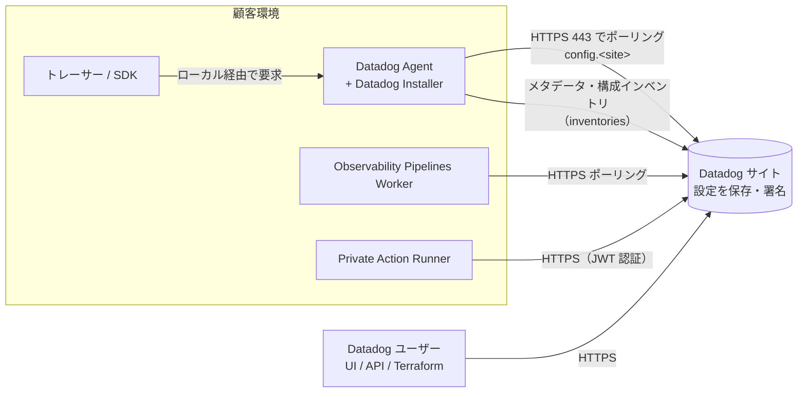
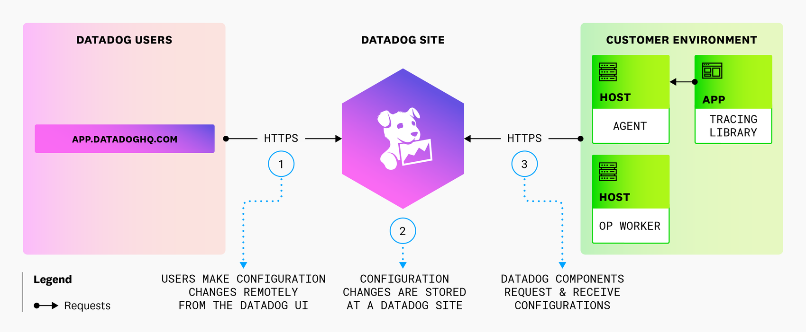
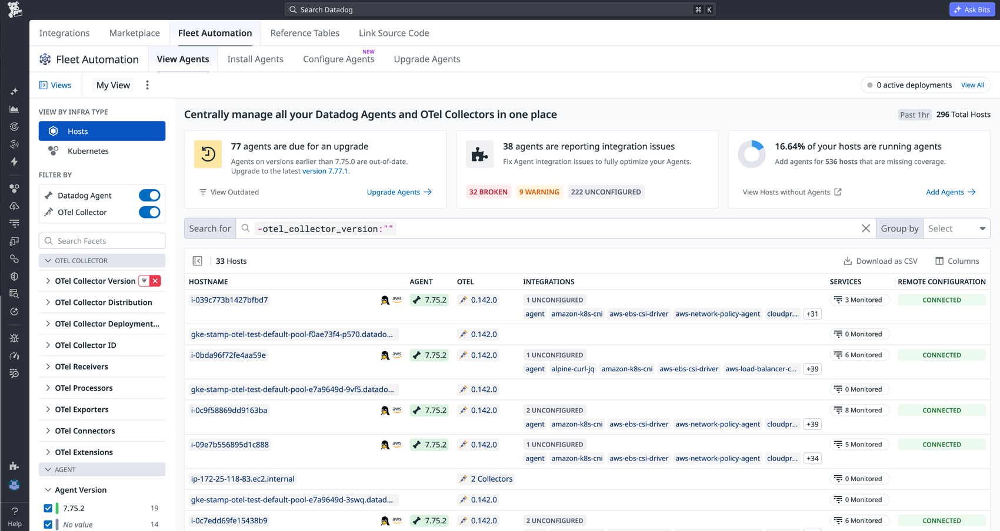
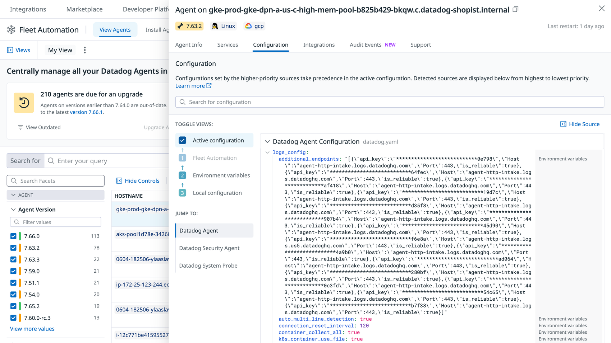
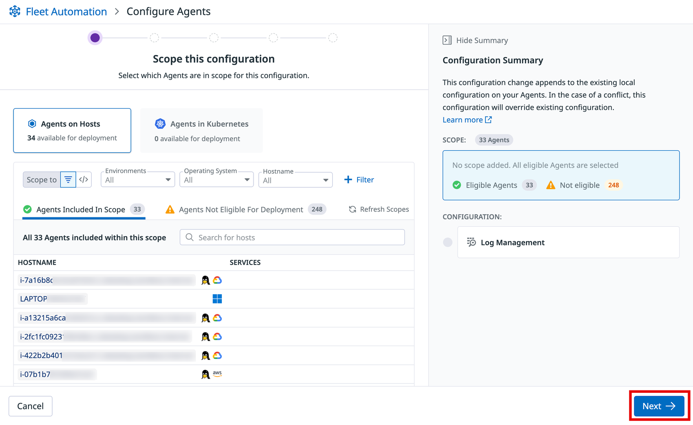
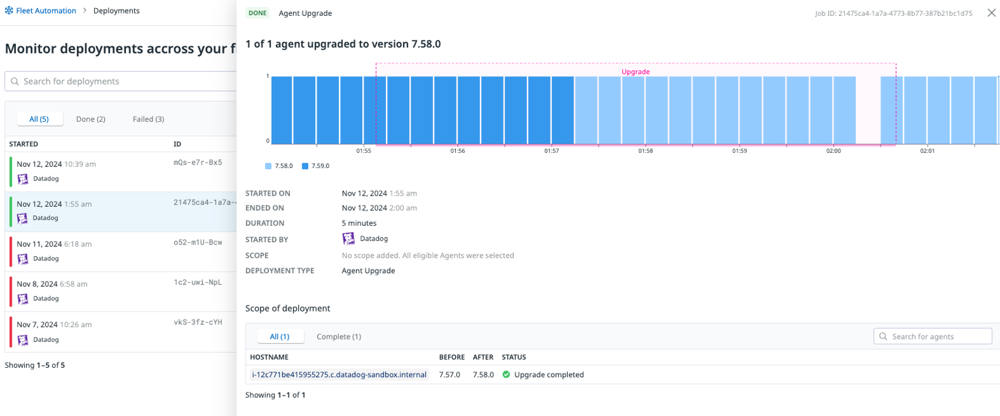

# Fleet Automation と Remote Configuration

## 概要

**Fleet Automation（フリートオートメーション）** は、Datadog Agent と OpenTelemetry（OTel）Collector を Datadog の画面から一元的に統制・リモート管理する機能である。Fleet Automation でできることは次のとおり。

- Agent・OTel Collector の一覧と構成（設定内容と変更履歴）の確認
- Agent 設定・インテグレーション設定・カスタムログ設定のリモート配布
- Agent タグの一元管理【Preview】（5.11 節）
- Agent のリモートアップグレード（即時・スケジュール・API・Terraform）
- SDK のリモートアップグレード【Preview】
- サポート向け flare のリモート送信
- Kubernetes クラスター単位での Agent の表示と設定

[出典](https://docs.datadoghq.com/agent/fleet_automation/)

**Remote Configuration（リモート設定、略称 RC）** は、Datadog UI で行った設定を、顧客環境にある Datadog コンポーネント（Agent、SDK／トレーサー、Observability Pipelines Worker など）へ届ける仕組みである。コンポーネント側が Datadog をポーリングして変更を取りに行く。Fleet Automation の参照以外の機能（設定変更、アップグレード、リモート flare）は Remote Configuration を前提とする。Remote Configuration は Fleet Automation 以外にも、APM、App and API Protection、Workload Protection、Dynamic Instrumentation、Observability Pipelines などで使われる。[出典](https://docs.datadoghq.com/remote_configuration/)

本ファイルの範囲と、他ファイルとの分担は次のとおり。

| 知りたいこと | 参照先 |
|---|---|
| Agent のアーキテクチャ・インストール・手動アップグレード・flare コマンド | [Datadog Agent](./agent.md) |
| `datadog.yaml` の全キー、設定の優先順位、環境変数 | [Agent 設定リファレンス](./agent-configuration.md) |
| Kubernetes 向け Agent（Helm / Datadog Operator） | [コンテナ/Kubernetes向けAgent](./kubernetes-and-containers-agent.md) |
| API キー・アプリケーションキーの管理 | [API とキー管理](./api-and-keys.md) |
| ロール・権限の設計 | [組織・ユーザー・権限管理](./account-and-access-management.md) |
| 監査ログ | [Audit Trail](./audit-trail.md) |
| Agent の大規模展開方針（配布方式、更新ポリシー） | [Agent 展開設計](../../03_導入編/agent-rollout-design.md) |
| ファイアウォール・プロキシ・PrivateLink | [ネットワーク・接続要件](../../03_導入編/network-and-connectivity.md) |

---

## 1. 全体像と用語

### 1.1 構成要素

Fleet Automation と Remote Configuration の構成要素を以下に示す。

| 用語 | 意味 | 備考 |
|---|---|---|
| Fleet Automation | Agent と OTel Collector を一元管理する Datadog アプリ内の機能群 | UI の場所は `Integrations` 配下の `Fleet Automation` タブ（URL は `/fleet`） |
| Fleet View | Fleet Automation の一覧・詳細表示部分 | US1-FED / US2-FED では【Preview】 |
| Remote Configuration | Datadog から顧客環境のコンポーネントへ設定を届けるプル型の仕組み | 組織・API キー・Agent の 3 階層で有効化する |
| Remote Agent Management | Agent のリモートアップグレードとリモート設定変更を許可する状態 | Agent 側で `remote_updates: true` が必要。Remote Configuration の接続状態とは別に表示される |
| Datadog Installer | リモートアップグレード・設定変更を Agent ホスト上で実行するコンポーネント | Agent 7.66 以降は Agent に同梱 |
| Deployment（デプロイメント） | Fleet Automation が実行する設定配布またはアップグレードのジョブ | `Deployments` ページで進捗を追跡する |
| Upgrade Schedule | メンテナンスウィンドウ内で自動実行する Agent アップグレードの定義 | UI・API・Terraform（`datadog_fleet_schedule`）で作成できる |
| Datadog Extension | OSS の OTel Collector の構成を Fleet Automation に表示するための Collector 拡張 | DDOT Collector では自動で有効 |

[出典](https://docs.datadoghq.com/agent/fleet_automation/) [出典](https://docs.datadoghq.com/agent/guide/setup_remote_config/) [出典](https://docs.datadoghq.com/agent/fleet_automation/upgrade_agents/) [出典](https://docs.datadoghq.com/opentelemetry/integrations/datadog_extension/)

### 1.2 データの流れ

Fleet Automation と Remote Configuration の通信は、常に顧客環境から Datadog へ向けて開始される。Datadog から Agent へセッションを張ることはない。[出典](https://docs.datadoghq.com/agent/configuration/network/)



- トレーサー（SDK）は Datadog を直接ポーリングせず、Agent を経由して設定を受け取る。
- Fleet View に表示される Agent の構成情報は、Agent が送る構成インベントリ（`inventories_configuration_enabled`）に基づく。Remote Configuration が無効でも、Fleet View での参照はできる。

[出典](https://docs.datadoghq.com/remote_configuration/) [出典](https://docs.datadoghq.com/agent/fleet_automation/fleet_view/)

### 1.3 機能ごとの前提条件（早見表）

Fleet Automation の機能ごとに、Remote Configuration・`remote_updates`・Agent バージョン・プラットフォームの前提を整理する。

| 機能 | Remote Configuration | `remote_updates` | 最低 Agent バージョン | 対応プラットフォーム |
|---|---|---|---|---|
| Fleet View（一覧・構成表示） | 不要 | 不要 | 構成表示は 7.47.0 以降で既定有効。インテグレーション構成表示は 7.49.0 以降で既定有効（それより前は手動有効化） | 全般（OTel Collector は Datadog Extension が必要） |
| リモート flare 送信 | 必要 | 不要 | 7.47 以降（7.66 以降を推奨） | Agent / DDOT Collector。Kubernetes view からは不可 |
| Agent アップグレード | 必要 | 必要 | Linux 7.69.0 以降、Windows 7.71.1 以降 | Linux / Windows の VM のみ（コンテナ不可） |
| Agent 設定（`datadog.yaml`）・OTel Collector 設定 | 必要 | 必要 | 7.73 以降 | Linux VM（インストールスクリプトまたは Ansible Datadog Role で導入）、Windows VM |
| インテグレーション設定・シークレット設定 | 必要 | 必要 | 7.76 以降 | 同上（コンテナ不可） |
| カスタムログ設定 | 必要 | 必要 | 7.76 以降 | 同上（コンテナ不可） |
| Kubernetes の `DatadogAgent` 編集【Preview】 | 必要（API キー） | Operator 側のフラグで指定 | Datadog Operator v1.27 以降 | Operator 管理のクラスターのみ（Helm 値の編集は不可） |
| SDK アップグレード【Preview】 | 公開情報では個別の記載を確認できず | 公開情報では確認できず | 公開情報では確認できず | Single Step Instrumentation で計装した Linux / Windows VM 上のサービス |

[出典](https://docs.datadoghq.com/agent/guide/setup_remote_config/) [出典](https://docs.datadoghq.com/agent/fleet_automation/upgrade_agents/) [出典](https://docs.datadoghq.com/agent/fleet_automation/configure_agents/) [出典](https://docs.datadoghq.com/agent/fleet_automation/configure_integrations/) [出典](https://docs.datadoghq.com/agent/fleet_automation/configure_logs/) [出典](https://docs.datadoghq.com/agent/fleet_automation/fleet_view/) [出典](https://docs.datadoghq.com/agent/fleet_automation/upgrade_sdks/)

> **注記（バージョン要件の変遷）:** リモートアップグレードの最低バージョンは、過去のドキュメントや第三者記事では「7.66 以上」と書かれていたことがある。2026-11-02 時点の公式ドキュメントでは Linux 7.69.0 以降、Windows 7.71.1 以降である。また `remote_updates` が既定で `true` になったのは Agent 7.73.0 からである。7.72 以前の Agent は、`remote_updates: true` を明示しない限り Remote Agent Management が NOT ENABLED のままになる。【第三者情報】Classmethod の検証では、7.71.2 の Agent で Remote Agent Management が有効にならず、7.73.3 に上げたところ有効になった。[出典](https://dev.classmethod.jp/articles/datadog-fleet-automation-remote-agent-upgrade-configuration/)（2026-01-27 公開）

---

## 2. Remote Configuration の仕組み

### 2.1 動作の流れ

Remote Configuration は次の 3 段階で動作する。

1. ユーザーが Datadog UI で、対象製品の機能を設定する。
2. 設定は Datadog サイトに安全に保存される。
3. Remote Configuration が有効なコンポーネントは、設定済みの Datadog サイトを定期的にポーリングし、自分に関係する保留中の変更を受け取って自動適用する。トレーサーは Agent を経由して受け取る。

[出典](https://docs.datadoghq.com/remote_configuration/)



**キャプション:** Remote Configuration の動作概念図（公式ドキュメント掲載）。

**画面（図）の説明:** 図は 3 つの領域で構成される。左は「DATADOG USERS」（`APP.DATADOGHQ.COM`）、中央は「DATADOG SITE」（Datadog のロゴ）、右は「CUSTOMER ENVIRONMENT」である。顧客環境には次の 3 つが描かれている。

- HOST 上の AGENT
- APP 上の TRACING LIBRARY（Agent に向かう矢印付き）
- HOST 上の OP WORKER（Observability Pipelines Worker）

矢印は 2 本あり、どちらも HTTPS である。①ユーザー → Datadog サイト（「USERS MAKE CONFIGURATION CHANGES REMOTELY FROM THE DATADOG UI」）、③顧客環境 → Datadog サイト（「DATADOG COMPONENTS REQUEST & RECEIVE CONFIGURATIONS」）。②は Datadog サイトでの保存（「CONFIGURATION CHANGES ARE STORED AT A DATADOG SITE」）を表す。凡例の「Requests」矢印は、通信の開始方向が顧客環境側であることを示す。

**出典:** https://docs.datadoghq.com/remote_configuration/ （画像取得日: 2026-11-02）

### 2.2 対応コンポーネントと非対応環境

Remote Configuration が使えるのは、対応する Datadog コンポーネントが動いている環境である。

| 区分 | 内容 |
|---|---|
| 対応コンポーネント | Agent、トレーサー（Agent 経由で間接的に対応）、Observability Pipelines Worker、Private Action Runner、AWS Fargate などのサーバーレスコンテナクラウドサービス |
| 非対応（サーバーレスコンテナのマネージドアプリ） | AWS App Runner、Azure Container Apps、Google Cloud Run |
| 非対応（コンテナパッケージでデプロイした関数） | AWS Lambda、Azure Functions、Google Cloud Functions |
| 常に有効なコンポーネント | Private Action Runner は常に Remote Configuration が有効。Agent はディスク上の設定で有効・無効を切り替えられる |

[出典](https://docs.datadoghq.com/remote_configuration/)

> **補足:** Remote Configuration の動作要件と、Fleet Automation の「リモートアップグレード／設定変更」の要件は別物である。Remote Configuration は Fargate などのコンテナ環境でも動く（例: ECS Fargate のリモート flare は推奨手段）。一方、Fleet Automation のリモートアップグレードと設定配布は Linux / Windows の VM に限られる。[出典](https://docs.datadoghq.com/agent/troubleshooting/send_a_flare/) [出典](https://docs.datadoghq.com/agent/fleet_automation/upgrade_agents/)

### 2.3 Remote Configuration を使う製品と機能

Remote Configuration を使う製品と機能を次表にまとめる。各機能の詳細は製品ごとのリファレンスを参照。

| 製品 | Remote Configuration で実現する機能 | 詳細 |
|---|---|---|
| Fleet Automation | Datadog サイトからの flare 送信、Agent のアップグレード（あわせて Agent 設定の配布） | 本ファイル |
| App and API Protection（旧称：Application Security Management / ASM） | 1 クリック有効化、WAF 攻撃パターンの自動更新、Protect（IP・認証ユーザー・不審リクエストの一時／恒久ブロック） | [App and API Protection](../security/app-and-api-protection.md) |
| APM | 実行時設定（サービスのトレースサンプリングレート、Log Injection、HTTP ヘッダータグを Catalog UI から再起動なしで変更）、Agent のサンプリングレートのリモート設定（Adaptive Sampling） | [APM の概念とインジェスト制御](../apm/apm-concepts-and-ingestion.md) |
| Dynamic Instrumentation | コード変更なしで稼働中アプリからメトリクス・トレース・ログを送る | [Dynamic Instrumentation と Live Debugger](../apm/dynamic-instrumentation.md) |
| Workload Protection（旧称：Cloud Workload Security / CWS） | Datadog 管理のデフォルト Agent ルールの自動更新、カスタム Agent ルールの指定ホストへの自動展開 | [Workload Protection](../security/workload-protection.md) |
| Observability Pipelines | UI で作成・編集したパイプラインを Worker へリモート展開・更新 | [Observability Pipelines](../logs/observability-pipelines.md) |
| Autoscaling | コンテナ環境のクラスター／ワークロードのスケーリング設定をリモート管理 | [コンテナ・Kubernetes 監視](../infrastructure/container-and-kubernetes-monitoring.md) |
| Private Action Runner | プライベートネットワーク上のサービスに対して Workflow・App を実行 | [Workflow Automation](../service-management/workflow-automation.md) |
| Feature Flags | ターゲティング・割り当てルールをサーバーサイド SDK に配布 | 公式: https://docs.datadoghq.com/feature_flags/ |

[出典](https://docs.datadoghq.com/remote_configuration/)

公式の「Product-specific configuration」表には、上記に加えて次の製品も載っている。これらの製品でも、セットアップ時に Remote Configuration の有効化が求められる。

- Sensitive Data Scanner（Cloud Storage スキャン）
- Data Observability（PostgreSQL）

RBAC 表には、次の製品の Remote Configuration 関連権限も掲載されている。

- CSM Side Scanning（Agentless Scanning）
- Network Device Monitoring（デバイスプロファイル）
- Serverless Lambda Auto-instrumentation

[出典](https://docs.datadoghq.com/remote_configuration/)

### 2.4 有効化の 3 階層

Remote Configuration は、**組織**・**API キー**・**Agent（コンポーネント）** の 3 階層すべてで有効になって初めて機能する。Fleet Automation でリモートアップグレードや設定変更を行うには、さらに Agent 側で `remote_updates` が必要である。

| 階層 | 設定場所 | 既定 | 必要な権限 | 備考 |
|---|---|---|---|---|
| 組織 | `Organization Settings > Remote Configuration`（`/organization-settings/remote-config`） | 多くの場合、既定で有効。US1-FED / US2-FED では既定で無効 | `org_management` | 組織で無効化すると、全製品のコンポーネントが設定を受け取れなくなる（非推奨） |
| API キー | `Organization Settings > API Keys` で各キーの Remote Configuration capability を有効化 | 公開情報では既定値を確認できず | `api_keys_write` | Agent が使う API キーで有効化が必要。Observability Pipelines は使用中の API キーでの有効化が必須 |
| Agent | `datadog.yaml` の `remote_configuration.enabled`／環境変数 `DD_REMOTE_CONFIGURATION_ENABLED`／Helm `datadog.remoteConfiguration.enabled` | Agent 7.47.0 以降は `true`。ただし GovCloud（`ddog-gov.com`）向けと FIPS モードの Agent は明示的に `true` が必要 | ホストの管理者権限 | 変更後は Agent の再起動が必要 |
| Agent（リモート管理） | `datadog.yaml` のトップレベル `remote_updates`／環境変数 `DD_REMOTE_UPDATES` | Agent 7.73.0 以降は `true`。それより前の対応バージョンでは明示が必要 | ホストの管理者権限 | `remote_updates` だけを有効にしても Remote Configuration は有効にならない |

[出典](https://docs.datadoghq.com/remote_configuration/) [出典](https://docs.datadoghq.com/agent/guide/setup_remote_config/) [出典](https://github.com/DataDog/datadog-agent/blob/main/pkg/config/example/datadog-agent_linux.yaml.example)

- `api_keys_write` を持っていても、組織レベルで Remote Configuration が有効でなければ、API キーで Remote Configuration を**有効化**できない。この場合に可能なのは、既存キーでの**無効化**だけである。[出典](https://docs.datadoghq.com/agent/guide/setup_remote_config/)
- `org_management` 権限の説明には、「組織全体の Remote Configuration の有効化・無効化」が含まれている。[出典](https://docs.datadoghq.com/account_management/rbac/permissions/)

GovCloud・FIPS 環境、または明示的に有効化する場合の設定例（Linux / Windows VM）を示す。

```yaml
# datadog.yaml
remote_configuration:
  enabled: true

remote_updates: true   # トップレベルのキー
```

環境変数で指定する場合は `DD_REMOTE_CONFIGURATION_ENABLED=true` と `DD_REMOTE_UPDATES=true` を Agent サービスの環境に設定し、Agent を再起動する。その後、Fleet Automation で対象 Agent のサイドパネルを開き、**Remote Agent Management** の状態を確認する。[出典](https://docs.datadoghq.com/agent/guide/setup_remote_config/)

### 2.5 Agent の Remote Configuration ステータス

Agent の Remote Configuration 接続状態は、Remote Configuration の設定画面（`/organization-settings/remote-config`）と Fleet View の両方で確認できる。Fleet Automation は、これとは別に **Remote Agent Management** の状態も表示する。そのため、Remote Configuration は CONNECTED でも Remote Agent Management が NOT ENABLED、ということが起こりうる。

| Agent ステータス | 意味 | 主な対処 | 表示条件 |
|---|---|---|---|
| CONNECTED | Datadog に到達し、認証・認可に成功している（最適な状態） | — | — |
| UNAUTHORIZED | 到達はできるが、Remote Configuration の認証・認可に失敗している。主因は API キーで Remote Configuration が無効なこと | Agent が使う API キーで Remote Configuration capability を有効化する | — |
| CONNECTION ERROR | `remote_configuration.enabled: true` だが、Remote Configuration サービスで Agent が見つからない。主因はエンドポイントへ到達できないこと | Remote Configuration エンドポイントへのアウトバウンド HTTPS を許可し、プロキシ設定を見直す | Agent 7.45.0 以降 |
| DISABLED | `remote_configuration.enabled: false` | 有効にしたい場合は `true` にする | Agent 7.45.0 以降 |
| NOT CONNECTED | Remote Configuration サービスで Agent が見つからない（有効・無効は不明） | ローカル設定とプロキシ設定を確認する | Agent 7.41.1 より新しく 7.45.0 未満 |
| UNSUPPORTED AGENT | Remote Configuration に対応していないバージョン | Agent を最新に更新する | — |

[出典](https://docs.datadoghq.com/agent/guide/setup_remote_config/)

SDK（トレーサー）の Remote Configuration ステータスも、同じ設定画面で確認できる。

| SDK ステータス | 意味 |
|---|---|
| CONNECTED | 紐づく Agent を経由して Remote Configuration サービスに接続できている |
| UNAUTHORIZED | 紐づく Agent の API キーに `APM Remote Configuration Read` の権限がない（API キーで Remote Configuration capability を有効化する） |
| CONNECTION ERROR | 紐づく Agent は Remote Configuration が有効だが、Agent がエンドポイントに到達できない |
| DISABLED | 紐づく Agent で Remote Configuration が無効 |
| NOT CONNECTED | SDK が Remote Configuration サービスで見つからない |
| UNSUPPORTED AGENT | 紐づく Agent が Remote Configuration 非対応 |
| NOT DETECTED | SDK 自体が Remote Configuration 非対応（SDK を更新する） |
| UNKNOWN | 紐づく Agent を判別できない（例: AWS Fargate などのフルマネージドなサーバーレスコンテナ） |

[出典](https://docs.datadoghq.com/tracing/guide/remote_config/)

> **注記:** APM 向けガイドの SDK ステータス表では、Agent 側の設定キーが `remote_config.enabled` と書かれている。Agent ドキュメントおよび Agent の設定例ファイルでは `remote_configuration.enabled` である。Agent に設定するキーは `remote_configuration.enabled` が正しい。[出典](https://docs.datadoghq.com/tracing/guide/remote_config/) [出典](https://github.com/DataDog/datadog-agent/blob/main/pkg/config/example/datadog-agent_linux.yaml.example)

APM で Remote Configuration を使う場合の前提は次のとおり。[出典](https://docs.datadoghq.com/tracing/guide/remote_config/)

- Agent 7.47.0 以降
- Remote Configuration 対応バージョンの SDK
- `org_management`・`api_keys_write`、および `APM Remote Configuration Read` / `Write` の権限

### 2.6 Agent 側の関連設定キー

Remote Configuration と Fleet Automation に関係する Agent 設定キーを以下に示す。キー全体の一覧は [Agent 設定リファレンス](./agent-configuration.md) を参照。

| キー | 環境変数 | 既定値 | 説明 | 出典 |
|---|---|---|---|---|
| `remote_configuration.enabled` | `DD_REMOTE_CONFIGURATION_ENABLED` | `true`（7.47.0 以降。GovCloud・FIPS は明示が必要） | Remote Configuration の有効化 | [docs](https://docs.datadoghq.com/agent/guide/setup_remote_config/) |
| `remote_updates` | `DD_REMOTE_UPDATES` | `true`（7.73.0 以降） | リモートアップグレードとリモート設定変更の有効化 | [docs](https://docs.datadoghq.com/agent/guide/setup_remote_config/) |
| `inventories_configuration_enabled` | `DD_INVENTORIES_CONFIGURATION_ENABLED` | `true`（7.47.0 以降） | Agent の構成（機微情報はスクラブ済み）を Datadog に送り、Fleet View やホスト詳細で表示する | [docs](https://docs.datadoghq.com/agent/fleet_automation/fleet_view/) |
| `inventories_checks_configuration_enabled` | `DD_INVENTORIES_CHECKS_CONFIGURATION_ENABLED` | `true`（7.49.0 以降） | インテグレーション（チェック）設定の表示 | [docs](https://docs.datadoghq.com/agent/fleet_automation/fleet_view/) |
| `remote_configuration.refresh_interval` | `DD_REMOTE_CONFIGURATION_REFRESH_INTERVAL`（命名規則からの推定） | `0s`（未指定時は内部既定の 1 分を使用） | ポーリング間隔 | ソースコード（下記） |
| `remote_configuration.max_backoff_interval` | 同上 | `2m` | エラー時のバックオフ上限 | ソースコード（下記） |
| `remote_configuration.org_status_refresh_interval` | 同上 | `1m` | 組織の Remote Configuration 状態の確認間隔 | ソースコード（下記） |
| `remote_configuration.clients.ttl_seconds` | 同上 | `30s` | ローカルクライアント（トレーサー等）情報の保持期間 | ソースコード（下記） |

Datadog Agent のソースコード（`main` ブランチ、2026-11-02 取得）を見ると、Remote Configuration サービスの内部既定値は次のとおりである。

- ポーリング間隔の既定（`defaultRefreshInterval`）は **1 分**、下限（`minimalRefreshInterval`）は **5 秒**
- エラー時の最大バックオフは 2〜5 分の範囲

これらの値は公式ドキュメントには書かれていない。将来変わる可能性があるため、運用で前提にしないこと。[出典](https://github.com/DataDog/datadog-agent/blob/main/pkg/config/remote/service/service.go) [出典](https://github.com/DataDog/datadog-agent/blob/main/pkg/config/setup/generatedsettings/all_settings.go)

> **注記:** 環境変数名の列にある「命名規則からの推定」は、Agent の一般規則（`DD_` + 大文字化 + `.` を `_` に置換）による【推定】である。公式ドキュメントに明記されているのは `DD_REMOTE_CONFIGURATION_ENABLED` と `DD_REMOTE_UPDATES` のみ。

### 2.7 ネットワーク要件

Remote Configuration と Fleet Automation で必要な通信先を以下に示す。

| 用途 | 宛先 | ポート / プロトコル | 備考 |
|---|---|---|---|
| Remote Configuration | `config.<YOUR_DATADOG_SITE>`（例: AP1 は `config.ap1.datadoghq.com`） | 443 / HTTPS | 観測データ送信と同じポート。プロキシ利用時はこの宛先もプロキシ設定に含める |
| 接続性テスト | Datadog（Remote Configuration 有効時のみ） | 8042 / TCP（HTTPS ではない生の TLS） | プロトコル開発用のテレメトリで、顧客データや顧客を識別する情報は含まない。ブロックしても機能に影響しない |
| Agent パッケージ取得（インストール・アップグレード） | `install.datadoghq.com`、`yum.datadoghq.com`、`apt.datadoghq.com`、`keys.datadoghq.com`、`windows-agent.datadoghq.com` | 443 | Agent インストール用のドメインとして公式に掲載されている。リモートアップグレード時の取得先を個別に明記した公式記述は確認できず |
| API（Fleet Automation API） | `api.<YOUR_DATADOG_SITE>` | 443 | 自動化ツールから呼ぶ場合 |

[出典](https://docs.datadoghq.com/agent/configuration/network/) [出典](https://docs.datadoghq.com/remote_configuration/)

> **サイト差異:** ネットワークページの外向きポート表で 8042/TCP（接続性テスト）が載っているのは、US1（`app.datadoghq.com`）と EU1（`app.datadoghq.eu`）の表だけである。US3 / US5 / AP1 / AP2 / UK1 / US1-FED / US2-FED の表には載っていない。一方、Remote Configuration のセキュリティ節は、サイトを限定せずに 8042/TCP の接続性テストを説明している。8042/TCP はブロックしても機能に影響しないため、閉域環境では 443 の `config.<site>` を許可すれば足りる。[出典](https://docs.datadoghq.com/agent/configuration/network/) [出典](https://docs.datadoghq.com/remote_configuration/)

- AWS PrivateLink などのプライベート接続を使う場合も、Remote Configuration 用の VPC エンドポイントに接続できる。[出典](https://docs.datadoghq.com/agent/guide/setup_remote_config/)
- リモート Agent 管理は、プロキシやミラーリポジトリ（エアギャップ環境）と組み合わせて使える。プロキシ設定後は Agent の再起動が必要。[出典](https://docs.datadoghq.com/agent/fleet_automation/configure_agents/)

### 2.8 セキュリティ

Remote Configuration は、配布する設定の機密性・完全性・可用性を守るため、次の安全策を備えている（公式記載）。

| 観点 | 安全策 |
|---|---|
| 通信の開始方向 | コンポーネントが Datadog に設定を要求する（プル型）。Datadog はコンポーネントからの要求がない限り変更を送らない |
| 送信範囲 | 送るのは、要求したコンポーネントに関係する変更だけ |
| 経路・ポート | 顧客環境から Datadog への HTTPS（443）。観測データ送信と同じポートで、インバウンドの開放は不要 |
| 暗号化・認証 | HTTPS で暗号化し、Datadog API キーで認証・認可する（Private Action Runner は API キーの代わりに JWT を使う） |
| 完全性 | UI から送った設定変更は署名され、受け取ったコンポーネントが署名を検証する |
| 有効化の制御 | API キーでの Remote Configuration 有効化・無効化は `api_keys_write` を持つユーザーだけが行える |
| 監査 | Audit Trail で、API キー・アプリケーションキーの作成・削除・変更と、Remote Configuration 関連のイベント（誰が変更を要求したか）を追跡できる。Monitor で通知も設定できる |

[出典](https://docs.datadoghq.com/remote_configuration/)

- 署名と検証の実装について、公式ドキュメントは具体的な方式を明記していない。Datadog Agent のソースコードでは、Remote Configuration クライアントが TUF（The Update Framework）系のライブラリ（`go-tuf`）と Uptane 方式のメタデータ検証を使っていることが確認できる。[出典](https://github.com/DataDog/datadog-agent/blob/main/pkg/config/remote/service/service.go)
- Agent の flare は、パスワード、API キー、プロキシ認証情報、SNMP コミュニティ文字列などの機微情報を除去してから送られる。flare 収集の実装はオープンソースで確認できる。[出典](https://docs.datadoghq.com/agent/troubleshooting/send_a_flare/)
- Fleet View に表示される Agent 構成は、機微情報をスクラブしたものである。[出典](https://github.com/DataDog/datadog-agent/blob/main/pkg/config/example/datadog-agent_linux.yaml.example)
- 監査要件全般は [セキュリティとコンプライアンス](../../03_導入編/security-and-compliance.md) と [Audit Trail](./audit-trail.md) を参照。

### 2.9 Remote Configuration の権限（RBAC）

Remote Configuration を使う各製品は、それぞれ固有の権限を定義している。以下は Remote Configuration ドキュメント掲載の一覧である。

| 製品 | 権限 |
|---|---|
| Fleet Automation | `FLEET_POLICIES_WRITE`、`AGENT_UPGRADE_WRITE`、`FLEET_FLARE`（※） |
| App and API Protection | `APPSEC_ACTIVATION_READ`、`APPSEC_ACTIVATION_WRITE`、`APPSEC_PROTECT_READ`、`APPSEC_PROTECT_WRITE` |
| APM | `APM_SERVICE_INGEST_READ`、`APM_SERVICE_INGEST_WRITE`、`APM_REMOTE_CONFIGURATION_READ`、`APM_REMOTE_CONFIGURATION_WRITE` |
| Dynamic Instrumentation | `DEBUGGER_READ`、`DEBUGGER_WRITE`、`DEBUGGER_WRITE_PRE_PROD`、`APM_REMOTE_CONFIGURATION_READ`、`APM_REMOTE_CONFIGURATION_WRITE` |
| Workload Protection | `SECURITY_MONITORING_CWS_AGENT_RULES_WRITE`、`SECURITY_MONITORING_CWS_AGENT_RULES_READ`、`SECURITY_MONITORING_CWS_AGENT_RULES_ACTIONS` |
| CSM Side Scanning | `ORG_MANAGEMENT`、`MANAGE_INTEGRATIONS` |
| Observability Pipelines | `OBSERVABILITY_PIPELINES_READ`、`_WRITE`、`_DELETE`、`_DEPLOY`、`_CAPTURE_WRITE`、`_CAPTURE_READ` |
| Private Action Runner | `ON_PREM_RUNNER_WRITE`、`ON_PREM_RUNNER_READ`、`ON_PREM_RUNNER_USE` |
| Network Device Monitoring | `NDM_DEVICE_PROFILES_VIEW`、`NDM_DEVICE_PROFILES_EDIT` |
| Container Autoscaling | `ORCHESTRATION_AUTOSCALING_MANAGE`、`ORCHESTRATION_WORKLOAD_SCALING_WRITE`、`ORCHESTRATION_WORKLOAD_SCALING_READ` |
| Serverless Lambda Auto-instrumentation | `SERVERLESS_AWS_INSTRUMENTATION_READ`、`SERVERLESS_AWS_INSTRUMENTATION_WRITE` |
| Feature Flags | `FEATURE_FLAG_CONFIG_READ`、`FEATURE_FLAG_CONFIG_WRITE`、`FEATURE_FLAG_ENVIRONMENT_CONFIG_READ`、`FEATURE_FLAG_ENVIRONMENT_CONFIG_WRITE` |

[出典](https://docs.datadoghq.com/remote_configuration/)

> ※ 権限ページ（Permissions）では、Fleet Automation の flare 権限は `Agent Flare Collection`（`agent_flare_collection`）と表記されている。Remote Configuration ページの `FLEET_FLARE` との表記差がある。ロール設定画面では権限ページの名称で表示されると考えられる【推定】。Fleet Automation 固有の権限は「9. 権限」を参照。[出典](https://docs.datadoghq.com/account_management/rbac/permissions/)

このほか、Remote Configuration 設定の閲覧には `Remote Configuration Read`（`remote_configuration_read`、既定ロール: Datadog Read Only Role）権限がある。Network Path の Remote Configuration 用には `network_path_config_settings_read` / `network_path_config_settings_write` もある。[出典](https://docs.datadoghq.com/account_management/rbac/permissions/)

### 2.10 オプトアウト（無効化）

Datadog は、Remote Configuration を全体で無効にするのではなく、製品単位でオプトアウトすることを推奨している。Fleet Automation の Remote Configuration を無効化する方法は 3 つある。

| 単位 | 方法 | 影響 |
|---|---|---|
| API キー | `API Keys` ページで対象キーの Remote Configuration を無効化（`api_keys_write` が必要） | そのキーを使う Agent が Remote Configuration を利用できなくなる（ステータスは UNAUTHORIZED） |
| Agent | `remote_configuration.enabled: false`、`DD_REMOTE_CONFIGURATION_ENABLED=false`、Helm の `datadog.remoteConfiguration.enabled: false` | その Agent が Datadog に設定要求を送らなくなる |
| 組織（非推奨） | `Remote Configuration` 設定ページで Disable を押し、警告で再度 Disable（`org_management` が必要） | 組織内の全製品のコンポーネントが設定を受け取れなくなる |

[出典](https://docs.datadoghq.com/agent/guide/setup_remote_config/) [出典](https://docs.datadoghq.com/remote_configuration/)

Remote Configuration を無効化すると、依存する他製品の機能も止まる。主な例は次のとおり。

- App and API Protection: WAF パターン自動更新、Protect によるブロック
- Workload Protection: ルールの自動更新
- APM: 実行時設定
- Dynamic Instrumentation

無効化する前に影響範囲を確認すること【経験則】。

---

## 3. Fleet Automation の画面構成

Fleet Automation は Datadog の `Integrations` 領域にあるタブの 1 つである（`Integrations` / `Marketplace` / `Fleet Automation` / `Reference Tables` / `Link Source Code`）。



**キャプション:** Fleet Automation の「View Agents」画面（Agent と OTel Collector の一覧）。

**画面の説明:**

- **サブタブ:** Fleet Automation 見出しの右に `View Agents`（選択中）、`Install Agents`、`Configure Agents`（NEW 表示）、`Upgrade Agents` が並ぶ。
- **右上:** 実行中のデプロイメント数（例「0 active deployments」）と `View All` リンク。
- **左ペイン:** 「VIEW BY INFRA TYPE」で `Hosts` / `Kubernetes` を切り替える。「FILTER BY」で `Datadog Agent` / `OTel Collector` の表示を切り替えるトグルがある。その下はファセット一覧で、OTEL COLLECTOR 区分（OTel Collector Version、Distribution、Deployment、ID、Receivers、Processors、Exporters、Connectors、Extensions）と AGENT 区分（Agent Version 等）がある。
- **上部の見出しとサマリーカード:** 「Centrally manage all your Datadog Agents and OTel Collectors in one place」の下に 3 枚のカードが並ぶ。
  - ①アップグレード対象の Agent 数（例「77 agents are due for an upgrade」、`Upgrade Agents` リンク付き）
  - ②インテグレーションに問題がある Agent 数（BROKEN / WARNING / UNCONFIGURED の件数）
  - ③Agent 未導入ホストの割合（例「16.64% of your hosts are running agents」、`Add Agents` リンク付き）
- **一覧表:** 検索バーと Group by の下に表がある。列は HOSTNAME、AGENT（バージョン）、OTEL（Collector バージョン）、INTEGRATIONS（UNCONFIGURED 件数とインテグレーション名）、SERVICES（監視中サービス数）、REMOTE CONFIGURATION（例「CONNECTED」）。`Download as CSV` と `Columns` の操作もある。

**出典:** https://docs.datadoghq.com/agent/fleet_automation/ （画像取得日: 2026-11-02）

主な画面（URL パス）を次表に示す。URL は US1 の例。他サイトではホスト名が変わる。

| 画面 | パス | 用途 |
|---|---|---|
| Fleet View（View Agents） | `/fleet` | Agent・OTel Collector の一覧、検索、詳細パネル |
| Kubernetes view | `/fleet?view_by=clusters` | クラスター単位の一覧 |
| Install Agents | `/fleet/install-agent/latest?platform=overview` | プラットフォーム別インストールコマンドの生成（詳細は [Datadog Agent](./agent.md)） |
| Configuration（Configure Agents） | `/fleet/agent-management` | Agent 設定・インテグレーション・カスタムログの配布 |
| Upgrades（Upgrade Agents） | `/fleet/agent-upgrades` | 即時アップグレード、Upgrade Schedules |
| Deployments | `/fleet/deployments` | デプロイメントの進捗・履歴 |

[出典](https://docs.datadoghq.com/agent/fleet_automation/configure_agents/) [出典](https://docs.datadoghq.com/agent/fleet_automation/upgrade_agents/) [出典](https://docs.datadoghq.com/agent/fleet_automation/fleet_view/)

---

## 4. Fleet View（Agent 一覧と構成確認）

### 4.1 表示される情報

Fleet View は、次のような課題を把握するための画面である。

- ホスト上の観測ギャップ
- 古い Agent・OTel Collector
- インテグレーションに問題がある Agent

| 対象 | 表示される情報 |
|---|---|
| Datadog Agent | Agent バージョン、未設定・設定不備のインテグレーションの有無、監視中のサービス、Remote Configuration ステータス、有効な製品、Agent の Audit Trail イベント（設定変更、アップグレード、flare） |
| OTel Collector | Collector バージョン、ディストリビューション、構成 YAML、Pipeline / Topology ビュー |

[出典](https://docs.datadoghq.com/agent/fleet_automation/fleet_view/)

2023 年の公開ベータ時点の公式ブログは、さらに次の機能も紹介している。

- API キー、カスタムチェックの状態での絞り込み
- クラウドプロバイダー連携のデータを使った「Agent 未導入ホスト」の検出

[出典](https://www.datadoghq.com/blog/fleet-automation/)（2023-11-20 公開。公開ベータ当時の記述のため、現行 UI と異なる可能性がある）

### 4.2 前提条件

- **構成表示（Configuration view）:** バージョン 7.47.0 以降の Agent・OTel Collector では既定で有効。古いバージョンでは `inventories_configuration_enabled: true`（または `DD_INVENTORIES_CONFIGURATION_ENABLED`）で有効化する。
- **インテグレーション構成の表示:** Agent 7.49.0 以降で既定で有効。古いバージョンでは `inventories_checks_configuration_enabled: true`（または `DD_INVENTORIES_CHECKS_CONFIGURATION_ENABLED`）で有効化する。
- **OTel Collector の構成・パイプライン・トポロジー表示:** Datadog Extension が必要。

[出典](https://docs.datadoghq.com/agent/fleet_automation/fleet_view/)

### 4.3 検索とフィルター

Fleet View 上部の検索バーでは、次の検索ができる。

- ホスト名・クラスター名のフリーテキスト検索
- ホストタグ・Agent タグによるフィルター（OS、`env`、team、有効な製品 `products_enabled` など）

[出典](https://docs.datadoghq.com/agent/fleet_automation/fleet_view/)

特殊なクエリの例として、旧 Installer と非互換のホストを抽出する `support_remote_upgrade:datadog-installer` がある（6.8 節参照）。[出典](https://docs.datadoghq.com/agent/fleet_automation/upgrade_agents/)

### 4.4 Agent 詳細パネル

Agent または OTel Collector を選ぶと、詳細パネルが開く。詳細パネルでは次の情報を確認できる。

- 構成
- 接続中のインテグレーション
- 監査イベント
- リモート flare 用のサポートタブ



**キャプション:** Fleet View で Agent を選んだときの詳細パネル（Configuration タブ）。

**画面の説明:**

- **見出し:** 「Agent on <ホスト名>」の下にバッジ（例: Agent バージョン 7.63.2、Linux、gcp）が並ぶ。右上に「Last restart: 1 day ago」。
- **タブ:** `Agent Info`、`Services`、`Configuration`（選択中）、`Integrations`、`Audit Events`（NEW）、`Support`。
- **Configuration タブの説明文:** 「Configurations set by the higher-priority sources take precedence in the active configuration.」（優先度の高いソースの設定がアクティブ設定で優先される）。
- **左側の TOGGLE VIEWS:** `Active configuration`（実効設定）と、優先度順の設定ソース「1 Fleet Automation」→「2 Environment variables」→「3 Local configuration」が表示される。その下の JUMP TO で `Datadog Agent` / `Datadog Security Agent` / `Datadog System Probe` の構成へ移動できる。
- **右側:** 「Datadog Agent Configuration `datadog.yaml`」の実効設定（例: `logs_config` 配下の値）が表示され、各行の右端に値の出所（例「Environment variables」）が示される。API キーはマスクされている。

**出典:** https://docs.datadoghq.com/agent/fleet_automation/fleet_view/ （画像取得日: 2026-11-02）

詳細パネルでは、2 つのステータスを区別して読む必要がある。[出典](https://docs.datadoghq.com/agent/fleet_automation/fleet_view/)

- **Remote Configuration:** Datadog から設定を受け取れるかを示す。
- **Remote Agent Management:** リモート管理（アップグレード・設定変更）が有効かを示す。

### 4.5 OTel Collector のパイプライン可視化

OTel Collector の Configuration タブには、`View as` で切り替えられる 2 つのビューがある。どちらも `Show traffic` トグルでデータ量を重ねて表示でき、コンポーネントやノード上にアクティブな Monitor アラートも表示される。

| ビュー | 内容 |
|---|---|
| Pipeline | 単一 Collector の receivers → processors → exporters の流れ |
| Topology | DaemonSet と gateway として配置された複数 Collector の転送チェーン |

[出典](https://docs.datadoghq.com/agent/fleet_automation/fleet_view/)

Topology ビューを使うには、各 Collector の Datadog Extension で次の設定が必要である。

- `deployment_type`（`daemonset` / `gateway`）
- `gateway_destination`（転送先 gateway の Kubernetes Service。`<namespace>/<service>` 形式）
- `gateway_service`（gateway 自身の Service）
- 全 Collector の `service.telemetry.resource` に `k8s.cluster.name`（必須）

gateway topology 機能は【Preview】である。Datadog Extension は OpenTelemetry Collector Contrib v0.129.0 以降の contrib ディストリビューションに含まれる。DDOT Collector では自動で有効になるため、手動で設定してはならない。[出典](https://docs.datadoghq.com/opentelemetry/integrations/datadog_extension/)

OTel 全般は [OpenTelemetry サポート](./opentelemetry.md) を参照。

### 4.6 Agent の Audit Events

`Audit Events` タブには、選択した Agent に関する次の Audit Trail イベントが表示される。

- 設定変更
- API キーの更新
- インストール
- アップグレード
- サポート flare

イベントの保持期間は Audit Trail の有無で異なる。[出典](https://docs.datadoghq.com/agent/fleet_automation/fleet_view/)

| 条件 | 表示できる期間 |
|---|---|
| 組織で Audit Trail が有効 | Audit Trail の保持設定に応じて最大 90 日 |
| Audit Trail が無効 | 過去 24 時間 |

### 4.7 Kubernetes view

Kubernetes view は、Kubernetes 上の Agent と OTel Collector をクラスター単位でまとめて表示する。ノード Agent、Cluster Agent、Cluster Check Runner がクラスターの行にまとまる。

| 項目 | 内容 |
|---|---|
| 切り替え | `View by infra type` トグル、または `/fleet?view_by=clusters` |
| 対象 | Datadog Operator または Helm chart で管理されたクラスター |
| 一覧の列 | クラスター名、デプロイ方式（Datadog Operator / Helm）、Namespace、Agent バージョン、Agent Pod の状態、Readiness、経過時間（Age）、再起動回数 |
| 並び順 | クラスター名のアルファベット順（クラスター名で検索可） |
| 詳細 | クラスターの詳細（環境・タグ）、クラスターレベルの Agent（Cluster Agent・Cluster Check Runner）、ノード Agent |

[出典](https://docs.datadoghq.com/agent/fleet_automation/fleet_view/)

Kubernetes view の大半の機能にはバージョン要件がない。以下の機能だけ個別の要件がある。

| 機能 | 要件 |
|---|---|
| `DatadogAgent` 構成の表示 | Datadog Operator v1.24 以降 |
| Helm Chart の値（`values.yaml`）の表示 | Datadog Helm Chart v3.157.0 以降 |
| 構成の編集【Preview】 | Remote Configuration 有効、Datadog Operator v1.27 以降 |
| クラスター名を設定せずに編集 | Datadog Operator v1.30.0 以降（それ以前は `clusterName` を設定しないと Edit ボタンが無効のまま） |
| Cluster Agent のインテグレーション表示 | Agent v7.72.0 以降 |
| Cluster Agent のインテグレーション状態の表示 | Agent v7.79.0 以降 |

[出典](https://docs.datadoghq.com/agent/fleet_automation/fleet_view/)

既定の（ホスト）ビューと比べて、Kubernetes view には次の制限がある。[出典](https://docs.datadoghq.com/agent/fleet_automation/fleet_view/)

- リモートサポート flare を送れない
- OTel Collector の稼働は見えるが、構成は見られない
- Fleet Automation API でアクセスできない

---

## 5. Agent 設定のリモート配布（Configure Agents）

### 5.1 概要

Configure Agents は、Fleet Automation から Agent 設定を大規模に展開・管理する機能である。設定はガイド付き UI ワークフロー、カスタム YAML、Fleet Automation API のいずれかで適用する。対象は次の 2 つである。

- ホスト上の Agent
- Datadog Operator で管理された Kubernetes クラスター上の Agent【Preview】

[出典](https://docs.datadoghq.com/agent/fleet_automation/configure_agents/)

2025-12-18 公開の公式ブログによれば、中央集約型の設定機能は GA である。同ブログは次の機能を紹介している。

- ガイド付き UI（必須パラメーターと既定値を提示）
- 構文・意味検証付きの YAML エディター
- 段階的・同時実行数を制御したロールアウト
- 定期メンテナンスウィンドウ
- RBAC
- Audit Trail での履歴と前バージョンとの比較

[出典](https://www.datadoghq.com/blog/fleet-automation-central-configuration/)（2025-12-18 公開）

### 5.2 前提条件（ホストの Agent）

| 前提 | 内容 |
|---|---|
| Remote Configuration | 組織と、Agent が使う API キーで有効 |
| Remote updates | 対象 VM の Agent で `remote_updates: true` |
| Agent バージョン | Agent・OTel Collector の設定は 7.73 以降。インテグレーション設定とシークレット設定は 7.76 以降 |
| プラットフォーム | インストールスクリプトまたは Ansible Datadog Role で導入した Linux VM、または Windows VM |
| 権限 | `Agent Configuration Management`（`fleet_policies_write`） |

[出典](https://docs.datadoghq.com/agent/fleet_automation/configure_agents/)

### 5.3 複数 Agent への設定配布の手順

1. Fleet Automation の `Configuration` タブを開き、`Configure Agents` をクリックする。
2. 対象 Agent を絞り込む（ホスト情報やタグでフィルター）。
3. 対象 Agent で動かす製品（例: Logs、APM、NDM）を選ぶ。
4. デプロイメントプランで、対象 Agent とデプロイ設定（ロールアウトの同時実行数など）を確認する。
5. `Deploy Configuration` で開始し、`Deployments` ページで進捗を追う。

[出典](https://docs.datadoghq.com/agent/fleet_automation/configure_agents/)



**キャプション:** Configure Agents ワークフローの最初のステップ「Scope this configuration」。

**画面の説明:**

- **パンくずと進行表示:** パンくずは「Fleet Automation > Configure Agents」。上部に 5 段階の進行インジケーターがある。
- **左側（対象の選択）:**
  - 対象の種類を選ぶカード `Agents on Hosts`（例「34 available for deployment」）と `Agents in Kubernetes`（例「0 available for deployment」）。
  - その下の `Scope to` で、フィルター形式とクエリ（`</>`）形式を切り替える。ドロップダウンは `Environments` / `Operating System` / `Hostname`、ほかに `+ Filter` がある。
  - 結果は「Agents Included In Scope（33）」と「Agents Not Eligible For Deployment（248）」の 2 つのタブに分かれ、`Refresh Scopes` で更新できる。一覧は HOSTNAME と SERVICES の列で、OS とクラウドのアイコンが付く。
- **右側（Configuration Summary）:**
  - 「This configuration change appends to the existing local configuration on your Agents. In the case of a conflict, this configuration will override existing configuration.」（ローカル設定に追記され、競合時は上書きする）という説明がある。
  - SCOPE（33 Agents）、Eligible Agents 33 / Not eligible 248、CONFIGURATION（例: Log Management）が表示される。
- **下部:** `Cancel` と `Next` ボタン。

**出典:** https://docs.datadoghq.com/agent/fleet_automation/configure_agents/ （画像取得日: 2026-11-02）

### 5.4 単一 Agent の設定編集

1. Fleet View を開き、必要に応じてフィルターで絞り込む。
2. ホストを選んでサイドパネルを開き、`Configuration` タブをクリックする。
3. `Edit` で編集し、`Deploy Changes` で適用する。

`api_key`、`site`、`notable_events` などの一部フィールドは変更できない。公式の例では、`logs_enabled` を `false` から `true` に変えて、デプロイ後にログ収集を有効化している。[出典](https://docs.datadoghq.com/agent/fleet_automation/configure_agents/)

### 5.5 設定可能な `datadog.yaml` フィールド

Fleet Automation で変更できるのは、`datadog.yaml` のフィールドのうち公式リストにあるサブセットだけである。変更内容はすべてスキーマで検証され、リストにないフィールドはスキーマ検証エラーで拒否される。2026-11-02 時点のセクションごとのフィールド数は次のとおり。[出典](https://docs.datadoghq.com/agent/fleet_automation/supported_datadog_yaml_fields/)

| セクション | フィールド数 | 主なフィールド例 |
|---|---|---|
| トップレベル | 38 | `tags`、`extra_tags`、`env`、`log_level`（`off`/`critical`/`error`/`warn`/`info`/`debug`/`trace`）、`logs_enabled`、`infrastructure_mode`、`dogstatsd_port`（1–65535）、`dogstatsd_non_local_traffic`、`dogstatsd_tags`、`histogram_aggregates`、`histogram_percentiles`、`hostname_fqdn`、`collect_ec2_tags`、`min_tls_version`、`check_runners`、`dd_url`、`cmd_port`、`log_file_max_size`、`log_file_max_rolls`、`use_dogstatsd` など |
| APM（`apm_config`） | 14 | `apm_config.enabled`、`apm_config.env`、`apm_config.max_traces_per_second`、`apm_config.ignore_resources`、`apm_config.filter_tags.reject`、`apm_config.obfuscation.*`、`apm_config.receiver_port` など |
| Compliance（`compliance_config`） | 1 | `compliance_config.enabled` |
| Container Image（`container_image`） | 1 | `container_image.enabled` |
| `data_security` | 1 | `data_security.enabled` |
| Enable Payloads（`enable_payloads`） | 4 | `enable_payloads.events` / `series` / `service_checks` / `sketches` |
| HA Agent（`ha_agent`） | 1 | `ha_agent.enabled` |
| Logs（`logs_config`） | 19 | `logs_config.processing_rules`（`name` / `pattern` / `type` / `replace_placeholder`）、`logs_config.auto_multi_line_detection`、`logs_config.container_collect_all`、`logs_config.use_http`、`logs_config.force_use_http`、`logs_config.use_compression`、`logs_config.compression_level`、`logs_config.batch_max_size`、`logs_config.open_files_limit` など |
| Network Devices（`network_devices`） | 26 | `network_devices.autodiscovery.*`（`configs`、`network_address`、`snmp_version`、`community_string`、`workers`、`discovery_interval` など）、`network_devices.netflow.*` |
| Network Path（`network_path`） | 14 | `network_path.collector.*`（`workers`、`timeout`、`max_ttl`、`pathtest_interval`、`filters` など）、`network_path.connections_monitoring.enabled` |
| Observability Pipelines Worker（`observability_pipelines_worker`） | 6 | `observability_pipelines_worker.logs.enabled` / `metrics.enabled` / `traces.enabled` / `logs.dual_ship` など |
| Private Action Runner（`private_action_runner`） | 1 | `private_action_runner.enabled` |
| Process Monitoring（`process_config`） | 8 | `process_config.process_collection.enabled`、`process_config.container_collection.enabled`、`process_config.scrub_args`、`process_config.custom_sensitive_words`、`process_config.blacklist_patterns` など |
| Runtime Security（`runtime_security_config`） | 1 | `runtime_security_config.enabled` |
| SBOM（`sbom`） | 3 | `sbom.enabled`、`sbom.host.enabled`、`sbom.container_image.enabled` |
| `shared_library_check` | 1 | `shared_library_check.enabled` |
| Synthetics（`synthetics`） | 3 | `synthetics.collector.enabled`、`synthetics.collector.workers`、`synthetics.collector.flush_interval` |

- API キー、サイト、その他の認証パラメーター（`site`、`api_key` など）は、UI からも API からも管理できない。[出典](https://docs.datadoghq.com/agent/fleet_automation/configure_agents/)
- 各フィールドの意味と既定値は [Agent 設定リファレンス](./agent-configuration.md) を参照。

### 5.6 Kubernetes 上の Agent の設定【Preview】

Fleet Automation から、Operator 管理クラスターの `DatadogAgent` カスタムリソースを編集できる。マニフェストを手で適用しなくても、APM・ログ収集・プロセス監視などを有効化・調整できる。

| 項目 | 内容 |
|---|---|
| 前提 | クラスターで Agent が稼働していること、Datadog Operator v1.27 以降、Agent が使う API キーで Remote Configuration が有効、Operator がリモート更新を受け付ける設定であること |
| Operator のフラグ | `remoteConfigEnabled`、`remoteUpdatesEnabled`、`createControllerRevisions`。編集には Datadog の API キーとアプリケーションキーの設定も必要 |
| Helm で Operator を導入する場合 | `previewFleetRollouts=true` を指定すると、必要なフラグがまとめて有効になる |
| 手順 | Fleet View → `View by infra type` で Kubernetes view → クラスターを選択 → `Configuration` タブ → `Edit` で `DatadogAgent` を編集 → 差分を確認して `Deploy Changes` |
| 適用の流れ | Fleet Automation が変更を開始し、Remote Configuration がクラスターへ送る。Operator が `DatadogAgent` を更新して Agent Pod にロールアウトする。ロールアウトが成功しなければ、Operator が以前の構成を自動で復元する |
| 非対応 | Helm Chart の値の編集 |

[出典](https://docs.datadoghq.com/agent/fleet_automation/configure_agents/) [出典](https://docs.datadoghq.com/agent/fleet_automation/fleet_view/)

Operator を Helm で導入する場合の公式例を示す（`--devel` は最新の開発版チャートを入れるフラグ）。

```shell
helm repo add datadog https://helm.datadoghq.com
helm repo update
helm upgrade --install datadog-operator datadog/datadog-operator \
  --set previewFleetRollouts=true \
  --set apiKeyExistingSecret=datadog-secret \
  --set appKeyExistingSecret=datadog-secret \
  --devel
```

[出典](https://docs.datadoghq.com/agent/fleet_automation/fleet_view/)

Kubernetes の Agent の詳細は [コンテナ/Kubernetes向けAgent](./kubernetes-and-containers-agent.md) を参照。

### 5.7 インテグレーション設定の配布（Configure Agent Integrations）

Fleet Automation は、Agent のインテグレーション設定ファイル（`conf.d`）をリモートで追加・更新・削除できる。

| 項目 | 内容 |
|---|---|
| 前提 | Remote Configuration（組織と API キー）、`remote_updates: true`、Agent 7.76 以降、Linux VM（インストールスクリプトまたは Ansible Datadog Role）または Windows VM |
| 対象 | `conf.d` の設定ファイルを持つ標準（out-of-the-box）インテグレーション（例: Redis、MySQL、Windows Certificate Store） |
| 非対応 | カスタムチェック。コンテナ化されたワークロード上の Agent |
| 未設定インテグレーションの検出 | ホストで動いているプロセスに対応するインテグレーションが未設定の場合、「Unconfigured integrations detected on your hosts」に表示される |
| 入力モード | `Visual` と `YAML` を切り替えられる（YAML は直接貼り付け可） |
| 確認 | 右側の `Configuration Summary` で、スコープ内の特定 Agent の構成差分をプレビューできる。デプロイメントプランで Agent ごとの差分を生成する |

[出典](https://docs.datadoghq.com/agent/fleet_automation/configure_integrations/)

手順は、`Configuration` タブ → `Configure Agents` → スコープを指定 → `Agent integrations` を選択 → インテグレーションを選択 → 操作を選択 → プランを確認 → `Deploy Configuration` の順である。

インテグレーション設定で選べる操作と、その挙動は次のとおり。

| 操作 | 挙動 |
|---|---|
| Add New | 新しい設定ファイルを配置する。同名ファイルが既にある場合は**全体を置き換え**、入力した YAML がその設定のすべてになる |
| Edit & Replace | 既存ファイルを選び、指定したフィールドだけを変更する。指定しなかったフィールドは残る。ただし配列フィールド（`tags` など）はマージされず**全置換**される |
| Delete | 対象 Agent から設定ファイルを削除する |

[出典](https://docs.datadoghq.com/agent/fleet_automation/configure_integrations/)

インテグレーション全般は [Integrations（インテグレーション）](./integrations.md) を参照。

### 5.8 カスタムログ設定の配布（Configure Custom Logs）

Fleet Automation は、カスタムログ収集の設定（ファイル tail などの `conf.d` 設定）を、ホストごとではなくタグ・ホスト情報で絞り込んだ Agent へまとめて配布できる。

| 項目 | 内容 |
|---|---|
| 前提 | Remote Configuration、`remote_updates: true`、Agent 7.76 以降、Linux VM（インストールスクリプトまたは Ansible）または Windows VM、対象 Agent でのログ収集有効化（`logs_enabled: true`） |
| `logs_enabled` が無効な場合 | 設定ファイルは配布されるが、ログ収集は始まらない |
| 非対応 | コンテナ化されたワークロード（Kubernetes のログ収集は別手順） |
| タグ付け | `Tags` フィールドで、収集したログにタグを付与できる。`+ Add Log Collection` で複数の収集設定を追加できる |

[出典](https://docs.datadoghq.com/agent/fleet_automation/configure_logs/)

カスタムログ設定で選べる操作と、その挙動は次のとおり。

| 操作 | 挙動 |
|---|---|
| Add New | 新しい設定ファイルを配置する |
| Edit & Replace | 設定ファイル**全体を置き換える**。残したい値もすべて入力する必要がある（省略した値は削除される） |
| Delete | 設定ファイルを削除する |

[出典](https://docs.datadoghq.com/agent/fleet_automation/configure_logs/)

配布後の確認手順: Fleet Automation で対象 Agent の詳細を開き、`Configuration` タブで新しい（または更新した）カスタムログ設定ファイルがエラーなく表示されていることを確かめる。デプロイは成功したのにログが届かない場合は、Log Collection Troubleshooting Guide を参照する。ログ収集全般は [ログ収集](../logs/log-collection.md) を参照。

> **注記（ドキュメント間の表現差）:** Edit & Replace の挙動は、インテグレーションとカスタムログで異なる。
> - インテグレーション: 指定したフィールドだけを変更する（配列は全置換）。
> - カスタムログ: ファイル全体を置き換える。
>
> 一方、Configure Agents ページの「Configuration precedence」節は、インテグレーションとカスタムログをまとめて「merge patch で特定フィールドだけを変更できる」と説明している。運用では、各機能ページの記述に従い、カスタムログの Edit & Replace は全置換として扱うのが安全である【推定】。[出典](https://docs.datadoghq.com/agent/fleet_automation/configure_agents/) [出典](https://docs.datadoghq.com/agent/fleet_automation/configure_logs/)

### 5.9 設定の優先順位と適用ルール

Fleet Automation で配布した設定の適用ルールは、対象によって異なる。

| 対象 | 適用ルール |
|---|---|
| Agent 設定（`datadog.yaml`） | merge patch で適用する。指定したフィールドだけを更新し、それ以外はそのまま残す。フィールド単位で競合した場合は、Fleet Automation の値がローカル値より優先される |
| インテグレーション・カスタムログ設定 | ①新しいファイルの配置、②merge patch による既存ファイルの部分変更、の 2 つのモードがある。merge patch を使わずに既存ファイル名へ配布すると、ファイル全体が上書きされる |
| 共通 | 変更元（Fleet Automation、構成管理ツール、ホスト上での直接編集）にかかわらず、最新の変更が Agent のアクティブ設定になる |

[出典](https://docs.datadoghq.com/agent/fleet_automation/configure_agents/)

Agent 詳細パネルの Configuration タブは、設定ソースの優先順位を「Fleet Automation → Environment variables → Local configuration」の順で表示する（4.4 節の画像）。ローカルファイル・環境変数との優先関係の詳細は [Agent 設定リファレンス](./agent-configuration.md) を参照。

- 変更の追跡には Fleet Automation の Audit Trail（Agent の Audit Events）を使い、変更に対するアラートも設定できる。[出典](https://docs.datadoghq.com/agent/fleet_automation/configure_agents/)
- 【第三者情報】Classmethod の検証では、Fleet Automation で `logs_enabled` と `log_level` を配布した後に次の挙動が見られた。[出典](https://dev.classmethod.jp/articles/datadog-fleet-automation-remote-agent-upgrade-configuration/)（2026-01-27 公開）
  - 配布完了後に Agent が再起動した。
  - 設定ファイルからコメントが消え、個別に設定した項目だけが残った。

  運用上は、ホスト上の `datadog.yaml` に書いたコメントやメモが残らない前提で管理するのが安全である【経験則】。

### 5.10 ミラー・プロキシ環境

リモート Agent 管理は、プロキシやミラーリポジトリと組み合わせて使える。

- **プロキシ:** Agent のプロキシ設定後に再起動する。
- **ミラー・エアギャップ環境:** 次の公式ガイドに従う。
  - 「Synchronize Datadog's images with a private container registry」
  - 「Installing the Agent on a server with limited internet connectivity」

[出典](https://docs.datadoghq.com/agent/fleet_automation/configure_agents/)

### 5.11 Agent タグの一元管理【Preview】

Fleet Automation の公式ページは、主な機能の 1 つとして「Manage Datadog Agent tags（Preview）」を挙げている。フリート全体で Agent のタグを修正し、タグ付けを標準化するための機能である。[出典](https://docs.datadoghq.com/agent/fleet_automation/)

Product Preview のページによると、内容は次のとおり。[出典](https://www.datadoghq.com/product-preview/modify-tags-fleet-automation/)

- 各ホストの `datadog.yaml` を個別に編集せずに、Fleet Automation から Agent タグを管理する。
- ホストや Agent タグで対象の Agent を絞り込み、プレーンテキストまたは正規表現のルールでタグを追加・削除・書き換える。
- ロールアウト前に、フリート単位または個々の Agent 単位で設定の差分を確認できる。

Preview 機能のため、利用には Product Preview への申込が必要である。申込の手順は上記ページに書かれていないため、Product Preview Program（https://www.datadoghq.com/product-preview/ ）かアカウントチームで確認する。前提バージョンや対応プラットフォームは、公開情報では確認できず。サイトごとの提供状況は 10 章を参照。

---

## 6. リモートアップグレード（Upgrade Agents）

### 6.1 前提条件

Fleet Automation のリモートアップグレードを使うと、個々のホストに直接アクセスせずに Agent をアップグレードできる。実行方法は、即時実行、メンテナンスウィンドウでのスケジュール実行、Terraform / API による自動化の 3 通りである。

| 前提 | 内容 |
|---|---|
| Remote Configuration | 組織と、Agent が使う API キーで有効 |
| Remote updates | 対象 VM の Agent で `remote_updates: true` |
| Agent バージョン | Windows 7.71.1 以降、Linux 7.69.0 以降 |
| プラットフォーム | Linux VM または Windows VM。**コンテナ化されたワークロードの Agent のリモートアップグレードは非対応** |
| ディスク容量 | 初回インストールに 2 GB 以上、アップグレード用にさらに 2 GB。アップグレード自体は Linux の `/opt/datadog-packages`、Windows の `C:\ProgramData\Datadog\Installer\packages` に 1.3 GB を使う。余裕分は、ロールバックに備えて 2 つの Agent を一時的に併存させるためのもの |
| 権限 | `Agent Upgrade`（`agent_upgrade_write`） |

[出典](https://docs.datadoghq.com/agent/fleet_automation/upgrade_agents/)

> **補足:** Fleet Automation のリモートアップグレードは、マイナーバージョン間の更新（Agent 7 系内）を対象とした機能として案内されている。Agent 5/6 から 7 へのメジャーアップグレードは、インストールスクリプトや MSI で行う（詳細は [Datadog Agent](./agent.md)）。Datadog は、マイナー・パッチリリースのたびに Agent を更新することを推奨している。[出典](https://docs.datadoghq.com/agent/guide/upgrade_agent_fleet_automation/)

### 6.2 即時アップグレード

1. `Upgrades` タブで `Upgrade Now` をクリックする。
2. アップグレードする Agent を選ぶ（ホスト情報やタグでフィルター）。
3. デプロイメントプランを確認し、`Upgrade Agents` で開始する。
4. `Deployments` ダッシュボードで進捗を追う。デプロイメント表で Agent をクリックすると、所要時間・進捗・開始したユーザーが表示される。

[出典](https://docs.datadoghq.com/agent/fleet_automation/upgrade_agents/)



**キャプション:** Fleet Automation の Deployments 画面と、Agent Upgrade デプロイメントの詳細パネル。

**画面の説明:**

- **左側（デプロイメント一覧）:** パンくずは「Fleet Automation > Deployments」、見出しは「Monitor deployments accross your fleet」。検索ボックス（Search for deployments）とタブ `All (5)` / `Done (2)` / `Failed (3)` があり、一覧の列は STARTED（日時と開始者）と ID。行頭の色は成功（緑）と失敗（赤）を表す。
- **右側（詳細パネル）:**
  - 上部に `DONE`、デプロイメント種別「Agent Upgrade」、Job ID。見出しは「1 of 1 agent upgraded to version 7.58.0」。
  - 時系列の棒グラフで、旧バージョン（7.59.0 等）から新バージョン（7.58.0）への切り替わりと「Upgrade」区間を示す。
  - 属性欄は STARTED ON / ENDED ON / DURATION（例: 5 minutes）/ STARTED BY / SCOPE（例「No scope added. All eligible Agents were selected」）/ DEPLOYMENT TYPE（Agent Upgrade）。
  - 下部の「Scope of deployment」表の列は HOSTNAME / BEFORE（7.57.0）/ AFTER（7.58.0）/ STATUS（Upgrade completed）。

**出典:** https://docs.datadoghq.com/agent/fleet_automation/upgrade_agents/ （画像取得日: 2026-11-02）

### 6.3 スケジュールアップグレード（Upgrade Schedule）

1. `Upgrades` タブで `+ Create Schedule` をクリックする。
2. Schedule name を入力する。
3. Agent バージョンを選ぶ。選択肢は「最新」「1 つ前」「2 つ前」の 3 つ。
4. 対象 Agent を指定する（ホスト情報・タグでフィルター）。
5. デプロイウィンドウ（曜日、時間帯、タイムゾーン）を設定する。
6. デプロイ状況の通知先を設定する（Slack、Microsoft Teams、PagerDuty など、Datadog に連携済みのサービス）。
7. `Create Schedule` で保存する。作成したスケジュールは `Upgrades` タブの `Upgrade Schedules` に一覧表示される。

[出典](https://docs.datadoghq.com/agent/fleet_automation/upgrade_agents/)

スケジュールの挙動について、第三者の検証記事から次の点が報告されている。

- 【第三者情報】ウィンドウ開始時刻が 18:45 のスケジュールで、実際の開始と通知は 18:52 だった。アップグレードはウィンドウ内のいずれかの時点で始まり、開始時刻ちょうどとは限らない。[出典](https://dev.classmethod.jp/articles/datadog-fleet-automation-upgrade-scheduling/)（2026-04-28 公開）
- 【第三者情報】Amazon Linux 2023 の 5 台を 7.73.0 から 7.78.0 へ上げた検証では、次の挙動が見られた。[出典](https://dev.classmethod.jp/articles/datadog-fleet-automation-upgrade-scheduling/)（2026-04-28 公開）
  - ホスト単位のローリングで進み、1 台あたり約 4〜5 分かかった。
  - 開始と完了の通知を受信した。
  - 同記事は、ウィンドウ内に完了しなかった処理は一時停止し、次のウィンドウで再開すると説明している。公式ドキュメントでは、この挙動を確認できず。
- 【第三者情報】Classmethod の別記事は、即時アップグレードについて次のように報告している。[出典](https://dev.classmethod.jp/articles/datadog-fleet-automation-remote-agent-upgrade-configuration/)（2026-01-27 公開）
  - 環境ごとにグループ化した段階的ロールアウトになっていた。
  - 「3 台連続失敗」または「全体の 10%」の失敗で自動一時停止する仕組みがあった。

  これらの閾値は、公式ドキュメントでは確認できず。

### 6.4 Terraform によるスケジュール管理

Datadog Terraform プロバイダーの `datadog_fleet_schedule` リソースで、アップグレードスケジュールをコードで管理できる。

| 項目 | 内容 |
|---|---|
| プロバイダーバージョン | 4.22.0 以降 |
| アプリケーションキーの権限 | `agent_upgrade_write` と `hosts_read` |
| 主な属性 | `name`、`query`（対象ホスト）、`status`（`active` / `inactive`）、`version_to_latest`（`0` = 最新）、`rule`（`days_of_week`、`maintenance_window_duration`（分）、`start_maintenance_window`（`HH:MM`）、`timezone`（IANA 形式）） |

公式例（非アクティブ状態で作成し、準備ができたら `status = "active"` にして apply する）を示す。

```hcl
resource "datadog_fleet_schedule" "staging" {
  name              = "Staging Agent upgrades"
  query             = "env:staging service:example"
  status            = "inactive"
  version_to_latest = 0
  rule = {
    days_of_week                = ["Tue", "Thu"]
    maintenance_window_duration = 120
    start_maintenance_window    = "03:00"
    timezone                    = "America/New_York"
  }
}
```

[出典](https://docs.datadoghq.com/agent/fleet_automation/upgrade_agents/) [出典](https://registry.terraform.io/providers/DataDog/datadog/latest/docs/resources/fleet_schedule)

IaC 全般は [Terraform と IaC](./terraform-and-iac.md) と [Monitoring as Code](../../04_応用編/monitoring-as-code.md) を参照。

> **注記:** API リファレンスでは、スケジュールの `version_to_latest` を「Number of major versions behind the latest」と説明している。UI の選択肢は「最新／1 つ前／2 つ前のバージョン」で、Agent 7 系のマイナーバージョンを指すと考えられる。説明文の「major」は、厳密なセマンティックバージョニングの意味ではない可能性がある【推定】。[出典](https://docs.datadoghq.com/api/latest/fleet-automation/)

### 6.5 アップグレード処理の内容

| 項目 | 内容 |
|---|---|
| ダウンタイム | Agent 再起動の間の 5〜30 秒（手動アップグレードと同程度） |
| 全体の所要時間 | 約 5 分（アップグレード本体が約 2 分、残りは安定性の監視） |
| 失敗時 | 自動で以前のバージョンへ戻る（ロールバック） |
| 追加されるファイル（Linux） | `/opt/datadog-packages`、`/etc/datadog-agent`、`/etc/systemd/system` |
| 追加されるファイル（Windows） | `C:\ProgramData\Datadog\Installer\packages`、`C:\Program Files\Datadog\Datadog Agent` |
| 設定ファイル | アップグレードでは設定ファイルを変更しない |
| 新バージョンの反映 | 新しい Agent のリリース後、Fleet Automation のアップグレード候補に現れるまで最大 24 時間かかる |

[出典](https://docs.datadoghq.com/agent/fleet_automation/upgrade_agents/)

【第三者情報】Classmethod の検証では、7.75.0 へのリモートアップグレードが約 4 分で完了し、Agent の停止時間は約 3 分半だった。公式の「5〜30 秒」より長い停止を観測した報告もあるため、監視の欠測を許容できる時間帯に実施するのが安全である【経験則】。[出典](https://dev.classmethod.jp/articles/datadog-fleet-automation-remote-agent-upgrade-configuration/)（2026-01-27 公開）

### 6.6 アップグレード管理の一元化（構成管理ツールとの併用）

Datadog は、アップグレードの管理元を 1 つに絞ること（Fleet Automation か構成管理ツールのどちらか）を推奨している。

- Fleet Automation でアップグレードした Agent に構成管理ツールを実行すると、ツールは Agent を設定中の `DD_AGENT_MINOR_VERSION` へ戻す。
- `DD_AGENT_MINOR_VERSION` が未設定なら、Agent は利用可能な最新版へ上がる。

[出典](https://docs.datadoghq.com/agent/fleet_automation/upgrade_agents/)

Ansible / Chef / Puppet などを使う環境で Fleet Automation を導入するときは、次のどちらかに方針を決めておく【経験則】。

- バージョン固定（`DD_AGENT_MINOR_VERSION` など）を外し、Fleet Automation に任せる
- Fleet Automation のアップグレードを使わない

展開方針の設計は [Agent 展開設計](../../03_導入編/agent-rollout-design.md) を参照。

### 6.7 SDK のリモートアップグレード（Upgrade SDKs）【Preview】

Fleet Automation から、APM・Continuous Profiler・Dynamic Instrumentation などを支える SDK のリモートアップグレードを一元管理できる。2026-06-09 公開の DASH 2026 まとめ記事でも Preview と紹介されている。[出典](https://www.datadoghq.com/blog/dash-2026-new-feature-roundup-scale/)

| 項目 | 内容 |
|---|---|
| 提供状況 | 【Preview】（申込フォームから参加） |
| 前提 | サービスが Single Step Instrumentation（SSI）で計装されていること、Linux / Windows の VM 上で動いていること |
| 非対応 | コンテナ・Kubernetes 環境、SDK アップグレードのスケジュール実行 |
| 手順 | `Upgrades` タブ → `Upgrade Now` → SDK の言語とバージョンを選ぶ（1 回に 1 言語）→ 対象ホストを選ぶ → プランを確認して `Upgrade Hosts` → **サービスを再起動して新しい SDK を有効化** |

[出典](https://docs.datadoghq.com/agent/fleet_automation/upgrade_sdks/)

SSI の詳細は [APM インスツルメンテーション](../apm/apm-instrumentation.md) を参照。

### 6.8 アップグレードのトラブルシューティング

| 症状 | 原因・対処 |
|---|---|
| サイドパネルに **Remote Agent Management: NOT ENABLED** と出る | ホストで `remote_updates` を有効にして Agent を再起動する（Remote Configuration は `remote_updates` が無効でも CONNECTED になりうる）。それでも不可なら、前提条件、Remote Configuration の接続性、Datadog Installer が動いているかを確認する |
| 新しくリリースされたバージョンが選べない | リリース後、アップグレード候補に出るまで最大 24 時間かかる |
| Datadog Installer が Agent と非互換（7.66 より前） | Preview 期間中に 7.66 より前でリモート管理を設定した場合に起こりうる。7.66 以降は Installer が Agent に同梱されている。Fleet Automation で `support_remote_upgrade:datadog-installer` を検索して影響ホストを特定し、インストールスクリプトを再実行して前提を満たすバージョンへ上げてから、リモート管理を有効化する。上げない場合も Agent 自体は動き続けるが、リモートアップグレードは使えない |
| API で 409 が返る | 対象ホストの一部で、競合するアップグレードが実行中である |

[出典](https://docs.datadoghq.com/agent/fleet_automation/upgrade_agents/) [出典](https://docs.datadoghq.com/agent/guide/setup_remote_config/) [出典](https://docs.datadoghq.com/api/latest/fleet-automation/upgrade-hosts/)

---

## 7. リモート flare

Agent の flare は、Agent の設定ファイルとログを、機微情報を除去したうえでアーカイブにまとめ、Datadog サポートへ送る仕組みである。APM が有効なら、取得できる範囲でトレーサーのデバッグログも含まれる。Fleet Automation を使うと、ホストにログインせずに flare を送れる。

| 項目 | 内容 |
|---|---|
| 前提 | Agent で Fleet Automation と Remote Configuration が有効。Agent 7.47 以降（7.66 以降を推奨） |
| 対象 | Datadog Agent、DDOT Collector |
| 手順 | Fleet Automation で Agent を選ぶ → `Support` → `Send Support Ticket` → 既存の Zendesk チケット番号を入力（未入力なら新規作成）→ 任意で **Debug mode** を有効化（flare 送信後にログレベルは元に戻る）→ 任意でアプリケーショントレーサーレベルのログを含める → `Send Ticket` |
| Datadog サポートからの取得 | Remote Configuration が有効な Agent については、問い合わせ時にサポートチームが flare の取得を開始することがある |
| ECS Fargate | Fleet Automation で Task ARN から特定して送るのが推奨（ECS タスクやサービスの変更は不要） |
| 権限 | `Agent Flare Collection`（`agent_flare_collection`、既定ロール: Datadog Standard Role） |
| 非対応 | Kubernetes view からの送信。US1-FED / US2-FED（手動送信を使う） |

[出典](https://docs.datadoghq.com/agent/troubleshooting/send_a_flare/) [出典](https://docs.datadoghq.com/agent/fleet_automation/fleet_view/) [出典](https://docs.datadoghq.com/agent/guide/setup_remote_config/) [出典](https://docs.datadoghq.com/account_management/rbac/permissions/)

`flare` コマンドによる手動送信やプラットフォーム別のコマンドは [Datadog Agent](./agent.md) を参照。

---

## 8. Fleet Automation API

Fleet Automation は、Agent を大規模に参照・管理するための公開 API を提供している。ただし、API は Agent 設定機能のすべてには対応していない。デプロイメントには 2 種類ある。

- **設定デプロイメント（`/configure`）:** 設定ファイルの merge-patch と delete
- **パッケージアップグレード（`/upgrade`）:** Agent を指定バージョンへ上げる

[出典](https://docs.datadoghq.com/agent/fleet_automation/) [出典](https://docs.datadoghq.com/api/latest/fleet-automation/)

### 8.1 エンドポイント一覧

ベース URL は `https://api.<YOUR_DATADOG_SITE>`（例: AP1 は `https://api.ap1.datadoghq.com`）。

| 操作 | メソッドとパス | 状態 | 必要権限 | 出典 |
|---|---|---|---|---|
| 利用可能な Agent バージョン一覧 | `GET /api/v2/fleet/agent_versions` | GA | `hosts_read` | [個別ページ](https://docs.datadoghq.com/api/latest/fleet-automation/list-available-datadog-agent-versions/) |
| Agent 一覧 | `GET /api/v2/fleet/agents` | GA | `hosts_read` | [個別ページ](https://docs.datadoghq.com/api/latest/fleet-automation/list-all-datadog-agents/) |
| Agent の詳細 | `GET /api/v2/fleet/agents/{agent_key}` | GA | `hosts_read` | [個別ページ](https://docs.datadoghq.com/api/latest/fleet-automation/get-detailed-information-about-an-agent/) |
| デプロイメント一覧 | `GET /api/v2/fleet/deployments` | GA | `hosts_read` | [個別ページ](https://docs.datadoghq.com/api/latest/fleet-automation/list-all-deployments/) |
| 設定デプロイメントの作成 | `POST /api/v2/fleet/deployments/configure` | GA | `agent_upgrade_write` と `fleet_policies_write` | [個別ページ](https://docs.datadoghq.com/api/latest/fleet-automation/create-a-configuration-deployment/) |
| ホストのアップグレード | `POST /api/v2/fleet/deployments/upgrade` | GA | `agent_upgrade_write` と `fleet_policies_write` | [個別ページ](https://docs.datadoghq.com/api/latest/fleet-automation/upgrade-hosts/) |
| デプロイメントの取得 | `GET /api/v2/fleet/deployments/{deployment_id}` | GA | `hosts_read` | [個別ページ](https://docs.datadoghq.com/api/latest/fleet-automation/get-a-deployment-by-id/) |
| デプロイメントのキャンセル | `POST /api/v2/fleet/deployments/{deployment_id}/cancel` | GA | `agent_upgrade_write` と `fleet_policies_write` | [個別ページ](https://docs.datadoghq.com/api/latest/fleet-automation/cancel-a-deployment/) |
| スケジュール一覧 | `GET /api/v2/fleet/schedules` | GA | `hosts_read` | [個別ページ](https://docs.datadoghq.com/api/latest/fleet-automation/list-all-schedules/) |
| スケジュールの作成 | `POST /api/unstable/fleet/schedules` | 【Preview】 | `agent_upgrade_write` | [個別ページ](https://docs.datadoghq.com/api/latest/fleet-automation/create-a-schedule/) |
| スケジュールの取得 | `GET /api/v2/fleet/schedules/{id}` | GA | `hosts_read` | [個別ページ](https://docs.datadoghq.com/api/latest/fleet-automation/get-a-schedule-by-id/) |
| スケジュールの更新 | `PATCH /api/unstable/fleet/schedules/{id}` | 【Preview】 | `agent_upgrade_write` | [個別ページ](https://docs.datadoghq.com/api/latest/fleet-automation/update-a-schedule/) |
| スケジュールの削除 | `DELETE /api/unstable/fleet/schedules/{id}` | 【Preview】 | `agent_upgrade_write` | [個別ページ](https://docs.datadoghq.com/api/latest/fleet-automation/delete-a-schedule/) |
| スケジュールの手動トリガー | `POST /api/unstable/fleet/schedules/{id}/trigger` | 【Preview】 | `agent_upgrade_write` | [個別ページ](https://docs.datadoghq.com/api/latest/fleet-automation/trigger-a-schedule-deployment/) |
| フリート全体のトレーサー一覧 | `GET /api/unstable/fleet/tracers` | 【Preview】 | `hosts_read` | [個別ページ](https://docs.datadoghq.com/api/latest/fleet-automation/list-all-fleet-tracers/) |
| 特定 Agent のトレーサー一覧 | `GET /api/unstable/fleet/agents/{agent_key}/tracers` | 【Preview】 | `hosts_read` | [個別ページ](https://docs.datadoghq.com/api/latest/fleet-automation/list-tracers-for-a-specific-agent/) |

[出典](https://docs.datadoghq.com/api/latest/fleet-automation/)（エンドポイント一覧と状態）。必要権限は総合ページには載っておらず、各行の「個別ページ」に記載されている（2026-11-04 確認）。

API リファレンスのエンドポイント表には、US1-FED（`api.ddog-gov.com`）と US2-FED（`api.us2.ddog-gov.com`）の URL も載っている。ただし、Government サイトでは Configure / Upgrade 機能そのものが非対応である（10 章参照）。

### 8.2 主なパラメーター

**Agent 一覧（`GET /api/v2/fleet/agents`）**

| パラメーター | 型 | 説明 |
|---|---|---|
| `page_number` | integer | 0 始まりのページ番号 |
| `page_size` | integer | 1 ページあたりの件数。**最大 100、既定 10** |
| `filter` | string | 結果を絞り込むフィルター文字列 |
| `tags` | string | 各 Agent の `tags` 属性に含めるタグキー（カンマ区切り）。返される Agent の絞り込みには使われない |
| `sort_attribute` | string | ソートする属性。非対応の値を指定すると 400 |
| `sort_descending` | boolean | `true` で降順（既定は昇順） |

レスポンスの `page.total_count` はフリート全体の Agent 数、`page.total_filtered_count` はフィルターに一致した数である。[出典](https://docs.datadoghq.com/api/latest/fleet-automation/list-all-datadog-agents/)

**設定デプロイメントの作成（`POST /api/v2/fleet/deployments/configure`）**

| フィールド | 必須 | 説明 |
|---|---|---|
| `filter_query` | 必須 | 対象ホストを選ぶ Datadog クエリ（例: `env:prod AND service:web`） |
| `config_operations[]` | 必須 | 対象ホストで順番に実行するファイル操作のリスト |
| `config_operations[].file_op` | 必須 | `merge-patch`（既存ファイルにマージ。ファイルがなければ作成）または `delete`（ファイルを削除） |
| `config_operations[].file_path` | 必須 | 対象設定ファイルのパス（例: `/datadog.yaml`） |
| `config_operations[].patch` | 任意 | JSON 形式のパッチ。対象ファイルの構造（Agent 設定なら YAML 構造）に合わせる。`delete` では使わない |
| `target_packages[]` | 任意 | 設定変更とあわせて**追加でデプロイする**パッケージと目標バージョンのリスト。設定変更の適用対象を絞るフィルターではない（対象ホストは `filter_query` で決まる） |
| `target_packages[].name` | 必須（`target_packages` 指定時） | デプロイするパッケージ名 |
| `target_packages[].version` | 必須（`target_packages` 指定時） | デプロイするパッケージの目標バージョン |
| `target_packages[].apm_instrumentation` | 任意 | 該当する場合に、そのパッケージで有効にする APM 自動計装のモード |
| `dry_run` | 任意 | `true` にすると、検証と対象ホスト・パッケージの解決だけを行い、デプロイしない（200 で結果を返す） |

デプロイメントは作成と同時に自動で開始される。次の場合は 400 が返る。

- `filter_query` または `config_operations` がない
- `target_packages` に指定した追加デプロイ用パッケージの名前やバージョンがない、またはそのパッケージを解決できない
- 設定の検証に失敗した
- フィルターに一致する対象可能なホストがない

[出典](https://docs.datadoghq.com/api/latest/fleet-automation/create-a-configuration-deployment/)

リクエスト例（公式例をもとにした構造）を示す。

```json
{
  "data": {
    "type": "deployment",
    "attributes": {
      "filter_query": "env:prod AND service:web",
      "config_operations": [
        {
          "file_op": "merge-patch",
          "file_path": "/datadog.yaml",
          "patch": { "log_level": "info" }
        }
      ]
    }
  }
}
```

**ホストのアップグレード（`POST /api/v2/fleet/deployments/upgrade`）**

| フィールド | 必須 | 説明 |
|---|---|---|
| `filter_query` | 必須 | 対象ホストを選ぶクエリ |
| `target_packages[].name` | 必須 | パッケージ名（例: `datadog-agent`） |
| `target_packages[].version` | 必須 | 目標バージョン（例: `7.52.0`） |

処理の流れは、①クエリに一致するホストの特定、②指定バージョンが利用可能かの検証、③ロールアウトの開始、である。必須項目がない、または対象ホストがない場合は 400、対象ホストで競合するアップグレードが実行中の場合は 409 が返る。[出典](https://docs.datadoghq.com/api/latest/fleet-automation/upgrade-hosts/)

**スケジュールの作成（`POST /api/unstable/fleet/schedules`）【Preview】**

| フィールド | 必須 | 説明 |
|---|---|---|
| `name` | 必須 | スケジュール名 |
| `query` | 必須 | 対象ホストのクエリ |
| `rule.days_of_week` | 必須 | `Mon` / `Tue` / `Wed` / `Thu` / `Fri` / `Sat` / `Sun` |
| `rule.maintenance_window_duration` | 必須 | ウィンドウの長さ（分） |
| `rule.start_maintenance_window` | 必須 | 開始時刻（24 時間表記 `HH:MM`） |
| `rule.timezone` | 必須 | IANA タイムゾーン（例: `Asia/Tokyo`、`UTC`） |
| `status` | 任意 | スケジュールの状態 |
| `version_to_latest` | 任意 | 最新から何バージョン前を対象にするか |

メンテナンスウィンドウ中にスケジュールが発火すると、対象ホストを指定バージョンへ上げるデプロイメントが自動で作成される。[出典](https://docs.datadoghq.com/api/latest/fleet-automation/create-a-schedule/)

API とキーの管理（アプリケーションキーのスコープなど）は [API とキー管理](./api-and-keys.md) を参照。

---

## 9. 権限（Fleet Automation）

Fleet Automation の参照機能（Fleet View）は、組織の全ユーザーが使える。特定の機能は次の権限で制限できる。

| 権限（表示名） | 権限キー | 制限する操作 | 既定ロール |
|---|---|---|---|
| API Keys Read | `api_keys_read` | API キーによる Agent の表示・検索 | Datadog Standard Role |
| Agent Flare Collection | `agent_flare_collection` | Fleet Automation からのリモート flare 送信 | Datadog Standard Role |
| Agent Upgrade | `agent_upgrade_write` | Fleet Automation からの Agent アップグレード | Datadog Admin Role |
| Agent Configuration Management | `fleet_policies_write` | Agent 設定の作成・デプロイ | Datadog Admin Role |

[出典](https://docs.datadoghq.com/agent/fleet_automation/) [出典](https://docs.datadoghq.com/account_management/rbac/permissions/)

関連して必要になる権限は次のとおり。

| 用途 | 権限 |
|---|---|
| 組織の Remote Configuration の有効化・無効化 | `org_management` |
| API キーでの Remote Configuration の有効化・無効化 | `api_keys_write` |
| Remote Configuration 設定の閲覧 | `remote_configuration_read` |
| 参照系 API（Agent 一覧・詳細、デプロイメント一覧・取得、スケジュール一覧・取得、Agent バージョン一覧、トレーサー一覧【Preview】） | `hosts_read` |
| 設定デプロイ API・アップグレード API・デプロイメントのキャンセル API | `agent_upgrade_write` と `fleet_policies_write` の両方 |
| スケジュールの作成・更新・削除・手動トリガー API【Preview】 | `agent_upgrade_write` |
| Terraform の `datadog_fleet_schedule` | アプリケーションキーに `agent_upgrade_write` と `hosts_read` |

ロール設計は [組織・ユーザー・権限管理](./account-and-access-management.md) を参照。

> **設計上の注意【経験則】:** `Agent Upgrade` と `Agent Configuration Management` の既定ロールは Admin である。本番環境の Agent 設定を変更できる人を絞りたい場合は、カスタムロールを用意し、本番用と検証用で担当者を分けるとよい。Fleet Automation の対象範囲はクエリ（タグ）で絞るが、権限そのものをタグ単位で分ける仕組みは、公開情報では確認できず。

---

## 10. サイト差異

> **サイト差異:** Government サイト（US1-FED `app.ddog-gov.com`、US2-FED `us2.ddog-gov.com`）での Fleet Automation の扱いは次のとおり。
> - Fleet View は【Preview】である。
> - Configure Agents、Upgrade Agents、Upgrade SDKs、インテグレーション設定、カスタムログ設定は非対応である。
> - Fleet Automation からの flare 送信と、`flare` サブコマンドによる送信は非対応で、手動送信を使う。
> - Remote Configuration は組織で既定無効である。Agent 側でも `remote_configuration.enabled: true` の明示が必要である。
> - APM の Remote Configuration ガイドと Datadog Disaster Recovery も非対応とされている。
>
> [出典](https://docs.datadoghq.com/agent/fleet_automation/) [出典](https://docs.datadoghq.com/agent/guide/setup_remote_config/) [出典](https://docs.datadoghq.com/agent/troubleshooting/send_a_flare/) [出典](https://docs.datadoghq.com/remote_configuration/) [出典](https://docs.datadoghq.com/tracing/guide/remote_config/)

> **サイト差異:** 商用サイト（US1 / US3 / US5 / EU1 / AP1 / AP2）では、本ファイルで説明した機能が提供されている。ただし Preview 機能の申込案内は、公式ドキュメント上で UK1（`uk1.datadoghq.com`）を含む商用サイト向けに表示されている。Preview 機能は次のとおり。
> - Agent タグ管理（5.11 節）
> - Kubernetes の Operator 経由設定
> - SDK アップグレード
>
> 本ナレッジの標準サイト一覧に UK1 は含まれていないが、公式ドキュメントのサイト選択には UK1 が現れる（[Datadog Sites（サイト）](./datadog-sites.md) を参照）。[出典](https://docs.datadoghq.com/agent/fleet_automation/configure_agents/) [出典](https://docs.datadoghq.com/agent/fleet_automation/upgrade_sdks/)

> **サイト差異:** 8042/TCP（Remote Configuration の接続性テスト）は、ネットワークページでは US1・EU1 の表にだけ載っている（2.7 節参照）。Remote Configuration の宛先 `config.<site>` はサイトごとに異なる（AP1 は `config.ap1.datadoghq.com`）。[出典](https://docs.datadoghq.com/agent/configuration/network/)

---

## 11. 制限値・クォータ・デフォルト値

| 項目 | 値 | 出典 |
|---|---|---|
| Remote Configuration（Agent）の既定 | `remote_configuration.enabled: true`（Agent 7.47.0 以降。GovCloud・FIPS モードは明示が必要） | [setup_remote_config](https://docs.datadoghq.com/agent/guide/setup_remote_config/) |
| `remote_updates` の既定 | `true`（Agent 7.73.0 以降） | 同上 |
| Remote Configuration（組織）の既定 | 多くの場合有効（US1-FED / US2-FED は無効） | [remote_configuration](https://docs.datadoghq.com/remote_configuration/) |
| Remote Configuration の通信 | アウトバウンド HTTPS 443（`config.<site>`）。接続性テストは 8042/TCP（ブロック可） | 同上、[network](https://docs.datadoghq.com/agent/configuration/network/) |
| Remote Configuration のポーリング間隔 | 公式ドキュメントでは確認できず。Agent ソースコード上の既定は 1 分（下限 5 秒） | [service.go](https://github.com/DataDog/datadog-agent/blob/main/pkg/config/remote/service/service.go) |
| Remote Configuration エラー時の最大バックオフ | 公式ドキュメントでは確認できず。ソースコード上は既定 2 分（2〜5 分の範囲） | 同上 |
| Remote Configuration ステータスの表示条件 | CONNECTION ERROR / DISABLED は 7.45.0 以降、NOT CONNECTED は 7.41.1 より新しく 7.45.0 未満 | [setup_remote_config](https://docs.datadoghq.com/agent/guide/setup_remote_config/) |
| 構成表示の既定有効バージョン | 7.47.0（`inventories_configuration_enabled`） | [fleet_view](https://docs.datadoghq.com/agent/fleet_automation/fleet_view/) |
| インテグレーション構成表示の既定有効バージョン | 7.49.0（`inventories_checks_configuration_enabled`） | 同上 |
| リモート flare の最低バージョン | 7.47（7.66 以降を推奨） | [setup_remote_config](https://docs.datadoghq.com/agent/guide/setup_remote_config/) |
| リモートアップグレードの最低バージョン | Linux 7.69.0、Windows 7.71.1 | [upgrade_agents](https://docs.datadoghq.com/agent/fleet_automation/upgrade_agents/) |
| リモート Agent 設定の最低バージョン | 7.73（インテグレーション・シークレット・カスタムログは 7.76） | [configure_agents](https://docs.datadoghq.com/agent/fleet_automation/configure_agents/)（7.73、インテグレーション・シークレットの 7.76）、[configure_logs](https://docs.datadoghq.com/agent/fleet_automation/configure_logs/)（カスタムログの 7.76） |
| Datadog Installer の Agent 同梱 | 7.66 以降 | [upgrade_agents](https://docs.datadoghq.com/agent/fleet_automation/upgrade_agents/) |
| リモートアップグレードのディスク要件 | 初回インストール 2 GB + アップグレード用 2 GB（作業領域 1.3 GB） | 同上 |
| リモートアップグレードのダウンタイム | 5〜30 秒（全体で約 5 分。本体約 2 分 + 安定性監視） | 同上 |
| 新バージョンがアップグレード候補に現れるまで | 最大 24 時間 | 同上 |
| スケジュールで選べるバージョン | 最新、1 つ前、2 つ前 | 同上 |
| Terraform プロバイダー | 4.22.0 以降（`datadog_fleet_schedule`） | 同上 |
| SDK アップグレード | 1 回に 1 言語。スケジュール実行は非対応 | [upgrade_sdks](https://docs.datadoghq.com/agent/fleet_automation/upgrade_sdks/) |
| Agent の Audit Events の表示期間 | Audit Trail 有効時は保持設定に応じて最大 90 日、無効時は 24 時間 | [fleet_view](https://docs.datadoghq.com/agent/fleet_automation/fleet_view/) |
| 設定可能な `datadog.yaml` フィールド | 公式リストのサブセットのみ（トップレベル 38、`logs_config` 19、`network_devices` 26 など）。リスト外はスキーマエラー | [supported fields](https://docs.datadoghq.com/agent/fleet_automation/supported_datadog_yaml_fields/) |
| 変更できないフィールド | `api_key`、`site`、`notable_events`（UI）。API でも `site`、`api_key`、その他の認証パラメーターは不可 | [configure_agents](https://docs.datadoghq.com/agent/fleet_automation/configure_agents/) |
| Agent 一覧 API の `page_size` | 最大 100、既定 10 | [API](https://docs.datadoghq.com/api/latest/fleet-automation/list-all-datadog-agents/) |
| Kubernetes view の要件 | Operator v1.24（表示）/ v1.27（編集）/ v1.30.0（クラスター名なしで編集）、Helm Chart v3.157.0（値の表示） | [fleet_view](https://docs.datadoghq.com/agent/fleet_automation/fleet_view/) |
| 管理できる Agent 数の上限 | 公開情報では確認できず | — |
| デプロイメントの同時実行数・ロールアウトの既定並列度 | 公開情報では確認できず（UI のデプロイメントプランで「rollout concurrency」を確認・設定する） | [configure_agents](https://docs.datadoghq.com/agent/fleet_automation/configure_agents/) |
| 自動一時停止の失敗閾値 | 公式ドキュメントでは確認できず（【第三者情報】「3 台連続失敗」または「全体の 10%」との報告あり） | [Classmethod](https://dev.classmethod.jp/articles/datadog-fleet-automation-remote-agent-upgrade-configuration/)（2026-01-27） |
| Fleet Automation API のレート制限 | 公開情報では確認できず（API 全般のレート制限は [API とキー管理](./api-and-keys.md) を参照） | — |

---

## 12. 課金への影響

- **Fleet Automation と Remote Configuration そのもの:** 公式料金ページ（https://www.datadoghq.com/pricing/list/ 、2026-11-02 時点）に、Fleet Automation・Remote Configuration・リモート Agent 管理の個別料金項目は載っていない。これらの機能に独自の課金単位があるかは、公開情報では確認できず。公式ドキュメントには「Fleet Automation は組織内の全ユーザーが利用可能」と書かれているが、無償であるとの明示は確認できず。
- **間接的な影響:** Fleet Automation で製品を有効化すると、その製品の課金対象になる。例えば Configure Agents で Log Management・APM・NDM・Process・Cloud Network Monitoring などを有効化する場合や、`logs_enabled: true`、`apm_config.enabled`、`process_config.process_collection.enabled`、`network_devices.*`、`sbom.*` などを配布する場合である。課金単位の例は次のとおり。
  - ログ: 取り込み GB とインデックス件数
  - APM: APM ホストと Ingested Spans
  - プロセス、NDM デバイスなど
- **注意:** 大量のホストへ一括でデプロイすると、課金対象も一度に増える。スコープ（対象ホスト数）を確認してから配布する【経験則】。
- `infrastructure_mode`（例: `full`、`basic`、`end_user_device`、`cloud_cost_only`）も Fleet Automation で変更できるフィールドに含まれる。モードによって収集範囲が変わるため、ホストの課金区分に影響しうる。詳細は [Agent 設定リファレンス](./agent-configuration.md) と料金ファイルを参照。

料金の数値は [製品別料金表（料金の正本）](../../03_導入編/pricing-by-product.md)、課金計算は [課金計算の仕組み](../../03_導入編/billing-mechanics.md) を参照。

---

## 13. 運用上の注意点

| # | 注意点 | 根拠 |
|---|---|---|
| 1 | Fleet View に Agent が表示されていても、リモート管理が有効とは限らない。Remote Configuration（CONNECTED）と Remote Agent Management（ENABLED）の両方を確認する | 公式 [fleet_view](https://docs.datadoghq.com/agent/fleet_automation/fleet_view/) |
| 2 | 7.72 以前の Agent は `remote_updates` の明示が必要。リモートアップグレードの前提バージョン（Linux 7.69.0 / Windows 7.71.1）も満たす必要がある。古い Agent は、まずインストールスクリプト等で手動更新してから Fleet Automation へ移行する | 公式 [setup_remote_config](https://docs.datadoghq.com/agent/guide/setup_remote_config/)、【第三者情報】[Classmethod](https://dev.classmethod.jp/articles/datadog-fleet-automation-remote-agent-upgrade-configuration/)（2026-01-27） |
| 3 | アップグレードの管理元は 1 つに絞る。構成管理ツールと併用すると、ツールが `DD_AGENT_MINOR_VERSION` へ戻す | 公式 [upgrade_agents](https://docs.datadoghq.com/agent/fleet_automation/upgrade_agents/) |
| 4 | 設定も「最新の変更が勝つ」。構成管理ツールが `datadog.yaml` を定期的に上書きする環境では、Fleet Automation の変更とツールの変更が交互に適用され、設定が揺れる可能性がある。管理対象フィールドを分担する【経験則】 | 公式 [configure_agents](https://docs.datadoghq.com/agent/fleet_automation/configure_agents/)（優先ルール） |
| 5 | インテグレーション設定の Edit & Replace では、配列（`tags` など）が全置換される。カスタムログ設定の Edit & Replace はファイル全体の置換。残したい値もすべて入力する | 公式 [configure_integrations](https://docs.datadoghq.com/agent/fleet_automation/configure_integrations/)、[configure_logs](https://docs.datadoghq.com/agent/fleet_automation/configure_logs/) |
| 6 | 本番適用の前に、検証環境のタグ（例: `env:staging`）でスコープを絞って配布し、`Deployments` で結果を確認してから本番へ広げる。API の `dry_run` で事前に検証できる【経験則】 | 公式 [API](https://docs.datadoghq.com/api/latest/fleet-automation/create-a-configuration-deployment/) |
| 7 | ディスク容量不足はアップグレード失敗の典型的な要因になりうる。`/opt/datadog-packages`（Windows は `C:\ProgramData\Datadog\Installer\packages`）を含むボリュームに、2 GB 以上の空きを確保する【経験則】 | 公式 [upgrade_agents](https://docs.datadoghq.com/agent/fleet_automation/upgrade_agents/) |
| 8 | スケジュールの実行はウィンドウ内で揺れる。ウィンドウ幅には余裕を持たせる | 【第三者情報】[Classmethod](https://dev.classmethod.jp/articles/datadog-fleet-automation-upgrade-scheduling/)（2026-04-28） |
| 9 | 設定配布で Agent が再起動し、ホスト上の `datadog.yaml` のコメントが消えたという報告がある。設定の正本はコード（Git）や Fleet Automation の履歴で管理する | 【第三者情報】[Classmethod](https://dev.classmethod.jp/articles/datadog-fleet-automation-remote-agent-upgrade-configuration/)（2026-01-27） |
| 10 | Remote Configuration を組織単位で無効化すると、AAP・Workload Protection・APM などの機能も止まる。セキュリティ部門から「リモート設定を止めたい」と要望された場合は、API キー単位や Agent 単位のオプトアウトを検討する | 公式 [remote_configuration](https://docs.datadoghq.com/remote_configuration/) |
| 11 | 閉域・プロキシ環境では `config.<site>` を許可リストへ追加し忘れやすい。その場合のステータスは CONNECTION ERROR になる | 公式 [setup_remote_config](https://docs.datadoghq.com/agent/guide/setup_remote_config/) |
| 12 | Datadog Disaster Recovery（DDR）【Limited Availability】の推奨フェイルオーバー方式は、顧客主導の DNS フェイルオーバーである。DASH 2026 のまとめ記事は「Fleet Automation と Remote Configuration による Agent のカットオーバー」にも触れているが、公式ドキュメントでは手順を確認できず（アカウントチームに相談） | 公式 [disaster_recovery](https://docs.datadoghq.com/disaster_recovery/)、[DASH 2026 まとめ](https://www.datadoghq.com/blog/dash-2026-new-feature-roundup-scale/)（2026-06-09） |

大規模・マルチ org 環境での運用は [大規模・マルチorg運用](../../04_応用編/large-scale-and-multi-org.md)、運用設計は [運用設計](../../03_導入編/operations-design.md)、よくある失敗は [よくある失敗とアンチパターン](../../04_応用編/common-pitfalls.md) を参照。

---

## 14. トラブルシューティング早見表

| 症状 | 確認点 | 出典 |
|---|---|---|
| Remote Configuration が UNAUTHORIZED | Agent の API キーで Remote Configuration capability が有効か。組織レベルの Remote Configuration が有効か（組織で無効だと、API キーでの有効化もできない） | [setup_remote_config](https://docs.datadoghq.com/agent/guide/setup_remote_config/) |
| Remote Configuration が CONNECTION ERROR | `config.<site>` への 443 アウトバウンド、プロキシ設定、PrivateLink の Remote Configuration エンドポイント | 同上 |
| Remote Configuration が DISABLED | `remote_configuration.enabled: false` になっていないか。GovCloud・FIPS では明示的に `true` が必要 | 同上 |
| Remote Configuration が UNSUPPORTED AGENT | Agent が古い。更新する | 同上 |
| Remote Agent Management が NOT ENABLED | `remote_updates` の実効値、バージョン・プラットフォーム要件、Datadog Installer の稼働、7.66 より前の Installer 非互換（`support_remote_upgrade:datadog-installer`） | [upgrade_agents](https://docs.datadoghq.com/agent/fleet_automation/upgrade_agents/) |
| `datadog.yaml` を変えたのに反映されない | Agent を再起動したか | [setup_remote_config](https://docs.datadoghq.com/agent/guide/setup_remote_config/) |
| Configure Agents の対象に Agent が出ない（Not eligible） | 前提バージョン（7.73 / 7.76）、VM かどうか（コンテナは不可）、Linux の導入方式（インストールスクリプト / Ansible） | [configure_agents](https://docs.datadoghq.com/agent/fleet_automation/configure_agents/) |
| フィールド変更がスキーマエラーになる | 対応フィールドのリストにあるか | [supported fields](https://docs.datadoghq.com/agent/fleet_automation/supported_datadog_yaml_fields/) |
| カスタムログを配布したのにログが来ない | `logs_enabled: true` か。Configuration タブでファイルがエラーなく表示されているか。Log Collection Troubleshooting Guide | [configure_logs](https://docs.datadoghq.com/agent/fleet_automation/configure_logs/) |
| OTel Collector の構成が表示されない | Datadog Extension が設定されているか（DDOT Collector では自動）。Kubernetes view では表示できない | [fleet_view](https://docs.datadoghq.com/agent/fleet_automation/fleet_view/) |
| Kubernetes view で Edit ボタンが無効 | Operator v1.27 以降か。`remoteConfigEnabled` / `remoteUpdatesEnabled` / `createControllerRevisions` のフラグ、API キーとアプリケーションキー、Operator v1.30.0 未満なら `clusterName` | 同上 |

---

## 15. 関連ファイル

- [Datadog Agent](./agent.md) — Agent の構成、インストール、手動アップグレード、flare コマンド
- [Agent 設定リファレンス](./agent-configuration.md) — `datadog.yaml` のキー、優先順位
- [コンテナ/Kubernetes向けAgent](./kubernetes-and-containers-agent.md) — Datadog Operator / Helm
- [OpenTelemetry サポート](./opentelemetry.md) — DDOT Collector、Datadog Extension
- [API とキー管理](./api-and-keys.md) / [組織・ユーザー・権限管理](./account-and-access-management.md) / [Audit Trail](./audit-trail.md)
- [Terraform と IaC](./terraform-and-iac.md) / [Datadog Sites（サイト）](./datadog-sites.md)
- [APM の概念とインジェスト制御](../apm/apm-concepts-and-ingestion.md) / [Dynamic Instrumentation と Live Debugger](../apm/dynamic-instrumentation.md)
- [App and API Protection](../security/app-and-api-protection.md) / [Workload Protection](../security/workload-protection.md)
- [Observability Pipelines](../logs/observability-pipelines.md)
- [Agent 展開設計](../../03_導入編/agent-rollout-design.md) / [ネットワーク・接続要件](../../03_導入編/network-and-connectivity.md) / [セキュリティとコンプライアンス](../../03_導入編/security-and-compliance.md)
- [Datadogのアーキテクチャ概観](../../01_入門編/architecture-overview.md)

---

## 参照元

公式ドキュメント（取得日: 2026-11-02）

- Fleet Automation: https://docs.datadoghq.com/agent/fleet_automation/
- Fleet View: https://docs.datadoghq.com/agent/fleet_automation/fleet_view/
- Configure Agents: https://docs.datadoghq.com/agent/fleet_automation/configure_agents/
- Configure Agent Integrations: https://docs.datadoghq.com/agent/fleet_automation/configure_integrations/
- Configure Custom Logs: https://docs.datadoghq.com/agent/fleet_automation/configure_logs/
- Supported datadog.yaml Configuration Fields: https://docs.datadoghq.com/agent/fleet_automation/supported_datadog_yaml_fields/
- Upgrade Agents: https://docs.datadoghq.com/agent/fleet_automation/upgrade_agents/
- Upgrade SDKs: https://docs.datadoghq.com/agent/fleet_automation/upgrade_sdks/
- Remote Configuration for Fleet Automation: https://docs.datadoghq.com/agent/guide/setup_remote_config/
- Upgrade your Datadog Agent: https://docs.datadoghq.com/agent/guide/upgrade_agent_fleet_automation/
- Agent Flare: https://docs.datadoghq.com/agent/troubleshooting/send_a_flare/
- Remote Configuration: https://docs.datadoghq.com/remote_configuration/
- Setting up Remote Configuration for Tracing: https://docs.datadoghq.com/tracing/guide/remote_config/
- Network Traffic: https://docs.datadoghq.com/agent/configuration/network/
- Datadog Role Permissions: https://docs.datadoghq.com/account_management/rbac/permissions/
- Fleet Automation API: https://docs.datadoghq.com/api/latest/fleet-automation/
- List all Datadog Agents API: https://docs.datadoghq.com/api/latest/fleet-automation/list-all-datadog-agents/
- Create a configuration deployment API: https://docs.datadoghq.com/api/latest/fleet-automation/create-a-configuration-deployment/
- Upgrade hosts API: https://docs.datadoghq.com/api/latest/fleet-automation/upgrade-hosts/
- Create a schedule API: https://docs.datadoghq.com/api/latest/fleet-automation/create-a-schedule/
- Fleet Automation API の各エンドポイントの個別ページ（必要権限の根拠。8.1 節の表の「出典」列。取得日: 2026-11-04）
- Manage Datadog Agent tags（Product Preview）: https://www.datadoghq.com/product-preview/modify-tags-fleet-automation/
- Datadog Extension（OpenTelemetry）: https://docs.datadoghq.com/opentelemetry/integrations/datadog_extension/
- Datadog Disaster Recovery: https://docs.datadoghq.com/disaster_recovery/
- Terraform `datadog_fleet_schedule`: https://registry.terraform.io/providers/DataDog/datadog/latest/docs/resources/fleet_schedule

公式サイト・料金（取得日: 2026-11-02）

- Pricing list: https://www.datadoghq.com/pricing/list/

公式 GitHub（`main` ブランチ、取得日: 2026-11-02）

- Agent 設定例（Linux）: https://github.com/DataDog/datadog-agent/blob/main/pkg/config/example/datadog-agent_linux.yaml.example
- Remote Configuration サービス実装: https://github.com/DataDog/datadog-agent/blob/main/pkg/config/remote/service/service.go
- 設定既定値（generated settings）: https://github.com/DataDog/datadog-agent/blob/main/pkg/config/setup/generatedsettings/all_settings.go

公式ブログ

- Centrally govern and remotely manage Datadog Agents at scale with Fleet Automation（2023-11-20 公開）: https://www.datadoghq.com/blog/fleet-automation/
- Centrally set up and scale monitoring of your infrastructure and apps with Datadog Fleet Automation（2025-12-18 公開）: https://www.datadoghq.com/blog/fleet-automation-central-configuration/
- Apply real-time updates to Datadog components with Remote Configuration（2023-06-06 公開、2023-07-06 更新。2 年以上前の情報のため、要件バージョン等は現行仕様と異なる）: https://www.datadoghq.com/blog/remote-configuration-for-datadog/
- DASH 2026 新機能まとめ（2026-06-09 公開）: https://www.datadoghq.com/blog/dash-2026-new-feature-roundup-scale/

第三者情報

- Classmethod DevelopersIO「Datadog Fleet Automationを使ってAgentをリモートでアップグレード・設定変更してみた」（2026-01-27 公開）: https://dev.classmethod.jp/articles/datadog-fleet-automation-remote-agent-upgrade-configuration/
- Classmethod DevelopersIO「Datadog Fleet Automation でエージェントアップグレードを自動スケジューリングしてみた」（2026-04-28 公開）: https://dev.classmethod.jp/articles/datadog-fleet-automation-upgrade-scheduling/
