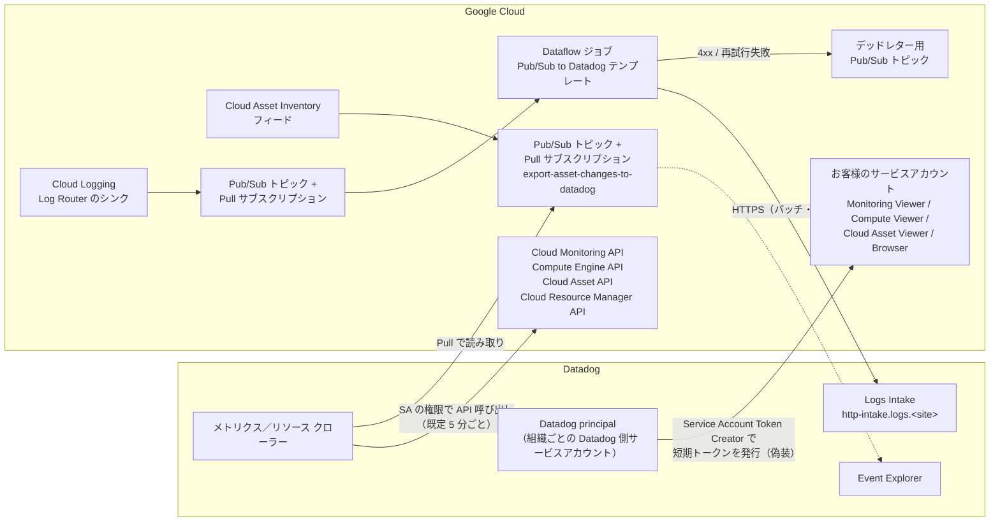
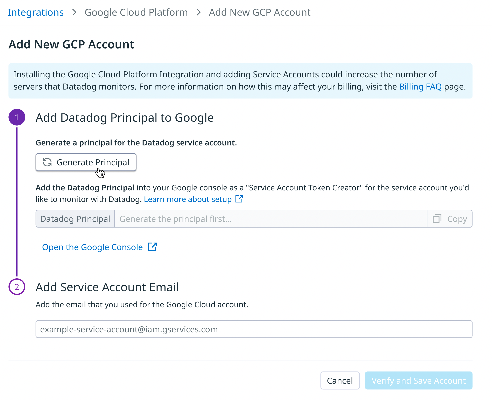
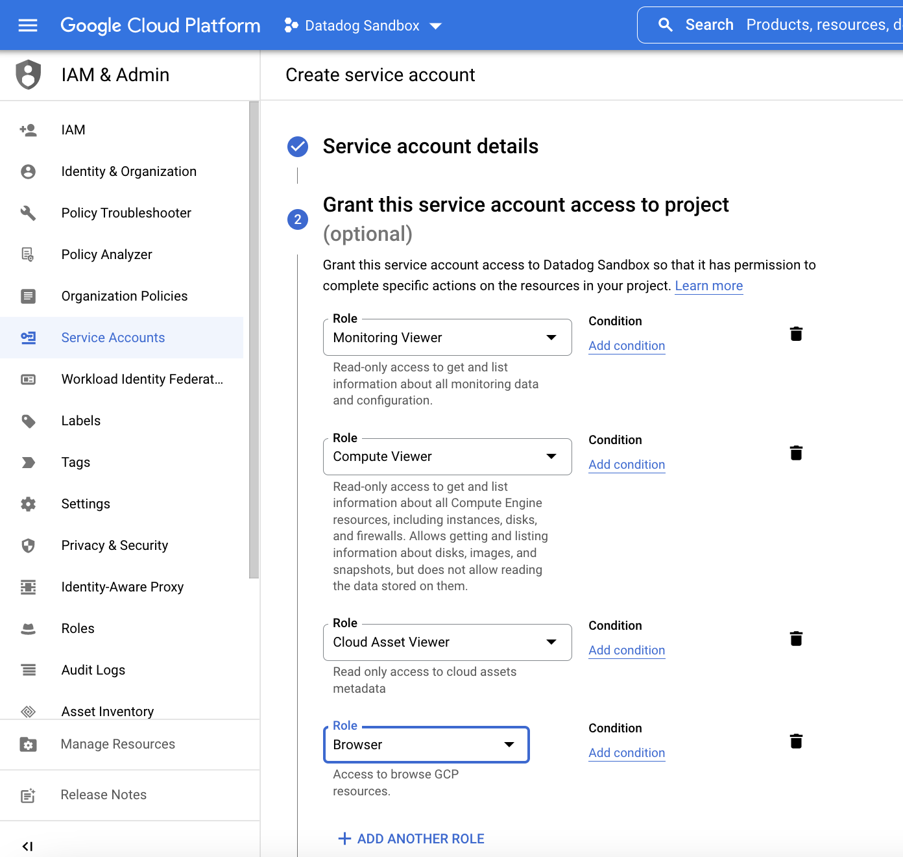
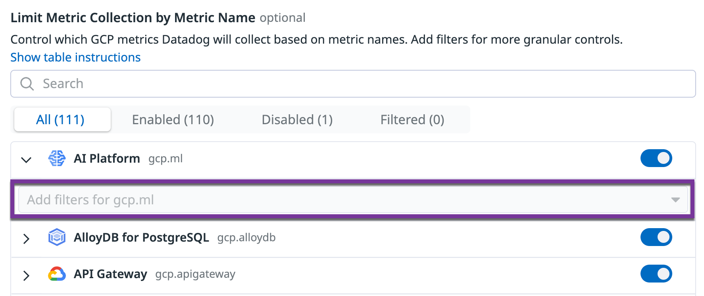
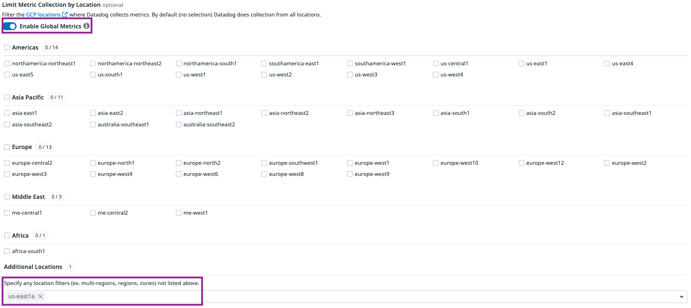
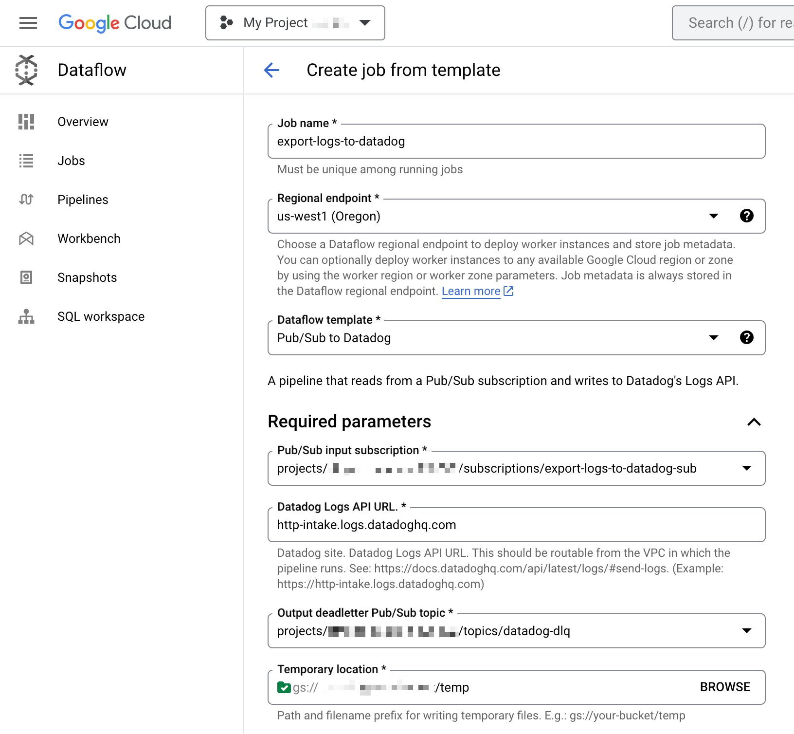

# Google Cloud Integration（Google Cloud インテグレーション）

## 概要

Datadog の **Google Cloud Integration（Google Cloud インテグレーション）** は、Google Cloud（旧称：Google Cloud Platform / GCP）の環境からメトリクス、リソース情報、イベント、セキュリティ検出結果、ログを Datadog に取り込むクラウドインテグレーションである。Datadog の画面やドキュメント、API、Terraform では現在も「Google Cloud Platform」「GCP」という表記が混在しており（例：インテグレーションタイル名 `Google Cloud Platform`、API パス `/api/v2/integration/gcp/...`、Terraform リソース `datadog_integration_gcp_sts`）、本ファイルでは「Google Cloud Integration」と表記する。

Google Cloud Integration は、取得するデータによって仕組みが分かれる。

| データ | 取得方式 | Datadog 側の主な利用先 |
|---|---|---|
| メトリクス | Datadog がサービスアカウントを偽装（impersonation）し、Cloud Monitoring API などを**ポーリング（クローラー）**して取得 | Metrics、ダッシュボード、モニター（`gcp.*` メトリクス） |
| リソース（構成情報） | Cloud Asset API などで定期的に収集（プロジェクト単位、任意で組織／フォルダー単位） | Resource Catalog、Cloud Security など |
| リソース変更イベント | Cloud Asset Inventory のフィード → Pub/Sub（Pull サブスクリプション）→ Datadog が読み取り | Event Explorer（`source:google_cloud_asset_inventory`） |
| セキュリティ検出結果 | Security Command Center の API から取得 | Log Explorer（`source:google.security.command.center`） |
| ログ | Cloud Logging のログシンク → Pub/Sub → **Dataflow（Pub/Sub to Datadog テンプレート）**→ Datadog Logs API（**Push 型**。Datadog からは取りに行かない） | Log Management、Cloud SIEM、Watchdog |
| ホスト内部の詳細メトリクス・トレース・ログ | GCE / GKE などに Datadog Agent を導入 | Infrastructure、APM、Logs（本インテグレーションとは別経路） |

Google Cloud Integration は、Datadog Agent を入れなくても Google Cloud が公開しているメトリクスを収集できる。ただし、Datadog は「最も粒度が細かく低遅延なメトリクス」を得るために Agent の併用を推奨している（[出典](https://docs.datadoghq.com/integrations/google-cloud-platform/)）。Agent については [Datadog Agent](./agent.md)、GKE 上の Agent は [コンテナ/Kubernetes向けAgent](./kubernetes-and-containers-agent.md) を参照。インテグレーション全般の仕組みは [Integrations](./integrations.md) を参照。

本ファイルが扱う範囲：

- 設定方法（サービスアカウント、サービスアカウントの偽装、Datadog principal、組織／フォルダー／プロジェクト単位、Terraform・API）と Workload Identity Federation との関係
- メトリクス収集とフィルター、リソース収集、リソース変更収集、Security Command Center
- ログ収集（Pub/Sub + Dataflow）
- 対応サービス、Private Service Connect
- 制限値・デフォルト値、課金への影響

> **サイト差異:** Google Cloud Integration は全サイト（US1、US3、US5、EU1、AP1、AP2、UK1、US1-FED、US2-FED）のドキュメントに掲載されている。ただし **US2-FED（`us2.ddog-gov.com`）では、組織でこのインテグレーションが利用可能かを Integrations ページか組織管理者に確認し、利用できない場合は `support@ddog-gov.com` に例外申請する**旨の注記がある。また、ドメイン制限ポリシーに登録する Datadog の customer identity がサイトによって異なる（後述）。[出典](https://docs.datadoghq.com/integrations/google-cloud-platform/)
>
> 注：本ナレッジの規約上のサイト一覧（US1、US3、US5、EU1、AP1、AP2、US1-FED）に加え、2026-11-02 時点の公式ドキュメントには UK1（`uk1.datadoghq.com`）と US2-FED（`us2.ddog-gov.com`）も掲載されている。サイトの詳細は [Datadog Sites](./datadog-sites.md) を参照。

## 全体アーキテクチャ（データフロー）

Google Cloud Integration の各データ経路は次のとおりである。メトリクスとリソースは Datadog から Google Cloud の API を呼ぶ「Pull 型」、ログは Google Cloud 側の Dataflow ジョブが Datadog に送る「Push 型」である。



[出典](https://docs.datadoghq.com/integrations/google-cloud-platform/)、[出典](https://docs.datadoghq.com/logs/guide/google-cloud-log-forwarding/)、[出典](https://docs.datadoghq.com/integrations/guide/cloud-metric-delay/)

## 認証方式：サービスアカウントの偽装と Workload Identity Federation

### サービスアカウントの偽装（Service Account Impersonation）

Google Cloud Integration の現行の認証方式は **サービスアカウントの偽装（service account impersonation）** である。この方式では、お客様が自分の Google Cloud プロジェクトに作成したサービスアカウントに対して、Datadog が組織ごとに払い出す **Datadog principal**（Datadog 側の Google サービスアカウント）へ **Service Account Token Creator**（`roles/iam.serviceAccountTokenCreator`）ロールを付与する。Datadog はこの権限で短期のアクセストークンを発行し、お客様のサービスアカウントとして Google Cloud API を呼び出す。

| 項目 | 内容 |
|---|---|
| お客様が作るもの | Google Cloud のサービスアカウント（メール形式：`<SA_NAME>@<PROJECT_ID>.iam.gserviceaccount.com`） |
| Datadog が払い出すもの | Datadog principal（Datadog の画面で **Generate Principal** により生成。API では `POST /api/v2/integration/gcp/sts_delegate`、Terraform では `delegate_account_email` 属性） |
| 信頼関係 | お客様のサービスアカウントの **Permissions** タブで、Datadog principal に **Service Account Token Creator** を付与 |
| 秘密情報の受け渡し | なし（サービスアカウントキー（JSON）を Datadog に渡さない） |
| 旧方式との関係 | 以前の「共有 Datadog principal」で設定していた場合は、新手順の完了後にその共有 principal の権限を取り消してよい（公式注記） |

Datadog 公式ブログ（2023-06-21 公開）は、サービスアカウントの偽装を「Workload Identity Federation の一形態」と説明し、短期のアクセストークンを使うため静的な認証情報が不要になること、割り当てたスコープ内で新しく作られたプロジェクトも自動検出して監視を開始することを挙げている。既存の静的認証情報（キーファイル）利用者はインテグレーションタイルから偽装方式へ移行でき、重複設定の警告で削除可能な旧設定が示される。[出典](https://www.datadoghq.com/blog/google-cloud-service-account-impersonation/)（2023-06-21 公開）

### 旧方式：サービスアカウントキー（JSON キー）

旧方式は、サービスアカウントキー（JSON の秘密鍵）を Datadog に登録する方式である。2026-11-02 時点で次のとおり旧方式は非推奨扱いになっている。

| 対象 | 状態 |
|---|---|
| API v1 `/api/v1/integration/gcp`（GET / POST / PUT / DELETE） | 公式 API リファレンスで **Deprecated** と表示 |
| Terraform `datadog_integration_gcp`（`private_key`、`private_key_id`、`client_id` などを指定） | 「This resource is deprecated—use the `datadog_integration_gcp_sts` resource instead」と明記 |
| 現行のセットアップ手順（公式ドキュメント） | 偽装方式のみ記載。JSON キー方式の手順は掲載されていない |

JSON キー方式の提供終了日（サンセット日）は、公開情報では確認できず。[出典](https://docs.datadoghq.com/api/latest/gcp-integration/)、[出典](https://github.com/DataDog/terraform-provider-datadog/blob/master/docs/resources/integration_gcp.md)

### Workload Identity Federation（Datadog の機能）との関係

「Workload Identity Federation（WIF）」という名前の機能は Datadog に別途存在するが、Google Cloud Integration の設定とは別物であるため混同しないこと。

| 項目 | Google Cloud Integration のサービスアカウント偽装 | Datadog の Workload Identity Federation 機能 |
|---|---|---|
| 目的 | **Datadog → Google Cloud** の認証（Datadog がお客様の Google Cloud API を読む） | **お客様のワークロード → Datadog** の認証（Terraform provider や Agent が API キー／アプリケーションキーの代わりにクラウド認証情報で Datadog に認証） |
| Google Cloud 対応 | 対応（これが標準方式） | **非対応**。公式ドキュメントは「AWS is the only supported cloud provider」と記載し、Agent 向けには「Azure, Google Cloud, and generic OIDC providers are not supported」と明記 |
| 設定場所 | Google Cloud Integration タイル | Organization Settings の Identity Mapping / Intake Mapping |

したがって、2026-11-02 時点では、GCE / GKE 上の Datadog Agent や Terraform provider が Google Cloud の認証情報で Datadog に認証する方法は提供されていない（Datadog Support への機能リクエストを案内）。Datadog の WIF 機能の詳細は [API とキー管理](./api-and-keys.md) と [Terraform と IaC](./terraform-and-iac.md) を参照。[出典](https://docs.datadoghq.com/account_management/workload_identity_federation/)

なお、Google Cloud 側の機能「Workload Identity Federation for GKE」（Pod に Google サービスアカウントの権限を与える仕組み）を Google Cloud Integration の設定に使う手順は、Datadog 公式ドキュメントには記載がない（公開情報では確認できず）。

## 前提条件

### 有効化する API

Google Cloud Integration では、**監視対象のすべてのプロジェクト**と、**サービスアカウントを作成したプロジェクト**で、次の API を有効にする。公式ドキュメントは、この手順を飛ばすと統合の問題が起きるため必ず実施するよう注意している。

| API | 用途（公式の説明） |
|---|---|
| Cloud Monitoring API | Google Cloud のメトリクスデータを Datadog が照会する |
| Compute Engine API | Compute Engine インスタンスのデータを検出する |
| Cloud Asset API | Google Cloud のリソースを取得し、ラベルをタグとしてメトリクスに関連付ける |
| Cloud Resource Manager API | メトリクスに正しいリソースとタグを付与する |
| IAM API | Google Cloud との認証に使う |
| Cloud Billing API | 請求をプログラムから管理する（[Cloud Cost Management](../infrastructure/cloud-cost-management.md) で使用） |

[出典](https://docs.datadoghq.com/integrations/google-cloud-platform/)

### ドメイン制限付き共有（Domain Restricted Sharing）

Google Cloud の組織ポリシーで ID をドメインで制限している場合は、Datadog の **customer identity** を許可値に追加する必要がある。

| Datadog サイト | Datadog の customer identity |
|---|---|
| US1（`app.datadoghq.com`）、US3、US5、EU1（`app.datadoghq.eu`）、AP1、AP2、UK1 | `C0147pk0i` |
| US1-FED（`app.ddog-gov.com`）、US2-FED（`us2.ddog-gov.com`） | `C03lf3ewa` |

> **サイト差異:** customer identity は商用サイトと Government サイトで異なる。[出典](https://docs.datadoghq.com/integrations/google-cloud-platform/)

### スコーピングプロジェクトに関する制約

監視対象のプロジェクトは、Cloud Monitoring の **スコーピングプロジェクト**（複数プロジェクトのメトリクスを取り込む「指標スコープ」のホストプロジェクト）として構成されていてはならない。[出典](https://docs.datadoghq.com/integrations/google-cloud-platform/)

### 設定作業者に必要な権限

| 作業 | 必要な権限（公式記載） |
|---|---|
| 組織／フォルダー単位のセットアップ | 対象スコープで **Admin** ロール（例：Organization Admin）を持つ Google Cloud Identity ユーザー |
| 組織／フォルダーのリソース収集の設定 | 組織レベルで IAM ポリシーの編集とカスタムロールの作成ができる権限（例：Organization Administrator と Organization Role Administrator の組み合わせ） |
| ログ転送（Quick Start / Terraform） | Google Cloud：`roles/pubsub.admin`、`roles/storage.admin`、`roles/secretmanager.admin`、`roles/resourcemanager.projectIamAdmin`、`roles/logging.configWriter`、`roles/serviceusage.serviceUsageAdmin`、`roles/dataflow.developer`。Datadog：Datadog Admin ロール、またはカスタムロールで `api_keys_read` と `api_keys_write` |
| API でインテグレーションを作成 | Datadog の `gcp_configurations_manage` 権限 |

[出典](https://docs.datadoghq.com/integrations/google-cloud-platform/)、[出典](https://docs.datadoghq.com/logs/guide/google-cloud-log-forwarding/)、[出典](https://docs.datadoghq.com/api/latest/gcp-integration/create-a-new-entry-for-your-service-account/)

## 設定方式の一覧

| 方式 | 概要 | 向いているケース |
|---|---|---|
| **組織／フォルダー単位のプロジェクト検出（推奨）** | サービスアカウントに組織またはフォルダーでロールを付与。スコープ内の全プロジェクト（**後から作られるプロジェクトを含む**）を自動検出して監視 | 複数プロジェクトを持つ環境。公式推奨 |
| プロジェクト単位 | サービスアカウントにプロジェクトごとにロールを付与。サービスアカウントから見えるプロジェクトを自動検出 | 監視対象を個別プロジェクトに限定したい場合 |
| Terraform | `datadog_integration_gcp_sts`（Datadog provider）と `google_service_account` などの Google provider リソースを組み合わせる | IaC 管理。[Terraform と IaC](./terraform-and-iac.md) 参照 |
| API | `POST /api/v2/integration/gcp/accounts` などの v2 API | 自動化・一括登録 |
| （旧）サービスアカウントキー | JSON キーを登録。API v1 と Terraform `datadog_integration_gcp` は非推奨 | 新規利用は非推奨 |

なお、プロジェクト検出では、**プロジェクト ID の接頭辞が `sys-` のプロジェクトは検出対象にならない**。[出典](https://docs.datadoghq.com/integrations/google-cloud-platform/)

## 組織／フォルダー単位のセットアップ手順（推奨）

Google Cloud Integration を組織またはフォルダー単位で設定する手順は次のとおり。設定後、メトリクスは**約 15 分後**に Datadog に表示される。

### 1. 既定プロジェクトにサービスアカウントを作成

1. Google Cloud コンソールで **IAM & Admin > Service Accounts** を開く。
2. **Create service account** をクリックし、一意の名前を付ける。
3. **Done** で作成を完了する。

### 2. 組織またはフォルダーにサービスアカウントを追加

1. Google Cloud コンソールの **IAM** ページで、フォルダーまたは組織を選択する。
2. **Grant Access** をクリックし、手順 1 のサービスアカウントのメールアドレスを入力する。
3. 次のロールを付与して **Save** する。

| ロール | ロール ID | 用途（公式の説明） | 必須／任意 |
|---|---|---|---|
| Compute Viewer | `roles/compute.viewer` | Compute Engine リソースの読み取り（get / list） | 必須 |
| Monitoring Viewer | `roles/monitoring.viewer` | 監視データの読み取り | 必須 |
| Cloud Asset Viewer | `roles/cloudasset.viewer` | クラウドアセットのメタデータの読み取り | 必須 |
| Browser | `roles/browser` | プロジェクト階層の参照 | 必須 |
| Service Usage Consumer | `roles/serviceusage.serviceUsageConsumer` | プロジェクトごとのコスト・API クォータの帰属（複数プロジェクト環境向け） | 任意 |

組織／フォルダーのリソース収集（後述）を有効にする場合は、追加のカスタムロールが必要である。

### 3. Datadog principal をサービスアカウントに追加

1. Datadog で **Integrations > Google Cloud Platform** を開き、**Add Google Cloud Account** をクリックする（プロジェクト未設定なら自動でこの画面に遷移する）。
2. 表示される **Datadog principal** をコピーする（未生成なら **Generate Principal** をクリック）。この画面は開いたままにする。
3. Google Cloud コンソールの **Service Accounts** で手順 1 のサービスアカウントを開き、**Permissions** タブ → **Grant Access** をクリックする。
4. **New principals** に Datadog principal を貼り付け、**Service Account Token Creator** ロールを付与して **Save** する。

### 4. Datadog 側で設定を完了

1. Google Cloud コンソールの **Service Account > Details** タブで、サービスアカウントのメール（`<SA_NAME>@<PROJECT_ID>.iam.gserviceaccount.com`）をコピーする。
2. Datadog の設定画面に戻り、**Add Service Account Email** に貼り付ける。
3. **Verify and Save Account** をクリックする。

[出典](https://docs.datadoghq.com/integrations/google-cloud-platform/)



**画像：Datadog の Google Cloud Integration で新しいアカウントを追加する画面（Add New GCP Account）**

- 画面の場所：**Integrations > Google Cloud Platform > Add New GCP Account**（パンくずリストに表示）。
- 上部の青い注意書き：Google Cloud Platform Integration のインストールやサービスアカウントの追加で、Datadog が監視するサーバー数が増える可能性があり、課金への影響は Billing FAQ を参照するよう案内している。
- ステップ 1「Add Datadog Principal to Google」：**Generate Principal** ボタン、生成された principal を表示する **Datadog Principal** 欄と **Copy** ボタン、**Open the Google Console** リンク。説明文で、Datadog principal を監視対象のサービスアカウントに「Service Account Token Creator」として追加するよう指示している。
- ステップ 2「Add Service Account Email」：Google Cloud のサービスアカウントのメールアドレスを入力する欄。
- 画面下部：**Cancel** と **Verify and Save Account** ボタン。
- 出典：https://docs.datadoghq.com/integrations/google-cloud-platform/ （画像 URL：https://docs.dd-static.net/images/integrations/google_cloud_platform/principal-2.de65e967af6ef672299441eb286356ce.png 、取得日 2026-11-02）

### 5. （推奨）プロジェクトごとのコスト・API クォータの帰属

Google Cloud は既定で、Datadog の監視 API 呼び出しの **API クォータと費用を、サービスアカウントを含むプロジェクトに帰属**させる。複数プロジェクト環境では、照会されたプロジェクト側に帰属させる設定が推奨されている。この設定により、プロジェクトごとの監視コストが見えるようになり、API のレート制限にも達しにくくなる。

1. Datadog のサービスアカウントに、フォルダーまたは組織のスコープで **Service Usage Consumer** ロールを付与する。
2. Google Cloud Integration ページの **Projects** タブで **Enable Per Project Quota** トグルをオンにする。

API・Terraform では `is_per_project_quota_enabled` に当たる。有効にすると Datadog は `X-Goog-User-Project` ヘッダーを付けて API を呼ぶ。[出典](https://docs.datadoghq.com/integrations/google-cloud-platform/)、[出典](https://docs.datadoghq.com/api/latest/gcp-integration/create-a-new-entry-for-your-service-account/)

## プロジェクト単位のセットアップ手順

Google Cloud Integration をプロジェクト単位で設定する場合も、サービスアカウントの偽装とプロジェクトの自動検出を使う。ロールをプロジェクトごとに付与すれば、そのサービスアカウントから見えるプロジェクトがすべて監視対象になる。

1. **サービスアカウントの作成**：**IAM & Admin > Service Accounts** → **Create service account** → 名前を付けて **Create and continue**。次の 4 ロールを付与し、**Continue** → **Done**。
   - Monitoring Viewer、Compute Viewer、Cloud Asset Viewer、Browser（Browser は「アクセス可能なプロジェクトの検出」に使う）
2. **Datadog principal の追加**：Datadog の **Integrations > Google Cloud Platform** → **Add GCP Account**。principal が未生成なら **Generate Principal**。コピーした principal を、Google Cloud のサービスアカウントの **Permissions** タブ → **Grant Access** で **New principals** に貼り付け、**Service Account Token Creator** を付与して **SAVE**。
3. **Datadog 側で完了**：サービスアカウントのメール（`<sa-name>@<project-id>.iam.gserviceaccount.com`）を **Add Service Account Email** に貼り付け、**Verify and Save Account**。約 15 分でメトリクスが表示される。

[出典](https://docs.datadoghq.com/integrations/google-cloud-platform/)



**画像：Google Cloud コンソールの「Create service account」フロー**

- 画面の場所：Google Cloud コンソールの **IAM & Admin > Service Accounts > Create service account**。
- 「Grant this service account access to project」の手順で、本節の 4 ロール（Monitoring Viewer、Compute Viewer、Cloud Asset Viewer、Browser）が追加されている状態を示している。
- 出典：https://docs.datadoghq.com/integrations/google-cloud-platform/ （画像 URL：https://docs.dd-static.net/images/integrations/google_cloud_platform/create-service-account.ec27127399862bac96b88a0a3828b4b8.png 、取得日 2026-11-02）

> 補足：Terraform provider のサンプルでは、Browser ロールは「サービスアカウントの既定プロジェクトでのみ必要」とコメントされている。一方、公式ドキュメントのプロジェクト単位手順では 4 ロールをまとめて付与する手順になっている。どのプロジェクトまで検出対象にしたいかに合わせ、ロールの付与範囲を決めること。[出典](https://github.com/DataDog/terraform-provider-datadog/blob/master/docs/resources/integration_gcp_sts.md)

## 必要な IAM ロール・権限のまとめ

| 主体 | 付与先（スコープ） | ロール／権限 | 用途 |
|---|---|---|---|
| お客様のサービスアカウント | 組織／フォルダー／プロジェクト | Monitoring Viewer、Compute Viewer、Cloud Asset Viewer、Browser | メトリクス・リソース収集、プロジェクト検出 |
| お客様のサービスアカウント | フォルダー／組織 | Service Usage Consumer（任意） | プロジェクトごとのクォータ・費用の帰属 |
| お客様のサービスアカウント | 組織 | カスタムロール `datadogOrgFolderResourceCollectionRole`（26 権限、後述） | 組織／フォルダーのリソース収集 |
| お客様のサービスアカウント | Pub/Sub サブスクリプション `export-asset-changes-to-datadog` | Pub/Sub Subscriber（`roles/pubsub.subscriber`。必要なのは `pubsub.subscriptions.consume`） | リソース変更収集 |
| お客様のサービスアカウント | 対象プロジェクト（複数のサービスアカウントが同じプロジェクトを検出する場合は全サービスアカウント） | Security Center Findings Viewer（`roles/securitycenter.findingsViewer`） | Security Command Center の検出結果の収集 |
| Datadog principal | お客様のサービスアカウント | Service Account Token Creator | サービスアカウントの偽装 |
| Dataflow ワーカー用サービスアカウント | ログ転送用プロジェクト | Dataflow Admin、Dataflow Worker、Pub/Sub Viewer、Pub/Sub Subscriber、Pub/Sub Publisher、Secret Manager Secret Accessor、Storage Object Admin | ログ転送パイプライン |

Cloud Cost Management（Google Cloud のコストデータ）を使う場合は、BigQuery の課金エクスポートとストレージバケットへのアクセス権が別途必要である（`bigquery.jobs.create`、`bigquery.transfers.get`、`bigquery.transfers.update` など）。詳細は [Cloud Cost Management](../infrastructure/cloud-cost-management.md) を参照。[出典](https://docs.datadoghq.com/cloud_cost_management/setup/google_cloud/)

## Google Cloud Integration ページの構成

Datadog の **Integrations > Google Cloud Platform** ページは、登録したサービスアカウントごとに設定を持つ。公式ドキュメントに登場するタブ・設定項目は次のとおりである。

| タブ／ボタン | 主な設定項目 | API / Terraform の属性 |
|---|---|---|
| **Projects** | 検出されたプロジェクト、**Enable Per Project Quota** | `is_per_project_quota_enabled`、レスポンスの `meta.accessible_projects` |
| **Metric Collection** | メトリクス名前空間の有効／無効と名前空間ごとのフィルター（**Limit Metric Collection by Metric Name**）、リージョン／ロケーション（**Limit Metric Collection by Location**、**Enable Global Metrics**、**Additional Locations**）、ホスト・Cloud Run インスタンスのタグフィルター（**Limit Metric Collection Filters**） | `metric_namespace_configs`、`region_filter_configs`、`is_global_location_enabled`、`monitored_resource_configs`（旧 `host_filters`、`cloud_run_revision_filters`） |
| **Resource Collection** | **Enable Project Resource Collection**、**Enable Org/Folder Resource Collection**、**Enable Resource Changes Collection** | `resource_collection_enabled`、`is_org_folder_resource_collection_enabled`、`is_resource_change_collection_enabled`、`is_cspm_enabled` |
| **Security Findings** | Security Command Center の検出結果の収集トグル | `is_security_command_center_enabled` |
| **Configure Log Collection**（ボタン） | ログ転送のセットアップ（Quick Start / Terraform） | なし（Google Cloud 側のリソースを作成） |
| その他（API で設定可能） | アカウントタグ、GCE の想定内停止時のモニター自動ミュート | `account_tags`、`automute` |

タブ名は公式ドキュメントの記載に基づく。UI の細部は変わることがある。[出典](https://docs.datadoghq.com/integrations/google-cloud-platform/)、[出典](https://docs.datadoghq.com/integrations/google-cloud-security-command-center/)、[出典](https://docs.datadoghq.com/api/latest/gcp-integration/create-a-new-entry-for-your-service-account/)

## メトリクス収集

### 収集の仕組みと遅延

Google Cloud Integration は、インストール完了後に自動でメトリクスを収集する。メトリクスは API 経由でクローラーが取得する。

| 項目 | 値 |
|---|---|
| 既定のクロール間隔（GCP） | **5 分ごと** |
| Google Cloud が出すメトリクスの粒度 | 1 分 |
| 想定される遅延 | **約 7〜8 分** |
| 初回表示までの目安 | セットアップ後 約 15 分 |
| 高速化 | Datadog Support に相談するとクローラーを速められる場合がある。システムメトリクスをほぼ遅延なしで得るには Agent を導入 |

遅延のあるメトリクスでモニターを作ると、モニター作成画面に警告が出る。Datadog は評価期間を延ばし、評価遅延（`evaluation_delay`）を設定することを推奨している。モニターの設定は [Monitors](./monitors.md) を参照。[出典](https://docs.datadoghq.com/integrations/guide/cloud-metric-delay/)

### 確認方法

メトリクスの取り込みは、Datadog の **Metrics > Summary** で `gcp` を検索して確認する。[出典](https://docs.datadoghq.com/integrations/google-cloud-platform/)

### メトリクス名とメトリクスの種類

| 項目 | 内容 |
|---|---|
| 命名 | `gcp.<サービス名前空間>.<Google Cloud のメトリクス名>`。例：`gcp.gce.instance.cpu.utilization`（gauge、割り当て CPU のうち使用中の割合。単位 fraction。マシンタイプによっては 100% を超えるバースト可） |
| 名前空間の例 | `gcp.ml`（AI Platform）、`gcp.alloydb`（AlloyDB for PostgreSQL）、`gcp.apigateway`（API Gateway）、`gcp.gce`（Compute Engine）、`gcp.gke`（GKE）、`gcp.pubsub`（Pub/Sub）、`gcp.run`（Cloud Run） |
| 累積（CUMULATIVE）メトリクス | 累積メトリクスは、元の名前に加えて **`.delta` 付きのメトリクス**も取り込まれる。`.delta` は前回の測定からの変化量を表す。例：`gcp.gke.container.restart_count` に対して `gcp.gke.container.restart_count.delta` |
| サービスチェック | Google Cloud Integration にサービスチェックはない |
| イベント | Google Cloud Platform が生成したサービスイベントは Events Explorer に転送される |

公式ドキュメントは「Google Cloud Integration はすべての Google Cloud メトリクスを収集する」としている。対応サービスの一覧が最新のクラウドサービスに追いついていない場合があり、特定サービスの個別インテグレーションが見つからなければ Datadog Support に連絡するよう案内している。[出典](https://docs.datadoghq.com/integrations/google-cloud-platform/)

Cloud Run を Serverless Agent で計装した場合の拡張メトリクスは、`gcp.run.container.enhanced.*` と `gcp.run.job.enhanced.*` の名前空間で区別される（Google Cloud Integration のメトリクスとは別経路）。[出典](https://docs.datadoghq.com/serverless/google_cloud_run/)

### メトリクス名前空間とメトリクス名によるフィルター

Google Cloud Integration では、どのサービス（名前空間）を収集するか、さらにサービスごとにどのメトリクスを収集するかを指定できる。公式ドキュメントは、この設定で Google Cloud Monitoring API の費用を抑えられるとしている。

- **名前空間の無効化**：**Metric Collection** タブで、除外したい名前空間のチェック（トグル）を外す。
- **名前空間ごとの詳細フィルター**：サービスをクリックして展開し、**Add filters for gcp.<service>** 欄にフィルターを入力する。
- **判定ルール**：メトリクスは「**少なくとも 1 つの包含フィルターに一致し、かつどの除外フィルターにも一致しない**」場合のみ収集される。除外フィルターは先頭に `!` を付ける。フィルターは `gcp.<service>.` 以降のメトリクス名に対して評価される。

| フィルター例 | 意味 |
|---|---|
| `subscription.*` `topic.*` | `gcp.<service>.subscription.*` または `gcp.<service>.topic.*` に一致するものだけ収集 |
| `!*_cost` `!*_count` | `gcp.<service>.*_cost` にも `gcp.<service>.*_count` にも一致しないものを収集 |
| `snapshot.*` `!*_by_region` | `gcp.<service>.snapshot.*` に一致し、`gcp.<service>.*_by_region` に一致しないものを収集 |

API では `metric_namespace_configs`（`id` = 名前空間 ID、例：`pubsub`、`disabled`、`filters`）で設定する。[出典](https://docs.datadoghq.com/integrations/google-cloud-platform/)、[出典](https://docs.datadoghq.com/api/latest/gcp-integration/create-a-new-entry-for-your-service-account/)



**画像：Google Cloud Integration の Metric Collection タブ（Limit Metric Collection by Metric Name）**

- 見出し「Limit Metric Collection by Metric Name（optional）」と説明「Control which GCP metrics Datadog will collect based on metric names. Add filters for more granular controls.」、**Show table instructions** リンク。
- 検索ボックスと、**All / Enabled / Disabled / Filtered** の件数タブ（画像の例では All (111)、Enabled (110)、Disabled (1)、Filtered (0)。件数は取得時点の例）。
- サービスの一覧（例：AI Platform `gcp.ml`、AlloyDB for PostgreSQL `gcp.alloydb`、API Gateway `gcp.apigateway`）があり、各行の右にオン／オフのトグルがある。AI Platform を展開すると **Add filters for gcp.ml** 入力欄が表示される（紫枠で強調）。
- 出典：https://docs.datadoghq.com/integrations/google-cloud-platform/ （画像 URL：https://docs.dd-static.net/images/integrations/google_cloud_platform/limit_metric_collection_2025-11-11.383906416aa505b6f53d8e9620b1f7ba.png 、取得日 2026-11-02）

### リージョン（ロケーション）とグローバルリソースによるフィルター

Google Cloud Integration では、メトリクスを収集するリージョンを絞り込める。**既定（何も選択しない状態）ではすべてのロケーションから収集**する。

| 設定 | 内容 |
|---|---|
| リージョンのチェックボックス | **Metric Collection** タブで、除外するリージョンの選択を外す（地域グループ単位でも選択可） |
| **Additional Locations** | チェックボックスにないリージョン、マルチリージョン、ゾーンを入力。Google Cloud が報告するラベル値と**完全一致**で判定するため、リソースに表示される値をそのまま入力する（例：`us-central`） |
| **Enable Global Metrics** | リージョンに紐付かない（location が `global`、またはラベルから location を判定できない）メトリクスを収集するか。API では `is_global_location_enabled` |

API では `region_filter_configs`（例：`["nam4", "europe-north1"]`）で設定する。[出典](https://docs.datadoghq.com/integrations/google-cloud-platform/)、[出典](https://docs.datadoghq.com/api/latest/gcp-integration/create-a-new-entry-for-your-service-account/)



**画像：Google Cloud Integration の Metric Collection タブ（Limit Metric Collection by Location）**

- 見出し「Limit Metric Collection by Location（optional）」と説明「Filter the GCP locations where Datadog collects metrics. By default (no selection) Datadog does collection from all locations.」。
- 上部に **Enable Global Metrics** トグル（紫枠で強調、オンの状態）。
- 地域グループ別のリージョンのチェックボックス：Americas（例：`us-central1`、`us-east1`、`northamerica-northeast1` など）、Asia Pacific（例：`asia-northeast1`（東京）、`asia-northeast2`（大阪）、`australia-southeast1` など）、Europe、Middle East、Africa。画像の時点では Americas 14、Asia Pacific 11、Europe 13、Middle East 3、Africa 1 の項目が並ぶ（項目数は Google Cloud のリージョン追加で変わり得る）。
- 下部の **Additional Locations** 欄（紫枠で強調）：「Specify any location filters (ex. multi-regions, regions, zones) not listed above.」として、例では `us-east1a` が入力されている。
- 出典：https://docs.datadoghq.com/integrations/google-cloud-platform/ （画像 URL：https://docs.dd-static.net/images/integrations/google_cloud_platform/metric_region_filtering.865a0a4dcf05598afdb4888465e6a0b8.png 、取得日 2026-11-02）

### ホスト／Cloud Run インスタンスによるフィルター（ラベル）

Google Cloud Integration では、Google Cloud のラベル（Datadog ではタグとして扱う）で、取り込む GCE ホストや Cloud Run インスタンスを絞り込める。

1. 監視したいホストや Cloud Run インスタンスにラベルを付ける（例：`datadog:true`）。
2. **Metric Collection** タブの **Limit Metric Collection Filters** に、タグをカンマ区切りで入力する。定義したタグの**いずれかに一致する**ホストだけが Datadog に取り込まれる。

| 記法 | 意味 |
|---|---|
| `?` | 任意の 1 文字 |
| `*` | 任意の複数文字 |
| `!` | 除外 |

例：`datadog:monitored,env:production,!env:staging,instance-type:c1.*`（`c1*` サイズのインスタンスをすべて含め、staging のホストを除外）

API・Terraform では `monitored_resource_configs`（`type` は `gce_instance`、`cloud_run_revision`、`cloud_function` のいずれか、`filters` はタグの配列）で設定する。旧属性の `host_filters`（GCE 用）と `cloud_run_revision_filters`（Cloud Run 用）は **DEPRECATED** で、`monitored_resource_configs` への移行が案内されている。

既存プロジェクトにフィルターを追加した場合、それまでに検出されていたインスタンスは **最大 2 時間** Infrastructure List に残り、移行期間中は状態が `???` と表示される（この期間は課金対象にならない）。Agent が動いているホストはフィルターに関係なく表示され課金対象になる（フィルターは Agent が動いていない GCE インスタンスにのみ効く）。[出典](https://docs.datadoghq.com/integrations/google-cloud-platform/)、[出典](https://docs.datadoghq.com/account_management/billing/google_cloud/)、[出典](https://docs.datadoghq.com/api/latest/gcp-integration/create-a-new-entry-for-your-service-account/)

### タグ

Google Cloud Integration は、Google Cloud と Compute Engine の設定に基づいてタグを自動付与する。

| タグの種類 | 内容 |
|---|---|
| `project_id` | **すべてのメトリクス**に付与される |
| メトリクス種別ごとのタグ | Google Cloud から取得できるラベルなど。メトリクスの種類によって異なる |
| ホストのラベル | `<key>:<value>` 形式のラベルを持つホスト |
| カスタムラベル | Google Pub/Sub、GCE、Cloud SQL、Cloud Storage のカスタムラベル |
| アカウントタグ | `account_tags` に指定したタグを、そのアカウントのメトリクスとサービスチェックに付与（API / Terraform） |

タグ設計は [Tagging（タグ）](./tagging.md) と [タグ戦略の実践](../../04_応用編/02-tagging-strategy.md) を参照。[出典](https://docs.datadoghq.com/integrations/google-cloud-platform/)

### GCE の想定内停止時の自動ミュート（automute）

`automute` を有効にすると、GCE インスタンスの想定内のシャットダウンについてモニターを自動でミュートする（API / Terraform の属性。公式説明は「Silence monitors for expected GCE instance shutdowns」）。既定値は公開情報では確認できず（API のレスポンス例では `false`）。通知の抑止全般は [通知と Downtime](./notifications-and-downtimes.md) を参照。[出典](https://docs.datadoghq.com/api/latest/gcp-integration/create-a-new-entry-for-your-service-account/)

### Datadog Agent との関係（GCE / GKE）

Google Cloud Integration のメトリクスはハイパーバイザー／Google Cloud 側から見た値であり、Agent を入れるとプロセス、ディスク、ネットワークの詳細、トレース、ログをより低遅延・高粒度で取得できる。GKE を含む任意のホストに Agent を導入できる。[出典](https://docs.datadoghq.com/integrations/google-cloud-platform/)

Agent は GCE のメタデータサーバーから情報を取得してホストタグを付与する。主な `datadog.yaml` 設定は次のとおり（Agent v7 のスキーマ定義に基づく）。

| 設定キー | 既定値 | 内容 |
|---|---|---|
| `collect_gce_tags` | `true` | Google Compute Engine のメタデータをホストタグとして収集する |
| `exclude_gce_tags` | `bosh_settings`、`cli-cert`、`common-psm1`、`configure-sh`、`containerd-configure-sh`、`disable-address-manager`、`disable-legacy-endpoints`、`enable-oslogin`、`gce-container-declaration`、`google-container-manifest`、`ipsec-cert` など | ホストタグにしない GCE メタデータ属性のリスト |
| `gce_send_project_id_tag` | `false` | `project:` タグに加えて `project_id:` タグも送る |
| `gce_metadata_timeout` | `1000`（ミリ秒） | GCE メタデータエンドポイント呼び出しのタイムアウト |

[出典](https://github.com/DataDog/datadog-agent/blob/main/pkg/config/schema/yaml/core_schema.yaml)。Agent の設定全般は [Agent 設定リファレンス](./agent-configuration.md) を参照。

課金上、Agent が動いている GCE インスタンスを Google Cloud Integration も検出していても**二重には課金されない**（後述「課金への影響」）。

## リソース収集

### リソース収集の概要

Google Cloud Integration の **リソース収集（Resource collection）** は、Google Cloud リソースの構成情報とメタデータを収集する機能で、Resource Catalog や Cloud Security などの Datadog 製品で使われる。Datadog は監視対象プロジェクトから定期的にリソースを収集し、任意でフォルダーと組織のリソースも収集する。

| 種類 | 有効化 | 必要な権限 | 範囲 |
|---|---|---|---|
| プロジェクト単位のリソース収集 | **Resource Collection** タブの **Enable Project Resource Collection**（API：`resource_collection_enabled`） | インストール時に付与した権限で十分 | Datadog が監視しているプロジェクト |
| 組織／フォルダー単位のリソース収集 | **Enable Org/Folder Resource Collection**（API：`is_org_folder_resource_collection_enabled`） | Cloud Asset Inventory API の有効化 + カスタムロール `datadogOrgFolderResourceCollectionRole` を組織で付与 | サービスアカウントを作成した**組織**の、プロジェクトより上位（組織・フォルダー）に紐付くリソース |

組織／フォルダー単位のリソース収集は、「組織／フォルダー単位のプロジェクト検出」（どのプロジェクトを監視するか）とは**別の機能**である。組織／フォルダー単位のリソース収集では、監視対象プロジェクトを含まないフォルダーのデータも収集されるが、プロジェクト単位のリソース収集は引き続き監視対象プロジェクトに限られる。組織内のすべてのプロジェクトを監視対象にしていなくても有効化できる。

Cloud Security（旧称：Cloud Security Management / CSM）の誤設定検出をこのアカウントで有効にする属性 `is_cspm_enabled` は、`resource_collection_enabled` または `is_org_folder_resource_collection_enabled` が `true` であることが前提である。Cloud Security の詳細は [Cloud Security](../security/cloud-security.md) を参照。[出典](https://docs.datadoghq.com/integrations/google-cloud-platform/)、[出典](https://docs.datadoghq.com/api/latest/gcp-integration/create-a-new-entry-for-your-service-account/)

### 組織／フォルダー単位のリソース収集の設定

1. サービスアカウントが属するプロジェクトで **Cloud Asset Inventory API** を有効にする。
2. Google Cloud コンソールの **IAM & Admin > Roles** で、プロジェクトピッカーからサービスアカウントのプロジェクトを含む組織を選び、**Create custom role** をクリックする。
3. Title と ID に `datadogOrgFolderResourceCollectionRole` を入力し、次の 26 権限を追加して **Create** する。
4. **IAM & Admin > IAM** で **Grant access** → **New principals** にサービスアカウントのメール → **Select a role** でカスタムロール `datadogOrgFolderResourceCollectionRole` を選択 → **Save**。
5. Datadog の **Resource Collection** タブで **Enable Org/Folder Resource Collection** をクリックする。

| 区分 | 権限 |
|---|---|
| Cloud Asset（20 件） | `cloudasset.assets.analyzeIamPolicy`、`cloudasset.assets.analyzeMove`、`cloudasset.assets.analyzeOrgPolicy`、`cloudasset.assets.exportAccessPolicy`、`cloudasset.assets.exportIamPolicy`、`cloudasset.assets.exportOSInventories`、`cloudasset.assets.exportOrgPolicy`、`cloudasset.assets.exportResource`、`cloudasset.assets.listAccessPolicy`、`cloudasset.assets.listIamPolicy`、`cloudasset.assets.listOSInventories`、`cloudasset.assets.listOrgPolicy`、`cloudasset.assets.listResource`、`cloudasset.assets.queryAccessPolicy`、`cloudasset.assets.queryIamPolicy`、`cloudasset.assets.queryOSInventories`、`cloudasset.assets.queryResource`、`cloudasset.assets.searchAllIamPolicies`、`cloudasset.assets.searchAllResources`、`cloudasset.assets.searchEnrichmentResourceOwners` |
| IAM（1 件） | `iam.roles.get` |
| Recommender（4 件） | `recommender.cloudAssetInsights.get`、`recommender.cloudAssetInsights.list`、`recommender.locations.get`、`recommender.locations.list` |
| Service Usage（1 件） | `serviceusage.services.use` |

[出典](https://docs.datadoghq.com/integrations/google-cloud-platform/)

### リソース変更収集（Resource changes collection）

Google Cloud Integration の **リソース変更収集** は、Google の Cloud Asset Inventory がクラウドリソースの変更を検出したときに、Datadog にイベントを送る機能である。変更イベントは Pub/Sub 経由で Datadog の Event Explorer に届く。

設定手順（Google Cloud CLI / コンソールの場合）：

1. **Pub/Sub トピックを作成**：Pub/Sub の Topics ページで **CREATE TOPIC** → 分かりやすい名前を付ける → **既定のサブスクリプションを追加するオプションのチェックを外す** → **CREATE**。
2. **サブスクリプションを作成**：**CREATE SUBSCRIPTION** → 名前を **`export-asset-changes-to-datadog`** にする → 手順 1 のトピックを選択 → 配信タイプ **Pull** → **CREATE**。
3. **権限を付与**：サブスクリプション `export-asset-changes-to-datadog` の **Permissions** タブ → **ADD PRINCIPAL** → Google Cloud Integration のサービスアカウントのメールを入力し、**Pub/Sub Subscriber** ロール（`pubsub.subscriptions.consume` を含む最小ロール）を付与。
4. **アセットフィードを作成**：Cloud Shell または gcloud CLI で次を実行する（プロジェクト／フォルダー／組織のいずれかの単位）。

```bash
# プロジェクト単位（フォルダー単位は --folder=<FOLDER_ID>、組織単位は --organization=<ORGANIZATION_ID> に置き換える）
gcloud asset feeds create <FEED_NAME> \
  --project=<PROJECT_ID> \
  --pubsub-topic=projects/<PROJECT_ID>/topics/<TOPIC_NAME> \
  --asset-names=<ASSET_NAMES> \
  --asset-types=<ASSET_TYPES> \
  --content-type=<CONTENT_TYPE>
```

| パラメーター | 内容 |
|---|---|
| `<FEED_NAME>` | Cloud Asset Inventory フィードの名前 |
| `<TOPIC_NAME>` | `export-asset-changes-to-datadog` サブスクリプションに紐付けたトピック名 |
| `--asset-names` | 変更イベントを受け取るリソースのフルネーム（カンマ区切り）。`--asset-types` を指定すれば省略可 |
| `--asset-types` | 変更イベントを受け取るアセットタイプ（カンマ区切り）。`--asset-names` を指定すれば省略可。**Datadog は正規表現 `.*` を指定して全リソースの変更を収集することを推奨** |
| `--content-type` | 任意。受け取るアセットのコンテンツタイプ |

`--asset-names` と `--asset-types` のどちらか一方は必ず指定する。

5. Datadog の **Resource Collection** タブで **Enable Resource Changes Collection** をクリックする（API：`is_resource_change_collection_enabled`）。
6. Event Explorer で `source:google_cloud_asset_inventory` を検索して確認する。

Terraform の場合は、`google_pubsub_topic`、`google_pubsub_subscription`（名前 `export-asset-changes-to-datadog`）、`google_pubsub_subscription_iam_member`（`roles/pubsub.subscriber`）に加え、スコープに応じて `google_cloud_asset_project_feed`、`google_cloud_asset_folder_feed`、`google_cloud_asset_organization_feed` を作成する（`feed_output_config.pubsub_destination.topic` にトピックを指定）。[出典](https://docs.datadoghq.com/integrations/google-cloud-platform/)

イベントの扱いは [Event Management](./event-management.md) を参照。

## Security Command Center の検出結果の収集

Google Cloud Integration には **Google Cloud Security Command Center（SCC）** の検出結果（findings）の収集が含まれている。SCC は Event Threat Detection や Security Health Analytics などのサービス（ソース）で、脅威・脆弱性・誤設定を検出し、検出結果を出す。

| 項目 | 内容 |
|---|---|
| 前提 API | Cloud Resource Manager API、Google Cloud Billing API、Google Cloud Security Command Center API（収集したいプロジェクトで有効化） |
| 必要なロール | サービスアカウントに **Security Center Findings Viewer**。同じプロジェクトを複数のサービスアカウントが検出する場合は、**紐付くすべてのサービスアカウント**に付与する（不足すると PermissionDenied になり、そのプロジェクトの検出結果を収集できない） |
| 有効化 | Google Cloud Platform インテグレーションタイルで対象のサービスアカウント／プロジェクトを開き、**Security Findings** タブのトグルをオン（API：`is_security_command_center_enabled`、Terraform の既定値は `false`） |
| 収集までの時間 | 有効化後、収集まで**最大 1 日** |
| データの形式 | **ログ**として収集（メトリクス・サービスチェック・イベントはなし） |
| 検索方法 | Log Explorer で **Service** = `Findings`、**Source** = `google.security.command.center`。ログのステータスは **Info** |

> **サイト差異:** US2-FED（`us2.ddog-gov.com`）では、組織で利用可能か確認し、必要に応じて `support@ddog-gov.com` に例外申請する旨の注記がある。

[出典](https://docs.datadoghq.com/integrations/google-cloud-security-command-center/)

SCC の検出結果はログとして取り込まれるため、Log Management の取り込み・インデックスの課金対象になり得る（課金単位は「課金への影響」参照）。セキュリティ運用への活用は [Cloud SIEM](../security/cloud-siem.md) と [Datadog Security 概要](../security/security-platform-overview.md) を参照。

## ログ収集

### ログ収集方式の一覧

Google Cloud のログは、Cloud Logging の **ログシンク（Log Router）→ Pub/Sub → Dataflow（Datadog 用テンプレート）→ Datadog** の経路で転送する。Dataflow テンプレートはログイベントをバッチ化・圧縮してから送るため、最もネットワーク効率の良い方式とされている。転送するログは、シンクの包含・除外フィルターで選べる。

| 方式 | 状態 | 概要 | 向いているケース（公式） |
|---|---|---|---|
| **Quick Start** | **推奨** | Datadog の Google Cloud Integration タイルで **Configure Log Collection** → **Quick Start**。Datadog の認証情報とサイトが埋め込まれたセットアップスクリプトが生成され、ローカルまたは Google Cloud Shell で実行 | 初めて設定する、UI で短時間に構築したい、スクリプトや CI/CD で自動化したい |
| **Terraform** | 推奨 | **Configure Log Collection** → **Terraform** で設定値を選び、Google Cloud 提供の `terraform-gcp-datadog-integration` を使って構築 | IaC でバージョン管理したい、複数フォルダー・プロジェクトを一貫して設定したい、監査可能な繰り返しデプロイが必要 |
| **Manual（手動）** | 利用可 | Pub/Sub、ワーカー用サービスアカウント、ログシンク、Dataflow ジョブを手動で作成 | 細かく制御したい場合 |
| **Pub/Sub Push サブスクリプション** | **レガシー（非推奨化が進行中）** | Pub/Sub の Push サブスクリプションで Datadog に直接送る旧方式。ドキュメントは既存環境のトラブルシューティング・変更のためだけに維持 | 新規構成には非推奨（非推奨化が進行中。Datadog は Pull + Dataflow テンプレートを推奨） |
| Datadog Agent | 利用可 | GCE / GKE 上のアプリケーションログを Agent で収集 | ホスト・コンテナ内のアプリケーションログ |
| Serverless Agent（Cloud Run） | 利用可 | Cloud Run のアプリケーションを計装し、ログを直接収集 | Cloud Run でトレースと相関させたい場合 |

Pub/Sub Push 方式の非推奨化の完了日は、公開情報では確認できず。[出典](https://docs.datadoghq.com/logs/guide/google-cloud-log-forwarding/)、[出典](https://docs.datadoghq.com/serverless/google_cloud_run/)

Push 方式から Pull + Dataflow に移った理由として、Datadog 公式ブログ（2023-10-25 公開）は、テンプレートが**最大 1,000 メッセージをまとめてバッチ化・圧縮**して送るためネットワーク呼び出しが減ること、Dataflow が Compute Engine 上で動くためワークロードに応じてスケールすること、Push サブスクリプションは一般に VPC 境界の外のエンドポイントに届かないが Pull 型なら VPC 利用者も外部に送れることを挙げている。[出典](https://www.datadoghq.com/blog/stream-logs-datadog-dataflow-template/)（2023-10-25 公開）

ログ収集の全体像は [ログ収集](../logs/log-collection.md) を参照。

### Quick Start の手順

1. Google Cloud Integration タイルで **Configure Log Collection** をクリックする。
2. **Quick Start** を選ぶ。Datadog の認証情報とサイトが設定済みのセットアップスクリプトが自動生成される。
3. スクリプトをコピーして実行する。
   - ローカル：速い場合があるが、Google Cloud の認証情報と gcloud CLI が必要。
   - Google Cloud Shell：**Open Google Cloud Shell** をクリックして実行。
4. Google Cloud Integration タイルに戻る。
5. **Select Projects** で、ログを転送するフォルダーとプロジェクトを選ぶ。フォルダーを選ぶと、その配下のすべての子プロジェクトのログが転送される。アクセス権のないフォルダー・プロジェクトや、表示名のないフォルダー・プロジェクトは表示されない。
6. **Dataflow Job Configuration** で次を指定する。
   - デプロイ設定：作成するリソース（Pub/Sub トピックとサブスクリプション、ログルーティングシンク、Secret Manager のエントリ、サービスアカウント、Cloud Storage バケット、Dataflow ジョブ）を置く Google Cloud のリージョンとプロジェクト
   - スケーリング設定：ワーカー数と最大ワーカー数
   - パフォーマンス設定：最大並列リクエスト数とバッチサイズ
   - 実行オプション
7. **Advanced Configuration** で、必要に応じて Dataflow ワーカー VM のマシンタイプを指定する（未指定なら Dataflow がジョブ要件に応じて自動選択）。
8. 必要に応じて、Google Cloud のロギングクエリ言語で包含・除外フィルターを指定する。
9. **Complete Setup** セクションで実行内容を確認し、**Complete Setup** をクリックする。

Terraform 方式も 4〜8 と同様の項目を選ぶ（スケーリング設定は最大ワーカー数。実行オプションでは **Streaming Engine が既定で有効**）。[出典](https://docs.datadoghq.com/logs/guide/google-cloud-log-forwarding/)

Quick Start で作成されるワーカー数・バッチサイズなどの既定値は、公開情報では確認できず。

### 手動セットアップの手順

手動セットアップでは、次の 4 つを作成する。Dataflow を使うには **Dataflow API** を有効にしておく。

#### 1. Pub/Sub トピックとサブスクリプション

1. Cloud Pub/Sub コンソールで新しいトピックを作成し、**Add a default subscription** を選ぶ（例：トピック名 `export-logs-to-datadog`）。
   - サブスクリプションを手動で作る場合は配信タイプを **Pull** にし、**`Enable dead lettering` のチェックは外す**（Dataflow のストリーミングで Pub/Sub のデッドレター機能はサポートされないため）。
2. Datadog API に拒否されたメッセージ用に、**もう 1 つのトピックと既定サブスクリプション**を作る。このトピックはテンプレートパラメーター `outputDeadletterTopic` に指定する。失敗メッセージの原因を直した後、**Pub/Sub to Pub/Sub** テンプレートのジョブで元の `export-logs-to-datadog` トピックに戻す。
3. Datadog API キーを **Secret Manager** のシークレットとして作成することが推奨されている。

Pub/Sub には Google Cloud のクォータと制限がある。ログ量が制限を超える場合、Datadog は**複数のトピックに分割**することを推奨している。

#### 2. Dataflow ワーカー用のカスタムサービスアカウント

Dataflow のワーカーは既定でプロジェクトの **Compute Engine デフォルトサービスアカウント**を使うが、これはプロジェクト内のすべてのリソースへの権限を持つ。本番環境のログを転送する場合は、必要最小限のロールだけを持つカスタムサービスアカウントを作り、ワーカーに割り当てる。

| ロール | ロール ID | 用途 |
|---|---|---|
| Dataflow Admin | `roles/dataflow.admin` | Dataflow の管理タスク |
| Dataflow Worker | `roles/dataflow.worker` | Dataflow ジョブの実行 |
| Pub/Sub Viewer | `roles/pubsub.viewer` | ログを含むサブスクリプションのメッセージ参照 |
| Pub/Sub Subscriber | `roles/pubsub.subscriber` | ログを含むサブスクリプションからのメッセージ消費 |
| Pub/Sub Publisher | `roles/pubsub.publisher` | 失敗したメッセージを別のトピックに発行（分析・再送用） |
| Secret Manager Secret Accessor | `roles/secretmanager.secretAccessor` | Secret Manager の Datadog API キーの読み取り |
| Storage Object Admin | `roles/storage.objectAdmin` | ステージングファイル用 Cloud Storage バケットの読み書き |

カスタムサービスアカウントを作らない場合は、Compute Engine デフォルトサービスアカウントに上記の権限があることを確認する。

#### 3. ログシンク（Log Router）の作成

1. Google Cloud コンソールの **Logs Explorer** → **Log Router** タブ → **Create Sink**。
2. シンク名を付け、宛先に **Cloud Pub/Sub** を選んでトピックを指定する（トピックは**別プロジェクトにあってもよい**）。
3. 包含／除外フィルターで送るログを選ぶ。`sample` 関数でサンプリングもできる。例：`severity` が `ERROR` のログの 10% だけを送る包含フィルターは `severity="ERROR" AND sample(insertId, 0.1)`。
4. **Create Sink** をクリックする。

同じ Pub/Sub トピックに、別々のシンクから複数のエクスポートを作成できる。

#### 4. Dataflow ジョブの作成と実行

1. Google Cloud コンソールの **Create job from template** ページを開く。
2. ジョブ名を付け、Dataflow のリージョンエンドポイントを選ぶ。
3. **Dataflow template** で **Pub/Sub to Datadog** を選ぶ。
4. **Required parameters**：
   - **Pub/Sub input subscription**：入力用サブスクリプション
   - **Datadog Logs API URL**：`https://` + サイトごとの HTTP ログインテークのホスト名（下表）
   - **Output deadletter Pub/Sub topic**：失敗メッセージ用トピック
   - **Temporary location**：ストレージバケット内の一時ファイルのパス
5. **Optional Parameters**：**Include full Pub/Sub message in the payload** にチェックを入れる。Secret Manager を使う場合は **Google Cloud Secret Manager ID** にシークレットの**リソース名**を入力する。
6. カスタムワーカー用サービスアカウントを作った場合は **Service account email** で選ぶ。
7. **RUN JOB** をクリックする。

共有 VPC の場合は、Dataflow ドキュメントの「Specify a network and subnetwork」に従って `Network` と `Subnetwork` パラメーターを指定する。[出典](https://docs.datadoghq.com/logs/guide/google-cloud-log-forwarding/)



**画像：Google Cloud コンソールの Dataflow「Create job from template」画面（Pub/Sub to Datadog テンプレートの必須パラメーター）**

- 画面の場所：Google Cloud コンソール **Dataflow > Create job from template**。左メニューに Overview、Jobs、Pipelines、Workbench、Snapshots、SQL workspace。
- **Job name**（例：`export-logs-to-datadog`。実行中のジョブ間で一意である必要がある）、**Regional endpoint**（例：`us-west1 (Oregon)`）、**Dataflow template**（`Pub/Sub to Datadog`。説明「A pipeline that reads from a Pub/Sub subscription and writes to Datadog's Logs API.」）。
- **Required parameters**：**Pub/Sub input subscription**（例：`projects/<プロジェクト>/subscriptions/export-logs-to-datadog-sub`）、**Datadog Logs API URL**（例：`http-intake.logs.datadoghq.com`。説明に「パイプラインが動く VPC からルーティング可能であること」）、**Output deadletter Pub/Sub topic**（例：`projects/<プロジェクト>/topics/datadog-dlq`）、**Temporary location**（例：`gs://<バケット>/temp`）。
- 出典：https://docs.datadoghq.com/logs/guide/google-cloud-log-forwarding/ （画像 URL：https://docs.dd-static.net/images/integrations/google_cloud_platform/dataflow_parameters.c071c6b343c8ce7492e120cd402a41c6.png 、取得日 2026-11-02）

### Datadog Logs API URL（サイト別）

Dataflow テンプレートの `url` パラメーターには、Datadog サイトごとの HTTP ログインテークを指定する。URL は Dataflow のワーカーが動く VPC からルーティング可能でなければならない。

| Datadog サイト | `url` に指定する値 |
|---|---|
| US1 | `https://http-intake.logs.datadoghq.com` |
| US3 | `https://http-intake.logs.us3.datadoghq.com` |
| US5 | `https://http-intake.logs.us5.datadoghq.com` |
| EU1 | `https://http-intake.logs.datadoghq.eu` |
| AP1 | `https://http-intake.logs.ap1.datadoghq.com` |
| AP2 | `https://http-intake.logs.ap2.datadoghq.com` |
| UK1 | `https://http-intake.logs.uk1.datadoghq.com` |
| US1-FED | `https://http-intake.logs.ddog-gov.com` |
| US2-FED | `https://http-intake.logs.us2.ddog-gov.com` |

> **サイト差異:** ホスト名は Datadog Logs API（`POST /api/v2/logs`）のサイト別エンドポイント表に基づく。テンプレートには `https://<ホスト名>` までを指定する（例は Google Cloud のテンプレート説明 `https://http-intake.logs.datadoghq.com` に従う）。[出典](https://docs.datadoghq.com/api/latest/logs/send-logs/)、[出典](https://docs.cloud.google.com/dataflow/docs/guides/templates/provided/pubsub-to-datadog)

### Pub/Sub to Datadog テンプレートのパラメーター

Pub/Sub to Datadog は Google が提供する Dataflow テンプレート（テンプレートパス `gs://dataflow-templates/VERSION/Cloud_PubSub_to_Datadog`）である。

| パラメーター | 必須 | 既定値 | 内容 |
|---|---|---|---|
| `inputSubscription` | 必須 | ― | 読み取る Pub/Sub サブスクリプション（`projects/<PROJECT_ID>/subscriptions/<NAME>`）。**パイプライン実行前に存在している必要がある** |
| `url` | 必須 | ― | Datadog Logs API URL（上表） |
| `outputDeadletterTopic` | 必須 | ― | 配信できなかったメッセージの転送先トピック（`projects/<PROJECT_ID>/topics/<NAME>`）。**実行前に存在している必要がある** |
| `apiKeySource` | 任意 | 公開情報では確認できず | `PLAINTEXT`、`KMS`、`SECRET_MANAGER` のいずれか |
| `apiKey` | 条件付き | ― | `apiKeySource` が `PLAINTEXT` または `KMS` の場合に必要（`KMS` の場合は暗号化済みの値）。平文の利用は Datadog が非推奨としている |
| `apiKeyKMSEncryptionKey` | 条件付き | ― | `apiKeySource=KMS` の場合の Cloud KMS 鍵 ID |
| `apiKeySecretId` | 条件付き | ― | `apiKeySource=SECRET_MANAGER` の場合のシークレットのバージョン（`projects/.../secrets/.../versions/...`） |
| `batchCount` | 任意 | `100` | 送信するイベントのバッチサイズ |
| `parallelism` | 任意 | `1`（並列化なし） | 並列リクエストの最大数 |
| `includePubsubMessage` | 任意 | `true` | Pub/Sub メッセージ全体（data 要素を含む）をペイロードに含める |
| `javascriptTextTransformGcsPath` | 任意 | ― | JavaScript UDF ファイルの Cloud Storage URI |
| `javascriptTextTransformFunctionName` | 任意 | ― | UDF の関数名 |
| `javascriptTextTransformReloadIntervalMinutes` | 任意 | `0` | ワーカーが UDF の変更を確認する間隔（分） |

Google は、テンプレートの `latest` バージョンは破壊的変更を含む可能性があるため、本番では日付付きのバージョンフォルダーを使うよう注意している。gcloud で実行する場合は Google Cloud CLI 138.0.0 以降が必要である。[出典](https://docs.cloud.google.com/dataflow/docs/guides/templates/provided/pubsub-to-datadog)

```bash
gcloud dataflow jobs run JOB_NAME \
  --gcs-location gs://dataflow-templates/VERSION/Cloud_PubSub_to_Datadog \
  --region REGION_NAME \
  --staging-location STAGING_LOCATION \
  --parameters \
inputSubscription=projects/PROJECT_ID/subscriptions/INPUT_SUBSCRIPTION_NAME,\
url=https://http-intake.logs.ap1.datadoghq.com,\
outputDeadletterTopic=projects/PROJECT_ID/topics/DEADLETTER_TOPIC_NAME,\
apiKeySource=SECRET_MANAGER,\
apiKeySecretId=projects/PROJECT_ID/secrets/SECRET_NAME/versions/VERSION,\
batchCount=BATCH_COUNT,\
parallelism=PARALLELISM
```

（上の例は Google 公式の実行例をもとに、AP1 サイトと Secret Manager 利用に置き換えたもの）

### ログ転送パイプラインの設計上の推奨事項（Google Cloud アーキテクチャセンター）

Google Cloud のアーキテクチャセンターの解説「Stream logs from Google Cloud to Datadog」は、次の推奨事項を挙げている。表の値はすべてこのページ（Google Cloud による説明）に基づく。ラベルは次の基準で付けた。Dataflow テンプレート自体の挙動（`batchCount` の最小・最大、送信間隔、`parallelism`、再試行）は Google Cloud が提供元として説明する値なのでラベルを付けない。Datadog 側の仕様に関わる記述（インデックスの日次上限など）は Google Cloud による第三者の説明なので `【第三者情報】` を付け、Datadog 公式ドキュメントで同じ値を確認できたものにはその旨を注記した。

| 観点 | 推奨事項・値 |
|---|---|
| バッチサイズ | `batchCount` を最大の **1,000** にする（最小 10、既定 100）。バッチはサイズにかかわらず少なくとも **2 秒ごと**に送信される |
| 並列度 | `parallelism` の既定は 1（並列化無効）。上限は定義されていない |
| レート制限 | 1 リクエスト最大 1,000 件のバッチと 2 秒間隔の送信で、`429`（スロットリング）を減らす |
| インデックスの日次上限 | 【第三者情報】Datadog の既定の日次上限は 1 インデックスあたり 1 日最大 200,000,000 ログイベントとしており、上限を上げるかインデックスを分けるよう推奨（Datadog 公式ドキュメント上の値は [Indexes・保持・アーカイブ](../logs/log-indexes-retention-archives.md) で確認すること） |
| デッドレター | `4xx` エラー、または `5xx` の再試行失敗でデッドレタートピックへ送られる。再試行は指数バックオフで最大 15 分 |
| 再送の期限 | Datadog はタイムスタンプが**過去 18 時間以内**のイベントを受け付けるため、その期間内に再送する（Datadog Logs API ドキュメントでも「up to 18 hours in the past」と確認） |
| ネットワーク | ワーカーにプライベート IP を使い、ワーカーのサブネットに Cloud NAT を構成して HTTPS で Datadog に送る。VPC Service Controls を使う場合は Pull サブスクリプションを使う |
| コンピュート | Dataflow Prime の垂直自動スケーリング（バースト時の OOM 対策）や right fitting の利用。自動スケーリングモード、最大インスタンス数、マシンタイプで費用と性能を調整 |
| セキュリティ | API キーを Secret Manager に保存（暗号化、バージョン管理、ローテーション）、カスタムサービスアカウントの利用 |
| 変換 | テンプレートの JavaScript UDF で `host` や `service` などの属性を上書きするか、取り込み後に Datadog のプロセッサーで処理 |

[出典](https://docs.cloud.google.com/architecture/partners/stream-cloud-logs-to-datadog)（公開日・最終更新日は取得したページから確認できず）、[出典](https://docs.datadoghq.com/api/latest/logs/send-logs/)

取り込み後のパース・属性付与は [Log Pipelines と処理](../logs/log-pipelines-and-processing.md) を参照。

### Terraform モジュール（terraform-gcp-datadog-integration）

Datadog のログ転送ドキュメントが Terraform 方式で案内している `GoogleCloudPlatform/terraform-gcp-datadog-integration` は、Google Cloud が公開する Terraform 構成である。

| 作成されるリソース | 用途 |
|---|---|
| `google_logging_folder_sink` または `google_logging_project_sink` | Cloud Logging から Pub/Sub へのログ転送 |
| `google_pubsub_topic`、`google_pubsub_subscription` | ログの受け渡し |
| `google_secret_manager_secret`、`google_secret_manager_secret_version` | Datadog API キーの保管 |
| `google_dataflow_job` | Pub/Sub から Datadog へログを送る Dataflow ジョブ（ワーカーは Compute Engine） |
| `google_storage_bucket` | Dataflow の一時ファイル |
| `google_compute_region_network_firewall_policy_rule`、`google_compute_firewall` | ワーカーから Datadog への通信、ワーカー間通信の許可 |
| `google_compute_router`、`google_compute_router_nat` | プライベート IP のワーカーの外向き通信（**同じサブネットの既存 VM も外向き通信が可能になる点に注意**） |

主な入力変数と既定値：`dataflow_job_name`（既定 `datadog-export-job`）、`topic_name`（既定 `datadog-export-topic`）、`subscription_name`（既定 `datadog-export-sub`）、`log_sink_in_folder`（既定 `false`）、`inclusion_filter`（既定 `""`）。必須の前提として、VPC と **Private Google Access を有効にしたサブネット**、Datadog API キー、Datadog Logs API URL（`datadog_site_url`）が必要。Terraform でシンクのフィルターを指定する場合は、値を引用符で囲まない形式（例：`resource.type=gce_instance AND ...`）で書く必要がある。統合用のリソースは専用プロジェクトにデプロイすることが推奨されている。[出典](https://github.com/GoogleCloudPlatform/terraform-gcp-datadog-integration)

### ログ転送の確認と監視

| 対象 | 方法 |
|---|---|
| 取り込みの確認 | Pub/Sub トピックに届いた新しいログが Datadog の Log Explorer に表示されることを確認 |
| Pub/Sub の滞留 | `gcp.pubsub.subscription.num_undelivered_messages`（配信待ちメッセージ数）と `gcp.pubsub.subscription.oldest_unacked_message_age`（未確認の最古メッセージの経過時間）でメトリクスモニターを作成。**入力用とデッドレター用の両方のサブスクリプション**を監視する |
| Dataflow パイプライン | Google Cloud Dataflow インテグレーションの標準ダッシュボードで監視。バックログ時間の増加を通知する Recommended Monitor を利用可能 |
| 費用見積り | Google Cloud Pricing Calculator で Google Cloud 側の費用を試算 |

[出典](https://docs.datadoghq.com/logs/guide/google-cloud-log-forwarding/)

## Private Service Connect

### Google Cloud Private Service Connect インテグレーション（メトリクス）

**Google Cloud Private Service Connect（PSC）インテグレーション**は、PSC の接続数、転送データ量、ドロップしたパケットを可視化する。コンシューマー側（`gcp.gce.private_service_connect.consumer.*`）とプロデューサー側（`gcp.gce.private_service_connect.producer.*`）の両方のメトリクスを、メインの Google Cloud Integration の認証情報で収集する。メトリクス例：`gcp.gce.private_service_connect.consumer.open_connections`（gauge）、`gcp.gce.private_service_connect.consumer.sent_bytes_count`（count）、`gcp.gce.private_service_connect.producer.connected_consumer_forwarding_rules`（gauge）。[出典](https://docs.datadoghq.com/integrations/google-cloud-private-service-connect/)

### PSC による Datadog へのプライベート接続

Datadog は一部のインテーク（データ受信）サービスを Google Cloud の PSC **公開サービス（published services）**として提供している。お客様の VPC に PSC エンドポイント（プライベート IP）を作り、Cloud DNS の**限定公開ゾーン**で Datadog のホスト名をそのプライベート IP に向けることで、メトリクス・トレース・ログなどをインターネットを経由せずに送れる。

> **サイト差異:** PSC による Datadog への接続は **US5 と EU1 のみ**対応。US1、US3、AP1、AP2、UK1、US1-FED、US2-FED では非対応。

| サイト | Datadog の PSC プロデューサーのリージョン | 備考 |
|---|---|---|
| US5 | `us-central1` | 転送ルールは `us-central1` に作成。他リージョンの VM から使う場合は **Enable global access** を有効化 |
| EU1 | `europe-west3` | 転送ルールは `europe-west3` に作成。他リージョンから使う場合は **Enable global access** を有効化 |

公開されているインテーク（US5 の例）：Logs（Agent）`agent-http-intake.logs.us5.datadoghq.com`、Logs（User HTTP Intake）`http-intake.logs.us5.datadoghq.com`、API `api.us5.datadoghq.com`、Metrics と Traces `agent.us5.datadoghq.com`、Containers `orchestrator.us5.datadoghq.com`、Process `process.us5.datadoghq.com`、Profiling `intake.profile.us5.datadoghq.com`、Database Monitoring `dbm-metrics-intake.us5.datadoghq.com`、Remote Configuration `config.us5.datadoghq.com`。`agent.<site>` ゾーンには、Agent がバージョン付きのホスト名（`<version>-app.agent.<site>`）で送信するため、ワイルドカード（`*`）レコードが必要である。

Logs（User HTTP Intake）が PSC で公開されているため、US5 / EU1 では Dataflow のログ転送も PSC 経由にできると考えられるが、Dataflow テンプレートとの組み合わせ手順は Datadog 公式ドキュメントには記載がない（公開情報では確認できず）。[出典](https://docs.datadoghq.com/agent/guide/gcp-private-service-connect/)、[出典](https://docs.datadoghq.com/integrations/google-cloud-platform/)

ネットワーク設計は [ネットワーク・接続要件](../../03_導入編/11-network-and-connectivity.md) を参照。

## 対応サービス

Google Cloud Integration のページには、次の Google Cloud サービス（個別インテグレーション）が掲載されている（2026-11-02 時点、掲載順）。個別インテグレーションは、メインの Google Cloud Integration の認証情報でメトリクスを収集する。公式ドキュメントは「この一覧は最新のクラウドサービスに追いついていないことがある」としている。

| # | インテグレーション | 説明（公式の英語説明の要約） |
|---|---|---|
| 1 | AI Platform | 機械学習サービス |
| 2 | AlloyDB for PostgreSQL | フルマネージドの PostgreSQL 互換データベース |
| 3 | API Gateway | サーバーレスバックエンド向けのフルマネージド API ゲートウェイ |
| 4 | Apigee | API の設計・保護・スケーリングのための API 管理プラットフォーム |
| 5 | App Engine | スケーラブルなアプリケーションを構築する PaaS |
| 6 | App Hub | Google Cloud 全体のアプリケーションワークロードの管理・監視 |
| 7 | Application Integration | Google Cloud サービスのマネージド統合プラットフォーム |
| 8 | Artifact Registry | コンテナイメージやビルド成果物のリポジトリ |
| 9 | Backup and DR Service | マネージドのバックアップ・災害復旧サービス |
| 10 | Backup for GKE | GKE クラスタとワークロードのバックアップ・リストア |
| 11 | Bare Metal Solution | Google Cloud 上でのベアメタルワークロード |
| 12 | BigQuery | エンタープライズデータウェアハウス |
| 13 | BigQuery BI Engine | BigQuery クエリを高速化するインメモリ分析 |
| 14 | BigQuery Data Transfer Service | Google や外部ソースから BigQuery への自動データ取り込み |
| 15 | BigQuery Engine for Apache Flink | ストリーム処理向けのマネージド Apache Flink |
| 16 | BigQuery Storage API | BigQuery マネージドストレージへの高速読み取り |
| 17 | Bigtable | NoSQL ビッグデータデータベース |
| 18 | Blockchain Node Engine | ブロックチェーンノードのホスティング |
| 19 | Certificate Authority Service | マネージドのプライベート認証局 |
| 20 | Certificate Manager | SSL/TLS 証明書の大規模な管理・展開 |
| 21 | Cloud Billing | プロジェクトの請求予算の管理・監視 |
| 22 | Cloud Composer | フルマネージドのワークフローオーケストレーション |
| 23 | Cloud Data Loss Prevention | 機密データの検出・分類・保護 |
| 24 | Cloud Deploy | Google Cloud ターゲットへのマネージド継続的デリバリー |
| 25 | Cloud DNS | マネージド DNS |
| 26 | Cloud Healthcare API | ヘルスケアデータの保存・処理・アクセス |
| 27 | Cloud IDS | クラウドネイティブのマネージド侵入検知 |
| 28 | Cloud Interconnect | ハイブリッド接続 |
| 29 | Cloud Key Management Service | 暗号鍵の管理 |
| 30 | Cloud Load Balancing | 負荷分散 |
| 31 | Cloud Logging | リアルタイムのログ管理・分析 |
| 32 | Cloud Monitoring | Google Cloud のフルスタック監視 |
| 33 | Cloud Router | BGP による VPC とオンプレミス間の経路交換 |
| 34 | Cloud Run | HTTP でステートレスコンテナを実行するマネージドコンピュート |
| 35 | Cloud Run functions | イベント駆動のサーバーレスプラットフォーム |
| 36 | Cloud Service Mesh | マイクロサービス通信のマネージドサービスメッシュ |
| 37 | Cloud SQL | MySQL データベースサービス |
| 38 | Cloud SQL for MySQL | Cloud SQL のクエリ性能診断 |
| 39 | Cloud Storage | 統合オブジェクトストレージ |
| 40 | Cloud Storage for Firebase | Firebase アプリ向けオブジェクトストレージ |
| 41 | Cloud Tasks | 分散タスクキュー |
| 42 | Cloud TPU | 機械学習モデルの学習・実行 |
| 43 | Cloud Trace | アプリケーションのレイテンシ診断のための分散トレーシング |
| 44 | Cloud VPN | マネージドのネットワーク機能 |
| 45 | Compute Engine | 高性能な仮想マシン |
| 46 | Compute Engine Autoscaler | マネージドインスタンスグループの自動スケーリング |
| 47 | Contact Center AI Insights | コンタクトセンターの顧客対話分析 |
| 48 | Database Migration | Cloud SQL、AlloyDB、Spanner へのデータベース移行 |
| 49 | Dataflow | ストリーム・バッチのデータ変換・エンリッチ |
| 50 | Dataplex | 分析ガバナンスのためのデータカタログ |
| 51 | Dataproc | Apache Spark / Hadoop クラスタの実行 |
| 52 | Dataproc Metastore | フルマネージドの Apache Hive メタストア |
| 53 | Datastore | NoSQL データベース |
| 54 | Datastream | サーバーレスの変更データキャプチャ・レプリケーション |
| 55 | Dialogflow | 会話 AI のための自然言語理解 |
| 56 | Display & Video 360 API | プログラマティック広告・メディア購入 |
| 57 | Earth Engine | 地理空間・環境分析 |
| 58 | Filestore | 高性能なマネージドファイルストレージ |
| 59 | Firebase | モバイルアプリ開発プラットフォーム |
| 60 | Firestore | モバイル・Web・サーバー開発向けデータベース |
| 61 | Firewall Insights | VPC ファイアウォールルールの最適化の推奨と分析 |
| 62 | Fleet Engine | リアルタイムのフリート管理・ルーティング |
| 63 | Google Assistant Smart Home | Google アシスタントのスマートホーム機器の対話監視 |
| 64 | Google Cloud API | Google Cloud サービスの API |
| 65 | Google Cloud Armor | DoS・Web 攻撃からの保護 |
| 66 | Google Cloud Managed Service for Apache Kafka | マネージド Apache Kafka |
| 67 | Google Distributed Cloud | エッジ・オンプレミスでの Google Cloud サービス |
| 68 | Google Kubernetes Engine | クラスタ管理・オーケストレーション |
| 69 | Google Kubernetes Engine (deprecated) | Google 管理の Kubernetes（旧インテグレーション。非推奨） |
| 70 | Google Maps Platform | 地図・経路・場所の API |
| 71 | Google Security Operations | 脅威検知・対応のセキュリティ運用プラットフォーム |
| 72 | Identity and Access Management | Google Cloud リソースのアクセス制御 |
| 73 | Identity Platform | 顧客 ID・アクセス管理 |
| 74 | Integration Connectors | Google Cloud やサードパーティ向けの事前構築コネクタ |
| 75 | Live Stream API | ライブ・オンデマンド動画の配信 |
| 76 | Managed Service for Microsoft Active Directory | Google Cloud 上の Microsoft Active Directory |
| 77 | Media CDN | ストリーミング向けグローバル CDN |
| 78 | Memorystore | マネージドのインメモリデータストア |
| 79 | Memorystore for Memcached | マネージド Memcached |
| 80 | Memorystore for Redis | フルマネージドのインメモリデータストア |
| 81 | NetApp | NetApp ONTAP によるエンタープライズファイルストレージ |
| 82 | Network Connectivity | Google Cloud とオンプレミスの接続 |
| 83 | Network Topology | ネットワークトポロジーの可視化・分析 |
| 84 | Oracle Database @ Google Cloud | Google Cloud データセンター内での Oracle Database |
| 85 | Parallelstore | HPC・AI/ML 向け並列ファイルストレージ |
| 86 | Google Cloud Managed Service for Prometheus | Google Cloud ワークロードの Prometheus 監視・アラート |
| 87 | Pub/Sub | リアルタイムメッセージング |
| 88 | Pub/Sub Lite | 低コスト・大容量メッセージング |
| 89 | reCAPTCHA | 不正・悪用からの保護 |
| 90 | Recommendations | 機械学習による商品推薦 |
| 91 | Retail API | 小売向けの検索・推薦 |
| 92 | Secure Web Proxy | Web 外向き通信を保護するマネージドプロキシ |
| 93 | Serverless VPC Access | サーバーレスから VPC への接続 |
| 94 | Spanner | 水平スケールするグローバル整合のリレーショナルデータベース |
| 95 | Storage Transfer Service | Cloud Storage とのデータ転送 |
| 96 | Telecom Network Automation | 通信ネットワーク機能のライフサイクル自動化 |
| 97 | Transfer Appliance | 大容量データ転送用ハードウェア |
| 98 | Translation Hub | 企業向け文書翻訳 |
| 99 | Gemini Enterprise | カスタム ML モデルの構築・学習・デプロイ（公式一覧の説明文どおり） |
| 100 | Video Stitcher API | 動画の動的広告挿入 |
| 101 | Vision AI | 画像・動画からの AI 分析 |
| 102 | VM Manager | Compute Engine VM の OS 管理 |
| 103 | Workflows | Google Cloud サービスと HTTP API のオーケストレーション |
| 104 | Workload | Google Cloud のワークロード単位のメトリクス監視 |

上記とは別に、Google Cloud Integration のページでは次の関連機能も案内されている。

| 関連機能 | 内容 | 参照先 |
|---|---|---|
| Google Cloud Security Command Center | 検出結果のログ収集（本ファイル前述） | 本ファイル「Security Command Center の検出結果の収集」 |
| Google Cloud Private Service Connect | PSC のメトリクス（本ファイル前述） | 本ファイル「Private Service Connect」 |
| Expanded BigQuery monitoring | BigQuery 環境を詳しく可視化する拡張監視（BigQuery Data Observability） | [Data Observability](../data/data-observability.md) |
| Cloud Run の計装 | Serverless Agent によるトレース、拡張メトリクス、カスタムメトリクス、ログ（Containers、Jobs【Preview】、Functions、Functions 1st gen） | [Serverless Monitoring](../infrastructure/serverless.md) |
| GKE | Agent によるクラスタ・コンテナ監視 | [コンテナ・Kubernetes 監視](../infrastructure/container-and-kubernetes-monitoring.md) |
| Google Cloud のコスト | 詳細な使用量コストの BigQuery エクスポートを取り込む | [Cloud Cost Management](../infrastructure/cloud-cost-management.md) |
| Dataflow / Dataproc のジョブ監視 | ジョブ単位の監視 | [Data Jobs Monitoring](../data/data-jobs-monitoring.md) |

[出典](https://docs.datadoghq.com/integrations/google-cloud-platform/)、[出典](https://docs.datadoghq.com/serverless/google_cloud_run/)

## API と Terraform

### GCP Integration API

| メソッド | パス | バージョン | 状態 | 操作 |
|---|---|---|---|---|
| GET / POST / PUT / DELETE | `/api/v1/integration/gcp` | v1 | **Deprecated** | 旧方式（キー）のインテグレーションの一覧・作成・更新・削除 |
| GET | `/api/v2/integration/gcp/accounts` | v2 | 現行 | STS（偽装）対応サービスアカウントの一覧 |
| POST | `/api/v2/integration/gcp/accounts` | v2 | 現行 | サービスアカウントの登録 |
| PATCH | `/api/v2/integration/gcp/accounts/{account_id}` | v2 | 現行 | サービスアカウント設定の更新 |
| DELETE | `/api/v2/integration/gcp/accounts/{account_id}` | v2 | 現行 | サービスアカウントの削除 |
| POST | `/api/v2/integration/gcp/sts_delegate` | v2 | 現行 | Datadog principal（STS delegate）の作成 |
| GET | `/api/v2/integration/gcp/sts_delegate` | v2 | 現行 | Datadog principal の取得 |

API ホストはサイトごとに異なる（例：AP1 は `https://api.ap1.datadoghq.com`、US1 は `https://api.datadoghq.com`、EU1 は `https://api.datadoghq.eu`）。サービスアカウントの登録には `gcp_configurations_manage` 権限が必要。[出典](https://docs.datadoghq.com/api/latest/gcp-integration/)、[出典](https://docs.datadoghq.com/api/latest/gcp-integration/create-a-new-entry-for-your-service-account/)

### サービスアカウント（v2）の属性

`data.type` は `gcp_service_account`。`data.attributes` の主な属性は次のとおり。

| 属性 | 型 | 内容 |
|---|---|---|
| `client_email` | string | サービスアカウントのメールアドレス（Terraform では必須） |
| `account_tags` | string[] | このアカウントのメトリクス・サービスチェックに付けるタグ |
| `automute` | boolean | GCE インスタンスの想定内停止時にモニターをミュート |
| `metric_namespace_configs` | object[] | 名前空間ごとの設定（`id`、`disabled`、`filters`） |
| `monitored_resource_configs` | object[] | リソース種別ごとのタグフィルター（`type`：`gce_instance` / `cloud_run_revision` / `cloud_function`、`filters`） |
| `region_filter_configs` | string[] | ロケーションフィルター（リージョン・マルチリージョン・ゾーン）。既定はすべてのロケーション |
| `is_global_location_enabled` | boolean | location が `global`、または判定できないメトリクスを収集 |
| `is_per_project_quota_enabled` | boolean | `X-Goog-User-Project` ヘッダーで課金・クォータを監視対象プロジェクトに帰属 |
| `resource_collection_enabled` | boolean | プロジェクト単位のリソース収集 |
| `is_org_folder_resource_collection_enabled` | boolean | 組織／フォルダー単位のリソース収集 |
| `is_resource_change_collection_enabled` | boolean | リソース変更収集 |
| `is_cspm_enabled` | boolean | Cloud Security（誤設定検出）の有効化。リソース収集のいずれかが有効であることが前提 |
| `is_security_command_center_enabled` | boolean | Security Command Center の検出結果の収集（追加権限が必要） |
| `host_filters` | string[] | **DEPRECATED**。`monitored_resource_configs`（`type=gce_instance`）へ移行 |
| `cloud_run_revision_filters` | string[] | **DEPRECATED**。`monitored_resource_configs`（`type=cloud_run_revision`）へ移行 |

レスポンスでは `data.id`（アカウントの一意 ID）と `data.meta.accessible_projects`（サービスアカウントからアクセス可能なプロジェクト一覧）が返る。各属性の既定値は、Terraform で `is_security_command_center_enabled` の既定が `false` と明記されている以外は、公開情報では確認できず。[出典](https://docs.datadoghq.com/api/latest/gcp-integration/create-a-new-entry-for-your-service-account/)、[出典](https://github.com/DataDog/terraform-provider-datadog/blob/master/docs/resources/integration_gcp_sts.md)

### Terraform

| リソース | 状態 | 内容 |
|---|---|---|
| `datadog_integration_gcp_sts` | 現行 | 偽装方式のアカウント。上表と同じ属性を持ち、読み取り専用属性 `delegate_account_email`（Datadog principal）と `id` を返す。`terraform import datadog_integration_gcp_sts.<name> "<account_id>"` でインポート可能 |
| `datadog_integration_gcp` | **非推奨** | 旧方式（`project_id`、`private_key_id`、`private_key`、`client_email`、`client_id` など） |

```hcl
# Datadog provider の公式サンプルを要約（サービスアカウントには compute.viewer、monitoring.viewer、
# cloudasset.viewer、browser の各ロールを別途付与しておく）
resource "google_service_account" "datadog_integration" {
  account_id   = "datadogintegration"
  display_name = "Datadog Integration"
  project      = "gcp-project"
}

# Datadog principal に Token Creator を付与
resource "google_service_account_iam_member" "sa_iam" {
  service_account_id = google_service_account.datadog_integration.name
  role               = "roles/iam.serviceAccountTokenCreator"
  member             = format("serviceAccount:%s", datadog_integration_gcp_sts.foo.delegate_account_email)
}

resource "datadog_integration_gcp_sts" "foo" {
  client_email = google_service_account.datadog_integration.email
  automute     = true

  # 非推奨の host_filters / cloud_run_revision_filters の代わりに使う
  monitored_resource_configs = [
    {
      type    = "gce_instance"
      filters = ["datadog:true"]
    },
    {
      type    = "cloud_run_revision"
      filters = ["env:production"]
    },
  ]
}
```

公式サンプルは非推奨の `host_filters` と `cloud_run_revision_filters` を使っているが、上の例では非推奨表示に従って `monitored_resource_configs` に置き換えた。`monitored_resource_configs` は属性（Set of Object）なので、ブロックではなく `= [ { ... } ]` の形で書く（provider のテストコードと同じ書き方）。[出典](https://github.com/DataDog/terraform-provider-datadog/blob/master/docs/resources/integration_gcp_sts.md)。IaC 全般は [Terraform と IaC](./terraform-and-iac.md) と [Monitoring as Code](../../04_応用編/09-monitoring-as-code.md) を参照。

## トラブルシューティング

| 症状 | 確認・対処 |
|---|---|
| メトリクスが表示されない | セットアップ後 約 15 分待つ。前提 API（Cloud Monitoring、Compute Engine、Cloud Asset、Cloud Resource Manager、IAM、Cloud Billing）が**監視対象プロジェクトとサービスアカウントのプロジェクトの両方**で有効か確認。Datadog principal に Service Account Token Creator が付いているか確認 |
| 一部のプロジェクトが検出されない | プロジェクト ID が `sys-` で始まっていないか。Browser ロールなどがそのプロジェクト（または上位の組織・フォルダー）で付与されているか。スコーピングプロジェクトとして構成されていないか |
| ドメイン制限ポリシーでロール付与に失敗する | Datadog の customer identity（商用サイト `C0147pk0i`、Government サイト `C03lf3ewa`）を許可値に追加 |
| ユーザー定義の `gcp.logging` メトリクスのメタデータ（単位など）が Cloud Logging と一致しない | Datadog 標準以外の `gcp.logging` メトリクスで起こり得る。Metric Summary でメトリクスを選び、メタデータ横の鉛筆アイコンから手動で設定 |
| Security Command Center の検出結果が出ない | 最大 1 日待つ。Security Center Findings Viewer が、そのプロジェクトを検出する**すべての**サービスアカウントに付いているか（不足すると PermissionDenied） |
| リソース変更イベントが出ない | サブスクリプション名が `export-asset-changes-to-datadog` か、配信タイプが Pull か、サービスアカウントに Pub/Sub Subscriber があるか、フィードで `--asset-names` / `--asset-types` のどちらかを指定したか |
| ログが届かない | Dataflow ジョブの状態、入力サブスクリプションの滞留（`num_undelivered_messages`）、デッドレタートピックのメッセージ（API キー誤りなどの `4xx`）、`url` がサイトに合っているか、ワーカーから Datadog に到達できるか（Cloud NAT・ファイアウォール）を確認 |
| Terraform 実行時に「There was a problem refreshing your credentials」で Dataflow ジョブが失敗 | `terraform apply` を再実行（Google Cloud の Terraform モジュールの案内） |
| フィルター追加後もホストが残る | 最大 2 時間 Infrastructure List に残り、状態は `???`（課金対象外）。Agent が動くホストはフィルター対象外 |

[出典](https://docs.datadoghq.com/integrations/google-cloud-platform/)、[出典](https://docs.datadoghq.com/integrations/google-cloud-security-command-center/)、[出典](https://docs.datadoghq.com/logs/guide/google-cloud-log-forwarding/)、[出典](https://github.com/GoogleCloudPlatform/terraform-gcp-datadog-integration)、[出典](https://docs.datadoghq.com/account_management/billing/google_cloud/)

## 制限値・クォータ・デフォルト値

| 項目 | 値 | 出典 |
|---|---|---|
| メトリクスのクロール間隔（既定） | 5 分ごと（Datadog Support に相談すると速められる場合がある） | [Cloud Metric Delay](https://docs.datadoghq.com/integrations/guide/cloud-metric-delay/) |
| メトリクスの想定遅延 | 約 7〜8 分（Google Cloud のメトリクス粒度は 1 分） | 同上 |
| セットアップ後の初回表示 | 約 15 分 | [Google Cloud Integration](https://docs.datadoghq.com/integrations/google-cloud-platform/) |
| ロケーションフィルターの既定 | すべてのロケーションから収集 | 同上、API リファレンス |
| メトリクス名前空間の既定 | 公開情報では確認できず（UI の画像例ではほとんどの名前空間がオン） | ― |
| プロジェクト検出の対象外 | プロジェクト ID が `sys-` で始まるプロジェクト | Google Cloud Integration |
| API クォータ・費用の帰属先（既定） | サービスアカウントを含むプロジェクト（Enable Per Project Quota で監視対象プロジェクトに変更可） | 同上 |
| 組織／フォルダーのリソース収集の範囲 | サービスアカウントを作成した組織 | 同上 |
| リソース変更収集のサブスクリプション名 | `export-asset-changes-to-datadog`（Pull） | 同上 |
| Security Command Center の収集開始 | 有効化後 最大 1 日 | [SCC](https://docs.datadoghq.com/integrations/google-cloud-security-command-center/) |
| フィルター追加後に旧インスタンスが残る期間 | 最大 2 時間（状態 `???`、課金対象外） | [Billing](https://docs.datadoghq.com/account_management/billing/google_cloud/) |
| Dataflow テンプレート `batchCount` | 既定 100。最小 10、最大 1,000（最小・最大は Google Cloud アーキテクチャセンターの記載） | [テンプレート](https://docs.cloud.google.com/dataflow/docs/guides/templates/provided/pubsub-to-datadog)、[アーキテクチャ](https://docs.cloud.google.com/architecture/partners/stream-cloud-logs-to-datadog) |
| Dataflow テンプレート `parallelism` | 既定 1（並列化なし）。上限の定義なし（上限の記述は Google Cloud アーキテクチャセンターの記載） | 同上 |
| Dataflow テンプレート `includePubsubMessage` | 既定 `true` | テンプレート |
| Dataflow テンプレート `javascriptTextTransformReloadIntervalMinutes` | 既定 0 | テンプレート |
| Dataflow の再試行 | 指数バックオフ、最大 15 分。失敗時はデッドレタートピックへ（Google Cloud アーキテクチャセンターの記載） | アーキテクチャ |
| Datadog Logs API：1 ペイロードの最大サイズ | 5 MB（非圧縮）。超えると `413` | [Send Logs](https://docs.datadoghq.com/api/latest/logs/send-logs/) |
| Datadog Logs API：1 ログの最大サイズ | 1 MB（超過分は切り詰めて受理） | 同上 |
| Datadog Logs API：配列で送る最大件数 | 1,000 件 | 同上 |
| 受け付けるタイムスタンプ | 過去 18 時間以内 | 同上 |
| ログイベントの属性数などの上限（Google Cloud の説明） | 【第三者情報】属性 256 個未満、属性キー 50 文字未満、ネスト 10 階層未満、タグ 200 文字未満・1 イベント 100 個以下 | アーキテクチャ |
| Pub/Sub のクォータ | Google Cloud の Pub/Sub クォータに従う。超える場合は複数トピックに分割 | [Log Forwarding](https://docs.datadoghq.com/logs/guide/google-cloud-log-forwarding/) |
| Dataflow で使えない Pub/Sub 機能 | サブスクリプションのデッドレター（`Enable dead lettering`）はオフにする | 同上 |
| Agent `gce_metadata_timeout` | 1,000 ミリ秒 | [Agent スキーマ](https://github.com/DataDog/datadog-agent/blob/main/pkg/config/schema/yaml/core_schema.yaml) |
| 1 組織に登録できるサービスアカウント数・プロジェクト数の上限 | 公開情報では確認できず | ― |
| GCP Integration API のレート制限 | 公開情報では確認できず（Datadog API 共通のレート制限は [API とキー管理](./api-and-keys.md) 参照） | ― |
| PSC 対応サイト | US5、EU1 のみ | [PSC ガイド](https://docs.datadoghq.com/agent/guide/gcp-private-service-connect/) |

## 課金への影響

### Datadog 側の課金

Google Cloud Integration 自体の利用料金は公式ドキュメントに記載がない。Google Cloud Integration で取り込んだデータは、次の製品の課金単位で課金される。料金は Datadog 公式料金ページ（https://www.datadoghq.com/pricing/list/ 、2026-11-02 時点）の定価で、料金の正本は [製品別料金表](../../03_導入編/02-pricing-by-product.md) である。

| 対象 | 課金の考え方 | 課金単位と定価（2026-11-02 時点） |
|---|---|---|
| **GCE インスタンス（ホスト）** | Agent が動くホストと、Google Cloud Integration が検出した**すべての GCE インスタンス**が課金対象。Agent を入れた GCE インスタンスを Integration も検出していても**二重課金されない**。Dataflow など GCE 以外のサービスが、課金対象の GCE ホストを作ることがある（ログ転送用の Dataflow ワーカーも GCE インスタンス） | Infrastructure Monitoring の 1 ホスト／月：Pro 年契約 $15、月契約・オンデマンド $18／Enterprise 年契約 $23、月契約・オンデマンド $27 |
| GCE 以外のリソース（Cloud SQL、App Engine、Pub/Sub など） | **月額のホスト課金には含まれない**（公式記載） | ― |
| Cloud Run / Cloud Run functions | Cloud Run services と Cloud Run functions（Gen1/Gen2）は、Serverless Application Monitoring（「Serverless Workload Monitoring - Apps」）として**一意のアクティブコンテナ**単位で同一価格で課金される（年契約 $3、月契約 $4、オンデマンド $4.32。APM を使う場合は Serverless Application APM $6）。「Serverless Workload Monitoring - Functions」（$5/アクティブ関数）は AWS Lambda と Step Functions 向けの SKU で、Cloud Run functions には適用されない。Serverless Agent を使わず Google Cloud Integration 経由でメトリクスだけを取り込む場合に課金対象となるかは、公開情報では確認できず | [料金：Serverless Monitoring（4 章）](../../03_導入編/02-pricing-by-product.md#4-serverless-monitoringサーバーレス監視)、[Serverless Monitoring](../infrastructure/serverless.md) |
| ログ（Dataflow 転送、SCC の検出結果） | Log Management の取り込みとインデックス | 取り込み：1 GB あたり $0.10／月（全契約形態）。インデックスは 100 万イベント単位（料金ファイル参照） |
| Cloud SIEM で分析する場合 | 分析イベント数 | 100 万分析イベントあたり／月：年契約 $5、月契約 $6、オンデマンド $7.50 |
| カスタムメトリクス | `gcp.*` の標準メトリクスがカスタムメトリクスとして課金されるかの公式明記は Google Cloud Integration のページにはない。ユーザー定義のログベースメトリクスなどの扱いは公開情報では確認できず | Custom Metrics：100 カスタムメトリクスあたり／月 $5 |
| Cloud Security、Cloud Cost Management | 各製品の課金単位 | [製品別料金表](../../03_導入編/02-pricing-by-product.md) |

ホスト課金を抑えるには、**Limit Metric Collection Filters**（`monitored_resource_configs`）で監視対象の GCE インスタンスを絞る。ただし、フィルターは Agent が動いていない GCE インスタンスにのみ効く。課金されるホストは、Google Cloud コンソールの GCE ページで実行中のホストとして確認でき、タグで除外していない限りそれらが課金される。[出典](https://docs.datadoghq.com/account_management/billing/google_cloud/)、[出典](https://www.datadoghq.com/pricing/list/)

課金計算の詳細は [課金計算の仕組み](../../03_導入編/03-billing-mechanics.md)、使用量の確認は [Usage・Usage Attribution・Cost Visibility](./usage-and-cost-attribution.md) を参照。

### Google Cloud 側の課金

Google Cloud Integration とログ転送は、Google Cloud 側でも費用を発生させる。

| 費用項目 | 内容（2026-11-02 時点の Google Cloud 公式料金ページ） | 抑える方法 |
|---|---|---|
| Cloud Monitoring API の読み取り呼び出し | **2025-10-02 以降、返された時系列数で課金**（$0.50 / 100 万時系列。課金アカウントあたり最初の 100 万時系列は無料枠）。2025-10-01 までは呼び出し 1 回単位の課金だった。Google Cloud コンソールからの呼び出し（Cloud Shell を除く）は無料。Datadog のような外部ツールからの呼び出しは課金対象 | メトリクス名前空間・メトリクス名・リージョンのフィルターで収集対象を絞る（公式ドキュメントも Monitoring API の費用最適化として案内）。Enable Per Project Quota で費用をプロジェクト別に可視化 |
| Cloud Logging のルーティング | ログのルーティング自体は無料（宛先側の料金はかかる） | ― |
| Pub/Sub | メッセージ量に応じた Pub/Sub の料金 | シンクの包含・除外フィルター、`sample()` によるサンプリング |
| Dataflow | ワーカー（Compute Engine）とストリーミング処理の料金 | 最大ワーカー数・マシンタイプ・自動スケーリングの調整。Dataflow ワーカーは Datadog のホスト課金の対象にもなり得る点に注意 |
| ネットワーク外向き通信、Cloud NAT | Datadog への送信量 | Dataflow テンプレートのバッチ化・圧縮（`batchCount`）。US5 / EU1 では PSC の検討 |
| Secret Manager、Cloud Storage（一時ファイル） | 各サービスの料金 | ― |

具体的な費用は Google Cloud Pricing Calculator で試算する。[出典](https://cloud.google.com/stackdriver/pricing)、[出典](https://docs.datadoghq.com/logs/guide/google-cloud-log-forwarding/)、[出典](https://docs.datadoghq.com/integrations/google-cloud-platform/)

コスト最適化の実践は [コスト最適化](../../04_応用編/01-cost-optimization.md) と [ログ管理の実践](../../04_応用編/06-log-management-practices.md) を参照。

## 設計時のチェックリスト

| # | 確認項目 | 参照 |
|---|---|---|
| 1 | 組織／フォルダー単位で設定するか（公式推奨）、プロジェクト単位に限定するか | 設定方式の一覧 |
| 2 | サービスアカウントを置く専用プロジェクトを決め、前提 API を全監視対象プロジェクトで有効化したか | 前提条件 |
| 3 | ドメイン制限ポリシーに Datadog の customer identity を追加したか（サイトで値が異なる） | 前提条件 |
| 4 | 旧方式（JSON キー、API v1、`datadog_integration_gcp`）が残っていないか。残っていれば偽装方式へ移行したか | 認証方式 |
| 5 | Service Usage Consumer + Enable Per Project Quota で API クォータ・費用をプロジェクト別に帰属させるか | 組織／フォルダー単位の手順 |
| 6 | 不要な名前空間・メトリクス・リージョンを除外したか（Monitoring API 費用とノイズの削減） | メトリクス収集 |
| 7 | 監視不要な GCE / Cloud Run をラベルで除外したか（ホスト課金の抑制）。`monitored_resource_configs` を使っているか | ホスト／Cloud Run インスタンスによるフィルター |
| 8 | Agent を入れるホストを決めたか（Agent 導入ホストはフィルター対象外で課金される） | Datadog Agent との関係 |
| 9 | リソース収集・リソース変更収集・Cloud Security・SCC の要否と、追加権限（カスタムロール、Findings Viewer）を決めたか | リソース収集、SCC |
| 10 | ログ転送方式（Quick Start / Terraform）と、転送対象（フォルダー／プロジェクト、シンクのフィルター）、Dataflow のサイズ（`batchCount`、`parallelism`、最大ワーカー数）を決めたか | ログ収集 |
| 11 | API キーを Secret Manager に保存し、ワーカー用カスタムサービスアカウントを使っているか | 手動セットアップ |
| 12 | Pub/Sub の滞留とデッドレターを監視するモニターを作ったか | ログ転送の確認と監視 |
| 13 | ネットワーク経路（Cloud NAT、ファイアウォール、US5 / EU1 なら PSC）を決めたか | Private Service Connect |
| 14 | `env`、`service`、`team` などのラベル（タグ）を Google Cloud 側で統一したか | タグ |

設計の進め方は [要件定義とアーキテクチャ設計](../../03_導入編/09-requirements-and-architecture-design.md)、セキュリティ要件は [セキュリティとコンプライアンス](../../03_導入編/12-security-and-compliance.md)、複数組織での運用は [大規模・マルチorg運用](../../04_応用編/15-large-scale-and-multi-org.md) を参照。

## 関連ファイル

- [Integrations（インテグレーション）](./integrations.md)
- [AWS Integration](./aws-integration.md)
- [Azure Integration](./azure-integration.md)
- [Datadog Agent](./agent.md) / [Agent 設定リファレンス](./agent-configuration.md) / [コンテナ/Kubernetes向けAgent](./kubernetes-and-containers-agent.md)
- [Tagging（タグ）](./tagging.md) / [Metrics（メトリクス）](./metrics.md) / [Custom Metrics と DogStatsD](./custom-metrics-and-dogstatsd.md)
- [Monitors（モニター）](./monitors.md) / [Event Management](./event-management.md)
- [API とキー管理](./api-and-keys.md) / [Terraform と IaC](./terraform-and-iac.md) / [Datadog Sites](./datadog-sites.md)
- [ログ収集](../logs/log-collection.md) / [Log Pipelines と処理](../logs/log-pipelines-and-processing.md) / [Indexes・保持・アーカイブ](../logs/log-indexes-retention-archives.md)
- [Infrastructure Monitoring](../infrastructure/infrastructure-monitoring.md) / [Serverless Monitoring](../infrastructure/serverless.md) / [Cloud Cost Management](../infrastructure/cloud-cost-management.md)
- [Cloud Security](../security/cloud-security.md) / [Cloud SIEM](../security/cloud-siem.md)
- [製品別料金表](../../03_導入編/02-pricing-by-product.md) / [ネットワーク・接続要件](../../03_導入編/11-network-and-connectivity.md)

## 参照元

Datadog 公式ドキュメント（取得日 2026-11-02）

- Google Cloud Integration：https://docs.datadoghq.com/integrations/google-cloud-platform/
- Google Cloud Log Forwarding Setup：https://docs.datadoghq.com/logs/guide/google-cloud-log-forwarding/
- Google Cloud Security Command Center：https://docs.datadoghq.com/integrations/google-cloud-security-command-center/
- Google Cloud Private Service Connect（インテグレーション）：https://docs.datadoghq.com/integrations/google-cloud-private-service-connect/
- Connect to Datadog over Google Cloud Private Service Connect：https://docs.datadoghq.com/agent/guide/gcp-private-service-connect/
- Cloud Metric Delay：https://docs.datadoghq.com/integrations/guide/cloud-metric-delay/
- Google Cloud Integration Billing：https://docs.datadoghq.com/account_management/billing/google_cloud/
- Workload Identity Federation：https://docs.datadoghq.com/account_management/workload_identity_federation/
- GCP Integration API：https://docs.datadoghq.com/api/latest/gcp-integration/
- Create a new entry for your service account（API）：https://docs.datadoghq.com/api/latest/gcp-integration/create-a-new-entry-for-your-service-account/
- Send Logs（API）：https://docs.datadoghq.com/api/latest/logs/send-logs/
- Google Cloud Run（Serverless）：https://docs.datadoghq.com/serverless/google_cloud_run/
- Cloud Cost Management - Google Cloud：https://docs.datadoghq.com/cloud_cost_management/setup/google_cloud/
- Getting Started with Datadog Sites：https://docs.datadoghq.com/getting_started/site/

Datadog 公式サイト・ブログ・GitHub

- Pricing list（2026-11-02 時点）：https://www.datadoghq.com/pricing/list/
- Datadog blog「Google Cloud service account impersonation」（2023-06-21 公開）：https://www.datadoghq.com/blog/google-cloud-service-account-impersonation/
- Datadog blog「Stream your Google Cloud logs to Datadog with Dataflow」（2023-10-25 公開）：https://www.datadoghq.com/blog/stream-logs-datadog-dataflow-template/
- Terraform `datadog_integration_gcp_sts`：https://registry.terraform.io/providers/DataDog/datadog/latest/docs/resources/integration_gcp_sts （ソース：https://github.com/DataDog/terraform-provider-datadog/blob/master/docs/resources/integration_gcp_sts.md ）
- Terraform `datadog_integration_gcp`（非推奨）：https://github.com/DataDog/terraform-provider-datadog/blob/master/docs/resources/integration_gcp.md
- Datadog Agent 設定スキーマ：https://github.com/DataDog/datadog-agent/blob/main/pkg/config/schema/yaml/core_schema.yaml

Google Cloud 公式（取得日 2026-11-02）

- Pub/Sub to Datadog テンプレート：https://docs.cloud.google.com/dataflow/docs/guides/templates/provided/pubsub-to-datadog
- Stream logs from Google Cloud to Datadog（アーキテクチャセンター）：https://docs.cloud.google.com/architecture/partners/stream-cloud-logs-to-datadog
- Google Cloud Observability pricing：https://cloud.google.com/stackdriver/pricing
- terraform-gcp-datadog-integration：https://github.com/GoogleCloudPlatform/terraform-gcp-datadog-integration

画像（いずれも Datadog 公式ドキュメント掲載、取得日 2026-11-02、著作権は Datadog, Inc. 等の権利者に帰属）

- `assets/images/gcp-integration/principal-2.png`
- `assets/images/gcp-integration/create-service-account.png`
- `assets/images/gcp-integration/limit_metric_collection_2025-11-11.png`
- `assets/images/gcp-integration/metric_region_filtering.png`
- `assets/images/gcp-integration/dataflow_parameters.png`
