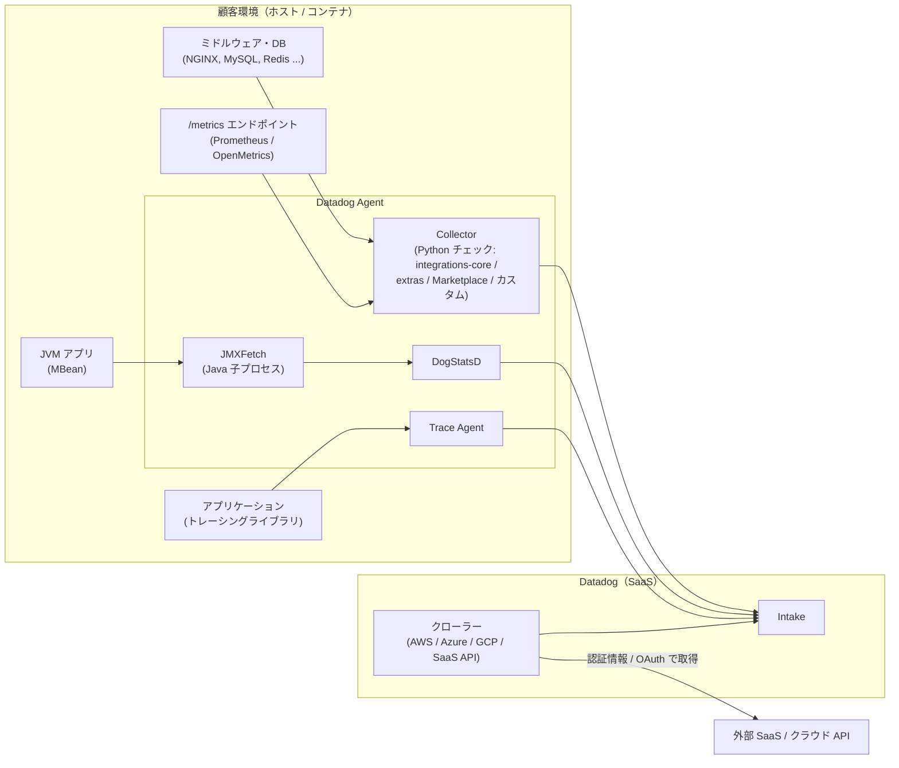
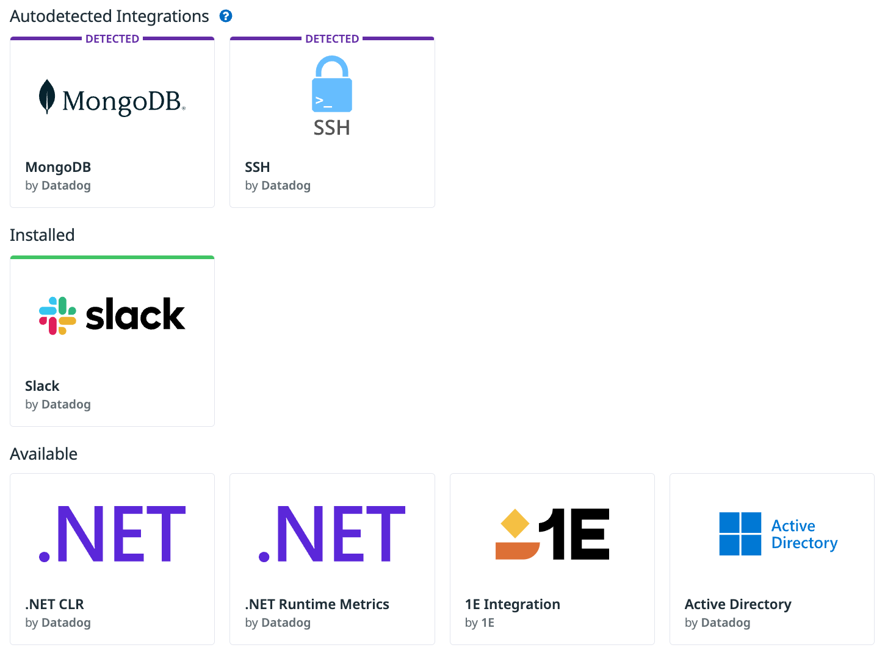
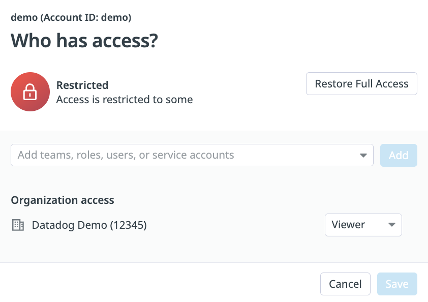
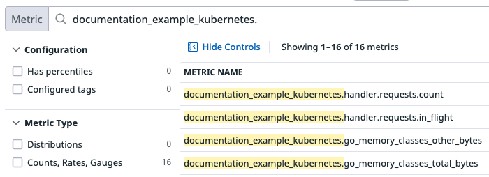
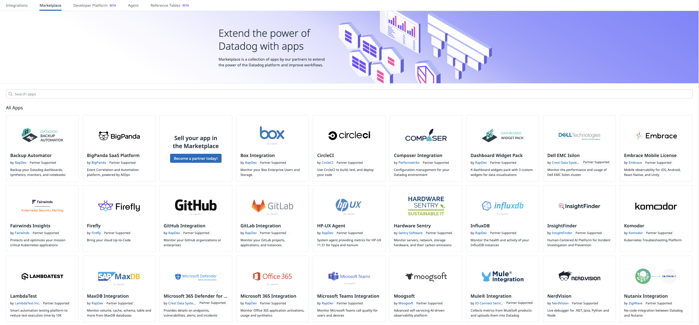

# Integrations（インテグレーション）

## 概要

Datadog の Integrations（インテグレーション）は、Datadog の外にあるシステム（ミドルウェア、データベース、クラウドサービス、SaaS、プログラミング言語ランタイムなど）からメトリクス・ログ・イベント・サービスチェック・トレースなどを Datadog に取り込む、または Datadog のデータを外部へ連携するための部品の総称である。Datadog の公式ドキュメントは「1,000 を超える組み込みインテグレーション（More than 1,000 built-in integrations）」を提供していると記載しており、料金ページでも Infrastructure Pro に「1,000+ integrations」と記載され、Enterprise も同項目を含む。[出典](https://docs.datadoghq.com/integrations/) [出典](https://www.datadoghq.com/pricing/)

Datadog のインテグレーションは、データの取り込み方式で次の 3 種類に大別される。[出典](https://docs.datadoghq.com/getting_started/integrations/)

- **Agent-based（Agent ベース）**: Datadog Agent と一緒にインストールされ、Python の `check` メソッドで収集するメトリクスを定義する（例: NGINX、MySQL、Redis）。
- **Authentication (crawler) based（認証（クローラー）ベース）**: Datadog の画面で認証情報を登録し、Datadog 側が API でデータを取得する（例: Slack、AWS、Azure、PagerDuty）。
- **Library（ライブラリ）**: Datadog API（およびトレーシングライブラリ）を使い、アプリケーションをその言語単位で監視する（例: Node.js、Python）。

さらに、社内システム向けには **Custom check（カスタムチェック）** を自作でき、Prometheus 形式のエンドポイントは **OpenMetrics チェック**、Java アプリケーションは **JMX チェック（JMXFetch）** で汎用的に取り込める。有償のサードパーティ製インテグレーションは **Marketplace（マーケットプレイス）** で提供される。[出典](https://docs.datadoghq.com/extend/)

本ファイルはインテグレーションの共通仕様（種類、カタログ、設定・配布・パッケージ管理、カスタムチェック、JMX、OpenMetrics/Prometheus、主要ミドルウェア、Marketplace）を扱う。関連する詳細は以下を参照。

| 関連トピック | 参照先 |
|---|---|
| Agent 本体（構成要素、インストール、コマンド、flare） | [Datadog Agent](./agent.md) |
| `conf.d` の場所、`@param` 記法、チェック共通パラメータ（`timeout`、`proxy`、TLS 等）、JMXFetch の Agent 全体設定 | [Agent 設定リファレンス](./agent-configuration.md) |
| コンテナ / Kubernetes 上の Agent と Autodiscovery の基盤 | [コンテナ/Kubernetes向けAgent](./kubernetes-and-containers-agent.md) |
| Fleet Automation と Remote Configuration の全体 | [Fleet Automation と Remote Configuration](./fleet-automation.md) |
| クラウド系クローラーインテグレーション | [AWS Integration](./aws-integration.md)、[Azure Integration](./azure-integration.md)、[Google Cloud Integration](./gcp-integration.md) |
| Slack・PagerDuty・Microsoft Teams・Webhook 等の通知連携 | [通知・コラボレーション連携](./collaboration-integrations.md) |
| カスタムメトリクスの定義・DogStatsD | [Custom Metrics と DogStatsD](./custom-metrics-and-dogstatsd.md) |
| OpenTelemetry（OTLP 取り込み、DDOT Collector） | [OpenTelemetry サポート](./opentelemetry.md) |
| データベースのクエリレベル監視 | [Database Monitoring](../infrastructure/database-monitoring.md) |
| SNMP 等ネットワーク機器 | [Network Device Monitoring](../infrastructure/network-device-monitoring.md) |
| Kafka のコンシューマラグ・パイプライン監視 | [Data Streams Monitoring](../apm/data-streams-monitoring.md) |
| 料金の正本 | [製品別料金表](../../03_導入編/02-pricing-by-product.md) |

---

## 1. インテグレーションの種類

### 1.1 データ取り込み方式による分類

Datadog のインテグレーションは、データの取得主体と設定場所によって次のように分類される。[出典](https://docs.datadoghq.com/getting_started/integrations/) [出典](https://docs.datadoghq.com/extend/integrations/)

| 種類 | 取得の主体 | 設定場所 | 代表例 | 向いている対象 |
|---|---|---|---|---|
| Agent-based（Agent ベース） | 顧客環境で動く Datadog Agent がローカル/ネットワーク上の対象に接続して収集 | Agent の `conf.d/<INTEGRATION>.d/conf.yaml`、Autodiscovery、Fleet Automation | NGINX、MySQL、PostgreSQL、Redis、Kafka、IIS | 顧客の LAN / VPC 内のインフラ・サービス・アプリケーション |
| Authentication (crawler) based（認証（クローラー）ベース） | Datadog の SaaS 側が API で外部サービスからデータを取得 | Datadog の Integrations 画面のタイル（認証情報・ロール・OAuth の登録） | AWS、Azure、Google Cloud、Slack、PagerDuty | 顧客環境の外にある SaaS・クラウドサービス |
| Library（ライブラリ） | アプリケーションに組み込んだライブラリ（言語別） | アプリケーション側のコード・環境変数 | Node.js、Python（トレーシング・ランタイムメトリクス） | アプリケーションの言語単位の監視 |
| Custom check（カスタムチェック） | Agent が自作 Python チェックを実行 | `checks.d/<名前>.py` と `conf.d/<名前>.yaml` | 社内システムの独自指標 | 一般提供されていない独自システム |

- 開発者向けドキュメント（Extend Datadog、旧 Developers 節）では、公開インテグレーションの方式を **Agent-based**（「Datadog Agent を使ってホスト上またはローカルのソースからデータを収集」）と **API-based**（「REST API 経由で Datadog にデータを送信」。顧客環境の外で動く SaaS・クラウド向け）の 2 種類として説明している。利用者向けの「Authentication (crawler) based」は、データ提供側から見ると API-based に相当する。[出典](https://docs.datadoghq.com/extend/integrations/)
- 公式ドキュメントの URL は `docs.datadoghq.com/developers/...` から `docs.datadoghq.com/extend/...` 配下へ移っている（2026-11-02 時点で `extend` 配下が正）。改称の時期・経緯は公開情報では確認できず。

### 1.2 提供元とサポート区分

Agent ベースのインテグレーションは、ソースコードの置き場所と提供元によって区分される。[出典](https://docs.datadoghq.com/getting_started/integrations/) [出典](https://docs.datadoghq.com/agent/guide/use-community-integrations/) [出典](https://docs.datadoghq.com/extend/integrations/agent_integration/)

| 区分 | リポジトリ | Agent への同梱 | サポート | 費用 |
|---|---|---|---|---|
| 公式（Datadog 提供） | [`DataDog/integrations-core`](https://github.com/DataDog/integrations-core) | **同梱**（Agent パッケージに含まれる） | Datadog | 追加費用なし（ただし一部はカスタムメトリクス扱い。§12 参照） |
| Community / Technology Partner（OOTB） | [`DataDog/integrations-extras`](https://github.com/DataDog/integrations-extras) | **非同梱**。`datadog-agent integration install -t` で追加インストール | 作成者（コミュニティ / パートナー）。作成者がコードを保守し全 Datadog サイトで動作するよう支援する責任を負う | 追加費用なし |
| Marketplace | `DataDog/marketplace`（非公開リポジトリ） | 非同梱。同じ手順で追加インストール | Datadog Technology Partner（各タイルに記載の連絡先） | **有償**（Datadog 経由で請求） |

- OOTB（out-of-the-box）インテグレーションは Integrations 画面に追加費用なしで掲載され、Datadog または Technology Partner が作成する。Marketplace のオファリングは有償で、Technology Partner が作成し Marketplace 画面に掲載される。[出典](https://docs.datadoghq.com/extend/integrations/)
- Marketplace の各インテグレーションのドキュメントには「This application is made available through the Marketplace and is supported by a Datadog Technology Partner.」と記載され、サポート窓口はパートナー（例: RapDev）になる。[出典](https://docs.datadoghq.com/integrations/rapdev-gitlab/)
- コミュニティインテグレーションに対する Datadog サポートの対応範囲（どこまで問い合わせを受け付けるか）は公開情報では確認できず。

### 1.3 カスタムデータの送信手段の選び方

Datadog の「Extend Datadog」ページは、独自データを送る手段を工数とカスタムメトリクス扱いの有無で比較している。[出典](https://docs.datadoghq.com/extend/)

| 手段 | 工数 | カスタムメトリクス扱い | 言語 |
|---|---|---|---|
| DogStatsD | 最小（Lowest） | Yes | 任意 |
| Custom check（カスタムチェック） | 低（Low） | Yes | Python |
| Private integration（非公開インテグレーション） | 中（Medium） | Yes | Python |
| Public integration（公開インテグレーション） | 高（High） | No | Python |

上記以外の手段と使い分けは次のとおり。

| 手段 | 使いどころ | 詳細 |
|---|---|---|
| OpenMetrics チェック | Prometheus / OpenMetrics 形式のエンドポイントがある | 本ファイル §7 |
| JMX チェック | JVM の MBean として指標が公開されている Java アプリ | 本ファイル §6 |
| Datadog API（Metrics / Logs / Events API） | Agent を置けない場所からの送信、業務指標の送信 | [API とキー管理](./api-and-keys.md) |
| OpenTelemetry（OTLP） | OTel SDK / Collector で計装済み | [OpenTelemetry サポート](./opentelemetry.md) |

- 一般提供されているアプリケーション、公開サービス、OSS を監視したい場合は、カスタムチェックではなく正式な Agent インテグレーションの作成が推奨されている。カスタムチェックは独自アプリケーションや固有システム向け。[出典](https://docs.datadoghq.com/extend/custom_checks/)

### 1.4 データフロー



- JMXFetch は Agent が呼び出す Java プラグインで、MBean Server に接続して取得したメトリクスを DogStatsD 経由で Agent に渡す。[出典](https://docs.datadoghq.com/integrations/java/)

---

## 2. Integrations 画面（カタログ）

### 2.1 画面の場所と構成

Datadog の Integrations 画面（`https://app.datadoghq.com/integrations`。サイトにより `ap1.datadoghq.com` などドメインが変わる）は、インテグレーションのタイル一覧（カタログ）であり、検索とカテゴリでの絞り込み、各タイルからのインストール・設定を行う。上部ナビゲーションには `Integrations` / `Marketplace` / `Fleet Automation` / `Reference Tables` / `Link Source Code` が並ぶ（2026-11-02 時点の Fleet Automation 公式画像に基づく。詳細は [Datadog Agent](./agent.md) のインストール画面説明を参照）。

- Integrations 画面のタイルを操作（インストール・設定）するには **Integrations Manage** 権限が必要。[出典](https://docs.datadoghq.com/getting_started/integrations/)
- クローラー型・ライブラリ型のインテグレーションは、Integrations 画面で該当プロバイダのタイルを開き、タイル内の手順に従って接続する。それ以外（Agent ベース）は Agent をインストールしたうえで、タイルまたはドキュメントの設定手順に従う。ほとんどのインテグレーションはコンテナ版 Agent（Docker / Kubernetes）でもサポートされる。[出典](https://docs.datadoghq.com/getting_started/integrations/)
- タイル内のタブ構成（`Overview` / `Configure` / `Data Collected` 等の正確な名称一覧）は公開ドキュメントでは体系的に確認できず。公式ドキュメントで言及があるのは、クローラー型のアカウント等を設定する **`Configure` タブ**、自動検出された技術が動いているホスト一覧を示す **`Hosts` タブ**である。[出典](https://docs.datadoghq.com/getting_started/integrations/)

### 2.2 自動検出（Autodetected integrations）とステータス

Datadog の Integrations 画面は、Process collection（プロセス収集）を有効にしていると、ホスト上で動作している技術を自動検出し、使うべきインテグレーションを提示する。各インテグレーションは次の 4 つのステータスのいずれかを持つ。[出典](https://docs.datadoghq.com/getting_started/integrations/)

| ステータス | 意味 |
|---|---|
| Detected（検出済み） | 技術がホスト上で動作しているが、インテグレーションが未インストール・未設定で、一部のメトリクスのみ収集されている。完全なカバレッジには設定が必要。動作ホストはタイルの `Hosts` タブで確認できる |
| Installed（インストール済み） | インテグレーションがホストにインストール・設定済み |
| Available（利用可能） | Installed・Detected のどちらでもないすべてのインテグレーション |
| Missing Data（データ欠落） | 直近 **24 時間**、インテグレーションのメトリクスが検出されていない |



- **キャプション:** Integrations 画面の「Autodetected Integrations」表示。
- **画面の説明:** 最上段の見出し「Autodetected Integrations」（? アイコン付き）の下に、上端に紫色の帯と「DETECTED」ラベルが付いたタイル（`MongoDB by Datadog`、`SSH by Datadog`）が並ぶ。その下の「Installed」見出しには上端が緑色のタイル（`Slack by Datadog`）、さらに下の「Available」見出しには `.NET CLR by Datadog`、`.NET Runtime Metrics by Datadog`、`1E Integration by 1E`、`Active Directory by Datadog` などの通常タイルが並ぶ。各タイルはロゴ、インテグレーション名、提供者名（`by Datadog` / `by 1E` など）で構成される。
- **出典:** https://docs.datadoghq.com/getting_started/integrations/ （取得日 2026-11-02）

- Fleet Automation の「Configure Agents」でも、インテグレーションが利用可能なプロセスが動いているのに設定がないものを「Unconfigured integrations detected on your hosts」として一覧でき、監視の抜けを特定できる。[出典](https://docs.datadoghq.com/agent/fleet_automation/configure_integrations/)

### 2.3 カテゴリ（Classifier tags）

Integrations 画面のカテゴリは、各インテグレーションの `manifest.json` の `tile.classifier_tags` で定義される。主な分類は次のとおり（抜粋）。[出典](https://docs.datadoghq.com/extend/integrations/check_references/)

| 種別 | 値（抜粋） |
|---|---|
| `Category::` | AI、Alerting、Automation、AWS、Azure、Caching、Cloud、Collaboration、Compliance、Configuration & Deployment、Containers、Cost Management、Data Stores、Developer Tools、Event Management、Google Cloud、Incidents、IOT、Issue Tracking、Kubernetes、Languages、Log Collection、Machine Learning & LLM、Mainframe、Marketplace、Messaging、Metrics、Mobile、Network、Notifications、Oracle、Orchestration、OS & System、Provisioning、SAP、Security、SNMP、Source Control、Testing、Tracing |
| `Offering::` | Integration（データの送信・照会）、Professional Service（Marketplace 経由の有償専門サービス）、Software License（Marketplace 経由の SaaS サブスクリプション）、UI Extension（ダッシュボード上で iFrame を表示するカスタムウィジェット） |
| `Submitted Data Type::` / `Queried Data Type::` | Metrics、Logs、Traces、Events、Incidents（送信 / 照会するデータ種別） |
| `Supported OS::` | Android、Any、HP-UX、IBM i/OS、IBM z/OS、iOS、Linux、macOS、Solaris、Windows |

- `Category::Marketplace` は「Datadog Marketplace で追加料金で販売されるインテグレーション」を示す。[出典](https://docs.datadoghq.com/extend/integrations/check_references/)

### 2.4 権限（RBAC）

| 権限 | 権限名（キー） | 内容 | 既定ロール |
|---|---|---|---|
| Integrations Manage | `manage_integrations` | インテグレーションのインストール・アンインストール・設定 | Datadog Standard Role |
| Integrations Read | `integrations_read` | インテグレーションとその設定の閲覧 | Datadog Standard Role |
| AWS / Azure / GCP / OCI Configurations Manage | `aws_configurations_manage` 等 | 各クラウド連携設定の追加・削除（編集は不可） | Datadog Standard Role |
| Org Management | `org_management` | 組織設定の編集。**Marketplace のアプリの購読（subscribe）・解約（unsubscribe）を含む** | Datadog Admin Role |

[出典](https://docs.datadoghq.com/account_management/rbac/permissions/)。ロール設計全体は [組織・ユーザー・権限管理](./account-and-access-management.md) を参照。

### 2.5 Granular access control（リソース単位のアクセス制御）

Datadog のインテグレーションリソース（アカウント、サービス、Webhook）へのアクセスは**既定では無制限**である。Granular access control に対応するインテグレーションでは、リソース単位でユーザー・チーム・ロール・組織全体の操作を制限できる（対応可否は各インテグレーションのドキュメントで確認。非対応の場合は制限オプション自体が表示されない）。[出典](https://docs.datadoghq.com/getting_started/integrations/)

手順:

1. インテグレーションの `Configure` タブで対象リソース（account / service / webhook）を探す。
2. `Set Permissions` をクリック（既定は組織全員がフルアクセス）。
3. `Restrict Access` をクリックすると、組織メンバーは既定で `Viewer` になる。
4. 編集を許可するチーム・ロール・ユーザーをドロップダウンで選び `Add`（個別リソースの編集には `Integrations Manage` 権限も必要）。
5. `Save`。自分が所属するロールまたはチームを最低 1 つ含めないと、自分の編集権限を失うため保存時に要求される。
6. 元に戻すには `Set Permissions` → `Restore Full Access` → `Save`。



- **キャプション:** インテグレーションのアカウントに対する「Who has access?」ダイアログ。
- **画面の説明:** 上部に対象リソース名（例「demo (Account ID: demo)」）と見出し「Who has access?」。赤い鍵アイコンとともに「Restricted / Access is restricted to some」と表示され、右上に `Restore Full Access` ボタンがある。中段に「Add teams, roles, users, or service accounts」の入力ドロップダウンと `Add` ボタン、その下の「Organization access」に組織名（例「Datadog Demo (12345)」）と権限ドロップダウン（`Viewer`）が表示される。最下部に `Cancel` と `Save` ボタンがある。
- **出典:** https://docs.datadoghq.com/getting_started/integrations/ （取得日 2026-11-02）

### 2.6 サイト差異

> **サイト差異:** 多くのインテグレーションのドキュメントには、`us2.ddog-gov.com` のユーザー向けに「このインテグレーションが組織で利用可能かは Integrations 画面または組織管理者に確認。有効化の例外申請は support@ddog-gov.com へ」という注記がある（例: NGINX、OpenMetrics、Prometheus、Marketplace の GitLab）。政府向けサイトではインテグレーションごとに提供可否が異なる。[出典](https://docs.datadoghq.com/integrations/nginx/) [出典](https://docs.datadoghq.com/integrations/openmetrics/)

> **サイト差異:** Fleet Automation によるインテグレーション設定の配布は `app.ddog-gov.com` と `us2.ddog-gov.com` では**未サポート**。[出典](https://docs.datadoghq.com/agent/fleet_automation/configure_integrations/)

> **サイト差異:** API-based インテグレーション（OAuth）では、Datadog 組織のリージョンが `domain` パラメータ（例 `datadoghq.com`、`ap1.datadoghq.com`）で渡され、OAuth ハンドシェイクと API エンドポイントの両方に影響する。[出典](https://docs.datadoghq.com/extend/integrations/api_integration/)

- 上記以外に、AP1 など特定サイトで利用できないインテグレーションの一覧は公開情報では確認できず。サイト一覧は [Datadog Sites](./datadog-sites.md) を参照。

---

## 3. Agent ベースのインテグレーションの設定

### 3.1 有効化の基本手順

Datadog Agent に同梱される公式インテグレーション（integrations-core）は、追加インストール不要で、設定ファイルを置くだけで有効になる。[出典](https://docs.datadoghq.com/getting_started/integrations/)

1. Agent 設定ディレクトリの `conf.d/<INTEGRATION_NAME>.d/` にある `conf.yaml.example`（全オプションを記載したサンプル）を `conf.yaml` にリネーム（コピー）する。
2. 必須パラメータを環境に合わせて設定する。
3. Agent を再起動する。
4. `datadog-agent status` の Checks 節に新しい設定が表示されることを確認する。

- `conf.d` の OS 別パス、`conf.yaml.default` / `auto_conf.yaml` / `metrics.yaml` などのファイル種別、`@param` 記法、多くのチェックで共通のパラメータ（`tags`、`service`、`timeout`、`proxy`、`tls_verify`、`metric_patterns` 等）は [Agent 設定リファレンス](./agent-configuration.md#confd-のチェック設定) を参照。
- `<INTEGRATION_NAME>.d` 内の有効な YAML はすべて読み込まれるため、複雑な設定は複数ファイルに分割できる。複数の対象を監視するには `instances` に要素を追加する（各インスタンスは独立してスケジュールされる）。[出典](https://docs.datadoghq.com/getting_started/integrations/)
- `datadog.yaml` で定義したホストタグはすべてのインテグレーションのデータに付与され、新規インテグレーションにも継承される。[出典](https://docs.datadoghq.com/getting_started/integrations/)

最小設定例（Apache。メトリクスとログを収集）:

```yaml
init_config:
  service: apache

instances:
    - apache_status_url: http://localhost/server-status?auto

logs:
    - type: file
      path: /var/log/apache2/access.log
      source: apache
      sourcecategory: http_web_access
    - type: file
      path: /var/log/apache2/error.log
      source: apache
      sourcecategory: http_web_access
```

[出典](https://docs.datadoghq.com/getting_started/integrations/)

### 3.2 収集間隔

| 項目 | 値・挙動 | 出典 |
|---|---|---|
| 標準インテグレーションの既定収集間隔 | **15 秒** | [出典](https://docs.datadoghq.com/getting_started/integrations/) |
| 変更方法 | インスタンス単位で `min_collection_interval`（秒）。複数インスタンスはそれぞれに設定 | [出典](https://docs.datadoghq.com/extend/custom_checks/write_agent_check/) |
| 保証の有無 | 「30 に設定しても 30 秒ごとの収集は保証されない」。他チェックの実行待ちでキューに入ることがある | 同上 |
| 実行時間が間隔を超えた場合 | `check` メソッドの実行が間隔より長いと、次の間隔まで実行がスキップされる | 同上 |
| JMX チェック | JMXFetch 全体の周期は `datadog.yaml` の `jmx_check_period`（既定 `15000` ミリ秒）。詳細は [Agent 設定リファレンス](./agent-configuration.md) | [出典](https://github.com/DataDog/datadog-agent) |

### 3.3 チェック単位のタグ制御

Datadog Agent のチェック設定の `init_config` では、Agent 全体の設定をチェック単位で上書きできる。[出典](https://docs.datadoghq.com/getting_started/integrations/)

| パラメータ | 既定 | 内容 |
|---|---|---|
| `ignore_autodiscovery_tags` | `false` | `true` にすると、コンテナ内で動くチェックのメトリクスに自動付与される環境由来タグ（例 `image_name`）を付けない |
| `check_tag_cardinality` | Agent 全体設定に従う | このチェックのタグ粒度（`low` / `orchestrator` / `high`） |

```yaml
init_config:
  ignore_autodiscovery_tags: true
  check_tag_cardinality: low
```

- Kubernetes では Pod アノテーション `ad.datadoghq.com/<CONTAINER_NAME>.check_tag_cardinality: "<low|orchestrator|high>"` でも設定できる。このアノテーションはインテグレーションチェックのメトリクスにのみ効き、DogStatsD には効かない（DogStatsD は `dogstatsd_tag_cardinality` / `DD_DOGSTATSD_TAG_CARDINALITY`）。[出典](https://docs.datadoghq.com/containers/kubernetes/integrations/)
- `service` タグ（独立したシステムごと）と `env` タグ（Unified Service Tagging）の設定が推奨されている。タグ設計は [Tagging](./tagging.md) を参照。[出典](https://docs.datadoghq.com/getting_started/integrations/)

### 3.4 検証コマンド

| 目的 | コマンド（Linux 例） | 備考 |
|---|---|---|
| 全チェックの稼働状態 | `sudo datadog-agent status` | Checks（Collector の Running Checks）節にエラー・警告がないこと、収集メトリクス数を確認 |
| 単一チェックの試験実行 | `sudo -u dd-agent -- datadog-agent check <CHECK_NAME>` | 収集されるメトリクス・サービスチェックを表示（送信はしない） |
| レート系メトリクスも確認 | `sudo -u dd-agent datadog-agent check <CHECK_NAME> --check-rate` | rate は 2 回のサンプルが必要なため |
| 読み込まれた設定の確認 | `datadog-agent configcheck` | Autodiscovery 由来の設定も表示 |
| JMX の確認 | `datadog-agent jmx list ...` | 本ファイル §6.8 |

[出典](https://docs.datadoghq.com/extend/custom_checks/write_agent_check/) [出典](https://docs.datadoghq.com/agent/configuration/agent-commands/) [出典](https://docs.datadoghq.com/integrations/faq/troubleshooting-jmx-integrations/)。コマンド全般は [Datadog Agent](./agent.md#6-agent-コマンド) を参照。

- トラブルシューティングの第一歩は YAML の妥当性確認（エディタのプラグインやオンラインツール）、次に Agent のトラブルシューティング手順。[出典](https://docs.datadoghq.com/getting_started/integrations/)

### 3.5 Fleet Automation によるリモート設定

Datadog の Fleet Automation は、インテグレーションの設定ファイル（`conf.d`）をリモートで追加・更新・削除できる。ホストやタグで対象 Agent を絞り込み、インテグレーションを選んで一括配布する。[出典](https://docs.datadoghq.com/agent/fleet_automation/configure_integrations/)

| 項目 | 内容 |
|---|---|
| 前提条件 | 組織と Agent の API キーで Remote Configuration が有効／各 VM Agent で `remote_updates: true`／**Agent 7.76 以降**／Linux VM（インストールスクリプトまたは Ansible Datadog Role で導入）または Windows VM |
| 非対応 | コンテナワークロード上の Agent でのインテグレーション設定、**カスタムチェック** |
| 対応 | `conf.d` 設定ファイルを持つ OOTB インテグレーション（例: Redis、MySQL、Windows Certificate Store） |
| 入力方式 | `Visual` と `YAML` モードを切り替え可能 |
| 配布前確認 | 対象 Agent ごとに設定差分（diff）が生成される。進捗は Deployments 画面で追跡 |

操作の種類と適用方法:

| 操作 | 挙動 |
|---|---|
| Add New | 新規ファイルを配布。**同名ファイルが既にあれば全体を置き換える**（指定 YAML がそのまま完全な設定になる） |
| Edit & Replace | 指定したフィールドのみ変更し、他は維持。ただし **配列フィールド（`tags` など）はマージされず全置換** されるため、残したい値もすべて含める |
| Delete | 対象 Agent から設定ファイルを削除 |

手順: Fleet Automation の `Configuration` タブ → `Configure Agents` → 対象を絞り込み → `Agent integrations` を選択 → インテグレーションを選択 → 操作を選択 → デプロイ計画を確認 → `Deploy Configuration`。[出典](https://docs.datadoghq.com/agent/fleet_automation/configure_integrations/)

Fleet Automation 全体（Agent 設定の merge patch、アップグレード等）は [Fleet Automation と Remote Configuration](./fleet-automation.md) を参照。

### 3.6 コンテナ環境での設定（Autodiscovery）

コンテナ版 Agent は Autodiscovery により、コンテナの起動・停止に追従してインテグレーションを設定する。Kubernetes での設定方法の選択肢は、Pod アノテーション、ローカルファイル、ConfigMap、キーバリューストア（etcd 等）、Datadog Operator マニフェスト、Helm チャート、`DatadogInstrumentation` カスタムリソースである。[出典](https://docs.datadoghq.com/containers/kubernetes/integrations/)

Autodiscovery アノテーション v2（**Agent 7.36 以降**）の形式:

```yaml
metadata:
  annotations:
    ad.datadoghq.com/<CONTAINER_NAME>.checks: |
      {
        "<INTEGRATION_NAME>": {
          "init_config": <INIT_CONFIG>,
          "instances": [<INSTANCES_CONFIG>]
        }
      }
    ad.datadoghq.com/<CONTAINER_NAME>.logs: '[<LOGS_CONFIG>]'
```

| プレースホルダ | 意味 |
|---|---|
| `<INTEGRATION_NAME>` | インテグレーション名（例 `etcd`、`redisdb`） |
| `<CONTAINER_NAME>` | `spec.containers[i].name` と照合（`image` ではない） |
| `<CONTAINER_IMAGE>` | ファイル・ConfigMap 等で `ad_identifiers` に使う。イメージ名が一致するすべてのコンテナに適用（例 `redis` は `foo/redis:latest` と `bar/redis:v2` の両方に一致） |
| `<INIT_CONFIG>` / `<INSTANCES_CONFIG>` / `<LOGS_CONFIG>` | `conf.yaml.example` の `init_config` / `instances` / `logs` の内容 |

[出典](https://docs.datadoghq.com/containers/kubernetes/integrations/)

- テンプレート変数: `%%host%%`（コンテナの IP）、`%%port%%`、`%%env_<VAR>%%`（Agent プロセスから見える環境変数。パスワードを平文で書かないために使う）など。[出典](https://docs.datadoghq.com/containers/kubernetes/integrations/)
- `DatadogInstrumentation` リソースは Agent / Cluster Agent v7.82+、Datadog Operator v1.29+、Helm チャート v3.236.0+ が必要。[出典](https://docs.datadoghq.com/containers/kubernetes/prometheus/)
- **設定の優先順位:** 優先度の高い順に 1. Kubernetes アノテーション、2. `DatadogInstrumentation` リソース、3. `auto_conf.yaml`、4. Datadog Operator / Helm チャートの Autodiscovery 設定。`auto_conf.yaml` は Operator / Helm の Autodiscovery 設定より優先される。[出典](https://docs.datadoghq.com/containers/kubernetes/integrations/) [出典](https://docs.datadoghq.com/containers/guide/auto_conf/)
- Agent に同梱されないインテグレーション（Community / Marketplace）をコンテナで使うには、そのインテグレーションを含むカスタム Agent イメージをビルドする（§4.4）。[出典](https://docs.datadoghq.com/containers/kubernetes/integrations/)

#### 自動設定（auto_conf.yaml）

コンテナとして動く Agent は、`auto_conf.yaml` という既定設定ファイルに基づき、以下の技術のコンテナを自動検出して設定する（既定設定で十分なら追加作業は不要）。[出典](https://docs.datadoghq.com/containers/guide/auto_conf/)

Apache、Cilium、Consul、CoreDNS、Couch、Couchbase、Elastic、Etcd、External DNS、Istio、Kube APIserver、Kube Controller Manager、KubeDNS、Kube Scheduler、Kubernetes State、Kyototycoon、Memcached、Presto、RabbitMQ、Redis、Riak、Tomcat

| 操作 | 方法 |
|---|---|
| 自動設定の無効化（Operator） | `override.nodeAgent.containers.agent.env` に `DD_IGNORE_AUTOCONF: "redisdb istio"` |
| 自動設定の無効化（Helm） | `datadog.ignoreAutoConfig: [redisdb, istio]` |
| 自動設定の無効化（DaemonSet / Docker / ECS） | 環境変数 `DD_IGNORE_AUTOCONF="redisdb istio"` |
| Configuration discovery（**Agent 7.82 以降**） | 一部インテグレーション（例 Pulsar）の `auto_conf.yaml` は `discovery` フィールドと空の `instances` を持ち、Agent が実行時にサービスを調べて（公開ポートのメトリクスエンドポイント探索など）有効な設定を生成する |
| 重複防止 | 同じコンテナまたはホストレベルに同インテグレーションのインスタンスがある場合、同じコンテナに汎用 OpenMetrics / Prometheus チェックがある場合、同じルート名前空間のホストレベル汎用チェックがある場合は discovery をスキップ |
| 識別タグ（**Agent 7.83 以降**） | discovery で作られたインスタンスのメトリクスに `dd_config_discovery:true` が付く |

[出典](https://docs.datadoghq.com/containers/guide/auto_conf/)

#### インテグレーションのファイルアクセス制御（Agent 7.78 以降）

Pod アノテーションなど**信頼できない設定プロバイダ**から渡されるファイルパスによるパストラバーサル・不正ファイルアクセスを防ぐため、Agent 7.78.0 以降は `datadog.yaml` で次を設定できる（既定値は従来動作を維持）。[出典](https://docs.datadoghq.com/containers/kubernetes/integrations/)

| パラメータ | 型 | 既定値 | 内容 |
|---|---|---|---|
| `integration_ignore_untrusted_file_params` | bool | `false` | 有効にすると、信頼されないプロバイダからのファイルパス系パラメータを無視 |
| `integration_file_paths_allowlist` | list | `[]` | 信頼されないプロバイダからでもアクセスを許すパス（空はすべて許可） |
| `integration_trusted_providers` | list | `["file", "remote-config"]` | 信頼するプロバイダ（既定はローカルファイルと Remote Configuration） |
| `integration_security_excluded_checks` | list | `[]` | 上記制限の対象外とするインテグレーション名 |

コンテナ環境の Agent 構成全般は [コンテナ/Kubernetes向けAgent](./kubernetes-and-containers-agent.md)、監視設計は [コンテナ・Kubernetes 監視](../infrastructure/container-and-kubernetes-monitoring.md) を参照。

---

## 4. インテグレーションパッケージの管理（`datadog-agent integration`）

### 4.1 サブコマンド

Datadog Agent の `integration` サブコマンドで、インテグレーションの Python パッケージ（wheel）を追加・更新・削除する。Linux では `dd-agent` ユーザーで、Windows では管理者として実行する。パッケージ名はインテグレーション名に `datadog-` を付けた形（例 `datadog-vsphere`）。[出典](https://docs.datadoghq.com/agent/guide/integration-management/)

| サブコマンド | 内容 |
|---|---|
| `install <PACKAGE>==<VERSION>` | 指定バージョンをインストールし、`conf.yaml.example`、`conf.yaml.default`、`auto_conf.yaml` を `conf.d` にコピー（**既存ファイルを上書き**）。コピーに失敗するとコマンドは失敗終了するが、指定バージョン自体はインストールされる。実行後に Agent を再起動 |
| `remove <PACKAGE>` | パッケージを削除。**`conf.d` の設定フォルダは削除されない** |
| `show <PACKAGE>` | インストール済みバージョン等の表示 |
| `freeze` | インストール済みの `datadog-*` パッケージと依存 Python パッケージを一覧 |

```bash
# Linux（公式インテグレーションの特定バージョンへ更新）
sudo -u dd-agent -- datadog-agent integration install datadog-vsphere==3.6.0
```

```powershell
# Windows
& "$env:ProgramFiles\Datadog\Datadog Agent\bin\agent.exe" integration install datadog-vsphere==3.6.0
```

[出典](https://docs.datadoghq.com/agent/guide/integration-management/)

### 4.2 インストール可能条件とバージョン固定

- インストールできるのは、(1) Agent 同梱版より**新しい**バージョンで、(2) インストール済み Agent の `datadog_checks_base` と互換があるバージョンに限られる。`datadog_checks_base` は手動インストールできず、Agent のアップグレードでのみ更新される。[出典](https://docs.datadoghq.com/agent/guide/integration-management/)
- 構成管理ツールで使う場合はバージョン固定（`==<VERSION>`）が推奨される。Agent をアップグレードする前に固定を外す。[出典](https://docs.datadoghq.com/agent/guide/integration-management/)

### 4.3 Agent アップグレード時の挙動

| 対象 | Agent アップグレード時の挙動 |
|---|---|
| `integration install` で個別に更新した**公式**インテグレーション | Agent に同梱されたバージョンで**上書きされる** |
| Community / Partner / Marketplace インテグレーション（**Agent 7.69 以降**） | アップグレード時に**自動的に保持される** |
| 上記の自動保持を止める | アップグレード前に `/etc/datadog-agent/.skip_install_python_third_party_deps` という空ファイルを作成。この場合はアップグレード後に手動で再インストールが必要 |

[出典](https://docs.datadoghq.com/agent/guide/integration-management/)

### 4.4 Community / Marketplace インテグレーションの導入

Community インテグレーション（integrations-extras）は Agent に同梱されず、アドオンとしてインストールする（**Agent 7.21 / 6.21 以降**）。Marketplace インテグレーションも、各タイルの設定手順に記載された `<INTEGRATION_NAME>` を使って同じ手順で導入する。[出典](https://docs.datadoghq.com/agent/guide/use-community-integrations/)

| 環境 | 手順 |
|---|---|
| ホスト | `sudo -u dd-agent datadog-agent integration install -t datadog-<INTEGRATION_NAME>==<INTEGRATION_VERSION>`（バージョンは integrations-extras の各 changelog で確認）→ `/etc/datadog-agent/conf.d/<INTEGRATION_NAME>.d/conf.yaml` を作成 → Agent 再起動 |
| Docker | Dockerfile で `FROM registry.datadoghq.com/agent:latest` ＋ `RUN agent integration install -r -t datadog-<INTEGRATION_NAME>==<INTEGRATION_VERSION>` のカスタムイメージをビルド・プッシュ（amd64 と arm 混在ならマルチアーキテクチャイメージ） |
| Kubernetes（Helm） | `agents.image.repository` / `tag` / `tagSuffix: "custom"` でカスタムイメージを指定し、Autodiscovery で設定 |
| Kubernetes（Operator） | `spec.global.registry` と `override.nodeAgent.image.name/tag` でカスタムイメージを指定 |
| ネットワーク制限下 | Datadog の `ip-ranges` をすべて許可リストに入れるか、インテグレーションを手動でダウンロード |

- `-t`（`--third-party`）は「コミュニティまたはベンダー提供のインテグレーションをインストールする」フラグ、`-r`（`--allow-root`）は root によるパッケージインストールを許可するフラグである（Agent ソースコードのフラグ定義。公式ガイドには説明文の記載がない）。`show` には `-q`（`--show-version-only`）がある。[出典](https://github.com/DataDog/datadog-agent/blob/main/cmd/agent/subcommands/integrations/command.go)
- カスタムイメージにすることで、コンテナの再起動・再デプロイをまたいでインテグレーションが保持される。[出典](https://docs.datadoghq.com/agent/guide/use-community-integrations/)

---

## 5. カスタムチェック（Custom Agent Check）

### 5.1 位置づけ

Datadog のカスタムチェックは、独自のシステムやアプリケーションからメトリクス等を収集するための Python スクリプトで、`conf.d` に設定を置いて Agent に実行させる。正式なインテグレーション作成より低工数である。**カスタムチェックから送信したメトリクスはカスタムメトリクスとして課金対象**になる。[出典](https://docs.datadoghq.com/extend/custom_checks/)

| 項目 | 内容 |
|---|---|
| 言語 | Python 3（最新 Agent で動かすには Python 3 互換が必須） |
| チェックコード | `checks.d/<名前>.py`（OS 別の既定パスは [Agent 設定リファレンス](./agent-configuration.md) の `additional_checksd`） |
| 設定 | `conf.d/<名前>.yaml`（または `conf.d/<名前>.d/conf.yaml`） |
| 命名規則 | 設定ファイル名とチェックファイル名を**一致**させる（`custom_checkvalue.py` ↔ `custom_checkvalue.yaml`）。組み込みインテグレーションとの衝突を避けるため `custom_` 接頭辞を推奨（例 `postfix.py` ではなく `custom_postfix.py`） |
| 権限 | チェックファイルは Agent ユーザーが読み取り・実行可能であること |
| Fleet Automation | カスタムチェックの設定配布は**非対応** |

[出典](https://docs.datadoghq.com/extend/custom_checks/write_agent_check/) [出典](https://docs.datadoghq.com/agent/fleet_automation/configure_integrations/)

### 5.2 最小構成

`conf.d/custom_checkvalue.yaml`:

```yaml
init_config:

instances:
  - min_collection_interval: 30
```

`checks.d/custom_checkvalue.py`:

```python
try:
    from datadog_checks.base import AgentCheck
except ImportError:
    from checks import AgentCheck  # Agent 6.6.0 未満

__version__ = "1.0.0"  # Agent の status ページに表示される


class HelloCheck(AgentCheck):
    def check(self, instance):
        self.gauge('hello.world', 1, tags=['TAG_KEY:TAG_VALUE'] + self.instance.get('tags', []))
```

- Agent 再起動後、Metric Summary に `hello.world` が表示される。[出典](https://docs.datadoghq.com/extend/custom_checks/write_agent_check/)
- `try/except` で `datadog_checks.base` と旧 `checks` モジュールを切り替えるのは Agent バージョン間の互換のため。[出典](https://docs.datadoghq.com/extend/custom_checks/write_agent_check/)
- 公式ガイドのロードバランサー例は `urllib2` / `simplejson`（Python 2 時代のモジュール）を使っており、Python 3 の Agent 7 ではそのままでは動かない点に注意（Python 3 では `requests` 等を使う。公式の Agent インテグレーション作成ガイドの例は `requests` を使用）。[出典](https://docs.datadoghq.com/extend/custom_checks/write_agent_check/) [出典](https://docs.datadoghq.com/extend/integrations/agent_integration/)

### 5.3 送信メソッド

Datadog の `AgentCheck` クラスが提供するメトリクス送信関数と、Datadog 上で保存されるメトリクスタイプは次のとおり。共通引数は `name`、`value`、`tags`（任意）、`hostname`（任意、既定は現在のホスト）、`device_name`（非推奨。`device:<名前>` タグに変換）。[出典](https://docs.datadoghq.com/metrics/custom_metrics/agent_metrics_submission/)

| 関数 | 用途・挙動 | Datadog 上のタイプ |
|---|---|---|
| `gauge()` | ある時点の値。1 回の実行で複数回呼ぶと最後の値のみ使用 | GAUGE |
| `count()` | チェック間隔中の発生数。複数回呼ぶと加算 | COUNT |
| `monotonic_count()` | 単調増加する生カウンタ。Agent が差分を計算。前回より小さい値（リセット）は無視（例: 2,3,6,7 → 5、次回 10,11 → 4） | COUNT（時間正規化しない差分） |
| `rate()` | 生カウンタのサンプル。Agent が差分を送信間隔で割ってレート化。1 回の実行で 1 回だけ呼ぶ | GAUGE（時間正規化した差分） |
| `histogram()` | 間隔中のサンプルの分布。集計値（max, median, avg, 95percentile, count）を生成 | `.count` は RATE、他は GAUGE |

| その他のメソッド | 内容 | 出典 |
|---|---|---|
| `service_check(name, status, message=...)` | サービスチェック（`OK` / `WARNING` / `CRITICAL` / `UNKNOWN`）を送信 | [出典](https://docs.datadoghq.com/extend/integrations/agent_integration/) |
| `send_log(data, cursor=None, stream='default')` | ログを直接送信。`data` は `message` キー必須。`timestamp`（UNIX 秒）、`ddtags`（カンマ区切り）は特別扱い。`cursor` はディスクに保存され `get_log_cursor()` で再取得可能 | [出典](https://docs.datadoghq.com/logs/log_collection/agent_checks/) |
| 例外 `ConfigurationError` | 設定不備時に送出すると Agent の status に表示される | [出典](https://docs.datadoghq.com/extend/custom_checks/prometheus/) |

`send_log` を使う場合は `datadog.yaml` で `logs_enabled: true` とし、チェック設定に `logs: [{type: integration, source: <名前>, service: <サービス名>}]` を追加する。[出典](https://docs.datadoghq.com/logs/log_collection/agent_checks/)

### 5.4 外部コマンドの実行

Agent に埋め込まれた Python インタプリタはマルチスレッドの Go ランタイム上で動くため、標準ライブラリの `subprocess` と `multithreading` はサポートされない。外部コマンドは `datadog_checks.base.utils.subprocess_output` の `get_subprocess_output()` を使い、コマンドはリストで渡す。[出典](https://docs.datadoghq.com/extend/custom_checks/write_agent_check/)

```python
from datadog_checks.base import AgentCheck
from datadog_checks.base.utils.subprocess_output import get_subprocess_output


class LSCheck(AgentCheck):
    def check(self, instance):
        files, err, retcode = get_subprocess_output(["ls", "."], self.log, raise_on_empty_output=True)
        file_count = len(files.split('\n')) - 1
        self.gauge("file.count", file_count, tags=['TAG_KEY:TAG_VALUE'] + self.instance.get('tags', []))
```

- 出力は `int()` / `float()` で数値に変換すること。変換しないと「エラーなく動いているように見えてメトリクスが送られない」状態になる。
- Agent ユーザーが参照ファイル・ディレクトリ・コマンドそのものへの権限を持たないと、メトリクスもイベントも返らない。

[出典](https://docs.datadoghq.com/extend/custom_checks/write_agent_check/)

### 5.5 カスタムチェックの選択肢の比較

| 用途 | 推奨手段 |
|---|---|
| 単純な値を独自システムから取る | カスタムチェック（`AgentCheck`） |
| Prometheus エンドポイントの値を前処理して取り込む | カスタム OpenMetrics チェック（`OpenMetricsBaseCheckV2`、§7.7） |
| Java の MBean | JMX チェック（§6）。コード不要 |
| アプリから直接・高頻度に送る | DogStatsD（[Custom Metrics と DogStatsD](./custom-metrics-and-dogstatsd.md)） |
| 一般提供製品を広く監視したい | 正式インテグレーションとして integrations-extras へ公開（§11） |

---

## 6. JMX インテグレーション（JMXFetch）

### 6.1 仕組みと前提

Datadog の JMX インテグレーションは、JVM ベースのアプリケーションの MBean からメトリクスを収集する。Agent は Java プラグイン **JMXFetch** を子プロセスとして起動し、JMXFetch が MBean Server に接続して DogStatsD 経由で Agent にメトリクスを渡す。[出典](https://docs.datadoghq.com/integrations/java/)

| 項目 | 内容 | 出典 |
|---|---|---|
| Java 要件 | JMXFetch は **Java 1.7 以上**のみ対応 | [出典](https://docs.datadoghq.com/integrations/java/) |
| JVM | 標準の Agent パッケージは JVM を同梱せず、システムの Java を使う。Agent 実行ユーザーの `PATH` に Java を通すか、`java_bin_path` で指定 | [出典](https://docs.datadoghq.com/integrations/faq/troubleshooting-jmx-integrations/) |
| コンテナ | 標準イメージは JMX 非対応。JVM 同梱の `-jmx` タグ（例 `gcr.io/datadoghq/agent:latest-jmx`、`registry.datadoghq.com/agent:latest-jmx`）を使う | [出典](https://docs.datadoghq.com/integrations/java/) |
| 接続方式 | Agent と JVM が同一ホストでも**リモート JMX 接続が必要**。待受アドレスに `0.0.0.0` は避け、同居時は `com.sun.management.jmxremote.host=127.0.0.1` を推奨 | [出典](https://docs.datadoghq.com/integrations/java/) |
| RATE の扱い | DogStatsD 経由で送られる RATE メトリクスはアプリ上で GAUGE として表示される | [出典](https://docs.datadoghq.com/integrations/java/) |
| ログ | `/var/log/datadog/jmxfetch.log`（と `agent.log`）。いずれも flare に含まれる | [出典](https://docs.datadoghq.com/integrations/faq/troubleshooting-jmx-integrations/) |

### 6.2 JMX ベースのインテグレーション一覧

Datadog Agent に**同梱される** JMXFetch 利用インテグレーション（既定では動作せず、ホストごとに設定が必要）:

ActiveMQ、Cassandra、Confluent Platform、Hazelcast、Hive、HiveMQ、Hudi、Ignite、Java/JMX、JBoss/WildFly、Kafka、Presto、Solr、SonarQube、Tomcat

**同梱されない** Community インテグレーション（JMXFetch 利用。インストールと設定が必要）:

nextcloud、flume、stardog、hbase_regionserver、eventstore、riak_repl、aqua、snmpwalk、resin、zabbix、hbase_master、neutrona

[出典](https://docs.datadoghq.com/integrations/guide/jmx_integrations/)

- 任意の Java アプリケーションは汎用の Java/JMX チェック（`jmx.d`）で監視できる。[出典](https://docs.datadoghq.com/integrations/guide/jmx_integrations/)
- JMX 系インテグレーションの既定収集 Bean は `<CHECK_NAME>.d/metrics.yaml` に定義されている（`collect_default_metrics: true` で有効）。[出典](https://docs.datadoghq.com/integrations/java/)

### 6.3 設定例（汎用 Java/JMX）

```yaml
# conf.d/jmx.d/conf.yaml
init_config:
  is_jmx: true
  collect_default_metrics: true
  # new_gc_metrics: true

instances:
  - host: localhost
    port: 9999
    user: <USER>
    password: <PASSWORD>
    name: jmx_instance_name
    tags:
      - env:prod
    conf:
      - include:
          domain: my_domain
          bean_regex:
            - "my_domain:type=Cache,name=.*"
          attribute:
            HitCount:
              alias: my_app.cache.hits
              metric_type: monotonic_count
            Size:
              alias: my_app.cache.size
              metric_type: gauge
        exclude:
          bean_regex:
            - ".*name=internal.*"
```

- 複数の汎用 JMX チェックを動かす場合は `jmx_<INDEX>.d/conf.yaml`（例 `jmx_1.d/conf.yaml`）のようにフォルダを分ける。[出典](https://docs.datadoghq.com/integrations/java/)
- Docker では `%%port%%` テンプレート変数は問題が起きやすいと公式に記載されており、JMX ポートのハードコードが推奨されている。Kubernetes では Autodiscovery で設定する。[出典](https://docs.datadoghq.com/integrations/java/)

### 6.4 主なパラメータ

Tomcat の `conf.yaml.example`（JMX 系インテグレーション共通のテンプレート）と Java/JMX ドキュメントに基づく。既定値は `conf.yaml.example`（GitHub）に基づく。Java/JMX の公式ドキュメントには `rmi_connection_timeout` / `rmi_client_timeout` の既定値の記載はない。[出典](https://github.com/DataDog/integrations-core/blob/master/tomcat/datadog_checks/tomcat/data/conf.yaml.example) [出典](https://docs.datadoghq.com/integrations/java/)

| パラメータ | 配置 | 既定値 | 内容 |
|---|---|---|---|
| `is_jmx` | init_config | — | JMX インテグレーションの設定であることを示す（必須） |
| `collect_default_metrics` | init_config | `false`（テンプレートでは `true` を設定済み） | `metrics.yaml` の既定 Bean を収集。Java Tracing Agent で収集する JMX メトリクスには適用されない |
| `new_gc_metrics` | init_config | `false` | GC メトリクス名を新形式に（`jvm.gc.cms.count` → `jvm.gc.minor_collection_count` / `jvm.gc.major_collection_count`、`jvm.gc.parnew.time` → `jvm.gc.minor_collection_time` / `jvm.gc.major_collection_time`）。既定 `false` は後方互換のため |
| `service_check_prefix` | init_config | インテグレーション名 | サービスチェック名の接頭辞（`<prefix>.can_connect`） |
| `conf` | init_config / instances | — | 収集する Bean・属性の include / exclude フィルタのリスト（§6.5） |
| `custom_jar_paths` | init_config | — | Agent の JVM クラスパスに追加する jar |
| `host` / `port` | instances | — | JMX 接続先（必須） |
| `user` / `password` | instances | — | JMX 認証 |
| `jmx_url` | instances | — | host/port の代わりの JMX URL。`name` が必須 |
| `name` | instances | — | `jmx_url` 使用時のインスタンス名 |
| `process_name_regex` | instances | — | Attach API でプロセス名により接続（JDK が必要）。`tools_jar_path` の指定が必要 |
| `java_bin_path` / `java_options` | instances | — | Java 実行ファイルのパス、JVM オプション |
| `trust_store_path` / `trust_store_password` | instances | — | SSL 有効時のトラストストア |
| `key_store_path` / `key_store_password` | instances | — | SSL のキーストア |
| `rmi_registry_ssl` | instances | `false` | RMI レジストリへ SSL で接続 |
| `rmi_connection_timeout` | instances | `20000`（ms） | リモート JVM への接続タイムアウト |
| `rmi_client_timeout` | instances | `15000`（ms） | 確立済み接続が応答しない場合に切断・再試行するまでの時間 |
| `collect_default_jvm_metrics` | instances | `true` | `jvm.*` の既定 JVM メトリクスを収集 |
| `refresh_beans` | instances | `600`（秒） | 一致する MBean 一覧の更新周期 |
| `refresh_beans_initial` | instances | `refresh_beans` の値 | 初回の更新周期 |
| `max_returned_metrics` | instances | `350` | インスタンスあたりの最大メトリクス数（§6.7） |
| `tags` / `service` | instances | — | タグ、`service:<SERVICE>` タグ（instances 側が init_config 側を上書き） |
| `min_collection_interval` | instances | `15` | 収集間隔（秒） |
| `empty_default_hostname` | instances | `false` | ホスト名なしで送信 |

- 主な JVM メトリクス: `jvm.heap_memory`、`jvm.heap_memory_max`、`jvm.non_heap_memory`、`jvm.thread_count`、`jvm.loaded_classes`、`jvm.cpu_load.process`、`jvm.buffer_pool.direct.used`、`jvm.os.open_file_descriptors`。[出典](https://docs.datadoghq.com/integrations/java/)
- サービスチェック `jmx.can_connect`: 接続できなければ CRITICAL、メトリクスが取れなければ WARNING、それ以外は OK。[出典](https://docs.datadoghq.com/integrations/java/)
- JMXFetch の Agent 全体設定（`jmx_check_period`、`jmx_thread_pool_size`、`jmx_collection_timeout`、`jmx_max_restarts` など）は [Agent 設定リファレンス](./agent-configuration.md) を参照。

### 6.5 `conf` フィルタ（include / exclude）

`conf` はリストで、各要素は `include`（必須）と任意の `exclude` の辞書を持つ。[出典](https://docs.datadoghq.com/integrations/java/)

| フィルタキー | 内容 |
|---|---|
| `domain` / `domain_regex` | MBean のドメイン |
| `bean`（`bean_name`）/ `bean_regex` | Bean 名（完全一致 / 正規表現） |
| `class` / `class_regex` | MBean のクラス |
| `exclude_tags` | 付与しないタグキー（カーディナリティ削減） |
| `attribute` | 属性名のリストまたは辞書 |
| 任意の Bean パラメータ名 | 例 `type: [Caches]` のように Bean のキー・値で絞り込み |

- `domain_regex` / `bean_regex` の正規表現は Java の正規表現形式。これらの正規表現フィルタは（Agent）5.5.0 で追加された。正規表現以外の値は大文字小文字を区別する。[出典](https://docs.datadoghq.com/integrations/java/)
- エイリアスのキャメルケースはスネークケースに変換される（`MyMetricName` → `my_metric_name`）。[出典](https://docs.datadoghq.com/integrations/java/)

### 6.6 `attribute` の書き方とメトリクスタイプ

| 書き方 | メトリクス名 | タイプ |
|---|---|---|
| リスト形式（`attribute: [Attr1, Attr2]`） | `jmx.<DOMAIN_NAME>.<ATTRIBUTE_NAME>` | gauge（既定） |
| 辞書形式（`alias` と `metric_type` を指定） | `alias` の値 | `gauge`、`histogram`、`counter` / `rate`（毎秒レートの gauge として送信）、`monotonic_count` |

[出典](https://docs.datadoghq.com/integrations/java/)

### 6.7 メトリクス数の上限（350）

| 項目 | 内容 | 出典 |
|---|---|---|
| 上限 | JMX チェックは**インスタンスあたり 350 メトリクス**まで（Kafka など JMX 系インテグレーションも同様） | [出典](https://docs.datadoghq.com/integrations/java/) [出典](https://docs.datadoghq.com/integrations/kafka/) |
| 確認方法 | 返却メトリクス数は Agent の status 出力に表示。上限超過で収集されなかった属性は `datadog-agent jmx list limited` で確認 | [出典](https://docs.datadoghq.com/integrations/faq/troubleshooting-jmx-integrations/) |
| 推奨 | フィルタで 350 未満に絞る | 同上 |
| 引き上げ | 公式ドキュメントは「JMX 設定ファイルのパラメータ変更で引き上げ可能だが、Datadog サポートへの連絡が必要」と記載（パラメータ名は明記なし） | 同上 |
| 実装上のパラメータ | JMXFetch のソースコードでは、インスタンス設定の `max_returned_metrics` が未指定の場合に `350`（`MAX_RETURNED_METRICS`）が使われる | [出典](https://github.com/DataDog/jmxfetch/blob/master/src/main/java/org/datadog/jmxfetch/Instance.java) |

- 上限の引き上げは、そのぶんカスタムメトリクスの増加につながる（Java-JMX は「既定で 350 カスタムメトリクスに制限」と課金ドキュメントに記載。§12）。

### 6.8 JMX のトラブルシューティング

`sudo -u dd-agent datadog-agent jmx <subcommand>`（**Agent 6.2 以降**）:

| サブコマンド | 内容 |
|---|---|
| `list matching` | いずれかのインスタンス設定に一致する属性 |
| `list limited` | 一致したがメトリクス上限のため収集されない属性 |
| `list collected` | 現在の設定で実際に収集される属性 |
| `list not-matching` | どの設定にも一致しない属性 |
| `list everything` | JMXFetch が扱えるタイプの全属性 |
| `collect` | 収集を開始してコンソールにメトリクスを表示 |

- `--checks <name>`（例 `--checks tomcat`）で対象チェックを限定できる。**Agent 6.26 / 7.26 以降**は `--flare` を付けると出力が `/var/log/datadog/jmxinfo/` に書かれ flare に含まれる。
- Docker の Agent では `docker exec -it <AGENT_CONTAINER_NAME> agent configcheck` で JMX チェックが Autodiscovery に読み込まれたか、`agent status` で状態を確認する。
- 代表的な問題: JConsole 等で先に接続確認する／YAML の Bean・属性名が JConsole の表示と一致しているか確認する（`jvm.heap_memory` が出ていれば JMXFetch 自体は動作している）／JBoss・WildFly は `jboss-cli-client.jar` を `custom_jar_paths` に追加（「Parameter 'name' may not be null」には `add-user.sh` でユーザーを作り `user` / `password` を設定）／Tomcat の JMX remote lifecycle listener 利用時は `catalina-jmx-remote.jar` を追加／JMX over SSL には JMX remote のユーザー・パスワード認証ファイルが必要。
- Agent v5 系のコマンドは `list_matching_attributes` 等の別名（Agent v5.32.8 以降は jmxterm の JAR が同梱されないため手動取得が必要）。

[出典](https://docs.datadoghq.com/integrations/faq/troubleshooting-jmx-integrations/)

---

## 7. OpenMetrics / Prometheus

### 7.1 チェックの種類

Datadog Agent は Prometheus / OpenMetrics 形式のエンドポイントをスクレイプする汎用チェックを同梱する。[出典](https://docs.datadoghq.com/integrations/openmetrics/) [出典](https://docs.datadoghq.com/integrations/prometheus/) [出典](https://docs.datadoghq.com/integrations/guide/versions-for-openmetrics-based-integrations/)

| チェック / モード | 有効化の設定 | 状態 | 備考 |
|---|---|---|---|
| OpenMetrics（latest / V2） | `openmetrics.d` で `openmetrics_endpoint` を指定 | **推奨** | 最新サンプル設定は Agent 7.32.0 以降向け。Prometheus の型に近い挙動（`_count` / `_sum` を `monotonic_count` で送信など） |
| OpenMetrics（legacy / V1） | `openmetrics.d` で `prometheus_url` を指定 | 後方互換のためのみ維持 | 旧設定のまま Agent をアップグレードしても動くように残されている。可能なら latest へ移行 |
| Prometheus（legacy） | `prometheus.d` | 非推奨（エンドポイントがテキスト形式に未対応のときのみ） | Prometheus Alertmanager のアラートをイベントとして取り込む機能もある |

- OpenMetrics チェックの最低 Agent バージョンは **6.6.0**（Agent 6.6.0 以降に同梱）。[出典](https://docs.datadoghq.com/integrations/openmetrics/)
- OpenMetrics チェックは Prometheus テキスト形式と OpenMetrics 仕様をサポートする。Datadog は「より効率的で Prometheus テキスト形式を完全にサポートする」ため OpenMetrics チェックを推奨している。Protobuf 形式への対応は公開情報では確認できず。[出典](https://docs.datadoghq.com/integrations/prometheus/)
- OpenMetrics ベースの個別インテグレーション（HAProxy、RabbitMQ など）にも latest / legacy の 2 モードがあり、`openmetrics_endpoint` の設定または `use_openmetrics: true` で latest になる。モードにより送信されるメトリクスの集合が異なり、ドキュメントやメトリクス説明では「OpenMetrics V2（latest）」「OpenMetrics V1（legacy）」と表記される。ダッシュボード・モニター作成時は自分のモードのメトリクス名を使うこと。[出典](https://docs.datadoghq.com/integrations/guide/versions-for-openmetrics-based-integrations/)

### 7.2 設定例（ホスト）

```yaml
# conf.d/openmetrics.d/conf.yaml
init_config:

instances:
  - openmetrics_endpoint: http://localhost:9090/metrics
    namespace: documentation_example
    metrics:
      - promhttp_metric_handler_requests: handler.requests   # 名前の変更
      - go_memory.*                                          # 正規表現
      - process_resident_memory_bytes:
          name: process.memory.rss
          type: gauge                                        # 型の上書き
    exclude_labels:
      - pod_uid
```

- `openmetrics_endpoint`（一意であること）、`namespace`（全メトリクスの接頭辞）、`metrics`（取得対象。正規表現として解釈され、`".*"` で全件）が実質必須。[出典](https://docs.datadoghq.com/integrations/openmetrics/)
- **Agent 7.32.0 以降**、`_total` で終わる counter は `_total` を除いた名前で指定する（例 `promhttp_metric_handler_requests_total` → `promhttp_metric_handler_requests` と指定し、Datadog には `promhttp_metric_handler_requests.count` として送られる）。[出典](https://docs.datadoghq.com/integrations/openmetrics/)
- 型情報のない（untyped）メトリクスは既定でスキップされる。収集するには `metrics` のマッピングで `type: gauge` などを指定する。[出典](https://docs.datadoghq.com/integrations/openmetrics/)
- 検証: `datadog-agent status` の Checks 節で `openmetrics` を確認。[出典](https://docs.datadoghq.com/integrations/openmetrics/)

### 7.3 主なパラメータ（latest / V2）

OpenMetrics の `conf.yaml.example` に基づく（HTTP・TLS・認証系の共通パラメータは [Agent 設定リファレンス](./agent-configuration.md) を参照）。[出典](https://github.com/DataDog/integrations-core/blob/master/openmetrics/datadog_checks/openmetrics/data/conf.yaml.example)

| パラメータ | 既定値 | 内容 |
|---|---|---|
| `openmetrics_endpoint` | — | OpenMetrics 形式のメトリクスを公開する URL |
| `namespace` | — | 全メトリクスに付ける接頭辞 |
| `raw_metric_prefix` | — | 公開メトリクス名から除去する接頭辞（他の設定は除去後の名前で書く） |
| `metrics` | —（必須） | 取得対象。文字列／`公開名: 送信名`／`公開名: {name, type}` の 3 形式。`type` は `gauge`・`counter`・`histogram`・`summary` 等。正規表現可 |
| `exclude_metrics` | `[]` | 除外するメトリクス（完全一致または正規表現）。特定パターン以外をすべて除外するには否定先読み `^(?!foo).*$` |
| `exclude_metrics_by_labels` | `{}` | ラベル名と値でメトリクスを除外（`true` で全値）。`rename_labels` より前に評価 |
| `include_labels` / `exclude_labels` | `[]` | タグとして付けるラベルの包含 / 除外（重複時は exclude 優先）。タイムスタンプや UUID など高カーディナリティ値の除外に有効 |
| `rename_labels` | — | ラベル名の変更 |
| `share_labels` / `cache_shared_labels` | — / `true` | 他メトリクスのラベルを共有（`labels` / `match` / `values` 条件） |
| `tag_by_endpoint` | `true` | `endpoint` タグを付与 |
| `enable_health_service_check` | `true` | `<NAMESPACE>.openmetrics.health` サービスチェックを送信 |
| `ignore_connection_errors` | `false` | 接続エラーを無視 |
| `hostname_label` / `hostname_format` | — | ラベルの値でホスト名を上書き |
| `collect_histogram_buckets` | `true` | ヒストグラムのバケットを送信 |
| `non_cumulative_histogram_buckets` | `false` | バケットを非累積にし `lower_bound` タグを付与 |
| `histogram_buckets_as_distributions` | `false` | バケットを Datadog の distribution として送信（上 2 つを暗黙に有効化） |
| `collect_counters_with_distributions` | `false` | distribution 送信時に `.sum` / `.count` も送信 |
| `use_process_start_time` | `false` | 初回スクレイプ時に `process_start_time_seconds` を見て counter の初期値を報告するヒューリスティック |
| `raw_line_filters` | `[]` | パース前に行単位で除外する正規表現 |
| `cache_metric_wildcards` | `true` | 正規表現で定義したメトリクスのデータをキャッシュ |
| `telemetry` | `false` | `<NAMESPACE>.telemetry.` のデバッグ用メトリクスを送信 |
| `ignore_tags` | — | Autodiscovery 由来タグや `tags` を正規表現で無視 |
| `timeout` | `10`（秒） | リクエストタイムアウト |
| `request_size` | `16` | 応答の読み取りチャンクサイズ（単位はテンプレートに明記なし。公開情報では確認できず） |
| `max_returned_metrics` | `2000` | インスタンスあたりの最大メトリクス数（§7.5） |
| `min_collection_interval` | `15` | 収集間隔（秒） |

legacy（V1）・Prometheus チェック固有のパラメータ（`prometheus_url`、`label_to_hostname`、`label_joins`、`labels_mapper`、`type_overrides`、`send_monotonic_counter`（既定 `true`）、`send_distribution_buckets`、`send_distribution_counts_as_monotonic`、`bearer_token_auth`、`health_service_check`（`<NAMESPACE>.prometheus.health`）など）は [Prometheus ホスト収集ガイド](https://docs.datadoghq.com/integrations/guide/prometheus-host-collection/) を参照。

### 7.4 型のマッピング

latest（V2）モードでの Prometheus / OpenMetrics 型と Datadog 型の対応。[出典](https://docs.datadoghq.com/integrations/guide/prometheus-metrics/)

| Prometheus / OpenMetrics | 公開されるサンプル | Datadog での送信 |
|---|---|---|
| counter | `counter` | `count`（名前に `.count`） |
| gauge | `gauge` | `gauge` |
| histogram | `_count`、`_sum`、`_bucket` | それぞれ `count` 型で `.count`、`.sum`、`.bucket` 接尾辞。`histogram_buckets_as_distributions: true` なら `_bucket` を distribution に集約（DDSketch） |
| summary | `_count`、`_sum`、`_created` | `_count` / `_sum` は `count` 型で `.count` / `.sum`。分位点は `gauge` 型で `.quantile` 接尾辞 |

legacy（V1）モードとの主な違い: counter は既定で `count`（`send_monotonic_counter: false` なら `gauge`）、histogram / summary の `_count` / `_sum` は既定で `gauge`（`send_distribution_counts_as_monotonic` / `send_distribution_sums_as_monotonic` で `count` 化）、`_bucket` は `send_histograms_buckets: true` で `gauge` として送信。すべての `count` は Agent が monotonic count（連続値の差分）として処理する。[出典](https://docs.datadoghq.com/integrations/guide/prometheus-metrics/)

### 7.5 メトリクス数の上限（2000）と Accept ヘッダー

| 項目 | 内容 | 出典 |
|---|---|---|
| 上限 | 汎用 OpenMetrics / Prometheus チェックは**インスタンスあたり既定 2000 メトリクス**。返却数は Agent status に表示 | [出典](https://docs.datadoghq.com/integrations/openmetrics/) [出典](https://docs.datadoghq.com/integrations/prometheus/) |
| 引き上げ | `max_returned_metrics` で変更可能（Prometheus / Kubernetes ガイドに記載）。OpenMetrics ページは「より多く監視したい場合はサポートへ連絡」と記載 | [出典](https://docs.datadoghq.com/containers/kubernetes/prometheus/) [出典](https://docs.datadoghq.com/integrations/openmetrics/) |
| 実装 | `datadog_checks_base` の `OpenMetricsBaseCheckV2` と legacy の `OpenMetricsBaseCheck` はともに `DEFAULT_METRIC_LIMIT = 2000`。`max_returned_metrics: 0`（無制限化）は既定値が 0 より大きいクラスでは拒否され既定値に戻る。素の `AgentCheck` の既定は `0`（上限なし） | [出典](https://github.com/DataDog/integrations-core/blob/master/datadog_checks_base/datadog_checks/base/checks/openmetrics/v2/base.py) [出典](https://github.com/DataDog/integrations-core/blob/master/datadog_checks_base/datadog_checks/base/checks/base.py) |
| ドキュメント間の食い違い | カスタムメトリクスのドキュメントは OpenMetrics・Prometheus を「既定のカスタムメトリクス収集上限なし（No default limit on custom metrics collection）」に分類している。インテグレーションのドキュメントとソースコードは 2000 の既定上限を示しており、本ナレッジでは後者を仕様として扱う | [出典](https://docs.datadoghq.com/metrics/custom_metrics/) |
| Accept ヘッダー | **Agent 7.46 以降**、既定の `Accept` ヘッダーが OpenMetrics 形式を優先する。完全準拠していないエンドポイントではパースエラーになることがあり、その場合は `headers: {Accept: text/plain}` で Prometheus テキスト形式を強制する | [出典](https://docs.datadoghq.com/integrations/openmetrics/) |

### 7.6 Kubernetes での収集

Kubernetes では、Autodiscovery アノテーションまたは Prometheus アノテーション（`prometheus.io/scrape`）ベースの自動スクレイプでエンドポイントを収集する。[出典](https://docs.datadoghq.com/containers/kubernetes/prometheus/)

**方法 1: Autodiscovery アノテーション（AD v2、Agent 7.36 以降）**

```yaml
metadata:
  annotations:
    ad.datadoghq.com/prometheus-example.checks: |
      {
        "openmetrics": {
          "instances": [
            {
              "openmetrics_endpoint": "http://%%host%%:%%port%%/metrics",
              "namespace": "documentation_example_kubernetes",
              "metrics": [
                {"promhttp_metric_handler_requests": "handler.requests"},
                "go_memory.*"
              ]
            }
          ]
        }
      }
```

**方法 2: Prometheus アノテーションによる自動スクレイプ**

| アノテーション | 必須 | 既定 |
|---|---|---|
| `prometheus.io/scrape: "true"` | 必須 | — |
| `prometheus.io/path` | 任意 | `/metrics` |
| `prometheus.io/port` | 任意 | `%%port%%`（コンテナ / サービスのポート） |

| 導入方法 | 設定 |
|---|---|
| Helm | `datadog.prometheusScrape.enabled: true`、`datadog.prometheusScrape.serviceEndpoints: true` |
| Datadog Operator | `features.prometheusScrape.enabled: true`、`features.prometheusScrape.enableServiceEndpoints: true` |
| DaemonSet | Agent に `DD_PROMETHEUS_SCRAPE_ENABLED="true"`、`DD_PROMETHEUS_SCRAPE_VERSION="2"`。Cluster Agent に `DD_PROMETHEUS_SCRAPE_SERVICE_ENDPOINTS="true"`。高度なルールは `DD_PROMETHEUS_SCRAPE_CHECKS`（JSON 文字列） |

| 要件 | バージョン |
|---|---|
| Pod のチェック | Agent v7.27+ / v6.27+ |
| Service / Endpoints のチェック | Cluster Agent v1.11+ |

高度なルール（`additionalConfigs`）:

- `autodiscovery.kubernetes_container_names`: 対象コンテナ名の正規表現リスト。
- `autodiscovery.kubernetes_annotations`: `include` / `exclude` のマップ（既定は `include: prometheus.io/scrape: "true"`、`exclude: prometheus.io/scrape: "false"`）。コンテナ名とアノテーションの両方を指定すると AND 条件。
- `configurations`: `timeout` や `send_distribution_buckets` など追加の OpenMetrics パラメータ。

> **注意（課金）:** 「高度な設定なしにこの機能を有効にすると、カスタムメトリクスが大幅に増える可能性がある」と公式に警告されている。有効化前に `prometheus.io/scrape=true` が付いた Pod・Service を確認し、ルールで対象を絞ること。`metrics` で全件を取るときは `"*"` ではなく `".*"` を使う。[出典](https://docs.datadoghq.com/containers/kubernetes/prometheus/)



- **キャプション:** Metric Summary で OpenMetrics チェックにより収集されたメトリクスを確認した画面。
- **画面の説明:** 上部の `Metric` 検索欄に名前空間 `documentation_example_kubernetes.` を入力している。左側に `Configuration`（Has percentiles 0、Configured tags 0）と `Metric Type`（Distributions 0、Counts, Rates, Gauges 16）のファセットがある。右側は「Showing 1–16 of 16 metrics」と表示された `METRIC NAME` 列の一覧で、`documentation_example_kubernetes.handler.requests.count`（`_total` を除いて指定した counter が `.count` で送られた例）、`documentation_example_kubernetes.handler.requests.in_flight`、`documentation_example_kubernetes.go_memory_classes_other_bytes`、`documentation_example_kubernetes.go_memory_classes_total_bytes` などが並ぶ。
- **出典:** https://docs.datadoghq.com/containers/kubernetes/prometheus/ （取得日 2026-11-02）

### 7.7 カスタム OpenMetrics チェック

汎用チェックでは足りない前処理（値をサービスチェックに変換する等）が必要な場合は、`OpenMetricsBaseCheckV2` を継承したカスタムチェックを書く（**Agent 7.26.x 以降、Python 3 必須**）。[出典](https://docs.datadoghq.com/extend/custom_checks/prometheus/)

```python
from datadog_checks.base import OpenMetricsBaseCheckV2, ConfigurationError


class KongCheck(OpenMetricsBaseCheckV2):
    __NAMESPACE__ = "kong"   # 全メトリクス・サービスチェックの接頭辞

    def __init__(self, name, init_config, instances):
        super(KongCheck, self).__init__(name, init_config, instances)
        self.metrics_map = {
            'kong_bandwidth': 'bandwidth',
            'kong_latency': {'name': 'latency', 'type': 'counter'},
        }

    def get_default_config(self):
        return {'metrics': self.metrics_map}

    def check(self, instance):
        if instance.get('openmetrics_endpoint') is None:
            raise ConfigurationError("Unable to find openmetrics_endpoint in config file.")
        super().check(instance)
```

- 設定ファイル名とチェックファイル名は一致させる（`kong.py` ↔ `conf.d/kong.yaml`）。設定には `openmetrics_endpoint` を含める。[出典](https://docs.datadoghq.com/extend/custom_checks/prometheus/)
- 旧インターフェース `OpenMetricsBaseCheck`（legacy）のガイドは別ページ（Custom Legacy OpenMetrics Check）。[出典](https://docs.datadoghq.com/extend/custom_checks/prometheus/)

### 7.8 OpenTelemetry との関係

Prometheus / OpenMetrics エンドポイントの取り込みは、Agent の OpenMetrics チェックのほか、OpenTelemetry Collector（DDOT Collector を含む）の Prometheus receiver 経由でも可能である。OTel 経由の取り込み・メトリクス名の扱いは [OpenTelemetry サポート](./opentelemetry.md) を参照（本ファイルでは扱わない）。

---

## 8. 主要ミドルウェアの連携

### 8.1 一覧

以下はすべて integrations-core に含まれ Agent に同梱される（追加インストール不要）。各ドキュメントの「Minimum Agent version」はいずれも **6.0.0**。インテグレーションバージョンは 2026-11-02 時点の公式ドキュメント表示値。[出典](https://docs.datadoghq.com/integrations/)

| ミドルウェア | チェック名（`conf.d/<名前>.d`） | 方式 | 主な前提・必須設定 | 主なサービスチェック | Integration version |
|---|---|---|---|---|---|
| NGINX | `nginx` | HTTP（status） | OSS 版は `stub_status` モジュール、NGINX Plus は `http_api_module` を推奨。`nginx_status_url` | `nginx.can_connect` | 10.0.0 |
| Apache httpd | `apache` | HTTP（mod_status） | `mod_status` と `ExtendedStatus` を有効化。`apache_status_url: http://localhost/server-status?auto` | `apache.can_connect` | 7.5.0 |
| MySQL | `mysql` | DB 接続 | 監視用ユーザー作成と権限付与（§8.2） | `mysql.can_connect`、`mysql.replication.group.status` | 15.24.0 |
| PostgreSQL | `postgres` | DB 接続 | 監視用ユーザーと `pg_monitor` 付与（§8.2）。テーブル単位は `relations` | `postgres.can_connect` | 23.15.0 |
| SQL Server | `sqlserver` | DB 接続 | ログイン作成と `VIEW SERVER STATE` 等（§8.2）。Windows は `connector: adodbapi` / `adoprovider: MSOLEDBSQL19` 等 | `sqlserver.can_connect`、`sqlserver.database.can_connect`、`sqlserver.fci.status` | 23.7.0 |
| Oracle | `oracle` | DB 接続 | ネイティブクライアント（追加インストール不要）または Oracle Instant Client | `oracle.can_connect`、`oracle.can_query` | 公開ドキュメントで確認できず |
| Redis | `redisdb` | Redis プロトコル | `host` / `port`（既定例 6379）/ `password`。Redis 6+ の ACL では `+config|get +info +slowlog|get` 等 | `redis.can_connect` | 8.11.0 |
| Memcached | `mcache` | memcached プロトコル | — | `memcache.can_connect` | 6.6.0 |
| MongoDB | `mongo` | DB 接続 | MongoDB 3.0 以上。`clusterMonitor` ロール等を持つユーザー。レプリカセットは各ホストに Agent を置き `localhost` に接続 | `mongodb.can_connect`、`mongodb.replset.health` | 11.1.0 |
| Elasticsearch | `elastic` | HTTP（REST API） | `url: http://localhost:9200`。クラスタ外の 1 台の Agent から収集する場合（ホスト型 ES 等）は `cluster_stats: true` | `elasticsearch.can_connect`、`elasticsearch.cluster_health`、`elasticsearch.index.health` | 9.6.0 |
| Kafka（ブローカー） | `kafka` | JMX | 各 Kafka ノードに JVM（Kafka 自身の JVM で可）。Kafka 0.8.2 以上。350 メトリクス上限 | `kafka.can_connect` | 4.6.0 |
| Kafka（コンシューマ） | `kafka_consumer` | Kafka プロトコル | コンシューマラグ等。詳細は公式の kafka_consumer ページ | — | — |
| Tomcat | `tomcat` | JMX | JMX リモートを有効化 | `tomcat.can_connect` | 4.3.0 |
| ActiveMQ | `activemq` | JMX | — | `activemq.can_connect` | 5.3.0 |
| Cassandra | `cassandra` | JMX | — | `cassandra.can_connect` | 3.3.1 |
| RabbitMQ | `rabbitmq` | Prometheus プラグイン（推奨）または Management プラグイン | Prometheus プラグインは RabbitMQ 3.8 以降で既定有効、`prometheus_plugin.url: http://<HOST>:15692` | `rabbitmq.openmetrics.health`、`rabbitmq.status` | 8.6.1 |
| HAProxy | `haproxy` | Prometheus エンドポイント（推奨）または stats ソケット（非推奨） | Prometheus エンドポイントは HAProxy 2 以降（Enterprise 1.9rc1 以降）。latest モード（`use_openmetrics: true`）は Agent 7.35 以降 | `haproxy.openmetrics.health` ほか | 8.5.0 |
| IIS | `iis` | Windows パフォーマンスカウンタ | Windows のみ。チェック 2.14.0 以降は Python 3 必須の新実装 | サイトごとのサービスチェック（名称はドキュメント参照） | 5.8.0 |
| PHP-FPM | `php_fpm` | HTTP（status ページ） | FPM プールの `pm.status_path` / ping を有効化し、`status_url`（例 `http://localhost/status`）と `ping_url` を設定 | ping によるサービスチェック（名称はドキュメント参照） | 6.4.1 |
| ZooKeeper | `zk` | 4 文字コマンド | — | — | 6.6.0 |
| HTTP 死活監視 | `http_check` | HTTP | URL、期待ステータス、証明書期限等 | `http.can_connect`、`network.http.can_connect` | 13.2.0 |
| TCP 死活監視 | `tcp_check` | TCP | ホスト・ポート | `tcp.can_connect`、`network.tcp.can_connect` | 6.3.0 |
| プロセス監視 | `process` | ローカル | プロセス名・検索文字列 | `process.up` | 6.0.0 |

[出典](https://docs.datadoghq.com/integrations/nginx/) [出典](https://docs.datadoghq.com/integrations/apache/) [出典](https://docs.datadoghq.com/integrations/mysql/) [出典](https://docs.datadoghq.com/integrations/postgres/) [出典](https://docs.datadoghq.com/integrations/sqlserver/) [出典](https://docs.datadoghq.com/integrations/oracle/) [出典](https://docs.datadoghq.com/integrations/redisdb/) [出典](https://docs.datadoghq.com/integrations/mongo/) [出典](https://docs.datadoghq.com/integrations/elastic/) [出典](https://docs.datadoghq.com/integrations/kafka/) [出典](https://docs.datadoghq.com/integrations/tomcat/) [出典](https://docs.datadoghq.com/integrations/rabbitmq/) [出典](https://docs.datadoghq.com/integrations/haproxy/) [出典](https://docs.datadoghq.com/integrations/iis/) [出典](https://docs.datadoghq.com/integrations/php_fpm/)

- 表の「Integration version」はインテグレーション（チェック）パッケージのバージョンで、Agent のバージョンとは別物。各 Agent リリースに同梱されるバージョンは Agent の版により異なる。
- MySQL、PostgreSQL、SQL Server、Oracle などは、標準インテグレーションに加えて **Database Monitoring（DBM）** を有効化するとクエリレベルのメトリクス、クエリサンプル、実行計画、待機イベント分析が得られる（別課金）。[出典](https://docs.datadoghq.com/integrations/mysql/)。詳細は [Database Monitoring](../infrastructure/database-monitoring.md) を参照。
- Kafka のコンシューマラグやスループットのパイプライン監視は [Data Streams Monitoring](../apm/data-streams-monitoring.md) も参照（公式 Kafka ページで「Kafka Console」が案内されている）。[出典](https://docs.datadoghq.com/integrations/kafka/)

### 8.2 データベースの監視ユーザー権限（主要 DB）

**MySQL**（`datadog` ユーザー。`'%'` の代わりに `'localhost'` に限定可）[出典](https://docs.datadoghq.com/integrations/mysql/)

```sql
CREATE USER 'datadog'@'%' IDENTIFIED BY '<UNIQUEPASSWORD>';
-- MySQL 5.6 / 5.7
GRANT REPLICATION CLIENT ON *.* TO 'datadog'@'%' WITH MAX_USER_CONNECTIONS 5;
-- MySQL 8.0 以上
GRANT REPLICATION CLIENT ON *.* TO 'datadog'@'%';
ALTER USER 'datadog'@'%' WITH MAX_USER_CONNECTIONS 5;
-- 共通
GRANT PROCESS ON *.* TO 'datadog'@'%';
GRANT SELECT ON performance_schema.* TO 'datadog'@'%';   -- performance_schema 有効時
GRANT SELECT ON mysql.innodb_index_stats TO 'datadog'@'%'; -- インデックスメトリクス
```

- `extra_performance_metrics` を使うには `performance_schema` の有効化が必要（無効なら `false` に）。

**PostgreSQL** [出典](https://docs.datadoghq.com/integrations/postgres/)

```sql
-- PostgreSQL 10 以上
create user datadog with password '<PASSWORD>';
grant pg_monitor to datadog;
grant SELECT ON pg_stat_database to datadog;
```

- PostgreSQL 9.6 以下は `pg_stat_activity` 読み取り用に `SECURITY DEFINER` 関数を作成する手順が別途必要。カスタムクエリで追加テーブルを読む場合はそのテーブルへの `SELECT` も付与する。
- テーブル単位のメトリクス（`postgresql.dead_rows`、`postgresql.autovacuumed` など）は `relations` 設定で有効になり、`db`・`schema`・`table` タグが付く。

**SQL Server** [出典](https://docs.datadoghq.com/integrations/sqlserver/)

```sql
CREATE LOGIN datadog WITH PASSWORD = '<PASSWORD>';
USE master;
CREATE USER datadog FOR LOGIN datadog;
GRANT SELECT on sys.dm_os_performance_counters to datadog;
GRANT VIEW SERVER STATE to datadog;
GRANT CONNECT ANY DATABASE to datadog;   -- DB ごとのファイルサイズメトリクス
GRANT VIEW ANY DEFINITION to datadog;    -- AlwaysOn と sys.master_files メトリクス
```

- Linux の Agent は Microsoft ODBC Driver 18 と FreeTDS を同梱し、Agent インストールディレクトリの `embedded/etc/odbcinst.ini` に登録している。

**MongoDB**: `admin` DB で `clusterMonitor` ロールなどを持つ監視ユーザーを作成する。MongoDB Atlas は M10 以上のクラスタのみ、Amazon DocumentDB は Instance-Based クラスタに対応（Elastic クラスタは非対応）。[出典](https://docs.datadoghq.com/integrations/mongo/)

### 8.3 コンテナ環境での設定例（Redis）

```dockerfile
LABEL "com.datadoghq.ad.instances"='[{"host":"%%host%%","port":"6379","password":"%%env_REDIS_PASSWORD%%"}]'
```

- `%%env_REDIS_PASSWORD%%` は Agent コンテナの環境変数 `REDIS_PASSWORD` を参照し、パスワードの平文記載を避ける。代わりに Secrets Management（HashiCorp Vault、AWS Secrets Manager 等）も利用できる。[出典](https://docs.datadoghq.com/integrations/redisdb/)
- Redis チェックは Amazon ElastiCache の IAM 認証に非対応で、Redis レベルの `username` / `password` を使う。[出典](https://docs.datadoghq.com/integrations/redisdb/)
- Kafka チェックは Amazon MSK には使えず、Amazon MSK インテグレーションを使う。[出典](https://docs.datadoghq.com/integrations/kafka/)

### 8.4 ログ収集との組み合わせ

多くのミドルウェアのインテグレーションは、`conf.yaml` の `logs` セクションでログ収集も設定でき、`source` にインテグレーション名（例 `nginx`、`apache`、`kafka`）を指定すると、そのインテグレーション用の既定ログパイプラインが自動適用される。ログ収集自体は `datadog.yaml` の `logs_enabled: true` で有効にする（既定は無効）。[出典](https://docs.datadoghq.com/integrations/iis/) [出典](https://docs.datadoghq.com/integrations/kafka/)

- Kafka の例では、`log4j` の既定変換パターン `%d{yyyy-MM-dd HH:mm:ss} %-5p %c{1}:%L - %m%n`、`%d [%t] %-5p %c - %m%n`、`%r [%t] %p %c %x - %m%n`、`[%d] %p %m (%c)%n` の 4 種が既定でインテグレーションパイプラインでサポートされる。[出典](https://docs.datadoghq.com/integrations/kafka/)
- ログ収集とパイプラインの詳細は [ログ収集](../logs/log-collection.md)、[Log Pipelines と処理](../logs/log-pipelines-and-processing.md) を参照。

---

## 9. 認証（クローラー）ベースとライブラリのインテグレーション

### 9.1 認証（クローラー）ベース

Datadog の認証（クローラー）ベースのインテグレーションは、Datadog の Integrations 画面で認証情報（IAM ロール、サービスプリンシパル、サービスアカウント、OAuth、API トークン等）を登録し、Datadog 側が外部の API からメトリクス・イベント・ログ等を取得する方式である。Agent のインストールは不要。[出典](https://docs.datadoghq.com/getting_started/integrations/)

| 分類 | 代表例 | 詳細 |
|---|---|---|
| パブリッククラウド | AWS、Azure、Google Cloud、Oracle Cloud | [AWS Integration](./aws-integration.md)、[Azure Integration](./azure-integration.md)、[Google Cloud Integration](./gcp-integration.md) |
| 通知・コラボレーション・インシデント | Slack、PagerDuty、Microsoft Teams、Jira、ServiceNow、Webhooks | [通知・コラボレーション連携](./collaboration-integrations.md) |
| SaaS（パートナー提供の API-based） | 各社 SaaS（OAuth で接続） | 本節 9.2 |

- クラウドインテグレーションで監視される EC2 や VM などはインフラのホストとして課金対象になりうる（Agent を入れた EC2 / VM は 1 ホストとして数え、二重課金しない）。[出典](https://docs.datadoghq.com/account_management/billing/)。詳細は各クラウドのファイルを参照。
- 取得間隔（クロール間隔）や API 呼び出し量はインテグレーションごとに異なる。共通の値は公開情報では確認できず、各インテグレーションのファイルを参照。

### 9.2 API-based インテグレーション（パートナー開発、OAuth）

パートナー（Technology Partner）が提供する API-based インテグレーションは、パートナー側がホストするサービスから Datadog API を呼び出してデータを送る。公開後は Datadog にタイルとして表示され、利用者はタイルの `Connect Accounts` から OAuth で接続する。[出典](https://docs.datadoghq.com/extend/integrations/api_integration/)

| 要件・仕様 | 内容 |
|---|---|
| 製品要件 | 製品が一般提供（GA）であること、Datadog API と連携するコードをパートナー側がホストすること、テレメトリを送信すること |
| 認可 | **OAuth 2.0 必須**（スコープ付き・失効可能なトークン）。OAuth は承認済み Technology Partner の正式インテグレーションのみ利用可能で、単独の OAuth クライアントは非対応。OAuth 非対応のプラットフォームは Datadog Ecosystems チームへ例外を相談 |
| データ送信 | `api_keys_write` スコープを要求し、OAuth ハンドシェイク中に利用者の代わりに API キーを作成する |
| リージョン | `domain`（例 `datadoghq.com`、`ap1.datadoghq.com`）が API エンドポイントにも影響。カスタムサブドメインは `site` で渡され OAuth ハンドシェイクのみに使う。OAuth は Datadog 側から開始させる必要がある（製品側から開始すると `domain` / `site` が渡らない） |

[出典](https://docs.datadoghq.com/extend/integrations/api_integration/) [出典](https://docs.datadoghq.com/extend/integrations/build_integration/)

- 利用者側の注意: タイルから接続を解除（アンインストール）すると、そのインテグレーションへの以前の認可は失効する。インテグレーションに紐づけて作られた API キーは別途無効化する（例: Vantage インテグレーションのドキュメント）。[出典](https://docs.datadoghq.com/integrations/vantage/)
- API キー・アプリケーションキーの管理は [API とキー管理](./api-and-keys.md) を参照。

### 9.3 ライブラリ（Library）インテグレーション

Datadog のライブラリインテグレーションは、アプリケーションが使う言語（Node.js、Python、Java、.NET、Go、Ruby、PHP など）ごとのライブラリを組み込み、トレース・ランタイムメトリクス・プロファイル等を送る方式である。Integrations 画面にも言語ごとのタイル（例 `.NET CLR`、`.NET Runtime Metrics`）が表示される。[出典](https://docs.datadoghq.com/getting_started/integrations/)

- APM のトレーシングライブラリ（SDK）による自動計装・手動計装は [APM インスツルメンテーション](../apm/apm-instrumentation.md) を参照。
- アプリケーションから独自メトリクスを送る DogStatsD クライアントライブラリは [Custom Metrics と DogStatsD](./custom-metrics-and-dogstatsd.md) を参照。
- Agent ベースのチェックはトレースを収集しない。トレースはチェックの外で Datadog の SDK により収集される。[出典](https://docs.datadoghq.com/extend/integrations/agent_integration/)

---

## 10. Marketplace（マーケットプレイス）

### 10.1 概要

Datadog Marketplace は、Datadog の Technology Partner が開発した有償アプリケーション（インテグレーション、ソフトウェアライセンス、プロフェッショナルサービス等）を Datadog 利用者に提供する場で、Integrations 画面の `Marketplace` タブから利用する。Marketplace は 2020-08-11 の公式ブログで発表された（ローンチパートナーは Fairwinds、RapDev、IO Connect Services、Trek10）。[出典](https://www.datadoghq.com/blog/datadog-marketplace/)（2020-08-11 公開）

| オファリング種別 | 内容 |
|---|---|
| Integrations | Agent または API 経由でサードパーティのデータ（メトリクス、イベント、ログ、トレース等）を送信・取得 |
| Software licenses | Marketplace 経由で提供・ライセンスされるソフトウェア（SaaS サブスクリプション） |
| Professional services | 一定期間の導入・サポート・運用管理サービス |
| UI Extension | ダッシュボード上で iFrame を描画するカスタムウィジェット（classifier tag `Offering::UI Extension`） |

[出典](https://docs.datadoghq.com/extend/integrations/marketplace_offering/) [出典](https://docs.datadoghq.com/extend/integrations/check_references/)



- **キャプション:** Integrations 配下の Marketplace タブ（アプリ一覧）。
- **画面の説明:** 最上部にタブ `Integrations` / `Marketplace`（選択中）/ `Developer Platform`（BETA）/ `Agent` / `Reference Tables`（BETA）が並ぶ（取得した公式画像の時点のもので、2026-11-02 時点の現行ナビゲーションは §2.1 のとおり `Fleet Automation` 等を含む構成に変わっている）。その下に「Extend the power of Datadog with apps」「Marketplace is a collection of apps by our partners to extend the power of the Datadog platform and improve workflows.」というバナー、`Search apps` の検索欄、「All Apps」の見出しがある。アプリはタイル形式で、ロゴ、アプリ名（例 `Backup Automator`、`BigPanda SaaS Platform`、`Box Integration`、`GitHub Integration`、`Microsoft 365 Integration`、`Nutanix Integration`）、提供者（例 `by RapDev`）、「Partner Supported」ラベル、短い説明が表示される。3 枚目には「Sell your app in the Marketplace」と `Become a partner today!` ボタンのタイルがある。
- **出典:** https://docs.datadoghq.com/extend/integrations/marketplace_offering/ （取得日 2026-11-02）

### 10.2 購入・課金・サポート

| 項目 | 内容 | 出典 |
|---|---|---|
| 購入（購読）・解約の権限 | `org_management`（Org Management。既定は Datadog Admin Role）に「Marketplace のアプリの購読・解約」が含まれる | [出典](https://docs.datadoghq.com/account_management/rbac/permissions/) |
| 試用 | 公式ブログ（2020-08 公開）は「有償の Marketplace アプリは課金開始前に 14 日間試用できる」と記載。現行の条件はアプリごとのタイルで確認すること（6 年前の情報のため現行仕様と異なる可能性あり） | [出典](https://www.datadoghq.com/blog/datadog-marketplace/) |
| 請求 | 利用者は Marketplace 製品の購入により、Datadog がベンダーに代わって課金を管理・処理することを承認する。Datadog はベンダーの利用量評価に基づいて請求する | [出典](https://www.datadoghq.com/legal/marketplace-terms/) |
| 価格 | 各アプリのタイルに掲載。料金ページ（pricing/list）に Marketplace の個別価格の記載はない。料金モデル（ホスト単位・定額等）の共通ルールは公開情報では確認できず | [出典](https://www.datadoghq.com/pricing/list/) |
| サポート | Datadog Technology Partner（タイル記載の連絡先）。Datadog は Marketplace 製品に関する責任を明示的に否認しており、紛争はベンダーと直接解決する | [出典](https://docs.datadoghq.com/integrations/rapdev-gitlab/) [出典](https://www.datadoghq.com/legal/marketplace-terms/) |
| データの取り扱い | ベンダーによる顧客データの処理はベンダーの EULA に従い、Datadog の利用規約の対象外（ベンダーは Datadog のサブプロセッサではない） | [出典](https://www.datadoghq.com/legal/marketplace-terms/) |
| 利用停止時 | ベンダーの指示に従い速やかに廃止・アンインストールする義務がある。ベンダーが利用データを報告し続ける期間は、解約状況にかかわらず請求が続きうる | [出典](https://www.datadoghq.com/legal/marketplace-terms/) |
| 規約の最終更新 | Marketplace Product Terms は 2021-12-01 更新 | [出典](https://www.datadoghq.com/legal/marketplace-terms/) |
| メトリクスの扱い | Marketplace インテグレーションが送信したメトリクスは**カスタムメトリクス**として扱われる | [出典](https://docs.datadoghq.com/metrics/custom_metrics/) |

- Agent 型の Marketplace インテグレーションは `datadog-agent integration install -t` で導入する（§4.4）。Agent 7.69 以降はアップグレード時に自動保持される（§4.3）。

> **注意:** Marketplace の購入可否・試用条件・価格はサイト（US1、AP1 等）や契約形態によって異なる可能性があるが、サイト別の差異は公開情報では確認できず。

---

## 11. インテグレーションの開発・公開（Technology Partner 向け）

Datadog の公式インテグレーション（OOTB）または Marketplace オファリングを開発・公開するには、Datadog Partner Network の **Technology Partner トラック**に応募し承認を受ける。承認後、Partner Portal で開発用サンドボックス（作成に 1〜2 営業日）を申請し、Datadog 内の **Developer Platform**（`Integrations > Developer Platform > Publishing` → `New Listing`）でリスティングを作成する。[出典](https://docs.datadoghq.com/extend/integrations/) [出典](https://docs.datadoghq.com/extend/integrations/marketplace_offering/) [出典](https://docs.datadoghq.com/extend/integrations/build_integration/)

| 段階 | 内容 |
|---|---|
| 1. 定義 | 名前、説明、カテゴリ、ロゴ（SVG ワードマーク）、一意のインテグレーション ID |
| 2. コード | Agent-based（`ddev` で雛形生成。OOTB は integrations-extras をフォーク、Marketplace は `DataDog/marketplace` リポジトリ（アクセスは marketplace@datadoghq.com に依頼））または API-based（OAuth） |
| 3. テレメトリ定義 | 送信・照会するデータ種別。メトリクスを送る場合は `metadata.csv` と、実行ごとに送る「metric check」用メトリクスを定義 |
| 4. OOTB コンテンツ | **ダッシュボードは必須**（全インテグレーション）。モニターテンプレート（メトリクス送信時は必須）、Cloud SIEM 検出ルール。ログを送る場合は**ログパイプライン必須** |
| 5. タイル | セットアップ・アンインストール手順、画像、サポート連絡先、リリースノート |
| 6. テスト | Datadog のサンドボックス（パートナー開発組織）で検証 |
| 7. 審査・公開 | Datadog が審査し承認後に公開。作成者はコードの保守と全 Datadog サイトでの動作に責任を持つ |

Agent チェックの開発要件:

- Agent v7 以降向けは **Python 3 必須**（新規インテグレーションはすべて v7+ が対象。v5〜v6 は Python 2.7）。
- `AgentCheck` を継承し、`check(self, instance)` を実装する。
- パッケージは `datadog_checks` 名前空間（`<integration_name>/datadog_checks/<integration_name>/`）。パッケージ名はチェック名と一致させる。
- 開発ツール: `pipx`、`ddev`（Datadog Agent Integration Developer Tool）、Docker（テスト実行）、Git。雛形は `ddev create -t check_only <NAME> --skip-manifest`（`-n` でドライラン）。

[出典](https://docs.datadoghq.com/extend/integrations/agent_integration/)

インテグレーションを構成する主要ファイル:

| ファイル | 内容 |
|---|---|
| `manifest.json` | タイル情報、`classifier_tags`（カテゴリ・OS・データ種別・オファリング）、サポート連絡先など。スキーマ版 `1.0.0` / `2.0.0` |
| `metadata.csv` | 収集メトリクスの一覧（`metric_name`、`metric_type`、`interval`、`unit_name`、`per_unit_name`、`description`、`orientation`（1 / 0 / -1）、`integration`、`short_name`、`curated_metric`、`sample_tags`） |
| `service_checks.json` | サービスチェック定義（`agent_version`、`integration`、`check`、`statuses`、`groups`、`name`、`description`） |
| `conf.yaml.example` | `@param` 記法の設定サンプル |

[出典](https://docs.datadoghq.com/extend/integrations/check_references/)

- 利用者向けには、`metadata.csv` の内容が各インテグレーションのドキュメントの「Data Collected」表になる。表で「Shown as <unit>」と書かれたメトリクスは単位が定義済みで、そうでないものは Metric Summary で単位を手動設定する必要がある。[出典](https://docs.datadoghq.com/getting_started/integrations/)

---

## 制限値・クォータ・デフォルト値

| 項目 | 値 | 出典 |
|---|---|---|
| 組み込みインテグレーション数 | 1,000 超（More than 1,000） | [出典](https://docs.datadoghq.com/integrations/) |
| 標準インテグレーションの既定収集間隔 | 15 秒（`min_collection_interval` で変更） | [出典](https://docs.datadoghq.com/getting_started/integrations/) |
| Missing Data 判定 | 直近 24 時間メトリクスなし | [出典](https://docs.datadoghq.com/getting_started/integrations/) |
| 主要ミドルウェアの最低 Agent バージョン | 6.0.0（NGINX、MySQL、PostgreSQL、Redis、Kafka 等の各ドキュメント） | [出典](https://docs.datadoghq.com/integrations/nginx/) |
| Community インテグレーションのインストール | Agent 7.21 / 6.21 以降 | [出典](https://docs.datadoghq.com/agent/guide/use-community-integrations/) |
| Community / Partner / Marketplace のアップグレード時自動保持 | Agent 7.69 以降 | [出典](https://docs.datadoghq.com/agent/guide/integration-management/) |
| Fleet Automation によるインテグレーション設定配布 | Agent 7.76 以降、Linux / Windows VM のみ。コンテナ・カスタムチェックは非対応 | [出典](https://docs.datadoghq.com/agent/fleet_automation/configure_integrations/) |
| Autodiscovery アノテーション v2 | Agent 7.36 以降 | [出典](https://docs.datadoghq.com/containers/kubernetes/integrations/) |
| インテグレーションのファイルアクセス制御 | Agent 7.78.0 以降。既定 `integration_ignore_untrusted_file_params: false`、`integration_trusted_providers: ["file", "remote-config"]` | [出典](https://docs.datadoghq.com/containers/kubernetes/integrations/) |
| Configuration discovery / `dd_config_discovery:true` タグ | Agent 7.82 以降 / 7.83 以降 | [出典](https://docs.datadoghq.com/containers/guide/auto_conf/) |
| `DatadogInstrumentation` リソース | Agent / Cluster Agent 7.82+、Operator 1.29+、Helm 3.236.0+ | [出典](https://docs.datadoghq.com/containers/kubernetes/prometheus/) |
| JMX チェックのメトリクス上限 | インスタンスあたり 350（JMXFetch の `max_returned_metrics` 既定値。公式は引き上げにサポート連絡が必要と記載） | [出典](https://docs.datadoghq.com/integrations/java/) [出典](https://github.com/DataDog/jmxfetch/blob/master/src/main/java/org/datadog/jmxfetch/Instance.java) |
| JMXFetch の Java 要件 | Java 1.7 以上 | [出典](https://docs.datadoghq.com/integrations/java/) |
| JMX `refresh_beans` | 600 秒 | [出典](https://docs.datadoghq.com/integrations/java/) |
| JMX `rmi_connection_timeout` / `rmi_client_timeout` | 20000 ms / 15000 ms（`conf.yaml.example` の既定値。公式ドキュメントに記載なし） | [出典](https://github.com/DataDog/integrations-core/blob/master/tomcat/datadog_checks/tomcat/data/conf.yaml.example) |
| JMX トラブルシュートコマンド | Agent 6.2 以降（`--flare` は 6.26 / 7.26 以降） | [出典](https://docs.datadoghq.com/integrations/faq/troubleshooting-jmx-integrations/) |
| OpenMetrics / Prometheus チェックのメトリクス上限 | インスタンスあたり既定 2000（`max_returned_metrics`。0 は不可） | [出典](https://docs.datadoghq.com/integrations/openmetrics/) [出典](https://github.com/DataDog/integrations-core/blob/master/datadog_checks_base/datadog_checks/base/checks/base.py) |
| OpenMetrics チェックの最低 Agent | 6.6.0（latest 設定例は 7.32.0 以降、`OpenMetricsBaseCheckV2` は 7.26.x 以降） | [出典](https://docs.datadoghq.com/integrations/openmetrics/) [出典](https://docs.datadoghq.com/extend/custom_checks/prometheus/) |
| OpenMetrics の `timeout` | 10 秒 | [出典](https://github.com/DataDog/integrations-core/blob/master/openmetrics/datadog_checks/openmetrics/data/conf.yaml.example) |
| OpenMetrics の Accept ヘッダー変更 | Agent 7.46 以降 OpenMetrics 形式優先 | [出典](https://docs.datadoghq.com/integrations/openmetrics/) |
| Prometheus アノテーション自動スクレイプ | Agent 7.27+ / 6.27+（Pod）、Cluster Agent 1.11+（Service / Endpoints）。`prometheus.io/path` 既定 `/metrics` | [出典](https://docs.datadoghq.com/containers/kubernetes/prometheus/) |
| カスタムチェック（`AgentCheck`）のメトリクス上限 | 既定なし（`DEFAULT_METRIC_LIMIT = 0`） | [出典](https://github.com/DataDog/integrations-core/blob/master/datadog_checks_base/datadog_checks/base/checks/base.py) |
| 既定でカスタムメトリクスが 350 に制限されるインテグレーション | ActiveMQ XML、Go-Expvar、Java-JMX | [出典](https://docs.datadoghq.com/metrics/custom_metrics/) |
| Marketplace アプリの試用期間 | 14 日（2020-08 の公式ブログ。現行条件は各タイルで確認） | [出典](https://www.datadoghq.com/blog/datadog-marketplace/) |
| パートナーのサンドボックス作成 | 1〜2 営業日 | [出典](https://docs.datadoghq.com/extend/integrations/marketplace_offering/) |
| クローラー型インテグレーションの共通取得間隔 | 公開情報では確認できず（インテグレーションごとに異なる） | — |
| インテグレーションのインストール数・インスタンス数の上限 | 公開情報では確認できず | — |

---

## 課金への影響

Datadog のインテグレーション自体には追加料金がかからない（Infrastructure Pro は「1,000+ integrations」と記載され、Enterprise も同項目を含む。Basic は「Limited」。Free 枠についてはインテグレーション数の記載なし）。ただし、次の点で課金に影響する。[出典](https://www.datadoghq.com/pricing/)

| 要因 | 課金への影響 | 出典 |
|---|---|---|
| 公式インテグレーションのメトリクス | 原則カスタムメトリクスではない（「1,000 超の Datadog インテグレーション以外から送られたメトリクス」がカスタムメトリクス） | [出典](https://docs.datadoghq.com/metrics/custom_metrics/) |
| 一部の標準インテグレーション | カスタムメトリクスを生成しうる: 既定 350 に制限（ActiveMQ XML、Go-Expvar、Java-JMX）／既定上限なしと分類（Nagios、PDH Check、OpenMetrics、Windows performance counters、WMI、Prometheus）／カスタムメトリクス収集を設定可能（MySQL、Oracle、Postgres、SQL Server のカスタムクエリ等）／クラウドインテグレーション由来（AWS） | [出典](https://docs.datadoghq.com/metrics/custom_metrics/) |
| OpenMetrics / Prometheus チェック | 取得したメトリクスは**すべてカスタムメトリクス**。`metrics` のワイルドカードは課金に大きく影響 | [出典](https://docs.datadoghq.com/integrations/openmetrics/) |
| カスタムチェック・DogStatsD | 送信メトリクスはすべてカスタムメトリクス | [出典](https://docs.datadoghq.com/account_management/billing/custom_metrics/) |
| Marketplace インテグレーション | アプリ自体が有償（Datadog 経由で請求）＋送信メトリクスはカスタムメトリクス | [出典](https://docs.datadoghq.com/metrics/custom_metrics/) [出典](https://www.datadoghq.com/legal/marketplace-terms/) |
| クラウド等クローラー型 | 監視対象の VM 等がインフラのホストとして課金されうる（Agent 導入済みホストとは二重課金しない） | [出典](https://docs.datadoghq.com/account_management/billing/) |
| ログ収集（`logs` セクション、`send_log`） | Log Management の取り込み・インデックス量として課金 | [ログ収集](../logs/log-collection.md) |
| DBM 等の追加製品 | DB インテグレーションとは別に製品として課金 | [Database Monitoring](../infrastructure/database-monitoring.md) |

カスタムメトリクスの課金単位（2026-11-02 時点の公式料金ページ。数値の正本は [製品別料金表](../../03_導入編/02-pricing-by-product.md)）:

| 項目 | 値 | 契約形態 |
|---|---|---|
| 1 ホストあたりの含まれる量 | Pro: 100、Enterprise: 200（ingested / indexed とも。アカウント全体でプール） | — |
| 超過分 Custom Metrics（US/EU1 価格） | 100 カスタムメトリクスあたり月 $5 | 年契約・月契約・オンデマンドとも同額 |
| Ingested Custom Metrics（Metrics without Limits™ 利用時、US/EU1 価格） | 100 ingested カスタムメトリクスあたり月 $0.10 | 年契約・月契約・オンデマンドとも同額 |

> **サイト差異:** AP1 は Custom Metrics が 100 カスタムメトリクスあたり月 $6.25、Ingested Custom Metrics が 100 あたり月 $0.125（年契約・月契約・オンデマンドとも同額）。[製品別料金表](../../03_導入編/02-pricing-by-product.md) を参照。

[出典](https://www.datadoghq.com/pricing/list/) [出典](https://docs.datadoghq.com/account_management/billing/custom_metrics/)

- カスタムメトリクスは「メトリクス名＋タグ値（host タグを含む）の組み合わせ」で数え、月内の時間ごとの個数の平均で課金される。histogram は 1 組み合わせあたり既定 5 個、distribution は 5 個（パーセンタイル追加で 10 個）。[出典](https://docs.datadoghq.com/account_management/billing/custom_metrics/)
- 抑制策: OpenMetrics の `metrics` は明示指定または部分一致にし `exclude_metrics` / `exclude_labels` で高カーディナリティを除く、JMX は `conf` フィルタで絞る、Kubernetes の `prometheusScrape` は高度なルールで対象を限定する。コスト最適化の実践は [コスト最適化](../../04_応用編/01-cost-optimization.md)、課金計算の詳細は [課金計算の仕組み](../../03_導入編/03-billing-mechanics.md) を参照。

---

## 参照元

- Introduction to Integrations: https://docs.datadoghq.com/getting_started/integrations/
- Integrations（カタログ）: https://docs.datadoghq.com/integrations/
- Extend Datadog: https://docs.datadoghq.com/extend/
- Datadog Integrations（開発者向け）: https://docs.datadoghq.com/extend/integrations/
- Create an Agent-based Integration: https://docs.datadoghq.com/extend/integrations/agent_integration/
- Create an API-based Integration: https://docs.datadoghq.com/extend/integrations/api_integration/
- Build an Integration with Datadog: https://docs.datadoghq.com/extend/integrations/build_integration/
- Integrations Assets Reference: https://docs.datadoghq.com/extend/integrations/check_references/
- Marketplace Offering: https://docs.datadoghq.com/extend/integrations/marketplace_offering/
- Custom Checks: https://docs.datadoghq.com/extend/custom_checks/
- Writing a Custom Agent Check: https://docs.datadoghq.com/extend/custom_checks/write_agent_check/
- Custom OpenMetrics Check: https://docs.datadoghq.com/extend/custom_checks/prometheus/
- Service Checks: https://docs.datadoghq.com/extend/service_checks/
- Metric Submission: Custom Agent Check: https://docs.datadoghq.com/metrics/custom_metrics/agent_metrics_submission/
- Agent Integration Log Collection: https://docs.datadoghq.com/logs/log_collection/agent_checks/
- Integration Management: https://docs.datadoghq.com/agent/guide/integration-management/
- Use Community Integrations: https://docs.datadoghq.com/agent/guide/use-community-integrations/
- Configure Agent Integrations（Fleet Automation）: https://docs.datadoghq.com/agent/fleet_automation/configure_integrations/
- Agent Commands: https://docs.datadoghq.com/agent/configuration/agent-commands/
- Kubernetes and Integrations: https://docs.datadoghq.com/containers/kubernetes/integrations/
- Autodiscovery Auto-Configuration: https://docs.datadoghq.com/containers/guide/auto_conf/
- Kubernetes Prometheus and OpenMetrics metrics collection: https://docs.datadoghq.com/containers/kubernetes/prometheus/
- JMX（Java）: https://docs.datadoghq.com/integrations/java/
- JMX Integrations guide: https://docs.datadoghq.com/integrations/guide/jmx_integrations/
- Troubleshooting JMX Integrations: https://docs.datadoghq.com/integrations/faq/troubleshooting-jmx-integrations/
- OpenMetrics: https://docs.datadoghq.com/integrations/openmetrics/
- Prometheus（legacy）: https://docs.datadoghq.com/integrations/prometheus/
- Prometheus and OpenMetrics metrics collection from a host: https://docs.datadoghq.com/integrations/guide/prometheus-host-collection/
- Mapping Prometheus Metrics to Datadog Metrics: https://docs.datadoghq.com/integrations/guide/prometheus-metrics/
- Latest and Legacy Versioning For OpenMetrics-based Integrations: https://docs.datadoghq.com/integrations/guide/versions-for-openmetrics-based-integrations/
- NGINX: https://docs.datadoghq.com/integrations/nginx/
- Apache: https://docs.datadoghq.com/integrations/apache/
- MySQL: https://docs.datadoghq.com/integrations/mysql/
- PostgreSQL: https://docs.datadoghq.com/integrations/postgres/
- Redis: https://docs.datadoghq.com/integrations/redisdb/
- Kafka: https://docs.datadoghq.com/integrations/kafka/
- Tomcat: https://docs.datadoghq.com/integrations/tomcat/
- RabbitMQ: https://docs.datadoghq.com/integrations/rabbitmq/
- MongoDB: https://docs.datadoghq.com/integrations/mongo/
- Elasticsearch: https://docs.datadoghq.com/integrations/elastic/
- HAProxy: https://docs.datadoghq.com/integrations/haproxy/
- IIS: https://docs.datadoghq.com/integrations/iis/
- SQL Server: https://docs.datadoghq.com/integrations/sqlserver/
- Oracle: https://docs.datadoghq.com/integrations/oracle/
- Vantage（アンインストール時の注意の例）: https://docs.datadoghq.com/integrations/vantage/
- GitLab（Marketplace、RapDev）: https://docs.datadoghq.com/integrations/rapdev-gitlab/
- Custom Metrics: https://docs.datadoghq.com/metrics/custom_metrics/
- Custom Metrics Billing: https://docs.datadoghq.com/account_management/billing/custom_metrics/
- Billing: https://docs.datadoghq.com/account_management/billing/
- Datadog Role Permissions: https://docs.datadoghq.com/account_management/rbac/permissions/
- Datadog Pricing: https://www.datadoghq.com/pricing/
- Datadog Pricing List: https://www.datadoghq.com/pricing/list/
- Marketplace Product Terms（2021-12-01 更新）: https://www.datadoghq.com/legal/marketplace-terms/
- Expand Your Monitoring Reach With the Datadog Marketplace（公式ブログ、2020-08-11 公開）: https://www.datadoghq.com/blog/datadog-marketplace/
- integrations-core（GitHub）: https://github.com/DataDog/integrations-core
- integrations-extras（GitHub）: https://github.com/DataDog/integrations-extras
- OpenMetrics conf.yaml.example: https://github.com/DataDog/integrations-core/blob/master/openmetrics/datadog_checks/openmetrics/data/conf.yaml.example
- Tomcat conf.yaml.example: https://github.com/DataDog/integrations-core/blob/master/tomcat/datadog_checks/tomcat/data/conf.yaml.example
- datadog_checks_base（AgentCheck / OpenMetricsBaseCheckV2）: https://github.com/DataDog/integrations-core/tree/master/datadog_checks_base
- JMXFetch（GitHub）: https://github.com/DataDog/jmxfetch
- PHP-FPM: https://docs.datadoghq.com/integrations/php_fpm/
- datadog-agent integration コマンドのフラグ定義（GitHub）: https://github.com/DataDog/datadog-agent/blob/main/cmd/agent/subcommands/integrations/command.go
